# Predicting protein structures at any folding stage from sequence

Lisheng Zhang1,†, Qingsong Li2,†, Zinan Xie3,†, Yanting Yang4,5,6,†, Qikui Yang7,†, Peng Lu11,12, Zhican Fu11, Wentao Cui11, Runtong Hou11, Zhengwei Xie1,8,9,10,11,\*

1Peking University International Cancer Institute, Peking University–Yunnan Baiyao International Medical Research Center, School of Basic Medical Sciences, Peking University Health Science Center, Peking University, 38 Xueyuan Road, Haidian District, Beijing 100191, China 2Yuanpei College, Peking University, 5 Yiheyuan Road, Haidian District, Beijing 100871, China

3The Hong Kong University of Science and Technology (Guangzhou), Nansha, Guangzhou, Guangdong, China

4Tsinghua University, Beijing 100084, China

5Shenzhen Medical Academy of Research and Translation, Shenzhen, Guangdong 518107, China

6Shenzhen Bay Laboratory, Shenzhen, Guangdong 518132, China

7School of Pharmaceutical Sciences, Peking University Health Science Center, 38 Xueyuan Road, Haidian District, Beijing 100191, China 8State Key Laboratory of Natural and Biomimetic Drugs, Department of Molecular and Cellular Pharmacology, School of Pharmaceutical Sciences, Peking University Health Science Center, 38 Xueyuan Road, Haidian District, Beijing 100191, China 9Department of Prosthodontics, Peking University School and Hospital of Stomatology, Beijing 100081, China

10Beijing Key Laboratory of Intelligent Drug Discovery, Beijing Gigaceuticals Tech. Co. Ltd., Beijing 102206, China

11Beijing Life Science Academy, Beijing 102209, China

12China Tobacco Gene Research Center, Zhengzhou Tobacco Research Institute of CNTC, Zhengzhou 450001, China

†These authors contributed equally to this work.

\*Correspondence: Zhengwei Xie (xiezhengwei@hsc.pku.edu.cn)

ORCID: Lisheng Zhang (0009-0005-2277-0836); Zhengwei Xie (0000-0001-9572-878X)

Abstract. The thermodynamic hypothesis holds that an amino acid sequence encodes a unique native structure, and deep learning has made that structure routinely predictable. Biological function, however, arises from the whole conformational continuum linking the unfolded ensemble to the folded state, and a predictor accurate only at the native end carries no information about the barrier, the collapse transition or the high-entropy unfolded side. Mapping that continuum today requires molecular dynamics simulation of every protein of interest. Here we present FoldScape, a deep learning framework that generates Cα conformational ensembles conditioned on a target folding fraction Q directly from sequence. FoldScape decomposes three-dimensional reconstruction into a hierarchy of one-dimensional inter-residue distance regressions over sliding windows, assembles them into a chain-level representation, and samples ensembles with a rectified-flow decoder trained on a multi-scale corpus of coarse-grained folding trajectories andq all-atom mechanical-unfolding trajectories. On a panel of twenty human proteins spanning 36 to 857 residues, and at matched sample size, FoldScape ensembles cover about an order of magnitude more of the folding coordinate than seed-varied AlphaFold 3 baseline ensembles, consistently across proteins, order parameters and binning choices; AlphaFold 3 in turn anchors the immediate native vicinity that FoldScape does not reach, so the two are complementary rather than nested. That breadth is matched by accuracy that does not fall away from the native state: across a complete folding trajectory, reconstruction accuracy is flat along Q—from collapsed coil to near-native globule—rather than degrading away from the native state, and a stride-one crop-and-superpose inference scheme carries that behaviour to chains several times longer than a single chain-level forward pass accepts. We further show that the training. trajectories sample the mechanical unfolding pathway at residue resolution, that the ensemble conditioned on elongation is reproducible in its continuous observables across pulling velocities, and that partially unfolded chains decompose into geometrically coherent segments—the physical modularity the architecture is built to exploit. Accuracy that does not degrade along the folding coordinate, and an ensemble that actually spans that coordinate, are the two properties a conformational generator must hold together if it is to describe the folding process rather than only its endpoint, and FoldScape holds them without per-protein simulation.

## 1 Introduction

The thermodynamic hypothesis, established by Anfinsen’s work on ribonuclease refolding, holds that the amino acid sequence of a protein encodes a unique native conformation corresponding to the global minimum of Gibbs free energy[1]. Energy landscape theory subsequently formalized folding as a progressive, funnelshaped search through conformational space, in which the fraction of native contacts Q (Q ∈ [0, 1]) serves as a natural reaction coordinate connecting the high-entropy unfolded ensemble to the low-energy native state[2– 4]. Deep learning has since transformed static structure prediction—AlphaFold 3 predicts proteins, nucleic acids, small molecules and their complexes with nearexperimental accuracy[5], while RoseTTAFold and ESM-Fold offer complementary approaches[6, 7], yet these methods yield only static snapshots of the native state. Indeed, current structure predictors have not been shown to learn the physics of protein folding[8, 9]. Because folding is an inherently dynamic process, static native-state predictions alone cannot capture the energetics and kinetics that govern biological function. Protein function arises not from a single structure but from the full conformational continuum: the continuous transitions, transient intermediates and thermodynamic distributions that connect the unfolded ensemble to the folded state[10]. Here we show that FoldScape, a deep learning framework trained on a multi-scale corpus of coarse-grained folding and constantvelocity mechanical-unfolding trajectories, generates Cα conformational ensembles conditioned on a target folding fraction Q directly from amino acid sequence, and so makes the conformational continuum from the unfolded ensemble to the near-native state accessible without running a molecular dynamics simulation for every protein of interest.

All-atom molecular dynamics (MD) simulations can in principle map folding landscapes, but reaching the millisecond timescales required for even small proteins demands extraordinary computational resources—purpose-built hardware such as Anton[11, 12] or months of $\mathsf { G P U }$ time. Coarse-grained models, including Go-type potentials[ ¯ 13] and the AWSEM force field[14], reduce cost but sacrifice transferability and still require independent per-protein simulations. Enhanced-sampling techniques such as umbrella sampling and WHAM reconstruct free-energy profiles along predefined reaction coordinates[15, 16], but demand extensive per-protein simulations and careful selection of collective variables. Furthermore, few standardized databases of complete folding trajectories exist, leaving the field without a common training resource for data-driven approaches. Recent generative deep learning methods have begun to sample equilibrium conformations with growing fidelity: Boltzmann generators employ normalizing flows to sample equilibrium states[17], BioEmu emulates protein equilibrium ensembles with approximately 1 kcal mol−1 free-energy accuracy[18], AlphaFlow applies flow matching to generate protein conformational ensembles[19], and the Distributional Graphormer predicts equilibrium distributions conditioned on sequence[20]. However, these methods target equilibrium sampling without explicit control over the folding reaction coordinate, and thus cannot trace the progressive structural evolution from unfolded to folded states. Stability predictors provide scalar $\Delta G$ without per-stage structures[21], and iterative AlphaFold 2 approaches approximate folding pathways but yield no conformational ensemble at a specified folding stage[22]. No existing method generates three-dimensional conformational ensembles at a prescribed value of the folding fraction Q directly from sequence.

The key insight of FoldScape is to exploit the chain topology of polypeptides: motivated by the low-dimensional manifold hypothesis[23], three-dimensional coordinate reconstruction is decomposed into a hierarchy of seven onedimensional inter-residue distance predictions, each resolving a single additional geometric degree of freedom, reducing a non-convex 3N-coordinate problem to a sequence of well-posed one-dimensional regressions. The framework is trained on a multi-scale trajectory corpus generated in-house: Go-model coarse-grained simula-¯ tions near the folding transition temperature, and constantvelocity steered all-atom simulations that drive mechanical unfolding, spanning diverse protein topologies across the full unfolding–refolding transition. Public molecular dynamics repositories and OpenAWSEM trajectories are used for cross-validation and are held out of training. The model employs a PairFormer backbone adapted from AlphaFold 3[5] to capture both local and long-range residue–residue interactions. FoldScape therefore decodes end to end, from an amino acid sequence and a specified folding stage directly to three-dimensional conformations belonging to that stage, with no per-target simulation anywhere in the path.

## 2 Methods

## 2.1 Pipeline overview

FoldScape generates conditional ensembles of protein Cα traces in seven sequential stages, each handing a frozen set of features to the next. (1) A non-redundant set of AlphaFold-predicted structures is used to seed equilibrium folding/unfolding and steered-pulling molecular dynamics (MD) trajectories that supply the conformational sampling target. (2) Conformational latent pretraining distils each conformation into a 1,152-dimensional latent vector v that decouples sequence identity from fold state. (3) Round 1 (R1) reads the conditioning signal established in conformational latent pretraining and predicts, for every W=15-residue sliding window, the $\mathtt { C } \alpha \mathrm { - } \mathtt { C } \alpha$ distances at all $K { = } 7$ short sequence separations together with a windowed Cα trace. (4) Round 2 (R2) takes R1’s full output as side-channel features, refines it through feature-wise linear modulation (FiLM[24]) and emits residual distance and coordinate corrections, plus four auxiliary geometric and global predictions. (5) Stage 1 lifts every per-window R1/R2 feature to the chain index by cross-window attention pooling and runs a 6-layer chain-level PairFormer[25, 5] trunk that produces the single representation $\mathbf { s } \in \mathbb { R } ^ { N \times 3 8 4 }$ that conditions flow matching. (6) A 5-layer AlphaFold3- style coordinate decoder[5, 26] learns a rectified-flow conditional vector field[27–29] on $\mathbb { R } ^ { N \times 3 }$ from $\left( \mathbf { X } _ { t } , t , \mathbf { s } \right)$ and at inference produces conformational ensembles by Euler integration from a Gaussian prior. (7) Two orthogonal backmapping schemes recover all-atom coordinates from each predicted Cα trace. R1, R2, Stage 1 and the flow-matching decoder are trained sequentially with all upstream stages frozen and their outputs pre-cached on disk.

## 2.2 Protein structure dataset

We retrieved predicted protein structures from the AlphaFold Protein Structure Database (AlphaFold DB)[25, 30], covering 20 species across mammals, birds, fish, amphibians, insects, nematodes, bacteria, fungi and plants, with Homo sapiens accounting for approximately 30% of the total. Structures were filtered by a global predicted local distance difference test (pLDDT) score $\geq 7 0$ , a highconfidence residue fraction (pL $. \mathsf { D D T } \geq 7 0 ) \geq 5 0 \%$ , and a sequence length of 50–2,000 amino acids, leaving 391,027 structures (AF-Raw391K). Sequence redundancy was removed with MMseqs2[31] in two stages: an initial pass at 65% identity with 80% bidirectional coverage gave 116,405 representative sequences (AF-Core116K), followed by 50 rounds of iterative clustering with the identity threshold lowered stepwise from 65% to 30%, converging at 67,605 non-redundant sequences (AF-NR68K), the canonical input for all downstream simulations. Proportional subsets of 10,000 (AF-Sub10K) and 1,000 (AF-Sub1K) sequences were drawn for architecture prototyping and benchmarking, respectively.

A 500-protein subset (AF-Geo500) was drawn from $\mathsf { A F } .$ NR68K for the segment-geometry analysis described below, sampling 11 species — Arabidopsis thaliana, Anopheles gambiae, Apis mellifera, Bacillus subtilis, Bos taurus, Caenorhabditis elegans, Candida albicans, Canis lupus, Danio rerio and Drosophila melanogaster (47 proteins each), plus Escherichia coli (30 proteins) — chosen to maximise phylogenetic distance between sampled proteomes (two prokaryotes, one unicellular fungus, one angiosperm, four invertebrates, three vertebrates) so that any species-level structure in the recovered scaling coefficient would be detectable. H. sapiens was excluded from this subset so that its dominant allocation in the full dataset would not drive the cross-species comparison.

## 2.3 Coarse-grained molecular dynamics simulations

Coarse-grained molecular dynamics (CG-MD) simulations using a Go-like¯ $\mathtt { C } \alpha$ model were performed for 848 proteins selected from AF-Sub1K; the remaining 152 were excluded owing to failures in upstream topology construction or energy minimisation. Predicted structures in mmCIF format were converted to PDB with BioPython[32], and native-contact topologies were built with the GoCa forcefield builder[33], which represents each residue as a single $\mathtt { C } \alpha$ bead with Lennard-Jones 12–10 interactions between native contact pairs. Each structure was placed in a cubic box with 20 nm padding and energy-minimised by steepest descent (50 000 steps; force tolerance 100 kJ/(mol nm)). Production runs used GROMACS 2023.4[34] at a fixed reduced temperature $T ^ { * } = 3 5$ in the GoCa unit system, with the v-rescale thermostat[35] $( \tau = 0 . 0 5 \mathrm { p s } )$ and a 0.004 ps time step. This temperature lies near the folding transition temperature for the size range represented in AF-Sub1K, so that folding and unfolding events are both sampled within a single run; because $T _ { f }$ is protein-specific, a fixed $T ^ { * }$ necessarily sits above $T _ { f }$ for some chains and below it for others, and the per-protein $T _ { f }$ determination used in the class-A validation simulations was not applied at production scale. Simulation length was set per protein by piecewise linear interpolation on residue count, from 3 ns (≤100 residues) to 35 ns (≥2,000 residues). The 848 simulations were executed in parallel across the available compute nodes and the whole set completed within approximately 85 min of wall-clock time.

## 2.4 Steered molecular dynamics simulations

To assess mechanical stability in the reduced (disulfidefree) state — isolating the contribution of non-covalent interactions to mechanical unfolding — we performed constant-velocity steered molecular dynamics (SMD) simulations in OpenMM[36]. Disulfide bonds were reduced before simulation by separating cysteine $\mathsf { S } \gamma$ atoms, removing the S–S covalent bond from the topology, and capping each cysteine with a hydrogen atom to form a free thiol. Structures were parameterised with the AMBER ff14SB force field[37] and the OBC2 generalised Born implicit-solvent model[38], followed by energy minimisation. The implicit-solvent treatment omits hydrodynamic drag and explicit solvent friction, which contribute to the unfolding barrier at high loading rates; this trade-off, made for throughput at corpus scale, is examined in the Discussion. Harmonic spring potentials $( k = 1 0 0 0 \mathrm { k J / ( m o l n m ^ { 2 } ) } )$ were attached to the N- and C-terminal Cα atoms and displaced in opposite directions along the end-to-end vector at 1 nm/ns per terminus (relative pulling rate 2 nm/ns), exceeding typical atomic force microscopy rates (∼1 µm/s) by several orders of magnitude. SMD at such rates has previously been shown to reproduce mechanical unfolding pathways qualitatively and to identify force-bearing structural elements correctly[39, 40]; the velocity analysis reported in Section 3.6 further establishes, for the observables used here, that the extension-conditioned conformational ensemble is reproducible across two orders of magnitude of velocity. Langevin dynamics was propagated at 300 K with a 2 fs time step and a friction coefficient of $1 / \mathrm { p s }$ . Simulation duration was set from the theoretical contour length $L _ { c } = ( N - 1 ) \times 0 . 3 8$ nm, and force–extension curves were recorded every 500 steps to identify unfolding force peaks.

## 2.5 Coarse-grained steered molecular dynamics simulations

To complement the all-atom SMD data, we performed constant-velocity pulling simulations using two additional force fields spanning different levels of physical detail.

Go-kit $\pmb { \complement \alpha }$ model with hydrophobic interactions. Single-bead Cα topologies were generated with Go-kit[41] under a structure-based model configuration with nonnative hydrophobic pair interactions activated (cutoff 5.5 Å; uniform strength $\varepsilon _ { \mathrm { h p } } ~ = ~ 1 . 0 )$ and glycine excluded from side-chain-dependent terms; this augments the standard Lennard-Jones 12–10 native-contact potential and distinguishes the model from the pure-topology GoCa model, allowing the contribution of non-native hydrophobic contacts to mechanical unfolding to be assessed. Bond, angle and dihedral potentials were derived from the native geometry $( K _ { b } ~ = ~ 2 0 0$ $K _ { \theta } ~ = ~ 4 0 $ $K _ { \phi } ~ = ~ 1$ Go-¯ model reduced units), and the same constant-velocity SMD protocol described above (harmonic restraints, k = 1000 kJ/(mol nm2), 1 nm/ns per terminus) was applied.

OpenAWSEM coarse-grained model. An independent set of CG-SMD simulations used the Associative memory, Water-mediated, Structure and Energy Model (AWSEM)[14] as implemented in OpenAWSEM[42], which represents each residue by three sites (Cα, Cβ, O) and combines direct-contact, water-mediated and burial potentials with a bioinformatically derived fragment-memory term[43]. Unlike the Go-type models, AWSEM does not¯ require the native-contact map as input; folding specificity instead emerges from sequence-dependent statistical potentials and local structural biases. The same constantvelocity pulling protocol (spring constant, rate, terminus definitions) was applied (Supplementary Methods S1.4).

Together, the GoCa, Go-kit, AWSEM and all-atom (OpenMM) trajectories form a hierarchy of increasing force-field complexity — from pure native-contact topology, through topology plus hydrophobic interactions and sequence-dependent statistical potentials, to full atomic detail — against which the consistency of mechanical unfolding pathways can be evaluated systematically.

## 2.6 External molecular dynamics data

To broaden the structural and functional space covered by downstream analyses, we incorporated MD trajectories from five public repositories, each curated around a distinct target class: DynaRepo[44] (∼720 macromolecular systems — protein–protein, protein–DNA and single-chain proteins from PDBbind and SAbDab — simulated in triplicate at 500 ns under a standardised allatom protocol, >1100 µs aggregate); GPCRmd[45], covering membrane-embedded MD data for 100% of GPCR classes, 71% of receptor subtypes and 80% of GPCR families; MDRepo[46], a FAIR-compliant, petabyte-scale warehouse of community-contributed protein MD trajectories on CyVerse; BioExcel-CV19[47], aggregating >10 000 SARS-CoV-2 protein trajectories (Spike, RBD, ACE2, 3CLpro, RdRp) from conventional and enhanced-sampling regimes; and DBAASP[48], a curated antimicrobial-peptide resource with automated MD trajectories for >3200 peptides. These resources extend dataset coverage across globular, membrane, antimicrobial and virally relevant proteins, and provide independent ensembles for cross-validating features learned from our trajectories. Trajectory provenance and processing for these repositories are described in Supplementary Methods S1.5.

## 2.7 Data splits

Trajectory frames were partitioned into training and validation sets at the level of the non-redundant sequence clusters of AF-NR68K rather than at the level of individual frames or windows: every frame of every trajectory of a given chain, and every sliding window derived from it, is assigned in its entirety to one side of the split, so that no window seen during training reappears in validation. Because AF-NR68K is already non-redundant at 30% sequence identity, assigning whole chains in this way also means that no pair of near-duplicate sequences straddles the split. The same partition is reused unchanged by conformational latent pretraining, R1, R2, Stage 1 and the flow-matching decoder, so the validation curves reported for the cascade refer throughout to the same held-out chains, and the window-level errors of Rounds 1 and 2 are held-out quantities.

Three boundaries of this arrangement should be stated. The external molecular dynamics repositories of the preceding section are held out in their entirety and enter neither side of the split. The twenty proteins used for the external comparison of Section 2.20 are drawn from the Homo sapiens proteome of AlphaFold DB, and we did not establish whether any of them is homologous to a chain in the training corpus; because H. sapiens contributes a substantial share of AF-NR68K, that comparison is presented as a comparison of conformational spread between two methods and not as a held-out generalisation test. Finally, the chains displayed in Sections 3.2 and 3.3 are drawn from the trajectory corpus and are not identified here as held-out chains. What those panels are used to support is the uniformity of reconstruction accuracy along Q—a comparison internal to one chain, in which every conformation of that chain is treated alike—rather than an absolute accuracy figure transferable to unseen sequences; the held-out quantities in this work are the window-level validation errors of Section 3.4.

## 2.8 Conformational latent pretraining

Conformational latent pretraining pretrains a conformational latent representation that decouples sequence identity from fold state and supplies a stable conditioning signal to every subsequent phase. Concretely, we learn a single latent vector $\mathbf { v } \in \mathbb { R } ^ { 1 \dot { 1 } 5 2 }$ that jointly encodes protein identity and three-dimensional fold state. The conformational latent pretraining module comprises (i) a non-learnable order-parameter calculator, (ii) a FiLM-based[24] encoder (ConformExpander, 4.27 M parameters; Supplementary Table S1) and (iii) two training-only validation probes— a coordinate-reconstruction Decoder (3.50 M) and a Q-Predictor (0.56 M)—totalling 8.33 M trainable parameters. After conformational latent pretraining, only the Conform-Expander is retained and frozen; the two probes are discarded. The retained encoder supplies the conformationconditioned global embedding v, which takes the place of the raw ESM-C sequence mean e¯ wherever a chain-level global embedding enters the conditioning encoders of R1, R2 and Stage 1. It therefore contributes an estimated 4.3 M frozen parameters to the inference forward pass, whereas the 4.1 M parameters of the two probes exist only during pretraining (Supplementary Table S5).

## 2.8.1 Input representations

Each protein is represented by per-residue embeddings $\mathbf { e } _ { i } \in \dot { \mathbb { R } ^ { N \times 1 1 5 2 } }$ and a mean-pooled global embedding e¯ ∈ R1152 from ESM-C[49], precomputed and fixed throughout training. Training samples are individual snapshots from MD trajectories, each paired with $\mathtt { C } \alpha$ coordinates $\mathbf { X _ { \mathrm { t r u e } } } \in$ $\mathbb { R } ^ { N \times 3 }$ and the fraction of native contacts Q. Q quantifies folding progress as the proportion of native inter-residue contacts preserved in a given conformation[50]. The native contact set is defined from a reference (folded) structure as

$$
\mathcal { C } _ { \mathrm { n a t i v e } } = \left\{ ( i , j ) ~ | ~ | i - j | > 3 , ~ d _ { i j } ^ { \mathrm { r e f } } < r _ { c } \right\}\tag{1}
$$

with cutoff $r _ { c } = 8 . 0 \mathring \mathsf { A } .$ For a given conformation,

$$
Q = \frac { 1 } { | \mathcal { C } _ { \mathrm { n a t i v e } } | } \sum _ { ( i , j ) \in \mathcal { C } _ { \mathrm { n a t i v e } } } \frac { 1 } { 1 + \exp [ \beta ( d _ { i j } - d _ { i j } ^ { \mathrm { r e f } } - \lambda ) ] } ,\tag{2}
$$

with steepness $\beta ~ = ~ 5 . 0 \mathring { \mathsf { A } } ^ { - 1 }$ and tolerance $\lambda \ = \ 1 . 8 \mathring { \mathsf { A } } .$ This additive-tolerance variant preserves the sigmoidal behaviour of the original multiplicative formulation of Best et al.[50] while making the tolerance dimensionally explicit; it agrees with the original to within numerical precision for the short-range native contacts that dominate $\mathcal { C } _ { \mathrm { n a t i v e } }$

## 2.8.2 Order-parameter extraction

Two conformational descriptors are computed from $\mathbf { X } _ { \mathrm { t r u e } }$ without learnable parameters. The radius of gyration $R _ { g } = { \ }$ $\sqrt { N _ { \mathrm { e f f } } ^ { - 1 } \sum _ { i } \| \mathbf { x } _ { i } - \bar { \mathbf { x } } \| ^ { 2 } }$ is normalised to [0, 1] via

$$
\tilde { R } _ { g } = \mathrm { c l a m p } \left( \frac { R _ { g } - R _ { g } ^ { \mathrm { m i n } } } { R _ { g } ^ { \mathrm { m a x } } - R _ { g } ^ { \mathrm { m i n } } } , 0 , 1 \right) ,\tag{3}
$$

with $R _ { q } ^ { \mathrm { m i n } } = 2 . 5 ( N / 1 0 0 ) ^ { 1 / 3 }$ and $R _ { a } ^ { \mathrm { { m a x } } } = 2 . 0 N ^ { 0 . 6 }$ , both in ångström, the latter following the excluded-volume scaling of Kohn et al.[51]. These two bounds fix a monotone, length-aware rescaling of $R _ { g }$ onto [0, 1] and are not intended as physical estimates of the compact-globule and random-coil limits; the clamp absorbs conformations that fall outside them. The secondary-structure fraction $f _ { s s }$ classifies consecutive Cα triplets as helix $( \theta \in [ 7 8 ^ { \circ } , 1 0 \dot { 0 } ^ { \circ } ]$ $d _ { 1 , 3 } ~ \in ~ [ 4 . 8 , 6 . 0 ] \mathring { \mathsf { A } } )$ or strand $( \theta ~ \in ~ [ 1 0 5 ^ { \circ } , 1 4 5 ^ { \circ } ] , ~ d _ { 1 , 3 } ~ \in$ [6.0, 7.5] Å) using a Cα-only geometric criterion derived from canonical helix/strand backbone virtual angles and $i , i { + 2 }$ distances[52], and reports the fraction assigned to either class. During training $( \tilde { R } _ { g } , f _ { s s } )$ are computed from true coordinates (teacher forcing); at inference they are user-specified.

## 2.8.3 ConformExpander encoder

The encoder produces v by modulating e¯ with the conformational conditions through FiLM[24]. Scalars $( \tilde { R } _ { g } , f _ { s s } , Q )$ are mapped to high-dimensional features through deterministic Fourier embedding[53, 54] (Supplementary S2.1) and processed by a two-layer SiLU[55] MLP to yield $\mathbf { c } \in \mathbb { R } ^ { 5 1 2 }$ . Affine parameters $\gamma = W _ { \gamma } \mathbf { c } + \mathbf { 1 }$ and $\beta = W _ { \beta } \mathbf { c }$ transform the layer-normalised embedding,

$$
\mathbf { e } _ { \mathrm { m o d } } = \gamma \odot \mathrm { L N } ( \bar { \mathbf { e } } ) + \beta ,\tag{4}
$$

and a learned gate $\alpha = \sigma ( W _ { \alpha } \mathbf { c } ) \in [ 0 , 1 ]$ interpolates between $\mathbf { e } _ { \mathrm { m o d } }$ and a non-linear residual,

$$
\mathbf { v } = \alpha W _ { r 2 } \mathrm { S i L U } ( W _ { r 1 } \mathbf { e } _ { \mathrm { m o d } } ) + \left( 1 - \alpha \right) \mathbf { e } _ { \mathrm { m o d } } .\tag{5}
$$

Near-zero initialisation of ${ \cal W } _ { \gamma } , { \cal W } _ { \beta } \left( \sigma = 0 . 0 1 \right)$ ensures v ≈ e¯ at the start of training[56].

## 2.8.4 Validation probes

Two training-only probes shape the latent space during conformational latent pretraining; both are discarded afterwards. The Decoder (3.50 M) projects v and $\mathbf { e } _ { i }$ to 256 dimensions, processes them through 4 self-attention blocks with SwiGLU transitions[57] (Supplementary S2.3), and outputs reconstructed coordinates $\hat { \textbf { X } } \in \ \mathbb { R } ^ { \mathbf { \tilde { N } } \times 3 }$ together with seven global-descriptor targets $\hat { \textbf { y } } \in \ [ 0 , 1 ] ^ { 7 }$ (Q, normalised $R _ { g } , \ f _ { s s } ,$ , normalised mean pairwise distance, contact density, normalised distance variance, normalised end-to-end distance; Supplementary S2.4). The Q-Predictor (0.56 M) uses a parallel FiLM architecture conditioned on $( \tilde { R } _ { g } , f _ { s s } )$ to predict Qˆ and its uncertainty σˆ from e¯ alone (Supplementary S2.5).

## 2.8.5 Loss and optimisation

The conformational latent pretraining loss is

$$
\mathcal { L } _ { \mathrm { p r e t r a i n } } = \underbrace { \mathrm { M S E } _ { \mathrm { K a b s c h } } ( \hat { \mathbf { X } } , \mathbf { X } _ { \mathrm { t r u e } } ) } _ { \mathcal { L } _ { \mathrm { r e c o n } } } + 0 . 5 \underbrace { \mathrm { M S E } ( \hat { \mathbf { y } } , \mathbf { y } _ { \mathrm { t r u e } } ) } _ { \mathcal { L } _ { \mathrm { s t r u c t } } } + 0 . 3 \underbrace { \left( \frac { ( \hat { Q } - Q ) ^ { 2 } } { 2 \hat { \sigma } ^ { 2 } } + \ln \hat { \sigma } \right) } _ { \mathcal { L } _ { O } } .\tag{6}
$$

$\mathcal { L } _ { \mathrm { r e c o n } }$ is computed after optimal rigid-body superposition via the Kabsch algorithm[58] (SVD in float32; Supplementary S2.6); $\mathcal { L } _ { Q }$ is a heteroscedastic Gaussian negative log-likelihood[59] with σˆ floored at 0.01 and the persample NLL clamped at −1.0 to keep the ln ˆσ term from dominating the total loss. Optimisation uses AdamW[60] $( \beta _ { 1 } = 0 . 9 , \beta _ { 2 } = 0 . 9 9 9 )$ with peak learning rate $1 0 ^ { - 4 }$ , weight decay 0.01, 2,000-step linear warm-up followed by cosine annealing[61], batch size 8, 50,000 steps, bfloat16 mixed precision and gradient-norm clipping at 0.5.

## 2.9 Round 1 (R1): multi-scale local geometry prediction

R1 takes the conformational conditioning signal established in conformational latent pretraining—per-residue ESM-C embeddings[49] together with the frozen conformational latent v and the order parameters $( Q , \tilde { R } _ { g } , f _ { s s } ) -$ and converts it into an explicit local geometry: for every sliding window of $W = 1 5$ residues it predicts the $\mathtt { C } \alpha \mathrm { - } \mathtt { C } \alpha$ distance at all $K = 7$ short-range sequence separations $| i - j | \in \{ 1 , \dotsc , 7 \}$ and a windowed $\mathtt { C } \alpha$ trace, providing both the geometric supervision and the trunk hidden states that R2 subsequently refines.

## 2.9.1 Inputs and windowing

Each protein is processed by tiling its residue sequence with a stride-1 sliding window of length $W = 1 5 ;$ for a chain of length N this produces $N - W + 1$ windows that are forwarded as an independent batch. Each window receives (i) per-residue ESM-C embeddings of its W tokens $\mathbf { e } _ { i } \in \mathbb { R } ^ { W \times 1 1 5 2 } ,$ , (ii) the frozen conformational latent $\mathbf { v } \in \mathbb { R } ^ { 1 1 5 2 }$ exported by conformational latent pretraining, which takes the place of the raw sequence mean e¯ as the chain-level global embedding, (iii) the chain-level scalars $( Q , \tilde { R } _ { g } , f _ { s s } )$ broadcast across the window, and (iv) a binary mask. R1’s output for the chain is reassembled from perwindow predictions by parameter-free Kabsch consensus on overlapping windows (Supplementary S3.7).

## 2.9.2 Architecture

The single-token stream is initialised by summing a linear projection of $\mathbf { e } _ { i } ,$ an absolute positional embedding[54] and a conditioning vector $\textbf { c } \in \mathbb { R } ^ { 3 8 4 }$ produced by a CondEncoder that fuses v with deterministic Fourier embeddings[53] of $( Q , \tilde { R } _ { g } , f _ { s s } )$ . This stream is contextualised by a 6-layer pre-LN Transformer trunk[62] $( c _ { s } = 3 8 4$ 16 heads, expansion 4) to yield $\mathbf { h } ^ { ( 0 ) } \in \mathbb { R } ^ { W \times \dot { c } _ { s } }$

The core of R1 is a cascade of $K \ = \ 7$ PairFormer blocks[25, 5], each dedicated to one sequence-separation scale $k \in \{ 1 , \ldots , 7 \}$ . A shared pair stream $\mathbf { z } \in \mathbb { R } ^ { \dot { W } \times W \times c _ { 3 } }$ $\left( c _ { z } \ \mathrm { ~ = ~ } 1 2 8 \right)$ , initialised from a relative-position embedding plus c, passes through all seven blocks and is updated at each step by an outer-product mean and triangle multiplication/attention layers. Block k receives the cumulative single-stream context from all preceding blocks—aggregated by a learned cross-scale attention pooler (MultiScaleAgg; Supplementary S3.4)—together with a zero-initialised conditioning re-injection of $\mathbf { c } ,$ and emits an updated $\mathbf { h } ^ { ( k ) } , \mathbf { z } ^ { ( k ) }$ . Immediately after each block, scale k’s dedicated anchored regression head reads $( \mathbf { h } _ { i } ^ { ( k ) } , \mathbf { h } _ { i + k } ^ { ( k ) } , \mathbf { z } _ { i , i + k } ^ { ( k ) } )$ and predicts

$$
\hat { d } _ { i , i + k } = a _ { k } + s _ { k } \operatorname { t a n h } \bigl ( \mathrm { M L P } ( \mathbf h _ { i } ^ { ( k ) } , \mathbf h _ { i + k } ^ { ( k ) } , \mathbf z _ { i , i + k } ^ { ( k ) } ) \bigr ) ,
$$

with anchor $a _ { k }$ and scale $s _ { k }$ chosen to bracket the empirical Cα distance distribution at each separation $( a _ { 1 } = 3 . 8 0 \mathring { \mathsf { A } } , s _ { 1 } = 0 . 5 0 \mathring { \mathsf { A } }$ through $a _ { 7 } { = } 1 2 . 5 \mathring { \mathsf { A } } , s _ { 7 } { = } 7 . 0 \dot { 0 } \mathring { \mathsf { A } } ;$ Supplementary S3.5). After all seven blocks, the seven token streams $\{ \mathbf { h } ^ { ( k ) } \} _ { k = 1 } ^ { 7 }$ are merged by a final MultiScaleAgg, the conditioning vector is re-injected, and a 2-layer Transformer decodes the result to a centred Cα trace via a single linear head. The complete R1 module contains 43.3 M parameters (Supplementary Table S2).

## 2.9.3 Loss and optimisation

R1 is trained with the smooth-L1 (Huber) loss[63, 64] on the seven anchored distance predictions and on the windowed coordinate trace after centroid removal,

$$
\mathcal { L } _ { R 1 } = \sum _ { k = 1 } ^ { K } \frac { 1 } { | \mathcal { P } _ { k } | } \sum _ { ( i , j ) \in \mathcal { P } _ { k } } \mathrm { S L } \big ( \hat { d } _ { i j } ^ { ( k ) } , d _ { i j } ^ { \mathrm { t r u e } } \big ) + \mathrm { S L } \mathbf { 1 } \big ( \hat { \mathbf { X } } - \mathrm { C O M } ( \hat { \mathbf { X } } ) , \mathbf { X } ^ { \mathrm { t r u e } } - \mathrm { C O M } ( \mathbf { X } ^ { \mathrm { t r u e } } ) \big ) ,\tag{7}
$$

summed across windows with equal weight across the seven scales (Supplementary S3.8). Optimisation uses AdamW[60] (peak learning rate $3 \times 1 0 ^ { - 4 }$ , weight decay $0 . 0 1 , \beta _ { 1 } = 0 . 9 , \beta _ { 2 } = 0 . 9 9 9 ) , 2 , 0 0 0 \ – s \mathsf { t e p }$ linear warm-up followed by cosine annealing[61], gradient-norm clipping at 1.0 and bfloat16 mixed precision (full schedule in Supplementary S3.9).

## 2.10 Round 2 (R2): residual refinement with multisource feature-wise modulation

R2 inherits R1’s prediction targets—the seven short-range $\mathtt { C } \alpha \mathrm { - } \mathtt { C } \alpha$ distance scales and the windowed Cα trace—and refines them by conditioning on R1’s full output. R1’s per-scale distance-head pre-activations and trunk hidden states are read in as side-channel features and re-injected into every layer of an R2 cascade through FiLM[24]; on top of this, R2 emits auxiliary geometric, profile, pairwisedistance and global-descriptor predictions whose hidden states themselves modulate later layers, providing the auxiliary-task supervision[65] that improves representation quality. Distance heads and the coordinate head produce residuals added to R1’s predictions[66], so the sole job of R2 is to learn the systematic error of R1.

## 2.10.1 Inputs

Each window inherits R1’s inputs $( { \bf e } _ { i } , { \bf v } , Q , \tilde { R } _ { g } , f _ { s s }$ , mask) together with the full R1 output bundle: the seven distance predictions $\{ \hat { d } ^ { ( k ) } \} _ { k = 1 } ^ { 7 }$ , the windowed Cα trace $\hat { \mathbf { X } } _ { \mathrm { R 1 } } \in$ $\mathbb { R } ^ { W \times 3 }$ , the trunk hidden states $\mathbf { h } _ { \mathrm { R 1 } } ^ { ( 7 ) } , \mathbf { h } _ { \mathrm { c o o r d , R 1 } } \ \in \ \mathbb { R } ^ { W \times c _ { s } }$ and $\mathbf { z } _ { \mathrm { R 1 } } ^ { ( 7 ) } \in \mathbb { R } ^ { W \times W \times c _ { z } }$ , and the per-scale distance-head pre-activations $\mathbf { g } _ { \mathrm { R 1 } } ^ { ( k ) } \in \mathbb { R } ^ { ( W - k ) \times c _ { g } } \ ( c _ { g } = 2 5 6 )$ . All R1 features are pre-cached at training time, so R1 weights are frozen and not back-propagated through.

## 2.10.2 Architecture

The single-token stream is initialised by summing linear projections of ${ \bf e } _ { i } , { \bf h } _ { \mathrm { R 1 } } ^ { ( 7 ) } , { \bf h } _ { \mathrm { c o o r d , R 1 } }$ and $\hat { \mathbf { X } } _ { \mathrm { R 1 } }$ together with absolute positional embeddings and a fresh conditioning vector $\mathbf { c } \in \mathbb { R } ^ { 3 8 4 }$ from an independent CondEncoder; this fused representation is passed through a 6-layer pre-LN Transformer trunk to yield $\mathbf { h } ^ { ( 0 ) } \in \mathbb { R } ^ { W \times c _ { s } }$ . The pair stream is initialised as $\mathbf { z } ^ { ( 0 ) } = \mathrm { L i n e a r } ( \mathbf { z } _ { \mathrm { R 1 } } ^ { ( 7 ) } ) + \mathrm { r e l } \mathbf { \bar { \Pi } } \mathrm { p o s } ( W ) + \mathrm { c o n d } \mathbf { \bar { \Pi } } \mathrm { t o } \mathbf { \bar { \Pi } } \mathbf { z } ( \mathbf { c } )$ R2 then runs the same cascade of K = 7 PairFormer blocks as R1, but the entry to every block is augmented by a multi-source FiLM that simultaneously injects (i) all seven R1 distance-head pre-activations $\{ \mathbf { g } _ { \mathrm { R 1 } } ^ { ( k ) } \}$ , (ii) all R2 distance-head pre-activations from preceding blocks and (iii) the auxiliary geometry/profile features once they become available. After block 2, an auxiliary geometry branch predicts per-residue Cα pseudo-bond (θ ) and pseudo-torsion (sin τ , cos τ ) angles[67]; after block 4, a profile branch predicts per-residue mean and standard deviation of empirical pairwise-distance distributions, a pair branch predicts the full $W \times W \mathsf { C } \alpha \mathrm { - } \mathsf { C } \alpha$ distance map[68], and the pair branch’s hidden state additionally modulates the pair stream of blocks 5–7 via a FiLM gate. Each block is followed by a residual distance head $\hat { d } _ { \mathrm { R 2 } } ^ { ( \overline { { k } } ) } = \hat { d } _ { \mathrm { R 1 } } ^ { ( k ) } + \delta \hat { d } ^ { ( k ) }$ in which the δ-MLP is initialised so that δ ˆd ≈ 0 at the start of training. The seven block outputs are merged by a final MultiScaleAgg, refined by a 4-layer coordinate Transformer and decoded to a coordinate residual δX that yields $\hat { \mathbf { X } } _ { \mathrm { R 2 } } = \hat { \mathbf { X } } _ { \mathrm { R 1 } } + \delta \mathbf { X }$ after centroid removal. The complete R2 module contains 77.4 M parameters (Supplementary Table S3).

## 2.10.3 Loss and optimisation

R2 is trained with a multi-task smooth-L1[63, 64] loss

$$
\mathcal { L } _ { R 2 } = \sum _ { k = 1 } ^ { 7 } \lambda _ { k } ^ { d } \mathrm { S L } 1 ( \hat { d } _ { \mathrm { R 2 } } ^ { ( k ) } , d _ { \star } ^ { ( k ) } ) + \lambda ^ { x } \mathrm { S L } 1 ( \hat { \mathrm { X } } _ { \mathrm { R 2 } } , \mathbf { X } _ { \star } ^ { \mathrm { a l i g n e d } } ) + \sum _ { a \in \{ \theta \tau , \mu \sigma , D , \mathrm { g l o b } \} } \lambda ^ { a } \mathcal { L } _ { a } ,\tag{8}
$$

combining the seven refined distances, the windowed coordinate residual and the four auxiliary predictions (combined auxiliary weight 0.25; per-term weights in Supplementary S4.6). The coordinate target $\mathbf { X } _ { \star } ^ { \mathrm { a l i g n e d } }$ is obtained by Kabsch alignment[58] of the ground-truth window onto the R1 prediction so that the residual term is supervised purely on the post-R1 mismatch. Optimisation uses AdamW[60] with peak learning rate $2 \times 1 0 ^ { - 4 } , \ \beta _ { 1 } \ = \ 0 . 9 , \beta _ { 2 } \ = \ 0 . 9 9 9$ weight decay 0.01, 2,000-step linear warm-up, cosine annealing[61], gradient-norm clipping at 1.0 and bfloat16 mixed precision; R1 is frozen and its outputs are precached as bfloat16 memory-mapped tensors, and only R2 parameters are updated (Supplementary S4.7).

## 2.11 Stage 1: window-to-chain assembly and fullchain regression

Stage 1 closes the gap between R1/R2’s per-window predictions and the chain-length representation consumed by flow matching. It does so in three steps: cross-window attention pooling[69, 54] lifts every R1/R2 feature with window-local support into a chain-indexed feature; those pooled features, together with the parameter-free Kabsch Cα consensus trace[58] (R1, Supplementary S3.7), initialise the chain-level single and pair streams of a 6-layer chain-level PairFormer trunk[25, 5]; the trunk produces the single representation $\mathbf { s } \in \mathbb { R } ^ { \bar { N } \times c _ { s } }$ that conditions the downstream flow-matching decoder, while a parallel coordinate head emits a residual δX that refines the consensus into the Stage 1 trace $\hat { \mathbf { X } } _ { S 1 }$

## 2.11.1 Inputs

Stage 1 is trained on chains of at most $N _ { \mathrm { m a x } } ~ = ~ 2 0 0$ residues, and a single forward pass accordingly accepts at most $N _ { \mathrm { m a x } }$ residues; longer chains are processed at inference by the crop-and-superpose scheme of Section 2.13. For a chain of length $\begin{array} { r c l } { N } & { \le } & { N _ { \mathrm { m a x } } } \end{array}$ , Stage 1 receives the chain-level inputs $( \mathbf { e } _ { i } \in \mathbb { R } ^ { N \times 1 1 5 2 } , \mathbf { v } , Q , \tilde { R } _ { g } , f _ { s s }$ , mask), the full per-window R1 and R2 output bundles over all $N - W + 1$ windows, the parameter-free consensus trace $\hat { \mathbf { X } } _ { \mathrm { c o n s } } \in \mathbb { R } ^ { N \times 3 }$ , and a precomputed gather index that maps every global pair $( i , j )$ with $| i - j | < W$ to the windows that contain it. R1 and R2 are frozen and their outputs are pre-cached; Stage 1 is the only trainable component at this stage.

## 2.11.2 Architecture

A chain-assembly module converts every per-window feature into a chain-indexed representation by attention pooling over windows. For each global Cα pair $( i , j )$ with $| i - j | = k ,$ all min $\left( W - k , N - k \right)$ windows containing the pair contribute a feature vector drawn from R1 and R2 (anchored distance predictions, coordinate-derived distances, distance-head hidden states $\mathbf { g } ^ { ( k ) }$ , pair-stream features $\mathbf { z } _ { i , j } ^ { ( 7 ) }$ and a window-position embedding); a learned attention pooler with one shared query (CrossWindow-Pool, Supplementary S5.1) compresses these contributions to a single $c _ { a } = 2 5 6$ vector per pair. Two Cross-WindowPool variants populate the chain pair stream—one for short separations $( k \leq 7$ , where anchored distance heads exist) and one for long separations $( 8 \leq k < W ;$ using only coordinate-derived signals)—and a third pool aggregates per-residue trunk hidden states $\mathbf { h } ^ { ( 7 ) } , \mathbf { h } _ { \mathrm { c o o r d } }$ from R1 and R2 over every window that contains the residue. The pooled pair features—together with relativeposition embeddings and Gaussian-RBF features of the consensus distances—initialise a chain-level pair stream $\mathbf { z } ^ { ( 0 ) } \in \mathbb { R } ^ { N \times N \times c _ { z } } ;$ the pooled residue features, an ESM-C projection, the conditioning vector c and a learned projection of $\hat { \mathbf { X } } _ { \mathrm { c o n s } }$ are merged by a five-source gated fusion (Supplementary S5.5) into the chain-level single stream $\dot { \mathbf { s } } ^ { ( 0 ) } \in \mathbb { R } ^ { N \times c _ { s } }$

A 6-layer chain-level PairFormer trunk[25, 5] $( c _ { s } = 3 8 4$ $c _ { z } ~ = ~ 1 2 8$ , identical block design to R1/R2) processes $( \mathbf { s } ^ { ( 0 ) } , \mathbf { z } ^ { ( 0 ) } )$ Each layer interleaves two CondFiLM[24] reinjections—one for the global conditioning vector c, one for the pooled cross-window distance signal—with a zeroinitialised linear re-injection of the ESM-C projection; every second layer also re-injects the conditioner’s pair output into z. The final-block single-stream output is layernormalised and exported as $\bar { \mathbf { s } } \in \mathbb { R } ^ { N \times { c _ { s } } }$ that conditions flow matching, while a parallel linear head decodes a coordinate residual δX that yields $\hat { \mathbf { X } } _ { S 1 } = \hat { \mathbf { X } } _ { \mathrm { c o n s } } + \delta \mathbf { X }$ after centroid removal. Stage 1 contains 28.0 M parameters (Supplementary Table S4).

## 2.11.3 Loss and optimisation

Stage 1 is supervised by smooth-L1 loss[63, 64] on $\hat { \mathbf { X } } _ { S 1 }$ against ground-truth chain coordinates after Kabsch alignment[58], with R1 and R2 frozen. Optimisation uses AdamW[60] (peak learning rate $1 \times 1 0 ^ { - 4 } , \beta _ { 1 } = 0 . 9$ $\beta _ { 2 } = 0 . 9 9 9$ , weight decay 0.01), 1,000-step linear warm-up with cosine annealing[61], gradient-norm clipping at 1.0 and bfloat16 mixed precision; full schedule and featurecaching strategy in Supplementary S5.8.

## 2.12 Flow matching: conditional Cα ensemble generation

Flow matching closes the FoldScape pipeline by turning Stage 1’s deterministic, point-estimate single representation $\mathbf { s } \in \mathbb { R } ^ { N \times c _ { s } }$ into a conditional ensemble of Cα traces. We use rectified-flow conditional flow matching[27– 29] on coordinate space $\mathbb { R } ^ { N \times 3 }$ : a noise prior $\mathbf { X } _ { 0 }$ ∼ $\mathcal { N } ( \mathbf { 0 } , \mathbf { I } _ { 3 } ) ^ { N }$ is interpolated linearly with the data $\mathbf { X } _ { 1 }$ as ${ \bf X } _ { t } ~ = ~ ( 1 - t ) { \bf X } _ { 0 } + t { \bf X } _ { 1 }$ for $t \ \sim \ \mathcal { U } ( 0 , 1 )$ , and a 5-layer AlphaFold3-style decoder[5, 26] predicts the clean target Xˆ from $\left( \mathbf { X } _ { t } , t , \mathbf { s } \right)$ . At inference, the trained velocity field $\hat { \mathbf { v } } = ( \hat { \mathbf { X } } _ { 1 } - \mathbf { X } _ { t } ) / ( 1 - t )$ is integrated by Euler steps from $t = 0 \ \mathrm { t } \circ \mathrm { ~ } t = 1$ , conditioned on the same s throughout, producing diverse Cα samples that respect the conformational order parameters $( Q , \tilde { R } _ { g } , f _ { s s } )$ encoded in s.

## 2.12.1 Inputs and conditioning

For each sample, the decoder receives the current interpolated coordinates ${ \bf X } _ { t } \in \mathbb { R } ^ { N \times 3 }$ , a flow time $t \in [ 0 , 1 ]$ the chain mask and the Stage 1 single representation $\mathbf { s } \in \mathbb { R } ^ { N \times c _ { s } } \ ( c _ { s } = 3 8 4 )$ ; s enters the network solely through the conditioning pathway (i.e. via AdaLN modulation[70]) rather than the token stream, so the decoder treats it as the full structural prior delivered by upstream stages. Optional self-conditioning[71] provides $\dot { \bf X _ { \mathrm { s c } } } = \hat { \bf X } _ { 1 } ^ { \mathrm { p r e v } }$ from the previous integration step. Conformational latent pretraining, R1, R2 and Stage 1 are all frozen during flow-matching training; only the decoder is updated.

## 2.12.2 Architecture

The decoder is a 5-layer AF3-style Transformer[5, 26] with model width $c _ { s } = 3 8 4$ , 8 attention heads, attention pair bias and adaptive layer normalisation[70] for time and conditioning injection. The token stream is initialised by summing a linear projection of $\mathbf { X } _ { t }$ (and a separate linear projection of $\mathbf { X } _ { \mathrm { s c } }$ when self-conditioning) with a small set of structural input features (chain-break indicator, self-conditioning coordinates), and the conditioning vector $\mathbf { c } _ { \ell } \in \mathbb { R } ^ { 3 8 4 }$ is built by adding a Fourier time embedding[53] of t to a per-residue broadcast of s. A pair representation $\mathbf { P } \in \dot { \mathbb { R } ^ { N \times N \times 1 2 8 } }$ is constructed once from relative sequence separation, Gaussian-RBF features of $\| \mathbf { X } _ { t , i } - \mathbf { X } _ { t , j } \|$ and (when selfconditioning) Gaussian-RBF features of $\| \mathbf { X } _ { \mathrm { s c } , i } - \mathbf { X } _ { \mathrm { s c } , j } \|$ and supplies the attention pair bias inside every layer; the pair representation is not updated across layers, in contrast to the AF3 trunk. Thirty-two learned register tokens[72] are prepended and removed before the final readout to absorb high-norm artefact tokens. The single-stream output of the last block is decoded by a single linear $c _ { s }  3$ head to the clean-coordinate prediction $\hat { \bf X } _ { 1 }$ . The decoder contains ≈ 13.0 M trainable parameters (Supplementary Table S5).

## 2.12.3 Loss and optimisation

The decoder is trained with a composite objective combining the rectified-flow translation loss in coordinate space with auxiliary geometric and physical constraints,

$$
\begin{array} { r } { \mathcal { L } _ { \mathrm { F M } } = \lambda _ { \mathrm { t r a n s } } w ( t ) \| \hat { \mathbf { X } } _ { 1 } - \mathbf { X } _ { 1 } \| ^ { 2 } + \lambda _ { \mathrm { g l o b a l } } w _ { g } ( t ) \mathcal { L } _ { \mathrm { g l o b a l } } + \lambda _ { \mathrm { l o c a l } } w _ { l } ( t ) \mathcal { L } _ { \mathrm { l o c a l } } + \lambda _ { \mathrm { n e u t r a l } } \mathcal { L } _ { \mathrm { p h y s } } , } \\ { ( 9 ) } \end{array}
$$

where $w ( t ) ~ = ~ 1 / ( 1 - t ) ^ { 2 }$ converts coordinate MSE to the rectified-flow velocity target, the cosine pair $w _ { g } ( t ) =$ ${ \scriptstyle { \frac { 1 } { 2 } } } ( 1 + \cos \pi t )$ $w _ { l } ( t ) ~ = ~ 1 - w _ { g } ( t )$ schedules the auxiliary losses so that global structure (RMSD, lDDT[73], contact map, $R _ { g } , \ f _ { s s } ,$ , end-to-end distance) dominates early denoising and local geometry $( d _ { i , i + k }$ consistency for $k = 1 , \ldots , 7 )$ dominates late denoising, and $\mathcal { L } _ { \mathrm { p h y s } }$ adds always-on physical penalties on bond length, bond angle and steric clashes (Supplementary S6.6). Outer weights are $\lambda _ { \mathrm { t r a n s } } = 1 . 0 , \lambda _ { \mathrm { g l o b a l } } = 0 . 5 , \lambda _ { \mathrm { l o c a l } } = 1 . 0 , \lambda _ { \mathrm { n e u t r a l } } = 1 . 0 .$ Optimisation uses AdamW[60] (peak learning rate $3 \times 1 0 ^ { - 4 }$ $\beta _ { 1 } = 0 . 9 , \beta _ { 2 } = 0 . 9 5$ , weight decay 0.01), 5,000-step linear warm-up with cosine annealing[61], gradient-norm clipping at 1.0 and bfloat16 mixed precision; full training schedule and sampling settings are in Supplementary S6.7–S6.8.

## 2.13 Inference on chains longer than the chain-level training ceiling

Stage 1 and the flow-matching decoder are trained on chains of at most $N _ { \mathrm { m a x } } = 2 0 0$ residues, so a single chainlevel forward pass accepts at most $N _ { \mathrm { m a x } }$ residues. Longer chains are handled at inference without retraining, by the same parameter-free consensus principle already used to assemble R1 and R2 windows into a chain (Supplementary S3.7). A chain of length $N > N _ { \operatorname* { m a x } }$ is tiled with overlapping crops of $N _ { \mathrm { m a x } }$ consecutive residues at stride 1, giving $N - N _ { \mathrm { m a x } } + 1$ crops; a 706-residue chain therefore yields 507 crops and an 857-residue chain 658. Each crop is passed independently through the frozen R1/R2 window stack, through Stage 1 and through the flow-matching decoder, so that every crop yields a complete predicted Cα trace of its own $N _ { \mathrm { m a x } }$ residues.

Crops are then merged into a single chain. They are visited in sequence order; each crop is rigidly aligned by Kabsch superposition[58] onto the partially assembled chain over the $N _ { \mathrm { m a x } } - 1$ residues it shares with its predecessor, and per-residue coordinates are accumulated by averaging over every crop that contains the residue. Because an interior residue is contained in up to $N _ { \mathrm { m a x } }$ crops, its final position is the average of up to $N _ { \mathrm { m a x } }$ independent predictions, whereas residues within $N _ { \mathrm { m a x } }$ of either terminus are covered fewer times and are correspondingly less well determined. Two properties of the scheme are worth stating explicitly. First, no relative-position embedding and no entry of the codebook of size max $_ N = 2 0 0$ is ever asked to represent a separation larger than it was trained on, because all pair features are computed inside a crop; the extrapolation in chain length is carried entirely by the merging step and not by any learned component. Second, long-range order across the chain is therefore assembled from overlapping local solutions rather than predicted directly, which is the same mechanism that operates at the window level inside R1 and R2, applied one level up. For ensemble generation the whole procedure is repeated with independent prior samples, each repetition producing one chain-level conformation.

## 2.14 All-atom reconstruction

To recover atomic detail from the predicted Cα-only ensembles, we performed back-mapping with two orthogonal schemes whose error modes are largely uncorrelated[74]. Deep-learning reconstruction was carried out with cg2all[75], an SE(3)-equivariant graph neural network that maps a Cα trace to a full heavy-atom model in a single deterministic forward pass, guaranteeing rototranslational consistency by construction. As a geometrybased control, the same $\mathtt { C } \alpha$ ensembles were independently rebuilt with PULCHRA[76], which reconstructs backbone atoms from a curated tetrapeptide-fragment library and places side chains using a backbone-dependent rotamer library[77]. Input Cα coordinates were preserved in both pipelines to retain the statistics of the upstream coarse-grained predictions. Stereochemical quality of every reconstructed frame was assessed with MolProbity[78], and per-residue agreement between the two reconstructions was used to flag conformations for which downstream all-atom observables should be interpreted with caution. A detailed description of the back-mapping workflow, validation protocol and cross-method consistency analysis is provided in Supplementary S7.

## 2.15 Validation simulations

To verify that the different simulation approaches yield physically consistent folding and unfolding pathways, we performed targeted validation simulations on four small, experimentally well-characterised two-state proteins: ubiquitin (PDB 1UBQ, 76 residues), the titin I27 immunoglobulin domain (PDB 1TIT, 89 residues), protein L (PDB 2PTL, 61 residues) and the B1 domain of protein G (PDB 1PGB, 56 residues). Each has published experimental $\varphi \mathrm { - }$ value data[79–83] and single-molecule force spectroscopy measurements[84–88], providing orthogonal benchmarks for the folding transition-state ensemble and the mechanical unfolding pathway. The complete validation matrix is summarised in Table 1.

Equilibrium Go-model simulations (class A). ¯ For each protein, equilibrium folding simulations were run at the folding transition temperature $T _ { f }$ using both GoCa and Go-kit force fields. $T _ { f }$ was determined from short replica simulations at five temperatures bracketing the expected transition followed by heat-capacity analysis; production runs of $5 \times 1 0 ^ { 7 }$ steps at $T _ { f }$ yielded the free-energy profile $F ( Q ) = - k _ { B } T$ ln $P ( Q )$ , from which the TSE position $Q _ { \mathrm { T S E } }$ was extracted. Simulated φ-values were computed as the fractional native-contact formation of each residue within the $Q _ { \mathrm { T S E } } \pm 0 . 0 5$ window and compared with experimental φ-values by Pearson correlation.

Table 1. Validation simulation matrix. All simulations are performed for the four validation proteins (ubiquitin, titin I27, protein L, protein G) unless otherwise noted. $F ( Q )$ and $F ( x )$ denote free-energy profiles computed from the simulations themselves, used here only to locate the transition-state ensemble and to compare force fields; FoldScape makes no free-energy prediction anywhere in this work.
<table><tr><td>Class</td><td>Method</td><td>Proteins</td><td>Direction</td><td>Primary output</td></tr><tr><td>A (equil.)</td><td>GoCa at  $T _ { f }$ </td><td>4</td><td>Folding</td><td> $F ( Q ) , Q _ { \mathrm { T S E } } , \varphi _ { \mathrm { s i m } }$ </td></tr><tr><td>A (equil.)</td><td>Go-kit at  $T _ { f }$ </td><td>4</td><td>Folding</td><td> $F ( Q ) , Q _ { \mathrm { T S E } } , \varphi _ { \mathrm { s i m } }$ </td></tr><tr><td>B (path)</td><td>GoCa production</td><td>4</td><td>Folding</td><td>Contact formation order</td></tr><tr><td>B (path)</td><td>Go-kit production</td><td>4</td><td>Folding</td><td>Contact formation order</td></tr><tr><td>C (SMD)</td><td>GoCa</td><td>4</td><td>Stretching</td><td>Contact rupture order</td></tr><tr><td>C (SMD)</td><td>Go-kit</td><td>4</td><td>Stretching</td><td>Contact rupture order,  $F ( x )$ </td></tr><tr><td>C (SMD)</td><td>AWSEM</td><td>4</td><td>Stretching</td><td> $F ( x )$  , contact rupture order</td></tr><tr><td>C (SMD)</td><td>OpenMM</td><td>4</td><td>Stretching</td><td> $F ( x )$  , contact rupture order</td></tr><tr><td>D (rate)</td><td> ${ \mathsf { O p e n M M } } \left( 4 \times v \right)$ </td><td>4</td><td>Stretching</td><td>Extension-binned  $Q , R _ { g } , \mathsf { R M S D } , \Phi _ { i } ( x )$ </td></tr><tr><td>D&#x27; (rate)</td><td> $\mathsf { A W S E M } \left( 6 \times v \right)$ </td><td>4</td><td>Stretching</td><td>Extension-binned Φi  $( x ) ;$  rupture order (descriptive)</td></tr><tr><td>E (φ)</td><td> ${ \mathsf { O p e n M M } } \left( 4 \times v \right)$ </td><td>4</td><td>Stretching</td><td> $\Phi _ { \mathsf { s i m } }$  vs. experimental φ</td></tr><tr><td>F (geom.)</td><td> $\mathsf { O p e n M M \ p r o d u c t i o n }$ </td><td>500</td><td>Stretching</td><td>Binary partition; α in eq. (10)</td></tr></table>

Production folding paths (class B) and stretching simulations (class C). Folding-path simulations at production-scale parameters (class B) and constantvelocity SMD stretching simulations under all four force fields (class C) were performed for each validation protein, yielding 8 folding and 16 stretching trajectories, using the same pulling protocol as the production dataset.

φ-value discrimination (class E). Described under “Constant-velocity pulling samples the mechanical unfolding pathway”; analysed for all four validation proteins against published φ-values on the relevant axis: mechanical $\varphi$ for titin I27, protein L and protein $\mathsf { G } ,$ and chemical $\varphi$ for ubiquitin as the specificity control.

Rate-stability tests (classes D and D′). Class D is the all-atom four-velocity series described under “Choice of pulling velocity”; class $\mathsf { D } ^ { \prime }$ repeats the test in AWSEM at six velocities $( v = 0 . 0 1 , 0 . 0 5 , 0 . 1 , 1 . 0 , 2 . 0 , 4 . 0 \mathrm { n m / n s } )$ , extending above the production setting. In both classes, the acceptance criterion is the continuous, extension-binned observable: the RMS difference between per-residue contactsurvival curves at matched extension must fall within the band established by class D. Spearman rank correlation of contact-rupture order between velocity pairs is reported as a descriptive statistic only, since rupture order is a rank statistic obtained by thresholding a continuous observable and falls outside the class of quantities the velocity analysis supports.

Segment geometry (class F). Described under “Segmental structure of the unfolding intermediate”; performed on AF-Geo500 at the production velocity.

Key scientific tests. Protein L and protein G provide a particularly stringent test: despite sharing the same β-grasp topology $( < 1 5 \%$ sequence identity), their experimental folding nuclei are mirror-symmetric, centred on the first β-hairpin $( \beta _ { 1 } \mathrm { - } \beta _ { 2 } )$ in protein L[80] but the second $( \beta _ { 3 } - \beta _ { 4 } )$ in protein G[82]. Correct prediction of this polarisation by the sequence-dependent methods (Go-kit, AWSEM, OpenMM), and its absence in the pure-topology GoCa model, directly tests whether the training data encode information beyond native-contact topology[89]. For titin I27, chemical[79] and mechanical[81] φ-values would in principle allow independent validation against distinct transition-state structures, but the two are collinear over the seven available sites $( r = 0 . 9 8 9 )$ ; titin I27 therefore serves as a consistency check rather than a discriminating test, with discrimination resting on protein G and ubiquitin. Further simulation settings for the classes of Table 1 are given in Supplementary Methods S1.3, S1.4 and S1.6.

## 2.16 Constant-velocity pulling samples the mechanical unfolding pathway

The training corpus is generated by mechanical, not chemical, denaturation. Because the two unfolding routes proceed through different transition states, the residue-level information they yield is not interchangeable, so we first confirmed which pathway the pulling protocol samples.

Mechanical and chemical unfolding proceed through structurally distinct transition states: force applied along the end-to-end vector drives unfolding along a shear coordinate, disrupting first the hydrogen bonds and inter-strand interfaces that bear the load[40, 90, 91], whereas chemical denaturation is driven by bulk solvation and its transition state is set by the folding nucleus rather than the pulling geometry[79, 83, 92]. Direct comparison in titin I27 confirmed that the two routes give different unfolding barriers and structural determinants[84]. A simulation that correctly samples the mechanical channel should therefore correlate positively with mechanical $\varphi \mathrm { - v a l u e s }$ while showing no positive correlation with chemical folding φ-values — a double criterion that a simulation merely retracing the folding pathway in reverse would fail.

For each trajectory the first force peak on the force– extension curve was located by Savitzky–Golay smoothing (window 101 points, third order; prominence threshold set to the larger of 15% of the force range and $1 0 \mathrm { p N } )$ , giving $d _ { \mathsf { p e a k } } .$ . Native contacts were defined on the folded state $( \mathsf { C } \alpha - \mathsf { C } \alpha < 8 . 0 \mathring { \mathsf { A } } , | i - j | > 3 ,$ as in equation $( 2 ) ;$ see Table 2)[50, 93], and a contact was counted as surviving if its instantaneous $\mathtt { C } \alpha \mathrm { - } \mathtt { C } \alpha$ distance was below $1 . 5 \times$ its native value. For every residue we then computed $\Phi _ { \mathsf { s i m } } .$ the fraction of its native contacts surviving, averaged over the window $d _ { \mathsf { p e a k } } \pm 1 . 0 \mathrm { n m }$

Table 2. Contact definitions used in this work. The two definitions of Q are deliberately different: equation (2) conditions the model and equation (12) evaluates it, so that the benchmark does not inherit the contact definition used for training. In the contactsurvival analysis a native contact counts as surviving while its instantaneous distance stays below 1.5× its native value.
<table><tr><td>Where used</td><td>Atoms Cutoff</td><td></td><td>Separation</td></tr><tr><td> $Q _ { \mathrm { c o n d } } , \mathsf { e q . } ( 2 )$ </td><td> $\mathtt { C } \alpha$ </td><td> $8 . 0 \mathring { \mathsf { A } }$ </td><td> $| i - j | > 3$ </td></tr><tr><td>Contact survival (this section)</td><td> $\mathtt { C } \alpha$ </td><td> $8 . 0 \mathring { \mathsf { A } }$ </td><td> $| i - j | > 3$ </td></tr><tr><td> $Q _ { \mathrm { e v a l } } , \mathsf { e q . } ( 1 2 )$ </td><td>heavy</td><td> $4 . 5 \mathring { \mathsf { A } }$ </td><td> $| i - j | \geq 3$ </td></tr><tr><td>Go-kit topology (S1.4)</td><td>heavy</td><td> $1 . 2 \times 4 . 5 \mathring { \mathsf { A } }$ </td><td> $| i - j | \geq 3$ </td></tr></table>

$\Phi _ { \mathsf { s i m } }$ was compared with mechanical φ-values for titin I27 (AFM protein engineering, 7 sites)[81], for protein L (hydrophobic-core alanine-scanning mutagenesis, 5 sites)[94], and for the B1 domain of protein G (engineered bi-histidine metal-chelation sites, 8 sites, reported as $\varphi _ { \mathrm { M } ^ { 2 + } \mathrm { U } }$ and converted to $1 - \varphi _ { \mathrm { M } ^ { 2 + } \mathrm { U } }$ so that larger values denote retained structure)[88, 95], and with chemical folding φ-values for ubiquitin (8 sites)[83]. Each of the four pulling velocities was analysed independently, so that cross-velocity reproducibility acts as an internal robustness check. The correlations obtained, the partial-correlation control against sequence distance to the nearer terminus, and the ordinal scope of the agreement are reported in Section 3.5.

## 2.17 Choice of pulling velocity

The pulling velocity is the remaining protocol parameter that could bias the corpus. The production velocity (1 nm/ns per terminus) exceeds typical atomic force microscopy rates by several orders of magnitude, an unavoidable consequence of the accessible simulation timescale[39, 40, 96]. Rather than ask whether the simulated velocity matches experiment, which it cannot, we tested whether the quantities entering the model are velocity-dependent over the computationally reachable range.

The all-atom protocol was repeated at four velocities spanning two orders of magnitude $( v \ : = \ : 0 . 0 1 , \ : 0 . 0 5 , \ : 0 . 1$ and 1.0 nm/ns per terminus) for the four validation proteins, holding force field, implicit solvent, spring constant, thermostat parameters and terminus definitions fixed. Because the same conformation is reached at different times under different velocities, time is not a comparable coordinate: all cross-velocity comparisons were made against endto-end distance, with each trajectory resampled onto 40 equal-width extension bins spanning zero to the largest extension reached by that protein at any velocity (bin width

0.44 nm–0.70 nm, i.e. approximately $0 . 8 5 L _ { \mathsf { c } } / 4 0 )$ and comparisons restricted to shared bins. This design isolates whether velocity changes the conformation reached at a given extension, independent of the rate at which it is reached. The quantities compared across velocities were the fraction of native contacts $Q ,$ the radius of gyration $R _ { \mathfrak { g } } ,$ Cα-RMSD from the native state, the per-residue contactsurvival curve and the per-residue domain-assignment profile; agreement was quantified by the root-mean-square difference between paired curves at matched extension, by Pearson and Spearman correlation of the residue-level profiles, and by two-sample Kolmogorov–Smirnov tests on the residue-level distributions. Results are reported in Section 3.6.

Those results bound how the corpus can be used. The model is conditioned on a reaction coordinate (extension or Q) and predicts conformation at a given value of that coordinate, not the time required to reach it, so neither collapse time nor collapse extension enters as a conditioning variable. The velocity-sensitive quantities are thus excluded from the model by construction, and the velocity-robust quantities are exactly the ones it is conditioned on. Trajectories generated at different velocities can accordingly be pooled into a single training set without introducing systematic conformational bias, provided training targets are restricted to continuous, reaction-coordinate-conditioned geometric and contact observables.

## 2.18 Consistency across force fields and pulling rates

The velocity analysis above is an all-atom result on four proteins. Two further checks bound its generality: agreement across force fields of differing physical detail at fixed velocity, and stability of the coarse-grained protocol over a velocity range extending beyond the all-atom test.

Constant-velocity pulling was performed for the four validation proteins under all four force fields (GoCa, Go-kit, AWSEM, all-atom OpenMM), and the resulting nativecontact rupture orders were compared pairwise (Supplementary Methods S1.4). AWSEM pulling was additionally repeated at six velocities $( v = 0 . 0 1 , 0 . 0 5 , 0 . 1 , 1 . 0 , 2 . 0$ and $4 . 0 \mathrm { n m / n s } )$ , extending the range a further four-fold above the all-atom series and bracketing the production setting on both sides.

Contact-rupture order is a rank statistic derived by thresholding a continuous observable, and the velocity analysis above does not extend to discrete labels obtained by thresholding or ranking; the stability of such labels must therefore be established separately rather than assumed. The primary rate-stability criterion is accordingly defined on the continuous observable — the root-mean-square difference between contact-survival curves at matched extension, required to fall within the band established by the all-atom analysis — with the Spearman rank correlation of rupture order reported as a secondary, descriptive statistic rather than a pass/fail criterion. Table 3 summarises, for each validation study, the class of quantity it supports.

Table 3. Scope of each validation study. Claims beyond the right-hand column are not supported by the corresponding study.
<table><tr><td>Study</td><td>Design</td><td>What it supports</td></tr><tr><td>φ-value comparison</td><td>All-atom, 4 velocities, 4 proteins with experimental  $\varphi$ </td><td>The residue-level unfolding order sampled at the force peak corresponds to the mechanical transition state, ordinally. Not a quantitative  $\varphi$  prediction; not informative away from the force peak.</td></tr><tr><td>Velocity robustness</td><td>All-atom, 4 velocities, 4 proteins, extension-binned</td><td>Q and  $R _ { g }$  at matched extension are re- producible to 2.9-7.0% of their dynamic range; the per-residue contact-survival and domain-assignment profiles are reproducible in shape. Not absolute contact probabilities; not threshold- or rank-derived discrete labels;</td></tr><tr><td>Cross-force-field</td><td>4 force fields, fixed velocity, 4 pro- teins</td><td>not collapse position. Rupture order is consistent across a hierarchy of physical detail. Descriptive; no significance</td></tr><tr><td>CG rate stability</td><td>AWSEM, 6 velocities to 4.0 nm/ns</td><td>gate. The extension-conditioned contact-survival curves remain within the all-atom band above the production velocity.</td></tr><tr><td>Segment geometry</td><td>500 proteins, 11 species, 557,550 segments</td><td>Unfolded segments are well defined under a fixed-hyperparameter operator, and their end- to-end extension is determined by segment length to  ${ \sim } 3 . 9 \mathring { \mathsf { A } } .$  Velocity-invariance of the seg- ment definition is not established.</td></tr></table>

## 2.19 Segmental structure of the unfolding intermediate

A partially unfolded chain under load is not homogeneous: folded and unfolded regions coexist on the same chain, and whether the boundary between them is sharp or diffuse determines whether a fragment is a well-posed learning unit. Statistical-mechanical treatments of folding in the Wako–Saitô–Muñoz–Eaton family represent each residue by a binary variable and so set the folded-tounfolded crossover width to zero[97–101], while hydrogenexchange experiments indicate that proteins fold and unfold through the concerted gain and loss of cooperative sub-chain units rather than residue by residue[102, 103]. In both cases a sharp boundary is a model assumption rather than a measured property, so we tested it directly on the trajectories.

Each residue was classified as folded or unfolded by Kabsch superposition[58, 104] of a seven-residue $\mathtt { C } \alpha$ window onto the corresponding window of the native reference, with a local RMSD threshold of $2 . 0 { \mathring { \mathsf { A } } } ;$ window width and threshold were fixed across all proteins with no per-sample tuning. The operator was applied to every trajectory frame of AF-Geo500 (500 proteins, 11 species) generated at the production velocity, and maximal contiguous runs of unfolded residues of length ≥ 3 were retained as segments.

For each segment, the Euclidean distance between the Cα atoms of its first and last residues was taken as the end-to-end distance (ETE) and compared with the fully extended contour length $\dot { L } _ { \mathfrak { m a x } } = 3 . 8 \dot { ( } N _ { \mathfrak { s e g } } - 1 ) \mathring { \mathsf { A } }$ , where 3.8 Å is the $\mathtt { C } \alpha \mathrm { - } \mathtt { C } \alpha$ virtual bond length under the trans peptide condition, a covalent constraint holding in folded and unfolded regions alike[105, 106]:

$$
{ \mathrm { E T E } } = \alpha \times 3 . 8 ( N _ { \mathsf { s e g } } - 1 ) .\tag{10}
$$

The scaling coefficient α in equation (10) was estimated at three levels, which are not interchangeable. The global estimate is a single origin-constrained least-squares fit over all segments; because the residual is taken on ETE, this fit weights each segment by $\propto L _ { \mathrm { m a x } } ^ { 2 }$ and is therefore dominated by long segments. A two-piece variant of the same fit, with the breakpoint fixed at $N _ { \mathsf { s e g } } = 3 0$ , tests for length dependence, and the residuals of the two-piece model give the absolute error relevant to geometric reconstruction. Per-segment estimates $\alpha _ { k } = \mathrm { E T E } _ { k } / L _ { \operatorname* { m a x } , k }$ were computed for segments with $N _ { \mathsf { s e g } } \geq 5$ and $L _ { \mathrm { m a x } } > 1 \mathring { \mathsf { A } }$ , and binned on a logarithmic length grid to resolve any systematic dependence on segment length. Per-protein estimates were taken as the mean of $\alpha _ { k }$ over the segments of each protein; comparing the dispersion of the per-protein and per-segment distributions separates variation intrinsic to individual segments from variation between proteins and species. Fitted values are reported in Section 3.7.

Two limitations apply to this analysis. First, all trajectories were pulled from the N-terminus to the C-terminus; this direction is externally imposed rather than an intrinsic protein property, and mechanical response is known to be anisotropic, so quantities that depend on pulling direction should not be read as intrinsic properties. Segment length and end-to-end distance in equation (10) are intrinsic geometric quantities and are not subject to this limitation. Second, the binary partition is by construction a threshold-derived discrete label, and the velocity analysis described above does not extend to such labels; the velocity-invariance of equation (10) and of the segment decomposition is therefore not established by that analysis and remains to be tested directly.

## 2.20 Conformational coverage benchmark and statistical comparison

The preceding sections define the training corpus, the architecture of the cascade and the simulations used to validate the protocol that generates the corpus. This section introduces an external reference and answers a different question: relative to a publicly available and widely used structure predictor, how much of the folding coordinate does a FoldScape ensemble actually span. We therefore construct AlphaFold 3 baseline ensembles, define three complementary order parameters, and compare the two methods through a conformational coverage statistic evaluated at matched sample size.

## 2.20.1 AlphaFold 3 baseline ensembles

As an external reference for conformational spread we assembled AlphaFold 3 (AF3)[5] ensembles for twenty human proteins, whose sequences were taken from the Homo sapiens proteome of AlphaFold DB[30] and span 36 to 857 residues. Each protein was submitted as a singlechain job in the native AF3 JSON format with the multiplesequence-alignment and structural-template fields left unset, so that AF3 built both through its default data pipeline, and with twenty random model seeds supplied per protein. Each seed returns five samples, giving 100 predicted structures per protein and 2,000 conformations in total. All seeds for a given protein share the same alignment and template stack, and the seed is the only source of variation between predictions, so that the resulting spread reflects the structural uncertainty AF3 itself expresses for a fixed evolutionary input. Predictions from all seeds were pooled per protein and superposed on Cα atoms[58] to give one AF3 ensemble per target.

The status of these ensembles should be stated plainly. They serve as an empirical, reproducible baseline rather than as a description of solution dynamics: the authors of AF3 note that varying the random seed does not yield an approximation to the solution ensemble[5], and comparable strategies for AlphaFold 2 instead perturb the alignment[121, 156].

## 2.20.2 FoldScape ensembles

For the same twenty sequences, FoldScape generated conformational ensembles with the complete trained pipeline, sampling the flow-matching decoder along the folding coordinate to give 300 conformations per protein. Each conformation was obtained by integrating the decoder from an independent Gaussian prior at one setting of the conditioning triple $( Q , \tilde { R } _ { g } , f _ { s s } )$ , the settings being swept along the folding coordinate; as at any other inference time, $( \tilde { R } _ { g } , f _ { s s } )$ are user-specified rather than read off the target conformation (Section 2.8). The fourteen chains of at most 200 residues were generated in a single chain-level pass; the six longer chains (216–857 residues) were generated through the stride-one crop-and-superpose scheme of Section 2.13. For B3KPR5, 79 conformations were discarded at the parsing stage because their residue count did not match the reference structure, leaving 221 valid conformations; the remaining nineteen proteins each contributed 300, for 5,921 conformations in total.

## 2.20.3 Per-conformation order parameters

FoldScape predicts Cα traces only, so every predicted conformation was first back-mapped to heavy atoms with cg2all[75] (Section 2.14) before any order parameter was computed; AF3 models were used as returned. Structures from both methods were then parsed through an identical pipeline. All hydrogen atoms were discarded and only heavy atoms retained, so that back-mapped frames carrying explicit hydrogens and hydrogen-free AF3 models present exactly the same atom set and can be compared directly. Only the first MODEL of each PDB file and only the first altloc were used. Residues left unresolved by the back-mapping step are omitted rather than extrapolated (Supplementary S7.4), so a reconstructed frame can carry fewer residues than its reference; frames whose residue count differed from that of the protein’s reference structure were discarded rather than imputed. Because both back-mapping schemes carry a secondary-structure prior learned from folded structures, $f _ { \mathsf { S S } }$ is the axis of the three most exposed to reconstruction bias. Three complementary order parameters were computed for every conformation. These are evaluation quantities computed on all-atom coordinates and are defined independently of the Cα-level conditioning descriptors of Section 2.8; the differences are stated explicitly below.

Radius of gyration. Mass-weighted over heavy atoms and reported in nanometres,

$$
R _ { \mathrm { g } } = { \sqrt { \frac { \sum _ { i } m _ { i } \| \mathbf { x } _ { i } - \mathbf { x } _ { \mathrm { c o m } } \| ^ { 2 } } { \sum _ { i } m _ { i } } } } , \qquad \mathbf { x } _ { \mathrm { c o m } } = { \frac { \sum _ { i } m _ { i } \mathbf { x } _ { i } } { \sum _ { i } m _ { i } } } .\tag{11}
$$

The radius of gyration of equation (11) distinguishes compact from extended conformations and is the most sensitive of the three to the folding collapse. Because $R _ { \mathrm { g } }$ carries physical units whereas $Q$ and $f _ { \mathsf { S S } }$ are already dimensionless and bounded, we write $\hat { R } _ { 9 }$ for the radius of gyration when it appears on the normalised coverage axis defined below; $\hat { R } _ { 9 }$ is not the fixed-bound normalisation ${ \tilde { R } } _ { g }$ used for model conditioning in Section 2.8.

Fraction of native contacts. We use the soft definition of Best, Hummer and Eaton[50]. The reference state is the first model of that protein’s AF3 ensemble, and the native contact set comprises heavy-atom pairs separated by at least three residues in sequence whose reference distance is below 4.5 Å, tabulated with a KD tree[158] so that large chains remain tractable. For any conformation,

$$
Q = \frac { 1 } { | C _ { \mathrm { n a t i v e } } | } \sum _ { ( i , j ) \in C _ { \mathrm { n a t i v e } } } \frac { 1 } { 1 + \exp \left[ \beta \left( r _ { i j } - \lambda r _ { i j } ^ { \mathrm { r e f } } \right) \right] } ,\tag{12}
$$

with $\beta = 5 . 0 \mathring { \mathsf { A } } ^ { - 1 }$ and λ = 1.8 (dimensionless), following the original parameterisation of Best et al.[50]. Across the twenty proteins the native contact count ranges from 258 to 10,765. Q is the folding reaction coordinate and measures how far a conformation lies from the folded state. Equation (12) is the original multiplicative formulation of Best et al. on heavy atoms, and is used here in preference to the additive-tolerance $\mathtt { C } \alpha$ variant of equation (2) so that the benchmark does not inherit the contact definition used to train the model (Table 2). The two are numerically different functions of the same conformation, and a value computed under one is not directly comparable with a value computed under the other; where the distinction matters we write $Q _ { \mathrm { e v a l } }$ for equation (12) and $Q _ { \mathrm { c o n d } }$ for equation (2).

Stable secondary-structure fraction. Residues were assigned using the DSSP electrostatic hydrogen-bond criterion[157]. The amide hydrogen is rebuilt from the preceding peptide plane following the original DSSP procedure, so the presence or absence of explicit hydrogens in the input file does not affect the result. The hydrogenbond energy is

$$
E = 0 . 4 2 \times 0 . 2 0 \times 3 3 2 \left( \frac { 1 } { r _ { \mathrm { O N } } } + \frac { 1 } { r _ { \mathrm { C H } } } - \frac { 1 } { r _ { \mathrm { O H } } } - \frac { 1 } { r _ { \mathrm { C N } } } \right) \mathrm { \ k c a l m o l ^ { - 1 } } ,\tag{13}
$$

and $E < - 0 . 5 mathsf { k c a l m o l ^ { - 1 } }$ counts as a bond. An α helix requires two consecutive overlapping 4-turns, and only contiguous helical runs of at least four residues are retained. β structure is identified through the parallel and antiparallel bridge criteria of Kabsch and Sander[157], and only ladders built from at least two consecutive bridges are retained, so isolated bridges and single turns do not count. $f _ { \mathsf { S S } }$ is the fraction of residues assigned to either class. It measures secondary-structure content and is complementary to the other two quantities; it is the allatom, hydrogen-bond-based counterpart of the Cα-only geometric $f _ { s s } [ 5 2 ]$ used for conditioning in Section 2.8.

## 2.20.4 Conformational coverage

Coverage answers one question: along a given orderparameter axis, how much of the accessible range does a method’s conformations actually span. It measures breadth of exploration, not accuracy, and not Boltzmann weight.

For each protein and each order parameter, the conformations of both methods are first pooled, and the pooled minimum and maximum are used for min–max normalisation onto [0, 1]. The two methods therefore share a single ruler whose endpoints are set by their joint extremes. The interval [0, 1] is divided into K equal bins, with $K = 2 0$ for the main result. Coverage is the fraction of bins that are occupied,

$$
C = \frac { 1 } { K } \sum _ { k = 1 } ^ { K } \mathbb { k } \big [ \mathsf { b i n } k \mathsf { c o n t a i n s } \mathsf { a t } \mathsf { l e a s t } \mathsf { o n e \ c o n f o r m a t i o n } \big ] .\tag{14}
$$

Because the two methods contribute different numbers of conformations, comparing occupied bin counts directly would favour the larger sample. All coverage values are therefore evaluated at a matched sample size $n = \operatorname* { m i n } ( n _ { A } , n _ { B } , 1 0 0 )$ , which equals 100 for all twenty proteins here. The point estimate draws n conformations without replacement from that method’s full set, evaluates equation (14) on that subsample, and averages over 2,000 repetitions, in the same spirit as rarefaction curves used to compare species richness in ecology[159, 160]. The 95% confidence interval comes from a non-parametric bootstrap[161] that draws n conformations with replacement over 2,000 repetitions and takes the 2.5% and 97.5% percentiles.

## 2.20.5 Hypothesis testing

The within-protein test is a two-sided label permutation test[162]. Under the null hypothesis the method label is independent of conformation, so the pooled conformations are randomly repartitioned into two groups of the original sizes and the same statistic $\Delta C = C _ { A } - C _ { B }$ is recomputed. With 100,000 permutations, $p = ( 1 + \# \{ | \Delta C ^ { * } | \geq$ $| \Delta C | \} \ / { ( n _ { \mathrm { p e r m } } + 1 ) }$ . The permutation statistic uses fewer resamples than the observed statistic, so the null distribution is slightly broader and the test is conservative. As a complementary view of the raw distributions we also report a Mann–Whitney U test[163] on the order parameters themselves.

The across-protein test treats the protein as the pairing unit. Each protein contributes one pair of point estimates $( C _ { A } , C _ { B } )$ per order parameter, and the twenty differences are tested with a two-sided Wilcoxon signed-rank test[164] using the exact method.

Both levels treat the three order parameters as one testing family and apply a Holm–Bonferroni correction[165]; adjusted P values are reported throughout. Significance is marked as \*\*\*\* for $P < 1 0 ^ { - 4 }$ \*\*\* for $P < 1 0 ^ { - 3 }$ \*\* for $P < 1 0 ^ { - 2 }$ and \* for $P < 0 . 0 5$

## 2.20.6 Robustness check

The bin count is the only free parameter in the coverage definition, so the entire analysis was repeated for $K \in$ {10, 15, 20, 25, 30, 40} to establish whether the conclusion depends on binning granularity.

## 2.20.7 Implementation

All analyses were implemented in Python 3.12 with NumPy[166], SciPy[167] and matplotlib[168], parallelised across proteins, with the random seed fixed at 20240521. The analysis script, the per-conformation descriptor table, the per-protein coverage table and the complete statistics in JSON are released as described under Data availability.

## 3 Results

The Results are organised in four blocks. The first places FoldScape against an external reference and fixes the scale of the result at the outset: Section 3.1 measures, on twenty human proteins and against AlphaFold 3 baseline ensembles at matched sample size, how much of the folding coordinate a FoldScape ensemble actually spans, and finds a gap of about an order of magnitude that holds for every protein, every order parameter and every binning setting tested. The second reports what FoldScape predicts at each point of that coordinate: Section 3.2 evaluates reconstructed $\mathtt { C } \alpha$ geometry against conformations drawn from explicit folding trajectories, and Section 3.3 follows a single 706-residue chain across the complete folding coordinate. The third reports how that prediction is obtained: Section 3.4 shows that the four stages of the cascade converge as mutually independent optimisation problems and quantifies what each one contributes. The fourth establishes why the design takes the form it does: Sections 3.5, 3.6 and 3.7 show, respectively, that the training trajectories sample the mechanical unfolding pathway at residue resolution, that the conformational ensemble conditioned on elongation is reproducible in its continuous observables across two decades of pulling speed, and that unfolding intermediates decompose into geometrically coherent segments — the property that motivates fragment-level learning. Coverage and accuracy are logically independent quantities, and they are established here on different material; the two are read together in Section 4.3.

## 3.1 FoldScape ensembles cover an order of magnitude more of the folding coordinate than AlphaFold 3 baselines

What separates a generator of the folding process from a predictor of its endpoint must ultimately reduce to a measurable quantity, and we begin with that measurement. Two requirements have to be met together: the conformations a method emits must be accurate at every point of the folding coordinate, and they must actually be distributed across that coordinate rather than concentrated at one end of it. This section settles the second requirement against an external reference, and Sections 3.2 and 3.3 then establish the first, showing that FoldScape’s reconstruction accuracy is flat along the coordinate rather than degrading away from the native state. Across twenty human proteins we place FoldScape ensembles and AlphaFold 3 baseline ensembles on the same ruler and measure conformational coverage through three complementary order parameters (Section 2.20). The panel spans 36 to 857 residues and therefore extends both below the 50-residue lower bound of the training filter and above the 200-residue ceiling of a single chain-level forward pass. All values of Q in this section are the evaluation quantity $Q _ { \mathrm { e v a l } }$ of equation (12), not the conditioning quantity $Q _ { \mathrm { c o n d } }$ of equation (2). The conclusion holds for every protein, every order parameter and every binning setting tested (Fig. 1).

## 3.1.1 AlphaFold 3 ensembles occupy a narrow band near the native state

At matched sample size $n = 1 0 0$ , the median AF3 coverage is 0.05 for $\hat { R } _ { 9 } , 0 . 0 5$ for $Q$ and 0.10 for fSS. Of twenty bins, one or two are typically occupied. Per protein, AF3 coverage ranges from 0.05 to 0.35 for $\hat { R } _ { 9 } ,$ from 0.05 to 0.30 for $Q$ and from 0.05 to 0.30 for $f _ { \mathsf { S S } }$ , with no protein exceeding 0.35 (Table 4). Counting occupancy directly, all 100 AF3 predictions fall into a single $\hat { R } _ { 9 }$ bin for 14 of the 20 proteins, into a single $Q$ bin for 12, and into a single $f _ { \mathsf { S S } }$ bin for $6 ;$ the median single-bin occupancy fraction is 1.000 for $\hat { R } _ { 9 }$ and $Q$ and 0.945 for $f _ { \mathsf { S S } }$

The raw scales tell the same story. The radius of gyration of an AF3 ensemble varies over a narrow interval; on the Q axis the median per-protein lower bound is 0.958, 93.1% of all predictions have $Q > 0 . 9 5$ and the 5th percentile is 0.940. The variation produced by twenty random seeds is confined to a narrow band around the native state. This is consistent with the design intent of AF3: varying the seed expresses the model’s own structural uncertainty, not the conformational continuum traversed during folding[5].

## 3.1.2 FoldScape ensembles span most of the folding coordinate

On the same ruler, the median FoldScape coverage is 0.989 for $\hat { R } _ { 9 } , 0 . 7 2 2$ for Q and 0.877 for $f _ { \mathsf { S S } }$ , with interquartile ranges of 0.972–0.990, 0.681–0.745 and 0.795–0.907 respectively. Along the radius-of-gyration axis the twenty bins are very nearly filled.

Raw spans give the same picture: for every protein and on every order parameter the FoldScape ensemble occupies a wider interval than the AF3 ensemble of the same protein, without exception. At the level of individual conformations, the median FoldScape $Q$ is 0.242 and 29.3% of conformations have $Q < 0 . 1$ , placing them on the highentropy unfolded side; 25.6% have $f _ { \mathsf { S S } } = 0$ , corresponding to complete loss of secondary structure.

The extended end admits an independent physical consistency check. A fully straightened chain should approach the rigid-rod limit $R _ { \mathrm { g } } ^ { \mathrm { m a x } } = \left( N - 1 \right) \times 3 . 8 \mathring { \mathsf { A } } / \sqrt { 1 2 }$ . The ratio of the most extended FoldScape conformation’s $R _ { \mathrm { g } }$ to that limit lies between 0.95 and 1.00 for nineteen proteins, with a median of 0.98. The single exception is B3KPR5 at 0.68, the one protein whose ensemble lost conformations at the parsing stage (Section 2.20); with part of its ensemble unavailable this ratio is a lower bound, and we report it unchanged rather than imputing the missing frames. The extended end of the ensemble therefore respects the geometric ceiling set by chain connectivity. The scope of that statement should be read exactly: the ratio is bounded above by unity by construction, so it excludes conformations that are more extended than a straight chain permits and nothing else. Chain-internal stereochemistry — clashes, bond lengths and bond angles — is not tested by it, and is instead assessed frame by frame with MolProbity[78] in the back-mapping workflow (Supplementary S7.4), whose per-frame score distributions accompany the deposited analysis outputs.

## 3.1.3 The coverage gap is consistent across all proteins and all order parameters

The within-protein label permutation tests number 60 in total (20 proteins × 3 order parameters) and every one is significant. In 58 of them the Holm-adjusted P value is $3 . 0 \times 1 0 ^ { - 5 }$ , the resolution floor of a test with 100,000 permutations, and the $f _ { \mathsf { S S } }$ test for A0A2R8YF12 gives $4 . 0 \times 1 0 ^ { - 5 }$ . The weakest case is $f _ { \mathsf { S S } }$ for A0A804HJL3 at $P = 8 . 8 \times 1 0 ^ { - 3 }$ , which also carries the smallest coverage gap of all 60 combinations $( \Delta C = - 0 . 1 9 7 )$

The across-protein test, with the protein as the pairing unit, agrees. The median $\Delta C = C _ { \mathrm { A F 3 } } - C _ { \mathrm { F o l d S c a p e } }$ is −0.926 for $\hat { R } _ { 9 } , - 0 . 6 3 0$ for $Q$ and −0.755 for fSS, and the split is 20 to 0 on all three axes: every protein points the same way, with no reversal and no tie. The two-sided Wilcoxon signedrank test gives $P = 1 . 9 \times 1 0 ^ { - 6 }$ , or $P = 5 . 7 \times 1 0 ^ { - 6 }$ after Holm correction, which is the smallest value attainable for twenty paired samples under a two-sided exact test.

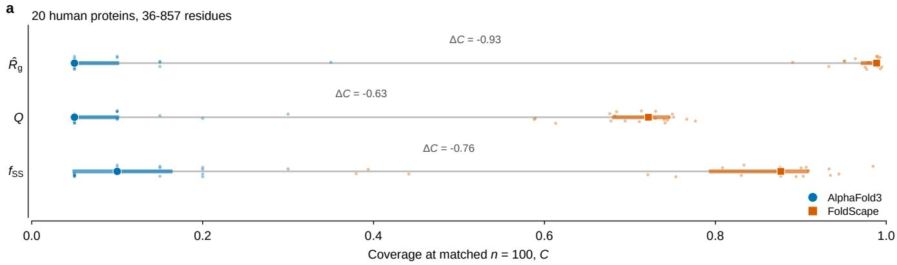

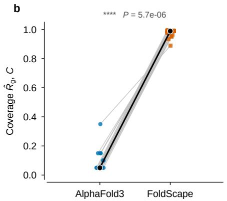

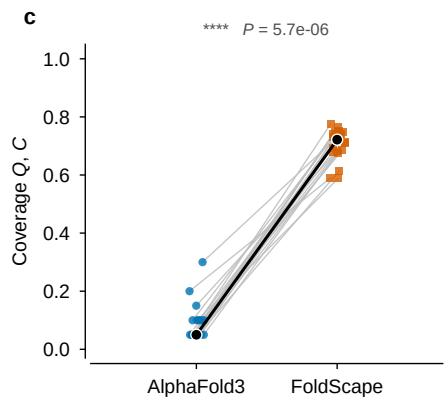

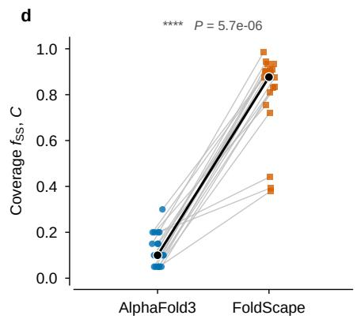  
Figure 1. At matched sample size, FoldScape ensembles show consistently higher conformational coverage than AlphaFold 3 baselines across three order parameters. a, Coverage summary for twenty human proteins (36–857 residues) on three order parameters. Each row is one order parameter; small dots are per-protein point estimates (vertically jittered to avoid overplotting), thick horizontal bars are the across-protein interquartile ranges, the large circle and square are the across-protein medians, and the grey line joins the two medians. The annotated $\Delta C$ is the median of the per-protein difference $C _ { \mathrm { { A F 3 } } } - C _ { \mathrm { { } } }$ FoldScape, and the asterisks come from a two-sided Wilcoxon signed-rank test with the protein as the pairing unit, Holm-corrected across the three order parameters. b–d, Paired slope plots for each order parameter: radius of gyration $\hat { R } _ { 9 }$ (b), fraction of native contacts Q (c) and stable secondary-structure fraction $f _ { \mathsf { S S } }$ (d). Each grey line is one protein, joining its coverage point estimates under the two methods, and the heavy black line joins the two medians. The split is 20 to 0 on all three axes, with every protein pointing the same way. All coverage values are evaluated with $K = 2 0$ bins at matched sample size $n = 1 0 0$ , and point estimates are means over 2,000 subsamples drawn without replacement. P values are Holm-corrected two-sided Wilcoxon signed-rank tests; \*\*\*\* denotes $P < 1 0 ^ { - 4 }$

The inferential weight therefore rests on the consistency of the direction rather than on the magnitude of any single $P$ value. In Fig. 1b–d each line is one protein; every line rises, with no exception in either direction.

## 3.1.4 The conclusion does not depend on binning granularity

Raising the bin count from 10 to 40 lowers the mean coverage of both methods, an inevitable consequence of finer binning, but leaves the difference stable. On all three order parameters the mean ∆C keeps the same sign and the same order of magnitude across the whole range of $K$ , and the 20-to-0 split is unchanged at every bin count tested, indicating that the result follows from the difference in spread between the two ensembles rather than from any particular binning choice.

## 3.1.5 The two ensembles are complementary along the folding coordinate

Taking the union of the two ensembles completes the picture. These occupancy counts use the same $K = 2 0$ binning as above but each method’s complete ensemble rather than a matched subsample, so they are bin counts of the pooled data and are not on the same footing as the matched-n coverage values. For $\hat { R } _ { 9 }$ the union fills all twenty bins, of which a median of 19 are occupied by FoldScape alone and 0 by AF3 alone. For $f _ { \mathsf { S S } }$ the union covers a median of 20 bins. For Q the union covers a median of 17 bins, with 1 bin occupied by AF3 alone and 15 by FoldScape alone.

That single AF3-only bin on the Q axis deserves comment. The median upper bound of Q in a FoldScape ensemble is 0.733 and its maximum is 0.843, so the ensemble does not reach the native end at $Q  1$ , whereas AF3 concentrates above $Q \ : = \ : 0 . 9 5$ The relationship between the two is therefore one of division of labour rather than containment: AF3 anchors the immediate vicinity of the native state, and FoldScape covers the continuum from the high-entropy unfolded side to the near-native globule. That continuum is precisely the segment a native-state predictor cannot supply, and it is what any description of the folding process requires, because that description demands a trustworthy ensemble across the coordinate and not only accuracy at $Q = 1 [ 2 , 3 , 8 ]$

Table 4. Per-protein conformational coverage at K = 20 bins and matched sample size $n = 1 0 0 ,$ . In each order-parameter column the value before the slash is the AlphaFold 3 coverage and the value after the slash is the FoldScape coverage. All 60 per-protein permutation tests are significant (Section 3.1).
<table><tr><td>Protein</td><td>Residues</td><td>n (AF3)</td><td>n (FoldScape)</td><td>C,  $\hat { R } _ { 9 }$ </td><td>C, Q</td><td> $C , f _ { \mathsf { S S } }$ </td></tr><tr><td>E9PIP6</td><td>36</td><td>100</td><td>300</td><td>0.35 / 0.89</td><td>0.10 / 0.59</td><td>0.15 / 0.81</td></tr><tr><td>A0A2R8YF12</td><td>61</td><td>100</td><td>300</td><td>0.05 / 0.98</td><td>0.05 / 0.77</td><td>0.20 / 0.44</td></tr><tr><td>H3BM92</td><td>66</td><td>100</td><td>300</td><td>0.05 / 0.96</td><td>0.10 /0.68</td><td>0.05 / 0.83</td></tr><tr><td>E5RK64</td><td>71</td><td>100</td><td>300</td><td>0.05 / 0.95</td><td>0.05 / 0.75</td><td>0.05 / 0.38</td></tr><tr><td>C9JYH9</td><td>96</td><td>100</td><td>300</td><td>0.15 / 0.99</td><td>0.05 / 0.61</td><td>0.05 / 0.89</td></tr><tr><td>A0A804HJL3</td><td>101</td><td>100</td><td>300</td><td>0.05 / 0.95</td><td>0.10 / 0.73</td><td>0.20 / 0.39</td></tr><tr><td>H0YMC9</td><td>121</td><td>100</td><td>300</td><td>0.15 / 0.93</td><td>0.10 / 0.73</td><td>0.20 / 0.75</td></tr><tr><td>F5H2L2</td><td>131</td><td>100</td><td>300</td><td>0.15 / 0.99</td><td>0.05 / 0.68</td><td>0.10 / 0.91</td></tr><tr><td>C9JCT1</td><td>141</td><td>100</td><td>300</td><td>0.10 / 0.99</td><td>0.30 / 0.75</td><td>0.30 / 0.93</td></tr><tr><td>D6R997</td><td>152</td><td>100</td><td>300</td><td>0.05 / 0.98</td><td>0.05 / 0.74</td><td>0.05 / 0.72</td></tr><tr><td>A0A3B3ISB1</td><td>157</td><td>100</td><td>300</td><td>0.10 / 0.99</td><td>0.10 / 0.71</td><td>0.10 / 0.83</td></tr><tr><td>K7EPK2</td><td>163</td><td>100</td><td>300</td><td>0.05 / 0.99</td><td>0.05 / 0.74</td><td>0.10 / 0.94</td></tr><tr><td>M0R0D4</td><td>169</td><td>100</td><td>300</td><td>0.05 / 0.98</td><td>0.05 / 0.68</td><td>0.10 / 0.90</td></tr><tr><td>F6QUN3</td><td>176</td><td>100</td><td>300</td><td>0.05 / 0.98</td><td>0.20 / 0.59</td><td>0.15 / 0.98</td></tr><tr><td>G3V2U3</td><td>216</td><td>100</td><td>300</td><td>0.05 / 0.99</td><td>0.15/0.68</td><td>0.15 / 0.88</td></tr><tr><td>A0A096LNW8</td><td>280</td><td>100</td><td>300</td><td>0.05 / 0.99</td><td>0.05 / 0.74</td><td>0.10 / 0.91</td></tr><tr><td>H0YFY2</td><td>323</td><td>100</td><td>300</td><td>0.05 / 0.99</td><td>0.05 / 0.78</td><td>0.20 / 0.88</td></tr><tr><td>B2R923</td><td>345</td><td>100</td><td>300</td><td>0.05 / 0.99</td><td>0.05 / 0.71</td><td>0.10 / 0.88</td></tr><tr><td>B3KVM9</td><td>675</td><td>100</td><td>300</td><td>0.05 / 0.99</td><td>0.05 / 0.75</td><td>0.05 / 0.93</td></tr><tr><td>B3KPR5</td><td>857</td><td>100</td><td>221</td><td>0.05 / 0.99</td><td>0.05 / 0.69</td><td>0.05 / 0.90</td></tr></table>

## 3.1.6 What this comparison does and does not support

Coverage measures breadth of exploration. It does not measure the accuracy of individual conformations, nor the thermodynamic weight of the ensemble. A method could well show low coverage while placing every frame closer to the truth, and this statistic cannot adjudicate that.

A second limitation concerns the conditioning variables: at inference ${ \tilde { R } } _ { g }$ and $f _ { s s }$ are supplied by the user (Section 2.8), and because the radius of gyration is also one of the three evaluation order parameters, part of the $\hat { R } _ { 9 }$ coverage is attributable to the conditioning schedule rather than to what the model has learned, whereas the AlphaFold 3 baseline has no comparable control. The ablation that would settle this—supplying only the sequence and $Q ,$ with $( \tilde { R } _ { g } , f _ { s s } )$ predicted rather than given—has not been performed, so the $\hat { R } _ { 9 }$ axis should be read as the weakest of the three, while $Q$ and $f _ { \mathsf { S S } }$ are less exposed because both are evaluated by all-atom criteria (equations (12) and (13)) that differ from the Cα quantities used for conditioning.

The reference state for Q is the first model of the AF3 ensemble, so AF3 enjoys a structural advantage at the native end of the Q axis. Its low coverage there reflects a concentrated distribution rather than a departure from the reference.

The matched sample size is capped at 100, so the comparison uses 100 conformations from each method and leaves the remainder of each FoldScape ensemble unused. This is the price paid for a fair comparison.

Finally, the construction of the AF3 baseline bounds what it can support. It is a reproducible external reference and not an estimate of the solution ensemble[5], and this comparison should not be read as a failure of AF3 on the task it was designed for.

## 3.2 Cα reconstruction along the folding coordinate

Protein structure prediction is now considered largely solved at the native end of the folding reaction for the majority of monomeric domains[25, 6, 7, 5, 107, 108]. The folding process is a different target: describing it requires the conformational ensemble at every value of the folding coordinate $Q ,$ the fraction of native contacts formed[2, 3, 50], so a predictor accurate only at Q = 1 carries no information about the barrier region, the collapse transition, or the expanded unfolded side[8, 17, 20, 18]. We therefore evaluated FoldScape against conformations drawn from explicit folding trajectories rather than native structures alone, using Q rather than simulation time as the evaluation axis (Fig. 2).

Figure 2a shows $\mathtt { C } \alpha$ traces for six proteins at conditioning values $Q _ { \mathrm { c o n d } } = 0 . 6 { - } 1 . 0$ (equation (2)) (green, molecular dynamics reference; cyan, the chain-level trace exported by Stage 1 of the trained cascade; Kabsch-superposed[58]). In all six cases the prediction reproduces the reference’s global topology — chain path, order of secondary-structure elements, and relative domain orientation — including features unobtainable from a single local window: the long helical arms projecting from the core in a(iv) and a(vi) are recovered in both direction and length, which requires the model to place a helix correctly relative to a core separated from it by a substantial stretch of sequence.

Residual deviations fall into two classes. The first is helixpacking register: in the bundle at the left of a(ii), corresponding helices are displaced laterally by roughly one helix diameter, so the bundle’s envelope is correct but its internal register is not fully resolved. The second is solventexposed long loops: the long loop at the right of a(v) runs inside the structure in the prediction but bulges outward in the reference, the largest single deviation among the six structures. Both classes occupy positions where longrange contact restraints are sparse — consistent with a fold that is already committed at this $Q$ but whose local assembly retains residual freedom.

## 3.3 A complete folding trajectory of a 706-residue chain

To test whether this accuracy extends across the full folding coordinate rather than its native segment alone, we followed a single chain — Arabidopsis thaliana $\mathsf { A F } .$ A0A7G2EJF6-F1[30], N = 706 — through a complete folding trajectory (Fig. 2b). Six conformations, ordered by increasing Q, are shown with the molecular dynamics reference in blue and the FoldScape prediction in orange.

b(i), the fully extended conformation, has an axis range of order $2 \times 1 0 ^ { 3 } \mathring { \mathsf { A } } -$ the same order as the 2679 Å contour length expected for 706 residues at the canonical 3.8 Å $\mathtt { C } \alpha \mathrm { - } \mathtt { C } \alpha$ spacing — and a global $\mathtt { C } \alpha$ root-mean-square deviation (RMSD) of 125.8 Å. By b(ii) the chain has collapsed into a compact but largely unstructured state (coordinate range $2 . 5 \times 1 0 ^ { 2 } \mathring { \mathsf { A } } .$ , RMSD 1.76 Å); this RMSD is measured against that one reference frame, drawn from a high-entropy region of the ensemble, and should not be read as agreement with the unfolded ensemble as a whole. b(iii) and $\mathsf { b } ( \mathsf { i } \mathsf { v } )$ show a two-globular architecture with two independently formed compact cores joined by an extended linker: the cores are furthest apart in b(iii) and have begun to approach as the linker contracts in $\mathsf { b } ( \mathsf { i } \mathsf { v } )$ (RMSD 1.12 Å and 1.24 Å). In b(v) the cores are in contact with only one long loop free, and RMSD reaches the series minimum, 0.67 Å. b(vi), the most compact conformation, has fused cores with one protruding loop (RMSD 0.96 Å).

The frame indices annotated in Fig. 2b do not increase along the panel sequence, confirming that the series is ordered by Q rather than by position in the trajectory. Read along $Q ,$ the RMSD is flat: excluding b(i), it spans only 0.67–1.76 Å from collapsed coil to near-native globule, with neither a monotonic decrease nor convergence confined to the native basin. b(i), at 125.8 Å, is the series’ single outlier; we show below that this reflects the metric rather than the prediction.

Two further points bear on the method’s scope. First, at 706 residues this chain exceeds by more than threefold the 200-residue ceiling that a single chain-level forward pass accepts. It is nevertheless processed by the complete trained pipeline — R1, R2, Stage 1 and the flow-matching decoder — through the stride-one crop-and-superpose scheme of Section 2.13: 507 overlapping 200-residue crops are each predicted in full and merged by parameterfree Kabsch superposition, so that every interior residue is determined as the average of up to 200 independent predictions. The result is therefore a test of the assembly scheme at a chain length far outside the training range, not of a single module extrapolating. Second, b(iii) and b(iv) resolve a multi-domain folding route in which the two domains collapse independently before the linker contracts and docks them[109, 110], recovered correctly only because the reconstruction is accurate simultaneously at two separated cores and along the extended linker joining them.

## 3.4 Stage-wise convergence of the FoldScape cascade

FoldScape decomposes Cα-trace reconstruction into a cascade of four separately supervised stages (Fig. 3). Round 1 (R1) resolves multi-scale local geometry inside 15-residue sliding windows; Round 2 (R2) refines the same windows through a purely residual branch; Stage 1 assembles window-local features into a chain-level conditioning representation; and a rectified-flow decoder generates the final $\mathtt { C } \alpha$ ensemble conditioned on that representation. Each stage is trained with all upstream stages frozen and their outputs pre-cached, so the four training records of Fig. 4 are mutually independent optimisation problems rather than segments of a single end-to-end run — the property on which every attribution below depends. All four stages share the cluster-level training/validation split of Section 2.7, so the validation curves refer throughout to the same held-out chains. Throughout this section an epoch denotes one pass over the training subsample consumed by that stage; because the stages consume different sampling units — sliding windows for Rounds 1 and 2, whole chains for Stage 1 — epoch counts are comparable within a stage but not between stages. Conformational latent pretraining (Section 2.8) precedes these four stages and is not one of them: it supplies a frozen conditioning input, its two probes are training-only diagnostics that are discarded afterwards, and no convergence record for it is reported here.

## 3.4.1 Hierarchical local-geometry regression establishes window-level coordinate accuracy

Round 1 processes each chain as a set of 15-residue sliding windows and resolves, through seven scale-specific PairFormer blocks[25, 5], the $\mathtt { C } \alpha \mathrm { - } \mathtt { C } \alpha$ distances at sequence separations $| i - j | = 1$ to 7 before decoding the windowed $\mathtt { C } \alpha$ trace — an explicit reduction of threedimensional reconstruction to a set of one-dimensional distance regressions, in the spirit of distogram- and orientation-based predictors[68, 67, 111]. Over 80 epochs the Kabsch-aligned[58] window RMSD fell from 4.26 Å to 2.97 Å on the training set and from 4.03 Å to 2.98 Å on the validation set, reaching its best value of 2.96 Å at epoch 75 and remaining flat to within 0.02 Å thereafter (Fig. 4a). The learning curve separates into two regimes: a plateau near 4.0 Å over the first ten epochs, followed by an approximately linear descent that reaches a second plateau at epoch 70. This shape is consistent with the design of the anchored distance heads, whose tanh-bounded outputs concentrate the initial predictions near the empirical anchor of each scale, so that the seven distance scales are calibrated first and the coordinate decoder subsequently benefits from already-calibrated distance features. Training and validation curves remain superimposed throughout, differing by only 0.01 Å at the final epoch, indicating that the 43.3 M-parameter Round 1 does not overfit at the current data scale and that model capacity is not the limiting factor at this stage $- a$ regime in which structure-prediction trunks are known to generalise robustly even under substantially reduced training-set size and diversity[112].

b MD reference Cα traceFoldScape prediction, window-merged and Kabsch-aligned Complete folding trajectory of one chain (Arabidopsis thaliana AF-A0A7G2EJF6-F1, N = 706)  
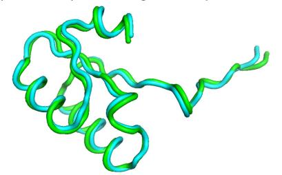

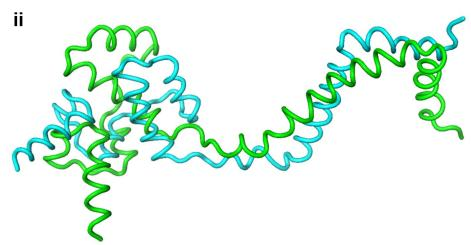

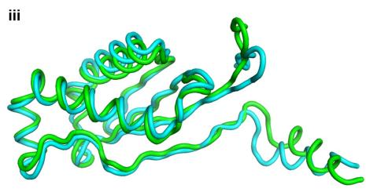

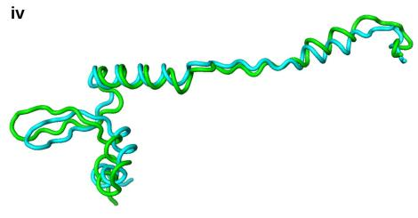

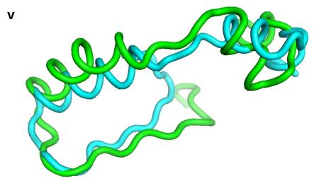

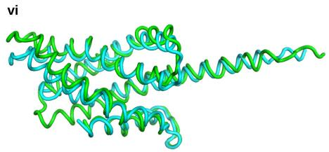

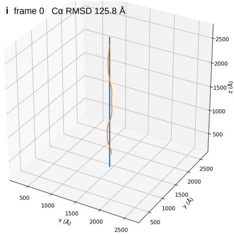  
iv frame 80 Cα RMSD 1.24 Å

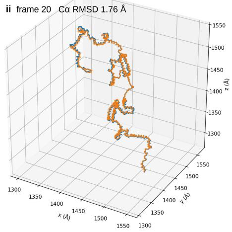

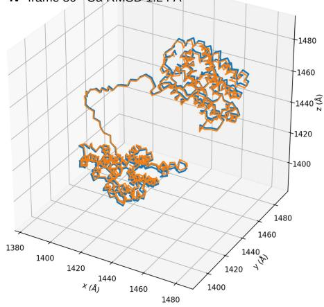

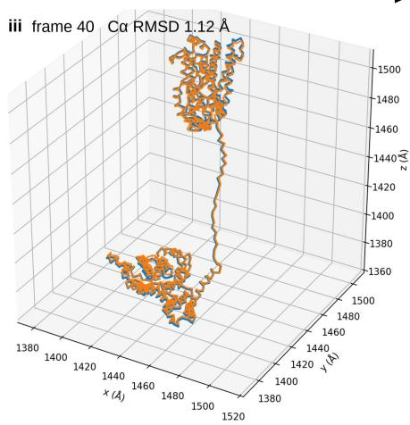

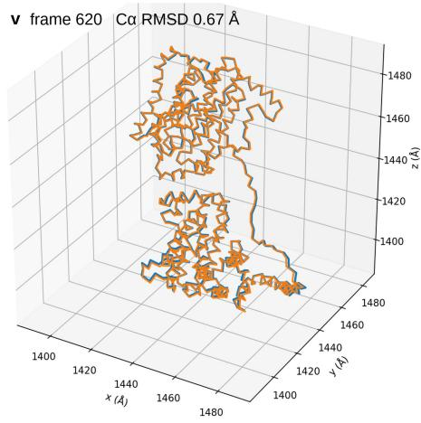

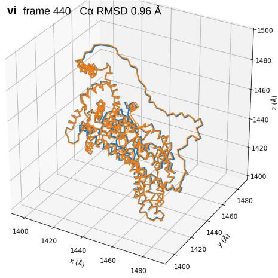  
Figure 2. FoldScape reconstructs $\pmb { \complement \alpha }$ structures across the entire folding coordinate. a, Superposition of $\mathtt { C } \alpha$ traces for six proteins sampled at conditioning values $Q _ { \mathrm { c o n d } } = 0 . 6 \substack { - 1 . 0 }$ (equation (2)). Green, molecular dynamics reference; cyan, FoldScape prediction, taken as the chain-level trace exported by Stage 1 of the trained cascade and shown here as an intermediate of the cascade rather than as the output of the pipeline; the two are optimally superposed by the Kabsch algorithm. The overall topology, the order of secondary-structure elements and the relative orientation of domains are reproduced in all six cases; residual deviations are confined to helix-packing register within helical bundles (for example a(ii)) and to solvent-exposed long loops (for example a(v)). b, Six representative conformations along the complete folding trajectory of a single chain (Arabidopsis thaliana $\mathsf { A F } { - } \mathsf { A } 0 \mathsf { A } 7 \mathsf { G } 2 \mathsf { E } J \mathsf { F } 6 { - } \mathsf { F } 1$ $N = 7 0 6 )$ Blue, molecular dynamics reference; orange, FoldScape prediction from the complete trained pipeline including the flow-matching decoder, assembled from 507 overlapping 200-residue crops by the stride-one crop-and-superpose scheme of Section 2.13 and superposed onto the reference; the “window-merged and Kabsch-aligned” label inside the panel refers to that crop merge, not to the sliding-window consensus internal to R1 and R2. Panels are ordered by increasing $Q ;$ the indices annotated in the figure identify frames within the stored trajectory and do not follow the $Q$ order. Annotations give the global $\mathtt { C } \alpha$ RMSD of each conformation. From the fully extended state in b(i) to the compact state in b(vi) the axis range contracts from approximately $2 \times 1 0 ^ { 3 } \mathring { \mathsf { A } }$ to approximately $1 0 ^ { 2 } \mathring { \mathsf { A } } ; \mathsf { b } ( \mathfrak { i } \ddot { \mathsf { i } } \big )$ and b(iv) reveal a multi-domain route in which two domains collapse independently before the connecting segment contracts and brings them together. The 125.8 Å value in b(i) arises from the ill-conditioning of global superposition on a nearly one-dimensional extended chain rather than from a loss of local geometric accuracy (see Discussion). Axis ranges differ between panels; coordinate values are simulation-box coordinates and carry no absolute meaning.

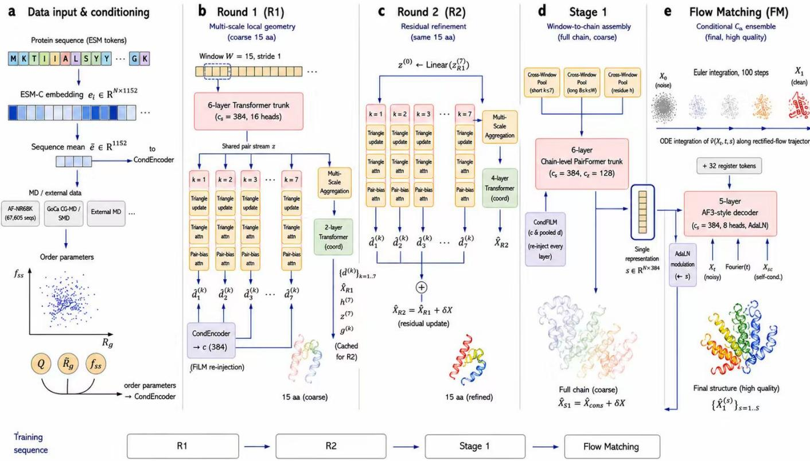  
Figure 3. Architecture of the FoldScape cascade. a, Data input and conditioning. Residue-level ESM-C embeddings[49, 7] $e _ { i } \in \mathbb { R } ^ { N \times 1 1 5 2 }$ and their sequence mean $\bar { e } \in \mathbb { R } ^ { 1 1 5 2 } -$ the latter entering the cascade through the frozen conformational latent v of Section 2.8—are combined with order parameters $( Q , \tilde { R } _ { g } , f _ { s s } )$ computed from the trajectory frames of the training corpus, namely Go-C¯ α coarse-grained MD on the 848 proteins drawn from AF-Sub1K and constant-velocity SMD, and are encoded by CondEncoder. AF-NR68K (67,605 sequences) is the non-redundant pool from which those subsets are drawn; the external MD repositories shown in the panel are held out for cross-validation and do not enter training. b, Round 1: sliding windows of $W = 1 5$ residues with stride 1 pass through a 6-layer Transformer trunk $( c _ { s } = 3 8 4$ , 16 heads) and a shared pair stream z; seven scale-specific PairFormer blocks (triangle update, triangle attention and pair-bias attention) predict the $\mathtt { C } \alpha \mathrm { - } \mathtt { C } \alpha$ distances $\hat { d } ^ { ( k ) }$ at sequence separations $k = | i - j | = 1 { - } 7 ;$ which a multi-scale aggregation module and a 2-layer coordinate Transformer decode into the windowed trace $\hat { X } _ { R 1 }$ . Conditioning c (384) is re-injected by feature-wise linear modulation[24]; $h ^ { ( 7 ) } , z ^ { ( 7 ) }$ and $g ^ { ( k ) }$ are cached for Round $2 . \mathfrak { c } ,$ Round $_ { 2 : }$ the cached pair stream initialises $z ^ { ( 0 ) } \gets \mathrm { L i n e a r } ( z _ { R 1 } ^ { ( 7 ) } )$ , and a second seven-scale cascade with a 4-layer coordinate Transformer predicts only the residual update $\hat { X } _ { R 2 } = \hat { X } _ { R 1 } + \delta X$ on the same 15-residue windows. d, Stage 1: cross-window attention pooling (short $k \leq 7 ,$ long $8 \leq k < W$ , and residue-level h) lifts window-local features to the chain index; a 6-layer chain-level PairFormer trunk $( c _ { s } = 3 8 4$ $c _ { z } = 1 2 8 )$ with CondFiLM re-injection at every layer produces the single representation $\mathbf { \Phi } _ { s } \in \mathbb { R } ^ { N \times 3 8 4 }$ and, through an auxiliary head, the full-chain coarse trace $\hat { X } _ { S 1 } = \hat { X } _ { c o n s } + \delta X . \ \mathbf { e } ,$ Flow matching: a 5-layer AlphaFold3-style decoder[5] $( c _ { s } = 3 8 4 , 8$ heads, AdaLN) with 32 register tokens, AdaLN modulation from s, Fourier time features and self-conditioning learns the conditional velocity field $\hat { v } ( X _ { t } , t , s )$ along a rectified-flow trajectory[28, 27]; 100-step Euler integration from noise $X _ { 0 }$ yields the $\mathtt { C } \alpha$ ensemble $\{ \hat { X } _ { 1 } ^ { ( s ) } \} _ { s = 1 \dots S }$ Bottom, training order: R1 → R2 → Stage 1 → flow matching, each stage trained with its upstream frozen.

## 3.4.2 Gains in global alignment accuracy come at the cost of local geometric regularity

Within the same run, the $\mathtt { C } \alpha \mathrm { - } \mathtt { C } \alpha$ virtual bond-length deviation follows the opposite trend to the global RMSD (Fig. 4b). On the validation set it fell rapidly from 0.42 Å to 0.18 Å over the first ten epochs and then rose steadily—with epoch-to-epoch fluctuation but no sustained recovery—to 0.30 Å by epoch 80, a 67% increase over its minimum; the training set reached its minimum of 0.21 Å at epoch 15 and rose to 0.32 Å, a 52% increase. Because both curves rise together, this is not overfitting but a systematic preference of the objective: the seven distance scales are weighted equally, so the nearest-neighbour term carries only one seventh of the distance loss, and the gain the coordinate term obtains from better whole-window superposition outweighs the degradation of individual bonds relative to the ideal $\mathtt { C } \alpha$ virtual-bond length of 3.80 Å[105]. As the metric is computed from decoded coordinates rather than from the nearest-neighbour distance head, its rise specifically reveals a growing inconsistency between predicted distances and decoded coordinates, and shows that windowlevel coordinate supervision alone does not preserve local chain regularity. This observation directly motivated two downstream design choices: the auxiliary geometry branch of Round 2, which predicts $\mathtt { C } \alpha$ pseudo-bond and pseudo-torsion angles alongside per-scale residual distance heads, and the always-on bond-length, bond-angle and steric-clash penalties of the flow-matching objective — the same class of polymer-statistics and physical constraints that generative and coarse-grained models of protein structure impose explicitly[111, 113].

## 3.4.3 Residual refinement nearly halves the window-level coordinate error

Round 2 reads the complete Round 1 output as a side channel, re-injects it at every layer of its cascade through feature-wise linear modulation[24], and predicts only residual corrections to the distances and coordinates. Because all modulation projections are zero-initialised[70] and the residual distance and coordinate heads are initialised at $\sigma = 1 0 ^ { - 3 }$ with zero bias, the network reproduces Round 1 to within numerical noise at initialisation, and the entire descent in Fig. 4c is attributable to the residual branch itself. The curve is recorded from the end of the first epoch, by which point the residual branch has already recovered a substantial part of its eventual gain, so its plotted starting value lies below the Round 1 level rather than at it. Over 56 epochs the validation window RMSD fell from 1.85 Å to 1.59 ${ \mathring { \mathsf { A } } } ,$ reaching 1.592 Å at epoch 54 and holding that value to the final epoch, a 46.3% reduction relative to the 2.96 Å of Round 1; the training set fell from 1.68 Å to

$1 . 3 7 \mathring { \mathsf { A } } .$ . In contrast to Round 1, the two curves are separated throughout and the gap reaches 0.224 Å at the final epoch (validation 1.592 ${ \mathring { \mathsf { A } } } ,$ , training 1.368 $\mathring { \mathsf { A } } )$ , indicating that the 77.4 M parameters combined with side-channel inputs exploit model capacity more fully while incurring mild overfitting. The cosine learning-rate restart[61] at epoch 31 raised the training error transiently by 0.053 $\mathring { \mathsf { A } } ,$ from 1.403 Å to 1.456 Å, after which it fell within 25 epochs to 1.368 ${ \mathring { \mathsf { A } } } ,$ below the pre-restart minimum. The validation error first rose to 1.690 Å, returned to its pre-restart level only at epoch $^ { 4 7 }$ , and finally improved to 1.592 Å, exceeding the pre-restart best of 1.606 Å at epoch 23 by $0 . 0 1 4 \mathring { \mathsf { A } } - \mathsf { a }$ difference that, with a single training run and no repeated seeds, we do not interpret.

## 3.4.4 Cross-window assembly lifts local geometry into a chain-level representation

Stage 1 lifts every feature with window-local support to the chain index by cross-window attention pooling and produces the conditioning representation through a six-layer chain-level PairFormer trunk. Its parallel coordinate head reached a chain-level Kabsch-aligned RMSD of $7 . 1 1 \mathring { \mathsf { A } }$ on the training set and 6.70 Å on the validation set at the end of the first epoch, for chains of at most 200 residues (Fig. 4d). The validation value lies below the training value as a natural consequence of the evaluation protocol: the training value is a running average over an epoch during which the model improves continuously, whereas validation is a single evaluation at the epoch boundary. That the chain-level error exceeds the window-level error by an order of magnitude is a structural feature of this stage — rigid-body superposition of a 15-residue window requires only local conformation to be correct, whereas the Kabsch RMSD of a chain of up to 200 residues is dominated by long-range assembly error, the component that structureprediction networks acquire last and least readily[112, 25]. We emphasise that the chain-level coordinate head serves only as auxiliary supervision; the product of this stage is the single representation that conditions the downstream decoder.

## 3.4.5 The flow-matching decoder converges stably under chain-level conditioning

The flow-matching decoder is trained on frozen upstream representations and learns a rectified-flow conditional velocity field in coordinate space[28, 27]. The training coordinate loss fell from above 110 to below 10 within the first 4,188 steps, and after 20,000 steps its baseline stabilised at a median of 3.65, on top of which intermittent spikes appear; 58 of the plotted intervals exceed the display range over 46,233 steps (Fig. 4e). The spike structure is consistent with the time weighting $1 / ( 1 - t ) ^ { 2 }$ of the rectified-flow translation term, which diverges as the sampled flow time approaches 1 and is clamped numerically at $1 0 ^ { 4 }$ , so that a single batch can exceed the baseline by one to two orders of magnitude; the smoothed curve remains flat across the same intervals, indicating that the spikes originate in time sampling rather than in optimisation divergence[114]. The validation coordinate loss, evaluated every 1,000 steps, fell overall without any sustained upturn: it entered the display range at approximately 30, fluctuated between 11.8 and

25.9 between 10,000 and 20,000 steps while the learning rate was near its peak, entered a smooth descent after 25,000 steps, and reached 6.2 at 46,233 steps (5.6 h of wall-clock training) (Fig. 4f).

Taken together, the four stages define a clear chain of error propagation, in which two different metrics must be kept apart. Round 1 reduces the window-level coordinate error to 2.96 Å and calibrates the seven distance scales; Round 2 removes a further 46% of that error, reaching 1.59 Å. Both are Kabsch RMSDs of 15-residue windows. Stage 1 then lifts those features to the chain index and exports the conditioning representation; the 6.70 Å quoted above is the chain-level RMSD of its auxiliary coordinate head after a single epoch, and is therefore neither a converged value nor the output of the pipeline. The output of the pipeline is produced by the flow-matching decoder, which converges on that representation without any sign of overfitting; its accuracy is the quantity reported in Section 3.3 and probed against an external reference in Section 3.1, and it is not bounded by the first-epoch value of an auxiliary head. Nor is it bounded below by the windowlevel errors of Rounds 1 and 2: those are the errors of intermediate modules supervised on 15-residue windows, whereas the decoder is supervised on chain coordinates and reads the upstream stages only through the conditioning representation. Fig. 2a is the one place where the Stage 1 chain-level trace is displayed directly, as an intermediate of the cascade rather than as the output of the pipeline, and it is labelled as such. Every stage converges on its own supervision target and every inter-stage gain can be attributed segment by segment, which is precisely the diagnostic advantage that hierarchical decomposition holds over end-to-end training[112].

## 3.5 Constant-velocity SMD reproduces mechanical transition states at residue resolution

Constant-velocity SMD is widely used to interpret forcespectroscopy experiments, but residue-level conclusions are usually benchmarked only against global observables such as rupture force or $\Delta x _ { u } .$ , not against site-specific data [115, 84, 90, 91]. We performed a direct site-by-site comparison, scoring each residue by $\Phi _ { \mathsf { s i m } }$ , the fraction of its native contacts surviving in a $d _ { \mathsf { p e a k } } \pm 1 . 0$ nm window around the first force peak, at each of the four pulling speeds independently (Methods).

All 12 system × speed combinations are concordant. Pearson r and Spearman $\rho$ between $\Phi _ { \mathsf { s i m } }$ and experimental mechanical $\varphi \cdot$ -values are positive for all three mechanically characterised proteins across all four speeds (Table 5, Fig. 5). For GB1 (n = 8 probes, $1 - \varphi _ { \mathsf { M } 2 + \mathsf { U } } )$ , r ranges from +0.799 to +0.861 and ρ from +0.855 to +0.919; all are significant at both metrics $( P _ { r } < 0 . 0 1 8 , P _ { \rho } < 0 . 0 0 7 )$ 10,000-replicate bootstrap 95% CIs exclude zero throughout. For titin I27 $( \varphi _ { \mathsf { m e c h } } , n = 7 )$ , mean $r = + 0 . 7 6 1 \ ( + 0 . 7 0 7$ to +0.832); two of four speeds reach $P < 0 . 0 5$ . For protein L $( \varphi _ { \mathsf { m e c h } } , n = 5 )$ , mean $r = + 0 . 6 9 4$ (+0.532 to +0.868), $\rho = + 0 . 7 0 7 \ : \mathrm { t } 0 \ : + 0 . 7 2 5$

The key inferential weight rests on sign consistency rather than individual P-values: three proteins with different fold topologies (I27, β-sandwich immunoglobulin; protein L and GB1, $\alpha + \beta$ grasp fold), different pulling geometries, and different φ-measurement strategies [81, 116, 94, 88] all fall above zero across all 12 combinations.

Structural interpretation. For GB1, the three forcebearing probes (G4-51, G6-53, G8-55; the $\beta _ { 1 } - \beta _ { 4 }$ shear interface) show the lowest $\Phi _ { \mathsf { s i m } }$ at the force peak, and the α-helix probes (G24-28, G32-36) show the highest — exactly the experimental transition-state picture in which the shear interface is largely disrupted while the helix remains intact [88]. For protein L, I60V (interface of the two mechanical sub-domains) yields the lowest $\Phi _ { \mathsf { s i m } }$ at all four speeds, in agreement with experiment: this is the only hydrophobic-core mutation that significantly alters rupture force [94].

Specificity for mechanical unfolding. Ubiquitin is the specificity control. It has only chemical-denaturation $\varphi \mathrm { - }$ values [83] and gives r = −0.34 to −0.06 and $\rho = - 0 . 4 8$ to −0.22 at all four speeds — uniformly negative and opposite to the three mechanical proteins (Fig. 5). Negative correlation with chemical $\varphi$ is the required companion to the main result, not an anomaly [84, 117]. I27 cannot serve as a specificity control because its φmech and $\varphi _ { \mathsf { c h e m } }$ are nearly collinear at the 7 measured sites $( r = 0 . 9 8 9 , \rho = 0 . 9 8 2$ $P = 2 . 2 \times 1 0 ^ { - 5 } )$

Two alternative explanations are excluded. (i) SMD follows the folding nucleus. Protein L and GB1 share the same fold topology but have opposite nucleation sites [80, 118]; both are nonetheless positively correlated with their respective mechanical $\varphi \mathrm { - v a l u e s }$ . (ii) Trivial geometry. Sequence distance to the nearest pulled terminus gives $\rho ~ = ~ + 0 . 9 1 6$ for GB1 $( P \ : = \ : 0 . 0 0 1 )$ — numerically similar to $\Phi _ { \mathsf { s i m } } -$ but partial-correlation analysis shows the information is not equivalent: controlling for terminus distance, the partial correlation of $\Phi _ { \mathsf { s i m } }$ with experimental $\varphi$ remains +0.676 (GB1, $P = 0 . 0 9 6 )$ and +0.796 (I27, $P = 0 . 0 5 8 )$ , whereas controlling for $\Phi _ { \mathsf { s i m } }$ reduces the terminal-distance partial correlation to −0.114 and −0.395, respectively.

Scope. Agreement is ordinal, not numerical: the span of $\Phi _ { \mathsf { s i m } }$ across probe sites is much smaller than the span of the experimental $\varphi \cdot$ values it is compared with, and regression slopes are well below 1. Within these limits, constantvelocity SMD trajectories encode mechanical unfolding information at residue resolution, and this information is specific to the force-spectroscopy route.

## 3.6 Extension-conditioned ensembles are reproducible in their continuous observables across two decades of pulling velocity

SMD must be performed at velocities far above the experimental range because all-atom simulations cannot access millisecond timescales [96]. If intermediate conformations changed systematically with speed, the production-speed ensemble could not represent force-induced unfolding intermediates. We tested this directly.

Experimental design. The four validation proteins — ubiquitin (1UBQ, 76 residues), titin I27 (1TIT, 89 residues), protein L (2PTL, 61 residues) and protein G B1 (1PGB,

a  
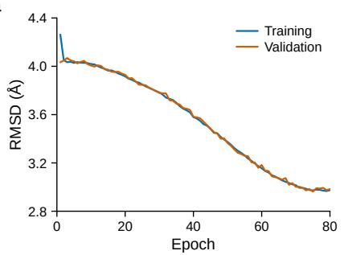

b  
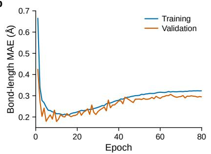

c  
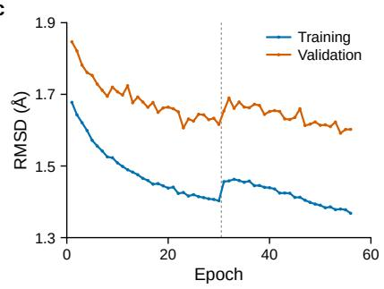

d  
e  
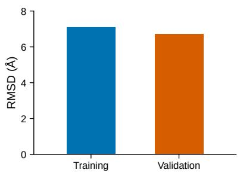

f  
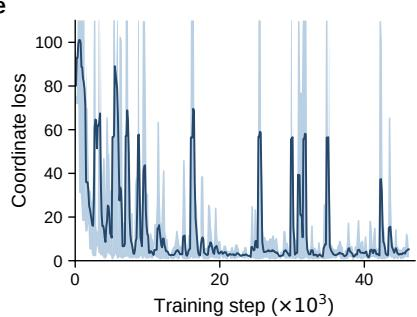

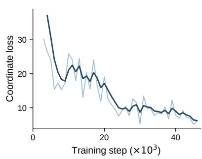  
Figure 4. Training convergence of the FoldScape cascade. a, Window-level coordinate error of Round 1: root-mean-square deviation between predicted and reference Cα traces within a 15-residue sliding window after optimal Kabsch superposition, fo the training (blue) and validation (orange) sets over 80 epochs; the best validation value is 2.96 Å at epoch 75. b, Mean absolute deviation of $\mathtt { C } \alpha \mathrm { - } \mathtt { C } \alpha$ virtual bond lengths, $\lVert \mathrm { C } \alpha _ { i } - \mathrm { C } \alpha _ { i + 1 } \rVert - 3 . 8 0 \mathring { \mathsf { A } } |$ , computed from the decoded coordinates of the same run; the curves reach their minima at epoch 10 (validation, 0.18 Å) and epoch 15 (training, $0 . 2 1 \mathring { \mathsf { A } } )$ and rise steadily thereafter to $0 . 3 0 \mathring { \mathsf { A } }$ and 0.32 Å at the final epoch, the validation curve fluctuating from epoch to epoch about that rise. c, Window-level coordinate error of Round 2 over 56 epochs; the dotted vertical line marks a cosine learning-rate restart at epoch 31, and the best validation value is 1.59 Å at epoch 54. d, Chain-level Kabsch-aligned RMSD of the Stage 1 auxiliary coordinate head at the end of the first epoch (training $7 . 1 1 \mathring { \mathsf { A } } ,$ validation $6 . 7 0 \mathring { \mathsf { A } } ;$ chains of at most 200 residues); the training value is a running average over the epoch and the validation value a single evaluation at its end. $\bullet ,$ Training-set coordinate loss of the flow-matching decoder against optimisation step; the dark line is the exponential moving average and the pale band spans the range of the per-step raw loss, with spikes exceeding the axis limit truncated at 110. f, Validation-set coordinate loss of the same run, evaluated every 1,000 steps (47 evaluations); the pale line shows the individual evaluations and the dark line their exponential moving average (smoothing factor 0.6). Evaluations before step 3,000 exceed the axis range and are not shown. Vertical axes in a–d are in ångström; the coordinate loss in e and f is the weighted translation term of the flow-matching objective and is dimensionless. All curves come from a single training run per stage; no repeated seeds were performed, and no error bars are therefore shown.

Table 5. Pearson r and Spearman $\rho$ between $\Phi _ { \mathsf { s i m } }$ at the force peak and experimental φ-values at four pulling speeds. Asterisk: $P < 0 . 0 5$ . Speed units: nm ns−1 per end. All 12 mechanical-protein combinations are positive; all 4 ubiquitin combinations are negative.
<table><tr><td>System (quantity, n)</td><td> $v = 0 . 0 1$ </td><td> $v = 0 . 0 5$ </td><td></td><td> $v = 0 . 1$ </td><td> $v = 1 . 0$ </td><td></td><td></td><td> $d _ { \mathsf { p e a k } }$  range</td></tr><tr><td colspan="9">Main evidence: comparison with mechanical φ-values</td></tr><tr><td>Titin 127  $( \varphi _ { \mathsf { m e c h } } , 7 )$ </td><td> $r { = } { + } 0 . 8 3 ^ { * } , \rho { = } { + } 0 . 5 0$ </td><td> $r { = } { + } 0 . 7 2 ,$ </td><td> $\rho { = } \mathrm { + } 0 . 4 0$ </td><td> $r { = } { + } 0 . 7 8 ^ { * } , \rho { = } { + } 0 . 5 0$ </td><td></td><td> $r { = } { + } 0 . 7 1$ </td><td> $\rho { = } \mathrm { + 0 . 5 1 }$ </td><td>4.9–5.2 nm</td></tr><tr><td>Protein L  $( \varphi _ { \mathsf { m e c h } } , 5 )$ </td><td> $r = + 0 . 5 3 ,$   $\rho { = } { + } 0 . 7 1$ </td><td> $r { = } { + } 0 . 8 7 ,$ </td><td> $\rho { = } { + } 0 . 7 1$ </td><td> $r { = } { + } 0 . 5 9 ,$ </td><td> $\rho { = } { + } 0 . 7 1$ </td><td> $r { = } { + } 0 . 7 8 ,$ </td><td> $\rho { = } { + } 0 . 7 3$ </td><td>3.7-4.5 nm</td></tr><tr><td>GB1  $( 1 - \varphi _ { \mathsf { M } 2 + \mathsf { U } } , 8 )$ </td><td> $r { = } { + } 0 . 8 5 ^ { * }$   $\rho { = } \mathrm { + 0 . 9 1 } ^ { \ast }$ </td><td> $r { = } { + } 0 . 8 6 ^ { * }$ </td><td> $\rho { = } { + } 0 . 9 2 ^ { * }$ </td><td> $r { = } { + } 0 . 8 0 ^ { * }$ </td><td> $\rho { = } \mathrm { + 0 . 8 6 } ^ { * }$ </td><td> $r { = } { + } 0 . 8 2 ^ { * }$ </td><td> $\rho { = } \mathrm { + 0 . 8 6 } ^ { \ast }$ </td><td>2.8–3.0 nm</td></tr><tr><td colspan="9">Specificity control: comparison with chemical φ-values</td></tr><tr><td>Ubiquitin  $( \varphi _ { \mathsf { c h e m } } , 8 )$ </td><td> $r = - 0 . 1 4 ,$   $\rho { = } { - } 0 . 3 1$ </td><td> $r { = } { \mathrm { - } } 0 . 3 4 .$ </td><td> $\rho { = } { - } 0 . 4 8$ </td><td> $r = - 0 . 0 6 ,$ </td><td> $\rho { = } { - } 0 . 3 6$ </td><td> $r = - 0 . 1 0 ,$ </td><td> $\rho { = } { - } 0 . 2 2$ </td><td>4.6-4.9 nm</td></tr></table>

Pulling simulations reproduce pulling experiments across three proteins and two decades of pulling speed

GB1 (1 - φm2 + u, pulling expt., n=8)  protein L (φmech, pulling expt., n=5) ubiquitin $( \phi _ { c h e m } ,$ chemical control, n=8)O open: not significant I27(φmech, pulling expt., n=7) I27(φchem, chemical control, n=7) ● filled: P < 0.05  
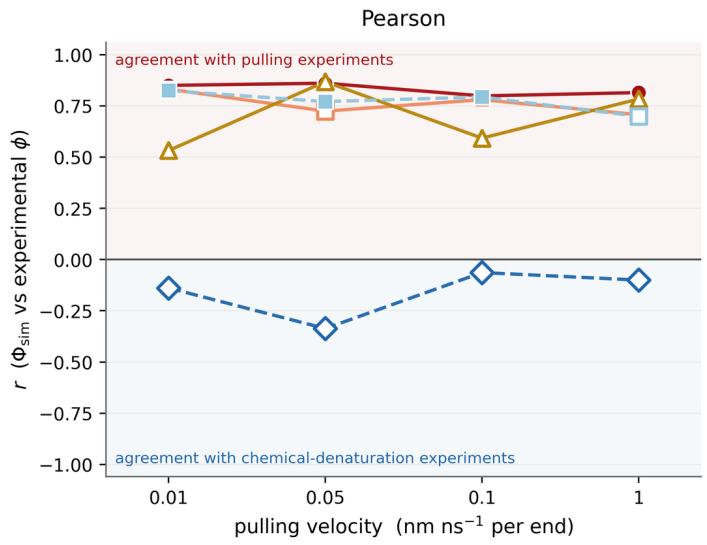

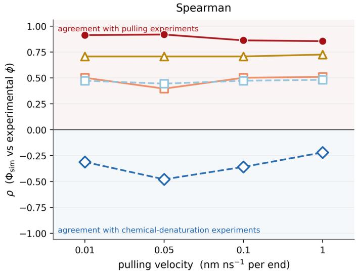  
Figure 5. Simulation–experiment agreement at residue resolution is robust across two decades of pulling speed. Pearson r (left) and Spearman $\rho$ (right) between $\Phi _ { \mathsf { s i m } }$ at the force peak and experimental φ-values, plotted against pulling velocity (0.01, 0.05, 0.1, 1.0 nm ns−1 per end). Warm solid lines: mechanical φ-values (main evidence) — GB1 (1 − φ , n = 8), I27 $( \varphi _ { \mathsf { m e c h } } , n = 7 )$ protein L $( \varphi _ { \mathsf { m e c h } } , n = 5 )$ . Cold dashed lines: comparisons with chemical φ-values — ubiquitin $( \varphi _ { \mathsf { c h e m } } , n = 8 )$ , which is the specificity control, and I27 $( \varphi _ { \mathsf { c h e m } } , n = 7 )$ , shown for completeness but not a control, because its $\varphi _ { \mathsf { c h e m } }$ and φ are collinear at the seven measured sites $( r = 0 . 9 8 9 )$ . Filled symbols, $P < 0 . 0 5 ;$ ; open symbols, not significant. Pink shading: positive half-plane (agreement with pulling experiments); blue shading: negative half-plane (agreement with chemical denaturation). All 12 mechanical combinations fall above zero; all 4 ubiquitin combinations fall below zero. Bootstrap 95% CIs (10,000 replicates) omitted for clarity.

56 residues) — were each simulated at 0.01, 0.05, 0.1 and 1.0 nm ns−1 per end with every other parameter held fixed, and all cross-speed comparisons were made against end-to-end distance on a common grid of 40 equal-width bins (Methods). This design separates “speed changed when a conformation appeared” from “speed changed the conformation itself,” testing only the latter.

Q and $R _ { \mathfrak { g } }$ agree to 2.9–7.0% of their dynamic range. Cα-RMSD, native-contact fraction Q, and $R _ { 9 }$ traces overlap across all four speeds (Fig. 6, Table 6). Summarising all 24 protein × speed-pair combinations, the RMS deviation in Cα-RMSD is 0.199 nm (range 0.105–0.361); in $R _ { 9 } ,$ 0.196 nm (0.122–0.351); in Q, 0.050 (0.026–0.085). Normalised by the physical dynamic range, relative deviations are 2.9–3.5% for $R _ { 9 }$ and 4.5–7.0% for Q — consistent across four proteins with different sizes and topologies. Of 12 observable × protein combinations, 8 yield positive and 4 negative Spearman correlations between $| \log _ { 1 0 } ( v _ { 2 } / v _ { 1 } ) |$ and RMS deviation, with only 1 reaching $P < 0 . 0 5$ (and in the opposite direction to the majority).

Per-residue contact-survival patterns are preserved across speeds. Heatmaps of per-residue contact survival (Fig. 7) show the same block structure at all four speeds: segments that disrupt early and segments that persist occupy the same sequence positions regardless of speed. Pearson r averaged across the six speed pairs has a per-protein median of 0.809–0.923 (Table 7); 93–98% of residues exceed r > 0.7; Spearman $\rho$ gives nearly identical conclusions (mean 0.819–0.843). Low-consistency residues cluster at mechanically critical sites: I27 residues 27, 28, 42, 44, 45, 52 flank the A–B and A′–G hydrogenbond networks that form the rate-limiting barrier [90, 119].

Kolmogorov–Smirnov (KS) tests reveal that only 23– 40% of speed pairs are indistinguishable in residue-level contact-survival distributions (Table 7, Fig. 8). Speed preserves the shape (monotonic decrease of contact survival with extension) but not the absolute distribution at a given extension.

Domain-organisation topology is conserved; disruption position shifts. Per-residue domain-assignment profiles are significantly correlated across all 24 combinations $( r \ : = \ : 0 . 7 2 0  – 0 . 9 6 7 _ { ! }$ mean 0.845, max $P = \mathrm { { 3 . 0 } \times 1 0 ^ { - 3 3 } }$ Fig. 9). Table 8 reports a different quantity, the extension at which the domain count first reaches zero. A directed speed effect is nonetheless present: faster pulling displaces the extension at which the chain loses all domain structure by a mean of 2.83 nm (Spearman correlation with log v: +0.80 for all four proteins; with n = 4 the exact twosided permutation P is 0.33 per protein, but the direction is unanimous). The effect is largest for titin I27 (16.67 nm at 0.01 to 23.66 nm at 1.0 nm ns−1; 50–71% of $L _ { \mathsf { c } } )$ and negligible for protein L (18.03 to 18.50 nm), consistent with their known mechanical stabilities [90, 116, 86].

Implications for parameter choice. The quantities on which a conditional generative model is conditioned — continuous geometric and contact observables at a given extension — are reproducible across speeds here; the absolute residue-level contact-survival distributions at a given extension are not, and are used neither as conditioning variables nor as training targets. The extension at which structures disrupt, which does shift with speed, is not a model conditioning variable. Trajectories at different speeds may therefore be pooled in a single training set provided the training targets are restricted to continuous geometry and contact observables at fixed reaction coordinate.

Table 6. RMS deviations between speed pairs (mean over six pairs; brackets: min–max).
<table><tr><td>Observable</td><td>Ubiquitin</td><td>|27</td><td>Prot. L</td><td>Prot. G</td></tr><tr><td>Cα-RMSD (nm)</td><td>0.241</td><td>0.259</td><td>0.144</td><td>0.152</td></tr><tr><td> $R _ { 9 } \ ( \mathsf { n m } )$ </td><td>0.223</td><td>0.243</td><td>0.152</td><td>[0.183-0.337] [0.178-0.361] [0.105-0.167] [0.127-0.198] 0.164</td></tr><tr><td>Q</td><td>[0.177-0.314] [0.167-0.351] [0.122-0.193] [0.123-0.233] 0.060</td><td>0.058</td><td>0.044</td><td>0.038</td></tr><tr><td></td><td></td><td></td><td></td><td>[0.042-0.085] [0.039-0.082] [0.026-0.059] [0.031-0.044]</td></tr><tr><td>Norm.  $\Delta R _ { 9 }$ </td><td>3.2%</td><td>2.9%</td><td>2.9%</td><td>3.5%</td></tr><tr><td>Norm. ∆Q</td><td>7.0%</td><td>6.8%</td><td>5.2%</td><td>4.5%</td></tr></table>

Table 7. Per-residue cross-speed consistency (degenerate residues excluded). N: residues retained. KS frac.: fraction of speed pairs with $p > 0 . 0 5$
<table><tr><td>Protein</td><td>N Med. r  $r { > } 0 . 7$ </td><td>Mean</td><td> $\rho$  KS frac.</td></tr><tr><td>Ubiquitin</td><td>72</td><td>0.863 0.93</td><td>0.826 0.29</td></tr><tr><td>Titin 127</td><td>89</td><td>0.923 0.93</td><td>0.833 0.40</td></tr><tr><td>Protein L</td><td>60 0.865</td><td>0.97 0.843</td><td>0.23</td></tr><tr><td>Protein G</td><td>54 0.809</td><td>0.98 0.819</td><td>0.25</td></tr></table>

Table 8. Extension at which all domain structure is irreversibly lost. $L _ { \mathsf { c } } = ( N - 1 ) \times 0 . 3 8 \mathsf { n m } \mathrm { : } 2 8 . 5 0 , 3 3 . 4 4 , 2 2 . 8 0 ,$ 20.90 nm. ρ(log v) computed from unrounded values. With n = 4 the exact two-sided permutation P is 0.33 per protein; it is reported for completeness, and the inference rests on the unanimous sign across the four proteins rather than on any single P value.
<table><tr><td>Protein</td><td>0.01</td><td>0.05</td><td>0.1</td><td>1.0</td><td> $\rho$ </td><td> $L _ { \mathsf { c } }$  frac.</td></tr><tr><td>Ubiquitin</td><td>21.87</td><td>22.53</td><td>22.51</td><td>23.08</td><td>+0.80</td><td>0.77-0.81</td></tr><tr><td>127</td><td>16.67</td><td>23.64 21.52</td><td></td><td> $2 3 . 6 6 \ \mathrm { ~ + 0 . 8 0 }$ </td><td></td><td>0.50-0.71</td></tr><tr><td>Protein L</td><td>18.03</td><td>18.03</td><td>318.48</td><td> $1 8 . 5 0 ~ + 0 . 8 0$ </td><td></td><td>0.79-0.81</td></tr><tr><td>Protein G</td><td>à14.70</td><td>16.4715.14</td><td></td><td> $1 7 . 3 4 \ \div 0 . 8 0$ </td><td></td><td>0.70-0.83</td></tr></table>

## 3.7 Force-induced unfolding proceeds in fragments: binary partition stability and a linear extension law

Sections 3.5 and 3.6 establish that the trajectories are valid and the ensemble is speed-robust. This section characterises the internal geometry of the intermediates to determine whether a fragment-level modelling strategy is geometrically coherent.

Binary partition is stable across 500 proteins. Applied at fixed window width and threshold to all trajectory frames of AF-Geo500 — 500 proteins across 11 species — the folded/unfolded partition operator (Methods) ran without per-protein tuning and returned 557,550 contiguous unfolded segments of length $\geq 3$ with well-defined boundaries. The stability of the “contiguous unfolded segment” object under fixed hyperparameters is itself a check on the binary abstraction: a broad diffuse transition zone would prevent well-defined segments from forming. This picture is consistent with the block structure visible in Figs. 7 and 9, in which disruption boundaries appear as sharp colour steps rather than gradual gradients. The binary residue abstraction is a modelling assumption in WSMEclass statistical-mechanical models [97–101] and in the hydrogen-exchange foldon picture [102, 103]; the present measurement places it on an all-atom footing.

End-to-end distance of unfolded segments obeys a linear extension law. Segment end-to-end distance was compared with the contour-length upper bound $L _ { \mathsf { m a x } } =$ $3 . 8 \left( N _ { \tt S e g } - 1 \right) \ttmathring { A }$ through the linear relation of equation (10) (Section 2.19). Origin-constrained least squares over all 557,550 segments gives $\alpha _ { 9 1 0 \mathsf { b a l } } = 0 . 9 4 7 \ ( R ^ { 2 } \ = \ 0 . 9 8 0 ;$ Fig. 10a). The relationship holds from 3 to over 1,000 residues, spanning nearly three decades in $L _ { \mathrm { m a x } } . \mathsf { A }$ twopiece fit (Fig. 10b) gives $\alpha _ { \mathsf { s h o r t } } = 0 . 8 7 2 \ ( N _ { \mathsf { s e g } } \leq 3 0 )$ and $\alpha _ { \mathsf { l o n g } } = 0 . 9 5 7 \ ( N _ { \mathsf { s e g } } > 3 0 )$ residual MAE is 3.9 Å, comparable to one virtual bond length (Fig. 10c).

The scaling coefficient has a clear hierarchical structure. Three statistical levels must be distinguished (Table 9, Fig. 10d–f). The global fit $( \alpha = 0 . 9 4 7 )$ is dominated by long segments (weight $\propto \ L _ { \mathrm { m a x } } ^ { 2 } )$ The per-segment mean is 0.851 with CV 17.2%, left-skewed (median 0.900). The per-protein mean is 0.906 with CV only 3.5%; the distribution is unimodal and shows no systematic separation across 11 species spanning prokaryotes (E. coli, B. subtilis), fungi (C. albicans), plants (A. thaliana), invertebrates (C. elegans, D. melanogaster, A. gambiae, A. mellifera), and vertebrates (D. rerio, B. taurus, C. lupus).

The 17.2% per-segment CV is not noise: α rises systematically with segment length, from ≈ 0.84 across the shortest bins $\mathrm { { t o } \approx 0 . 9 4 }$ for long segments, with bin-wise scatter narrowing as length increases (Fig. 10e). Shorter segments retain more residual curvature immediately after leaving the folded core; longer segments approach the full-extension limit.

Universality is a protein-average, not a per-fragment, property. The two dispersion levels therefore license different uses of $\alpha .$ The 3.5% coefficient of variation across 500 proteins and 11 species means that a single value of α transfers between proteins and across the sampled phylogenetic range. The 17.2% per-segment coefficient of variation, with its systematic dependence on segment length, means that the same value does not transfer between individual segments: treating α as a fixed scalar rather than a length-dependent quantity introduces a ∼15% systematic bias at the level of a single segment. Taken together with the residual MAE of 3.9 Å — one virtual bond length — these measurements bound how far a fragment’s end-to-end geometry can be treated as determined by its own length alone; the consequences for model design are taken up in the Discussion.

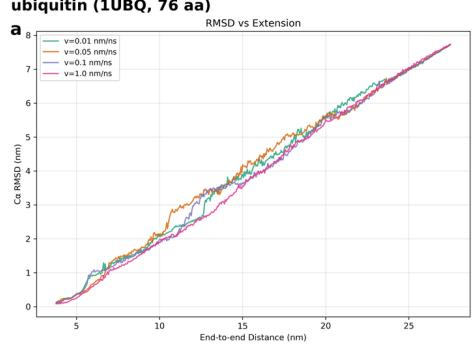

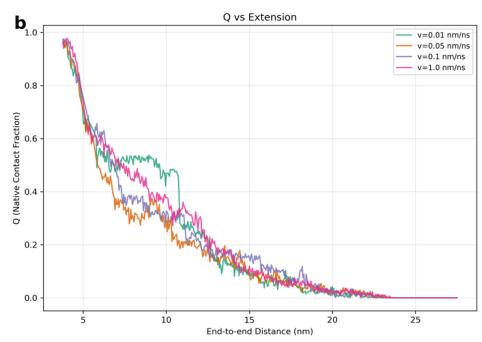

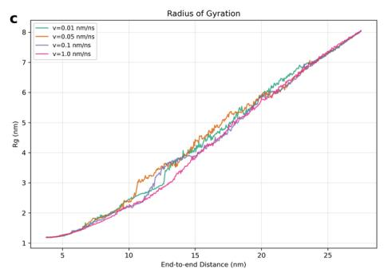

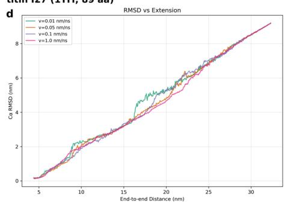

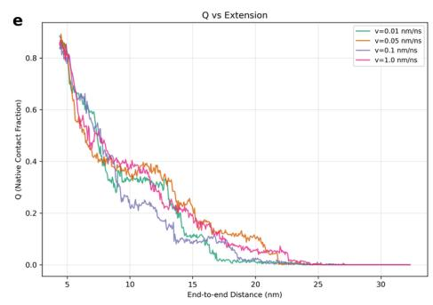

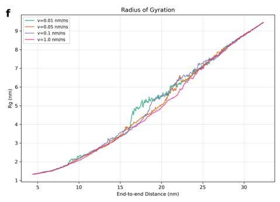

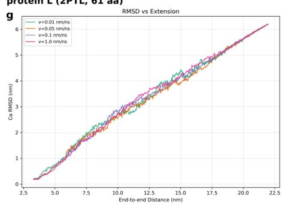

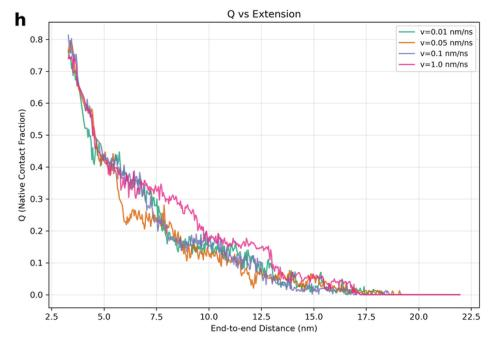

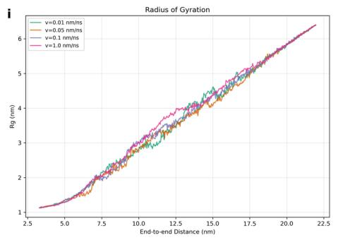

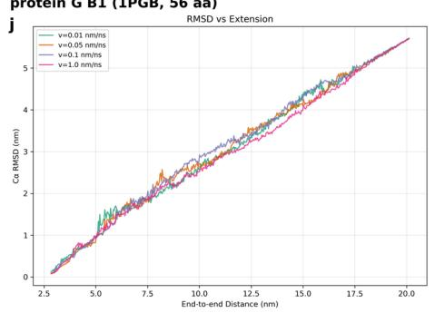

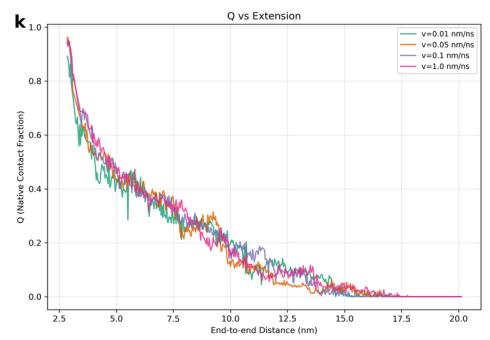

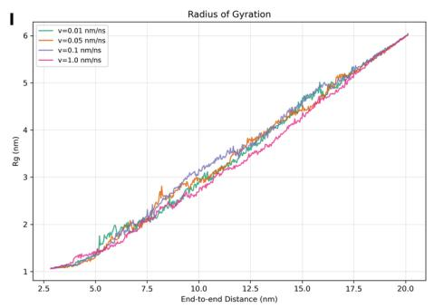  
Figure 6. Global conformational observables agree across two decades of pulling speed when plotted against extension. Each row shows one protein: a–c ubiquitin (1UBQ); d–f titin I27 (1TIT); g–i protein L $( 2 \mathsf { P T L } ) ; \mathsf { i } - 1$ protein G B1 (1PGB). Columns: $\mathtt { C } \alpha$ -RMSD relative to the native state after Kabsch superposition [58] $( \mathbf { a } , \mathbf { d } , \mathbf { g } , \mathbf { j } )$ ; native-contact fraction $Q \ ( \boldsymbol { \mathsf { b } } , \boldsymbol { \mathsf { e } } , \boldsymbol { \mathsf { h } } , \boldsymbol { \mathsf { k } } )$ ; radius of gyration $R _ { 9 } \ ( \mathbf { c } , \mathbf { f } , \mathbf { i } , \mathbf { l } )$ . Horizontal axis is end-to-end distance; four colours correspond to four pulling velocities.

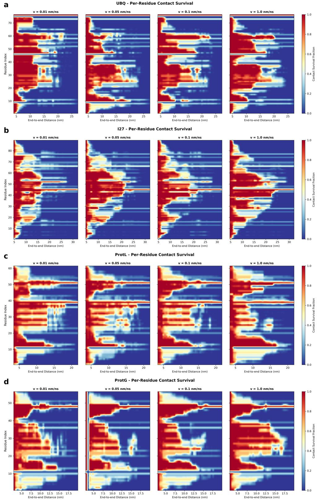  
Figure 7. Per-residue contact-survival maps at four pulling velocities. a ubiquitin; b titin I27; c protein L; d protein G B1. Within each panel, columns correspond to $v = 0 . 0 1 , 0 . 0 5 , 0 . 1 , 1 . 0 \mathsf { n m } \mathsf { n s } ^ { - 1 }$ . Colour: fraction of native contacts retained $\begin{array} { r } { ( \mathsf { C } \alpha \mathrm { - } \mathsf { C } \alpha < 8 . 0 \mathring \mathsf { A } , } \end{array}$ $| i - j | > 3 ,$ as in equation (2)). Segments that disrupt early and those that persist occupy the same sequence positions at all speeds; disruption boundaries appear as sharp colour steps rather than gradual gradients.

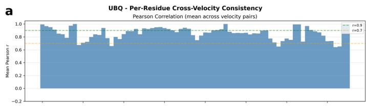

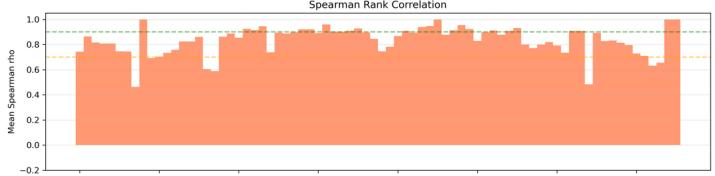

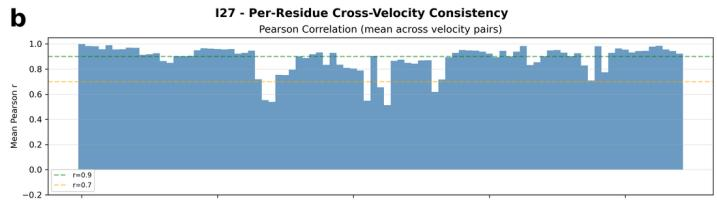

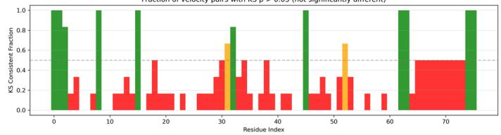

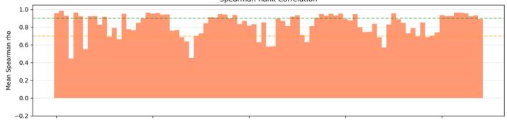

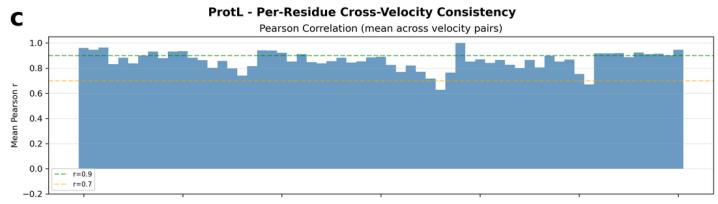

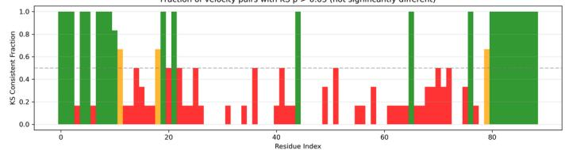

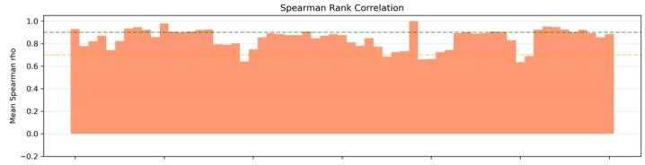

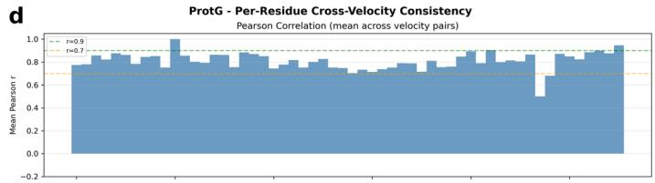

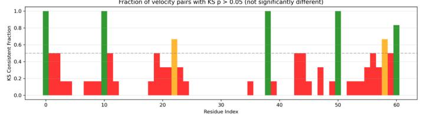

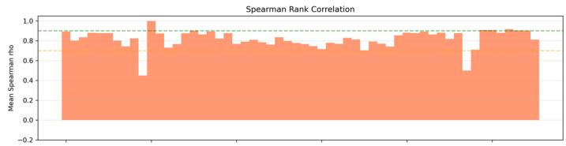

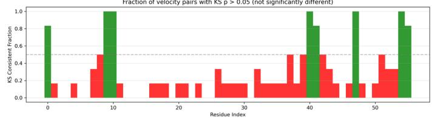  
Figure 8. Per-residue cross-speed consistency: shape is preserved, absolute distributions are not. a ubiquitin; b titin I27; c protein L; d protein G B1. Top sub-panel: mean Pearson r across six speed pairs. Middle: Spearman $\rho .$ Bottom: fraction of speed pairs with ${ \sf K S } _ { p } > 0 . 0 5$ . Reference lines: $r = 0 . 9$ (green dashed) and $r = 0 . 7$ (orange dashed); KS panel 0.5 (grey dashed). High r/ρ with low KS fraction confirms that contact-survival trends are speed-invariant but absolute values at a fixed extension are not.

Table 9. Hierarchical statistics of the scaling coefficient α (500 proteins, 11 species).
<table><tr><td>Level</td><td>n Mean Median</td><td>SD</td><td>CV</td></tr><tr><td>Per-segment 427,139</td><td>0.851 0.900</td><td>0.146</td><td>17.2%</td></tr><tr><td>Per-protein</td><td>500 0.906 一</td><td>0.032</td><td>3.5%</td></tr><tr><td>Global fit</td><td>一 0.947 一</td><td>一</td><td></td></tr></table>

## 4 Discussion

FoldScape is a sequence-conditioned generative model of protein conformation whose defining claim is not accuracy at the native state but accuracy at every point along the folding coordinate. Three questions follow from that claim, and we take them in order: whether the predictions are in fact uniformly accurate across $Q ,$ and how such predictions should be scored; whether the contribution of each stage of the cascade can be isolated, attributed and diagnosed;

and whether the training corpus that the model consumes, together with the architecture built to consume it, rest on physically defensible foundations.

## 4.1 Predictive accuracy is uniform along the folding coordinate

The central point of Fig. 2 is that predictive accuracy is flat along the folding coordinate, while the conventional global RMSD metric breaks down of its own accord at the low-Q end. Across the entire range from collapsed coil to nearnative state, the RMSD of the 706-residue chain remains between 0.67 and 1.76 Å, neither decreasing monotonically with Q nor converging only near the native state — indicating that the model produces a correct conformation at each folding stage independently, rather than simply emitting an answer close to the native structure. This is a prerequisite for extending a native-state predictor into a description of the folding process, which requires a trustworthy ensemble across the coordinate, not accuracy at $Q = 1$ alone[2, 3, 8]. It is this requirement that separates the present objective from the single-structure task on which current predictors are optimised[25, 108], and that it shares with generative approaches to equilibrium ensembles and Markov-state descriptions of folding kinetics[17, 120, 20, 18, 121].

  
Figure 9. Domain-organisation topology is speed-invariant; complete disruption is speed-delayed. a ubiquitin; b titin I27; c protein L; d protein G B1. Upper sub-panel: structural domain count versus extension (four speeds overlaid). Lower sub-panel: per-residue domain-membership profile (dark: residue belongs to a sequentially contiguous, locally native domain). Domain profiles are significantly correlated across all 24 speed combinations $( r = 0 . 7 2 0 \ – 0 . 9 6 7 _ { \div }$ , mean 0.845, max $\\overset { \cdot } { P } = 3 . 0 \times 1 0 ^ { - 3 3 } )$ . The extension at which the domain count first reaches zero shifts systematically to larger values at higher speed (most pronounced for I27, panel b upper).

  
Figure 10. The linear extension law $\mathrm { E T E } = \alpha \times 3 . 8 \left( N _ { \mathbf { s e g } } - 1 \right)$ holds across 11 species, 500 proteins, and 557,550 unfolded segments. $\mathsf { a } , \mathsf { E T E }$ versus $3 . 8 \left( N _ { \mathsf { s e g } } - 1 \right)$ for all segments (105 randomly drawn for display). Black dashed line: $\alpha = 1$ (full extension); red line: origin-constrained fit $( \alpha _ { 9 1 0 \dot { 6 } \mathsf { a } 1 } = 0 . 9 4 7 , R ^ { 2 } = 0 . 9 8 0 )$ . b, Two-piece fit: $N _ { \mathsf { s e g } } \leq 3 0$ (coral, $\alpha = 0 . 8 7 2 )$ and $N _ { \mathsf { s e g } } > 3 0$ (steel-blue, $\alpha = 0 . 9 5 7 )$ $\bullet ,$ Residuals of the two-piece model; $\mathsf { M A E } = 3 . 9 \mathring { \mathsf { A } } . { \mathsf { d } } .$ Per-segment $\alpha _ { k }$ distribution $( n = 4 2 7 , 1 3 9 ; N _ { \mathsf { s e g } } \geq 5 , L _ { \mathsf { m a x } } > 1 \mathring { \mathsf { A } } )$ mean 0.851, SD 0.146, CV 17.2%, median 0.900 (orange dotted). e, α versus segment length (log-spaced bins); error bars: ±1 SD; grey numerals: per-bin counts. $\mathbf { f } ,$ Per-protein α across 500 proteins: mean 0.906, SD 0.032, CV 3.5%.

The same trajectory also carries a transfer in chain length, since it is reconstructed for a chain more than threefold longer than a single chain-level forward pass accepts. That transfer matters beyond the raw benchmark comparison[12]: it shows that reconstructing threedimensional coordinates from a hierarchy of local onedimensional distances generalises well past the regime the model was built for, and that long-range inter-domain orientation emerges from the accumulation of local geometry along the chain rather than from direct prediction of long-range contacts — unlike predictors that make the contact map or distogram an explicit object of inference[68, 25], and consonant with fragment-based assembly, where global architecture is built from locally determined geometry[122]. The independent collapse and later docking of the two domains in b(iii)–b(iv) is a direct manifestation of this mechanism[109, 110].

## 4.2 Global RMSD is ill-posed for extended conformations

This mechanism’s cost is exposed by b(i). A fully extended chain is nearly one-dimensional: rotation about its long axis is degenerate under optimal superposition, so small per-window orientational errors accumulate linearly along the contour and are amplified, over a chain of nearly $2 , 7 0 { \bar { 0 } } { \bar { \mathsf { A } } } ,$ into a global RMSD of 125.8 Å. The predicted and reference traces nevertheless follow the same local path, with the deviation appearing as a slow bend of the whole chain rather than a breakdown of local geometry, and a lateral offset of only a few per cent of the contour length. The 125.8 Å value therefore reflects an ill-posed metric for this conformational class, not model failure at low $Q -$ the extended-chain limit of a long-recognised property of RMSD, which is dominated by the largest displacements and scales with the size of the object compared, so that its value is interpretable only within a restricted class of compact structures[123–125].

We therefore recommend scoring unfolded and earlycollapse states with superposition- or scale-free measures — lDDT[73], per-window local RMSD, distance-matrix error, contact-area scores[126], and the relative deviation of the radius of gyration[51, 127] — and restricting global RMSD to conformations that have already formed a compact core, where superposition-based measures such as TM-score and GDT remain well behaved[128, 129]. This distinction matters for the central claim of this work: a substantial part of the folding process takes place on the expanded, unfolded side of the coordinate[2, 3], where a single global RMSD criterion would yield misleading conclusions precisely where confidence is most needed.

## 4.3 Coverage is a second axis, independent of accuracy

Flat accuracy along Q is necessary for a generator of the folding process but not sufficient: a method could be uniformly accurate on the conformations it emits and still emit only conformations from a narrow region of the coordinate. Section 3.1 therefore measures the second axis directly. At matched sample size the median coverage of an AlphaFold 3 baseline ensemble is one or two bins in twenty, whereas FoldScape occupies nearly all of the radius-ofgyration axis and roughly three-quarters of the Q axis, with the same sign on every one of the twenty proteins and all three order parameters. The two quantities are logically independent — coverage says nothing about whether a given frame is correct — so the argument for FoldScape rests on holding them jointly, not on either alone. They are, however, established on different material: accuracy on the trajectory reconstructions of Sections 3.2 and 3.3, coverage on the twenty-protein panel of Section 3.1. No single target in this work carries both measurements, because the coverage panel has no reference folding trajectory against which per-conformation accuracy could be scored; demonstrating the two properties simultaneously on one protein requires a target for which both an explicit trajectory and an external ensemble are available, and is the natural next experiment.

The comparison should be read for what it is. The AF3 baseline varies only the random seed, and its authors state that this does not approximate the solution ensemble[5]; strategies that perturb the alignment recover considerably more conformational diversity[121, 156], and generative ensemble methods target that diversity explicitly[18–20]. The narrow AF3 band is thus the expected behaviour of a native-state predictor, not a defect. What the measurement establishes is the size of the gap that a generator of the folding process must close, and the observation that the two ensembles are complementary rather than nested: AF3 concentrates above $Q = 0 . 9 5$ , which FoldScape does not reach, while FoldScape supplies the continuum below it. A practical consequence is that the near-native end of the folding coordinate may be better served by combining the two than by either alone.

## 4.4 Attributability, systematic trade-offs and the current bottleneck

Decomposing three-dimensional coordinate reconstruction into a series of one-dimensional distance regressions[68, 67] rests on the claim that each geometric degree of freedom can be solved, and diagnosed, on its own. The curves of Section 3.4 provide direct evidence for that claim: all four stages converge on their respective supervision targets, and the gain contributed by each can be attributed segment by segment. The evidence from Round 2 is particularly clean. Because its modulation projections are zero-initialised[24, 70], the network reproduces Round 1 to within numerical noise at initialisation, so the 46% reduction in error comes entirely from the residual branch and is not confounded with the effect of simply retraining a larger model. Such attributability is difficult to obtain within an end-to-end framework, where the learning process must instead be reconstructed post hoc from intermediate structures[112], and it is the principal methodological return of the hierarchical design.

The most consequential systematic bias is the separation between global alignment accuracy and local geometric regularity. The rise in bond-length deviation appears on the training and validation sides simultaneously and therefore cannot be removed by early stopping or by conventional regularisation; it reflects an implicit trade between whole-window superposition and individual bond lengths that is built into the equally weighted multi-scale loss. The trade creates a real checkpoint dilemma: a checkpoint at epoch 10–15 keeps the bond-length deviation at 0.18– 0.21 Å but leaves the window RMSD above 3.9 Å, whereas the final checkpoint buys roughly 1 Å of RMSD at the cost of a 0.30 Å bond-length deviation. The auxiliary geometry branch of Round 2 and the physical penalties of the flow-matching objective compensate for part of this cost downstream[111, 113], but the more fundamental remedy is to resolve it inside Round 1 — for example through a curriculum weight on the nearest-neighbour scale that strengthens as training proceeds[130], or through an explicit bond-length constraint, so that both metrics can reach acceptable values at the same checkpoint. We had previously tested a static up-weighting of the short-range scales; it marginally improved short-range fits while substantially degrading the 5-to-7-separation distances and the final trace, which suggests that any reweighting must be dynamic rather than static.

Two observations from Round 2 point to the same conclusion: at the current dataset scale, the marginal return on additional optimisation budget is already low. The first is the 0.224 Å training–validation gap at the final epoch; the second is that the learning-rate restart bought only 0.014 Å of validation improvement over 30 epochs while the training error continued to fall. This combination is the signature of a model beginning to absorb dataset-specific detail, the regime in which added capacity or schedule length yields far less than added data diversity[112]. The next increment in performance is therefore more likely to come from broadening trajectory coverage — for instance by moving the external molecular-dynamics resources currently reserved for cross-validation into training[12, 11, 131] — than from longer training or a larger model; recent ensemble emulators that absorb hundreds of milliseconds of aggregate simulation make the same case at much larger scale[18].

The gap between the converged window-level error of 1.59 Å and the first-epoch chain-level error of 6.70 Å at the auxiliary Stage 1 head bounds rather than measures the cost of assembly, but it points in a definite direction: assembly, not local geometry prediction, is where the remaining accuracy is to be found. One structural reason is that cross-window pooling can supply features only for residue pairs separated by less than the window length; pairs at separations of at least the window length are initialised to zero in the chain-level pair tensor, so long-range contacts must be recovered by the chain-level trunk on its own from the sequence embeddings and the consensus trace. Enlarging the window, or supplying an independent prior for long-range pairs — the role played by triangle-based pair updates and by evolutionary or language-model couplings in full-chain predictors[25, 6, 132] — is the most direct route to narrowing the window-to-chain gap. It should be noted that the Stage 1 coordinate head is auxiliary supervision only, and its chain-level RMSD is not equivalent to the structural accuracy of the complete pipeline, which is determined by the sampling quality of the flow-matching decoder on the conditioning representation.

The decoder curves expose a practical issue. Even with the time weight clamped at $1 0 ^ { 4 }$ , flow times sampled near the end of the trajectory still produce one-to-two orders of magnitude of batch-loss fluctuation. Such fluctuation does not alter the downward trend of the smoothed curve, but it markedly increases how often gradient clipping is triggered, and its net effect is an implicit down-weighting of the high-flow-time regime — precisely the regime in which coordinate detail is finalised. If fuller supervision is wanted there, stratified time sampling or a bounded velocity parameterisation would be preferable to numerical clamping alone; both the choice of loss weighting and the choice of time-sampling density are known to dominate the training behaviour of diffusion- and flow-based generators[114, 133].

The cascade structure itself facilitates further improvement: each stage can be replaced and evaluated independently while the upstream stages remain frozen, so that changes targeting local geometry, long-range assembly and conditional generation can be pursued independently of one another. Once predictive accuracy improves further, the same conditioning representation can serve design-oriented structure generation conditioned on the folding fraction[134, 111], and can be compared directly against generative models of equilibrium ensembles[17, 20, 19, 18].

## 4.5 Prerequisites on the training corpus and the architecture

The generative model described above was trained on steered molecular dynamics (SMD) trajectories and is intended to predict residue-level conformations of mechanical unfolding intermediates conditioned on the end-to-end elongation. Realising that objective requires satisfying three independent methodological conditions. First, the SMD trajectories must sample the mechanical unfolding pathway rather than the time-reversal of the chemical folding pathway, so that the learned representations carry force-relevant structural information. Second, the observables on which the ensemble conditioned on elongation is trained must be reproducible across pulling speeds, so that trajectories generated at a computationally tractable speed can stand in for those that would be obtained at slower, more experiment-proximal rates; where that reproducibility fails, the affected quantities must be excluded from the training targets. Third, the architecture of the generative model must reflect the intrinsic physical organisation of unfolding intermediates. We address each condition in turn.

## 4.6 SMD trajectories sample the mechanical unfolding pathway

A central concern in using SMD data as a surrogate for experiment is whether the computed residue-level unfolding order corresponds to the mechanical transition state rather than the chemical folding nucleus. Mechanical unfolding proceeds along a specific shear coordinate defined by the end-to-end pulling geometry, rupturing loadbearing hydrogen-bond networks first; chemical unfolding is driven by bulk solvation and exposes the folding nucleus last [92, 135, 136]. A simulation that correctly captures the mechanical pathway should therefore correlate with mechanical $\varphi$ values and be uncorrelated with, or negatively correlated with, chemical $\varphi$ values — the two are not simply the reverse of each other [84].

We tested this prediction by comparing, for four pulling speeds, the per-residue native-contact survival fraction at the first force peak $( \Phi _ { \mathsf { s i m } } )$ against independently measured mechanical and chemical $\varphi$ values. For GB1, $\Phi _ { \mathsf { s i m } }$ correlated positively with the mechanical $\varphi$ values φM2+U measured via engineered metal-chelation sites under AFM pulling conditions [88, 95] across all four speeds (Pearson $r = + 0 . 8 0 { - } + 0 . 8 6 , P < 0 . 0 2 ;$ Spearman $\rho = + 0 . 8 6 \mathrm { - + 0 . 9 2 }$ $P \mathrm { ~ < ~ } 0 . 0 0 7 )$ The structural correspondence is precise: the simulation identifies the $\beta _ { 1 } - \beta _ { 4 }$ shear interface as the most disrupted element at the force peak and the α-helix and first β-hairpin as the most intact — exactly the topology resolved by the force-extension experiments. By contrast, the simulation-to-chemica $^ - \varphi$ comparison for ubiquitin gave near-zero or negative correlations at all speeds $( r = - 0 . 3 4 \ \mathrm { t } 0 \ - 0 . 0 6 )$ , serving as the requisite negative control: a method that sampled chemical folding intermediates would produce the opposite result [137]. That the direction of the correlation flips across the two comparison sets, and does so consistently over all twelve mechanical protein–speed combinations and all four chemical controls, is not a statistical artefact but the expected signature of force-specific pathway sampling [91]. We note that the four speeds of a given protein share one force field, one starting structure and one probe set, so they are not four independent replicates; the inferential weight rests on the three mechanically characterised proteins, which have different folds and different φ-measurement strategies. A partial-correlation analysis further confirms that $\Phi _ { \mathsf { s i m } }$ carries structural information beyond the geometric confound of endpoint proximity [90]: after partialling out the sequence distance to the nearest pulled terminus, the residual correlation between $\Phi _ { \mathsf { s i m } }$ and the experimental $\varphi _ { M 2 + U }$ for GB1 remains at +0.68 (df = 5, $P = 0 . 0 9 6 )$ whereas the endpoint-distance predictor loses nearly all explanatory power once $\Phi _ { \mathsf { s i m } }$ is controlled for. The modest significance level reflects the limited number of experimentally characterised sites (7–8 per protein) rather than a weak effect. These results establish that the trajectories encode the mechanical unfolding pathway, validating their use as training data for a force-conditioned generative model.

## 4.7 Extension-conditioned ensembles are reproducible in their continuous observables across pulling speeds

SMD trajectories are typically generated at pulling speeds several orders of magnitude faster than AFM experiments, raising the question of whether the sampled conformations are biased toward kinetically trapped, high-energy structures. Addressing this question requires distinguishing two effects of speed: the elongation at which a structural transition occurs, and the conformational ensemble that is sampled at a given elongation. Using end-to-end distance rather than simulation time as the reaction coordinate decouples these effects [115, 138].

Across four pulling speeds spanning two orders of magnitude (0.01–1.0 nm/ns) and four benchmark proteins with well-characterised mechanical properties (ubiquitin, titin I27, protein L, and protein G B1 domain), the nativecontact fraction Q and the radius of gyration $R _ { \mathrm { g } }$ deviate by only $2 . 9 \mathrm { - } 7 . 0 \%$ of their dynamic range when compared at the same elongation, and the $\mathtt { C } \alpha { \cdot } \mathsf { R M S D }$ traces overlap over the shared extension range (Table 6). Residue-level contact-survival curves are highly correlated across speed pairs (Pearson r median 0.81–0.92; 93–98% of residues at $r > 0 . 7 )$ , and the domain-assignment profiles along the sequence are significantly correlated in all 24 protein– speed-pair combinations $( r = 0 . 7 2 – 0 . 9 7$ , all $P < 3 \times 1 0 ^ { - 3 3 } )$ The Spearman rank correlations for contact-survival profiles are comparable (mean $\rho ~ = ~ 0 . 8 2 \mathrm { - } 0 . 8 4 )$ , ruling out the possibility that the Pearson values are driven by a small number of outlier residues. There is no systematic dependence of the deviations on the speed separation $| \log _ { 1 0 } ( v _ { 2 } / v _ { 1 } ) | ;$ of 12 (observable × protein) combinations, the Spearman correlation between speed separation and RMS deviation is positive in 8 and negative in 4, with only one reaching $P < 0 . 0 5$

Pulling speed does produce one detectable systematic effect: faster pulling delays complete structural dissolution to larger elongations by an average of 2.83 nm across the tested range. This effect has a transparent physical interpretation. At constant velocity, the residence time in each elongation window decreases with speed, so thermally activated barrier crossing occurs at lower probability per unit elongation; residual structure is therefore dragged to larger end-to-end distances before collapsing [139, 140]. The effect is largest for titin I27, whose $\mathrm { A ^ { \prime } { - } G }$ strand hydrogen-bond network constitutes a steep, localised barrier sensitive to residence time, and smallest for protein L, whose shallower barrier is already adequately sampled at all tested speeds [90, 141]. This speed dependence is an intrinsic feature of constant-velocity pulling, not a defect of the force field or thermostat, and it does not compromise the reproducibility, across speeds, of the continuous observables of the ensemble conditioned on elongation. An important qualification follows from the Kolmogorov–Smirnov analysis: although the shape of the contact-survival profile is conserved across speeds, the absolute contact-survival values at a given elongation are not identically distributed (KS pass rate 23–40%). Speed therefore shifts the absolute level of contact preservation without altering the residue-level order of disruption. This implies that trajectories from different speeds may be combined as training data without introducing a systematic conformational bias in the ordered disruption sequence, but that absolute contact probabilities should not be read as quantitative $\varphi$ surrogates.

## 4.8 Force field and simulation protocol

All trajectories were generated with the AMBER ff14SB force field [37] and OBC2 implicit solvent [38], with a fixed spring constant, Langevin thermostat, and time step applied uniformly across all pulling speeds. The force field was chosen on the basis of its established accuracy for protein backbone and side-chain geometry [37] and its widespread validation in both equilibrium and nonequilibrium protein simulations [142]. Implicit solvent was adopted to allow systematic comparison across a wide range of pulling speeds without the computational overhead of explicit solvent boxes at the slower rates; the qualitative agreement between the simulated force-peak structures and AFM-derived $\varphi$ values (discussed above) provides an empirical upper bound on force-field-induced distortion at the level of contact topology. The internal speed-robustness analysis constitutes an additional form of validation: a force field that introduced spurious speeddependent conformational artefacts would manifest as a systematic increase in cross-speed deviation with speed separation, which is not observed.

## 4.9 Rationale for the segmented generative architecture

The deep generative model is organised around individual unfolded segments (Rounds 1 and 2), rather than modelling the full-length partially unfolded chain as a continuous object. This architectural choice reflects a quantitative property of the unfolding intermediates themselves. A binary partition of each trajectory frame into folded and unfolded regions, using a local-RMSD criterion with fixed window width $w = 7$ and threshold $\tau = 2 . 0 \mathring \mathsf { A }$ , operates stably on 500 proteins spanning 11 species, yielding 557,550 segments of length $N _ { \mathrm { s e g } } \geq 3$ with well-defined boundaries. The stability of this binary operator across such a diverse sample is not trivial: were the folded-to-unfolded transition spatially gradual rather than sharp, the operator would produce diffuse boundaries, and the resulting segments would not constitute geometrically coherent objects. The sharp boundary indicates that, on the length scale of a few residues, the transition between native conformation and extended conformation is essentially discontinuous — a direct, data-level confirmation of the two-state assumption at the heart of Wako–Saitô–Muñoz–Eaton-class statistical mechanical models [97–100].

The geometry of the unfolded segments further supports the segmented architecture. Section 3.7 shows that the end-to-end distance of every segment is fixed by segment length through equation (10) to within one $\mathtt { C } \alpha \mathrm { - } \mathtt { C } \alpha$ virtual bond, and that the scaling coefficient is unimodal and narrow across proteins while dispersing systematically with length across individual segments. The interpretation of that result requires care, because a value of α ≈ 0.9 invites two readings that it does not in fact support.

Force spectroscopy conventionally fits chain extension with the worm-like chain model [138], converting contourlength increments into unfolded residue counts through a per-residue contour length of 0.36–0.40 nm [115, 84] — numerically close to the 3.8 Å virtual bond used here, but representing the asymptotic geometric ceiling reached at infinite force. At the opposite limit, the fully denatured state is described as a self-avoiding walk whose radius of gyration scales as a power law in chain length [51]. The ensemble measured here is neither: α describes the extension actually realised at finite force while a folded core still anchors one or both ends of the segment, and its value falls quantitatively between a random coil and a fully straightened rod. Equation (10) therefore characterises a distinct ensemble rather than restating either limiting case, which is what makes it usable as a geometric prior over intermediates rather than over end states.

Three consequences follow for model design, and together they motivate training Rounds 1 and 2 on short segments rather than on whole chains. First, the learning unit is well posed: a contiguous unfolded segment is a stable object under a fixed-hyperparameter operator across 500 proteins and 11 species, so a per-segment target is defined without protein-specific tuning, whereas a diffuse crossover would have made segment boundaries threshold artefacts and any per-segment supervision would have inherited that arbitrariness. Second, the target has low intrinsic variance and an analytically known leading term: within a segment the dominant geometric degree of freedom is fixed by segment length to 3.9 Å, so the network learns the residual after that term is removed — the component carrying sequence and local-structure information — rather than spending capacity re-deriving a covalent geometric constraint from whole chains. The speciesindependence of the per-protein coefficient licenses α as a shared prior, while its per-segment length dependence requires segment length to enter as an explicit conditioning variable rather than as a fixed scalar. Third, the harder long-range problem is deferred: equation (10) constrains geometry within a segment but says nothing about the relative arrangement of two folded regions separated by an unfolded segment, nor about contact probability as a function of separation. These longer-range relations are addressed by the later rounds, which operate on whole chains conditioned on the reaction coordinate. The use of small-fragment training in Rounds 1 and 2 is therefore not an approximation of convenience but a decomposition that matches the physical modularity of the intermediates — a modularity analogous to the domain-by-domain unfolding picture established for multi-domain proteins by singlemolecule force spectroscopy [115, 84], and consistent with the theoretical prediction that mechanical unfolding of independently stable domains proceeds via sequential rather than concerted transitions [101].

## 4.10 Limitations and future directions

Several limitations should be noted. First, each protein– speed combination is represented by a single trajectory, so the cross-speed RMS deviations reported in Section 3.6 conflate genuine speed effects with stochastic trajectoryto-trajectory variation. To disentangle these, replicate trajectories at the production speed with different random seeds would establish a within-speed noise baseline; a cross-speed deviation that does not exceed this baseline would elevate the current result from “no detectable systematic dependence” to “speed effect smaller than stochastic noise”. Second, the low KS pass rate (23–40%) implies that absolute contact probabilities are not quantitatively preserved across speeds. Training targets should therefore be restricted to continuous observables conditioned on elongation (geometry and contact topology) rather than discrete labels derived from absolute thresholds, such as ranked residue sets or contact-count categories. Third, the binary partition threshold τ = 2.0 Å was chosen empirically and validated globally; a systematic sensitivity analysis on τ and window width w would consolidate the robustness claim. Fourth, three additional quantitative characterisations of the intermediates — conservation of folded-region geometry under stretching, near-independence of contacts within unfolded segments, and power-law decay of inter-fragment contact probability with separation length — were formulated on a small set of proteins and are presented here without full cross-species validation. Confirming these properties at the 500-protein scale would complete the quantitative framework and extend the theoretical grounding of the segmented architecture.

A second group of limitations attaches to the training records themselves. All curves in Section 3.4 were obtained from a single run per stage without repeated random seeds, so small numerical differences — in particular the 0.014 Å improvement attributed to the learning-rate restart — should not be treated as statistically significant. The RMSD reported for Round 1 and Round 2 is defined on 15- residue windows and is therefore not directly comparable with the chain-level or full-length RMSD quoted by other methods[25, 5]. Stage 1 currently has only a first-epoch record, and its full convergence behaviour awaits further training. The decoder curve ends at 46,233 steps, short of the intended training budget, and its validation loss was still falling at that point, so the reported value should be read as an upper bound rather than a converged one. The conformational latent pretraining stage that precedes the cascade is reported only through its role in the pipeline: no reconstruction error for its Decoder probe and no calibration for its Q-Predictor probe are shown, so the frozen latent it exports is taken as given rather than independently benchmarked.

A third group attaches to the coverage benchmark. Twenty proteins is a small panel; the twenty sequences were not screened for homology against the training corpus (Section 2.7), so the comparison measures conformational spread rather than held-out generalisation; and the AlphaFold 3 ensembles vary only the random seed; a baseline built by subsampling or clustering the alignment[121, 156], or drawn from a generative ensemble method[18, 19], would be a more demanding comparison and is the natural next step. The reference state for Q is taken from the AF3 ensemble itself rather than from an experimental structure, and no reference ensemble from molecular dynamics was available for these twenty sequences, so coverage here is measured against the joint range of the two methods rather than against a known ground-truth range; whether the covered region is populated with the correct Boltzmann weights is a separate question that this statistic cannot address.

A fourth group concerns the evaluation of the reconstructions. The six-protein panel of Fig. 2a is a qualitative topology comparison and is not accompanied by per-panel chain lengths, $Q$ values and RMSDs; supplying them would allow the panel to carry quantitative weight. More fundamentally, the 125.8 Å outlier at $Q  0$ shows that global RMSD is the wrong yardstick for extended conformations, so an accuracy claim spanning the whole of Q will require the superposition-free metrics recommended above to be adopted systematically rather than reported alongside RMSD. Finally, the scope of the present claim should be stated plainly: FoldScape is a conformational generator, not a thermodynamic estimator. It produces conformations at a prescribed value of the reaction coordinate, and this work makes no claim about the statistical weight those conformations would carry in an equilibrium ensemble. Because the corpus is generated by mechanical rather than chemical denaturation, assigning such weights would require an independent calibration against equilibrium sampling, which we have not attempted.

## 4.11 Conclusion

This work joins four strands of evidence into a single argument: that a conformational ensemble can be generated along the folding coordinate — across the continuum from the unfolded chain to the near-native globule — and not only at its native endpoint.

The first strand is the prediction itself. Across a complete folding trajectory of a 706-residue chain — more than threefold beyond the chain length that a single chain-level forward pass accepts, and reached by the stride-one cropand-superpose scheme of Section 2.13 — the Cα RMSD stays between 0.67 and 1.76 Å from collapsed coil to nearnative globule, neither decreasing monotonically with Q nor converging only in the native basin. Accuracy is, in other words, flat along the folding coordinate. The single apparent exception, the 125.8 Å value at the fully extended end, is a property of global superposition on a nearly onedimensional object rather than a failure of the prediction, and it identifies a concrete methodological requirement: unfolded and early-collapse states must be scored with superposition-free measures if landscape-level claims are to be meaningful.

The second strand shows that the cascade producing those predictions can be trained, and diagnosed, stage by stage. Round 1 reduces the window-level coordinate error to 2.96 Å while calibrating seven distance scales; Round 2, whose zero-initialised modulation leaves it equal to Round 1 to within numerical noise at initialisation, removes a further 46% of that error to reach 1.59 $\mathring { \mathsf { A } } ;$ Stage 1 completes the window-to-chain assembly and exports the conditioning representation; and the flow-matching decoder converges on that representation without overfitting. Because every stage is trained with its upstream frozen, each gain is attributable to a specific architectural choice rather than to retraining at larger scale — and the same decomposition exposes the two systematic costs of the design, the trade between global alignment accuracy and local bond regularity inside Round 1, and the window-tochain gap that now limits overall accuracy.

The third strand supplies the foundations. The comparison of $\Phi _ { \mathsf { s i m } }$ with mechanical and chemical φ values establishes that constant-velocity SMD samples the force-specific unfolding pathway at residue resolution, with all twelve mechanical protein–speed combinations positive and all four chemical controls negative. The speed-robustness analysis demonstrates that the ensemble conditioned on elongation is reproducible across two orders of magnitude of pulling speed in the continuous observables the model is conditioned on, with deviations of 2.9–7.0% of their dynamic range, allowing trajectories at different speeds to be aggregated without introducing a systematic conformational bias. The large-scale characterisation of unfolding intermediates across 500 proteins and 11 species reveals that partially unfolded chains decompose into geometrically coherent segments whose extension statistics are universal at the protein level and length-dependent at the segment level — the physical modularity that the segmented architecture was built to match.

The fourth strand fixes the scale of the result against an external reference. On twenty human proteins spanning 36–857 residues, and at matched sample size, FoldScape ensembles cover a median of 0.99 of the radius-of-gyration axis and 0.72 of the Q axis against 0.05 for AlphaFold 3 baseline ensembles on both, with every protein pointing the same way on all three order parameters and the conclusion unchanged across bin counts from 10 to 40. Coverage and accuracy are independent quantities, and it is holding them together — a prediction that is both correct at each folding stage and actually distributed across those stages — that a generator of the folding process requires.

Flat accuracy along Q is precisely the property that separates a generator of the folding process from a predictor of its endpoint, because any description of that process can be no more trustworthy than the least trustworthy conformation entering it. Establishing that property — over the range from the unfolded chain to the near-native globule, through an architecture whose contributions can be attributed individually, and on data whose physical validity has been tested independently — is what converts sequence-conditioned structure prediction into sequenceconditioned generation of the conformational continuum, and brings analyses of misfolding, cryptic intermediates and allosteric coupling within reach at proteome scale.

## Funding

This project was supported by the Beijing Life Science Academy (2025900CB0160).

## Acknowledgements

We thank the maintainers of the AlphaFold Protein Structure Database and of the five public molecular dynamics repositories used for cross-validation for making their data openly available.

## Author contributions

Contributions are described using the CRediT taxonomy. Conceptualization: L.Z. and Z.W.X., who jointly formulated the scientific question and designed the study. Methodology: L.Z. and Z.W.X., who jointly developed the methodology and the theoretical framework of FoldScape. Software: L.Z., Q.L. and Z.N.X., who implemented the algorithmic framework and carried out the deep learning training. Investigation: L.Z., Y.Y. and Q.Y., who performed the molecular dynamics simulations. Data curation: L.Z., Y.Y. and Q.Y. Formal analysis: L.Z., Y.Y. and Q.Y. Validation: L.Z. and Z.W.X. Visualization: L.Z. Writing — original draft: L.Z. and Y.Y. Writing — review and editing: Z.W.X., L.Z., P.L., Z.F., W.C. and R.H. Resources: Z.W.X., L.Z., P.L., Z.F., W.C. and R.H., who provided the computational resources on which this work was carried out. Supervision and project administration: Z.W.X. and L.Z. Funding acquisition: Z.W.X., P.L., Z.F., W.C. and R.H.

L.Z., Q.L., Z.N.X., Y.Y. and Q.Y. contributed equally to this work. All authors read and approved the final version of the manuscript.

## Competing interests

The authors declare no competing interests.

## Data availability

The sequence lists defining AF-Raw391K, AF-Core116K, AF-NR68K, AF-Sub10K, AF-Sub1K and AF-Geo500, the coarse-grained and steered molecular dynamics trajectories generated in this work, the AlphaFold 3 and FoldScape conformational ensembles for the twenty benchmark proteins, the per-conformation order-parameter table, the perprotein coverage table and the complete statistical output in JSON will be deposited in a public repository on publication, and are available from the corresponding author on reasonable request until then. The input structures were obtained from the AlphaFold Protein Structure Database (https://alphafold.ebi.ac.uk); the external molecular dynamics trajectories used for cross-validation are available from their original repositories as cited in Section 2.6.

## Code availability

The FoldScape training and inference code, the simulation and analysis pipelines, and the conformational coverage analysis script (random seed 20240521) will be released under an open-source licence in a public repository on publication, and are available from the corresponding author on reasonable request until then.

## Author information

Corresponding author. Correspondence to Zhengwe Xie (xiezhengwei@hsc.pku.edu.cn).

[1] Anfinsen, C. B. Principles that govern the folding of protein chains. Science 181, 223–230 (1973).

[2] Bryngelson, J. D., Onuchic, J. N., Socci, N. D. & Wolynes, P. G. Funnels, pathways, and the energy landscape of protein folding: a synthesis. Proteins 21, 167–195 (1995).

[3] Onuchic, J. N., Luthey-Schulten, Z. & Wolynes, P. G. Theory of protein folding: the energy landscape perspective. Annu. Rev. Phys. Chem. 48, 545–600 (1997).

[4] Wolynes, P. G. Folding funnels and energy landscapes of larger proteins within the capillarity approximation. Proc. Natl Acad. Sci. USA 94, 6170–6175 (1997).

[5] Abramson, J. et al. Accurate structure prediction of biomolecular interactions with AlphaFold 3. Nature 630, 493–500 (2024).

[6] Baek, M. et al. Accurate prediction of protein structures and interactions using a three-track neural network. Science 373, 871–876 (2021).

[7] Lin, Z. et al. Evolutionary-scale prediction of atomic-level protein structure with a language model. Science 379, 1123–1130 (2023).

[8] Dill, K. A. & MacCallum, J. L. The protein-folding problem, 50 years on. Science 338, 1042–1046 (2012).

[9] Outeiral, C., Nissley, D. A. & Deane, C. M. Current structure predictors are not learning the physics of protein folding. Bioinformatics 38, 1881–1887 (2022).

[10] Henzler-Wildman, K. & Kern, D. Dynamic personalities of proteins. Nature 450, 964–972 (2007).

[11] Shaw, D. E. et al. Atomic-level characterization of the structural dynamics of proteins. Science 330, 341–346 (2010).

[12] Lindorff-Larsen, K., Piana, S., Dror, R. O. & Shaw, D. E. How fast-folding proteins fold. Science 334, 517–520 (2011).

[13] Clementi, C., Nymeyer, H. & Onuchic, J. N. Topological and energetic factors: what determines the structural details of the transition state ensemble and “en-route” intermediates for protein folding? An investigation for small globular proteins. J. Mol. Biol. 298, 937–953 (2000).

[14] Davtyan, A. et al. AWSEM-MD: protein structure prediction using coarse-grained physical potentials and bioinformatically based local structure biasing. J. Phys. Chem. B 116, 8494–8503 (2012).

[15] Torrie, G. M. & Valleau, J. P. Nonphysical sampling distributions in Monte Carlo free-energy estimation: umbrella sampling. J. Comput. Phys. 23, 187–199 (1977).

[16] Kumar, S., Rosenberg, J. M., Bouzida, D., Swendsen, R. H. & Kollman, P. A. The weighted histogram analysis method for free-energy calculations on biomolecules. I. The method. J. Comput. Chem. 13, 1011–1021 (1992).

[17] Noé, F., Olsson, S., Köhler, J. & Wu, H. Boltzmann generators: sampling equilibrium states of many-body systems with deep learning. Science 365, eaaw1147 (2019).

[18] Lewis, S. et al. Scalable emulation of protein equilibrium ensembles with generative deep learning. Science 389, eadv9817 (2025).

[19] Jing, B., Berger, B. & Jaakkola, T. AlphaFold meets flow matching for generating protein ensembles. In Proc. 41st International Conference on Machine Learning vol. 235, 22277–22303 (PMLR, 2024).

[20] Zheng, S. et al. Predicting equilibrium distributions for molecular systems with deep learning. Nat. Mach. Intell. 6, 558–567 (2024).

[21] Lee, H. et al. Protein folding stability estimation with explicit consideration of unfolded states. Nat. Commun. 17, 1883 (2026).

[22] Chang, L. & Perez, A. Rapid estimation of protein folding pathways from sequence alone using AlphaFold2. Nat. Commun. 17, 170 (2026).

[23] Das, P., Moll, M., Stamati, H., Kavraki, L. E. & Clementi, C. Low-dimensional, free-energy landscapes of proteinfolding reactions by nonlinear dimensionality reduction. Proc. Natl Acad. Sci. USA 103, 9885–9890 (2006).

[24] Perez, E., Strub, F., de Vries, H., Dumoulin, V. & Courville, A. FiLM: visual reasoning with a general conditioning layer. In Proc. AAAI Conf. Artif. Intell. (AAAI 2018), 3942–3951 (2018).

[25] Jumper, J. et al. Highly accurate protein structure prediction with AlphaFold. Nature 596, 583–589 (2021).

[26] Geffner, T. et al. Proteina: scaling flow-based protein structure generative models. In Proc. Int. Conf. Learn. Represent. (ICLR 2025) (2025).

[27] Lipman, Y., Chen, R. T. Q., Ben-Hamu, H., Nickel, M. & Le, M. Flow matching for generative modeling. In Proc. Int. Conf. Learn. Represent. (ICLR 2023) (2023).

[28] Liu, X., Gong, C. & Liu, Q. Flow straight and fast: learning to generate and transfer data with rectified flow. In Proc. Int. Conf. Learn. Represent. (ICLR 2023) (2023).

[29] Albergo, M. S. & Vanden-Eijnden, E. Building normalizing flows with stochastic interpolants. In Proc. Int. Conf. Learn. Represent. (ICLR 2023) (2023).

[30] Varadi, M. et al. AlphaFold Protein Structure Database in 2024: providing structure coverage for over 214 million protein sequences. Nucleic Acids Res. 52, D368–D375 (2024).

[31] Steinegger, M. & Söding, J. MMseqs2 enables sensitive protein sequence searching for the analysis of massive data sets. Nat. Biotechnol. 35, 1026–1028 (2017).

[32] Cock, P. J. A. et al. Biopython: freely available Python tools for computational molecular biology and bioinformatics. Bioinformatics 25, 1422–1423 (2009).

[33] Walter, L. J., Quoika, P. K. & Zacharias, M. Structurebased protein assembly simulations including various binding sites and conformations. J. Chem. Inf. Model. 64, 3465–3476 (2024).

[34] Abraham, M. J. et al. GROMACS: high performance molecular simulations through multi-level parallelism from laptops to supercomputers. SoftwareX 1–2, 19–25 (2015).

[35] Bussi, G., Donadio, D. & Parrinello, M. Canonical sampling through velocity rescaling. J. Chem. Phys. 126, 014101 (2007).

[36] Eastman, P. et al. OpenMM 7: rapid development of high performance algorithms for molecular dynamics. PLoS Comput. Biol. 13, e1005659 (2017).

[37] Maier, J. A. et al. ff14SB: improving the accuracy of protein side chain and backbone parameters from ff99SB. J. Chem. Theory Comput. 11, 3696–3713 (2015).

[38] Onufriev, A., Bashford, D. & Case, D. A. Exploring protein native states and large-scale conformational changes with a modified generalized Born model. Proteins 55, 383–394 (2004).

[39] Sotomayor, M. & Schulten, K. Single-molecule experiments in vitro and in silico. Science 316, 1144–1148 (2007).

[40] Lu, H., Isralewitz, B., Krammer, A., Vogel, V. & Schulten, K. Unfolding of titin immunoglobulin domains by steered molecular dynamics simulation. Biophys. J. 75, 662–671

(1998).

[41] Neelamraju, S., Wales, D. J. & Gosavi, S. Go-kit: a tool to enable energy landscape exploration of proteins. J. Chem. Inf. Model. 59, 1703–1708 (2019).

[42] Lu, W. et al. OpenAWSEM with Open3SPN2: a fast, flexible, and accessible framework for large-scale coarsegrained biomolecular simulations. PLoS Comput. Biol. 17, e1008308 (2021).

[43] Papoian, G. A., Ulander, J., Eastwood, M. P., Luthey-Schulten, Z. & Wolynes, P. G. Water in protein structure prediction. Proc. Natl Acad. Sci. USA 101, 3352–3357 (2004).

[44] Mokhtari, O., Bignon, E., Khakzad, H. & Karami, Y. DynaRepo: the repository of macromolecular conformational dynamics. Nucleic Acids Res. 54, D393–D401 (2026).

[45] Rodríguez-Espigares, I. et al. GPCRmd uncovers the dynamics of the 3D-GPCRome. Nat. Methods 17, 777–787 (2020).

[46] Roy, A. et al. MDRepo—an open data warehouse for community-contributed molecular dynamics simulations of proteins. Nucleic Acids Res. 53, D477–D486 (2025).

[47] Beltrán, D., Hospital, A., Gelpí, J. L. & Orozco, M. A new paradigm for molecular dynamics databases: the COVID-19 database, the legacy of a titanic community effort. Nucleic Acids Res. 52, D393–D403 (2024).

[48] Pirtskhalava, M. et al. DBAASP v3: database of antimicrobial/cytotoxic activity and structure of peptides as a resource for development of new therapeutics. Nucleic Acids Res. 49, D288–D297 (2021).

[49] Hayes, T. et al. Simulating 500 million years of evolution with a language model. Science 387, 850–858 (2025).

[50] Best, R. B., Hummer, G. & Eaton, W. A. Native contacts determine protein folding mechanisms in atomistic simulations. Proc. Natl Acad. Sci. USA 110, 17874–17879 (2013).

[51] Kohn, J. E. et al. Random-coil behavior and the dimensions of chemically unfolded proteins. Proc. Natl Acad. Sci. USA 101, 12491–12496 (2004).

[52] Kneller, G. R. & Hinsen, K. Protein secondary-structure description with a coarse-grained model. Acta Crystallogr. D Biol. Crystallogr. 71, 1411–1422 (2015).

[53] Tancik, M. et al. Fourier features let networks learn high frequency functions in low dimensional domains. In Adv. Neural Inf. Process. Syst. (NeurIPS 2020), 7537–7547 (2020).

[54] Vaswani, A. et al. Attention is all you need. In Adv. Neural Inf. Process. Syst. (NeurIPS 2017), 5998–6008 (2017).

[55] Elfwing, S., Uchibe, E. & Doya, K. Sigmoid-weighted linear units for neural network function approximation in reinforcement learning. Neural Netw. 107, 3–11 (2018).

[56] Dhariwal, P. & Nichol, A. Diffusion models beat GANs on image synthesis. In Adv. Neural Inf. Process. Syst. (NeurIPS 2021), 8780–8794 (2021).

[57] Shazeer, N. GLU variants improve Transformer. Preprint at https://arxiv.org/abs/2002.05202 (2020).

[58] Kabsch, W. A solution for the best rotation to relate two sets of vectors. Acta Crystallogr. A 32, 922–923 (1976).

[59] Nix, D. A. & Weigend, A. S. Estimating the mean and variance of the target probability distribution. In Proc. IEEE Int. Conf. Neural Networks vol. 1, 55–60 (IEEE, 1994).

[60] Loshchilov, I. & Hutter, F. Decoupled weight decay regularization. In Proc. Int. Conf. Learn. Represent. (ICLR 2019) (2019).

[61] Loshchilov, I. & Hutter, F. SGDR: stochastic gradient descent with warm restarts. In Proc. Int. Conf. Learn. Represent. (ICLR 2017) (2017).

[62] Xiong, R. et al. On layer normalization in the Transformer architecture. In Proc. Int. Conf. Mach. Learn. (ICML 2020), 10524–10533 (2020).

[63] Girshick, R. Fast R-CNN. In Proc. IEEE Int. Conf. Comput. Vis. (ICCV 2015), 1440–1448 (2015).

[64] Huber, P. J. Robust estimation of a location parameter. Ann. Math. Stat. 35, 73–101 (1964).

[65] Caruana, R. Multitask learning. Mach. Learn. 28, 41–75 (1997).

[66] He, K., Zhang, X., Ren, S. & Sun, J. Deep residual learning for image recognition. In Proc. IEEE Conf. Comput. Vis. Pattern Recognit. (CVPR 2016), 770–778 (2016).

[67] Yang, J. et al. Improved protein structure prediction using predicted interresidue orientations. Proc. Natl Acad. Sci. USA 117, 1496–1503 (2020).

[68] Senior, A. W. et al. Improved protein structure prediction using potentials from deep learning. Nature 577, 706–710 (2020).

[69] Bahdanau, D., Cho, K. & Bengio, Y. Neural machine translation by jointly learning to align and translate. In Proc. Int. Conf. Learn. Represent. (ICLR 2015) (2015).

[70] Peebles, W. & Xie, S. Scalable diffusion models with transformers. In Proc. IEEE/CVF Int. Conf. Comput. Vis. (ICCV 2023), 4195–4205 (2023).

[71] Chen, T., Zhang, R. & Hinton, G. Analog bits: generating discrete data using diffusion models with self-conditioning. In Proc. Int. Conf. Learn. Represent. (ICLR 2023) (2023).

[72] Darcet, T., Oquab, M., Mairal, J. & Bojanowski, P. Vision Transformers need registers. In Proc. Int. Conf. Learn. Represent. (ICLR 2024) (2024).

[73] Mariani, V., Biasini, M., Barbato, A. & Schwede, T. lDDT: a local superposition-free score for comparing protein structures and models using distance difference tests. Bioinformatics 29, 2722–2728 (2013).

[74] Wassenaar, T. A., Pluhackova, K., Böckmann, R. A., Marrink, S. J. & Tieleman, D. P. Going backward: a flexible geometric approach to reverse transformation from coarsegrained to atomistic models. J. Chem. Theory Comput. 10, 676–690 (2014).

[75] Heo, L. & Feig, M. One particle per residue can describe all-atom protein structures. Structure 32, 97–111.e6 (2024).

[76] Rotkiewicz, P. & Skolnick, J. Fast procedure for reconstruction of full-atom protein models from reduced representations. J. Comput. Chem. 29, 1460–1465 (2008).

[77] Shapovalov, M. V. & Dunbrack, R. L. Jr. A smoothed backbone-dependent rotamer library for proteins derived from adaptive kernel density estimates and regressions. Structure 19, 844–858 (2011).

[78] Williams, C. J. et al. MolProbity: more and better reference data for improved all-atom structure validation. Protein Sci. 27, 293–315 (2018).

[79] Fowler, S. B. & Clarke, J. Mapping the folding pathway of an immunoglobulin domain: structural detail from phi value analysis and movement of the transition state. Structure 9, 355–366 (2001).

[80] Kim, D. E., Fisher, C. & Baker, D. A breakdown of symmetry in the folding transition state of protein L. J. Mol. Biol. 298, 971–984 (2000).

[81] Best, R. B., Fowler, S. B., Toca-Herrera, J. L. & Clarke, J. A simple method for probing the mechanical unfolding

pathway of proteins in detail. Proc. Natl Acad. Sci. USA 99, 12143–12148 (2002).

[82] Nauli, S., Kuhlman, B. & Baker, D. Computer-based redesign of a protein folding pathway. Nat. Struct. Biol. 8, 602–605 (2001).

[83] Went, H. M. & Jackson, S. E. Ubiquitin folds through a highly polarized transition state. Protein Eng. Des. Sel. 18, 229–237 (2005).

[84] Carrión-Vázquez, M. et al. Mechanical and chemical unfolding of a single protein: a comparison. Proc. Natl Acad. Sci. USA 96, 3694–3699 (1999).

[85] Schlierf, M., Li, H. & Fernandez, J. M. The unfolding kinetics of ubiquitin captured with single-molecule force-clamp techniques. Proc. Natl Acad. Sci. USA 101, 7299–7304 (2004).

[86] Brockwell, D. J. et al. Mechanically unfolding the small, topologically simple protein L. Biophys. J. 89, 506–519 (2005).

[87] Cao, Y. & Li, H. Polyprotein of GB1 is an ideal artificial elastomeric protein. Nat. Mater. 6, 109–114 (2007).

[88] Shen, T., Cao, Y., Zhuang, S. & Li, H. Engineered bihistidine metal chelation sites map the structure of the mechanical unfolding transition state of an elastomeric protein domain GB1. Biophys. J. 103, 807–816 (2012).

[89] Karanicolas, J. & Brooks, C. L. III. The origins of asymmetry in the folding transition states of protein L and protein G. Protein Sci. 11, 2351–2361 (2002).

[90] Lu, H. & Schulten, K. The key event in force-induced unfolding of titin’s immunoglobulin domains. Biophys. J. 79, 51–65 (2000).

[91] Isralewitz, B., Gao, M. & Schulten, K. Steered molecular dynamics and mechanical functions of proteins. Curr. Opin. Struct. Biol. 11, 224–230 (2001).

[92] Matouschek, A., Kellis, J. T. Jr, Serrano, L. & Fersht, A. R. Mapping the transition state and pathway of protein folding by protein engineering. Nature 340, 122–126 (1989).

[93] Duarte, J. M., Sathyapriya, R., Stehr, H., Filippis, I. & Lappe, M. Optimal contact definition for reconstruction of contact maps. BMC Bioinformatics 11, 283 (2010).

[94] Sadler, D. P. et al. Identification of a mechanical rheostat in the hydrophobic core of protein L. J. Mol. Biol. 393, 237–248 (2009).

[95] Cao, Y., Yoo, T. & Li, H. Single molecule force spectroscopy reveals engineered metal chelation is a general approach to enhance mechanical stability of proteins. Proc. Natl Acad. Sci. USA 105, 11152–11157 (2008).

[96] Rico, F., Gonzalez, L., Casuso, I., Puig-Vidal, M. & Scheuring, S. High-speed force spectroscopy unfolds titin at the velocity of molecular dynamics simulations. Science 342, 741–743 (2013).

[97] Wako, H. & Saitô, N. Statistical mechanical theory of the protein conformation. I. General considerations and the application to homopolymers. J. Phys. Soc. Jpn. 44, 1931– 1938 (1978).

[98] Wako, H. & Saitô, N. Statistical mechanical theory of the protein conformation. II. Folding pathway for protein. J. Phys. Soc. Jpn. 44, 1939–1945 (1978).

[99] Muñoz, V. & Eaton, W. A. A simple model for calculating the kinetics of protein folding from three-dimensional structures. Proc. Natl Acad. Sci. USA 96, 11311–11316 (1999).

[100] Bruscolini, P. & Pelizzola, A. Exact solution of the Muñoz– Eaton model for protein folding. Phys. Rev. Lett. 88, 258101 (2002).

[101] Imparato, A., Pelizzola, A. & Zamparo, M. Ising-like model for protein mechanical unfolding. Phys. Rev. Lett. 98, 148102 (2007).

[102] Maity, H., Maity, M., Krishna, M. M. G., Mayne, L. & Englander, S. W. Protein folding: the stepwise assembly of foldon units. Proc. Natl Acad. Sci. USA 102, 4741–4746 (2005).

[103] Englander, S. W. & Mayne, L. The nature of protein folding pathways. Proc. Natl Acad. Sci. USA 111, 15873–15880 (2014).

[104] Kabsch, W. A discussion of the solution for the best rotation to relate two sets of vectors. Acta Crystallogr. A 34, 827–828 (1978).

[105] Levitt, M. A simplified representation of protein conformations for rapid simulation of protein folding. J. Mol. Biol. 104, 59–107 (1976).

[106] Oldfield, T. J. & Hubbard, R. E. Analysis of Cα geometry in protein structures. Proteins 18, 324–337 (1994).

[107] Kryshtafovych, A., Schwede, T., Topf, M., Fidelis, K. & Moult, J. Critical assessment of methods of protein structure prediction (CASP)—Round XV. Proteins 91, 1539– 1549 (2023).

[108] Lane, T. J. Protein structure prediction has reached the single-structure frontier. Nat. Methods 20, 170–173 (2023).

[109] Han, J.-H., Batey, S., Nickson, A. A., Teichmann, S. A. & Clarke, J. The folding and evolution of multidomain proteins. Nat. Rev. Mol. Cell Biol. 8, 319–330 (2007).

[110] Borgia, A. et al. Single-molecule fluorescence reveals sequence-specific misfolding in multidomain proteins. Nature 474, 662–665 (2011).

[111] Ingraham, J. B. et al. Illuminating protein space with a programmable generative model. Nature 623, 1070–1078 (2023).

[112] Ahdritz, G. et al. OpenFold: retraining AlphaFold2 yields new insights into its learning mechanisms and capacity for generalization. Nat. Methods 21, 1514–1524 (2024).

[113] Majewski, M. et al. Machine learning coarse-grained potentials of protein thermodynamics. Nat. Commun. 14, 5739 (2023).

[114] Karras, T., Aittala, M., Aila, T. & Laine, S. Elucidating the design space of diffusion-based generative models. In Adv. Neural Inf. Process. Syst. (NeurIPS 2022) (2022).

[115] Rief, M., Gautel, M., Oesterhelt, F., Fernandez, J. M. & Gaub, H. E. Reversible unfolding of individual titin immunoglobulin domains by AFM. Science 276, 1109–1112 (1997).

[116] Best, R. B., Fowler, S. B., Toca-Herrera, J. L., Steward, A., Paci, E. & Clarke, J. Mechanical unfolding of a titin Ig domain: structure of the transition state revealed by combining atomic force microscopy, protein engineering and molecular dynamics simulations. J. Mol. Biol. 330, 867–877 (2003).

[117] Fowler, S. B. et al. Mechanical unfolding of a titin Ig domain: structure of the unfolding intermediate revealed by combining AFM, molecular dynamics simulations, NMR and protein engineering. J. Mol. Biol. 322, 841–849 (2002).

[118] McCallister, E. L., Alm, E. & Baker, D. Critical role of β- hairpin formation in protein G folding. Nat. Struct. Biol. 7, 669–673 (2000).

[119] Marszalek, P. E. et al. Mechanical unfolding intermediates in titin modules. Nature 402, 100–103 (1999).

[120] Chodera, J. D. & Noé, F. Markov state models of biomolecular conformational dynamics. Curr. Opin. Struct. Biol. 25, 135–144 (2014).

[121] Wayment-Steele, H. K. et al. Predicting multiple conformations via sequence clustering and AlphaFold2. Nature 625, 832–839 (2024).

[122] Simons, K. T., Kooperberg, C., Huang, E. & Baker, D. Assembly of protein tertiary structures from fragments with similar local sequences using simulated annealing and Bayesian scoring functions. J. Mol. Biol. 268, 209–225 (1997).

[123] Maiorov, V. N. & Crippen, G. M. Significance of rootmean-square deviation in comparing three-dimensional structures of globular proteins. J. Mol. Biol. 235, 625–634 (1994).

[124] Reva, B. A., Finkelstein, A. V. & Skolnick, J. What is the probability of a chance prediction of a protein structure with an rmsd of 3 Å? Fold. Des. 3, 141–147 (1998).

[125] Carugo, O. & Pongor, S. A normalized root-mean-square distance for comparing protein three-dimensional structures. Protein Sci. 10, 1470–1473 (2001).

[126] Olechnovic, K., Kulberkytˇ e, E. & Venclovas,˙ C. CAD-score:ˇ a new contact area difference-based function for evaluation of protein structural models. Proteins 81, 149–162 (2013).

[127] Riback, J. A. et al. Innovative scattering analysis shows that hydrophobic disordered proteins are expanded in water. Science 358, 238–241 (2017).

[128] Zhang, Y. & Skolnick, J. Scoring function for automated assessment of protein structure template quality. Proteins 57, 702–710 (2004).

[129] Zemla, A. LGA: a method for finding 3D similarities in protein structures. Nucleic Acids Res. 31, 3370–3374 (2003).

[130] Bengio, Y., Louradour, J., Collobert, R. & Weston, J. Curriculum learning. In Proc. Int. Conf. Mach. Learn. (ICML 2009), 41–48 (2009).

[131] Hollingsworth, S. A. & Dror, R. O. Molecular dynamics simulation for all. Neuron 99, 1129–1143 (2018).

[132] Krishna, R. et al. Generalized biomolecular modeling and design with RoseTTAFold All-Atom. Science 384, eadl2528 (2024).

[133] Esser, P. et al. Scaling rectified flow Transformers for high-resolution image synthesis. In Proc. Int. Conf. Mach. Learn. (ICML 2024) (2024).

[134] Watson, J. L. et al. De novo design of protein structure and function with RFdiffusion. Nature 620, 1089–1100 (2023).

[135] Fersht, A. R., Itzhaki, L. S., ElMasry, N. F., Matthews, J. M. & Otzen, D. E. Single versus parallel pathways of protein folding and fractional formation of structure in the transition state. Proc. Natl Acad. Sci. USA 92, 10426– 10429 (1995).

[136] Brockwell, D. J. et al. Pulling geometry defines the mechanical resistance of a β-sheet protein. Nat. Struct. Biol. 10, 731–737 (2003).

[137] Khorasanizadeh, S., Peters, I. D., Butt, T. R. & Roder, H. Folding and stability of a tryptophan-containing mutant of ubiquitin. Biochemistry 32, 7054–7063 (1993).

[138] Bustamante, C., Marko, J. F., Siggia, E. D. & Smith, S. Entropic elasticity of λ-phage DNA. Science 265, 1599– 1600 (1994).

[139] Evans, E. & Ritchie, K. Dynamic strength of molecular adhesion bonds. Biophys. J. 72, 1541–1555 (1997).

[140] Bell, G. I. Models for the specific adhesion of cells to cells. Science 200, 618–627 (1978).

[141] Li, H. et al. Reverse engineering of the giant muscle protein titin. Nature 418, 998–1002 (2002).

[142] Lindorff-Larsen, K., Maragakis, P., Piana, S., Eastwood, M. P., Dror, R. O. & Shaw, D. E. Systematic validation of protein force fields against experimental data. PLoS ONE 7, e32131 (2012).

[143] Dao, T., Fu, D. Y., Ermon, S., Rudra, A. & Ré, C. FlashAttention: fast and memory-efficient exact attention with IO-awareness. In Adv. Neural Inf. Process. Syst. (NeurIPS 2022), 16344–16359 (2022).

[144] Alain, G. & Bengio, Y. Understanding intermediate layers using linear classifier probes. In Proc. Int. Conf. Learn. Represent. (Workshop) (2017).

[145] Ba, J. L., Kiros, J. R. & Hinton, G. E. Layer normalization. Preprint at https://arxiv.org/abs/1607.06450 (2016).

[146] Hendrycks, D. & Gimpel, K. Gaussian error linear units (GELUs). Preprint at https://arxiv.org/abs/ 1606.08415 (2016).

[147] Srivastava, R. K., Greff, K. & Schmidhuber, J. Training very deep networks. In Adv. Neural Inf. Process. Syst. (NeurIPS 2015), 2377–2385 (2015).

[148] Yim, J. et al. SE(3) diffusion model with application to protein backbone generation. In Proc. Int. Conf. Mach. Learn. (ICML 2023), 40001–40039 (2023).

[149] Henry, A., Dachapally, P. R., Pawar, S. S. & Chen, Y. Query-key normalization for Transformers. In Findings of EMNLP 2020, 4246–4253 (2020).

[150] Su, J., Lu, Y., Pan, S., Murtadha, A., Wen, B. & Liu, Y. RoFormer: enhanced Transformer with rotary position embedding. Neurocomputing 568, 127063 (2024).

[151] Zheng, K., Lu, C., Chen, J. & Zhu, J. Improved techniques for maximum likelihood estimation for diffusion ODEs. In Proc. Int. Conf. Mach. Learn. (ICML 2023), 42363–42389 (2023).

[152] Badaczewska-Dawid, A. E., Kolinski, A. & Kmiecik, S. Computational reconstruction of atomistic protein structures from coarse-grained models. Comput. Struct. Biotechnol. J. 18, 162–176 (2020).

[153] Kmiecik, S. et al. Coarse-grained protein models and their applications. Chem. Rev. 116, 7898–7936 (2016).

[154] Ingólfsson, H. I. et al. The power of coarse graining in biomolecular simulations. WIREs Comput. Mol. Sci. 4, 225–248 (2014).

[155] Souza, P. C. T. et al. Martini 3: a general purpose force field for coarse-grained molecular dynamics. Nat. Methods 18, 382–388 (2021).

[156] del Alamo, D., Sala, D., Mchaourab, H. S. & Meiler, J. Sampling alternative conformational states of transporters and receptors with AlphaFold2. eLife 11, e75751 (2022).

[157] Kabsch, W. & Sander, C. Dictionary of protein secondary structure: pattern recognition of hydrogen-bonded and geometrical features. Biopolymers 22, 2577–2637 (1983).

[158] Bentley, J. L. Multidimensional binary search trees used for associative searching. Commun. ACM 18, 509–517 (1975).

[159] Hurlbert, S. H. The nonconcept of species diversity: a critique and alternative parameters. Ecology 52, 577–586 (1971).

[160] Gotelli, N. J. & Colwell, R. K. Quantifying biodiversity: procedures and pitfalls in the measurement and comparison of species richness. Ecol. Lett. 4, 379–391 (2001).

[161] Efron, B. Bootstrap methods: another look at the jackknife. Ann. Stat. 7, 1–26 (1979).

[162] Ernst, M. D. Permutation methods: a basis for exact inference. Stat. Sci. 19, 676–685 (2004).

[163] Mann, H. B. & Whitney, D. R. On a test of whether one of two random variables is stochastically larger than the other. Ann. Math. Stat. 18, 50–60 (1947).

[164] Wilcoxon, F. Individual comparisons by ranking methods. Biom. Bull. 1, 80–83 (1945).

[165] Holm, S. A simple sequentially rejective multiple test procedure. Scand. J. Stat. 6, 65–70 (1979).

[166] Harris, C. R. et al. Array programming with NumPy. Nature 585, 357–362 (2020).

[167] Virtanen, P. et al. SciPy 1.0: fundamental algorithms for scientific computing in Python. Nat. Methods 17, 261–272 (2020).

[168] Hunter, J. D. Matplotlib: a 2D graphics environment. Comput. Sci. Eng. 9, 90–95 (2007).

## Supplementary Methods

## S1. Computational data generation

## S1.1 Structure retrieval and quality filtering

Predicted protein structures in mmCIF format were downloaded from AlphaFold DB[30] via its programmatic API. Beyond the three primary filters (global pLDDT ≥ 70, highconfidence residue fraction $\geq 5 0 \%$ , sequence length 50– 2,000), a composite quality score $Q _ { \mathrm { q c } } = 0 . 4 \mathrm { p L D D T _ { \mathrm { g l o b a l } } + }$ $0 . 5 S _ { \mathrm { d o m a i n } } + 0 . 1 B _ { \mathrm { l e n g t h } }$ was used to rank borderline candidates. Each mmCIF file was parsed and converted to PDB format using BioPython 1.83[32], preserving atom coordinates, residue identifiers, chain assignments, occupancies and temperature factors.

## S1.2 Iterative sequence clustering

In the first MMseqs2[31] pass, AF-Raw391K was clustered at 65% minimum identity with 80% bidirectional coverage using the greedy incremental algorithm, yielding 116,405 representatives (AF-Core116K, 70.2% reduction). In the second pass, 50 iterative rounds were applied with the identity threshold decreasing from 0.65 in steps of $\sim 0 . 0 5$ to a floor of 0.30. The dataset converged at 67,605 sequences after round 45, with rounds 46–50 confirming stability. Proportional random subsets (AF-Sub10K and AF-Sub1K) were drawn with stratified sampling to preserve the length-class distribution of AF-NR68K.

## S1.3 Go Ca coarse-grained simulations

Native-contact-based Go-like¯ $\mathtt { C } \alpha$ topologies were generated using GoCa[33], which reduces each amino acid to a single Cα bead and assigns non-bonded Lennard-Jones $_ { 1 2 - 1 0 }$ interactions between native-contact pairs in the input structure. Bond, angle and dihedral potentials were derived from the native geometry. Each structure was placed in a cubic box with 20 nm padding and energy-minimised by steepest descent (50 000 steps; force tolerance 100 kJ/(mol nm)). Production simulations used the leap-frog integrator with time step 0.004 ps, the Verlet neighbour-list scheme (update frequency 20 steps; buffer tolerance 0.005), non-bonded cutoffs of 4.0 nm with the Potential-shift-Verlet modifier, and the v-rescale thermostat[35] $( \tau = 0 . 0 5 \mathrm { p s } )$ at $T ^ { * } = 3 5$ in Go-model re-¯ duced units. Initial velocities were drawn from a Maxwell– Boltzmann distribution at $T ^ { * } ~ = ~ 4 0$ Coordinates were written every 100 steps. The simulation length was determined from the residue count N via piecewise linear interpolation between 3 ns at $N \leq 1 0 0$ and 35 ns at $N \geq 2 { , } 0 0 0$

## S1.4 Go-kit and OpenAWSEM topologies

Go-kit[41] topologies use a heavy-atom contact cutoff of 4.5 Å with a contact-map scaling factor of 1.2 and a minimum sequence separation of $| i - j | \geq 3 ;$ bonded force constants are $K _ { b } = 2 0 0$ , K = 40, $K _ { \phi } = 1$ in Go-¯ model reduced units. The non-native hydrophobic option places attractive Lennard-Jones interactions on every hydrophobic-residue pair (Ala, Val, Leu, Ile, Pro, Phe, Met, Trp) with $| i - j | \ge 4$ and not already in the native-contact list, with $r _ { 0 } = 5 . 5 \check { \mathsf { A } }$ and $\varepsilon _ { \mathrm { h p } } = 1 . 0 ;$ glycine residues are excluded. AWSEM[14, 42] uses three coarse-grained sites per residue $( \mathsf { C } \alpha , \mathsf { C } \beta , \mathsf { O } )$ and the default OpenAWSEM parameterisation, with backbone hydrogen bonding, directcontact and water-mediated potentials, a burial term and a bioinformatically derived fragment-memory term[43]. The same constant-velocity SMD pulling protocol (spring constant, pulling rate, terminus definitions) used for all-atom OpenMM was applied; for Go-kit, Langevin dynamics was propagated at $T ^ { * } = 3 5$ with friction $1 / \mathrm { p s }$ and time step 0.004 ps; for OpenAWSEM, at 300 K with a 2 fs time step.

## S1.5 External MD repositories

Simulation engines, force fields, timescales and access interfaces of the five external repositories are those given in their respective primary publications[44–48]. Trajectories were resampled to a uniform 1-frame-per-50 ps grid where necessary and re-aligned to a consistent coordinate convention; per-protein Cα extraction matched the in-house pipeline.

## S1.6 Validation simulation details

Class-A equilibrium folding simulations used $5 \times 1 0 ^ { 7 }$ steps at $T _ { f }$ , with $T _ { f }$ determined by replica simulations at five temperatures bracketing the expected transition followed by heat-capacity analysis. Class-D rate-stability tests used four all-atom pulling velocities $( v = 0 . 0 1 , 0 . 0 5 , 0 . 1$ $1 . 0 \mathrm { n m / n s } ) ;$ class-D′ repeated the test in AWSEM at six velocities $( v ~ = ~ 0 . 0 1 , ~ 0 . 0 5 , ~ 0 . 1 , ~ 1 . 0 , ~ 2 . 0 , ~ 4 . 0 \mathrm { n m / n s } )$ In both classes the acceptance criterion is defined on the continuous observable—the root-mean-square difference between per-residue contact-survival curves at matched extension, required to fall within the band established by the all-atom analysis. Pairwise Spearman rank correlations of contact-rupture order between velocities were also computed, but are reported as a descriptive statistic only and carry no pass/fail threshold.

## S2. Conformational latent pretraining

## S2.1 Deterministic Fourier embedding

Each scalar x is embedded as

$$
\mathrm { F E } _ { d } ( x ) = \bigl [ \sin ( \omega _ { 1 } x ) , \ldots , \sin ( \omega _ { d / 2 } x ) , \cos ( \omega _ { 1 } x ) , \ldots , \cos ( \omega _ { d / 2 } x ) \bigr ] ,\tag{15}
$$

with $\omega _ { j } ~ = ~ 2 \pi$ exp(linspace(ln 1, ln $1 0 0 0 , d / 2 ) )$ . We use $d \ = \ 1 2 8$ for ${ \tilde { R } } _ { g }$ and $f _ { s s } , \ d \ = \ 6 4 \ \mathsf { f o r } \ Q$ , producing a 320-dimensional concatenation as input to the conditioning MLP. Frequencies are precomputed as non-learnable buffers.

## S2.2 ConformExpander parameter table

$W _ { \gamma }$ and $W _ { \beta }$ are initialised from $\mathcal { N } ( 0 , 0 . 0 1 ^ { 2 } )$ with bias zero; with the ${ \bf + 1 }$ offset applied after multiplication, the initial modulation is $\gamma \approx$ 1 and $\beta \approx { \bf 0 } ,$ , recovering an identity transformation that preserves the pretrained ESM-C embedding so that $\mathbf { v } \approx \bar { \mathbf { e } }$ before the conformational conditioning pathway has learned anything.

## S2.3 Decoder architecture details

The Decoder follows a broadcast-and-refine design. The global vector $\textbf { v } ~ \in ~ \mathbb { R } ^ { 1 1 5 2 }$ is projected to 256 dimensions and broadcast-added to per-residue embeddings $\mathbf { e } _ { i }$ (also projected to 256 dimensions): $\mathbf { h } _ { i } = W _ { \mathrm { c o n d } } \mathbf { v } +$ $W _ { \mathrm { e m b } } \mathbf { e } _ { i }$ The result is processed by $B _ { D } = 4$ identical DecoderBlocks. Each block consists of: (i) gated selfattention with 8 heads $( c _ { a } ~ = ~ 2 5 6$ , head width 32) using PyTorch’s scaled\_dot\_product\_attention[143] and a sigmoid gate $\Delta \mathbf { h } ~ = ~ W _ { o } [ \sigma ( W _ { g } \tilde { \mathbf { s } } )$ ⊙ $\operatorname { S D P A } ( Q , K , V ) ] ;$ (ii) SwiGLU transition[57] with expansion 2. Both sublayers use pre-LayerNorm residual connections. The coordinate output head is a single linear projection $\mathbb { R } ^ { 2 5 6 } \to \mathbb { R } ^ { 3 } ;$ the structural-feature head applies masked mean-pooling followed by a two-layer MLP (256 → 64 → 7, SiLU intermediate, sigmoid output). The Decoder is deliberately underparameterised (4 layers, 256-dim, no pair representation) so that $\mathcal { L } _ { \mathrm { r e c o n } }$ drives information compression into v rather than being trivially solved by the Decoder itself, analogous to linear probing in representation learning[144].

Table S1. ConformExpander layer dimensions and parameter counts. Entries are exact counts including biases and sum to the stated total.
<table><tr><td>Layer</td><td>Dimensions</td><td>Parameters</td></tr><tr><td>Fourier embedding</td><td> $3 \times { \tt s c a l a r } \to 3 2 0$ </td><td>0</td></tr><tr><td>Conditioning MLP</td><td> $3 2 0 \to 5 1 2 \to 5 1 2 ( \mathsf { S i L U } )$ </td><td>427,008</td></tr><tr><td>FiLMγ</td><td> $5 1 2  1 1 5 2$ </td><td>590,976</td></tr><tr><td> $\mathsf { F i L M } \beta$ </td><td> $5 1 2  1 1 5 2$ </td><td>590,976</td></tr><tr><td>LayerNorm</td><td>1152</td><td>2,304</td></tr><tr><td>Residual MLP</td><td> $1 1 5 2 \xrightarrow { \mathrm { S i L U } } 1 1 5 2  1 1 5 2$ </td><td>2,656,512</td></tr><tr><td>Gate α</td><td> $5 1 2  1$ </td><td>513</td></tr><tr><td>Total</td><td></td><td>4,268,289</td></tr></table>

## S2.4 Structural-feature targets

The seven targets $\mathbf { y } _ { \mathrm { t r u e } } ~ \in ~ [ 0 , 1 ] ^ { 7 }$ are computed by a parameter-free GlobalStatistics module from the $\mathtt { C } \alpha$ distance matrix $D _ { i j } = \| \mathbf { x } _ { i } - \mathbf { x } _ { j } \|$ and coordinates: $R _ { g } ,$ mean off-diagonal pairwise distance $\bar { D } ,$ standard deviation $\sigma _ { D }$ contact density $\rho _ { c }$ (fraction of off-diagonal pairs with $D _ { i j } <$ $8 \mathring { \mathsf { A } } )$ , and end-to-end distance $d _ { e e }$ . Min-max normalisation gives $\mathbf { y } _ { \mathrm { t r u e } } = [ Q , \tilde { R } _ { g } ^ { ( s ) } , f _ { s s } , \bar { D } _ { \mathrm { n o r m } } , \rho _ { c } , \sigma _ { D , \mathrm { n o r m } } , d _ { e e , \mathrm { n o r m } } ]$ with $\tilde { R } _ { g } ^ { ( s ) } \ = \ \mathrm { c l a m p } ( ( R _ { g } \ - \ 2 . 0 ) / ( 8 0 . 0 \ - \ 2 . 0 ) , 0 , 1 )$ (fixed bounds in ${ \mathring { \mathsf { A } } } ,$ deliberately distinct from the N-dependent ${ \tilde { R } } _ { g }$ used as the order-parameter input), $\bar { D } _ { \mathrm { n o r m } } = \mathrm { c l a m p } ( ( \bar { D } \bar { - }$ $3 . 0 ) / ( 1 0 0 . 0 - 3 . 0 ) , 0 , 1 ) , \sigma _ { D , \mathrm { n o r m } } = \mathrm { c l a m p } ( ( \sigma _ { D } - 0 . 5 ) / ( 4 0 . 0 -$ $0 . 5 ) , 0 , 1 )$ and $d _ { e e , \mathrm { n o r m } } = \mathrm { c l a m p } ( d _ { e e } / ( 3 . 8 ( N _ { \mathrm { e f f } } - 1 ) ) , 0 , 1 )$ The gradient from $\mathcal { L } _ { \mathrm { s t r u c t } }$ is detached from the target computation to prevent trivial solutions.

## S2.5 Q-Predictor architecture

The Q-Predictor mirrors the ConformExpander’s FiLM mechanism at $c _ { h } ~ = ~ 2 5 6$ Fourier embeddings of ${ \tilde { R } } _ { g }$ and $f _ { s s }$ (each 128-dim) are concatenated and processed by a two-layer MLP $( 2 5 6  2 5 6  2 5 6$ , SiLU) to give $\mathbf { c } _ { Q } ~ \in ~ \mathbb { R } ^ { 2 5 6 }$ Modulation: $\gamma _ { Q } = W _ { \gamma } ^ { Q } \mathbf { c } _ { Q }$ (bias initialised to 1, equivalent to the ConformExpander’s +1 offset), $\beta _ { Q } = { \dot { W _ { \beta } ^ { Q } } } \mathbf { c } _ { Q }$ (bias 0), applied as $\mathbf { h } _ { Q } = \gamma _ { Q } \odot ( W _ { e } \bar { \mathbf { e } } ) + \beta _ { Q }$ with $W _ { e }$ a bias-free linear $\mathbb { R } ^ { 1 1 5 2 } \to \dot { \mathbb { R } } ^ { 2 5 6 }$ . Output: a linear head maps $\mathrm { S i L U } ( \mathbf { h } _ { Q } )$ to two scalars $\mathbf { \hat { \mu } } , { \hat { Q } } = \sigma ( \operatorname { o u t } _ { 1 } )$ and $\hat { \sigma } = \exp ( \mathrm { c l a m p } ( \mathrm { o u t } _ { 2 } , - 4 , 4 ) )$ . Total: 558,594 parameters. By predicting Q from e¯ conditioned on $( \tilde { R } _ { g } , f _ { s s } )$ without access to coordinates, the Q-Predictor forces the ConformExpander to produce v vectors whose relationship to $( \tilde { R } _ { g } , f _ { s s } )$ is informative about $Q ,$ complementing the coordinate-level signal from the Decoder.

## S2.6 Kabsch alignment

The Kabsch algorithm[58] computes the optimal rotation R⋆ minimising $\begin{array} { r l } {  { \sum _ { i } \| \mathbf { R } \hat { \mathbf { x } _ { i } } + \mathbf { \bar { t } } - \mathbf { x } _ { i } ^ { \mathrm { { t r u e } } } \| ^ { 2 } } } \end{array}$ via SVD of the crosscovariance matrix $\mathbf { H } = \hat { \mathbf { X } } _ { c } ^ { \top } \mathbf { X } _ { c } ^ { \mathrm { t r u e } }$ . To prevent reflections, the sign of the third singular vector is corrected based on $\operatorname* { d e t } ( \mathbf { V } ^ { \top } \mathbf { U } ^ { \top } )$ . Numerical safeguards: (i) all SVD operations are cast to float32 regardless of training precision (bfloat16) to prevent gradient degeneracy from nearsingular covariance matrices; (ii) if the coordinate variance falls below 10−6, alignment is skipped and only translation is applied; (iii) SVD failures fall back to translation-only alignment.

## S3. Round 1 (R1)

## S3.1 CondEncoder

The CondEncoder combines the chain-level ESM-C global embedding with the three conformational descriptors used in conformational latent pretraining. Each scalar $x ~ \in ~ \{ Q , { \tilde { R } } _ { g } , f _ { s s } \}$ is mapped to $\mathbb { R } ^ { 6 4 }$ by a deterministic Fourier embedding[53] with logarithmically spaced frequencies ω = 2π exp(linspace(ln 1, ln 1000, 32)). The three 64-dimensional Fourier features are concatenated with the frozen conformational latent $\mathbf { v } \in \mathbb { R } ^ { 1 1 5 2 }$ exported by the retained ConformExpander (Section 2.8; v ≈ e¯ before the conditioning pathway has been trained) into a 1,344-dimensional vector that is projected by a twolayer SiLU[55] MLP $( 1 3 4 4 \  \ 3 8 4 \  \ 3 8 4 )$ and layernormalised[145] to yield $\mathbf { c } \in \mathbb { R } ^ { 3 8 4 }$ . The same c is broadcast over all W tokens in the single stream and projected (zero-bias) to $c _ { z } = 1 2 8$ for the pair stream.

## S3.2 Pre-LN trunk Transformer

The trunk is a 6-layer pre-LN Transformer encoder[54, 62] with model width $c _ { s } = 3 8 4$ , 16 attention heads (head width 24), feed-forward expansion 4 (hidden width 1,536), GELU activation[146] and uniform dropout 0.1; padding tokens are masked. Pre-LN was chosen to remove the need for Transformer-specific learning-rate warm-up and to stabilise mixed-precision training.

## S3.3 PairFormer block

Each of the $K = 7$ scale-specific blocks follows the $\mathsf { A l - }$ phaFold pair-track design[25, 5]. Given $\mathbf { h } \in \mathbb { R } ^ { W \times c _ { s } }$ and $\mathbf { \dot { z } } \in \mathbb { R } ^ { W \times } \mathbf { \dot { W } } \times c _ { z }$ , the block updates z through (i) an outerproduct mean (OPM, projection width $c _ { m } = 3 2 )$ , (ii) outgoing and incoming triangle multiplicative updates, (iii) triangle self-attention starting and ending at the corner node (4 heads of width 32), and (iv) a Transition feed-forward block with expansion 4. The single stream is then updated by a gated single-token attention layer (16 heads of width 24) reading pair biases from $\mathbf { z } ,$ followed by a second Transition. Row-dropout is disabled (drop\_row\_p=0) because the windows are short enough that the regularisation gains are outweighed by sample-efficiency loss.

Inputs to block k are augmented with the cumulative outputs of blocks $1 , \ldots , k - 1$ via MultiScaleAgg (S3.4) and with a zero-initialised conditioning re-injection $W _ { \mathrm { r e } } ^ { ( k ) } { \mathbf { c } }$

## S3.4 Multi-scale aggregation (MultiScaleAgg)

A learned attention pooler aggregates the per-scale singlestream outputs $\{ \mathbf { h } ^ { ( \dot { k } ) } \} _ { k = 1 } ^ { K }$ . The list is stacked into a tensor of shape $( W , K , c _ { s } )$ , projected by a key matrix $W _ { \mathrm { k e y } } \in$ $\mathbb { R } ^ { c _ { s } \times c _ { s } }$ and combined with a learned query $\mathbf { q } \in \mathbb { R } ^ { c _ { s } }$

$$
\alpha _ { i , k } = \mathrm { s o f t m a x } _ { k } \left( \left. W _ { \mathrm { k e y } } \mathbf { h } _ { i } ^ { ( k ) } , \mathbf { q } \right. \right) , \qquad { \bar { \mathbf { h } } } _ { i } = \sum _ { k = 1 } ^ { K } \alpha _ { i , k } \mathbf { h } _ { i } ^ { ( k ) } ,\tag{16}
$$

followed by a final $W _ { \mathrm { o u t } }$ projection and layer normalisation. Independent MultiScaleAgg modules with the same architecture are used inside every PairFormer block (with the partial list $\{ \mathbf { h } ^ { ( 1 ) } , \ldots , \mathbf { h } ^ { ( k - 1 ) } \} )$ and once before coordinate readout (with the full list).

## S3.5 Anchored distance heads

For each scale k the head reads the concatenation of single representations $\mathbf { h } _ { i } ^ { ( k ) } , \mathbf { h } _ { i + k } ^ { ( k ) }$ and the diagonal pair representation $\mathbf { z } _ { i , i + k } ^ { ( k ) }$ (total dimension $2 c _ { s } + c _ { z } = 8 9 6 )$ and applies a 3-layer ML $\mathsf { P } \left( 8 9 6 \to 2 5 6 \to 6 4 \to 1 \right.$ , GELU[146]) followed by the bounded affine map $\hat { d } _ { i , i + k } = a _ { k } + s _ { k }$ tanh(·). The anchor–scale pairs $\left( a _ { k } , s _ { k } \right)$ in Å are

$$
( 3 . 8 0 , 0 . 5 0 ) , ( 5 . 6 0 , 1 . 5 0 ) , ( 6 . 5 0 , 2 . 5 0 ) , ( 8 . 0 0 , 3 . 5 0 ) , ( 9 . 5 0 , 5 . 0 0 ) , ( 1 1 . 0 , 6 . 0 0 ) , ( 1 2 . 5 , 7 . 0 0 ) , ( 1 3 . 1 , 1 . 7 , 1 . 7 , 1 . 7 )
$$

chosen so that $[ a _ { k } - s _ { k } , a _ { k } + s _ { k } ]$ brackets the 5th–95th percentile of empirical $\mathtt { C } \alpha$ distances at separation k in the training ensemble. The bounded tanh output guarantees that random or degenerate predictions never produce nonphysical distances, which we found to be a major source of training instability in unbounded preliminary variants. The final linear layer of each head is initialised with $\sigma = 1 0 ^ { - 3 }$ and zero bias so that initial predictions concentrate at the anchor.

## S3.6 Coordinate refinement and output

The full list of seven block outputs is aggregated by the coordinate-stage MultiScaleAgg, broadcast-summed with the conditioning vector c and refined by an additional 2- layer pre-LN Transformer (same width and head configuration as the trunk). The refined token stream is layernormalised and decoded by a single linear head $( \sigma = 1 0 ^ { - 3 }$ zero bias) to per-residue $\mathtt { C } \alpha$ coordinates $\hat { \textbf { X } } \in \mathbb { R } ^ { W \times 3 }$ which are centred by subtracting their mask-weighted mean.

## S3.7 Sliding-window deployment and consensus reassembly

At training time R1 is supervised on a single window per forward pass; at inference and during R2 feature export the same module is unrolled over all $N - W + 1$ windows of the chain in a windowed mini-batch (win\_batch=64) and the per-window outputs are stitched into chain-level tensors. Distance predictions $\hat { d } _ { i , i + k } ^ { ( k ) }$ are indexed by their global residue pair via a precomputed gather index, and the windowed Cα traces are stitched into a single chain by a parameter-free consensus procedure: for each pair of overlapping windows $w$ and $w ^ { \prime }$ the second is rigidly aligned to the first by Kabsch superposition[58] on the $W - 1$ shared residues, contributions are accumulated by per-residue averaging, and the final consensus trace is centred. R1 trunk hidden states $( \mathbf { h } ^ { ( 7 ) } , \mathbf { h } _ { \mathrm { c o o r d } } , \mathbf { z } ^ { ( 7 ) } )$ and per-scale head pre-activations are exported alongside the distances and coordinates and serve as direct inputs to R2.

Table S2. R1 parameter counts by component $( W = 1 5 , c _ { s } =$ $3 8 4 , c _ { z } = 1 2 8$ , K = 7, ESM-C dimension 1,152). Component values are rounded to the nearest hundred; the total is the sum of the rounded components.
<table><tr><td>Component</td><td>Description</td><td>Parameters</td></tr><tr><td>CondEncoder</td><td> $\begin{array} { r l } & { \mathbf { v } + \mathrm { F E } ( Q , \tilde { R } _ { g } , f _ { s s } )  \mathbf { c } \in \mathbb { R } ^ { 3 8 4 } } \\ & { \mathbb { R } ^ { 1 1 5 2 }  \mathbb { R } ^ { 3 8 4 } } \end{array}$ </td><td>665,100</td></tr><tr><td>ei projection</td><td></td><td>442,800</td></tr><tr><td>Absolute positional embed.</td><td> $\mathrm { E m b e d d i n g ( 5 1 2 , 3 8 4 ) }$ </td><td>196,600</td></tr><tr><td>Trunk Transformer</td><td>6 layers, pre-LN, 16 heads, exp. 4</td><td>10,647,600</td></tr><tr><td>Pair init.</td><td>rel. pos. + cond→ z</td><td>51,100</td></tr><tr><td>PairFormer stack</td><td> $7 \times$  blocks (single + pair updates)</td><td>22,632,700</td></tr><tr><td>MultiScaleAgg (intra-stack)</td><td>7× attention poolers</td><td>2,075,100</td></tr><tr><td>Conditioning re-injection</td><td>7× bias-free linears, zero-init</td><td>1,032,200</td></tr><tr><td>Anchored distance heads</td><td> ${ 7 } \times \mathsf { M L P }$  heads, tanh bounded</td><td>1,723,000</td></tr><tr><td>Coord-stage MultiScaleAgg</td><td>Final cross-scale pooling</td><td>296,400</td></tr><tr><td>Coordinate refinement</td><td>2-layer pre-LN Transformer</td><td>3,548,900</td></tr><tr><td>Coordinate head</td><td> $\lfloor \mathsf { i n e a r 3 8 4 } \to 3 , \sigma = 1 0 ^ { - 3 } \mathsf { i n i t }$ </td><td>1,200</td></tr><tr><td>R1 total</td><td></td><td>≈ 43,312,700</td></tr></table>

## S3.8 Loss

$$
\mathcal { L } _ { R 1 } = \sum _ { k = 1 } ^ { K } \frac { 1 } { | \mathcal { P } _ { k } | } \sum _ { ( i , j ) \in \mathcal { P } _ { k } } \mathrm { S L } \big ( \hat { d } _ { i j } ^ { ( k ) } , d _ { i j } ^ { \mathrm { t r u e } } \big ) + \mathrm { S L } \mathbf { 1 } \big ( \hat { \mathbf { X } } - \mathrm { C O M } ( \hat { \mathbf { X } } ) , \mathbf { X } ^ { \mathrm { t r u e } } - \mathrm { C O M } ( \mathbf { X } ^ { \mathrm { t r u e } } ) \big ) ,\tag{17}
$$

with $\mathcal { P } _ { k } = \{ ( i , j ) : j - i = k , \mathrm { m a s k } _ { i } = \mathrm { m a s k } _ { j } = 1 \}$ , smooth-L1 transition point $\beta = 1$ . We tested weighting short-range scales more heavily—intuitively appealing because they are tighter and easier to predict—and found this marginally improved short-range fits at the cost of substantially worse $5 { - } 7$ -separation distances and a degraded final Cα trace. Equal weighting was therefore used.

## S3.9 Optimisation and training schedule

R1 is trained from random initialisation on sliding windows distributed across GPUs via PyTorch DistributedDataParallel, AdamW[60] $( \beta _ { 1 } = 0 . 9 , \beta _ { 2 } = 0 . 9 9 9$ , weight decay 0.01) with peak learning rate 3×10−4, 2,000-step linear warm-up followed by cosine annealing[61] to the end of training, gradient-norm clipping at 1.0, bfloat16 mixed-precision autocast (fp32 SVD inside Kabsch alignment for numerical stability[58]). Consecutive non-finite loss/gradient-norm steps are detected and skipped without parameter updates; if the running count exceeds a fixed threshold the learning rate is multiplicatively reduced.

## S4. Round 2 (R2)

## S4.1 R1-conditioned input fusion and trunk

The R2 single-stream input is a sum of five learned projections plus a positional embedding,

$$
{ \bf h } _ { \mathrm { i n } } = W _ { e } \bf { e } _ { i } + { W _ { h } } \tau { \bf h } _ { \mathrm { R } 1 } ^ { ( \tau ) } + W _ { h _ { c } } { \bf h } _ { \mathrm { c o o r d , R } 1 } + W _ { X } { \hat { \bf X } } _ { \mathrm { R } 1 } + \mathrm { p o s } \underline { { \tilde { \Pi } \big ( W \big ) } } + \bf { c } .
$$

Although $\hat { \mathbf { X } } _ { \mathrm { R 1 } } \in \mathbb { R } ^ { W \times 3 }$ is low-dimensional, projecting it into $c _ { s } { \ - } { \tt s p a c e }$ and adding it to the token stream allows R2 to read R1’s coordinate prediction as a feature alongside the higher-dimensional R1 hidden states, which we found stabilised the early training dynamics relative to using only R1 distances. The trunk is a 6-layer pre-LN Transformer (independent weights from R1, identical hyperparameters) followed by a final layer normalisation. The pair stream is initialised by re-projecting the R1 pair output, $\mathbf { z } ^ { ( 0 ) }$ = $W _ { z ^ { 7 } } { \bf z } _ { \mathrm { R 1 } } ^ { ( 7 ) }$ + rel $\mathrm { p o s } ( W ) + W _ { c  z } \mathbf { c } ,$ , masked element-wise by the outer product of the residue mask.

## S4.2 Multi-source feature-wise linear modulation

The architectural novelty of R2 is its dense use of FiLM[24]. We use the standard FiLM transformation $\mathrm { F i L M } ( \mathbf { h } ; \gamma , \beta ) =$ $\gamma \odot \mathbf { h } + \beta$ with $( \gamma , \beta ) \ = \ \mathrm { L i n e a r } ( \mathbf { u } )$ from a per-residue side-channel u. Every projection that produces $( \gamma , \beta )$ is initialised with zero weights, so at the start of training every FiLM channel acts as the identity; together with the nearzero initialisation of the residual heads (S4.3, S4.5) this leaves the network output equal to R1’s to within numerical noise. Modulation strength is then learned data-adaptively. The FiLM input at layer $\ell \in \{ 1 , \ldots , 8 \}$ is the sum of four streams,

$$
\delta { \bf h } ^ { ( \ell ) } = \sum _ { k = 1 } ^ { 7 } \mathrm { F i L M } \big ( \mathbf { g } _ { \mathrm { R 1 } } ^ { ( k ) } \to W \big ) + \sum _ { k = 1 } ^ { \ell - 1 } \mathrm { F i L M } \big ( \mathbf { g } _ { \mathrm { R 2 } } ^ { ( k ) } \to W \big ) + \mathcal { K } _ { \ell \geq 3 } \mathrm { F i L M } \big ( \mathbf { g } _ { \mathrm { R 2 } } ^ { \theta _ { \tau } } \big ) + \mathcal { K } _ { \ell \geq 5 } \mathrm { F i L M } \big ( \mathbf { g } _ { \mathrm { R 2 } } ^ { \mu \sigma } \big ) .\tag{18}
$$

The first two terms inject R1 and partial R2 distance-head pre-activations from all $K = 7$ scales, padded from their natural shape $( W - k , c _ { g } )$ back to $( W , c _ { g } )$ by a parameterfree pad-and-symmetrise rule that places each scale-k feature on both endpoints of every $( i , i + k )$ pair; an affinefree layer-norm[145] is shared across the four streams to keep their gradients on the same scale.

## S4.3 Cascade and residual distance heads

Inside the cascade, the block input is

$$
\mathbf { h } _ { \mathrm { i n } } ^ { ( k ) } = \mathbf { h } ^ { ( k - 1 ) } + \mathrm { M S A g g } _ { k } \big ( \{ \mathbf { h } ^ { ( j ) } \} _ { j < k } \big ) + \mathrm { C o n d F i L M } _ { k } ( \mathbf { c } ) + \delta \mathbf { h } ^ { ( k ) } ,
$$

followed by the multi-source FiLM update. After block 4, four additional pair-FiLM modules conditioned on the pairbranch hidden state $\mathbf { g } _ { \mathrm { R 2 } } ^ { D }$ (one per remaining block plus the coordinate layer) modulate z. The residual distance head at scale k reads the same triple of features used by R1 and additionally concatenates $\mathbf { c } ,$

$$
\begin{array} { r } { \delta \hat { d } _ { i , i + k } ^ { ( k ) } = \mathrm { M L P } \big ( \mathbf { h } _ { i } ^ { ( k ) } , \mathbf { h } _ { i + k } ^ { ( k ) } , \mathbf { z } _ { i , i + k } ^ { ( k ) } , \mathbf { c } \big ) , \quad \hat { d } _ { \mathrm { R 2 } } ^ { ( k ) } = \hat { d } _ { \mathrm { R 1 } } ^ { ( k ) } + \delta \hat { d } ^ { ( k ) } ; } \end{array}
$$

the MLP shape is $( 2 c _ { s } + c _ { z } + c _ { s } )  c _ { g }  6 4  1$ , with the final layer initialised at $\sigma = 1 0 ^ { - 3 }$ and zero bias.

## S4.4 Auxiliary supervision branches

Four auxiliary branches are attached at fixed points in the cascade. Each is a depth-d feed-forward MLP with width $c _ { a } = 1 2 8 \ ( c _ { \mathrm { d i j } } = 3 2 $ for the pair branch), GELU activation, with the penultimate hidden state used as FiLM source. Geometry (after block $\textstyle { 2 ; }$ depth $^ { 3 , }$ output 3): predicts per-residue Cα pseudo-bond angle $\theta _ { i }$ (sigmoid-bounded on $[ 0 , \pi ] )$ and pseudo-torsion components sin $\tau _ { i } , \cos \tau _ { i } [ 6 7 ]$ Profile (after block $4 ;$ depth $^ { 2 , }$ output $_ { 2 ) : }$ predicts perresidue mean $\mu _ { i }$ and standard deviation $\sigma _ { i }$ of empirical $\mathtt { C } \alpha \mathrm { - } \mathtt { C } \alpha$ distance distributions in the window centred at residue i. Pair (after block 4; depth 2, output 1): predicts the full $W \times W$ pairwise distance map via a softplus output[68]; this provides a long-range distance signal that complements the seven short-range scale-specific predictions. Global (after block $7 ;$ depth 3, output 4): predicts radius of gyration, end-to-end distance, mean contact order and fraction of compactness as ablation diagnostics.

Table S3. R2 parameter breakdown $( W = 1 5 , c _ { s } = 3 8 4 , c _ { z } =$ 128, $c _ { g } = 2 5 6 , c _ { a } = 1 2 8$ , 7 cascade blocks). Sub-module values are rounded independently to 0.01 M and therefore need not sum exactly to the total.  
Sub-module Parameters   
Trunk + input projections (CondEncoder, W , $\overline { { , W _ { h ^ { 7 } } , W _ { h _ { c } } , W _ { X } } } ,$ pos\_emb, 6-layer trunk) 12.25 M   
Pair init. (W 7, rel\_pos, cond\_to\_z) 0.07 M   
Cascade: 7 PairFormer blocks + 7 MultiScaleAgg + 7 CondFiLM 26.77 M   
Multi-source FiLM (R1+R2+geometry+profile, 8 cascade positions) 23.59 M   
Pair-stream FiLM (4 modules, blocks 5–7 + coord layer) 0.03 M   
Residual distance heads (7 heads, δ-MLP including c injection) 2.41 M   
Auxiliary branches (geometry, profile, pair, global) 0.40 M   
Coordinate refinement (final MSAgg + CondFiLM + 4 CoordRefineLayer + linear head) 11.83 M   
Total R2 77.36 M

## S4.5 Coordinate refinement

The coordinate stage takes $\bar { \mathbf { h } } = \mathrm { M S A g g } _ { \mathrm { c o o r d } } ( \{ \mathbf { h } ^ { ( k ) } \} _ { k = 1 } ^ { 7 } )$ applies a final round of multi-source FiLM modulation (the ℓ=8 position) and a CondFiLM re-injection of c, and refines through $L = 4$ CoordRefineLayers; each combines a CondFiLM block, a single-token attention layer biased by the FiLM-modulated pair stream and a feed-forward Transition with expansion 4. The final layer-norm output is decoded by a linear head $( \sigma = 1 0 ^ { - 3 }$ , zero bias) to a coordinate residual δX that yields $\hat { \mathbf { X } } _ { \mathrm { R 2 } } = \hat { \mathbf { X } } _ { \mathrm { R 1 } } + \delta \mathbf { X }$ after centroid removal.

## S4.6 Loss

The total loss aggregates seven distance terms, one coordinate term and four auxiliary terms,

$$
\mathcal { L } _ { R 2 } = \sum _ { k = 1 } ^ { 7 } \lambda _ { k } ^ { d } \mathrm { S L } 1 ( \hat { d } _ { \mathrm { R 2 } } ^ { ( k ) } , d _ { \star } ^ { ( k ) } ) + \lambda ^ { x } \mathrm { S L } 1 ( \hat { \mathbf { X } } _ { \mathrm { R 2 } } , \mathbf { X } _ { \star } ^ { \mathrm { a l i g n e d } } ) + \sum _ { a \in \{ \theta \tau , \mu \sigma , D , \mathrm { g l o b } \} } \lambda ^ { a } \mathcal { L } _ { a } ,
$$

with smooth-L1 cutoffs $\beta = 1 \mathring { \mathsf { A } }$ for distances and $\beta = 0 . 5$ for coordinates. Per-scale distance weights are uniform; the four auxiliary terms together carry weight $0 . 2 5 \left( \lambda ^ { \theta \tau } \right. =$ $0 . 1 0 , \lambda ^ { \mu \sigma } = 0 . 0 5 , \lambda ^ { D } = 0 . 0 5 , \lambda ^ { \mathrm { g l o b } } = 0 . 0 5 )$

## S4.7 Optimisation and feature caching

R1 is frozen and its outputs (distances, coordinates and the four hidden-state tensors) are pre-computed once per training shard with bfloat16 precision and stored as memory-mapped arrays on shared scratch storage; this removes any forward-pass cost of R1 during R2 optimisation. R2 is optimised with AdamW[60] (peak learning rate $2 \times 1 0 ^ { - 4 }$ , 2,000-step warm-up, cosine annealing[61] to $5 \times 1 0 ^ { - 6 }$ , gradient-norm clipping at 1.0, bfloat16 mixed precision with full-precision optimiser state). Training runs on 8 NVIDIA H100 GPUs (data-parallel, no model sharding) and reaches its plateau in approximately 18 hours. We early-stop on the held-out smooth-L1 distance loss averaged over all seven scales.

## S5. Stage 1

## S5.1 CrossWindowPool

The chain-assembly module relies on a single primitive, the CrossWindowPool, which converts a variable-length list of per-window feature vectors at a given chain index into a single $c _ { a } = 2 5 6 \ – { \mathsf { d i } }$ mensional summary. Given x ∈ Rn×m×cin (n chain indices, m candidate windows per index, $c _ { \mathrm { i n } }$ raw features) and a Boolean validity mask $\mathbf { v } \in \{ 0 , 1 \} ^ { n \times m }$ , we compute

$$
\mathbf { h } = \mathrm { L i n e a r } _ { \mathrm { i n } } ( \mathbf { x } ) , \quad \alpha _ { n m } = \frac { \exp ( \langle W _ { \mathrm { k e y } } \mathbf { h } _ { n m } , \mathbf { q } \rangle ) \mathbf { v } _ { n m } } { \sum _ { m ^ { \prime } } \exp ( \langle W _ { \mathrm { k e y } } \mathbf { h } _ { n m ^ { \prime } } , \mathbf { q } \rangle ) \mathbf { v } _ { n m ^ { \prime } } } , \quad \mathbf { y } _ { n } = \mathrm { L N } \big ( W _ { \mathrm { o u t } } \sum _ { m } \alpha _ { n m } \mathbf { h } _ { n m } \big ) ,\tag{19}
$$

with one learned query $\mathbf { q } \in \mathbb { R } ^ { c _ { a } }$ , key projection $W _ { \mathrm { k e y } }$ and output projection $W _ { \mathrm { o u t } }$ followed by layer normalisation[145]. This is the AlphaFold-style attention pooler[69, 54, 25] restricted to a single learnable query: every chain index learns a window-selection policy that down-weights edge windows and up-weights centred ones. Empirically the learned attention concentrates $> ~ 8 0 \%$ of its mass on the central window for centre-eligible pairs and degrades smoothly for edge pairs.

## S5.2 Near-range and long-range pair features

Near-range $( k ~ \leq ~ 7 , ~ c _ { \mathrm { i n } } ~ = ~ 8 0 4 ) .$ For each window w that contains pair $( i , j = i + k )$ with local indices $( \ell _ { i } , \ell _ { j } )$ the feature vector concatenates: R1 anchored distance $\hat { d } _ { \mathrm { R 1 } , w , \ell _ { i } } ^ { ( k ) } ,$ R2 refined distance $\hat { d } _ { \mathrm { R 2 } , w , \ell _ { i } } ^ { ( k ) }$ , the two coordinatederived distances, the R1 distance-head pre-activation $\mathbf { g } _ { \mathrm { R 1 } , w , \ell _ { i } } ^ { ( k ) } \ \in \ \mathbb { R } ^ { c _ { g } }$ , the R2 pre-activation, the two pair features $\mathbf { z } _ { \cdot , w , \ell _ { i } , \ell _ { j } } ^ { ( 7 ) } \in \mathbb { R } ^ { c _ { z } }$ and a learned 32-dim embedding of the in-window starting position $p _ { w }$ . Both anchored and coordinate-derived distances are kept because the anchored heads regress directly to a target distance whereas coordinate-derived distances inherit Kabsch-stitching artefacts; the network learns to weight them adaptively.

Long-range $( k ~ \geq ~ 8 , ~ c _ { \mathrm { i n } } ~ = ~ 2 9 0 )$ The feature vector drops the anchored predictions and the distance-head pre-activations (which do not exist for $k > K )$ and concatenates only the R1/R2 coordinate-derived distances, the R1/R2 pair features at $( \ell _ { i } , \ell _ { j } )$ and a window-position embedding.

After pooling, near and far per-pair vectors are written into the chain-level pair tensor $\dot { \mathbf { z } } _ { \mathrm { p o o l } } \dot { \mathbf { \epsilon } } \in \mathbb { R } ^ { N \times N \times c _ { a } } \ \mathbf { a t } \left( i , j \right)$ and its mirror $( j , i )$ ; entries with $| i - j | \geq W$ remain zero, reflecting the absence of any window simultaneously containing both residues.

## S5.3 Single-stream cross-window pooling

A third CrossWindowPool $( c _ { \mathrm { i n } } = 4 c _ { s } + 3 2 = 1 5 6 8 )$ produces per-residue summaries by gathering, for every chain residue i, the four trunk hidden states from every window containing it—R1 last-block single ${ \bf h } _ { \mathrm { R 1 } } ^ { ( 7 ) }$ , R1 coordinatestage $\mathbf { h } _ { \mathrm { c o o r d } , \mathrm { R 1 } }$ and their R2 counterparts—together with a 32-dim embedding of the residue’s local position within each window, producing ${ \bf s } _ { h } \in \mathbb { R } ^ { N \times c _ { a } }$

## S5.4 Pair-stream initialisation

$$
\begin{array} { r } { \mathbf { z } ^ { ( 0 ) } = W _ { \mathrm { p } 2 \mathbf { z } } \mathbf { z } _ { \mathrm { p o o l } } + \mathrm { r e l } \mathbf { \_ p o s } _ { \mathrm { m a x } _ { N } } + W _ { \mathrm { c } 2 \mathbf { z } } \mathbf { c } + W _ { \mathrm { r b f } } \mathrm { R B F } ( \lVert \hat { \mathbf { X } } _ { \mathrm { c o n s } , i } - \hat { \mathbf { X } } _ { \mathrm { c o n s } , j } \rVert ) , } \end{array}
$$

with codebook size $\mathrm { m a x } _ { N } = 2 0 0$ and $n _ { \mathrm { r b f } } = 2 4$ Gaussian bases linearly spaced over [0, 30] Å. Element-wise masking by the residue-mask outer product zeros padded positions.

## S5.5 Five-source gated fusion

The chain-level single representation must integrate signals of very different statistical character: high-dimensional ESM-C embeddings, pooled R1/R2 hidden states, an explicit distance signal, the global conditioning vector and the consensus coordinates. We merge them with a fivesource gated fusion that learns, per residue, how much to trust each source[147, 54]:

$$
\begin{array} { r l } { \mathbf { u } ^ { ( 1 ) } = W _ { e } \mathbf { e } _ { i } + \mathrm { p o s } \mathsf { \_ e m b } _ { \mathrm { m a x } _ { N } } } & { { } ( \mathsf { E S M - C + p o s } ) , } \end{array}
$$

$$
\begin{array} { r } { \mathbf { u } ^ { ( 2 ) } = \mathrm { b i l a t e r a l { \_ p r o j } } ( \mathbf { s } _ { d } ) \quad ( \mathsf { d i s t a n c e s i g n a l } ) , } \end{array}
$$

$$
{ \bf u } ^ { ( 3 ) } = W _ { h } { \bf s } _ { h } \quad ( \mathsf { p o o l e d } \mathsf { R } 1 / \mathsf { R } 2 \mathsf { h i d d e n } ) ,
$$

$$
\mathrm { \bf u } ^ { ( 4 ) } = \mathrm { \bf c } ( \mathrm { b r o a d c a s t c o n d i t i o n i n g } ) ,
$$

$$
\begin{array} { r l } { \mathbf { u } ^ { \mathrm { ( 5 ) } } = \mathrm { M L P } ( \hat { \mathbf { X } } _ { \mathrm { c o n s } } ) } & { { } ( \mathsf { c o n s e n s u s \ c o o r d i n a t e \ p r o j e c t i o n } ) , } \end{array}
$$

where $\mathbf { s } _ { d } \in \mathbb { R } ^ { N \times c _ { a } }$ is the bilateral broadcast of the pairpooled features back onto both endpoints of every $( i , j )$ The fusion applies a learned sigmoid gate to each source and projects the concatenation back to $c _ { s }$

$$
\mathbf { s } ^ { ( 0 ) } = W _ { \mathrm { f u s e } } \cot \ ( \sigma ( W _ { g } ^ { ( 1 ) } \mathbf { u } ^ { ( 1 ) } ) \odot \mathbf { u } ^ { ( 1 ) } , \dots , \sigma ( W _ { g } ^ { ( 5 ) } \mathbf { u } ^ { ( 5 ) } ) \odot \mathbf { u } ^ { ( 5 ) } \big ) .
$$

## S5.6 Full-chain PairFormer trunk

$L = 6$ identical PairFormer blocks act on (s, z). Block ℓ updates the single stream $\mathtt { a s } \mathtt { s }  \mathrm { C o n d F i L M } _ { \ell } ^ { c } ( \mathbf { s } , \mathbf { c } )$ $\mathbf { s } \gets \mathrm { C o n d F i L M } _ { \ell } ^ { d } ( \mathbf { s } , \mathbf { s } _ { d } ) , \mathbf { s } \gets \mathbf { s } + W _ { \ell } ^ { \mathrm { e s m } } \mathbf { u } ^ { ( 1 ) } \left( W _ { \ell } ^ { \mathrm { e s m } } \mathbf { \Lambda } ^ { \mathrm { o u t } } \right)$ initialised to zero), then applies the standard PairFormer update of $( \mathbf { s } , \mathbf { z } )$ . Every other block $( \ell \in \{ 2 , 4 , 6 \} )$ re-injects the conditioner’s pair output into z via a zero-initialised linear projection multiplied by the pair mask. We chose $L = 6$ because the trunk acts on full chains and is not parameterised per-scale.

## S5.7 Coordinate head and single-representation export

The single-stream output of block L is layer-normalised and decoded by a linear head $( c _ { s } \to 3 , \sigma = 1 0 ^ { - 2 }$ , zero bias) to a residual $\delta { \bf X } ;$ the same output (without the coordinate head) is exported as the single representation $\mathbf { s } \in \mathbb { R } ^ { N \times c _ { \mathrm { : } } }$ s that conditions the downstream FM decoder. Both pathways are masked element-wise and centroidcorrected, $\hat { \mathbf { X } } _ { S 1 } = \hat { \mathbf { X } } _ { \mathrm { c o n s } } + \delta \mathbf { X } - \mathrm { m e a n } _ { \mathrm { m a s k } } ( \hat { \mathbf { X } } _ { \mathrm { c o n s } } + \delta \mathbf { X } )$ Although flow matching ultimately decodes coordinates from s alone, providing the auxiliary coordinate head during Stage 1 training measurably improves the structural quality of s.

## S5.8 Loss, feature caching and parameter table

Loss: $\mathcal { L } _ { S 1 } = \mathrm { S L 1 } ( \hat { \mathbf { X } } _ { S 1 } , \mathbf { X } _ { \star } ^ { \mathrm { a l i g n e d } } )$ with smooth-L1 cutoff $\beta =$ 0.5 Å, ground truth Kabsch-aligned[58] to the consensus trace before the loss is taken. Optimisation: AdamW[60] (peak learning rate $1 \times 1 0 ^ { - 4 } )$ , 1,000-step warm-up, cosine annealing[61] to $5 \times 1 0 ^ { - 6 }$ , gradient-norm clipping at 1.0, bfloat16 mixed precision; effective batch size 32 chains on 8 H100 GPUs (length-bucketed). The training record reported in Section 3.4 covers the first epoch of this run.

Table S4. Stage 1 parameter breakdown $( N \leq 2 0 0 , c _ { s } = 3 8 4$ $c _ { z } = 1 2 8 , c _ { a } = 2 5 6 , W = 1 5 , K = 7 , L = 6 )$  
Component Parameters   
Chain-assembly module: 3 × CrossWindowPool + projections + RBF features 1.31 M   
Single-stream initialisation (ESM proj, pos, CondEncoder, $\hat { \mathbf { X } } _ { \mathrm { c o n s } } \mathsf { M L P } ,$ GatedFusion) 2.74 M   
Pair-stream initialisation (rel\_pos, cond\_to\_z, RBF projection) 0.08 M   
6-layer chain-level PairFormer trunk 19.40 M   
Per-layer FiLM (CondFiLMc, CondFiLMd) and ESM/pair re-injections 4.47 M   
Coord head $( \mathsf { L N } \to c _ { s } \to 3 \mathsf { l i n e a r } )$ < 0.01 M   
Total Stage 1 28.00 M

## S6. Flow matching

## S6.1 Coordinate normalisation and zero-COM constraint

Training chains are mean-centred to zero centre-of-mass before the flow-matching interpolation. The noise prior is sampled as $\mathbf { X } _ { 0 } \sim \mathcal { N } ( \bar { \mathbf { 0 } , \mathbf { I } _ { 3 } } ) ^ { N }$ and projected to the zero-COM subspace, so both endpoints of ${ \bf X } _ { t } = ( 1 - t ) { \bf X } _ { 0 } +$ $t { \mathbf { X } } _ { 1 }$ lie on the same affine subspace and the interpolant remains zero-COM throughout training[27, 148]. We do not impose rotational gauge fixing because the decoder is invariant only to translations; the training set is augmented with random global rotations applied jointly to $\mathbf { X } _ { 0 }$ and $\mathbf { X } _ { 1 }$

## S6.2 Time embedding and AdaLN conditioning

Flow time $t \in [ 0 , 1 ]$ is encoded by a deterministic Fourier embedding[53] with 32 logarithmically spaced frequencies; the 64-dim sin/cos vector is projected by a 2-layer ${ \mathsf { M L P } }$ to a $c _ { t } = 3 8 4$ -dim time embedding, summed with a per-residue broadcast of s to give the layer-wise conditioning vector $\mathbf { c } _ { \ell } \in \mathbb { R } ^ { N \times 3 8 4 }$ . Each Transformer block applies AdaLN-Zero[70] using $( \gamma , \beta , \pmb { \alpha } ) = \mathrm { L i n e a r } ( \mathbf { c } _ { \ell } )$ to scale, shift and gate the attention and transition sub-layers, with α initialised to zero so the network outputs the identity in the residual branches at the start of training. Two condside Transition layers (expansion 2) refine the conditioning signal non-linearly before modulation.

## S6.3 Coordinate decoder

Token stream. The token-stream input is the sum of a linear projection of ${ \bf X } _ { t } \ ( 3  c _ { s } ,$ , no bias) and a feature-factory output that concatenates a chain-break indicator and— when self-conditioning is enabled—the self-conditioning coordinates $\mathbf { X } _ { \mathrm { s c } }$ (also linearly projected). At each layer, the token stream is updated by a residual MHA-with-pairbias block followed by a residual Transition, both AdaLNmodulated by $\mathbf { c } _ { \boldsymbol { \ell } } ;$ query/key layer normalisation[149] and rotary positional encoding[150] are applied within attention.

Pair representation. A pair representation $\mathbf { P } \in \mathbb { R } ^ { N \times N \times 1 2 8 }$ is built once from a feature factory that concatenates: relative sequence separation (127-bin one-hot), Gaussian-RBF features of $\| \mathbf { X } _ { t , i } - \mathbf { X } _ { t , j } \|$ (64 bins, range 0.1–3.0 in scaled units) and Gaussian-RBF features of $\| \mathbf { X } _ { \mathrm { s c } , i } - \mathbf { X } _ { \mathrm { s c } , j } \|$ (128 bins, same range) when self-conditioning is enabled. The pair representation is constant across layers; inside each MHA, a learned linear projection $\mathbb { R } ^ { 1 2 \bar { 8 } }  \mathbb { R } ^ { n _ { \mathrm { h e a d s } } }$ converts $\mathbf { P } _ { i j }$ into a per-head additive bias added to the attention logits. We do not propagate triangle multiplication or triangle attention updates inside the FM trunk.

Registers. Following recent work on register tokens for vision and protein Transformers[72], 32 learned ${ c _ { s } } ^ { - }$ dimensional register tokens are prepended to the token stream before the trunk and removed before the coordinate readout, absorbing high-norm outlier tokens that otherwise emerge in the early layers.

## S6.4 Coordinate readout and clean-coordinate parametrisation

The single-stream output of the last block is decoded by a linear head $W _ { \mathrm { c o o r d } } \in \mathbb { R } ^ { c _ { s } \times 3 }$ to a clean-coordinate prediction $\hat { \bf X } _ { 1 }$ . We adopt the clean-coordinate parametrisation rather than directly predicting the velocity, because in our regime the variance of the coordinate target is bounded by data statistics and is more numerically stable than the velocity target which diverges as $t  1 [ 2 7$ , 28]; the velocity field is recovered exactly as $\hat { \mathbf { v } } = ( \hat { \mathbf { X } } _ { 1 } - \mathbf { X } _ { t } ) / ( 1 - t )$ The output is masked element-wise and centroid-corrected before the loss is taken.

## S6.5 Self-conditioning

We include the self-conditioning trick from[71, 134]: with probability 0.5 a training step first runs the decoder once with $\mathbf { X } _ { \mathrm { s c } } ~ = ~ \mathbf { 0 }$ to obtain a stop-gradient prediction $\hat { \mathbf { X } } _ { 1 } ^ { \mathrm { s c } }$ then runs the decoder a second time with $\mathbf { X } _ { \mathrm { s c } } = \hat { \mathbf { X } } _ { 1 } ^ { \mathrm { s c } }$ to obtain the loss-bearing prediction; with probability 0.5 the network is trained with $\mathbf { X } _ { \mathrm { s c } } = \mathbf { 0 }$ . At sampling time the previous integration step’s clean-coordinate prediction is fed in as $\mathbf { X } _ { \mathrm { s c } }$ at every step.

## S6.6 Composite training loss

The full loss combines the rectified-flow translation loss with three auxiliary loss groups, each weighted by a global coefficient and optionally by the cosine time schedule.

Translation loss.

$$
\mathcal { L } _ { \mathrm { t r a n s } } = w _ { \mathrm { F M } } ( t ) \cdot \frac { 1 } { 3 | \mathcal { M } | } \sum _ { i \in \mathcal { M } } \Vert \hat { \mathbf { X } } _ { 1 , i } - \mathbf { X } _ { 1 , i } \Vert ^ { 2 } , \quad w _ { \mathrm { F M } } ( t ) = \operatorname* { m i n } \Bigl ( \frac { 1 } { ( 1 - t ) ^ { 2 } + 1 0 ^ { - 5 } } , 1 0 ^ { 4 } \Bigr ) .
$$

Global structure losses (early denoising; multiplied by $w _ { g } ( t ) )$ . Per-sample $\mathtt { C } \alpha \mathtt { - } \mathsf { R M S D }$ after Kabsch alignment[58] $( \lambda _ { \mathrm { { r e c o n } } } = 1 )$ , differentiable lDDT score on Cα atoms[73] $( \lambda _ { \mathrm { { l D D T } } } = 2 )$ , contact-map BCE at the 8 Å cutoff $\left( \lambda _ { \mathrm { c o n t a c t } } = \right.$ 0.5), differentiable $R _ { g }$ mismatch $( \lambda _ { R _ { q } } = 1 )$ , differentiable $f _ { s s }$ mismatch $( \lambda _ { f _ { s s } } \bar { = } 1 )$ , end-to-end distance mismatch $( \lambda _ { \mathrm { e 2 e } } = 0 . 5 )$

Local distance loss (late denoising; multiplied by $w _ { l } ( t ) )$ . Smooth-L1 distance consistency on all $K = 7$ short sequence separations,

$$
\mathcal { L } _ { \mathrm { l o c a l } } = \frac { 1 } { K } \sum _ { k = 1 } ^ { K } \frac { 1 } { | \mathcal { M } _ { k } | } \sum _ { ( i , i + k ) \in \mathcal { M } _ { k } } \mathrm { S L } \mathbf { l } _ { \beta = 1 } \big ( \| \hat { \mathbf { X } } _ { 1 , i } - \hat { \mathbf { X } } _ { 1 , i + k } \| , \| \mathbf { X } _ { 1 , i } - \mathbf { X } _ { 1 , i + k } \| \big ) , \ \lambda _ { \mathrm { d i s t } } = 1 .
$$

Physical constraints (always on). Bond-length constraint $\begin{array} { r } { \sum _ { i } \mathrm { S L 1 } ( \| \hat { \mathbf { X } } _ { 1 , i + 1 } - \hat { \mathbf { X } } _ { 1 , i } \| , 3 . 8 0 \mathring { \mathsf { A } } ) ( \lambda _ { \mathrm { b o n d } } = \bar { 1 } ) } \end{array}$ , bondangle constraint at the $\mathsf { C } \alpha _ { i - 1 } { - } \mathsf { C } \alpha _ { i } { - } \mathsf { C } \alpha _ { i + 1 }$ pseudo-angle $( \lambda _ { \mathrm { a n g l e } } ~ = ~ 0 . 3 )$ , soft clash penalty $\sum _ { | i - j | \geq 4 } \operatorname* { m a x } ( 0 , c -$ $\| \hat { \mathbf { X } } _ { 1 , i } - \hat { \mathbf { X } } _ { 1 , j } \| ) ^ { 2 } \mathbf { a t } c = 4 . 0 \mathring { \mathsf { A } } ( \lambda _ { \mathrm { c l a s h } } = 0 . 5 )$

Outer schedule.

LFM = λtransLtrans + λglobalwg(t)Lglobal + λlocalwl(t)Llocal + λneutralLphys, with $\lambda _ { \mathrm { t r a n s } } = 1 . 0 , \lambda _ { \mathrm { g l o b a l } } = 0 . 5 , \lambda _ { \mathrm { l o c a l } } = 1 . 0 , \lambda _ { \mathrm { n e u t r a l } } = 1 . 0 .$

Table S5. FoldScape parameter budget. Values are rounded to the nearest 0.1 M and are computed from the layer dimensions of each module; they are therefore estimates of the deployed parameter count rather than a runtime census. The two pretraining probes exist only during conformational latent pretraining and are discarded afterwards, so they do not enter the inference forward pass. The flow-matching decoder is the smallest module in that pass (∼8% of the total); the bulk of the structural reasoning is performed by R1, R2 and Stage 1 in producing s.
<table><tr><td>Pipeline component</td><td>Parameters</td></tr><tr><td>Training-time only (discarded after pretraining)</td><td></td></tr><tr><td>Coordinate-reconstruction Decoder probe Q-Predictor probe</td><td>3.5M 0.6M</td></tr><tr><td>Inference forward pass</td><td></td></tr><tr><td>ConformExpander (frozen)</td><td>4.3M</td></tr><tr><td>R1 (frozen)</td><td>43.3M</td></tr><tr><td>R2 (frozen)</td><td>77.4M</td></tr><tr><td>Stage 1 (frozen)</td><td>28.0 M</td></tr><tr><td>Flow-matching decoder</td><td>≈13.0 M</td></tr><tr><td>Total FoldScape (forward pass at inference)</td><td></td></tr><tr><td>Total instantiated during training</td><td>≈166.0M</td></tr></table>

## S6.7 Optimisation

R1, R2 and Stage 1 are frozen; Stage 1 single representations are pre-cached as bfloat16 memory-mapped tensors keyed by chain ID. The decoder is trained with AdamW[60] $( \beta _ { 1 } = 0 . 9 , \beta _ { 2 } = 0 . 9 5 , \epsilon = 1 0 ^ { - 8 }$ , weight decay 0.01), peak learning rate $3 \times 1 0 ^ { - 4 }$ , 5,000-step warm-up, cosine annealing[61] to $1 \times 1 0 ^ { - 5 }$ , gradient-norm clipping at 1.0, bfloat16 mixed precision. Training: effective batch size 64 chains on 8 NVIDIA H100 GPUs (data-parallel, lengthbucketed); the run reported in Section 3.4 was stopped at 46,233 steps, short of the configured budget. Time samples are drawn uniformly $t \sim \mathcal { U } ( 0 , 1 )$ ; we tested logitnormal[133] and stratified time schedules and observed no improvement at our chain-length range.

## S6.8 Sampling

At inference, conformations are generated by integrating $\mathrm { d } \mathbf { X } _ { t } / \mathrm { d } t = \hat { \mathbf { v } } ( \mathbf { X } _ { t } , t , \mathbf { s } )$ from $t = 0$ to $t = 1$ using forward Euler with 100 uniform steps $( \Delta t = 0 . 0 1 )$ , starting from $\mathbf { X } _ { 0 } \sim \mathcal { N } ( \mathbf { 0 } , \mathbf { I } _ { 3 } )$ projected to the zero-COM subspace. Self-conditioning is enabled at sampling time. Conformational diversity is achieved by drawing many independent $\mathbf { X } _ { 0 }$ for the same s, which corresponds to drawing many independent samples from $p _ { \mathrm { F M } } ( \mathbf { X } \mid \mathbf { s } , Q , \tilde { R } _ { g } , f _ { s s } )$ The score-based sampling mode of the underlying R3N flow matcher[114, 151] is supported but produces no measurable gain over independent prior samples in our regime.

## S7. All-atom reconstruction

## S7.1 Overview and rationale

Cα-only ensembles are interpretable for global topology and large-scale conformational dynamics, but quantitative analyses requiring side-chain or backbone-amide degrees of freedom—hydrogen-bond networks, packing, contact geometry, docking against small-molecule ligands— require all-atom coordinates[74, 152]. No single backmapping scheme is systematically optimal across all secondary-structure classes, loop conformations and intrinsically disordered segments: geometry-based methods perform well on regular secondary structure but can mis-assign side-chain rotamers in crowded environments, whereas learned methods inherit the bias of their training distribution but generalise better to unusual local geometries. We therefore adopted a dual-pipeline strategy and used the agreement between the two reconstructions as an internal consistency check.

## S7.2 cg2all (deep-learning reconstruction)

cg2all[75] is an SE(3)-equivariant graph neural network that maps a Cα-only trace to a full heavy-atom protein in a single deterministic forward pass. Each residue is represented as a node whose scalar and vector features are updated through equivariant message-passing layers, so that rotations and translations of the input are transmitted exactly through the network and emerge as the same rigid motion of the output coordinates[153, 154]. We used the pretrained CalphaBasedModel checkpoint distributed with cg2all, trained on high-resolution Protein Data Bank structures and designed specifically for one-Cα-per-residue inputs. Reconstruction was performed frame-by-frame on every snapshot of the predicted CG ensembles without post-hoc energy minimisation, in order to preserve the statistics of the upstream CG model. Because the equivariant network is deterministic, repeated inference reproduces exactly the same heavy-atom coordinates, allowing the reconstruction step to be treated as a fixed transformation of the CG ensemble.

## S7.3 PULCHRA (geometry-based reconstruction)

PULCHRA[76] reconstructs an all-atom protein in three stages: (i) backbone N, C and O atoms are rebuilt by searching a curated tetrapeptide-fragment library and selecting, for each residue, the fragment whose Cα geometry best matches the local four-residue window; (ii) side-chain atoms are placed using a backbone-dependent rotamer library[77], with the rebuilt $\varphi , \psi$ dihedrals selecting the most probable rotamer for each residue; (iii) a short local relaxation removes the worst steric clashes while leaving the overall backbone trace essentially unchanged. PUL-CHRA’s input-preservation option was enabled throughout, so the Cα coordinates of the output match those of the CG input to numerical precision, ensuring that PULCHRA and cg2all share the same $\mathtt { C } \alpha$ frame for cross-method comparison.

## S7.4 Input preparation, frame selection and stereochemical validation

Each CG structure was supplied to both reconstructors in PDB format with one Cα atom per residue and chain identifiers retained from the upstream model. Residues flagged as unresolved in the CG predictions were omitted rather than extrapolated, so the reconstructed ensembles contain no atoms for which the upstream model did not commit to a Cα position. For multi-chain assemblies, reconstruction was performed on the full complex in a single pass; in all cases the inter-chain Cα distances of the input were preserved.

All reconstructed models were validated with MolProbity[78]: all-atom clashscore (number of serious steric overlaps per 1,000 atoms), Ramachandran-favoured and -outlier percentages, side-chain rotamer-outlier percentage, percentage of ${ \mathsf { C } } \beta$ deviations $> 0 . 2 5 \mathring { \mathsf { A } }$ and the composite MolProbity score. Frames with MolProbity score $> 3 . 0$ are flagged. Distributions of per-frame scores accompany the deposited analysis outputs.

## S7.5 Cross-method consistency analysis

For every CG snapshot the cg2all and PULCHRA models were superposed on their $\mathtt { C } \alpha$ atoms—a trivial operation, since both pipelines preserve the input Cα positions— and compared at the heavy-atom level. We quantified agreement through three complementary metrics: the allheavy-atom RMSD; the paired distributions of backbone $\varphi , \psi$ dihedrals, compared by Kullback–Leibler divergence on a $1 0 ^ { \circ }$ Ramachandran grid; and per-residue $\chi _ { 1 }$ rotamer assignments drawn from the same rotamer library[77]. A residue was flagged as rotamer-ambiguous if its $\chi _ { 1 }$ rotamer state differed between the two reconstructions in more than 30% of the ensemble frames; such residues were excluded from any subsequent analysis that depends on side-chain orientation, including hydrogen-bond networks and ligand-pocket identification.

## S7.6 Loops, disordered segments and limitations

For loop and disordered segments where neither method has a clear “ground truth”, cg2all and PULCHRA may select different rotamer or backbone-conformation modes; we retain the cg2all output as the canonical reconstruction (because of its deterministic equivariant properties) but flag those regions for downstream interpretation. Both schemes preserve the $\mathtt { C } \alpha$ coordinates and cannot recover atomic detail that conflicts with the upstream Cα-only prediction; cross-method agreement does not certify physical correctness, only consistency. The workflow reconstructs heavy atoms only; polar hydrogens were added with standard chemistry-aware protonation tools at neutral pH in a separate step downstream of the pipeline. Related back-mapping strategies at other resolutions[155] and the all-atom structure module of AlphaFold[25] were not benchmarked against the present workflow.