# PyRUA-DataFarm: LLM Agent as a Cost-Efficient Teleoperator for Real-Ready Robot Data

Kewei Zhang1,∗, Juncheng Ma1,∗, Guodong Lv1, Duomin Wang2,†, Feixiang Ruan1, Ruiyang Si1, Chuanrui Zhang2, Yuxuan Chen1, Hao Chen1, Yichen Liu1, Yintianrun Zhang1, Yufan Deng1, Enze Xie2,†, Daquan Zhou1,†

1Peking University, 2NVIDIA

∗Equal contribution, †Project lead

## Abstract

Teleoperation remains the default way to collect robot demonstrations, but every episode costs robot and operator time, and every new task starts from scratch. We ask whether a coding agent can take over the teleoperator’s job. In our DataFarm, the agent receives a data request and one calibration episode of the robot in the target scene and rebuilds the task in simulation: it writes the scene, an expert controller, and a success judge. The simulator supplies exact actions, and a video model conditioned on real images renders each rollout as photographic video, generating all camera views together consistently. The output is real-ready data: synchronized camera views labelled with the robot’s actions, on which a policy can be trained directly and deployed on the real robot. Independent judges certify the expert and every rendered episode before admission. On five real-robot tasks, policies trained only on farm data match policies trained on as many teleoperated episodes (93 vs. 84 successes in 100 trials), and under an unseen tablecloth and coloured light they keep 87 successes where the teleoperation-trained policies fall to 46. Adapting a task is fully automatic and costs \$21 of API usage on average, paid once per task, plus \$5 for a render contract; every further episode costs \$0.80 on average for simulation, rendering, and review, with no robot or operator. One hour of three-view data for a task costs \$107 on average, these costs included, slightly below a quote of \$117 for teleoperation in China and below \$290 in labour alone in North America.

‚ Project Page: https://dagroup-pku.github.io/PyRUA-Lean/DataFarm

§ GitHub Repo: https://github.com/DAGroup-PKU/PyRUA-Lean/tree/DataFarm

\# Corresponding Author: Daquan Zhou

Date: November 4, 2026

## 1 Introduction

Teleoperation remains the primary source of training data for robot policies [2, 3, 25]. Its appeal is that the data are faithful by construction: every recorded action was executed by the robot, and every image shows the scene in which the policy will be deployed. Its weakness is cost. Each episode requires a robot, an operator, and resets after failures, so the cost grows with the amount of data and starts over with every new task, scene, or viewpoint.

Synthetic data promises to break this scaling, yet existing pipelines trade the cost of collection for two other costs. The first is human engineering: whether demonstrations are multiplied from a few seeds [34, 49] or tasks are written by language models [6, 46], a person still has to assemble and debug the scene, the expert, and the success check for every new task. The second is the visual gap between simulation and reality. Real-to-sim-to-real methods narrow it by reconstructing the scene [16, 37, 44], but whatever is hard to reconstruct, such as deformable cloth or a lit display, still looks synthetic, while video generation models that synthesize the motion themselves can no longer provide exact action labels [22]. Producing real-ready robot data, exact enough to train on and realistic enough to deploy on the real robot without any real demonstrations, cheaply for every new task therefore remains an open problem.

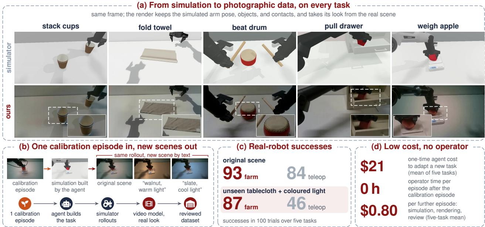  
Figure 1 What the farm delivers. (a) The same frame of a simulator rollout and of our H3 rendering for each of the five tasks; the rendering is photographic and keeps the simulated arm pose, objects, and contacts (insets enlarge the dashed regions). (b) From a request and one calibration episode, the agent builds the task in simulation, and the video model renders each rollout in the original scene or in a new scene described by text. (c) Real-robot successes of policies trained only on farm data or on the same number of teleoperated episodes, in the original scene and under unseen appearance. (d) Mean costs over the five tasks (Section 6.2).

We address this problem with DataFarm, an agentic data farm in which a coding agent takes over the teleoperator’s role, a simulator supplies the actions, and a video model supplies the appearance (Figure 2). Given a data request and a single calibration episode, a short recording of the robot in the target scene, the agent compiles the task into simulation as an engineer would: it reconstructs the scene and cameras from the calibration episode, verifies that the simulator can reproduce the required skills, and writes an expert controller together with a success judge. The simulator then executes the expert from many initial states to produce trajectories with exact actions and states, and a video model conditioned on real frames renders each trajectory, all camera views in one generation, in the appearance of the target scene, where new appearances such as a diferent tablecloth or lighting are specified in text. The output is real-ready: synchronized, mutually consistent photographic camera views with the robot’s own action labels, which a policy consumes exactly as it would consume teleoperated data. Because the agent harness is decoupled from individual tasks, a new task requires no task-specific engineering by a person, and once a task is compiled, every further episode is produced without a robot, an operator, or a reset.

Delegating data production to an agent, however, raises a question that teleoperation never faces: who verifies the data? An agent that writes both the expert and its success checks may approve its own mistakes, and a video model asked to look realistic may copy the layout of its references, hallucinate objects, or drift from the simulated motion. DataFarm therefore separates certification from production. The expert is developed against a judge it cannot inspect and admitted only on held-out initial states, the renderer may alter appearance but not geometry, objects, or timing, and every rendered episode is compared with its simulated state by machine checks and an independent reviewer before it enters the dataset.

Experiments on five bimanual tasks covering rigid, articulated, deformable, and display-bearing objects show that this design yields real-ready data at low cost: policies are trained on it directly and deployed on the real robot (Figure 1). Policies trained only on farm data match those trained on the same number of teleoperated episodes in the original scene (93 vs. 84 successes in 100 trials) and remain robust under a tablecloth and coloured light absent from both training sets (87 vs. 46), which we attribute to the appearance variation the farm adds around fixed, exact trajectories. Rendering with real images is essential to this transfer: the same trajectories rendered with conventional domain randomization yield only 26 and 21 successes (Section 6.1). Every camera view of a farm episode both follows the simulation and looks real: image statistics place farm episodes more than twice as close to real camera frames as the simulator’s own renderings, and the farm’s renderer keeps all views faithful to the simulated motion, whereas calling the video model directly does not (Section 6.4). The farm also operates without human intervention: adapting a task costs \$21 of API usage on average, paid once per task, a render contract adds \$5, and every further episode costs \$0.80 on average for simulation, rendering, re-rendering, and review, in the original scene or under new appearance, so 100 episodes of a task cost \$1.06 per episode on average, and one hour of synchronized three-view data for a task costs \$107, these costs included, slightly below a quote of \$117 for teleoperation in China and below \$290 in labour alone in North America (Section 6.2).

In summary, our contributions are threefold:

• We introduce DataFarm, an agentic data farm that turns a data request and one calibration episode into verified, real-ready robot data without human intervention. The simulator determines actions and states, a real-image-conditioned video model determines appearance, and certification is kept separate from production, all under an agent harness that is independent of individual tasks.

• We show that the farm produces action-labelled, multi-view data that closely matches real camera recordings, at a lower cost than teleoperation.

• We show on a real robot that policies trained solely on farm data match teleoperated data in the original scene, generalize substantially better to unseen appearance, and far outperform a conventional real-to-sim-to-real baseline.

## 2 Related Work

Collecting and multiplying demonstrations. Large teleoperated datasets drive recent vision-languageaction models [2, 3, 25], and hand-held interfaces and fleet orchestrators lower the cost of each episode [1, 9], but every episode still needs a person, a device, and a physical scene. Demonstration generators multiply a few demonstrations into many, in simulation [14, 24, 34] or in point-cloud space [49], assuming a simulation task that people have built or point-cloud observations. DataFarm needs one calibration episode, reuses none of its actions, and outputs photographic multi-view video.

Language models and agents that build tasks. Language models write policies as code [28], rewards [33], and simulation tasks with their supervision [6, 46, 47]; coding agents resolve real repository issues [50] and improve their own programs [19, 55, 56]. These tasks are specified by text and asset libraries rather than by a real scene, and the model that writes a task often also writes its check, although language models are unreliable judges of their own output [20]. DataFarm grounds the task in a recording of the real scene, has the agent write the expert against a judge it cannot see, and leaves admission to independent reviewers.

Real-to-sim-to-real. Pipelines of this kind reconstruct the target scene as digital twins or cousins [8, 10, 38, 44] and make them photorealistic with Gaussian splatting or rendered scans [16, 17, 26, 37, 52]. Their appearance is only as good as the reconstructed assets: every object must be scanned or modelled, cloth and lit displays are hard to represent, and a new scene needs a new capture. DataFarm keeps the simulator for actions and states but takes appearance from a video model conditioned on real images.

Generative augmentation and video models. Image-level augmentation inpaints objects and backgrounds frame by frame [7, 53, 54]. Video models generate robot videos with inferred actions [22], generate video under structural control [31, 35], or turn simulator renderings into realistic video [4, 45], but structure, physics, and task adherence can fail independently in such videos [11]. DataFarm adds an agent that builds the simulation task from one calibration episode, conditioning on that episode’s own images, and independent admission of every multi-view episode against its simulated state. Table 1 summarizes the comparison, and Appendix F discusses each line of work in more detail.

<table><tr><td>Method</td><td>Input from the target task</td><td>Simulation task built by Action labels</td><td></td><td>Observations</td><td>Real robot</td></tr><tr><td>MimicGen [34]</td><td>a few demos in simulation</td><td>people</td><td>simulator</td><td>simulator rendering</td><td>√</td></tr><tr><td>DemoGen [49]</td><td>one real demo</td><td>(no simulator)</td><td>edited demo</td><td>point clouds</td><td>√</td></tr><tr><td>RoboTwin 2.0 [6]</td><td>task description, assets</td><td>language model</td><td>simulator</td><td>rendering + DR</td><td>了</td></tr><tr><td>Re3Sim [16]</td><td>scene reconstruction</td><td>people</td><td>simulator</td><td>Gaussian splatting</td><td>√</td></tr><tr><td>SplatSim [37]</td><td>object and scene scans</td><td>people</td><td>simulator</td><td>Gaussian splatting</td><td>√</td></tr><tr><td>Real2Render2Real [52]</td><td>object scans, human video</td><td>(no dynamics)</td><td>retargeted</td><td>rendered scans</td><td>√</td></tr><tr><td>DreamGen [22]</td><td>real teleoperated data</td><td>(no simulator)</td><td>inferred (IDM/LAM)</td><td>generated video</td><td></td></tr><tr><td>EmbodieDreamer [45]</td><td>real demos, real-to-sim calibration</td><td>people</td><td>replayed real actions</td><td>sim-conditioned video</td><td></td></tr><tr><td>CRAFT [4]</td><td>a few real teleoperated demos</td><td>people (digital twin)</td><td>simulator</td><td>edge-conditioned video</td><td>√</td></tr><tr><td>DATAFARM (ours)</td><td>one calibration episode</td><td>agent</td><td>simulator</td><td>real-image-conditioned video</td><td>√</td></tr></table>

Table 1 Comparison with related data-generation pipelines. Among them, only in DataFarm does an agent build the simulation task from a single calibration episode of the scene, reusing none of its actions, with observations rendered from that episode’s own images as appearance reference.

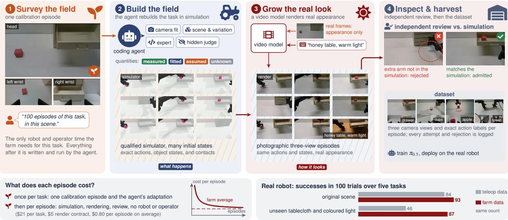  
Figure 2 Overview of DataFarm. (1) A request and one calibration episode of the scene are the only inputs. (2) A coding agent rebuilds the task in simulation and writes an expert against a judge it cannot see; the simulator then runs the expert from many initial states and fixes the actions, object states, and contacts. (3) A video model conditioned on real frames renders every rollout in the scene’s appearance, and a new appearance is a text change. (4) An independent reviewer compares each render with its simulated state, and only admitted episodes enter the dataset. Bottom: the farm pays once per task rather than for every episode, and its data matches teleoperated data on the real robot. Shown on the pull-drawer task; the cost plot is schematic.

## 3 Problem Formulation

DataFarm takes a data request and returns a dataset together with the evidence that certifies it. A request $\rho = ( e ^ { c } , \ell , n , \mu )$ consists of a calibration episode $e ^ { c } .$ , a natural-language description ℓ of the task and its success condition, the number of episodes $n ,$ and a data mode $\mu .$ The calibration episode is a short multi-view recording of the robot in the target scene, which identifies the scene and the cameras but never serves as a source of actions. The data mode is either sim2real, which reproduces the recorded scene, or ood(V), which additionally permits the appearance variations $\nu ,$ such as a new tablecloth. No adapter, judge, or prompt for the task exists in advance. The farm delivers n episodes $d _ { i } = ( o ^ { i } , a ^ { i } , x ^ { i } , k ^ { i } , y ^ { i } , q ^ { i } )$ , each consisting of photographic multi-view observations o, simulator actions a, simulator states x, contact events $k ,$ task labels y, and admission evidence q, together with a ledger L that records every attempt and its outcome.

## 3.1 Capability layer and task artifacts

The farm separates what is shared across tasks from what is produced for each task. The shared part is the capability layer K, which comprises skills for the stages of Section 4, role instructions, render templates that no task may override, and the harnesses, ledgers, and verifiers that execute and check the work; every run is pinned to a fixed version of K. For each request, the agent then generates the task artifacts

$$
\mathcal { A } _ { \rho } = \{ G , T , S , C , J , R , B \}\tag{1}
$$

namely a grounding record G, a task contract $T ,$ a sampler S of scenes and initial states, an expert controller $C ,$ a judge specification $^ { J , }$ a render contract R, and the batch and dataset configurations B. This separation has two consequences. First, a missing adapter is never a missing input, because the agent produces every artifact itself; an artifact made for an earlier task serves only as an example, and its thresholds, authorizations, and prompts are never loaded for a new task. Second, behaviour that should generalize across tasks can change only in $\kappa ,$ and only under tests. In addition, each fact in a delivered episode has exactly one source that may certify ${ \mathrm { i t } } ,$ so no agent role or program both proposes and certifies the same fact (Appendix C).

## 3.2 What does the farm cost?

Replacing the teleoperator with an agent pays of only if the farm produces useful data at a low total cost. Let η be the fraction of attempts that are admitted. For N admitted episodes of one task, the farm then costs

$$
C _ { \mathrm { f a r m } } ( N ) = C _ { \mathrm { a d a p t } } + C _ { \mathrm { c o n t r a c t } } + \frac { N } { \eta } \left( C _ { \mathrm { s i m } } + C _ { \mathrm { r e n d e r } } + C _ { \mathrm { r e v i e w } } \right) ,\tag{2}
$$

where the one-time cost $C _ { \mathrm { a d a p t } }$ covers grounding, simulator qualification, and expert compilation, and Ccontract is the render contract, both including the agent’s tokens and all failed attempts. Failed simulator and render attempts are not free, since they enter through the yield $\eta ;$ what the farm removes is the physical interaction, the hardware risk, and the manual reset of each attempt. Let $m = ( C _ { \mathrm { s i m } } + C _ { \mathrm { r e n d e r } } + C _ { \mathrm { r e v i e w } } ) / \eta$ be the farm’s marginal cost per admitted episode. The average cost per admitted episode,

$$
\bar { c } ( N ) = \frac { { \cal C } _ { \mathrm { f a r m } } ( N ) } { N } = \frac { { \cal C } _ { \mathrm { a d a p t } } + { \cal C } _ { \mathrm { c o n t r a c t } } } { N } + m ,\tag{3}
$$

falls towards m as these two costs are spread over more episodes. Besides these costs, the farm needs only the one calibration episode of the request; it is therefore cheaper than teleoperation for N episodes whenever a teleoperated episode costs more than $( C _ { \mathrm { a d a p t } } + C _ { \mathrm { c o n t r a c t } } + N m ) / ( N - 1 )$ , provided that farm data trains policies at least as good as the same number of teleoperated episodes.

## 4 DataFarm

DataFarm turns a data request and one calibration episode into a stream of verified, action-labelled episodes. Figure 2 follows the farm on the pull-drawer task, and Algorithm 1 summarizes it for one task. We first describe how the work is organized into stages that check one another (Section 4.1), and then the stages themselves: grounding the scene (Section 4.2), qualifying the simulator (Section 4.3), compiling the task and its expert (Section 4.4), rendering (Section 4.5), and admission (Section 4.6).

## 4.1 Overview: stages that check one another

The farm compiles each task through a fixed sequence of intermediate representations, much as a compiler lowers a program:

$$
e ^ { c } { \xrightarrow { \mathrm { g r o u n d } } } G { \xrightarrow { \mathrm { q u a l i f y , c o m p i l e } } } ( T , C ) { \xrightarrow { \mathrm { r o l l o u t } } } E { \xrightarrow { \mathrm { r e n d e r } } } O { \xrightarrow { \mathrm { v e r i f y } } } ( d , q ) .\tag{4}
$$

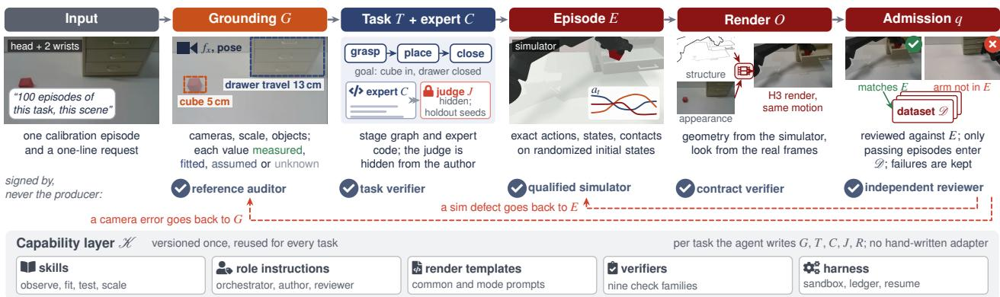  
Figure 3 The DataFarm pipeline, followed on one drawer episode. The agent builds five intermediate representations: the grounding G, whose quantities are each labelled by how they are known; the task contract T and the expert C, written against a hidden judge J; the simulated episodes E; the rendered observations O; and the admission record q. Each representation is checked by a component other than its producer (seals), and a rejection returns to the stage that caused it (dashed), as for the render here that shows an arm absent from E. The capability layer K is shared by all tasks; everything above it is written for this task.

The grounding G describes the scene, the task contract T and the expert C define how the task is solved, the episode E records one execution under a sampled variation z, the observation O is its rendering by a video model p, and the admission record q certifies the delivered episode d (Figure 3). Each representation is produced by one stage and accepted only after a component other than its producer has checked it, because language models are unreliable judges of their own output [20]. A rejection is sent back to the earliest stage responsible for the defect, and every failed attempt is kept, so the final dataset comes with a complete record of how it was obtained. The stages are carried out by coding agents [50] in separate roles [18] that share one harness of skills, instructions, templates, and verifiers. Because this harness is independent of any particular task, the same farm adapts to a new task without changes to the harness; Appendix A describes it in detail.

## 4.2 Grounding from the calibration episode

Grounding turns the calibration episode into a description of the scene that the simulator can reproduce. From the full episode, the agent identifies the robot and the objects, estimates their geometry and articulation [8, 10], and fits the cameras and the metric scale, cross-checking the scale against robot dimensions, known objects, or multiple views. Physical quantities that a short video cannot determine, such as mass or friction, are not guessed: every quantity is labelled as measured, fitted, assumed, or unknown, and uncertain ones are covered by randomization in the simulator [36, 43] rather than fixed to a confident but unsupported value. The agent also selects frames of the calibration episode for every camera as appearance references for rendering, so the user never has to supply images that the episode already contains.

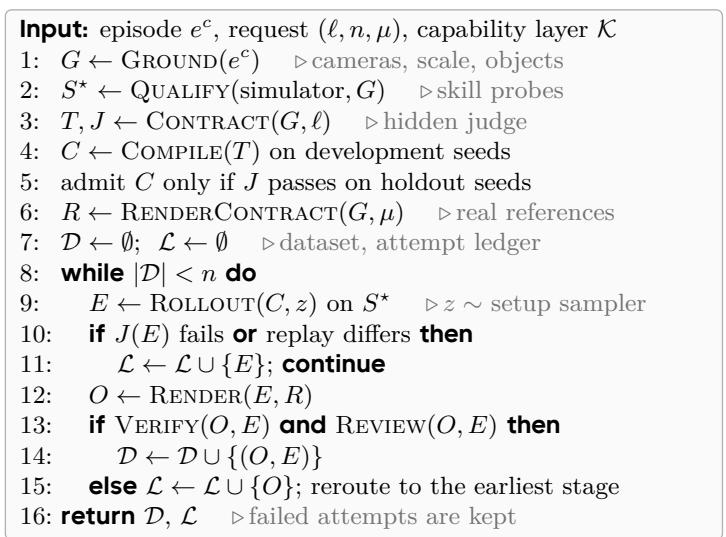

## 4.3 Simulator qualification

Before the agent writes an expert, it checks that the simulator can reproduce the skills the task requires, since no expert can succeed in a simulator that cannot, and the failures of such a simulator would otherwise be attributed to the expert. The farm therefore runs short probes of these skills over candidate simulator variants that adjust material, contact, or actuator parameters, and selects the variant with the fewest changes that passes every probe. The selection is issued as a certificate that binds the variant’s files and the result of every probe, the qualification script re-checks the certificate against these results, and all episodes of the task are produced on this certified simulator. Our implementation provides such probes for cloth; other skills need probes of their own.

## 4.4 Task contract and expert compilation

The agent then specifies the task and writes an expert that solves it. Earlier systems let a language model write the task together with its success check or reward [33, 46, 47]; the farm instead prevents the expert from fitting its own checks, a form of reward hacking [41]. The task contract T lists the stages of the task, the conditions that mark their completion, and the shortcuts that are forbidden, such as teleporting objects or relaxing the success criterion. A separate role turns the contract into a judge, which is frozen before the expert is written.

The expert is then developed in a sandboxed harness that is shared by all tasks. The author writes a controller as a program [28], requests rollouts on development seeds, and receives the judge’s verdict on each, but it can neither read the judge nor run the held-out seeds on which the expert is finally admitted; the harness alone executes rollouts and records every attempt and its cost. The author may explore freely during development, for example by trying alternative grasps on development seeds, but such trials are search rather than demonstrations: an admitted trajectory must be a single continuous execution, run afresh by the harness, that passes the judge. Each produced episode samples the task’s object and sensor variation, by default including small changes in the height and tilt of the table, and records the occupancy of every joint’s range so that the labels remain executable on the real robot.

## 4.5 Rendering with real images

Rendering turns each simulated episode into photographic video while leaving its actions, objects, and timing unchanged. The data either reproduce the recorded scene (sim2real) or vary its appearance along axes the request authorizes (ood), such as the tabletop material; an authorized axis never extends to the robot, the number of objects, or the camera layout. For each task, the agent writes a render contract that states the target appearance, the permitted variations, and real reference frames for every camera. The contract is assembled from templates that the agent cannot override, and the request actually sent to the video model is checked against it before submission.

Rendering with MiniMax-H3. Our default renderer is MiniMax-H3 in its reference-to-video mode, with the accelerated Sol-H3 [27] deployment. Four designs, none specific to a task, make its output follow the simulator and keep the cameras consistent (Section 6.4); the agent instantiates them for each task from the calibration episode. Structure from the simulator, appearance from the real cameras. As in structure-conditioned video transfer [31, 35], edge maps of the simulator video drive a ControlNet [59] that fixes the arm pose, the object positions, and the timing, while real frames and a picture of the real robot supply the appearance. All cameras in one generation. The head and wrist views are tiled on one canvas and generated as a single video, so they share lighting and materials and agree on which objects exist and what each gripper holds. References and prompts that add no content. Reference frames match the simulated task state, and each text prompt describes only its own segment, so the model neither re-inserts content from its references nor draws later events too early. Long episodes without drift. Long episodes are generated as independent chunks and joined where neighbouring chunks difer least, which avoids the drift of extending each chunk from the previous output. A vision-language model, run by the agent, compares the renders of each chunk with the simulator video. Our recipe renders several seeds per chunk and keeps the one it selects; the runs costed in Appendix D instead rendered each chunk once and rendered again only the chunks it flagged.

Rendering with Seedance. The hosted Seedance API [13] is used through the same contract. We arrange the named views in a fixed panel or render them separately, keep the full simulated motion instead of retiming it, and split long episodes at simulator events. For either renderer, bulk production begins with a small canary set that covers the hardest occlusions and events.

<table><tr><td>Task</td><td>What makes it hard</td><td>Simulator</td><td>Success condition</td><td>Real-robot eval.</td></tr><tr><td>Stack cups</td><td>nesting thin-walled rigid cups</td><td>SAPIEN</td><td>all three cups nested in one stack</td><td>ID, OOD</td></tr><tr><td>Weigh apple</td><td>placement on a scale with a live display</td><td>SAPIEN</td><td>apple at rest on the scale pan</td><td>ID, OOD</td></tr><tr><td>Beat drum</td><td>rhythmic contact timing</td><td>SAPIEN</td><td>drum struck at least twice</td><td>ID, OOD</td></tr><tr><td>Pull drawer</td><td>articulated object; pick, place, and close</td><td>SAPIEN</td><td>block inside the drawer, drawer closed</td><td>ID, OOD</td></tr><tr><td>Fold towel</td><td>deformable cloth</td><td>Isaac Sim</td><td>towel folded twice</td><td>ID, OOD</td></tr></table>

Table 2 Tasks. Each starts from one calibration episode with a head and two wrist cameras and a request for 100 episodes; the agent generates the scene, camera fit, expert, judge, and render contract. ID: original scene; OOD: unseen tablecloth and coloured light.

## 4.6 Verification, independent review, and admission

An episode enters the dataset only if an independent reviewer accepts it after automatic checks. The verifier is a single program shared by all tasks and configured by a task-specific specification that the agent writes. It checks that the rendered video contains the right objects and no extra ones, that events happen when the simulation says they do, that the video is temporally stable and continuous across chunks, that the background is static, that the appearance matches the real scene, and that no layout has been copied from a reference frame. Before a specification is used, it is calibrated, in the manner of mutation testing [23], on deliberately corrupted versions of an accepted episode, with objects deleted, duplicated, or enlarged, events shifted in time, views swapped, or colours changed, and every corruption must be caught by the check responsible for it. Every task has its own verifier specification; the default H3 route also relies on a frozen render evaluation and the seed selection of Section 4.5.

Automatic checks are necessary but not suficient, because a generated video can look plausible frame by frame and still contradict its labels [11]. Every episode is therefore also examined by an independent reviewer [60, 61], a separate agent that compares the decoded video with the real reference frames and the simulated state and records its evidence for each verdict. A final delivery check confirms that the dataset is complete, unmodified, backed by the full record of attempts, and reviewed episode by episode; the automatic checks gate the render stage rather than delivery. Policy training starts only from a dataset whose admission record has been verified.

## 5 Experimental Setup

Tasks. We evaluate DataFarm on five bimanual manipulation tasks on a dual-arm PiPER robot, chosen so that each stresses a diferent part of the farm (Table 2): nesting three rigid cups, placing an apple on a digital scale whose display changes with the load, beating a drum in rhythm, putting a block into a drawer and closing it, and folding a towel. For each task, the farm receives one calibration episode recorded with a head camera and two wrist cameras together with a request for 100 episodes, and the agent produces every task artifact from these inputs. Rigid and articulated objects are simulated in SAPIEN through RoboTwin 2.0 [6] and the towel in Isaac Sim with particle cloth. Unless stated otherwise, observations are rendered with our self-hosted MiniMax-H3 deployment, and Seedance serves as a second renderer (Sections 6.4 and 6.5).

Operator. The agent is a frontier coding model that operates the capability layer of Section 4; in our runs, it can be GPT-6 Astra, GPT-5.6-Sol, or Claude Opus 5.5.

Policies and baselines. For every task, we post-train π0.5 [3] on three training sets of equal size N = 100 that share the observation and action spaces, the camera views, and the training recipe (50-step action horizon, batch size 128, 50k steps), so that the sets difer only in where their episodes come from. Real teleop uses N teleoperated episodes of the task in the original scene. Sim + DR is a conventional real-to-sim-to-real baseline that renders the same simulated trajectories as ours directly in the simulator, with RoboTwin 2.0-style domain randomization of textures, lighting, and distractors [6]; because it shares the grounding, the expert, and the actions with DataFarm, it isolates the efect of how observations are produced. DataFarm, finally, uses only the farm’s rendered episodes, without any real data. Its training set for each task mixes renders of the original scene with renders whose tabletop material and lighting the render contract varies through text, such as a wooden or stone tabletop under warmer or cooler light; the tablecloths of the OOD evaluation appear in no training set.

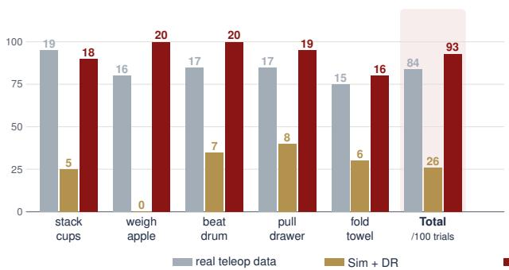

Unseen tablecloth and coloured light  
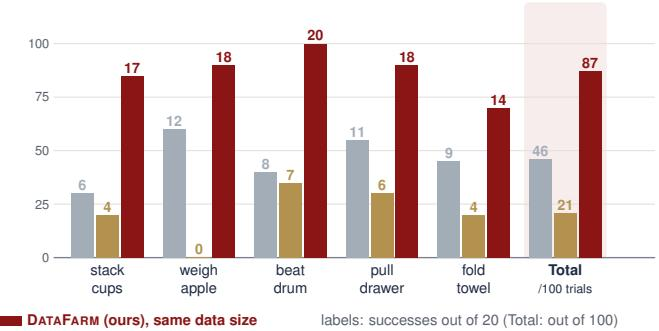

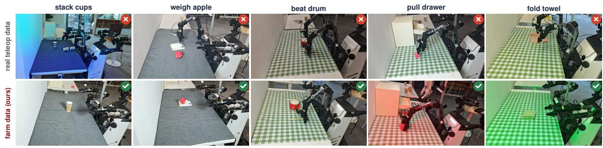  
Figure 4 Real-robot results. (a) Successes of π0.5 policies trained on 100 episodes from each source, in 20 trials per task and condition (Total: out of 100), in the original scene (left) and under an unseen tablecloth and coloured light (right). (b) Unseen-scene trials in which the policy trained on teleoperated data fails (top) and the policy trained only on farm data succeeds (bottom).

Real-robot evaluation. Each policy is evaluated in 20 trials per task and condition, with initial object placements randomized within the workspace and shared across policies, and a trial counts as a success if it reaches the success condition of Table 2. In-distribution (ID) trials use the original scene, whereas out-of-distribution (OOD) trials cover the white table with a tablecloth that appears in no training set (dark grey felt for stack cups and weigh apple, green gingham for the other three tasks) and change the colour of the room light during the trial. We report the number of successes for every task and condition.

## 6 Results

We organize the results around five questions. Do policies trained only on farm data work on the real robot, and how do they compare with teleoperated data and with a conventional real-to-sim-to-real pipeline (Section 6.1)? What does the farm cost (Section 6.2)? Do its episodes keep the simulated motion that the action labels describe (Section 6.3), and do all three camera views both follow the simulation and look like real recordings, which a direct call to the video model does not achieve (Section 6.4)? And what does video rendering add for objects that a simulator models poorly (Section 6.5)?

## 6.1 Real-robot policies

Policies trained only on farm data perform on par with teleoperated data in the original scene and substantially better under unseen appearance (Figure 4a). In the original scene, they reach 93 successes in 100 trials against 84 for teleoperated data, matching or exceeding them on four of the five tasks and falling one success behind on stack cups. Under OOD conditions, the teleoperation-trained policies drop to 46 successes, whereas the farm-trained policies keep 87 and lead on every task. Figure 4(b) shows typical OOD trials.

<table><tr><td>Stage</td><td></td><td>Stack cups Weigh apple Beat drum Pull drawer Fold towel</td><td></td><td></td><td></td></tr><tr><td>One-time: grounding to admission (§4.2–4.4)</td><td>18.22</td><td>10.33</td><td>19.25</td><td>19.40</td><td>37.38</td></tr><tr><td>100 rollouts and audit</td><td>7.43</td><td>8.34</td><td>7.66</td><td>9.31</td><td>13.41</td></tr><tr><td>Render contract  $( \ S 4 . 5 ) ^ { \ S }$ </td><td>6.11</td><td>4.72</td><td>4.11</td><td>4.49</td><td>6.23</td></tr><tr><td>Total</td><td>31.76</td><td>23.39</td><td>31.02</td><td>33.20</td><td>57.02</td></tr></table>

Table 3 Agent cost of each task, in USD at standard API pricing, by stage of Section 4: from the calibration episode to 100 simulated episodes and a render contract. One-time: grounding, simulator qualification, task contract, expert, and admission of five simulated episodes, the scope of Figure 5(b). Rollouts and audit are charged per episode, and the render contract separately (Table 4). Task contracts and experts are written by Claude Opus 5.5, in SoL-Pi [30]. §Excluding canary renders.

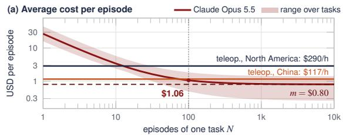

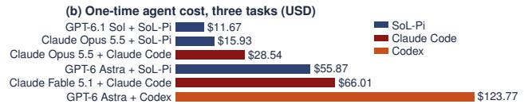  
Figure 5 What does a farm episode cost? (a) Average cost per admitted episode, $\bar { c } ( N ) = ( C _ { \mathrm { a d a p t } } + C _ { \mathrm { c o n t r a c t } } ) / N +$ m, for N episodes of one task, mean over tasks, falling towards the marginal cost m (dashed). Flat lines: teleoperation at the farm’s mean episode length. (b) One-time agent cost to five admitted simulated episodes, mean over three tasks (Table 8, Appendix D).

<table><tr><td rowspan="2">Task</td><td rowspan="2">One-time Contract Per episode m</td><td rowspan="2"></td><td rowspan="2"></td><td colspan="2">Average ē(N)</td><td colspan="2">Per hour of data</td></tr><tr><td> $N = 1 0 0 N = 1 0 0 0$ </td><td></td><td>m</td><td>1 h/task</td></tr><tr><td>Stack cups</td><td>18.22</td><td>6.11</td><td>0.93</td><td>1.17</td><td>0.96</td><td>77</td><td>101</td></tr><tr><td>Weigh apple</td><td>10.33</td><td>4.72</td><td>0.89</td><td>1.04</td><td>0.91</td><td>102</td><td>117</td></tr><tr><td>Beat drum</td><td>19.25</td><td>4.11</td><td>0.26</td><td>0.49</td><td>0.28</td><td>83</td><td>106</td></tr><tr><td>Pull drawer</td><td>19.40</td><td>4.49</td><td>0.52</td><td>0.76</td><td>0.54</td><td>55</td><td>79</td></tr><tr><td>Fold towel</td><td>37.38</td><td>6.23</td><td>1.41</td><td>1.84</td><td>1.45</td><td>88</td><td>132</td></tr><tr><td>Mean</td><td>20.92</td><td>5.13</td><td>0.80</td><td>1.06</td><td>0.83</td><td>81</td><td>107</td></tr><tr><td>Teleop., N. America</td><td></td><td></td><td>2.86</td><td>2.86</td><td>2.86</td><td>290</td><td>290</td></tr><tr><td>Teleop., China, quote</td><td></td><td></td><td>1.16</td><td>1.16</td><td>1.16</td><td>117</td><td>117</td></tr></table>

Table 4 Cost of the farm (USD). One-time and Contract: the one-time and render-contract rows of Table 3. Per episode m: rollouts and audit, H3 rendering, re-rendering of flagged chunks, and review per admitted episode, the same in the original scene and under new appearance. Average: $\bar { c } ( N ) = ( C _ { \mathrm { a d a p t } } + C _ { \mathrm { c o n t r a c t } } ) / N + m$ for N episodes of one task. Per hour of data, synchronized three-view episodes: m times 3600 over the episode length, and the cost of collecting one hour per task, one-time and contract costs included. Teleop.: labour in North America, estimated with Claude Opus 5.5, without robot, venue, or setup; a full-service quote in China; per episode at the farm’s mean length (Appendix D).

The conventional real-to-sim-to-real pipeline, by contrast, transfers poorly. Policies trained on Sim + DR succeed in only 26 of 100 trials in the original scene and 21 in the unseen scene, and they never complete weigh apple. Because Sim + DR shares the grounding, the expert, and the actions with DataFarm and difers only in how observations are produced, the gap of 93 against 26 and 87 against 21 successes isolates the contribution of rendering with real images.

We attribute the robustness of farm-trained policies to the way the farm produces data. Neither training set contains the test tablecloths or the coloured light, but the renderer varies surfaces and lighting around fixed, exact trajectories at no additional cost, so the policy cannot rely on how the table looks; a teleoperated dataset, in contrast, shows only the scene in which it was recorded.

## 6.2 Cost and fully automatic production

The one-time cost of adapting a task depends on the agent. We tested six combinations of four frontier language models and three coding-agent harnesses on three tasks, from the calibration episode to five independently admitted simulated episodes (Figure 5(b), Table 8). All six reach admission, at \$12–124 per task on average, and the diferences mostly follow token prices. Cost is not the whole comparison, however: the cheapest run needed follow-up instructions on two tasks and admitted episodes that exceed the robot’s joint speed limit (Appendix D). We report the remaining costs with Claude Opus 5.5 in SoL-Pi [30], which needed no human intervention. With these, the one-time cost is \$21 of API usage on average over the five tasks, and a render contract adds \$5 (Table 3). Every further episode needs simulation, rendering, and review, but no robot,

operator, or reset.

After adaptation, each admitted episode costs \$0.80 on average for rollouts and their audit, rendering on rented GPUs, re-rendering of flagged chunks, and independent review. This cost is the same under new appearance, which is a text change for the farm rather than a restaged scene. With the one-time and contract costs spread over 100 episodes of a task, an episode costs \$1.06 on average, and over 1,000 episodes \$0.83 (Figure 5(a), Table 4). One hour of synchronized three-view data for a task costs \$107 on average, one-time and contract costs included, and each further hour costs \$81.

These costs are lower than those of teleoperation. In North America, the labour of teleoperated collection alone comes to about \$290 per usable hour of data by our calculation with Claude Opus 5.5 (\$190–520 across the assumptions in Appendix D), before any robot, venue, or setup cost, whereas the farm’s figures include its rented GPUs; the farm is cheaper after 10–37 episodes of a task. In China, a quote we obtained for custom teleoperated data is about RMB 800 (\$117) per hour, in line with reported prices [51]. This full-service price is slightly above what the farm costs for the first hour of data on average, and the farm becomes cheaper after 41–220 episodes of a task. The farm’s costs rely on a self-hosted renderer: at Seedance’s published price, rendering one episode would cost \$12–63.

## 6.3 Do renders keep the simulated motion?

Action labels remain valid only if the rendered video shows the motion that the simulator executed. We test this by estimating optical flow [42] on each render and on its untextured simulator video at the same frames (at 512×288) and comparing the two flow fields on moving pixels, by their mean diference and by the share of pixels on which they agree (Figure 6). Averaged over the five tasks, the flow of H3 renders deviates from the simulated flow by 4.4 pixels and agrees on 65% of moving pixels. This is close to Sim + DR, which reproduces the simulated motion exactly and still difers by 3.4 pixels, with 73% agreement, only because the flow estimate depends on appearance. Pairing the same H3 renders with the simulator video half a second later, in contrast, raises the error to 8.8 pixels and lowers agreement to 41%, so the measure clearly

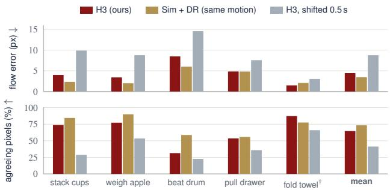  
Figure 6 Do renders keep the simulated motion? Optical-flow error and share of moving pixels whose flow agrees, between each render and its untextured simulator video (head view). Sim + DR has exactly the simulated motion; the shifted H3 render is paired with the simulator video 0.5 s later. †H3 renders another towel episode, compared with its own simulator video.

separates matched from mismatched motion. Beat drum yields the largest errors for every source, including Sim + DR, because its thin drumsticks move fast; even there, H3 stays much closer to the simulated motion than the shifted control (8.5 against 14.6 pixels).

## 6.4 Do all three views follow the simulation and look real?

A policy reads the head and both wrist cameras together, so every view of a farm episode must be correct in two respects at once: it must follow the simulated episode, whose actions are the labels, and look like the real camera that the policy sees at deployment. The simulator video meets only the first requirement, and a direct call to the video model mostly only the second.

Farm episodes look far closer to real recordings than simulator renderings, both visually and in image statistics. Figure 7 shows the same task phase in a real recording, in the simulator, with domain randomization, and in a farm episode. The simulator and its randomized variant reproduce the geometry but not the materials, the lighting, or the robot’s appearance, whereas the farm episode keeps the simulated geometry and takes its appearance from the calibration episode. Image statistics confirm this impression: averaged over the tasks that every source renders, the kernel distance $\mathrm { ( K I D , \times 1 0 ^ { 3 } ) }$ of head-view frames to real camera frames is 0.83 for H3 and 0.88 for Seedance, against 1.93 for the simulator and 2.50 with domain randomization, and the farm is closer than the simulator on every task (Appendix E).

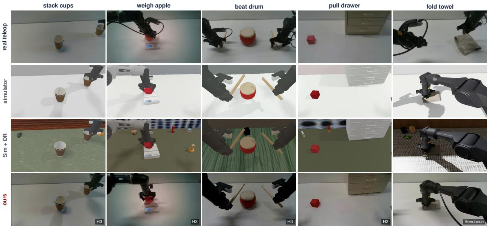  
Figure 7 Real, simulated, and farm episodes at the same task phase (head view). Sim + DR adds domainrandomized textures and lighting to the simulator frame, and ours renders the simulator frame (renderer in the corner). Real and simulated frames come from diferent episodes, so object placements difer.

Following the simulation in every view is where calling the same video model directly fails. We call MiniMax-H3 with the simulator video as motion reference, real reference frames, and the contract prompt, on one canvas or per camera, and correlate the frame-diference energy and image gradients of each view with the simulator video, on the episodes of stack cups, weigh apple, and pull drawer on which our recipe was developed.

Calling the video model directly fails in two ways (Figure 8 and Table 5). On one canvas, it reproduces the task state of its reference frames instead of the simulated motion: its motion correlation is 0.07, against 0.74 for the farm’s renderer, and its head view often shows a diferent task state than a wrist view. Rendered separately, each camera is generated without knowledge of the others, so the wrist views show extra arms, other cup stacks, or the robot from outside. Generating all cameras together is therefore necessary: applied to each camera of stack cups separately, even the farm’s renderer invents cups in the wrist views, and its motion and structure correlations fall from 0.75

<table><tr><td>Renderer</td><td></td><td>Motion ↑ Structure ↑ |Lag|</td><td></td><td>Jumps</td></tr><tr><td>Direct call, one canvas</td><td>0.07</td><td>0.16</td><td>12.7</td><td>11.2</td></tr><tr><td>Direct call, each camera</td><td>0.04</td><td>0.10</td><td>14.7</td><td>8.8</td></tr><tr><td>Edge control only</td><td>0.50</td><td>0.54</td><td>0</td><td>30.2</td></tr><tr><td>Ours, each camera†</td><td>0.55</td><td>0.64</td><td>0</td><td>40.6</td></tr><tr><td>Ours</td><td>0.74</td><td>0.85</td><td>0</td><td>2.9</td></tr><tr><td>Seedance (hosted)</td><td>0.73</td><td>0.72</td><td>0.3</td><td>2.3</td></tr></table>

Table 5 Renderers on the same simulated episode of stack cups, weigh apple, and pull drawer. Motion and structure: correlation with the simulator video of frame-diference energy and of image gradients; lag in frames; jumps per 1,000 frames. Means over the three episodes. †Stack cups only; ours on that episode: 0.75, 0.87, 0, 4.2.

and 0.87 to 0.55 and 0.64. Edge control alone makes the render follow the simulator (motion 0.50) but leaves 30 jumps per 1,000 frames, which the references, prompts, and chunk assembly of Section 4.5 reduce to 2.9.

Of the self-hosted renderers, only ours meets both requirements in all three views, on par with the hosted Seedance (KID 0.83 against 0.88; motion 0.74 against 0.73), so the labels describe what every camera sees.

## 6.5 Objects that are hard to simulate

Some objects are hard to simulate because of how they look rather than how they move. For a scale’s display, a drum, and a towel, the farm episode is much closer to the real recording than to the simulator (Figure 9).

This realism is also cheap. A conventional real-to-sim-to-real pipeline would have to model each of these appearances, with an emissive display, a scanned drum, and a texture that deforms with the cloth. The farm

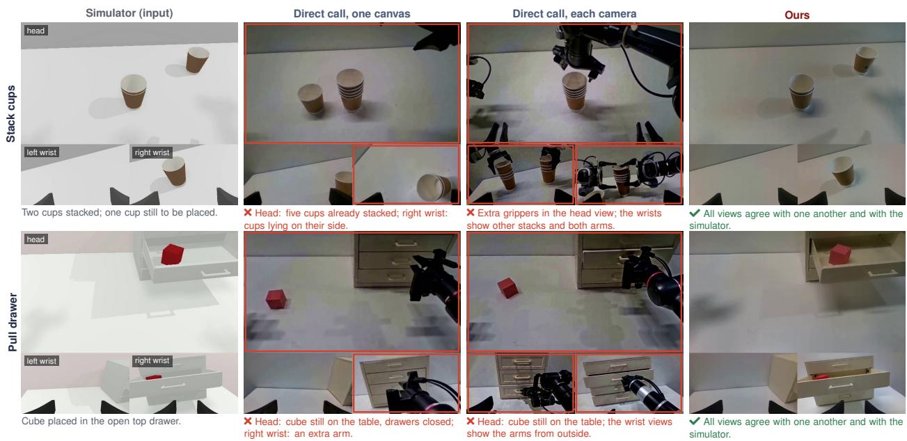  
Figure 8 Following the simulation in every view. The same simulated frame rendered by calling the video model directly, with all cameras on one canvas or with each camera separately, and by the farm’s renderer. Each cell shows the head view (top) and the left and right wrist views (bottom). Red boxes mark the views that contradict the simulator or the other views of the same frame; the notes describe the contradiction.

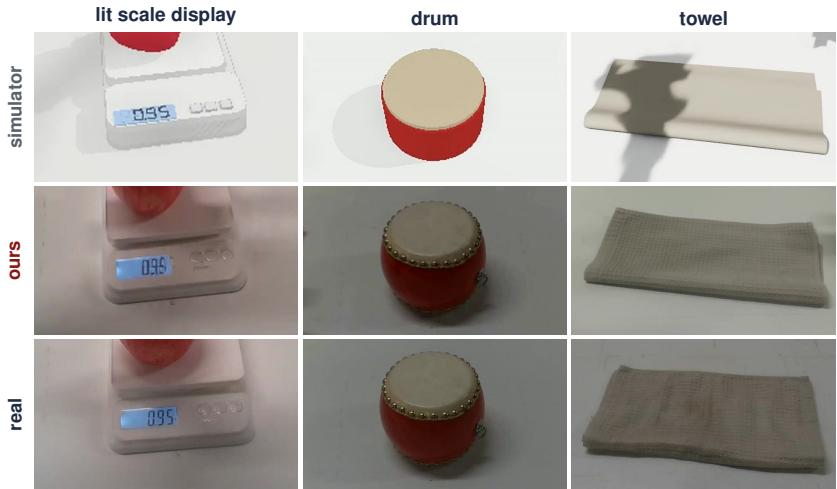  
needs only the geometry and contact that the physics requires and takes appearance from the calibration episode, set once per task by a render contract costing \$4.1–6.2 (Table 3). Motion and object states still come from the simulator (Section 6.3).

Figure 9 Appearance that the simulator does not model. Crops of a simulator frame (top) and of the farm episode rendered from that frame (middle), with the same object in a real recording at the same task phase (bottom; not the same frame). The simulator draws the scale’s display as a flat texture, the drum as a red cylinder, and the towel as smooth particle cloth; the farm episode shows a lit display with the simulated reading, a lacquered drum with brass tacks, and the weave of the real towel.

## 7 Limitations, Ethics, and Broader Impact

DataFarm depends on a simulator that can reproduce the skills of each task. Simulator qualification (Section 4.3) detects when the available simulator cannot, but such a task then needs a new simulator variant before the farm can produce data for it. Similarly, a calibration episode cannot identify dynamics that it does not exhibit, such as mass or friction; the farm labels these quantities as assumed and randomizes over them rather than recovering them, which may not sufice for tasks whose success depends on precise dynamics. The verification of generated video is also imperfect: rendered episodes can contain defects that automatic checks miss, which is why every episode undergoes independent review and why rejected renders count toward the cost. Finally, our evaluation covers one dual-arm embodiment and five tasks, and other embodiments and task families remain to be tested.

Because farm episodes are photographic videos of real scenes, their provenance must remain traceable. Each episode therefore carries a record that binds it to its simulated state, renderer, references, and review, so that a dataset can always be identified as generated. Cheaper data, moreover, does not make deployment safer: a policy trained on farm data still requires real-robot evaluation before use.

## 8 Conclusion

We have shown that a coding agent can take the teleoperator’s place in collecting robot data. Given a request and one calibration episode of the scene, the agent compiles the task into a qualified simulation, an expert, and a render contract, and the farm turns this compilation into verified, real-ready episodes at scale, on which policies are trained directly and deployed on the real robot. Correctness does not rest on trusting the agent, because hidden judges, the qualified simulator, and independent reviewers certify what it produces, and every failed attempt is recorded. On the real robot, policies trained only on farm data match policies trained on the same number of teleoperated episodes, hold up far better under appearance that neither training set contained, and far outperform a conventional real-to-sim-to-real pipeline. The farm pays a one-time agent cost of \$21 per task on average, \$5 for a render contract, and \$0.80 for every further episode, without a robot, an operator, or a reset; one hour of three-view data for a task costs \$107, these costs included, slightly below a quote of \$117 for teleoperation in China and below \$290 in labour alone in North America.

## References

[1] Michael Ahn, Debidatta Dwibedi, Chelsea Finn, et al. Autort: Embodied foundation models for large scale orchestration of robotic agents. arXiv preprint arXiv:2401.12963, 2024.

[2] Kevin Black, Noah Brown, Danny Driess, et al. π0: A vision-language-action flow model for general robot control. arXiv preprint arXiv:2410.24164, 2024.

[3] Kevin Black, Noah Brown, James Darpinian, et al. π0.5: A vision-language-action model with open-world generalization. arXiv preprint arXiv:2504.16054, 2025.

[4] Jason Chen, I-Chun Arthur Liu, Gaurav Sukhatme, and Daniel Seita. Craft: Video difusion for bimanual robot data generation. arXiv preprint arXiv:2604.03552, 2026.

[5] Jiarui Chen, Zeqiang Lai, Jiangshan Wang, Ziheng Ouyang, Ye Huang, Xiangyu Yue, et al. MC-Sparse: Deconstructing and closing the dense-sparse attention gap in difusion transformers. arXiv preprint arXiv:2610.06801, 2026.

[6] Tianxing Chen, Zanxin Chen, Baijun Chen, et al. Robotwin 2.0: A scalable data generator and benchmark with strong domain randomization for robust bimanual robotic manipulation. arXiv preprint arXiv:2506.18088, 2025.

[7] Zoey Chen, Sho Kiami, Abhishek Gupta, and Vikash Kumar. Genaug: Retargeting behaviors to unseen situations via generative augmentation. In Robotics: Science and Systems (RSS), 2023.

[8] Zoey Chen, Aaron Walsman, Marius Memmel, et al. Urdformer: A pipeline for constructing articulated simulation environments from real-world images. arXiv preprint arXiv:2405.11656, 2024.

[9] Cheng Chi, Zhenjia Xu, Chuer Pan, Eric Cousineau, Benjamin Burchfiel, Siyuan Feng, Russ Tedrake, and Shuran Song. Universal manipulation interface: In-the-wild robot teaching without in-the-wild robots. In Robotics: Science and Systems (RSS), 2024.

[10] Tianyuan Dai, Josiah Wong, Yunfan Jiang, et al. Automated creation of digital cousins for robust policy learning. arXiv preprint arXiv:2410.07408, 2024.

[11] Yufan Deng, Zilin Pan, Hongyu Zhang, et al. Rethinking video generation model for the embodied world. arXiv preprint arXiv:2601.15282, 2026.

[12] Yiyang Fu, Chubin Zhang, Shukai Gong, Yufan Deng, Kaiwei Sun, Qiyang Min, et al. StableVLA: Towards robust vision-language-action models without extra data. In International Conference on Machine Learning (ICML), 2026.

[13] Yu Gao, Haoyuan Guo, Tuyen Hoang, Weilin Huang, Lu Jiang, Fangyuan Kong, et al. Seedance 1.0: Exploring the boundaries of video generation models. arXiv preprint arXiv:2506.09113, 2025.

[14] Caelan Garrett, Ajay Mandlekar, Bowen Wen, and Dieter Fox. Skillmimicgen: Automated demonstration generation for eficient skill learning and deployment. arXiv preprint arXiv:2410.18907, 2024.

[15] Shukai Gong, Xuanran Zhai, Yintianrun Zhang, Ruopeng Cui, Ye Huang, Yiyang Fu, et al. Rethinking world-action model for compositional and in-context robotic manipulation. arXiv preprint arXiv:2610.02368, 2026.

[16] Xiaoshen Han, Minghuan Liu, Yilun Chen, et al. Re3sim: Generating high-fidelity simulation data via 3dphotorealistic real-to-sim for robotic manipulation. arXiv preprint arXiv:2502.08645, 2025.

[17] Yunhai Han, Jianuo Qiu, Linhao Bai, et al. Video2sim2real: Full-stack autonomous dexterous skill acquisition from a single human video. arXiv preprint arXiv:2606.08828, 2026.

[18] Sirui Hong, Mingchen Zhuge, Jonathan Chen, Xiawu Zheng, Yuheng Cheng, Ceyao Zhang, Jinlin Wang, Zili Wang, Steven Ka Shing Yau, Zijuan Lin, et al. MetaGPT: Meta programming for a multi-agent collaborative framework. In International Conference on Learning Representations (ICLR), 2024.

[19] Shengran Hu, Cong Lu, and Jef Clune. Automated design of agentic systems. arXiv preprint arXiv:2408.08435, 2024.

[20] Jie Huang, Xinyun Chen, Swaroop Mishra, Huaixiu Steven Zheng, Adams Wei Yu, Xinying Song, and Denny Zhou. Large language models cannot self-correct reasoning yet. In International Conference on Learning Representations (ICLR), 2024.

[21] Xu Huang, Ye Huang, Zijun Liao, Yuwei Niu, Xiaojie Li, Menghan Zhou, et al. DC-SAE: Deep compression semantic autoencoder for faster difusion convergence. In Advances in Neural Information Processing Systems (NeurIPS), 2026.

[22] Joel Jang, Seonghyeon Ye, Zongyu Lin, et al. Dreamgen: Unlocking generalization in robot learning through video world models. arXiv preprint arXiv:2505.12705, 2025.

[23] Yue Jia and Mark Harman. An analysis and survey of the development of mutation testing. IEEE Transactions on Software Engineering, 37(5):649–678, 2011.

[24] Zhenyu Jiang, Yuqi Xie, Kevin Lin, Zhenjia Xu, Weikang Wan, Ajay Mandlekar, Linxi Fan, and Yuke Zhu. Dexmimicgen: Automated data generation for bimanual dexterous manipulation via imitation learning. In IEEE International Conference on Robotics and Automation (ICRA), 2025.

[25] Moo Jin Kim, Karl Pertsch, Siddharth Karamcheti, et al. Openvla: An open-source vision-language-action model. arXiv preprint arXiv:2406.09246, 2024.

[26] Xinhai Li, Jialin Li, Ruiping Wang, et al. Robogsim: A real2sim2real robotic gaussian splatting simulator. arXiv preprint arXiv:2411.11839, 2024.

[27] Yitong Li, Jincheng Yu, Junsong Chen, Haopeng Li, Shuchen Xue, Haozhe Liu, et al. Sol-H3: Recursive self-improvement for MiniMax-H3 inference acceleration on Sol-Engine across cloud and edge. arXiv preprint arXiv:2609.35110, 2026.

[28] Jacky Liang, Wenlong Huang, Fei Xia, et al. Code as policies: Language model programs for embodied control. arXiv preprint arXiv:2209.07753, 2022.

[29] Hao Liu, Chenghuan Huang, Ye Huang, Zhiying Wen, Hao Liu, Mohan Zhang, et al. FVAttn: Adaptive sparse attention with runtime load balancing for video generation. arXiv preprint arXiv:2607.16190, 2026.

[30] Haozhe Liu, Tian Ye, Sensen Gao, Qihang Cao, Yitong Li, Mingchen Zhuge, et al. SoL-Pi: Recursively scaling auto-research loops for eficient agent harness. arXiv preprint arXiv:2609.20519, 2026.

[31] Liu Liu, Xiaofeng Wang, Guosheng Zhao, Keyu Li, Wenkang Qin, Jiaxiong Qiu, Zheng Zhu, Guan Huang, and Zhizhong Su. Robotransfer: Geometry-consistent video difusion for robotic visual policy transfer. arXiv preprint arXiv:2505.23171, 2025.

[32] Juncheng Ma, Jianxin Bi, Yufan Deng, Xuanran Zhai, Kewei Zhang, Ye Huang, et al. HumanScale: Egocentric human video can outperform real-robot data for embodied pretraining. arXiv preprint arXiv:2606.20521, 2026.

[33] Yecheng Jason Ma, William Liang, Guanzhi Wang, et al. Eureka: Human-level reward design via coding large language models. arXiv preprint arXiv:2310.12931, 2023.

[34] Ajay Mandlekar, Soroush Nasiriany, Bowen Wen, et al. Mimicgen: A data generation system for scalable robot learning using human demonstrations. arXiv preprint arXiv:2310.17596, 2023.

[35] NVIDIA. Cosmos-transfer2.5: Conditional world generation for physical ai. https://research.nvidia.com/ labs/dir/cosmos-transfer2.5/, 2025. Accessed 2026-09-19.

[36] Xue Bin Peng, Marcin Andrychowicz, Wojciech Zaremba, and Pieter Abbeel. Sim-to-real transfer of robotic control with dynamics randomization. In IEEE International Conference on Robotics and Automation (ICRA), 2018.

[37] Mohammad Nomaan Qureshi, Sparsh Garg, Francisco Yandun, David Held, George Kantor, and Abhisesh Silwal Splatsim: Zero-shot sim2real transfer of rgb manipulation policies using gaussian splatting. In IEEE International Conference on Robotics and Automation (ICRA), 2025.

[38] Nadun Ranawaka, Josiah Wong, Wei-Lin Pai, et al. Simfoundry: Modular and automated scene generation for policy learning and evaluation. arXiv preprint arXiv:2606.28276, 2026.

[39] Robotics Center of Silicon Valley. How much does robot data collection cost in 2026? https://www. roboticscenter.ai/blog/robot-data-collection-cost, 2026.

[40] Ruiyang Si, Jianxin Bi, Shunyu Yang, Rui Ni, Wenbo Huang, Qiang Wang, et al. Fewer tokens, better action: GPT-6 Astra robot agents with 14% higher success rate but 65% fewer tokens. arXiv preprint arXiv:2610.01939, 2026.

[41] Joar Skalse, Nikolaus Howe, Dmitrii Krasheninnikov, and David Krueger. Defining and characterizing reward hacking. In Advances in Neural Information Processing Systems (NeurIPS), 2022.

[42] Zachary Teed and Jia Deng. RAFT: Recurrent all-pairs field transforms for optical flow. In European Conference on Computer Vision (ECCV), 2020.

[43] Josh Tobin, Rachel Fong, Alex Ray, Jonas Schneider, Wojciech Zaremba, and Pieter Abbeel. Domain randomization for transferring deep neural networks from simulation to the real world. In IEEE/RSJ International Conference on Intelligent Robots and Systems (IROS), 2017.

[44] Marcel Torne, Anthony Simeonov, Zechu Li, et al. Reconciling reality through simulation: A real-to-sim-to-real approach for robust manipulation. arXiv preprint arXiv:2403.03949, 2024.

[45] Boyuan Wang, Xinpan Meng, Xiaofeng Wang, et al. Embodiedreamer: Advancing real2sim2real transfer for policy training via embodied world modeling. arXiv preprint arXiv:2507.05198, 2025.

[46] Lirui Wang, Yiyang Ling, Zhecheng Yuan, et al. Gensim: Generating robotic simulation tasks via large language models. arXiv preprint arXiv:2310.01361, 2023.

[47] Yufei Wang, Zhou Xian, Feng Chen, et al. Robogen: Towards unleashing infinite data for automated robot learning via generative simulation. arXiv preprint arXiv:2311.01455, 2023.

[48] Jinhui Wei, Ye Huang, Yuhui Zhou, Jiazhi Jiang, Jiangsu Du, and Yutong Lu. Ghidorah: Fast LLM inference on edge with speculative decoding and hetero-core parallelism. arXiv preprint arXiv:2505.23219, 2025.

[49] Zhengrong Xue, Shuying Deng, Zhenyang Chen, et al. Demogen: Synthetic demonstration generation for data-eficient visuomotor policy learning. arXiv preprint arXiv:2502.16932, 2025.

[50] John Yang, Carlos E. Jimenez, Alexander Wettig, et al. Swe-agent: Agent-computer interfaces enable automated software engineering. arXiv preprint arXiv:2405.15793, 2024.

[51] Yicai. Report on the mifeng embodied-AI data platform. https://finance.sina.com.cn/tech/roll/ 2026-04-17/doc-inhuuimk6582970.shtml, 2026. 17 April 2026.

[52] Justin Yu, Letian Fu, Huang Huang, Karim El-Refai, Rares Andrei Ambrus, Richard Cheng, Muhammad Zubair Irshad, and Ken Goldberg. Real2render2real: Scaling robot data without dynamics simulation or robot hardware. arXiv preprint arXiv:2505.09601, 2025.

[53] Tianhe Yu, Ted Xiao, Austin Stone, Jonathan Tompson, Anthony Brohan, et al. Scaling robot learning with semantically imagined experience. In Robotics: Science and Systems (RSS), 2023.

[54] Chengbo Yuan, Suraj Joshi, Shaoting Zhu, Hang Su, Hang Zhao, and Yang Gao. Roboengine: Plug-and-play robot data augmentation with semantic robot segmentation and background generation. arXiv preprint arXiv:2503.18738, 2025.

[55] Eric Zelikman, Eliana Lorch, Lester Mackey, and Adam Tauman Kalai. Self-taught optimizer (STOP): Recursively self-improving code generation. arXiv preprint arXiv:2310.02304, 2023.

[56] Jenny Zhang, Shengran Hu, Cong Lu, Robert Lange, and Jef Clune. Darwin gödel machine: Open-ended evolution of self-improving agents. arXiv preprint arXiv:2505.22954, 2025.

[57] Kewei Zhang, Ye Huang, Yufan Deng, Jincheng Yu, Junsong Chen, Huan Ling, Enze Xie, and Daquan Zhou. MHLA: Restoring expressivity of linear attention via token-level multi-head. In International Conference on Learning Representations (ICLR), 2026.

[58] Kewei Zhang, Jin Wang, Sensen Gao, Chengyue Wu, Yulong Cao, Songyang Han, et al. Fast-dDrive: Eficient block-difusion VLM for autonomous driving. arXiv preprint arXiv:2605.23163, 2026.

[59] Lvmin Zhang, Anyi Rao, and Maneesh Agrawala. Adding conditional control to text-to-image difusion models. In IEEE/CVF International Conference on Computer Vision (ICCV), 2023.

[60] Mingtong Zhang and Dhruv Shah. Visual verification enables inference-time steering and autonomous policy improvement. arXiv preprint arXiv:2606.18247, 2026.

[61] Lianmin Zheng, Wei-Lin Chiang, Ying Sheng, Siyuan Zhuang, Zhanghao Wu, Yonghao Zhuang, Zi Lin, Zhuohan Li, Dacheng Li, Eric P. Xing, Hao Zhang, Joseph E. Gonzalez, and Ion Stoica. Judging LLM-as-a-judge with

MT-bench and chatbot arena. In Advances in Neural Information Processing Systems (NeurIPS) Datasets and Benchmarks Track, 2023.

<table><tr><td>Role</td><td>Produces</td><td>Cannot</td></tr><tr><td>Orchestrator</td><td>grounding, task artifacts, render contract, sign its own reviews or delivery batches, delivery</td><td></td></tr><tr><td>Task designer</td><td>task contract, stages, randomization axes</td><td>author the expert</td></tr><tr><td>Task verifier</td><td>frozen judge spec and negative controls</td><td>be edited by the expert author</td></tr><tr><td>Expert author</td><td>expert controller inside the harness</td><td>read the judge internals or holdout seeds, launch rollouts directly</td></tr><tr><td>ifier auditor</td><td>Render reviewer / ver- decoded-media review of motion, topology, timing, and appearance</td><td>reuse producer summaries as evidence</td></tr><tr><td>Pipeline improver</td><td>candidate changes to the capability layer</td><td>evaluate or activate its own changes</td></tr></table>

Table 6 The seven role instructions (render reviewer and verifier auditor share a row) are loaded explicitly from the capability layer; reviews requested by the agent runtime use the task-verifier instruction. For tasks run by the agent runtime, independence is enforced by separate executions and content-bound review records, not by diferent names in a JSON field. Reviewers run with the author’s file permissions, so an edit to a reviewed artifact is detected rather than prevented.

## A Execution harness and agent runtime

For every attempt, the execution harness checks that the produced document has the stage’s IR type, names its producer, lists exactly its accepted inputs as predecessors, and passes schema validation. It also checks that the receipt binds the stored digest and comes from a verifier whose identity difers from the producer’s. Only a pass with no failed check advances; reject and abstain stay in the history and count against the budget. A rejecting receipt may route the failure to the earliest responsible ancestor. This opens a new epoch that invalidates that stage and its dependents while keeping all prior attempts, and a plan-level reroute budget bounds the number of rewinds. Runs are crash safe: attempts are written ahead, state is re-verified from stored artifacts on resume rather than trusted, and a per-run lock prevents duplicate execution. Paid provider jobs are resumed by their recorded IDs, never resubmitted.

The stages are executed by agents in separate roles (Table 6). A context compiler expands each role’s instructions and skills from the pinned capability layer into explicit system and user messages and records the hash of every loaded file and message. Activation therefore does not depend on a host discovering hidden directories, and every session’s instructions can be reproduced. The orchestrator keeps a resumable task state with a phase, next action, open questions, and external job IDs. Its instructions allow it to mark a task needs-input only for intent, device facts, or access that cannot be derived, and the runtime accepts the mark only with concrete open questions. A missing adapter or prompt never qualifies, because generating those is its job. complete is accepted only when the delivery verifier passes, never on the agent’s word.

## B Role instructions

Table 6 lists the agent roles, what each produces, and what each is not allowed to do.

## C Authority factorization

Each fact in a delivered episode has exactly one source that may certify it (Table 7). The real episode is authoritative only for what it shows or measures, so physical parameters that it does not determine remain labelled as fitted, assumed, or unknown, together with their uncertainty. The simulator becomes authoritative for actions and states only after it has been qualified for the skills of the task, whereas the renderer may change only the appearance that the data mode permits, and a real reference image supplies appearance but never positions, layout, motion, or additional objects. Verifiers and reviewers, finally, may admit or reject an episode but cannot modify it. Because no agent role or program both proposes and certifies the same fact, an error made by one component must be caught by another before it reaches the dataset.

<table><tr><td></td><td></td><td>Cameras Appearance Object Actions States Admission</td><td></td><td></td><td></td><td></td></tr><tr><td>Coding agent</td><td>O</td><td>O</td><td>O</td><td>O</td><td>O</td><td>X</td></tr><tr><td>Calibration episode</td><td></td><td></td><td>O</td><td></td><td></td><td></td></tr><tr><td>Qualified simulator</td><td></td><td>x</td><td></td><td></td><td></td><td></td></tr><tr><td>Renderer</td><td></td><td>O</td><td>x</td><td>x</td><td>X</td><td></td></tr><tr><td>Real reference image</td><td></td><td></td><td>x</td><td>x</td><td>x</td><td></td></tr><tr><td>Verifiers, reviewers</td><td></td><td></td><td></td><td></td><td></td><td></td></tr></table>

Table 7 Who may certify what: ● certifies, ❍ may propose only, ✗ may not change or certify, — not involved. No component certifies what it produces, and reviewers may admit or reject an episode but cannot relax the task predicates.

## D Cost model

The cost model behind Figure 5 and Table 4 counts only published or measured figures for the farm; its teleoperation comparisons are given at the end of this section.

For the farm, we render at 640×480 with our H3 deployment, which takes 37–53 s per 192-frame chunk on one B200 at \$3 per GPU-hour, near the lowest published B200 rental quote (\$2.80 per GPU-hour, October 2026), plus 20% for worker start-up, recompiles, and failed jobs as observed in our runs. In these runs, every chunk was screened by a vision-language model and re-rendered if flagged (1.1–1.8 renders per chunk; Section 4.5), and every episode is reviewed with Claude Haiku 5.5. The farm’s one-time and contract costs are the corresponding rows of Table 3. Its marginal cost m per admitted episode divides the rendering, screening, and review cost of an attempt by the admission rate and adds the rollouts and audit of Table 3 per simulated episode, measured on 100 episodes and assumed to scale linearly; a rejected render is attempted again from the same simulated episode, so this term is not divided by the admission rate. For N episodes, the farm costs $C _ { \mathrm { a d a p t } } + C _ { \mathrm { c o n t r a c t } } + N m , \mathrm { o r } \ \overline { { c } } ( N ) = ( C _ { \mathrm { a d a p t } } + C _ { \mathrm { c o n t r a c t } } ) / N + m$ per episode; the calibration episode of the request is not counted. New appearance changes only the render contract’s text, so m and c¯ are the same in the original scene and under new appearance. Seedance’s published price corresponds to about \$1 per second of our three-view video.

We also measured the one-time agent cost with other agents and harnesses on three tasks (Figure 5(b), Table 8). The scope is that of the one-time row of Table 3: from the calibration episode to five independently admitted simulated episodes, without rendering, at standard API prices, excluding the orchestrating session and GPU time. The first four rows of Table 8 share one protocol: the same pinned source, one fresh session per phase, the same review and admission rules, and a \$100 cap per task; SoL-Pi [30] is an extension of the Pi coding agent.1 These are single runs per task and agent. The last two rows are earlier runs under a diferent protocol: the first is our earlier Claude Code run, whose fold towel cost remains in Table 3, and the Codex run includes a stalled first protocol round.

The diferences mostly follow token prices: GPT-6.1 Sol made more requests than GPT-6 Astra, at about a fifth of the price. On identical briefs for the first phase, SoL-Pi cost 5.9% less than Codex with the same model, so most of the gap between the two GPT-6 Astra rows comes from the protocol. The runs also did not need the same help or reach the same quality. With GPT-6.1 Sol, we sent follow-up instructions after producer sessions stopped with no passing source on stack cups and beat drum. On beat drum, four of its five admitted episodes exceed the robot’s 3 rad/s joint speed limit in a check we ran afterwards, which its review did not test. A reviewer rejected the first five beat drum episodes with Claude Opus 5.5 for the same defect, and that row includes the repair and a second batch. The Claude Fable 5.1 row includes \$13.57 of idle session wake-ups that did no work (\$61.48 on average without them).

For teleoperation in North America, we have no verifiable quote for a custom collection, so we count only labour, in an estimate made with Claude Opus 5.5 from a web survey and our own log. Our own 100-episode collections of the five tasks took 36–65 s of operator time per episode, including resets and pauses, for 11–28 s of data. We assume an operator wage of \$40 per hour (\$25–50; public job postings list about \$22–55), 25% of episodes discarded (20–30%), supervision and quality review at 45% of the operator’s cost (40–50%), and post-processing of \$0.30 per usable episode (up to \$1), the last three from a vendor’s breakdown [39]. This gives \$217–358 per usable hour of data across the tasks, \$286 on average, which we round to \$290, and \$190–520 under the low and high assumptions. It excludes robots, venue, one-time setup, and operator training. We convert it to a cost per episode at each task’s farm episode length, so that both sides of the comparison cover the same amount of data.

<table><tr><td>Agent and harness</td><td>Price</td><td>Stack cups</td><td>Weigh apple</td><td>Beat drum</td><td>Mean</td><td>Attempts</td></tr><tr><td>GPT-6.1 Sol + SoL-Pi</td><td>2/10</td><td>15.46</td><td>8.00</td><td>11.54</td><td>11.67</td><td>5, 5, 18</td></tr><tr><td>Claude Opus 5.5 + SoL-Pi</td><td>4/20</td><td>18.22</td><td>10.33</td><td>19.25</td><td>15.93</td><td>5, 6, 10</td></tr><tr><td>GPT-6 Astra + SoL-Pi</td><td>10/50</td><td>60.97</td><td>43.19</td><td>63.44</td><td>55.87</td><td>17, 6, 12</td></tr><tr><td>Claude Fable 5.1 + Claude Code</td><td>10/50</td><td>70.60</td><td>72.46</td><td>54.95</td><td>66.01</td><td>8,5,5</td></tr><tr><td>Claude Opus 5.5 + Claude Code</td><td></td><td>30.72</td><td>28.23</td><td>26.66</td><td>28.54</td><td></td></tr><tr><td>GPT-6 Astra + Codex</td><td>10/50</td><td>151.42</td><td>112.16</td><td>107.72</td><td>123.77</td><td></td></tr></table>

Table 8 One-time agent cost by agent and harness, in USD at standard API pricing, to five independently admitted simulated episodes. Price: input/output per million tokens. Attempts: capture attempts for the five admitted episodes, in column order, every attempt counted.

<table><tr><td>Source</td><td>Stack cups</td><td>Weigh apple Beat drum Pull drawer</td><td></td><td></td><td>Fold towel</td></tr><tr><td>Real (split half)</td><td>-0.02</td><td>-0.16</td><td>-0.01</td><td>-0.00</td><td>-0.03</td></tr><tr><td>Simulator</td><td>2.19</td><td>1.95</td><td>3.74</td><td>1.63</td><td>1.41</td></tr><tr><td>Sim + DR</td><td>2.73</td><td>2.69</td><td>4.27</td><td>2.07</td><td>1.58</td></tr><tr><td>DATAFARM (Seedance)</td><td>0.69</td><td>1.21</td><td>0.38</td><td>0.73</td><td>0.66</td></tr><tr><td>DATAFARM (H3)</td><td>0.93</td><td>1.03</td><td>0.27</td><td>0.53</td><td>0.76</td></tr></table>

Table 9 KID (×1000, lower is closer to real) of head-view frames against real frames, per task. Real frames per task: stack cups 225, weigh apple 32, beat drum 114, pull drawer 1277, fold towel 201. The first row splits the real frames into two halves.

For China, we use the quote of about RMB 800 per hour (\$117), which we read as per usable hour. It is a full-service price, so the two comparisons are not like for like.

## E Image statistics

Section 6.4 compares the sources by their kernel distance (KID) to real camera frames, and Table 9 gives its value on every task. Each source renders the same simulated episode of the task, and 150 evenly spaced head-view frames per source are embedded with DINOv2-base and compared with the real camera frames of the task by the unbiased polynomial-kernel KID. The averages in Section 6.4 (0.83 for H3, 0.88 for Seedance, 1.93 for the simulator, and 2.50 with domain randomization) use stack cups, weigh apple, and pull drawer, the three tasks on which all four sources render the same episode, since Seedance has no beat-drum render of that episode and the fold-towel H3 render is of a diferent towel episode. Farm episodes are closer to the real frames than the simulator on every task, and domain randomization moves the images further away, because random textures and lights do not resemble the real scene. As a reference for indistinguishable distributions, the first row of the table splits the real frames into two halves; the unbiased estimate can be slightly negative.

## F Extended related work

This section expands Section 2; Table 1 compares the closest data-generation pipelines.

Real-world data collection. Large teleoperated datasets have driven the recent progress of vision-languageaction models, which shows the value of diverse physical experience [2, 3, 12, 15, 25, 32, 58]. Subsequent work lowers the cost of collection, either with hand-held interfaces that record demonstrations without a robot [9] or with foundation-model orchestrators that propose tasks and coordinate fleets of robots [1]. Each episode, however, still requires a person, a device, and a physical scene, so the cost grows with the number of episodes and starts over for every new task. DataFarm instead requires a single calibration episode of the scene and produces every episode of the dataset without robot or operator time.

Demonstration generation from a few demonstrations. A second line of work multiplies a few demonstrations into many. MimicGen and its successors adapt object-centric segments of a few demonstrations to new object configurations in simulation [14, 24, 34], and DemoGen edits a single real demonstration in point-cloud space [49]. These methods are eficient, but they assume a simulation task that people have already built or restrict observations to point clouds. DataFarm, in contrast, reuses no recorded action: it builds the simulation task from the request and the calibration episode, generates new trajectories with an expert written by the agent, and outputs photographic multi-view video that an RGB policy consumes directly.

Language models that write simulation tasks. Language models are increasingly used to automate the construction of robot learning tasks. They write policies as code [28, 40], design rewards [33], and generate tasks together with their simulation supervision [46, 47], and RoboTwin 2.0 closes a code-repair loop between a multimodal model and the simulator to generate bimanual data at scale [6]. These tasks, however, are specified by text and asset libraries rather than by a real scene, their observations are simulator renderings, and the model that writes a task often also writes the check that grades it. In DataFarm, the agent grounds the task in a recording of the real scene and writes the expert against a judge it cannot see, while independent reviewers decide which episodes are admitted and the appearance comes from the real scene.

Real-to-sim-to-real and digital twins. Real-to-sim-to-real methods narrow the visual gap by reconstructing the target scene in simulation. RialTo trains policies in reconstructed digital twins [44], URDFormer predicts articulated simulation models from images [8], and digital-cousin systems trade exact replicas for diverse, afordance-preserving scenes [10, 38]. Gaussian splatting further makes reconstructed scenes photorealistic: SplatSim replaces meshes with splats inside a physics simulator [37], RoboGSim and Re3Sim combine reconstruction with a physics engine to synthesize demonstrations [16, 26], Real2Render2Real renders object scans along trajectories retargeted from a human video [52], and Video2Sim2Real refines object-centric anchors from video in simulation [17]. In all of these pipelines, however, appearance is only as good as the reconstructed assets: every object and scene must be scanned or modelled, deformable objects and state-dependent appearance such as cloth or a lit display remain hard to represent, and a change of scene requires a new capture. DataFarm keeps the simulator for actions and states but takes appearance from a video model conditioned on real images, so it needs no per-object scan, renders cloth and displays as they look, and changes surfaces or lighting through text.

Generative augmentation and video models. Generative models ofer another route to realistic observations [5, 21, 29, 57]. Image-level augmentation inpaints new objects and backgrounds into robot data [7, 53, 54], but it edits frames independently and cannot add new motion. Video models lift this restriction in diferent ways: DreamGen generates new robot videos and recovers pseudo-actions with an inverse-dynamics or latent-action model [22], Cosmos-Transfer and RoboTransfer generate video under structural controls such as edges and depth [31, 35], and EmbodieDreamer and CRAFT turn simulator renderings into realistic video while the simulator supplies the actions [4, 45]. Robot-video benchmarks nevertheless show that structure, physics, task adherence, and action completion fail independently in such videos [11], so realism alone does not make the data usable. DataFarm shares the idea of rendering simulated trajectories and adds three components: an agent that builds the simulation task from one calibration episode, conditioning on that episode’s own images so that the output matches the deployment scene, and independent admission of every long multi-view episode against its simulated state.

Agentic software engineering. Coding agents have become capable of sustained software engineering [48]. With suitable tool interfaces they resolve real repository issues [50], and self-improving agent systems retain program versions that score better on external benchmarks [19, 55, 56]. Language models nevertheless remain unreliable judges of their own output [20]. DataFarm therefore uses such an agent as the task compiler of a data farm but separates its work from the certification of that work.