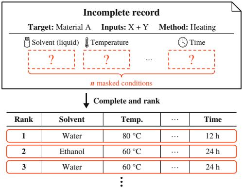
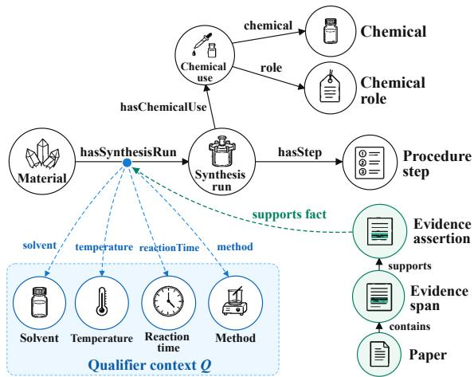
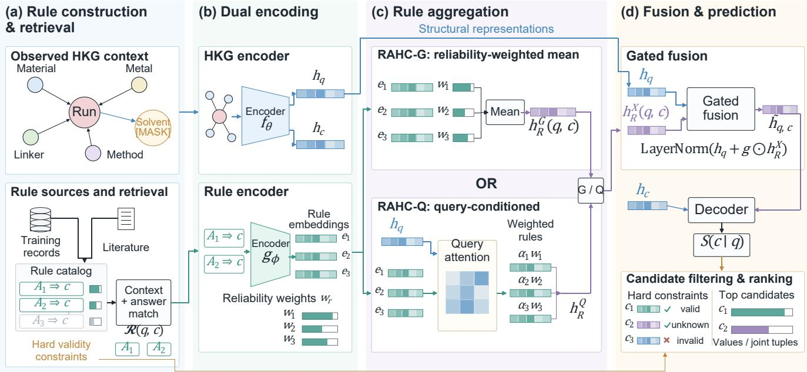

# RAHC: Rule-Augmented Hyper-Relational Knowledge Graph Completion for Materials Synthesis

Jiawei Sun University of New South Wales Sydney, Australia jiawei.sun2@unsw.edu.au

Zihan Chen University of New South Wales Sydney, Australia zihan.chen6@unsw.edu.au

## Abstract

Scientific discovery relies on iterative experimentation and analysis, with experimental knowledge scattered across research papers and online repositories. However, experimental records are often incomplete, and recovering missing information requires domain knowledge and accumulated expertise. For example, in materials synthesis, inferring missing conditions requires interpreting the tar get material and experimental context using established synthesis knowledge. Hyper-relational knowledge graphs (HKGs) represent such knowledge through primary relations enriched with contex tual qualifiers. Existing HKG completion methods learn structural representations, but domain knowledge and recurring experimental regularities remain implicit, limiting their direct use in reasoning about unseen objects. We propose RAHC, a rule-augmented HKG framework for materials synthesis condition completion, support ing single-slot prediction and joint multi-slot completion. RAHC constructs a traceable rule catalog from training records and re trieved literature, retrieves matching rules for query–candidate pairs, and separately encodes experimental structure and rule evidence. Hard rules constrain candidate validity, while soft rules guide ranking. RAHC-G aggregates evidence using global rule reli ability, whereas RAHC-Q additionally accounts for query-specific relevance. Gated fusion combines rule evidence with structural representations. Experiments on five real-world materials synthe sis datasets show the superiority of RAHC across single-slot and joint multi-slot completion tasks under Semi-inductive and Open-Answer Inductive settings, with Semi-inductive MRR improvements of up to 15.6% over MAYPL. RAHC also achieves performance gains on the entity-disjoint ILPC’22 Small benchmark, demonstrating its generalization capability in the fully inductive setting. These results support experimental condition selection, synthesis planning, and the reuse of experimental knowledge in scientific discovery.

## Keywords

hyper-relational knowledge graphs, rule-augmented completion, scientific discovery

## 1 Introduction

Scientific discovery advances through hypothesis generation, experimentation, and analysis of results [11, 35]. Knowledge accumulated from prior experiments informs subsequent hypotheses, the

Sijia Xu University of New South Wales Sydney, Australia sijia.xu@unsw.edu.au

Zhengyi Yang The University of Sydney Sydney, Australia zhengyi.yang@sydney.edu.au

selection of experimental conditions, and experiment planning [14]. Experimental records carry this knowledge by documenting the objects studied, the conditions used, and the resulting observations. However, experimental knowledge is scattered across scientific publications and online repositories, making it dificult to consolidate and reuse [16]. Even when relevant records are available, they may lack key experimental information because details are omitted, routine procedures abbreviated, or domain knowledge left implicit [5]. An important problem in reasoning with scientific knowledge is therefore how to combine observed experimental context with accumulated knowledge to infer and complete missing information in experimental records, enabling fuller reuse of experimental knowledge in subsequent research.

Materials synthesis provides a representative setting for studying this problem. A synthesis record connects a target material with the precursors, solvent, temperature, reaction time, and synthesis method used in a particular experiment; together, these describe a specific synthesis route. For example, a record may specify the target material, precursors, and temperature while omitting the solvent or reaction time. Text mining and large language models can extract and structure experimental information reported in scientific publications [4, 16], but records that remain incomplete after this process require inference using established synthesis knowledge and the current experimental context [33]. Because the same material may be prepared through diferent routes, the target material alone does not determine a missing condition. Prediction must also consider the other conditions observed in that experiment to assess whether a candidate fits the current synthesis route. When several conditions are missing, their dependencies must also be considered to assess whether candidate conditions form a compatible combination. We define this task as context-aware synthesis condition completion: given a target material and the conditions observed in the same experiment, use established synthesis knowledge to rank candidate values for a missing condition or candidate combinations for multiple missing conditions (Figure 1).

A natural approach to these tasks is to represent experimental records as relational facts and infer missing conditions through knowledge graph completion. KG and n-ary models learn relational patterns, while HKG models additionally encode contextual qualifiers, providing a basis for representing the conditions associated with an experiment [10, 17, 18, 41, 44]. However, learned representations leave the experimental regularities underlying a prediction implicit, making it dificult to identify explicit support for a candidate under the observed conditions. Rule-based methods expose supporting premises [22, 38], but global confidence alone does not capture how relevant a rule is to the current experimental context. When several conditions are missing, an additional dificulty arises from their interdependence. Independent scoring does not account for interactions among candidate values, while sequential completion can be sensitive to the order in which conditions are filled. Overcoming these limitations requires addressing three key challenges in context-aware synthesis condition completion.

  
Figure 1: Joint completion of � masked conditions. Candidate values and ranking are illustrative.

C1: Connecting experimental context with explicit evidence. Identifying explicit support for a candidate requires retrieving relevant synthesis knowledge and determining whether its premises hold under the observed experimental conditions.

C2: Distinguishing rule reliability from query relevance. Since globally reliable rules may ofer limited support for a particular query, rule evidence must be assessed for both overall reliability and relevance to the observed context and candidate.

C3: Evaluating dependencies among missing conditions. Joint completion requires assessing the compatibility of candidate conditions while distinguishing violations of explicit constraints from combinations with weaker empirical support.

To this end, we propose RAHC, a Rule-Augmented Hyperrelational knowledge graph Completion framework for contextaware synthesis condition completion. RAHC represents each synthesis experiment as a Material–SynthesisRun fact enriched with contextual qualifiers and retrieves rules derived from training records and literature to provide explicit evidence for each query–candidate pair (C1). To distinguish global reliability from query-specific rel evance, RAHC-G weights matched rules by the former, whereas RAHC-Q additionally learns the latter; a candidate-specific gate then integrates rule evidence with structural representations (C2). For multiple missing conditions, rules with tuple conclusions provide cross-slot evidence, while hard rules filter candidates that violate explicit constraints and soft rules guide the ranking of the remaining combinations (C3). We evaluate RAHC on single-slot and joint multi-slot completion across five materials synthesis datasets, and further assess its use of relational rule evidence on the entitydisjoint ILPC’22 Small benchmark. Our contributions are as follows:

• We propose RAHC, a rule-augmented HKG framework for contextaware synthesis condition completion, which preserves the context of individual experiments and constructs a traceable rule catalog from training records and retrieved literature.

• We develop two complementary mechanisms for integrating rule evidence: RAHC-G aggregates matched rules according to global reliability, while RAHC-Q additionally accounts for queryspecific relevance. A candidate-specific gate fuses the resulting evidence with structural representations.

• We extend single-slot prediction to joint multi-slot completion by combining individual condition scores with rules over condition combinations. Hard constraints exclude invalid candidates, while soft evidence guides the ranking of valid candidates.

• Experiments on five materials synthesis datasets demonstrate the efectiveness of RAHC. On MOF-SynHKG, the best-performing variants improve Semi-inductive MRR over MAYPL by 14.8%, 15.6%, and 6.4% for solvent, temperature, and time completion, respectively. Additional gains on the entity-disjoint ILPC’22 Small benchmark support its applicability to inductive KG completion beyond materials synthesis.

## 2 Related Work

## 2.1 Scientific Knowledge Graphs

Synthesis records describe materials, participants, conditions, and sources. Completing a condition first requires a graph representation that preserves which experiment it belongs to. Triple-based scoring uses translations in TransE, complex-valued interactions in ComplEx, and rotations in RotatE [3, 28, 31]; R-GCN and CompGCN aggregate relational neighborhoods [27, 32]. Once separate synthesis routes have been merged, however, a compatibility score cannot recover a condition’s run identity.

Material KGs use these relations to integrate fragmented scientific records. MatKG connects literature-derived materials, properties, applications, and synthesis methods with source text and publication identifiers [34]. MOF-KG integrates synthesis, structure, composition, and publication knowledge [2]. This supports retrieval; predicting a missing value additionally requires aligning source evidence with one experiment, its observed conditions, and the proposed candidate.

To populate such graphs with experimental conditions, textmining pipelines recover inorganic procedures [16, 37], SynMOF and ZeoSyn organize MOF and zeolite conditions [21, 23], and LLMs extract scientific entities and relationships [4]. Extraction establishes what was reported; completion ranks values absent from the current record using its context and regularities across records.

Because one experiment contains interacting roles and conditions, higher-arity models retain multiple participants: NaLP uses role–value sets, HypE incorporates positions, and GRAN applies within-fact graph attention [6, 12, 36]. HINGE distinguishes an HKG’s primary triple from its qualifiers [25]. This lets a material– run fact retain its conditions as context. New materials and experiments then require inference from previously observed structure.

## 2.2 Inductive HKG Completion

Even when a material–run fact retains conditions, missing-value prediction must use its observed qualifiers: a solvent may have diferent relevance under diferent precursors, methods, or temperatures. StarE encodes qualifiers in messages, Hy-Transformer uses contextual auxiliary training, and HAHE combines global and local attention [10, 20, 42]. ShrinkE models qualifier monotonicity, implication, and exclusion geometrically [39]. These models learn contextual compatibility, but their scores do not identify the documented regularity, evidence, or scope supporting a particular candidate.

  
Figure 2: Run-centric synthesis HKG. Qualifiers contextualize the material–run fact; chemical-use roles, procedure steps, and provenance retain experimental semantics.

Synthesis research continually introduces materials and runs absent from training, making entity-specific embeddings insuficient for these queries. Inductive methods instead use subgraphs and paths in GraIL and NBFNet, compositional tokens in NodePiece, or relation graphs in InGram [9, 17, 30, 44]. Qualifier-aware prediction, NS-HART, and MAYPL extend induction to richer facts [1, 18, 41]. Representing an unseen object still difers from identifying the experimental regularities supporting its candidate conditions.

An unseen material may share chemicals and condition values with training records, whereas an inference graph may contain entirely disjoint entities. Benchmarks distinguish these inductive settings [8, 15]. We assess unseen material queries and separately test entity-disjoint transfer on ILPC’22. In synthesis, support must also be tied to the particular run and its observed conditions, not just to the unseen material. Structural induction alone does not identify why a candidate is supported, motivating explicit rules.

## 2.3 Rule-Augmented Reasoning

Condition ranking needs to identify which prior experimental pattern supports which candidate. Rules expose premises and conclusions: AMIE+ and AnyBURL mine Horn rules, Neural LP and DRUM make learning diferentiable, and RNNLogic jointly trains generation and prediction [7, 22, 24, 26, 40]. Such evidence is inspectable, but predictive coverage depends on rule groundings; aggregate confidence alone does not establish relevance to the current material, method, and remaining conditions.

Rule coverage can be sparse for a new experiment, so symbolic evidence must work alongside structural representations. IterE alternates embedding learning and axiom induction; RulE jointly embeds entities, relations, and rules [29, 43]. HyperPath incorporates qualifier-rich facts and paths [38]. For synthesis, historical reliability and current-query relevance must be distinguished, and a rule’s conclusion must remain aligned with the value or tuple it supports.

When training records do not cover an emerging material, literature may supply additional experimental regularities. Retrievalaugmented generation grounds responses in documents [19], while scientific extraction recovers structured statements [4]. Document relevance, however, does not establish whether a regularity applies to the present run or supports the candidate being ranked. Rule evidence must connect its premises, scope, and conclusion to that candidate.

## 3 Problem Formulation

## 3.1 Hyper-Relational Graphs

Let $\mathcal { G } = ( \mathcal { E } , \mathcal { R } , \mathcal { F } )$ denote a knowledge graph, where $\varepsilon , \mathcal { R } _ { \mathrm { { : } } }$ , and $\mathcal { F }$ are the entity, relation, and fact sets. A binary fact $( h , r , t )$ connects a head entity $h \in { \mathcal { E } }$ to a tail entity $t \in \mathcal { E }$ through $r \in \mathcal R$ . We associate this primary triple with contextual relation–value pairs to define a hyper-relational fact [10, 25]:

$$
\begin{array} { r l } & { f = ( h , r , t , Q ) \in \mathscr { F } , } \\ & { } \\ & { Q = \{ ( q _ { j } , v _ { j } ) \} _ { j = 1 } ^ { | Q | } \subseteq \mathscr { R } \times \mathscr { E } . } \end{array}\tag{1}
$$

Here $q _ { j }$ is a qualifier relation and $v _ { j }$ its value; $Q = \emptyset$ gives an ordinary triple. Qualifiers contextualize the entire primary triple. A type map $\tau : \mathcal { E }  \mathcal { T }$ assigns entities to materials, synthesis runs, chemicals, chemical uses, procedure steps, condition values, or evidence in type set $\mathcal { T }$

For illustration, let � be one target material and $u _ { 1 }$ , �2 two separate synthesis runs. Suppose the illustrative run $u _ { 1 }$ uses $\mathrm { Z n } ( \mathrm { N O } _ { 3 } ) _ { 2 }$ and H BDC in DMF at $1 2 0 ^ { \circ } \mathrm { C }$ for 24 h, while $u _ { 2 }$ uses a diferent solvent and temperature. These are schematic values, not records claimed from the evaluated datasets. Both runs target �, but their qualifier sets remain separate; when predicting the solvent for $u _ { 1 }$ the temperature of $u _ { 2 }$ is not part of its observed context.

## 3.2 Synthesis as Graph Facts

For a target material � and a synthesis run �, we define the primary synthesis fact as

$$
f _ { u } = ( m , \mathsf { h a s S y n t h e s i s R u n } , u , Q _ { u } ) .\tag{2}
$$

Run � binds one experiment’s inputs, conditions, and operations. Diferent routes to the same material have � ≠ $u ^ { \prime }$ and separate qualifier sets, even when values coincide. Each $( s , v ) \in Q _ { u }$ assigns value � to a chemical role or condition �: metal source, linker, precursor, organic structure-directing agent (OSDA), solvent, temperature, reaction time, or method. Thus, solvent and temperature pairs within $Q _ { u }$ describe the same experiment.

Supporting graph relations preserve information beyond these target slots (Figure 2). A chemical-use entity � links run � to a chemical � and its run-specific role $\rho$ through the triple patterns

  
Figure 3: The RAHC framework. (a) Training records and retrieved literature form a traceable rule catalog; retrieval matches observed context and candidate conclusions. (b) Separate encoders represent HKG structure and rule evidence. (c) RAHC-G aggregates by global reliability; RAHC-Q also learns query-conditioned relevance. (d) Gated fusion supports candidate-value and tuple ranking. Hard rules constrain candidate validity.

$$
\begin{array} { r l } & { ( u , \mathsf { h a s c h e m i c a l U s e } , x ) , } \\ & { ( x , \mathsf { c h e m i c a l } , a ) , \quad ( x , \mathsf { r o l e } , \rho ) . } \end{array}\tag{3}
$$

Amounts are attached to the chemical use, separating chemical identity, experimental role, and quantity. Likewise, the recorded operations of run � form the set

$$
\mathcal { P } _ { u } = \{ p \in \mathcal { E } : ( u , \mathsf { h a s s t e p } , p , \emptyset ) \in \mathcal { F } \} .\tag{4}
$$

Each of the $| \mathcal { P } _ { u } |$ steps retains its operation and conditions. To specify the evidence link in Figure 2, let �, �, � be document, evidencespan, and assertion entities. The ordinary graph facts (�, contains, �, ∅ and (�, supports, �, ∅) identify the source chain. Because $f _ { u }$ is a fact rather than an entity, assertion support is a fact-level provenance association

$$
{ \mathcal { L } } _ { \mathrm { p r o v } } \subseteq { \mathcal { E } } _ { \mathrm { a s s e r t } } \times { \mathcal { F } } , \qquad ( a , f _ { u } ) \in { \mathcal { L } } _ { \mathrm { p r o v } } .\tag{5}
$$

This association corresponds to the “supports fact” link; the completion target remains a masked qualifier of $f _ { u } .$ . Continuous values remain exact in the graph; ranking and rule-statistic bins are fitted on training data.

## 3.3 Completion Queries

We formulate synthesis-condition recovery as predicting missing qualifier values. A target slot $s \in { \mathcal { R } }$ specifies the qualifier relation to complete. Let $\nu _ { s }$ denote slot-specific value normalization, including training-fitted binning for numerical ranking targets. The training only candidate vocabulary is

$$
C _ { s } = \{ \nu _ { s } ( v ) : ( s , v ) \in Q _ { u } , f _ { u } \in \mathcal { F } _ { \mathrm { t r } } \} ,\tag{6}
$$

where $\mathcal { F } _ { \mathrm { t r } }$ contains training facts. Candidate types follow the target slot: a solvent query ranks solvent values, while a temperature query ranks temperature bins. Amounts and procedural attributes remain available as context.

For fact $f _ { u _ { i } }$ , let $M _ { i } = \{ s _ { i 1 } ^ { * } , . . . , s _ { i k } ^ { * } \}$ be the set of masked slots. Removing every value of these relations gives the observed qualifier context

$$
K _ { i } = Q _ { u _ { i } } \ \backslash \ \{ ( s , v ) \in Q _ { u _ { i } } : s \in M _ { i } \} .\tag{7}
$$

The resulting query and its candidate domain are

$$
\begin{array} { l } { { q _ { i } ^ { ( k ) } = ( m _ { i } , u _ { i } , K _ { i } , M _ { i } ) , } } \\ { { C _ { M _ { i } } = C _ { s _ { i 1 } ^ { * } } \times \cdot \cdot \cdot \times C _ { s _ { i k } ^ { * } } . } } \end{array}\tag{8}
$$

For $k = 1$ , this reduces to $q _ { i } ^ { ( 1 ) } = ( m _ { i } , u _ { i } , K _ { i } , \{ s _ { i } ^ { * } \} )$ , and the model ranks $c \in C _ { s _ { i } ^ { * } }$ by $S ( c \mid q _ { i } ^ { ( 1 ) } )$ . The recorded normalized values $\{ \nu _ { s _ { i } ^ { * } } ( \boldsymbol { v } ) : ( s _ { i } ^ { * } , \dot { \boldsymbol { v } } ) \in Q _ { u _ { i } } \}$ are the correct answers. A slot may contain multiple answers, such as mixed solvents, so all its values are masked together. In the schematic $u _ { 1 } ,$ masking (solvent, DMF) leaves its material, precursors, 120 $^ \circ C$ , 24 h, and method as context for ranking training-vocabulary solvents.

For $k \geq 2 ,$ the model scores each tuple $\mathbf { c } = \left( c _ { 1 } , \ldots , c _ { k } \right) \in C _ { M _ { i } }$ by $S ( \mathbf { c } \mid q _ { i } ^ { ( k ) } )$ , inserting $( s _ { i j } ^ { * } , c _ { j } )$ into the same fact. Masking solvent and temperature in �1 makes (DMF, $1 2 0 ^ { \circ } \mathrm { C } )$ the schematic complete answer; pairing its solvent with �2’s temperature is incorrect. Joint MRR requires the complete recorded answer, not a partial slot match.

## 3.4 Evaluation Scenarios

The materials-synthesis experiments use two primary protocols with unseen query objects. Write $C _ { s } ^ { \mathrm { t r } } = C _ { s }$ to emphasize the trainingonly candidate vocabulary. Semi-inductive evaluation includes queries whose correct answer lies in $C _ { s } ^ { \mathrm { t r } }$ . Open-Answer Inductive evaluation also retains queries with correct answers outside $C _ { s } ^ { \mathrm { t r } }$ and scores those answers as prediction failures. The two protocols use the same training-only candidate vocabulary and difer in answer coverage.

We evaluate Fully-inductive transfer separately on ILPC’22 Small [8]. Let $\varepsilon _ { \mathrm { t r } }$ and $\mathcal { E } _ { \mathrm { i n f } }$ be the entity sets of the training and inference graphs. Here $\mathcal { E } _ { \mathrm { t r } } \cap \mathcal { E } _ { \mathrm { i n f } } = \emptyset ;$ ; head and tail entities are ranked over the inference-graph entities, with relation semantics shared across graphs.

## 4 The RAHC Framework

For a masked query $q = ( m , u , K , M )$ , RAHC encodes HKG context, retrieves rules supporting each candidate �, and fuses their evidence before decoding $S ( c \mid q )$ (Figure 3). The rule branch uses either global reliability (RAHC-G) or query-conditioned attention (RAHC-Q). Both variants share the same candidate-scoring interface:

$$
\begin{array} { r l } & { ( h _ { q } , h _ { c } ) = \operatorname { H K G E n c } ( q , c , \mathcal { G } ) , } \\ & { \quad \quad \widetilde { h } _ { q , c } = \operatorname { F u s e } ( h _ { q } , h _ { R } ^ { X } ( q , c ) ) , } \\ & { \quad \quad S ( c \mid q ) = \operatorname { D e c } ( \widetilde { h } _ { q , c } , h _ { c } ) , } \end{array}\tag{9}
$$

where $X \in \{ G , Q \}$ . The structural representation $h _ { q }$ depends on the observed run, whereas $h _ { R } ^ { X } ( q , c )$ contains rules matched to the proposed answer. This distinction lets diferent candidates for the same masked query receive diferent rule evidence. The interface also scores complete tuples when several slots are masked.

## 4.1 Rule Construction and Retrieval

A rule $\boldsymbol { r } = ( A _ { r } , B _ { r } , \Omega _ { r } , E _ { r } , C E _ { r } , z _ { r } , w _ { r } )$ ) has antecedent conditions $A _ { r }$ a candidate conclusion $B _ { r }$ , and an applicability scope Ω�. Supporting and counter-evidence $\left( E _ { r } , C E _ { r } \right)$ retain provenance; $z _ { r }$ identifies the rule source and $w _ { r } \in [ 0 , 1 ]$ ] its global reliability. Source, hard/soft strength, and single-/multi-slot conclusion are independent properties (Table 14).

The catalog combines training-mined dependencies with literaturederived statements. Data rules use up to three generalizable antecedents; literature rules undergo structured extraction and reverse searches for support and counterexamples. Both predict values or tuples, exclude identifiers from antecedents, and use training-fitted numerical bins. Appendix E details construction and verification.

Validity and ranking evidence. Hard rules check target-slot types, elemental consistency, and mutually exclusive roles. Only $H ( q , c ) =$ invalid excludes �; valid or unknown candidates remain. Soft rules rank the survivors.

Global reliability. For data rules, support, confidence, and lift measure evidence volume, conditional frequency, and enrichment; significance, bootstrap stability, independent-source count, and counterexample rate provide further quality signals. Literature rules use independent support, textual directness, scope consistency, and counterexamples. Source-specific quality vectors are validationcalibrated and task-normalized into fixed $w _ { r } \in \left[ 0 , 1 \right]$ . All mining and rule statistics use training records only; Appendix E gives the definitions.

Candidate-specific retrieval. Retrieval first matches the target slot, observed antecedents, and material/reaction scope. Among these query-matched rules $\mathcal { R } ( q )$ , candidate � receives only $\mathcal { R } ( q , c ) ~ =$ $\{ r \in \mathcal { R } ( q ) : B _ { r } = c \} . \mathrm { A }$ rule that predicts another solvent, for example, cannot support � merely because its antecedent fits the run. Conversely, a rule with the right conclusion is inactive when its required conditions are absent or its scope excludes the query. If $\mathcal { R } ( q , c ) = \emptyset$ , then $h _ { R } ^ { X } ( q , c ) = 0$ and the structural branch still predicts. Thus a rule-free candidate is not discarded unless a hard validity check explicitly rejects it.

## 4.2 Dual Structure–Rule Encoding

The HKG encoder captures the primary fact, observed qualifiers, and local graph, producing $\left( h _ { q } , h _ { c } \right) = \mathrm { H K G E n c } \left( q , c , g \right)$ . RuleEnc pools role–value embeddings $\phi ( s , v )$ separately over $A _ { r } , B _ { r }$ , and $\Omega _ { r }$ into $a _ { r } , b _ { r } ,$ and $o _ { r }$ . With normalized evidence statistics $v _ { r }$ and source embedding $z _ { r } ,$ , it computes

$$
\begin{array} { r } { e _ { r } = \mathrm { L a y e r N o r m } \left( \mathrm { M L P } \left( \left[ a _ { r } ; b _ { r } ; o _ { r } ; v _ { r } ; z _ { r } \right] \right) \right) . } \end{array}\tag{10}
$$

DOIs, paper IDs, and run IDs are excluded from encoder features; $z _ { r }$ encodes source type, not document identity. Projected structural and rule representations share a �-dimensional space, while evidence-derived $w _ { r }$ remains separate from $v _ { r }$

## 4.3 Reliability-Aware Rule Aggregation

Global aggregation (RAHC-G). RAHC-G averages matched embeddings weighted by fixed reliability:

$$
h _ { R } ^ { G } ( q , c ) = \frac { 1 } { \operatorname* { m a x } ( 1 , | \mathcal { R } ( q , c ) | ) } \sum _ { r \in \mathcal { R } ( q , c ) } w _ { r } W _ { V } e _ { r } .\tag{11}
$$

Here �� projects rule embeddings; retrieval depends on $( q , c )$ , but $w _ { r }$ does not.

Query-conditioned aggregation (RAHC-Q). RAHC-Q instead uses $h _ { q }$ to attend to matched rules, with � as a reliability prior:

$$
\begin{array} { r l } & { \alpha _ { q , c , r } = \mathrm { s o f t m a x } _ { r \in \mathcal { R } ( q , c ) } ( a _ { q , r } ) , } \\ & { ~ a _ { q , r } = \frac { ( W _ { Q } h _ { q } ) ^ { \top } ( W _ { K } e _ { r } ) } { \sqrt { d } } + \eta \log ( w _ { r } + \epsilon ) . } \end{array}\tag{12}
$$

Here $W _ { Q } , W _ { K }$ measure query–rule compatibility, � controls the prior, and � stabilizes the logarithm. Attention is normalized within $\mathcal { R } ( q , c )$ , giving

$$
h _ { R } ^ { Q } ( q , c ) = \sum _ { r \in \mathcal { R } ( q , c ) } \alpha _ { q , c , r } w _ { r } W _ { V } e _ { r } .\tag{13}
$$

The two variants use the same matched rule set but make diferent weighting decisions. RAHC-G uses each rule’s calibrated reliability across all queries; RAHC-Q can emphasize a diferent subset for the current run through $\alpha _ { q , c , r }$ . Neither attention nor reliability changes which candidate a retrieved rule concludes. This separates evidence strength, contextual relevance, and candidate-specific retrieval.

## 4.4 Fusion and Joint Prediction

For $X \in \{ G , Q \}$ , a candidate-specific gate adds rule evidence to the structural query:

$$
\begin{array} { r l } & { g _ { \boldsymbol { q } , \boldsymbol { c } } = \sigma \big ( W _ { \boldsymbol { g } } [ h _ { \boldsymbol { q } } ; h _ { R } ^ { X } ( \boldsymbol { q } , \boldsymbol { c } ) ] \big ) , } \\ & { \widetilde { h } _ { \boldsymbol { q } , \boldsymbol { c } } = \mathrm { L a y e r N o r m } \big ( h _ { \boldsymbol { q } } + g _ { \boldsymbol { q } , \boldsymbol { c } } \odot h _ { R } ^ { X } ( \boldsymbol { q } , \boldsymbol { c } ) \big ) . } \end{array}\tag{14}
$$

Here $[ \cdot ; \cdot ]$ concatenates, � is sigmoid, and ⊙ is element-wise multiplication. A decoder scores $( \widetilde { h } _ { q , c } , h _ { c } )$

For jointly masked slots $\hat { M } = \{ s _ { 1 } ^ { * } , . . . , s _ { k } ^ { * } \}$ and a complete candidate tuple $\mathbf { c } \in C _ { M }$ , define $C ( \mathbf { c } ) = \{ ( s _ { j } ^ { * } , c _ { j } ) \} _ { j = 1 } ^ { k } .$ . Joint evidence consists of query-matched rules whose consequents agree with at least two target slots:

$$
\begin{array} { r } { \mathcal { R } _ { J } ( q , \mathbf { c } ) = \{ r \in \mathcal { R } ( q ) : B _ { r } \subseteq C ( \mathbf { c } ) , \qquad } \\ { | \operatorname { s l o t s } ( B _ { r } ) | \geq 2 \} . } \end{array}\tag{15}
$$

Here slots(��) denotes consequent roles. A solvent–temperature rule can support a larger tuple when both of its conclusions agree with that tuple, but it cannot reward a combination with a diferent temperature. Single-slot rules are excluded from $\mathcal { R } _ { J }$ because their evidence already enters the component scores. This prevents counting the same rule twice while allowing explicit support for crosscondition combinations. G/Q aggregation over $\mathcal { R } _ { J }$ yields $h _ { R , J } ^ { X } ( q , \mathbf { c } )$ For tuple embedding $h _ { \mathbf { c } } ,$ define

$$
\begin{array} { r l } & { \ell _ { J } ^ { X } = v _ { J } ^ { \top } \operatorname { t a n h } \Bigl ( W _ { q } h _ { q } + W _ { c } h _ { \mathbf c } + W _ { R } h _ { R , J } ^ { X } \Bigr ) + b _ { J } , } \\ & { ~ S _ { R } ^ { X } ( \mathbf c \mid q ) = \left\{ 0 , \begin{array} { l l } { 0 , } & { \mathcal { R } _ { J } ( q , \mathbf c ) = \emptyset , } \\ { \mathrm { s o f t p l u s } ( \ell _ { J } ^ { X } ) , } & { \mathrm { o t h e r w i s e } . } \end{array} \right. } \end{array}\tag{16}
$$

The learned projections, $v _ { J }$ , and $b _ { J }$ give a nonnegative rule score that is zero without joint evidence. The full tuple score is

$$
\begin{array} { l } { { S ( { \bf c \Theta } \mid q ^ { ( k ) } ) = \displaystyle \sum _ { j = 1 } ^ { k } S ( c _ { j } \mid q ^ { ( k ) } , s _ { j } ^ { * } ) } } \\ { { \ ~ + \lambda _ { J } S _ { R } ^ { X } ( { \bf c \Theta } \mid q ^ { ( k ) } ) . } } \end{array}\tag{17}
$$

All component scores use the same jointly masked query; $\lambda _ { J }$ controls joint evidence. Without it, the score is the sum of slot scores. Evaluation requires a complete-tuple match.

Learning. Candidate cross-entropy trains single-answer queries, with correct-answer probability mass aggregated for multi-answer queries and the same objective applied to tuples. Training updates the encoders, fusion, decoder, and RAHC-Q attention; global reliabilities stay fixed. Appendix E gives the objective.

Splits precede candidate construction and rule mining. Validation selects calibration, hyperparameters, and checkpoints. Masking removes every target-slot value, equivalent alias path, and answerrevealing derived field. Identifiers serve only partitioning, source counts, and traceability, never rule antecedents; test answers do not enter the rule catalog.

## 5 Experiments

Our experiments test three questions: whether explicit rules improve condition ranking within materials synthesis, whether the same mechanism transfers across material families and target slots, and whether it remains useful when training and inference entities are disjoint. We use MOF synthesis as the primary case because a run combines metal sources, linkers, solvents, temperature, time, and procedural context; this mixture of roles and conditions makes it a natural test of run-centric HKG representation and candidatespecific rule evidence [21]. We then evaluate inorganic-precursor and zeolite-OSDA completion to test transfer beyond MOFs, and use ILPC’22 Small to isolate fully inductive KG generalization. The setup below introduces the datasets, protocols, comparators, and metrics before the task-specific results.

## 5.1 Experimental Setup

Our code is available at https://anonymous.4open.science/r/RAHC-2B48.

Datasets. We use five materials-synthesis datasets. MOF-SynHKG is the main HKG for solvent, temperature, and reaction-time completion, including joint completion; SynMOF and FAIR-MOFs evaluate the same condition types across MOF data sources [21]. Solutionbased Inorganic evaluates missing-precursor completion, while ZeoSyn evaluates organic structure-directing agent (OSDA) completion in zeolite synthesis [23, 37]. RAHC is retrained and its rules rebuilt for each dataset. Separately, ILPC’22 Small evaluates head and tail prediction with disjoint training and inference entities [8]. Further dataset and task information is provided in Appendix A.

Evaluation protocols. We evaluate material-condition queries under two answer-coverage scenarios defined in Section 3.4. Both rank the same slot-typed candidate vocabulary constructed from training facts, so test answers never expand the candidate set. Semiinductive (SI) includes unseen query objects whose recorded answer is in that vocabulary. Open-Answer Inductive (OA) retains the additional queries whose recorded answer is outside it and counts those as failures. Thus SI measures ranking among representable answers, whereas OA also measures the efect of answer coverage. We split records before constructing candidates or mining rules, derive rule statistics only from training records, and mask every true value of a target slot within a test run to prevent answer leakage.

For standard Fully-inductive evaluation, we use ILPC’22 Small [8]: its training and inference graphs have disjoint entity sets. Observed inference-graph edges provide context for 6,653 unseen entities, while validation and test target edges are withheld. We rank both heads and tails against all inference entities with filtered ranking and realistic tie handling; graph sizes are reported in Appendix B.

On ILPC’22, both RAHC variants share the NodePieceGNN structural encoder [8, 9] and match training-mined relation rules to observed inference-graph paths. NodePiece, NodePieceGNN, NBFNet, and AnyBURL use the same queries and candidates. Validation MRR selects seeds, checkpoints, and fusion coeficients before one test evaluation per method.

Baselines. We select comparators to separate the contributions of structural generalization, qualifier-aware modeling, and explicit rules. InGram [17] and NBFNet [44] test inductive relation and path reasoning; NS-HART [41], MAYPL [18], and the HYPER and QBLP adaptations test higher-arity or hyper-relational structure; AnyBURL [22] and HyperPath [38] test symbolic rule and path evidence. Transductive comparisons additionally include StarE and HAHE. Methods share task-specific queries, candidates, and evaluation procedures within each result table. On ILPC’22, NodePiece and NodePieceGNN provide benchmark-compatible structural comparisons alongside NBFNet and AnyBURL. For joint completion, Independent is the same RAHC tuple scorer with $\lambda _ { J } = 0 ,$ summing its component slot scores; ordered and bidirectional autoregressive baselines fill masked slots sequentially.

Table 1: MOF solvent, temperature, and time completion (MRR). SI denotes Semi-inductive; OA denotes Open-Answer Inductive. Scores are rounded to three decimals; bold and underline mark the best and second-best displayed scores.
<table><tr><td></td><td colspan="6">MOF-SynHKG</td><td colspan="3">SynMOF</td><td colspan="6">FAIR-MOFs</td></tr><tr><td></td><td colspan="2">Solvent</td><td colspan="2">Temperature</td><td colspan="2">Time</td><td>Solvent</td><td>Temperature</td><td>Time</td><td colspan="2">Solvent</td><td colspan="2">Temperature</td><td colspan="2">Time</td></tr><tr><td>Method</td><td>SI</td><td>OA</td><td>SI</td><td>OA</td><td>SI</td><td>OA</td><td>SI</td><td>SI</td><td>SI</td><td>SI</td><td>OA</td><td>SI</td><td>OA</td><td>SI</td><td>OA</td></tr><tr><td>InGram</td><td>0.013</td><td>0.012</td><td>0.543</td><td>0.286</td><td>0.458</td><td>0.134</td><td>0.157</td><td>0.517</td><td>0.451</td><td>0.021</td><td>0.020</td><td>0.534</td><td>0.530</td><td>0.456</td><td>0.450</td></tr><tr><td>NBFNet</td><td>0.319</td><td>0.303</td><td>0.675</td><td>0.356</td><td>0.629</td><td>0.184</td><td>0.520</td><td>0.661</td><td>0.625</td><td>0.478</td><td>0.467</td><td>0.848</td><td>0.842</td><td>0.549</td><td>0.542</td></tr><tr><td>NS-HART</td><td>0.315</td><td>0.300</td><td>0.551</td><td>0.290</td><td>0.603</td><td>0.176</td><td>0.432</td><td>0.614</td><td>0.603</td><td>0.436</td><td>0.426</td><td>0.834</td><td>0.828</td><td>0.554</td><td>0.547</td></tr><tr><td>HYPER</td><td>0.321</td><td>0.305</td><td>0.669</td><td>0.353</td><td>0.636</td><td>0.186</td><td>0.660</td><td>0.637</td><td>0.621</td><td>0.461</td><td>0.450</td><td>0.868</td><td>0.862</td><td>0.572</td><td>0.565</td></tr><tr><td>QBLP</td><td>0.322</td><td>0.306</td><td>0.665</td><td>0.350</td><td>0.644</td><td>0.188</td><td>0.684</td><td>0.648</td><td>0.623</td><td>0.442</td><td>0.431</td><td>0.872</td><td>0.866</td><td>0.542</td><td>0.535</td></tr><tr><td>MAYPL</td><td>0.330</td><td>0.314</td><td>0.633</td><td>0.334</td><td>0.640</td><td>0.187</td><td>0.662</td><td>0.555</td><td>0.438</td><td>0.416</td><td>0.406</td><td>0.849</td><td>0.843</td><td>0.523</td><td>0.516</td></tr><tr><td>AnyBURL</td><td>0.370</td><td>0.352</td><td>0.704</td><td>0.371</td><td>0.661</td><td>0.193</td><td>0.701</td><td>0.700</td><td>0.597</td><td>0.545</td><td>0.532</td><td>0.824</td><td>0.818</td><td>0.578</td><td>0.570</td></tr><tr><td>HyperPath</td><td>0.364</td><td>0.346</td><td>0.720</td><td>0.379</td><td>0.670</td><td>0.196</td><td>0.741</td><td>0.698</td><td>0.626</td><td>0.533</td><td>0.520</td><td>0.875</td><td>0.869</td><td>0.573</td><td>0.566</td></tr><tr><td>RAHC-G</td><td>0.369</td><td>0.351</td><td>0.731</td><td>0.385</td><td>0.681</td><td>0.199</td><td>0.745</td><td>0.705</td><td>0.628</td><td>0.552</td><td>0.539</td><td>0.873</td><td>0.867</td><td>0.583</td><td>0.575</td></tr><tr><td>RAHC-Q</td><td>0.379</td><td>0.360</td><td>0.732</td><td>0.386</td><td>0.673</td><td>0.197</td><td>0.732</td><td>0.713</td><td>0.634</td><td>0.538</td><td>0.525</td><td>0.878</td><td>0.871</td><td>0.591</td><td>0.583</td></tr></table>

Metrics. The primary metrics are mean reciprocal rank (MRR) and Hits@1, Hits@3, and Hits@10. Materials tables report MRR under the Semi-inductive and Open-Answer Inductive protocols. Temperature and time tasks also use macro-F1 and absolute error based on fixed representative values. ILPC’22 additionally reports Hits@5 and adjusted mean rank index (AMRI); its paired bootstrap resamples test triples after averaging head- and tail-prediction reciprocal ranks.

## 5.2 Single-Slot MOF Completion

We first test whether rules improve individual condition rankings across three MOF data sources. Table 1 reports solvent, temperature, and time completion under the SI and OA protocols. Within a directly comparable column, the best result is bold and the second best is underlined.

Solvent prediction. A RAHC variant ranks first in all five solvent columns. On MOF-SynHKG, RAHC-Q reaches SI and OA MRR of 0.379 and 0.360, exceeding MAYPL by 14.8% and 14.6%, respectively. RAHC-G leads SynMOF at 0.745 and FAIR-MOFs at 0.552 SI and 0.539 OA MRR. AnyBURL and HyperPath are also competitive, placing explicit rule evidence close to the leading structural methods or above them. Combining that evidence with structural representations yields the strongest solvent ranking in each source, although the preferred aggregation strategy varies.

Temperature and time prediction. A RAHC variant leads all ten temperature and time columns. On MOF-SynHKG, RAHC-Q reaches 0.732 SI temperature MRR, 15.6% above MAYPL; RAHC-G reaches 0.681 SI time MRR, a 6.4% gain. RAHC-Q also leads SynMOF temperature and time at 0.71339 and 0.634 MRR, respectively, and FAIR-MOFs temperature at 0.878 SI and 0.871 OA MRR.

The G–Q comparison separates the efects of fixed reliability and contextual weighting. RAHC-Q leads most temperature and time columns, whereas RAHC-G leads MOF-SynHKG time and the solvent columns on SynMOF and FAIR-MOFs. The shared fusion mechanism can therefore use either global evidence consistency or query-dependent weighting; the results do not favor one weighting strategy for every target.

Table 2: Cross-material completion after task-specific retraining (MRR). SI denotes Semi-inductive; OA denotes Open-Answer Inductive. Scores are rounded to three decimals; emphasis follows unrounded rankings.
<table><tr><td></td><td colspan="2">Solution Inorganic</td><td colspan="2">ZeoSyn</td></tr><tr><td>Method</td><td>SI</td><td>OA</td><td>SI</td><td>OA</td></tr><tr><td>MAYPL</td><td>0.039</td><td>0.035</td><td>0.243</td><td>0.201</td></tr><tr><td>AnyBURL</td><td>0.171</td><td>0.153</td><td>0.448</td><td>0.371</td></tr><tr><td>HyperPath</td><td>0.179</td><td>0.160</td><td>0.280</td><td>0.232</td></tr><tr><td>NBFNet</td><td>0.070</td><td>0.063</td><td>0.286</td><td>0.237</td></tr><tr><td>HYPER</td><td>0.053</td><td>0.047</td><td>0.294</td><td>0.243</td></tr><tr><td>QBLP</td><td>0.040</td><td>0.036</td><td>0.301</td><td>0.249</td></tr><tr><td>RAHC-G</td><td>0.334</td><td>0.299</td><td>0.465</td><td>0.385</td></tr><tr><td>RAHC-Q</td><td>0.342</td><td>0.306</td><td>0.457</td><td>0.378</td></tr></table>

## 5.3 Cross-Material Completion

We test diferent chemical roles and candidate vocabularies through inorganic precursor and zeolite OSDA selection, retraining models and rebuilding rules for each task (Table 2).

On Solution Inorganic, RAHC-Q reaches 0.342 SI and 0.306 OA MRR, exceeding HyperPath’s 0.1792 SI MRR by 90.8%. OA ranks 2,386 training-only precursors for 8,110 queries: 7,258 answers are in vocabulary (89.49%); 852 receive zero reciprocal rank. On ZeoSyn, RAHC-G leads both SI and OA at 0.465 and 0.385 MRR, respectively, extending candidate-specific evidence beyond MOF conditions.

## 5.4 Joint Two-Slot Completion

We mask two slots and rank complete pairs to test cross-condition prediction. Independent uses the RAHC component scores with $\lambda _ { J } = 0 ;$ the full variants add tuple-specific rule evidence with their selected $\lambda _ { J }$ . Backbone, checkpoint, queries, candidates, and ranking procedure are shared in this comparison. Table 3 also reports InGram, NS-HART, AnyBURL, and HyperPath using query-level joint MRR. Ordered and bidirectional autoregressive comparisons appear in Appendix C, Table 12.

Table 3: Joint two-slot completion (query-level joint MRR). Independent is RAHC with $\lambda _ { J } = 0 .$ . Solv., Temp., and Method denote solvent, temperature bin, and reaction method.
<table><tr><td>Method</td><td>Solv.+Temp.</td><td>Solv.+Time</td><td>Temp.+Time</td><td>Solv.+Method</td></tr><tr><td>Independent</td><td>0.2457</td><td>0.2617</td><td>0.4012</td><td>0.3907</td></tr><tr><td>InGram</td><td>0.2275</td><td>0.2484</td><td>0.4039</td><td>0.3953</td></tr><tr><td>NS-HART</td><td>0.2275</td><td>0.2610</td><td>0.4100</td><td>0.4001</td></tr><tr><td>AnyBURL</td><td>0.2372</td><td>0.2632</td><td>0.4075</td><td>0.4147</td></tr><tr><td>HyperPath</td><td>0.2254</td><td>0.2677</td><td>0.3901</td><td>0.4180</td></tr><tr><td>RAHC-G</td><td>0.2707</td><td>0.2699</td><td>0.4273</td><td>0.4197</td></tr><tr><td>RAHC-Q</td><td>0.2704</td><td>0.2685</td><td>0.4331</td><td>0.4188</td></tr></table>

Table 4: Fully-inductive link prediction on ILPC’22 Small (filtered ranking, realistic ties). H@� denotes Hits@�; additional metrics are in Table 8.
<table><tr><td>Method</td><td>MRR</td><td>H@1</td><td>H@3</td><td>H@10</td></tr><tr><td>NodePiece</td><td>0.03154</td><td>0.00293</td><td>0.01654</td><td>0.08012</td></tr><tr><td>NodePieceGNN</td><td>0.08659</td><td>0.03773</td><td>0.08925</td><td>0.19745</td></tr><tr><td>NBFNet</td><td>0.01879</td><td>0.00207</td><td>0.02395</td><td>0.05582</td></tr><tr><td>AnyBURL</td><td>0.02570</td><td>0.01482</td><td>0.02464</td><td>0.04118</td></tr><tr><td>RAHC-G</td><td>0.08965</td><td>0.03894</td><td>0.09459</td><td>0.20417</td></tr><tr><td>RAHC-Q</td><td>0.08850</td><td>0.03790</td><td>0.09390</td><td>0.20262</td></tr></table>

RAHC variants lead all four tasks, including the InGram and AnyBURL comparisons. Relative to the same scorer with $\lambda _ { J } = 0 ,$ RAHC-Q raises TemperatureBin+TimeBin joint MRR from 0.4012 to 0.4331 (8.0%), while RAHC-G raises Solvent+ReactionMethod from 0.3907 to 0.4197 (7.4%). RAHC-G leads three pairs and RAHC-Q leads TemperatureBin+TimeBin; both exceed Independent on every pair. These complete-tuple gains isolate the contribution of the joint-rule term under the shared scoring configuration. RAHC-G additionally exceeds both autoregressive orders and their bidirectional combination on all four comparisons in Table 12.

## 5.5 Standard Fully-Inductive KG Completion

The materials experiments transfer to unseen query objects while retaining shared contextual entities. To test transfer across completely disjoint entity sets, we evaluate ILPC’22 Small, where each head or tail is ranked among 6,653 inference entities absent from training. Both RAHC variants use NodePieceGNN as their shared structural encoder, isolating the additional contribution of trainingderived relation rules under this protocol.

Table 4 reports 0.08965 MRR for RAHC-G, compared with 0.08659 for NodePieceGNN and 0.08850 for RAHC-Q. RAHC-G also leads Hits@1, Hits@3, Hits@5, Hits@10, and AMRI. Its MRR gain over NodePieceGNN is 0.00306, with a paired-bootstrap 95% confidence interval of [0.00169, 0.00448].

Rules mined on the training graph thus provide additional rank ing evidence when instantiated through observed paths among unseen inference entities. Global aggregation performs better than query-conditioned aggregation here, paralleling the task-dependent G–Q diferences in materials completion. Appendix B reports the paired comparisons, rule coverage, and validation ablations.

Table 5: Hard- and soft-rule ablation on the elementconditioned missing-precursor validation task. H@� denotes SI Hits@�. “w/o hard”, “w/o soft”, and ${ \bf { \sigma } ^ { \alpha } \otimes } ( { \bf { \sigma } _ { 0 } }$ both” remove hard constraints, soft rules, or both.
<table><tr><td>Variant</td><td>SIMRR</td><td>H@1</td><td>H@3</td><td>H@10</td><td>OA MRR</td></tr><tr><td>RAHC w/o both</td><td>0.0491</td><td>0.0173</td><td>0.0264</td><td>0.0900</td><td>0.0466</td></tr><tr><td>RAHC w/o hard</td><td>0.4595</td><td>0.2912</td><td>0.5124</td><td>0.6983</td><td>0.4359</td></tr><tr><td>RAHC w/o soft</td><td>0.2585</td><td>0.1420</td><td>0.2831</td><td>0.4750</td><td>0.2452</td></tr><tr><td>RAHC (full)</td><td>0.4613</td><td>0.2972</td><td>0.5794</td><td>0.7491</td><td>0.4376</td></tr></table>

Table 6: Rule-source ablation for MOF-SynHKG solvent completion (SI validation; 3,688 training-seen solvent candidates). For unseen-MOF or unseen-run queries, candidate-specific evidence comes from training-derived rules, literaturederived rules, or both; H@� denotes Hits@�.
<table><tr><td>Model variant</td><td>MRR</td><td>H@1</td><td>H@3</td><td>H@10</td></tr><tr><td>w/o All Rules</td><td>0.3381</td><td>0.2254</td><td>0.3740</td><td>0.5735</td></tr><tr><td>w/o Literature Rules</td><td>0.3726</td><td>0.2609</td><td>0.4161</td><td>0.6024</td></tr><tr><td>w/o Training Rules</td><td>0.3486</td><td>0.2400</td><td>0.3804</td><td>0.5770</td></tr><tr><td>Training + Literature Rules</td><td>0.3752</td><td>0.2624</td><td>0.4208</td><td>0.6038</td></tr></table>

Rule component ablation. We compare hard validity constraints and soft ranking rules on an element-conditioned missing-precursor validation task (Table 5).

On the element-conditioned missing-precursor validation task, full RAHC reaches 0.4613 SI MRR, versus 0.0491 without either rule component (Table 5). Soft evidence supplies most of the MRR gain: retaining it without hard rules reaches 0.4595, whereas hard rules alone reach 0.2585. Adding hard constraints raises Hits@3 from 0.5124 to 0.5794 and Hits@10 from 0.6983 to 0.7491.

Table 6 isolates the training-derived and literature-derived rule sources within the candidate-specific evidence branch described in Section 4. Combining both sources raises SI validation MRR from 0.3726 with training rules alone to 0.3752; literature rules alone also exceed the no-rule variant (0.3486 versus 0.3381). The additional gain from literature rules in this setting is small.

## 6 Conclusion

We introduced RAHC for recovering missing conditions from scientific HKGs. Candidate-specific retrieval and dual encoding connect structural context to traceable rule evidence, while global and queryconditioned aggregation distinguish reliability from contextual relevance. Across five materials datasets, the framework improves both single-slot and joint-slot rankings; hard- and soft-rule ablations identify complementary contributions to candidate validity and preference. Training-derived relation rules also improve the shared NodePieceGNN encoder on entity-disjoint ILPC’22 Small. These evaluations support a common rule-augmented ranking framework for context-rich synthesis records and Fully-inductive KG completion.

## References

[1] Mehdi Ali, Max Berrendorf, Mikhail Galkin, Veronika Thost, Tengfei Ma, Volker Tresp, and Jens Lehmann. 2021. Improving Inductive Link Prediction Using Hyper-relational Facts. In The Semantic Web: ISWC 2021. 74–92. doi:10.1007/978- 3-030-88361-4\_5

[2] Yuan An, Jane Greenberg, Xintong Zhao, Xiaohua Hu, Scott McCLellan, Alex Kalinowski, Fernando J. Uribe-Romo, Kyle Langlois, Jacob Furst, Diego A. Gómez Gualdrón, Fernando Fajardo-Rojas, and Katherine Ardila. 2022. Building Open Knowledge Graph for Metal-Organic Frameworks (MOF-KG): Challenges and Case Studies. arXiv:2207.04502 [cs.AI] https://arxiv.org/abs/2207.04502

[3] Antoine Bordes, Nicolas Usunier, Alberto Garcia-Durán, Jason Weston, and Oksana Yakhnenko. 2013. Translating Embeddings for Modeling Multi-relational Data. In Advances in Neural Information Processing Systems 26. https: //proceedings.neurips.cc/paper/2013/hash/1cecc7a77928ca8133fa24680a88d2f9- Abstract.htm

[4] John Dagdelen, Alexander Dunn, Sanghoon Lee, Nicholas Walker, Andrew S. Rosen, Gerbrand Ceder, Kristin A. Persson, and Anubhav Jain. 2024. Structured information extraction from scientific text with large language models. Nature Communications 15 (2024). doi:10.1038/s41467-024-45563-x

[5] Ian W Davies. 2019. The digitization of organic synthesis. Nature 570, 7760 (2019), 175–181.

[6] Bahare Fatemi, Perouz Taslakian, David Vazquez, and David Poole. 2020. Knowledge Hypergraphs: Prediction Beyond Binary Relations. In Proceedings of the Twenty-Ninth International Joint Conference on Artificial Intelligence. 2191–2197. doi:10.24963/ijcai.2020/303

[7] Luis Galárraga, Christina Teflioudi, Katja Hose, and Fabian M. Suchanek. 2015. Fast Rule Mining in Ontological Knowledge Bases with AMIE+. The VLDB Journal 24, 6 (2015), 707–730. doi:10.1007/s00778-015-0394-1

[8] Mikhail Galkin, Max Berrendorf, and Charles Tapley Hoyt. 2022. An Open Challenge for Inductive Link Prediction on Knowledge Graphs. Workshop on Graph Learning Benchmarks at The Web Conference 2022. arXiv:2203.01520 doi:10.48550/arXiv.2203.01520

[9] Mikhail Galkin, Etienne Denis, Jiapeng Wu, and William L. Hamilton. 2022. NodePiece: Compositional and Parameter-Eficient Representations of Large Knowledge Graphs. In International Conference on Learning Representations. https: //openreview.net/forum?id=xMJWUKJnFSw

[10] Mikhail Galkin, Priyansh Trivedi, Gaurav Maheshwari, Ricardo Usbeck, and Jens Lehmann. 2020. Message Passing for Hyper-Relational Knowledge Graphs. In Proceedings of the 2020 Conference on Empirical Methods in Natural Language Processing. 7346–7359. doi:10.18653/v1/2020.emnlp-main.596

[11] Ali Essam Ghareeb, Benjamin Chang, Ludovico Mitchener, Angela Yiu, Caralyn J Szostkiewicz, Dmytro Shved, Gavin J Gyimesi, Jon M Laurent, Samantha M Wright, Muhammed T Razzak, et al. 2026. A multi-agent system for automating scientific discovery. Nature (2026), 1–3.

[12] Saiping Guan, Xiaolong Jin, Yuanzhuo Wang, and Xueqi Cheng. 2019. Link Prediction on N-ary Relational Data. In The World Wide Web Conference. 583–593. doi:10.1145/3308558.3313414

[13] Ines Maria Hauptvogel, Volodymyr Bon, Ronny Gr"unker, Igor A. Baburin, Irena Senkovska, Uwe Mueller, and Stefan Kaskel. 2012. A family of 2D and 3D coor dination polymers involving a trigonal tritopic linker. Dalton Transactions 41 (2012), 4172–4179. doi:10.1039/C2DT12072K

[14] Ross D King, Kenneth E Whelan, Ffion M Jones, Philip GK Reiser, Christopher H Bryant, Stephen H Muggleton, Douglas B Kell, and Stephen G Oliver. 2004. Functional genomic hypothesis generation and experimentation by a robot scientist. Nature 427, 6971 (2004), 247–252.

[15] Adrian Kochsiek and Rainer Gemulla. 2023. A Benchmark for Semi-Inductive Link Prediction in Knowledge Graphs. In Findings of the Association for Computational Linguistics: EMNLP 2023. Association for Computational Linguistics, 10634–10643. doi:10.18653/v1/2023.findings-emnlp.713

[16] Olga Kononova, Haoyan Huo, Tanjin He, Ziqin Rong, Tiago Botari, Wenhao Sun, Vahe Tshitoyan, and Gerbrand Ceder. 2019. Text-mined dataset of inorganic materials synthesis recipes. Scientific Data 6, Article 203 (2019). doi:10.1038/ s41597-019-0224-1

[17] Jaejun Lee, Chanyoung Chung, and Joyce Jiyoung Whang. 2023. InGram: Inductive Knowledge Graph Embedding via Relation Graphs. In Proceedings of the 40th International Conference on Machine Learning (Proceedings of Machine Learning Research, Vol. 202). 18796–18809. https://proceedings.mlr.press/v202/lee23c.html

[18] Jaejun Lee and Joyce Jiyoung Whang. 2025. Structure Is All You Need: Structural Representation Learning on Hyper-Relational Knowledge Graphs. In Proceedings of the 42nd International Conference on Machine Learning (Proceedings of Machine Learning Research, Vol. 267). 33765–33783. https://proceedings.mlr.press/v267/ lee25ah.html

[19] Patrick Lewis, Ethan Perez, Aleksandra Piktus, Fabio Petroni, Vladimir Karpukhin, Naman Goyal, Heinrich Küttler, Mike Lewis, Wen tau Yih, Tim Rocktäschel, Sebastian Riedel, and Douwe Kiela. 2020. Retrieval-Augmented Generation for Knowledge-Intensive NLP Tasks. In Advances in Neural Information Processing Systems 33. https://arxiv.org/abs/2005.11401

[20] Haoran Luo, Haihong E, Yuhao Yang, Yikai Guo, Mingzhi Sun, Tianyu Yao, Zichen Tang, Kaiyang Wan, Meina Song, and Wei Lin. 2023. HAHE: Hierarchical Attention for Hyper-Relational Knowledge Graphs in Global and Local Level. In Proceedings of the 61st Annual Meeting of the Association for Computational Linguistics. 8095–8107. doi:10.18653/v1/2023.acl-long.450

[21] Yi Luo, Saientan Bag, Orysia Zaremba, Adrian Cierpka, Jacopo Andreo, Stefan Wuttke, Pascal Friederich, and Manuel Tsotsalas. 2022. MOF Synthesis Prediction Enabled by Automatic Data Mining and Machine Learning. Angewandte Chemie International Edition 61, 19 (2022), e202200242. doi:10.1002/anie.202200242

[22] Christian Meilicke, Melisachew Wudage Chekol, Daniel Rufinelli, and Heiner Stuckenschmidt. 2019. Anytime Bottom-Up Rule Learning for Knowledge Graph Completion. In Proceedings ofthe Twenty-Eighth International Joint Conference on Artificial Intelligence. 3137–3143. doi:10.24963/ijcai.2019/435

[23] Elton Pan, Soonhyoung Kwon, Zach Jensen, Mingrou Xie, Rafael Gómez-Bombarelli, Manuel Moliner, Yuriy Román-Leshkov, and Elsa Olivetti. 2024. ZeoSyn: A Comprehensive Zeolite Synthesis Dataset Enabling Machine-Learning Rationalization of Hydrothermal Parameters. ACS Central Science 10, 3 (2024), 729–743. doi:10.1021/acscentsci.3c01615

[24] Meng Qu, Junkun Chen, Louis-Pascal Xhonneux, Yoshua Bengio, and Jian Tang. 2021. RNNLogic: Learning Logic Rules for Reasoning on Knowledge Graphs. In International Conference on Learning Representations. https://arxiv.org/abs/2010. 04029

[25] Paolo Rosso, Dingqi Yang, and Philippe Cudré-Mauroux. 2020. Beyond Triplets: Hyper-Relational Knowledge Graph Embedding for Link Prediction. In Proceedings ofThe Web Conference 2020. doi:10.1145/3366423.3380257

[26] Ali Sadeghian, Mohammadreza Armandpour, Patrick Ding, and Daisy Zhe Wang. 2019. DRUM: End-To-End Diferentiable Rule Mining On Knowledge Graphs. In Advances in Neural Information Processing Systems 32. https://arxiv.org/abs/1911. 00055

[27] Michael Schlichtkrull, Thomas N. Kipf, Peter Bloem, Rianne van den Berg, Ivan Titov, and Max Welling. 2018. Modeling Relational Data with Graph Convolu tional Networks. In The Semantic Web: ESWC 2018. 593–607. doi:10.1007/978-3- 319-93417-4\_38

[28] Zhiqing Sun, Zhi-Hong Deng, Jian-Yun Nie, and Jian Tang. 2019. RotatE: Knowledge Graph Embedding by Relational Rotation in Complex Space. In International Conference on Learning Representations. https://openreview.net/forum?id= HkgEQnRqYQ

[29] Xiaojuan Tang, Song-Chun Zhu, Yitao Liang, and Muhan Zhang. 2024. RulE: Knowledge Graph Reasoning with Rule Embedding. In Findings ofthe Association for Computational Linguistics: ACL 2024. 4316–4335. doi:10.18653/v1/2024. findings-acl.256

[30] Komal K. Teru, Etienne G. Denis, and William L. Hamilton. 2020. Inductive Relation Prediction by Subgraph Reasoning. In Proceedings ofthe 37th International Conference on Machine Learning (Proceedings of Machine Learning Research, Vol. 119). PMLR, 9448–9457. https://proceedings.mlr.press/v119/teru20a.html

[31] Théo Trouillon, Johannes Welbl, Sebastian Riedel, Éric Gaussier, and Guillaume Bouchard. 2016. Complex Embeddings for Simple Link Prediction. In Proceedings ofthe 33rd International Conference on Machine Learning (Proceedings of Machine Learning Research, Vol. 48). 2071–2080. https://proceedings.mlr.press/ v48/trouillon16.html

[32] Shikhar Vashishth, Soumya Sanyal, Vikram Nitin, and Partha Talukdar. 2020. Composition-based Multi-Relational Graph Convolutional Networks. In International Conference on Learning Representations. https://arxiv.org/abs/1911.03082

[33] Alain C Vaucher, Federico Zipoli, Joppe Geluykens, Vishnu H Nair, Philippe Schwaller, and Teodoro Laino. 2020. Automated extraction of chemical synthesis actions from experimental procedures. Nature communications 11, 1 (2020), 3601.

[34] Vineeth Venugopal and Elsa Olivetti. 2024. MatKG: An autonomously generated knowledge graph in Material Science. Scientific Data 11, Article 217 (2024). doi:10.1038/s41597-024-03039-z

[35] Hanchen Wang, Tianfan Fu, Yuanqi Du, Wenhao Gao, Kexin Huang, Ziming Liu, Payal Chandak, Shengchao Liu, Peter Van Katwyk, Andreea Deac, et al. 2023. Scientific discovery in the age of artificial intelligence. Nature 620, 7972 (2023), 47–60.

[36] Quan Wang, Haifeng Wang, Yajuan Lyu, and Yong Zhu. 2021. Link Prediction on N-ary Relational Facts: A Graph-based Approach. In Findings ofthe Association for Computational Linguistics: ACL-IJCNLP 2021. 396–407. doi:10.18653/v1/2021. findings-acl.35

[37] Zheren Wang, Olga Kononova, Kevin Cruse, Tanjin He, Haoyan Huo, Yuxing Fei, Yan Zeng, Yingzhi Sun, Zijian Cai, Wenhao Sun, and Gerbrand Ceder. 2022. Dataset of Solution-Based Inorganic Materials Synthesis Procedures Extracted from the Scientific Literature. Scientific Data 9 (2022), 231. doi:10.1038/s41597- 022-01317-2

[38] Zikang Wang, Linjing Li, and Daniel Dajun Zeng. 2025. Symbolic Knowledge Reasoning on Hyper-Relational Knowledge Graphs. IEEE Transactions on Big Data 11, 2 (2025), 578–590. doi:10.1109/TBDATA.2024.3423670

[39] Bo Xiong, Mojtaba Nayyeri, Shirui Pan, and Stefen Staab. 2023. Shrinking Embeddings for Hyper-Relational Knowledge Graphs. In Proceedings of the 61st

Annual Meeting of the Association for Computational Linguistics. 13306–13320. doi:10.18653/v1/2023.acl-long.743

[40] Fan Yang, Zhilin Yang, and William W. Cohen. 2017. Diferentiable Learning of Logical Rules for Knowledge Base Reasoning. In Advances in Neural Information Processing Systems 30. https://proceedings.neurips.cc/paper/2017/hash/ 0e55666a4ad822e0e34299df3591d979-Abstract.html

[41] Gongzhu Yin, Hongli Zhang, Yuchen Yang, and Yi Luo. 2025. Inductive Link Prediction on N-ary Relational Facts via Semantic Hypergraph Reasoning. arXiv:2503.20676 https://arxiv.org/abs/2503.20676

[42] Donghan Yu and Yiming Yang. 2021. Improving Hyper-Relational Knowledge Graph Completion. arXiv:2104.08167 https://arxiv.org/abs/2104.08167

[43] Wen Zhang, Bibek Paudel, Liang Wang, Jiaoyan Chen, Hai Zhu, Wei Zhang, Abraham Bernstein, and Huajun Chen. 2019. Iteratively Learning Embeddings and Rules for Knowledge Graph Reasoning. In The World Wide Web Conference. https://arxiv.org/abs/1903.08948

[44] Zhaocheng Zhu, Zuobai Zhang, Louis-Pascal Xhonneux, and Jian Tang. 2021. Neural Bellman-Ford Networks: A General Graph Neural Network Framework for Link Prediction. In Advances in Neural Information Processing Systems 34. https://arxiv.org/abs/2106.06935

## A Dataset and Task Overview

Table 7: Datasets and tasks. ILPC’22 uses an entity-disjoint inference graph.
<table><tr><td>Dataset</td><td>Domain</td><td>Target</td><td>Evaluation</td></tr><tr><td>MOF-SynHKG</td><td>MOF</td><td>Solvent, temperature, time</td><td>Main HKG; multi-slot</td></tr><tr><td>SynMOF</td><td>MOF</td><td>Solvent,</td><td>Cross-source</td></tr><tr><td>FAIR-MOFs</td><td>MOF</td><td>temperature, time Solvent, temperature, time</td><td>Cross-source</td></tr><tr><td>Solution-based Inorganic</td><td>Inorganic</td><td>Precursor</td><td>Cross-material</td></tr><tr><td>ZeoSyn</td><td>Zeolite</td><td>OSDA</td><td>Cross-material</td></tr><tr><td>ILPC&#x27;22 Small</td><td>Wikidata KG</td><td>Head, tail</td><td>Fully-inductive</td></tr></table>

## B ILPC’22 Fully-Inductive Analysis

Table 8: Additional ILPC’22 Small metrics under the protocol of Table 4. AMRI is the adjusted mean rank index.
<table><tr><td>Method</td><td>Hits@5</td><td>AMRI</td></tr><tr><td>NodePiece</td><td>0.03790</td><td>0.66999</td></tr><tr><td>NodePieceGNN</td><td>0.12870</td><td>0.69396</td></tr><tr><td>NBFNet</td><td>0.03946</td><td>0.08613</td></tr><tr><td>AnyBURL</td><td>0.03205</td><td>0.08250</td></tr><tr><td>RAHC-G</td><td>0.13456</td><td>0.69794</td></tr><tr><td>RAHC-Q</td><td>0.13353</td><td>0.69736</td></tr></table>

Benchmark andmodel selection. The ILPC’22 Small training graph contains 78,616 triples, 10,230 entities, and 48 forward relations (96 with inverses). Its inference graph contains 20,960 observed triples and 6,653 entities absent from training; validation and test contain 2,908 and 2,902 target triples. The training and inference entity sets have zero overlap. Validation and test targets are excluded from the observed inference graph. The rule branch uses 119 relation rules mined only from the training graph and instantiated through observed inference-graph paths. Validation MRR determines random seeds, checkpoints, and fusion coeficients; both RAHC variants select a coeficient of 1.0. Frozen configurations are tested once per method, yielding 34,824 saved direction-level rankings across six methods.

Table 9: Paired-bootstrap MRR diferences on ILPC’22 Small; intervals are 95% confidence intervals over test triples.
<table><tr><td>Comparison</td><td>∆MRR</td><td>95%CI</td></tr><tr><td>RAHC-G – NodePieceGNN</td><td>+0.00306</td><td>[0.00169, 0.00448]</td></tr><tr><td>RAHC-Q - NodePieceGNN</td><td>+0.00192</td><td>[0.00074, 0.00313]</td></tr><tr><td>RAHC-Q – RAHC-G</td><td>-0.00115</td><td>[-0.00173, -0.00065]</td></tr><tr><td>RAHC-G – NBFNet</td><td>+0.07086</td><td>[0.06534, 0.07661]</td></tr><tr><td>RAHC-Q – NBFNet</td><td>+0.06971</td><td>[0.06423, 0.07533]</td></tr><tr><td> $\mathrm { R A H C - G - A n y B U R L }$ </td><td>+0.06396</td><td>[0.05803, 0.07016]</td></tr><tr><td> ${ \mathrm { R A H C - Q } } - { \mathrm { A n y B U R L } }$ </td><td>+0.06281</td><td>[0.05672, 0.06904]</td></tr></table>

Table 10: Validation ablation of ILPC’22 Small relation-rule components (MRR).
<table><tr><td>Configuration</td><td>Validation MRR</td></tr><tr><td>RAHC-G,  $\lambda _ { G } = 1 . 0$ </td><td>0.08394</td></tr><tr><td>RAHC-Q, λQ = 1.0</td><td>0.08326</td></tr><tr><td>Shuffled rule heads</td><td>0.08122</td></tr><tr><td>Shuffled rule bodies</td><td>0.08123</td></tr><tr><td>Without query conditioning</td><td>0.08165</td></tr><tr><td>Reliability only</td><td>0.08174</td></tr><tr><td>Without inference-path evidence</td><td>0.08122</td></tr></table>

We performed 10,000 paired bootstrap resamples over the 2,902 original test triples. For each triple, head- and tail-prediction reciprocal ranks were averaged before resampling. Table 9 reports the resulting MRR diferences. The intervals for both RAHC variants versus NodePieceGNN exclude zero; RAHC-G also exceeds RAHC-Q under this protocol.

The 119 training-graph relation rules cover 38.12% of validation prediction directions and 38.35% of test prediction directions. On test, each prediction direction matches 1.145 rules and 15.278 inference-graph instance paths on average. Table 10 gives the validation ablation. Shufling rule heads or bodies reduces RAHC-G MRR from 0.08394 to 0.08122 or 0.08123; removing inference-path evidence reaches 0.08122. Query conditioning contributes within RAHC-Q: its 0.08326 MRR decreases to 0.08165 without that component.

## C Additional Results

The tables below provide supplementary materials-synthesis baseline matrices and comparisons.

Table 11 evaluates queries drawn from a shared training–test entity vocabulary. RAHC-G leads five of six tasks, while RAHC-Q leads ZeoSyn OSDA.

Exploratory three-slot completion. We simultaneously mask solvent, reaction-temperature bin, and reaction-time bin. Their training only candidate sets have 3,688, 4, and 5 values, yielding 73,760 candi date tuples. All methods in Table 13 use the same 1,256 test queries, observed context, ordered candidate tuples, Cartesian-product joint gold set, multi-gold filtered ranking, out-of-vocabulary (OOV) scoring, and deterministic tie-breaking. Ranking evaluates all 73,760 tuples without top-� truncation. For each query, reciprocal ranks are averaged over all its joint gold tuples; a gold tuple outside the candidate space contributes zero. Query-level metrics then average over all 1,256 queries, including those with OOV answers. Joint-gold coverage is 0.95383.

Table 11: Transductive MRR across tasks.  
Panel A: MOF synthesis.
<table><tr><td></td><td colspan="3">MOF-SynHKG</td><td>SynMOF</td></tr><tr><td>Method</td><td>Solvent</td><td>Temperature</td><td>Time</td><td>Solvent</td></tr><tr><td>StarE</td><td>0.41140</td><td>0.7256</td><td>0.6525</td><td>0.6049</td></tr><tr><td>HAHE</td><td>0.35007</td><td>0.7383</td><td>0.6791</td><td>0.6730</td></tr><tr><td>MAYPL</td><td>0.34307</td><td>0.6452</td><td>0.6319</td><td>0.5726</td></tr><tr><td>RAHC-G</td><td>0.44071</td><td>0.7904</td><td>0.7191</td><td>0.7402</td></tr><tr><td>RAHC-Q</td><td>0.42768</td><td>0.7648</td><td>0.6922</td><td>0.7360</td></tr></table>

Panel B: Non-MOF synthesis.
<table><tr><td>Method</td><td>Inorganic precursor</td><td>ZeoSyn OSDA</td></tr><tr><td>StarE</td><td>0.3223</td><td>0.2975</td></tr><tr><td>HAHE</td><td>0.3399</td><td>0.3633</td></tr><tr><td>MAYPL</td><td>0.1416</td><td>0.2846</td></tr><tr><td>RAHC-G</td><td>0.3758</td><td>0.5306</td></tr><tr><td>RAHC-Q</td><td>0.3691</td><td>0.5558</td></tr></table>

Table 12: Post-hoc bidirectional autoregressive comparison for joint completion (query-level joint MRR). Independent is RAHC with $\lambda _ { J } = 0$ . Solv., Temp., and Method denote solvent, temperature bin, and reaction method.
<table><tr><td>Method</td><td>Solv. + Temp.</td><td>Solv. + Time</td><td>Temp. + Time</td><td>Solv. + Method</td></tr><tr><td>A→B</td><td>0.2123</td><td>0.2229</td><td>0.3738</td><td>0.3947</td></tr><tr><td>B→A</td><td>0.2159</td><td>0.2357</td><td>0.3760</td><td>0.4035</td></tr><tr><td>BiAR</td><td>0.2218</td><td>0.2431</td><td>0.3931</td><td>0.4085</td></tr><tr><td>Independent</td><td>0.2457</td><td>0.2617</td><td>0.4012</td><td>0.3907</td></tr><tr><td>RAHC-G</td><td>0.2707</td><td>0.2699</td><td>0.4273</td><td>0.4197</td></tr><tr><td>RAHC-Q</td><td>0.2704</td><td>0.2685</td><td>0.4331</td><td>0.4188</td></tr></table>

Table 13: Exploratory three-slot completion on the test set. Joint MRR and Hits@� are query-level metrics over all 1,256 queries; OOV gold tuples contribute zero. All methods use the same exact filtered-ranking protocol.
<table><tr><td>Method</td><td>Joint MRR</td><td>Hits@1</td><td>Hits@3</td><td>Hits@10</td></tr><tr><td>NS-HART adaptation</td><td>0.13527</td><td>0.09315</td><td>0.21815</td><td>0.40048</td></tr><tr><td>Independent Product</td><td>0.13691</td><td>0.10669</td><td>0.21975</td><td>0.38137</td></tr><tr><td>HyperPath adaptation</td><td>0.13719</td><td>0.11146</td><td>0.25478</td><td>0.40366</td></tr><tr><td>AnyBURL adaptation</td><td>0.14450</td><td>0.11146</td><td>0.25000</td><td>0.39570</td></tr><tr><td>RAHC-G</td><td>0.15417</td><td>0.13462</td><td>0.27244</td><td>0.40224</td></tr><tr><td>RAHC-Q</td><td>0.15725</td><td>0.13301</td><td>0.27083</td><td>0.42468</td></tr></table>

RAHC-Q obtains the highest Joint MRR (0.15725) and Hits@10 (0.42468), while RAHC-G leads Hits@1 (0.13462) and Hits@3 (0.27244). Both variants exceed the four comparison methods in Joint MRR under this shared protocol.

## D Traceable Solvent-Completion Example

For test query mayplq:00007740, the observed context contains $Z _ { \mathrm { { n _ { 4 } O A c _ { 6 } } } }$ , H3BBC, H2bcpbd, and a temperature of $9 9 . 8 5 ^ { \circ } \mathrm { C } .$ The recorded solvent is DEF. Among 3,688 solvent candidates, DEF ranks 1364th without rule evidence and first with full RAHC. Six training-derived rules and one literature-derived rule match this query. A training rule relating H3BBC to DEF has support 4 and confidence 4/6. The activated literature rule is supported by Hauptvogel et al., who report using DEF to synthesize an H3BBC-containing zinc coordination framework [13]. Thus, the literature supplies traceable experimental support for DEF as a candidate. The rank change reflects the combined rule evidence; this comparison does not isolate the contribution of the literature rule.

Table 14: Rule taxonomy in RAHC.
<table><tr><td>Dimension</td><td>Types</td><td>Function</td></tr><tr><td>Source</td><td>Data / Literature</td><td>Statistical / textual evidence</td></tr><tr><td>Strength</td><td>Hard / Soft</td><td>Validity filtering / ranking</td></tr><tr><td>Conclusion</td><td>Single-slot / Multi-slot</td><td>Value / tuple evidence</td></tr></table>

## E Rule Construction and Reliability Details

Training-data rules. Antecedents use generalizable features such as metal, linker, and solvent classes; functional groups; reaction methods; and temperature and time bins. Material, run, paper, and DOI identifiers are excluded to prevent memorization. On the training HKG, we enumerate antecedent combinations of length at most three and generate $A _ { r } \Rightarrow B _ { r }$ for each target slot. A single-slot consequent is a candidate value or class; a joint-slot consequent $B _ { r } = \left( c _ { 1 } , \ldots \ldots , c _ { k } \right)$ is a tuple. Temperature and time bin boundaries are determined using training data only. The antecedent specifies the observed facts required to activate a rule, whereas its scope limits the material families, reaction types, and target slots to which it applies. When counterexamples appear, scope is refined and statistics are recomputed before discarding a potentially valid local pattern.

Literature rules from retrieval. The literature pipeline comprises query construction, evidence retrieval, structured extraction, and reverse verification. Retrieval queries combine the target slot, material family, and observed conditions. Relevant passages are drawn from reviews, research articles, and specialist sources. An LLM compiles only generalizable or mechanistically supported statements into $\left( A _ { r } , B _ { r } , \Omega _ { r } \right)$ while retaining a source anchor. A second retrieval pass seeks independent support, scope boundaries, and counterexamples. A single experimental observation remains an evidence instance rather than automatically becoming a general rule. Chemical-name normalization, duplicate merging, and evidence consistency checks populate the supporting and counter-evidence fields. Retrieval thus constructs verifiable rules; it does not generate candidate answers directly.

Unified indexing. Training-data and literature rules undergo name, role, unit, and continuous-condition normalization; candidate generation; schema compilation; duplicate and conflict merging; hard/soft classification; reliability calibration; and indexing by target slot, scope, and antecedent.

Evidence-aware weighting. Let $N ( A _ { r } )$ count training records satisfying the antecedent and $N ( A _ { r } \cap B _ { r } )$ those satisfying both antecedent and consequent. The data-rule statistics are

$$
\begin{array} { c } { \displaystyle \mathrm { s u p p } ( r ) = N ( A _ { r } \cap B _ { r } ) , } \\ { \displaystyle \mathrm { c o n f } ( r ) = \frac { N ( A _ { r } \cap B _ { r } ) } { N ( A _ { r } ) } , } \\ { \displaystyle \mathrm { l i f t } ( r ) = \frac { P ( B _ { r } \mid A _ { r } ) } { P ( B _ { r } ) } . } \end{array}\tag{18}
$$

Support measures evidence volume, confidence conditional frequency, and lift enrichment over the marginal frequency. The datarule quality vector is $Q _ { r } ^ { \mathrm { d a t a } } = f ( \mathrm { s u p p } _ { r } , \mathrm { c o n f } _ { r } , \mathrm { l i f t } _ { r } , q _ { r } , \mathrm { s t a b } _ { r } , D _ { r } , \mathrm { c e } _ { r } ) _ { \Omega }$ where � denotes significance, stab bootstrap stability, $D _ { r }$ independe source count, and ce counterexample rate. Fisher’s exact test with multiple-testing correction controls chance associations; bootstrap stability measures sensitivity to training-sample perturbations. Independent supporting DOI count limits the influence of many similar experiments from one paper. For literature rules, evidence quality reflects independent sources, directness of textual support, scope consistency, and counterexamples. Source-specific quality vectors are calibrated on validation data to a raw score $R _ { r }$ . For task �, the reliability used by RAHC is

$$
w _ { r , t } = \frac { R _ { r } } { \operatorname* { m a x } _ { r ^ { \prime } \in { \mathcal { R } } _ { t } } R _ { r ^ { \prime } } } ,\tag{19}
$$

where $\mathcal { R } _ { t }$ is that task’s formal rule catalog. Thus $w _ { r , t } \in [ 0 , 1 ]$ is relative within a task and should not be compared across tasks. This reliability is distinct from the query-conditioned attention weight of RAHC-Q. Rule frequencies, significance, stability, source counts, and the catalog are determined after training partitioning; validation selects thresholds and calibration, and test data do not contribute to generation or weighting.

Completion objective. For a single-answer query with gold candi date $c ^ { + }$ , candidate cross-entropy is

$$
\mathcal { L } _ { \mathrm { c o m p l e t i o n } } = - \log \frac { \exp S ( c ^ { + } \mid q ) } { \sum _ { c \in C _ { s } } \exp S ( c \mid q ) } .\tag{20}
$$

For multiple correct answers, the objective aggregates probability mass over correct candidates; joint completion applies the same objective to candidate tuples.

## F Rule Catalogs and Reliability

Table 15 reports task-specific mined-rule counts and evaluation query counts. Retrieval activates the subset matching a query and candidate. For the separate HyperPath-Attr-FI baseline, the selected catalog matches a mean of 116.11 rules per test query, with coverage 1.0. HyperPath’s recorded test retrieval stages take 0.517 s for Solution MissingPrecursor and 0.065 s for ZeoSyn OSDA; these measurements cover baseline rule retrieval only.

The inventory describes the catalog available to each task, not the number of rules used to score every candidate. A rule contributes only when its antecedent matches the observed query context, its scope admits the query, and its conclusion agrees with the candidate being ranked. Consequently, a larger catalog does not imply that each query receives more evidence or that the rule branch necessarily has a greater efect on MRR. The counts also difer with the target slot and the records available for mining: the

Table 15: Task-specific mined rule catalogs and evaluation query counts.
<table><tr><td>Task</td><td>Rules</td><td>Test queries</td></tr><tr><td>MOF-SynHKG solvent</td><td>69,722</td><td>4,358</td></tr><tr><td>MOF-SynHKG temperature bin</td><td>54,391</td><td>2,462</td></tr><tr><td>MOF-SynHKG time bin</td><td>26,745</td><td>1,364</td></tr><tr><td>Solution MissingPrecursor</td><td>41,955</td><td>8,110</td></tr><tr><td>ZeoSyn OSDA</td><td>35,265</td><td>1,557</td></tr><tr><td>HyperPath-Attr-FI baseline</td><td>3,567</td><td>750</td></tr></table>

Table 16: Task-wise normalized rule reliability. All formal catalog entries, including zero-reliability rules, contribute to the summaries.
<table><tr><td>Task</td><td>Q1</td><td>Median</td><td>Mean</td><td>Q3</td><td>Max</td></tr><tr><td>MOF solvent</td><td>0.0799</td><td>0.1689</td><td>0.2029</td><td>0.3408</td><td>1.0000</td></tr><tr><td>MOF temperature</td><td>0.1232</td><td>0.2750</td><td>0.2461</td><td>0.3268</td><td>1.0000</td></tr><tr><td>MOF time</td><td>0.1998</td><td>0.2769</td><td>0.3313</td><td>0.4243</td><td>1.0000</td></tr><tr><td>Inorganic precursor</td><td>0.0308</td><td>0.0787</td><td>0.1199</td><td>0.1841</td><td>1.0000</td></tr><tr><td>ZeoSyn OSDA</td><td>0.1423</td><td>0.3320</td><td>0.2963</td><td>0.3854</td><td>1.0000</td></tr><tr><td>Solvent + Temp.</td><td>0.0046</td><td>0.0265</td><td>0.0831</td><td>0.0963</td><td>1.0000</td></tr><tr><td>Solvent + Time</td><td>0.0032</td><td>0.0237</td><td>0.0798</td><td>0.0906</td><td>1.0000</td></tr><tr><td>Temp. + Time</td><td>0.0011</td><td>0.0351</td><td>0.0939</td><td>0.1358</td><td>1.0000</td></tr><tr><td>Solvent + Method</td><td>0.0032</td><td>0.0133</td><td>0.0699</td><td>0.0638</td><td>1.0000</td></tr></table>

MOF-SynHKG solvent catalog has 69,722 entries, whereas the corresponding temperature-bin and time-bin catalogs have 54,391 and 26,745. These are descriptive counts, not a controlled comparison of rule quantity.

The normalized-reliability summary covers each task’s complete formal catalog, including zero-reliability rules. Quartiles, medians, and means use all entries. Task-wise maximum normalization makes these summaries measures of relative reliability within a task.

Table 16 shows that reliability is not uniform within a catalog. For example, the MOF solvent catalog has a median of 0.1689 and an upper quartile of 0.3408, so at least half of its rules lie at or below the median even though the task-wise maximum is 1. The jointslot catalogs have lower medians, ranging from 0.0133 for solvent plus method to 0.0351 for temperature plus time. A joint rule must support a condition combination, making the reliability distribution particularly relevant when interpreting the joint-evidence term. These summaries describe the available evidence; they do not by themselves establish retrieval coverage, rule activation frequency, or the causal contribution of a catalog to prediction accuracy.

Because each task divides raw quality scores by its own catalog maximum, the normalized values are suitable for weighting rules within that task. They should not be read as absolute probabilities or used to rank task dificulty across datasets. In particular, the rule counts in Table 15 and the reliability summaries in Table 16 answer diferent questions: one records how many rules are indexed, while the other describes the evidence weights assigned to those rules. Candidate-specific retrieval and the structural branch determine how the catalog is used for an individual completion query.