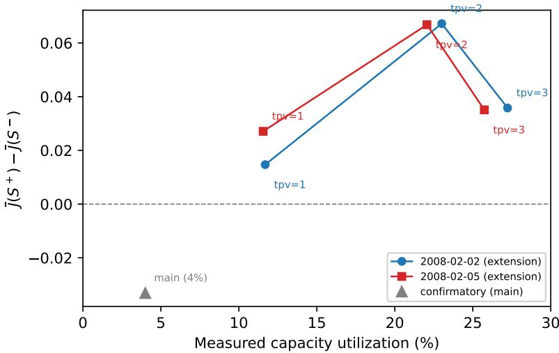

# ROYAL SOCIETY OPEN SCIENCE

royalsocietypublishing.org/journal/rsos

Research

Article submitted to journal

Subject Areas: computer science; artificial intelligence; statistics

Keywords: automated research; LLM proposers; pre-registration; verifier strength; proposer-pool composition

Author for correspondence:

Siyuan Zhang

e-mail: lelandsy28@163.com

Verifier strength does not buy discovery quality: a pre-registered two-domain test of LLM-based automated research, with post-hoc evidence pointing to proposer-pool composition

Peter Chen1,†, Ni Zhang1,† and Siyuan Zhang1,∗

1Shenyang Institute of Technology, Shenyang, China

Automated research pipelines pair an LLM proposer with a verifier on an implicit bet: discovery quality rises with verification strength. Under a pre-registered protocol we test this bet in two real-data domains – job-shop scheduling and vehicular edge offloading on Beijing T-Drive trajectories – across 100 matched LLM/random pairs per domain and three verifier tiers. The manipulation binds – a 429-case mutation battery shows scores rising across tiers – yet the paired LLM-over-random advantage does not scale with it (A, one-sided p=0.1115; D, p=0.9994), and in D shrinks under the strict tier (margin contrast −0.040, p=0.0013). The two lower gates promote identical candidates in 100/100 and 99/100 pairs, so the strict order is untestable when they coincide. Constructively, LLM proposals carry a real paired advantage over random controls, but a post-hoc union-pool analysis shows the fastest path to better discovery is widening the pool, not tightening the gate: mixing the two pools adds +1.52 holdoutvalue units in domain A (one-sided Wilcoxon, n=100, p=0.0002) – evidence that pool composition, not verification strength, is the lever. Criteria, ledgers and scripts are archived on Zenodo (DOI: 10.5281/zenodo.23308866).

## 1. Introduction

Automated scientific discovery pipelines built on large language models [1] increasingly pair an LLM proposer with an automated verifier: the model generates candidate decision rules, heuristics, or hypotheses; a programmatic verifier screens them against constraints; the surviving candidate is scored on held-out data. The scaling behavior of such pipelines is usually discussed in terms of proposer capability. There is, however, a second lever that is cheaper to turn and is widely assumed to monotonically improve outcomes: verification strength. If screening is what stands between noisy proposals and discovery quality, then a stricter verifier – more constraints, plus adversarial stress testing – should buy more quality. This assumption shapes how practitioners build such systems: add checks, add stress tests, trust the filter.

This paper tests the assumption directly rather than assuming it. We decompose a minimal automated-research pipeline into a proposer $P$ (an LLM under iterative verifier feedback) and a verifier $V ,$ and ask a causal question: holding P fixed, does increasing the strength of $V$ improve the quality of what is discovered? Verification strength is operationalized as three frozen tiers: $\mathrm { S ^ { - } }$ (minimal screening), $\mathsf { S } ^ { 0 }$ (the full constraint verifier), and $\mathrm { S ^ { + } ~ } ( \mathrm { S ^ { 0 } }$ plus a worst-case stress test). Discovery quality is the one-shot held-out value of the promoted rule under a frozen scoring function.

Answering this credibly requires three design commitments. First, pre-registration: the criteria, the protocol, and the analysis were frozen (v1.0) before any main-domain data were collected, with changelogs disclosing every deviation, including a manipulation-check population disclosure (v1.2) made before unblinding. Second, a manipulation check before the main data: a mutation battery must establish that the three tiers genuinely differ in what they filter (E1-D2); a main experiment with an ineffective manipulation is uninterpretable. Third, a matched control arm: every LLM session is paired with a random-proposal session of equal size, so that quality is measured as the paired advantage of structured proposals over random ones, not as an absolute score.

We ran 100 such pairs in each of two real-data domains: job-shop scheduling on instances derived from real records (domain $\mathrm { A } ) _ { \cdot }$ , and vehicular edge offloading on Beijing T-Drive taxi trajectories [2] (domain D). The proposer is a small open-weights model (Qwen2.5-0.5B-Instruct [3]) running fully offline on CPU – a deliberately modest proposer, so that any conclusion applies to the pipeline structure rather than to frontier-model capability, and so that the whole study is reproducible on commodity hardware.

The main hypothesis fails in both domains. The manipulation check passes (the 429-case mutation battery yields scores that strictly increase across tiers), yet the paired quality advantage of LLM proposals over random ones does not increase with verifier strength: it is statistically indistinguishable across tiers in domain A and decreases under the strict tier in domain D. The failure is informative rather than null. Three additional analyses give it structure: (i) the intermediate feasibility gate is inert – in 100/100 and 99/100 pairs $\mathrm { S ^ { - } }$ and $\mathsf { S } ^ { 0 }$ promote the identical candidate, because an LLM session’s proposals are near-determinately all-feasible or all-infeasible; (ii) the LLM pool has a large coverage gap – the best of twenty random proposals beats the best of twenty LLM proposals in roughly half the pairs, and adding the random pool would have significantly improved held-out quality in domain A (+1.52, p=0.0002), a gain that stricter verification failed to deliver; (iii) a post-hoc tension gradient shows the value of the stress-test tier crossing zero with domain tension – negative when the deployment regime leaves constraints slack, peaking at medium utilization. Together these suggest a separation result: verifier tiers that separate cleanly on the mutation battery do not buy discovery quality; the posthoc evidence points instead to proposer-pool composition as the lever, and that evidence is now under pre-registered test as an intervention.

We therefore close with two pre-registered follow-ups that treat this conclusion as an experimental hypothesis: a diversity dose–response experiment (pool composition manipulated at fixed verifier) and a tension transfer experiment (utilization manipulated at fixed verifier).

All criteria, ledgers, and seed-to-figure reproduction scripts are archived on Zenodo (DOI: 10.5281/zenodo.23308866).

Contributions. This paper makes four concrete contributions:

(i) A pre-registered separation result (Sections 4–5.3): with the manipulation check passing and the main hypothesis failing under the same frozen criteria, verifier strength is decoupled from discovery quality in two real-data domains – the cleanest null this design can produce.

(ii) A quantified coverage gap (Section 5.3): to our knowledge the first measurement of the LLM-vs-random best-of-n gap inside a verifier-bound discovery pipeline, showing the best of twenty random proposals beats the best of twenty LLM proposals about half the time, and a derived (post-hoc) union-pool estimate of what widening the pool would buy (+1.52 in domain A).

(iii) A criterion-reachability lesson for pre-registration (Section 5.3): a strict-order criterion is structurally untestable when two treatment arms coincide – reachability of criteria under plausible degenerate outcomes must be checked before freezing.

(iv) Two pre-registered follow-ups (Section 6) that convert the post-hoc findings into testable interventions: diversity dose–response at fixed verifier, and tension transfer at fixed tier.

Paper roadmap. Section 2 locates the contribution relative to automated-research systems, LLMas-judge and verifier literature, and quality–diversity methods. Section 3 states the framework and frozen criteria. Section 4 describes domains, protocol, and the manipulation battery. Section 5 reports the manipulation check, the main result, the gate-degeneracy and coverage-gap analyses, and the tension gradient. Section 6 discusses implications; Section 7 lists limitations; the back matter covers reproducibility, data availability, ethics, and declarations.

## 2. Related work

Automated research systems End-to-end systems such as The AI Scientist [1] chain an LLM proposer with automated execution and evaluation, and evaluate the output with human or AI review; domain pipelines have produced autonomous chemistry laboratories [4] and mathematical conjectures via program search [5], and a large-scale human study finds LLM research ideas rated as novel while LLM self-evaluation remains unreliable [6], and a recent survey argues the field’s bottleneck is shifting from task completion to verifying what agents claim [7]. Our contribution is orthogonal: we hold the proposer fixed and manipulate the verifier, under pre-registration, to isolate the causal contribution of verification strength – making that proposed bottleneck directly measurable. The proposer-heavy line treats filtering as plumbing; we show the plumbing is where a central assumption fails.

LLM-as-judge and programmatic verifiers The alignment literature studies whether LLM judges match human preferences [8]. Our verifiers are programmatic and exact (constraint checkers, stress tests), removing judge-noise as an explanation: when quality fails to track verification strength here, it is not because the verifier is noisy. Selection pipelines that assume stronger filtering buys quality – outcome and process verifiers [9,10], self-consistency [11], and verbal self-refinement [12,13] – inherit precisely this assumption, and resampling against imperfect verifiers is already known to be capped by false positives [14]; our randomized evidence extends that concern from pass-rate contamination to discovery quality. The generator– verifier gap literature [15] shows pass-rate gaps between generation and verification; we show a complementary gap – between verification strength and downstream quality. Two concurrent audits in adjacent domains reinforce this audit premise: agents answering scientific questions often ignore the supplied evidence [16], and LLM-generated kernels that pass numerical checks can fail under scale shift [17]. Neither manipulates verifier strength under pre-registration or measures discovery quality, which is our focus.

Table 1. Notation summary.
<table><tr><td>symbol</td><td>meaning</td></tr><tr><td> $P / V$   $S ^ { - } , S ^ { 0 } , S ^ { + }$ </td><td>proposer (LLM under iterative feedback) / verifier</td></tr><tr><td> $J ( c )$ </td><td>weak / standard / strict verifier tier (Sec. 3.2) frozen holdout score of candidate c</td></tr><tr><td> ${ \overline { { J } } } ( G )$ </td><td>mean of J over a group G of promoted rules</td></tr><tr><td> $\varDelta ( \cdot )$ </td><td>paired LLM-over-random margin of a tier</td></tr><tr><td> $\mathrm { M S } ( \cdot )$ </td><td>mutation score of a tier  $( \mathsf { S e c . 4 } )$ </td></tr><tr><td> $H$ </td><td>held-out instance set (one-shot evaluation)</td></tr><tr><td> $\mathrm { R S U } ~ / \mathrm { t p v }$ </td><td>road-side unit / tasks-per-vehicle (domain D)</td></tr></table>

Pool composition and diversity Quality-diversity methods [18,19], descendants of novelty search [20], make archive diversity the explicit optimization target; repeated-sampling results [15] show coverage growing steeply with draw count. Adjacent to our negative result, a budgetsensitive scoring study finds no marginal discovery value from LLM proposers over selection alone in a drug-candidate pipeline [21]. Our union-pool analysis is, to our knowledge, the first to quantify the LLM-vs-random coverage gap inside a verifier-bound discovery pipeline, and the first to show it widening under stricter verification.

Pre-registration and negative results Our protocol follows clinical-trial norms transplanted to ML evaluation: frozen criteria with changelogs, a manipulation check gate before the main data, and a negative clause committing to publication of failure. These norms respond to replication failures across disciplines [22,23] and to reproducibility gaps specific to AI and ML-based science [24–26]. The $S ^ { 0 } \equiv S ^ { - }$ degeneracy adds a criterion-reachability lesson to this practice: check that a criterion can be satisfied under plausible degenerate outcomes before freezing it.

## 3. Framework and frozen criteria

## 3.1 Proposer–verifier decomposition

An automated-research pipeline is a proposer P (an LLM under iterative feedback, 20 proposals per session) and a verifier V mapping a candidate to {pass, fail} plus a frozen score. Discovery quality on a held-out instance set H is the holdout value of the promoted candidate $\begin{array} { r } { \arg \operatorname* { m a x } _ { c : V ( c ) = \mathrm { p a s s } } \mathrm { t r a i n } ( c ) } \end{array}$ , evaluated exactly once on H (HoldoutGate: one-shot semantics, no re-evaluation). We write J(c) for the frozen holdout score of candidate c and ${ \overline { { J } } } ( G )$ for its mean over a group G of promoted rules (used in Fig. 1); $\varDelta ( \cdot )$ denotes the paired LLM-over-random margin of a tier, and MS(·) the mutation score of a tier (Section 4).

## 3.2 Three verifier tiers

$\mathbf { S } ^ { - }$ (weak): minimal screening. Domain A promotes any rule that executes (INFEASIBLE outcomes score the frozen floor $- 1 0 ^ { 9 } ) ;$ ; domain D promotes any rule without deadline violations.

• S0 (standard): the full frozen constraint verifier (A: feasibility-gated scoring; D: safety $\mathbf { S } ^ { 0 }$ isolation, per-task deadline, per-task energy allowance, per-RSU capacity).

${ \bf S } ^ { + } \ ( \mathrm { s t r i c t } ) ; { \cal S } ^ { 0 }$ plus a worst-case stress test (A: non-degeneracy of promoted weights; D: re-verification with every task’s channel quality lowered to the instance minimum).

## 3.3 Frozen criteria (v1.0)

E1-D1 (main): the paired advantage of the LLM arm over the random control, $\varDelta ( \cdot ) _ { \cdot }$ , satisfies $\Delta ( \mathrm { S ^ { + } } ) > \Delta ( \mathrm { S ^ { 0 } } ) > \Delta ( \mathrm { S ^ { - } } )$ with one-sided Wilcoxon $p < 0 . 0 5$ for $S ^ { + }$ vs. ${ \mathsf { S } } ^ { - } ,$ in both main domains (domain A mandatory). E1-D2 (manipulation validity): strictly ordered mutation scores $\mathrm { M S ( S ^ { - } ) < M S ( S ^ { 0 } ) < M S ( S ^ { + } ) }$ in both domains. Negative clause: if either criterion fails, the manipulation is recorded as ineffective or the main hypothesis as falsified, and all outcomes are reported as such.

## 4. Experimental setup

## 4.1 Domains and protocol

Domain A (scheduling). Priority rules over 7 normalized numerical features of the job-shop instance (frozen feature list in the archived protocol). Instances are bootstrap resamples of a real production-order pool from the prior suture experiments of this program: all listed orders in a fixed due window (2026-08-15 to 2026-09-02), deduplicated across 10 business fields – 1,791 rows collapse to 154 unique orders, because the same batch was re-imported under different run identifiers. Pair i (seed 1000+i) draws a 60-order train instance without replacement and a disjoint 60-order holdout instance from the remaining 94 orders, redrawing if the baseline schedule is infeasible or exceeds 40 days. The pool is small and pairs are strongly correlated by construction, so domain-A claims are limited to within-distribution perturbation robustness – not acrossfactory generalization. Domain D (offloading). Offloading-ratio rules over 8 normalized task features; instances built from Beijing T-Drive taxi trajectories [2] around 3 Road Side Units (RSUs) by the frozen instance generator of the archived pipeline: pair i uses a frozen training-instance seed (9000+i) and a disjoint holdout-instance seed (10000+i). T-Drive is a public research dataset released by Microsoft Research; trajectories were aggregated into per-pair task arrival instances at frozen timestamps, with no identifier or trip-purpose information retained (Section Ethics). Holdout instances for both domains are held out by construction: frozen at protocol time, never scored during training, and evaluated exactly once per promoted rule.

Session and gating design. Each domain runs 100 matched pairs. Per pair: one fresh LLM session (20 iterative proposals under standard-tier $\mathsf { S } ^ { 0 }$ prompt and verifier feedback) and one random control (20 uniform weight vectors over the same rule family, per-pair seed). The same 20-proposal pool is then re-gated independently by each verifier tier ${ \bar { - } } { \bar { \cal S } } ^ { - } , { \bar { \cal S } } ^ { \bar { 0 } } , { \cal S } ^ { + } -$ and each tier promotes the passing candidate with the best training value; the random pool is gated identically. Tiers therefore differ only in the filter applied to a fixed proposal pool, which is what makes the manipulation a clean test of verification strength. Promotion gaps (an arm has no passing candidate in a tier) occurred in 0/100 pairs in domain A and in 3 pairs in domain D; those 3 pairs are excluded from analyses involving the affected arm (n=99/97 where applicable, stated per analysis).

Proposer and compute. Proposer: Qwen2.5-0.5B-Instruct [3] (0.49B parameters, 32K context), served locally through Hugging Face transformers on PyTorch with CPU inference, fully offline (hub and local-restore environment flags set). Decoding is frozen: sampling with temperature 0.8, top-p 0.9; up to 220 new tokens per proposal in domain A (Chinese prompt template with two fixed few-shot examples) and 180 in domain D (template with per-category verifier feedback); sampling is not seeded, so the unit of replication is the 20-proposal session, and the archived ledgers record every proposal verbatim. The frozen prompt and generation configuration are reproduced verbatim in the archived protocol and ledgers. All experiments ran offline on a consumer laptop CPU (no GPU); per-session LLM wall-clock is minutes, and domain D is dominated by trajectory simulation (on the order of half a day for the full 100-pair run).

Algorithm 1 Tier-1 paired session with three-tier re-gating (per pair)   
1: draw frozen train instance and holdout instance (frozen per-pair seeds)   
2: LLM arm: run one fresh session of 20 iterative proposals under the $S ^ { 0 }$ prompt and verifier   
feedback   
3: random arm: draw 20 proposals from the frozen random distribution (per-pair seed, same   
budget)   
4: for each tier $T \in \{ \mathrm { S } ^ { - } , \mathrm { S } ^ { 0 } , \mathrm { S } ^ { + } \}$ do   
5: gate both fixed proposal pools by tier T   
6: promote the passing candidate with the best training value   
7: end for   
8: evaluate each promoted rule on the holdout instance exactly once (HoldoutGate: one-shot   
semantics)   
9: return per-tier promotions and holdout values

Table 2. Manipulation check (E1-D2): mutation score per tier (fraction of battery mutants killed), with Wilson 95% CIs. Populations disclosed before unblinding (protocol v1.2).
<table><tr><td>domain</td><td>n</td><td>MS(S-)</td><td> ${ \bf M S } ( { \bf S } ^ { 0 } )$ </td><td> ${ \mathrm { M S } } ( { \mathrm { S } } ^ { + } )$ </td></tr><tr><td>A</td><td>119</td><td>0.000 [0.000, 0.031]</td><td>0.0168 [0.005, 0.059]</td><td>0.1092 [0.065, 0.178]</td></tr><tr><td>D</td><td>310</td><td>0.3484 [0.298, 0.403]</td><td>0.3548 [0.304, 0.410]</td><td>0.3613 [0.310, 0.416]</td></tr></table>

## 4.2 Manipulation battery (E1-D2)

Domain A: 119 mutants (100 uniform random over the frozen 7-dim family, 19 structured). Domain D: 310 mutants (300 random rule templates, 4 extreme heuristics, 6 structured mutants matched to the violation mix observed in a prior instrumented ledger: safety/energy/capacity entries vs. deadline). Population disclosed before unblinding (v1.2).

## 5. Results

## 5.1 Manipulation validity holds (E1-D2)

Mutation scores increase strictly in both domains (Table 2). The three tiers are genuine, ordered treatments. In domain A the gaps are large relative to the CIs; in domain D the ordering is strict but the gaps are small – adjacent tiers differ by 2 of 310 mutants (0.3484 vs. 0.3548 vs. 0.3613, overlapping Wilson CIs) – so we describe domain D as strictly ordered but weakly separated, and rely on the domain-A battery, where the tiers separate cleanly, as the primary manipulation evidence.

## 5.2 Main result: discovery quality does not follow verification strength (E1- D1 fails)

The strict order fails in both domains (Table 3). Per-tier post-hoc paired tests size the LLM-vsrandom advantage directly (one-sided Wilcoxon, LLM > random; post-hoc, not part of the frozen criteria): in domain D the advantage is significant at every tier $( S ^ { - } \colon p < 0 . 0 0 0 1 ; S ^ { 0 } \colon p < 0 . 0 0 0 1 ; S ^ { + }$ $\scriptstyle { p = 0 . 0 1 1 } )$ yet shrinks monotonically with verifier strength; in domain A it is positive at every tier $( + 0 . 2 8 / + 0 . 2 8 / + 0 . 3 8 )$ but not significant at $n { = } 1 0 0 \ ( p { = } 0 . 3 1 / 0 . 3 1 / 0 . 2 4 ;$ floor-free sensitivity below). The frozen ${ \cal S } _ { } ^ { + } { - } \mathrm { v } { \bf s } { - } { \cal S } _ { } ^ { - }$ contrast is far from significance in domain A, and in domain D it points the wrong way: p=0.9994 implies p≈0.0006 for the reverse ordering, and the post-hoc margin contrast below is significantly negative (two-sided $\scriptstyle { p = 0 . 0 0 1 3 ) }$ . The main hypothesis is falsified under the frozen criteria, and the falsification is not a plain null: in domain D, stricter active verification measurably reduced the LLM-over-random advantage.

Table 3. Main result. ∆(tier) = holdout value of the LLM-promoted rule minus that of the random control (frozen scoring). p: one-sided Wilcoxon, ${ \mathsf { S } } ^ { + } \ { \mathsf { v } } { \mathsf { s } } . \ { \mathsf { S } } ^ { - }$ (the frozen criterion). ∆ scales are domain-specific (different objectives) and are not comparable across rows. SD: per-tier margin standard deviation – floor-free in domain D (0.19–0.22, matching the bootstrap CIs in Table 4); in domain A the raw SDs are meaningless because of the −109 floor contamination, so floor-free means on n=98 pairs (Section 5.2, sensitivity analysis) are reported instead. ${ \mathsf { S } } ^ { 0 } { \mathsf { \equiv } } { \mathsf { S } } ^ { - }$ degeneracy makes the ${ \mathsf { S } } ^ { 0 } { \mathsf { - } } { \mathsf { v } } { \mathsf { s } } { \mathsf { - } } { \mathsf { S } } ^ { - }$ and ${ \mathsf { S } } ^ { + } { \mathsf { \Pi } } { \mathsf { - v } } { \mathsf { S } } { \mathsf { - } } { \mathsf { S } } ^ { 0 }$ contrasts untestable (identical promotions).
<table><tr><td>domain</td><td>∆(S)</td><td> $\varDelta ( \mathsf { S } ^ { 0 } )$ </td><td> $\varDelta ( \mathrm { S } ^ { + } )$ </td><td>SD</td><td>p</td></tr><tr><td>A</td><td> $+ 0 . 2 8$ </td><td> $+ 0 . 2 8$ </td><td> $+ 0 . 3 8$ </td><td> $- \left( \mathrm { \mathbf { f l o o r } } \right)$ </td><td>0.1115</td></tr><tr><td>D</td><td>+0.10</td><td>+0.10</td><td> $+ 0 . 0 6$ </td><td> $0 . 2 1 1 / 0 . 2 1 1 / 0 . 1 9 3$ </td><td>0.9994</td></tr></table>

Table 4. Per-tier LLM-over-random margins with bootstrap 95% CIs (post-hoc, computed by descriptive\_stats.py; not part of the frozen criteria). Domain A is reported on the $n { = } 9 8$ floor-free pairs; domain D on its $n { = } 9 7$ valid pairs.
<table><tr><td>domain</td><td> $\varDelta ( \mathsf { S } ^ { - } )$ </td><td> $\varDelta (  { \mathsf { S } } ^ { 0 } )$ </td><td> $\varDelta (  { \mathsf { S } } ^ { + } )$ </td></tr><tr><td> $\mathrm { A } \left( \mathrm { n = } 9 8 \right)$ </td><td> $+ 0 . 3 6 7 \ : [ - 1 . 1 5 , \ : 1 . 8 5 ]$ </td><td> $+ 0 . 3 6 7 [ - 1 . 1 8 , 1 . 8 8 ]$ </td><td> $+ 0 . 4 6 9 \ [ - 1 . 0 8 , \ 2 . 0 2 ]$ </td></tr><tr><td> $\mathrm { D } \left( \mathrm { n } { = } 9 7 \right)$ </td><td> $+ 0 . 1 0 2 \ [ + 0 . 0 6 0 , \ 0 . 1 4 5 ]$ </td><td> $+ 0 . 1 0 2 \ [ + 0 . 0 6 1 , 0 . 1 4 5 ]$ </td><td> $+ 0 . 0 6 2 \left[ + 0 . 0 2 4 , 0 . 1 0 0 \right]$ </td></tr></table>

Two floor-contaminated pairs in domain A (an INFEASIBLE rule’s value is floored $\mathsf { a t } - \mathsf { 1 0 } ^ { \mathrm { 9 } }$ in both training and holdout; in domain A the floor is a scored outcome – an executing rule whose schedule is infeasible – so both gated tiers can promote it) are excluded in a sensitivity analysis rerun by floor\_sensitivity.py: on the n=98 floor-free pairs, $\varDelta ( \mathrm { S ^ { - } } ) { = } { + } 0 . 3 6 7 , \varDelta ( \mathrm { S ^ { + } } ) { = } { + } 0 . 4 6 9 ,$ and the one-sided Wilcoxon p is unchanged (0.1115). The small raw mean and the unchanged p both follow from how the two floor pairs enter: in one the random arm’s promoted rule is INFEASIBLE $\mathrm { ( a \ + 1 0 ^ { 9 } }$ margin) and in the other the LLM arm’s is $\left( \mathsf { a \mathrm { ~ - 1 0 } } ^ { 9 } \right.$ margin), so the two cancel in the raw mean – leaving $\varDelta { = }  { + } 0 . 2 8$ while the SD is floor-dominated at $1 . 4 \times { 1 0 } ^ { 8 } \mathrm { ~ - ~ }$ and they contribute zero to the signed-rank statistic because $\mathrm { S ^ { + } } { = } \mathrm { S ^ { - } }$ within each floor pair. Excluding them moves the means $( + 0 . 3 6 7 / + 0 . 4 6 9 )$ but not the test (0.1115). No domain-D pair involves the floor.

Post-hoc descriptive statistics (not pre-registered criteria; computed by descriptive\_stats.py under the frozen inclusion rule) size this null. Two different contrasts appear here and must not be conflated: the direct ${ \cal S } _ { } ^ { + } { - } \mathrm { v } { \bf s } { - } { \cal S } _ { } ^ { - }$ holdout difference of promoted rules, and the margin contrast – the paired difference of the LLM-over-random margins, $\left[ \varDelta ( \mathrm { S } ^ { + } ) - \varDelta ( \mathrm { S } ^ { - } ) \right]$ , which subtracts off the random arm. The margin contrast has mean +0.10 in domain A (95% bootstrap $\mathrm { C I } \ [ - 0 . 1 0 , 0 . 3 1 ]$ , two-sided $\scriptstyle p = 0 . 2 2 2 9 )$ and −0.040 in domain D (95% bootstrap $\mathrm { C I } \left[ - 0 . 0 7 , - 0 . 0 1 \right]$ , two-sided $\scriptstyle { p = 0 . 0 0 1 3 ) }$ : domain D excludes zero in the direction opposite to the hypothesis, i.e. stricter verification significantly reduced the LLM-over-random margin there. (The smaller direct-difference means – +0.10 in A over the 10 winning pairs and −0.016 in D over the 1/97 valid pairs – quantify how rarely the strict tier changes the promoted rule at all.) A power reading sharpens the asymmetry: at n=100 (one-sided α=0.05, power 0.8), the minimum detectable paired difference is ≈ 0.26 in A, so a true positive effect up to that size cannot be excluded; in D the observed −0.040 exceeds the domain’s MDE (0.039), so the negative association is detected rather than missed. Per-tier margin SDs are 0.19–0.22 in domain D; in domain A the raw SDs are meaningless because of the $- 1 0 ^ { \bigcirc }$ floor contamination (floor-free values in the sensitivity analysis above).

Table 5. Tier degeneracy and stress-test behavior. “identical”: pairs where $\mathtt { S } ^ { - }$ and $\mathsf { S } ^ { 0 }$ promote the same candidate. “diff pairs”: pairs where ${ \mathsf { S } } ^ { + }$ and ${ \mathsf { S } } ^ { 0 }$ promote different candidates, with ${ \mathsf { S } } ^ { + }$ wins and mean holdout difference among those pairs.
<table><tr><td>domain</td><td>identical</td><td>diff pairs</td><td> ${ \mathsf { S } } ^ { + }$  wins</td><td>mean diff</td></tr><tr><td> $\mathrm { A } \left( \mathrm { n = } 1 0 0 \right)$ </td><td>100</td><td>14</td><td>10</td><td> $+ 0 . 7 1 4$ </td></tr><tr><td> $\mathrm { D } \left( \mathrm { \mathfrak { n } = 1 0 0 } \right)$ </td><td>99</td><td>23</td><td>1</td><td>-0.066</td></tr></table>

## 5.3 The feasibility gate is inert

In 100/100 pairs (A) and 99/100 (D), $\mathrm { S } ^ { - }$ and $\mathsf { S } ^ { 0 }$ promoted the identical candidate: proposals within an LLM session are near-determinately all-feasible or all-infeasible, so an intermediate gate almost never catches an intermediate candidate (Table 5). The mechanism is exact in domain A: an executing-but-infeasible candidate scores the frozen training floor $- 1 0 ^ { 9 }$ , which is never the session maximum unless every candidate in the session fails; under verifier feedback no session was all-infeasible (0 promotion gaps in 100 pairs, both arms and all tiers), so the best trainingvalue candidate is always $\mathsf { S } ^ { 0 } .$ -feasible and both gates promote it. A session with no $\mathsf { S } ^ { 0 }$ -passing candidate would leave $\dot { \mathsf { S } } ^ { 0 }$ without a promotion and break the degeneracy by construction; the three domain-D promotion gaps are of this kind. Two consequences: (i) the frozen strict order ${ \mathsf { S } } ^ { + } > { \mathsf { S } } ^ { 0 } > { \mathsf { S } } ^ { - }$ is structurally unsatisfiable whenever ${ \mathsf { S } } ^ { 0 } { \equiv } { \mathsf { S } } ^ { - }$ (a criterion-reachability lesson for preregistration practice); (ii) in this regime the effect of verification strength is carried entirely by the stress-test tier ${ \cal S } _ { \mathrm { ~ \tiny ~ - ~ } } ^ { + }$ and that effect is positive in domain A $( S ^ { + }$ wins 10 of its 14 divergent pairs) but sharply negative in domain D (1 of 23). A concrete domain-D failure mode: in one pair the LLM session passed 5 of 20 proposals under $\mathsf { S } ^ { 0 } .$ , whose best candidate scored 0.524 on holdout; the $S ^ { + }$ stress test (worst-case channel floor) killed two of the five passing candidates and forced promotion of the second-best, which violated a constraint on the holdout instance and scored $0 . 0 - \mathsf { a } - 0 . 5 2$ swing produced purely by the stress test rejecting the candidate that would have generalized. This is the false-negative mechanism behind the domain-D margin shrinkage: in a tense domain, the stress test removes correct-but-fragile-on-paper candidates and the remaining pool is too thin to absorb the loss.

## 5.4 The proposer pool has a large coverage gap

Because each arm’s tier promotion is the best passing candidate by train value, the promotion of the union pool (LLM 20 + random 20 proposals) is the better of the two arm promotions, and its holdout value is already known – the analysis is a zero-new-inference derivation (exploratory, post-hoc). Three findings:

(i) The union-pool promotion comes from the random arm in 48% of pairs (A) and 46% (D) at $\mathsf { S } ^ { 0 } \colon$ : the best of twenty LLM proposals is beaten by the best of twenty random draws about half the time.

(ii) Under ${ \mathsf { S } } ^ { + }$ (domain D) the random arm wins 60% of pairs: the LLM coverage gap widens exactly where verification is strictest.

(iii) In domain $\mathbf { A } ,$ , adding the random pool to the LLM pool would have improved holdout quality: +1.52 in domain-A holdout-value units (one-sided Wilcoxon signed-rank on per-pair holdout differences, $n { = } 1 0 0 , p { = } 0 . 0 0 0 2 ) - a$ gain that stricter verification failed to deliver. The same derivation at the strict tier gives +1.44 $\scriptstyle ( p = 0 . 0 0 0 6 )$ , and in domain D the merge effect is null-to-negative $( - 0 . 0 3 6 / - 0 . 0 4 1 / - 0 . 0 3 5$ across tiers, $p { = } 0 . 2 7 / 0 . 3 2 / 0 . 0 7 )$ the pool lever has domain structure, which is why it is now the object of a pre-registered intervention (E2) rather than a settled claim. These are derived statistics: the union-pool promotion is computed from the two arm promotions without new inference, and the union selection itself is realizable (best training value over the merged pool) – what is post-hoc is our attention to it, not its implementability.

  
Figure 1. Group contrast $\overline { { J } } ( \mathrm { S } ^ { + } ) - \overline { { J } } ( \mathrm { S } ^ { - } )$ against measured capacity utilization $( J ;$ the frozen holdout score of a promoted rule, Section 3.1; the figure legend abbreviates tasks-per-vehicle as “tpv”). The contrast crosses zero: negative in the idle confirmatory regime (4%), positive on both extension days, peaking at medium utilization (22–23%). Scriptgenerated from tension\_gradient.json and the frozen tier-1 ledgers.

## 5.5 Post-hoc tension gradient: the ${ \mathsf S } ^ { + }$ effect crosses zero

Promoted-rule groups (first 50 pairs, LLM arm) were re-evaluated on 36 fresh instances spanning a capacity-utilization gradient (extension days $2 0 0 8 – 0 2 – 0 2 / 0 5 \ \times$ tasks-per-vehicle $1 / 2 / 3 ;$ measured utilization 12/22–23/26–27%; the idle confirmatory regime of the main experiment sits at 4%). The 50-pair subset is the first half of the frozen day-1 ledger in collection order – fixed before this analysis was unblinded to bound the CPU cost of re-scoring every promoted rule on 36 fresh instances – and thus involves no outcome-based selection. The group contrast $\overline { { J } } ( \mathrm { S } ^ { + } ) - \overline { { J } } ( \mathrm { S } ^ { - } )$ crosses zero with tension: −0.033 at 4%, +0.015/ + 0.027 at 12%, $+ 0 . 0 6 7 / + 0 . 0 6 7$ at 22–23%, +0.036/ + 0.035 at 26–27% – the same pattern on both extension days (Fig. 1). Stricter verification is not uniformly helpful or harmful: its value is modulated by domain tension, turning negative when the deployment regime leaves constraints slack.

## 6. Discussion

A separation result The combination of E1-D2 passing and E1-D1 failing is the paper’s central finding, and it is a separation result: verification strength filters synthetic bad candidates – the mutation battery establishes that the tiers are real, ordered treatments – while buying no measurable discovery quality on LLM proposals. The three analyses of Section 5 explain why. First, the feasibility gate is inert because proposals within an LLM session are strongly correlated – the model either understands the interface or it does not, and within a session it almost always does one or the other consistently. Intermediate constraints therefore almost never catch intermediate candidates, and $\mathsf { S } ^ { 0 }$ degenerates to $\mathrm { S ^ { - } }$ . Second, the coverage gap means the marginal value of verification is bounded by what the proposer pool contains: a filter, however strict, cannot promote a candidate that was never proposed, and in these domains the best random draw beats the best LLM draw about half the time. Third, the tension gradient shows that even the one tier with a real effect $( S ^ { + } )$ pays only when the deployment regime makes its stress test bite; in a slack regime the stress test is a source of false negatives, not quality.

Implications for AI-scientist pipelines The results redirect effort. The common escalation – more constraints, stricter tests, more adversarial screening – targets the wrong bottleneck in this regime: the feasibility gate is already inert, and the stress test helps only in tense regimes. The first lever our evidence points to is pool composition: diversity of generation (temperature, mixed LLM and random pools, multiple proposer models), because the union-pool analysis shows random proposals would have improved the merged promotion in domain A. We state the status of that number precisely: the union selection rule (best training value over the merged pool) is realizable without any holdout knowledge, and the +1.52 is the holdout estimate of exactly that realizable policy, computed post-hoc from already-evaluated arm promotions under one-shot semantics. What it lacks is pre-registration as an intervention – which is precisely what the pre-registered E2 follow-up now supplies. Verification budget should follow deployment tension: strict tiers where constraints bind, cheap tiers where they do not.

On the negative result We report the main hypothesis as falsified under frozen criteria, with the manipulation check passing – the cleanest null this design can produce: the treatment is real, the effect is absent (and in domain D, inverted under the strict tier). The exploratory findings (pertier margin tests, pool gap, tension gradient) are labelled as such and were not part of the frozen criteria; they motivate, but do not confirm, the pre-registered follow-ups.

Pre-registered follow-ups (1) Diversity dose–response: hold the verifier fixed at $\mathsf { S } ^ { 0 }$ , manipulate pool composition (temperature ladder, mixed LLM+random pools, multi-model), frozen criterion: monotone holdout improvement in domain A with a domain-D replication contrast. (2) Tension transfer: manipulate capacity utilization at fixed tier, frozen criterion: sign change of the ${ \mathsf { S } } ^ { + }$ group contrast near medium utilization, pre-registered before the next unblinding. Criterion reachability is checked before freezing (Section 5.3 lesson): a criterion that is structurally unsatisfiable under a plausible degenerate outcome – here ${ \mathsf { S } } ^ { 0 } { \equiv } { \mathsf { S } } ^ { - }$ – cannot discriminate hypothesis from design.

## 7. Limitations

One proposer model (Qwen2.5-0.5B-Instruct); two domains; simulated instances derived from real trajectories; the tension gradient varies task density jointly with utilization (composition confound in the declining right branch); the mix-pool analysis is exploratory (post-hoc) and the union-pool promotion is derived from already-evaluated arm promotions, not a pre-registered intervention; the v1.0 strict-order criterion was structurally unsatisfiable under ${ \mathsf { S } } ^ { 0 } { \bar { \equiv } } { \mathsf { S } } ^ { - }$ , reported as a pre-registration design lesson. The random-proposal arm is the only baseline: for the question does verifier strength buy quality at a fixed proposer this is the appropriate control (any other proposer would confound pool composition with verification strength), but it means the paper makes no claim about absolute rule quality relative to human-designed or classical heuristics; the domain-D mutation battery separates the tiers only weakly (Section 5.1), so domain-A evidence carries the manipulation claim; and all findings are established in two domains, with the cross-domain generalization of the pool-composition lever left to the pre-registered follow-ups. Three further scope limits: proposals within an LLM session are strongly correlated, so the effective sample size of the 100-pair comparisons is smaller than the pair count suggests; the random arm spans only the frozen uniform weight family, so the coverage-gap reading does not extend to other proposal distributions; and the study is deliberately CPU-bound on commodity hardware, which limits the scale – though not the structure – of what was evaluated.

## 8. Conclusion

Under frozen criteria across two real-data domains, verification strength filters bad candidates on the mutation battery but does not buy discovery quality on LLM proposals – and in domain D it measurably shrinks the LLM-over-random advantage. The post-hoc evidence identifies the composition of the proposer pool as the more promising lever, now under pre-registered interventional test, and the value of strictness is modulated by deployment tension. A preregistration design lesson is recorded: criteria must be checked for reachability under plausible degenerate outcomes (here $\mathsf { S } ^ { 0 } \equiv \mathsf { S } ^ { - } )$ before freezing. All ledgers, frozen criteria, mutation batteries, and reproduction scripts are archived on Zenodo (DOI: 10.5281/zenodo.23308866).

Acknowledgements. We thank the maintainers of the public T-Drive dataset used in domain D.

Data Accessibility. The pre-registered protocol (v1.0–v1.2 with changelogs), the per-pair JSONL ledgers, the mutation batteries, the frozen verifiers, and the seed-to-figure analysis scripts (including analyze\_tier1.py, final\_numbers.py, descriptive\_stats.py, mix\_pool\_analysis.py, floor\_sensitivity.py, and tension\_gradient.py) are archived on Zenodo under a timestamped DOI (https://doi.org/10.5281/zenodo.23308866); the archived package is available from the authors on reasonable request. Every quantitative result is generated by these archived scripts; none is hand-computed. The software environment is Python 3.10 with Hugging Face transformers on the PyTorch CPU backend, run fully offline. The Beijing T-Drive dataset [2] is a public research dataset released by Microsoft Research (https://www.microsoft.com/en-us/research/publication/ t-drive-trajectory-data-sample/), used under its research-use terms; instance-generation scripts and frozen instance manifests are part of the archived package, so instances can be regenerated from the raw dataset rather than redistributed.

Ethics. This study uses only the public, de-identified T-Drive trajectory dataset; no personally identifying information, trip-purpose, or vehicle-operator data are retained in the derived instances, and no new humansubject data were collected. Automated research pipelines that act on real infrastructure domains can propose rules whose deployment has safety and energy consequences; our one-shot holdout semantics and frozen verifiers are a partial mitigation, and we deploy no discovered rule. Negative results in automatedresearch evaluation can be misread as endorsements of lax verification; we emphasize the opposite reading – verification is necessary but its marginal value is regime-dependent, and pool composition deserves at least equal design attention.

Authors’ Contributions. P. C. and N. Z. contributed equally to this work. P. C. and S. Z. designed the study; S. Z. implemented the pipeline, ran the experiments and analyses, and drafted the manuscript; N. Z. contributed to the analysis and revision; all authors reviewed and approved the final version and agree to be held accountable for the work performed therein.

Funding. This research received no specific grant from any funding agency in the public, commercial or not-for-profit sectors.

Competing Interests. The authors declare no competing interests.

Disclaimer. During the preparation of this work the authors used a large-language-model assistant to improve language and readability; the authors reviewed and edited the content and take full responsibility for the published article.

## References

1. Lu C, Lu C, Lange RT, Foerster J, Clune J, Ha D. 2024 The AI Scientist: Towards Fully Automated Open-Ended Scientific Discovery. arXiv preprint arXiv:2408.06292.

2. Yuan J, Zheng Y, Zhang C, Xie W, Xie X, Sun G, Huang Y. 2010 T-Drive: Driving Directions Based on Taxi Trajectories. In Proceedings of the 18th SIGSPATIAL International Conference on Advances in Geographic Information Systems pp. 99–108.

3. Qwen Team. 2024 Qwen2.5 Technical Report. arXiv preprint arXiv:2412.15115.

4. Boiko DA, MacKnight R, Kline B, Gomes G. 2023 Autonomous Chemical Research with Large Language Models. Nature 624, 570–578.

5. Romera-Paredes B, Barekatain M, Novikov A, Balog M, Kumar MP, Dupont E, Ruiz FJR, Ellenberg JS, Wang P, Fawzi O, Kohli P, Fawzi A. 2024 Mathematical Discoveries from Program Search with Large Language Models. Nature 625, 468–475.

6. Si C, Yang D, Hashimoto T. 2025 Can LLMs Generate Novel Research Ideas? A Large-Scale Human Study with 100+ NLP Researchers. In International Conference on Learning Representations.

7. Ding T, Nannapaneni A, Liu B, Zhang L. 2026 Autonomous Research Agents: A Survey of AI Scientists and the Verification Gap. arXiv preprint arXiv:2608.05179.

8. Zheng L, Chiang WL, Sheng Y, Zhuang S, Wu Z, Zhuang Y, Lin Z, Li Z, Li D, Xing EP, Zhang H, Gonzalez JE, Stoica I. 2023 Judging LLM-as-a-Judge with MT-Bench and Chatbot Arena. In Advances in Neural Information Processing Systems vol. 36 pp. 46595–46623.

9. Cobbe K, Kosaraju V, Bavarian M, Chen M, Jun H, Kaiser L, Plappert M, Tworek J, Hilton J, Nakano R, Hesse C, Schulman J. 2021 Training Verifiers to Solve Math Word Problems. arXiv preprint arXiv:2110.14168.

10. Lightman H, Kosaraju V, Burda Y, Edwards H, Baker B, Lee T, Leike J, Schulman J, Sutskever I, Cobbe K. 2024 Let’s Verify Step by Step. In International Conference on Learning Representations.

11. Wang X, Wei J, Schuurmans D, Le Q, Chi E, Narang S, Chowdhery A, Zhou D. 2023 Self-Consistency Improves Chain of Thought Reasoning in Language Models. In International Conference on Learning Representations.

12. Shinn N, Cassano F, Berman E, Gopinath A, Narasimhan K, Yao S. 2023 Reflexion: Language Agents with Verbal Reinforcement Learning. In Advances in Neural Information Processing Systems vol. 36 pp. 8634–8652.

13. Madaan A, Tandon N, Gupta P, Hallinan S, Gao L, Wiegreffe S, Alon U, Dziri N, Prabhumoye S, Yang Y, Gupta S, Majumder BP, Hermann K, Welleck S, Yazdanbakhsh A, Clark P. 2023 Self-Refine: Iterative Refinement with Self-Feedback. In Advances in Neural Information Processing Systems vol. 36 pp. 46534–46594.

14. Stroebl B, Kapoor S, Narayanan A. 2026 The Limits of Inference Scaling Through Resampling. In International Conference on Learning Representations. arXiv:2411.17501.

15. Brown B, Juravsky J, Ehrlich R, Clark R, Le QV, Ré C, Mirhoseini A. 2024 Large Language Monkeys: Scaling Inference Compute with Repeated Sampling. arXiv preprint arXiv:2407.21787.

16. Zhang K, Li Y. 2026 Are We Measuring Scientific Intelligence? Rethinking the Evaluation of AI Scientists. arXiv preprint arXiv:2610.04915. NeurIPS 2026 Workshop (Oral).

17. Suwandi RC, Yin F, Murphy K. 2026 Kernel Autoresearch for Open-Ended Model Discovery. arXiv preprint arXiv:2610.10394.

18. Mouret JB, Clune J. 2015 Illuminating Search Spaces by Mapping Elites. .

19. Pugh JK, Soros LB, Stanley KO. 2016 Quality Diversity: A New Frontier for Evolutionary Computation. Frontiers in Robotics and AI 3, 40.

20. Lehman J, Stanley KO. 2011 Abandoning Objectives: Evolution Through the Search for Novelty Alone. Evolutionary Computation 19, 189–223.

21. Basu A, Chakraborty P. 2026 Budget-Sensitive Discovery Scoring: A Formally Verified Framework for Evaluating AI-Guided Scientific Selection. arXiv preprint arXiv:2603.12349.

22. Open Science Collaboration. 2015 Estimating the Reproducibility of Psychological Science. Science 349, aac4716.

23. Errington TM, Mathur M, Soderberg CK, Denis A, Perfito N, Iorns E, Nosek BA. 2021 Investigating the Replicability of Preclinical Cancer Biology. eLife 10, e71601.

24. Gundersen OE, Kjensmo S. 2018 State of the Art: Reproducibility in Artificial Intelligence. In Proceedings of the AAAI Conference on Artificial Intelligence vol. 32 pp. 2317–2324.

25. Pineau J, Vincent-Lamarre P, Sinha K, Larivière V, Beygelzimer A, d’Alché Buc F, Fox E, Larochelle H. 2021 Improving Reproducibility in Machine Learning Research: A Report from the NeurIPS 2019 Reproducibility Program. Journal ofMachine Learning Research 22, 1–20.

26. Kapoor S, Narayanan A. 2023 Leakage and the Reproducibility Crisis in Machine-Learning-Based Science. Patterns 4, 100804.