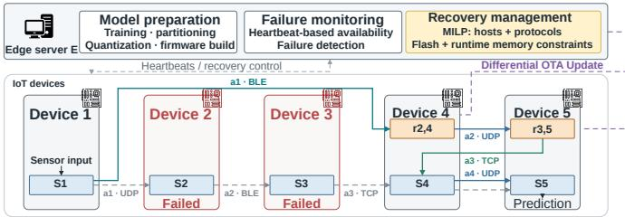
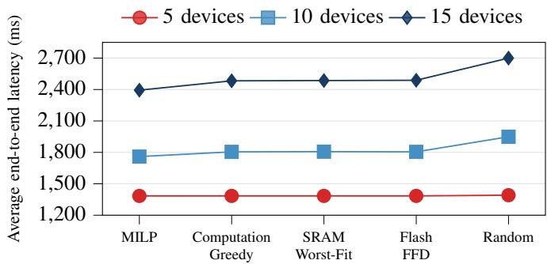
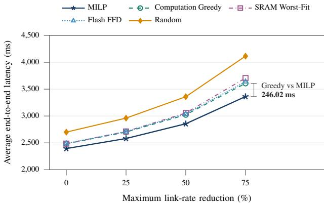
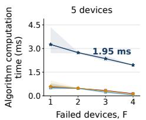
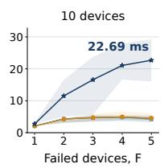
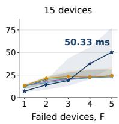

# Replica-Aware Split Inference for Edge IoT Systems

Zied Jenhani, Nasrin Razmi, and Admela Jukan

Technische Universität Braunschweig, Germany; {zied.jenhani, n.razmi, a.jukan}@tu-braunschweig.de

Abstract—Split-Inference (SI) addresses the hardware resource limitations of Internet of Things (IoT) devices by distributing tiny Machine Learning (TinyML) model segments across multiple IoT devices. However, a device failure can interrupt the inference pipeline. This paper proposes a replica-aware recovery approach that deploys replicas of TinyML model segments originally hosted on failed devices onto surviving devices. We formulate the joint selection of replica hosts and communication protocols as a mixed-integer linear programming (MILP) problem that minimizes post-reconfiguration inference latency, accounting for computation and transmission latencies, under flash memory and runtime memory constraints. Simulations using MobileNetV2 on heterogeneous IoT networks compare the proposed approach with four baselines. We implement the model in a network of 15 IoT devices with a maximum link-rate reduction of 75%, and show that MILP approach achieves an average modeled end-to-end inference latency that is 6.8% lower than that of Computation Greedy and 18.3% lower than that of Random.

Index Terms—TinyML, split inference, Internet of Things, faulttolerance, replica placement.

## I. INTRODUCTION

Tiny Machine Learning (TinyML) enables on-board inference on resource-constrained Internet of Things (IoT) devices, reducing dependence on remote processing [1]. However, larger models may exceed the processing, flash memory, and runtime memory budgets of individual devices. Model optimization and memory-aware inference address these limitations [2], [3]. Complementing these methods, Split-Inference (SI) distributes sequential model segments across Internet of Things (IoT) devices that exchange intermediate activations, combining their memory and processing resources [4]. The resulting pipeline depends on the availability of all participating devices; a device failure therefore prevents inference from completing. Replica-based approaches improve inference resilience through model redundancy [5]–[8]. However, assigning replicas to surviving IoT devices that already host primary segments while satisfying memory constraints and minimizing computation and transmission latency remains a challenge.

In this paper, we address this challenge with a replicaaware recovery approach that deploys replicas on demand on surviving devices through over-the-air (OTA) updates, preserving the original partitioning and the placement of surviving primary segments. We formulate the joint selection of replica hosts and communication protocols as a Mixed-Integer Linear Programming (MILP) problem that minimizes post-reconfiguration inference latency, accounting for computation and transmission latencies, subject to flash memory application-slot and runtime memory capacity constraints. Simulations compare the approach with Random, Computation

Greedy, SRAM Worst-Fit, and Flash First-Fit Decreasing across network sizes and failure scenarios.

## II. RELATED WORK

Recent work has studied efficient model partitioning for SI across resource-constrained IoT devices to support TinyML inference close to sensors [9], [10]. For example, DeepThings combines fused tile partitioning (FTP) with dynamic task allocation across IoT edge devices to reduce execution latency and memory usage [11]. Neuron-level partitioning of convolutional and linear layers enables inference across networked Microcontroller Units while reducing per-device peak random-access Memory usage [12]. In addition, DISNET combines vertical and horizontal model partitioning to optimize inference latency and energy consumption across IoT devices [13].

These approaches generally assume that all participating devices remain available. Additional recovery mechanisms are therefore needed to sustain distributed inference under device failures. For example, the CONTINUER framework [14] selects recovery mechanisms after edge-node failures based on latency, accuracy, and service downtime requirements. Other resilience approaches include model repartitioning [15], earlyexit mechanisms [16], and skip connections enabled by gating networks inserted between layers [17]. Another approach estimates the predictions of failed devices at the edge using classifier weights and feature vectors from surviving devices, without model replication [18].

Beyond these recovery mechanisms, replica-based approaches have also been studied to improve the resilience of distributed Deep Neural Network (DNN) execution. The FRIM framework maintains redundant copies of DNN partitions across available nodes and adaptively adjusts the redundancy level to preserve complete inference paths under device failures [5]. A related approach has also been explored for distributed DNN training [19]. Rather than adapting redundancy after deployment, this approach predicts the fault probability of each model partition, determines the required number of replicas accordingly, and assigns these replicas to edge devices before anticipated failures. Other approaches introduce redundancy at a finer granularity or adapt it to specific model architectures. RobustDiCE [6] combines partial replication of important neurons with importance-aware partitioning to improve Convolutional Neural Network resilience. At the model level, RoCoIn [7] uses knowledge distillation to create compact student models and deploys redundant copies across heterogeneous edge devices. EASTER [8] applies a similar redundancy concept to Transformer models by replicating a selected fraction of important connections while distributing the remaining connections across devices.

  
Figure 1: Architecture of the replica-aware split-inference framework.

Prior work improves resilience through pre-deployed replicas, redundant sub-models, or replication of neurons and connections. We address post-failure recovery of vertically partitioned TinyML inference across heterogeneous IoT devices by deploying replicas on demand through differential $O T A$ updates. Replica hosts and communication protocols are jointly selected to minimize post-reconfiguration inference latency under flash memory and runtime memory constraints.

## III. SYSTEM MODEL

## A. IoT Network Configuration and Replica-Aware Recovery

We consider an IoT network consisting of an edge server $E$ and a set $\mathcal { D } = \{ 1 , 2 , \hdots , D \}$ of D geographically static, heterogeneous IoT devices that communicate wirelessly to perform an SI task. The fixed distance between any two connected devices $i , j \in \mathcal { D }$ is denoted by $d _ { i , j }$

The edge server prepares the TinyML model by performing model training, model partitioning, post-training quantization, firmware generation, and OTA deployment to IoT devices.

It is assumed that the SI model has already been partitioned between the IoT devices. In this regard, the TinyML model is divided into K vertically partitioned sequential segments, each of which may contain one or more layers depending on the selected split points. These segments are assigned to the K IoT devices, with $K \leq D$ . The segment assigned to the k-th IoT device is denoted by $s _ { k }$ and referred to as its primary TinyML model segment.

In the proposed workflow, the source IoT device collects the sensor data and executes its assigned primary TinyML model segment, $s _ { k } .$ It then transmits the resulting intermediate activations, $a _ { k }$ , obtained from the output of the final layer of segment $s _ { k } .$ , to the next connected device, which uses $a _ { k }$ as input to execute its assigned primary TinyML model segment. This process is repeated across the participating IoT devices until the destination device produces the final inference result. For simplicity, we assume that the source IoT device, which hosts the sensor and the first segment $s _ { 1 }$ , does not fail.

After deployment, the edge server monitors IoT devices through heartbeat messages transmitted at a predefined interval $T _ { b } .$ . An IoT device is considered to have failed if no heartbeat message is received within a timeout $T _ { o } \geq T _ { b }$ . Upon detecting a failure, the edge server selects a suitable active IoT device based on its resource constraints and characteristics, including flash memory, runtime memory, and computational latency, as well as network information such as transmission latency. Let $r _ { k , k ^ { \prime } }$ denote the replica of the primary TinyML model segment $s _ { k }$ , originally assigned to a failed device $k \in \mathcal { F } ,$ that is deployed to a surviving device $k ^ { \prime } \in \ S$ for failure recovery, where $\mathcal { F } \subseteq \mathcal { D }$ denotes the set of failed IoT devices, and ${ \mathcal { S } } = { \mathcal { D } } \setminus { \mathcal { F } }$ denotes the set of surviving active devices. The replica segment is deployed to the selected device via a differential OTA update Fig. 1. Furthermore, let $\mathcal { R } _ { \mathcal { F } }$ denote the set of all feasible replica-placement configurations for the failed-device set, where each configuration specifies how the TinyML model segments associated with the failed devices are assigned as replicas to the surviving devices in S.

## B. Hardware resources model

a) Flash memory: Each IoT device $k \in \mathcal { D }$ uses a dualslot $O T A$ scheme. Its application-slot capacity $M _ { k } ^ { \mathrm { O T A } }$ accommodates the fixed flash memory allocation $M _ { k } ^ { \mathrm { b a s e } }$ , the primary TinyML segment $M _ { k } ^ { \mathrm { p r i m } }$ , and replicas with a total footprint of $\dot { M } _ { k } ^ { \mathrm { r e p } }$ . The fixed allocation includes the baseline firmware and space unavailable for model storage. The flash memory footprint of the TinyML model segment $s _ { k }$ , following [20], is given by

$$
m _ { k } = \sum _ { \ell \in \mathcal { L } _ { k } } \left[ \mathrm { m e m } ( w _ { \ell } , Q _ { \ell } ) + M _ { \ell } \right] ,\tag{1}
$$

where $\mathcal { L } _ { k }$ denotes the set of layers in segment $s _ { k } , \ w _ { \ell }$ is the weight tensor of layer $\ell ,$ and $Q _ { \ell }$ denotes its bit precision. The term mem $( w _ { \ell } , Q _ { \ell } )$ represents the flash memory footprint of the quantized weights, while $M _ { \ell }$ accounts for biases, quantization scales, zero points, and other static parameters associated with layer $\ell .$ Accordingly, $M _ { k } ^ { \mathrm { p r i m } } = m _ { k }$ for every device hosting a primary segment, and $M _ { k } ^ { \mathrm { p r i m } } = 0$ otherwise. Since a replica $r _ { k , k ^ { \prime } }$ is an exact copy of $s _ { k } .$ , its footprint is also mk.

For a given replica-placement configuration in $\mathcal { R } _ { \mathcal { F } }$ , let

$$
\mathcal { F } _ { k ^ { \prime } } = \{ k \in \mathcal { F } \mid r _ { k , k ^ { \prime } } \mathrm { ~ i s ~ a s s i g n e d ~ t o ~ d e v i c e ~ } k ^ { \prime } \}\tag{2}
$$

denote the set of failed devices whose primary segments are replicated on the surviving device $k ^ { \prime } \in { \mathcal { S } } _ { \mathrm { \Delta } }$ . The total memory footprint of the replicas hosted by device $k ^ { \prime }$ is then

$$
M _ { k ^ { \prime } } ^ { \mathrm { r e p } } = \sum _ { k \in \mathcal { F } _ { k ^ { \prime } } } m _ { k } , \qquad \forall k ^ { \prime } \in \mathcal { S } .\tag{3}
$$

The total flash memory usage of each surviving device must remain within its application partition capacity as

$$
M _ { k ^ { \prime } } ^ { \mathrm { b a s e } } + M _ { k ^ { \prime } } ^ { \mathrm { p r i m } } + M _ { k ^ { \prime } } ^ { \mathrm { r e p } } \leq M _ { k ^ { \prime } } ^ { \mathrm { O T A } } , \qquad \forall k ^ { \prime } \in \mathcal { S } .\tag{4}
$$

b) Runtime memory: Each IoT device is constrained by its memory capacities $M _ { k } ^ { r }$ , where $r ~ \in ~ \{ \mathrm { S R A M } , \mathrm { P S R A M } \}$ indexes the memory pool: Static Random-Access Memory (SRAM) or pseudo-static random-access memory (PSRAM). At runtime, this working memory is partitioned between (i) the TinyML execution arena, which maintains intermediate activation tensors, temporary operator scratch buffers, and persistent model states, and (ii) the system and communication overhead. Following the SRAM decomposition proposed in [21], we characterize the runtime tensor-arena requirement of the TinyML segment $s _ { k }$ as $u _ { k } = u _ { k } ^ { \mathrm { a c t } } + u _ { k } ^ { \mathrm { s c r } } + u _ { k } ^ { \mathrm { s t a t e } }$ , where $u _ { k } ^ { \mathrm { a c t } }$ denotes the peak memory occupied by live activation tensors, $u _ { k } ^ { \mathrm { s c r } }$ denotes the temporary memory required by the operator kernels, and $u _ { k } ^ { \mathrm { s t a t e } }$ denotes the persistent runtime state and arena-resident metadata allocated by the inference runtime for $s _ { k }$ . Since a replica $r _ { k , k ^ { \prime } }$ is an exact copy of $s _ { k } .$ , it has the same tensor-arena requirement $u _ { k }$ on its host device $k ^ { \prime } .$ The activation term is estimated from the worst-case workingmemory requirement during the execution of $s _ { k }$ as

$$
u _ { k } ^ { \mathrm { a c t } } \approx \operatorname* { m a x } _ { \tau } \sum _ { \mathbf { x } \in \mathcal { X } _ { k } ( \tau ) } \mathrm { s i z e } ( \mathbf { x } ) ,\tag{5}
$$

where $\tau$ denotes the discrete execution step of the layers in $s _ { k } , \mathcal { X } _ { k } ( \tau )$ is the set of activation tensors simultaneously alive in the tensor arena at step τ , and size(x) is the storage footprint of tensor x. We extend the segment-level model to each surviving device. For each host considered, $u _ { k } ^ { r }$ denotes the segment’s memory requirement in pool r under that host’s fixed arena allocation, including per-segment overhead. The total memory required by replicas hosted on device $k ^ { \prime } \in \mathcal { S }$ is

$$
U _ { k ^ { \prime } } ^ { \mathrm { r e p } , r } = \sum _ { k \in \mathcal { F } _ { k ^ { \prime } } } u _ { k } ^ { r } , \qquad \forall k ^ { \prime } \in \mathcal { S } .\tag{6}
$$

The total memory usage of device $k ^ { \prime }$ is then

$$
\begin{array} { r } { U _ { k ^ { \prime } } ^ { r } = U _ { k ^ { \prime } } ^ { \mathrm { s y s } , r } + U _ { k ^ { \prime } } ^ { \mathrm { c o m m } , r } + U _ { k ^ { \prime } } ^ { \mathrm { p r i m } , r } + U _ { k ^ { \prime } } ^ { \mathrm { r e p } , r } , } \end{array}\tag{7}
$$

where $U _ { k ^ { \prime } } ^ { \mathrm { s y s } , r }$ is reserved for system and application tasks, $U _ { k ^ { \prime } } ^ { \mathrm { c o m m } , r }$ is allocated to wireless communication buffers, and $U _ { k ^ { \prime } } ^ { \mathrm { { p r i m } , \it { r } } }$ denotes the memory required by the primary segment of device $k ^ { \prime } { . }$ , i.e., $U _ { k ^ { \prime } } ^ { \mathrm { p r i m } , r } = u _ { k ^ { \prime } } ^ { r }$ if $k ^ { \prime }$ hosts a primary segment and $U _ { k ^ { \prime } } ^ { \mathrm { p r i m } , r } = 0$ otherwise. All quantities refer to pool r. Each memory pool must satisfy

$$
U _ { k ^ { \prime } } ^ { r } \leq M _ { k ^ { \prime } } ^ { r } , \quad \forall k ^ { \prime } \in \mathcal { S } , \ r \in \{ \mathrm { S R A M } , \mathrm { P S R A M } \} .\tag{8}
$$

## C. Computation latency

The computation latency of the primary TinyML model segment $s _ { k }$ executed on its assigned IoT device k is estimated relative to a reference model Θ as

$$
T _ { k } ^ { \mathrm { c o m p } } = \frac { v _ { k } } { \phi _ { k } } \left( \frac { \omega _ { k } } { \omega _ { \Theta } } \right) ,\tag{9}
$$

where $v _ { k }$ is the data volume of the input activation $\boldsymbol { a } _ { k - 1 }$ of segment $s _ { k } , \phi _ { k }$ is the computing rate of device $k ,$ and $\omega _ { k }$ and ω denote the numbers of computational operators in segment $s _ { k }$ and the reference model Θ, respectively.

When device $k \in \mathcal { F }$ fails, its segment runs as the replica $r _ { k , k ^ { \prime } }$ on the surviving host device $k ^ { \prime } \in \mathcal { S }$ . Since $r _ { k , k ^ { \prime } }$ is an exact copy of $s _ { k } .$ , it has the same input volume $v _ { k }$ and operator count $\omega _ { k }$ , while its execution speed is determined by the host device. Accordingly, the computation latency of $r _ { k , k ^ { \prime } }$ is

$$
T _ { k , k ^ { \prime } } ^ { \mathrm { c o m p } } = \frac { v _ { k } } { \phi _ { k ^ { \prime } } } \left( \frac { \omega _ { k } } { \omega _ { \Theta } } \right) , \qquad \forall k \in \mathcal { F } , \ k ^ { \prime } \in \mathcal { S } .\tag{10}
$$

With vertical, layer-wise partitioning, each segment processes the full input feature map. Thus, the data volume of the input activation $\boldsymbol { a } _ { k - 1 }$ of segment $s _ { k }$ is $v _ { k } = H _ { k } W _ { k } C _ { k } b$ , where $H _ { k } , W _ { k } .$ , and $C _ { k }$ denote the height, width, and channel count of $a k _ { - 1 }$ , and b is the number of bytes per tensor element, with $b = 1$ under INT8 quantization. The computing rate of the k-th IoT device, expressed in bytes per second, is $\begin{array} { r } { \dot { \phi } _ { k } = \frac { f _ { k } } { c _ { k } } } \end{array}$ , where $f _ { k }$ and $c _ { k }$ denote the clock frequency in cycles per second and the number of clock cycles required to process one byte.

## D. Transmission latency

The transmission latency represents the time required to transfer intermediate activations $a _ { k }$ from segment $s _ { k }$ to $s _ { k + 1 }$ In the failure-free case, $a _ { k }$ is sent from device k to device $k + 1$ . If device k fails, $s _ { k }$ is executed as the replica $r _ { k , k ^ { \prime } }$ on the surviving device $k ^ { \prime } ,$ , which then becomes the sender; similarly, if device $k + 1$ fails, $s _ { k + 1 }$ is executed as the replica ${ r } _ { k + 1 , k ^ { \prime \prime } }$ on the surviving device $k ^ { \prime \prime }$ , which then becomes the receiver. Let $\mathcal { P }$ denote the set of considered communication protocols. For each pair of distinct surviving devices $i , j \in S ,$ we define $\mathcal { P } _ { i , j } \subseteq \mathcal { P }$ as the set of protocols supported by both devices and usable over the direct link from i to j. These sets are assumed known to the edge server and fixed during the evaluated inference. An inter-device activation transfer can use only a protocol $p \in \mathcal { P } _ { i , j }$ . If $\mathcal { P } _ { i , j } = \mathcal { O }$ , direct communication between the two devices is unavailable. When consecutive segments execute on the same device, their activation is passed locally with zero communication latency.

Assuming a direct wireless link using an available protocol $p ,$ the transmission latency is

$$
\begin{array} { r } { T _ { k } ^ { \mathrm { t r } , p } = \left\{ \begin{array} { l l } { 0 , } & { i = j , } \\ { \frac { v _ { k + 1 } } { B _ { i , j } ^ { p } } , } & { i \neq j , p \in \mathscr { P } _ { i , j } , } \end{array} \right. } \end{array}\tag{11}
$$

where $v _ { k + 1 }$ denotes the size of the intermediate activation $a _ { k }$ and $B _ { i , j } ^ { p }$ denotes the effective throughput (bytes/s) between the corresponding transmitter i and receiver j under protocol $p .$ Here, $i = k$ if device k is active, and $i = k ^ { \prime }$ if device k has failed and its segment is executed on the surviving replica device $k ^ { \prime }$ . Similarly, $j = k + 1$ if device $k + 1$ is operational, and $j = k ^ { \prime \prime }$ if the segment is executed on the surviving replica device $j = k ^ { \prime \prime }$ . For $i = j$ , no wireless transfer is required.

## IV. PROBLEM FORMULATION

The objective of the Replica-Aware recovery approach is to assign each failed segment to a surviving device hosting its replica, minimizing end-to-end (E2E) inference latency while satisfying the flash memory and runtime memory constraints. Let $\bar { \mathcal { F } ^ { K } } = \mathcal { F } \cap \{ 1 , \dotsc , \dot { K } \}$ denote the set of failed devices that hosted a primary segment. The replica placement is described by the binary decision variables $x _ { k , k ^ { \prime } } \in \{ 0 , 1 \}$ where $x _ { k , k ^ { \prime } } = 1$ if the replica $r _ { k , k ^ { \prime } }$ of segment $s _ { k } , \ k \in$ $\mathcal { F } ^ { K }$ , is deployed on the surviving device $k ^ { \prime } \in \ S .$ , and $x _ { k , k ^ { \prime } } = 0$ otherwise. The placement configuration is denoted by $\mathbf { x } = [ x _ { k , k ^ { \prime } } ]$ , and the set of replicas hosted by device $k ^ { \prime }$ is $\mathcal { F } _ { k ^ { \prime } } ( \mathbf { x } ) \stackrel { \cdot } { = } \{ \bar { k ^ { \prime } } \in \mathcal { F } ^ { K } \mid x _ { k , k ^ { \prime } } = 1 \}$ . Let $p = ( p _ { 1 } , \dotsc , p _ { K - 1 } )$ denote the communication choices at the segment boundaries, where $p _ { k }$ is the protocol used to transfer activation $a _ { k }$ between distinct hosts. For co-located segments, we use $p _ { k } = \mathrm { l o c a l }$ to indicate that no wireless transfer is required.

The E2E inference latency of the reconfigured pipeline is

$$
\begin{array} { r l } & { T ^ { \mathrm { e 2 e } } ( \mathbf { x } , \mathbf { p } ) = \displaystyle \sum _ { k \in \{ 1 , \dots , K \} \setminus \mathcal { F } ^ { K } } T _ { k } ^ { \mathrm { c o m p } } + \displaystyle \sum _ { k \in \mathcal { F } ^ { K } } \sum _ { k ^ { \prime } \in S } x _ { k , k ^ { \prime } } T _ { k , k ^ { \prime } } ^ { \mathrm { c o m p } } } \\ & { \quad \quad + \displaystyle \sum _ { k = 1 } ^ { K - 1 } T _ { k } ^ { \mathrm { t r } , p _ { k } } ( \mathbf { x } ) , } \end{array}\tag{12}
$$

where the first term is the computation latency of the primary segments on the active devices, the second term is the computation latency of the replicas on their selected host devices, and the third term is the transmission latency of the intermediate activations along the reconfigured pipeline, as defined in (11). For each inter-device transfer, $p _ { k }$ must belong to $\mathcal { P } _ { i , j }$ , where i and $j$ are the actual hosts determined by placement $x .$ For co-located segments, the transmission term is zero. For a given placement $x ,$ let $\mathcal { A } ( x )$ denote the set of admissible communication-choice vectors compatible with the replica-placement. The replica-placement and protocolselection problem is formulated as

$$
\operatorname* { m i n } _ { \mathbf { x } , \mathbf { p } } \ T ^ { \mathrm { e 2 e } } ( \mathbf { x } , \mathbf { p } )\tag{13a}
$$

$$
\begin{array} { r } { \mathrm { s . t . } \sum _ { k ^ { \prime } \in S } x _ { k , k ^ { \prime } } = 1 , \forall k \in \mathcal { F } ^ { K } , } \end{array}\tag{13b}
$$

$$
\begin{array} { r } { M _ { k ^ { \prime } } ^ { \mathrm { b a s e } } + M _ { k ^ { \prime } } ^ { \mathrm { p r i m } } + \sum _ { k \in \mathcal { F } ^ { K } } x _ { k , k ^ { \prime } } m _ { k } } \end{array}
$$

$$
\leq M _ { k ^ { \prime } } ^ { \mathrm { O T A } } , \forall k ^ { \prime } \in \mathcal { S } ,\tag{13c}
$$

$$
\begin{array} { r } { U _ { k ^ { \prime } } ^ { \mathrm { s y s } , r } + U _ { k ^ { \prime } } ^ { \mathrm { c o m m } , r } + U _ { k ^ { \prime } } ^ { \mathrm { p r i m } , r } + \sum _ { k \in \mathcal { F } ^ { K } } x _ { k , k ^ { \prime } } u _ { k } ^ { r } } \end{array}
$$

$$
\leq M _ { k ^ { \prime } } ^ { r } , \forall k ^ { \prime } \in S , r \in \{ \mathrm { S R A M } , \mathrm { P S R A M } \} ,\tag{13d}
$$

$$
\mathbf { x } \in \{ 0 , 1 \} ^ { | \mathcal { F } ^ { K } | \times | \mathcal { S } | } ,\tag{13e}
$$

$$
p \in { \mathcal { A } } ( x ) ,\tag{13f}
$$

where constraint (13b) ensures that each failed segment is replicated on exactly one surviving device. Constraints (13c) and (13d) guarantee that the primary segment and the hosted replicas of each device fit within its flash memory and runtime memory capacity, respectively. The feasible set $\mathcal { R } _ { \mathcal { F } }$ consists of placements satisfying (13b)–(13e) with at least one compatible protocol assignment. An optimal solution satisfies

$$
( x ^ { \star } , p ^ { \star } ) \in \arg \operatorname* { m i n } _ { x \in \mathcal { R } _ { \mathcal { F } } \atop p \in \mathcal { A } ( x ) } T ^ { \mathrm { e 2 e } } ( x , p ) .\tag{14}
$$

## V. SOLUTION

The problem defined in Eq. (13) can be reformulated as an MILP by linearizing the placement-dependent communication terms. When both consecutive segments $s _ { k }$ and $s _ { k + 1 }$ require replicas, their link latency depends jointly on the selected hosts, introducing bilinear terms into the transmission latency in Eq. (13a). To consider all cases of Eq. (11) uniformly, we define for each segment $s _ { k }$ the candidate-host set

$$
\mathcal { H } _ { k } = \left\{ \begin{array} { l l } { \{ k \} , } & { k \notin \mathcal { F } ^ { K } , } \\ { \mathcal { S } , } & { k \in \mathcal { F } ^ { K } , } \end{array} \right.\tag{15}
$$

and, for $i \in \mathcal { H } _ { k }$ , the host indicator

$$
h _ { k , i } = \left\{ \begin{array} { l l } { 1 , } & { k \notin \mathcal { F } ^ { K } , \ i = k , } \\ { x _ { k , i } , } & { k \in \mathcal { F } ^ { K } , } \end{array} \right.\tag{16}
$$

which is either a constant or an existing placement variable and thus introduces no new decisions.

For each segment boundary $k = 1 , \ldots , K - 1$ and distinct candidate hosts $i \in \mathcal { H } _ { k } , ~ j \in \mathcal { H } _ { k + 1 }$ , we introduce $z _ { k , i , j , p } \in$ {0, 1} for each available protocol $p \in \mathcal P _ { i , j }$ . This variable equals one when activation $a _ { k }$ is transferred from device i to device $j$ using protocol $p .$

The transmission latency of activation $a _ { k }$ then becomes

$$
T _ { k } ^ { \mathrm { t r } , p _ { k } } ( \boldsymbol { x } ) = \underset { i \in \mathcal { H } _ { k } } { \sum } \underset { j \in \mathcal { H } _ { k + 1 } } { \sum } \underset { p \in \mathcal { P } _ { i , j } } { \sum } z _ { k , i , j , p } \frac { v _ { k + 1 } } { B _ { i , j } ^ { p } } ,
$$

with zero communication latency for co-located hosts $( i = j )$ consistent with Eq. (11).

The products $h _ { k , i } h _ { k + 1 , j }$ are bilinear only when both consecutive segments belong to $\bar { \mathcal { F } } ^ { K }$ ; otherwise one factor is constant and the term is already linear. For each bilinear product we apply the standard linearization of Glover [22], introducing an auxiliary variable $y _ { k , i , j } \in [ 0 , 1 ]$ with

$$
y _ { k , i , j } \leq h _ { k , i } , y _ { k , i , j } \leq h _ { k + 1 , j } , y _ { k , i , j } \geq h _ { k , i } + h _ { k + 1 , j } - 1 ,\tag{17}
$$

which enforces $y _ { k , i , j } ~ = ~ h _ { k , i } h _ { k + 1 , j }$ at any feasible binary point. For the remaining candidate-host pairs, where at least one host indicator is constant, we define $y _ { k , i , j } = h _ { k , i } h _ { k + 1 , j }$ directly; this relation is already linear. Thus, $y _ { k , i , j }$ represents the selected host pair at every segment boundary.

Protocol selection is linked to the host-pair selection by $\begin{array} { r } { \sum _ { p \in \mathcal { P } _ { i , j } } z _ { k , i , j , p } = y _ { k , i , j } } \end{array}$ , for all $k = 1 , \ldots , K - 1 , i \in \mathcal { H } _ { k }$ $j \in \mathcal { H } _ { k + }$ 1 with $i \neq j$ . When $y _ { k , i , j } = 1$ , exactly one available protocol is selected. When $y _ { k , i , j } ~ = ~ 0$ , all corresponding protocol-selection variables are zero.

These constraints encode $p \in \mathcal { A } ( x )$ . For an inter-device transfer, the selected protocol $p _ { k }$ is recovered from $z _ { k , i , j , p } =$ $1 ;$ for a local transfer, $p _ { k } = \mathrm { l o c a l }$ . Since the transfer coefficients $v _ { k + 1 } / B _ { i , j } ^ { p }$ are known constants, the resulting objective and constraints are linear in $x , y ,$ and z.

## VI. PERFORMANCE EVALUATION

## A. Implementation and Device Parameters

We ran simulations on an Intel Core i9-14900 workstation with 64 GB of RAM. Memory capacities and OTA slot sizes for IoT devices follow hardware specifications [23]–[26] and partition layouts [27]–[30] summarized in Table I. For ESP32- S3 devices, the simulated fixed flash memory allocation leaves 1.3 MiB for primary and replica TinyML segments. Compatible differential-OTA software is assumed [31]. Segment storage and intermediate activation sizes follow the model partitions. Tensor arenas [32] use PSRAM on ESP32-S3 and internal SRAM on Arduino, Pico, and STM32 devices, with an assumed 2 KiB SRAM overhead per hosted segment. Latency models use assumed device computing rates for computation, and activation sizes and effective link rates referenced to ESP32-S3 benchmarks for transmission [4]. The simulation scripts and input datasets used in the evaluation are available in the accompanying GitHub repository 1.

Table I: Device memory and OTA slot sizes (KiB)
<table><tr><td>Device</td><td>SRAM</td><td>PSRAM</td><td>Internal Flash</td><td>External Flash</td><td>OTA slot</td></tr><tr><td>ESP32-S3-WROOM-1-N16R8</td><td>512</td><td>8192</td><td>一</td><td>16384</td><td>7680</td></tr><tr><td>Arduino Nano 33 BLE Sense Rev2</td><td>256</td><td></td><td>1024</td><td></td><td>448</td></tr><tr><td>Raspberry Pi Pico 2 W</td><td>520</td><td></td><td></td><td>4096</td><td>1744</td></tr><tr><td>STM32 B-U585I-IOT02A</td><td>786</td><td>8192</td><td>2048</td><td>65536</td><td>832</td></tr></table>

## B. Network and Model Configuration

We evaluate networks comprising $D \ \in \ \{ 5 , 1 0 , 1 5 \}$ distributed IoT devices. The device counts, ordered as ESP32-S3 / Arduino / Pico / STM32, are (2, 1, 1, 1) for $D = 5 , ( 3 , 3 , 2 , 2 )$ for $D ~ = ~ 1 0$ , and (4, 4, 4, 3) for $D \ = \ 1 5$ . Intermediate activations are exchanged directly using Wi-Fi (TCP/UDP), BLE, or ESP-NOW, with ESP-NOW restricted to ESP32-S3 pairs. Differential OTA updates use the server’s Wi-Fi access point for Wi-Fi-capable devices and BLE for the Arduino Nano 33 BLE Sense. We assume that each device is connected to the server through a wired monitoring interface for periodic status reports and recovery control. This infrastructure is assumed to remain available and is excluded from D and the inference-device resource budgets. The workload is an ImageNet-pretrained MobileNetV2 model with $\alpha ~ = ~ 0 . 3 5$ input dimensions of $2 2 4 \times 2 2 4 \times 3 ,$ and INT8 quantization. We set $K = D$ and keep the initial partitioning fixed throughout the evaluation.

## C. Failure Scenarios and Baselines

For each network size, we evaluate all $\binom { D - 1 } { F }$ failure combinations for $F = | \mathcal { F } | \in \{ 1 , \dots , \operatorname* { m i n } ( 5 , \overset { . } { D } \overset { . } { - } \overset { 1 } { ) } \}$ . The dataacquisition device is excluded from the failure set, and the initial deployment remains fixed across all failure combinations. Four baselines preserve surviving primaries and enforce flash memory and runtime memory constraints. Random places failed segments in random order on uniformly selected eligible surviving devices; results aggregate three seeds per scenario. Computation Greedy and SRAM Worst-Fit place segments in pipeline order, respectively minimizing computation latency and maximizing the remaining SRAM fraction after placement. Flash First-Fit Decreasing (FFD) processes segments by decreasing flash memory demand, selecting the first eligible device in ascending device-ID order. Each feasible heuristic placement uses the highest-throughput compatible protocol for transfers between distinct hosts. All methods share input parameters and feasibility checks.

## D. Evaluation Metrics and Results

We evaluate three metrics: E2E inference latency $T ^ { \mathrm { e 2 e } } ( { \bf x } , { \bf p } )$ , the algorithm computation time, and recovery success rate, defined as the percentage of attempts that find a valid recovery plan. Latency is evaluated at the original link rates and under link-specific reductions ranging from zero to a maximum of 25%, 50%, or 75%. Results are averaged over three link-rate configurations per reduction level. The average latency is computed only for failure scenarios that every method successfully recovers. For the MILP, computation time includes problem construction, optimization, and verification; for the heuristics, it includes replica placement, protocol selection, and feasibility verification. We report median workstation execution times with interquartile bands over all completed attempts, including unsuccessful attempts. Fig. 2 shows that the MILP achieves the lowest average E2E latency across all evaluated network sizes. Results nearly coincide with the deterministic heuristics for five devices, with larger differences for ten and fifteen devices. For fifteen devices, the MILP achieves 2393.78 ms, compared with 2482.93 ms for Computation Greedy and 2699.78 ms for Random. The MILP considers computation and transmission latency jointly when selecting replica hosts. The evaluated heuristics instead use random, computation-based, or memory-based placement rules, followed by selection of the fastest compatible protocols. Fig. 3 shows that average E2E latency increases for all methods as link rates decrease. For fifteen devices at a maximum link-rate reduction of 75%, latency reaches 3361.92 ms for the MILP, 3607.94 ms for Computation Greedy, and 4114.66 ms for Random. Lower rates increase transmission latency, making communication costs more influential in replica placement. Fig. 4 shows increasing median MILP computation time with failure count for ten and fifteen devices, reaching 22.69 ms and 50.33 ms, respectively, at five failures, where the evaluated heuristics are faster. For five devices with four failures, recovery is infeasible under the memory constraints, with a median MILP computation time of 1.95 ms. At the original link rates, the MILP and deterministic heuristics achieve identical recovery success rates: 73.3%, 94.2%, and 100% for $D = 5 , 1 0 , 1 5 ,$ respectively.

  
Figure 2: Average E2E inference latency at the original link rates.

## VII. CONCLUSION

Our approach restores SI across heterogeneous IoT devices by deploying replicas through differential OT A updates, preserving the original partitioning and surviving primary placements. The proposed MILP optimizes replica placement while accounting for compatible communication protocols to minimize post-reconfiguration E2E inference latency under flash memory and runtime memory constraints. Simulations show lower average latency than four placement heuristics, with larger gains under reduced link rates in the 15-device network, while quantifying recovery-plan computation time. Future work will extend the optimization to OTA update latency and device energy consumption.

  
Figure 3: Average E2E inference latency under link-rate reductions for 15 devices.  
MILP Computation Greedy SRAM Worst-Fit Flash FFD Random

  
Figure 4: Median algorithm computation time versus failure count, with interquartile bands.

## REFERENCES

[1] C. R. Banbury et al., “MLPerf Tiny benchmark,” CoRR, vol. abs/2106.07597, 2021. [Online]. Available: https://doi.org/10.48550/ arXiv.2106.07597

[2] A. Capotondi, M. Rusci, M. Fariselli, and L. Benini, “CMix-NN: Mixed low-precision CNN library for memory-constrained edge devices,” IEEE Trans. Circuits Syst. II, Exp. Briefs, vol. 67, no. 5, pp. 871–875, 2020.

[3] J. Lin, W.-M. Chen, Y. Lin, C. Gan, S. Han et al., “MCUNet: Tiny deep learning on iot devices,” Adv. Neural Inf. Process. Syst., vol. 33, pp. 11 711–11 722, 2020.

[4] Z. Jenhani, M. Bensalem, J. Dizdarevic, and A. Jukan, “Optimizing split learning latency in tinyml-based IoT systems,” 2026, version 2. [Online]. Available: https://arxiv.org/abs/2507.16594v2

[5] W. Liu, Z. Chen, and Y. Gong, “Towards failure-aware inference in harsh operating conditions: Robust mobile offloading of pre-trained neural networks,” Electronics, vol. 14, no. 2, p. 381, 2025.

[6] X. Guo, Q. Jiang, A. D. Pimentel, and T. Stefanov, “RobustDiCE: Robust and distributed CNN inference at the edge,” in Proc. 29th Asia South Pacific Design Automat. Conf. (ASP-DAC), 2024, pp. 26–31.

[7] L. Wang, L. Li, L. Xu, X. Peng, and A. Fei, “Failure-resilient distributed inference with model compression over heterogeneous edge devices,” IEEE Trans. Mobile Comput., vol. 23, no. 12, pp. 12 680–12 692, 2024.

[8] X. Guo, et al., “EASTER: Learning to split transformers at the edge robustly,” IEEE Trans. Comput.-Aided Design Integr. Circuits Syst., vol. 43, no. 11, pp. 3626–3637, 2024.

[9] F. Bove, S. Colli, and L. Bedogni, “Performance evaluation of split computing with TinyML on IoT devices,” in Proc. IEEE 21st Consum. Commun. Netw. Conf. (CCNC), 2024, pp. 1–6.

[10] H. Hafi, B. Brik, P. A. Frangoudis, A. Ksentini, and M. Bagaa, “Split federated learning for 6G enabled-networks: Requirements, challenges, and future directions,” IEEE Access, vol. 12, pp. 9890–9930, 2024.

[11] Z. Zhao, K. M. Barijough, and A. Gerstlauer, “DeepThings: Distributed adaptive deep learning inference on resource-constrained IoT edge clusters,” IEEE Trans. Comput.-Aided Design Integr. Circuits Syst., vol. 37, no. 11, pp. 2348–2359, 2018.

[12] J. Lu, S. Suresh, H. Liu, Q. Hong, and Q. Wang, “Split CNN inference on networked microcontrollers,” 2026. [Online]. Available: https://arxiv.org/abs/2605.09357

[13] E. Samikwa, A. Di Maio, and T. Braun, “DISNET: Distributed microsplit deep learning in heterogeneous dynamic IoT,” IEEE Internet Things J., vol. 11, no. 4, pp. 6199–6216, 2024.

[14] A. A. Majeed, P. Kilpatrick, I. Spence, and B. Varghese, “CONTINUER: Maintaining distributed DNN services during edge failures,” in Proc. IEEE Int. Conf. Edge Comput. Commun. (EDGE), 2022, pp. 143–152.

[15] ——, “NEUKONFIG: Reducing edge service downtime when repartitioning DNNs,” in Proc. IEEE Int. Conf. Cloud Eng. (IC2E), 2021, pp. 118–125.

[16] S. Teerapittayanon, B. McDanel, and H. Kung, “BranchyNet: Fast inference via early exiting from deep neural networks,” in Proc. 23rd Int. Conf. Pattern Recognit. (ICPR), 2016, pp. 2464–2469.

[17] X. Wang, F. Yu, Z.-Y. Dou, T. Darrell, and J. E. Gonzalez, “SkipNet: Learning dynamic routing in convolutional networks,” in Proc. Eur. Conf. Comput. Vis. (ECCV), 2018, pp. 420–436.

[18] O. Jamshidi, M. Abbasi, A. Ramazani, A. Salimi Shahraki, and A. Taherkordi, “Modifier guided resilient CNN inference enables faulttolerant edge collaboration for IoT,” Sci. Rep., vol. 15, p. 45458, 2025.

[19] T. Sen and H. Shen, “Fault tolerant data and model parallel deep learning in edge computing networks,” in Proc. IEEE 21st Int. Conf. Mobile Ad-Hoc Smart Syst. (MASS), 2024, pp. 460–468.

[20] M. Rusci, A. Capotondi, and L. Benini, “Memory-driven mixed low precision quantization for enabling deep network inference on microcontrollers,” in Proc. Mach. Learn. Syst., vol. 2, 2020, pp. 326–335.

[21] N. S. Vummaneni, A. Mittal, I. Kumar, S. Bharadwaj, and H. Varshney, “Trend-aware Tinyml co-design on microcontrollers: Quantization, structured sparsity, and on-device adaptation under tight memory-energy budgets,” in Proc. SoutheastCon, 2026, pp. 1–7.

[22] F. Glover, “Improved linear integer programming formulations of nonlinear integer problems,” Manage. Sci., no. 4, pp. 455–460, 1975.

[23] Espressif Systems, ESP32-S3-WROOM-1 and ESP32-S3- WROOM-1U Datasheet, version 1.8. Accessed: Oct. 4, 2026. [Online]. Available: https://documentation.espressif.com/ esp32-s3-wroom-1\_wroom-1u\_datasheet\_en.pdf

[24] Arduino, Arduino Nano 33 BLE Sense Rev2 Datasheet, product ABX00069. Accessed: Oct. 4, 2026. [Online]. Available: https: //docs.arduino.cc/resources/datasheets/ABX00069-datasheet.pdf

[25] Raspberry Pi, Rpi Pico 2 W Datasheet, 2026. [Online]. Available: https://datasheets.raspberrypi.com/picow/pico-2-w-datasheet.pdf

[26] STMicroelectronics, “B-U585I-IOT02A Discovery Kit: Product Specifications,” accessed: Oct. 4, 2026. [Online]. Available: https://www.st.com/en/evaluation-tools/b-u585i-iot02a.html

[27] Espressif Systems, “Arduino-ESP32 Documentation: Partition Table,” accessed: Oct. 4, 2026. [Online]. Available: https://docs.espressif.com/ projects/arduino-esp32/en/latest/tutorials/partition\_table.htm

[28] Raspberry Pi, “Pico Examples: Wi-Fi OTA Update Partition Layout,” accessed: Oct. 4, 2026. [Online]. Available: https://github.com/raspberrypi/ pico-examples/blob/master/pico\_w/wifi/ota\_update/main.json

[29] STMicroelectronics, Getting started with STM32CubeU5 TFM application, 2023, uM2851, Rev. 4.

[30] MCUboot Project, “MCUboot Design,” accessed: Oct. 4, 2026. [Online]. Available: https://docs.mcuboot.com/design.html

[31] Espressif Systems, “ESP Delta OTA,” version 1.1.4. Accessed: Oct. 4, 2026. [Online]. Available: https://components.espressif.com/ components/espressif/esp\_delta\_ota/versions/1.1.4/readme

[32] TensorFlow, “Memory management in TensorFlow Lite Micro,” accessed: Oct. 7, 2026. [Online]. Available: https://github.com/tensorflow/tflite-micro/blob/main/tensorflow/ lite/micro/docs/memory\_management.md