# SaMA: Morpho Adaptation via Asymmetric Expansion of Kronecker Product

An Nguyen Department of Artificial Intelligence Korea University nguyenan@korea.ac.kr

Anh Tong Department of Artificial Intelligence Korea University anhtong12@korea.ac.kr

## Abstract

Low-rank adaptation (LoRA) has attracted significant attention in the parameterefficient fine-tuning (PEFT) landscape. However, its design suffers from two fundamental limitations. First, its invariance manifold induces flat directions in the loss landscape, creating an optimization bottleneck for adaptive optimizers. Second, its effective rank scales only linearly with the parameter budget. In this paper, we propose Scalable Morpho Adaptation (SaMA), a PEFT method grounded in a principled generalization of the Kronecker product. By relaxing the shared-block constraint in the perfect-shuffle factorization, SaMA spans from low to full rank and achieves a practical rank that scales quadratically with the parameter budget, up to full-rank. Furthermore, we show that its invariance manifold collapses to a diagonal group, making it structurally more optimizer-friendly. Empirically, SaMA consistently outperforms strong PEFT baselines on commonsense and arithmetic reasoning benchmarks while being more parameter-efficient.

## 1 Introduction

Parameter-efficient fine-tuning (PEFT) has become the standard approach for adapting large pretrained foundation models [1, 2, 3, 4, 5, 6] to downstream tasks. Among existing methods, low-rank adaptation (LoRA) [7] is the most widely adopted, and a growing body of research work seeks to improve and extend it [8, 9, 10, 11, 12, 13]. Yet, despite its practical success, LoRA suffers from two structural limitations that grow more severe as the rank increases.

Optimization pathology from gauge freedom. Any factorization ∆W = BA is invariant under the reparameterization (BC)(C-¹A) for any invertible C, defining an r2-dimensional manifold of equivalent solutions, which is not restricted to rescaling individual latent channels, but contains rotations and shears mixing them. This invariance introduces flat directions in the loss landscape that are poorly handled by adaptive optimizers such as Adam [14, 15], whose per-coordinate preconditioner implicitly assumes axis-aligned curvature. The resulting symptoms are rank collapse and growing hyperparameter sensitivity at higher ranks [16].

Linear cost for limited expressivity. A rank-r LoRA adapter spans only r independent directions of weight change. When a task requires richer updates, increasing r scales the parameter count linearly without a commensurate gain in structural expressivity. Recent high-rank variants [17, 11, 18] attempt to bridge this gap, but typically incur their own costs including materializing large intermediate matrices [19] or relying on deep tensor chains [11].

In this paper, we revisit sparse structured matrices for PEFT through a generalization of the Kronecker product. The key observation is that A ⊗ B can be rewritten as the product of two block-diagonal matrices interleaved by a perfect-shuffle permutation. Relaxing the shared-block constraint of this factorization yields a strictly richer family of updates, which we call the Morpho family, and which forms the foundation of Scalable Morpho Adaptation (SaMA). The adapter rank in SaMA is governed by the block sizes, allowing it to reach full rank while remaining sparse throughout. Crucially, we prove that the gauge group of SaMA collapses from GL(r)-group invariance to a group of diagonal scalings that acts on each channel separately. This thereby eliminates the pathological flat directions that hinder Adam-style optimizers. Empirically, we evaluate SaMA on natural language reasoning benchmarks—including reading comprehension and arithmetic reasoning. Our method consistently outperforms strong baselines across model families and parameter budgets.

Our contributions are threefold: (1) We propose SaMA, a PEFT method derived from a structural generalization of the Kronecker product via Morpho block-diagonal factorization, supporting a broad spectrum of ranks from low to full rank with high parameter efficiency. (2) We analyze the rank, scaling, and gauge properties of SaMA, showing quadratic rank growth with respect to the parameter count, stable scaling behavior, and a diagonal invariant manifold that is inherently more optimizerfriendly than that of LoRA, contains no channel-mixing transformations. (3) We demonstrate strong empirical results across diverse reasoning tasks, showing that the structural expressivity of SaMA offers a robust and favorable alternative to existing PEFT methods.

## 2 Methodology

This section reviews the Kronecker product and Monarch parameterization, establishes a structural connection between them, and shows how that connection motivates the design of Morpho adapters. Building on this formulation, we provide theoretical analyses of rank flexibility, scaling stability, and parameter efficiency, followed by a discussion of practical implementation.

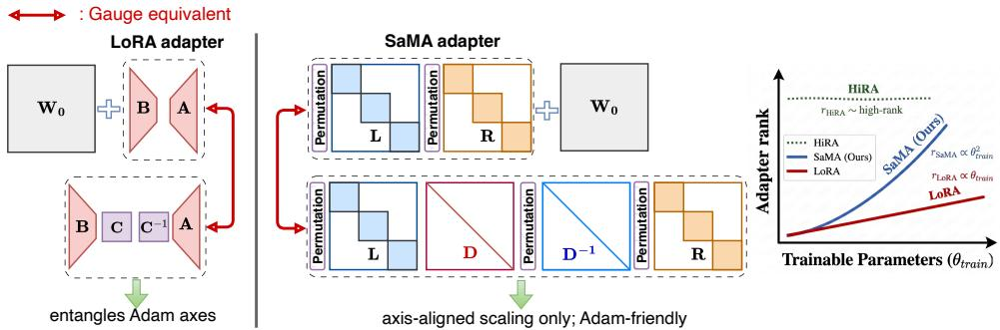  
Figure 1: Gauge symmetry in LoRA vs. Morpho adapter parameterizations. (Left) LoRA's update $\Delta { \bar { \mathbf { W } } } = \mathbf { B } \mathbf { A }$ admits any invertible $\mathbf { C } \in G L ( r )$ as a gauge transform, including rotations and shearing. (Center) The block-diagonal factorization $P _ { l } ^ { \top } \mathbf { L } P _ { r } \mathbf { R }$ reduces the gauge freedom to diagonal rescalings only: $\mathbf { L }  \mathbf { L D }$ and $\mathbf { R } \gets P _ { r } ^ { \top } \mathbf { D } ^ { - 1 } P _ { \prime }$ .R for diagonal D. Unlike LoRA, this coordinatealigned scaling does not entangle latent features. (Right) Expressivity: the rank of a SaMA adapter scales as a quadratic function of the training budget.

## 2.1 Kronecker Product

The Kronecker product [20], denoted ⊗, takes two matrices $\mathbf { A } \in \bar { \mathbb { R } } ^ { m _ { 1 } \times n _ { 1 } }$ and $\mathbf { B } \in \mathbb { R } ^ { m _ { 2 } \times n _ { 2 } }$ and produces $\mathbf { C } = \mathbf { A } \otimes \mathbf { B } \in \mathbb { R } ^ { M \times N }$ , where $M = m _ { 1 } m _ { 2 }$ and $N = n _ { 1 } n _ { 2 } \colon$

$$
\mathbf { C } = \left[ \begin{array} { c c c } { a _ { 1 1 } \mathbf { B } } & { \cdots } & { a _ { 1 n _ { 1 } } \mathbf { B } } \\ { \vdots } & { \ddots } & { \vdots } \\ { a _ { m _ { 1 } 1 } \mathbf { B } } & { \cdots } & { a _ { m _ { 1 } n _ { 1 } } \mathbf { B } } \end{array} \right]
$$

For an input vector $\mathbf { x } \in \mathbb { R } ^ { N }$ , define the matrix views $\mathbf { X } = \mathrm { u n v e c } ( \mathbf { x } )$ and $\mathbf { Y } = \mathrm { u n v e c } ( \mathbf { y } )$ , where vec(·) stacks columns into a vector and unvec(·) reverses this operation. Applying the Kronecker product as a linear map admits the equivalent forms:

$$
\mathbf { y } = \left( \mathbf { A } \otimes \mathbf { B } \right) \mathbf { x } \Leftrightarrow \mathbf { Y } = \mathbf { B } \mathbf { X } \mathbf { A } ^ { \top } \Leftrightarrow \mathbf { y } = \mathrm { v e c } \left( \mathbf { B } \ \mathrm { u n v e c } ( \mathbf { x } ) \mathbf { A } ^ { \top } \right) .\tag{1}
$$

The matrix form in Eq. (1) avoids materializing the full $M \times N$ product and is efficient in practice.

## 2.2 Monarch Parameterization for Square Matrices

Definition 2.1. [21] Let $N = n ^ { 2 } .$ A square Monarch matrix $\mathbf { M } \in \mathbb { R } ^ { N \times N }$ has the form:

$$
\mathbf { M } = { P } ^ { \top } \mathbf { L } { P } \mathbf { R } ,
$$

where $\mathbf { L } = \operatorname { d i a g } ( \mathbf { L } _ { 1 } , \ldots , \mathbf { L } _ { n } )$ and $\mathbf { R } \ = \ \mathrm { d i a g } ( \mathbf { R } _ { 1 } , \ldots , \mathbf { R } _ { n } )$ are block-diagonal matrices each comprising n dense blocks of $s i z e n \times n ,$ and $_ { r }$ is the permutation matrix that transposes the two indices of an $n \times n$ matrix obtained by reshaping a vector of length N.

Monarch parameterization [21] is an extension of butterfly matrices [22, 23], representing a matrix as the product of two block-diagonal matrices interleaved by permutations.

## 2.3 Morpho: Bridging the Kronecker Product and Monarch Parameterization

We now introduce the Morpho matrix, a generalization of both the Kronecker product and Monarch matrices, designed for scalable, omni-rank PEFT.

## 2.3.1 Kronecker Product as a Two-Stage Sparse Factorization

We analyze the structure of $\mathbf { A } \otimes \mathbf { B }$ by decomposing it into two sequential sparse transformations. Applying the mixed-product property of the Kronecker product [24, 25], $( \mathbf { A } \otimes \mathbf { E } ) ( \mathbf { F } \otimes \mathbf { B } ) =$ $( \bar { \bf A } \bar { \bf F } ) \otimes \bar { ( } { \bf E B } )$ , and setting $\mathbf { E } = \mathbf { I } _ { m _ { 2 } } , \mathbf { F } = \mathbf { I } _ { n } .$ yields:

$$
\mathbf { A } \otimes \mathbf { B } = \underbrace { \left( \mathbf { A } \otimes \mathbf { I } _ { m _ { 2 } } \right) } _ { \mathbf { L } ^ { \prime } } \underbrace { \left( \mathbf { I } _ { n _ { 1 } } \otimes \mathbf { B } \right) } _ { \mathbf { R } } .\tag{2}
$$

This reveals a two-stage structure: the right factor R maps the input from dimension $N = n _ { 1 } n _ { 2 }$ to a hidden dimension $n _ { 1 } m _ { 2 }$ , and the left factor $\mathbf { L } ^ { \prime }$ maps the result to the output dimension $M = m _ { 1 } m _ { 2 }$

Concretely, $\mathbf { R } = \mathbf { I } _ { n _ { 1 } } \otimes \mathbf { B } = \mathrm { d i a g } ( \mathbf { B } , \ldots , \mathbf { B } )$ is block-diagonal with $n _ { 1 }$ identical copies of B. The left factor $\mathbf { L } ^ { \prime }$ , however, is not block-diagonal: its $m _ { 1 } \times n _ { 1 }$ blocks of size $m _ { 2 } \times m _ { 2 }$ are scaled identities (with scalar entries drawn from $\mathbf { A } ) ,$ as shown above.

$$
\begin{array} { r } { \mathbf { L } ^ { \prime } = \left[ \begin{array} { l l l } { \mathbf { D } _ { 1 1 } } & { \dots } & { \mathbf { D } _ { 1 m _ { 2 } } } \\ { \vdots } & { \ddots } & { \vdots } \\ { \mathbf { D } _ { m _ { 2 } 1 } } & { \dots } & { \mathbf { D } _ { m _ { 2 } m _ { 2 } } } \end{array} \right] } \end{array}
$$

To expose the hidden block-diagonal structure of $\mathsf { L } ^ { \prime } ,$ we apply the perfect shuffle permutation [24] (see Appendix A), which reshapes a vector of length r into a $p \times q$ matrix in row-major order, transposes it, and re-vectorizes. Using the identity $\mathbf { A } \otimes \mathbf { I } _ { m _ { 2 } } = \mathbf { \widetilde { P } } _ { m _ { 1 } , m _ { 2 } } ^ { \top } \left( \mathbf { I } _ { m _ { 2 } } \otimes \mathbf { A } \right) \mathbf { \widetilde { P } } _ { n _ { 1 } , m _ { 2 } } ,$ we rewrite:

$$
\begin{array} { r } { \mathbf { L } ^ { \prime } = P _ { l } ^ { \top } \mathbf { L } P _ { r } , \qquad \mathbf { L } = \mathrm { d i a g } ( \mathbf { A } , \ldots , \mathbf { A } ) , \quad P _ { l } ^ { \top } = P _ { m _ { 1 } , m _ { 2 } } ^ { \top } , \quad P _ { r } = P _ { n _ { 1 } , m _ { 2 } } . } \end{array}\tag{3}
$$

Equation (3) reveals that both factors of the Kronecker product share the same block-diagonal structure, up to a pair of perfect shuffle permutations. This symmetric view directly motivates the generalization introduced in the next section.

## 2.3.2 Generalizing the Kronecker Decomposition

In the Kronecker product, all diagonal blocks within each factor are tied — every block equals either A or B. Releasing this constraint and allowing each block to be an independent dense matrix yields a strictly richer family of transformations while preserving the computational advantages of block-diagonal structure.

Fine-tuning via reparameterization. Given a frozen pre-trained weight $\mathbf { W } _ { 0 } \in \mathbb { R } ^ { M \times N }$ , we introduce a trainable additive update $\Delta \mathbf { W }$ and define the fine-tuned forward pass as:

$$
\mathbf { W } _ { \mathrm { f t } } = \mathbf { W } _ { 0 } + \Delta \mathbf { W } , \qquad \mathbf { y } = \mathbf { W } _ { 0 } \mathbf { x } + \Delta \mathbf { W } \mathbf { x } .
$$

The design of ∆W is the central contribution of SaMA.

Scalable Morpho Adaptation (Morpho). Motivated by the Kronecker decomposition in Sec. 2.3.1 and the Monarch structure in Sec. 2.2, we parameterize the update as a Morpho matrix:

$$
\Delta \mathbf { W } = s _ { \mathrm { { S a M A } } } { P } _ { l } ^ { \top } \mathbf { L } { P } _ { r } \mathbf { R } ,\tag{4}
$$

where L and R are block-diagonal matrices with independent dense blocks,

$$
\mathbf { L } = \operatorname { d i a g } ( \mathbf { L } _ { 1 } , \ldots , \mathbf { L } _ { m _ { 2 } } ) , \qquad \mathbf { R } = \operatorname { d i a g } ( \mathbf { R } _ { 1 } , \ldots , \mathbf { R } _ { n _ { 1 } } ) ,\tag{5}
$$

with $\mathbf L _ { i } ~ \in ~ \mathbb R ^ { m _ { 1 } \times n _ { 1 } }$ and $\mathbf { R } _ { i } ~ \in ~ \mathbb { R } ^ { m _ { 2 } \times n _ { 2 } }$ each independently parameterized, and $n _ { 1 } , m _ { 2 } \ \ll$ $\operatorname* { m i n } ( M , N )$ . The permutations $P _ { l } = P _ { m _ { 1 } , m _ { 2 } }$ and $P _ { r } = P _ { n _ { 1 } , m _ { 2 } }$ are fixed perfect shuffles (see Eq. (10)) and contribute no trainable parameters. The scalar $s _ { \mathrm { S a M A } }$ controls the update magnitude;

its role in training stability is analyzed in Sec. 3.3. We index a specific adapter configuration by the tuple $( n _ { 1 } , m _ { 2 } )$ , written $\mathrm { S a M A } _ { n _ { 1 } \times m _ { 2 } }$

We denote the set of all matrices expressible in the form of $\mathrm { E q . } \left( 4 \right) \mathrm { a s } \mathcal { F } ^ { \left( M , N \right) }$ (abbreviated $\mathcal { F } ^ { ( N ) }$ for square matrices), and the set of all compatible factor pairs (L, R) satisfying Eq. (5) as $\mathcal { F } _ { g } .$

Remark. The permutation $P _ { n _ { 1 } , n _ { 2 } }$ maps a vector $[ x _ { 1 } , \ldots , x _ { N } ]$ to $[ x _ { 1 } , x _ { 1 + n _ { 2 } } , \ldots , x _ { 1 + ( n _ { 1 } - 1 ) n _ { 2 } } ,$ $x _ { 2 } , x _ { 2 + n _ { 2 } } , \ldots , \ x _ { n _ { 2 } } , x _ { 2 n _ { 2 } } , \ldots , x _ { n _ { 1 } n _ { 2 } } ]$ , equivalent to reading an $n _ { 1 } \times n _ { 2 }$ matrix in column-major order after writing it in row-major order. When $M = N = n ^ { 2 }$ and all blocks are square, Eq. (4) reduces exactly to the Monarch parameterization of Sec. 2.2.

Discussion. SaMA differs fundamentally from Dense-to-Sparse fine-tuning (D2S-FT) [21], which applies Monarch square matrices in pre-training and requires projecting weights into sparse form before training. SaMA instead operates purely in the additive adapter regime, requiring no such pre-processing. Critically, it spans low-rank to full-rank updates within a single parameterization, addressing both the low intrinsic dimensionality of fine-tuning landscapes $[ 2 6 , 2 7 ]$ and the broader need for omni-rank adaptation which establishes a new baseline alongside the LoRA family [7, 28, 8] and recent high-rank methods [11, 29].

Comparison with block-diagonal methods. SaMA is architecturally distinct from MoRE [30] and similar block-diagonal adapters. MoRE partitions the weight matrix spatially into $b _ { M }$ decoupled blocks, in both left and right matrices, like a collection of low rank adapter, results in a risk of sparse adapter. SaMA is instead constructed via the extended Kronecker product: the factor dimensions $( n _ { 1 } , m _ { 2 } )$ are not spatial slices but intrinsically coupled tensor indices, influencing block counts. This mutually dependent structure guarantees dense output and only allow diagonal entanglement in parameter space degeneracy. (See Appendix D.7)

SaMA follows the reparameterization convention of LoRA [7] that R is initialized from a smallvariance Gaussian and $\mathrm { ~ \bf ~ L ~ } = \mathrm { ~ 0 ~ }$ , ensuring $\Delta \mathbf { W } \ : = \ : 0$ at the start of training with non-vanishing gradients. At inference time, the adapter merges into $\mathbf { W } _ { 0 }$ with zero overhead, and forward passes through ∆W during training cost $O ( \nu N )$ FLOPs via two batched block-matrix multiplies — with no Dense-to-Sparse pre-processing required. Full implementation details are given in Appendix C.

## 3 Theoretical Analysis of SaMA

This section examines several aspects of SaMA, including rank versatility in different regimes, stability, gauge symmetry in parameter space and expressivity, then establishes its theoretical properties.

## 3.1 Rank Properties

We establish three theoretical aspects of SaMA including rank flexibility under random initialization, scaling stability as hidden dimension grows, and convergence to the full fine-tuning solution under mild conditions.

Theorem 3.1 (Rank upper bound). Let L and R be block-diagonal matrices as defined in $E q . \ ( 5 )$ with $n _ { 1 } m _ { 2 } \leq \operatorname* { m i n } ( M , N )$ , and let $s \neq 0$ . Suppose every entry of each submatrix is drawn i.i.d. from a continuous distribution. Then, with probability 1:

$$
\mathrm { r a n k } ( \Delta { \mathbf W } ) = \mathrm { r a n k } \big ( s P _ { l } ^ { \top } { \mathbf L } P _ { r } { \mathbf R } \big ) = n _ { 1 } m _ { 2 } .\tag{6}
$$

Theorem 3.1 shows that the effective rank of the adapter is exactly $n _ { 1 } m _ { 2 }$ , determined jointly by the block counts of L and R. This decoupling is structurally significant: by varying $n _ { 1 }$ and $m _ { 2 }$ independently, SaMA covers a broad range of rank regimes, from low-rank to full-rank adaptation. Notably, for a square $N \times N$ weight with N a perfect square, a full-rank update is achievable with only $2 N \sqrt { N }$ parameters $( n _ { 1 } = m _ { 2 } = \sqrt { N } )$

To make the comparison concrete, consider a fixed parameter budget of $P = 2 N r$ shared by both methods. LoRA allocates this as two matrices of sizes $N \times r$ and $r \times M .$ yielding adapter rank $\mathcal { R } _ { \mathrm { L o R A } } = r$ , which grows linearly with P. SaMA with configuration $( n _ { 1 } , m _ { 2 } ) = ( r , r )$ matches the same budget while achieving adapter rank $\mathcal { R } _ { \mathrm { S a M A } } = n _ { 1 } m _ { 2 } = r ^ { 2 }$ , growing quadratically.

## 3.2 Expressivity of Morpho

The Eckart-Young theorem [31] establishes rank-r matrices as the optimal Frobenius approximators of any target, given a budget of r singular components. This optimality is the cornerstone to understand the expressivity of LoRA and its variants. Here, we study the following question: "Under what conditions can a higher-rank structure, specifically Morpho, surpasses the Eckart-Young bound at the same parameter budget?"

Theorem 3.2 (Expressivity crossover). Let $\mathbf { W } \in \mathbb { R } ^ { d \times d }$ be a rank-R matrix with exactly R unit singular values, and fx a parameter budget corresponding to $n _ { 1 } = m _ { 2 } = r < R$ in Eq. (4). Denote $\mathbf { W } _ { L o R A } ^ { * }$ as the optimal rank-r approximation of W (the Eckart–Young truncation), and $\mathbf { W } _ { M o r p h o } ^ { * } a s$ the Morpho approximation of W, under the same budget. Then there exists a threshold $R _ { 0 } < \dot { d }$ such that, with probability 1:

$$
\| \mathbf { W } - \mathbf { W } _ { M o r p h o } ^ { * } \| _ { F } ~ < ~ \| \mathbf { W } - \mathbf { W } _ { L o R A } ^ { * } \| _ { F } , \qquad \forall R > R _ { 0 } .\tag{7}
$$

Theorem 3.2 identifies effective rank (eRank) [32] as the key discriminating quantity. At low eRank, W's spectrum is concentrated and Eckart-Young captures it nearly perfectly, whereas Morpho offers no benefit. At high eRank, the spectral mass of W is broadly distributed and the rank-r ceiling becomes binding. The Morpho structure covers a higher-dimensional subspace than the LoRA bottleneck because of its global mixing between diagonal blocks. The proof of Theorem 3.2 can be found in Appendix D.3.

Empirical validation. To justify Theorem 3.2, we design a controlled matrix-approximation stress test. For each parameterization class $s _ { i } ,$ we solve min $\mathbf { W } ^ { \prime } { \in } { \mathcal { S } } _ { i } \left\| \mathbf { W } - \mathbf { W } ^ { \prime } \right\| _ { F }$ on synthetic targets with systematically varied eRank. This setup deliberately isolates the approximation geometry from task signals, cleanly measuring how each parameterization covers the target manifold as the spectrum shifts. We deliberately design target matrices of size 1024 × 1024 with low entropy effective rank r, e.g. erank(W) = rank(W), to avoid spectrum decay in the low-rank target, then evaluate the performance on matrix approximation of LoRA and SaMA across a wide range of effective ranks. (See details in Appendix F.1.)

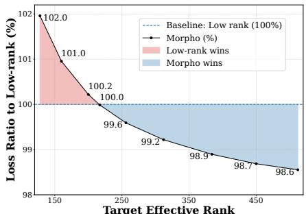  
Figure 2: Relative approximation loss of Morpho vs. low-rank under matched parameter budgets. Morpho gains a decisive advantage beyond eRank = 217.

The results in Fig. 2 confirm the theoretical prediction. At low eRank, low-rank approximation is competitive or superior, consistent with Eckart-Young. Beyond eRank = 217, Morpho achieves strictly lower approximation loss under the same budget, with the gap widening monotonically. This result is precisely anticipated by Theorem 3.2

## 3.3 Scaling stability

Theorem 3.3 (Numerical stability). The scaling factor $s _ { \mathrm { S a M A } }$ that keeps the initialization variance of ∆W stable after inite n SGD updates, as the hidden dimension $n _ { 1 }$ grows satisfies:

$$
s _ { \mathrm { S a M A } } = \alpha n _ { 1 } ^ { 1 / 4 } \quad \Longleftrightarrow \quad \Delta \mathbf { W } = \left( \alpha n _ { 1 } ^ { 1 / 4 } \right) P _ { l } ^ { \top } \mathbf { L } P _ { r } \mathbf { R } , \qquad \alpha \in \tilde { \mathbb { R } } .\tag{8}
$$

Equation (8) derives the scaling factor (unique up to a constant factor) that simultaneously stabilizes forward output variance and backward gradient magnitude of the trained adapter as $n _ { 1 }$ grows. (See Appendix D.2 for the proof and the detailed explanation.) Using all other factors can lead the signal to either attenuate or diverge (empirically verified in Appendix D.4). Critically, this result is theoretically derived; unlike rsLoRA [33], which proposes $\alpha / \sqrt { r }$ empirically. To our knowledge, no existing block-structured adapter including MoRE [30] and QuanTA [11] provides an analogous stability analysis.

## 3.4 Optimization dynamics in structured invariant manifolds

We also explore optimization behavior of structured adapter parameterizations. Particularly, we investigate how the geometry of invariant manifolds affects parameter space degeneracy and builds a connection with optimization.

Gauge symmetry in matrix factorization Any factorization $\Delta \mathbf { W } = \mathbf { B } \mathbf { A }$ admits an infinite family of equivalent solutions. Inserting an invertible matrix $\mathbf { C } \in G L ( r )$ yields $\Delta \mathbf { W } = ( \mathbf { B } \mathbf { C } ) ( \mathbf { C } ^ { - 1 } \mathbf { A } )$ 0 with identical loss. This defines an invariant manifold indicating a continuous symmetry group under which the optimization objective is flat. For LoRA-style adapters, this manifold spans the full general linear group $G L ( r )$ , including rotations and shearing transformations in latent space.

The optimization bottleneck in invariance manifolds. Adaptive optimizers such as Adam [14, 15] operate coordinate-wise, implicitly assuming axis-aligned curvature. Rotational freedom in GL(r) violates this assumption. That is, any rotation of the latent basis linearly recombines parameter columns of B and A, entangles features that Adam treats as independent [34]. Therefore, Adam cannot efficiently navigate the flat directions carved out by feature-mixing transformations.

We will show that Morpho parameterization does not suffer from this degeneracy, as shown by analyzing the invariant manifold of SaMA.

Theorem 3.4 (Invariance manifold of Morpho parameterization). Given a generic matrix $\mathbf { M } _ { 1 } \in \mathcal { F }$ $\mathbf { M } _ { 1 } = P _ { l } ^ { \top } \mathbf { L } _ { 1 } P _ { r } \mathbf { R } _ { 1 }$ , where $\mathbf { L } _ { 1 } , \mathbf { R } _ { 1 }$ are determined block-diagonal matrices. Let $\mathcal { F } _ { g } ( \mathbf { M } _ { 1 } )$ denote a set of generative factor pairs for M1. If the hidden size $q = n _ { 1 } m _ { 2 } <$ min $( M , N )$ , then:

$$
\begin{array} { r } { \mathcal { F } _ { g } ( \mathbf { M } _ { 1 } ) \equiv \Big \{ ( \mathbf { L } , \mathbf { R } ) \ | \ \mathbf { L } = \mathbf { L } _ { 1 } D , \ \mathbf { R } = P _ { r } ^ { \top } D ^ { - 1 } P _ { r } \mathbf { R } _ { 1 } ; D = \operatorname { d i a g } \left( \boldsymbol { v } \right) \in \mathcal { B } \mathcal { D } , \boldsymbol { v } \in ( \mathbb { R } \backslash \{ 0 \} ) ^ { q } \Big \} . } \end{array}\tag{9}
$$

Theorem 3.4 shows that SaMA's invariance manifolds belong to the diagonal subgroups BD. This is the consequence of the block-diagonal topology in L and R since dense rotations and shearing are not allowed. The proof can be found in Appendix D.6.2.

Implication. Pure scaling along coordinate axes neither mixes latent features nor disrupts Adam's axis-aligned preconditioner. Cross-feature entanglement is intrinsically suppressed by design, not by external regularization. The block-diagonal structure thus acts as an implicit structural preconditioner. It eliminates channel-mixing components involved in pathological flat directions arising in dense reparameterization, thereby reshaping the loss landscape into a form that adaptive optimizers can traverse more efficiently. Further discussion of parameter-space degeneracy is provided in Appendix D.6.

## 3.4.1 Empirical verification of gauge structure.

To empirically verify the theoretical distinction between LoRA and Morpho, we conduct toy experiments on a matrix approximation task.

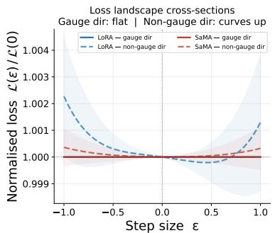  
(a)

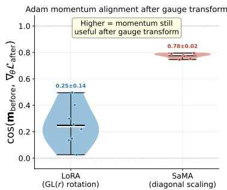  
(b)  
Figure 3: (a) Loss landscape flatness between LoRA and SaMA. (b) Cosine similarity between pre-transform Adam momentum $m _ { \mathrm { b e f o r e } }$ and post-transform gradient $\nabla _ { \theta } \mathcal { L } _ { \mathrm { a f t e r } }$

Loss landscape flatness. We partially trained both methods and scanned the normalized loss $\mathcal { L } ( \theta +$ εd) $/ \mathcal { L } ( \theta )$ along two directions: a gauge direction $\mathbf { d } _ { \mathrm { g a u g e } }$ , which leaves $\Delta \mathbf { W }$ exactly unchanged, and a random non-gauge direction. As shown in Fig. 3(a), both gauge directions produce exactly flat loss curves (normalised loss ≡ 1.0), confirming the theoretical flat directions. Crucially, the non-gauge direction of Morpho remains nearly flat whereas LoRA's non-gauge direction exhibits significantly larger curvature. This indicates that the surrounding loss landscape of Morpho is easy to navigate.

Momentum alignment after gauge transform. To directly measure the impact of gauge redundancy on adaptive optimizers, we train each adapter for 400 warm-up steps with Adam to build meaningful first-moment estimates m. We then apply a gauge transform that leaves ∆W unchanged but modifies the parameter coordinates: a random permutation matrix C for LoRA, and an alternating diagonal scaling for Morpho. We then measure the cosine similarity between the pre-transform momentum $\mathbf { m } _ { \mathrm { b e f o r e } }$ and the post-transform gradient $\nabla _ { \theta } \mathcal { L } _ { \mathrm { a f t e r } }$ , which quantifies how much of Adam's accumulated directional information remains useful after the parameter coordinates are rearranged.

As shown in Fig. 3(b), LoRA yields a cosine similarity of $0 . 2 5 \pm 0 . 1 4$ indicating that the rotational freedom in GL(r) effectively scrambles Adam's momentum into an uninformative direction. In contrast, Morpho achieves $0 . { \dot { 7 } } 8 \pm 0 . 0 2$ with near-zero variance across seeds, confirming that diagonal scalings merely rescale the per-coordinate momentum without mixing features, leaving the optimizer state largely intact. These results provide direct empirical support for the claim that the GL(r) gauge freedom of LoRA creates an optimization bottleneck that Morpho's diagonal gauge structure inherently avoids.

## 4 Experimental Results

To evaluate SaMA against other PEFT methods, we conduct experiments across a broad spectrum of downstream tasks. Specifically, we verify SaMA effectiveness on three complex reasoning domains, namely DROP, Commonsense (CMS), and Arithmetic. Additional experiments, ablation studies, details of the datasets and hyperparameters are shown in Appendices F, G, I.1 and I.2, respectively.

Main baselines: Across these experiments, we compare SaMA against a range of strong recent PEFT baselines, including LoRA [7], PiSSA [8], ABBA [35], QuanTA [11], LoRA-Pro [36] and SMT [29], with full fine-tuning (FFT) included as a reference.

## 4.1 DROP Dataset

Following QuanTA [11], in order to explicitly clarify the effectiveness of these adapters, we conduct our initial experiments using Llama2-7B on the DROP dataset [37] as a representative case study for high-rank updates. As illustrated in Fig. 4 and further detailed in Table 9, SaMA consistently outperforms other existing fine-tuning methods across these models, reaching FFT (on Query and Value modules) performance. Notably, while increasing the rank to improve capacity, LoRA exhibits diminishing returns, failing to close the performance gap. Meanwhile, QuanTA – with high-rank updates – shows overall improvement, but still suffers from a performance lag.

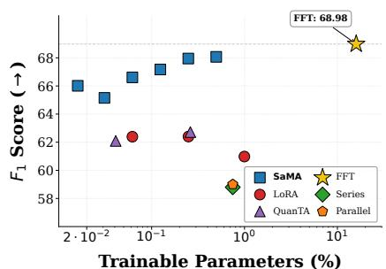  
Figure 4: Benchmark of different FT methods on the DROP dataset, using Llama2- 7B, as parameter budgets vary.

These results suggest that SaMA benefits from a mechanism that better navigates mid- and high-rank regimes.

By leveraging sparse structures, SaMA facilitates a favorable optimization landscape, enabling a smoother optimization trajectory compared to dense high-rank alternatives. The omni-rank property might excel at extracting necessary features with less redundancy.

## 4.2 Arithmetic reasoning

Table 1: Comparison of PEFT methods across math benchmarks. Baselines (†) are from [35]. See Table 10 for the detailed report.
<table><tr><td rowspan="2">Method</td><td colspan="2">Mistral-7B</td><td colspan="2">Gemma-2 9B</td></tr><tr><td>GSM8K</td><td>MATH</td><td>GSM8K</td><td>MATH</td></tr><tr><td> $\mathrm { F u l l \ F T ^ { \dagger } }$ </td><td>63.87</td><td>17.65</td><td>79.23</td><td>38.02</td></tr><tr><td> $\mathrm { L o R A } _ { r = 3 2 }$ </td><td>62.93</td><td>14.14</td><td>77.45</td><td>35.05</td></tr><tr><td> $\mathrm { P i S S A ^ { \dagger } }$ </td><td>62.43</td><td>16.52</td><td>77.12</td><td>37.04</td></tr><tr><td> $\mathrm { L o R A  – P r o } ^ { \dagger }$ </td><td>63.07</td><td>17.32</td><td>78.26</td><td>37.53</td></tr><tr><td> $\mathbf { A B B A } _ { r = 3 2 }$ </td><td>64.48</td><td>17.95</td><td>78.85</td><td>39.59</td></tr><tr><td> $\mathbf { S a M A } _ { 8 , 8 }$ </td><td>67.70</td><td>18.44</td><td>80.36</td><td>39.36</td></tr></table>

To examine whether SaMA remains effective on demanding reasoning, we consider and evaluate models on MATH [38] and GSM8K [39] as representative challenging benchmarks among popular arithmetic reasoning tasks. We fine-tune pretrained models of Mistral-7B [40] and Gemma-2 9B [41] on a 20K-sample subset of MetaMathQA [42].

Results on the two test sets in Table 1 show a clear overview. Although all PEFT baselines adopt rank 32, equivalent to $\mathrm { S a M A _ { 3 2 , 3 2 } }$ , SaMA consistently outperforms prior methods on both tasks while using fewer parameters; notably, even the lightweight setting $( n _ { 1 } , m _ { 2 } ) = ( 8 , 8 )$ uses 4 times fewer parameters than the baselines, yet remains highly competitive and approaches FFT. This suggests that the proposed structured parameterization provides a favorable balance between efficiency and expressivity. We hypothesize that this effect arises by means of the structured parameterization, combined with a smoother optimization landscape.

## 4.3 Commonsense reasoning

Table 2: Performance comparison on commonsense reasoning tasks. The detailed benchmark with more FT baselines are provided in Table 11.
<table><tr><td>Model</td><td>PEFT method</td><td>#Params%</td><td>BoolQ</td><td>PIQA</td><td>SIQA</td><td>HellaS.</td><td>WinoG.</td><td>ARC-e</td><td>ARC-c</td><td>OBQA</td><td>AVG(↑)</td></tr><tr><td rowspan="4">LLaMA-7B</td><td> $\mathrm { F F T } ^ { \bullet }$ </td><td>100</td><td>70.3</td><td>84.2</td><td>80.1</td><td>92.3</td><td>85.4</td><td>86.6</td><td>72.8</td><td>83.4</td><td>81.9</td></tr><tr><td> $\mathrm { L o R A } ^ { \bullet }$ </td><td>0.83</td><td>69.2</td><td>81.7</td><td>78.4</td><td>83.4</td><td>80.8</td><td>79.0</td><td>62.4</td><td>78.4</td><td>76.7</td></tr><tr><td> $\mathbf { S M T ^ { \bullet } }$ </td><td>0.84</td><td>68.7</td><td>81.7</td><td>78.3</td><td>91.6</td><td>78.8</td><td>84.1</td><td>68.7</td><td>77.4</td><td>78.7</td></tr><tr><td>SaMA16×16</td><td>0.416</td><td>71.1</td><td>84.9</td><td>81.7</td><td>94.1</td><td>84.0</td><td>87.6</td><td>72.7</td><td>86.2</td><td>82.8</td></tr><tr><td rowspan="5">LLaMA-13B</td><td> $\mathrm { F F T } ^ { \bullet }$ </td><td>100</td><td>74.5</td><td>86.3</td><td>81.3</td><td>94.4</td><td>86.9</td><td>89.7</td><td>77.9</td><td>88.8</td><td>85.0</td></tr><tr><td> $\mathrm { L o R A ^ { * } }$ </td><td>0.67</td><td>72.1</td><td>83.5</td><td>80.5</td><td>90.5</td><td>83.7</td><td>82.8</td><td>68.3</td><td>82.4</td><td>80.5</td></tr><tr><td> $\mathbf { S M T ^ { \bullet } }$ </td><td>0.68</td><td>71.1</td><td>84.4</td><td>81.7</td><td>93.7</td><td>83.2</td><td>86.7</td><td>73.7</td><td>85.2</td><td>82.4</td></tr><tr><td>SaMA16×16</td><td>0.336</td><td>73.5</td><td>87.6</td><td>82.6</td><td>95.4</td><td>87.7</td><td>90.2</td><td>78.0</td><td>88.3</td><td>85.4</td></tr><tr><td> $\mathrm { F F T } ^ { \bullet }$ </td><td>100</td><td>74.7</td><td>84.9</td><td>78.7</td><td>93.7</td><td>84.1</td><td>87.5</td><td>75.2</td><td></td><td></td></tr><tr><td rowspan="5">LLaMA2-7B</td><td> $\mathrm { L o R A } ^ { \circ }$ </td><td>0.83</td><td>69.8</td><td>79.9</td><td>79.5</td><td>83.6</td><td>82.6</td><td>79.8</td><td>64.7</td><td>85.0 81.0</td><td>83.0 77.6</td></tr><tr><td> $\mathbf { S M T ^ { \bullet } }$ </td><td>0.84</td><td>72.0</td><td>83.8</td><td>80.8</td><td>93.3</td><td>82.8</td><td>86.7</td><td>74.0</td><td>81.0</td><td>81.8</td></tr><tr><td> $\mathbf { S a M A _ { 4 } } \mathbf { \times } 4$ </td><td>0.104</td><td>73.1</td><td>85.5</td><td>81.8</td><td>94.7</td><td>85.0</td><td>88.7</td><td>73.9</td><td>86.0</td><td>83.6</td></tr><tr><td> $\mathbf { S a M A } _ { 1 6 \times 1 6 }$ </td><td>0.42</td><td>73.9</td><td>86.2</td><td>81.9</td><td>94.9</td><td>86.4</td><td>89.1</td><td>77.0</td><td>86.8</td><td>84.5</td></tr><tr><td></td><td></td><td></td><td></td><td></td><td></td><td></td><td></td><td></td><td></td><td></td></tr><tr><td rowspan="5">LLaMA3-8B</td><td> $\mathrm { F F T } ^ { \bullet }$ </td><td>100</td><td>73.9</td><td>86.2</td><td>79.1</td><td>93.1</td><td>85.8</td><td>88.1</td><td>78.2</td><td>84.0</td><td>83.6</td></tr><tr><td> $\mathrm { L o R A } ^ { \circ }$   $\mathbf { S M T ^ { \bullet } }$ </td><td>0.70</td><td>70.8</td><td>85.2</td><td>79.9</td><td>91.7</td><td>84.3</td><td>84.2</td><td>71.2</td><td>79.0</td><td>80.8</td></tr><tr><td></td><td>0.71 0.088</td><td>75.7 73.9</td><td>88.4</td><td>81.4 82.8</td><td>96.2 96.6</td><td>88.2 88.2</td><td>92.7 93.7</td><td>83.2 83.6</td><td>88.6 89.6</td><td>86.8 87.4</td></tr><tr><td> $\mathbf { S a M A _ { 4 } } \mathbf { \times } \mathbf { 4 }$ </td><td>0.351</td><td>75.4</td><td>90.6 90.3</td><td>83.2</td><td>96.7</td><td>88.7</td><td>94.1</td><td>83.8</td><td>90.1</td><td>87.8</td></tr><tr><td> $\mathbf { S a M A } _ { 1 6 \times 1 6 }$ </td><td></td><td></td><td></td><td></td><td></td><td></td><td></td><td></td><td></td><td></td></tr></table>

We continue our evaluation on Commonsense reasoning tasks, including 8 benchmark datasets, training on a single amalgamated dataset of 147k samples from [43]¹. These experiments use several models in the Llama family [44, 45, 46] to make a comprehensive benchmark. Table 2 shows SaMA performance among other PEFT methods. In most of the models and sub-tasks, SaMA consistently yields significant improvements, sometimes surpasses FFT. This suggests that by leveraging sparse matrices, SaMA facilitates a favorable optimization landscape, allowing smoother optimization trajectories. Detailed results are provided in Table 11.

## 4.4 Training efficiency

We validate computational and memory efficiency of SaMA during the training phase by tracking time per step and reserved memory during the training time on Gemma2-9B (See details and additional results in Appendix F.6). The results are recorded after 50 warmup steps, averaged 3 times over 25 iterations with comparable parameter counts.

As shown in Fig. 5 and detailed in Appendix F.6, SaMA preserves hardware-friendly training behavior: it incurs only marginal runtime overhead of 3.5% and

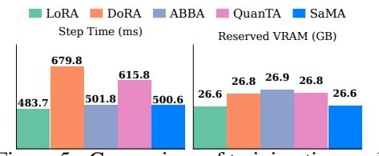  
Figure 5: Comparison of training time and memory on Gemma2-9B. SaMA remains hardware-friendly, comparable to LoRA.

a comparable memory footprint close to LoRA, and noticeably lower cost than other dense baselines such as DoRA, QuanTA.

Summary Across diverse and challenging NLP tasks and models, SaMA consistently achieves competitive or superior performance while maintaining all facets of parameter efficiency, scaling stability, computational and memory effectiveness.

## 4.5 Discussion on disentangling the SaMA individual effects

Given the key paragraphs above, it is obvious to see that SaMA features several intrisic crucial properties, namely Morpho structure, rank capacity as well as reduced gauge freedom of transforma-

tion. Although SaMA adapters simultaneously offer expressivity, structure interaction and diagonal invariant manifolds, it naturally prompts a question on the root cause of SaMA performance:

## What evidence helps disentangle the effects of these factors?

To thoroughly answer this thought-provoking question, we deem that absolutely isolating these inherently coupled components is mathematically challenging. However, their individual contributions can be observed through structured ablations, optimization dynamics and generalizability. Below is a brief discussion on this problem, the full analysis is provided in Appendix E.

i) Beyond nominal rank capacity. Although scaling rank consistently improves SaMA's expressivity across budgets (Fig. 19 (page 49)), rank capacity alone does not explain its superiority. In addition, SaMA preserves a rich, long-tailed singular value spectrum closely aligned with FFT (Fig. 23 page 52). See Appendix E.1.

ii) Isolating the Morpho topology (Global mixing). A naive diagonal or block-diagonal adapter such as DiaBlo [18] inherently possesses high rank and introduces no parameter degeneracy (since it does not contain any matrix factorization), yet restricts transformations to isolated local subspaces. Conversely, SaMA bridges distant feature dimensions to enable global information routing while scaling rank quadratically with budget, yielding better performance. See Appendix E.2.

iii) Isolating reduced gauge freedom (Invariant manifolds). Unlike LoRA's dense GL(r) invariance, which induces optimization concerns under Adam/AdamW (Section 3.4, page 5), SaMA's structure severely restricts gauge symmetry to scaling only, eliminating shearing and rotations. In our experiments, gauge-inflating SaMA by expanding the local gauge group to dense 16-by-16 blocks noticeably degrades performance on GSM8K and MATH (see Appendix E.3), providing evidence for the optimization benefit of reduced gauge freedom.

## 4.6 Ablation studies

## Sensitivity analysis on initialization of SaMA factors

To assess the actual effect of zero-initialization of left and right factors in SaMA, we conduct experiments on the DROP dataset using Qwen2.5-1.5B [6], with several choices of standard deviation $\sigma _ { i n i t }$ for normal distributions. All other training hyperparameters are fixed across the tests to ensure fair comparison, and the results are reported in Table 3 and Appendix F.7.

Table 3: Initialization strategies in SaMA.
<table><tr><td> $\sigma _ { \mathrm { { L } } } ^ { 2 }$ </td><td> $\sigma _ { \mathbf { R } } ^ { 2 }$ </td><td>Acc.</td><td> $F _ { 1 }$  -scores</td></tr><tr><td>0</td><td>1e-3</td><td>36.04</td><td>39.77</td></tr><tr><td>0</td><td>2e-4</td><td>36.09</td><td>39.74</td></tr><tr><td>1e-3</td><td>0</td><td>35.47</td><td>39.41</td></tr><tr><td>2e-4</td><td>0</td><td>35.29</td><td>39.13</td></tr></table>

In general, fine-tuning with Morpho parameterization is inherently resilient to zero-initialization. Moreover,

it is more beneficial to initialize SaMA factors: $\mathbf { L } = 0$ and R from a zero-mean distribution with a small variance: $\mathbf { R } \sim { \mathcal { N } } ( 0 , \sigma ^ { 2 } )$ . Across both variance schemes of $\sigma _ { \mathbf { L } , \mathbf { R } } ^ { 2 }$ , this configuration consistently improves overall performance relative to zero-R – for both accuracy and $F _ { 1 }$ -score metrics. Hence, we adopt this setting in all main experiments.

More results on ablation studies on fine-tuning performance on each individual transformer module and asymmetric configurations of $( n _ { 1 } , m _ { 2 } )$ are provided in Appendix G.

## 5 Related Work

Parameter-Efficient Fine-Tuning (PEFT) PEFT methods broadly fall into three categories: addition, prompting, and reparameterization. The first two emerged in the early stage of LLM transfer learning, either inserting auxiliary modules [47, 48] or adapting via task-aware soft tokens [49, 50]. Both incur additional inference cost or sensitivity to initialization. Our work focuses on reparameterization, which preserves the prompt format and base architecture while introducing no inference overhead.

Reparameterization Reparameterization methods learn weight updates in a parameterized form and merge them back into the pretrained weights after fine-tuning. LoRA [7] and its variants [8,

28, 9, 10] have become the dominant baselines in this line, yet a clear performance gap to full fine-tuning (FFT) remains, motivating a recent push toward higher-rank updates. Representative high-rank approaches include QuanTA [11], which uses tensorization with multi-stage factorization; KRAdapter [12], based on the Khatri–Rao product; RandLoRA [51], which combines random bases; and SVD-based methods such as KASA [17], Spectral Adapter [13], and SVFT [52]. ABBA [35] also achieves rank expansion via Hadamard or Khatri-–Rao products, but only up to r2/4, and remains within the LoRA-style dense factorization that suffers from reparameterization ambiguity. In contrast, SaMA does not commit to either the low- or high-rank regime: a single two-factor parameterization spans both extremes with no preprocessing, while a structured sparse design avoids the dense-factor redundancy of LoRA-family extensions.

Structured sparse matrices Structured matrices admit subquadratic cost $( o ( n ^ { 2 } )$ for $n \times n$ matrices) and include sparse families and fast transforms. Among them, butterfly [22, 53] and Monarch [21] matrices have seen renewed interest in deep learning, primarily for parameterizing square matrices in pre-training [54] or full fine-tuning [21]. SaMA instead extends these structures to a generic rectangular form and adapts them to additive PEFT, making structured sparsity scalable and rankflexible for downstream fine-tuning.

## 6 Conclusion

In this study, we present SaMA together with the Morpho parameterization, which bridges the gulf between the Kronecker product and the Monarch matrices with practical applications in reparameterization fine-tuning. We supported this framework with theory, mechanistic analyses and empirical validation. Our extensive experiments substantiate the effectiveness and applicability of the method across various tasks, model architectures and scales. SaMA consistently achieves competitive results against strong baselines. In particular, compared with FFT, SaMA substantially narrows the performance gap and is on par with that of FFT, while demonstrating high hardware friendliness and parameter efficiency. Concurrently, the precise conditions under which each rank regime is most beneficial and how far omni-rank PEFT can systematically close the gap to FFT in many settings remain open questions to be better understood.

More broadly, SaMA suggests that PEFT need not be confined to a fixed rank regime. SaMA leverages the sparse matrix structure to realize omni-rank adaptation within a unified framework. SaMA offers a broader view of PEFT methods beyond regime-specific adapter design. Our findings further suggest that the advantages arise not only from richer expressiveness, but also from a more favorable optimization geometry, without entanglement, under invariant manifolds.

Limitations SaMA implicitly relies on a specific structured parameterization, whose inductive bias may not be equally suitable across tasks, layers, and model families.

Future work There are several directions for future work to explore: (i) combining SaMA with other adaptation strategies, including ensemble-style integration or mixture-of-experts architectures; (ii) The core mechanism and underlying role of the sparse structure is not clear so far – how sparse matrix interactions can improve model generalization and enable the learning of a new task? (iii) Extension of the generic rectangular Morpho parameterization beyond fine-tuning, including its applicability to pretraining settings where many weight matrices are no longer square.²

## Acknowledgements

This work was supported by the Institute of Information & Communications Technology Planning & Evaluation (IITP) grant funded by the Korea government (MSIT) (No. RS-2019-II190079, Artificial Intelligence Graduate School Program (Korea University)), the National Research Foundation of Korea (NRF) grant funded by the Korea government (MSIT) (No. RS-2025-23525509), and the High-Performance Computing Support Project, funded by the Government of the Republic of Korea (Ministry of Science and ICT) (No. RQT-25-070263).

## References

[1] Ashish Vaswani, Noam Shazeer, Niki Parmar, Jakob Uszkoreit, Llion Jones, Aidan N Gomez, Łukasz Kaiser, and Illia Polosukhin. Attention is all you need. Advances in neural information processing systems, 30, 2017.

[2] Alexey Dosovitskiy, Lucas Beyer, Neil Houlsby, et al. An Image is Worth 16x16 Words: Transformers for Image Recognition at Scale. In International Conference on Learning Representations, 2020.

[3] Gemini Team, Rohan Anil, Sebastian Borgeaud, Jean-Baptiste Alayrac, Jiahui Yu, et al. Gemini: A Family of Highly Capable Multimodal Models, 2025.

[4] Aaditya Singh, Adam Fry, Adam Perelman, Adam Tart, Adi Ganesh, Ahmed El-Kishky, Aidan McLaughlin, Aiden Low, A. J. Ostrow, Akhila Ananthram, et al. OpenAI GPT-5 System Card, 2025.

[5] DeepSeek-AI, Aixin Liu, Aoxue Mei, Bangcai Lin, Bing Xue, Bingxuan Wang, Bingzheng Xu, Bochao Wu, Bowei Zhang, et al. DeepSeek-V3.2: Pushing the Frontier of Open Large Language Models, 2025.

[6] Jinze Bai, Shuai Bai, Yunfei Chu, Zeyu Cui, Kai Dang, Xiaodong Deng, Yang Fan, et al. Qwen technical report. arXiv preprint arXiv:2309.16609, 2023.

[7] Edward J Hu, Yelong Shen, Phillip Wallis, Lu Wang, Weizhu Chen, et al. Lora: Low-rank adaptation of large language models. International Conference on Learning Representations (ICLR), 2022.

[8] Fanxu Meng, Zhaohui Wang, and Muhan Zhang. Pissa: Principal singular values and singular vectors adaptation of large language models. In Advances in Neural Information Processing Systems, 2024.

[9] Soufiane Hayou, Nikhil Ghosh, and Bin Yu. LoRA+: Efficient Low Rank Adaptation of Large Models. In Forty-First International Conference on Machine Learning, 2024.

[10] Tuan Truong, Chau Nguyen, Huy Nguyen, Minh Le, Trung Le, and Nhat Ho. RepLoRA: Reparameterizing low-rank adaptation via the perspective of mixture of experts. In Proceedings of the 42nd International Conference on Machine Learning, Proceedings of Machine Learning Research, 2025.

[11] Zhuo Chen, Rumen Dangovski, Charlotte Loh, Owen Dugan, Di Luo, and Marin Soljačić. QuanTA: efficient high-rank fine-tuning of LLMs with quantum-informed tensor adaptation. In Proceedings of the 38th International Conference on Neural Information Processing Systems, 2024.

[12] Paul Albert, Frederic Z. Zhang, Hemanth Saratchandran, Anton van den Hengel, and Ehsan Abbasnejad. Towards Higher Effective Rank in Parameter-Efficient Fine-tuning using Khatri-Rao Product. In Proceedings of the IEEE/CVF International Conference on Computer Vision, 2025.

[13] Fangzhao Zhang and Mert Pilanci. Spectral Adapter: Fine-Tuning in Spectral Space. In The Thirty-eighth Annual Conference on Neural Information Processing Systems, 2024.

[14] Diederik P. Kingma and Jimmy Ba. Adam: A Method for Stochastic Optimization. In International Conference for Learning Representations, 2015.

[15] Ilya Loshchilov and Frank Hutter. Decoupled weight decay regularization. In International Conference on Learning Representations, 2019.

[16] Dan Biderman, Jacob Portes Cody Blakeney, John P. Cunningham, et al. Lora learns less and forgets less. Transactions on Machine Learning Research (TMLR), 2024.

[17] Fan Wang, Juyong Jiang, Chansung Park, Sunghun Kim, and Jing Tang. KaSA: Knowledge-Aware Singular-Value Adaptation of Large Language Models. In The Thirteenth International Conference on Learning Representations, 2024.

[18] Selcuk Gurses, Aozhong Zhang, Penghang Yin, Zi Yang, et al. DiaBlo: Diagonal Blocks Are Sufficient For Finetuning. In The Fourteenth International Conference on Learning Representations, 2025.

[19] Qiushi Huang, Tom Ko, Zhan Zhuang, Lilian Tang, and Yu Zhang. HiRA: Parameter-efficient hadamard high-rank adaptation for large language models. In The Thirteenth International Conference on Learning Representations, 2025.

[20] Harold V. Henderson, Friedrich Pukelsheim, and Shayle R. Searle. On the history of the kronecker product. Linear and Multilinear Algebra, 1983.

[21] Tri Dao, Beidi Chen, Nimit S. Sohoni, Arjun Desai, Michael Poli, Jessica Grogan, Alexander Liu, Aniruddh Rao, Atri Rudra, and Christopher Re. Monarch: Expressive Structured Matrices for Efficient and Accurate Training. In Proceedings of the 39th International Conference on Machine Learning, 2022.

[22] Tri Dao, Albert Gu, Matthew Eichhorn, Atri Rudra, and Christopher Re. Learning Fast Algorithms for Linear Transforms Using Butterfly Factorizations. In Proceedings of the 36th International Conference on Machine Learning, 2019.

[23] David H. Bailey. Ffts in external or hierarchical memory. The Journal of Supercomputing, 1990.

[24] Charles F. Van Loan. The ubiquitous Kronecker product. Journal of Computational and Applied Mathematics, 2000.

[25] Huamin Zhang and Feng Ding. On the Kronecker products and their applications. Journal of Applied Mathematics, 2013.

[26] Chunyuan Li, Heerad Farkhoor, Rosanne Liu, and Jason Yosinski. Measuring the intrinsic dimension of objective landscapes. In Proceedings of 6th International Conference on Learning Representations, ICLR, 2018.

[27] Armen Aghajanyan, Sonal Gupta, and Luke Zettlemoyer. Intrinsic dimensionality explains the effectiveness of language model fine-tuning. In Proceedings of ACL-IJCNLP. ACL, 2021.

[28] Shih-Yang Liu, Chien-Yi Wang, Hongxu Yin, Pavlo Molchanov, Yu-Chiang Frank Wang, Kwang-Ting Cheng, and Min-Hung Chen. DoRA: Weight-decomposed low-rank adaptation. In Proceedings of the 41st International Conference on Machine Learning, 2024.

[29] Haoze He, Juncheng Li, Xuan Jiang, and Heather Miller. SMT: Fine-tuning large language models with sparse matrices. In International Conference on Learning Representations (ICLR), 2025.

[30] Wenxuan Tan, Nicholas Roberts, Tzu-Heng Huang, Jitian Zhao, John Cooper, Samuel Guo, Chengyu Duan, and Frederic Sala. MoRe Fine-Tuning with 10x Fewer Parameters, 2024.

[31] Carl Eckart and Gale Young. The approximation of one matrix by another of lower rank. Psychometrika, 1936.

[32] Olivier Roy and Martin Vetterli. The Effective Rank: A Measure of Effective Dimensionality. In 2007 15th European Signal Processing Conference, 2007.

[33] Damjan Kalajdzievski. A rank stabilization scaling factor for fine-tuning with LoRA. ArXiv, abs/2312.03732, 2023.

[34] Adela DePavia, Vasileios Charisopoulos, and Rebecca Willett. How do simple rotations affect the implicit bias of Adam?, 2025.

[35] Raghav Singhal, Kaustubh Ponkshe, Rohit Vartak, and Praneeth Vepakomma. Abba: Highly expressive hadamard product adaptation for large language models. International Conference on Learning Representations (ICLR), 2026

[36] Zhengbo Wang, Jian Liang, Ran He, Zilei Wang, and Tieniu Tan. LoRA-Pro: Are Low-Rank Adapters Properly Optimized? In The Thirteenth International Conference on Learning Representations, 2025.

[37] Dheeru Dua, Yizhong Wang, Matt Gardner, et al. DROP: A reading comprehension benchmark requiring discrete reasoning over paragraphs. In Proceedings of the 2019 Conference of the North American Chapter of the Association for Computational Linguistics. ACL, 2019.

[38] Dan Hendrycks, Collin Burns, Saurav Kadavath, Akul Arora, Steven Basart, Eric Tang, Dawn Song, and Jacob Steinhardt. Measuring Mathematical Problem Solving With the MATH Dataset. In Thirty-Fifth Conference on Neural Information Processing Systems Datasets and Benchmarks Track (Round 2), 2021.

[39] Karl Cobbe, Vineet Kosaraju, et al. Training verifiers to solve math word problems. arXiv preprint arXiv:2110.14168, 2021.

[40] Albert Q. Jiang, Alexandre Sablayrolles, Arthur Mensch, Chris Bamford, et al. Mistral 7b, 2023.

[41] Gemma Team, Morgane Riviere, Shreya Pathak, Pier Giuseppe Sessa, Cassidy Hardin, et al. Gemma 2: Improving open language models at a practical size, 2024.

[42] Longhui Yu, Weisen Jiang, et al. Metamath: Bootstrap your own mathematical questions for large language models. International Conference on Learning Representations (ICLR), 2024.

[43] Zhiqiang Hu, Lei Wang, Soujanya Poria, Roy Lee, et al. LLM-adapters: An adapter family for parameterefficient fine-tuning of large language models. In Proceedings of the 2023 Conference on Empirical Methods in Natural Language Processing. Association for Computational Linguistics, 2023.

[44] Hugo Touvron, Thibaut Lavril, Gautier Izacard, Xavier Martinet, Marie-Anne Lachaux, Timothée Lacroix, Baptiste Rozière, et al. Llama: Open and efficient foundation language models. CoRR, 2023.

[45] Hugo Touvron, Louis Martin, Kevin Stone, Peter Albert, Amjad Almahairi, Yasmine Babaei, et al. Llama 2: Open foundation and fine-tuned chat models. arXiv preprint arXiv:2307.09288, 2023.

[46] Aaron Grattafiori, Abhimanyu Dubey, Abhinav Jauhri, Abhinav Pandey, Abhishek Kadian, Ahmad Al-Dahle, Aiesha Letman, et al. The llama 3 herd of models. arXiv preprint arXiv:2407.21783, 2024.

[47] Neil Houlsby, Andrei Giurgiu, Mona Attariyan, Sylvain Gelly, et al. Parameter-efficient transfer learning for NLP. In Proceedings of the 36th International Conference on Machine Learning, 2019.

[48] Shwai He, Liang Ding, Daize Dong, Jeremy Zhang, and Dacheng Tao. SparseAdapter: An Easy Approach for Improving the Parameter-Efficiency of Adapters. In Findings of the Association for Computational Linguistics: EMNLP 2022. Association for Computational Linguistics, 2022.

[49] Xiang Lisa Li and Percy Liang. Prefix-tuning: Optimizing continuous prompts for generation. In Proceedings of the 59th Annual Meeting of the Association for Computational Linguistics and the 11th International Joint Conference on Natural Language Processing, 2021.

[50] Brian Lester, Rami Al-Rfou, and Noah Constant. The power of scale for parameter-efficient prompt tuning. In Proceedings of the 2021 Conference on Empirical Methods in Natural Language Processing. Association for Computational Linguistics, 2021.

[51] Paul Albert, Frederic Z Zhang, Cristian Rodriguez-Opazo, Hemanth Saratchandran, Anton van den Hengel, and Ehsan Abbasnejad. Randlora: full rank parameter-efficient fine-tuning of large models. International Conference on Learning Representations (ICLR), 2025.

[52] Vijay Lingam, Atula Tejaswi Neerkaje, Sujay Sanghavi, et al. SVFT: Parameter-Efficient Fine-Tuning with Singular Vectors. In The 38th Annual Conference on Neural Information Processing Systems, 2024.

[53] D.S. Parker. Random Butterfly Transformations with Applications in Computational Linear Algebra. CSD (Series). UCLA Computer Science Department, 1995.

[54] Anna Thomas, Albert Gu, Tri Dao, Atri Rudra, and Christopher Ré. Learning Compressed Transforms with Low Displacement Rank. In Advances in Neural Information Processing Systems, 2018.

[55] Jonas Pfeiffer, Aishwarya Kamath, Andreas Rücklé, Kyunghyun Cho, and Iryna Gurevych. AdapterFusion: Non-destructive task composition for transfer learning. In Proceedings of the 16th Conference of the European Chapter of the Association for Computational Linguistics. ACL, 2021.

[56] Junxian He, Chunting Zhou, Xuezhe Ma, Taylor Berg-Kirkpatrick, and Graham Neubig. Towards a Unified View of Parameter-Efficient Transfer Learning. In International Conference on Learning Representations, 2021.

[57] Guanghui Qin and Jason Eisner. Learning How to Ask: Querying LMs with Mixtures of Soft Prompts. In Proceedings of the 2021 Conference of the North American Chapter of the Association for Computational Linguistics: Human Language Technologies. Association for Computational Linguistics, 2021.

[58] Yihan Wang, Si Si, Daliang Li, Michal Lukasik, Felix Yu, Cho-Jui Hsieh, Inderjit S. Dhillon, and Sanjiv Kumar. Two-stage LLM Fine-tuning with Less Specialization and More Generalization. In The Twelfth International Conference on Learning Representations, 2023.

[59] Zeju Qiu, Weiyang Liu, Haiwen Feng, Yuxuan Xue, Yao Feng, Zhen Liu, Dan Zhang, Adrian Weller, and Bernhard Schölkopf. Controlling Text-to-Image Diffusion by Orthogonal Finetuning. In Thirty-Seventh Conference on Neural Information Processing Systems, 2023.

[60] Mikhail Gorbunov, Kolya Yudin, Vera Soboleva, Aibek Alanov, Alexey Naumov, and Maxim Rakhuba. Group and Shuffle: Efficient Structured Orthogonal Parametrization. In The Thirty-eighth Annual Conference on Neural Information Processing Systems, 2024.

[61] An Nguyen, Jaesik Choi, and Anh Tong. LoCO: Low-Rank Compositional Rotation Fine-tuning. In International Joint Conference on Artificial Intelligence (IJCAI), 2026.

[62] Xinyu Ma, Xu Chu, Zhibang Yang, Yang Lin, Xin Gao, and Junfeng Zhao. Parameter Efficient Quasi-Orthogonal Fine-Tuning via Givens Rotation. In Proceedings of the 41st International Conference on Machine Learning, 2024.

[63] Qingru Zhang, Minshuo Chen, Weizhu Chen, Tuo Zhao, et al. Adaptive Budget Allocation for Parameter-Efficient Fine-Tuning. In The Eleventh International Conference on Learning Representations, 2022.

[64] Hanqing Wang, Yixia Li, Shuo Wang, Guanhua Chen, and Yun Chen. Milora: Harnessing minor singular components for parameter-efficient llm finetuning. arXiv preprint arXiv:2406.09044, 2024.

[65] Muqing Liu, Chongjie Si, and Yuheng Jia. FlexLoRA: Entropy-Guided Flexible Low-Rank Adaptation. In The Fourteenth International Conference on Learning Representations, 2025.

[66] Massimo Bini, Leander Girrbach, and Zeynep Akata. Decoupling Angles and Strength in Low-rank Adaptation. In The Thirteenth International Conference on Learning Representations, 2024.

[67] Kai Lion, Liang Zhang, Bingcong Li, and Niao He. PoLAR: Polar-Decomposed Low-Rank Adapter Representation. In The Thirty-ninth Annual Conference on Neural Information Processing Systems, 2025.

[68] Soroush Abbasi Koohpayegani, Hamed Pirsiavash, et al. NOLA: Compressing LoRA using Linear Combination of Random Basis. In International Conference on Learning Representations, 2023.

[69] Zhiwei He, Zhaopeng Tu, Xing Wang, Rui Wang, et al. RaSA: Rank-Sharing Low-Rank Adaptation. In The Thirteenth International Conference on Learning Representations, 2024.

[70] Dawid Jan Kopiczko, Tijmen Blankevoort, and Yuki M. Asano. VeRA: Vector-based Random Matrix Adaptation. In The Twelfth International Conference on Learning Representations, 2023.

[71] Yong Liu, Di Fu, Shenggan Cheng, Zirui Zhu, Yang Luo, Yang You, et al. SeedLoRA: A Fusion Approach to Efficient LLM Fine-Tuning. In Forty-Second International Conference on Machine Learning, 2025.

[72] Yilang Zhang, Bingcong Li, and Georgios B. Giannakis. RefLoRA: Refactored Low-Rank Adaptation for Efficient Fine-Tuning of Large Models. In The Thirty-ninth Annual Conference on Neural Information Processing Systems, 2025.

[73] Shaowen Wang, Linxi Yu, and Jian Li. LoRA-GA: Low-Rank Adaptation with Gradient Approximation. Advances in Neural Information Processing Systems, 37, 2024.

[74] Jiawei Zhao, Zhenyu Zhang, Beidi Chen, Zhangyang Wang, Anima Anandkumar, and Yuandong Tian. GaLore: Memory-Efficient LLM Training by Gradient Low-Rank Projection. In Forty-First International Conference on Machine Learning, 2024.

[75] Yuxi Liu, Renjia Deng, Kun Yuan, et al. MISA: Memory-Efficient LLMs Optimization with Module-wise Importance Sampling. In The Thirty-ninth Conference on Neural Information Processing Systems, 2025.

[76] Zicheng Zhang, Haoran Li, Yifeng Zhang, Guoqiang Gong, Jiaxing Wang, Junxing Hu, Pengzhang Liu and Qixia Jiang. The Primacy of Magnitude in Low-Rank Adaptation. In The Thirty-ninth Annual Conference on Neural Information Processing Systems, 2025.

[77] Anh Tong, Kyowoon Lee, and Jaesik Choi. PRISM: Principal Subspace Alignment for Parameter-Efficient Fine-Tuning. In Advances in Neural Information Processing Systems, 2026.

[78] Yeonjoon Jung, Daehyun Ahn, Hyungjun Kim, Taesu Kim, and Eunhyeok Park. GraLoRA: Granular Low-Rank Adaptation for Parameter-Efficient Fine-Tuning. In The Thirty-ninth Annual Conference on Neural Information Processing Systems, 2025.

[79] Weixi Song, Zuchao Li, Lefei Zhang, Hai Zhao, and Bo Du. Sparse is Enough in Fine-tuning Pre-trained Large Language Models. In Forty-First International Conference on Machine Learning, 2024.

[80] Jing Xu and Jingzhao Zhang. Random Masking Finds Winning Tickets for Parameter Efficient Fine-tuning. In Proceedings of the 41st International Conference on Machine Learning, 2024.

[81] Rui Pan, Xiang Liu, Shizhe Diao, Renjie Pi, Jipeng Zhang, Chi Han, and Tong Zhang. LISA: Layerwise Importance Sampling for Memory-Efficient Large Language Model Fine-Tuning. Advances in Neural Information Processing Systems, 37, 2024.

[82] Xinyu Yang, Huaxiu Leng, Jixuan Yao, Beidi Chen, et al. S²FT: Efficient, Scalable and Generalizable LLM Fine-tuning by Structured Sparsity. Advances in Neural Information Processing Systems, 2024.

[83] Tri Dao, Nimit Sohoni, Albert Gu, Matthew Eichhorn, Amit Blonder, Megan Leszczynski, Atri Rudra, and Christopher Ré. Kaleidoscope: An Efficient, Learnable Representation For All Structured Linear Maps. In International Conference on Learning Representations, 2019.

[84] Beidi Chen, Tri Dao, Kaizhao Liang, Jiaming Yang, Zhao Song, Atri Rudra, and Christopher Re. Pixelated Butterfly: Simple and Efficient Sparse training for Neural Network Models. In International Conference on Learning Representations, 2021.

[85] Behnam Neyshabur, Russ R Salakhutdinov, and Nati Srebro. Path-SGD: Path-Normalized Optimization in Deep Neural Networks. In Advances in Neural Information Processing Systems, 2015.

[86] Fangzhao Zhang and Mert Pilanci. Riemannian Preconditioned LoRA for Fine-Tuning Foundation Models. In Forty-First International Conference on Machine Learning, 2024

[87] Roger A. Horn and Charles R. Johnson. Matrix Analysis. Cambridge University Press, 2012.

[88] James Joseph Sylvester. On involutants and other allied species of invariants to matrix systems. Johns Hopkins University Circulars, 3:9–12, 34–35, 1884.

[89] Haskell P. Rosenthal. On the subspaces oflp(p>2) spanned by sequences of independent random variables. Israel Journal of Mathematics, 1970.

[90] V A Marčenko and L A Pastur. Distribution of eigenvalues for some sets of random matrices. Mathematics of the USSR-Sbornik, 1967.

[91] Zhidong D Bai and Yanqing Yin. Necessary and Sufficient Conditions for Almost Sure Convergence of the Largest Eigenvalue of a Wigner Matrix. The Annals of Probability, 1988.

[92] Iain M. Johnstone. On the distribution of the largest eigenvalue in principal components analysis. The Annals of Statistics, 29(2), 2001.

[93] Pratyusha Sharma, Jordan T. Ash, and Dipendra Misra. The Truth is in There: Improving Reasoning in Language Models with Layer-Selective Rank Reduction. In The Twelfth International Conference on Learning Representations, 2023.

[94] Gene H. Golub and Charles F. Van Loan. Matrix Computations. Johns Hopkins University Press, 4th edition, 2013.

[95] T. N. E. Greville. Note on the generalized inverse of a matrix product. SIAM Rev., 1966.

[96] Weiyang Liu, Zeju Qiu, Yao Feng, Yuliang Xiu, Yuxuan Xue, Longhui Yu, Haiwen Feng, Zhen Liu, Juyeon Heo, Songyou Peng, et al. Parameter-efficient orthogonal finetuning via butterfly factorization. In The Twelfth International Conference on Learning Representations, 2024.

[97] Roger Penrose. A generalized inverse for matrices. Mathematical Proceedings of the Cambridge Philosophical Society, 51(3):406–413, 1955.

[98] Ruijie Zhang, Ziyue Liu, Zhengyang Wang, and Zheng Zhang. LaX: Boosting Low-Rank Training of Foundation Models via Latent Crossing. In The Thirty-ninth Annual Conference on Neural Information Processing Systems, 2025.

[99] Jia Deng, Wei Dong, Richard Socher, Li-Jia Li, Kai Li, and Li Fei-Fei. ImageNet: A large-scale hierarchical image database. In IEEE Conference on Computer Vision and Pattern Recognition, 2009.

[100] Xiaohua Zhai, Joan Puigcerver, Alexander Kolesnikov, Pierre Ruyssen, et al. A large-scale study of representation learning with the visual task adaptation benchmark, 2020.

[101] Wei Dong, Xing Zhang, Yang Yang, et al. Low-Rank Rescaled Vision Transformer Fine-Tuning: A Residual Design Approach. In Conference on Computer Vision and Pattern Recognition (CVPR), 2024.

[102] Mor Geva, Roei Schuster, Jonathan Berant, and Omer Levy. Transformer Feed-Forward Layers Are Key-Value Memories. In Conference on Empirical Methods in Natural Language Processing, 2021.

[103] Sepp Hochreiter and Jürgen Schmidhuber. Flat Minima. Neural Computation, 1997.

[104] Laurent Dinh, Razvan Pascanu, Samy Bengio, and Yoshua Bengio. Sharp Minima Can Generalize For Deep Nets. In Proceedings of the 34th International Conference on Machine Learning. PMLR, 2017.

[105] Nitish Shirish Keskar, Ping Tak Peter Tang, et al. On Large-Batch Training for Deep Learning: Generalization Gap and Sharp Minima. In International Conference on Learning Representations, 2017.

[106] Pierre Foret, Ariel Kleiner, Hossein Mobahi, and Behnam Neyshabur. Sharpness-aware Minimization for Efficiently Improving Generalization. In International Conference on Learning Representations, 2020.

[107] Christopher Clark, Kenton Lee, Ming-Wei Chang, Tom Kwiatkowski, Michael Collins, and Kristina Toutanova. BoolQ: Exploring the surprising difficulty of natural yes/no questions. In Proceedings of the Conference of the North American Chapter of the Association for Computational Linguistics, 2019.

[108] Yonatan Bisk, Rowan Zellers, Ronan Le Bras, Jianfeng Gao, and Yejin Choi. Piqa: Reasoning about physical commonsense in natural language. In AAAI Conference on Artificial Intelligence, 2019.

[109] Maarten Sap, Hannah Rashkin, and Yejin Choi. Social iqa: Commonsense reasoning about social interactions. In Conference on Empirical Methods in Natural Language Processing, 2019.

[110] Rowan Zellers, Ari Holtzman, Yonatan Bisk, Ali Farhadi, and Yejin Choi. HellaSwag: Can a machine really finish your sentence? In Proceedings of the 57th Annual Meeting of the Association for Computational Linguistics, 2019.

[111] Keisuke Sakaguchi, Ronan Le Bras, Chandra Bhagavatula, and Yejin Choi. Winogrande: an adversarial winograd schema challenge at scale. Communications of the ACM, 2021.

[112] Hector J. Levesque, Ernest Davis, and Leora Morgenstern. The winograd schema challenge. In The 13rd International Conference on Principles of Knowledge Representation and Reasoning, 2012.

[113] Peter Clark, Isaac Cowhey, Oren Etzioni, et al. Think you have solved question answering? try arc, the ai2 reasoning challenge. arXiv:1803.05457v1, 2018.

[114] Todor Mihaylov, Peter Clark, Tushar Khot, and Ashish Sabharwal. Can a suit of armor conduct electricity? a new dataset for open book question answering. In Proceedings of the 2018 Conference on Empirical Methods in Natural Language Processing. ACL, 2018.

[115] Rohan Taori, Ishaan Gulrajani, Tianyi Zhang, Yann Dubois, Xuechen Li, Carlos Guestrin, Percy Liang, and Tatsunori B. Hashimoto. Stanford alpaca: An instruction-following llama model, 2023.

A Mathematical Notations 18   
B Broader Literature Review 19   
C Practical Implementation 20   
D Extended Theoretical Discussion and Proofs 22   
D.1 Rank property (Proof of Theorem 3.1) 22   
D.2 Rank stability condition (Proof of Theorem 3.3) 23   
D.3 Expressivity in low effective rank. Proof of Theorem 3.2 26   
D.4 Numerical stability of SaMA over ranks 31   
D.5 SaMA Converges to the FFT Solution 32   
D.6 Gauge Invariance in PEFT: A Unified Perspective and the Parameter-Space Unique  
ness of Morpho 35   
D.7 Distinction from MoRE Fine-tuning 37   
E What evidence supports disentangling the effects of SaMA adapter features 41   
E.1 Expressivity via rank capacity 41   
E.2 Morpho structure 41   
E.3 Invariant manifolds 42   
F Further Experimental Result and Analysis 43   
F.1 Matrix approximation – experimental settings 43   
F.2 Full results on the DROP dataset 44   
F.3 Full results on the math reasoning task 44   
F.4 A comprehensive benchmark of Commonsense reasoning 45   
F.5 Attention fine-tuning on Commonsense reasoning 47   
F.6 Efficiency validation 47   
F.7 Ablation study on adapter initialization 48   
F.8 SaMA performance when increasing parameter budgets 49   
F.9 Fine-tuning Vision transformer 49   
G Ablation studies 51   
G.1 Module-specific adaptation 51   
G.2 Asymmetric configuration of (n1, m2) 51   
H Understanding the adapter via mechanistic analysis 51   
H.1 Does SaMA leverage the Omni-rank property? 51   
H.2 Gradient behavior during optimization 52   
Dataset and experimental details 54   
I.1 Details of datasets on experiments 54   
I.2 Experimental descriptions 55   
I.3 Template of Instruction fine-tuning 59   
Broader Impact 61

## A Mathematical Notations

Frequently used notation: Table 4 summarizes the common symbols used throughout this work.

Table 4: General linear-algebra notation used throughout the paper.
<table><tr><td>Symbol</td><td>Meaning</td></tr><tr><td> $\mathbf { A } , \mathbf { B } , \mathbf { C }$ </td><td>Generic matrices; in the Kronecker formulation,  $\mathbf { A } \in \mathbb { R } ^ { m _ { 1 } \times n _ { 1 } }$  and  $\textbf { B } \in$  Rm2×n2.</td></tr><tr><td> $\otimes$ </td><td>Kronecker product.</td></tr><tr><td> $\mathbf x , \mathbf y$ </td><td>Input and output vectors of a linear transformation.</td></tr><tr><td> $\mathbf { X } , \mathbf { Y }$ </td><td>Matrix forms of  $\mathbf x , \mathbf y$  obtained via unvec(·).</td></tr><tr><td> $\operatorname { v e c } ( \cdot ) , \operatorname { u n v e c } ( \cdot )$ </td><td>Vectorization and inverse vectorization operators.</td></tr><tr><td> $M , N$ </td><td>(Default) Output and input dimensions of the target linear map or an adapter matrix. For a square matrix, we denote its size as N or  $N { \cdot } \mathbf { b y - } \hat { N }$ </td></tr><tr><td> $m _ { 1 } , n _ { 1 } , m _ { 2 } , n _ { 2 }$ </td><td>Block dimensions and configuration parameters in the Kronecker/SaMA con- struction.</td></tr><tr><td> $\mathrm { r a n k } ( \cdot )$ </td><td>Rank operator.</td></tr><tr><td> $\mathrm { e r a n k } ( \cdot )$ </td><td>Shannon entropy effective rank operator.</td></tr><tr><td> $r$ </td><td>Rank hyperparameter in LoRA-style baselines.</td></tr><tr><td> $\mathcal { G } _ { X }$ </td><td>Gauge group associated with the invariance manifold of a generic parameteri-</td></tr><tr><td> $G L ( r )$ </td><td>zation X. General linear group, i.e., the set of all invertible square matrices of size  $r \times r .$ </td></tr><tr><td> $O ( r )$ </td><td>Rotational group – a set of rotational square matrices.  $\mathbf { A } \in O ( r )$  means that  $\mathbf { A } ^ { - 1 } = \mathbf { A } ^ { \top }$  and  $\operatorname* { d e t } ( \mathbf { A } ) = 1 .$ </td></tr><tr><td> $B D$ </td><td>Set of all block-diagonal matrices.</td></tr><tr><td> $\tilde { \mathbb { R } }$ </td><td> $\tilde { \mathbb { R } } = \mathbb { R } \backslash \{ 0 \}$  : the set of nonzero real numbers.</td></tr><tr><td> $\lVert \cdot \rVert _ { F }$ </td><td>Frobenius norm of a matrix.</td></tr><tr><td> $\langle \cdot , \cdot \rangle _ { F }$ </td><td>Frobenius inner product of two matrices.</td></tr><tr><td> $e _ { i }$ </td><td>Standard basis vector with only a 1 in the ¿-th position and zeros otherwise.</td></tr><tr><td> $\pi ( )$ </td><td>Permutation function - a bijective function that rearranges a set of indices. For instance,  $\pi ( i ) = j$  means that the j-th element is moved to the i-th position</td></tr><tr><td> $\pi _ { m , n }$ </td><td>Index map of  $P _ { m , n } ,$  i.e.  $P _ { m , n } \pmb { e } _ { i } = e \pi _ { m , n } ( i )$ </td></tr><tr><td> $a . . b$ </td><td>Integer interval ranging from a to  $b - \operatorname { o r } \left[ a , b \right] \cap \mathbb { Z }$ </td></tr></table>

SaMA-specific notation. Table 5 summarizes the symbols used for SaMA and Morpho matrices.

Table 5: SaMA-specific notation.
<table><tr><td>Symbol</td><td>Meaning</td></tr><tr><td>∆W</td><td>Trainable adapter update added to the pretrained weight matrix in FT</td></tr><tr><td> $\mathbf { L } , \mathbf { R }$ </td><td>Block-diagonal trainable factors in the Morpho parameterization, with con- stituent blocks as  $\mathbf { L } _ { i }$  and  ${ \bf R } _ { j }$ </td></tr><tr><td> $P \ \mathrm { o r } \ P _ { n _ { 1 } , m _ { 2 } }$ </td><td>A generic form of perfect shuffle permutation. In general,  $P _ { m , n }$  rearranges a vector by reshaping it into a row-major m-by-n matrix then transposes and</td></tr><tr><td> ${ \pmb P } _ { 1 }$ </td><td>re-vectorizing it. Permutation matrix for monarch parameterization of all square components.</td></tr><tr><td> $P _ { l } , P _ { r }$ </td><td>Fixed permutation matrices used to route and mix block interactions. In Morpho parameterization,  $P _ { l } = P _ { m _ { 1 } , m _ { 2 } } , P _ { r } = P _ { n _ { 1 } , m _ { 2 } } .$ </td></tr><tr><td> $s , s _ { \mathrm { S a M A } }$ </td><td>Scaling factor applied to the SaMA adapter; for stable scaling,  $s = \Theta ( n _ { 1 } ^ { 1 / 4 } )$ </td></tr><tr><td> $q$   $\bar { \mathcal { F } } , \mathcal { F } ^ { ( m , n ) }$ </td><td>Hidden dimension of the Morpho parameterization, defined as  $q = n _ { 1 } \cdot m _ { 2 }$  Morpho manifolds with or without specific primary configuration, parameter-</td></tr><tr><td> $\mathcal { F } _ { g } , \mathcal { F } _ { g } ^ { ( m , n ) }$   $( n _ { 1 } , m _ { 2 } )$ </td><td>ized by (#blocks in R, #blocks in L). Generative factor tuples  $( \mathbf { L } , \mathbf { R } )$  associated with the Morpho manifold.</td></tr></table>

We summarize the recurring symbols used across the main text and appendix. These are common quantities and operators that appear across multiple sections, although some may be redefined locally to make the context clear. Context-specific notation will be introduced in the corresponding sections. For the sake of readability, we separate general linear-algebra notation from SaMA-specific notation. as displayed in Table 4 and Table 5.

Definition A.1. Perfect shuffle permutation matrix of shape $r \times r \ : [ 2 4 ] .$

$$
\begin{array} { r } { \pmb { P _ { p , q } } = \left[ \mathbf { I } _ { r } [ 1 : q : r , : ] ^ { \top } \quad \mathbf { I } _ { r } [ 2 : q : r , : ] ^ { \top } \quad \ldots \quad \mathbf { I } _ { r } [ q : q : r , : ] ^ { \top } \right] ^ { \top } , \quad r = p q . } \end{array}\tag{10}
$$

As explained in the main text, the perfect shuffle permutation $P _ { p , q }$ reshapes a vector of length r into ${ \bf a } p \times { \bf q }$ matrix in row-major order, transposes the matrix, then re-vectorizes it.

Terminology explanation Omni-rank: ability to realize a broad range of matrix ranks, up to the target regime controlled by the configuration, including low-, mid-, high-, and full-rank transformations. Within this work, it is also refered to as flexible rank or quadratic rank property.

In this work, we define omni-rank not as the empirical capacity to realize every possible integer rank, but rather as the structural flexibility to span a broad spectrum of adapter ranks while respecting the available parameter budget.

Morpho: structured parameterization underlying SaMA, built from sparse block-diagonal factors and the corresponding perfect shuffle permutations. It can be viewed as a natural extension of the Kronecker product.

## B Broader Literature Review

Additional adapter: The first group can be referred to as Addition approaches, which involves injecting extra adapters into the model architecture. These modules can be integrated in many ways: Serial adapters are interposed between existing attention or multilayer perceptron (MLP) components [47, 55, 48], while parallel adapters coexist alongside these modules [56].

Prompting Secondly, the Prompting group, inspired by the success of textual prompting methods, Prompt tuning [50] and Prefix tuning [49] add extra soft tokens to the original input and solely focus on fine-tuning these trainable tokens, or soft prompts in [57]. Besides, a recent work by [58] proposes two-stage fine-tuning, where prompting techniques are used in the first stage. Overall, these methods commonly encounter efficacy issues due to their sensitivity to initialization affecting their overall robustness and efficiency. These first two categories, either altering model's input sequence or architecture, lead to an increase in model size and introduce additional inference latency and computational overhead compared to the pretrained models. So the research directions were prevalent in early time of PEFT, but less advanced recently, so they are outside of the scope of this paper.

Isometric-based Fine-tuning Grounded in the metric preservation insight from reparameterization fine-tuning, there are other directions that use orthogonal adapters in the form multiplicative transformations. Particularly, the orthogonal matrices are parameterized via block-diagonal structures in OFT [59] or GS [60], that also utilize sparsity structures; Moreover, LoCO [61] constructs rotations from low-rank skew-symmetric matrices by means of Woodbury identity; some works focus on simple component like Givens rotations in qGOFT [62]. Our work, in contrast, takes additive transformations as a core principle because of several prominent advantages. We argue that additive adapters are more effective and expressive in PEFT due to the simplicity and mathematical generality .

Reparameterization Low-rank Adaptation. Building on the low intrinsic rank hypothesis [27], LoRA [7] uses a product of two low-rank matrices to build weight updates, avoiding inference overhead of previous approaches with adapters [47], or optimization bottleneck in prompt tuning[49, 50], then LoRA quickly becomes one of the most common techniques. Beyond the vanilla design, subsequent works extend this framework through adaptive rank allocation [63], alternative initialization [8, 64], spectrum [65], decomposition [28, 66, 67], Hadamard product [19, 35], sharing components [68, 69], random non-trainable matrices [70, 68], fusion [71], training resources (gradient [36, 72, 73], memory [74, 75], learning dynamics [9, 33, 76]), attention interaction [77] or reparameterization [10, 78].

Although ABBA [35] also exhibits a rank-expansion effect, indirectly suggesting a limited form of Omni-rank $\cdot - r ^ { 2 } / 4$ only. However, this property is not explicitly formulated as a central design principle or motivation in their work. In contrast, SaMA directly builds on the notion of Omni-rank adaptation as a primary objective, and develops both the methodology and analyses around this perspective. Moreover, ABBA remains fundamentally within the LoRA-style family, and thus still inherits the reparameterization ambiguity associated with dense factorized updates. Conversely, SaMA is designed to achieve the Omni-rank target of $n _ { 1 } \cdot m _ { 2 }$ , equivalent to $r ^ { 2 }$ , while disentangling gauge symmetry (Sec. 3.4) and maintaining an implementation-friendly sparse architecture (Appendix C).

Partial specification and sparse updates This line of approach aims to reduce the trainable parameters by selecting a subset of pre-trained model weights or sparse matrices in additive adapters. This kind of method attracts much attention in recent research but either sacrifice hardware efficiency [29], even requiring full backward propagation [79, 80] imposing additional training procedures [81, 82], or only permit local interaction without dense matrices [18]. In addition, MoRE [30] can be conceptually viewed as an ensemble of b LoRA-style block adapters of rank $r _ { b l k }$ , combined with permutation. This partitioned design restricts the global receptive field, leading to a fragmented interaction topology. Apart from those, our work facilitates sparse constituent matrices to construct module-specific dense adapters that are more practical, easy-to-implement while maintaining simplicity and efficiency by virtue of reparameterization for each individual weight matrix.

Structured sparse matrices Structured matrices are those with more optimal time complexity and space complexity – below the threshold of quadratic for a square matrix $n \times n$ . Many generations of these transformations have been adopted in machine learning to alter dense weight matrices. In [83], the expressiveness of butterfly matrices [22] can cover these structured matrices almost optimally regarding runtime and memory, followed by the proposal of Pixelated Butterfly [84] to make them hardware-friendly. Moreover, Dao et al. [21] show that monarch representation is strictly more general than butterfly matrices while enhancing hardware utilization; the product of two monarch matrices can represent convolution, Hadamard transform, Toeplitz matrices and AFDF matrices.

Geometric perspectives and Manifold reparameterization in PEFT In deep learning, the structural formulation of models inherently introduces continuous gauge symmetries into the parameter space, as highlighted in [85]. In the context of PEFT, gauge symmetry is implicitly addressed via constraints proposed in recent works. For instance, Riemannian LoRA [86] handles the reparameterization issues by modeling the low-rank adaptation space strictly as a Riemannian submanifold. LoRA+ [9] reveals that parameter space degeneracy in LoRA induces asymmetric optimization dynamics, leading to suboptimal feature learning. Our work explicitly analyzes the gauge symmetry in the parameter space and resolves it through rigid structural constraints. By adopting sparse structured matrices, our approach directly breaks the transform structure of the continuous gauge invariance inherent in standard dense factorization; replacing them with block-diagonal matrices intrinsically manages parameter entanglement.

## C Practical Implementation

This section provides the practical details of SaMA: the trainable parameter count of a Morpho adapter, the initialization scheme inherited from LoRA, the efficient batched block-matmul realization that avoids materializing $\Delta \mathbf { W }$ , and the absence of both pre-processing and inference-time overhead.

Parameters. For a square weight matrix $\mathbf { W } \in \mathbb { R } ^ { N \times N }$ with $n _ { 1 } = m _ { 2 } = \nu ,$ a Morpho matrix $\mathbf { M } = P _ { l } ^ { \top } \mathbf { L } P _ { r } \mathbf { R }$ is described by $2 N \nu$ trainable parameters in total: each of L and R contains ν dense blocks of size $\nu \times N / \nu ,$ contributing N parameters per factor. The permutations $P _ { l } , P _ { r }$ are fixed and parameter-free.

Initialization. Following the reparameterization convention of LoRA [7], we initialize R from a zero-mean Gaussian with small standard deviation $\sigma _ { \mathbf { R } }$ , and set $\mathbf { L } = 0$ . This ensures $\Delta \mathbf { W } =$ $s P _ { l } ^ { \top } \mathbf { L } P _ { r } \mathbf { R } = 0$ at the start of training while keeping gradients non-vanishing. The scalar $s _ { \mathrm { S a M A } }$ is a configuration-dependent hyperparameter whose role in training stability is analyzed in Theorem 3.3.

Efficient computation. Although $\Delta \mathbf { W }$ in Eq. (4) defines a dense linear map, we never materialize it explicitly. Instead, following [21], multiplication $\Delta \mathbf { W }$ x is carried out in two steps: reshape the input into a matrix, apply R as a batched block-matrix multiply, permute via $P _ { r }$ , apply L similarly, then permute via $P _ { l } ^ { \top }$ . This exploits batch matrix multiplication — the core primitive of modern GPU hardware — at a total cost of $O ( \nu N )$ FLOPs, with no recursive graph construction [22].

No pre-processing. Unlike D2S-FT [21], which requires projecting pre-trained weights into a sparse form before training begins, SaMA requires no such initialization step. Pre-trained weights are frozen and never modified; all computation targets the sparse adapter $\Delta \bar { \bf W }$ alone. This eliminates the Dense-to-Sparse projection overhead present in related methods [81, 64] while preserving comparable operational complexity.

No inference overhead. Like other reparameterization-based methods, SaMA adapter can be merged into the pre-trained weight at inference time $( \mathbf { W } _ { \mathrm { f t } } = \mathbf { W } _ { 0 } + \Delta \mathbf { W } )$ , adding zero latency and preserving the original model architecture for optimized deployment. Only the lightweight adapter needs to be stored, not the full fine-tuned model.

## D Extended Theoretical Discussion and Proofs

## D.1 Rank property (Proof of Theorem 3.1)

Theorem. Let L and R be two block-diagonal matrices, as defined in Eq. (5), with $n _ { 1 } m _ { 2 } \ \leq$ min $( M , N )$ . Suppose that within every submatrix, each entry is chosen from independent and identically distributed data $( i . i . d ) .$ Then, the rank of the SaMA adapter matrix:

$$
\mathrm { r a n k } ( \Delta { \mathbf { W } } ) = \mathrm { r a n k } ( s P _ { l } ^ { \top } { \mathbf { L } } P _ { r } { \mathbf { R } } ) = n _ { 1 } m _ { 2 } ,\tag{11}
$$

holds with a probability of 1.

Theorem 3.1 characterizes the rank that SaMA can attain during training; it does not describe the initialization, where $\mathbf { L } = \mathbf { 0 }$ and hence $\Delta { \bf W } = { \bf 0 }$ . Crucially, this theorem highlights a significant distinction from low-rank adaptation – the LoRA family [64, 8], and high/full-rank adaptation [11, 12, 19]. Whereas LoRA [7] utilizes low intrinsic rank' assumption [27], SaMA further leverages the principle with regarding the current development of large models and complex downstream tasks.

Lemma D.1. Let $\mathbf { X } _ { 1 } , \mathbf { X } _ { 2 } , \ldots , \mathbf { X } _ { m _ { 2 } }$ denote m2 vectors in $\mathbb { R } ^ { n _ { 2 } }$ , where m2 $\leq n _ { 2 } ,$ drawn i.i.d from a Gaussian or any other distribution. Then with probability 1, the set $\mathbf { X } _ { 1 } , \mathbf { X } _ { 2 } , \ldots , \mathbf { X } _ { m _ { 2 } }$ will be linearly independent.

Proof of the lemma. We first note that any measure defined via a Gaussian or any other continuous probability distribution is absolutely continuous with respect to the Lebesgue measure. This implies that such distributions assign zero probability to any set of Lebesgue measure zero.

Consider the inductive process of drawing the set $\{ \mathbf { X } _ { 1 } , \mathbf { X } _ { 2 } , \ldots , \mathbf { X } _ { m _ { 2 } } \}$ in $\mathbb { R } ^ { n _ { 2 } }$ . Since the vectors are drawn independently, we first consider $\mathbf { X } _ { 1 }$ . The probability that $\mathbf { X } _ { 1 }$ is the zero vector is 0 with respect to the Lebesgue measure on $\mathbb { R } ^ { n _ { 2 } }$ , and consequently for any measure absolutely continuous to it. Upon drawing the subsequent vector ${ \mathbf { X } } _ { k + 1 }$ (where $k < m _ { 2 } \leq n _ { 2 } )$ , the probability that ${ \bf X } _ { k + 1 }$ lies in the subspace $\bar { V } _ { k } = \operatorname { s p a n } \{ \mathbf { \bar { X } } _ { 1 } , \dots , \mathbf { X } _ { k } \}$ is also 0. This is because $V _ { k }$ is a subspace of dimension at most k, which constitutes a set of zero Lebesgue measure in $\mathbb { R } ^ { n _ { 2 } }$

By induction, it follows that the set $\{ \mathbf { X } _ { 1 } , \mathbf { X } _ { 2 } , \ldots , \mathbf { X } _ { m _ { 2 } } \}$ is linearly independent with probability 1 (almost surely). For the general case where vectors may not be restricted in length, we note that normalizing $\dot { \mathbf { X } } _ { i }$ by its non-zero norm does not affect linear independence; thus, the result holds for any continuous distribution on $\mathbb { R } ^ { n _ { 2 } }$ □

## Proof of Theorem 3.1

Main proof. Consider a block-diagonal matrix $\mathbf { R } = \mathrm { d i a g } ( \mathbf { R } _ { 1 } , \mathbf { R } _ { 2 } , \ldots , \mathbf { R } _ { n _ { 1 } } )$ , where $\mathbf { R } _ { i } \in \mathbb { R } ^ { m _ { 2 } \times n _ { 2 } }$ For any pairs of $( \mathbf { R } _ { i } , \mathbf { R } _ { j } ) , i \neq j$ , their columns and rows are in different locations in R. Due to sparsity of $\mathbf { R } ,$ the blocks $\{ \mathbf { R } _ { 1 } , \dotsc , \mathbf { R } _ { n - 1 } \}$ occupy pairwise disjoint set of rows/columns, hence it is the case that these columns/rows in the first submatrix are not a linear combination of columns/rows from the other submatrices and vice versa. It follows that the overall rank of R is simply a summation over the constituent block elements $\mathbf { R } _ { i }$

$$
\operatorname { r a n k } ( \mathbf { R } ) = \sum _ { i = 1 } ^ { n _ { 1 } } \operatorname { r a n k } ( \mathbf { R } _ { i } ) \quad { \mathrm { w h i l e } } \colon \operatorname { r a n k } ( \mathbf { R } _ { i } ) \leq \operatorname* { m i n } { ( m _ { 2 } , n _ { 2 } ) } ,\tag{12}
$$

In fact, Appendix C describes practical implementation of SaMA adapters. We usually use small values of $( n _ { 1 } , m _ { 2 } ) \colon n _ { 1 } \leq \sqrt { N } , m _ { 2 } \leq \sqrt { M }$ , and $n _ { 1 } m _ { 2 } \leq$ min $( M , N )$ , where N, M denote the numbers of input and output features, respectively. Hence, in the field of deep learning applications, it is a common observation that:

$$
\operatorname* { m i n } \left( m _ { 2 } , n _ { 2 } \right) = m _ { 2 } \quad { \mathrm { a n d } } \quad \operatorname* { m i n } \left( m _ { 1 } , n _ { 1 } \right) = n _ { 1 } ,
$$

Therefore, back to Eq. (12):

$$
\mathrm { r a n k } ( \mathbf { R } ) = \sum _ { i = 1 } ^ { n _ { 1 } } \mathrm { r a n k } ( \mathbf { R } _ { i } ) \leq \sum _ { i = 1 } ^ { n _ { 1 } } m _ { 2 } = n _ { 1 } m _ { 2 } ,
$$

Similar analysis for the left factor L, note any perfect shuffle permutation matrix P is orthogonal:

$$
\Rightarrow \left\{ \begin{array} { l l } { \mathrm { r a n k } \left( P _ { r } \mathbf { R } \right) = \mathrm { r a n k } \left( \mathbf { R } \right) \leq n _ { 1 } m _ { 2 } } \\ { \mathrm { r a n k } \left( P _ { l } ^ { \top } \mathbf { L } \right) = \mathrm { r a n k } \left( \mathbf { L } \right) \leq m _ { 2 } n _ { 1 } , } \end{array} \right.\tag{13}
$$

By means of rank property for matrix multiplication, it follows that:

$$
\mathrm { r a n k } ( \Delta \mathbf { W } ) = \mathrm { r a n k } ( s P _ { l } ^ { \top } \mathbf { L } P _ { r } \mathbf { R } ) \leq \mathrm { m i n } \left( \mathrm { r a n k } \left( P _ { r } \mathbf { R } \right) , \mathrm { r a n k } \left( P _ { l } ^ { \top } \mathbf { L } \right) \right) \leq n _ { 1 } m _ { 2 }\tag{14}
$$

Generic block entries Due to this assumption, almost surely (with probability 1) that the equation of rank matrix holds: rank $\left( \mathbf { R } _ { i } \right) = \operatorname* { m i n } \left( m _ { 2 } , n _ { 2 } \right) = m _ { 2 }$ as in Lemma D.1. Hence, the overall rank could be roughly expressed as: rank $( { \bf R } ) = n _ { 1 } m _ { 2 }$ , and similarly rank $\mathbf { \boldsymbol { \mathsf { \tau } } } ( \mathbf { L } ) = m _ { 2 }  { n _ { 1 } }$ . That, along with permutation matrix ${ \bf \bar { \rho } } _ { P }$ leads in the empirical ranks in Eq. (13):

$$
\Rightarrow \left\{ \begin{array} { l l } { \mathrm { r a n k } \left( P _ { r } \mathbf { R } \right) = \mathrm { r a n k } \left( \mathbf { R } \right) = n _ { 1 } m _ { 2 } } \\ { \mathrm { r a n k } \left( P _ { l } ^ { \top } \mathbf { L } \right) = \mathrm { r a n k } \left( \mathbf { L } \right) = m _ { 2 } n _ { 1 } , } \end{array} \right.\tag{15}
$$

Applying Sylvester's rank inequality [87, 88] then gives:

$$
\begin{array} { r l } & { \mathrm { r a n k } ( \Delta \mathbf { W } ) = \mathrm { r a n k } ( ( P _ { l } ^ { \top } \mathbf { L } ) ( P _ { r } \mathbf { R } ) ) } \\ & { \qquad \geq \mathrm { r a n k } ( P _ { l } ^ { \top } \mathbf { L } ) + \mathrm { r a n k } ( P _ { r } \mathbf { R } ) - q } \\ & { \qquad = q + q - q = q , \qquad \mathrm { w h e r e } : \quad q = n _ { 1 } m _ { 2 } . } \end{array}\tag{16}
$$

These two Eqs. (14) and (16) imply that the generic rank of SaMA adapter is almost surely equal to $n _ { 1 } m _ { 2 }$ in practice: rank $\Delta \mathbf { W } ) = n _ { 1 } m _ { 2 }$ □

Discussion and visualization We also illustrate the property of flexible hidden rank in Fig. 10 by means of Action space alignment scores (ASA). ASA serves as a rigorous metric that evaluates the structural expressivity of transformation. Unlike point-wise metrics such as Cosine similarity which are sensitive to local block-rank constraints, ASA measures the global geometric overlap between the Morpho reachable range and the target FFT subspace. It provides a pure assessment of whether the representation's total degrees of freedom are sufficient to span the required transformation space. In practice, ASA scores are given by the overlap between the subspaces spanned by their respective outputs given the same input distribution from the viewpoint of singular vectors.

A drop in the ASA scores below 1.0 indicates an absolute subspace collapse, signifying the intrinsic rank of the transformation has surpassed the global capacity of the Morpho parameterization. At this threshold, the model encounters a hard structural bottleneck: it can no longer satisfy the stationary conditions of the FFT in the experiment of Appendix D.5, forcing a lossy projection where critical dimensions become mathematically unrecoverable regardless of the optimization effort. Meanwhile, the threshold rather supports the validation of our rank argument in this section of Appendix D.1.

## D.2 Rank stability condition (Proof of Theorem 3.3)

In order to accurately define stability for an adapter with respect to rank configurations, following [33], we define the term “rank-stabilized adapter" as follows:

Definition D.1. A SaMA adapter: $\Delta \mathbf { W } = s P ^ { \top } \mathbf { L } P \mathbf { R }$ in Eq. (4) is rank-stabilized³ if the following conditions hold:

1. If the inputs to the adapter are i.i.d. such that the m'-th moment is $\Theta _ { n _ { 1 } , m _ { 2 } } ( 1 )$ for each entry, then the m'-th moment of the adapter outputs is also $\Theta _ { n _ { 1 } , m _ { 2 } } ( 1 ) f o r$ each entry.

2. If the gradient of the loss with respect to the adapter outputs is $\Theta _ { n _ { 1 } , m _ { 2 } } ( 1 )$ for each entry, then the loss gradients with respect to the adapter inputs are also $\Theta _ { n _ { 1 } , m _ { 2 } } ( 1 )$ for each entry.

In definition D.1, there are two complementary conditions together supporting fine-tuning applications. First, Forward-pass stability (Condition 1) ensures that the scale of hidden representations does not explode or vanish under different rank configurations during inference. If the output moments depend on $( n _ { 1 } , m _ { 2 } )$ , the activation distribution can shift substantially, requiring recalibration of subsequent layers or learning rates.

Second, Backward-pass stability (Condition 2) is crucial for gradient flow and helps avoiding gradient collapse during training. It guarantees that the gradient signal passing through the adapter remains at a consistent magnitude $\Theta _ { n _ { 1 } , m _ { 2 } } ( 1 )$ . Without this property, instability in gradient flow makes it difficult to find a universal hyperparameter setting across architectural scales. Both of the two conditions play significant roles that preserve signal energy magnitudes and stabilize computational graphs throughout all layers during training and inference time.

Unlike rsLoRA [33] that uses analysis in the limiting regime when $r  \infty$ , we only examine SaMA adapters in normal settings and prove that the scaling of s (sometimes being denoted as $s _ { \mathrm { S a M A } }$ for clarity) that could achieve rank-stabilized adapters is:

$$
s _ { \mathrm { S a M A } } = n _ { 1 } ^ { 0 . 2 5 } ,\tag{17}
$$

for some scalar $\alpha \in \mathbb { R }$

Theorem (Detailed statement of Theorem 3.3). Consider SaMA adapters which are of the form $\Delta \mathbf { W } = s P _ { \imath } ^ { \top } \mathbf { L } P _ { r } \mathbf { R }$ where $P _ { l , r }$ is the non-trainable perfect shuffle permutation matrix, two trainable factors L shape m2m1 × m2n1, R shape $n _ { 1 } m _ { 2 } \times n _ { 1 } n _ { 2 }$ are block-diagonal matrices as defined in Eq. (5) − where $( M , N )$ are large and do not depend on the configuration $( n _ { 1 } , m _ { 2 } )$ , initialized such that L is a zero matrix ${ \bf 0 } _ { m _ { 2 } m _ { 1 } \times m _ { 2 } n _ { 1 } } ,$ entries of R are i.i.d with mean 0 and variance $\sigma _ { \mathbf { R } } ^ { 2 }$ and scaling factor $s ( o r s _ { n _ { 1 } , m _ { 2 } } ) \in \mathbb { R } ;$ and train the adapter for nite n SGD updates

In expectation over the initialization method, all adapters are rank-stabilized if and only if:

$$
s _ { \mathrm { S a M A } } = \Theta \left( n _ { 1 } ^ { 1 / 4 } \right) ,\tag{18}
$$

The above theorem is a detailed description and explanation of Theorem 3.3. It suggests that the there exists a feasible way to ensure stability through the adapters regardless of abitrary rank configurations, is to adapt the scaling factor: $s _ { \mathrm { S a M A } } ~ \mathrm { \dot { \propto } } ~ n _ { 1 } ^ { 0 . 2 5 }$

The role of scaling and multi-layer stability A critical insight from Theorem 3.3 is that maintaining stability across arbirtary “rank configuation" of $( n _ { 1 } , m _ { 2 } )$ necessitates scaling the adapter by: $s _ { \mathrm { S a M A } } ~ \propto ~ \dot { n } _ { 1 } ^ { 0 . 2 5 }$ . While it may initially seem that activations and gradients in middle layers would inevitably depend on $( n _ { 1 } , m _ { 2 } )$ due to the influence of preceding (forward pass) or succeeding (backward pass) adapters, this dependency is mitigated through an inductive flow:

• Forward propagation Since the intial input data is independent of $( n _ { 1 } , m _ { 2 } )$ , applying the rank-stablization theorem layer-by-layer from input to output guarantees that the activation magnitude remains stable $( \dot { \Theta } _ { n _ { 1 } , m _ { 2 } } ( 1 ) )$ throughout the entire forward pass.

• Backward propagation Similarly, by starting from the loss gradient at the output and moving backward, the theorem ensures that gradient magnitudes do not explode or vanish, preserving a consistent scale of $\Theta _ { n _ { 1 } , m _ { 2 } } ( 1 )$ across all adapters.

Limitation note It is also important to distinguish between numerical stability and feature quality. The theorem only ensures that the learning process does not fall into a collapse mode in the limiting regime of “rank configuration" $( n _ { 1 } , m _ { 2 } )$ , but it does not concentrate and establish a connection between heavy-mode configuration and better features. To this extent – the quality of trained features and the practical benefits of the corrected scaling factor $s _ { \mathrm { S a M A } }$ may require further analysis and validation.

Lemma D.2. Given a set $\mathbf { X } = \{ \mathbf { X } _ { K } \}$ contains K independent and identically distributed $( i . i . d )$ random variables with mean $\begin{array} { r } { \mathbb { E } [ \tilde { \mathbf { X } _ { k } } ] = \bar { 0 } , \mathrm { V a r } ( \mathbf { X } _ { k } ) = \sigma _ { X } ^ { 2 } > 0 . } \end{array}$ ,∀k, and high-order absolute moments $\mathbb { E } [ | \mathbf { X } _ { k } | ^ { m } ] , \forall m \ge 2$ are finite.

Let $\begin{array} { r } { \mathbf { S } = \sum _ { m = 1 } ^ { K } \mathbf { X } _ { k } } \end{array}$ be the sum of these random variables, as K grows large, the m-th absolute moment of S follows the asymptotic scaling:

$$
\mathbb { E } \left[ | \mathbf { S } | ^ { m } \right] = \Theta \left( K ^ { m / 2 } \mathrm { V a r } ( \mathbf { X } _ { k } ) ^ { m / 2 } \right) = \Theta \left( K ^ { m / 2 } \sigma _ { X } ^ { m } \right) .\tag{19}
$$

Proof of Lemma D.2. By Rosenthal inequality [89] for independent zero-mean random variables, there exist a constant $C _ { m }$ such that the upper bound:

$$
\mathbb { E } \left[ \left. \mathbf { S } \right. ^ { m } \right] \leq C _ { m } \operatorname* { m a x } \left\{ \sum _ { k = 1 } ^ { K } \mathbb { E } \left[ \left. \mathbf { X } _ { k } \right. ^ { m } \right] , \left( \sum _ { k = 0 } ^ { K } \mathbb { E } \left[ \mathbf { X } _ { k } ^ { 2 } \right] \right) ^ { m / 2 } \right\} ,\tag{20}
$$

Since the variances are i.i.d, we analyze the scaling rate with respect to K for both components inside the max function.

• First component: $\begin{array} { r } { \sum _ { k = 1 } ^ { K } \mathbb { E } \left[ | \mathbf { X } _ { k } | ^ { m } \right] = K \mathbb { E } \left[ | \mathbf { X } _ { 1 } | ^ { m } \right] = \Theta ( K ) } \end{array}$

• Second component: $\begin{array} { r } { \left( \sum _ { k = 0 } ^ { K } \mathbb { E } \left[ \mathbf { X } _ { k } ^ { 2 } \right] \right) ^ { m / 2 } = ( K \sigma _ { X } ^ { 2 } ) ^ { m / 2 } = K ^ { m / 2 } \sigma ^ { m } . } \end{array}$

As $K  \infty ,$ given $p \geq 2$ , the $K ^ { m / 2 } \sigma ^ { m }$ term strictly dominates the linear term $\Theta ( K )$ , apply back to Eq. (20), we we establish the exact asymptotic bound as stated. □

Proof of Theorem 3.3. Proof sketch With a constant initialization variance $\sigma _ { R }$ , we estimate the variance in L update. Deriving the scaling factor s is fundamentally an algebraic balancing act to neutralize this structural discrepancy, bounding both flows at $\Theta ( 1 )$ . Finally, under independence assumptions and Lemma D.2, successfully stabilizing the 2nd-order moment (variance) serves as a sufficient condition to generalize and bound high-order absolute moments.

R-branch Forward pass Consider the intermediate activation vector $z = \mathbf { R } x$ Each vector feature $z _ { k }$ is a sum of $n _ { 2 }$ independent elements.

For simplicity, we first take the $2 ^ { n d }$ moment into account then make a generalization of high-order moments. Apply Lemma D.2, given $\Theta _ { n _ { 1 } , m _ { 2 } } ( \sigma _ { R } ) = \Theta ( 1 )$

$$
\mathbb { E } \left[ | z _ { k } | ^ { m } \right] = \Theta \left( n _ { 2 } ^ { p / 2 } ( \sigma _ { R } ) ^ { m } \right)\tag{21}
$$

$$
\Rightarrow \mathbb { E } [ z _ { k } ^ { 2 } ] = \Theta ( n _ { 2 } ) = \Theta ( n _ { 1 } ^ { - 1 } ) = \mathbb { E } [ z ^ { 2 } ] .\tag{22}
$$

L-block update: Due to sparsity constrain, only intra-block boundaries accumulate gradients, at time step n. $\begin{array} { r } { \mathbf { L } _ { i , k } ^ { ( n ) } \propto \sum _ { t = 1 } ^ { n } \bar { s } \cdot \nabla \bar { \mathbf { y } } _ { i } ^ { ( t ) } \cdot \boldsymbol { z } _ { k } ^ { ( t ) } } \end{array}$ . With finite n steps and Θ(1) error gradients, zero-mean distribution, the variance of a valid element in L is:

$$
\begin{array} { r l } & { \sigma _ { L } ^ { 2 ( n ) } = \mathbb { E } [ | \mathbf { L } _ { i , k } ^ { ( n ) } | ^ { 2 } ] = \mathbb { E } \left[ | n \cdot s \cdot \nabla y _ { i } \cdot z _ { k } | ^ { 2 } \right] } \\ & { \qquad = \Theta \left( n ^ { 2 } \cdot s ^ { 2 } \cdot \mathbb { E } [ | \nabla y _ { i } | ^ { 2 } ] \cdot \mathbb { E } [ | z | ^ { 2 } ] \right) , } \\ & { \qquad \Rightarrow \sigma _ { L } ^ { 2 } = \Theta ( s ^ { 2 } \cdot \sigma _ { z } ^ { 2 } ) = \Theta ( s ^ { 2 } n _ { 1 } ^ { - 1 } ) } \end{array}\tag{23}
$$

Output condition for y: With assumption that ${ \mathbf { } } _ { \mathbf { } } { \mathbf { } } _ { \mathbf { } } { \mathbf { } } _ { \mathbf { } } { \mathbf { } } _ { \mathbf { } } { \mathbf { } } _ { \mathbf { } } { \mathbf { } } _ { \mathbf { } } { \mathbf { } } _ { \mathbf { } } { \mathbf { } } _ { \mathbf { } } { \mathbf { } } _ { \mathbf { } } { \mathbf { } } _ { \mathbf { } } { \mathbf { } } _ { \mathbf { } } { \mathbf { } } _ { \mathbf { } } { \mathbf { } } _ { \mathbf { } } { \mathbf { } } _ { \mathbf { } } { \mathbf { } } _ { \mathbf { } } { \mathbf { } } _ { \mathbf { } } { \mathbf { } } _ { \mathbf { } } { \mathbf { } } _ { \mathbf { } } { \mathbf { } } _ { \mathbf { } } { \mathbf { } } _ { \mathbf { } } { \mathbf { } } _ { \mathbf { } } { \mathbf { } } _ { \mathbf { } } { \mathbf { } } _ { \mathbf { } } { \mathbf { } } _ { \mathbf { } } { \mathbf { } } _ { \mathbf { } } { \mathbf { } } _ { \mathbf { } } { \mathbf { } } _ { \mathbf { } } { \mathbf { } } _ { \mathbf { } } { \mathbf { } } _ { \mathbf { } } { \mathbf { } } _ { \mathbf { } } { \mathbf { } } _ { \mathbf { } } _ { \mathbf { } } { \mathbf { } } _ { \mathbf { } } _ { \mathbf { } } { \mathbf } _ { } { \mathbf { } } _ { \mathbf { } } _ { \mathbf { } } _ { \mathbf { } } _ { \mathbf { } } _ { \mathbf { } } _ { \mathbf { } } _ { \mathbf { } } _ { \mathbf { } } _ { \mathbf } { } _ { \mathbf } { } _ { \mathbf } { } _ { } _ { \mathbf } { } _ { \mathbf } { } _ { } \mathbf { } _ { } \mathbf { } _ { } \mathbf { } _ { } \mathbf { } _ { } \mathbf { } _ { } \mathbf { } _ { } \mathbf { } _ { } \mathbf { } \mathbf _ { } \mathbf { } \mathbf { } _ { } \mathbf $ are independent, combined with zero mean distributions: $\mathrm { V a r } ( { \mathbf { L } } _ { i , k } \bar { z } _ { k } ) = \mathrm { V a r } ( { \mathbf { L } } _ { i , k } \bar { ) } \mathrm { V a r } ( z _ { k } )$

Each generic formula of output feature $\begin{array} { r } { { \pmb y } _ { i } = s \sum _ { k = 1 } ^ { n _ { 1 } } { \bf L } _ { i , k } { \pmb z } _ { k } ^ { 4 } } \end{array}$ is sum of $n _ { 1 }$ components. Due to accumulated updates, assume that $\mathbf { L } , z$ are independent of each other. The output variance is:

$$
\begin{array} { r l } & { \mathbb { E } [ | \pmb { y } _ { i } | ^ { 2 } ] = s ^ { 2 } \cdot \mathbb { E } \left[ \mathbf { L } _ { i , k } \pmb { z } _ { k } \right] } \\ & { \quad \quad \quad = \Theta \left( s ^ { 2 } \cdot n _ { 1 } \mathrm { V a r } ( \mathbf { L } _ { i , k } \pmb { z } _ { k } ) \right) } \\ & { \quad \quad \Rightarrow \sigma _ { y } ^ { 2 } = \Theta \left( s ^ { 2 } n _ { 1 } \cdot \mathrm { V a r } ( \mathbf { L } _ { i , k } ) \mathrm { V a r } ( \pmb { z } _ { k } ) \right) } \end{array}\tag{24}
$$

Since: $\sigma _ { L } ^ { 2 } = \Theta ( s ^ { 2 } \cdot \sigma _ { z } ^ { 2 } ) = \Theta ( s ^ { 2 } n _ { 1 } ^ { - 1 } ) , \quad \mathrm { V a r } ( z ) = \mathbb { E } [ z ^ { 2 } ] - 0 = \mathbb { E } [ z ^ { 2 } ] = \Theta ( n _ { 1 } ^ { - 1 } ) \colon$

$$
\sigma _ { y } ^ { 2 } = \mathbb { E } [ | y _ { i } | ^ { 2 } ] = \Theta ( s ^ { 2 } n _ { 1 } \cdot s ^ { 2 } n _ { 1 } ^ { - 1 } \cdot n _ { 1 } ^ { - 1 } ) = \Theta ( s ^ { 4 } \cdot n _ { 1 } ^ { - 1 } )\tag{25}
$$

To satisfy the stabilization constrain $\mathbb { E } [ y _ { i } ^ { 2 } ] = 1$ , we strictly require $s ^ { 4 } \cdot n _ { 1 } ^ { - 1 } = c o n s t .$ leading to the amplification factor: $s \propto n _ { 1 } ^ { 0 . 2 5 }$

Backward gradient condition for $\nabla { \pmb x }$ : With assumption that ${ \bf R } , v _ { k }$ are independent, combined with zero mean distributions: $\mathrm { V a r } ( \mathbf R _ { i , k } \pmb { v } _ { k } ) = \mathrm { V a r } ( \mathbf R _ { i , k } ) \mathrm { V a r } ( \pmb { v } _ { k } )$

Let $\begin{array} { r } { { \pmb v } _ { k } = \sum _ { i = 1 } ^ { m _ { 1 } } { \bf L } _ { k , i } ^ { \top } \nabla { \pmb y } _ { i } } \end{array}$ . The input gradient is:

$$
\nabla { \pmb x } _ { j } = s \sum _ { k = 1 } ^ { m _ { 2 } } { \bf R } _ { j , k } ^ { \top } { \pmb v } _ { k } ,\tag{26}
$$

With $\Theta ( \nabla _ { \pmb { y } _ { i } } ) = 1$ , The $2 ^ { n d }$ -moment, equivalent to the variance of ${ \boldsymbol { v } } _ { k }$ is:

$$
\sigma _ { v } ^ { 2 } = \mathbb { E } [ v _ { k } ^ { 2 } ] = \Theta ( m _ { 1 } \cdot \sigma _ { \mathbf { L } } ^ { 2 } \cdot 1 ) = \Theta ( m _ { 1 } n _ { 1 } ^ { - 1 } s ^ { 2 } )\tag{27}
$$

The $2 ^ { n d }$ -moment of input gradient, summed over $m _ { 2 }$ terms:

$$
\begin{array} { r l } & { \sigma _ { \nabla \pmb { x } } ^ { 2 } = \mathbb { E } [ \nabla \pmb { x } _ { i } ^ { 2 } ] = \Theta ( s ^ { 2 } \cdot m _ { 2 } \cdot \sigma _ { R } ^ { 2 } \cdot \sigma _ { v } ^ { 2 } ) } \\ & { \qquad = \Theta ( s ^ { 2 } \cdot m _ { 2 } \cdot 1 \cdot m _ { 1 } n _ { 1 } ^ { - 1 } s ^ { 2 } ) = \Theta ( s ^ { 4 } n _ { 1 } ^ { - 1 } ) , \ \mathrm { s i n c e : ~ } m _ { 1 } m _ { 2 } = M . } \end{array}\tag{28}
$$

Similarly, to satisfy the stabilization constrain, the amplification factor: $s \propto n _ { 1 } ^ { 0 . 2 5 }$

Generalization to $m - t h$ moments: Because the internal tensors are formed by summing multiple independent mean-zero random variables, Lemma 1 establishes that the asymptotic scaling of all m-th absolute moments $( m \geq 2 )$ is strictly governed by a power of the variance: $\bar { \mathbb { E } } [ | S | ^ { m } ] = \bar { \Theta ( K ^ { m / 2 } \sigma ^ { m } ) }$ Since we have proved that the variance (2nd moment) of all evaluated tensors (y and $\nabla { \pmb x } )$ is strictly stabilized at Θ(1), all higher-order m-th absolute moments are inherently bounded at $\Theta ( 1 )$ as well. □

## D.3 Expressivity in low effective rank. Proof of Theorem 3.2

We restate the two competing approximations precisely. Let $\mathcal { F } ^ { ( r ) }$ denote the manifold of Morpho matrices with configuration $( n _ { 1 } , m _ { 2 } ) = ( r , r )$ , and define:

$$
\mathbf { W } _ { L } : = \operatorname * { a r g m i n } _ { U = \mathbf { B A } } \| \mathbf { W } - U \| _ { F } , \qquad \mathbf { W } _ { M } : = \operatorname * { a r g m i n } _ { U \in \mathcal { F } ^ { ( r ) } } \| \mathbf { W } - U \| _ { F } .\tag{29}
$$

$\mathbf { W } _ { L }$ is the Eckart-Young rank-r truncation; $\mathbf { W } _ { M }$ is the optimal Morpho approximation at the same parameter budget. The proof proceeds in four steps: (i) show that $\mathcal { F } ^ { ( r ) }$ contains a canonical family of block-structured matrices (Lemma D.3); (ii) establish that the residual of any block-rank-1 approximation is orthogonal to the approximation itself (Lemma D.4); (iii) derive a rank-dependent lower bound on the energy captured by $\mathbf { W } _ { M } ; ( \mathbf { i v } )$ identify the spectral crossover threshold via the Marchenko–Pastur law[90] (Lemma D.6 and Corollary D.1).

## Step 1: Morpho Contains All Block-Rank-1 Matrices

Lemma D.3 (Block-rank-1 inclusion). Let $\mathbf { W } \in \mathbb { R } ^ { d \times d }$ be partitioned into a uniform $r \times r$ grid of blocks $\mathbf { W } _ { j k } \in \mathbb { R } ^ { s \times s } , s = d / r$ . Denote by $\mathbf { M } _ { j k } = \pmb { u } _ { j k } \pmb { v } _ { i k } ^ { \top }$ the optimal rank-1 approximation of each block. Then the block-assembled matrix $\begin{array} { r } { \mathbf { M } ^ { ( s ) } = \sum _ { j , k } \mathbf { M } _ { j k } } \end{array}$ lies exactly in $\mathcal { F } ^ { ( r ) }$

$$
\mathbf { M } ^ { ( s ) } \in \mathcal { F } ^ { ( r ) } , \qquad ( n _ { 1 } , m _ { 2 } ) = ( r , r ) .\tag{30}
$$

Proof. We construct (L, R) explicitly. Let ${ \pmb u } _ { j k } ^ { \prime } = \sigma _ { j k } ^ { 1 / 2 } { \pmb u } _ { j k }$ and ${ \pmb v } _ { j k } ^ { \prime } = \sigma _ { j k } ^ { 1 / 2 } { \pmb v } _ { j k }$ , where $\sigma _ { j k } =$ $\sigma _ { 1 } ( \mathbf { W } _ { j k } )$

Factor assignment. Assign the j-th block of $\mathbf { L } \in B D$ (of size $s \times r )$ and the k-th block of $\mathbf { R } \in B D$ (of size $r \times s )$ as:

$$
\mathbf { L } _ { : , k } ^ { ( j ) } \gets \boldsymbol { u } _ { j , k } ^ { \prime } , \qquad \mathbf { R } _ { j , : } ^ { ( k ) } \gets ( \boldsymbol { v } _ { j , k } ^ { \prime } ) ^ { \top } , \qquad \forall 1 \leq j , k \leq r .\tag{31}
$$

Each block of L pools the r left singular vectors associated with its grid row; each block of R pools the r right singular vectors associated with its grid column.

Inner routing via $P _ { r }$ . The permutation $P _ { r }$ acts as a bipartite switchboard: it pairs precisely the k-th column of $\mathbf { L } ^ { \left( j \right) }$ with the j-th row of $\mathbf { R } ^ { ( k ) }$ , synthesizing the outer product $\begin{array} { r } { { \pmb u } _ { j k } ^ { \prime } ( { \pmb v } _ { j k } ^ { \prime } ) ^ { \top } = { \bf M } _ { j k } } \end{array}$ Over all $r ^ { 2 }$ pairs, LPR simultaneously generates all $r ^ { 2 }$ rank-1 blocks.

Spatial routing via $P _ { l } .$ The outer permutation $P _ { l }$ is a pure reindexing: it relocates the $r ^ { 2 }$ rank-1 blocks to their correct $( j , k )$ positions in the $r \times r { \mathrm { ~ g r i d } }$ , recovering $\mathbf { M } ^ { ( s ) }$ exactly.

Since L and R are unconstrained beyond their block-diagonal structure, and the permutations are fixed linear bijections, any choice of $\{ \boldsymbol { u } _ { j k } ^ { \prime } , \boldsymbol { v } _ { j k } ^ { \prime } \}$ is realizable, establishing $\mathbf { M } ^ { ( s ) } \in \mathcal { F } ^ { ( r ) }$ □

## Step 2 : Orthogonality of Block-Rank-1 Residuals

Lemma D.4 (Block-wise Pythagorean identity). With $\mathbf { M } ^ { ( s ) }$ as in Lemma $D . 3 ,$ the approximation residual $\mathbf { W } - \mathbf { M } ^ { ( s ) }$ is Frobenius-orthogonal to $\mathbf { M } ^ { ( s ) }$

$$
\begin{array} { r } { \langle { \mathbf { W } } - { \mathbf { M } } ^ { ( s ) } , { \mathbf { M } } ^ { ( s ) } \rangle _ { F } = 0 \quad \Longrightarrow \quad \| { \mathbf { W } } - { \mathbf { M } } ^ { ( s ) } \| _ { F } ^ { 2 } = \| { \mathbf { W } } \| _ { F } ^ { 2 } - \| { \mathbf { M } } ^ { ( s ) } \| _ { F } ^ { 2 } . } \end{array}\tag{32}
$$

Proof. The inner product decomposes blockwise: $\begin{array} { r l r } { \langle { { \bf W } - { \bf \Delta } { \bf M } ^ { ( s ) } , { \bf M } ^ { ( s ) } } \rangle _ { F } } & { { } = } & { \sum _ { i , k } \langle { { \bf W } _ { j k } - { \bf \Delta } } \rangle _ { } } \end{array}$ $\mathbf { M } _ { j k } , \mathbf { M } _ { j k } \rangle _ { F }$ . Each term vanishes because ${ \bf M } _ { j k } = \sigma _ { j k } { \pmb u } _ { j k } { \pmb v } _ { j k } ^ { \top }$ is the optimal rank-1 approximation of $\mathbf { W } _ { j k } \mathbf { : }$ by Eckart–Young, the residual ${ \bf W } _ { j k } - { \bf M } _ { j k }$ lies in the orthogonal complement of span $( { \pmb u } _ { j k } ) \diamond \mathrm { \tilde { s p a n } } ( { \pmb v } _ { j k } )$ , which contains $\mathbf { M } _ { j k }$ . Summing over all blocks yields Eq. (32). □

## Step 3 : Energy Comparison and the Crossover Threshold Existence

Ideas We show that each strip of r rows in W contains at leat an energy unit under this specific condition $R > d - s ( s = d / r )$ , and Morpho matrices are able to capture the energy.

Proof of Theorem 3.2. Define the energy of a matrix as its squared Frobenius norm: $\mathbf { E ( W ) } =$ $\begin{array} { r } { \| \mathbf { W } \| _ { F } ^ { 2 } = \sum _ { i } \sigma _ { i } ^ { 2 } ( \mathbf { W } ) } \end{array}$ . Minimizing approximation error is equivalent to maximizing captured energy: $\| \mathbf { W } - \mathbf { W } _ { Q } \| _ { F } ^ { 2 } = \mathbf { E } ( \mathbf { W } ) - \mathbf { E } ( \mathbf { W } _ { Q } )$

Energy ceiling for low-rank. By the Eckart-Young-Mirsky theorem, the rank-r truncation captures exactly the r largest singular values. Since W has rank R with all unit singular values, $\sigma _ { i } ( \mathbf { W } ) =$ $\mathbf { 1 } [ i \leq R ]$ , SO:

$$
\mathbf { E } ( \mathbf { W } _ { L } ) = \sum _ { i = 1 } ^ { r } \sigma _ { i } ^ { 2 } ( \mathbf { W } ) = r .\tag{33}
$$

This is a hard ceiling: no rank-r matrix can capture more than r units of energy, regardless of the target structure.

Energy floor for Morpho. Partition W into its $r \times r$ grid of $s \times s$ blocks $( s = d / r ) .$ and let $\mathbf { M } ^ { ( s ) }$ be the block-rank-1 approximation from Lemma D.3. Since $\mathbf { W } _ { M }$ is the global optimum over $\mathcal { F } ^ { ( r ) } \ni \mathbf { M } ^ { ( s ) }$

$$
\mathbf { E } ( \mathbf { W } _ { M } ) \geq \mathbf { E } ( \mathbf { M } ^ { ( s ) } ) = \sum _ { j = 1 } ^ { r } \sum _ { k = 1 } ^ { r } \sigma _ { 1 } ^ { 2 } ( \mathbf { W } _ { j k } ) .\tag{34}
$$

Consider W as r row strips (by merging horizontally r blocks of $s { \mathrm { - } } \mathbf { b y } { \mathrm { - } } s )$ , where each strip $\mathbf { W } _ { \mathrm { s t r i p } } ^ { ( j ) }$ consists of s rows. Let $\mathbf { W } _ { \mathrm { r e s t } } ^ { ( j ) }$ denote the remaining $d - s$ rows of W. We analyze the energy captured by Morpho within a single strip.

Define two vector space in $\mathbb { R } ^ { d } \mathbf { : }$

$\mathbf { A } = \operatorname { R o w } \left( \mathbf { W } \right)$ . Since rank $\mathbf { \partial } _ { : } ( \mathbf { W } ) = R _ { : }$ we have dim(A) = R.

$\mathbf { B } = \mathrm { N u l l } ( \mathbf { W } _ { \mathrm { r e s t } } ^ { ( j ) } )$ . By the Rank-Nullity theorem:

$$
\dim ( \mathbf { B } ) = d - \operatorname { r a n k } ( \mathbf { W } _ { \mathrm { r e s t } } ^ { ( j ) } ) \geq d - ( d - s ) = s .\tag{35}
$$

By Grassman's formula, the intersection of these subspaces satisfies:

$$
\dim ( \mathbf { A } \cap \mathbf { B } ) \geq \dim ( \mathbf { A } ) + \dim ( \mathbf { B } ) - \dim ( \mathbf { A } \cup \mathbf { B } ) \geq R + s - d .\tag{36}
$$

If we impose the condition $R > d - s ,$ then dim $\left( \mathbf { A } \cap \mathbf { B } \right) \geq 1$ . Thus, there exists a non-zero vector $\pmb { x } \in \mathbf { A } \cap \mathbf { B } .$ Assume x is normalized such that $\| \pmb { x } \| = 1$

Since ${ \pmb x } \in \mathbf { A } = \mathrm { R o w } ( \mathbf { W } )$ , is is strictly orthogonal to Null(W). Because all non-zero singular values of W are equal to 1, W acts as an isometry on its row space, preversing the vector energy completely: $\| \mathbf { W } \pmb { x } \| = \| \dot { \boldsymbol { x } } \| = 1$

Simultaneously, since $\pmb { x } \in \mathbf { B } = \mathrm { N u l l } ( \mathbf { W } _ { \mathrm { r e s t } } ^ { ( j ) } )$ , we have $\mathbf { W } _ { \mathrm { r e s t } } ^ { ( j ) } \pmb { x } = 0$

The squared norm of the full transformation Wx decomposes exactly over the strip the the rest of the matrix:

$$
\| \mathbf { W } _ { \mathrm { s t r i p } } ^ { ( j ) } \pmb { x } \| ^ { 2 } + \| \mathbf { W } _ { \mathrm { r e s t } } ^ { ( j ) } \pmb { x } \| ^ { 2 } = \| \mathbf { W } \pmb { x } \| ^ { 2 } \Rightarrow \| \mathbf { W } _ { \mathrm { s t r i p } } ^ { ( j ) } \pmb { x } \| ^ { 2 } + 0 = 1 .\tag{37}
$$

By the definition of the spectral norm, this implies $\sigma _ { 1 } ^ { 2 } ( \mathbf { W } _ { \mathrm { s t r i p } } ^ { ( j ) } ) \geq 1$

Regarding Morpho parameterization. Now partition the strip $\mathbf { W } _ { \mathrm { s t r i p } } ^ { ( j ) }$ intos r constituent blocks of $( s \times s ) \colon \mathbf { W } _ { j 1 } , \mathbf { W } _ { j 2 } , \ldots , \mathbf { W } _ { j r }$

Lemma D.5 (Block spectral norm). Let $\mathbf { W } _ { j }$ is a matrix and its partitioned horizontally into r sub-matrix: $\mathbf { W } _ { j } = [ \mathbf { W } _ { j 1 } , \mathbf { W } _ { j 2 } , \ldots , \mathbf { W } _ { j r } ]$ (as being pre-defined in the section above).

The squared spectral norm of the concatenated matrix $\mathbf { W } _ { j }$ is bounded the by sum of the squared spectral norm of its individual blocks:

$$
\sigma _ { 1 } ^ { 2 } \Big ( \mathbf { W } _ { j } ^ { ( j ) } \Big ) \leq \sum _ { k = 1 } ^ { r } \sigma _ { 1 } ^ { 2 } ( \mathbf { W } _ { j k } ) .\tag{38}
$$

Proof schetch: We show that by spectral norm properties and Cauchy-Schwarz inequality.

Proof of Lemma D.5. By the definition of the spectral norm, there exists a unit vector y with $\| \pmb { y } \| = 1$ such that $\sigma _ { 1 } ^ { 2 } ( \mathbf { W } _ { j } ) = \| \dot { \mathbf { W } } _ { j } \pmb { y } \| ^ { 2 }$ . We partition y into r segments $\pmb { y } = [ \pmb { y } _ { 1 } ^ { \top } , \pmb { y } _ { 2 } ^ { \top } , \dots , \pmb { y } _ { r } ^ { \top } ] ^ { \top }$ conforming to the structure of $\mathbf { W } _ { j }$ , which implies $\begin{array} { r } { \sum _ { k = 1 } ^ { r } \| \pmb { y } _ { k } \| ^ { 2 } = 1 } \end{array}$

Decomposing the linear transformation and applying the triangle inequality, we obtain:

$$
\| \mathbf { W } _ { j } \pmb { y } \| = \| \sum _ { k = 1 } ^ { r } \mathbf { W } _ { j k } \pmb { y } _ { k } \| \leq \sum _ { k = 1 } ^ { r } \| \mathbf { W } _ { j k } \pmb { y } _ { k } \| \leq \sum _ { k = 1 } ^ { r } \sigma _ { 1 } ( \mathbf { W } _ { j k } ) \| \pmb { y } _ { k } \| .\tag{39}
$$

Squaring both sides and applying the Cauchy-Schwarz inequality yields:

$$
\begin{array} { r l } & { \| \mathbf { W } _ { j } \pmb { y } \| ^ { 2 } \leq \left( \displaystyle \sum _ { k = 1 } ^ { r } \sigma _ { 1 } ^ { 2 } ( W _ { k } ) \right) \left( \displaystyle \sum _ { k = 1 } ^ { r } \| \pmb { y } _ { k } \| ^ { 2 } \right) , } \\ & { \Rightarrow \sigma _ { 1 } ^ { 2 } ( \mathbf { W } _ { j } ) = \sigma _ { 1 } ^ { 2 } ( \mathbf { W } _ { \mathrm { s t r i p } } ^ { ( j ) } ) \leq \displaystyle \sum _ { k = 1 } ^ { r } \sigma _ { 1 } ^ { 2 } ( \mathbf { W } _ { j k } ) , } \end{array}\tag{40}
$$

Since $\textstyle \sum _ { k = 1 } ^ { r } \| y _ { k } \| ^ { 2 } = 1$ . Here we complete the proof

By applying Lemma D.5:

$$
\sum _ { k = 1 } ^ { r } \sigma _ { 1 } ^ { 2 } ( \mathbf { W } _ { j k } ) \geq \sigma _ { 1 } ^ { 2 } ( \mathbf { W } _ { \mathrm { j } } ^ { ( j ) } ) .\tag{41}
$$

Since the Morpho approximation ${ \bf W } _ { M }$ can independently formulate an optimal rank-1 approximation for every block (established in Lemma D.3), it captures at least this much energy per strip. Summing over all r strips yields:

$$
\mathbf { E } ( \mathbf { W } _ { M } ) \geq \sum _ { j = 1 } ^ { r } \sum _ { k = 1 } ^ { r } \sigma _ { 1 } ^ { 2 } ( \mathbf { W } _ { j k } ) \geq r .\tag{42}
$$

Crossover condition. Combining the ceiling and the floor, we conclude that $\mathbf { E } ( \mathbf { W } _ { M } ) \geq \mathbf { E } ( \mathbf { W } _ { L } )$ almost surely hold whenever $R > d - s$ .This establishes a deterministic worst-case threshold $R _ { 0 } \leq d - s _ { \mathrm { { \scriptsize ; } } }$ , confirming existence of a nontrivial finite crossover.

However, because this worse-case bound is still extremely close to d, we next employ random matrix theory to derive the average-case crossover threshold, which governs practical deep learning scenarios. □

## Step 4 : Quantifying the Crossover via Random Matrix Theory

The proof above establishes existence of $R _ { 0 }$ , but for the worse-case. We now investigate on practical application on random matrix using the Marchenko-Pastur law [90] and the Bai-Yin theorem [91]. Lemma D.6 (Recall of matrix norms for random matrix). Let $\mathbf { S } \in \mathbb { R } ^ { s \times s }$ have i.i.d. $\mathcal { N } ( 0 , \sigma _ { S } ^ { 2 } )$ entries. The following statements hold:

$\| \mathbf { S } \| _ { F } ^ { 2 } = s ^ { 2 } \sigma _ { S } ^ { 2 } .$

$\sigma _ { 1 } ^ { 2 } ( \mathbf { S } ) \xrightarrow { { s  \infty } } C ( s ) \sigma _ { S } ^ { 2 }$ , where $C ( s )$ is a constant depending on size s only. When s is sufficiently large, $C ( s )  4 .$

Proof of Lemma D.6. By the law of large numbers, $\begin{array} { r } { \| \mathbf { S } \| _ { F } ^ { 2 } = \sum _ { i j } S _ { i j } ^ { 2 } \to s ^ { 2 } \sigma _ { S } ^ { 2 } } \end{array}$ as s → ∞.

For the spectral norm, treat $\mathbf { G } = s ^ { - 1 } \mathbf { S } \mathbf { S } ^ { \top }$ as a sample covariance matrix with aspect ratio $\lambda = s / { s } = 1$ The Marchenko-Pastur law [90] places eigenvalues $\lambda _ { i } ( \mathbf G )$ in $[ \sigma _ { S } ^ { 2 } ( 1 - \sqrt { \lambda } ) ^ { 2 } , \sigma _ { S } ^ { 2 } ( 1 + \sqrt { \lambda } ) ^ { 2 } ]$ at $\lambda = 1$ the upper edge is $4 \sigma _ { S } ^ { 2 }$ , sO $\lambda _ { \operatorname* { m a x } } ( \mathbf G ) \to 4 \sigma _ { S } ^ { 2 }$ , giving:

$$
\sigma _ { 1 } ^ { 2 } ( \mathbf { S } ) = s \lambda _ { \operatorname* { m a x } } ( \mathbf { G } ) \xrightarrow { { s \to \infty } } 4 s \sigma _ { S } ^ { 2 } .\tag{43}
$$

From now on, we refer $C ( s )  C$ exchangably for simplicity.

Remark 1 (Finite-size Corrections and Tracy-Widom Fluctuations). While the Bai-Yin theorem establishes $C ( s ) $ 4 in the asymptotic limit $( s \to \infty )$ , practical Morpho configurations employ finite block sizes $( \mathbf { e } . \mathbf { g } . , s \in [ 6 4 , 5 1 2 ]$ for $d = 4 0 9 6 )$ . For finite-dimensional random matrices, the largest eigenvalue exhibits statistical fluctuations around the Marchenko-Pastur upper edge, governed by the Tracy-Widom distribution [92]. □

Step 4a: Asymptotic Gaussianity of Local Windows. While the worst-case bound $R _ { 0 } \leq d - s$ assumes an adversarial energy distribution, we know concentrate on matrices exhibitting randomlike properties. Let $\mathbf { W } = \mathbf { \bar { U } } \mathbf { \bar { V } } ^ { \top }$ where U, $\mathbf { V } \in \mathbb { R } ^ { d \times R }$ are drawn from the Haar measure on the Stiefel manifold. Consider a local s × s sub-block $\mathbf { W } _ { j k } = \mathbf { U } _ { j } \mathbf { V } _ { k } ^ { \top }$ , where $\mathbf { U } _ { j } , \mathbf { V } _ { k } \in \mathbb { R } ^ { s \times R }$ are the corresponding row slices, $j , k \in \overline { { 1 . . r } }$ . Each entry of this block is computed as an inner product of R-dimensional vectors:

$$
( \mathbf { W } _ { j k } ) _ { a b } = \left. \mathbf { U } _ { j , a , : } , \mathbf { V } _ { k , b , : } \right. .\tag{44}
$$

Because the full matrices U and V have orthonormal columns distributed uniformly in $\mathbb { R } ^ { d } .$ the expected squared magnitude of any single element is $\mathbb { E } [ \mathbf { U } _ { j , a c } ^ { 2 } ] = \mathbb { E } [ \mathbf { V } _ { k , b c } ^ { 2 } ] = 1 / d$ Since U and V are independent, the variance of their scalar product is $\mathbb { E } [ \mathbf { U } \mathbf { V } ] = 1 / d ^ { 2 }$ . Summing over R independent components yields the theoretical variance for the entries of the sub-block:

$$
\sigma _ { H } ^ { 2 } = \mathrm { V a r } \left( ( \mathbf { W } _ { j k } ) _ { a b } \right) = R \left( { \frac { 1 } { d ^ { 2 } } } \right) = { \frac { R } { d ^ { 2 } } } .\tag{45}
$$

By classical results on Haar-distributed matrices and the Central Limit Theorem, when R increases, the entries of $\mathbf { W } _ { j k }$ asymptotically converge to independent and identically distributed (i.i.d.) Gaussian variables $\mathcal { N } ( 0 , \bar { \sigma } _ { H } ^ { 2 } )$ . The deviation from the true Gaussian measure in total variation distance diminishes rapidly when $R ,$ d sufficiently large. We empirically show this effect on a local window in Fig. 6, confirming our evidence for random-like matrix analysis.

Step 4b: Marchenko-Pastur Law and Average-Case Crossover. Because $W _ { j k }$ behaves as a random Gaussian matrix, the spectrum of its normalized sample covariance follows the Marchenko-Pastur law with an aspect ratio $\lambda = s / s = 1$ . According to the Bai-Yin theorem [91], the maximum singular value squared of the block, $\sigma _ { 1 } ^ { 2 } ( W _ { j k } )$ , converges almost surely to the upper edge of the Marchenko-Pastur support, with respect to Lemma D.6:

$$
\sigma _ { 1 } ^ { 2 } ( { \bf W } _ { j k } ) \approx C s \sigma _ { H } ^ { 2 } = C s \sigma _ { H } ^ { 2 } = C s \frac { R } { d ^ { 2 } } .\tag{46}
$$

where constant $C { \xrightarrow { { s  \infty } } } ( 1 + { \sqrt { \lambda } } ) ^ { 2 } = 4$

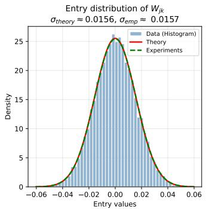

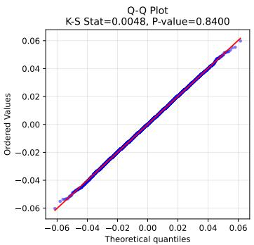

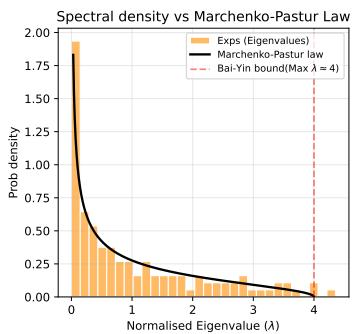  
Figure 6: Statistical and spectral validation of local sub-blocks $\mathbf { W } _ { j k }$ extracted from a Haar-distributed target matrix. (Left) Empirical probability density of the entries from an $s \times s$ sub-block $\mathbf { W } _ { j k }$ . The empirical distribution closely aligns with the theoretical Gaussian density $\mathcal { N } ( 0 , R / d ^ { 2 } )$ (Middle) The Q-Q plot confirms the asymptotic normality of the entries, corroborated by a high Kolmogorov-Smirnov test p-value. (Right) The empirical spectral density of the normalized sample covariance matrix perfectly follows the theoretical Marchenko-Pastur law. The maximum eigenvalue strictly adheres to the Bai-Yin upper bound at $\lambda \approx 4$ , establishing the rigorous mathematical foundation for Morpho's average-case energy capture threshold at $R _ { 0 } \approx d / 4$

Recall from Lemma D.3 that the Morpho parameterization can independently formulate an optimal rank-1 approximation for every block. Consequently, the total expected energy captured by Morpho across all $\cdot ^ { 2 }$ blocks is:

$$
\mathbf { E } ( \mathbf { W } _ { M } ) \geq \sum _ { j = 1 } ^ { r } \sum _ { k = 1 } ^ { r } \sigma _ { 1 } ^ { 2 } ( \mathbf { W } _ { j k } ) \approx r ^ { 2 } \left( C s \frac { R } { d ^ { 2 } } \right) = C r \frac { R } { d } .\tag{47}
$$

For Morpho to strictly outperform the LoRA baseline, its captured energy must exceed LoRA's deterministic energy ceiling $( \mathbf { E } ( \mathbf { W } _ { L } ) = r )$ . Solving $\mathbf { E } ( \mathbf { W } _ { M } ) \bar { > } \mathbf { E } ( \mathbf { W } _ { L } )$ yields:

$$
C r { \frac { R } { d } } > r \Longleftrightarrow R > { \frac { d } { C } }\tag{48}
$$

This average-case threshold demonstrates that under standard random initialization or well-regularized weight distributions, Morpho efficiently surpasses LoRA at approximately 25% of the full rank. This theoretical derivation tightly mirrors our empirical observations of the crossover point in practical settings in Figs. 2 and 14.

Corollary D.1 (Universal crossover bound). With respect to the above settings, the crossover threshold $R _ { 0 }$ satisies:

$$
R _ { 0 } = \lceil \frac { d } { C } \rceil ,\tag{49}
$$

and is independent of the budget rank r. Consequently, for any fixed matrix dimension d, the fraction of targets for which Morpho dominates low-rank approximation is at least $1 - 1 / C ,$ , converging to 0.75, as $d \to \infty$

Proof. This is a direct corollary from Eq. (48) and Lemma D.6 by means of the Marchenko–Pastur law [90] and the Bai-Yin theorem [91].

There is no dependence on budget r, making $R _ { 0 }$ a function of d and C alone. As a result of Lemma D.6, the actually threshold might vary since C follows Tracy-Widom distribution [92].

Synthesis. Corollary D.1 reveals a structurally important universality: the rank at which Morpho overtakes low-rank approximation is determined entirely by the ambient dimension d and the spectral concentration constant C—not by the parameter budget r. This means that as models scale (larger $d ) ,$ the crossover threshold grows proportionally, but the fraction of high-eRank targets for which Morpho dominates remains constant. In the regime of LLMs, where weight matrices are large and their updates are empirically observed to have broadly distributed singular spectra [93], this universality directly predicts the practical advantage of Morpho observed in Sec. 3.2.

## D.4 Numerical stability of SaMA over ranks

Theorem 3.3 establishes the optimal scaling factor for SaMA as:

$$
s _ { \mathrm { S a M A } } = \Theta \left( n _ { 1 } ^ { 1 / 4 } \right) ,\tag{50}
$$

which ensures numerical stability of output and gradient magnitudes as the hidden dimension grows.   
We now empirically validate this prescription against a grid of different scaling strategies.

Experimental setup. We fix matrix dimensions $M = N = 2 0 4 8$ and a constant learning rate, then independently vary $n _ { 1 }$ (with $m _ { 2 }$ fixed) and $m _ { 2 }$ (with $n _ { 1 }$ fixed), monitoring output norms and gradient magnitudes under six scaling schemes parameterized by the free variable $v \in \{ n _ { 1 } , m _ { 2 } \}$

$$
s _ { \mathrm { S a M A } } \in \Bigl \{ \Theta ( 1 ) , ~ \Theta \bigl ( v ^ { - 1 } \bigr ) , ~ \Theta \Bigl ( v ^ { - 1 / 2 } \Bigr ) , ~ \Theta \Bigl ( v ^ { - 1 / 4 } \Bigr ) , ~ \Theta \Bigl ( v ^ { 1 / 4 } \Bigr ) , ~ \Theta \Bigl ( v ^ { 1 / 2 } \Bigr ) \Bigr \} .\tag{51}
$$

Results. Figure 7 reports the outcome across both variation axes, with y-axes represent variance of output y (forward pass) and gradient $\nabla _ { \boldsymbol { \mathcal { L } } } \boldsymbol { x }$ (backward pass), respectively. Two scaling schemes maintain stable signal propagation; all others exhibit either systematic attenuation or divergence as the free parameter grows:

• Panels (a,b) — varying $m _ { 2 } ,$ fixed $n _ { 1 }$ : the constant scheme $s = \Theta ( 1 )$ (green) is the unique stable choice, consistent with the theoretical prediction that s has no dependence on $m _ { 2 }$

• Panels (c,d) — varying $n _ { 1 }$ , fixed $m _ { 2 } { : }$ the quarter-power scheme $s = \Theta ( n _ { 1 } ^ { 1 / 4 } )$ (purple) is the unique stable choice, directly confirming Theorem 3.3.

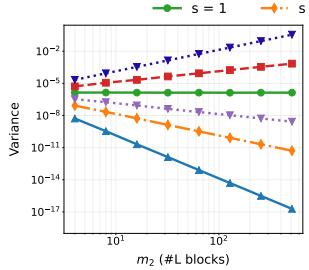  
(a) m2 Forward

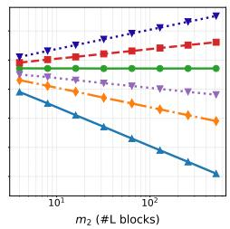  
(b) m2 Backward

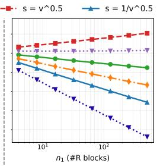  
(c) n1 Forward

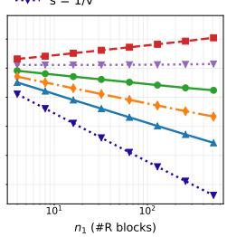  
(d) n1 Backward  
Figure 7: Controlled study of output and gradient magnitudes under six scaling schemes for ssaMA, across two hyperparameter axes. (a,b): $n _ { 1 }$ fixed, $m _ { 2 }$ varying $- s = \Theta ( 1 )$ (green) is the unique stable scheme. (c,d): $m _ { 2 }$ fixed, $n _ { 1 } \mathrm { { \ v a r y i n g - } } s = \Theta ( n _ { 1 } ^ { 0 . { \dot { 2 } } 5 } )$ (purple) is the unique stable scheme. All other schemes exhibit monotone attenuation or divergence.

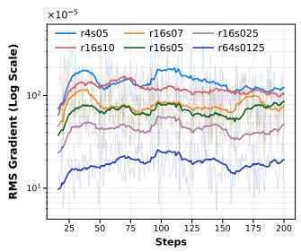  
(a) Config (4,4) to (16,16)

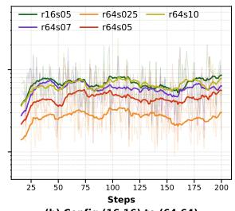

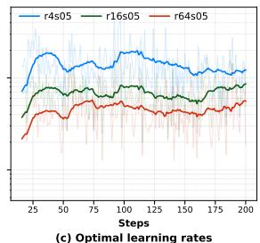  
(b) Config (16,16) to (64,64)  
Figure 8: Observation of moving average of gradient norms over settings, where $( n _ { 1 } = m _ { 2 } = r )$ , S denotes scaling factors. (a,b) illustrate gradient norms when $( m _ { 1 } , n _ { 1 } )$ changes from $( 4 , 4 )$ to (16, 16) and (16, 16) to (64, 64), respectively. The rule in Theorem 3.3 are closely approximated. (c) The gradients of the empirical optimal training configurations for each rank. Higher parameter counts tend to lower the gradient norms. This further illustrate the point to distuinguish between stability and feature learning.

The asymmetry between the two axes clearly show that stability is governed by $n _ { 1 }$ alone, not by $m _ { 2 }$ which corroborates the structural interpretation of Theorem 3.3. That ${ \mathrm { i s } } ,$ the $n _ { 1 } ^ { \overset { \cdot } { 1 } / 4 }$ factor compensates for the growth in the operator norm of $P _ { l } ^ { \top } \mathbf { L } P _ { r } \mathbf { R }$ as the number of right-factor blocks increases, while $m _ { 2 }$ affects only the rank of the adapter (Theorem 3.1) and not its initialization scale.

We also provide practical obervation of gradient norms in Fig. 8. The rule for the scaling factor suggest a means to stablize gradient norms at close values when $n _ { 1 }$ varies. However, as the limitation note in Appendix D.2, while this theoretical rule strictly aligns the gradient scales, it acts primarily as a mathematical safeguard. In optimal empirical scenarios, strictly equating the gradient norm is not always desirable.

## D.5 SaMA Converges to the FFT Solution

Convergence to a full fine-tuning solution. To understand the solution quality of $\mathbf { S a M A }$ , we analyze a canonical linear least-squares (LSQ) setting. Given input $\mathbf { X } \in \mathbb { R } ^ { b \times N }$ , target $\mathbf { Z } \in \mathbb { R } ^ { b \times M }$ and frozen weights $\mathbf { W } _ { 0 } ,$ the fine-tuning objective is:

$$
\operatorname* { m i n } _ { \Delta \mathbf { W } } \ \frac { 1 } { 2 } \big \| \mathbf { Z } - \mathbf { X } \mathbf { W } _ { 0 } ^ { \top } - \mathbf { X } \Delta \mathbf { W } ^ { \top } \big \| _ { F } ^ { 2 } .\tag{52}
$$

Theorem D.1. [Sparsity] Given any generic rank-ρ matrix X, if SaMA configuration: $n _ { 1 } \geq \rho ,$ then any corresponding solution $\Delta \mathbf { W } _ { \mathrm { S a M A } }$ to the LSQ problem also solves the full-LSQ in $E q . \ ( 5 2 )$ .

The theorem asserts that, whenever $n _ { 1 } \geq \mathrm { r a n k } ( { \bf X } )$ , the SaMA-constrained LSQ problem admits solutions that are simultaneously optimal for the unconstrained (FFT) problem. We prove this by reducing the block-diagonal structure of SaMA to a collection of independent standard LSQ problems, then showing that their closed-form solutions produce a zero gradient in the full unconstrained objective.

## Proof Setup

Within the scope of this theorem, $\mathbf { X } \in \mathbb { R } ^ { b \times N }$ and $\mathbf { Z } \in \mathbb { R } ^ { b \times M }$ are batches of row vectors. We optimize the Morpho factors (L, R) directly, absorbing the scaling s into the initialization:

$$
\operatorname* { m i n } _ { \Delta \mathbf { W } \in \mathcal { F } } \frac { 1 } { 2 } \left\| \mathbf { Z } - \mathbf { X } \mathbf { W } _ { 0 } ^ { \top } - \mathbf { X } \Delta \mathbf { W } ^ { \top } \right\| _ { F } ^ { 2 } \equiv \operatorname* { m i n } _ { ( \mathbf { L } , \mathbf { R } ) \in \mathcal { F } _ { g } } \frac { 1 } { 2 } \left\| \mathbf { Z } - \mathbf { X } \mathbf { W } _ { 0 } ^ { \top } - \mathbf { X } \mathbf { R } ^ { \top } P _ { r } ^ { \top } \mathbf { L } ^ { \top } P _ { l } \right\| _ { F } ^ { 2 } .\tag{53}
$$

Fix an generic $\mathbf { R } _ { t } : = \mathbf { R } ^ { \top } , \mathrm { r a n k } ( \mathbf { R } _ { t } ) = n _ { 1 } m _ { 2 }$ and introduce the substitutions:

$$
\mathbf { Y } : = ( \mathbf { Z } - \mathbf { X } \mathbf { W } _ { 0 } ^ { \top } ) P _ { l } ^ { \top } \in \mathbb { R } ^ { b \times M } , \qquad \mathbf { T } : = \mathbf { X } \mathbf { R } _ { t } P _ { r } ^ { \top } \in \mathbb { R } ^ { b \times Q } , \qquad \mathbf { L } _ { t } : = \mathbf { L } ^ { \top } \in \mathbb { R } ^ { Q \times M } ,\tag{54}
$$

where $Q = n _ { 1 } m _ { 2 }$ . The problem in Eq. (53) reduces to:

$$
\operatorname* { m i n } _ { \mathbf { L } _ { t } \in B D } \ \frac { 1 } { 2 } \left. \mathbf { Y } - \mathbf { T L } _ { t } \right. _ { F } ^ { 2 } .\tag{55}
$$

## Step 1: Block Decomposition into Independent Subproblems

Since $\mathbf L _ { t } = \operatorname { d i a g } ( \mathbf L _ { 1 } , \dots , \mathbf L _ { m _ { 2 } } )$ with $\mathbf { L } _ { j } \in \mathbb { R } ^ { n _ { 1 } \times m _ { 1 } }$ , partition all matrices column-wise into $m _ { 2 }$ vertical slices:

$$
\mathbf { Y } = [ \mathbf { Y } _ { 1 } \cdots \mathbf { Y } _ { m _ { 2 } } ] , \quad \mathbf { T } = [ \mathbf { T } _ { 1 } \cdots \mathbf { T } _ { m _ { 2 } } ] , \quad \mathbf { Y } _ { j } \in \mathbb { R } ^ { b \times m _ { 1 } } , \ \mathbf { T } _ { j } \in \mathbb { R } ^ { b \times n _ { 1 } } .\tag{56}
$$

The coupled problem in Eq. (55) decouples exactly into $m _ { 2 }$ independent standard LSQ problems:

$$
\operatorname* { m i n } _ { \mathbf { L } _ { j } } \frac { 1 } { 2 } \left\| \mathbf { Y } _ { j } - \mathbf { T } _ { j } \mathbf { L } _ { j } \right\| _ { F } ^ { 2 } , \qquad j = 1 , \ldots , m _ { 2 } ,\tag{57}
$$

each admitting the closed-form minimizer [94]:

$$
\begin{array} { r } { \mathbf { L } _ { j } ^ { * } = \mathbf { T } _ { j } ^ { \dagger } \mathbf { Y } _ { j } . } \end{array}\tag{58}
$$

Assembling these gives $\mathbf L _ { t } ^ { * } = \mathrm { d i a g } ( \mathbf L _ { 1 } ^ { * } , \ldots , \mathbf L _ { m _ { 2 } } ^ { * } )$ , the solution to Eq. (55).

## Step 2 : The Assembled Solution is a Global Minimizer of the Full LSQ

Define $\Delta \mathbf { W } ^ { * } : = \mathbf { R } _ { t } P _ { r } ^ { \top } \mathbf { L } _ { t } ^ { * } P _ { l }$ . The gradient of the full unconstrained objective with respect to $\Delta \mathbf { W } ^ { \top }$ is:

$$
{ \bf g } _ { \Delta \mathbf { W } ^ { * } } = - { \bf X } ^ { \top } ( { \bf Z } ^ { \prime } - { \bf X } { \bf R } _ { t } P _ { r } ^ { \top } { \bf L } _ { t } ^ { * } P _ { l } ) = - { \bf X } ^ { \top } ( { \bf Y } - { \bf T } { \bf L } _ { t } ^ { * } ) P _ { l } ,\tag{59}
$$

where $\mathbf { Z } ^ { \prime } = \mathbf { Z } - \mathbf { X } \mathbf { W } _ { 0 } ^ { \top }$ . It suffices to show $\mathbf { G } _ { \Delta } : = - \mathbf { X } ^ { \top } ( \mathbf { Y } - \mathbf { T L } _ { t } ^ { * } ) = \mathbf { 0 } _ { N \times M }$

Rank factorization of T. Let $\rho = { \mathrm { r a n k } } ( \mathbf { X } )$ . Since $P _ { r } ^ { \top }$ is orthogonal (full rank) and rank $\left( \mathbf { R } _ { t } \right) =$ $n _ { 1 } m _ { 2 }$ by Theorem 3.1, the rank of T is determined by the bottleneck:

$$
\mathrm { r a n k } ( \mathbf { T } ) = \mathrm { r a n k } ( \mathbf { X } \mathbf { R } _ { t } \pmb { P } _ { r } ^ { \top } ) = \mathrm { r a n k } ( \mathbf { X } ) = \rho .\tag{60}
$$

By SVD, write $\mathbf { T } = \mathbf { O Q }$ where $\mathbf { O } \in \mathbb { R } ^ { b \times \rho }$ has orthonormal columns $( \mathbf { O } ^ { \top } \mathbf { O } = I _ { \rho } ,$ SO $\mathbf { O } ^ { \dagger } = \mathbf { O } ^ { \top } )$ and $\mathbf { Q } \in \mathbb { R } ^ { \rho \times Q }$ has orthonormal rows. Slice column-wise: $\mathbf { T } _ { j } = \mathbf { O } \mathbf { Q } _ { j } , \mathbf { Q } _ { j } \in \mathbb { R } ^ { \rho \times n _ { 1 } }$ . Since $\rho \leq n _ { 1 }$ by assumption, $\mathbf { Q } _ { j }$ is full row-rank due to generic matrices, giving:

$$
\mathbf { Q } _ { j } \mathbf { Q } _ { j } ^ { \dagger } = { \cal I } _ { \rho } .\tag{61}
$$

Because O is full column-rank and $\mathbf { Q } _ { j }$ is full row-rank, the pseudoinverse distributes over their product [95]:

$$
\mathbf { T } _ { j } ^ { \dagger } = ( \mathbf { O Q } _ { j } ) ^ { \dagger } = \mathbf { Q } _ { j } ^ { \dagger } \mathbf { O } ^ { \top } .\tag{62}
$$

Gradient vanishes blockwise. Partition X into $n _ { 2 }$ horizontal slices $\mathbf { X } _ { i } \in \mathbb { R } ^ { b \times n _ { 1 } }$ . The $( i , j )$ -th block of $\mathbf { G } _ { \Delta }$ is:

$$
\begin{array} { r l } & { \mathbf { G } _ { \Delta _ { i , j } } = \mathbf { X } _ { i } ^ { \top } \mathbf { T } _ { j } \mathbf { L } _ { j } ^ { * } - \mathbf { X } _ { i } ^ { \top } \mathbf { Y } _ { j } } \\ & { \quad \quad \quad = \mathbf { X } _ { i } ^ { \top } ( \mathbf { O Q } _ { j } ) ( \mathbf { Q } _ { j } ^ { \dag } \mathbf { O } ^ { \top } ) \mathbf { Y } _ { j } - \mathbf { X } _ { i } ^ { \top } \mathbf { Y } _ { j } } \\ & { \quad \quad \quad = \mathbf { X } _ { i } ^ { \top } \mathbf { O } ( \mathbf { Q } _ { j } \mathbf { Q } _ { j } ^ { \dag } ) \mathbf { O } ^ { \top } \mathbf { Y } _ { j } - \mathbf { X } _ { i } ^ { \top } \mathbf { Y } _ { j } } \\ & { \quad \quad \quad = \mathbf { X } _ { i } ^ { \top } \mathbf { O } I _ { \rho } \mathbf { O } ^ { \top } \mathbf { Y } _ { j } - \mathbf { X } _ { i } ^ { \top } \mathbf { Y } _ { j } } \\ & { \quad \quad \quad = \mathbf { X } _ { i } ^ { \top } ( \mathbf { O O } ^ { \top } ) \mathbf { Y } _ { j } - \mathbf { X } _ { i } ^ { \top } \mathbf { Y } _ { j } . } \end{array}\tag{63}
$$

Since O has orthonormal columns spanning c $\mathrm { o l } ( \mathbf { T } ) = \mathrm { c o l } ( \mathbf { X } )$ , the projection $\mathbf { O } \mathbf { O } ^ { \top }$ is the orthogonal projector onto col(X). Because $\mathbf { X } _ { i } ^ { \dagger }$ maps into $\mathrm { c o l } ( \mathbf { X } ) ^ { \perp } \mathbf { \vec { s } }$ annihilator, $\mathbf { X } _ { i } ^ { \top } \mathbf { O } \mathbf { O } ^ { \top } = \mathbf { X } _ { i } ^ { \top }$ , and thus:

$$
\mathbf { G } _ { \Delta _ { i , j } } = \mathbf { X } _ { i } ^ { \top } \mathbf { Y } _ { j } - \mathbf { X } _ { i } ^ { \top } \mathbf { Y } _ { j } = \mathbf { 0 } _ { n _ { 1 } \times m _ { 1 } } , \qquad \forall i , j .\tag{64}
$$

Hence $\mathbf { G } _ { \Delta } = \mathbf { 0 } _ { N \times M }$ , and $\Delta \mathbf { W } ^ { * }$ is a stationary point— and therefore a global minimizer—of the full LSQ objective.

## Step 3 : Extension to the Full Solution Set

The argument above uses the minimum-norm solution $\mathbf { L } _ { i } ^ { * } = \mathbf { T } _ { i } ^ { \dagger } \mathbf { Y } _ { j }$ . When $\rho \ : < \ : n _ { 1 }$ , the system $\mathbf { T } _ { j } \mathbf { L } _ { j } = \mathbf { Y } _ { j }$ is underdetermined and the complete solution set is $[ \breve { 9 } 4 ]$

$$
\mathbf { L } _ { j } ^ { * } = \mathbf { T } _ { j } ^ { \dagger } \mathbf { Y } _ { j } + ( { \cal I } _ { n _ { 1 } } - \mathbf { T } _ { j } ^ { \dagger } \mathbf { T } _ { j } ) { \cal U } , \qquad { \cal U } \in \mathbb { R } ^ { n _ { 1 } \times m _ { 1 } } .\tag{65}
$$

The null-space term drops out of the gradient:

$$
\begin{array} { r l } & { \mathbf { X } _ { i } ^ { \top } \mathbf { T } _ { j } \mathbf { L } _ { j } ^ { * } = \mathbf { X } _ { i } ^ { \top } \mathbf { Y } _ { j } + \mathbf { X } _ { i } ^ { \top } \mathbf { T } _ { j } ( I _ { n _ { 1 } } - \mathbf { T } _ { j } ^ { \dagger } \mathbf { T } _ { j } ) U } \\ & { \quad \quad \quad \quad \quad = \mathbf { X } _ { i } ^ { \top } \mathbf { Y } _ { j } + \mathbf { X } _ { i } ^ { \top } ( \mathbf { T } _ { j } - \mathbf { T } _ { j } \mathbf { T } _ { j } ^ { \dagger } \mathbf { T } _ { j } ) U } \\ & { \quad \quad \quad \quad = \mathbf { X } _ { i } ^ { \top } \mathbf { Y } _ { j } , } \end{array}\tag{66}
$$

using $\mathbf { T } _ { j } \mathbf { T } _ { j } ^ { \dagger } \mathbf { T } _ { j } = \mathbf { T } _ { j }$ . The gradient vanishes identically across the entire solution set.

## Empirical Verification

Figure 9 confirms the gradient alignment predicted by Theorem D.1: when $n _ { 1 } \geq \mathrm { r a n k } ( { \bf X } )$ , Morpho gradient norms track those of FFT throughout training. Figure 10 reveals an important nuance: point-wise precision (OCS) and subspace alignment (ASA) degrade at different rank thresholds. OCS collapses at n1—the local block capacity—while ASA remains near 1.0 until the global adapter rank $n _ { 1 } m _ { 2 }$ . This separation demonstrates that Morpho maintains the correct geometric subspace of the target transformation long after exact numerical reconstruction becomes infeasible, a property not captured by point-wise metrics alone.

Morpho vs FFT Gradient Dynamics by LBFGS  
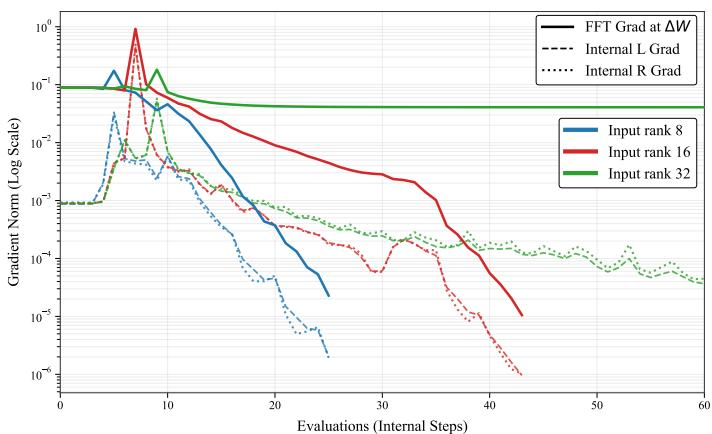  
Figure 9: Gradient dynamics of Morpho factors (L, R) and the FFT baseline over training, at adapter ranks {8, 16, 32}. When $n _ { 1 } \geq \mathrm { r a n k } ( { \bf X } )$ , the Morpho gradient norm tracks the FFT gradient norm closely throughout optimization, confirming Theorem D.1. Divergence emerges only when $n _ { 1 } < \mathrm { r a n k } ( { \bf X } )$ , marking the rank threshold predicted by the theorem.

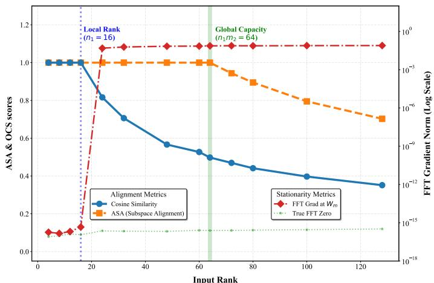  
Figure 10: Structural capacity of Morpho across input ranks. Output Cosine Similarity (OCS) measures point-wise directional alignment between Morpho and FFT outputs—a precision metric for exact numerical reconstruction. Averaged Subspace Alignment (ASA) measures how well the column space of $\Delta \mathbf { W } _ { \mathrm { S a M A } }$ covers that of $\Delta { \bf W } _ { \mathrm { F F T } } - { \bf a }$ coarser but more robust structural metric. Two critical thresholds emerge: $\mathrm { a t } n _ { 1 }$ (the left-factor rank), OCS collapses as individual blocks lose sufficient degrees of freedom for exact reconstruction; at $n _ { 1 } m _ { 2 }$ (the Morpho adapter rank), ASA begins to gradually decay from 1.0, showing that Morpho preserves the fundamental geometric subspace of the target transformation well beyond the point-wise precision threshold.

## D.6 Gauge Invariance in PEFT: A Unified Perspective and the Parameter-Space Uniqueness of Morpho

A central but underappreciated obstacle in factorized fine-tuning is gauge invariance which is known as the existence of a continuous family of internal parameterizations that all produce the identical adapter matrix. It induces flat directions in the loss landscape, destabilizes gradient-based optimizers. We first expose this phenomenon across representative PEFT families, revealing it as a pervasive structural defect rather than an isolated LoRA artifact. We then prove that the invariant manifold of Morpho parameterization reduces to diagonal scalings.

## D.6.1 Gauge Invariance: A Taxonomy of Failure Modes

We unify the analysis under a single framework. Let $\Phi ( \pmb \theta )$ denote any parameterized adapter, mapping a tuple of trainable tensors θ to an update matrix $\Delta \mathbf { W }$ . We say Φ admits a gauge group G if there exists a non-trivial group action $g \cdot \bar { \theta } \mapsto \theta ^ { \prime }$ such that $\Phi ( \theta ^ { \prime } ) = { \dot { \Phi } } ( \theta )$ for all $g \in { \mathcal { G } }$ The larger $\mathcal { G }$ is, the more severe the redundancy becomes.

LoRA: $\mathcal { G } = \mathrm { G L } ( r )$ . LoRA [7] writes $\Delta \mathbf { W } = \mathbf { B } \mathbf { A } , \mathbf { B } \in \mathbb { R } ^ { M \times r } , \mathbf { A } \in \mathbb { R } ^ { r \times N }$ . For any invertible $\mathbf { C } \in \mathbb { R } ^ { r \times r } ;$

$$
\Delta \mathbf { W } = \mathbf { B } \mathbf { A } = ( \mathbf { B } \mathbf { C } ) ( \mathbf { C } ^ { - 1 } \mathbf { A } ) = \mathbf { B } ^ { \prime } \mathbf { A } ^ { \prime } .\tag{67}
$$

The gauge group is the full general linear group $\operatorname { G L } ( r )$ , which is $r ^ { 2 }$ -dimensional. Every point in parameter space lies at the intersection of an ${ \bar { r } } ^ { 2 } .$ -dimensional flat valley. This symmetry is broken only at the boundary of the feasible set (e.g. when A or B becomes rank-deficient), which is measure-zero but attracting for gradient descent near convergence, producing the well-documented rank collapse phenomenon [16]. The same $\operatorname { G L } ( r )$ redundancy propagates verbatim to DoRA [28], PiSSA [8], MiLoRA [64], HiRA [19], RandLoRA [51], and ABBA [35], since all of them retain the BA formulation at their core.

QuanTA: Multi-linear ${ \mathcal { G } } = \operatorname { G L } ( d _ { 1 } ) \times \cdots \times \operatorname { G L } ( d _ { K } )$ QuanTA [11] contracts a chain of parameter tensors $\{ \mathcal { T } _ { k } \} _ { k = \cdot } ^ { K }$ over shared latent dimensions $\{ d _ { k } \}$ . The weight update (suppressing input indices) is:

$$
\Delta \mathcal { W } _ { g , h , i , a , b , c } = \sum _ { d , e , f } ( \mathcal { T } _ { 1 } ) _ { g , h , d , e } ( \mathcal { T } _ { 2 } ) _ { d , i , a , f } ( \mathcal { T } _ { 3 } ) _ { e , f , b , c } .\tag{68}
$$

Inserting identity resolutions $\mathbf { C } _ { d } ^ { - 1 } \mathbf { C } _ { d } = \pmb { I }$ along each shared latent dimension d independently:

$$
\mathcal { T } _ { 1 } \times _ { d } \mathcal { T } _ { 2 } = ( \mathcal { T } _ { 1 } \times _ { d } \mathbf { C } _ { d } ^ { - 1 } ) \times _ { d } \left( \mathbf { C } _ { d } \times _ { d } \mathcal { T } _ { 2 } \right) = \tilde { \mathcal { T } } _ { 1 } \times _ { d } \tilde { \mathcal { T } } _ { 2 } , \qquad \mathbf { C } _ { d } \in \operatorname { G L } ( d ) .\tag{69}
$$

Since this freedom is independent across every shared axis, the total gauge group is $\textstyle \prod _ { k } \mathrm { G L } ( d _ { k } )$ whose dimension is $\textstyle \sum _ { k } { \bar { d } } _ { k } ^ { 2 }$ . For typical QuanTA configurations with $K = 3$ and $d _ { k } \sim 8 \ – 6 4$ this amounts to hundreds of redundant degrees of freedom per adapter, making the loss landscape exponentially more degenerate than LoRA.

Orthogonal fine-tuning (OFT / BOFT): $\mathcal { G } = O ( r )$ Orthogonal Fine-Tuning [59] and its butterfly variant BOFT [96] parameterize the adapter as an orthogonal matrix Q, updating the weight as ${ \mathbf W } _ { f t } = { \mathbf Q } { \mathbf W } _ { 0 }$ . Because Q is constrained to $O ( N )$ , a direct dense gauge group is not available; however, within the block structure of BOFT, each block admits an ${ \mathrm { \bar { \cal O } } } ( \bar { b } )$ ambiguity (b being the block size) in its parameterization via skew-symmetric generators, yielding a gauge group $\Pi _ { k } \bar { O } ( b )$ For skew-symmetric parameterizations of the form $\mathbf { A } = \mathbf { U } \mathbf { V } ^ { \top } - \mathbf { V } \mathbf { U } ^ { \top }$ , the substitution $\mathbf { U }  \mathbf { U } \mathbf { C }$ $\mathbf { V }  \mathbf { V } \mathbf { C }$ for any $\mathbf { C } \in O ( r )$ leaves A unchanged, confirming an $O ( r )$ -valued gauge symmetry.

Summary. Across the PEFT landscape, gauge invariance is the rule, not the exception. The severity is determined by the dimensionality of the gauge group: dim $\mathcal { G } = r ^ { 2 }$ for $\mathrm { L o R A } ; \sum d _ { k } ^ { 2 }$ for QuanTA; (2) for orthogonal methods.

## D.6.2 Invariant Manifold of Morpho Parameterization

We build the theory in three steps as follows:

Step 1: The Kronecker Baseline We first establish uniqueness for the most structured case—a pure Kronecker product—as the theoretical bedrock.

Theorem D.2 (Uniqueness of Kronecker factorization). Let $\mathbf { K } = \mathbf { A } _ { 1 } \otimes \mathbf { B } _ { 1 } \neq \mathbf { 0 }$ with $\mathbf { A } _ { 1 } \in \mathbb { R } ^ { m _ { 1 } \times n _ { 1 } }$ $\mathbf { B } _ { 1 } \in \mathbb { R } ^ { m _ { 2 } \times n _ { 2 } } . \ I f \bar { \mathbf { C } } \otimes \mathbf { D } = \mathbf { K }$ for some $\mathbf { C } \in \mathbb { R } ^ { m _ { 1 } \times n _ { 1 } } , \mathbf { D } \in \mathbb { R } ^ { m _ { 2 } \times n _ { 2 } }$ , then:

$$
\exists k \in \tilde { \mathbb { R } } : \quad \mathbf { C } = k ^ { - 1 } \mathbf { A } _ { 1 } , \quad \mathbf { D } = k \mathbf { B } _ { 1 } .\tag{70}
$$

Proof. Since $\mathbf { K } \neq \mathbf { 0 }$ , at least one block entry $a _ { i j } \mathbf { B } _ { 1 } \neq \mathbf { 0 }$ of the first Kronecker expansion equals $c _ { i j } \mathbf { D }$ of the second. With $a _ { i j } , c _ { i j } \neq 0$ (otherwise the block is zero in both), it follows that $\mathbf { D } = \bar { k } \mathbf { B } .$ 1 where $k = a _ { i j } / c _ { i j }$ . Substituting back and applying the cancellation law for Kronecker products:

$$
\mathbf { A } _ { 1 } \otimes \mathbf { B } _ { 1 } = \mathbf { C } \otimes ( k \mathbf { B } _ { 1 } ) = ( k \mathbf { C } ) \otimes \mathbf { B } _ { 1 } \quad \Rightarrow \quad \mathbf { A } _ { 1 } = k \mathbf { C } .\tag{71}
$$

Hence $\mathbf { C } = k ^ { - 1 } \mathbf { A } _ { 1 }$ , and the scalar k is the sole degree of freedom.

□

Theorem D.2 establishes a striking contrast with LoRA: the Kronecker product $\mathbf { A } \otimes \mathbf { B }$ uniquely determines the pair (A, B) up to a single scalar. The gauge group is $\mathcal { G } = \tilde { \mathbb { R } } \cong ( \tilde { \mathbb { R } } ) ^ { 1 }$ , reducing $r ^ { 2 }$ degrees of freedom to exactly 1.

Step 2: Square Monarch Matrices Monarch parameterization extends Kronecker products to square matrices via two block-diagonal factors and a permutation. We characterize its full invariant manifold for a $N { \mathrm { - } } { \mathrm { b y } } { \mathrm { - } } N$ square matrix, factorized by ${ \dot { n } } : n ^ { 2 } = N$

Lemma D.7 (Permutation conjugation of diagonal matrices). Let $D _ { L } = \mathrm { d i a g } ( \pmb { v } )$ be an invertible diagonal matrix and $P _ { 1 } = P _ { n , n }$ the perfect shuffle permutation. Define $\mathbf { L } = \mathbf { L } _ { 0 } D _ { L }$ and $\mathbf { R } =$ $P _ { 1 } ^ { \top } D _ { L } ^ { - 1 } P _ { 1 } \mathbf { R } _ { 0 }$ . Then (L, R) are block-diagonal with the same block structure as $( { \bf L } _ { 0 } , { \bf R } _ { 0 } )$

Proof. Right-multiplying a block-diagonal matrix $\mathbf { L } _ { 0 }$ by a diagonal $D _ { L }$ scales each row independently, preserving the block structure: ${ \bf L } _ { i j } = ( { \bf L } _ { 0 } ) _ { i j } ( D _ { L } ) _ { j j }$ . For R, observe that $Q : = P _ { 1 } ^ { \top } D _ { L } ^ { - 1 } P _ { 1 }$ satisfies $Q _ { i j } = d _ { \pi ( j ) } [ e _ { \pi ( i ) } ^ { \top } e _ { \pi ( j ) } ]$ , which is zero for $i \neq j$ and equals $d _ { \pi ( j ) }$ for $i = j$ . Thus $Q$ is diagonal with entries permuted by π, and left-multiplying a block-diagonal $\mathbf { R } _ { 0 }$ by a diagonal matrix preserves its block structure. □

Lemma D.8 (Reverse direction: block-diagonality forces diagonality). Let $D _ { L } , D _ { R }$ satisfy $\mathbf { L } =$ ${ \bf L } _ { 0 } { \cal D } _ { L }$ and ${ \bf R } = { \cal D } _ { R } ^ { - 1 } { \bf R } _ { 0 }$ with $( { \bf L } , { \bf R } , { \bf L } _ { 0 } , { \bf R } _ { 0 } ) \in B D ^ { ( n ) }$ (block-diagonal with $n \times n$ blocks), and $ { \boldsymbol { D } } _ { R } =  { \boldsymbol { P } } _ { 1 } ^ { \top }  { \boldsymbol { D } } _ { L }  { \boldsymbol { P } } _ { 1 }$ . Then $D _ { L }$ and $D _ { R }$ are diagonal.

Proof. Since $( { \bf L } , { \bf L } _ { 0 } )$ and $( \mathbf { R } , \mathbf { R } _ { 0 } )$ are pairwise block-diagonal, ${ D _ { L } } , { D _ { R } } \in \ B { B } \mathcal { D }$ . Write the permutation function π of $P _ { n , n }$ explicitly (1-indexed):

$$
\pi : i \mapsto n { \big ( } ( i - 1 ) { \bmod { n } } { \big ) } + { \big [ } i / n { \big ] } .\tag{72}
$$

The $( i , j )$ -entry of ${ \cal D } _ { R } = { \cal P } _ { 1 } ^ { \top } { \cal D } _ { L } { \cal P } _ { 1 }$ is $( D _ { L } ) _ { \pi ( i ) , \pi ( j ) }$ . For a principal entry $( i , j )$ within the k-th diagonal block of $D _ { R }$ (so $( k - 1 ) n < i , j \leq$ kn or $\bar { \lceil { i } / { n } \rceil } = \lceil { j } / { n } \rceil = k )$ , write $i = ( k - 1 ) n + l _ { i }$ $j = ( k - 1 ) n + l _ { j }$ with $l _ { i } , l _ { j } \in \overline { { 1 . . n } }$ . The relocated index satisfies $| i - j | _ { D _ { R } } = | l _ { i } - l _ { j } | n \geq n$ whenever $i \neq j ,$ placing it strictly outside any diagonal block of $D _ { L }$ Since $\mathbf { \ddot { \boldsymbol { D } } } _ { L } \in \boldsymbol { B } \mathcal { \boldsymbol { D } }$ requires off-diagonal-block entries to vanish, we conclude $( { \bar { D } } _ { R } ) _ { i j } = 0$ for all $i \neq j$ , i.e. $D _ { R }$ is diagonal, and then so is $D _ { L }$ by the same argument applied in reverse. □

Theorem D.3 (Invariant manifold of square Monarch / Morpho). Let $\mathbf { M } _ { 0 } = P _ { 1 } ^ { \top } \mathbf { L } _ { 0 } P _ { 1 } \mathbf { R } _ { 0 } \in \mathcal { F } ^ { ( N ) }$ be a square Monarch matrix. The set of all generative factor pairs is:

$$
\begin{array} { r } { \mathcal { F } _ { g } ( \mathbf { M } _ { 0 } ) = \Big \{ ( \mathbf { L } , \mathbf { R } ) \Big | \mathbf { L } = \mathbf { L } _ { 0 } D , \ \mathbf { R } = P _ { 1 } ^ { \top } D ^ { - 1 } P _ { 1 } \mathbf { R } _ { 0 } ; \ D = \mathrm { d i a g } ( \pmb { v } ) , \ \pmb { v } \in \tilde { \mathbb { R } } ^ { N } \Big \} . } \end{array}\tag{73}
$$

The gauge group is isomorphic to $\tilde { \mathbb { R } } ^ { N }$ , the N-dimensional multiplicative torus.

Proof. Let $( \mathbf { L } , \mathbf { R } ) \in \mathcal { F } _ { g } ( \mathbf { M } _ { 0 } )$ , SO $P _ { 1 } ^ { \top } \mathbf { L } P _ { 1 } \mathbf { R } = P _ { 1 } ^ { \top } \mathbf { L } _ { 0 } P _ { 1 } \mathbf { R } _ { 0 }$ . Cancelling the leading $P _ { 1 } ^ { \top }$ and right-multiplying by $\mathbf { R } ^ { - 1 }$ (which exists almost surely in the random-initialization regime; see Appendix D.1):

$$
\mathbf { L } _ { 0 } ^ { - 1 } \mathbf { L } P _ { 1 } = P _ { 1 } \mathbf { R } _ { 0 } \mathbf { R } ^ { - 1 } \quad \Rightarrow \quad D _ { L } P _ { 1 } = P _ { 1 } D _ { R } ,\tag{74}
$$

where $\begin{array} { r } { { D } _ { L } = { \bf L } _ { 0 } ^ { - 1 } { \bf L } } \end{array}$ and ${ \cal D } _ { R } = { \bf R } _ { 0 } { \bf R } ^ { - 1 }$ , giving the conjugation relation ${ D _ { R } } = { P } _ { 1 } ^ { \top } { D } _ { L } { P } _ { 1 }$ . By Lemma $\mathrm { D } . 8 , D _ { L }$ is diagonal; by Lemma $\mathbf { D } . 7 , ( \mathbf { L } , \mathbf { R } )$ are valid block-diagonal factors. The forward direction (any diagonal D yields a valid reparameterization) is immediate from Lemma D.7.

## Step 3: General Morpho (Rectangle)

Lemma D.9 (Pseudoinverse block-preservation for rectangular factors). Let $\mathbf { L } \in \mathbb { R } ^ { M \times q }$ be full column-rank block-diagonal and $\mathbf { R } \in \mathbb { R } ^ { q \times N }$ be full row-rank block-diagonal with $q = n _ { 1 } m _ { 2 } <$ min $( M , N )$ $H f \mathbf { L } = \mathbf { L } _ { 1 } D _ { L i }$ and ${ \mathbf { R } } = { \cal { D } } _ { R r } ^ { - 1 } { \mathbf { R } } _ { } .$ with $\begin{array} { r } { D _ { R r } = P _ { r } ^ { \top } D _ { L r } P _ { r } } \end{array}$ , then $\pmb { D } _ { L _ { \tau } }$ . and $\pmb { D } _ { R r }$ are diagonal.

Proof. Since block-diagonal matrices with full-rank blocks admit pseudoinverses that decouple blockwise (Moore-Penrose uniqueness $[ 9 7 ] )$ , both $D _ { L r } = { \bf L } _ { 1 } ^ { \dagger } { \bf L }$ and $D _ { R r } = { \bf R } _ { 1 } { \bf R } ^ { \dagger }$ lie in $B D$ specifically as $q \times q$ square matrices with m2 blocks of size $n _ { 1 } \times n _ { 1 }$ and $n _ { 1 }$ blocks of size $m _ { 2 } \times m _ { 2 }$ respectively. The conjugation ${ \cal D } _ { R r } = { \cal P } _ { r } ^ { \top } { \cal D } _ { L r } { \cal P } _ { \prime }$ . with permutation $P _ { r } = P _ { n _ { 1 } , m _ { 2 } }$ (with $\pi ( i ) =$ $\pi _ { n _ { 1 } , m _ { 2 } } ( i ) = n _ { 1 } \left[ ( i - 1 ) \right.$ mod $m _ { 2 } ] + \lceil i / \dot { m _ { 2 } } \rceil ;$ ) relocates each off-diagonal principal entry of $D _ { L r }$ to a position outside any block of $\scriptstyle D _ { R r }$ . Since $\boldsymbol { D } _ { R r } \in \boldsymbol { B D }$ forces those entries to zero, $\boldsymbol { D } _ { L r }$ must be diagonal, and hence so is $\pmb { D } _ { R r }$ □

Theorem D.4 (Gauge invariance of parameter-efficient Morpho). Let $\mathbf { M } _ { 1 } = P _ { l } ^ { \top } \mathbf { L } _ { 1 } P _ { r } \mathbf { R } _ { 1 } \in \mathcal { F } ^ { ( M , N ) }$ with hidden dimension $q = n _ { 1 } m _ { 2 } \leq \operatorname* { m i n } ( M , N )$ . The invariant manifold of generative factor pairs is:

$$
\mathscr { F } _ { g } ( \mathbf { M } _ { 1 } ) = \Big \{ ( \mathbf { L } , \mathbf { R } ) \Big | \mathbf { L } = \mathbf { L } _ { 1 } D , \ \mathbf { R } = P _ { r } ^ { \top } D ^ { - 1 } P _ { r } \mathbf { R } _ { 1 } ; \ D = \mathrm { d i a g } ( \pmb { v } ) , \ \pmb { v } \in \tilde { \mathbb { R } } ^ { q } \Big \} .\tag{75}
$$

The gauge group is $\mathcal { G } _ { M o r p h o } \cong ( \tilde { \mathbb { R } } ) ^ { q }$

Proof. For a randomly initialized adapter, $\mathbf { L } _ { 1 }$ is full column-rank and ${ \bf R } _ { 1 }$ is full row-rank almost surely. From $P _ { l } ^ { \top } \mathbf { L } P _ { r } \mathbf { R } = P _ { l } ^ { \top } \mathbf { L } _ { 1 } P _ { r } \mathbf { R } _ { 1 }$ , left-multiply by ${ \bf L } _ { 1 } ^ { \dag } P _ { l }$ and right-multiply by $\mathbf { R } ^ { \dagger }$

$$
D _ { L 1 } P _ { r } = P _ { r } D _ { R 1 } , \quad D _ { L 1 } = { \bf L } _ { 1 } ^ { \dagger } { \bf L } , \quad D _ { R 1 } = { \bf R } _ { 1 } { \bf R } ^ { \dagger } ,\tag{76}
$$

yielding the conjugation $\pmb { D } _ { R 1 } = \pmb { P } _ { r } ^ { \top } \pmb { D } _ { L 1 } \pmb { P } _ { r }$ . By Lemma D.9, $D _ { L 1 }$ is diagonal; by Lemma $_ { \mathrm { D . 7 , } }$ any diagonal D generates a valid block-diagonal reparameterization. □

## D.6.3 Discussion: Why Diagonal Gauge Structure Matters for Optimization

The geometry of degeneracy. Theorem D.4 establishes that the invariant manifold of Morpho is a q-dimensional torus denoted as $\begin{array} { r } { \mathcal { T } ^ { q } = ( \tilde { \mathbb { R } } ) ^ { q } } \end{array}$ . In contrast, LoRA's gauge group $\operatorname { G L } ( r )$ contains not only diagonal scalings but also rotations, shearings, and reflections. All of these are invisible to the loss function yet create curved, degenerate valleys that optimizers may navigate poorly.

Decoupling magnitude from direction. The GL(r) symmetry of LoRA conflates magnitude and directional updates in the parameter space. DoRÀ [28] addresses this empirically by explicitly decomposing weight updates into magnitude and direction components. Morpho resolves the same issue structurally: since the only reparameterization freedom is diagonal scaling, the ¿-th hidden feature's magnitude is encoded by $\pmb { D } _ { i i }$ , while its direction is fixed by $\mathbf { L } _ { i }$ and $\mathbf { R } _ { i }$ . Magnitude and direction are structurally decoupled without requiring any post-hoc decomposition.

## D.7 Distinction from MoRE Fine-tuning

Although both SaMA and MoRE [30] leverage perfect shuffle permutations in their designs, they differ fundamentally in their algebraic factorization, resulting in distinct interaction topologies.

Consider a MoRE adapter $\mathbf { W } \in \mathbb { R } ^ { M \times N }$ , defined as ${ \bf W } = P _ { 2 } { \bf L } _ { B } \cdot P _ { z } \cdot { \bf R } _ { B }$ , where b is the number of blocks in both $\mathbf { L } _ { B }$ and ${ \bf R } _ { B } , r _ { b l k }$ is the local rank of each block, and $P _ { z } , P _ { 2 }$ are the stride permutation matrices as prescribed in the MoRE configuration. The matrices $\mathbf { L } _ { B }$ and $\mathbf { R } _ { B }$ consist of submatrices of size $m \times r _ { b l k }$ and $r _ { b l k } \ \times \ n$ , respectively, where $m \ : = \ : M / b$ and $n \ : = \ : N / b$ . In the context of reparameterization, we omit the final permutation matrix ${ \bf P } _ { 2 }$ in the analysis and simply write: $\mathbf { W } = \mathbf { L } _ { B } \cdot P _ { z } \cdot \mathbf { R } _ { B }$ , as it cancels out when comparing two adapters of the same configuration.

$$
\begin{array} { r l r } & { } & { P _ { z } = P _ { r _ { b l k } , b } , \quad } \\ & { } & { { \bf L } _ { B } = \mathrm { d i a g } ( { \bf L } _ { 1 } , \ldots , { \bf L } _ { b } ) , \quad { \bf L } _ { i } \in \mathbb { R } ^ { m \times r _ { b l k } } , 1 \le i \le b , } \\ & { } & { { \bf R } _ { B } = \mathrm { d i a g } ( { \bf R } _ { 1 } , \ldots , { \bf R } _ { b } ) , \quad { \bf R } _ { j } \in \mathbb { R } ^ { r _ { b l k } \times n } , 1 \le j \le b . } \end{array}
$$

## D.7.1 Different Objectives in Structured Matrix Design

Core Motivation: MoRE prioritizes sparsity preservation to minimize parameters, whereas SaMA extends Kronecker factorization to gain flexibility, scalability, and global interactions.

Architectural Principle: MoRE follows a partitioned low-rank paradigm: it splits the representation space into isolated, group-wise low-rank blocks and relies on permutations to mix them. In dense adapter regimes, this design suffers from information isolation (Fig. 11). In contrast, SaMA applies a bilateral structured permutation $( P _ { l } ^ { \top } \mathbf { L } P _ { r } )$ that converts the factors into block-diagonal matrices, yielding a globally distributed interaction grid inherited from the Kronecker product (Fig. 12).

Design Strategy: Consistent with its partitioning principle, MoRE divides both factors into b low-rank blocks, so its parameter count is dictated solely by the block rank $r _ { b l k }$ . SaMA instead derives the number of blocks per factor from block shapes – a choice rooted in the Kronecker view – which establishes mutual connections across partitions.

Table 6: Summary of fundamental structural and algebraic differences between MoRE and SaMA, where b and $r _ { b l k }$ denote the number of blocks and the block rank, respectively.
<table><tr><td>Feature</td><td>MoRE</td><td>SaMA (Ours)</td></tr><tr><td>Algebraic Form</td><td>Multi-LoRA + Permutation</td><td>Kronecker Product Generalization</td></tr><tr><td>Interaction Topology</td><td>Fragmented (Isolated subspaces)</td><td>Guaranteed 100% Dense</td></tr><tr><td>Factor Shapes</td><td> $\mathbf { L } _ { B } : ( b , M / b , r _ { b l k } )$   $\mathbf { R } _ { B } : ( b , r _ { b l k } , N / b )$ </td><td> $\mathbf { L } : ( m _ { 2 } , m _ { 1 } , n _ { 1 } )$   $\mathbf { R } : ( n _ { 1 } , m _ { 2 } , n _ { 2 } )$ </td></tr><tr><td>Parameter Count θ</td><td> $r _ { b l k } ( M + N )$ </td><td> $n _ { 1 } M + m _ { 2 } N$ </td></tr><tr><td>Invariant Manifold</td><td>Allows off-diagonal interactions</td><td>Diagonal matrices only</td></tr></table>

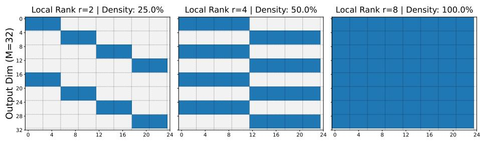  
Input Dim (N=24)  
Figure 11: Binary masks of MoRE's equivalent output (when $b = 8 )$ . Blue regions indicate trainable cross-neuron connections. The visualization suggests that MoRE inherently enforces a fragmented, sparse interaction topology when $r _ { b l k } < b .$ Global dense connectivity is exclusively conditionally triggered when the local rank matches the number of blocks $( r _ { b l k } = b )$

## D.7.2 MoRE fails to restrain the invariant manifold to diagonal transformations

Theorem D.5 (Reparameterization in MoRE). Assume $r _ { b l k } > b > 1$ , there exists a non-diagonal invertible matrix $\dot { \boldsymbol { C } } \in \mathbb { R } ^ { b r _ { b l k } \times b r _ { b l k } }$ that reparameterizes the MoRE factors as:

$$
{ \bf L } _ { B } ^ { \prime } = { \bf L } _ { B } ( P _ { z } C P _ { z } ^ { \top } ) , \qquad { \bf R } _ { B } ^ { \prime } = C ^ { - 1 } { \bf R } _ { B } ,
$$

while leaving the resulting weight W invariant.

Constructive Proof. For any invertible $C \in \mathbb { R } ^ { b r _ { b l k } \times b r _ { b l k } }$ , inserting $P _ { z } C P _ { z } ^ { \top } \cdot P _ { z } C ^ { - 1 } P _ { z } ^ { \top } = I$ between $\mathbf { L } _ { B }$ and $P _ { z }$ gives:

$$
\mathbf { W } \ = \ \mathbf { L } _ { B } P _ { z } \mathbf { R } _ { B } \ = \ \underbrace { \mathbf { L } _ { B } ( P _ { z } C P _ { z } ^ { \top } ) } _ { \mathbf { L } _ { B } ^ { \prime } } \ P _ { z } \underbrace { C ^ { - 1 } \mathbf { R } _ { B } } _ { \mathbf { R } _ { B } ^ { \prime } } .
$$

It remains to construct a non-diagonal C such that $( \mathbf { L } _ { B } ^ { \prime } , \mathbf { R } _ { B } ^ { \prime } )$ are valid MoRE factors, i.e. both retain the prescribed block-diagonal structure.

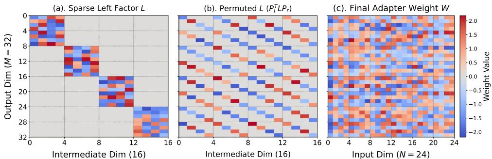  
Figure 12: The structural transformation pipeline of SaMA. The heatmaps illustrate the deterministic expansion of the parameterization space. The sparse, block-diagonal left factor (a) is reorganized by modulo-based stride permutations into a tiled sub-diagonal pattern (b), effectively executing a Kronecker operand swap. This scattered representation is then integrated by the right factor to produce a fully dense global weight matrix (c), achieving complete input-output feature mixing regardless of adapter configurations.

Construction. Take $C = I + \alpha \mathbf { E } _ { u , v } ,$ with $\alpha \in \tilde { \mathbb { R } }$ and u $\neq v ,$ where $\mathbf { E } _ { u , v }$ has a single 1 at position $( u , v )$ . Such C is automatically non-diagonal and invertible (with the inverse $C ^ { - 1 } = I - \alpha \mathbf { E } _ { u , v } )$ Validity then reduces to choosing $( u , v )$ so that the block-sparsity patterns of $\mathbf { R } _ { B }$ and $\mathbf { L } _ { B }$ are preserved:

1. Right preservation. $C ^ { - 1 }$ acts on $\mathbf { R } _ { B }$ by row mixing. Confining the mixing within a single block of $\mathbf { R } _ { B }$ requires $\left\lceil u / r _ { b l k } \right\rceil = \left\lceil v / r _ { b l k } \right\rceil$

2. Left preservation. The conjugated factor $C _ { L } = P _ { z } C P _ { z } ^ { \top }$ acts on $\mathbf { L } _ { B }$ by column mixing. Letting π denote the index permutation induced by $P _ { z }$ hence $P _ { z } e _ { u } = e _ { \pi ( u ) }$ , leads to $P _ { z } \mathbf { E } _ { u , v } P _ { z } ^ { \top } = \mathbf { E } _ { \pi ( u ) , \pi v }$ , therefore the off-diagonal entry must remain inside one block of $\mathbf L _ { B } \mathrm { \ i f } \mathrm { ; \ } \lceil \pi ( u ) / r _ { b l k } \rceil = \lceil \pi ( v ) / r _ { b l k } \rceil$

Existence of valid $( u , v )$ . Write an index in $\mathbf { R } _ { B }$ given by $u = ( k - 1 ) \cdot b + l$ with $k \in { \overline { { 1 . . r _ { b l k } } } }$ and $l \in \overline { { 1 . . b } }$ . The stride permutation map $u \mapsto \pi ( u ) = ( l - 1 ) \cdot r _ { b l k } + k$ , i.e. u is sent to the k-th position of block l of $\mathbf { L } _ { B }$

By selecting adjacent coefficients $k _ { u } = 1 , k _ { v } = 2$ and offset $( l = 1 )$ , the linear indices $u = 1$ and $v = b + 1$ both belong to block 1 of $\mathbf { R } _ { B }$ since $r _ { b l k } > b$ . Their images under π are $\pi ( u ) = 1$ and $\pi ( v ) = 2$ , both mapped indices remain in block 1 of $\mathbf { L } _ { B }$ . Thus $( \bar { u , v } ) = ( 1 , b + 1 )$ satisfies both preservation conditions.

Verification. By construction, C is non-diagonal and invertible. Condition 1 confines the mixing $C ^ { - 1 }$ to a single block of $\mathbf { R } _ { B } ,$ sO $\mathbf { R } _ { B } ^ { \prime } \in \tilde { B D }$ . Condition 2 places the off-diagonal entry of $C _ { L }$ inside one block of $\mathbf { L } _ { B }$ , so $\boldsymbol { C } _ { L } \in \boldsymbol { B } \boldsymbol { D }$ and consequently $\mathbf { L } _ { B } ^ { \prime } = \mathbf { \bar { L } } _ { B } C _ { L } \in B D$ . Hence $( \mathbf { L } _ { B } ^ { \prime } , \dot { \mathbf { R } } _ { B } ^ { \prime } )$ is a valid MoRE reparameterization of W. □

The construction generalizes immediately to $\begin{array} { r } { C = I + \sum _ { ( u , v ) \in S } \alpha _ { u , v } { \bf E } _ { u , v } } \end{array}$ for any set $s$ of pairs satisfying both conditions, provided C is invertible $( \mathrm { e . g . } S = \{ ( 1 , b + 1 ) , ( b + 1 , 1 ) \}$ with $\alpha _ { 1 , b + 1 } \alpha _ { b + 1 , 1 } = 1$ yields det $C = 0 )$ . Since our purpose is only to show that the invariant manifold of MoRE strictly extends beyond the diagonal subspace D, we leave a complete characterization of this extended subspace to future work.

As a direct corollary of Theorem D.5, the MoRE design admits mutual interactions across its invariant manifold, at least when $r _ { b l k } > b ,$ which can introduce entanglement in the parameter space – a behavior fundamentally distinct from the diagonal-only gauge structure of SaMA (Theorem D.4).

## D.7.3 Pseudo code for SaMA implementation vs. MoRE implementation

As the permutations $P _ { l }$ and $\mathbf { P } _ { r }$ are not explicitly constructed but we use matrix tranpose operation insead, we provide a pseudocode to demonstrate their implemetation in algorithm 2. We further provide pseudocode for MoRE [30] in algorithm 1 to help better distinguish the two methods.

Algorithm 1 MoRE Forward Pass   
Require: Input $\boldsymbol { x } \in \mathbb { R } ^ { B \times ( b \times s ) }$   
Require: Factors $\bar { W } _ { 1 } \in \mathbb { R } ^ { b \times r \times s } , W _ { 2 } \in \mathbb { R } ^ { b \times s \times r }$   
1: Phase 1: Local Block Projection   
2: Reshape x to $( B , b , s )$ and apply Batched MatMul   
3: y1 ← BLOCKDIAGMULT(x, W1) ▶ Shape: $( B , b , r )$   
4: Phase 2: Middle Permutation (Stride Routing)   
5: Flatten, view as (r, b), then transpose   
6: $y _ { p } \gets \mathrm { R E A R R A N G E } ( y _ { 1 } , \prime ( r b ) \to ( b r ) ^ { \prime } )$ Shape: $( B , \dot { b } , r )$   
7: Phase 3: Final Block Projection   
8: y2 ← BLOCKDIAGMULT $( y _ { p } , W _ { 2 } )$ Shape: (B, b, s)   
9: Phase 4: Output Permutation   
10: yo ← REARRANGE(y2, '(b s) → (s b)') Shape: (B, s, b)   
11: return RESHAPE $\left( \boldsymbol { y } _ { o } , [ B , s \times b ] \right)$

Algorithm 2 SaMA Forward Pass (Ours)   
Require: Input $x \in \mathbb { R } ^ { B \times ( c _ { L } \times c _ { R } ) }$   
Require: Factors L ∈ RrR×(rL×cL), $R \in \mathbb { R } ^ { c _ { L } \times ( r _ { R } \times c _ { R } ) }$ (3D-tensors)   
Require: Scaling factor α   
1: Phase 1: Right Factor Projection   
2: yr ← BLOCKDIAGMULT(x, R) ▶ Shape: $( B , c _ { L } , r _ { R } )$   
3: Phase 2: Bilateral Permutation I (Mid-routing)   
4: $y _ { p 1 } \gets \mathrm { R E A R R A N G E } ( y _ { r } , ^ { \prime } ( c _ { L } r _ { R } ) \to ( r _ { R } c _ { L } ) ^ { \prime } )$ Shape: $\left( B , r _ { R } , c _ { L } \right)$   
5: Phase 3: Left Factor Projection   
6: yl ← BLOCKDIAGMULT $( y _ { p 1 } , L )$ Shape: $\left( \boldsymbol { B } , \boldsymbol { r } _ { R } , \boldsymbol { r } _ { L } \right)$   
7: Phase 4: Bilateral Permutation II (Missing in MoRE)   
8: Restores spatial alignment via Kronecker commutation   
9: $y _ { p 2 } \gets \mathrm { R E A R R A N G E } ( y _ { l } , ^ { \prime } ( r _ { R } r _ { L } ) \to ( r _ { L } \bar { r _ { R } } ) ^ { \prime } )$ Shape: $\left( B , r _ { L } , r _ { R } \right)$   
10: return RESHAPE $( y _ { p 2 } , [ B , r _ { L } \times r _ { R } ] ) \times \alpha$  
Figure 13: Pseudo-code comparison detailing the tensor shape transformations. By explicitly tracking the dimensions, it becomes algebraically evident that SaMA incorporates a mandatory second bilateral permutation (Phase 4) to ensure proper output spatial alignment, a step entirely omitted in the MoRE architecture.

## E What evidence supports disentangling the effects of SaMA adapter features

## E.1 Expressivity via rank capacity

Here we discuss the role of rank capacity when considering 3 criteria:

• Low-rank regimes (when this trait is not dominant),

• SaMA's performance over ranks,

• SaMA's ability to overcome the bottleneck of high-rank regimes.

To isolate the rank effect of SaMA, we examine the model's performance on low-rank regions and take the regimes into account. In Fig. 19 (page 49), we demonstrate LoRA and SaMA's performance over varying parameter counts (associated with adapter ranks). It is clear that SaMA gains consistently increase as ranks increase. This basically suggests that their rank capacity contributes to the overall performance of adapters.

Meanwhile, the overall performance patterns of SaMA's is higher than LoRA's, especially in equalrank comparison of low-rank regimes (for example ${ \mathrm { L o R A } } _ { r = 4 }$ versus $\mathrm { S a M A _ { 2 , 2 } ) }$ . It means that even in low-rank regimes, the recommended regions for LoRA, SaMA still performs well. This further suggests positive effects of SaMA which are beyond rank capacity. Here we tentatively postulate them as inductive biases of the Morpho structure as well as gauge symmetry.

Having said that, although rank capacity theoretically means a richer representation space of the adapter, the actual performance might not come with a straightforward translation into gains. The issue behind high-rank performance in dense matrices like LoRA is also illustrated in Fig. 19 (page 49) along with the previous studies from [29]. In these experiments, in high-rank regimes, LoRA either introduces a plateau region while leaving a significant gap to FFT or encounters a rank-collapse mode, making it suffer from poor behavior for complicated tasks.

Apart from that, given Fig. 23 (page 52), we can further analyze this phenomenon. Regarding effective ranks and singular value spectrum patterns, it is usually expected that low-rank assumption underlying LoRA causes the adapter's singular values to concentrate in the most prominent directions However, low-rank patterns in Fig. 23b-d, whose spectrum depletes quickly in high budgets, are not in alignment with FFT (as the reference).

In contrast, SaMA adapters tend to emulate the long-tailed spectrum patterns of FFT, while maintaining richer effective feature spaces. This consolidates the contribution of other mechanisms that support training dynamics rather than only static expressivity. Moreover, SaMA's performance in this case closely reaches the FFT adapter gains.

From these perspectives, it is reasonable to emphasize the contributions of expressivity as well as other remaining factors both directly and indirectly to the overall performance.

## E.2 Morpho structure

Considering a naive diagonal matrix as a canonical example, this adapter (scaling transform only) theoretically possesses full rank and reduced parameter degeneracy space, but yields a hollow capacity as well as poor scalability.

To further make a comprehensive analysis, we compare SaMA with DiaBlo [18] (a standard single block diagonal matrix). Fundamentally, the distinction lies on the topology of information routing. An inherent limitation of block-sparse matrices is isolation of far features, which does not facilitate global interaction in the high-dimensional representation spaces of LLMs (but small local groups instead). Table 11 (page 46) shows this effect on overall performance (Llama-13B and Llama2-7B).

Moreover, it is still a theoretical question of the reason for choosing the diagonal form for the block, rather than arbitrary arrangements (except for implementation convenience). They might introduce other paradigms of group-interacting. The Morpho structure specifically overcomes this blind spot by permutation, allowing global mixing. These empirical results advocate the contributions of the Morpho structure to the overall effectiveness.

Although general high-rank matrices do not absolutely mean improvement in expressivity, we further notice that: apart from intrinsic high-rank in diagonal matrices or DiaBlo adapter, which may lead in hollow high-ranks in extreme parameter budgets; SaMA takes this quantity into account by design, making its rank grow as a quadratic function of the budgets. Thus we endorse this property due to its flexibility and logicality.

Table 7: Performance comparison of SaMA and DiaBlo on MetaMath tasks.
<table><tr><td>Method</td><td>#Params (M)</td><td>GSM8K</td><td>MATH</td></tr><tr><td> $\mathrm { D i a B l o } _ { N = 1 2 8 }$ </td><td>46.4</td><td>72.18</td><td>28.92</td></tr><tr><td> $\mathrm { D i a B l o } _ { N = 6 4 }$ </td><td>92.9</td><td>72.33</td><td>29.54</td></tr><tr><td> $\mathrm { S a M A _ { 1 6 , 1 6 } }$ </td><td>54.0</td><td>78.45</td><td>39.45</td></tr></table>

To support this perspective, we further design experiments and compare performance of SaMA and DiaBlo in the MetaMath benchmark (a subset of 12K samples) as we consider the two constituent tasks as demanding NLP reasoning benchmarks that require rich representation capacity. All schemes were conducted on the same experimental platform. The results are reported in Table 7. Although these are not really comprehensive ablations, the prominent pattern here is that the overall performance degrades in sparse adapters regardless of parameter counts. Moreover, the gap is particularly considerable in the demanding tasks of MATH.

## E.3 Invariant manifolds

Regarding the reduced gauge freedom, it serves as theoretically supportive evidence of (Adam/AdamW) optimizer-friendly adapter. In our toy experiment, Fig. 3 (Sec. 3.4, page 6) shows empirical support for the claim that the GL(r) gauge freedom of LoRA creates an optimization bottleneck that Morpho's diagonal gauge structure inherently avoids. Furthermore, in Fig. 19, we conjecture that the smooth performance improvement towards FFT points might have contributions from the decoupling effect by reduced gauge freedom, which becomes severe when the budgets increase in LoRA. Without this, high-rank LoRA adapters are shown to not be able to manage the bottleneck as well as closing the gap with FFT despite the fact that LoRA has dense components allowing more freedom in internal interactions.

Table 8: Performance comparison of gauge-inflated and vanilla SaMA.
<table><tr><td>Method</td><td>#Params (M)</td><td>GSM8K</td><td>MATH</td></tr><tr><td>Gauge-Inflated SaMA</td><td>56.4</td><td>77.24</td><td>38.10</td></tr><tr><td> $\mathrm { S a M A _ { 1 6 , 1 6 } }$ </td><td>54.0</td><td>78.45</td><td>39.45</td></tr></table>

To make things clear, we conduct additional comparison experiments where we artificially inflate gauge symmetry into the SaMA structure. In particular, rather than $\Delta \mathbf { W } = P _ { l } \mathbf { L } P _ { r } \mathbf { R }$ , we introduce $( \mathbf { L } \bar { \mathbf { \Omega } }  \dot { \mathbf { L } } \ @ \mathbf { L } ^ { \prime } , \dot { \mathbf { R } }  \mathbf { R } ^ { \prime } @ \mathbf { R } )$ , where $( { \bf L } ^ { \prime } , { \bf R } ^ { \prime } )$ are square block diagonal matrices of conformable shapes, which add degrees of freedom within each block components. The rank capacity and the SaMA structure are relatively preserved. The results are reported in Table 8.

This setting $\mathrm { ( S a M A _ { 1 6 , 1 6 } ) }$ introduces a little overhead of 4.4% on parameter counts compared to the vanilla SaMA. The invariant space for each factor now is a merely small batch of 16-by-16 matrices. All schemes are done on the same experimental platform. As we can see in this experiment results, the performance slightly degrades regardless of a marginal increase in terms of budgets.

## F Further Experimental Result and Analysis

## F.1 Matrix approximation – experimental settings

This section describes experiments in Sec. 3.2.

Baseline and setup In order to make a comprehensive understanding and fair evaluation, SaMA is compared to other reparameterization adapters including: FFT, LoRA family [7, 28], QuanTA [11] with high-rank update. In low-rank target matrix. We then simplify the target to a square matrix and set all its nonzero singular values to 1 to guarantee that it is low-rank but strictly of ${ \mathit { \bar { R } } } ,$ isolating the effect of spectral decay. In other words, R is not only algebraic rank, but also the exact target effective rank [32].

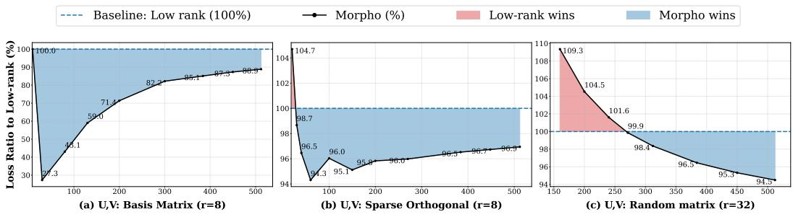  
Figure 14: Relative loss comparison: Morpho vs Low-rank. (a) U, V are sampled from the orthogonal bases; (b) $U , V$ are sampled from sparse orthogonal blocks; (c) U, V are sampled from random matrices. The crossover points $R _ { t h }$ vary on settings. It is obvious that random matrix-based $( U , V )$ is the worst case among all, requires $R _ { t h }$ ≈ 270 in Fig. (c) $r = 3 2 ;$ or $r = 2 1 7$ in Fig. $2 r = 8 \AA$

In the experiments of matrix approximation, we use the AdamW optimizer[15] with the same learning rates of ${ \mathrm { 1 e - 2 } } ,$ except for DoRA with high learning rate of 4e—2 due to its slow convergence speed in such simulation, running 300 training iterations, then evaluate the average over 10 independent simulations with different random seeds. The main configurations are low-rank $r = 8 ,$ and Morpho $( n _ { 1 } , m _ { 2 } ) = ( r , r )$ , resulting in comparable parameter budgets in the compression problems. Moreover, we also compare low-rank final optimal points to SVD solutions by the Eckart-Young-Mirsky theorem [31] to make sure that the training processes lead to all points close to the theoretical approximation. The target matrices have dimensions of $1 0 2 4 \times 1 0 2 4$

Entropy effective rank The standard algebraic rank of a matrix is highly sensitive to noise as infinitesimally small perturbations can easily lead to full apparent rank. In addition, it does not take into account and reflect the full singular value spectrum. To overcome these limitations, Roy and Vetterli [32] introduced an alternative continuous measurement of underlying information – effective rank (erank). Given a nonzero matrix A of shape $( M \times N )$ , K = min $M , N$ , with all singular values $\{ \sigma _ { i } ( \mathbf { A } ) \}$ , the erank is calculated as follows:

$$
\begin{array} { l } { { p _ { i } = \displaystyle \frac { \sigma _ { i } } { \sum _ { j = 1 } ^ { K } \sigma _ { j } } , \quad \mathrm { f o r } i = 1 , 2 , \ldots , K . } } \\ { { \displaystyle } } \\ { { H ( p ) = - \sum _ { i = 1 } ^ { K } p _ { i } \ln ( p _ { i } ) \quad - \quad \mathrm { S h a n n o n E n t r o p y } , } } \end{array}
$$

$$
\mathrm { e r a n k } ( \mathbf { A } ) = r _ { \mathrm { e f f } } ( \mathbf { A } ) = \exp [ H ( p ) ] = \exp \left( - \sum _ { i = 1 } ^ { K } p _ { i } \ln ( p _ { i } ) \right) .\tag{77}
$$

The effective entropy rank provides a continuous capacity measure bounded by $1 \leq r _ { \mathrm { e f f } } \leq K$ . It reaches its minimum $r _ { \mathrm { e f f } } = 1$ when the matrix is strictly rank-1, and its maximum $r _ { \mathrm { e f f } } = K$ when all singular values are equal (an isotropic spectrum). In the context of machine learning, erank quantifies the true intrinsic capacity and information bottleneck of weight matrices, filtering out negligible noise directions that do not meaningfully contribute to the representation power. In our matrix approximation setting, the target matrix is already constructed to be algebraic low-rank, given that reason, we tighten the design by imposing low erank as a complementary metric without additional spectral collapse as well as rank deficiency.

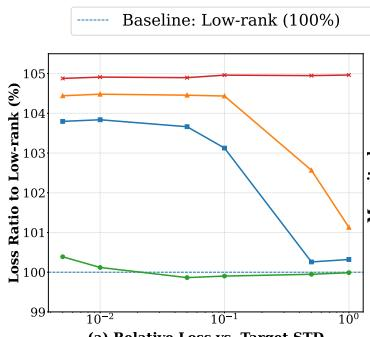

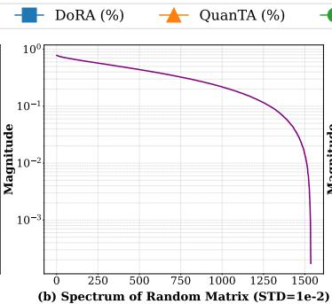

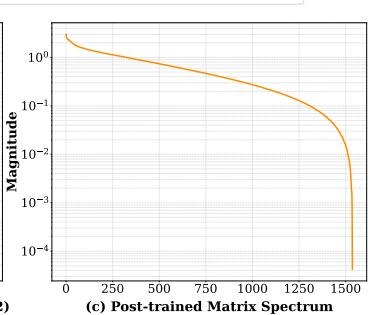  
Figure 15: Illustration of random target mode. Morpho performs on par or slightly better than Low-rank approximation, outperforms other baselines. (a) Comparison on expressivity of several adapters, given a random target. (b) Singular value spectrum of a matrix with random entries. (c) Singular value spectrum of a fine-tuned model weight. To make alignment with reference matrix, and balance parameter budgets, we set dimension $d = 1 5 3 6$ , budgets equivalent to rank $r = 3 2$

Target patterns and additional comparison results We also apply several settings of left and right orthogonal singular matrix (U, V) in order to control the geometric structure of the target updates. In the main experiment in Theorem 3.2 and Fig. 14 (c), (U, V) are independently sampled from random dense matrices, representing global and the least structured geometry. In addition, we create two special cases, where (U, V) are sampled from orthogonal bases, representing an extremely simple and highly structured case, shown in Fig. 14 (a) and block matrices of sparse orthogonal components introducing local structure of overall orthogonality, shown in Fig. 14 (b). These three settings provide a spectrum from simple local geometry to fully isotropic geometry, allowing us to examine how the crossover point $R _ { t h }$ varies with the structural complexity of the target matrix.

Moreover, we observe that random matrices share some basic characteristics with LLMs weights, being an important research interest in Deep learning. Hence, we adopt them as an exemplar target in our expressivity tests, then report the output in Fig. 15. It is obvious that given the comparable number of parameters, Low rank approximation and Morpho parameterization considerably attain better compression than the other baselines. Moreover, Morpho parameterization in some cases slightly improves upon Low-rank which is supported by the Eckart-Young theorem [31].

Next we will move to additional empirical results on downstream tasks.

## F.2 Full results on the DROP dataset

In this section, we provide the full model-by-model comparison underlying the main-paper summary, with several experiments on large models. Table 9 provides detailed outputs, along with Fig. 4 in Sec. 4.1. Across all of our experiments, we train models for 2 epochs, except for the QuanTA experiments on Llama2-7B, which use 3 epochs to match the setting in the original paper [11].

Except for an outlier of $\mathrm { S a M A _ { 2 , 2 } } ,$ SaMA performance also steadily improves when the parameter budget increases and exhibits a nearly monotonic trend that suggests efficient parameter utilization. In these settings, to make a completely fair comparison between baselines, we only conduct full fine-tuning experiments on the corresponding modules, namely Query (q–proj) and Value $\left( \boldsymbol { \nabla } _ { - } \mathsf { p r o j } \right)$ As shown in the table, the gain with SaMA is clearly visible across low-to-high budget regimes of PEFT, where SaMA narrows or closes the gap to FFT more reliably than the other baselines.

## F.3 Full results on the math reasoning task

Table 10 reports the complete arithmetic-reasoning results, extending the main-paper summary with full model-by-model and method-by-method comparisons. These detailed results complement the main discussion by showing the full ranking of baselines under aligned evaluation settings, and by making the relative strengths of lightweight and higher-capacity adapters more transparent.

Overall, the arithmetic-reasoning benchmark shows that SaMA maintains a favorable balance between accuracy and parameter efficiency across different settings. In particular, the detailed table confirms that the advantage of SaMA is not limited to a single configuration, but remains visible across multiple model scales and adapter budgets. This pattern is especially meaningful for arithmetic reasoning, where stronger performance typically requires both sufficient expressivity and stable optimization; the results therefore support our claim that SaMA provides a practical and robust alternative to conventional low-rank adapters in numerically demanding tasks

Table 9: Benchmark of various fine-tuning methods on the DROP dataset. Baselines with † are from QuanTA [11]. Overall, SaMA consistently exhibits better performance compared to other baselines
<table><tr><td>Model</td><td>FT Method</td><td>%Params</td><td>F1 Score (↑)</td></tr><tr><td rowspan="9">Llama27B</td><td>FFT (q_proj and v_proj)</td><td>15.93</td><td>68.98</td></tr><tr><td>Series†</td><td>0.747</td><td>58.8</td></tr><tr><td> $\mathrm { P a r a l l e l } ^ { \dagger }$ </td><td>0.747</td><td>59.0</td></tr><tr><td> $\mathbf { L o R A } _ { r = 8 }$ </td><td>0.062</td><td>62.39</td></tr><tr><td> $\mathrm { L o R A } _ { r = 3 2 }$ </td><td>0.249</td><td>62.40</td></tr><tr><td> $\mathrm { L o R A } _ { r = 1 2 8 }$ </td><td>0.996</td><td>58.82</td></tr><tr><td> $\mathrm { Q u a n T A _ { 1 6 - 8 - 8 - 4 } }$ </td><td>0.041</td><td>62.09</td></tr><tr><td> $\mathrm { Q u a n T A _ { 1 6 - 1 6 - 1 6 } }$ </td><td>0.261</td><td>62.72</td></tr><tr><td> $\mathbf { S a M A } _ { 2 , 2 }$ </td><td>0.016</td><td>66.01</td></tr><tr><td></td><td> $\mathbf { S a M A } _ { 4 , 4 }$ </td><td>0.031</td><td>65.15</td></tr><tr><td></td><td> $\mathbf { S a M A } _ { 8 , 8 }$ </td><td>0.062</td><td>66.61</td></tr><tr><td></td><td> $\mathbf { S a M A } _ { 1 6 , 1 6 }$ </td><td>0.124</td><td>67.17</td></tr><tr><td></td><td> $\mathbf { S a M A } _ { 3 2 , 3 2 }$ </td><td>0.248</td><td>67.95</td></tr><tr><td></td><td> $\mathbf { S a M A } _ { 6 4 , 6 4 }$ </td><td>0.496</td><td>68.07</td></tr><tr><td rowspan="2">Llama213B</td><td> $\mathrm { L o R A } _ { r = 8 } ^ { \dag }$ </td><td>0.050</td><td>61.0</td></tr><tr><td> $\mathbf { Q u a n T A _ { 1 6 - 8 - 8 - 5 } ^ { \dagger } }$ </td><td>0.029</td><td>69.0</td></tr><tr><td> $\mathbf { S a M A } _ { 4 , 4 }$ </td><td></td><td>0.025</td><td>73.12</td></tr></table>

Table 10: Detailed arithmetic reasoning results across PEFT methods on Mistral-7B and Gemma-2 9B. This table extends the main-paper summary with full comparison along with parameter counts. Baselines (†) are from [35]. Best results are in bold, the runner-ups are in italic. In general, SaMA consistently surpasses other baseline regardless of lower budgets.
<table><tr><td rowspan="2">Method</td><td colspan="3">Mistral-7B</td><td colspan="3">Gemma-2 9B</td></tr><tr><td># Params</td><td>GSM8K</td><td>MATH</td><td># Params</td><td>GSM8K</td><td>MATH</td></tr><tr><td>Full FT†</td><td>7.24 B</td><td>63.87</td><td>17.65</td><td>9.24 B</td><td>79.23</td><td>38.02</td></tr><tr><td> $\mathrm { L o R A } _ { r = 3 2 }$ </td><td>83.88 M</td><td>62.93</td><td>14.14</td><td>108.04 M</td><td>77.45</td><td>35.05</td></tr><tr><td> $\mathrm { r s L o R A } ^ { \dagger }$ </td><td>83.88 M</td><td>62.15</td><td>16.24</td><td>108.04 M</td><td>76.84</td><td>36.88</td></tr><tr><td>PiSSA†</td><td>83.88 M</td><td>62.43</td><td>16.52</td><td>108.04 M</td><td>77.12</td><td>37.04</td></tr><tr><td> $\mathrm { D o R A } ^ { \dagger }$ </td><td>85.26 M</td><td>62.65</td><td>16.64</td><td>109.88 M</td><td>77.58</td><td>37.04</td></tr><tr><td> $\mathrm { L o R A  – P r o } ^ { \dagger }$ </td><td>83.88M</td><td>63.07</td><td>17.32</td><td>108.04 M</td><td>78.26</td><td>37.53</td></tr><tr><td> $\operatorname { H i R A } ^ { \dagger }$ </td><td>83.88 M</td><td>63.15</td><td>17.44</td><td>108.04 M</td><td>78.47</td><td>38.22</td></tr><tr><td> $\mathbf { A B B A } _ { r = 3 2 }$ </td><td>83.88M</td><td>64.48</td><td>17.95</td><td>108.04 M</td><td>78.85</td><td>39.59</td></tr><tr><td> $\mathbf { S a M A } _ { 8 , 8 }$ </td><td>10.49 M</td><td>67.70</td><td>18.44</td><td>13.51 M</td><td>80.36</td><td>39.36</td></tr><tr><td> $\mathbf { S a M A } _ { 1 6 , 1 6 }$ </td><td>41.94 M</td><td>68.23</td><td>19.18</td><td>54.02 M</td><td>81.58</td><td>39.76</td></tr></table>

## F.4 A comprehensive benchmark of Commonsense reasoning

We further provide a comprehensive benchmark of the task in Table 11, including results of SaMA and a diverse set of PEFT methods across several LLaMA models. Figure 16 also demonstrates the main comparison across methods for each of these models, except for LLaMA-7B. Overall, it is apparent that SaMA outperforms most of the other baselines, having on par performance with FFT and sometimes surpassing it. Even in lightweight adapters, SaMA still performs well, with slight drops only, on these complex tasks which illustrates its applicability in NLP problems.

Notably, the comprehensive benchmark in Table 11 highlights a clear and coherent trend: across model scales and variants, SaMA consistently delivers cutting-edge or tied-best average accuracy under substantially lower learnable-parameter budgets. SaMA achieves highly competitive and often the best performance across these subtasks of complicated reasoning without relying on FFT techniques like [81, 29]. The results also indicate that SaMA scales robustly and reliably from smaller to larger Llama variants, from the first generation to the current one of Llama3, preserving effectiveness rather than showing any signs of trade-off in lightweight adapters. Furthermore, SaMA also demonstrates the effectiveness and robustness over higher ranks, without any degradation due to optimization. Moreover, the benchmark indicates that SaMA offers a favorable balance of expressivity, omni-rank, parameter-efficiency, and practical scalability for modern PEFT.

Table 11: Comprehensive benchmark of all FT methods on Commonsense reasoning, extending the main-paper summary with full comparisons. The best and runner-up results are highlighted in bold, and underline, respectively. Higher is better for all tasks. Symbols indicate where the results are taken from − \*: [43], †: MiLoRA [64], ⊥: KaSA [17], o: DoRA [28], •: SMT [29], : S2FT [82], □: HiRA [19], ▼: FlexLoRA [65] V: RepLoRA [10], ★: RefLoRA [72], 人: RandLoRA [51], ©: LaX [98], : DiaBlo [18], respectively. ▲: projeçted trainable parameters
<table><tr><td rowspan=1 colspan=14>Model     FT Method  #Params%BoolQPIQASIQA HellaS. WinoG. ARC-eARC-cOBQA AVG(↑)</td></tr><tr><td rowspan=1 colspan=4>ChatGPT*                            73.1</td><td rowspan=1 colspan=1>85.4</td><td rowspan=1 colspan=1>68.5</td><td rowspan=1 colspan=8>78.5   66.1   89.8   79.9   74.8   77.0</td></tr><tr><td rowspan=1 colspan=1></td><td rowspan=1 colspan=3>FFT          100    70.3</td><td rowspan=1 colspan=1>84.2</td><td rowspan=1 colspan=1>80.1</td><td rowspan=1 colspan=8>92.3   85.4   86.6   72.8   83.4   81.9</td></tr><tr><td rowspan=1 colspan=1></td><td rowspan=1 colspan=3>Prefix*        0.11    64.3</td><td rowspan=1 colspan=1>76.8</td><td rowspan=1 colspan=1>73.9</td><td rowspan=1 colspan=5>42.1   72.1   72.9</td><td rowspan=1 colspan=3>54.0   60.6   64.6</td></tr><tr><td rowspan=1 colspan=1></td><td rowspan=1 colspan=3>Series*        0.99    63.0</td><td rowspan=1 colspan=1>79.2</td><td rowspan=1 colspan=1>76.3</td><td rowspan=1 colspan=5>67.9   75.7   74.5</td><td rowspan=1 colspan=3>57.1   72.4   70.8</td></tr><tr><td rowspan=1 colspan=1></td><td rowspan=1 colspan=3>Parallel*       3.54    67.9</td><td rowspan=1 colspan=1>76.4</td><td rowspan=1 colspan=1>78.8</td><td rowspan=1 colspan=5>69.8   78.9   73.7</td><td rowspan=1 colspan=3>57.3   75.2   72.3</td></tr><tr><td rowspan=1 colspan=1></td><td rowspan=1 colspan=3> $\mathrm { L o R A } ^ { \bullet }$         0.83    69.2</td><td rowspan=1 colspan=1>81.7</td><td rowspan=1 colspan=1>78.4</td><td rowspan=1 colspan=5>83.4   80.8   79.0</td><td rowspan=1 colspan=3>62.4  78.4   76.7</td></tr><tr><td rowspan=1 colspan=1></td><td rowspan=1 colspan=3>RefLoRA*     0.83    69.6</td><td rowspan=1 colspan=1>82.5</td><td rowspan=1 colspan=1>79.5</td><td rowspan=1 colspan=5>88.3   82.6   81.6</td><td rowspan=1 colspan=3>66.6  80.2   78.9</td></tr><tr><td rowspan=1 colspan=1></td><td rowspan=1 colspan=3>RepLoRAV     1.01    71.8</td><td rowspan=1 colspan=1>84.1</td><td rowspan=1 colspan=1>79.3</td><td rowspan=1 colspan=8>85.2   83.3   82.4   66.2   81.2   79.1</td></tr><tr><td rowspan=1 colspan=1>LLaMA-7B</td><td rowspan=1 colspan=3> $\mathbf { D o R A } _ { r = 1 6 } ^ { \circ }$      0.43    70.0</td><td rowspan=1 colspan=1>82.6</td><td rowspan=1 colspan=1>79.7</td><td rowspan=1 colspan=8>83.2   80.6   80.6   65.4   77.6   77.5</td></tr><tr><td rowspan=1 colspan=1></td><td rowspan=1 colspan=3> $\mathbf { D o R A } _ { r = 3 2 } ^ { \circ }$      0.84    69.7</td><td rowspan=1 colspan=1>83.4</td><td rowspan=1 colspan=1>78.6</td><td rowspan=1 colspan=8>87.2   81.0   81.9   66.2  79.2   78.4</td></tr><tr><td rowspan=1 colspan=1></td><td rowspan=1 colspan=3> $\mathrm { G a l o r e } ^ { \bullet }$        0.83▲    68.6</td><td rowspan=1 colspan=1>79.0</td><td rowspan=1 colspan=1>78.5</td><td rowspan=1 colspan=5>84.7   80.1   80.3</td><td rowspan=1 colspan=3>62.1   77.3   76.3</td></tr><tr><td rowspan=1 colspan=1></td><td rowspan=1 colspan=3> $\mathrm { L a X } _ { 3 2 } ^ { \oplus }$          0.83    69.6</td><td rowspan=1 colspan=1>81.9</td><td rowspan=1 colspan=1>78.9</td><td rowspan=1 colspan=2>84.7</td><td rowspan=1 colspan=3>80.8   79.8</td><td rowspan=1 colspan=1>64.8</td><td rowspan=1 colspan=2>78.0   77.3</td></tr><tr><td rowspan=1 colspan=1></td><td rowspan=1 colspan=1> $\mathrm { L I S A } ^ { \tilde { \mathbf { \alpha } } }$ </td><td rowspan=1 colspan=2>9.91    70.4</td><td rowspan=1 colspan=1>82.1</td><td rowspan=1 colspan=1>78.7</td><td rowspan=1 colspan=2>92.4</td><td rowspan=1 colspan=2>82.9</td><td rowspan=1 colspan=1>84.9</td><td rowspan=1 colspan=1>70.2</td><td rowspan=1 colspan=2>78.4   80.0</td></tr><tr><td rowspan=1 colspan=1></td><td rowspan=1 colspan=1>S2FT</td><td rowspan=1 colspan=2>0.81    72.7</td><td rowspan=1 colspan=1>83.7</td><td rowspan=1 colspan=1>79.6</td><td rowspan=1 colspan=2>93.4</td><td rowspan=1 colspan=2>83.5</td><td rowspan=1 colspan=1>86.1</td><td rowspan=1 colspan=1>72.2</td><td rowspan=1 colspan=2>83.4   81.8</td></tr><tr><td rowspan=1 colspan=1></td><td rowspan=1 colspan=1>SMT</td><td rowspan=1 colspan=2>0.84    68.7</td><td rowspan=1 colspan=1>81.7</td><td rowspan=1 colspan=1>78.3</td><td rowspan=1 colspan=2>91.6</td><td rowspan=1 colspan=1>78.8</td><td rowspan=1 colspan=1></td><td rowspan=1 colspan=1>84.1</td><td rowspan=1 colspan=1>68.7</td><td rowspan=1 colspan=2>77.4   78.7</td></tr><tr><td rowspan=1 colspan=1></td><td rowspan=1 colspan=1>SMT•(Best)</td><td rowspan=1 colspan=2>4.91    72.0</td><td rowspan=1 colspan=1>82.9</td><td rowspan=1 colspan=1>80.7</td><td rowspan=1 colspan=2>93.3</td><td rowspan=1 colspan=1>82.4</td><td rowspan=1 colspan=2>86.1</td><td rowspan=1 colspan=1>70.6</td><td rowspan=1 colspan=1>83.0</td><td rowspan=1 colspan=1>81.4</td></tr><tr><td rowspan=2 colspan=1></td><td rowspan=2 colspan=3>SaMA4×4SaMA16×16    0.416    71.1</td><td rowspan=1 colspan=2>0.10469.9</td><td rowspan=1 colspan=1>84.4</td><td rowspan=1 colspan=2>81.3</td><td rowspan=1 colspan=2>94.0</td><td rowspan=1 colspan=1>83.5</td><td rowspan=1 colspan=1>86.8</td><td rowspan=1 colspan=1>71.2</td></tr><tr><td rowspan=1 colspan=1>84.9</td><td rowspan=1 colspan=1>81.7</td><td rowspan=1 colspan=2>94.1</td><td rowspan=1 colspan=3>84.0   87.6</td><td rowspan=1 colspan=1>72.7</td><td></td><td></td></tr><tr><td rowspan=1 colspan=1></td><td rowspan=1 colspan=3>FFT          100    74.5</td><td rowspan=1 colspan=1>86.3</td><td rowspan=1 colspan=1>81.3</td><td rowspan=1 colspan=2>94.4</td><td rowspan=1 colspan=2>86.9</td><td rowspan=1 colspan=1>89.7</td><td rowspan=1 colspan=1>77.9</td><td rowspan=1 colspan=1>88.8</td><td rowspan=1 colspan=1>85.0</td></tr><tr><td rowspan=1 colspan=1></td><td rowspan=1 colspan=3>Prefix*        0.03    65.3</td><td rowspan=1 colspan=1>75.4</td><td rowspan=1 colspan=1>72.1</td><td rowspan=1 colspan=2>55.2</td><td rowspan=1 colspan=2>68.6</td><td rowspan=1 colspan=1>79.5</td><td rowspan=1 colspan=1>62.9</td><td rowspan=1 colspan=1>68.0</td><td rowspan=1 colspan=1>68.4</td></tr><tr><td rowspan=1 colspan=1></td><td rowspan=1 colspan=3>Series*        0.80    71.8</td><td rowspan=1 colspan=1>83.0</td><td rowspan=1 colspan=1>79.2</td><td rowspan=1 colspan=2>88.1</td><td rowspan=1 colspan=2>82.4</td><td rowspan=1 colspan=1>82.5</td><td rowspan=1 colspan=1>67.3</td><td rowspan=1 colspan=2>81.8   79.5</td></tr><tr><td rowspan=1 colspan=1></td><td rowspan=1 colspan=3>Parallel*       2.89    72.5</td><td rowspan=1 colspan=1>84.8</td><td rowspan=1 colspan=1>79.8</td><td rowspan=1 colspan=2>92.1</td><td rowspan=1 colspan=2>84.7</td><td rowspan=1 colspan=1>84.2</td><td rowspan=1 colspan=1>71.2</td><td rowspan=1 colspan=2>82.4   81.5</td></tr><tr><td rowspan=1 colspan=1></td><td rowspan=1 colspan=1>LoRA*</td><td rowspan=1 colspan=2>0.67    72.1</td><td rowspan=1 colspan=1>83.5</td><td rowspan=1 colspan=1>80.5</td><td rowspan=1 colspan=2>90.5</td><td rowspan=1 colspan=2>83.7</td><td rowspan=1 colspan=1>82.8</td><td rowspan=1 colspan=1>68.3</td><td rowspan=1 colspan=1>82.4</td><td rowspan=1 colspan=1>80.5</td></tr><tr><td rowspan=1 colspan=1></td><td rowspan=1 colspan=1>RepLoRAV</td><td rowspan=1 colspan=2>0.99    73.1</td><td rowspan=1 colspan=1>85.2</td><td rowspan=1 colspan=1>84.7</td><td rowspan=1 colspan=2>91.1</td><td rowspan=1 colspan=2>85.9</td><td rowspan=1 colspan=1>84.7</td><td rowspan=1 colspan=1>73.4</td><td rowspan=1 colspan=1>85.6</td><td rowspan=1 colspan=1>82.9</td></tr><tr><td rowspan=1 colspan=1></td><td rowspan=1 colspan=1>DoRA°-16</td><td rowspan=1 colspan=2>0.35    72.5</td><td rowspan=1 colspan=1>85.3</td><td rowspan=1 colspan=1>79.9</td><td rowspan=1 colspan=2>90.1</td><td rowspan=1 colspan=3>82.9   82.7</td><td rowspan=1 colspan=1>69.7</td><td rowspan=1 colspan=1>83.6</td><td rowspan=1 colspan=1>80.8</td></tr><tr><td rowspan=1 colspan=1>LLaMA-13B</td><td rowspan=1 colspan=3>0.68    72.4</td><td rowspan=1 colspan=1>84.9</td><td rowspan=1 colspan=1>81.5</td><td rowspan=1 colspan=2>92.4</td><td rowspan=1 colspan=3>84.2   84.2</td><td rowspan=1 colspan=1>69.6</td><td rowspan=1 colspan=1>82.8</td><td rowspan=1 colspan=1>81.5</td></tr><tr><td rowspan=1 colspan=1></td><td rowspan=1 colspan=3>LaX32         0.67    71.3</td><td rowspan=1 colspan=1>85.4</td><td rowspan=1 colspan=1>81.3</td><td rowspan=1 colspan=2>91.3</td><td rowspan=1 colspan=3>84.1   84.4</td><td rowspan=1 colspan=1>71.8</td><td rowspan=1 colspan=2>83.1   81.6</td></tr><tr><td rowspan=1 colspan=1></td><td rowspan=1 colspan=1> $\mathrm { s ^ { 2 } F T ^ { \frac { \partial } { \partial } } }$ </td><td rowspan=1 colspan=2>0.65    74.2</td><td rowspan=1 colspan=1>85.7</td><td rowspan=1 colspan=1>80.7</td><td rowspan=1 colspan=2>94.9</td><td rowspan=1 colspan=2>86.4</td><td rowspan=1 colspan=1>88.4</td><td rowspan=1 colspan=1>76.3</td><td rowspan=1 colspan=1>87.8</td><td rowspan=1 colspan=1>84.3</td></tr><tr><td rowspan=1 colspan=1></td><td rowspan=1 colspan=1>SMT•</td><td rowspan=1 colspan=1>0.68</td><td rowspan=1 colspan=1>71.1</td><td rowspan=1 colspan=1>84.4</td><td rowspan=1 colspan=1>81.7</td><td rowspan=1 colspan=1>93.7</td><td rowspan=1 colspan=1></td><td rowspan=1 colspan=1>83.2</td><td rowspan=1 colspan=1></td><td rowspan=1 colspan=1>86.7</td><td rowspan=1 colspan=1>73.7</td><td rowspan=1 colspan=1>85.2</td><td rowspan=1 colspan=1>82.4</td></tr><tr><td rowspan=1 colspan=1></td><td rowspan=1 colspan=1>SMT•(Best)</td><td rowspan=1 colspan=1>4.91</td><td rowspan=1 colspan=1>72.6</td><td rowspan=1 colspan=1>86.1</td><td rowspan=1 colspan=1>81.9</td><td rowspan=1 colspan=1>95.0</td><td rowspan=1 colspan=1></td><td rowspan=1 colspan=1>86.1</td><td rowspan=1 colspan=1></td><td rowspan=1 colspan=1>88.2</td><td rowspan=1 colspan=1>77.1</td><td rowspan=1 colspan=1>87.4</td><td rowspan=1 colspan=1>84.3</td></tr><tr><td rowspan=1 colspan=1></td><td rowspan=1 colspan=1>DiaBloN=64</td><td rowspan=1 colspan=1>1.06</td><td rowspan=1 colspan=1>74.7</td><td rowspan=1 colspan=1>86.9</td><td rowspan=1 colspan=1>81.2</td><td rowspan=1 colspan=2>91.5</td><td rowspan=1 colspan=1>87.4</td><td rowspan=1 colspan=1></td><td rowspan=1 colspan=1>89.8</td><td rowspan=1 colspan=1>78.2</td><td rowspan=1 colspan=1>90.2</td><td rowspan=1 colspan=1>84.9</td></tr><tr><td rowspan=1 colspan=1></td><td rowspan=1 colspan=1>SaMA4×4</td><td rowspan=1 colspan=1>0.084</td><td rowspan=1 colspan=1>72.9</td><td rowspan=1 colspan=1>87.4</td><td rowspan=1 colspan=1>83.6</td><td rowspan=1 colspan=2>95.5</td><td rowspan=1 colspan=1>87.2</td><td rowspan=1 colspan=1></td><td rowspan=1 colspan=1>90.3</td><td rowspan=1 colspan=1>78.2</td><td rowspan=1 colspan=1>88.7</td><td rowspan=1 colspan=1>85.5</td></tr><tr><td rowspan=1 colspan=1></td><td rowspan=1 colspan=1>SaMA16×16    0</td><td rowspan=1 colspan=1>.336</td><td rowspan=1 colspan=1>73.5</td><td rowspan=1 colspan=1>87.6</td><td rowspan=1 colspan=1>82.6</td><td rowspan=1 colspan=2>95.4</td><td rowspan=1 colspan=1>87.7</td><td rowspan=1 colspan=1></td><td rowspan=1 colspan=1>90.2</td><td rowspan=1 colspan=1>78.0</td><td rowspan=1 colspan=1>88.3</td><td rowspan=1 colspan=1>85.4</td></tr><tr><td rowspan=1 colspan=1></td><td rowspan=1 colspan=1>FFT</td><td rowspan=1 colspan=1>100</td><td rowspan=1 colspan=1>74.7</td><td rowspan=1 colspan=1>84.9</td><td rowspan=1 colspan=1>78.7</td><td rowspan=1 colspan=1>93.7</td><td rowspan=1 colspan=1></td><td rowspan=1 colspan=2>84.1</td><td rowspan=1 colspan=1>87.5</td><td rowspan=1 colspan=1>75.2</td><td rowspan=1 colspan=1>85.0</td><td rowspan=1 colspan=1>83.0</td></tr><tr><td rowspan=1 colspan=1></td><td rowspan=1 colspan=1>LoRA°</td><td rowspan=1 colspan=1>0.83</td><td rowspan=1 colspan=1>69.8</td><td rowspan=1 colspan=1>79.9</td><td rowspan=1 colspan=1>79.5</td><td rowspan=1 colspan=1>83.6</td><td rowspan=1 colspan=1></td><td rowspan=1 colspan=2>82.6</td><td rowspan=1 colspan=1>79.8</td><td rowspan=1 colspan=1>64.7</td><td rowspan=1 colspan=1>81.0</td><td rowspan=1 colspan=1>77.6</td></tr><tr><td rowspan=1 colspan=1></td><td rowspan=1 colspan=1>RefLoRA*</td><td rowspan=1 colspan=1>0.83</td><td rowspan=1 colspan=1>72.5</td><td rowspan=1 colspan=1>83.8</td><td rowspan=1 colspan=1>80.0</td><td rowspan=1 colspan=2>87.0</td><td rowspan=1 colspan=2>84.9</td><td rowspan=1 colspan=1>86.4</td><td rowspan=1 colspan=1>71.5</td><td rowspan=1 colspan=1>80.2</td><td rowspan=1 colspan=1>80.8</td></tr><tr><td rowspan=1 colspan=1></td><td rowspan=1 colspan=1>PiSSA†</td><td rowspan=1 colspan=1>0.83</td><td rowspan=1 colspan=1>67.6</td><td rowspan=1 colspan=1>78.1</td><td rowspan=1 colspan=1>78.4</td><td rowspan=1 colspan=2>76.6</td><td rowspan=1 colspan=2>78.0</td><td rowspan=1 colspan=1>75.8</td><td rowspan=1 colspan=1>60.2</td><td rowspan=1 colspan=1>75.6</td><td rowspan=1 colspan=1>73.8</td></tr><tr><td rowspan=1 colspan=1></td><td rowspan=1 colspan=1>MiLoRA†</td><td rowspan=1 colspan=1>0.83</td><td rowspan=1 colspan=1>67.6</td><td rowspan=1 colspan=1>83.8</td><td rowspan=1 colspan=1>80.1</td><td rowspan=1 colspan=2>88.2</td><td rowspan=1 colspan=2>82.0</td><td rowspan=1 colspan=1>82.8</td><td rowspan=1 colspan=1>68.8</td><td rowspan=1 colspan=1>80.6</td><td rowspan=1 colspan=1>79.2</td></tr><tr><td rowspan=1 colspan=1></td><td rowspan=1 colspan=1>DoRA°-16</td><td rowspan=1 colspan=1>0.42</td><td rowspan=1 colspan=1>72.0</td><td rowspan=1 colspan=1>83.1</td><td rowspan=1 colspan=1>79.9</td><td rowspan=1 colspan=2>89.1</td><td rowspan=1 colspan=2>83.0</td><td rowspan=1 colspan=1>84.5</td><td rowspan=1 colspan=1>71.0</td><td rowspan=1 colspan=1>81.2</td><td rowspan=1 colspan=1>80.5</td></tr><tr><td rowspan=1 colspan=1></td><td rowspan=1 colspan=1>DoRA°</td><td rowspan=1 colspan=1>0.84</td><td rowspan=1 colspan=1>71.8</td><td rowspan=1 colspan=1>83.7</td><td rowspan=1 colspan=1>76.0</td><td rowspan=1 colspan=2>89.1</td><td rowspan=1 colspan=2>82.6</td><td rowspan=1 colspan=1>83.7</td><td rowspan=1 colspan=1>68.2</td><td rowspan=1 colspan=1>82.4</td><td rowspan=1 colspan=1>79.7</td></tr><tr><td rowspan=1 colspan=1>LLaMA2-7B</td><td rowspan=1 colspan=1>HiRAD=32</td><td rowspan=1 colspan=1>0.83</td><td rowspan=1 colspan=1>71.2</td><td rowspan=1 colspan=1>83.4</td><td rowspan=1 colspan=1>79.5</td><td rowspan=1 colspan=2>88.1</td><td rowspan=1 colspan=2>84.0</td><td rowspan=1 colspan=1>86.7</td><td rowspan=1 colspan=1>73.8</td><td rowspan=1 colspan=1>84.6</td><td rowspan=1 colspan=1>81.4</td></tr><tr><td rowspan=1 colspan=1></td><td rowspan=1 colspan=1>KaSA⊥</td><td rowspan=1 colspan=1>0.84</td><td rowspan=1 colspan=1>73.6</td><td rowspan=1 colspan=1>84.4</td><td rowspan=1 colspan=1>80.2</td><td rowspan=1 colspan=2>91.5</td><td rowspan=1 colspan=2>84.5</td><td rowspan=1 colspan=1>84.7</td><td rowspan=1 colspan=1>72.1</td><td rowspan=1 colspan=1>81.2</td><td rowspan=1 colspan=1>81.5</td></tr><tr><td rowspan=1 colspan=1></td><td rowspan=1 colspan=1>S2FT</td><td rowspan=1 colspan=1>0.81</td><td rowspan=1 colspan=1>72.9</td><td rowspan=1 colspan=1>86.1</td><td rowspan=1 colspan=1>80.2</td><td rowspan=1 colspan=2>94.3</td><td rowspan=1 colspan=2>85.5</td><td rowspan=1 colspan=1>87.2</td><td rowspan=1 colspan=1>74.6</td><td rowspan=1 colspan=1>83.4</td><td rowspan=1 colspan=1>83.0</td></tr><tr><td rowspan=1 colspan=1></td><td rowspan=1 colspan=1>SMT</td><td rowspan=1 colspan=1>0.84</td><td rowspan=1 colspan=1>72.0</td><td rowspan=1 colspan=1>83.8</td><td rowspan=1 colspan=1>80.8</td><td rowspan=1 colspan=2>93.3</td><td rowspan=1 colspan=1>82.8</td><td rowspan=1 colspan=1></td><td rowspan=1 colspan=1>86.7</td><td rowspan=1 colspan=1>74.0</td><td rowspan=1 colspan=1>81.0</td><td rowspan=1 colspan=1>81.8</td></tr><tr><td rowspan=1 colspan=1></td><td rowspan=1 colspan=1>SMT•(Best)</td><td rowspan=1 colspan=1>4.91</td><td rowspan=1 colspan=1>72.6</td><td rowspan=1 colspan=1>85.2</td><td rowspan=1 colspan=1>82.0</td><td rowspan=1 colspan=2>94.4</td><td rowspan=1 colspan=1>85.7</td><td rowspan=1 colspan=1></td><td rowspan=1 colspan=1>87.8</td><td rowspan=1 colspan=1>74.5</td><td rowspan=1 colspan=1>85.0</td><td rowspan=1 colspan=1>83.4</td></tr><tr><td rowspan=1 colspan=1></td><td rowspan=1 colspan=1>DiaBloN=64</td><td rowspan=1 colspan=1>1.04</td><td rowspan=1 colspan=1>73.9</td><td rowspan=1 colspan=1>84.8</td><td rowspan=1 colspan=1>81.7</td><td rowspan=1 colspan=2>90.0</td><td rowspan=1 colspan=1>85.0</td><td rowspan=1 colspan=1></td><td rowspan=1 colspan=1>87.9</td><td rowspan=1 colspan=1>76.8</td><td rowspan=1 colspan=1>86.8</td><td rowspan=1 colspan=1>83.4</td></tr><tr><td rowspan=1 colspan=1></td><td rowspan=1 colspan=1>SaMA4×4     0</td><td rowspan=1 colspan=1>.104</td><td rowspan=1 colspan=1>73.1</td><td rowspan=1 colspan=1>85.5</td><td rowspan=1 colspan=1>81.8</td><td rowspan=1 colspan=2>94.7</td><td rowspan=1 colspan=1>85.0</td><td rowspan=1 colspan=1></td><td rowspan=1 colspan=1>88.7</td><td rowspan=1 colspan=1>73.9</td><td rowspan=1 colspan=1>86.0</td><td rowspan=1 colspan=1>83.6</td></tr><tr><td rowspan=1 colspan=1></td><td rowspan=1 colspan=1>SaMA16×16</td><td rowspan=1 colspan=1>0.42</td><td rowspan=1 colspan=1>73.9</td><td rowspan=1 colspan=1>86.2</td><td rowspan=1 colspan=1>81.9</td><td rowspan=1 colspan=2>94.9</td><td rowspan=1 colspan=1>86.4</td><td rowspan=1 colspan=1></td><td rowspan=1 colspan=1>89.1</td><td rowspan=1 colspan=1>77.0</td><td rowspan=1 colspan=1>86.8</td><td rowspan=1 colspan=1>84.5</td></tr><tr><td rowspan=1 colspan=1></td><td rowspan=1 colspan=1>FFT</td><td rowspan=1 colspan=1>100</td><td rowspan=1 colspan=1>73.9</td><td rowspan=1 colspan=1>86.2</td><td rowspan=1 colspan=1>79.1</td><td rowspan=1 colspan=2>93.1</td><td rowspan=1 colspan=3>85.8   88.1</td><td rowspan=1 colspan=1>78.2</td><td rowspan=1 colspan=1>84.0</td><td rowspan=1 colspan=1>83.6</td></tr><tr><td rowspan=1 colspan=1></td><td rowspan=1 colspan=1>LoRA°</td><td rowspan=1 colspan=1>0.70</td><td rowspan=1 colspan=1>70.8</td><td rowspan=1 colspan=1>85.2</td><td rowspan=1 colspan=1>79.9</td><td rowspan=1 colspan=2>91.7</td><td rowspan=1 colspan=1>84.3</td><td rowspan=1 colspan=1></td><td rowspan=1 colspan=1>84.2</td><td rowspan=1 colspan=1>71.2</td><td rowspan=1 colspan=1>79.0</td><td rowspan=1 colspan=1>80.8</td></tr><tr><td rowspan=1 colspan=1></td><td rowspan=1 colspan=1>RefLoRA*</td><td rowspan=1 colspan=1>0.70</td><td rowspan=1 colspan=1>75.5</td><td rowspan=1 colspan=1>89.7</td><td rowspan=1 colspan=1>81.1</td><td rowspan=1 colspan=2>95.6</td><td rowspan=1 colspan=1>87.3</td><td rowspan=1 colspan=1></td><td rowspan=1 colspan=1>91.0</td><td rowspan=1 colspan=1>79.8</td><td rowspan=1 colspan=1>86.0</td><td rowspan=1 colspan=1>85.8</td></tr><tr><td rowspan=1 colspan=1></td><td rowspan=1 colspan=1>PiSSA†</td><td rowspan=1 colspan=1>0.70</td><td rowspan=1 colspan=1>67.1</td><td rowspan=1 colspan=1>81.1</td><td rowspan=1 colspan=1>77.2</td><td rowspan=1 colspan=2>83.6</td><td rowspan=1 colspan=1>78.9</td><td rowspan=1 colspan=1></td><td rowspan=1 colspan=1>77.7</td><td rowspan=1 colspan=1>63.2</td><td rowspan=1 colspan=1>74.6</td><td rowspan=1 colspan=1>75.4</td></tr><tr><td rowspan=1 colspan=1></td><td rowspan=1 colspan=1>MiLoRA†</td><td rowspan=1 colspan=1>0.70</td><td rowspan=1 colspan=1>68.8</td><td rowspan=1 colspan=1>86.7</td><td rowspan=1 colspan=1>77.2</td><td rowspan=1 colspan=2>92.9</td><td rowspan=1 colspan=3>85.6   86.8</td><td rowspan=1 colspan=1>75.5</td><td rowspan=1 colspan=1>81.8</td><td rowspan=1 colspan=1>81.9</td></tr><tr><td rowspan=1 colspan=1></td><td rowspan=1 colspan=1>DoRA°-16</td><td rowspan=1 colspan=1>0.35</td><td rowspan=1 colspan=1>74.5</td><td rowspan=1 colspan=1>88.8</td><td rowspan=1 colspan=1>80.3</td><td rowspan=1 colspan=2>95.5</td><td rowspan=1 colspan=2>84.7</td><td rowspan=1 colspan=1>90.1</td><td rowspan=1 colspan=1>79.1</td><td rowspan=1 colspan=1>87.2</td><td rowspan=1 colspan=1>85.0</td></tr><tr><td rowspan=1 colspan=1></td><td rowspan=1 colspan=1>DoRA°=32</td><td rowspan=1 colspan=1>0.71</td><td rowspan=1 colspan=1>74.6</td><td rowspan=1 colspan=1>89.3</td><td rowspan=1 colspan=1>79.9</td><td rowspan=1 colspan=2>95.5</td><td rowspan=1 colspan=2>85.6</td><td rowspan=1 colspan=1>90.5</td><td rowspan=1 colspan=1>80.4</td><td rowspan=1 colspan=2>85.8   85.2</td></tr><tr><td rowspan=1 colspan=1>LLaMA3-8B</td><td rowspan=1 colspan=1>HiRA</td><td rowspan=1 colspan=1>0.70</td><td rowspan=1 colspan=1>75.4</td><td rowspan=1 colspan=1>89.7</td><td rowspan=1 colspan=1>81.2</td><td rowspan=1 colspan=2>95.4</td><td rowspan=1 colspan=2>87.7</td><td rowspan=1 colspan=1>93.3</td><td rowspan=1 colspan=1>82.9</td><td rowspan=1 colspan=2>88.3   86.7</td></tr><tr><td rowspan=1 colspan=1></td><td rowspan=1 colspan=1>FlexLoRA</td><td rowspan=1 colspan=1>0.70</td><td rowspan=1 colspan=1>72.8</td><td rowspan=1 colspan=1>89.1</td><td rowspan=1 colspan=1>80.7</td><td rowspan=1 colspan=2>96.0</td><td rowspan=1 colspan=3>86.4   90.8</td><td rowspan=1 colspan=1>81.3</td><td rowspan=1 colspan=2>87.2   85.5</td></tr><tr><td rowspan=1 colspan=1></td><td rowspan=1 colspan=3>KaSA⊥        0.71    73.6</td><td rowspan=1 colspan=1>88.1</td><td rowspan=1 colspan=1>80.4</td><td rowspan=1 colspan=2>94.7</td><td rowspan=1 colspan=3>85.5   89.7</td><td rowspan=1 colspan=1>79.4</td><td rowspan=1 colspan=2>85.6   84.6</td></tr><tr><td rowspan=1 colspan=1></td><td rowspan=1 colspan=1>S2FT</td><td rowspan=1 colspan=1>0.70</td><td rowspan=1 colspan=1>75.0</td><td rowspan=1 colspan=1>89.0</td><td rowspan=1 colspan=1>80.7</td><td rowspan=1 colspan=2>96.5</td><td rowspan=1 colspan=3>88.0   92.5</td><td rowspan=1 colspan=1>83.4</td><td rowspan=1 colspan=2>87.8   86.6</td></tr><tr><td rowspan=1 colspan=1></td><td rowspan=1 colspan=1>RandLoRA30</td><td rowspan=1 colspan=1>0.7</td><td rowspan=1 colspan=1>76.3</td><td rowspan=1 colspan=1>88.1</td><td rowspan=1 colspan=1>80.3</td><td rowspan=1 colspan=2>95.7</td><td rowspan=1 colspan=3>86.1   90.4</td><td rowspan=1 colspan=1>80.9</td><td rowspan=1 colspan=2>87.0   85.6</td></tr><tr><td rowspan=1 colspan=1></td><td rowspan=1 colspan=1>RandLoRA1</td><td rowspan=1 colspan=1>1.4</td><td rowspan=1 colspan=1>72.6</td><td rowspan=1 colspan=1>88.0</td><td rowspan=1 colspan=1>81.4</td><td rowspan=1 colspan=2>95.7</td><td rowspan=1 colspan=3>87.8   91.3</td><td rowspan=1 colspan=1>80.9</td><td rowspan=1 colspan=2>89.0   85.8</td></tr><tr><td rowspan=1 colspan=1></td><td rowspan=1 colspan=1>SMT•</td><td rowspan=1 colspan=1>0.71</td><td rowspan=1 colspan=1>75.7</td><td rowspan=1 colspan=1>88.4</td><td rowspan=1 colspan=1>81.4</td><td rowspan=1 colspan=2>96.2</td><td rowspan=1 colspan=3>88.2   92.7</td><td rowspan=1 colspan=1>83.2</td><td rowspan=1 colspan=2>88.6   86.8</td></tr><tr><td rowspan=1 colspan=1></td><td rowspan=1 colspan=2>SMT•(Best)    3.01</td><td rowspan=1 colspan=1>75.1</td><td rowspan=1 colspan=1>89.9</td><td rowspan=1 colspan=1>82.4</td><td rowspan=1 colspan=2>96.3</td><td rowspan=1 colspan=3>88.8   92.6</td><td rowspan=1 colspan=1>82.8</td><td rowspan=1 colspan=2>89.6   87.2</td></tr><tr><td rowspan=2 colspan=1></td><td rowspan=2 colspan=3> $\mathbf { S a M A } _ { 4 \times 4 }$       0.088    73.9SaMA16×16    0.351    75.4</td><td rowspan=1 colspan=1>90.6</td><td rowspan=2 colspan=1>82.883.2</td><td rowspan=1 colspan=2>96.6</td><td rowspan=2 colspan=4>88.2   93.7   83.688.7   94.1   83.8</td><td rowspan=2 colspan=2>89.6   87.490.1   87.8</td></tr><tr><td rowspan=1 colspan=1>90.3</td><td rowspan=1 colspan=2>96.7</td></tr></table>

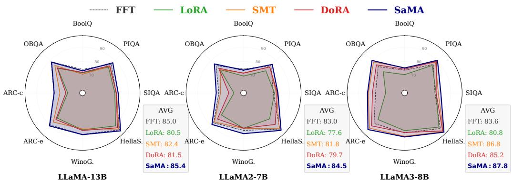  
Figure 16: Task-wise performance comparison across FFT(black), LoRA(green), SMT(orange), DoRA(red) and SaMA (blue) on the Llama family. SaMA only uses half as many parameters in these experiments, but maintains more accurate outputs across most of the tasks.

For example, on Llama-13B, SaM $\mathrm { \Delta A _ { 1 6 , 1 6 } }$ reaches an average score of 85.4 with only 0.336% parameters, compared with LoRA at 80.55 with 0.67%, or FFT at 85.0. On Llama2-7B, SaMA16,16 attains 84.5 on average with 0.42% parameters, compared with SMT at 81.8 under 0.84% (and 83.4 at SMT-Best with 4.91%), or FFT at 83.0. On Llama3-8B, $\mathrm { S a M A _ { 1 6 , 1 6 } }$ reports 87.8 average with 0.351% parameters, or even $\mathrm { S a M A _ { 4 , 4 } }$ achieves 87.4 with only $0 . 0 9 \%$ parameters, while $\mathrm { D o R A } _ { r = 3 2 }$ and HiRA with about 0.71%, report 85.2 and 86.7, respectively.

## F.5 Attention fine-tuning on Commonsense reasoning

Table 12: Comparison of SaMA and QuanTA in Q-V attention fine-tuning settings. Results with a symbol \* are from QuanTA paper [11]. Across all model scales, although the configurations are set with comparable or 20-40% lower parameter budgets, SaMA stably results in superior performance. This demonstrate the substantial generalization capability of our method.
<table><tr><td>Model</td><td>Method</td><td>#Params%</td><td>BoolQ</td><td>PIQA</td><td>SIQA</td><td>HellaS.</td><td>WinoG.</td><td>ARC-e</td><td>ARC-c</td><td>OBQA</td><td>AVG</td></tr><tr><td>ChatGPT</td><td></td><td></td><td>73.1</td><td>85.4</td><td>68.5</td><td>78.5</td><td>66.1</td><td>89.8</td><td>79.9</td><td>74.8</td><td>77.0</td></tr><tr><td>LLaMA-7B</td><td> $\mathrm { Q u a n T A } ^ { \star }$ </td><td>0.041</td><td>71.6</td><td>83.0</td><td>79.7</td><td>91.8</td><td>81.8</td><td>84.0</td><td>68.3</td><td>82.1</td><td>80.3</td></tr><tr><td></td><td> $\mathbf { S a M A } _ { 4 \times 4 }$ </td><td>0.031</td><td>70.8</td><td>84.0</td><td>81.4</td><td>93.8</td><td>83.4</td><td>86.7</td><td>71.3</td><td>84.0</td><td>81.9</td></tr><tr><td>LLaMA-13B</td><td> $\mathrm { Q u a n T A } ^ { \star }$ </td><td>0.029</td><td>73.2</td><td>85.4</td><td>82.1</td><td>93.4</td><td>85.1</td><td>87.8</td><td>73.3</td><td>84.4</td><td>83.1</td></tr><tr><td rowspan="2">LLaMA2-7B</td><td> $\mathbf { S a M A } _ { 4 \times 4 }$ </td><td>0.025</td><td>72.6</td><td>87.4</td><td>83.3</td><td>95.6</td><td>85.6</td><td>88.4</td><td>76.2</td><td>88.4</td><td>84.7</td></tr><tr><td> $\mathrm { Q u a n T A } ^ { \star }$ </td><td>0.041</td><td>72.4</td><td>83.8</td><td>79.7</td><td>92.5</td><td>83.9</td><td>85.3</td><td>72.5</td><td>82.6</td><td>81.6</td></tr><tr><td></td><td> $\mathbf { S a M A } _ { 4 \times 4 }$ </td><td>0.031</td><td>72.5</td><td>85.1</td><td>81.2</td><td>94.4</td><td>84.8</td><td>87.9</td><td>75.0</td><td>84.5</td><td>83.2</td></tr><tr><td rowspan="2">LLaMA2-13B</td><td> $\mathrm { Q u a n T A } ^ { \star }$ </td><td>0.041</td><td>75.8</td><td>86.9</td><td>81.2</td><td>94.4</td><td>87.0</td><td>89.6</td><td>77.9</td><td>85.2</td><td>84.8</td></tr><tr><td> $\mathbf { S a M A _ { 4 \times 4 } }$ </td><td>0.025</td><td>75.4</td><td>87.3</td><td>82.9</td><td>96.0</td><td>88.0</td><td>91.5</td><td>80.8</td><td>86.2</td><td>86.0</td></tr><tr><td>LLaMA3-8B</td><td> $\mathrm { Q u a n T A } ^ { \star }$ </td><td>0.035</td><td>74.3</td><td>88.1</td><td>81.8</td><td>95.1</td><td>87.3</td><td>91.1</td><td>81.7</td><td>87.2</td><td>85.8</td></tr><tr><td></td><td> $\mathbf { S a M A } _ { 4 \times 4 }$ </td><td>0.021</td><td>74.0</td><td>90.1</td><td>82.1</td><td>96.2</td><td>87.2</td><td>93.2</td><td>81.7</td><td>87.0</td><td>86.4</td></tr></table>

Looking closely into details of QuanTA experiments [11], it is noticeable that they added adapters into $Q \mathrm { - } \bar { \mathbf { V } }$ modules only in each transformer layer in order to keep simple implementation of tensor factorization for square matrices. Given that both methods are adapter-oriented, we argue that it is much fairer to adapt them to the same modules while doing fine-tuning foundation models. Hence, we conduct auxiliary experiments on these Llama model family (including Llama2-13B). That is to establish an equitable assessment between them, then the outputs are reported in Table 12.

## F.6 Efficiency validation

To make comparison of adapter efficiency, we align the configurations of all methods to match the number of trainable parameters. The tests are conducted across several foundation models of different sizes so that they produce an unbiased judgment. The reports are constructed by monitoring time per iteration and reserved memory after 50 warmup steps, averaged 3 times over 25 iterations, while other settings are kept the same across all the experiments.

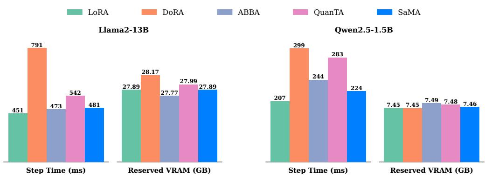  
Figure 17: Time complexity and memory footprint on Qwen2.5-1.5B and Llama2-13B. SaMA generally maintains a memory footprint nearly identical to LoRA, while incurring only a modest step-time overhead, at less than 9 per cent, and remains substantially faster than DoRA and QuanTA.

In particular, we consider a baseline set including LoRA [7], QuanTA [11], SaMA as 3 distinct representatives of fine-tuning via reparameterization. In addition, we adopt ABBA [35] – Hadamard product of low rank matrices, and DoRA [28] – an improvement of LoRA due to the prevalence of LoRA family.

Besides Fig. 5, additional results are also reported in Fig. 17. Similar to the pattern in Fig. 5, there exists consistency in the relative resource profiles of these approaches in regard to computational time and memory consumption across different model scales. These results indicate that the structured higher-rank capacity of SaMA introduces little additional computational and memory overhead in practice.

## F.7 Ablation study on adapter initialization

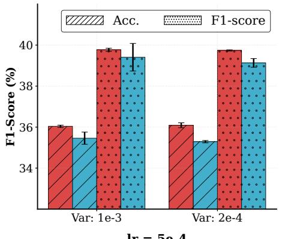

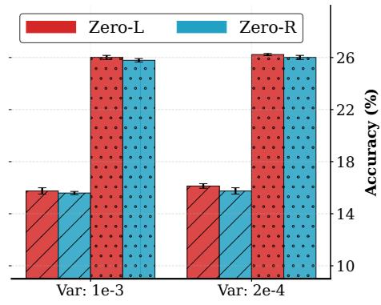  
Figure 18: Sensitivity analysis on initialization schemes of SaMA adapters. Either of the two factors is equal to zero, the remaining factor follows a normal distribution with variance on the horizontal axes. We use both metrics: accuracy (right axis) and F1-score (left axis) for comparison.

For these experiments, we fine-tune Qwen2.5-1.5B with a fixed SaMA configuration of (4, 4) for three attention modules: q–proj, k\_proj, v\_proj. The training set is a 600-sample subset of DROP. The final checkpoints are evaluated after 1 epoch. To improve the robustness of the final conclusion, we consider multiple learning rate and initialization variances. Table 3 in Sec. 4.6 and Fig. 18 provide the quantitative outputs and visualization, respectively.

Observation: Across these settings, SaMA with zero-L initialization consistently yields better accuracy and F1-scores compared to zero-R, at about 1 — 2%. Furthermore, zero-L demonstrates superior stability; it achieves a remarkably lower variance across most experiments, with a small standard deviation (std) of 0.25.

The results also advocate another critical insight regarding robustness. While performance margins exist between different configurations, our approach exhibits a remarkable intrinsic robustness and stabilizing effects, maintaining reliable efficacy regardless of initialization schemes.

## F.8 SaMA performance when increasing parameter budgets

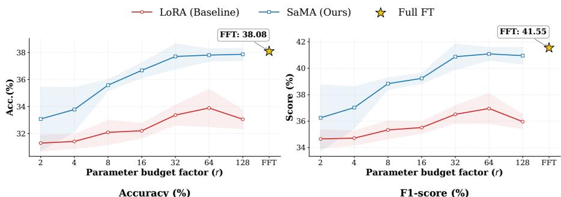  
Figure 19: Performance comparison between SaMA and LoRA; FFT (on Query and Value modules) serves as the upper-bound baseline. The plots show Accuracy (%) and F1-score (%) across various parameter budget factor r. Shaded regions represent standard deviations.

We further evaluate the performance of SaMA against LoRA and FFT using the Qwen2.5-1.5B model [6] on the DROP dataset. The primary goal is to analyze how performance scales under different parameter budgets (r) – equivalent to LoRA rank r and $( n _ { 1 } , m _ { 2 } ) = ( r , r )$ in SaMA. In all settings, we only train Query and Value modules to make a completely fair comparison.

The key finding is that SaMA performs better when the parameter counts increase, and steadily approaches FFT results. Meanwhile, LoRA, in such case, exhibits a performance gap to FFT, regardless of adding more budget. A similar observation is also reported in [29], suggesting more comprehensive experiments to investigate in future work.

## F.9 Fine-tuning Vision transformer

Along with the main benchmark on complicated NLP downstream tasks on large foundation models we further demonstrate the versatility and effectiveness of SaMA in vision domains. Particularly, we extend our evaluation in image classification by post-training the ViT-B/16 architecture [2], pretrained on the ImageNet-21K [99] on VTAB-1K [100]. Although the classification task and baseline model are not sophisticated, we still gain overall judgment of SaMA in lightweight modes for common problems. The VTAB-1K [100] benchmark is a diverse suite containing 19 datasets. There are 3

Table 13: Performance comparison of SaMA with the baseline and efficient methods on the VTAB-1k classification benchmark with ViT-B/16 86M pre-trained on ImageNet-21k. The best results among these baselines are in bold, excluding SSF\* which utilizes augmented ViT backbone by AugReg. All baseline results are from [101].
<table><tr><td>Methods</td><td colspan="8">Natural</td><td colspan="6">Specialized</td><td colspan="8">Structured</td><td rowspan="2"></td><td rowspan="2">Parra.(m)</td></tr><tr><td></td><td>CAR-0</td><td>Calteh101</td><td>DD</td><td>Fowe102</td><td>Pets</td><td>NHAS</td><td>Sun397</td><td>Mean</td><td>Camliyon</td><td>EroSAT</td><td>Resc45</td><td>Reipdthy</td><td>Mean</td><td>Clev-Ccount</td><td>Clev-Dist</td><td>Dab</td><td>RITTist</td><td>dpr-oc</td><td>dSp-nri</td><td>SNO-ZZim</td><td>SNOR-EE</td><td>Mean</td><td></td><td>Mean Total</td></tr><tr><td>Full fine-tuning Linear probing</td><td>68.9 63.4</td><td>85.0</td><td>63. 3.</td><td>97.2 97.0</td><td>86.9 86.3</td><td>87.4 36.6</td><td>38.8 51.0</td><td>75.9 68.9</td><td>79.7 78.5</td><td>95.7 87.5</td><td>84.2 68.6</td><td>73.9 74.0</td><td>83.4 77.2</td><td>54..3</td><td>58.6 30.6</td><td>33.2</td><td>65.5 55.4</td><td>12.55</td><td>46.7 20.0</td><td>25.7 9.6</td><td>29.1 19.2</td><td></td><td>47.6 26.9</td><td>65.6 52.9</td><td>85.80 0.040</td></tr><tr><td>Adapter</td><td>74.1</td><td>86.1</td><td>63.2</td><td>97.7</td><td>87.0</td><td>34.6</td><td>50.8</td><td>70.5</td><td>76.3</td><td>88.0</td><td>73.1</td><td>70.5</td><td>77.0</td><td>45.7</td><td>37.4</td><td>31.2</td><td>53.2</td><td>30.3</td><td>25.4</td><td></td><td>13.8</td><td>22.1</td><td>32.4</td><td>55.8</td><td>0.27</td></tr><tr><td>Bias</td><td>72.8</td><td>87.0</td><td>59.2</td><td>97.5</td><td>85.3</td><td>59.9</td><td>31  </td><td>73.3</td><td>78.7</td><td>91.6</td><td>72.9</td><td>69.8</td><td>78.3</td><td>61.5</td><td>55.6</td><td>32.4</td><td>55.9</td><td>66.6</td><td>40.0</td><td>15.7</td><td>25.1</td><td></td><td>44.1</td><td></td><td>0.14</td></tr><tr><td>VPT-Shallow</td><td>77.7</td><td>86.9</td><td>62.6</td><td>97.5</td><td>87.3</td><td>74.5</td><td></td><td>76.8</td><td>78.2</td><td>92.0</td><td>75.6</td><td>72.9</td><td>79.7</td><td>50.5</td><td>58.6</td><td>40.5</td><td>67.1</td><td>68.7</td><td>36.1</td><td>20.2</td><td>34.1</td><td></td><td>47.0</td><td>62.1 64.9</td><td>0.11</td></tr><tr><td>VPT-Deep</td><td>78.8</td><td>90.8</td><td>65.8</td><td>98.0</td><td>88.3</td><td>78.1</td><td>49.6</td><td>78.5</td><td>81.8</td><td>96.1</td><td>83.4</td><td>68.4</td><td>82.4</td><td>68.5</td><td>60.0</td><td>46.5</td><td>72.8</td><td>73.6</td><td>47.9</td><td>32.9</td><td>37.8</td><td></td><td>55.0</td><td>69.4</td><td>0.60</td></tr><tr><td>LoRA</td><td>67.1</td><td>91.4 90..</td><td>69.4</td><td>98.8</td><td>90.4</td><td>85.3</td><td>54.0</td><td>79.5</td><td>84.9</td><td>95.3</td><td>84.4</td><td>73.6</td><td>84.6</td><td>82.9</td><td>69.2</td><td>49.8</td><td>78.5</td><td>75.7</td><td>47.1</td><td>31.0</td><td>44.0</td><td></td><td>59.8</td><td>72.3</td><td>0.29</td></tr><tr><td>AdaptFormer</td><td>70.8</td><td></td><td>70.5</td><td>99.1</td><td>90.9</td><td>86.6</td><td>54.8</td><td>80.6</td><td>83.0</td><td>95.8</td><td></td><td>76.3</td><td>84.9</td><td>81.9</td><td></td><td>49.3</td><td>80.3</td><td>76.3</td><td>45.7</td><td>31.7</td><td>41.1</td><td></td><td>58.8</td><td>72.3</td><td>0.16</td></tr><tr><td>FacT-TK&lt;32</td><td>70.6 72.2</td><td>90.1</td><td>70.8 72.7</td><td>99.1</td><td>90.7</td><td>88.6</td><td>54.1</td><td>80.6</td><td>84.8</td><td>96.2</td><td>41444 86.7</td><td>75.7</td><td>85.3</td><td>82.6 80.7</td><td>. 67.1</td><td>49.8 48.7</td><td>80.7 81.6</td><td>80.8 79.2</td><td>47.4 51.0</td><td>33.2 31.4</td><td>43.0 39.9</td><td></td><td>60.7 60.0</td><td>73</td><td>0.07 0.13</td></tr><tr><td>ARC</td><td>75.6</td><td>92.4</td><td>72.9</td><td>99.0 99.3</td><td>91.0 91.5</td><td>91.9 89.8</td><td>54.4 57.0</td><td>81.6 82.7</td><td>84.9 86.8</td><td>95.7 95.2</td><td>85.3</td><td>75.8 75.9</td><td>85.8 85.8</td><td>79.7</td><td>64.2</td><td>53.9</td><td>82.1</td><td>83.9</td><td>53.7</td><td>33.4</td><td>43.6</td><td></td><td>61.8</td><td>74.5</td><td>0.33</td></tr><tr><td>RLRR</td><td></td><td>92.6</td><td>75.1</td><td>99.4</td><td>91.8</td><td>90.2</td><td>52.9</td><td>81.6</td><td>87.4</td><td>95.9</td><td>87.4</td><td>75.5</td><td>86.6</td><td>75.9</td><td>62.3</td><td>53.3</td><td>80.6</td><td>77.3</td><td>54.9</td><td>29.5</td><td>37.9</td><td></td><td>59.0</td><td>73.1</td><td>0.24</td></tr><tr><td>SSF+</td><td>69.0</td><td>92.4</td><td>72.53</td><td></td><td>92.0</td><td>89.4</td><td>57.8</td><td>82.7</td><td>88.2</td><td>95.8</td><td>86.5</td><td>76.4</td><td>86.7</td><td>83.0</td><td>63.4</td><td>53.0</td><td>81.4</td><td>84.7</td><td>53.8</td><td>33.0</td><td>41.4</td><td></td><td>61.7</td><td>74.7</td><td>0.33</td></tr><tr><td>SaMA2-2</td><td>75.3</td><td></td><td></td><td>99.2</td><td></td><td></td><td></td><td></td><td></td><td></td><td></td><td></td><td></td><td></td><td></td><td></td><td></td><td></td><td></td><td></td><td></td><td></td><td></td><td></td><td></td></tr></table>

main groups: Natural, Specialized, and Structured. While these datasets cover various potential facets such as classification, object categories, distinct semantics; each task includes only 1000 images for training.

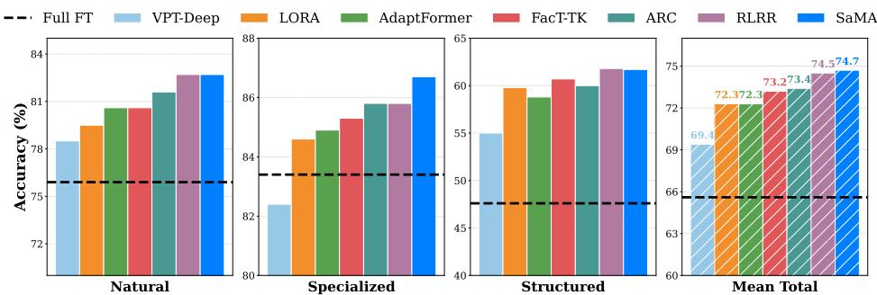  
Figure 20: Performance Comparison on VTAB-1k Benchmark. In the lightweight regimes and image classification tasks, SaMA uniformly demonstrates effectiveness in terms of group performance and global results.

The final outcomes are detailed in Table 13, highlighting the superior performance of SaMA across most settings and in overall metrics. On average, SaMA with lightweight adapters yield results that are competitive or on par with the baselines, with notable gaps – exceeding the others on the final scores. We further illustrate the performance on each group and the total sets of noticeable methods in Fig. 20 where SaMA performance trends are consistent in each group.

## G Ablation studies

To afford deeper insight into fine-tuning with Morpho matrices, we examine extensive ablation studies on SaMA and carry out pertinent analyses, further elucidating critical aspects of the method.

## G.1 Module-specific adaptation

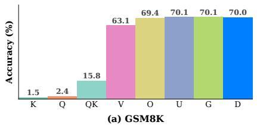

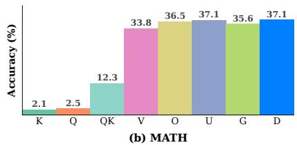  
Figure 21: Comparative contribution of individual components in transformer layers: Key, Query, Value, Output, Up, Gate and Down projections to SaMA fine-tuning performance.

Figure 21 investigates the impact of fine-tuning a single module in transformer layers of Qwen2.5-1.5B with SaMA adapters, while keeping the number of trainable parameters fixed across settings.⁵ A clear pattern emerges across both tasks: tuning only Query or Key contributes very little, whereas adapting the Value and Output projections results in substantially larger gains. One possible explanation is that adapting Query or Key only changes attention weights, but does not directly update the value content being propagated, which may limit their effectiveness. Further rigorous research might be needed to provide a comprehensive analysis.

Meanwhile, the strongest results are consistently obtained in the MLP modules, indicating the most impactful factors. For example, on GSM8K, they all reach around 70%, compared to $6 3 \% - 6 9 \%$ in v\_proj and o\_proj, respectively. The trend is similar on MATH – a more complex task, where Up and Down-tuning reach 37%. These reflect the most functional roles of feed-forward layers: neural memory [102]. They store and adapt task-relevant procedural knowledge in math. However, the gaps between up\_proj and down\_proj are small, suggesting an overall balance between their functions.

## G.2 Asymmetric configuration of $( n _ { 1 } , m _ { 2 } )$

In Sec. 2, each SaMA adapter is configured by two primary hyperparameters $( n _ { 1 } , m _ { 2 } )$ , whose interaction controls both the intermediate rank and the total trainable parameters. An important question is how to choose the two factors from the final rank $r = n _ { 1 } m _ { 2 }$ . Since it is recommended to use $( n _ { 1 } , m _ { 2 } )$ as divisors of input/output dimensions – to avoid unnecessary padding, it is more straightforward to compare different configurations that result in the same rank, as reported in Table 14.

Table 14: SaMA performance with different configurations of hidden rank 64.
<table><tr><td> $\left( n _ { 1 } - m _ { 2 } \right)$ </td><td>#Params</td><td> $\mathbf { \mathit { F } _ { 1 } - s c o r e } _ { \pm s \mathrm { t d } }$ </td></tr><tr><td>(16 − 4)</td><td>3.28M</td><td> $3 2 . 6 1 _ { \pm 1 . 0 3 }$ </td></tr><tr><td>(8−8)</td><td>2.62M</td><td> $3 2 . 5 8 { \scriptstyle \pm 0 . 6 0 }$ </td></tr><tr><td>(4 − 16)</td><td>3.28M</td><td> $3 1 . 9 { \scriptstyle \pm 1 . 5 6 }$ </td></tr></table>

Overall, with the same training schemes, the symmetric configuration $\left( n _ { 1 } = m _ { 2 } \right)$ achieves performance on par with the best asymmetric settings, while providing a more favorable trade-off between parameter efficiency and capability. Moreover, it also shows significant improvement of robustness across random seeds. In the MLP layers here, the asymmetric configurations require about 25% more parameters than (8, 8), yet do not yield consistent gains and exhibit noticeably higher variance across random initializations. By contrast, the symmetric setting offers a better balance between efficacy, parameter cost, and stability, making it the more practical default choice in most experiments.

## H Understanding the adapter via mechanistic analysis

## H.1 Does SaMA leverage the Omni-rank property?

To gain deeper insight beyond the main benchmark scores, we further carry out post-hoc analyses on adapters from two complementary perspectives: structure of learned representation and optimization dynamics by fine-tuning Qwen2-1.5B on a subset of DROP.

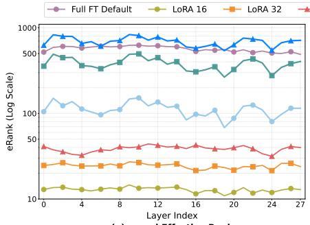  
(a) q\_proj Effective Rank

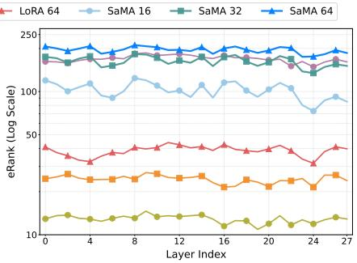  
(b) v\_proj Effective Rank  
Figure 22: Effective rank of q–proj and $\tt v _ { - } p r o j$ modules on Qwen2-1.5B, trained on DROP. SaMA utilizes higher nominal capacity and converts it into a set of rich update features.

While Theorem 3.1 provides a generic formula for the adapter nominal ranks, a natural question is whether the higher rank is translated into the learned update, or whether the optimization collapses the solution into a much lower-dimensional subspace when the parameter budget increases. In such cases, the fine-tuning adapter is really in low dimensions. To examine this, we analyze the effective rank [32] (See Appendix F.1) of the adapter weights and therefore provides a sharp view of how hidden features span in practice.

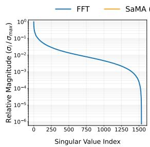  
Q-Proj: FFT

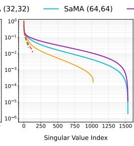  
Q-Proj: Adapter

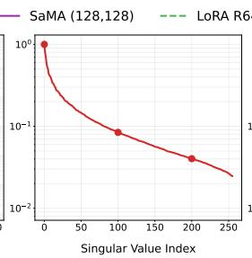  
V-Proj: FFT

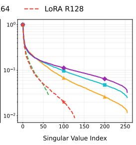  
V-Proj: Adapter  
Figure 23: Singular value spectrum comparison between SaMA and FFT on Q,V modules. Complementing Fig. 22, SaMA shares richer long-tailed spectrum patterns in common with FFT, being able to achieve a diverse singular value profile while LoRA shows a sharper energy concentration

As shown in Fig. 22, SaMA tends to preserve intense long-tailed spectrum records in both $\mathsf { q \mathrm { - } p r } \mathsf { o } \dot { \mathsf { ] } }$ and v\_proj modules, and might surpass the effective rank of FFT adapter6 if there are sufficient parameters. It indicates that: (i) the learned updates occupy a broader subspace rather than concentrate most into a few dominant directions. (ii) the long-tailed singular values really matter in matrix expressiveness, hence increasing adapter rank is a means of making performance improvement. This observation is consistent with the point that SaMA better exploits its allocated capacity and is less prone to dimensional collapse due to the “strictly low intrinsic rank assumption". This interpretation is further supported by the singular value spectra in Fig. 23. Apart from low-rank updates, SaMA exhibits a less concentrated but long-tailed spectrum by virtue of higher rank property, while remaining qualitatively close to FFT. These paradigm suggests that the nominal capacity of SaMA is not merely theoretical, but translated into a rich set of learned features in practice. In addition, compared to SaMA and FFT, LoRA exhibits a faster spectral decay, even at relatively higher ranks such as r = 64 or 128.

## H.2 Gradient behavior during optimization

As shown in Fig. 24, the loss curves of different adapters remain mainly comparable, whereas their gradient behavior is more clearly separated. In particular, SaMA exhibits more stable gradient norms, indicate flat minima [103]. The key distinction therefore lies not only in the final loss, but in the landscape as well as the optimization path taken to reach them that have critical effects on generalizability.

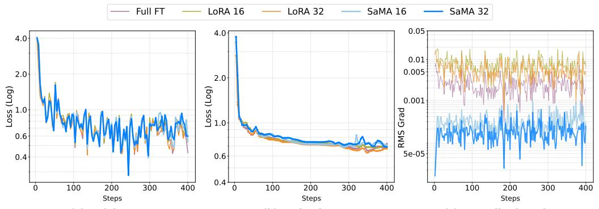  
(a) Training Loss  
(b) Evaluation Loss  
(c) Normalized Grad Norm  
Figure 24: Fine-tuning metric comparison: (a) Training loss. (b) Evaluation loss (c) Normalized Gradient norm on DROP. Although different adapters achieve broadly similar loss trajectories, SaMA appears more stable in gradient behavior, consistent with better-conditioned optimization dynamics.

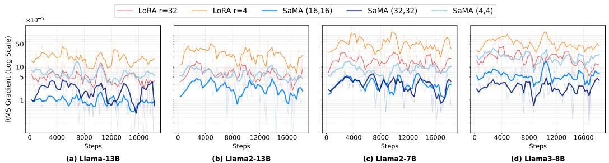  
Figure 25: Empirical evaluation for moving average of normalized, by parameter count, gradient norms of full commonsense training (raw gradient data in transparent lines). SaMA exhibits lower normalized gradient norms. The more parameter counts, the more norms tend to decrease, suggesting flatter minima and stabilizing effects.

We further investigate this phenomenon on the full commonsense reasoning experiments across Llama family, illustrating the output in Fig. 25. The lower normalized gradient norms of SaMA are broadly in consistent with better-conditioned optimization dynamics under a less degenerate parameterization [104]. This observation also aligns with a long line of work relating gradients and flatter solutions to improve generalization gaps [105] via flat minima [103], as well as with optimization methods that explicitly favor flatter neighborhoods [106]. However, there are many facets that need to be thoroughly examined in the future work, since the complicated relationship between flatness and generalization also depends on the parameterization and the notion of sharpness [104] used while different adapter designs induce distinct invariant manifolds and degrees of gauge symmetry (See Sec. 3.4 and Appendix D.6).

## I Dataset and experimental details

## I.1 Details of datasets on experiments

<table><tr><td>Dataset</td><td>Task</td><td># Train</td><td># Val</td><td># Test</td><td>Metric</td><td>Answer</td></tr><tr><td>DROP [37]</td><td>Reading comprehension with dis- crete reasoning</td><td>2000</td><td>800</td><td>1200</td><td>F1-Score</td><td>Phrase</td></tr><tr><td>COMMONSENSE147K</td><td>Commonsense reasoning (Train)</td><td>146627</td><td>1000</td><td></td><td></td><td></td></tr><tr><td>BoolQ</td><td>Commonsense reasoning (Test)</td><td></td><td></td><td>3270</td><td>Accuracy</td><td>Yes/No</td></tr><tr><td>PIQA</td><td>Commonsense reasoning (Test)</td><td></td><td></td><td>1838</td><td>Accuracy</td><td>Option</td></tr><tr><td>SIQA</td><td>Commonsense reasoning (Test)</td><td></td><td></td><td>1954</td><td>Accuracy</td><td>Option</td></tr><tr><td>HellaSwag</td><td>Commonsense reasoning (Test)</td><td></td><td></td><td>10042</td><td>Accuracy</td><td>Option</td></tr><tr><td>WinoGrande</td><td>Commonsense reasoning (Test)</td><td></td><td></td><td>1267</td><td>Accuracy</td><td>Option</td></tr><tr><td>ARC-Easy</td><td>Commonsense reasoning (Test)</td><td></td><td></td><td>2376</td><td>Accuracy</td><td>Option</td></tr><tr><td>ARC-Challenge</td><td>Commonsense reasoning (Test)</td><td></td><td></td><td>1172</td><td>Accuracy</td><td>Option</td></tr><tr><td>OBQA</td><td>Commonsense reasoning (Test)</td><td></td><td></td><td>500</td><td>Accuracy</td><td>Option</td></tr><tr><td>METAMATH (20K)</td><td>Arithmetic reasoning (Train)</td><td>20000</td><td></td><td></td><td></td><td></td></tr><tr><td>GSM8K</td><td>Arithmetic reasoning (Test)</td><td></td><td></td><td>1319</td><td>Accuracy</td><td>Number</td></tr><tr><td>MATH</td><td>Arithmetic reasoning (Test)</td><td></td><td></td><td>5000</td><td>Accuracy</td><td>Number</td></tr></table>

Table 15: Statistics of Datasets for Reading Comprehension, Commonsense, and Arithmetic Reasoning.

DROP [37] is a reading comprehension benchmark designed to test discrete reasoning over natural language passages. Unlike traditional Q&A datasets, DROP requires models to perform operations such as counting, addition, and comparison to answer correctly. In [11], the dataset is used to evaluate the performance of high-rank update with QuanTA.

Following the QuanTA experimental setup [11], we take 2800 samples from the training set, and 1200 samples from the validation set as our test set since there is no official public test set on Hugging Face. Then, the 2800-sample raw training set is partitioned into a training set with 2000 samples, and a validation set with 800 samples. Moreover, $F _ { 1 }$ score is also used as a metric for this task, which measures the closeness of the generative output compared to the ground truth answer.

Commonsense-147k is a comprehensive training collection that is refined from commonsense170k [43] by removing all duplicates. It contains a mixture of data samples from 8 different benchmark datasets in the domain:

• BoolQ [107] dataset: consists of naturally occurring yes/no questions, generated in unprompted and unconstrained settings. The context passage in the original triple is eliminated.

• Physical Interaction: Question Answering or PIQA [108] dataset: comprises samples structured as multiple-choice questions, each presenting a question with two possible solutions that require physical commonsense to answer.

• Social-IQA or SIQA [109] dataset: focuses on social commonsense reasoning regarding the pragmatic implications of characters' intentions, reactions or communal reactions, which can measure LLMs' abilities to handle social reasoning by identifying the most plausible answer.

• Hellaswag [110] dataset: a multiple choice benchmark for grounded commonsense reasoning. It includes natural language inference questions, offering a context and the most plausible continuation of a given situation from several candidates, many of which are adversarially generated to be misleading but syntactically plausible.

• WinoGrande [111] dataset: a large-scale pronoun resolution benchmark inspired by the Winograd Schema Challenge [112], but adjusted to improve the scale and robustness against the dataset-specific bias. it requires models to resolve ambiguous pronouns using commonsense reasoning rather than simple syntactic cues.

• ARC-Easy and ARC-Challenge (or ARC-e and ARC-c): two partitions from AI2 Reasoning Challenge [113] dataset, which consists of grade-school level, science example questions. ARC-Easy composes of quizzes solvable with straightforward retrieval or basic reasoning, while ARC-Challenge includes more difficult questions designed to enhance deeper reasoning and knowledge integration.

• Open book question answering - OBQA [114] dataset contains multiple-choice elementarylevel science questions requiring multi-step reasoning, which makes use of additional common and provided core science facts to get the final answer.

For arithmetic tasks, we concentrate on more difficult datasets with suitable test set size such as GSM8K, along with the more challenging problems of MATH. It could be considered as a standard mathematical reasoning benchmark with complicated inferences compared to MultiArith, AddSub, AquA, SingEq, SVAMP in [43]. In detail, we use these following datasets:

• MetaMathQA [42]: the training set. All MetaMathQA questions are bootstrapped from the training sets of GSM8K and Hendrycks MATH by rewriting the samples from multiple viewpoints, but none of the augmented data is from the testing set. The dataset involves forward reasoning and backward reasoning samples.

• Hendrycks MATH [38]: a benchmark of competition-style math problems collected from exams such as AMC and AIME. Each problem includes step-by-step solutions and final answers, covering diverse topics like algebra, geometry, number theory, and probability. Designed to test multi-step reasoning rather than rote formula application, MATH highlights the challenges large models face in genuine mathematical problem solving with explanation.

• GSM8K [39]: consists of high-quality grade school math word problems, each paired with a detailed explanation. It was designed as a benchmark for evaluating arithmetic reasoning and problem-solving in language models. Compared to MATH, GSM8K focuses on everyday math problems that require clear logical reasoning and generalization, rather than advanced techniques.

## I.2 Experimental descriptions

All fine-tuning and evaluation processes are conducted on a single NVIDIA H200/H100 GPU with 140GB/80GB of memory. All the results reported in this section are averaged over multiple experiments and varying random seeds; the terms “parameters" and “#params" here always refer to the number of trainable parameters. In these cases, all experiments are conducted using bfloat16 precision in order to reduce memory usage, AdamW [15] as the optimizer, and greedy sampling (vLLM: temperature = 0) unless otherwise specified in Table 16. In each dataset, batch sizes reported here are the effective training batch sizes, including gradient accumulation steps if any.

Table 16: Default common settings across all experiments, unless otherwise specified.
<table><tr><td>Hyperparameters</td><td>Values</td></tr><tr><td>Learning scheduler</td><td>Cosine</td></tr><tr><td>Default optimizer</td><td>AdamW</td></tr><tr><td>AdamW  $( \beta _ { 1 } , \beta _ { 2 } )$ </td><td>(0.9, 0.99)</td></tr><tr><td>Weight Decay</td><td>0.0</td></tr><tr><td>Dropout</td><td>0.0</td></tr><tr><td>Inference sampling</td><td>Greedy</td></tr></table>

## I.2.1 Baselines

We evaluate SaMA performance and compare it to the most common and up-to-date baselines. In this section, we provide a brief description of these baselines appearing in our experiments. In fact we mostly consider fundamental fine-tuning techniques, along with many LoRA variants due to the advances in recent research works.

Full fine-tuning FFT: initializes the model with pre-trained weights and biases, then updates all parameters during training on a downstream task. For LLMs, this technique requires substantial memory and computational cost, but typically serves as a comparative performance bound of PEFT.

Series [47]: The original bottleneck adapter strategy that sequentially inserts trainable modules – composed of a down-projection, a non-linearity, and an up-projection – after the self-attention and feedforward neural network (FFN) layers, while keeping the pre-trained parameters frozen.

Parallel [56]: A structural variant that places the adapter modules alongside the frozen transformer layers (Attention or FFN) rather than sequentially. This approach maintains the original network depth by processing the input in parallel to the frozen weights and summing the results.

LoRA [7]: freezes the pre-trained weights $\mathbf { W } _ { 0 } \in \mathbb { R } ^ { d \times k }$ and injects trainable rank decomposition matrices $\bar { \boldsymbol { B } } \in \mathbb { R } ^ { d \times r }$ and $A \in \mathbb { R } ^ { r \times k }$ , applying the update as $\Delta \bar { \mathbf { W } } = \mathbf { B A }$ . LoRA constrains the low intrinsic rank update $r \ll$ min(d, k) to significantly reduce the number of trainable parameters.

However, the rsLoRA [33] variant justifies this scaling to ${ \alpha / } { \sqrt { r } } .$ This rank-stabilized scaling preserves the update norm as the rank increases, ensuring that the optimization dynamics and optimal hyperparameters remain consistent across different rank choices r.

DoRA [28]: improves upon LoRA by structurally decoupling the weight update into a learnable magnitude vector m and a directional component updated via low-rank adaptation, $\mathbf { W } + \Delta \mathbf { W }$ , which comes with a trade-off with forward and backpropagation graphs during training time.

PiSSA [8]: initializes the low-rank adapter matrices A and B using the top-r principal components from the Singular Value Decomposition (SVD) of the original weight matrix $\mathbf { W } _ { 0 } .$ , rather than random Gaussian initialization.

MiLoRA [64]: leverages SVD of pretrained weight matrices. Unlike LoRA and PiSSA, MiLoRA selectively updates the minor components – those with the smallest singular values – while preserving the major components of foundation weight matrices that encode core pretrained knowledge.

KaSA [17]: Unlike PiSSA and MiLORA, which use SVD merely for initialization, KaSA first truncates minor singular values to remove noisy knowledge. It then reparameterizes task-specific updates using learnable singular values to dynamically activate the most relevant components.

LoRA-Pro [36]: An optimization-centric variant that mathematically aligns the gradient updates. LoRA-Pro introduces a closed-form gradient correction ensuring that the weight update $\Delta W$ closely approximates the projection of the FFT gradient onto the low-rank subspace defined by r.

HiRA [19]: A high-rank adaptation method that constructs the weight update $\Delta W$ using the Hadamard product (element-wise multiplication – denoted as the operator ) of constituent matrices, rather than the standard matrix multiplication used in LoRA: $\Delta \hat { \mathbf { W } } = ( \mathbf { B } _ { 1 } \mathbf { A } _ { 1 } ) \odot \mathbf { W } _ { 0 }$

ABBA [35]: An alternative to HiRA [19] that reparameterizes the weight update $\Delta W$ as the Hadamard product of two independent adapters: $\Delta \mathbf { \bar { W } } = \left( \mathbf { B } _ { 1 } \mathbf { A } _ { 1 } \right) \odot \left( \mathbf { B } _ { 2 } \mathbf { \bar { A } } _ { 2 } \right)$ . By decoupling the update from $W _ { 0 } ,$ ABBA allows the effective rank of the adaptation to reach up to $r _ { 1 } r _ { 2 }$

SMT [29]: constrains weight updates to a specific sparse or block-diagonal structure, trading off theoretical expressivity for computational and memory efficiency. The primary criterion for block preference is the gradient score during the first phase of warm-up.

QuanTA [11]: is a high-rank adaptation method inspired by quantum-style tensor factorization. It applies small 4D tensor interactions across tensorized feature dimensions through a sequence of transformations with $\textstyle { \binom { N } { 2 } } = { \frac { N ( N - 1 ) } { 2 } }$ factors to enable richer mixing.

S2FT [82]: selects sparsely and computes densely by updating a small subset of attention heads and hidden channels along with utilizing co-permutation to group these parameters into dense submatrices.

LISA [81]: does partial FFT by randomly freezing transformer layers with a given probability, except for embedding layers which always remain trainable to achieve memory efficiency, based on LoRA's skewed weight norm distribution.

Galore [74]: resolves the memory bottleneck in LLM training by projecting the weight gradients into a low-rank subspace, rather than approximating the weight matrices themselves. By dynamically switching these projection subspaces over time, GaLore enables FFT but is more memory-efficient.

DiaBlo [18]: directly updates only the structured diagonal blocks of the pre-trained weight matrices while keeping the off-diagonal blocks frozen. By avoiding matrix multiplication, DiaBlo simplifies the optimization landscape, targeting stable and robust convergence.

FlexLoRA [65]: a dynamic low-rank adaptation framework that simultaneously prunes redundant ranks in less important layers and expands ranks in critical layers under a global budget.

RepLoRA [10]: reparameterizes low-rank matrices as the outputs of lightweight MLPs, motivated by theoretical connections to Mixture of Experts (MoE) models.

RefLoRA [72]: addresses the slow convergence and imbalanced weight updates of standard LoRA. The method dynamically applies the optimal low-rank factorization at each training step by minimizing an upper bound on the loss function.

RandLoRA [51]: enables full-rank weight updates by modeling them as a linear combination of fixed, low-rank random matrices, restricting the optimization solely to their diagonal coefficients.

LaX [98]: establishes residual connections that directly route the intermediate latent features from a preceding low-rank layer into the up-projection process of the current layer.

## I.2.2 The DROP dataset

Table 17: Common settings used for main experiments on DROP.
<table><tr><td>Experiment</td><td>Hyperparameters</td><td>Values</td></tr><tr><td rowspan="6">Training</td><td>Modules</td><td> $( \mathsf { q \_ p r o j } , \mathsf { v \_ p r o j } )$ </td></tr><tr><td>Batch size</td><td>4</td></tr><tr><td>Valid batch</td><td>16</td></tr><tr><td>Epoch</td><td>2.0</td></tr><tr><td>Eval step</td><td>25</td></tr><tr><td>Max token length</td><td>1536</td></tr><tr><td rowspan="2">Inference</td><td>LLM max length</td><td>1536</td></tr><tr><td>New tokens</td><td>50</td></tr></table>

Table 18: Learning rate and scaling factor s across various Llama2 model scales on the DROP dataset. Symbol + indicates the configurations from [11].
<table><tr><td>Model</td><td>Configuration</td><td>Learning rate</td><td>Scaling</td></tr><tr><td rowspan="9">Llama2-7B</td><td> $\mathbf { L o R A } _ { r = 8 }$ </td><td> $\mathrm { 1 e { - } 3 , 2 e { - } 3 , 8 e { - } 4 }$ </td><td>1.0</td></tr><tr><td> $\mathrm { L o R A } _ { r = 3 2 }$ </td><td> $\mathrm { 1 e { - } 3 , 2 e { - } 3 , 8 e { - } 4 }$ </td><td>1.0</td></tr><tr><td> $\mathrm { L o R A } _ { r = 1 2 8 }$ </td><td> $\mathrm { 1 e { - } 3 , 2 e { - } 3 , 8 e { - } 4 }$ </td><td>1.0</td></tr><tr><td> $\mathrm { Q u a n T A } _ { 1 6 - 8 - 8 - 4 } ^ { \star }$ </td><td>1e-4</td><td>1.0</td></tr><tr><td> $\mathrm { Q u a n T A } _ { 1 6 - 1 6 - 1 6 } ^ { \star }$ </td><td>1e-4</td><td>1.0</td></tr><tr><td> $\mathrm { S a M A } _ { 2 , 2 }$ </td><td>1e-3</td><td>1.0</td></tr><tr><td> $\mathrm { S a M A } _ { 4 , 4 }$ </td><td>1e-3</td><td>1.0</td></tr><tr><td> $\mathrm { S a M A _ { 8 , 8 } }$ </td><td>1e-3</td><td>1.0</td></tr><tr><td>SaMA 16,16 SaMA 32,32</td><td>1e-3</td><td>1.0</td></tr><tr><td></td><td></td><td>1e-3</td><td>1.0</td></tr><tr><td></td><td> $\operatorname { S a M A } 6 4 { , } 6 4$ </td><td>9e-4</td><td>1.0</td></tr><tr><td>Llama2-13B</td><td> $\mathrm { S a M A } _ { 4 - 4 }$ </td><td>8e-4</td><td>1.0</td></tr></table>

In Table 17, we show the common setting for DROP experiments along with hyperparameters in Table 18. The Llama2 family is used as the foundation models.

## I.2.3 Commonsense reasoning

To verify the effectiveness of our approach on commonsense reasoning downstream applications, we adapt several pretrained models of the Llama family, including Llama-7B, Llama-13B [44], Llama2-7B and 13B [45], Llama3-8B [46]. This paper [43] introduces an integration of 170k samples from 8 different tasks, but we compare with their metadata and realize that there are many duplicates. Therefore, we pre-process the joint COMMONSENSE170K dataset by removing duplicate samples, yielding COMMONSENSE-147K. Then, following common protocols in this domain [43], we first fine-tune the models on the refined training data and evaluate the same adapted models on the full test sets of downstream tasks. Similar to the methodology used for the DROP dataset, we extract a subset of 1000 samples from COMMONSENSE-147K, then optimize the hyperparameters on this validation set. In the end, we select the best checkpoint based on validation set performance to evaluate the performance on the benchmark. The general hyperparameters and adapter configurations are listed in Tables 19 and 20, respectively.

Attention fine-tuning – a comparison with QuanTA The hyperparameters for these experiments are provided in Table 21:

In Table 12, although the total number of trainable parameters in SaMA is slightly lower than that of QuanTA, SaMA still outperforms in most of the global and local metrics. It further consolidates SaMA capacity for fine-tuning on attention modules.

## I.2.4 Arithmetic reasoning

For arithmetic reasoning tasks, we fine-tune pretrained models of Mistral-7B [40] and Gemma-2 9B [41] on a 20K-sample subset of MetaMathQA [42], and evaluate their performance on test sets of MATH [38] and GSM8K [39], which require multi-step reasoning – following [35]. The experimental

Table 19: Common hyperparameters used for main experiments on commonsense reasoning tasks.
<table><tr><td>Experiment</td><td>Hyperparameters</td><td>Values</td></tr><tr><td rowspan="6">Training</td><td>Modules</td><td>(Q, K, V, Up, Down)</td></tr><tr><td>Batch size</td><td>16</td></tr><tr><td>Valid batch</td><td>16,32</td></tr><tr><td>Epoch</td><td>2.0</td></tr><tr><td>Eval step</td><td>300</td></tr><tr><td>Max sequence length</td><td>512</td></tr><tr><td rowspan="2">Inference</td><td>LLM max length</td><td>1024</td></tr><tr><td>New tokens</td><td>50</td></tr></table>

Table 20: Detailed adapter configurations on commonsense reasoning tasks.
<table><tr><td>Model</td><td>Setting</td><td>Learning rate</td><td>Scaling (s)</td><td>Config (n1, m2)</td></tr><tr><td rowspan="2">Llama-7B</td><td> $\mathrm { S a M A _ { 4 } } \mathrm { _ { \times 4 } }$ </td><td>5e-4</td><td>1.414</td><td>(4,4)</td></tr><tr><td> $\mathrm { S a M A _ { 1 6 \times 1 6 } }$ </td><td>5e-4</td><td>1.414</td><td>(16,16)</td></tr><tr><td rowspan="2">Llama-13B</td><td> $\mathrm { S a M A _ { 4 } } \mathrm { _ { \times 4 } }$ </td><td>5e-4</td><td>1.0</td><td>(4,4)</td></tr><tr><td> $\mathrm { S a M A _ { 1 6 \times 1 6 } }$ </td><td>5e-4</td><td>1.0</td><td>(16,16)</td></tr><tr><td rowspan="2">Llama2-7B</td><td> $\mathrm { S a M A _ { 4 } } \mathrm { _ { \times 4 } }$ </td><td>1e-3</td><td>0.25</td><td>(4,4)</td></tr><tr><td> $\mathrm { S a M A _ { 1 6 \times 1 6 } }$ </td><td>5e-4</td><td>1.0</td><td>(16,16)</td></tr><tr><td rowspan="2">Llama3-8B</td><td> $\mathrm { S a M A } _ { 4 \times 4 }$ </td><td>2e-4</td><td>1.0</td><td>(4,4)</td></tr><tr><td> $\mathrm { S a M A _ { 1 6 \times 1 6 } }$ </td><td>2e-4</td><td>1.0</td><td>(16,16)</td></tr></table>

Table 21: Hyperparameters used for QV-attention experiments on commonsense reasoning, other arguments remain the same as the main experiments. Learning rate and scaling factor correspond respectively to each model.
<table><tr><td>Experiment</td><td>Hyperparameters</td><td>Values</td></tr><tr><td rowspan="7">SaMA</td><td>Modules</td><td>(q_proj, v_proj)</td></tr><tr><td>Batch size</td><td>16</td></tr><tr><td>Valid batch</td><td>32</td></tr><tr><td>Eval step</td><td>300</td></tr><tr><td>Config  $( n _ { 1 } , m _ { 2 } )$ </td><td>(4,4)</td></tr><tr><td>Learning rate</td><td>{8e-4, 5e-4, 1e-3, 8e-4, 2e-4}</td></tr><tr><td>Scaling factor</td><td>1.414, 1.0, 0.5, 1.0, 1.0</td></tr></table>

Table 22: Common settings used for main experiments on MATH.
<table><tr><td>Experiment</td><td>Hyperparameters</td><td>Values</td></tr><tr><td rowspan="5">Training</td><td>Modules</td><td>(q_proj, v_proj, k_proj, o_proj,</td></tr><tr><td>Batch size</td><td>gate_proj, up_proj, down_proj) 4</td></tr><tr><td>Epoch</td><td>1</td></tr><tr><td>Max token length</td><td>1536</td></tr><tr><td></td><td></td></tr><tr><td rowspan="2">Inference</td><td>LLM max length</td><td>4096</td></tr><tr><td>New tokens</td><td>1536</td></tr></table>

Table 23: Learning rate and scaling factor s across math models on the MATH tasks.
<table><tr><td>Model</td><td>Configuration</td><td>Learning rate</td><td>Scaling factor</td></tr><tr><td rowspan="3">Mistral-7B</td><td> $\mathrm { S a M A } _ { 2 , 2 }$ </td><td>5e-4</td><td>1.0</td></tr><tr><td>SaMA 4,4</td><td>5e-4</td><td>1.0</td></tr><tr><td>SaMA 16,16</td><td>5e-4</td><td>1.0</td></tr><tr><td rowspan="3">Gemma2-9B</td><td>SaMA 2,2</td><td>5e-4</td><td>1.0</td></tr><tr><td>SaMA 4,4</td><td>5e-4</td><td>1.0</td></tr><tr><td>SaMA 16,16</td><td>5e-4</td><td>1.0</td></tr></table>

hyperparameters are provided in Tables 22 and 23. In these experiments, we fine-tune all linear modules in each transformer layer, including attention and MLP projections.

## I.2.5 Vision fine-tuning

Table 24 shows hyperparameters used in the experiments with VTAB-1k [100] on Vision Transformers.

Table 24: Implementation details of configurations, optimizer, and hyper-parameters. We select the best hyper-parameters for each task via grid search.
<table><tr><td>Configuration</td><td>Value</td></tr><tr><td>Optimizer</td><td>AdamW</td></tr><tr><td>Learning Rate</td><td>{0.1, 0.05, 0.02, 0.01, 0.005, 0.002, 0.001}</td></tr><tr><td>Weight Decay</td><td>{0.05, 0.01, 0.005, 0.001}</td></tr><tr><td>Dropout Rate</td><td>{0.2,0.4}</td></tr><tr><td>Batch Size</td><td>{32}</td></tr><tr><td>Learning Rate Schedule</td><td>Cosine Decay</td></tr><tr><td>Training Epochs</td><td>(24, 29)</td></tr><tr><td>Module</td><td>All transformer projections</td></tr><tr><td>Warmup Epochs</td><td>1</td></tr></table>

## I.3 Template of Instruction fine-tuning

Throughout this work, we use task-specific but structurally consistent prompt templates for both fine-tuning and inference. This subsection summarizes the templates used for DROP, commonsense reasoning, and math reasoning.

## I.3.1 Prompt template for DROP

Below is a passage followed by a corresponding question that describes a task   
Write a response that appropriately completes the request with your answer.   
### Instruction:   
Passage: {passage}   
Question: {question}   
### Response:  
Figure 26: DROP dataset - Prompt template.

Similar to Sec. I.3.2, we use this prompt template during fine-tuning and inference of DROP [37] dataset. The dataset consists of "Passage" and "Question" fields. Therefore, in the templates, we detail these headings and contents into the main body part, as in Fig. 26

## I.3.2 Commonsense reasoning data and prompt template

As described in Sec. I.2.3, the commonsense reasoning dataset collection includes 8 different sets. Each one in the domain entails distinct tasks, following [43, 115], we create a structured framework that begins the same dialog template for disparate problems across the collection, followed by separately articulating the objective of the task, then the presentation of the relevant content and the corresponding solution.

Figs. 27 and 28 shows the common instructional part of the template, while Table 25 demonstrates the distinct templates following the common part used to gather the commonsense reasoning data samples for fine-tuning.

Table 25: The data template of each dataset used to create commonsense reasoning data samples.
<table><tr><td>Dataset</td><td>Fine-tuning Data Template</td></tr><tr><td>BoolQ</td><td>Please answer the following question with true or false, question: [QUESTION] Answer format: true/false the correct answer is [ANSWER]</td></tr><tr><td>PIQA</td><td>Please choose the correct solution to the question: [QUESTION] Solution1: [SOLUTION_1] Solution2: [SOLUTION_2] Answer format: solution1/solution2 the correct answer is [ANSWER]</td></tr><tr><td>SIQA</td><td>Please choose the correct answer to the question: [QUESTION] Answer1: [ANSWER_1] Answer2: [ANSWER_2] Answer3: [ANSWER_3] Answer format: answer1/answer2/answer3</td></tr><tr><td>HellaSwag</td><td>Please choose the correct ending to complete the given sentence: [ACTIVITY_LABEL]: [CONTEXT] Ending1: [ENDING_1] Ending2: [ENDING_2] Ending3: [ENDING_3] Ending4: [ENDING_4] Answer format: ending1/ending2/ending3/ending4 the correct answer is [ANSWER]</td></tr><tr><td>WinoGrande</td><td>Please choose the correct answer to fill in the blank to complete the given sentence: [SENTENCE] Option1: [OPTION_1] Option2: [OPTION_2] Answer format: option1/option2</td></tr><tr><td>ARC-e &amp; ARC-c</td><td>Please choose the correct answer to the question: [QUESTION] Answer1: [ANSWER_1] Answer2: [ANSWER_2] Answer3: [ANSWER_3] Answer4: [ANSWER_4] Answer format: answer1/answer2/answer3/answer4</td></tr><tr><td>OBQA</td><td>Please choose the correct answer to the question: [QUESTION] Answer1: [ANSWER_1] Answer2: [ANSWER_2] Answer3: [ANSWER_3] Answer4: [ANSWER_4] Answer format: answer1/answer2/answer3/answer4 the correct answer is [ANSWER]</td></tr><tr><td colspan="2"></td></tr><tr><td colspan="2"></td></tr><tr><td></td><td></td></tr><tr><td></td><td></td></tr><tr><td></td><td></td></tr></table>

Figure 27: Commonsense reasoning - Prompt template with a non-empty input field.

Below is an instruction that describes a task, paired with an input that   
provides further context.   
Write a response that appropriately completes the request.   
### Instruction:   
{instruction}   
### Response:  
Figure 28: Commonsense reasoning - Prompt template for examples with an empty input field.

  
Figure 29: Math reasoning - Prompt template.

## I.3.3 Math reasoning prompt template

Fig. 29 shows the actual prompt template when fine-tuning the model and generating outputs on math datasets [42, 38, 39]

## J Broader Impact

This paper presents work that aims to advance the field of machine learning. The proposed method, SaMA, along with Morpho parameterization, are designed to efficiently train LLMs and enhance fine-tuning performance. This will facilitate further research regarding PEFT in Large foundation models in the future. We believe that this work does not cause any significant societal consequences.

## NeurIPS Paper Checklist

## 1. Claims

Question: Do the main claims made in the abstract and introduction accurately reflect the paper's contributions and scope?

Answer: [Yes]

Justification: We theoretically and empirically verify the claims and contributions made in the abstract and introduction. See the abstract and introduction part.

Guidelines:

• The answer [N/A] means that the abstract and introduction do not include the claims made in the paper.

• The abstract and/or introduction should clearly state the claims made, including the contributions made in the paper and important assumptions and limitations. A [No] or [N/A] answer to this question will not be perceived well by the reviewers.

• The claims made should match theoretical and experimental results, and reflect how much the results can be expected to generalize to other settings.

• It is fine to include aspirational goals as motivation as long as it is clear that these goals are not attained by the paper.

## 2. Limitations

Question: Does the paper discuss the limitations of the work performed by the authors?

Answer: [Yes]

Justification: We discussed the limitations in Sec. 6.

Guidelines:

• The answer [N/A] means that the paper has no limitation while the answer [No] means that the paper has limitations, but those are not discussed in the paper.

• The authors are encouraged to create a separate “Limitations" section in their paper.

• The paper should point out any strong assumptions and how robust the results are to violations of these assumptions (e.g., independence assumptions, noiseless settings, model well-specification, asymptotic approximations only holding locally). The authors should reflect on how these assumptions might be violated in practice and what the implications would be.

• The authors should reflect on the scope of the claims made, e.g., if the approach was only tested on a few datasets or with a few runs. In general, empirical results often depend on implicit assumptions, which should be articulated.

• The authors should reflect on the factors that influence the performance of the approach. For example, a facial recognition algorithm may perform poorly when image resolution is low or images are taken in low lighting. Or a speech-to-text system might not be used reliably to provide closed captions for online lectures because it fails to handle technical jargon.

• The authors should discuss the computational efficiency of the proposed algorithms and how they scale with dataset size.

• If applicable, the authors should discuss possible limitations of their approach to address problems of privacy and fairness.

• While the authors might fear that complete honesty about limitations might be used by reviewers as grounds for rejection, a worse outcome might be that reviewers discover limitations that aren't acknowledged in the paper. The authors should use their best judgment and recognize that individual actions in favor of transparency play an important role in developing norms that preserve the integrity of the community. Reviewers will be specifically instructed to not penalize honesty concerning limitations.

## 3. Theory assumptions and proofs

Question: For each theoretical result, does the paper provide the full set of assumptions and a complete (and correct) proof?

Answer: [Yes]

Justification: See Appendix D.

## Guidelines:

• The answer [N/A] means that the paper does not include theoretical results.

• All the theorems, formulas, and proofs in the paper should be numbered and crossreferenced.

• All assumptions should be clearly stated or referenced in the statement of any theorems.

• The proofs can either appear in the main paper or the supplemental material, but if they appear in the supplemental material, the authors are encouraged to provide a short proof sketch to provide intuition.

• Inversely, any informal proof provided in the core of the paper should be complemented by formal proofs provided in appendix or supplemental material.

• Theorems and Lemmas that the proof relies upon should be properly referenced.

## 4. Experimental result reproducibility

Question: Does the paper fully disclose all the information needed to reproduce the main experimental results of the paper to the extent that it affects the main claims and/or conclusions of the paper (regardless of whether the code and data are provided or not)?

Answer: [Yes]

Justification: Hyperparameters are in Appendix I. The code is provided in the supplementary material.

Guidelines:

• The answer [N/A] means that the paper does not include experiments.

• If the paper includes experiments, a [No] answer to this question will not be perceived well by the reviewers: Making the paper reproducible is important, regardless of whether the code and data are provided or not.

• If the contribution is a dataset and/or model, the authors should describe the steps taken to make their results reproducible or verifiable.

• Depending on the contribution, reproducibility can be accomplished in various ways. For example, if the contribution is a novel architecture, describing the architecture fully might suffice, or if the contribution is a specific model and empirical evaluation, it may be necessary to either make it possible for others to replicate the model with the same dataset, or provide access to the model. In general. releasing code and data is often one good way to accomplish this, but reproducibility can also be provided via detailed instructions for how to replicate the results, access to a hosted model (e.g., in the case of a large language model), releasing of a model checkpoint, or other means that are appropriate to the research performed.

• While NeurIPS does not require releasing code, the conference does require all submissions to provide some reasonable avenue for reproducibility, which may depend on the nature of the contribution. For example

(a) If the contribution is primarily a new algorithm, the paper should make it clear how to reproduce that algorithm.

(b) If the contribution is primarily a new model architecture, the paper should describe the architecture clearly and fully.

(c) If the contribution is a new model (e.g., a large language model), then there should either be a way to access this model for reproducing the results or a way to reproduce the model (e.g., with an open-source dataset or instructions for how to construct the dataset).

(d) We recognize that reproducibility may be tricky in some cases, in which case authors are welcome to describe the particular way they provide for reproducibility. In the case of closed-source models, it may be that access to the model is limited in some way (e.g., to registered users), but it should be possible for other researchers to have some path to reproducing or verifying the results.

## 5. Open access to data and code

Question: Does the paper provide open access to the data and code, with sufficient instructions to faithfully reproduce the main experimental results, as described in supplemental material?

Answer: [Yes]

Justification: All the code and data are available in the supplementary material.

## Guidelines:

• The answer [N/A] means that paper does not include experiments requiring code.

• Please see the NeurIPS code and data submission guidelines (https: //neurips . cc/ public/guides/CodeSubmissionPolicy) for more details.

• While we encourage the release of code and data, we understand that this might not be possible, so [No] is an acceptable answer. Papers cannot be rejected simply for not including code, unless this is central to the contribution (e.g., for a new open-source benchmark).

• The instructions should contain the exact command and environment needed to run to reproduce the results. See the NeurIPS code and data submission guidelines (https: //neurips.cc/public/guides/CodeSubmissionPolicy) for more details.

• The authors should provide instructions on data access and preparation, including how to access the raw data, preprocessed data, intermediate data, and generated data, etc.

• The authors should provide scripts to reproduce all experimental results for the new proposed method and baselines. If only a subset of experiments are reproducible, they should state which ones are omitted from the script and why.

• At submission time, to preserve anonymity, the authors should release anonymized versions (if applicable).

• Providing as much information as possible in supplemental material (appended to the paper) is recommended, but including URLs to data and code is permitted.

## 6. Experimental setting/details

Question: Does the paper specify all the training and test details (e.g., data splits, hyperparameters, how they were chosen, type of optimizer) necessary to understand the results?

Answer: [Yes]

Justification: We provided all of our experimental settings in Appendix I.

Guidelines:

• The answer [N/A] means that the paper does not include experiments.

• The experimental setting should be presented in the core of the paper to a level of detail that is necessary to appreciate the results and make sense of them.

• The full details can be provided either with the code, in appendix, or as supplemental material.

## 7. Experiment statistical significance

Question: Does the paper report error bars suitably and correctly defined or other appropriate information about the statistical significance of the experiments?

Answer: [Yes]

Justification: We conducted extensive hyperparameter searches for all baselines and our proposed method. Experimental results are tested multiple times to ensure stability and reliability. See Appendix I.

Guidelines:

• The answer [N/A] means that the paper does not include experiments.

• The authors should answer [Yes] if the results are accompanied by error bars, confidence intervals, or statistical significance tests, at least for the experiments that support the main claims of the paper.

• The factors of variability that the error bars are capturing should be clearly stated (for example, train/test split, initialization, random drawing of some parameter, or overall run with given experimental conditions).

• The method for calculating the error bars should be explained (closed form formula, call to a library function, bootstrap, etc.)

• The assumptions made should be given (e.g., Normally distributed errors).

• It should be clear whether the error bar is the standard deviation or the standard error of the mean.

• It is OK to report 1-sigma error bars, but one should state it. The authors should preferably report a 2-sigma error bar than state that they have a 96% CI, if the hypothesis of Normality of errors is not verified.

• For asymmetric distributions, the authors should be careful not to show in tables or figures symmetric error bars that would yield results that are out of range (e.g., negative error rates).

• If error bars are reported in tables or plots, the authors should explain in the text how they were calculated and reference the corresponding figures or tables in the text.

## 8. Experiments compute resources

Question: For each experiment, does the paper provide sufficient information on the computer resources (type of compute workers, memory, time of execution) needed to reproduce the experiments?

Answer: [Yes]

Justification: See Appendix I. Experiments are conducted on a single NVIDIA H100 or H200 GPU.

Guidelines:

• The answer [N/A] means that the paper does not include experiments.

• The paper should indicate the type of compute workers CPU or GPU, internal cluster, or cloud provider, including relevant memory and storage.

• The paper should provide the amount of compute required for each of the individual experimental runs as well as estimate the total compute.

• The paper should disclose whether the full research project required more compute than the experiments reported in the paper (e.g., preliminary or failed experiments that didn't make it into the paper).

## 9. Code of ethics

Question: Does the research conducted in the paper conform, in every respect, with the NeurIPS Code of Ethics https://neurips.cc/public/EthicsGuidelines?

Answer: [Yes]

Justification: We have reviewed the code of ethics and confirmed that our research complies with its guidelines.

Guidelines:

• The answer [N/A] means that the authors have not reviewed the NeurIPS Code of Ethics.

• If the authors answer [No], they should explain the special circumstances that require a deviation from the Code of Ethics.

• The authors should make sure to preserve anonymity (e.g., if there is a special consideration due to laws or regulations in their jurisdiction).

## 10. Broader impacts

Question: Does the paper discuss both potential positive societal impacts and negative societal impacts of the work performed?

Answer: [Yes]

Justification: See Appendix J

Guidelines:

• The answer [N/A] means that there is no societal impact of the work performed

• If the authors answer [N/A] or [No], they should explain why their work has no societal impact or why the paper does not address societal impact.

• Examples of negative societal impacts include potential malicious or unintended uses (e.g., disinformation, generating fake profiles, surveillance), fairness considerations (e.g., deployment of technologies that could make decisions that unfairly impact specific groups), privacy considerations, and security considerations.

• The conference expects that many papers will be foundational research and not tied to particular applications, let alone deployments. However, if there is a direct path to any negative applications, the authors should point it out. For example, it is legitimate to point out that an improvement in the quality of generative models could be used to generate Deepfakes for disinformation. On the other hand, it is not needed to point out that a generic algorithm for optimizing neural networks could enable people to train models that generate Deepfakes faster.

• The authors should consider possible harms that could arise when the technology is being used as intended and functioning correctly, harms that could arise when the technology is being used as intended but gives incorrect results, and harms following from (intentional or unintentional) misuse of the technology.

• If there are negative societal impacts, the authors could also discuss possible mitigation strategies (e.g., gated release of models, providing defenses in addition to attacks, mechanisms for monitoring misuse, mechanisms to monitor how a system learns from feedback over time, improving the efficiency and accessibility of ML).

## 11. Safeguards

Question: Does the paper describe safeguards that have been put in place for responsible release of data or models that have a high risk for misuse (e.g., pre-trained language models, image generators, or scraped datasets)?

Answer: [N/A]

Justification: This paper presents work whose goal is to advance the field of LLM optimization. All of the datasets and models are public and we have checked them all. Our paper poses none of the risks mentioned in the question.

Guidelines:

• The answer [N/A] means that the paper poses no such risks.

• Released models that have a high risk for misuse or dual-use should be released with necessary safeguards to allow for controlled use of the model, for example by requiring that users adhere to usage guidelines or restrictions to access the model or implementing safety filters.

• Datasets that have been scraped from the Internet could pose safety risks. The authors should describe how they avoided releasing unsafe images.

• We recognize that providing effective safeguards is challenging, and many papers do not require this, but we encourage authors to take this into account and make a best faith effort.

## 12. Licenses for existing assets

Question: Are the creators or original owners of assets (e.g., code, data, models), used in the paper, properly credited and are the license and terms of use explicitly mentioned and properly respected?

Answer: [Yes]

Justification: We have cited the original papers that produced the assets properly.

Guidelines:

• The answer [N/A] means that the paper does not use existing assets.

• The authors should cite the original paper that produced the code package or dataset.

• The authors should state which version of the asset is used and, if possible, include a URL.

• The name of the license (e.g., CC-BY 4.0) should be included for each asset.

• For scraped data from a particular source (e.g., website), the copyright and terms of service of that source should be provided.

• If assets are released, the license, copyright information, and terms of use in the package should be provided. For popular datasets, paperswithcode. com/datasets has curated licenses for some datasets. Their licensing guide can help determine the license of a dataset.

• For existing datasets that are re-packaged, both the original license and the license of the derived asset (if it has changed) should be provided.

• If this information is not available online, the authors are encouraged to reach out to the asset's creators.

## 13. New assets

Question: Are new assets introduced in the paper well documented and is the documentation provided alongside the assets?

Answer: [Yes]

Justification: All the code is available in the supplementary material, along with an explicit README.md.

Guidelines:

• The answer [N/A] means that the paper does not release new assets.

• Researchers should communicate the details of the dataset/code/model as part of their submissions via structured templates. This includes details about training, license, limitations, etc.

• The paper should discuss whether and how consent was obtained from people whose asset is used.

• At submission time, remember to anonymize your assets (if applicable). You can either create an anonymized URL or include an anonymized zip file.

## 14. Crowdsourcing and research with human subjects

Question: For crowdsourcing experiments and research with human subjects, does the paper include the full text of instructions given to participants and screenshots, if applicable, as well as details about compensation (if any)?

Answer: [N/A]

Justification: This paper does not involve crowdsourcing nor research with human subjects. Guidelines:

• The answer [N/A] means that the paper does not involve crowdsourcing nor research with human subjects.

• Including this information in the supplemental material is fine, but if the main contribution of the paper involves human subjects, then as much detail as possible should be included in the main paper.

• According to the NeurIPS Code of Ethics, workers involved in data collection, curation, or other labor should be paid at least the minimum wage in the country of the data collector.

## 15. Institutional review board (IRB) approvals or equivalent for research with human subjects

Question: Does the paper describe potential risks incurred by study participants, whether such risks were disclosed to the subjects, and whether Institutional Review Board (IRB) approvals (or an equivalent approval/review based on the requirements of your country or institution) were obtained?

Answer: [N/A]

Justification: This paper does not involve crowdsourcing nor research with human subjects. Guidelines:

• The answer [N/A] means that the paper does not involve crowdsourcing nor research with human subjects.

• Depending on the country in which research is conducted, IRB approval (or equivalent) may be required for any human subjects research. If you obtained IRB approval, you should clearly state this in the paper.

• We recognize that the procedures for this may vary significantly between institutions and locations, and we expect authors to adhere to the NeurIPS Code of Ethics and the guidelines for their institution.

• For initial submissions, do not include any information that would break anonymity (if applicable), such as the institution conducting the review.

## 16. Declaration of LLM usage

Question: Does the paper describe the usage of LLMs if it is an important, original, or non-standard component of the core methods in this research? Note that if the LLM is used only for writing, editing, or formatting purposes and does not impact the core methodology, scientific rigor, or originality of the research, declaration is not required.

Answer: [N/A]

Justification: LLMs are not used in our core method development.

Guidelines:

• The answer [N/A] means that the core method development in this research does not involve LLMs as any important, original, or non-standard components.

• Please refer to our LLM policy in the NeurIPS handbook for what should or should not be described.