# Synthesizing Dexterous Robot Demonstrations from Human Videos via Virtual Try-On

Seungyong Lee1 Suhyeok Jang1,2 Minyoung Kim1 Jinwoo Shin1,2 1KAIST 2RLWRLD

Robot foundation models have shown remarkable performance in robot control, yet adapting them to a new task still relies heavily on teleoperated demonstrations. Egocentric human videos offer a scalable substitute, but overlaying rendered robots on human videos or retargeting human poses into robot actions leaves significant visual or action gaps for high-DoF robot embodiments. To address this limitation, we propose RoboTryOn, which treats human-to-robot translation as virtual try-on: try-on keeps the person and swaps the garment, RoboTryOn keeps the demonstrated motion and swaps the human for the robot. Specifically, RoboTryOn converts a human video into a video of the target robot specified by a reference image, while preserving the original task, objects, and background. To maintain visual consistency, we translate selected keyframes autoregressively and use them to guide video synthesis with motion conditioned on the human hand skeleton. Additionally, we use an inverse dynamics model (IDM) that incorporates depth features to infer action labels from synthesized videos for policy learning. Our experiments across multiple humanoid embodiments show that policies trained with our synthetic data improve the average success rate on novel tasks, including challenging bimanual manipulation, from 2% to 60%, without any real robot demonstration of those tasks. Moreover, training with our synthetic data matches the performance of policies trained solely on teleoperated demonstrations at approximately a third of the collection cost, demonstrating the cost efficiency of our approach.

## 1. Introduction

Robot foundation models trained on large-scale demonstrations have made substantial progress toward general-purpose robot control (Open X-Embodiment Collaboration, 2024; Octo Model Team et al., 2024; Kim et al., 2024; Black et al., 2024; Liu et al., 2025a; NVIDIA et al., 2025; Black et al., 2025), while extending them to new tasks and environments still requires additional robot demonstrations (Open X-Embodiment Collaboration, 2024; Khazatsky et al., 2024; Bu et al., 2025). Collecting such demonstrations through teleoperation requires robot hardware, a teleoperation system, and substantial operator effort (Zhao et al., 2023; Wu et al., 2024; Chi et al., 2024; Khazatsky et al., 2024). The burden is heaviest for dexterous hands, where operators must coordinate many degrees of freedom and fine-grained contacts through retargeting interfaces that are challenging to develop and operate (Handa et al., 2020; Qin et al., 2023; Cheng et al., 2024; Wang et al., 2024; Xu et al., 2025).

Alternatively, human videos offer another way to demonstrate a new task. In particular, egocentric recordings of human object manipulation already exist at internet scale and far outnumber the demonstrations teleoperation can produce, ranging from in-the-wild collections to manually annotated corpora recorded for robot learning (Goyal et al., 2017; Shan et al., 2020; Damen et al., 2022; Grauman et al., 2022; 2024; Liu et al., 2022; Hoque et al., 2025; Li et al., 2025; Punamiya et al., 2026). They capture how people grasp and manipulate objects, including coordinated bimanual interaction, without a robot during collection. Recent works use these videos to learn transferable visual and behavioral knowledge (Nair et al., 2022; Yang et al., 2025; Luo et al., 2025; Dyna Robotics, 2026), or convert them into robot data through retargeting (Kareer et al., 2025), rendering (Lepert et al., 2025b;a; Wang et al., 2026; Liu et al., 2026), or generative translation (Song et al., 2025; Ci et al., 2025).

However, a human video is separated from a robot demonstration by a visual gap and an action gap, and both are severe for dexterous hands (Liu et al., 2025b; Punamiya et al., 2025; Liu et al., 2026). In terms of appearance, human videos show a human arm and hand, whereas the policy observes a robot at deployment. Prior work narrows this gap by masking the human arm or overlaying a rendered robot, and must apply the same edit to the robot’s camera stream during both training and deployment (Kareer et al., 2025; Lepert et al., 2025b;a). In terms of action, the reconstructed hand pose is itself imprecise, and no exact retargeting map takes it to robot joint commands, since human and robot hands differ in morphology and kinematics (Handa et al., 2020; Qin et al., 2023; Kong et al., 2026). Even a perfect mapping would reproduce only the shape of the hand, not how firmly the robot must grip the object (Chen et al., 2025; Liu et al., 2026).

Our approach. We address these gaps by treating human-to-robot transfer as virtual try-on, which keeps the motion and changes the embodiment. RoboTryOn converts a human manipulation video into a paired robot demonstration with action labels. To this end, we first generate a target robot video performing the same task in the source scene and then predict the corresponding joint-space actions with an inverse dynamics model (IDM), rather than deriving robot actions directly from reconstructed hand motion. As in keyframe-based video virtual try-on (Zuo et al., 2025), we autoregressively translate selected human frames into robot keyframes, and synthesize the motion between consecutive keyframes under the guidance of the human hand skeleton flow. Our generative models learn this translation from robot videos through a shared arm mask and hand skeleton interface, allowing the same conditions to be extracted from human videos at inference without paired human and robot demonstrations. We then train a policy on the synthesized robot demonstrations, enabling the robot to learn new tasks with few or no teleoperated demonstrations.

Our experiments show that RoboTryOn consistently improves policy performance when task-specific robot demonstrations are limited or unavailable. In particular, averaged over two robot embodiments, RoboTryOn increases the success rate from 2.1% to 60.0% on out-of-domain tasks with goals, skills, and objects unseen in real robot demonstrations. It also achieves 45.9% on challenging bimanual tasks despite all teleoperated demonstrations containing only single-arm manipulation. Finally, training with demonstrations derived from human video matches the performance of training on teleoperated demonstrations alone while requiring approximately a third of the collection cost (see Figure 6).

We summarize our main contributions below:

• We introduce RoboTryOn, which turns an egocentric human video into a robot demonstration the way virtual try-on swaps a garment, with generative models trained on robot data alone.

• We show that our synthetic data bridge the visual and action gaps in human videos, removing the need for test-time visual editing and generating better action labels than retargeted actions.

• Through experiments on two real robots with dexterous hands over diverse out-of-domain tasks, we demonstrate that our synthesized demonstrations enable learning tasks without teleoperated demonstrations and reduce data collection costs relative to teleoperation.

## 2. Related Work

Learning from human videos. Human videos provide a scalable source of visual and behavioral knowledge for robot learning. Early work learns visual representations from human videos for downstream robot control (Nair et al., 2022; Majumdar et al., 2023), while recent approaches incorporate human videos into robot foundation model training to learn transferable visual and behavioral knowledge (Yang et al., 2025; Luo et al., 2025; Dyna Robotics, 2026; NVIDIA et al., 2025). Another line converts human demonstrations into robot training data through motion retargeting (Kareer et al., 2025), often combined with rendered robot observations (Lepert et al., 2025b;a; Wang et al., 2026). Approaches based on simulation further construct digital twins to generate robot observations and refine action trajectories (Liu et al., 2026).

Generative human-to-robot translation. Recent advances in video diffusion models have enabled direct translation of human demonstrations into robot videos. Mitty (Song et al., 2025) conditions generation on human videos and learns from paired human and robot data, including synthetically rendered pairs. H2R-Grounder (Ci et al., 2025) removes the need for paired supervision by reconstructing robot videos from inpainted backgrounds and gripper pose cues. Our approach supports multiple dexterous embodiments through shared generative models and produces demonstrations with action labels for real-world policy learning.

Video synthesis and action labeling. Constructing robot demonstrations through video generation requires both temporally consistent synthesis and corresponding action labels. Video virtual try-on studies consistency when modifying a subject’s appearance (Fang et al., 2024; Zuo et al., 2025). In particular, DreamVVT generates keyframes and uses them to guide video synthesis. We adopt this decomposition for embodiment translation and, following prior work (Baker et al., 2022; Du et al., 2023; Jang et al., 2025), use IDMs to infer actions from the resulting videos.

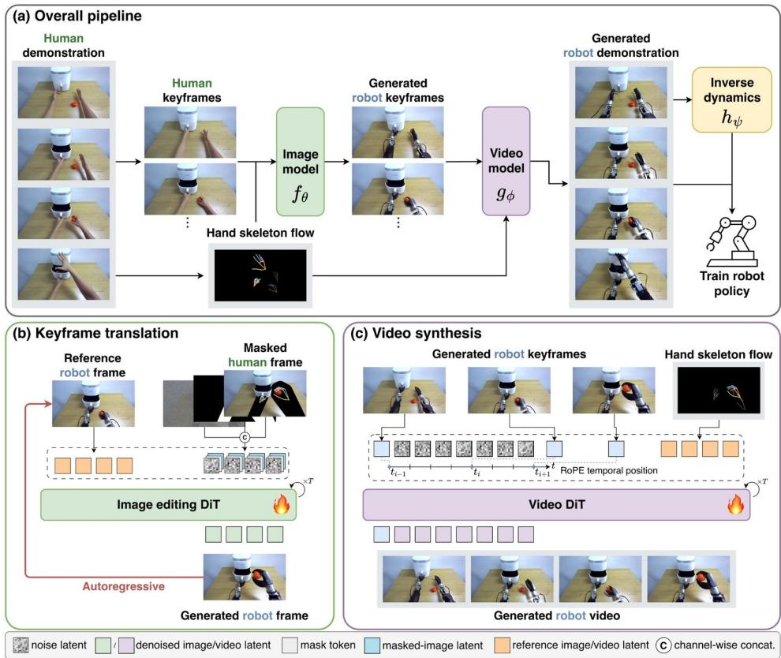  
Figure 1: RoboTryOn pipeline. (a) The image model sequentially translates keyframes of a human video into robot keyframes, the video model synthesizes the motion between them under the guidance of the hand skeleton flow, and the inverse dynamics model labels the actions. (b) The image model inpaints the masked human frame, using the previous robot keyframe as a reference. (c) The video model synthesizes the robot video, conditioned on the robot keyframes at their temporal positions and the skeleton flow.

## 3. Method

## 3.1. Problem Setup and Overview

Policy learning from demonstrations. We consider a teleoperated robot demonstration dataset $\mathcal { D } = \{ \mathbf { X } ^ { ( i ) } \} _ { i = 1 } ^ { N }$ , where each demonstration $\mathbf { X } ^ { ( i ) } = \left( ( \mathbf { o } _ { t } , \mathbf { q } _ { t } , \mathbf { a } _ { t } ) _ { t = 1 } ^ { T ^ { ( i ) } } , \mathbf { c } \right)$ contains a visual observation $\mathbf { o } _ { t }$ , a proprioceptive state $\mathbf { q } _ { t } .$ , and a robot action $\mathbf { a } _ { t }$ at each timestep $t \in \{ 1 , \dots , T ^ { ( i ) } \}$ , together with a task instruction c. We mainly use vision-language-action models (VLAs) as our base policy $\pi _ { \omega }$ which predicts an action chunk $\mathbf { A } _ { t } = \mathbf { a } _ { t : t + H - 1 }$ of horizon H conditioned on $\left( \mathbf { o } _ { t } , \mathbf { q } _ { t } , \mathbf { c } \right)$

Demonstrations from human video. RoboTryOn aims to augment D with demonstrations synthesized from human video to address the expensive cost of collecting real robot data. A human demonstration $\mathbf { X } ^ { h } = ( ( \mathbf { o } _ { t } ^ { h } ) _ { t = 1 } ^ { T } , \mathbf { c } ) ^ { 1 }$ contains egocentric observations $\mathbf { o } _ { t } ^ { h }$ and the instruction c. Given $\mathbf { X } ^ { h }$ and a reference image of the target robot r, RoboTryOn uses a three-stage pipeline to generate a robot demonstration $\hat { \bf X } ^ { r } = \big ( ( \hat { \bf o } _ { t } ^ { r } , \hat { \bf q } _ { t } , \hat { \bf a } _ { t } ) _ { t = 1 } ^ { T } , { \bf c } \big )$ that follows the human motion (see Figure 1). First, an image generation model $f _ { \theta }$ translates selected human keyframes into robot keyframes (Section 3.2). Next, a video generation model $g _ { \phi }$ synthesizes the robot video between keyframes under the guidance of the hand skeleton (Section 3.3). Finally, an inverse dynamics model $h _ { \psi }$ predicts the action labels aˆ from the synthesized video, and the states $\hat { \mathbf { q } }$ are then derived from the predicted actions (Section 3.4). The resulting demonstrations form synthetic data $\begin{array} { r l } { \hat { \mathcal { D } } _ { : } } & { { } \quad } \end{array}$ , on which we train the policy $\pi _ { \omega }$ alone or together with $\mathcal { D }$ (Section 3.5). We train the three models and the policy in the same way, as conditional flow-matching models (Lipman et al., 2023; Liu et al., 2023). We provide the details of the flow matching process in Appendix E.

## 3.2. Keyframe Translation

In this section, we describe how RoboTryOn selects keyframes from the human demonstration $\mathbf { X } ^ { h }$ and translates them into target robot keyframes. We first train the image generation model $f _ { \theta }$ on robot demonstrations and apply it to the selected human keyframes at inference.

Keyframes. We select keyframes from the wrist trajectories of the reconstructed human hands (Zhang et al., 2025). A frame is selected when the speed of both wrists reaches a local minimum, where the hands are unblurred, and a wrist has moved more than a threshold from its position in the previous keyframe. We also always include the first and last frames. The resulting keyframe indices form the set $\mathcal { T } = \{ t _ { 1 } < \cdots < t _ { L } \}$

Conditioning. We condition $f _ { \theta }$ on an arm and hand mask ${ { \bf { M } } _ { t } }$ and a hand skeleton $\mathbf { S } _ { t }$ . As in virtual try-on methods (Choi et al., 2021; 2024; Jiang et al., 2024; Lee and Kwak, 2025), we enlarge and smooth ${ { \bf { M } } _ { t } } ,$ so its outline does not reveal the embodiment it covers. The skeleton $\mathbf { S } _ { t }$ is a 2D projection of hand keypoints obtained by forward kinematics for a robot or by retargeting the reconstructed hand for a human. We define a conditioning function $\Phi ( \mathbf { o } ; \mathbf { M } , \mathbf { S } ) : = \big ( ( \mathbf { 1 } - \bar { \mathbf { M } } ) \odot \bar { \mathbf { o } } \big ) \oplus \mathbf { S }$ , which masks out the region M of a frame o and draws the skeleton S over it. The same function gives the conditioned robot frame $\tilde { \mathbf { o } } _ { t } = \Phi ( \mathbf { o } _ { t } ; \mathbf { M } _ { t } , \mathbf { S } _ { t } )$ for training and the conditioned human frame $\tilde { \tilde { \mathbf { o } } } _ { t } ^ { h } = \Phi ( \mathbf { o } _ { t } ^ { h } ; \mathbf { M } _ { t } ^ { h } , \mathbf { S } _ { t } ^ { h } )$ for inference. To make the model robust to imperfect hand retargeting, we perturb and randomly drop the skeleton during training. The skeleton then provides only coarse guidance on hand position and motion, while detailed hand configuration comes from the learned prior over robot hands.

Model. The image generation model $f _ { \theta }$ aims to translate a human keyframe into a robot keyframe as inpainting guided by a reference image: it fills the masked region Mt with the target robot in the pose specified by the skeleton $\mathbf { S } _ { t } .$ , using the reference image to determine its appearance (see Figure 1(b)).

We train $f _ { \theta }$ to generate a robot frame $\mathbf { o } _ { t }$ from two conditions: the conditioned frame $\tilde { \bf { o } } _ { t }$ with its mask $\mathbf { M } _ { t } .$ , and a reference frame $\mathbf { o } _ { t ^ { \prime } }$ from the same episode at an earlier time $t ^ { \prime } < t ,$ which provides the appearance of the embodiment, the objects, and the background. With a pretrained image encoder $\mathcal { E } _ { \mathrm { i m g } }$ and $\mathbf { z } = \mathcal { E } _ { \mathrm { i m g } } ( \mathbf { o } _ { t } )$ , we train $f _ { \theta }$ using the flow-matching objective with diffusion timestep τ :

$$
\begin{array} { r } { \mathcal { L } _ { \mathrm { i m g } } ( \boldsymbol { \theta } ) = \mathbb { E } _ { ( \mathbf { o } _ { t } , \mathbf { o } _ { t ^ { \prime } } ) \sim \mathcal { D } , \epsilon , \tau } [ \| f _ { \boldsymbol { \theta } } \big ( \mathbf { z } ^ { \tau } , \tau \mid \tilde { \mathbf { o } } _ { t } , \mathbf { M } _ { t } , \mathbf { o } _ { t ^ { \prime } } \big ) - ( \mathbf { z } - \epsilon ) \big \| _ { 2 } ^ { 2 } ] . } \end{array}\tag{3.1}
$$

At inference, $f _ { \theta }$ translates the human keyframes in temporal order, each conditioned on the previously translated robot keyframe:

$$
\begin{array} { r } { \hat { \mathbf { o } } _ { t _ { j } } ^ { r } \sim p _ { \theta } \big ( \cdot \mid \tilde { \mathbf { o } } _ { t _ { j } } ^ { h } , \mathbf { M } _ { t _ { j } } ^ { h } , \hat { \mathbf { o } } _ { t _ { j - 1 } } ^ { r } \big ) , \qquad j = 1 , \ldots , L , } \end{array}\tag{3.2}
$$

where $\hat { \mathbf { o } } _ { t _ { 0 } } ^ { r }$ is a reference image of the target robot, which selects the embodiment.

## 3.3. Video Synthesis

The video generation model $g _ { \phi }$ interpolates between the translated keyframes $\hat { \mathbf { o } } _ { T } ^ { r } = ( \hat { \mathbf { o } } _ { t } ^ { r } ) _ { t \in \mathcal { T } }$ to synthesize the full robot video, guided by the hand skeleton flow $\mathbf { S } _ { 1 : T } = ( \mathbf { S } _ { t } ) _ { t = 1 } ^ { T }$ (see Figure $1 ( \mathrm { c } ) )$ During training, $g _ { \phi }$ generates a robot video $\mathbf { o } _ { 1 : T }$ conditioned on its keyframes $\mathbf { o } _ { T }$ and its skeleton flow $\mathbf { S } _ { 1 : T } .$ , whose keypoints are perturbed and dropped as for $f _ { \theta }$ . With a pretrained video encoder ${ \mathcal E } _ { \mathrm { v i d } }$ and $\mathbf { w } = \mathcal { E } _ { \mathrm { v i d } } ( \mathbf { o } _ { 1 : T } )$ , the objective is

$$
\begin{array} { r } { \mathcal { L } _ { \mathrm { v i d } } ( \phi ) = \mathbb { E } _ { \mathbf { o } _ { 1 : T } \sim \mathcal { D } , \epsilon , \tau } \left[ \left\| g _ { \phi } \big ( \mathbf { w } ^ { \tau } , \tau \mid \mathbf { o } _ { \mathcal { T } } , \mathbf { S } _ { 1 : T } \big ) - \big ( \mathbf { w } - \epsilon \big ) \right\| _ { 2 } ^ { 2 } \right] . } \end{array}\tag{3.3}
$$

At inference, $g _ { \phi }$ synthesizes the robot video $\hat { \mathbf { o } } _ { 1 : T } ^ { r }$ conditioned on $( \hat { \mathbf { o } } _ { T } ^ { r } , \mathbf { S } _ { 1 : T } ^ { h } )$ , as follows:

$$
\hat { \mathbf { o } } _ { 1 : T } ^ { r } \sim p _ { \phi } \big ( \cdot \mid \hat { \mathbf { o } } _ { T } ^ { r } , \mathbf { S } _ { 1 : T } ^ { h } \big ) .\tag{3.4}
$$

If T exceeds the maximum length that $g _ { \phi }$ can generate at once, we synthesize the video as consecutive clips split at keyframes, where adjacent clips share the keyframe at their boundary.

## 3.4. Pseudo Action Labeling

The inverse dynamics model $h _ { \psi }$ infers robot action labels $\hat { \mathbf { a } } _ { 1 : T }$ from the synthesized video $\hat { \mathbf { o } } _ { 1 : T } ^ { r }$ From two observations $K$ steps apart, $h _ { \psi }$ predicts the chunk of joint-space actions between them.

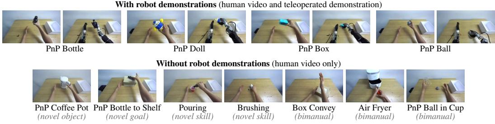  
Figure 2: Examples of real-world benchmark tasks. For each of the four PnP tasks (top), both a human video and a teleoperated demonstration are available. For each of the remaining seven tasks (bottom), only a human video is available.

We train $h _ { \psi }$ using actions from teleoperated robot demonstrations as targets:

$$
\begin{array} { r } { \mathcal { L } _ { \mathrm { i d m } } ( \psi ) = \mathbb { E } _ { ( \mathbf { o } _ { t } , \mathbf { o } _ { t + K } , \mathbf { a } _ { t : t + K } ) \sim \mathcal { D } , \epsilon , \tau } \left[ \left\| h _ { \psi } \big ( \mathbf { a } _ { t : t + K } ^ { \tau } , \tau \mid \mathbf { o } _ { t } , \mathbf { o } _ { t + K } \big ) - \big ( \mathbf { a } _ { t : t + K } - \epsilon \big ) \right\| _ { 2 } ^ { 2 } \right] . } \end{array}\tag{3.5}
$$

At inference, $h _ { \psi }$ labels the synthesized video as $\hat { \mathbf { a } } _ { t : t + K } \sim p _ { \psi } \big ( { \bf \cdot } \mid \hat { \mathbf { o } } _ { t } ^ { r } , \hat { \mathbf { o } } _ { t + K } ^ { r } \big )$ over the whole sequence. The states are then derived from the action labels as $\hat { \mathbf { q } } _ { t } = \hat { \mathbf { a } } _ { t - d } ,$ , where d is the lag between the commanded action and the recorded state, measured on the teleoperated data.

Since the IDM estimates wrist positions less accurately than the hand reconstruction, we use inverse kinematics to correct the wrist position in the action labels while keeping the hand joints predicted by the IDM. We provide further implementation details for all three models in Appendix B.2.

## 3.5. Policy Training

Each synthesized demonstration $\hat { \mathbf X } ^ { r }$ has the same form as a teleoperated one, and the demonstrations synthesized from all human videos form $\hat { \mathcal { D } }$ . We train the policy on ${ \mathcal { D } } \cup { \hat { \mathcal { D } } } .$ , or on $\hat { \mathcal { D } }$ alone.

Training objective and inference. Following recent VLAs (Black et al., 2024; 2025; NVIDIA et al., 2025), we fine-tune the pretrained VLA as follows:

$$
\begin{array} { r } { \mathcal { L } _ { \mathrm { p o l i c y } } ( \omega ) = \mathbb { E } _ { ( \mathbf { o } _ { t } , \mathbf { q } _ { t } , \mathbf { A } _ { t } , \mathbf { c } ) \sim \mathcal { D } \cup \hat { \mathcal { D } } , \epsilon , \tau } \left[ \left| \left| \pi _ { \omega } \big ( \mathbf { A } _ { t } ^ { \tau } , \tau \mid \mathbf { o } _ { t } , \mathbf { q } _ { t } , \mathbf { c } \big ) - \big ( \mathbf { A } _ { t } - \epsilon \big ) \right| \right| _ { 2 } ^ { 2 } \right] . } \end{array}\tag{3.6}
$$

At inference, $\pi _ { \omega }$ generates the action chunk $\mathbf { A } _ { t }$ from Gaussian noise conditioned on $\left( \mathbf { o } _ { t } , \mathbf { q } _ { t } , \mathbf { c } \right)$ with Euler ODE sampling (Lipman et al., 2023).

## 4. Experiments

We validate RoboTryOn on real robots with dexterous hands and investigate the following questions:

• Can a policy learn tasks never demonstrated through teleoperation from human video alone, and does RoboTryOn outperform other retargeting or overlaying methods? (Table 1)

• Does our synthesized data bridge the visual and action gaps between human videos and real robot data? (Figures 3 to 5)

• Can synthesized data replace teleoperated demonstrations, and how does the success rate change with the amount of human video? (Figure 6)

## 4.1. Experimental Setup

Robots and tasks. We evaluate RoboTryOn on two bimanual robots with dexterous hands: an OpenArm with two 7-DoF arms and two 6-DoF Inspire RH56F1 hands, and an RB-Y1 with two 7-DoF arms and two 20-DoF WujiHand2 hands. Both are evaluated on eleven tabletop tasks (see Figure 2). There are four pick-and-place (PnP) tasks, i.e., in-domain tasks, with 50 teleoperated demonstrations per robot and 50 human videos each: PnP Bottle, Doll, Box, and Ball. The other seven tasks, i.e., out-of-domain tasks, have 50 human videos each and no robot demonstrations, and they introduce a single novel object task (PnP Coffee Pot), a single novel goal task (PnP Bottle to Shelf), two novel skill tasks (Pouring, Brushing), and three bimanual manipulation tasks (Box Convey,

Table 1: Real-world results on (a) OpenArm and (b) RB-Y1. Success rate (%) over 28 trials per task. In-domain: the four PnP tasks with robot demonstrations. Out-of-domain: the seven tasks with human video only, grouped by what they add. “+” rows add the converted human videos to the teleoperated demonstrations, and the last row uses the synthesized episodes alone. Baselines are evaluated following their own protocols. Per-task results for the out-of-domain tasks are provided in Appendix F.2.  
(a) OpenArm Benchmark Results.
<table><tr><td rowspan="3">Method</td><td colspan="2">Data Source</td><td rowspan="3">In-domain</td><td colspan="5">Out-of-domain</td></tr><tr><td>Robot</td><td>Human</td><td>Novel Object</td><td>Novel Goal</td><td>Novel Skill</td><td>Bimanual</td><td>Avg.</td></tr><tr><td>Teleop only</td><td>√</td><td>X</td><td>47.3</td><td>14.3</td><td>7.1</td><td>0.0</td><td>0.0</td><td>3.1</td></tr><tr><td>+ EgoMimic (Kareer et al., 2025)</td><td>√</td><td>√</td><td>50.0</td><td>14.3</td><td>0.0</td><td>10.7</td><td>0.0</td><td>5.1</td></tr><tr><td>+ Masquerade (Lepert et al., 2025a)</td><td>√</td><td>√</td><td>67.9</td><td>21.4</td><td>7.1</td><td>14.3</td><td>0.0</td><td>8.2</td></tr><tr><td>+ RoboTryOn (Ours)</td><td>√</td><td>√</td><td>75.9</td><td>64.3</td><td>89.3</td><td>83.9</td><td>63.1</td><td>73.0</td></tr><tr><td>RoboTryOn (Ours)</td><td>X</td><td>√</td><td>57.1</td><td>50.0</td><td>57.1</td><td>58.9</td><td>38.1</td><td>48.5</td></tr></table>

(b) RB-Y1 Benchmark Results.
<table><tr><td rowspan="3">Method</td><td colspan="2">Data Source</td><td rowspan="3">In-domain</td><td colspan="5">Out-of-domain</td></tr><tr><td>Robot</td><td>Human</td><td>Novel Object</td><td>Novel Goal</td><td>Novel Skill</td><td>Bimanual</td><td>Avg.</td></tr><tr><td>Teleop only</td><td>√</td><td>x</td><td>69.6</td><td>7.1</td><td>0.0</td><td>0.0</td><td>0.0</td><td>1.0</td></tr><tr><td>+ EgoMimic (Kareer et al., 2025)</td><td>√</td><td>√</td><td>63.4</td><td>14.3</td><td>0.0</td><td>10.7</td><td>0.0</td><td>5.1</td></tr><tr><td>+ Masquerade (Lepert et al., 2025a)</td><td>√</td><td>√</td><td>63.4</td><td>21.4</td><td>7.1</td><td>12.5</td><td>0.0</td><td>7.7</td></tr><tr><td>+ RoboTryOn (Ours)</td><td>√</td><td>√</td><td>79.5</td><td>60.7</td><td>67.9</td><td>57.1</td><td>28.6</td><td>46.9</td></tr><tr><td>RoboTryOn (Ours)</td><td>X</td><td>√</td><td>60.7</td><td>64.3</td><td>60.7</td><td>53.6</td><td>16.7</td><td>40.3</td></tr></table>

Air Fryer, PnP Ball in Cup), whereas the teleoperated tasks are all single-arm tasks. Further details on the robots and tasks are provided in Appendix C.1.

Baselines. We compare with the two existing ways of turning human video into robot training data. Both retarget the reconstructed hand into actions and differ in how they handle the human in the image. EgoMimic (Kareer et al., 2025) masks the arm out of the human frames, while Masquerade (Lepert et al., 2025a) inpaints the arm out, composites a rendering of the robot in the retargeted pose, and adds an auxiliary loss on future 2D robot keypoints. Following their protocols, both apply the same edit to the robot data and to the live camera image at test time, whereas RoboTryOn runs on the raw camera view (see details in Appendix B.3). All methods share the policy model, the teleoperated episodes, and the human videos, so they differ only in how the human video is converted.

Implementation details. For each robot, we fine-tune π0.5 (Black et al., 2025) for the same number of training steps on 200 teleoperated episodes (50 per in-domain task), on 550 episodes synthesized by RoboTryOn from human videos (50 per task over all eleven tasks), or on all 750 together. We evaluate each policy over 28 trials per task with randomized object positions (see Appendix C.1). We train the image generation model, the video generation model, and the IDM on the teleoperated demonstrations of the four in-domain tasks and on additional robot videos, which enrich the embodiment prior of the models. The additional videos are not used to train any policy. We provide further details on the backbones and training in Appendix B.2.8.

## 4.2. Main Results

In-domain tasks. As shown in Table 1, RoboTryOn improves the success rate over both baselines on the in-domain tasks of both robots. In particular, the success rate rises from 47.3% to 75.9% on the OpenArm and from 69.6% to 79.5% on the RB-Y1. This suggests that synthesized demonstrations add useful variation even to tasks with teleoperated demonstrations, as they cover more object placements and more varied arm and hand motions than the 50 teleoperated demonstrations per task.

Out-of-domain tasks. RoboTryOn yields the largest gains on the seven tasks without robot demon strations, enabling the policy to learn these tasks, whereas both baselines largely fail with success rates below 10% (see Table 1). In particular, the success rate rises from 3.1% to 73.0% on the OpenArm and from 1.0% to 46.9% on the RB-Y1. Notably, the policy also learns the bimanual tasks, although every teleoperated demonstration uses a single arm. This demonstrates that RoboTryOn turns human videos into robot demonstrations from which a policy learns new objects, goals, skills, and bimanual coordination. Moreover, a single image model, video model, and IDM serve both robots despite their different kinematics, hands, and camera placements (see Figure 10). Additionally, we analyze why the baselines fail in Section 4.3.

Human  
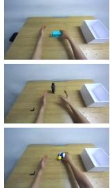

EgoMimic  
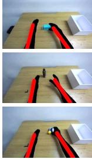

Masquerade  
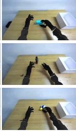  
(a) Qualitative comparison

RoboTryOn (Ours)  
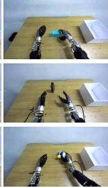

Real robot  
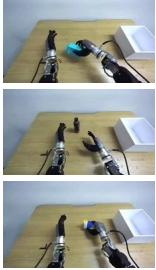

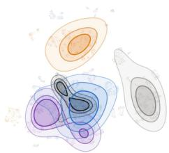  
Human EgoMimic Masquerade RoboTryOn (Ours) Real robot  
(b) Feature distribution

Figure 3: Visual gap to real robot video. (a) The same moments as recorded, as EgoMimic and Masquerade edit them, and as RoboTryOn translates them, next to similar moments from teleoperation. (b) UMAP of SigLIP features of π0.5 with density contours, using equal frame counts per corpus, real robot frames from the four PnP tasks, and the other frames from all eleven tasks.  
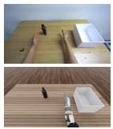  
(a) Real to sim

Human  
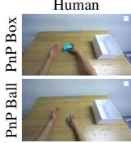

Retargeting  
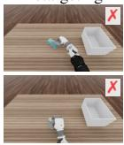

Ours w/o corr.  
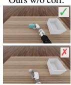  
(b) Grasp moment

Ours  
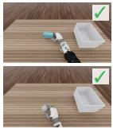

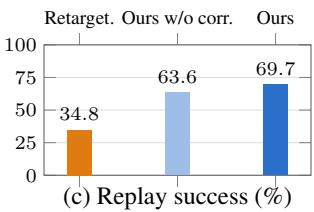  
Figure 4: Action gap: open-loop replay. (a) A real scene and its simulated replica. (b) The grasp moment of one human video under the three action labelings, replayed open loop. (c) Replay success over 66 episodes of three PnP tasks (per task in Table 8).

## 4.3. Analysis

In this section, we analyze the quality of our synthesized data and the effects of human and translated robot data on policy learning, focusing on the amount of data, collection cost, and execution speed. Unless otherwise stated, we use $\pi _ { 0 . 5 }$ fine-tuned on the OpenArm in these experiments.

Visual gap. We first examine whether synthesized videos resemble real robot videos (see Figure 3). We encode the frames of raw, masked (EgoMimic), overlaid (Masquerade), and synthesized human videos with the visual encoder of the policy and compare their embeddings with those of real robot videos. Videos synthesized by RoboTryOn overlap with real robot videos in this embedding space, whereas raw, masked, and overlaid videos form separate clusters. Quantitatively, the Fréchet SigLIP distance (Heusel et al., 2017; Zhai et al., 2023) to real robot videos agrees: RoboTryOn reduces it from 125.5 to 32.7, while overlay reduces it by about half and masking leaves it largely unchanged. This suggests that RoboTryOn closes the visual gap while the policy uses raw camera observations at test time. In contrast, both baselines narrow the gap only by applying the same masking or overlay to every camera observation during deployment.

Action gap. To evaluate action labels without ground truth robot actions, we replay them open loop in a simulated replica of each scene and measure task completion (see Figure 4a). We compare the labels from our IDM with retargeted labels, which map the reconstructed human hand to the robot hand (Qin et al., 2023) and solve for the arm by inverse kinematics. Replay succeeds in 69.7% of episodes with our labels and 34.8% with retargeted labels (see Figure 4c), and the difference arises mainly during grasping: retargeted motions bring the robot hand near the object, but imprecise hand reconstruction and the difference in hand geometry prevent a secure grasp (see Figure 4b). This suggests that labeling synthesized robot videos with the IDM yields more executable actions than retargeting, since RoboTryOn uses the reconstructed hand only to guide generation and the generated robot hand grasps the object as in the robot data.

We then examine how these labels affect policy learning by comparing the actions and the training gradients they induce (see Figure 5). Retargeted hand actions differ substantially from teleoperated actions (see Figure 5a). At the pretrained weights of $\pi _ { 0 . 5 } ,$ we compute the gradient of the flowmatching loss on teleoperated in-domain data and on the data of each out-of-domain task. The cosine similarity between the two gradients measures how much the two sources agree on the update direction (Appendix D). Our data yields a cosine similarity of 0.53, compared with 0.17 and 0.14 for the baselines, and retargeted data yields slightly negative similarity within the action expert (see Figure 5b). This suggests that retargeted labels steer the policy in a direction that conflicts with the teleoperated data, which may explain why the baselines gain little on out-of-domain tasks. Consistently, the baselines’ hand actions during robot execution stay close to the teleoperated distribution on in-domain tasks but diverge on out-of-domain tasks, whereas our policy stays close on both (see Figure 5c).

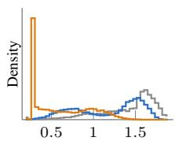  
Thumb rotation (rad)

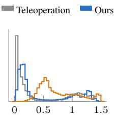  
(a) Right-hand actions  
Finger flexion (rad)

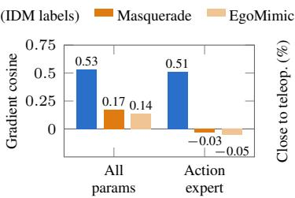  
(b) Co-training with teleop.

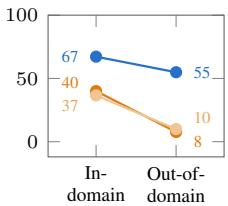  
(c) Robot rollouts  
Figure 5: Action gap: distribution and co-training. (a) Right-hand actions over all tasks. (b) Cosine between the policy gradients from teleoperated PnP data and from the out-of-domain tasks. (c) Share of hand actions within the teleoperated distribution in real robot rollouts.

Scaling and cost. To assess whether human videos are a cost-effective source of demonstrations, we vary the number of demonstrations per task on the four in-domain tasks and compare the success rate against collection cost in person-hours (see Figure 6). Recording a human video takes about a fifth of the time of a teleoperated episode (see Table 10). Notably, training with translated human videos alone matches the success rate obtained with 50 teleoperated demonstrations per task at about one third of the collection cost. This suggests that, although a translated human video yields a slightly lower success rate per demonstration than a teleoperated episode, it is more cost-effective in collection time. Moreover, aug-

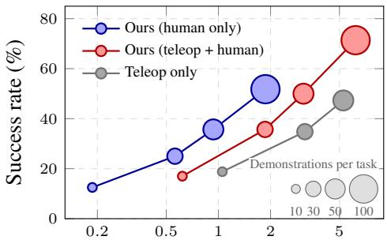  
Collection cost (person-hours, 4 tasks)

Figure 6: Collection cost. Success rate versus personhours on four tasks. Marker size indicates demonstrations per task.

menting the teleoperated dataset with an equal number of human videos increases the success rate from 47.3% to 71.4% and requires less than one additional hour of recording.

Execution speed. Since human demonstrators move at roughly 1.25× the speed of the teleoperated demonstrations, we examine how the speed of synthesized demonstrations affects the policy. Using the same keyframes, we retime the skeleton flow to the teleoperated speed (1×) or twice that speed (2×) before synthesis and compare with videos synthesized at the recorded speed (see Table 2). Matching the teleoperated speed improves the in-domain success rate from 75.9% to 85.7% while keeping the

Table 2: Execution speed. Success rate (%) on the OpenArm and mean time from rollout start to object placement on the four PnP tasks.
<table><tr><td>Method</td><td>Speed In-dom.</td><td></td><td>Out-of-dom. Time (s)</td><td></td></tr><tr><td>Teleop only</td><td>1×</td><td>47.3</td><td>3.1</td><td>14.2</td></tr><tr><td>Ours (as recorded)</td><td>1.25×</td><td>75.9</td><td>73.0</td><td>11.9</td></tr><tr><td rowspan="2">Ours (retimed)</td><td>1×</td><td>85.7</td><td>70.4</td><td>13.8</td></tr><tr><td>2×</td><td>57.1</td><td>42.9</td><td>7.4</td></tr></table>

out-of-domain success rate similar. This suggests that the policy inherits the speed of its training demonstrations, as its task completion time follows the speed of the synthesized videos. However, training at 2× produces the fastest policy at the cost of a lower success rate on both task groups.

Table 3: Ablation study of RoboTryOn on OpenArm. Success rates (%) are averaged over four in-domain and seven out-of-domain tasks.  
(a) Component ablation.
<table><tr><td>Method</td><td>In-dom. Out-of-dom.</td><td></td></tr><tr><td>RoboTryOn (Ours)</td><td>75.9</td><td>73.0</td></tr><tr><td>w/o Autoregressive reference</td><td>68.8</td><td>66.3</td></tr><tr><td>w/o Subsequent keyframes</td><td>42.9</td><td>39.3</td></tr><tr><td>w/o Hand skeleton flow</td><td>42.0</td><td>21.4</td></tr><tr><td>w/o IDM wrist correction</td><td>65.2</td><td>48.0</td></tr></table>

(b) Policy backbone comparison.
<table><tr><td>Method</td><td>In-dom.</td><td>Out-of-dom.</td></tr><tr><td>π0.5 (Teleop only)</td><td>47.3</td><td>3.1</td></tr><tr><td>+ RoboTryOn (Ours)</td><td>75.9</td><td>73.0</td></tr><tr><td>RLDX-1-Img (Teleop only)</td><td>53.6</td><td>0.0</td></tr><tr><td>+ RoboTryOn (Ours)</td><td>60.7</td><td>40.3</td></tr></table>

## 4.4. Ablations

We ablate the components of RoboTryOn and the policy backbone to verify that each component contributes to policy success and that the gains do not depend on a specific VLA. All ablations use the OpenArm, and per-task results are given in Tables 12 and 13.

Pipeline components. As shown in Table 3a, removing any of the four components reduces the success rate on both task groups. Without the autoregressive reference, the robot appearance stays consistent but the scene changes across keyframes. Without subsequent keyframes, the video model is conditioned only on the first keyframe, so the motion is preserved but the objects and the scene deviate from the human video. Without the hand skeleton flow, the video model receives no motion guidance between keyframes, and the synthesized robot no longer follows the demonstrator, which causes the largest drop. This shows that each stage is needed to keep the synthesized demonstration faithful to the human video in scene, appearance, and motion. Interestingly, removing the wrist correction reduces the success rate more on out-of-domain tasks, since the policy relies more on generated action labels for tasks without teleoperated demonstrations, and many of their motions lie outside the training distribution of the IDM. We show failure cases of each variant in Appendix F.3.

Policy backbone. To verify that the benefit of RoboTryOn is not specific to $\pi _ { 0 . 5 } ,$ , we also finetune RLDX-1-Img (Kim et al., 2026), a VLA with a different architecture, on the same data (see Table 3b). RoboTryOn consistently improves the success rate of RLDX-1-Img, from 53.6% to 60.7% on in-domain tasks and from 0.0% to 40.3% on out-of-domain tasks. This demonstrates that the demonstrations synthesized by RoboTryOn remain effective across policy architectures.

## 5. Conclusion

We presented RoboTryOn, which turns a human video into a robot demonstration the way virtual try-on changes the garment on a person: it keeps the demonstrated motion and swaps the embodiment. RoboTryOn translates human keyframes into robot keyframes, synthesizes the robot video between them under the guidance of the hand skeleton, and labels its actions with an inverse dynamics model. On two real robots with dexterous hands, the synthesized demonstrations teach a policy seven tasks without any robot demonstration, including bimanual ones. Human video translated this way also matches the success rate of teleoperated demonstrations at about a third of their collection cost. We discuss limitations and future work in Appendix A.

## Acknowledgement

This paper was supported by RLWRLD Inc. We thank Beomjun Kim, Junhyeong Park, Jungwoo Park, and Seunghoon Sim for their help in collecting robot and human demonstrations for our real-world experiments.

## References

Bowen Baker, Ilge Akkaya, Peter Zhokov, Joost Huizinga, Jie Tang, Adrien Ecoffet, Brandon Houghton, Raul Sampedro, and Jeff Clune. Video PreTraining (VPT): Learning to act by watching unlabeled online videos. In Advances in Neural Information Processing Systems (NeurIPS), 2022.

Kevin Black, Noah Brown, Danny Driess, Adnan Esmail, Michael Equi, Chelsea Finn, Niccolo Fusai, Lachy Groom, Karol Hausman, Brian Ichter, et al. π0: A vision-language-action flow model for general robot control. arXiv preprint arXiv:2410.24164, 2024.

Kevin Black, Noah Brown, James Darpinian, Karan Dhabalia, Danny Driess, Adnan Esmail, Michael Robert Equi, Chelsea Finn, Niccolo Fusai, Manuel Y. Galliker, Dibya Ghosh, Lachy Groom, Karol Hausman, Brian Ichter, Szymon Jakubczak, Tim Jones, Liyiming Ke, Devin LeBlanc, Sergey Levine, Adrian Li-Bell, Mohith Mothukuri, Suraj Nair, Karl Pertsch, Allen Z. Ren, Lucy Xiaoyang Shi, Laura Smith, Jost Tobias Springenberg, Kyle Stachowicz, James Tanner, Quan Vuong, Homer Walke, Anna Walling, Haohuan Wang, Lili Yu, and Ury Zhilinsky. π0.5: A vision-language-action model with open-world generalization. In Conference on Robot Learning (CoRL), 2025.

Black Forest Labs. FLUX.2 [klein]: Towards Interactive Visual Intelligence. https://bfl.ai /blog/flux2-klein-towards-interactive-visual-intelligence, 2026.

Qingwen Bu, Jisong Cai, Li Chen, Xiuqi Cui, Yan Ding, Siyuan Feng, Xindong He, Xu Huang, et al. AgiBot World Colosseo: A large-scale manipulation platform for scalable and intelligent embodied systems. In IEEE/RSJ International Conference on Intelligent Robots and Systems (IROS), 2025.

Claire Chen, Zhongchun Yu, Hojung Choi, Mark Cutkosky, and Jeannette Bohg. DexForce: Extracting force-informed actions from kinesthetic demonstrations for dexterous manipulation. arXiv preprint arXiv:2501.10356, 2025.

Xuxin Cheng, Jialong Li, Shiqi Yang, Ge Yang, and Xiaolong Wang. Open-TeleVision: Teleoperation with immersive active visual feedback. In Conference on Robot Learning (CoRL), 2024.

Cheng Chi, Zhenjia Xu, Chuer Pan, Eric Cousineau, Benjamin Burchfiel, Siyuan Feng, Russ Tedrake, and Shuran Song. Universal manipulation interface: In-the-wild robot teaching without in-the-wild robots. In Robotics: Science and Systems (RSS), 2024.

Seunghwan Choi, Sunghyun Park, Minsoo Lee, and Jaegul Choo. VITON-HD: High-resolution virtual try-on via misalignment-aware normalization. In Proceedings ofthe IEEE/CVF Conference on Computer Vision and Pattern Recognition (CVPR), 2021.

Yisol Choi, Sangkyung Kwak, Kyungmin Lee, Hyungwon Choi, and Jinwoo Shin. Improving diffusion models for authentic virtual try-on in the wild. In European Conference on Computer Vision (ECCV), 2024.

Hai Ci, Xiaokang Liu, Pei Yang, Yiren Song, and Mike Zheng Shou. H2R-Grounder: A paireddata-free paradigm for translating human interaction videos into physically grounded robot videos. arXiv preprint arXiv:2512.09406, 2025.

Dima Damen, Hazel Doughty, Giovanni Maria Farinella, Antonino Furnari, Evangelos Kazakos, Jian Ma, Davide Moltisanti, Jonathan Munro, Toby Perrett, Will Price, and Michael Wray. Rescaling egocentric vision: Collection, pipeline and challenges for EPIC-KITCHENS-100. International Journal ofComputer Vision (IJCV), 2022.

Yilun Du, Mengjiao Yang, Bo Dai, Hanjun Dai, Ofir Nachum, Joshua B Tenenbaum, Dale Schuurmans, and Pieter Abbeel. Learning universal policies via text-guided video generation. In Advances in Neural Information Processing Systems (NeurIPS), 2023.

Dyna Robotics. Dyna-2: A 1-million-hour scaling law for world-action models. https://www. dyna.co/dyna-2, 2026. Technical report.

Zixun Fang, Wei Zhai, Aimin Su, Hongliang Song, Kai Zhu, Mao Wang, Yu Chen, Zhiheng Liu, Yang Cao, and Zheng-Jun Zha. ViViD: Video virtual try-on using diffusion models. arXiv preprint arXiv:2405.11794, 2024.

Shenyuan Gao, William Liang, Kaiyuan Zheng, Ayaan Malik, Seonghyeon Ye, Sihyun Yu, Wei-Cheng Tseng, Yuzhu Dong, Kaichun Mo, Chen-Hsuan Lin, Qianli Ma, Seungjun Nah, Loic Magne, Jiannan Xiang, Yuqi Xie, Ruijie Zheng, Dantong Niu, You Liang Tan, K. R. Zentner, George Kurian, Suneel Indupuru, Pooya Jannaty, Jinwei Gu, Jun Zhang, Jitendra Malik, Pieter Abbeel, Ming-Yu Liu, Yuke Zhu, Joel Jang, and Linxi Fan. DreamDojo: A generalist robot world model from large-scale human videos. In International Conference on Machine Learning (ICML), 2026.

Raghav Goyal, Samira Ebrahimi Kahou, Vincent Michalski, Joanna Materzynska, Susanne Westphal, Heuna Kim, Valentin Haenel, Ingo Fruend, Peter Yianilos, Moritz Mueller-Freitag, et al. The “something something” video database for learning and evaluating visual common sense. In IEEE/CVF International Conference on Computer Vision (ICCV), 2017.

Kristen Grauman, Andrew Westbury, Eugene Byrne, Zachary Chavis, Antonino Furnari, Rohit Girdhar, Jackson Hamburger, Hao Jiang, Miao Liu, Xingyu Liu, et al. Ego4D: Around the world in 3,000 hours of egocentric video. In Proceedings of the IEEE/CVF Conference on Computer Vision and Pattern Recognition (CVPR), 2022.

Kristen Grauman, Andrew Westbury, Lorenzo Torresani, Kris Kitani, Jitendra Malik, Triantafyllos Afouras, Kumar Ashutosh, Vijay Baiyya, Siddhant Bansal, Bikram Boote, et al. Ego-Exo4D: Understanding skilled human activity from first- and third-person perspectives. In IEEE/CVF Conference on Computer Vision and Pattern Recognition (CVPR), 2024.

Yoav HaCohen, Benny Brazowski, Nisan Chiprut, Yaki Bitterman, Andrew Kvochko, Avishai Berkowitz, Daniel Shalem, Daphna Lifschitz, Dudu Moshe, Eitan Porat, Eitan Richardson, Guy Shiran, Itay Chachy, Jonathan Chetboun, Michael Finkelson, Michael Kupchick, Nir Zabari, Nitzan Guetta, Noa Kotler, Ofir Bibi, Ori Gordon, Poriya Panet, Roi Benita, Shahar Armon, Victor Kulikov, Yaron Inger, Yonatan Shiftan, Zeev Melumian, and Zeev Farbman. LTX-2: Efficient joint audio-visual foundation model. arXiv preprint arXiv:2601.03233, 2026.

Ankur Handa, Karl Van Wyk, Wei Yang, Jacky Liang, Yu-Wei Chao, Qian Wan, Stan Birchfield, Nathan Ratliff, and Dieter Fox. DexPilot: Vision-based teleoperation of dexterous robotic hand-arm system. In IEEE International Conference on Robotics and Automation (ICRA), 2020.

Martin Heusel, Hubert Ramsauer, Thomas Unterthiner, Bernhard Nessler, and Sepp Hochreiter. GANs trained by a two time-scale update rule converge to a local Nash equilibrium. In Advances in Neural Information Processing Systems (NeurIPS), 2017.

Ryan Hoque, Peide Huang, David J. Yoon, Mouli Sivapurapu, and Jian Zhang. EgoDex: Learning dexterous manipulation from large-scale egocentric video. arXiv preprint arXiv:2505.11709, 2025.

Joel Jang, Seonghyeon Ye, Zongyu Lin, Jiannan Xiang, Johan Bjorck, Yu Fang, Fengyuan Hu, Spencer Huang, Kaushil Kundalia, Yen-Chen Lin, Loic Magne, Ajay Mandlekar, Avnish Narayan, You Liang Tan, Guanzhi Wang, Jing Wang, Qi Wang, Yinzhen Xu, Xiaohui Zeng, Kaiyuan Zheng, Ruijie Zheng, Ming-Yu Liu, Luke Zettlemoyer, Dieter Fox, Jan Kautz, Scott Reed, Yuke Zhu, and Linxi Fan. DreamGen: Unlocking generalization in robot learning through video world models. In Conference on Robot Learning (CoRL), 2025.

Boyuan Jiang, Xiaobin Hu, Donghao Luo, Qingdong He, Chengming Xu, Jinlong Peng, Jiangning Zhang, Chengjie Wang, Yunsheng Wu, and Yanwei Fu. FitDiT: Advancing the authentic garment details for high-fidelity virtual try-on. arXiv preprint arXiv:2411.10499, 2024.

Simar Kareer, Dhruv Patel, Ryan Punamiya, Pranay Mathur, Shuo Cheng, Chen Wang, Judy Hoffman, and Danfei Xu. EgoMimic: Scaling imitation learning via egocentric video. In IEEE International Conference on Robotics and Automation (ICRA), 2025.

Alexander Khazatsky, Karl Pertsch, Suraj Nair, Ashwin Balakrishna, Sudeep Dasari, Siddharth Karamcheti, Soroush Nasiriany, Mohan Kumar Srirama, Lawrence Yunliang Chen, Kirsty Ellis, et al. DROID: A large-scale in-the-wild robot manipulation dataset. In Robotics: Science and Systems (RSS), 2024.

Dongyoung Kim, Huiwon Jang, Myungkyu Koo, Suhyeok Jang, Taeyoung Kim, et al. RLDX-1 technical report. arXiv preprint arXiv:2605.03269, 2026.

Moo Jin Kim, Karl Pertsch, Siddharth Karamcheti, Ted Xiao, Ashwin Balakrishna, Suraj Nair, Rafael Rafailov, Ethan Foster, Grace Lam, Pannag Sanketi, Quan Vuong, Thomas Kollar, Benjamin Burchfiel, Russ Tedrake, Dorsa Sadigh, Sergey Levine, Percy Liang, and Chelsea Finn. OpenVLA: An open-source vision-language-action model. In Conference on Robot Learning (CoRL), 2024.

Chuizheng Kong, Yunho Cho, Wonsuhk Jung, Idris Wibowo, Parth Shinde, Sundhar Vinodh-Sangeetha, Long Kiu Chung, Zhenyang Chen, Andrew Mattei, Advaith Nidumukkala, Alexander Elias, Danfei Xu, Taylor Higgins, and Shreyas Kousik. A closed-form geometric retargeting solver for upper body humanoid robot teleoperation. arXiv preprint arXiv:2602.01632, 2026.

Tuomas Kynkäänniemi, Tero Karras, Samuli Laine, Jaakko Lehtinen, and Timo Aila. Improved precision and recall metric for assessing generative models. In Advances in Neural Information Processing Systems (NeurIPS), 2019.

Seungyong Lee and Jeong-gi Kwak. Voost: A unified and scalable diffusion transformer for bidirectional virtual try-on and try-off. In SIGGRAPH Asia 2025 Conference Papers, 2025.

Marion Lepert, Jiaying Fang, and Jeannette Bohg. Masquerade: Learning from in-the-wild human videos using data-editing. arXiv preprint arXiv:2508.09976, 2025a.

Marion Lepert, Jiaying Fang, and Jeannette Bohg. Phantom: Training robots without robots using only human videos. In Conference on Robot Learning (CoRL), 2025b.

Qixiu Li, Yu Deng, Yaobo Liang, Lin Luo, Lei Zhou, Chengtang Yao, Lingqi Zeng, Zhiyuan Feng, Huizhi Liang, Sicheng Xu, Yizhong Zhang, Xi Chen, Hao Chen, Lily Sun, Dong Chen, Jiaolong Yang, and Baining Guo. Scalable vision-language-action model pretraining for robotic manipulation with real-life human activity videos. arXiv preprint arXiv:2510.21571, 2025.

Zhen Li, Cheng-Ze Lu, Jianhua Qin, Chun-Le Guo, and Ming-Ming Cheng. Towards an end-to-end framework for flow-guided video inpainting. In Proceedings of the IEEE/CVF Conference on Computer Vision and Pattern Recognition (CVPR), 2022.

Lightricks. LTX-2.5. https://huggingface.co/Lightricks/LTX-2.5, 2026.

Yaron Lipman, Ricky T. Q. Chen, Heli Ben-Hamu, Maximilian Nickel, and Matt Le. Flow matching for generative modeling. In International Conference on Learning Representations (ICLR), 2023.

Songming Liu, Lingxuan Wu, Bangguo Li, Hengkai Tan, Huayu Chen, Zhengyi Wang, Ke Xu, Hang Su, and Jun Zhu. RDT-1B: A diffusion foundation model for bimanual manipulation. In International Conference on Learning Representations (ICLR), 2025a.

Xingchao Liu, Chengyue Gong, and Qiang Liu. Flow straight and fast: Learning to generate and transfer data with rectified flow. In International Conference on Learning Representations (ICLR), 2023.

Yangcen Liu, Woo Chul Shin, Yunhai Han, Zhenyang Chen, Harish Ravichandar, and Danfei Xu. ImMimic: Cross-domain imitation from human videos via mapping and interpolation. In Conference on Robot Learning (CoRL), 2025b.

Yangcen Liu, Shuo Cheng, Xinchen Yin, Woo Chul Shin, Alfred Cueva, Yiran Yang, Zhenyang Chen, Chuye Zhang, and Danfei Xu. EgoEngine: From egocentric human videos to high-fidelity dexterous robot demonstrations. arXiv preprint arXiv:2606.12604, 2026.

Yunze Liu, Yun Liu, Che Jiang, Kangbo Lyu, Weikang Wan, Hao Shen, Boqiang Liang, Zhoujie Fu, He Wang, and Li Yi. HOI4D: A 4D egocentric dataset for category-level human-object interaction. In Proceedings ofthe IEEE/CVF Conference on Computer Vision and Pattern Recognition (CVPR), 2022.

Hao Luo, Yicheng Feng, Wanpeng Zhang, Sipeng Zheng, Ye Wang, Haoqi Yuan, Jiazheng Liu, Chaoyi Xu, Qin Jin, and Zongqing Lu. Being-H0: Vision-language-action pretraining from large-scale human videos. arXiv preprint arXiv:2507.15597, 2025.

Arjun Majumdar, Karmesh Yadav, Sergio Arnaud, Yecheng Jason Ma, Claire Chen, Sneha Silwal, Aryan Jain, Vincent-Pierre Berges, Pieter Abbeel, Jitendra Malik, Dhruv Batra, Yixin Lin, Oleksandr Maksymets, Aravind Rajeswaran, and Franziska Meier. Where are we in the search for an artificial visual cortex for embodied intelligence? In Advances in Neural Information Processing Systems (NeurIPS), 2023.

Mayank Mittal, Calvin Yu, Qinxi Yu, Jingzhou Liu, Nikita Rudin, David Hoeller, Jia Lin Yuan, Ritvik Singh, Yunrong Guo, Hammad Mazhar, Ajay Mandlekar, Buck Babich, Gavriel State, Marco Hutter, and Animesh Garg. ORBIT: A unified simulation framework for interactive robot learning environments. IEEE Robotics and Automation Letters, 8(6):3740–3747, 2023.

Suraj Nair, Aravind Rajeswaran, Vikash Kumar, Chelsea Finn, and Abhinav Gupta. R3M: A universal visual representation for robot manipulation. In Conference on Robot Learning (CoRL), 2022.

NVIDIA, Johan Bjorck, Fernando Castañeda, Nikita Cherniadev, Xingye Da, Runyu Ding, Linxi Fan, Yu Fang, Dieter Fox, Fengyuan Hu, Spencer Huang, Joel Jang, Zhenyu Jiang, Jan Kautz, Kaushil Kundalia, Lawrence Lao, Zhiqi Li, Zongyu Lin, Kevin Lin, Guilin Liu, Edith Llontop, Loic Magne, Ajay Mandlekar, Avnish Narayan, Soroush Nasiriany, Scott Reed, You Liang Tan, Guanzhi Wang, Zu Wang, Jing Wang, Qi Wang, Jiannan Xiang, Yuqi Xie, Yinzhen Xu, Zhenjia Xu, Seonghyeon Ye, Zhiding Yu, Ao Zhang, Hao Zhang, Yizhou Zhao, Ruijie Zheng, and Yuke Zhu. GR00T N1: An open foundation model for generalist humanoid robots. arXiv preprint arXiv:2503.14734, 2025.

Octo Model Team, Dibya Ghosh, Homer Walke, Karl Pertsch, Kevin Black, Oier Mees, Sudeep Dasari, Joey Hejna, Tobias Kreiman, Charles Xu, Jianlan Luo, You Liang Tan, Lawrence Yunliang Chen, Pannag Sanketi, Quan Vuong, Ted Xiao, Dorsa Sadigh, Chelsea Finn, and Sergey Levine. Octo: An open-source generalist robot policy. In Robotics: Science and Systems (RSS), 2024.

Open X-Embodiment Collaboration. Open X-Embodiment: Robotic learning datasets and RT-X models. In IEEE International Conference on Robotics and Automation (ICRA), 2024.

Ryan Punamiya, Dhruv Patel, Patcharapong Aphiwetsa, Pranav Kuppili, Lawrence Zhu, Simar Kareer, Judy Hoffman, and Danfei Xu. EgoBridge: Domain adaptation for generalizable imitation from egocentric human data. In Advances in Neural Information Processing Systems (NeurIPS), 2025.

Ryan Punamiya, Simar Kareer, Zeyi Liu, Josh Citron, Ri-Zhao Qiu, Xiongyi Cai, Alexey Gavryushin, Jiaqi Chen, Davide Liconti, Lawrence Y. Zhu, Patcharapong Aphiwetsa, Baoyu Li, Aniketh Cheluva, Pranav Kuppili, Yangcen Liu, Dhruv Patel, Aidan Gao, Hye-Young Chung, Ryan Co, Renee Zbizika, Jeff Liu, Xiaomeng Xu, Haoyu Xiong, Geng Chen, Sebastiano Oliani, Wenkai Xuan, Chenyu Yang, Xi Wang, James Fort, Richard Newcombe, Josh Gao, Jason Chong, Garrett Matsuda, Aseem Doriwala, Marc Pollefeys, Robert Katzschmann, Xiaolong Wang, Shuran Song, Judy Hoffman, and Danfei Xu. EgoVerse: An egocentric human dataset for robot learning from around the world. arXiv preprint arXiv:2604.07607, 2026.

Yuzhe Qin, Wei Yang, Binghao Huang, Karl Van Wyk, Hao Su, Xiaolong Wang, Yu-Wei Chao, and Dieter Fox. AnyTeleop: A general vision-based dexterous robot arm-hand teleoperation system. In Robotics: Science and Systems (RSS), 2023.

Abraham Savitzky and Marcel J. E. Golay. Smoothing and differentiation of data by simplified least squares procedures. Analytical Chemistry, 36(8):1627–1639, 1964.

Dandan Shan, Jiaqi Geng, Michelle Shu, and David F. Fouhey. Understanding human hands in contact at internet scale. In IEEE/CVF Conference on Computer Vision and Pattern Recognition (CVPR), 2020.

Yiren Song, Cheng Liu, Weijia Mao, and Mike Zheng Shou. Mitty: Diffusion-based human-to-robot video generation. arXiv preprint arXiv:2512.17253, 2025.

Chen Wang, Haochen Shi, Weizhuo Wang, Ruohan Zhang, Li Fei-Fei, and C. Karen Liu. DexCap: Scalable and portable mocap data collection system for dexterous manipulation. In Robotics: Science and Systems (RSS), 2024.

Ye Wang, Pei Lin, Xiong-Hui Chen, Haoqi Yuan, Zhixuan Liang, Yiyang Huang, Anzhe Chen, Zixing Lei, Jie Zhang, Tao Zhang, Haoyang Li, Tong Zhang, Chenxi Xiao, Ziyuan Jiao, and Qin Jin. Ego2Robot: Scalable robot data synthesis from egocentric human data. arXiv preprint arXiv:2608.02580, 2026.

Philipp Wu, Yide Shentu, Zhongke Yi, Xingyu Lin, and Pieter Abbeel. GELLO: A general, lowcost, and intuitive teleoperation framework for robot manipulators. In IEEE/RSJ International Conference on Intelligent Robots and Systems (IROS), 2024.

Mengda Xu, Han Zhang, Yifan Hou, Zhenjia Xu, Linxi Fan, Manuela Veloso, and Shuran Song. DexUMI: Using human hand as the universal manipulation interface for dexterous manipulation. arXiv preprint arXiv:2505.21864, 2025.

Lihe Yang, Bingyi Kang, Zilong Huang, Zhen Zhao, Xiaogang Xu, Jiashi Feng, and Hengshuang Zhao. Depth Anything V2. In Advances in Neural Information Processing Systems (NeurIPS), 2024.

Ruihan Yang, Qinxi Yu, Yecheng Wu, Rui Yan, Borui Li, An-Chieh Cheng, Xueyan Zou, Yunhao Fang, Xuxin Cheng, Ri-Zhao Qiu, Hongxu Yin, Sifei Liu, Song Han, Yao Lu, and Xiaolong Wang. EgoVLA: Learning vision-language-action models from egocentric human videos. arXiv preprint arXiv:2507.12440, 2025.

Xiaohua Zhai, Basil Mustafa, Alexander Kolesnikov, and Lucas Beyer. Sigmoid loss for language image pre-training. In Proceedings of the IEEE/CVF International Conference on Computer Vision (ICCV), 2023.

Jinglei Zhang, Jiankang Deng, Chao Ma, and Rolandos Alexandros Potamias. HaWoR: World-space hand motion reconstruction from egocentric videos. In IEEE/CVF Conference on Computer Vision and Pattern Recognition (CVPR), 2025.

Tony Z. Zhao, Vikash Kumar, Sergey Levine, and Chelsea Finn. Learning fine-grained bimanual manipulation with low-cost hardware. In Robotics: Science and Systems (RSS), 2023.

Shangchen Zhou, Chongyi Li, Kelvin C.K. Chan, and Chen Change Loy. ProPainter: Improving propagation and transformer for video inpainting. In Proceedings of the IEEE/CVF International Conference on Computer Vision (ICCV), 2023.

Tongchun Zuo, Zaiyu Huang, Shuliang Ning, Ente Lin, Chao Liang, Zerong Zheng, Jianwen Jiang, Yuan Zhang, Mingyuan Gao, and Xin Dong. DreamVVT: Mastering realistic video virtual try-on in the wild via a stage-wise diffusion transformer framework. arXiv preprint arXiv:2508.02807, 2025.

## Appendix Contents

A Limitations and Future Work   
B Implementation Details   
B.1 Policy Training Details 16   
B.2 RoboTryOn Pipeline Details 16   
B.3 Baselines . 19   
B.4 Inference Details. 20   
C Experimental Details 20   
C.1 Real-World Environment 20   
C.2 Simulation Environment 22   
D Analysis Details   
E Flow-Matching Objective and Sampling .   
F Additional Results .   
F.1 Data Collection Cost 24   
F.2 Per-Task Results . 25   
F.3 Ablated Variants . 25   
F.4 Qualitative Results 26

## A. Limitations and Future Work

Limitations. Adding an embodiment still requires a few hours of teleoperated video of that robot, on any tasks, to teach the generative models and the inverse dynamics model what it looks like and how it moves. This cost is paid once per robot rather than once per task, but it is not zero. The actions are pseudo labels: the IDM reads the joints from pixels, and the hand reconstruction provides the wrist position. They cannot capture forces, and their precision is bounded by what stereo video and a hand reconstruction resolve, so tasks that depend on forces or on fine precision, such as tight insertion, are not yet labeled accurately enough. The wrist correction also relies on the head camera calibration. The human videos are recorded from the position of the robot’s head camera, and the teleoperated data keep the neck and the base of the robot fixed. Under this fixed viewpoint, RoboTryOn translates human videos into each embodiment reliably (see Figure 10). With a moving camera, as in in-the-wild egocentric videos, the input falls outside the training distribution of the video model and the IDM. In particular, the IDM always predicts fixed neck and base actions, since the neck and the base never move in its training data. The demonstrated motion must be one the robot can execute. The pipeline can retime the human video to the robot’s pace, but it cannot correct a motion toward a position beyond the reach of the robot arm or a grasp that the robot hand cannot form. Our evaluation covers tabletop manipulation on two robots. We also translate human videos into the GR-1, but could not evaluate policies on it without access to the physical robot. Finally, synthesis trades collection time for compute (see Table 10), which favors tasks that are expensive to teleoperate.

Future work. The natural next step is scale: translating large egocentric corpora such as EgoDex into every embodiment we own, so that a robot’s training data grows with the supply of human video rather than with the supply of operators. Since the policy learns from pseudo labels, improving the accuracy of the IDM is another key direction. Policy rollouts on the robot are recorded with their executed actions, so they naturally become training data for the IDM, and the IDM can keep improving as the policy is deployed. Currently, the IDM and the hand reconstruction estimate actions separately, and we simply replace the wrist position predicted by the IDM with the reconstructed one. An IDM that takes the reconstructed wrist position as an additional input could combine the two estimates and predict more accurate actions.

## B. Implementation Details

## B.1. Policy Training Details

$\pi _ { 0 . 5 }$ is a mixture of transformers in which the action expert shares attention with the vision-language model, whereas RLDX-1-Img follows the design of GR00T N1 (NVIDIA et al., 2025), in which a separate action head is conditioned on vision-language features. Both $\pi _ { 0 . 5 }$ and RLDX-1-Img are fully fine-tuned for 30k steps with a batch size of 64 on four H100 GPUs, with the same settings for every data mixture of Table 1. $\pi _ { 0 . 5 }$ is trained with AdamW $( \beta _ { 1 } = 0 . 9 , \beta _ { 2 } = 0 . 9 5 , \epsilon = 1 0 ^ { - 8 }$ , weight decay 0.01) at a learning rate of $2 . 5 \times 1 0 ^ { - 5 }$ with cosine decay to $2 . 5 \times 1 0 ^ { - 6 }$ , gradient clipping at norm 1.0, and an action chunk of 50 steps (2.5 s). States and actions are normalized by their 1st and 99th percentiles to [−1, 1]. RLDX-1-Img follows the configuration of its official repository: the vision-language backbone is frozen except for its top four language layers, the action expert is trained in full (2.4B of 6.9B parameters in total), the learning rate is $\mathrm { \bar { 1 0 } ^ { - 4 } }$ with cosine decay, and the action chunk is 16 steps (0.8 s), and the optimizer and the normalization are the same as for $\pi _ { 0 . 5 }$

## B.2. RoboTryOn Pipeline Details

## B.2.1. Keyframe Selection

Keyframes are selected from the 3D wrist trajectories of the reconstructed hands (Appendix B.2.2), smoothed in time with a Gaussian of $\sigma = 0 . 2 5 \mathrm { s }$ . A frame is a candidate when the larger of the two wrist speeds has a local minimum within ±1 s: the hands are unblurred there, and a hand has typically arrived at a new location. The next keyframe is the first candidate at which a wrist has moved more than a threshold from its position in the previous keyframe. The threshold is set for each episode as the 30th percentile of the wrist displacements between all pairs of up to 400 frames sampled uniformly from the episode, where the displacement of a pair is the larger 3D movement of the wrists visible in both frames. Because the reconstruction is most reliable when a hand is slow and fully visible, this rule also tends to avoid frames in which a hand is undetected or detected with low confidence. The base video model supports clips of up to 20 seconds, but for the consistency of the synthesized video we cap the interval between consecutive keyframes at 145 frames, about 7.25 seconds at 20 Hz. When no candidate satisfies the rule within the cap, we take the frame with the largest displacement among those whose reconstruction confidence is at least the median of the interval, or the frame at the cap if no frame has a confidence. The first and last frames are always keyframes. Pick-and-place videos yield about four keyframes and the longer tasks six to seven.

## B.2.2. Hand Skeleton

Hand reconstruction. The human hands are reconstructed with HaWoR (Zhang et al., 2025) from each view of the stereo camera. The depth of the wrist is corrected by triangulating the two views, and the left and right hand predictions of the two views complement each other, so that a hand that leaves the frame in one view and is misdetected there is recovered from the other view.

Keypoint set. Each hand is represented by 17 keypoints: four on the thumb, three on each of the other four fingers (the knuckle, the middle joint, and the tip), and the wrist. The skeleton connects the keypoints of each finger in sequence and connects the finger bases to one another and to the wrist. The same set is defined for the human hand, the Inspire RH56F1, the WujiHand2, and the GR-1 hand, so that hands with different degrees of freedom map to the same keypoints. For a robot the keypoints come from forward kinematics of the recorded joint state, projected into each camera view, and for a person they come from the reconstructed hand, retargeted to the target robot hand. Because the retargeting is imprecise, keypoints are perturbed and randomly dropped during training: each keypoint is displaced by up to half the length of the finger segment it belongs to, the whole skeleton is dropped with probability 0.2, and each keypoint is dropped independently with probability 0.2. The model thus learns to treat the skeleton as a coarse guide while its prior over robot hands, learned from the robot data, determines the configuration the generated hand takes. The retargeting error does not enter the action labels, which are read from the generated video by the IDM. The skeleton is rendered as its 2D projection, drawn over the frame for the image model and as a video of the same length for the video model.

## B.2.3. Keyframe Translation

Mask construction. The mask is shape-agnostic in the sense of virtual try-on: it is enlarged and smoothed so that the model cannot recover the original silhouette of the arm and hand it covers. For a robot frame the mask is built from a rendering of the robot from its URDF at the recorded joint state and a SAM3 segmentation of the robot, which are complementary, since neither alone covers the robot exactly. During training the mask is further deformed to random sizes and shapes so that the model is robust to its size and outline, and, with some probability and where the object is known, the region of the manipulated object is removed from the mask. At inference the mask of the human arm and hand comes from SAM3 alone, dilated so that the shape cannot be inferred, and the region of the manipulated object is always removed so that the object is preserved.

Reference sampling. The reference frame is sampled from the same episode two to five seconds before the target, since a closer frame would allow the model to copy the reference instead of learning to move the robot.

Stereo generation. Both views are generated as one token sequence with an additional rotary position dimension separating left and right tokens, and training mixes single-view and stereo examples.

Autoregressive inference. The denoised latent of $\hat { \mathbf { o } } _ { t _ { j } . } ^ { r }$ is reused directly as the reference tokens for $\widehat { \mathbf { o } } _ { t _ { j } } ^ { r }$ , without decoding and re-encoding.

First keyframe. The first keyframe has no previously translated keyframe to serve as reference, so its reference is a real frame of the target robot with everything but the robot masked out, which selects the embodiment. To train for this case, the reference is replaced by such a frame with probability 0.05 during training.

## B.2.4. Video Synthesis

All videos and actions are recorded, synthesized, and labeled at 20 Hz. A demonstration is cut at keyframe times into clips of at most 145 frames (Appendix B.2.1). Each clip is synthesized with the two to four keyframes that fall inside it, adjacent clips share the keyframe at their boundary, and the clips are concatenated in time. The rendered skeleton flow is encoded by the video VAE like the clip itself and attended to as in-context tokens. Demonstrations of 10–25 seconds are synthesized in this way (Figure 14).

## B.2.5. Retiming

By default the human video is synthesized as recorded. For Table 2 each human video is divided by its action into phases, approaching the object, grasping it, lifting it, and placing it, into which the tasks without robot demonstrations divide as well. For each phase the skeleton flow is resampled in time so that its speed matches the mean action speed of the teleoperated episodes in that phase, at the chosen multiple, and the video is synthesized again from the same keyframes at their new temporal positions. Human demonstrators grasp and lift faster than the teleoperators in many episodes, so these are the phases the retiming changes most.

## B.2.6. Inverse Dynamics Model

The IDM takes frames t and t+20 (1 s at 20 Hz) at 224×224, stereo for the OpenArm and RB-Y1 and monocular for the GR-1, and predicts a 20-step chunk of the full joint vector (28, 66, and 44 dimensions). Following the DreamGen IDM (Jang et al., 2025), the three embodiments share one model and are distinguished by an embodiment tag, and the action head is a flow-matching head on the Depth Anything V2 backbone. Of the 24 layers of its ViT, the first 11 are frozen and the rest are fine-tuned, and the Depth Anything head is not used. For labeling, the model is applied in a sliding window, overlapping predictions are averaged, and the sequence is smoothed with a Savitzky–Golay filter (Savitzky and Golay, 1964) of polynomial order 2 over a window of 9 frames for the arm joints and 5 frames for the hand joints. The states $\hat { \mathbf { q } } _ { t }$ of a synthesized demonstration are derived from its action labels by the relation measured on the teleoperated data, where the recorded state lags the commanded action by four steps, so that $\hat { \mathbf { q } } _ { t } = \hat { \mathbf { a } } _ { t - 4 }$

## B.2.7. End-Effector Correction

The human wrist position is taken from the hand reconstruction of Appendix B.2.2, in the camera frame, and transformed into the robot base frame with the head camera calibration, since the human video is recorded from the position of the robot’s head camera. The robot hand implied by the IDM’s joints is scaled, finger segment by finger segment, to the size of the reconstructed human hand, and the target wrist position is the one at which the end effector of the scaled hand coincides with the reconstructed wrist. Since the reconstruction is noisy, the target is taken only from segments with high reconstruction confidence and smoothed in time, so that the correction moves the arm gradually rather than snapping it to the reconstruction. The target orientation is the wrist orientation obtained by forward kinematics from the IDM’s arm joints, so that only the translation is corrected. The arm joints are then solved by inverse kinematics in MuJoCo, initialized from the IDM’s arm joints of the same frame, and the hand joints are left unchanged. The correction is applied to both arms for bimanual demonstrations. Section 4.4 ablates it.

## B.2.8. Training Setup

Training corpus. All three models, the image model, the video model, and the IDM, are trained on the same corpus of teleoperated robot episodes: 3.79 hours (453 episodes) collected on the OpenArm with the Inspire RH56F1 hand, 2.53 hours (352 episodes) on the RB-Y1 with the WujiHand2, and 2.50 hours (1,180 clips) of the GR-1 taken from the public GR00T teleoperation dataset released with DreamDojo (Gao et al., 2026). The OpenArm and RB-Y1 recordings are stereo, whereas the GR-1 recordings are monocular, so the generative models learn stereo generation from the first two. The corpus consists of the teleoperated demonstrations of the four pick-and-place tasks used in Section 4 plus additional teleoperated recordings. The additional recordings are used only to train the three models above and play no part in training any VLA policy.

Table 4: Training configuration. Resolutions are per view.
<table><tr><td></td><td>Image model  $f _ { \theta }$ </td><td>Video model gφ</td><td>IDM  $h _ { \psi }$ </td></tr><tr><td>Base model</td><td>FLUX.2 [klein] 9B Base</td><td>LTX-2.5</td><td>Depth Anything V2-L</td></tr><tr><td>Trained parameters</td><td>full</td><td>LoRA (rank 64)</td><td>ViT (layers 1–11 frozen) + action head</td></tr><tr><td>Input resolution</td><td> $1 0 2 4 \times 5 7 6$ </td><td>512×288, then 1024×576</td><td>224×224</td></tr><tr><td>Views</td><td> $\mathrm { s t e r e o } : \mathrm { m o n o } = 3 : 1$ </td><td>stereo + mono</td><td>stereo (GR-1: mono)</td></tr><tr><td>Clip length / chunk</td><td></td><td>≤145 frames @ 20 Hz</td><td>20 frames @ 20 Hz</td></tr><tr><td>Steps</td><td>5k</td><td> $4 \mathbf { k } + 1 \mathbf { k }$ </td><td>60k</td></tr><tr><td>Global batch size</td><td> $^ { 6 4 }$ </td><td>16</td><td>128</td></tr><tr><td>Learning rate</td><td> $1 0 ^ { - 5 } , { \mathrm { c o s i n e } }$ </td><td> $1 0 ^ { - 4 }$ </td><td>10−4, cosine</td></tr><tr><td>Optimizer</td><td> $\mathrm { A d a m W } \left( 0 . 9 , 0 . 9 9 9 \right)$ </td><td>AdamW (0.9, 0.999)</td><td>AdamW (0.9, 0.999)</td></tr><tr><td>Hardware</td><td> $4 \times \mathrm { H 1 0 0 }$ </td><td>4×H100, then 4×H200</td><td>4×H200</td></tr></table>

Table 5: Inference configuration and cost per unit. Time is measured on a single H100. Video stage 2 upsamples and refines the output of stage 1.
<table><tr><td>Stage</td><td>Model</td><td>Output per view</td><td>Views</td><td>Steps</td><td>Time (s)</td></tr><tr><td>Hand reconstruction</td><td>HaWoR</td><td>3D hand pose, per frame</td><td>2</td><td></td><td>0.448 / frame</td></tr><tr><td>Keyframe translation</td><td> $f _ { \theta }$ </td><td>1024×576</td><td>2</td><td>30</td><td>34.6 / keyframe</td></tr><tr><td>Video synthesis, stage 1</td><td>gφ</td><td>512×288</td><td>2</td><td>8</td><td>50.0/clip</td></tr><tr><td>Video synthesis, stage 2</td><td> $g _ { \phi }$ </td><td>1024×576</td><td>2</td><td>3</td><td>50.0 / clip</td></tr><tr><td>Action labeling</td><td> $h _ { \psi }$ </td><td>20-step joint chunk</td><td>2</td><td>一</td><td>0.077 / window</td></tr><tr><td>End-effector correction</td><td>MuJoCo IK</td><td>arm joints, per frame</td><td></td><td></td><td>0.22 / frame</td></tr></table>

Table 6: Pipeline wall-clock time for a 15 s demonstration (300 frames, one embodiment) on a single H100.
<table><tr><td>Stage</td><td>Units</td><td>Time (s)</td></tr><tr><td>Hand reconstruction + keyframe selection</td><td>300 frames</td><td>134</td></tr><tr><td>Keyframe translation</td><td>5 keyframes</td><td>173</td></tr><tr><td>Video synthesis, stage 1</td><td>3 clips</td><td>150</td></tr><tr><td>Video synthesis, stage 2</td><td>3 clips</td><td>150</td></tr><tr><td>Action labeling</td><td>281 windows</td><td>22</td></tr><tr><td>End-effector correction</td><td>300 frames</td><td>66</td></tr></table>

Training configuration. The image model $f _ { \theta }$ is a fully fine-tuned FLUX.2 [klein] 9B Base (Black Forest Labs, 2026), the video model $g _ { \phi }$ an in-context LoRA on LTX-2.5 (Lightricks, 2026; HaCohen et al., 2026), and the IDM $h _ { \psi }$ a Depth Anything V2 backbone (Yang et al., 2024) with the action head of the DreamGen IDM (Jang et al., 2025). Table 4 lists their training configuration, and all three are trained on the corpus of Appendix B.2.8. The image model is trained with AdamW $( \beta _ { 1 } = 0 . 9$ $\beta _ { 2 } = 0 . 9 9 9 )$ and a cosine learning rate schedule. Its input embedder does not accept the channel-wise concatenation of the conditioned frame with the noisy target, so the embedder is extended by zeroinitialized input channels that are trained with the rest of the model. Training examples are stereo and single-view in a 3:1 ratio, and the GR-1 recordings are single-view only. The video model LoRA has rank 64 and is trained with AdamW $( \beta _ { 1 } = 0 . 9 , \beta _ { 2 } = 0 . 9 9 9 )$ in two stages matching the two-stage inference of Appendix B.4: 4k steps at 512×288 per view followed by 1k steps at 1024×576 per view.

## B.3. Baselines

Common setup. Both baselines are re-implemented on our hardware with the same backbone, teleoperated episodes, and human videos as RoboTryOn.

Retargeting. Both use the same pseudo actions: the 3D hand pose reconstructed with HaWoR is mapped to the robot hand by a geometric mapping of joint angles (finger flexion angles matched to the hand’s joint ranges, wrist pose transformed into the base frame with the head camera calibration) following AnyTeleop (Qin et al., 2023), and the arm joints are obtained by inverse kinematics in MuJoCo from the wrist pose.

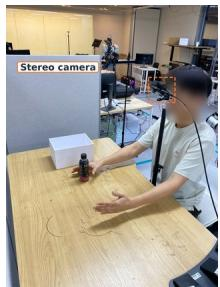

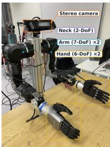  
(b) OpenArm + RH56F1

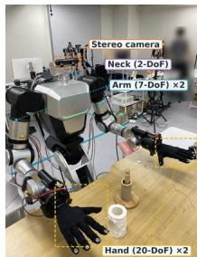  
(c) RB-Y1 + WujiHand2

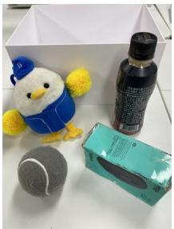  
(d) In-domain objects

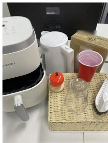  
(e) Out-of-domain objects  
Figure 7: Real-world setup. (a) Human video collection from the robot’s camera position. (b) OpenArm embodiment. (c) RB-Y1 embodiment. (d) Objects of the in-domain tasks. (e) Objects introduced for the out-of-domain tasks.

EgoMimic. The human arm and hand are masked in every human frame. In the robot episodes the robot arm is masked from the recorded state, by projecting the URDF into the camera. At test time the mask is placed on the live image from the current robot state and the camera calibration. The masking follows the official implementation.

Masquerade. The human arm is inpainted out and a rendering of the robot from its URDF in the retargeted state is composited onto the frame. Robot episodes receive the same rendering from the recorded state, and at test time the rendering is composited onto the live image from the current state. The original uses E2FGVI (Li et al., 2022) for the inpainting. We use ProPainter (Zhou et al., 2023), which leaves fewer artifacts on our videos. Following the original, the policy is trained with an auxiliary loss that predicts future 2D robot hand keypoints from the image features, with targets from the retargeted (human) or recorded (robot) state. The head, the prediction horizon, and the loss weight follow the official implementation. The original single-arm gripper pipeline is extended to both arms and to the dexterous hands of our robots.

## B.4. Inference Details

Inference configuration and compute. Table 5 lists the inference configuration of every stage and its cost on a single H100. The video model runs in two stages: the first generates the clip at 512×288 per view with a distilled model in 8 sampling steps, and the second upsamples the result to 1024×576 per view and refines it in 3 steps. Both stages are conditioned on the same keyframes and skeleton flow, the second at the higher resolution, and both generate the two stereo views in one sequence. The image model generates each keyframe at 1024×576 per view in 30 sampling steps with a guidance scale of 3.5, and the keyframes of a demonstration are generated sequentially since each conditions on the previous one. The IDM predicts a 20-step action chunk from each 1 s window and is applied in a sliding window with a stride of one frame over the demonstration.

Table 6 breaks down the wall-clock time of the full pipeline for a typical 15 s demonstration (300 frames at 20 Hz, translated into one embodiment). Table 10 accounts for collection in person-hours and Appendix A notes the trade of collection time for compute.

## C. Experimental Details

## C.1. Real-World Environment

Hardware setup. We use two humanoid robots, OpenArm and RB-Y1 (Figure 7b,c), in our realworld experiments. Both humanoids are equipped with two 7-DoF arms. Each arm of the OpenArm is equipped with a 6-DoF Inspire RH56F1 hand, and each arm of the RB-Y1 is equipped with a 20-DoF WujiHand2 hand. The head of each robot is mounted on a 2-DoF neck that supports pitch and yaw motions. A stereo camera is mounted on each neck, and its left and right egocentric view are used as visual inputs throughout all experiments.

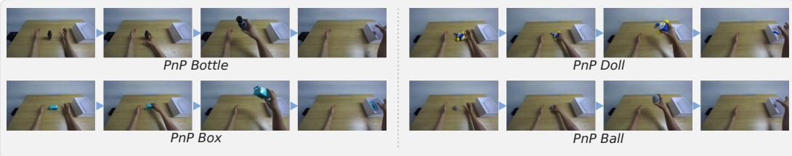  
(a) In-domain tasks

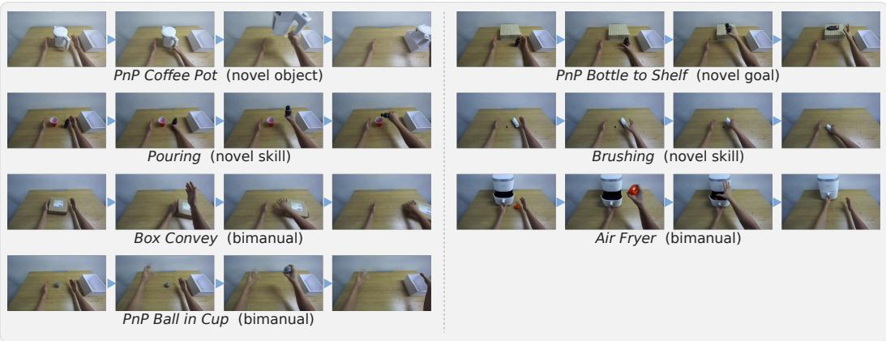  
(b) Out-of-domain tasks  
Figure 8: Real-world tasks. (a) In-domain tasks with teleoperated demonstrations and human videos. (b) Outof-domain tasks with human videos only.

Task details. All tasks are formulated as language-conditioned manipulation tasks. We evaluate eleven tasks in total (Figure 2), comprising four in-domain pick-and-place (PnP) tasks and seven out-of-domain tasks. The in-domain tasks (Figure 2a) consist of PnP Bottle, PnP Doll, PnP Box, and PnP Ball, with 50 teleoperated demonstrations per robot embodiment and 50 human videos for each task. The human videos are recorded from the position of the robot’s head camera (Figure 7a). The seven out-of-domain tasks (Figure 2b) have 50 human videos each and no robot demonstrations: PnP Coffee Pot, PnP Bottle to Shelf, Pouring, Brushing, Box Convey, Air Fryer, and PnP Ball in Cup.

The four in-domain PnP tasks share the same task structure, where the robot grasps a designated object and places it into a white container (Figure 7d). PnP Coffee Pot follows the same pick-and-place structure with a novel coffee pot object. PnP Bottle to Shelf requires the robot to grasp a bottle and place it at a designated location on a shelf. Pouring requires the robot to grasp a bottle and pour its contents into a red cup. Brushing requires the robot to grasp a brush and wipe the area marked with black tape. Box Convey requires the robot to move a box to the right using both hands sequentially, with the left hand moving it first and the right hand moving it further. Air Fryer requires the robot to open an air fryer, grasp an apple-shaped object, place it inside, and close the door. Finally, PnP Ball in Cup requires the robot to lift an inverted cup with the left hand, grasp the ball with the right hand, and place it into the target container. Figure 7e shows the objects introduced by the out-of-domain tasks.

## Evaluation protocol.

We conduct 28 evaluation trials for each task. For single-arm tasks, a trial receives a score of 1 only when the task is successfully completed. For bimanual tasks, each hand contributes 0.5 to the score, yielding a maximum score of 1 when both required hand actions are successfully completed. The initial positions of the target objects are randomized within the workspace for each trial. For the PnP tasks, including PnP Bottle, PnP Doll, PnP Box, PnP Ball, PnP Coffee Pot, and PnP Bottle to Shelf, a trial is considered successful when the object is placed at the designated goal location. For Pouring, the trial is successful when the bottle is tilted over the target cup. For Brushing, success is determined by whether the brush reaches the designated region marked with black tape. For Box Convey, the trial is successful when the specified sequential manipulation with the left and right hands is correctly executed. For Air Fryer, success requires opening the air fryer, placing the apple-shaped object inside, and closing the door. For PnP Ball in Cup, success requires lifting the cup with the left hand, grasping the ball with the right hand, and placing the ball at the designated goal location.

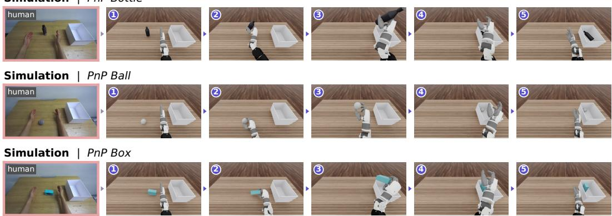  
Figure 9: Simulated tasks. Each row shows the human video of a task (left) and a successful episode in simulation (1–5): the right hand grasps the object, lifts it, and places it in the container.

Table 7: Fréchet SigLIP distance to the real robot frames. Lower is closer. Real robot frames are from the four PnP tasks, and each corpus is compared on all eleven tasks (as in Figure 3), on the four PnP tasks alone, and on the seven tasks without robot data alone.
<table><tr><td>Corpus</td><td>All eleven tasks</td><td>Four PnP tasks</td><td>Seven tasks w/o robot data</td></tr><tr><td>Human</td><td>125.5</td><td>120.1</td><td>133.5</td></tr><tr><td>EgoMimic</td><td>129.0</td><td>127.1</td><td>134.6</td></tr><tr><td>Masquerade</td><td>58.2</td><td>50.3</td><td>68.8</td></tr><tr><td>RoboTryOn (Ours)</td><td>32.7</td><td>26.6</td><td>41.9</td></tr></table>

## C.2. Simulation Environment

Setup. We build a simulated counterpart of the OpenArm setup in Isaac Lab (Mittal et al., 2023). The simulated robot follows the real OpenArm: two 7-DoF arms with 6-DoF Inspire RH56F1 hands and a 2-DoF neck, fixed at the downward pitch measured on the real robot. The head camera is positioned to match the mounting configuration of the real stereo camera, ensuring that the simulated egocentric view shares the same viewpoint as the real one (Figure 9).

Tasks. We simulate the three in-domain pick-and-place tasks that have simulation assets, PnP Bottle, PnP Ball, and PnP Box. PnP Doll is excluded because no simulation asset of the doll exists. For each human video, the objects are placed at the positions recorded in the corresponding real scene, measured with the depth sensor and the stereo views of the ZED 2i head camera and verified by overlaying the first frame of the video on the simulated scene. As in the real setup, the robot grasps the object and places it into the white container (see Figure 9).

Evaluation protocol. Each task is evaluated on 22 episodes (66 in total), one for each human video.   
An episode counts as a success when the object is picked up and placed in the container.

## D. Analysis Details

Visual gap analysis. From each corpus, 5,000 frames are sampled uniformly: the human videos, their EgoMimic and Masquerade edits, the RoboTryOn translations, and the teleoperated robot episodes. Each frame is encoded by the pretrained SigLIP vision tower (Zhai et al., 2023) of $\pi _ { 0 . 5 }$ and its features are mean-pooled over image tokens. Figure 3(b) is a UMAP projection fitted on the union of the five sets. Table 7 gives the Fréchet distance (Heusel et al., 2017) between the SigLIP features of each corpus and those of the real robot frames, once on the frames of Figure 3, once restricted to the four PnP tasks that have robot data, and once to the seven tasks that do not. The frames of the seven tasks without robot data lie closer to the real frames than the edited frames of the four tasks with it, so the overlap in Figure 3 is not a reproduction of the training episodes.

Table 8: Action gap, per task. Success (%) of replaying the action labels of the same human videos open loop, without a policy, in a simulated replica of the real scene with the objects at their recorded positions (OpenArm, 22 episodes per task). Averages are in Figure 4(c).
<table><tr><td>Labeling</td><td>PnP Bottle</td><td>PnP Box</td><td>PnP Ball</td><td> $\mathbf { A v } \mathbf { g } .$ </td></tr><tr><td>Retargeting (Qin et al., 2023)</td><td>63.6</td><td>31.8</td><td>9.1</td><td>34.8</td></tr><tr><td>RoboTryOn (Ours) w/o wrist correction</td><td>63.6</td><td>72.7</td><td>54.5</td><td>63.6</td></tr><tr><td>RoboTryOn (Ours)</td><td>77.3</td><td>63.6</td><td>68.2</td><td>69.7</td></tr></table>

Action replay in simulation. We replay each set of action labels in the simulation environment of Appendix C.2. For each human video, the labels are executed open loop from the same initial configuration, with the objects at their recorded positions, and each episode is evaluated as described there. Retargeting: the reconstructed hand (Zhang et al., 2025) is mapped to the robot hand (Qin et al., 2023) and the arm joints are solved by inverse kinematics from the wrist pose, the labels EgoMimic and Masquerade train on. RoboTryOn: the IDM labels of the synthesized video, with and without the wrist correction of Section 3.4. Each labeling is replayed on the same 22 episodes of each task. On Bottle, Box, and Ball, RoboTryOn succeeds on 17, 14, and 15 of them, RoboTryOn without the wrist correction on 14, 16, and 12, and retargeting on 14, 7, and 2 (Table 8).

Action distribution and co-training. Figure 5 uses right-hand actions at 20 Hz, every frame without subsampling. Panel (a) shows the thumb rotation, the opposition axis that turns the thumb toward the palm, and the mean flexion of the other four fingers. We normalize each joint so that the 1st and 99th percentiles of the three sources pooled map to −1 and 1, compute histogram densities over 40 bins on [−1.15, 1.15], and plot them against the corresponding joint angle in radians. Panel (b) is measured at the $\pi _ { 0 . 5 }$ base weights before fine-tuning, so the three methods start from the same weights and differ only in the data they produce. Each method keeps the normalization statistics of its own training setup. We take the gradient of the flow-matching training loss averaged over 896 teleoperated PnP frames, and over 880 frames of the method’s human data for each out-of-domain task. We split the episodes of each source into two halves, compute the cosine for the two resulting pairs, and average them. The bars average over the seven out-of-domain tasks. All params covers the 4.1B parameters of the model, and Action expert covers its 0.69B parameters together with the action and time projections. Gradients from two halves of the same source give a cosine of 0.96 to 0.97 for teleoperation and 0.78 to 0.95 for each task, so the differences in panel (b) are not measurement noise. Panel (c) uses every frame of the right-hand actions that the policy outputs during real robot rollouts, before filtering, in the units of panel (a). As the reference we sample 8,000 frames of teleoperated right-hand actions from the four PnP tasks. Following the k-NN precision of Kynkäänniemi et al. (2019), each reference frame defines a ball whose radius is the distance to its fifth nearest reference frame, and a rollout frame counts as within the teleoperated distribution if it falls inside any ball. We compute this share for each policy and task and average it over the in-domain and over the out-of-domain tasks. Measured the same way, two halves of the teleoperated episodes give about 73 to 80%.

## E. Flow-Matching Objective and Sampling

We briefly describe conditional flow matching (Lipman et al., 2023; Liu et al., 2023), the common formulation of the policy and the three models of RoboTryOn.

Let x denote a clean target (e.g., an action chunk or a video latent) and y the conditioning inputs $( e . g .$ observations and instructions) that define the conditional target distribution $p ( \mathbf { x } \mid \mathbf { y } )$ . We construct a noisy input $\mathbf { x } ^ { \tau }$ by linearly interpolating between Gaussian noise $\mathbf { \epsilon } \gets \mathcal { N } ( \mathbf { 0 } , \mathbf { I } )$ and x:

$$
{ \bf x } ^ { \tau } = \tau { \bf x } + ( 1 - \tau ) \epsilon , \qquad \tau \in [ 0 , 1 ] ,\tag{E.1}
$$

Table 9: Success against collection cost, per condition. Data behind Figure 6. Each policy is trained on the four PnP tasks alone with N demonstrations per task and evaluated over 28 trials per task (112 in total). Person-hours follow Table 10: 38 teleoperated episodes or 214 human videos per person-hour, and the equal split uses $N / 2$ of each.
<table><tr><td>Training data</td><td>N / task</td><td>Person-hours</td><td>Successes / 112</td><td>SR (%)</td></tr><tr><td>Teleop only</td><td>10</td><td>1.05</td><td>21</td><td>18.8</td></tr><tr><td></td><td>30</td><td>3.16</td><td>39</td><td>34.8</td></tr><tr><td></td><td>50</td><td>5.26</td><td>53</td><td>47.3</td></tr><tr><td>Human video only</td><td>10</td><td>0.19</td><td>14</td><td>12.5</td></tr><tr><td></td><td>30</td><td>0.56</td><td>28</td><td>25.0</td></tr><tr><td></td><td>50</td><td>0.93</td><td>40</td><td>35.7</td></tr><tr><td></td><td>100</td><td>1.87</td><td>58</td><td>51.8</td></tr><tr><td>Teleop + human (1:1)</td><td>10</td><td>0.62</td><td>19</td><td>17.0</td></tr><tr><td></td><td>30</td><td>1.86</td><td>40</td><td>35.7</td></tr><tr><td></td><td>50</td><td>3.10</td><td>56</td><td>50.0</td></tr><tr><td></td><td>100</td><td>6.20</td><td>80</td><td>71.4</td></tr></table>

Table 10: Data collection cost. Teleoperation occupies two people, so one person-hour yields 14 min of robot demonstration against 45 min of egocentric human video. Because a person also performs each task faster than a teleoperated robot, the gap in episode count is 5–6×.
<table><tr><td></td><td>Robot Teleoperation</td><td>Human Ego Video</td></tr><tr><td>People per session</td><td>2</td><td>1</td></tr><tr><td>Demonstration footage / person-hour</td><td>14min</td><td>45 min</td></tr><tr><td>Episodes / person-hour</td><td>38</td><td>214</td></tr><tr><td>Hardware</td><td>Robot + teleoperation system</td><td>Fixed camera</td></tr><tr><td>Trained operator required</td><td>Yes</td><td>No</td></tr><tr><td>Occupies robot</td><td>Yes</td><td>No</td></tr><tr><td>Bimanual overhead</td><td>High (two arms to operate)</td><td>None</td></tr></table>

where $\tau = 0$ corresponds to pure noise and $\tau = 1$ to clean data. A conditional velocity network $\mathbf { v } ( \mathbf { x } ^ { \tau } , \tau \mid \mathbf { y } )$ is trained to predict the target velocity ${ \bf x } - \epsilon { \bf \cdot }$

$$
\begin{array} { r } { \mathcal { L } _ { \mathrm { F M } } = \mathbb { E } _ { ( \mathbf { x } , \mathbf { y } ) , \epsilon , \tau } \left[ \left\| \mathbf { v } ( \mathbf { x } ^ { \tau } , \tau \mid \mathbf { y } ) - ( \mathbf { x } - \epsilon ) \right\| _ { 2 } ^ { 2 } \right] . } \end{array}\tag{E.2}
$$

At inference, samples are generated from Gaussian noise by integrating the learned velocity from $\tau = 0 \mathrm { t o } \tau = 1$ . An Euler sampler (Lipman et al., 2023) performs this integration through repeated updates

$$
\begin{array} { r } { \mathbf { x } ^ { \tau + \Delta \tau } = \mathbf { x } ^ { \tau } + \Delta \tau \mathbf { v } ( \mathbf { x } ^ { \tau } , \tau \mid \mathbf { y } ) , } \end{array}\tag{E.3}
$$

where $\Delta \tau > 0$ is the step size. In Section $3 , f _ { \theta } , g _ { \phi } , h _ { \psi }$ , and $\pi _ { \omega }$ each serve as v, and $p _ { \theta } , p _ { \phi } .$ , and $p _ { \psi }$ denote the distributions of the samples obtained in this way.

## F. Additional Results

## F.1. Data Collection Cost

Table 10 lists the cost model behind the person-hour axis of Figure 6, and Table 9 the eleven policies plotted there. Teleoperation occupies two people and yields about 14 minutes of demonstration per person-hour, whereas a single person records about 45 minutes of human video in the same time and completes each task faster, so the gap in episode count (38 against 214 per person-hour) is larger than the gap in footage. The teleop-only policy with 50 demonstrations per task is the Teleop only policy of Table 1a. The other ten policies are trained for this analysis on the four PnP tasks alone, so their values are not those of Table 1a, whose policies also train on the seven tasks without robo demonstrations.

Table 11: Per-task results behind Table 1. Success rates (%) over 28 trials per task using π0.5 on OpenArm and RB-Y1. Robot demonstrations are available only for the PnP tasks in (a). “+” rows add the human videos converted by each method to the teleoperated demonstrations, and the RoboTryOn (Ours) only rows use the synthesized episodes alone. EgoMimic and Masquerade are deployed with their test-time mask and overlay, whereas RoboTryOn uses the raw camera view.  
(a) Tasks with robot demonstrations
<table><tr><td rowspan="2">Method</td><td colspan="2">Data</td><td colspan="4">In-domain tasks</td><td rowspan="2">Avg.</td></tr><tr><td>Teleop</td><td>Human</td><td>PnP Bottle</td><td>PnP Doll</td><td>PnP Box</td><td>PnP Ball</td></tr><tr><td>OpenArm</td><td></td><td></td><td></td><td></td><td></td><td></td><td></td></tr><tr><td>Teleop only</td><td></td><td>X</td><td>71.4</td><td>39.3</td><td>42.9</td><td>35.7</td><td>47.3</td></tr><tr><td>+ EgoMimic (Kareer et al., 2025)</td><td>V</td><td>√</td><td>64.3</td><td>50.0</td><td>42.9</td><td>42.9</td><td>50.0</td></tr><tr><td>+ Masquerade (Lepert et al., 2025a)</td><td>V</td><td>√</td><td>92.9</td><td>42.9</td><td>71.4</td><td>64.3</td><td>67.9</td></tr><tr><td>+ RoboTryOn (Ours)</td><td>√</td><td>√</td><td>92.9</td><td>71.4</td><td>71.4</td><td>67.9</td><td>75.9</td></tr><tr><td>RoboTryOn (Ours) only</td><td>X</td><td>√</td><td>82.1</td><td>57.1</td><td>50.0</td><td>39.3</td><td>57.1</td></tr><tr><td>RB-Y1</td><td></td><td></td><td></td><td></td><td></td><td></td><td></td></tr><tr><td>Teleop only</td><td></td><td>X</td><td>82.1</td><td>64.3</td><td>75.0</td><td>57.1</td><td>69.6</td></tr><tr><td>+ EgoMimic</td><td>√</td><td>√</td><td>67.9</td><td>71.4</td><td>64.3</td><td>50.0</td><td>63.4</td></tr><tr><td>+ Masquerade</td><td>√</td><td>√</td><td>67.9</td><td>57.1</td><td>67.9</td><td>60.7</td><td>63.4</td></tr><tr><td>+ RoboTryOn (Ours)</td><td>√</td><td>√</td><td>89.3</td><td>75.0</td><td>85.7</td><td>67.9</td><td>79.5</td></tr><tr><td>RoboTryOn (Ours) only</td><td>X</td><td>J</td><td>71.4</td><td>64.3</td><td>75.0</td><td>32.1</td><td>60.7</td></tr></table>

(b) Tasks without task-specific robot demonstrations
<table><tr><td></td><td colspan="2">Data</td><td>Novel Object</td><td>Novel Goal</td><td colspan="2">Novel Skill</td><td colspan="3">Bimanual</td><td></td></tr><tr><td>Method</td><td>Teleop</td><td>Human</td><td>PnP Coffee Pot</td><td>PnP Bottle to Shelf</td><td>Pouring</td><td>Brushing</td><td>Box Convey</td><td>Air Fryer</td><td>PnP Ball in Cup</td><td>Avg.</td></tr><tr><td>OpenArm</td><td></td><td></td><td></td><td></td><td></td><td></td><td></td><td></td><td></td><td></td></tr><tr><td>Teleop only</td><td></td><td>x</td><td>14.3</td><td>7.1</td><td>0.0</td><td>0.0</td><td>0.0</td><td>0.0</td><td>0.0</td><td>3.1</td></tr><tr><td>+ EgoMimic</td><td></td><td>√</td><td>14.3</td><td>0.0</td><td>7.1</td><td>14.3</td><td>0.0</td><td>0.0</td><td>0.0</td><td>5.1</td></tr><tr><td>+ Masquerade</td><td></td><td>√</td><td>21.4</td><td>7.1</td><td>7.1</td><td>21.4</td><td>0.0</td><td>0.0</td><td>0.0</td><td>8.2</td></tr><tr><td>+ RoboTryOn (Ours)</td><td>V</td><td>√</td><td>64.3</td><td>89.3</td><td>85.7</td><td>82.1</td><td>78.6</td><td>60.7</td><td>50.0</td><td>73.0</td></tr><tr><td>RoboTryÓn (Ours) only</td><td>x</td><td>√</td><td>50.0</td><td>57.1</td><td>64.3</td><td>53.6</td><td>57.1</td><td>35.7</td><td>21.4</td><td>48.5</td></tr><tr><td>RB-Yl</td><td></td><td></td><td></td><td></td><td></td><td></td><td></td><td></td><td></td><td></td></tr><tr><td>Teleop only</td><td></td><td>x</td><td>7.1</td><td>0.0</td><td>0.0</td><td>0.0</td><td>0.0</td><td>0.0</td><td>0.0</td><td>1.0</td></tr><tr><td>+ EgoMimic</td><td></td><td>√</td><td>14.3</td><td>0.0</td><td>10.7</td><td>10.7</td><td>0.0</td><td>0.0</td><td>0.0</td><td>5.1</td></tr><tr><td>+ Masquerade</td><td></td><td>√</td><td>21.4</td><td>7.1</td><td>10.7</td><td>14.3</td><td>0.0</td><td>0.0</td><td>0.0</td><td>7.7</td></tr><tr><td>+ RoboTryOn (Ours)</td><td>√</td><td>√</td><td>60.7</td><td>67.9</td><td>75.0</td><td>39.3</td><td>32.1</td><td>0.0</td><td>53.6</td><td>46.9</td></tr><tr><td>RoboTryÓn (Ours) only</td><td>x</td><td>√</td><td>64.3</td><td>60.7</td><td>60.7</td><td>46.4</td><td>28.6</td><td>0.0</td><td>21.4</td><td>40.3</td></tr></table>

## F.2. Per-Task Results

Table 11 gives the per-task results for the main experiments. Table 12 gives the per-task results for the two policy backbones, $\pi _ { 0 . 5 }$ and RLDX-1-Img (Kim et al., 2026), behind Table 3b. Table 13 gives the per-task results behind Table 3a.

## F.3. Ablated Variants

Figure 11 shows failure cases of the ablated variants on PnP Coffee Pot. Without the autoregressive reference, each keyframe is translated independently, resulting in inconsistent grasp configurations: the fingers wrap the handle from below at 5.0 s and reach behind it at 6.0 s, causing visible hand jitter between keyframes. In contrast, the full model maintains a consistent grasp throughout.

Without subsequent keyframes, the video is generated from the first keyframe alone. Although the hand still follows the skeleton, the coffee pot changes into a box inside the container at 11.0 s. Without skeleton flow, the motion between keyframes deviates from the demonstrator’s trajectory, causing the wrist and hand to lose the configuration required to grasp the handle at 3.5 s.

Human  
OpenArm  
RB-Y1  
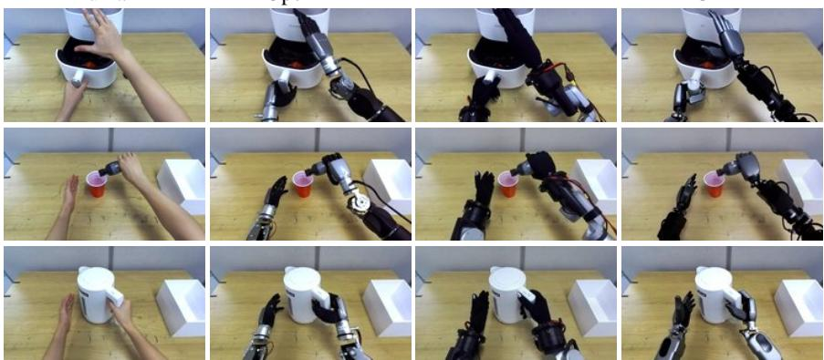  
GR-1  
Figure 10: One human video, three robots. Human videos (left) translated into the OpenArm, the RB-Y1, and the GR-1 by a single set of models, and only the embodiment changes.

Table 12: Policy backbone, per task. Success rate (%) on the OpenArm for each backbone, trained on the teleoperated episodes alone and with the episodes synthesized by RoboTryOn.
<table><tr><td></td><td></td><td colspan="5">In-domain</td><td colspan="8">Out-of-domain</td></tr><tr><td>Backbone</td><td>Data</td><td>PnP Bottle</td><td>PnP Doll</td><td>PnP Box</td><td>PnP Ball</td><td>Avg.</td><td>PnP Coffee Pot</td><td>PnP Bottle to Shelf</td><td>Pouring</td><td>Brushing</td><td>Box Convey</td><td>Air Fryer</td><td>PnP Ball in Cup</td><td>Avg.</td></tr><tr><td>π0.5</td><td>Teleop only</td><td>71.4</td><td>39.3</td><td>42.9</td><td>35.7 47.3</td><td></td><td>14.3</td><td>7.1</td><td>0.0</td><td>0.0</td><td>0.0</td><td>0.0</td><td>0.0</td><td>3.1</td></tr><tr><td></td><td>+ RoboTryOn (Ours)</td><td>92.9</td><td>71.4</td><td>71.4</td><td>67.9</td><td>75.9</td><td>64.3</td><td>89.3</td><td>85.7</td><td>82.1</td><td>78.6</td><td>60.7</td><td>50.0</td><td>73.0</td></tr><tr><td>RLDX-1-Img Teleop only</td><td></td><td>50.0</td><td></td><td>100.0 57.1</td><td>7.1</td><td>53.6</td><td>0.0</td><td>0.0</td><td>0.0</td><td>0.0</td><td>0.0</td><td>0.0</td><td>0.0</td><td>0.0</td></tr><tr><td></td><td>+ RoboTryOn (Ours)</td><td>57.1</td><td>57.1</td><td>64.3</td><td>64.3</td><td>60.7</td><td>28.6</td><td>21.4</td><td>42.9</td><td>32.1</td><td>64.3</td><td>21.4</td><td>71.4</td><td>40.3</td></tr></table>

Table 13: Component ablation, per task. Success rate (%) on the OpenArm with $\pi _ { 0 . 5 }$ for the variants of Table 3a.
<table><tr><td></td><td colspan="5">In-domain</td><td colspan="7">Out-of-domain</td></tr><tr><td>Variant</td><td>PnP Bottle</td><td>Doll Box</td><td>PnP PnP PnP</td><td>Ball</td><td>Avg.</td><td>PnP Coffee Pot</td><td>PnP Bottle to Shelf</td><td>Pouring</td><td>Brushing</td><td>Box Convey</td><td>Air Fryer</td><td>PnP Ball in Cup</td><td>Avg.</td></tr><tr><td>RoboTryOn (Ours) (full)</td><td>92.9</td><td>71.4 71.4 67.9 75.9</td><td></td><td></td><td></td><td>64.3</td><td>89.3</td><td>85.7</td><td>82.1</td><td>78.6</td><td>60.7</td><td>50.0</td><td>73.0</td></tr><tr><td>w/o Autoregressive reference</td><td>85.7</td><td>64.3</td><td>64.3</td><td>60.7</td><td>68.8</td><td>57.1</td><td>82.1</td><td>78.6</td><td>75.0</td><td>71.4</td><td>53.6</td><td>46.4</td><td>66.3</td></tr><tr><td>w/o Subsequent keyframes</td><td>53.6</td><td>39.3</td><td>39.3</td><td>39.3</td><td>42.9</td><td>21.4</td><td>17.9</td><td>53.6</td><td>60.7</td><td>53.6</td><td>39.3</td><td>28.6</td><td>39.3</td></tr><tr><td>w/o Hand skeleton flow</td><td>50.0</td><td>39.3</td><td>39.3</td><td>39.3</td><td>42.0</td><td>10.7</td><td>42.9</td><td>42.9</td><td>28.6</td><td>14.3</td><td>7.1</td><td>3.6</td><td>21.4</td></tr><tr><td>w/o IDM wrist correction</td><td>50.0</td><td>64.3</td><td>78.6</td><td>67.9</td><td>65.2</td><td>35.7</td><td>53.6</td><td>46.4</td><td>75.0</td><td>71.4</td><td>32.1</td><td>21.4</td><td>48.0</td></tr></table>

## F.4. Qualitative Results

Figure 10 shows human videos translated into the OpenArm, the RB-Y1, and the GR-1 by a single set of models.

## F.4.1. Rollouts on OpenArm

In Figure 12, we show all rollouts on the OpenArm from the policy trained on both teleoperated and synthesized episodes. Figure 12(a) shows the four tasks with robot demonstrations, while Figure 12(b) shows the seven tasks with human video only.

## F.4.2. Rollouts on RB-Y1

In Figure 13, we show all rollouts on the RB-Y1 from the policy trained on both teleoperated and synthesized episodes. Figure 13(a) shows the four tasks with robot demonstrations, while Figure 13(b) shows the six tasks with human video only, without Air Fryer.

No method completes Air Fryer on the RB-Y1 (Table 11). The task requires inserting the fingers between the handle and the fryer body before closing, a fine-grained grasping motion not observed in

2.0 s  
3.5 s  
5.0 s  
6.0 s  
7.5 s  
9.0 s  
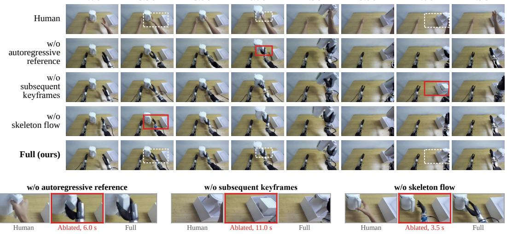  
11.0 s  
11.9 s  
Figure 11: Failure cases of the ablated variants. Human video and videos synthesized by the variants in Table 3a at the same time steps. Boxed regions are enlarged at representative failure points.

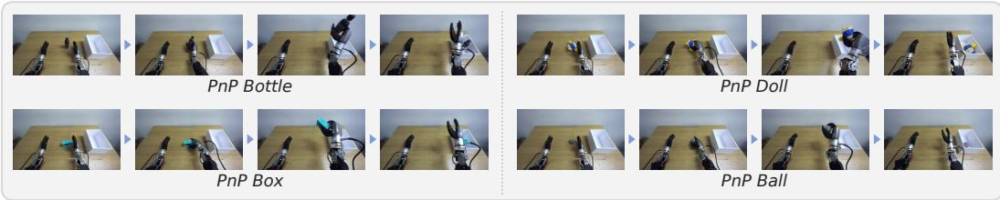  
(a) In-domain tasks

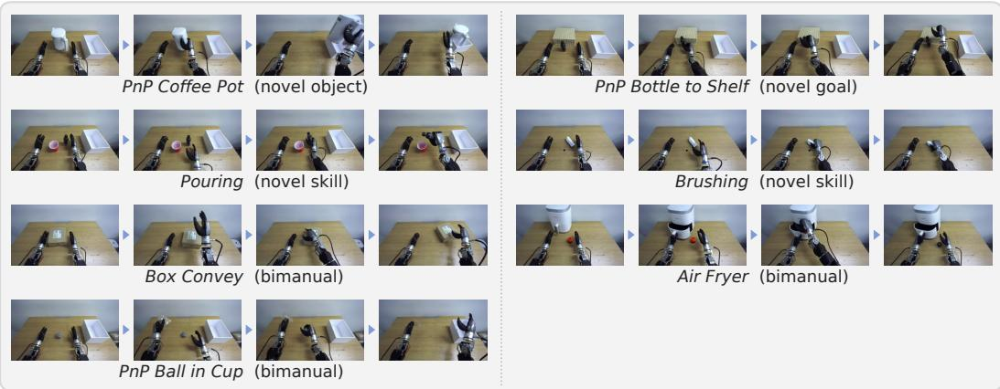  
(b) Out-of-domain tasks  
Figure 12: Rollouts on all eleven tasks on the OpenArm, with the policy trained on the teleoperated and synthesized episodes: (a) the four tasks with robot demonstrations and (b) the seven with human video only.

the teleoperated data and beyond the resolution of the IDM labels. The longer, multi-joint fingers of the WujiHand2 also tend to push the fryer away when closing in front of the handle, unlike the shorter 1-DoF fingers of the Inspire RH56F1.

## F.4.3. Long-Horizon Synthesis

Figure 14 shows a 25-second human video and the corresponding long-horizon robot video generated from its selected keyframes. The generated video is divided into clips at the keyframe times, and

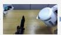

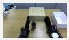

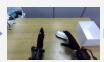

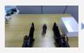

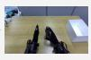

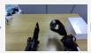

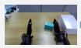  
PnP Bottle

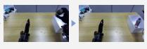

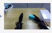

  
PnP Box

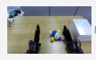

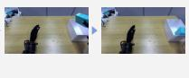

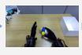

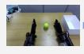

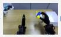  
PnP Doll

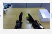

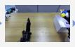

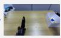

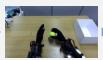  
PnP Ball

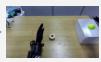

(a) In-domain tasks  

  
PnP Coffee Pot (novel object)

  
PnP Bottle to Shelf (novel goal)

  
Pouring (novel skill)

  
Brushing (novel skill)  
Box Convey (bimanual)

  
PnP Ball in Cup (bimanual)

  
(b) Out-of-domain tasks

Figure 13: Rollouts on the RB-Y1, with the policy trained on the teleoperated and synthesized episodes: (a) the four tasks with robot demonstrations and (b) the tasks with human video only. Air Fryer is omitted because no policy completes it on the RB-Y1 (0% success in Table 11).

  
Figure 14: Long-horizon synthesis. A 25-second human video (top) with its selected keyframes, and the generated robot video (bottom) with the clip boundaries at the keyframe times. Adjacent clips share the keyframe at their boundary, so robot and objects stay consistent across boundaries.

adjacent clips share the keyframe at their boundary. This preserves the consistency of the robot and objects across clip boundaries.

Figure 15: Failure cases. The red box in each row marks the region enlarged on the right. Generationfailures (top): synthesized videos in which the generative models do not preserve the objects. On PnP Ball in Cup the transparent cup suddenly disappears from the hand as it is lifted, leaving the ball on the table. On Air Fryer the fingers pass through the handle instead of closing around it (dashed circle). IDM errors (bottom): policy rollouts that fail because the action labels of the synthesized episodes place the hand imprecisely. On PnP Coffee Pot the hand reaches the handle but closes below it, and on PnP Bottle to Shelf it closes low on the bottle and pushes it against the shelf instead of lifting it onto it.