# TAPES: Task-Aligned Joint Predictive Pretraining for Transaction Event Sequences

Ruobing Zuo1,2†, Weiyu Han2, Huilin He3,2†, Haoyu Jiang2, Ze Zhao2†, Jie Sheng2, Xiao Tan2✉, Shuai Chen2, Tianyi Zhang2

1East China Normal University, 2Ant International, 3Tongji University

rbzuo@stu.ecnu.edu.cn, huilin3@tongji.edu.cn

{hanweiyu.hwy,wuxian.jhy,zhaoze.zhao,shengjie.sheng,alex.tx,shuai.cs,zty113091}@ant-intl.com

## Abstract

Transaction event sequences support diverse prediction tasks in online commerce and digital financial services. The same transac- tion records can yield prediction targets with diferent semantics, including values, changes, and relations to past events. These tar- gets impose diferent constraints on history representations, but their predictability alone does not establish the downstream util- ity of a target set. Moreover, target-wise prediction losses do not explicitly model conditional co-occurrence among targets. To ad dress these challenges, we propose TAPES, a task-aligned joint predictive pretraining framework for transaction sequences. TAPES constructs a finite collection of candidate target sets from admissi- ble field–operator combinations. It selects a target set according to the downstream utility of representations learned through short joint pretraining trials under matched budgets. It then reinitial- izes the encoder and pretrains it on the selected targets through a joint likelihood parameterized by a shared discrete latent variable, before downstream supervised adaptation. Experiments in a real-world transaction-risk setting and on multiple public financial benchmarks spanning diverse downstream tasks demonstrate that TAPES outperforms representative baselines. Ablation studies further validate the contributions of predictive target selection and joint modeling.

## Keywords

Transaction Sequence Modeling, Representation Learning, Predic- tive Pretraining, Supervision Design, Joint Prediction, User Behavior Modeling

## 1 Introduction

E-commerce platforms and online payment services are integral to the Web economy. Purchases, payments, and related user inter- actions generate continually growing transaction event sequences that support purchase prediction, user profiling, churn prediction, and risk assessment [23, 28]. These histories capture heterogeneous event attributes and their temporal evolution, while diferent appli cations rely on diferent behavioral cues [3]. Transaction sequence pretraining provides a means of learning behavioral representations for downstream adaptation by deriving self-supervised signals from historical interactions [2, 19]. Learning representations from rich transaction histories to support task-specific downstream decisions is therefore an important problem in user behavior modeling on Web platforms.

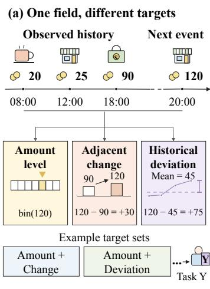

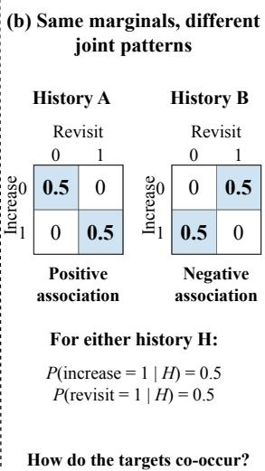  
Figure 1: Motivation for TAPES. (a) Diferent transformations of the same transaction field yield prediction targets with distinct semantics, illustrated by amount level, adjacent change, and historical deviation. (b) Two historical contexts share the same target-wise conditional marginals but exhibit diferent joint outcome patterns, motivating joint prediction. Event values, target combinations, and distributions are illustrative; bin denotes target-specific discretization.

Existing studies have explored pretraining for transaction and behavioral sequences through diferent learning signals. Contrastive approaches learn behavioral features by aligning representations of diferent historical segments from the same entity [2]; reconstruction-and prediction-based approaches learn historical structure by re- covering masked event attributes or predicting subsequent behavior [10, 24]; hybrid approaches combine generative and contrastive supervision to exploit the complementary information they provide [21]. These advances have promoted the learning of transfer-able representations from behavioral records and supported larger- scale modeling of payment behavior [10]. However, pretraining tasks specify which properties of a history the encoder is trained to capture, while the value of these properties for a particular down- stream task cannot be inferred directly from pretraining metrics.

The same transaction history can provide multiple forms of predictive supervision, each imposing diferent learning constraints on the representation. Therefore, how to select and organize such supervision to better support downstream tasks remains an important research question.

To investigate this question, we examine two interrelated design choices: which behavioral properties to predict and how to predict them jointly. First, a single transaction field supports diferent predictive semantics, as illustrated in Figure 1(a). For example, the next transaction amount can be described by its value range, its change from the preceding event, or its deviation from the mean of the observed history. These targets impose diferent requirements on history representations. Their predictability alone does not establish their downstream utility, and a target’s usefulness may depend on the other targets learned alongside it. This motivates evaluat- ing complete target sets according to downstream representation utility. Second, predictive information may reside in conditional co-occurrence patterns among targets. As illustrated in Figure 1(b), two historical contexts may induce identical target-wise conditional marginals but diferent joint outcome distributions. Marginal objectives do not explicitly require distinguishing these joint patterns, whereas a joint likelihood can make them part ofthe learning signal. We therefore study task-aligned target-set selection and joint prediction of the selected targets.

Building on these considerations, we propose TAPES, a task- aligned joint predictive pretraining approach for transaction event sequences. TAPES comprises two stages. Stage 1 constructs a finite collection of candidate target sets from admissible field–operator combinations. For each candidate set, a short joint pretraining trial produces history representations whose downstream predictive performance is evaluated using labels from within the training data. The resulting evaluation scores guide target-set selection. Stage 2 reinitializes the encoder while retaining the selected target defi- nitions and fitted transformations. It then pretrains the encoder by optimizing a joint predictive likelihood with a shared discrete latent variable, before adapting the encoder to the downstream task through supervised fine-tuning. We compare TAPES with tree ensembles on aggregated features, supervised sequence models, and self-supervised sequence pretraining methods on five public benchmarks. TAPES outperforms all evaluated baselines on the primary metric in four benchmarks and achieves the best average rank of 1.20. Cross-encoder comparisons and component ablations further support its applicability across encoder architectures and the benefits of both target-set selection and joint prediction. Ex-periments on an industrial transaction-risk dataset containing over 29 million transaction-level prediction examples further examine the practical utility of pretrained history representations for risk retrieval.

Our main contributions are summarized as follows:

• We incorporate the predictive semantics of transaction fields and the task utility of target sets into supervision design for transaction event sequences. Field–operator pairings define targets with distinct semantics, making explicit how the same event records can support diferent predictive learning objectives.

• We propose TAPES, a joint predictive pretraining approach that combines task-aligned target-set selection with con- ditional dependency modeling. TAPES selects predictive supervision according to downstream representation utility and learns history representations for downstream adapta- tion through joint prediction with a shared latent variable.

• We evaluate TAPES on five public benchmarks and a large-scale industrial transaction-risk dataset. Cross-encoder com- parisons and component ablations support its applicability across multiple encoder architectures and the downstream contributions of both target-set selection and joint prediction.

## 2 Related Work

## 2.1 Transaction and Behavioral Sequence Modeling

Transaction and behavioral sequence modeling aims to extract task-relevant behavioral information from heterogeneous event histo- ries. Existing research encompasses feature-based prediction [2] using gradient-boosted trees [12], as well as supervised sequence modeling [23] with recurrent [7] or attention-based encoders [31].

Pretraining learns reusable representations through contrastive learning [2], reconstruction and prediction [24, 28], or hybrid objectives [5, 21]. Recent industrial models extend transaction pretraining with domain-specific representations and prediction objectives for large-scale payment behavior modeling [10, 19, 33]. Other financial event models unify heterogeneous event sources into chronological sequences for next-event pretraining [26]. Architectural work also introduces history tokens to accumulate prefix information during predictive pretraining for downstream sequence classification [16]. However, for configurations built around prespecified prediction targets or statistics, supervision semantics do not automatically adapt to downstream tasks. Comparative stud- ies [3] also show that methods difer in their relative strengths across local-behavior and global-attribute tasks, highlighting the need to evaluate supervision choices in relation to the target task. TAPES makes this configuration choice explicit: it constructs field– operator target sets while keeping the input history unchanged and selects supervision based on the downstream utility of representa- tions learned by jointly predicting each set’s targets.

## 2.2 Task-Guided Supervision Design

The diversity of training signals has motivated research on adapting supervision to downstream task requirements. Task selection and mixing methods [13, 32] adjust the participation and relative contributions of auxiliary tasks; auxiliary-loss learning and target construction [9, 22] adapt supervision content and composition; task-grouping studies [11, 29] evaluate combinations through task-group training or afinity estimates obtained during optimization. Recent work also learns composite pretraining loss weights online by aligning pretraining gradients with a downstream objective, with evaluations including event-sequence modeling [17]. These methods incorporate task combinations and downstream feedback into supervision design through diferent search spaces and evalu-ation protocols. TAPES studies the configuration of field-derived predictive semantics for transaction-history pretraining. It com-pares predefined candidate sets in a field–operator semantic space and uses the downstream validation performance of representa- tions obtained through short pretraining runs as a proxy for the supervisory utility of each complete set.

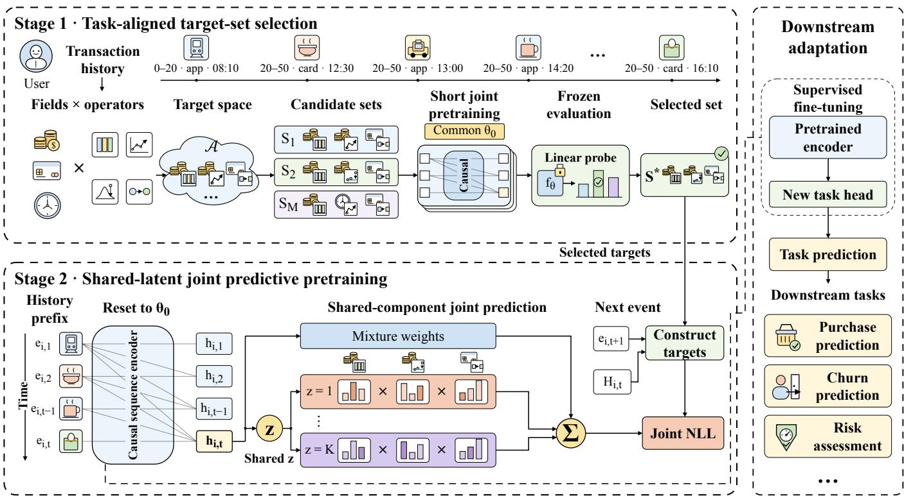  
Figure 2: Overview of Task-Aligned Joint Predictive Pretraining for Transaction Event Sequences (TAPES). (1) Stage 1: Taskguided target-set selection. Field–operator combinations capture predictive semantics beyond raw field values, and short pretraining trials identify a target set useful for the downstream task. (2) Stage 2: Shared-latent joint pretraining. The selected targets are jointly modeled through a shared discrete latent variable to learn representations of transaction histories. Candidate sets and probabilities are illustrative.

## 2.3 Joint Prediction and Target Dependencies

Joint prediction provides a framework for learning dependencies among multiple outputs. This perspective complements supervision selection: after identifying useful targets, it remains necessary to determine how they should be modeled jointly. Shared-encoder multi-task learning [4] allows information transfer between tar-gets, but summing marginal prediction losses does not explicitly model their conditional joint distribution. Autoregressive condi tional models [8] express output dependencies through chained conditional factorizations. The predictive value of exploiting de-pendencies depends on the loss being optimized. Shared-latent mixture models [18] express dependencies through mixtures of conditionally independent distributions.

These models specify how to model dependencies within a given output set, but do not by themselves select auxiliary-target seman- tics relevant to downstream tasks. TAPES combines dependency modeling with target-set selection, using a shared discrete latent variable to define a history-conditioned finite mixture of product categorical distributions, thereby making joint configurations of the selected targets part of the pretraining objective.

## 3 Preliminaries

Transaction Event Sequences. We study representation learning for transaction event sequences to support downstream prediction tasks. For entity �, let

$$
H _ { i , T _ { i } } = ( e _ { i , 1 } , . . . , e _ { i , T _ { i } } )
$$

denote the retained transaction history available at prediction time, where $T _ { i }$ is the number of valid events and the events are ordered chronologically. Each event comprises the available categorical and numerical attributes, temporal information, and field-level observa- tion indicators specifying whether individual fields are observed. Examples of categorical and numerical attributes include event type and transaction amount, respectively. Individual fields may be missing, and events may occur at irregular intervals. We denote the observed prefix through event � by $H _ { i , t } = ( e _ { i , 1 } , . . . , e _ { i , t } )$

Problem Formulation. For a given downstream task, each history is associated with a label $Y _ { i } ~ \in ~ { \mathcal { Y } }$ , where Y is the task-specific label space for binary, multiclass, or multilabel prediction. Let $f _ { \theta }$ denote a causal sequence encoder incorporating an event input module, and let $g _ { \psi }$ denote a task-specific prediction function, including the output transformation appropriate to the task. The history representation and downstream prediction are given by

$$
\begin{array} { r } { h _ { i , t } = f _ { \theta } ( H _ { i , t } ) \in \mathbb { R } ^ { d } , \qquad \widehat { Y } _ { i } = g _ { \psi } ( h _ { i , T _ { i } } ) , } \end{array}
$$

where $h _ { i , T _ { i } }$ is the representation at the last valid event position, and $\widehat { Y } _ { i }$ denotes the predicted probabilities. Causality requires that the representation at position � depend only on the observed prefix $H _ { i , t }$ without access to subsequent events.

Task-Guided Predictive Pretraining. We consider a task- guided predictive pretraining setting in which downstream labels within the training data guide the selection of predictive target sets. During event-prediction training, event-level targets are con-structed from an observed prefix $H _ { i , t }$ and its corresponding next event $e _ { i , t + 1 }$ , when available. Although target construction uses the next event, the representation $h _ { i , t }$ is computed exclusively from $H _ { i , t }$ The selected target definitions guide predictive pretraining, after which the pretrained encoder is adapted to the target downstream task through supervised fine-tuning.

## 4 Methodology

## 4.1 Overview

Predictive pretraining for transaction histories requires deciding which event properties to predict and how to learn from them to- gether. We introduce Task-Aligned Joint Predictive Pretraining for Transaction Event Sequences (TAPES), which formulates supervision design as selection in a structured field–operator target space. Stage I selects complete target sets according to the downstream utility of their jointly learned representations (Section 4.2). Stage II trains the final encoder from the common initialization using the selected supervision and the same joint predictive loss (Section 4.3), followed by downstream supervised adaptation (Section 4.4).

## 4.2 Stage 1: Task-Aligned Target-Set Selection

Field–operator target space. A transaction field admits several predictive descriptions. An amount, for example, can be described by its next value range, its adjacent change, or its deviation from the historical level. Amount ranges emphasize absolute scale, while prefix deviations emphasize departure from the historical level. We make these predictive semantics explicit by defining each target through an event field and a prediction operator.

Let $\mathcal { F }$ denote the available fields and $O ( f )$ the admissible opera- tors for field $f .$ The target space and label construction are

$$
\begin{array} { r } { \begin{array} { c } { \mathcal { A } = \{ ( f , o ) : f \in \mathcal { F } , o \in O ( f ) \} , } \\ { ( y _ { i , t , a } , m _ { i , t , a } ) = \Phi _ { a } ( H _ { i , t } , e _ { i , t + 1 } ; \eta _ { a } ) , \qquad a \in \mathcal { A } . } \end{array} } \end{array}\tag{1}
$$

Here, $y _ { i , t , a }$ is a categorical prediction label, $m _ { i , t , a } \in \{ 0 , 1 \}$ indicates whether the label can be validly constructed, and $\eta _ { a }$ contains the target transformation parameters. The next event provides supervi sion, while the encoder receives the observed prefix $H _ { i , t }$ . Selecting targets changes the output supervision while retaining the available input fields.

Categorical operators describe state transitions and relations to previously observed values; direct prediction is also available for admissible exact low-cardinality vocabularies. Numerical operators describe value ranges, adjacent diferences, and deviations from the mean of valid prefix observations. The resulting numerical quanti- ties are discretized using target-specific quantile boundaries, allowing heterogeneous targets to share a categorical likelihood formu- lation. Target transformations are fitted on predictive-pretraining data and held fixed across both stages.

Set-level downstream representation utility. A target’s usefulness can depend on the other targets learned alongside it. We therefore evaluate complete target sets through the representations they jointly induce. Before candidate training, we construct a finite bank $C = ( S _ { 1 } , \ldots , S _ { M } )$ , where $S _ { j } \subseteq { \mathcal { A } } .$ Default candidates are obtained by changing the field or operator of one target in a common reference set while preserving set size. Dataset-specific banks can also be prespecified from admissible targets.

For each candidate, we independently train an encoder and pre- diction module from a common encoder initialization under the same training protocol, using the shared-latent joint predictive loss adopted for final pretraining (Section 4.3).

We freeze each candidate encoder and fit a separate linear probe under a common evaluation protocol. Predictive pretraining, probe fitting, and candidate scoring use three disjoint subsets of the down-stream training set. The probe receives the last valid encoder state of each history and remains fixed during scoring. We define the estimated set-level downstream representation utility as

$$
\begin{array} { r l r } { \widehat { U } _ { J } ( S _ { j } ) } & { = } & { Q _ { \mathrm { s e l } } \left( g _ { \phi _ { j } } \circ f _ { \theta _ { j } ^ { \mathrm { I } } } \right) , } \\ { \quad } & { } & { S ^ { * } \in \arg \operatorname* { m a x } \widehat { U } _ { J } ( S _ { j } ) . } \\ { \quad } & { } & { { S _ { j } } \in C } \end{array}\tag{2}
$$

Here, $\theta _ { j } ^ { \mathrm { I } }$ denotes the jointly pretrained candidate encoder param-eters, and $g _ { \phi _ { j } }$ is its fitted linear readout, including fixed feature standardization. $Q _ { \mathrm { s e l } }$ evaluates the predictor against downstream labels on the internal scoring subset using a prespecified metric, with larger values indicating better performance.

## 4.3 Stage 2: Shared-Latent Joint Predictive Pretraining

Learning from joint outcomes. Single-target marginal distributions do not specify how target outcomes co-occur. Diferent histories can therefore induce identical marginals while exhibiting diferent joint patterns. To make target co-occurrence part of the supervision, both pretraining stages use the following shared-latent joint predictive model:

$$
\begin{array} { l } { { \displaystyle p _ { \omega } ( { \bf y } _ { i , t , S } \mid h _ { i , t } ) = \sum _ { k = 1 } ^ { K } \pi _ { k } ( h _ { i , t } ) \prod _ { a \in S } q _ { a , k } ( y _ { i , t , a } \mid h _ { i , t } ) } , } \\ { { h _ { i , t } = f _ { \boldsymbol { \theta } } ( H _ { i , t } ) . } } \end{array}\tag{3}
$$

Here, � is the number of components, $\pi _ { k } ( h _ { i , t } )$ is the probability of component �, $q _ { a , k }$ is its categorical distribution for target �, and � denotes the prediction-module parameters. Targets factorize conditional on the history representation and component; marginalizing the shared component allows dependencies among their outcomes.

Within each component, target probabilities are multiplied be-fore the components are mixed. The joint likelihood thus evaluates how well the same component explains multiple observed outcomes together, coupling their contributions to the encoder update.

When only part of the target vector is available, we marginalize unavailable coordinates by restricting the product in Equation (3) to valid targets. The joint predictive loss is

$$
\mathcal { L } _ { J } ( S ) = - \frac { 1 } { \left| S \right| \left| \mathcal { P } _ { S } \right| } \sum _ { ( i , t ) \in \mathcal { P } _ { S } } \log \mathcal { P } _ { \omega } \left( \mathbf { y } _ { i , t , O _ { i , t } ( S ) } \mid h _ { i , t } \right) ,\tag{4}
$$

where $O _ { i , t } ( S ) = \{ a \in S : m _ { i , t , a } = 1 \}$ , and $\mathcal { P } _ { S }$ is the nonempty set of adjacent event pairs with at least one valid target in the training batch. The loss averages over valid event pairs and scales by the fixed target-set size |� |. Missingness encoded as an explicit target category remains valid supervision.

Learning with the selected supervision. Stage II retains $S ^ { * }$ and its fitted target transformations. The encoder is reset to the common initialization, and the prediction module and optimizer are reini tialized. We then minimize $\mathcal { L } _ { J } ( S ^ { * } )$ on the predictive-pretraining data to learn the final history encoder.

## 4.4 Downstream Transfer and Adaptation

Parameter transfer. For standard sequence classification, we retain the event input module and history encoder learned in Stage II, initializing their parameters as $\theta _ { \mathrm { i n i t } } = \theta ^ { \mathrm { I I } }$ , and discard the joint prediction module. A newly initialized afine head predicts from the last valid event state:

$$
\begin{array} { l } { { z _ { i } } = W _ { \psi } h _ { i , T _ { i } } + b _ { \psi } , } \\ { \widehat { Y _ { i } } = g _ { \psi } ( h _ { i , T _ { i } } ) = \rho _ { \mathrm { t a s k } } ( z _ { i } ) . } \end{array}\tag{5}
$$

Here, $z _ { i }$ denotes the logits, and $\widehat { Y } _ { i }$ denotes the predicted probabil- ities. The prediction function $g _ { \psi }$ combines the afine head with $\rho _ { \mathrm { t a s k } } ,$ , which is sigmoid for binary and multilabel prediction and softmax for multiclass prediction. Padding positions are excluded when identifying the last valid state. The available input fields and original preprocessing are retained; the Stage I probe and its fixed representation-standardization statistics are not reused.

Supervised fine-tuning. With a newly initialized optimizer, we jointly update the transferred modules and the task head by minimizing

$$
\mathcal { L } _ { \mathrm { t a s k } } ( \theta , \psi ) = \frac { 1 } { | \mathcal { D } _ { \mathrm { f i t } } | } \sum _ { i \in \mathcal { D } _ { \mathrm { f i t } } } \ell _ { \mathrm { s u p } } ( z _ { i } , Y _ { i } ) ,\tag{6}
$$

where $\ell _ { \mathrm { s u p } }$ is the task-specific supervised loss computed from log- its. Binary classification and multilabel prediction with fully ob- served labels use binary cross-entropy, while multiclass prediction uses multiclass cross-entropy. The joint predictive loss $\mathcal { L } _ { J }$ is no longer optimized. The fine-tuning set $\mathcal { D } _ { \mathrm { f i t } }$ comprises all three in ternal training subsets and their downstream labels, excluding the dedicated early-stopping validation and development evaluation sets. Stage 2 event pretraining remains restricted to its original predictive-pretraining subset.

Target-set selection and predictive pretraining are performed separately for each downstream task. For tasks with established prediction architectures, we transfer the corresponding pretrained modules while retaining the task-specific prediction and fusion structures and supervised objectives. Appendix C provides additional details on downstream adaptation and evaluation.

## 5 Experiments

We compare TAPES with baseline methods on five public bench- marks and examine its performance across encoder configurations and fine-tuning label budgets. Component ablations assess target- set selection and joint prediction, while additional studies examine industrial applications and the pretraining budget.

## 5.1 Experimental Setup

Our experiments cover multiple downstream tasks on public trans-action and behavioral sequences, together with industrial transaction- risk assessment, to examine predictive performance across label spaces and data scales.

Datasets. We evaluate TAPES on five public benchmarks for transaction and user-behavior sequences: Alpha1, Retail $\mathrm { { X 5 ^ { 2 } } }$ , MBDmini [20]3, Rosbank Churn4, and Taobao5. These benchmarks cover credit default prediction, four-class age classification, next-month purchase prediction for four banking products, customer churn prediction, and purchase prediction over the following seven days, respectively. We additionally evaluate TransRisk, a private industrial dataset for binary transaction-risk prediction containing over 29 million transaction-level prediction examples across its training and validation partitions. Each example pairs a current transaction with the corresponding user history. Dataset sources, statistics, and task definitions are provided in Appendix A.1.

Baselines. We compare three categories of baselines to examine diferent ways of learning predictive information from event histories. (i) Tree ensembles on aggregated features include CatBoost [25] and XGBoost [6]. They learn supervised predictors from statistical summaries of event histories, providing references based on ag- gregated behavioral information. (ii) Supervised sequence encoders include GRU [7], LSTM [15], a causal Transformer [31], and its RoPE configuration. These models learn the sequence encoder and task head directly from downstream labels. In the encoder study, super- vised training of each encoder provides the corresponding Scratch reference for TAPES. (iii) Self-supervised sequence pretraining includes CoLES [2], which learns from contrasting subsequence views; TabBERT [24], which reconstructs masked fields; and MLEM [21], which aligns generative and contrastive representations. We also evaluate PANTHER-SPRM, an adaptation of PANTHER’s public sequential pretraining component [19]. These methods use project-adapted implementations for the event inputs and downstream tasks considered here. Implementation details and model configu- rations are given in Appendices A.2 and A.3.

Models and training. We evaluate recurrent and Transformer encoders, including GRU, LSTM, a standard causal Transformer, and Transformer configurations with rotary positional embeddings. The main comparison uses method- and dataset-specific encoder configurations. In the cross-encoder study, each TAPES configu- ration is compared with a supervised reference using the same encoder architecture. Detailed encoder configurations and training budgets are provided in Appendix A.3.

Table 1: Development results for the evaluated configurations on five public benchmarks (%). PANTHER uses the SPRM adaptation specified in Appendix A.2. Bold and underline indicate the best and second-best scores in each column. Avg. Rank is the mean rank over the five primary metrics.
<table><tr><td rowspan="2">Method</td><td colspan="2">AlfaBattle</td><td colspan="2">Churn</td><td colspan="2">Taobao</td><td colspan="2">MBD-mini</td><td colspan="3">Retail X5</td><td rowspan="2">Avg.Rank↓</td></tr><tr><td>AUROC↑ AP↑</td><td></td><td>AUROC↑ AP↑</td><td></td><td>AUROC↑ AP↑</td><td></td><td>mAUROC↑ mAP↑ Macro F1↑ Acc.↑ AUROC↑</td><td></td><td></td><td></td><td></td></tr><tr><td colspan="10">Tree ensembles on aggregated features</td><td></td><td></td><td></td></tr><tr><td>CatBoost</td><td>76.64</td><td>12.80</td><td>81.60</td><td>84.39</td><td>70.66</td><td>75.61</td><td>77.60</td><td>1.81</td><td>49.00</td><td>51.44</td><td>77.17</td><td>5.40</td></tr><tr><td>XGBoost</td><td>76.95</td><td>12.87</td><td>81.82</td><td>84.05</td><td>70.65</td><td>75.30</td><td>79.33</td><td>1.75</td><td>49.86</td><td>51.85</td><td>77.53</td><td>4.00</td></tr><tr><td colspan="10">Supervised sequence models</td><td colspan="3"></td></tr><tr><td>GRU</td><td>74.33</td><td>10.27</td><td>81.48</td><td>84.52</td><td>68.08</td><td>72.85</td><td>78.05</td><td>1.31</td><td>53.79</td><td>54.80</td><td>80.17</td><td>6.00</td></tr><tr><td>LSTM</td><td>74.78</td><td>10.46</td><td>80.90</td><td>83.58</td><td>67.15</td><td>71.93</td><td>77.15</td><td>1.49</td><td>52.97</td><td>54.12</td><td>79.50</td><td>7.10</td></tr><tr><td>Transformer</td><td>75.57</td><td>11.01</td><td>80.90</td><td>83.93</td><td>69.85</td><td>74.74</td><td>79.27</td><td>2.01</td><td>53.58</td><td>54.30</td><td>79.64</td><td>4.90</td></tr><tr><td>Transformer (RoPE)</td><td>76.07</td><td>11.26</td><td>81.73</td><td>83.96</td><td>70.11</td><td>74.83</td><td>79.17</td><td>1.60</td><td>52.32</td><td>53.43</td><td>79.47</td><td>4.40</td></tr><tr><td colspan="10">Self-supervised pretraining</td><td colspan="3"></td></tr><tr><td>CoLES</td><td>71.30</td><td>8.39</td><td>83.81</td><td>84.67</td><td>68.12</td><td>74.22</td><td>73.61</td><td>0.89</td><td>51.97</td><td>53.50</td><td>79.12</td><td>7.40</td></tr><tr><td>TabBERT</td><td>72.01</td><td>8.71</td><td>76.59</td><td>80.74</td><td>68.14</td><td>73.06</td><td>76.50</td><td>1.19</td><td>51.65</td><td>53.21</td><td>78.58</td><td>8.40</td></tr><tr><td>MLEM</td><td>71.59</td><td>8.35</td><td>77.85</td><td>80.93</td><td>68.72</td><td>74.16</td><td>76.09</td><td>0.95</td><td>52.21</td><td>53.46</td><td>79.07</td><td>8.00</td></tr><tr><td>PANTHER</td><td>70.48</td><td>8.48</td><td>82.68</td><td>85.92</td><td>63.80</td><td>67.76</td><td>76.04</td><td>1.20</td><td>30.63</td><td>35.16</td><td>60.94</td><td>9.20</td></tr><tr><td>TAPES(Ours)</td><td>77.38</td><td>12.52</td><td>82.99</td><td>85.03</td><td>71.03</td><td>76.16</td><td>79.95</td><td>1.91</td><td>54.08</td><td>54.60</td><td>79.90</td><td>1.20</td></tr></table>

We compare against aggregated-feature CatBoost and XGBoost models, supervised sequence encoders, and existing self-supervised sequence methods.

Evaluation. For each public benchmark, we select the fine-tuning checkpoint according to the primary task metric on a dedicated val- idation set. We then report the selected checkpoint’s performance on a separate development evaluation set. The primary metric is AUROC for AlfaBattle, Rosbank Churn, and Taobao, macro-AUROC for MBD-mini, and Macro-F1 for Retail X5. We also report AP and dataset-specific supplementary metrics. For TransRisk, we eval-uate ranking quality using AUROC and risk retrieval using Re-call@top1% and AddCB recall at a 0.5% intervention budget. Table 1 summarizes the evaluated model configurations. Encoder config- urations, training schedules, and detailed evaluation settings are provided in Appendices A.3 and A.4.

## 5.2 Main Results

We first compare TAPES with the three baseline categories on the five public benchmarks, then examine performance across encoder choices, fine-tuning label budgets, and industrial risk-retrieval set- tings.

TAPES achieves the best primary score on four of the five public benchmarks. Table 1 summarizes the public benchmark results and averages method ranks over the designated primary metrics. TAPES exceeds the strongest reported baseline by 0.43, 0.37, 0.62, and 0.29 percentage points on AlfaBattle, Taobao, MBDmini, and Retail X5, respectively. It ranks second on Rosbank Churn, where CoLES obtains 83.81 AUROC compared with 82.99 for TAPES. TAPES has the lowest average rank of 1.20 across the five primary metrics. Supplementary metrics highlight additional strengths of the baselines: XGBoost obtains the highest AP on AlfaBattle, the Transformer the highest macro-AP on MBD-mini, and GRU the highest accuracy and AUROC on Retail X5. Overall, these results support the utility of task-aligned predictive pretraining across diverse transaction and behavioral prediction tasks.

TAPES improves performance across multiple encoder configurations. To examine its compatibility with diferent en-coder architectures, we apply TAPES to GRU, LSTM, a standard Transformer, and two RoPE configurations, and compare each with its directly supervised counterpart. Table 2 shows improvements in 22 of 25 encoder–dataset combinations. All five tasks improve with LSTM, the standard Transformer, and the smaller RoPE configu- ration. The exceptions are GRU on Retail X5 and MBD-mini, and the larger RoPE configuration on MBD-mini. The encoder-specific configurations, seeds, and pretraining schedules are summarized in Appendix A.3.

TAPES retains higher mean scores at most fine-tuning label fractions. To assess the value ofpretrained representations as downstream labels become scarcer, we compare TAPES with Scratch on four public benchmarks using 20%, 40%, 60%, 80%, and 100% of the downstream training labels. For each benchmark, we reuse the same TAPES pretrained checkpoint and Stage 1 selection across label budgets. Figure 3 reports mean scores over three fine-tuning seeds. TAPES achieves hi her scores in 19 of the 20 settin s and can outperform Scratch with fewer labeled examples. For example, on AlfaBattle, TAPES achieves an AUROC of 75.65 with only 40% of the labels, surpassing the 75.22 achieved by Scratch using all labels.

Fine-tuning improves industrial ranking and budget- constrained risk retrieval. To assess the downstream value of pretrained history representations, we examine industrial fine-tuning under fixed training endpoints and business-based checkpoint se- lection. Figure 4(a) evaluates TAPES in the industrial risk model after 25,000 fine-tuning updates. TAPES achieves 92.04% AUROC, outperforming the supervised control without history pretraining by 1.51 percentage points. With 24k pretraining and 25k fine-tuning updates in panel (b), TAPES achieves 90.52% AUROC versus 89.67% for the business baseline, corresponding to a 0.84-point gain calculated from the original scores. Panel (c) evaluates risk capture at a 0.5% intervention budget. The validation business criterion selects

Table 2: Development performance across encoder configurations (%). Parentheses show relative percentage changes from the displayed supervised score. Retail uses Macro-F1, MBD-mini uses macro-AUROC, and the remaining datasets use AUROC. � and � denote hidden dimension and depth. Bold marks the higher score within each two-row group.
<table><tr><td>Backbone</td><td>d</td><td>L</td><td>AlfaBattle</td><td>Retail X5</td><td>MBD</td><td>Churn</td><td>Taobao</td></tr><tr><td>GRU</td><td>512</td><td>2</td><td>74.59</td><td>54.34</td><td>78.05</td><td>81.48</td><td>68.08</td></tr><tr><td>+ TAPES(Ours)</td><td></td><td></td><td>76.05 (+1.96%)</td><td>53.85 (-0.90%)</td><td>75.93 (-2.72%)</td><td>81.56 (+0.10%)</td><td>71.03 (+4.33%)</td></tr><tr><td>LSTM</td><td>512 2</td><td></td><td>74.78</td><td>52.97</td><td>77.15</td><td>80.90</td><td>67.15</td></tr><tr><td>+ TAPES(Ours)</td><td></td><td></td><td>75.51(+0.98%)</td><td>53.37 (+0.76%)</td><td>77.41(+0.34%)</td><td>81.78 (+1.09%)</td><td>70.36 (+4.78%)</td></tr><tr><td>Transformer</td><td>256</td><td>4</td><td>75.57</td><td>53.60</td><td>79.27</td><td>80.90</td><td>69.85</td></tr><tr><td>+ TAPES(Ours)</td><td></td><td></td><td>78.09 (+3.33%)</td><td>54.30 (+1.31%)</td><td>79.95 (+0.86%)</td><td>82.99 (+2.58%)</td><td>70.55(+1.00%)</td></tr><tr><td>Transformer (RoPE)</td><td>256</td><td>4</td><td>75.58</td><td>52.15</td><td>78.33</td><td>81.73</td><td>68.83</td></tr><tr><td>+ TAPES(Ours)</td><td></td><td></td><td>77.26 (+2.22%)</td><td>53.08 (+1.78%)</td><td>79.23 (+1.15%)</td><td>82.08 (+0.43%)</td><td>69.66 (+1.21%)</td></tr><tr><td>Transformer (RoPE)</td><td>1024 8</td><td></td><td>76.07</td><td>52.32</td><td>79.17</td><td>80.97</td><td>70.11</td></tr><tr><td>+ TAPES(Ours)</td><td></td><td></td><td>77.38 (+1.72%)</td><td>52.70 (+0.73%)</td><td>79.04 (-0.16%)</td><td>82.21 (+1.53%)</td><td>70.85 (+1.06%)</td></tr></table>

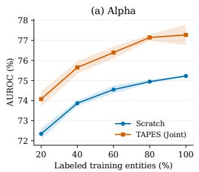

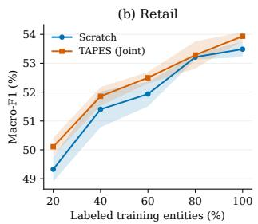

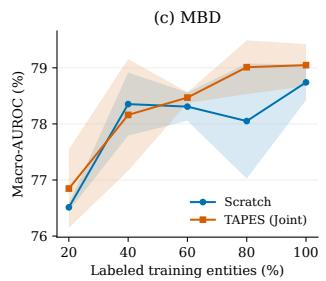

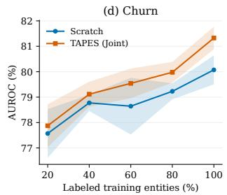  
Figure 3: Development performance at diferent labeled-data fractions for downstream fine-tuning on AlfaBattle, Retail X5, MBD-mini, and Rosbank Churn. Curves show means over fine-tuning seeds; shaded regions indicate ± one sample standard deviation.

Table 3: Validation results on TransRisk after 25k fine-tuning updates. Bold indicates the best value.
<table><tr><td>Method</td><td>AUROC (%)</td><td>Passed-CB AP (%)</td><td>Relative AddCB change (%)</td></tr><tr><td>Scratch</td><td>90.88</td><td>5.80</td><td>0.00</td></tr><tr><td>CoLES</td><td>89.66</td><td>4.35</td><td>-0.93</td></tr><tr><td>TabBERT</td><td>90.83</td><td>4.95</td><td>-0.93</td></tr><tr><td>MLEM</td><td>90.13</td><td>5.47</td><td>+0.28</td></tr><tr><td>TAPES (Ours)</td><td>92.04</td><td>4.48</td><td>+0.30</td></tr></table>

TAPES at 15k updates and the business baseline at 10k; TAPES increases AddCB recall by 2.14% relative to this selected baseline. These results show gains in both ranking quality and risk retrieval at the corresponding evaluation settings.

Frozen industrial representations improve top-ranked risk retrieval. To examine the utility of history representations for industrial risk prediction, we freeze the sequence encoder on Tran-sRisk and fit afine probes with diferent fractions of training users. Figure 5 reports the resulting top-ranked risk retrieval. TAPES obtains Recall@top1% of 9.51%, 10.89%, and 11.09% using 1%, 10%, and 100% of training users for probe-gradient updates, compared with 3.08%, 4.74%, and 4.74% for the business baseline.

Industrial metrics describe diferent aspects of ranking and risk retrieval. Table 3 summarizes AUROC, Passed-CB AP, and relative AddCB change from the industrial evaluations. The TAPES AUROC entry of 92.04% comes from native recovery; the Scratch entry of 90.88% comes from business adaptation. The cor- responding within-setting AUROC comparisons are illustrated in Figure 4(a,b). For Passed-CB AP, the table records 5.80% for Scratch, 5.47% for MLEM, and 4.48% for TAPES, describing precision–recall performance on the Passed-CB subset. The AddCB column reports recall changes at a 0.5% intervention budget using the reference models associated with the respective evaluation records. Together, these measures cover population-level ranking, subset precision– recall behavior, and risk capture at a specified budget.

Table 4: Component ablation under full fine-tuning. �: target-set selection; �: joint likelihood. All metrics within each configuration–dataset pair come from the same checkpoint. Parenthesized values indicate changes in percentage points relative to w/o Pretraining. Green and red indicate increases and decreases, respectively. AP denotes average precision; Retail AUROC is macro one-vs-rest AUROC. Bold marks the best scores at the reported precision.
<table><tr><td rowspan="2">Ablation Variant</td><td rowspan="2">SJ</td><td rowspan="2"></td><td colspan="2">AlfaBattle</td><td colspan="3">Retail X5</td></tr><tr><td>AUROC↑</td><td></td><td>AP↑ Macro-F1↑</td><td>Acc.↑</td><td>AUROC↑</td></tr><tr><td>w/o Pretraining</td><td> $\_$ </td><td></td><td>75.25</td><td>10.80</td><td>53.18</td><td>54.17</td><td>79.66</td></tr><tr><td>w/o Both</td><td></td><td></td><td> $\times \mathrm { ~  ~ { ~ \times ~ } ~ } 7 6 . 9 8 ( \cdot 1 . 7 3 )$ </td><td> $1 2 . 0 1 \ : ( + 1 . 2 1 )$ </td><td> $5 3 . 3 2 ( + 0 . 1 4 )$ </td><td> $5 4 . 1 5 \ : ( - 0 . 0 2 )$ </td><td> $7 9 . 7 8 \ : ( + 0 . 1 2 )$ </td></tr><tr><td>w/o Selection</td><td></td><td></td><td> $\times \mathrm { ~  ~ { ~ \surd ~ } ~ } 7 7 . 0 9 \left( + 1 . 8 4 \right)$ </td><td> $1 2 . 1 8 ( + 1 . 3 8 )$ </td><td> $5 3 . 4 0 \ : ( + 0 . 2 2 )$ </td><td> $5 4 . 2 5 \ : ( + 0 . 0 8 )$ </td><td> $7 9 . 8 2 \ : ( + 0 . 1 6 )$ </td></tr><tr><td>w/o Joint Prediction</td><td></td><td></td><td> $\begin{array} { r l } { \surd } & { { } \times \quad 7 7 . 1 2 ( + 1 . 8 7 ) } \end{array}$ </td><td> $1 2 . 3 5 \ : ( + 1 . 5 5 )$ </td><td> $5 3 . 7 9 \left( + 0 . 6 1 \right)$ </td><td> $5 4 . 4 7 \ : ( + 0 . 3 0 )$ </td><td> $7 9 . 9 0 \ \scriptstyle ( + 0 . 2 4 )$ </td></tr><tr><td>TAPES (Ours)</td><td></td><td></td><td> $\begin{array} { r l r } { \surd } & { { } \ V } & { 7 7 . 3 8 ( + 2 . 1 3 ) } \end{array}$ </td><td> $1 2 . 5 2 \ : ( + 1 . 7 2 )$ </td><td> ${ \pmb 5 4 . \pmb 0 8 ( + 0 . 9 0 ) }$ </td><td> ${ \pmb 5 4 . 6 0 } _ { ( + 0 . 4 3 ) }$ </td><td> $7 9 . 9 0 \ \scriptstyle ( + 0 . 2 4 )$ </td></tr></table>

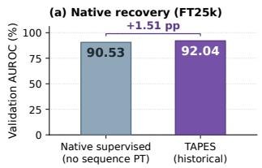

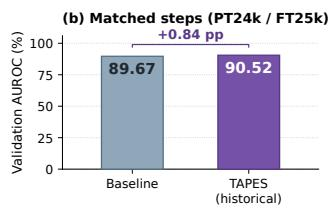

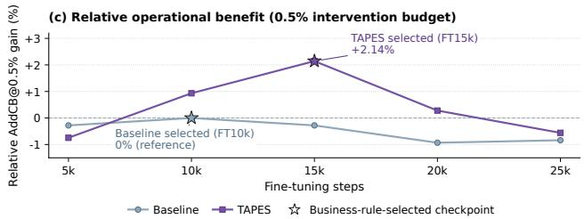  
Figure 4: Industrial fine-tuning evaluations on TransRisk. (a) AUROC of TAPES and the supervised control without history pretraining after 25k fine-tuning updates. (b) Comparison with baseline using 24k pretraining updates and 25k fine tuning updates. (c) Relative AddCB recall change at a 0.5% intervention budget, with the business baseline selected at 10k updates as reference. Stars identify checkpoints selected by the validation business criterion.

## 5.3 Ablation Studies

To assess the individual contributions of target-set selection and joint prediction, we conduct ablation studies on AlfaBattle and Retail X5 under three configurations: (1) removing target-set selection and applying Joint prediction to a fixed set; (2) replacing Joint with Marginal prediction on the Joint-selected set; and (3) removing both components, using a fixed set with Marginal prediction. Together with TAPES, these variants yield four pretrained configu- rations, with training from scratch as an additional reference. The pretrained configurations share the mixture-head parameterization; Table 4 reports the results.

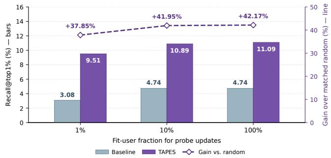  
Figure 5: Frozen-representation evaluation on TransRisk. Bars show Recall@top1% for TAPES and the business baseline (left axis). The dashed curve shows TAPES’s relative recall gain over an architecture-matched random encoder (right axis).

The complete configuration has the highest primary scores in both reported ablations. Relative to no pretraining, TAPES improves AUROC by 2.13 percentage points on AlfaBattle and Macro-F1 by 0.90 points on Retail X5. All pretrained variants exceed the corresponding no-pretraining score on these primary metrics.

Target selection and joint prediction each provide additional primary-metric gains. With Joint prediction, replacing the fixed target set with the selected set increases AlfaBattle AU- ROC and Retail X5 Macro-F1 by 0.29 and 0.68 percentage points, respectively. On the selected set, Joint improves over Marginal by 0.26 and 0.29 points. The selected-Marginal control uses the target set chosen under Joint. Retail X5 AUROC is tied at 79.90 at the displayed precision.

## 6 Conclusion

We presented TAPES, a task-aligned joint predictive pretraining approach for transaction event sequences. TAPES constructs predictive targets through field–operator pairings, selects target sets according to downstream representation utility, and learns history representations through a joint likelihood with a shared discrete latent variable. Experiments on five public benchmarks demonstrate competitive performance across prediction tasks and encoder architectures, while component analyses examine the roles of target-set selection and joint prediction. These findings highlight the semantics and organization of predictive supervision as important design choices for transaction representation learning. Future work will explore more eficient candidate-set evaluation and further char- acterize when target dependencies benefit downstream learning across tasks and data conditions.

## References

[1] Jimmy Lei Ba, Jamie Ryan Kiros, and Geofrey E. Hinton. 2016. Layer Normaliza tion. arXiv:1607.06450 [stat.ML] doi:10.48550/arXiv.1607.06450

[2] Dmitrii Babaev, Nikita Ovsov, Ivan Kireev, Maria Ivanova, Gleb Gusev, Ivan Nazarov, and Alexander Tuzhilin. 2022. CoLES: Contrastive Learnin for Event Sequences with Self-Supervision. In Proceedings ofthe 2022 International Conference on Management ofData (SIGMOD ’22). Association for Computing Machin er , 1190–1199. doi:10.1145/3514221.3526129

[3] Alexandra Bazarova, Maria Kovaleva, Ilya Kuleshov, Evgenia Romanenkova, Alexander Stepikin, Aleksandr Yugay, Dzhambulat Mollaev, Ivan Kireev, Andrey Savchenko, and Alexey Zaytsev. 2025. Learning transactions representations for information mana ement in banks: Masterin local, lobal, and external knowledge. International Journal ofInformation Management Data Insights 5, 1 (2025), 100323. doi:10.1016/j.jjimei.2025.100323

[4] Rich Caruana. 1997. Multitask Learning. Machine Learning 28, 1 (1997), 41–75. d i:10 1023/A:1007379606734

[5] Sullivan Castro, Artem Betlei, Thomas Di Martino, and Nadir El Manouzi. 2026. Abacus: Self-Supervised Event Counting-Aligned Distributional Pretraining for Sequential User Modeling. In Proceedings ofthe Nineteenth ACM International Conference on Web Search and Data Mining. doi:10.1145/3773966.3779391

[6] Tianqi Chen and Carlos Guestrin. 2016. XGBoost: A Scalable Tree Boosting System. In Proceedings ofthe 22nd ACM SIGKDD International Conference on Knowledge Discovery and Data Mining (San Francisco, California, USA) (KDD ’16). Association for Computing Machinery, New York, NY, USA, 785–794. doi:10. 1145/2939672.2939785

[7] Kyunghyun Cho, Bart van Merriënboer, Caglar Gulcehre, Dzmitry Bahdanau, Fethi Bougares, Holger Schwenk, and Yoshua Bengio. 2014. Learning Phrase Representations using RNN Encoder–Decoder for Statistical Machine Translation. In Proceedings of the 2014 Conference on Empirical Methods in Natural Language Processing. Association for Computational Linguistics, 1724–1734. doi:10.3115/ v1/D14-1179

[8] Krzysztof Dembczyński, Weiwei Cheng, and Eyke Hüllermeier. 2010. Bayes Optimal Multilabel Classification via Probabilistic Classifier Chains. In Proceedings of the 27th International Conference on Machine Learning. https: //icml.cc/Conferences/2010/papers/589.pdf

[9] Lucio M. Dery, Paul Michel, Mikhail Khodak, Graham Neubig, and Ameet Talwalkar. 2023. AANG: Automating Auxiliary Learning. In The Eleventh International Conference on Learning Representations. https://openreview.net/forum? id=vtVDI3w BLL

[10] Yingtong Dou, Zhimeng Jiang, Tianyi Zhang, Mingzhi Hu, Zhichao Xu, Huiyuan Chen, Shubham Jain, Uday Singh Saini, Xiran Fan, Jiarui Sun, Menghai Pan, Junpeng Wang, Chin-Chia Michael Yeh, Xin Dai, and Yuzhong Chen. 2026. TransactionGPT: Toward Foundational Transaction Modeling. In Proceedings ofthe 32nd ACM SIGKDD Conference on Knowledge Discovery and Data Mining V.2. Association for Com utin Machiner , 7185–7196. doi:10.1145/3770855.3818496

[11] Chris Fifty, Ehsan Amid, Zhe Zhao, Tianhe Yu, Rohan Anil, and Chelsea Finn. 2021. Eficiently Identifying Task Groupings for Multi-Task Learning. In Advances in Neural Information Processing Systems, Vol. 34. Curran Asso ciates, Inc., 27503–27516. https://proceedings.neurips.cc/paper/2021/hash/ e77910ebb93b511588557806310f78f1-Abstract.htm

[12] Jerome H. Friedman. 2001. Greedy Function Approximation: A Gradient Boosting Machine. The Annals of Statistics 29, 5 (2001), 1189–1232. doi:10.1214/aos/ 1013203451

[13] Han Guo, Ramakanth Pasunuru, and Mohit Bansal. 2019. AutoSeM: Automatic Task Selection and Mixing in Multi-Task Learning. In Proceedings of the 2019 Conference ofthe North American Chapter ofthe Association for Computational Linguistics: Human Language Technologies, Volume 1 (Long and Short Papers). Association for Computational Linguistics, 3520–3531. doi:10.18653/v1/N19-1355

[14] Dan Hendrycks and Kevin Gimpel. 2016. Gaussian Error Linear Units (GELUs). arXiv:1606.08415 [cs.LG] doi:10.48550/arXiv.1606.08415

[15] Sepp Hochreiter and Jürgen Schmidhuber. 1997. Long Short-Term Memory. Neural Computation 9, 8 (1997), 1735–1780. doi:10.1162/neco.1997.9.8.1735

[16] Ivan Karpukhin, Maksim Polesskii, and Andrey Savchenko. 2026. HT-Transformer: Event Sequences Classification by Accumulating Prefix Information with History Tokens. In Proceedings ofthe Thirty-Fifth International Joint Conference on Artificial Intelligence, IJCAI-26, Diego Calvanese (Ed.). International Joint Conferences on Artificial Intelligence Organization, 6462–6470. AI4Tech: AI Enabling Technologies. doi:10.24963/ijcai.2026/719

[17] Ivan Karpukhin and Andrey Savchenko. 2026. When Losses Align: Gradient-Based Composite Loss Weighting for Eficient Pretraining. arXiv:2605.07756 [cs.LG] doi:10.48550/arXiv.2605.07756

[18] Cheng Li, Bingyu Wang, Virgil Pavlu, and Javed Aslam. 2016. Conditional Bernoulli Mixtures for Multi-label Classification. In Proceedings ofthe 33rd International Conference on Machine Learning (Proceedings of Machine Learning Research, Vol. 48). PMLR, 2482–2491. https://proceedings.mlr.press/v48/lij16.html

[19] Guilin Li, Yun Zhang, Xiuyuan Chen, Chengqi Li, Bo Wang, Linghe Kong, Wenjia Wang, Weiran Huang, and Matthias Tan. 2025. PANTHER: Generative Pretraining Beyond Language for Sequential User Behavior Modeling. In Advances in Neural Information Processing Systems, Vol. 38. doi:10.52202/085713-5462

[20] Dzhambulat Mollaev, Ivan Kireev, Mikhail Orlov, Alexander Kostin, Ivan Karpukhin, Maria Postnova, Gleb Gusev, and Andrey Savchenko. 2025. Multi modal Banking Dataset: Understanding Client Needs through Event Sequences. In Proceedings ofthe 34th ACMInternational Conference on Information and Knowledge Management (CIKM ’25). Association for Computing Machinery, 6476–6480. doi:10.1145/3746252.3761635

[21] Viktor Moskvoretskii, Dmitry Osin, Egor Shvetsov, Igor Udovichenko, Maxim Zhelnin, Andrey Dukhovny, Anna Zhimerikina, and Evgeny Burnaev. 2024. MLEM: Generative and Contrastive Learning as Distinct Modalities for Event Sequences. arXiv:2401.15935 [cs.LG] doi:10.48550/arXiv.2401.15935

[22] Aviv Navon, Idan Achituve, Ha ai Maron, Gal Chechik, and Ethan Feta a. 2021. Auxiliary Learning by Implicit Diferentiation. In International Conference on Learning Representations. htt s://o enreview.net/forum?id=n7wIfYPdVet

[23] Dmitry Osin, Igor Udovichenko, Egor Shvetsov, Viktor Moskvoretskii, and Evgeny Burnaev. 2025. EBES: Easy Benchmarking for Event Sequences. In Proceedings of the 31st ACM SIGKDD Conference on Knowledge Discovery and Data Mining V.2. Association for Computing Machinery, 5730–5741. doi:10.1145/ 3711896.3737428

[24] Inkit Padhi, Yair Schif, Igor Melnyk, Mattia Rigotti, Youssef Mroueh, Pierre Dognin, Jerret Ross, Ravi Nair, and Erik Altman. 2021. Tabular Transformers for Modeling Multivariate Time Series. In ICASSP 2021 – 2021 IEEE International Conference on Acoustics, Speech and Signal Processing (ICASSP). IEEE, 3565–3569. doi:10.1109/ICASSP39728.2021.9414142

[25] Liudmila Prokhorenkova, Gleb Gusev, Aleksandr Vorobev, Anna Veronika Doro-gush, and Andrey Gulin. 2018. CatBoost: unbiased boosting with categorical features. In Advances in Neural Information Processing Systems, S. Bengio, H. Wallach, H. Larochelle, K. Grauman, N. Cesa-Bianchi, and R. Garnett (Eds.), Vol. 31. Curran Associates, Inc. https://proceedings.neurips.cc/paper\_files/paper/2018/ file/14491b756b3a51daac41c24863285549-Paper.pdf

[26] Nikita Rusakov, Vladislav Meshkov, Konstantin Zorin, Gleb Zaripov, Alexander Uglov, Alexey Vasilev, and Anton Klenitskiy. 2026. A Foundation Model for Multimodal Event Sequences in Financial Applications. In Proceedings ofthe 32nd ACM SIGKDD Conference on Knowledge Discovery and Data Mining V.2. Association for Computing Machinery, 7890–7898. doi:10.1145/3770855.3818311

[27] Noam Shazeer. 2020. GLU Variants Improve Transformer. arXiv:2002.05202 [cs.LG] doi:10.48550/arXiv.2002.05202

[28] Piotr Skalski, David Sutton, Stuart Burrell, Iker Perez, and Jason Wong. 2023. Towards a Foundation Purchasing Model: Pretrained Generative Autoregression on Transaction Sequences. In 4th ACM International Conference on AI in Finance. Association for Computing Machinery, 141–149. doi:10.1145/3604237.3626850

[29] Trevor Standley, Amir Zamir, Dawn Chen, Leonidas Guibas, Jitendra Malik, and Silvio Savarese. 2020. Which Tasks Should Be Learned Together in Multitask Learning?. In Proceedings ofthe 37th International Conference on Machine Learning (Proceedings ofMachine Learning Research, Vol. 119). PMLR, 9120–9132. https://proceedings.mlr.press/v119/standley20a.html

[30] Jianlin Su, Murtadha Ahmed, Yu Lu, Shengfeng Pan, Wen Bo, and Yunfeng Liu. 2024. RoFormer: Enhanced Transformer with Rotar Position Embeddin . Neurocomputing 568 (2024), 127063. doi:10.1016/j.neucom.2023.127063

[31] Ashish Vaswani, Noam Shazeer, Niki Parmar, Jakob Uszkoreit, Llion Jones, Aidan N. Gomez, Łukasz Kaiser, and Illia Polosukhin. 2017. Attention Is All You Need. In Advances in Neural Information Processing Systems, Vol. 30. Curran Associates, Inc. https://proceedings.neurips.cc/paper\_files/paper/2017/file/ 3f5ee243547dee91fbd053c1c4a845aa-Paper.pdf

[32] Yuan Xue, Nan Du, Anne Mottram, Martin Seneviratne, and Andrew M. Dai. 2020. Learning to Select Best Forecast Tasks for Clinical Outcome Predic- tion. In Advances in Neural Information Processing Systems, Vol. 33. Curran Associates, Inc., 15031–15041. https://proceedings.neurips.cc/paper/2020/hash abc99d6b9938aa86d1f30f8ee0fd169f-Abstract.html

[33] Chin-Chia Michael Yeh, Uday Singh Saini, Xin Dai, Xiran Fan, Shubham Jain, Yujie Fan, Jiarui Sun, Junpeng Wang, Menghai Pan, Yingtong Dou, Yuzhong Chen, Vineeth Rakesh, Liang Wang, Yan Zheng, and Mahashweta Das. 2026.

TREASURE: A Transformer-Based Foundation Model for High-Volume Trans- action Understanding. In Proceedings ofthe 32nd ACM SIGKDD Conference on Knowledge Discovery and Data Mining V.1. Association for Computing Machinery, 2518–2527. doi:10.1145/3770854.3783942

[34] Biao Zhang and Rico Sennrich. 2019. Root Mean Square Layer Normaliza tion. In Advances in Neural Information Processing Systems, Vol. 32. Curran Associates, Inc. https://proceedings.neurips.cc/paper\_files/paper/2019/hash/ 1e8a19426224ca89e83cef47f1e7f53b-Abstract.html

## A Additional Experimental Details

## A.1 Datasets

The datasets span binary, multiclass, and multilabel prediction tasks. We describe each benchmark and the industrial dataset below, in- cluding its predictive target, evaluation measures, and data characteristics.

AlfaBattle. AlfaBattle 6 contains transaction histories for creditdefault prediction. The downstream label is binary. We report AU ROC as the primary metric and AP as a supplementary metric.

Retail X5. Retail X57 uses purchase histories for four-class age prediction. We report Macro-F1 as the primary metric, together with accuracy and macro one-vs-rest AUROC.

MBD-mini. MBD-mini8 provides banking event histories for next-month purchase prediction over four banking products. The task is multilabel classification. Macro-AUROC and macro-AP aver- age the respective binary metric over the four labels.

Rosbank Churn. Rosbank Churn9 uses transaction histories to predict customer churn. The downstream task is binary classifica- tion, evaluated using AUROC and AP.

Taobao. Taobao10 contains e-commerce behavior histories. The processed task predicts purchases over the following seven days, with AUROC as the primary metric and AP reported additionally.

TransRisk. TransRisk is a large-scale private industrial dataset from a real-world transaction risk assessment task. The training and validation partitions used in our experiments contain 24,698,621 and 4,825,198 transaction-level prediction examples, respectively, totaling over 29 million examples. Each example associates a current transaction with its corresponding user history. Historical events contain 11 categorical attributes, transaction amounts, and temporal information, with a history length limit of 300 events. The full business-adaptation model additionally uses a 652-dimensional feature vector describing the current transaction. The downstream task is binary transaction-risk prediction. We evaluate ranking quality and risk retrieval under constrained intervention budgets. Table 5 summarizes its experimental data.

## A.2 Baseline Implementations

The baseline implementations cover history aggregation, supervised sequence learning, and event-level pretraining. We describe their inputs, learning objectives, and evaluated components below.

Table 5: TransRisk data used in the experiments.
<table><tr><td>Item</td><td>Value</td></tr><tr><td>Training examples</td><td>24,698,621</td></tr><tr><td>Validation examples</td><td>4,825,198</td></tr><tr><td>Total examples</td><td>29,523,819</td></tr><tr><td>Categorical attributes per historical event</td><td>11</td></tr><tr><td>Maximum historical events</td><td>300</td></tr><tr><td>Current-transaction feature dimension</td><td>652</td></tr></table>

Tree ensembles on aggregated features. CatBoost [25] and XG-Boost [6] take statistical features aggregated from each event history as input. These history-level feature vectors summarize behavioral information for supervised prediction. Both methods are fitted using downstream training labels and evaluated on the cor- responding task. The main table uses the method names CatBoost and XGBoost for these aggregated-feature implementations.

Supervised sequence encoders. GRU [7], LSTM [15], and causal Transformer [31] baselines encode ordered event histories using recurrent updates or causal attention. The last valid event state provides the sequence representation for a task-specific prediction head. The encoder and head are trained together using downstream labels. The encoder study uses these supervised models as Scratch references for their corresponding TAPES configurations. Encoder dimensions, RoPE components, and training schedules are specified in Appendix A.3.

Self-supervised sequence pretraining. We evaluate project-adapted versions of CoLES, TabBERT, MLEM, and PANTHER-SPRM. Their learning signals cover contrastive, reconstructive, and combined representation learning.

CoLES. CoLES [2] constructs diferent subsequence views from an entity’s history and learns their representations through con trastive supervision. The objective encourages consistency across partial observations of the same entity.

TabBERT. TabBERT [24] learns by reconstructing masked field values from the available observations. This supplies attribute-level supervision for representations of heterogeneous event histories.

MLEM. MLEM [21] combines generative modeling and contrastive learning through alignment of their representations. The adaptation uses both learning signals to obtain representations for downstream prediction.

PANTHER. PANTHER uses the public Sequence Pattern Recognition Module configuration of PANTHER [19]. The evaluated model consists of the sequential pretraining branch and its downstream adaptation.

## A.3 Encoder Configurations and Training

We use recurrent and attention-based encoders to examine how TAPES behaves across sequence-modeling architectures. The following settings describe their shared inputs, architecture choices, and training schedules. The backbone study evaluates GRU and unidirectional LSTM with hidden dimension 512 and two layers; a standard causal Transformer with hidden dimension 256 and four layers; and RoPE configurations with either 256 dimensions and four layers or 1,024 dimensions and eight layers. These backbones use the same event-field encoding scheme and read the last valid event state as the sequence representation.

The standard Transformer uses learned absolute positional em- beddings, LayerNorm [1], and GELU feed-forward layers [14]. The RoPE configuration uses rotary positional embeddings [30], RM-SNorm [34], query–key normalization, and SwiGLU feed-forward layers [27].

The base TAPES recipe uses four targets per candidate set, two mixture components, and rank-16 prediction heads. Stage 1 eval uates up to eight candidates, with 512 predictive updates and 128 probe updates per candidate. The base Stage 2 budget is five com- plete passes over the predictive-pretraining partition. Public downstream adaptation uses at most ten epochs with early stopping.

In Table 2, standard-Transformer TAPES uses ten Stage 2 epochs on AlfaBattle and Retail X5 and sixty on Rosbank Churn. The re- maining TAPES configurations use five epochs. The table reports configurations selected from completed seeds and training sched- ules.

## A.4 Public Evaluation Settings

The evaluation separates supervision selection, representation learning, and downstream prediction so that each stage uses the data assigned to its learning objective. Predictive pretraining, probe fitting, and target selection use disjoint subsets of the downstream training pool. Final supervised adaptation uses the full training pool. Checkpoint selection uses the early-stopping partition, and scores are computed on a separate development evaluation partition. Each main-table and component-table configuration is evaluated through one training run and its selected checkpoint.

The label-budget study uses 20%, 40%, 60%, 80%, and 100% of the fine-tuning labels. Pretrained checkpoints and Stage I selection are fixed within each benchmark. Curves report the mean and sample standard deviation across these seeds.

Avg. Rank in Table 1 is computed from the five designated primary metrics, using average ranks for ties. Absolute score diferences are expressed in percentage points. Relative changes in Table 2 are computed as $1 0 0 ( s _ { \mathrm { T A P E S } } / s _ { \mathrm { s u p e r v i s e d } } - 1 )$

## B Algorithm

Algorithm 1 and Algorithm 2 summarize the TAPES pipeline and its shared joint pretraining routine. Stage 1 selects a target set according to downstream utility, while Stage 2 retains the selected target definitions and frozen transformations and retrains the en- coder from the common initialization. Both stages optimize the same joint likelihood, with exact marginalization over shared latent components and support for partially observed targets.

## C Downstream Adaptation and Evaluation

## C.1 Transfer Interface and Prediction Readout

For standard sequence classification, the event input module and encoder are initialized from the final Stage 2 checkpoint. The new task head is an afine layer, $z _ { i } = W _ { \psi } h _ { i , T _ { i } } + b _ { \psi }$ , where $h _ { i , T _ { i } }$ is the last valid event state. Padding positions are excluded from readout. We apply sigmoid outputs for binary and multi-label prediction and softmax outputs for multi-class prediction. The Stage 1 probe and its representation-standardization statistics are not reused, while the input module retains its original preprocessing.

Algorithm 1 TAPES: Task-Aligned Joint Predictive Pretraining   
Input: Training set D; fields F; operators $O ;$ candidate rule R; common   
initialization $\theta _ { 0 } ;$ components �; budgets $B _ { A } , B _ { B } , B _ { p } ;$ task metric �   
Output: Selected target set $S ^ { * }$ and downstream predictor $g _ { \psi ^ { * } } \circ f _ { \theta ^ { * } }$   
1: Split D into disjoint $\mathcal { D } _ { \mathrm { s s l } } , \mathcal { D } _ { \mathrm { p r o b e } } , \mathcal { D } _ { \mathrm { s e l } }$   
2: Construct admissible field–operator targets ${ \mathcal { A } } \subseteq { \mathcal { F } } \times O$   
3: � ← FitTransforms $\mathcal { R } , \mathcal { D } _ { \mathrm { s s l } } )$   
4: Freeze � and fix the ordered candidate bank   
$C = ( S _ { 1 } , \dots , S _ { M } ) $ BuildBank(A, R)   
5: Stage 1: Task-aligned target-set selection   
6: for $j = 1 , \ldots , M$ do   
7: $\theta _ { j } \gets .$ JointPretrain $( S _ { j } , \theta _ { 0 } , B _ { A } )$   
8: Freeze the event input module and encoder $f _ { \theta _ { j } }$   
9: $\phi _ { j } \gets \mathrm { F I T P R O B E } ( f _ { \theta _ { j } } , \mathcal { D } _ { \mathrm { p r o b e } } , B _ { p } )$   
10: $\widehat { U } _ { j } \gets Q ( g _ { \phi _ { j } } \circ f _ { \theta _ { j } } ; \mathcal { D } _ { \mathrm { s e l } } )$   
11: end for   
12: $j ^ { \ast } \gets \operatorname* { m i n } \arg \operatorname* { m a x } _ { 1 \leq j \leq M } \widehat { U } _ { j } ; S ^ { \ast } \gets S _ { j ^ { \ast } }$   
13: Stage 2: Shared-latent joint pretraining   
14: $\theta ^ { \mathrm { I I } } $ JointPretrain $( S ^ { * } , \theta _ { 0 } , B _ { B } )$   
15: Downstream adaptation   
16: Initialize a new task head $g _ { \psi }$ and optimizer   
17: $( \theta ^ { * } , \psi ^ { * } ) \gets \mathrm { F I N E T U N E } ( \theta ^ { \mathrm { I I } } , \dot { \psi } , \mathcal { D } )$   
18: return $S ^ { * }$ and $g _ { \psi ^ { * } } \circ f _ { \theta ^ { * } }$

For tasks with an established prediction architecture, we transfer the corresponding pretrained modules while retaining the task- specific readout and fusion interfaces.

## C.2 Supervised Adaptation Objective

Standard adaptation jointly updates the transferred modules and the new task head:

$$
\mathcal { L } _ { \mathrm { t a s k } } ( \theta , \psi ) = \frac { 1 } { | \mathcal { D } _ { \mathrm { f i t } } | } \sum _ { i \in \mathcal { D } _ { \mathrm { f i t } } } \ell _ { \mathrm { s u p } } ( z _ { i } , Y _ { i } ) .\tag{7}
$$

The encoder starts from the Stage 2 parameters, whereas the task head and optimizer are newly initialized. Binary classification uses binary cross-entropy. For fully observed multi-label targets, binary cross-entropy is averaged over labels and then over examples. Multi- class classification uses cross-entropy. The joint event-prediction loss is no longer optimized. Tasks with established prediction architectures use their corresponding supervised losses.

## C.3 Training Configuration and Evaluation Rules

Under the standard protocol, the full training set is the union of the internal event-pretraining, probe-fitting, and target-selection subsets. Once the target set is fixed, all these members and their downstream labels participate in supervised fine-tuning. Stage 2 event pretraining remains restricted to its original event-pretraining subset. Neither the early-stopping validation set nor the develop ment evaluation set is included in fine-tuning.

Table 7 summarizes the reference configuration for standard sequence classification. The reference encoder learning rates are $3 \times 1 0 ^ { - 4 }$ for $\mathrm { { G R U / L S T M } } , 1 0 ^ { - 4 }$ for the standard causal Transformer and compact Velocity, and $5 \times 1 0 ^ { - 5 }$ for large Velocity. Learning rates remain constant during fine-tuning. Training members are reshufled and traversed without replacement in each epoch.

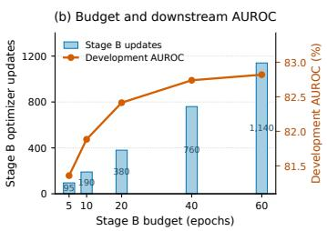

Table 6: Dataset summary. Public sequence and event counts refer to the full downstream training sets after eligibility filtering and history truncation. Event counts exclude padding; validation and test partitions are not included in these counts.
<table><tr><td>Dataset</td><td>Task</td><td># Train sequences</td><td># Train events</td><td>Primary metric</td></tr><tr><td>Alpha</td><td>Credit default</td><td>674,667</td><td>106,567,621</td><td>AUROC</td></tr><tr><td>Retail X5</td><td>Age classification</td><td>222,822</td><td>25,324,802</td><td>Macro-F1</td></tr><tr><td>MBD-mini</td><td>Product purchase, four labels</td><td>499,930</td><td>10,917,772</td><td>Macro-AUROC</td></tr><tr><td>Rosbank Churn</td><td>Churn prediction</td><td>3,475</td><td>333,261</td><td>AUROC</td></tr><tr><td>Taobao</td><td>Future purchase</td><td>12,837</td><td>3,220,892</td><td>AUROC</td></tr></table>

Algorithm 2 Shared-Latent Joint Predictive Pretraining   
Input: Shared pretraining split $\mathcal { D } _ { \mathrm { s s l } } ,$ frozen target transformations �, and   
component count �   
Output: Pretrained event input module and encoder parameters �   
1: function JointPretrain(�, $, \theta _ { 0 } , B )$   
2: $\theta \gets \theta _ { 0 } ;$ initialize a fresh joint prediction head $\omega$   
3: Reset the optimizer and common pretraining sample stream   
4: for $b = 1 , \ldots , B$ do   
5: Draw an efective update batch ${ \mathcal { B } } _ { b }$ from $\mathcal { D } _ { \mathrm { s s l } }$   
6: for all $n \in { \mathcal { B } } _ { b }$ do   
7: $( \mathbf { y } _ { n } , \mathbf { m } _ { n } ) \gets \Phi _ { S } ( H _ { n } , e _ { n } ^ { + } ; \eta _ { S } )$   
8: $h _ { n }  f _ { \theta } ( H _ { n } ) ; O _ { n }  \{ a \in S : m _ { n , a } = 1 \}$   
9: $s _ { n , k } \gets \log \pi _ { k } ( h _ { n } )$   
$+ \sum _ { a \in \mathcal { O } _ { \bf n } }$ log ��,� (��,� | ℎ� ), $k = 1 , \ldots , K$   
10: $\ell _ { n } \gets - \log \mathrm { s u m e x p } _ { k = 1 } ^ { K } s _ { n , k }$   
11: end for   
12: $\mathcal { V } _ { b }  \{ n \in \mathcal { B } _ { b } : O _ { n } \neq \emptyset \} ;$ assert $| \mathcal { V } _ { b } | > 0$   
13: $\mathcal { L } _ { J }  \frac { 1 } { \vert S \vert \vert \mathcal { V } _ { b } \vert } \sum _ { n \in \mathcal { V } _ { b } } \ell _ { n }$   
14: $( \theta , \omega ) \gets $ OptimizerStep $\theta , \omega , \nabla _ { \theta , \omega } \mathcal { L } _ { J } )$   
15: end for   
16: return �   
17: end function

(a) Pretraining loss (b) Budget and downstream AUROC   
1.2   
Training NLL per target 1.1 Stage B optimizer updates 1200 Stage B updates Development AUROC 83.0 Development AUROC (%)   
1.0 800 82.5   
0.9 1,140   
82.0   
400 760   
0.8   
81.5   
0.7 95 19   
0   
0 15 30 45 60 5 10 20 40 60   
Stage B epoch Stage B budget (epochs)  
Figure 6: Efect of the Stage 2 pretraining budget on Rosbank Churn with the CT256×4 backbone. (a) Training negative loglikelihood per target over 60 epochs. (b) Stage 2 optimizer updates (bars, left axis) and development AUROC after finetuning (line, right axis) at 5, 10, 20, 40, and 60 epochs. The Stage 1-selected target set, fitted transformations, and finetuning protocol are fixed across budgets. Each score uses the fine-tuning checkpoint selected by early-stopping AUROC.

Table 7: Reference configuration for standard sequenceclassification adaptation.
<table><tr><td>Setting</td><td>Configuration</td></tr><tr><td>Optimizer</td><td>AdamW</td></tr><tr><td>Weight decay</td><td>0.01</td></tr><tr><td>Gradient-norm clipping</td><td>1.0</td></tr><tr><td>Effective batch size</td><td>At most 128; final batch retained</td></tr><tr><td>Task-head learning rate</td><td> $1 0 ^ { - 3 }$ </td></tr><tr><td>Maximum/minimum epochs</td><td> $1 0 / 3$ </td></tr><tr><td>Early-stopping patience</td><td>3 epochs</td></tr></table>

At the end of each epoch, we compute the prespecified primary task metric on a dedicated early-stopping validation set. The best checkpoint is updated only when the score exceeds the current best by more than 10−12; otherwise, the previous checkpoint is retained. After the minimum training duration, training stops following three consecutive epochs without improvement. The selected checkpoint is subsequently evaluated on a development set separate from the early-stopping set. Since this development set participates in configuration development, its results are not treated as independent final-test performance. Optimization and module-freezing settings for task-specific business prediction architectures are reported sep- arately.

## D More Experimental Results

Sensitivity to the pretraining budget. We examine the efect of Stage 2 training duration on Rosbank Churn using the CT256×4 backbone. We fix the Stage 1-selected target set, fitted transforma- tions, and fine-tuning protocol, and compare pretraining budgets of 5, 10, 20, 40, and 60 epochs. As shown in Figure 6, training NLL decreases rapidly during the early epochs and then declines more slowly. Increasing the budget from 5 to 60 epochs improves devel- opment AUROC from 81.36% to 82.82% (+1.46 percentage points). However, extending training from 40 to 60 epochs yields only 0.08 additional percentage points, despite a 50% increase in Stage 2 up- dates (760 to 1,140). These results indicate diminishing returns from additional pretraining on Rosbank Churn.