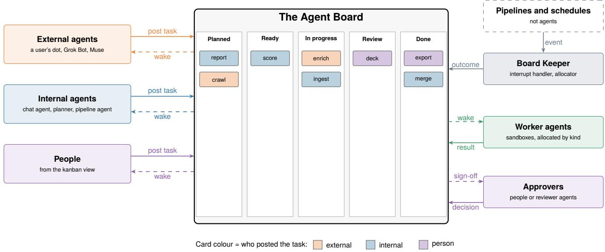
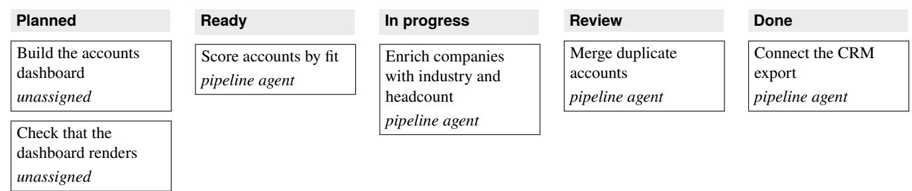
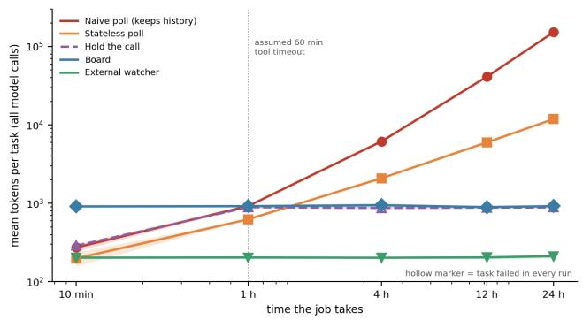
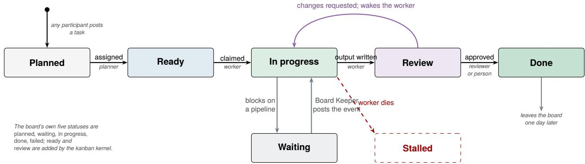
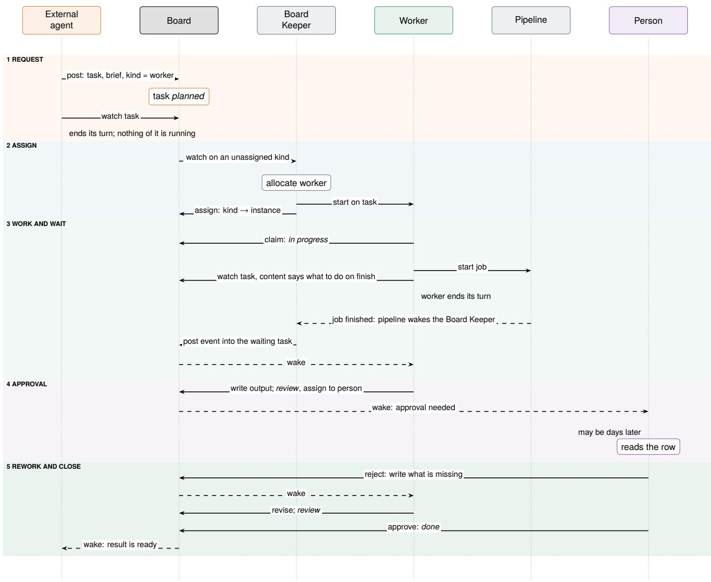
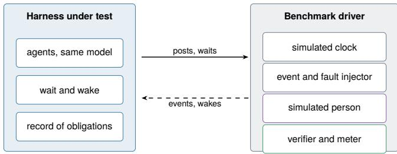

# The Agent Board: Kanban for Machines Durable Coordination for Agents That Outlive the Conversation

Tyler Hunt thunt@corvic.ai Corvic AI Research

Donald Nguyen ddn@corvic.ai Corvic AI Research

Gurbinder Gill gill@corvic.ai Corvic AI Research

## Abstract

Harnesses for large language models have converged on a single-threaded shape: one agent, one history, one machine, one sitting. That shape fails the work users actually bring— work that spans many agents, outlives any one model call, and waits on systems that are not agents at all. We describe the Agent Board, the coordination substrate in Corvic’s harness. The board is a durable, shared table of semi-semantic tasks: a small set of exact fields the system routes on, and a free-form body only language models read. Agents post tasks to it, watch tasks on it, and—crucially—block on it, ending their turn and holding no process until a matching post wakes them. A system agent, the Board Keeper, is the board’s interrupt handler: it carries events from the non-agentic parts of the harness onto the board, matches those events to waiting tasks by reading their prose, and allocates new agents for tasks that name a kind rather than an instance. On top of this the harness layers coordination policy kernels—loadable instructions that give the board’s statuses and roles meaning for a particular pattern of work, without the board enforcing any of it.

The shape is not new. It is the kanban board a human team puts on a wall, which works for the same reasons: it is durable, everyone can read it, and the work is visible when the people are not. 2026 brought a wave of persistent agent products—Meta’s Muse, OpenAI’s dots, SpaceXAI’s Grok Bot—that each gave an agent its own computer and let it outlive the conversation. A computer is not a coordination substrate, and we argue these products need a board exactly as much as we do, including one that agents outside their own vendor can post to.

We argue the Agent Board is best understood as an operatingsystem scheduler for agents, and we take the analogy seriously enough to say exactly where it holds and where it breaks. We give the properties the mechanism guarantees structurally, the much larger set it leaves to convention, a trace from a live board, and three small simulated pilots, one of which shows that a plain external watcher is cheaper than the board at waiting. We close by arguing that a durable, attributable, prose-carrying board—rather than a wire protocol—is the right rendezvous point for agents that must talk to each other across teams, vendors, and trust boundaries.

## 1 Introduction

There has been a gold rush of products that are—at their core—harnesses for large language models (LLMs). LLMs have generated a shine of novelty and surprise in the way they can take free-form natural language from users and (through harnesses) do the right thing. A harness is any system that uses a model as an integral part of its control logic. The market is full of LLM harnesses that have had some success in solving particular problems, e.g., generating software [2, 3, 27, 36].

The era of novelty is ending. Text-to-action has become table stakes, and users are straining against the limitations of existing harnesses. Typically, harnesses run in the scope of a single machine; a good rule of thumb is that the problems have to be able to fit on a laptop. This is a clif for users with large amounts of data; solutions seem to work well as prototypes but fail at scale.

There is a second clif, less often named, and it is the subject of this paper. Harnesses are built for work that finishes inside one sitting. An agent is started, it runs a loop, it answers, and the loop is over. The work that users actually bring does not have that shape. Loading a quarter of CRM history takes twenty minutes. A crawl of a customer’s documentation site takes an hour. A nightly pipeline finishes at 3am and something should happen next. A review step needs a person, and the person is asleep. None of these fit in a sitting, and a harness whose only way to wait is to keep an agent running— burning a model call per poll, or holding a socket open, or simply giving up—does not so much solve these problems as decline them.

Corvic is a harness designed to bring that text-to-action feeling to users with data problems. It has powerful tool catalogs and the knowledge required to bring them to bear. Corvic gets a lot of mileage out of its programmable pipeline system, but it’s not a perfect fit for every scenario. When the required work does not fit our pipeline paradigm, Corvic supports swarming the problem with many diferent agents.

Like other harnesses, Corvic reasons about agents, which are threads of control. Each agent runs its own “agentic loop”. An iteration of the loop sends the current history to the LLM, asking it to pick the next set of operations. An operation is commonly described as a tool call. The harness takes the reply and finishes the iteration by completing the tool calls and appending the results to the history for the LLM to see in the next iteration. Agents can be diferent from each other in three ways: 1) they have diferent tool catalogs, 2) they have diferent instructions (sometimes called system prompts), and 3) they can use a diferent LLM.

A key challenge that Corvic had to solve is agent coordination. Some operations need to use many agents to scale; other operations only make sense if the agent has access to a particular tool catalog; still other operations require coordinating with long-running pipelines. Corvic addresses all of these concerns through the Agent Board. The Agent Board is a combined message board and event delivery service. Agents post tasks to the Agent Board that other agents may read, and agents may watch tasks on the board and be notified when tasks are updated. The board interface itself isn’t very prescriptive about the particular protocols that agents use, but coordinating agents adopt particular policy kernels (§6) that are maintained by the system and used by agents as appropriate. The Agent Board also serves as a notification service about system events. Agents can subscribe to updates about a pipeline by posting a task with the pipeline’s identifier. The system will then message the agent directly when the pipeline finishes.

The part of the system that sends that message is the Board Keeper, an agent that tends the board on Corvic’s behalf. The Board Keeper reads the board the way any agent does, and it is how the parts of Corvic that are not agents, like pipelines, take part in coordination. When something finishes, the Board Keeper works out which tasks were waiting on it and posts the news to them. When a task calls for a new agent, the Board Keeper creates one and assigns it the task (§3).

## 1.1 The central claim

The thing worth taking from this paper is not the table schema. It is a claim about what an agent harness needs in order to leave the single sitting:

An agent must be able to waitfor an arbitrarily long time at a cost that does not grow with the wait, and must be able to resume from a small, deliberately written note rather than from its own history.

Everything else in the design follows from that sentence. Waiting at a cost that does not grow means blocking has to be a first-class primitive rather than a loop: the agent ends its turn, and nothing of it remains resident. Being woken means some other party must be able to reach it, so the wait has to be registered somewhere durable and shared—a board rather than a stack frame. Resuming from a small note means the board’s rows must carry prose written for the resumption, because the agent’s own history is long, expensive to re-read, and was written for a diferent purpose. And because the thing being waited on is frequently not an agent—a pipeline, a quota, a person—something has to represent the rest of the system on the board, which is the Board Keeper.

The design is unusual in one further respect, which we call semi-semantic. A coordination substrate normally picks a side: either it is a protocol, with typed messages and exact matching, or it is a chat room, with free text and no routing. The board is both at once, in a specific division of labour. The fields the system acts on—identifier, topic, status, assignees— are exact, small, and never interpreted. The field the agents act on—content—is prose, arbitrarily expressive, and never parsed by the system. Routing is therefore exact and cheap; coordination is open and requires no schema change when a new pattern of work appears. We think this split, more than any individual mechanism, is what makes the board usable by agents that were never designed against each other.

## 1.2 Why it looks like a kanban board

The board is drawn to its users as a kanban: columns for statuses, a card per task, an assignee under each title (Figure 2). This is not a visualization we bolted onto a message queue. The board was designed as a kanban because human teams solved this coordination problem first, and they solved it with the same constraints we have.

A team’s board works because of four properties, and every one of them is load-bearing for agents too. It is durable: the wall still says what is in progress after everyone goes home, which is what lets work span a weekend without anyone holding it in their head. It is shared and readable: the whole team sees one state of the work, so nobody has to ask what is happening, and two people do not start the same card. It is pull-based: a card sits in a column until someone who can do it takes it, rather than being pushed at a named person who may be unavailable—which is exactly assignment-by-kind (§5). And the card carries prose: what has to be done and what is blocking it, written for whoever picks it up, not for a scheduler.

What the analogy buys the design is a set of answers that were already worked out. Standups exist because a board does not notify; ours does, which is the watch (§3). Workin-progress limits exist because a team that starts everything finishes nothing; the board’s equivalent is that the planner alone promotes tasks to ready (§6). A card moved back from review with a comment is how a team handles rework without reopening a negotiation, and the kanban kernel’s reviewer does precisely that. And the thing teams call a blocker—a card that cannot move until something outside the team happens—is the pipeline wait, the one case a human board handles by writing it on the card and checking back, which is the behaviour the Board Keeper automates.

There is one disanalogy worth stating, because it is the whole of §4. A person who is blocked goes and does something else; the cost of their waiting is zero because they were never only waiting. An agent that is blocked has no something else, so the harness must make waiting actually free rather than merely tolerable. A human team’s board is a coordination aid for workers who schedule themselves. Ours is also the scheduler.

## 1.3 Contributions

• Semi-semantic tasks (§3): a coordination record that is exact where the system routes and free-form where agents negotiate, with the division drawn explicitly rather than by accident.

• Blocking as a primitive (§4): watch-and-end-turn gives an agent a wait that holds nothing while it lasts and a fixed number of model calls to start and resume, and a cost model, checked in a simulated pilot, that says when this beats polling and holding the call.

• Tasks as continuations (§3): the convention that a waiting agent writes its own resumption note into the task, which decouples the cost of resuming from the length of its history.

• The Board Keeper (§5): an agent in the role of interrupt handler, scheduler, and allocator, including an interpretive solution to wait-condition matching and a wake-on-watch rule that closes the lost-wakeup race.

• Coordination policy kernels (§6): coordination protocols distributed as instructions rather than enforced as mechanism, with a catalogue of five and an account of what that costs.

• An honest properties section (§7): the small set of invariants the mechanism actually guarantees, and the much larger set it leaves to convention, including the deadlocks it cannot detect.

• The case against the machine (§2.1): why 2026’s persistent agent products—Muse, dots, Grok Bot—converged on giving an agent its own computer, and why residency solves neither waiting, nor multi-agent handof, nor the record, nor agents from another vendor.

• A benchmark proposal (§12): WaitBench, nine scenario families that hold the model fixed and vary the harness, with a simulated clock, a simulated person and a verifier, so that harnesses can be compared on waiting, wakeups, handof and failure. The benchmark is a design with falsifiable predictions.

• Three simulated pilots (§4.1, §5.1, §5.2): the board’s wait cost is flat in wait length while naive polling grows about 165-fold; a plain external watcher is cheaper than the board; the Board Keeper matched prose waiters with no false wakes but 3.6% missed wakes; and a note replaces history only when it lists the needed facts. A case study of 16 real delegations adds that all three failures were recorded as done.

## 1.4 The operating-system lens

The Agent Board does for agents much of what an operating system’s scheduler does for threads (Table 1). An agent’s turn is its time on the processor: the agent runs while the LLM is choosing and executing its tool calls. An agent that watches a task and ends its turn has blocked, the way a thread blocks on a wait queue, and it holds no process while it sleeps. A post that matches the watch is the wakeup. It makes the agent runnable again, and its next turn begins.

The Board Keeper plays the part of the operating system. A device that finishes an I/O request raises an interrupt, and the operating system wakes the thread that was blocked on that request. A pipeline that finishes is Corvic’s interrupt, and the Board Keeper is its handler: it learns what finished, finds the agents waiting on it, and posts the wakeup. The Board Keeper also does the work of thread creation and dispatch. When a task names a kind of agent instead of a particular agent, the Board Keeper creates an agent of that kind and starts it on the task, the way a scheduler hands queued work to a worker. Its turns run on a single thread, so its decisions are serialized, much as an operating system serializes changes to its run queues.

The analogy breaks in three places. First, an operating system matches a wakeup to its waiters exactly, by the wait queue or the address the thread slept on. The Board Keeper matches an event to its waiters by reading the prose in each task, which makes it a scheduler that has to interpret its wait conditions. Second, a thread’s saved context is its registers and stack, which the operating system restores exactly. An agent’s saved context is its history, together with the prose it left in the task. The harness hands the whole history back to the LLM on the agent’s next turn, and the LLM reads it and the task and interprets them again. Third, preemption happens only between tool calls: a notification that arrives while an agent is mid-turn ends that turn once its running tool calls finish, and the next turn picks up from what the agent had done. A context switch is also expensive, because every turn is a model call over the agent’s history. This is why the board notifies an agent once however many of its watches a post matches, never notifies an agent of its own posts, and has the Board Keeper skip a task that already records an event. Each rule avoids a wakeup that would cost a turn and change nothing, the same reason operating systems work to avoid a thundering herd.

<table><tr><td>Operating system</td><td>Agent Board</td></tr><tr><td>Thread</td><td>Agent</td></tr><tr><td>Time slice</td><td>Turn</td></tr><tr><td>Run queue / process table</td><td>The board</td></tr><tr><td>Block on a wait queue</td><td>Watch a task and end the turn</td></tr><tr><td>Wakeup</td><td>Notification</td></tr><tr><td>Condition variable</td><td>Watch on a task</td></tr><tr><td>Wait channel</td><td>Topic</td></tr><tr><td>Saved thread context</td><td>History and task content</td></tr><tr><td>Device interrupt</td><td>Pipeline finishing</td></tr><tr><td>Interrupt handler</td><td>Board Keeper</td></tr><tr><td>Thread creation and dispatch</td><td>Board Keeper allocating an agent</td></tr><tr><td>Priority</td><td>Priority within a topic</td></tr><tr><td>Lost wakeup</td><td>Event that preceded the watch</td></tr><tr><td>Thundering herd</td><td>Wake amplification</td></tr><tr><td>Reaping a zombie</td><td>A done task expiring</td></tr></table>

Table 1: Operating system scheduling concepts and their Agent Board counterparts.

These three breaks are not defects to be engineered away. They are the price of a scheduler whose wait conditions can be written in English, and §7 is about what that price buys and what it costs.

## 2 Why Not the Obvious Thing

Before describing the board it is worth saying what it is instead of. Four coordination designs are in wide use. Each is a reasonable answer to a question the long-running case does not ask.

Subagents as function calls. The dominant pattern: the parent agent calls a tool that runs a child agent to completion and returns its output as the tool result. It is easy to implement and easy to reason about, and it is a nested procedure call. The parent is suspended inside a tool call for the child’s entire lifetime, so a child that takes an hour pins the parent for an hour. Coordination is a tree, so siblings cannot talk; a child cannot hand work back up or sideways. Nothing is durable: if the harness restarts, the call stack is gone. And the only channel is the return value, so everything the child learned that did not fit the return type is lost. The pattern works beautifully for a five-second subtask and not at all for a five-hour one.

A shared scratchpad. Agents read and write a common document or key space—the blackboard architecture [9, 13, 20] in modern dress. This solves durability and gets siblings talking. It does not solve waiting. A scratchpad is passive: nothing happens when it changes, so an agent that cares must poll, and polling costs a model call per look. It also has no notion of who is responsible for what, so two agents happily do the same work, and a document that everyone writes becomes a document no one can read.

Wire protocols between agents. Direct messaging with a schema: KQML [14] and FIPA-ACL [16] historically, MCP [1] and A2A [19] now. These are the right thing for the transport question—how does agent � reach agent �—and they are orthogonal to ours. They assume the sender knows the receiver, which is exactly what is unknown when the receiver does not exist yet and must be allocated, or is a pipeline, or is a person. A point-to-point message is also not a durable record of responsibility: there is no row to look at that says who owes what, which is a real loss when the work spans days and a human needs to audit it.

An external orchestrator. A DAG engine runs the steps— Airflow [4], Temporal [40], LangGraph [25]—and the agents are nodes. Durable execution engines in particular solve the waiting problem properly, and we take them seriously as prior art. The mismatch is that the graph must be written before the work starts, by someone who knows the shape of the work. The cases that motivated the board are the ones where an agent discovers mid-run that it needs a browser, or that a step it planned splits into forty, or that a result is wrong and a previous step must be redone by someone else. The agents are writing the graph as they go, which means the graph cannot be the coordination mechanism.

Table 2 collects the comparison. The board’s distinguishing row is the second-from-last one: the wait condition is prose. Every other substrate requires the waiter to name, in advance and in a schema, the event it is waiting for. The board lets it write “waiting on the CRM enrichment pipeline to finish; if it fails on rate limits, retry with a smaller batch and tell me” and have that be the actual, operative wait condition—because the thing that matches events to waiters is itself a language model.

## 2.1 A computer of one’s own is not coordination

During 2026 the major labs converged, independently and within seven weeks of each other, on the same answer to the single-sitting problem: give the agent a machine. SpaceXAI shipped Grok Bot in August, where a roster of named Bots share a persistent cloud computer with a browser, file system and terminal, keep working when the user’s laptop closes, and come back when they need approval [38, 39]. Meta shipped Muse in September: a personal agent on a dedicated per-user virtual machine—the Muse Secure VM—with a second Sentinel agent on the same machine, isolated at the system level, through which nothing reaches the internet without approval [28, 30]. OpenAI shipped dots at DevDay in September: always-on agents, one cloud computer and browser per dot, able to wake themselves, work in the background, and delegate to further background agents [33, 34].

<table><tr><td></td><td>SCcrtpad Sub-all</td><td>Wiore poto.</td><td>enine DAG</td><td>Board</td></tr><tr><td>Free waiting</td><td>一</td><td>一</td><td>o √</td><td>√</td></tr><tr><td>Durable across restart</td><td>一 √</td><td>一</td><td>√</td><td>√</td></tr><tr><td>Peer-to-peer, not just parent Receiver may not exist yet</td><td>一 o 一</td><td>√ √ 一</td><td>√ o</td><td>√ √</td></tr><tr><td>Non-agents can participate</td><td>一</td><td>o 一</td><td>√</td><td>√</td></tr><tr><td>Plan may change mid-run</td><td>√</td><td>√</td><td>√ 一</td><td>√</td></tr><tr><td>Human-legible state of record</td><td>1</td><td>0 一</td><td>o</td><td>√</td></tr><tr><td>Wait condition in prose</td><td>一</td><td>√ 一</td><td>一</td><td>√</td></tr><tr><td>Exact routing</td><td>√</td><td>一 √</td><td>√</td><td>√</td></tr><tr><td></td><td></td><td></td><td></td><td></td></tr></table>

Table 2: Coordination substrates against the requirements long-running agent work imposes. ✓ supported, ◦ partial or with efort, – not supported.

That all three landed on the same primitive is strong evidence the primitive is right. It is also, we think, evidence of what the primitive leaves out. A computer of one’s own solves residency: the agent continues to exist between your messages, and its work survives your laptop closing. It does not by itself solve any of the three things this paper is about.

Residency is not blocking. An agent that stays resident while it waits is a thread spinning, not a thread blocked. The product reporting makes the economics visible: one account running on the order of a hundred persistent agent instances was described as costing over a million dollars a month [15]. Persistence priced per hour of existence is afordable only until agents mostly wait, which is what agents doing real work mostly do. A board makes the waiting itself free, and the machine something you hold only while you are using it.

One agent is not a team. Dots launched at one dot per user [41]; Grok Bot’s pitch is explicitly a small roster working in parallel so the human is not the middleman [38], and its design note is about moving from a chat history to a roster with presence [39]. That is the right direction and it immediately raises the question this paper answers: when Bot A needs what Bot B is producing, where is that written down? A shared file system is a scratchpad (§2) and has no notification, no assignment, and no record of who owes what. Grok Bot’s agents sharing one computer makes the scratchpad convenient; it does not make it a coordination substrate.

A machine is not a record. Each of these products draws its safety boundary at the machine: Muse’s Sentinel gates egress, dots’ background research tools are read-only and its actions are approval-gated, Grok Bot returns for approval before consequential steps. These are controls on what an agent may do. None of them is a durable, attributed account of what the agents agreed—who asked for what, who took it, what they produced, and which of them was waiting on whom when it went wrong. The board is that record, and the approval step itself is a board task (the escalation kernel, §6): a row a person can read, that outlives the session, and that wakes the agent when answered.

<table><tr><td>Field</td><td>Meaning</td></tr><tr><td>Identifier</td><td>The system-generated name of the task.</td></tr><tr><td>Topic</td><td>What the task is about; groups related tasks.</td></tr><tr><td>Priority</td><td>Rank within the topic.</td></tr><tr><td>Status</td><td>Planned, waiting, in progress, done, or failed.</td></tr><tr><td>Content Assigned agents</td><td>Free-form text, read only by LLMs. The agents the task is for.</td></tr><tr><td>Agents involved Last updated</td><td>Every agent that has posted to the task. When the task was last posted.</td></tr></table>

Table 3: The fields of an Agent Board task.

External agents need somewhere to post. The sharpest version of the argument is about agents that are not yours. A dot can already delegate to background agents and OpenAI is integrating specialist dots with Microsoft’s enterprise agent governance [34]; Muse reaches third-party services through connectors [29]. The direction of travel is unmistakable: agents from diferent vendors, on diferent machines, under diferent administrators, working the same job. Those agents cannot share a process, a file system, or a VM. What they can share is a board. An external agent that posts a task—here is the work, here is what done looks like, wake me when it is—needs no access to the machine the worker runs on, and the worker needs no account with whoever asked. The board is the interoperability surface precisely because it is not a runtime, and §10 argues this is where agent-to-agent protocols should be pointed.

None of this is a criticism of giving an agent a computer, which Corvic also does: the Grackle agents in §9 are sandboxes with their own machines, allocated per task. The claim is narrower and, we think, harder to argue with. A machine is where an agent runs. A board is where agents meet. The industry has spent 2026 building the first and will spend 2027 discovering it needs the second.

## 3 Agent Board Design

The Agent Board is a shared table of tasks. Each task is a unit of work that an agent wants done, is doing, or has finished, and each task is one row of the table (Table 3). The board is published as an ordinary table, so agents read it with the same tools they use to read any other data. Posts are the only way to change it.

That the board is an ordinary table is not a detail. It means the board is queryable by the same tooling as the user’s data, renderable in the product without a special viewer, and auditable after the fact by anyone with read access. A coordination mechanism that is also a record is worth more than either alone: the thing agents use to hand work to each other is the same thing a person opens on Monday to find out what happened over the weekend.

Who writes to the board. Figure 1 shows the participants. There are four kinds, and the board treats them identically: each is something that can post a row or be woken by one. Internal agents post through the same tool they use for everything else. People post from the kanban view, which is the same table drawn as columns. External agents—an agent running somewhere else, for instance a user’s personal agent from §2.1—post through the board’s tool interface (for example over MCP [1]); this is the integration we argue for, not one any vendor ships today. And the parts of the system that are not agents—pipelines, quotas, schedules—reach the board through the Board Keeper, which writes on their behalf (§5). Because a post is just a row with an author, none of these needs to know which of the others is on the other end.

Semi-semantic tasks. A task mixes two kinds of fields. Its identifier, topic, status, and assigned agents are structure: the system reads them and acts on them exactly, and they decide who is notified, who is started, and when a task leaves the board. Its content is free-form text that only LLMs read. The content says what the task is, what it is waiting on, and what has happened so far, and the system never parses it. Agents coordinate on anything they can describe in prose, and the system routes on fields it can match exactly.

The boundary is deliberately drawn where cheapness matters. Deciding whether a post matches a watch happens on every post and must be a string comparison. Deciding whether an event answers a wait happens rarely and may cost a model call. Putting topic on the exact side and wait condition on the semantic side is the whole design in miniature.

Posting. A post without an identifier creates a task and returns its identifier. A post with an identifier replaces that task in full, so an agent updating a task passes back every field it means to keep. A post can also delete a task. A task’s status is one of planned, waiting, in progress, done, or failed, and users see the board as a kanban with one column per status. A done or failed task leaves the board a day after it was last posted. Each post adds its author to the task’s agents involved, so a task records everyone who has written it, oldest first.

Replace-in-full rather than patch is a considered choice and the one most reviewers question. Patching is friendlier, but it invites an agent to update one field while holding a stale view of the others, and it hides from the model the fact that it is overwriting someone else’s work. Replacement makes the whole row the unit of agreement: to change a task an agent must state the task it believes it is changing. The cost is a well-known failure mode—an agent that forgets to pass back the assignees clears them—and the mitigation is that the tool documentation says so in the imperative, which is the kind of mitigation this entire class of system runs on.

Watching. An agent watches one task, every task with a given topic, or the whole board. A watch fires on the next post that matches it, and then it ends; an agent with more to wait for watches again. An agent is never notified of its own posts. An agent holding several watches that one post matches is notified once, and watching the same thing twice changes nothing.

  
Figure 1: Who can write to the board. External agents, internal agents and people all post the same kind of row and are woken the same way; pipelines and schedules take part through the Board Keeper. Solid arrows are posts, dashed arrows are wakeups. External agents post through the board’s tool interface; that integration is the one we argue for, not one any vendor currently ships.

The three granularities map onto the three things agents actually wait for. A task watch is a future: one specific piece of delegated work. A topic watch is a subscription: everything happening in one playbook, which is what a planner or a reviewer needs. A board watch is a daemon’s wait, used by agents whose job is the board itself.

Notifications start turns. Corvic runs an agent’s loop in turns: a turn begins when a message arrives for the agent and ends when the agent replies. Watching returns as soon as the watch is set, and the agent then ends its turn. When a matching post lands, the system sends the agent a message naming the task, who posted it, and its new status, and that message starts the agent’s next turn. Nothing stays running while the agent waits, whether the wait lasts seconds or hours. The message is marked as sent by the posting agent, so a person reading the conversation can tell it apart from a message a person typed. This is the control inversion the board gives the harness: an agent with a long-running job posts a task, watches it, and lets the system call it back.

It is worth being precise about what “consumes nothing” means, because it is the property the rest of the design is purchased with. A blocked agent has no process, no open connection, no scheduled poll, and no model call in flight. Its entire existence between turns is rows in two tables: its history and the tasks it is watching. The harness cannot tell a blocked agent from a finished one except by the presence of the watch. An agent can therefore wait a month, and a board can hold ten thousand blocked agents, at the cost of storage.

Tasks as continuations. A notification names the task that changed. What the watching agent was doing when its turn ended is in its history, but a long history is expensive to reread and easy to misread. Agents therefore also write a task’s content for a reader that holds nothing but the task: what the agent is waiting on, and what it will do once that arrives. When the notification starts the next turn, the task tells the agent how to continue.

This is the board’s answer to a problem that has no good answer elsewhere in the harness. An agent’s history grows without bound, re-reading it costs tokens proportional to its length, and the model’s attention over a long history degrades in ways that are hard to predict and harder to test. Writing the continuation down makes the cost of the resuming prompt independent of the length of the wait and of the length of the history, provided the note is good: whatever else is true, the task says what to do next. The discipline resembles writing a good commit message, and it fails the same way—an agent that writes “waiting for the thing” has saved nothing. §5.2 measures both halves of this sentence, and finds that the second half is the hard one. In practice the policy kernels (§6) carry the requirement, because a kernel is exactly the place to say what a task’s content must contain.

The board assigns no meaning to tasks beyond these fields. Policy kernels (§6) give tasks meaning for particular patterns of coordination.

## 4 Blocking Is the Primitive

The board’s most important operation is the one that does nothing. This section makes the case quantitatively.

Let an agent need to wait � seconds for an event, and let a turn—one model call over the agent’s history plus its tool calls—cost �. Write ℎ for the marginal cost of carrying one more turn of history. Three strategies:

• Poll. The agent sleeps and checks, $n = T / p$ times for polling interval $p .$ . Cost is at least $n \cdot c ,$ and because each poll appends to the history, the real figure is $\scriptstyle \sum _ { i = 1 } ^ { n } ( c + i h )$ which is quadratic in �. Detection latency averages $p / 2$

  
Figure 2: A kanban kernel’s board part way through a data playbook. Each card is a task, each column is a status, and the line under each title is the task’s assignee. The planner assigns a task when it moves the task to ready.

• Hold the call. The agent blocks inside a tool call. Cost is one turn, but the turn must survive $T ,$ which means a timeout bound $T < T _ { \mathrm { m a x } }$ set by whatever the harness and its clients tolerate—in practice minutes, not hours. Beyond $T _ { \mathrm { m a x } }$ the strategy does not merely cost more, it fails.

• Block on the board. Cost is one turn to post and watch, zero while waiting, and one turn to resume: $2 c .$ independent of $T ,$ with no bound on � and detection latency bounded by the Board Keeper’s turn rather than by a polling interval.

The polling and blocking costs cross as soon as $T > 2 p ,$ , which for any realistic � is immediately. The interesting comparison is therefore not with polling, which loses trivially, but with holding the call, which is cheaper than the board for short waits: one turn instead of two. This is why the harness keeps both. A tool call that takes four seconds should block inside the tool call; the board is for the case where � is unbounded or unknown, which is precisely the case the single-sitting harness cannot express at all.

Two consequences of 2� being the cost shape are worth drawing out. First, because resumption costs a turn, a wakeup that changes nothing is pure waste, and the three suppression rules of §3—one notification per post per agent, never notify an author of their own post, skip a task that already records the event—exist to drive that waste toward zero. An operating system avoids a thundering herd because context switches cost microseconds and there may be thousands; we avoid it because a context switch costs a model call and the bill is itemized.

Second, because the cost is independent of �, the board makes a class of design simply available that was previously unafordable: an agent can wait for a person. A review step that sits for three days costs the same as one that sits for three seconds. Human-in-the-loop stops being a special mechanism and becomes a participant who happens to be slow.

## 4.1 Pilot measurement

The model above is analytic, so we ran a pilot to check its shape. It is a simulation, not a measurement of Corvic’s production board: a simulated clock, a simulated remote job, and one small language model (a small, fast model from a commercial API) playing every agent in every arm. The job returns a six-character code, and an arm succeeds only if its final reply contains that code. We varied the job’s duration � over 10 min, 1 h, 4 h, 12 h and 24 h and compared five strategies. Naive poll checks every 15 simulated minutes and keeps its whole history. Stateless poll checks on the same schedule but sees only the current status. Hold the call blocks inside one tool call, which we assume times out at 60 min; that bound is our assumption and was not measured. External watcher is a plain script that calls the agent once when the job ends. Board follows the design of $\ S 3 { \mathrm { : } }$ the agent writes a task note, a Board Keeper model matches the finishing event against a board of four tasks, and the agent resumes from the post. Polling arms ran 10 times per cell and the others 20, giving 400 runs with no errors; token counts are the endpoint’s reported usage.

  
Figure 3: Mean tokens per task against job duration, on log axes, from the simulated pilot (400 runs; shaded bands are 95% intervals of the mean, mostly narrower than the markers). Hollow markers mark arms that failed in every run. The board’s cost is flat in �; naive polling grows by three orders of magnitude. A plain external watcher is cheaper than the board throughout.

Figure 3 and Table 4 give the result. Board cost is flat in �: about 920 tokens and 3 model calls per task from 10 minutes to 24 hours (standard deviation 84 tokens across the 100 board runs). Naive polling grows from 273 tokens at 10 min to 152,025 at 24 h, about 165 times the board’s cost, which is the super-linear growth §4 predicts. Stateless polling grows more slowly, to 11,881 tokens at 24 h, about 13 times the board’s. Holding the call succeeds only while the job finishes within the assumed timeout, so it fails at every � of 1 h and above.

<table><tr><td>Mean tokens</td><td>10min</td><td>1h</td><td>4h</td><td>12h</td><td>24 h</td></tr><tr><td>Naive poll</td><td>273</td><td>925</td><td>6,169</td><td>41,273</td><td>152,025</td></tr><tr><td>Stateless poll</td><td>198</td><td>626</td><td>2,089</td><td>5,993</td><td>11,881</td></tr><tr><td>Hold the call†</td><td>288</td><td>893</td><td>874</td><td>884</td><td>888</td></tr><tr><td>External watcher</td><td>203</td><td>204</td><td>202</td><td>205</td><td>212</td></tr><tr><td>Board</td><td></td><td>915 922</td><td>947</td><td>897</td><td>923</td></tr></table>

Table 4: Mean total tokens per task from the pilot. Polling: 10 runs per cell; others: 20. †Hold the call succeeded in every run at 10 min and in none at 1 h or longer, because of the assumed 60 min timeout.

The board does not beat an external watcher on wait cost. A script that watches the job and calls the agent once costs about 205 tokens and two model calls per task, with mean wake latency of 1.4 s against the board’s 3.8 s. The board costs roughly 4.5 times as much, and the diference is the board’s own work: the agent writes a note and a Keeper model reads the board. This is the strongest baseline we tried and it ties the board’s flatness, so the result supports a narrower claim than §4 might suggest. What the board buys over a watcher is not cheaper waiting; it is waiting on a condition written in prose, a record other agents and people can read, and workers allocated by kind. The next two experiments test the first of those and the note itself.

Limits of the pilot. It uses one small model on a deliberately trivial task, and the board’s token cost depends on prompt choices we made without tuning in either direction; a leaner implementation would cost less. It simulates the board rather than calling Corvic’s, so it says nothing about the production Board Keeper’s cost, queueing, or resident compute. Tokens are a proxy for cost and ignore price and latency diferences between arms.

## 5 The Board Keeper

Every board has a Board Keeper, a system agent that tends the board on the harness’s behalf. Its tool catalog is deliberately small: it can look at the harness’s environment, read the board, and post to it. The Board Keeper is how parts of the harness that are not agents take part in coordination. A pipeline has no agentic loop and never posts to the board, but an agent may still be waiting on it. When a pipeline finishes, the harness sends the Board Keeper a message saying what finished and how it ended. The Board Keeper reads the board, decides which tasks were waiting on that event, and posts the outcome into each of them. That post is what notifies the waiting agent.

The Board Keeper’s small catalog is a security property as much as a simplicity one. It is the one agent on the board that the harness runs on its own authority, it is woken by system events rather than by users, and it posts into tasks belonging to agents that did not invite it. An agent in that position should not also be able to run code, call out to the network, or read the user’s data, and it cannot.

Matching is interpretation. Deciding which tasks an event answers is an act of interpretation. The waiting agent describes what it is waiting on in the task’s content, in its own words, and the Board Keeper matches the event against that prose. The Board Keeper writes what happened and leaves the task’s status and assignees as it found them; those belong to the agent that posted the task. A task whose content already records the event is left alone, so a watcher never hears the same news twice. The Board Keeper is also woken when an agent sets a new watch, so an event that finished before the watch went up still reaches the waiter.

That last rule deserves its own name, because it solves a classical problem. The sleep–wakeup race—a thread checks a condition, finds it false, and is preempted before it sleeps, missing the wakeup that arrives in between—is solved in an operating system by making the check and the sleep atomic under a lock. The board has no lock and cannot have one, because the “check” is an agent’s judgement spread over a turn. Instead it makes the wakeup re-evaluable: setting a watch wakes the Board Keeper, which re-reads the board against the events it knows about and posts anything the new watch should have caught. The board is therefore level-triggered rather than edge-triggered, in the same sense as a Kubernetes controller reconciling observed state against desired state [8], and for the same reason: edge-triggered delivery is unforgiving of participants that miss an edge, and every participant here is a language model.

Allocation. The Board Keeper also allocates agents. A task may be assigned to a kind of agent instead of a particular one. When an agent watches such a task, the Board Keeper creates an agent of that kind, starts it on the task, and rewrites the assignment to name the agent it created. The new agent works the task and posts its result into it, and that post notifies the agent that asked.

This is the mechanism behind delegation to a sandboxed agent, and it is worth noticing how little the asking agent must know. It does not name a worker, a queue, a machine, or a lifetime. It writes down what it wants and which kind of agent should do it, and the kind is a late-bound name resolved by the Board Keeper at the moment someone actually waits on the task. Assignment-by-kind is the board’s answer to “the receiver does not exist yet” in Table 2, and it is why a swarm can be sized by the work rather than declared in advance.

Serialization and degradation. All of a board’s Board Keeper turns run on a single thread, so two events that finish at once are handled one after the other. When the harness cannot give the Board Keeper a turn, for instance because an account has run out of model quota, it posts a task to the board saying so, which tells both the waiting agent and any person watching the board where the wait stands.

The second half of that is a small thing that matters disproportionately. The failure mode of every system in this paper’s neighbourhood is the silent stall—work that is neither progressing nor reporting, which a user discovers hours later. Because the board is the state of record and is visible, the harness can degrade into writing down why nothing is happening, which is a far better failure than stopping. A board that says “blocked: out of quota since 03:14” has turned an outage into a status.

<table><tr><td>Precision</td><td></td><td>Recall</td><td>False wakes (of 50 negatives)</td></tr><tr><td>Board Keeper (model)</td><td>1.00</td><td>0.96</td><td>0</td></tr><tr><td>Keyword baseline</td><td>0.93</td><td>0.47</td><td>3</td></tr></table>

Table 5: Event-to-waiter matching on 250 positive and 50 negative synthetic boards. The Keeper made no false wakes: 241 correct posts, 0 into the wrong task, and 9 missed wakes (95% interval for the miss rate, 1.9–6.7%). The keyword baseline missed 132 of 250 (52.8%, interval 46.6–58.9%).

## 5.1 Pilot: does the Board Keeper wake the right waiter?

The design depends on a language model matching an event to waiters described in prose, so we tested that directly. As with §4.1, this is a simulation with a single small model (the same one as in §4.1) in the Keeper’s role, not Corvic’s production Keeper. We built 300 boards from a structured fact set of ten pipelines in five domains, each described four ways in prose, so the correct answer is known by construction and nothing was labelled by hand. Each board holds four to seven waiting tasks. Every board includes a near-miss decoy, a diferent job in the same domain: the CRM enrichment run against the CRM deduplication run. One trial in six is a negative trial, where the finishing event answers nobody and the correct output is empty. The event uses one of two of the four phrasings, so it often, but not always, words the job diferently from the waiter. We compared the Keeper with a keyword baseline that posts into any task sharing enough words with the event, which stands in for the exact matcher the board replaces.

Table 5 shows that the Keeper never woke the wrong task, including the near-miss decoys, and never woke anyone on a negative trial; the keyword baseline woke the wrong task on three of 50 negatives and missed more than half of the real waiters, because the event and the waiter used diferent words for the same job. The Keeper’s failures are all one kind: it missed 9 of 250 real wakes (3.6%), always by returning an empty list. A missed wake is the costly error, since the waiter then hangs, so this is the number to improve and we do not treat it as negligible. We did not investigate why those nine were missed. The task is deliberately easy: the waiters name their job, the decoys difer by one noun, and there are at most seven of them. We make no claim for boards with hundreds of waiters, for conditions that are ambiguous, or for a diferent model.

## 5.2 Pilot: does the note replace the history?

The central claim of §3 is that an agent can resume from a note it wrote instead of from its history. We tested it with a synthetic migration task. An agent migrates � ∈ {10, 50, 200} tables one at a time, and partway through discovers a batch-size flag it must keep using. It then starts an hours-long job and must end its turn. When it resumes, it must answer four questions, which we score exactly: the job id, how many tables it had migrated, the next table in the plan, and the flag. We compared resuming with the full history against four task records: one the agent writes when told only to leave a note for a reader with no access to its conversation; one that additionally lists the four facts the resumer will need; a vague note (“waiting for the migration job to finish”); and an empty record. There are 20 runs per cell and one model (again the same one).

<table><tr><td>Success (of 20) H=10 H=50 H=200</td></tr><tr><td>Full history 20 19</td></tr><tr><td>20 Note, agent&#x27;s own choice 20 15 1</td></tr><tr><td>Note, with fact checklist 20 20 20</td></tr><tr><td>Vague note 0 0 0</td></tr><tr><td>Empty record 0 0 0</td></tr><tr><td>Resuming prompt (tokens), history 635 2,081 8,308</td></tr><tr><td>Resuming prompt (tokens), checklist note 673 652 639</td></tr></table>

Table 6: Resuming from a task record versus from full history. The checklist note was run in a separate batch with the same seeds, so it shares the scenarios of the other arms but not their model calls. Intervals at 20 runs are wide: 20 of 20 has a 95% lower bound of 84%.

The result is split. A note that states the facts the resumer needs matches the full history at every length (20 of 20 at �=200) while the resuming prompt stays near 650 tokens, against 8,308 for rereading the history at �=200. That is the claim, holding. But the same experiment shows how conditional it is. When the agent was only told to write a note for a reader with no access to its conversation, it succeeded in 20 of 20 runs at �=10, 15 of 20 at �=50 and 1 of 20 at �=200. The failures were not wrong answers. Of the 19 failures at �=200, 17 had the job id, next table and flag all correct and difered only in that the migrated-table count was null, because the agent had not written that count into its note; one gave a wrong count and one could not be parsed. Vague and empty records failed in every run, as the paper predicts, by returning null fields.

So a note does carry the continuation, and it does decouple the cost of resuming from the length of the history, but only when the writer knows which facts the reader will need. Left to its own judgement the agent dropped a fact that was easy to reconstruct from a long history and impossible to recover afterwards, and it did so more often the longer the history was. This is the case for the content contract � of §6: the kernel should say what a note must contain, because the writer cannot be relied on to guess. Two limits apply. Writing the note costs tokens: the total for the checklist arm including note-writing was 10,978 at �=200 against 9,401 for resuming from history, so the saving is in the resuming prompt, not in total cost for a single resume. And the benefit scales with � but also with how many times the agent is resumed, which we did not vary. The task is synthetic and the facts are four short fields; free-form work may need more.

## 6 Coordination Policy Kernels

Coordination policy kernels are instructions, loaded by the user or the Board Keeper into an agent’s context, that set out a particular coordination pattern. Most kernels define a canonical set of statuses, the transitions between them, and a list of roles. Each agent is assigned a role when the kernel is added to its history, and the kernel says which transitions each role may make.

More precisely, a kernel is a tuple (�, �, �, �): a set of statuses � drawn from or refining the board’s five; a set of roles �; a transition relation $\delta \subseteq S \times S \times R$ saying which role may move a task between which statuses; and a content contract � saying what a task in each status must have written in it. The board implements none of this. A kernel is text in an agent’s context, and it is obeyed because the agent reads it, in exactly the way a style guide is obeyed. §7 takes that seriously as a limitation rather than waving at it.

The content contract � is the part most easily overlooked and the part that makes kernels worth having. “A task entering review must record what was produced and where it was written” is unenforceable and transformative: it is what lets the reviewer be an agent that was not present for the work, and it is the continuation discipline of §3 specialized to a role.

We can use these mechanisms to implement the kanban-style coordination that systems like Hermes Agent [32] use.

## 6.1 The kanban kernel

A kanban kernel suits playbook execution. Its board has five statuses, drawn as five columns (Figure 2): planned, ready, in progress, review, and done. Every task in the playbook shares one topic, and its content says what the step must produce and which other steps it depends on. The kernel defines three roles.

Planner. The planner reads the playbook and posts one task per step, each planned. It watches the playbook’s topic. When a post moves a task to done, the planner reads the board, finds each planned task whose dependencies are now all done, assigns it, and moves it to ready. A task that needs a kind of agent the board has no instance of yet, such as one with a browser, is assigned to that kind, and the Board Keeper allocates the agent. Assignment belongs to the planner alone, so two workers never claim the same task.

Worker. A worker watches the tasks assigned to it. It moves a task from ready to in progress when it starts, and from in progress to review when it finishes, writing what it produced into the task’s content. A step that waits on a pipeline stays in progress; the worker watches the task and ends its turn, and the Board Keeper’s post when the pipeline finishes wakes it.

Reviewer. The reviewer watches the topic for tasks entering review. It checks the work against what the task asked for and moves the task to done, or back to in progress with what is missing written into the content, which wakes the worker.

Figure 4 draws the whole lifecycle with the role that makes each transition. Two edges are worth reading closely. The loop from review back to in progress is how rework happens without anyone reopening the task: the reviewer writes what is missing into the content, and that post is the worker’s wakeup. And the dashed edge to stalled is the one the board cannot draw for itself (§7): a worker that dies leaves its task in progress, and nothing in the mechanism notices.

The board itself enforces none of these transitions; each agent follows them because the kernel is in its history. Hermes Agent’s dispatcher is a loop that promotes and claims tasks on a timer and follows explicit links between parent and child tasks [32]. In the kanban kernel, the planner does that promotion by reading dependencies from the tasks’ prose, and it runs only when a post wakes it.

Notice what the kanban kernel buys that a DAG engine does not. The planner recomputes readiness from the board every time it wakes, so a worker that discovers a new dependency mid-step writes it into the task’s prose and the planner honours it on the next pass. The dependency graph is data on the board, not code in the engine, and the agents may edit it while it runs.

## 6.2 Four more kernels

The kanban kernel is the elaborate one. Most coordination in practice uses something much smaller, and the catalogue below (summarized in Table 7) is roughly in order of how often we see it.

Delegation. One asking agent, one worker, one task. The asker posts the task with the work written out in full, assigns it to a kind of agent, and watches it. The Board Keeper allocates the worker. The worker does the job, writes where it left its results, and posts the task done, which wakes the asker. Two roles, two transitions, and it is the kernel behind every sandboxed delegation in §9. Its content contract is the interesting part: because the worker is allocated fresh and can see nothing of the asker’s conversation, the task body must carry the entire brief. A kernel that says so turns a common failure—an under-specified handof—into a rule that can be checked before posting.

Pipeline wait. One agent, no second agent at all. The agent posts a task naming the pipeline it needs and what it will do when the pipeline lands, marks it waiting, watches it, and ends its turn. The Board Keeper is the only other participant. This is the degenerate kernel—coordination with nobody—and it is the one that most changes what a single agent can attempt, because it is what lets an agent start an hour-long job and still be the thing that reacts to it.

Swarm (fan-out/fan-in). One coordinator posts � tasks under one topic, each carrying a shard of the work, assigns them to a kind, and watches the topic. The Board Keeper allocates � workers. Each worker posts its shard done with its output location. The coordinator wakes once per completion, and on each wake it reads the board and asks whether the termination condition is met—all shards done, or enough of them, or a deadline passed. Two details make this work where a naive fan-out does not. The coordinator’s state lives on the board rather than in its head, so it can count completions by reading rather than remembering; and partial failure is ordinary, because a shard that fails is a task whose content says so and whose re-posting is one more post.

Escalation to a human. A task assigned to no agent, marked waiting, with content written for a person: what was decided, what is blocked, and what answer would unblock it. The agent watches it and ends its turn. A person moves it or writes into it from the board’s kanban view, and that post wakes the agent.

  
Figure 4: The life of a task under the kanban kernel. Labels in italics are the role that makes each move. The board enforces none of the transitions; the kernel in each agent’s context does. The loop above the main path is the review–rework cycle, and the dashed edge is a failure the mechanism does not detect.

<table><tr><td>Kernel</td><td>Roles</td><td>Waits on</td></tr><tr><td>Pipeline wait</td><td>agent</td><td>the Board Keeper</td></tr><tr><td>Delegation</td><td>asker, worker</td><td>one task</td></tr><tr><td>Swarm</td><td>coordinator, workers</td><td>a topic</td></tr><tr><td>Escalation</td><td>agent, person</td><td>one task</td></tr><tr><td>Kanban</td><td>planner, worker, reviewer a topic</td><td></td></tr></table>

Table 7: The kernel catalogue, smallest first. Every kernel is instructions in an agent’s context; the board enforces none of them.

The human is a participant, not a mechanism. The reason this is a kernel rather than a feature is that the only thing that makes it work is a content contract—write for someone who has not read your conversation—and a content contract is precisely what a kernel is.

## 7 What the Board Actually Guarantees

A coordination substrate whose protocols are advisory invites an obvious question: what is true no matter how badly the agents behave? The answer is a short list, and we think stating it plainly is more useful than claiming more.

## Guaranteed by the mechanism.

• G1, no self-wake. An agent is never notified of its own post. No agent can spin by writing to the board.

• G2, at most one notification per post. An agent holding several watches that one post matches is woken once. Wake cost is bounded by posts, not by watches.

• G3, no lost wakeup. Setting a watch wakes the Board Keeper, which re-evaluates known events against the board. An event that completed before the watch was set is still delivered (§5).

• G4, serialized keeper decisions. All Board Keeper turns for a board run on one thread, so allocation and event-posting decisions are totally ordered.

• G5, idempotent event delivery. A task whose content already records an event is not posted to again for that event, so a waiter does not hear the same news twice.

• G6, attribution and durability. Every post appends its author to agents involved and updates last updated. The board is a durable, attributed record of who said what, readable by agents and people with the same tools.

## Not guaranteed; left to kernels.

• Mutual exclusion on assignment. Nothing stops two agents claiming one task. The kanban kernel assigns that right to the planner alone; a kernel that forgets to is racy.

• Status discipline. Any agent may move any task to any status, including backwards. � is advice.

• Lost updates. Replace-in-full means the last writer wins. Two agents posting to one task concurrently will lose one of the posts, and the board does not detect it. In practice tasks have one owner, which is a convention, not an invariant.

• Termination. Nothing guarantees an agent ever posts the task it was given. A worker that dies mid-task leaves it in progress forever, and the asker waits forever.

• Deadlock freedom. Two agents can each wait on a task the other intends to post. Because wait conditions are prose, the board cannot build a wait-for graph and cannot detect the cycle structurally. This is the sharpest cost of the semi-semantic design, and we do not have a mechanism answer to it. What we have are mitigations: the board is visible, so a cycle is apparent to a person looking at the kanban; a done task expires after a day, which bounds the lifetime of the record if not of the wait; and the Board Keeper, being an agent that reads the whole board, is in a position to notice and say so. Making it do that reliably is future work.

The honest summary is that the board guarantees the delivery properties and almost none of the protocol properties. We think this is the right split for the current state of the art, for the same reason that the board’s wait conditions are prose: the set of coordination patterns is not yet known, and a mechanism that enforced today’s patterns would be an obstacle to next quarter’s. We expect to migrate specific properties from the second list to the first as particular kernels prove durable— assignment exclusivity is the obvious first candidate, and it needs nothing more than a compare-and-set on the assignee field.

## 8 A Task from Request to Approval

Figure 5 follows one task end to end across every kind of participant: a request from outside, assignment by kind, a worker that blocks on a pipeline, an approval that goes to a person, and a rework round. It is a composite of the kernels in §6, not a trace; the next section gives a real one.

The things to notice are all about who is awake. Between the first post and the last, no participant runs for more than a few turns, and the longest stretches—the pipeline, the approval— have nobody resident at all. The person does not need to be at their desk when the approval post lands; the post is durable, and their answer is the wakeup. The external agent never learns which worker did the job, or that a pipeline was involved, or that the first draft was sent back; it posted a row and was woken when the row said done.

## 9 A Trace from a Live Board

Figure 6 is an abridged pair of rows from the board of a working Corvic room, reproduced from the board table rather than reconstructed. Two agents are involved and neither knew about the other when the first one started.

The asking agent was a chat agent working on a document. It needed a LaTeX document compiled, which needs a sandbox with a TeX distribution—a tool catalog the chat agent does not have and cannot be given, because installing a TeX distribution is not a thing a chat agent should be able to do to the room it is talking in. It posted a task carrying the complete brief, assigned to the kind computer use, and watched it.

The Board Keeper allocated an agent of that kind— sys/grackle/5426 in the agents involved list—started it on the task, and rewrote the assignment from the kind to the instance, which is why assigned agents names 5426 in the final row. The worker ran for 5.6 minutes in its own sandbox, making 43 model calls according to its trajectory. It fetched the source files over the room’s content API, installed a TeX tree, compiled, and rendered 18 page images. It did not finish cleanly: its run ended in a RepeatedFormatError, its reply file read “The delegate stopped without a reply”, and the build report and page notes the brief required were never written. The board nevertheless shows the task as done. The last line of the task content is the Board Keeper’s own writing: it names the reply file and the feature view holding the worker’s output directory, which is the asking agent’s handle on everything the worker produced, including the PDF and log it left behind.

That post woke the asking agent. The worker had left no report, so the asking agent evidently worked from the files it had left: it fixed two defects in the source and posted a second task—the second row in Figure 6—whose brief names the two regressions to check (a multiply-defined citation and an empty bibliography entry) and, notably, passes forward what the first worker had learned about which package archive actually serves the document class. The second worker, sys/grackle/5427, is a diferent agent with no memory of the first. The knowledge travelled between them through the board.

Four things in this trace are worth drawing attention to. First, the agents involved column of both rows lists three parties in posting order—the chat agent, the Board Keeper, and the worker—one of whom is the system. The board records the collaboration, not just the result. Second, the two workers ran for 5.6 and 5.4 minutes of model-timestamped activity, with about 17 minutes between the end of the first and the start of the second; during that gap the only participant doing anything was the asking agent. We did not count the asking agent’s turns. Third, the brief in the second task is visibly better than the brief in the first, because it was written by an agent that had seen what the first run produced. That is what iteration between agents looks like when the medium is durable: not a conversation, but a sequence of increasingly well-specified rows.

Fourth, and the reason we kept this trace and did not replace it with a cleaner one, the first row is a failure that the board records as a success. The pattern is not a one-of. Across all 16 delegations in this room, 13 ended normally, two ended in a server error from the model provider, and one ended in a format error. All three failures appear on the board as done, and the one that died on its first model call looks identical to one that completed 31. The information existed—the exit status and the reply file said so—but it reached the worker’s output directory and not the task’s status. We report the count of 16 as a case study from one deployment run by the authors, mostly LaTeX compile jobs, and not as a rate: it is the evidence for the termination gap in §7. The board does have a failed status, and an agent can write it. The defect is that a task a delegated worker reports into is marked done by the system when the worker stops, whatever the worker’s exit status was, so the status that exists is not the one the system sets.

## 10 Agents Talking to Agents

We want to make a larger claim than “this is a useful feature of our harness”, and this section is where it belongs.

The current conversation about agent interoperability is overwhelmingly about transport. MCP [1] standardizes how an agent reaches a tool; A2A [19] standardizes how an agent reaches another agent. Both are necessary and neither is suficient, for the reason that dominates every system in this paper: the hard part of multi-agent work is not the message, it is the waiting, and a protocol that defines an envelope has said nothing about what happens during the four hours between the request and the answer.

A board answers that question in a way a protocol cannot, because a board is a place rather than a path. Four properties follow from being a place, and we think they are the ones that matter for agents talking to each other at scale.

The products of §2.1 make this concrete and urgent. A Muse agent lives on a Meta VM, a dot on an OpenAI cloud computer, a Grok Bot on a SpaceXAI one. None can enter another’s machine, and none should be able to. When a user’s dot needs something their company’s internal agent produces, there is no shared runtime to put that handof in—and a pointto-point message between them still leaves nobody holding a record of what was owed. A board is the one artifact all three can touch without any of them conceding anything about where they run.

  
Figure 5: One task from request to approval, composed from the kernels of §6. Solid arrows are posts to the board, dashed arrows are wakeups. Dotted vertical lines are lifelines, and a participant is running only where it sends an arrow or acts on a row; everywhere else it is blocked and consuming nothing. The external agent is woken exactly once, when the task is done. The person is woken only for the approval, and may answer hours or days later.

The receiver need not exist. A message must be addressed. A task need only describe what kind of thing should do it. This is what lets work be posted before anyone is available to do it, which is the normal case in any system where capacity is elastic and the work is discovered rather than planned. Contract Net [37] understood this in 1980; the board’s assignment-bykind is the same insight with the Board Keeper standing in for the bidding round.

Non-agents are first-class. A pipeline, a quota limit, a cron schedule, and a person are all things an agent waits on, and none of them can speak a protocol. On a board they do not have to: the Board Keeper writes on their behalf, and the waiting agent cannot tell the diference. Every coordination design that makes agents the only participants has to bolt the rest of the world on afterwards.

The medium is the audit log. Because every post is durable and attributed, the record of what the agents agreed is the same object as the mechanism by which they agreed it. There is no reconstruction step, no tracing infrastructure to correlate, and no gap between what happened and what was logged. For agents acting across organizational boundaries—where the question “who authorized this and when” is not optional—this is probably the decisive property.

Prose survives version skew. Two agents from diferent vendors, with diferent tool catalogs and diferent models, cannot be expected to share a schema for the work. They can be expected to read English. A semi-semantic record degrades gracefully across that gap in a way a typed message does not: the fields that must match exactly are few and dull, and everything interesting is in a medium both parties already handle.

board\_task\_id 83570cb6e8fe5168b98ebfc4a5ff3a1d   
topic Compile SPUR paper v10   
task\_status done   
assigned\_agents [5426]   
agents\_involved [chat-thread/4028/14540, board-keeper, grackle/5426]   
last\_updated 2026-10-01T01:00:20Z   
task\_content Compile a LaTeX paper to PDF and report on the result.   
THE SOURCE FILES They live in a Corvic file table (feature   
view ref 387016:artifact) ... 12 rows, each a file:   
paper.tex plus eleven PNG figures ... WHAT TO DO   
paper.tex uses the acmart class. If acmart.cls is not in   
your TeX tree, install it ... Run pdflatex three times ...   
[1400 words of brief omitted]   
--- appended by the Board Keeper on completion: ---   
Compile SPUR paper v10-668edcbe reported in   
delegate-reply.md of feature view 387069:output, among the   
files it left. Read it with view\_files.   
board\_task\_id dbf7f65f8bdb50429c6dabc4a5c538a3   
topic Compile SPUR paper v10 fixed   
task\_status done   
assigned\_agents [5427]   
agents\_involved [chat-thread/4028/14540, board-keeper, grackle/5427]   
last\_updated 2026-10-01T01:21:07Z   
task\_content Compile a LaTeX paper to PDF ... This is a re-run of an   
earlier successful build after two source corrections, so   
the main job is confirming two specific defects are gone.   
... A previous agent compiled this successfully in a sandbox   
like yours; the route that worked was installing TeX Live   
packages into a local tree ... the tlnet archive serves the   
packages (acmart, libertine, newtx, inconsolata, ncctools,   
preprint, fontaxes, xstring, xkeyval and the kastrup binhex   
dependency were all needed) ...   
THE TWO REGRESSION CHECKS ...   
[1500 words of brief omitted]   
--- appended by the Board Keeper on completion: ---   
Compile SPUR paper v10 fixed-d9dbdfde reported in   
delegate-reply.md of feature view 387089:output, among the   
files it left. Read it with view\_files.  
Figure 6: Two rows from a live Agent Board, abridged. One chat agent, two sandboxed worker agents allocated by the Board Keeper, and the Board Keeper itself. The second brief carries knowledge the first worker discovered; the workers never met.

Put together, these suggest the unit of agent interoperability should be a shared, durable, prose-carrying board with a small exact routing core, and that wire protocols should be how you reach the board rather than how you reach each other. We are some distance from being able to claim that: the board described here lives inside one room of one harness, trust is uniform within it, and every participant is Corvic’s. The obvious next questions—boards that span trust boundaries, what a task looks like when the poster and the worker belong to diferent organizations, how a board is partitioned without losing the property that made it useful—are open, and we would rather name them than pretend the design already answers them.

## 11 Related Work

Blackboard architectures. Hearsay-II [13] and BB1 [20] established the shared-structure model: independent knowledge sources reading and writing a common blackboard, with a control component deciding who runs. The Agent Board is a blackboard with two additions. The first is blocking: a knowledge source in Hearsay-II is invoked by the scheduler, whereas an agent on the board registers a wait and is woken. The second is that the control component is itself a language model, which is what makes the wait conditions expressible in prose. Corkill’s retrospective [9] notes that blackboard control was the part that never generalized; we would say the same and ofer the Board Keeper as a reason to revisit it.

Agent communication and task allocation. Contract Net [37] is the ancestor of assignment-by-kind: announce a task, let capable nodes bid, award it. KQML [14] and FIPA-ACL [16] standardized speech-act message types between agents. These are protocols for messages; the board is a protocol for records, and the diference shows up precisely in the long-running case, where what you want persisted is the obligation rather than the utterance.

Coordination languages. Linda’s tuple space [18] is the closest structural ancestor: a shared associative store where processes coordinate by posting and taking tuples, decoupled in both space and time. The board is a tuple space whose matching is semantic rather than structural, whose tuples are durable and attributed rather than consumed, and whose blocking read is a watch. The actor model [21] and Erlang/OTP [5] take the opposite route—mailboxes and supervision rather than shared structure—and OTP’s supervision trees are a better-engineered answer to the termination problem we admit to in §7.

Operating systems. The wait-queue analogy runs through this paper. Monitors and condition variables [22] are the direct antecedent of watch-and-block, including the sleep– wakeup race our wake-on-watch rule addresses; Dijkstra’s semaphores [12] are the origin of the problem. Futures [7] are what a delegation task is when the wait is synchronous. The level-triggered reconciliation we describe in §5 is the control-loop discipline of Borg and Kubernetes [8, 42].

Workflow and durable execution. Airflow [4] and Temporal [40] solve long-running coordination for programs, and Temporal in particular solves the free-waiting problem exactly. The diference is who writes the graph: these systems require it before the run, and the cases that motivated the board are the ones where the agents write it during. MapReduce [11] is the ancestor of the swarm kernel.

Persistent agent products. Grok Bot [38, 39], Muse [28, 30] and dots [33, 34] are the industrial statement of the problem this paper addresses, and §2.1 is our full account of them. Each gives an agent residency—a machine, a browser, and a life beyond one conversation—and each draws its control boundary at that machine. The board is the layer above: what these systems need once there is more than one agent, once the agent spends most of its life waiting, and once the other agent belongs to someone else.

LLM multi-agent systems. AutoGen [43] organizes agents as a group conversation; MetaGPT [23] assigns them softwareengineering roles with standardized documents between them; Generative Agents [35] gives each agent a memory stream and lets them interact in a world. These are closest in spirit, and the gap is uniform: the coordination substrate is the conversation, so an agent that must wait either holds the floor or drops out. LangGraph [25] and CrewAI [10] are the engineering counterparts, and are orchestrators in the sense of §2. Hermes Agent [32] is the closest existing design to the kanban kernel, and the comparison in §6 is the sharpest statement of the diference: a timed dispatcher with explicit parent–child links, versus an event-woken planner reading dependencies out of prose.

## 12 WaitBench: A Benchmark for Long-Running Coordination

Section 7 states what the board guarantees, and the limitations say we have not measured it. Measuring only our own system would still leave the field without a way to compare harnesses on the thing this paper is about. We therefore propose a benchmark that any harness can run. The working name is WaitBench. This section is a design. We ran pilots of three of its scenario families, reported in §4.1, §5.1 and §5.2, and §12.6 states what we expected as predictions the benchmark could falsify, with the pilot outcome beside each.

<table><tr><td>Benchmark</td><td>What it measures</td></tr><tr><td>METR time hori- zon [31]</td><td>Task length, as human-expert time, at which a model succeeds with a given relia-</td></tr><tr><td>Long-Horizon-</td><td>bility. 46 terminal tasks with partial-credit grad-</td></tr><tr><td>Terminal-</td><td>ing; reported runs average 239 episodes,</td></tr><tr><td>Bench [26]</td><td>9.8M tokens and 88.9 minutes.</td></tr><tr><td>Vending-</td><td>Long-term coherence of one agent running</td></tr><tr><td>Bench [6]</td><td>a simulated business over runs above 20M tokens.</td></tr><tr><td>ParaCook [44]</td><td>Time efficiency of scheduling and coordi- nating agents in a parallel cooking simula-</td></tr><tr><td>Gaia2 [17]</td><td>tion. Agents in asynchronous environments with an event clock, temporal reasoning and multi-agent collaboration; a wait tool lets</td></tr><tr><td>Handoff Debt [24]</td><td>hours of simulated time run in minutes. Rediscovery cost when a coding agent takes over an interrupted task from a predecessor.</td></tr></table>

Table 8: Neighbouring benchmarks and the object each one measures.

## 12.1 What existing benchmarks measure

Most long-horizon benchmarks ask how long a single agent stays competent. Table 8 lists the closest ones we found. The search was limited, two rounds of queries, and is not a survey.

Gaia2 is the nearest neighbour, and WaitBench borrows its central idea: an event-driven simulated clock, so that a day of waiting costs minutes of wall-clock time. The diference is the object under test. In each of these benchmarks the agent or model is what varies and the harness around it is held fixed. None of them asks what the coordination substrate costs while agents wait, whether a wakeup is delivered once and only once, or what becomes of an obligation when its worker dies. Handof Debt is the exception in spirit, since it measures a handof, but it varies what the predecessor leaves behind rather than the substrate that carries it.

## 12.2 Design

The principle is to hold the modelfixed and vary the harness. Every run uses the same model, the same tasks and the same seed, and difers only in how the harness lets agents wait, wake, hand of and fail.

A harness under test needs to expose one small contract: an agent can end its turn with a registered wait, and the harness resumes it when the event arrives. A harness with no such primitive is still testable. It must hold a call open or poll, and those are the two baselines the benchmark scores it against.

The driver supplies four things. A simulated clock advances from event to event, as in Gaia2. An injector fires events at scheduled times, including late, early and duplicate ones, and injects faults. A simulated person answers approval requests after a drawn latency and accepts or rejects by a fixed policy. A verifier checks the end state of each task against a specification, so success never depends on a model grading itself. A meter records model calls, tokens, and resident compute, meaning agent-seconds during which a process or machine is held.

  
Figure 7: WaitBench separates the harness under test from a driver that owns time. The driver injects events, faults and approvals on a simulated clock, checks end states, and meters model calls, tokens and resident compute.

## 12.3 Scenario families

Table 9 lists nine scenario families. Each isolates one property, so a harness’s profile shows where it is strong rather than collapsing to one score.

## 12.4 Metrics

• Wait cost. Model calls, tokens and dollars per wait, reported against �. This is the curve of §4, measured.

• Resident cost. Agent-seconds of held compute, reported separately from model cost. It separates residency from blocking, which §2.1 argues are diferent things.

• Wake quality. Missed wakes, false wakes, duplicate wakes, and event-to-resumption latency on the simulated clock.

• Handof tax. Extra turns and tokens a fresh agent needs to resume, relative to an agent that holds the full history.

• Silent-stall rate. The fraction of injected failures that are not surfaced anywhere a person or agent would see within a stated deadline.

• Correctness. Verifier pass rate on the end state.

## 12.5 Protocol and reporting

Every scenario runs under a fixed seed set, with repeated runs per seed. A report states the model, the number of runs, and an interval for each rate, and it gives the denominator behind every percentage. Rates from fewer than about 100 runs, and means from fewer than about 30, are flagged as small samples. Each submission carries a harness card: what stays resident while an agent waits, what is durable across a restart, and how a wakeup is delivered. The card exists so that a reader can tell a harness that blocks from one that merely polls cheaply.

We recommend that results for a given harness be produced by someone other than its authors. The reference implementations of the poll and hold baselines are the ones a reviewer would otherwise have to trust us on.

## 12.6 What we expect

These are predictions, not findings.

• H1. In S1, blocking cost is flat in �, polling cost grows with �, and holding the call fails beyond a harness-specific bound, as §4 derives. Pilot result (§4.1): supported for flatness and for polling growth. It also showed that an external watcher is cheaper than the board, a prediction we had not made.

• H2. In S2, a harness that re-evaluates known events when a watch is set misses no wakeups because of timing. Any misses it has come from matching error, which S3 measures separately.

• H3. In S4, resuming from a task record written for that purpose costs fewer turns and tokens than rereading history. Handof Debt [24] reports a consistent eficiency gain of this kind for coding agents; S4 tests whether it holds for coordination records. Pilot result (§5.2): supported only for a note that lists the needed facts. A note the agent wrote on its own failed at 19 of 20 runs at �=200.

• H4. In S6, the board alone has a non-zero silent-stall rate, because §7 says it cannot detect a dead worker. A deadline kernel should lower it. We list this as a prediction against our own system deliberately.

## 12.7 Threats to validity

A simulated clock and simulated person are cheaper and more repeatable than real ones, and they may hide behaviour that only appears with real latency or real people. Interpretive matching makes S3 depend on the model that does the matching, so S3 results describe a harness–model pair. Any published scenario set can be overfit. We would hold out a private split. Finally, the authors of this paper built the reference harness, which is a reason to treat their runs as a baseline and not as a verdict.

Status. WaitBench is a proposal, and this paper does not promise a release of its driver, scenarios or baselines. The three experiments of §4.1, §5.1 and §5.2 are pilots written against the design in this section: they correspond to scenario families S1, S3 and S4, they use a single model, and none of them was run on Corvic’s production board. S2 and S5–S9 have not been run.

## 13 Limitations

We have described a mechanism and argued for it, and we ran three pilots (§4.1, §5.1, §5.2). They are small simulations with one model and synthetic tasks, none of them ran on Corvic’s production board, and the paper should be read accordingly. §12 proposes how a full evaluation should go, and the predictions there are the ones to hold us to. Three limitations are structural rather than incidental.

Interpretation is not matching. The Board Keeper decides by reading, so it can be wrong: it can post an event into a task that was not waiting for it, costing a turn, or fail to post one into a task that was, costing a hang. The simulation of §5.1 measured both on easy boards: no wrong wakes in 250 positive and 50 negative trials, and 9 missed wakes in 250 (3.6%). We have no measurement for hard boards or for the production Keeper. A wrong wake is cheap and a missed wake is not, which argues for tuning the Board Keeper toward over-delivery, and G5 (idempotent delivery) is what makes over-delivery survivable.

Advisory protocols are advisory. Everything in §6 is instructions, and an agent that ignores them corrupts the board for everyone sharing it. The blast radius of a badly-behaved agent is the whole board.

<table><tr><td>ID</td><td>Family</td><td>What the driver injects</td><td>Primary measures</td></tr><tr><td>S1</td><td>Long wait</td><td>A job that finishes after T ∈ {10 s, 10 min, 1 h, 1 day} of simulated time</td><td>Model calls, tokens and resident seconds as a function of T</td></tr><tr><td>S2</td><td>Race</td><td>The event fires before, during, and after the watch is set</td><td>Missed-wake rate</td></tr><tr><td>S3</td><td>Crowd</td><td>N concurrent waiters with prose conditions, M events, and decoy events that answer no one</td><td>Wake precision and recall; duplicate wakes</td></tr><tr><td>S4</td><td>Handoff</td><td>A fresh agent resumes with the task record only, with full history, and with nothing</td><td>Success, turns and tokens to resume</td></tr><tr><td>S5</td><td>Approval</td><td>A person with a latency distribution who rejects the first draft with probability p</td><td>Rework rounds; wakes per task; end-to-end time</td></tr><tr><td>S6</td><td>Failure</td><td>A worker dies, a pipeline fails, a model refuses, or an awaited event never arrives</td><td>Silent-stall rate; time to surface</td></tr><tr><td>S7</td><td>Swarm</td><td>n shards of which k fail</td><td>Completion detected; correct partial result</td></tr><tr><td>S8</td><td>Scale</td><td>From 1 to 10⁴ blocked agents</td><td>Cost per blocked agent-hour; wake latency</td></tr><tr><td>S9</td><td>Foreign poster</td><td>A requester that shares no runtime, file system or account with the worker</td><td>Task success with no shared state</td></tr></table>

Table 9: WaitBench scenario families. S1–S3 test the wait primitive, S4–S5 the continuation and the human, S6–S7 failure, and S8–S9 scale and boundaries.

Prose is unbounded. Nothing limits how much an agent writes into a task, and a task read by the Board Keeper on every event is a cost that grows with what everyone has written into it. We expect this to be the first scaling wall and we have not hit it yet.

What is not yet measured. Four things a systems venue would ask for are absent. We have not run any experiment on Corvic’s production board, so the cost of its Board Keeper, its queueing under load, and the resident compute of its workers are unmeasured. We have not measured wake amplification on a busy board, or how often agents violate their kernel’s transition relation. We have not tested boards of hundreds of waiters, or ambiguous wait conditions. And finished tasks leave the board after a day, so measuring these on a live deployment needs run traces and agent histories rather than the board table; §12 proposes a harness for collecting them.

## 14 Conclusion

The Agent Board is a shared table of semi-semantic tasks, a blocking primitive whose cost does not grow while it waits, and a system agent that carries the rest of the harness onto the board and allocates agents for work that names no one. Those three things together let an agent start work that outlives it, hand work to an agent that does not yet exist, wait for a pipeline or a person for an arbitrary length of time, and resume from a note it wrote itself rather than from a history it must re-read.

We have argued that this is best understood as operatingsystem scheduling with one substitution—a language model where the exact matcher used to be—and that the substitution is what buys the expressiveness and what costs the guarantees. The resulting system enforces delivery and leaves protocol to convention, which we believe is the correct trade while the space of coordination patterns is still being discovered.

We have also proposed a benchmark, WaitBench (§12), because the questions here are about the harness, and the existing long-horizon benchmarks vary the model while holding the harness fixed. Our pilots give a first, honest answer and a qualified one. The board’s wait cost is flat and naive polling’s is not, but a plain external watcher is cheaper still, so the board’s value is in matching prose conditions, in the shared record, and in allocating workers, not in cheaper waiting. The Keeper matched prose conditions well on easy boards but missed 3.6% of wakes. And a note replaces history only when it says what the resumer needs. Whether wakeups are delivered once at scale, and what happens when a worker dies, remain to be measured, and nobody should have to take our word for them.

The larger claim is that this shape, and not a wire protocol, is what agents talking to each other will need: a durable place where work is described, owed, and recorded, which non-agents can be represented on, which humans can read, and whose medium is the one thing every agent already understands.

2026 was the year the industry gave agents somewhere to live. Muse, dots and Grok Bot each decided, separately, that an agent worth the name has to outlast the conversation, and each bought that with a machine. We think the next thing they discover is that a machine is a room with one chair in it. The agents are about to need somewhere to meet: durable, legible, open to whoever has work to hand over, and indiferent to whose cloud anybody is running in. Teams worked this out some time ago and put a board on the wall. We are arguing for the same thing, with the standup automated and the waiting made cheap.

## References

[1] Anthropic. Model context protocol. https://modelc ontextprotocol.io, 2024.

[2] Anthropic. Claude code. https://www.anthropic. com/claude-code, 2025.

[3] Anysphere. Cursor: The AI code editor. https://cu rsor.com, 2025.

[4] Apache Software Foundation. Apache Airflow. https: //airflow.apache.org, 2025.

[5] Joe Armstrong. Making Reliable Distributed Systems in the Presence of Software Errors. PhD thesis, Royal Institute of Technology (KTH), Stockholm, 2003.

[6] Backlund and Petersson. Vending-Bench: A benchmark for long-term coherence of autonomous agents. arXiv:2502.15840, 2025.

[7] Henry C. Baker and Carl Hewitt. The incremental garbage collection of processes. In Proceedings ofthe Symposium on Artificial Intelligence and Programming Languages, pages 55–59, 1977.

[8] Brendan Burns, Brian Grant, David Oppenheimer, Eric Brewer, and John Wilkes. Borg, Omega, and Kubernetes. ACM Queue, 14(1), 2016.

[9] Daniel D. Corkill. Blackboard systems. AI Expert, 6(9): 40–47, 1991.

[10] CrewAI. CrewAI: Framework for orchestrating roleplaying autonomous AI agents. https://crewai.com, 2025.

[11] Jefrey Dean and Sanjay Ghemawat. MapReduce: Simplified data processing on large clusters. In Proceedings of the 6th Symposium on Operating Systems Design and Implementation (OSDI), pages 137–150, 2004.

[12] Edsger W. Dijkstra. Cooperating sequential processes. In Programming Languages: NATO Advanced Study Institute, pages 43–112. Academic Press, 1968.

[13] Lee D. Erman, Frederick Hayes-Roth, Victor R. Lesser, and D. Raj Reddy. The Hearsay-II speech-understanding system: Integrating knowledge to resolve uncertainty. ACM Computing Surveys, 12(2):213–253, 1980.

[14] Tim Finin, Richard Fritzson, Don McKay, and Robin McEntire. KQML as an agent communication language. In Proceedings of the Third International Conference on Information and Knowledge Management (CIKM), pages 456–463, 1994.

[15] Forkast. OpenAI races to counter GrokBot and Muse with persistent ‘Codex Bot’. https://forkast.ne ws/openai-races-to-counter-grokbot-muse-w ith-persistent-codex-bot-no-launch-date/, September 2026. Accessed 2026-10-01; reported figures, not vendor-confirmed.

[16] Foundation for Intelligent Physical Agents. FIPA ACL message structure specification. http://www.fipa.o rg/specs/fipa00061/, 2002.

[17] Romain Froger, Pierre Andrews, Matteo Bettini, Amar Budhiraja, et al. Gaia2: Benchmarking LLM agents on dynamic and asynchronous environments. arXiv:2602.11964, 2026.

[18] David Gelernter. Generative communication in Linda. ACM Transactions on Programming Languages and Systems, 7(1):80–112, 1985.

[19] Google. Agent2Agent (A2A) protocol. https://a2 a-protocol.org, 2025.

[20] Barbara Hayes-Roth. A blackboard architecture for control. Artificial Intelligence, 26(3):251–321, 1985.

[21] Carl Hewitt, Peter Bishop, and Richard Steiger. A universal modular ACTOR formalism for artificial intelligence. In Proceedings of the 3rd International Joint Conference on Artificial Intelligence (IJCAI), pages 235–245, 1973.

[22] C. A. R. Hoare. Monitors: An operating system structuring concept. Communications of the ACM, 17(10): 549–557, 1974.

[23] Sirui Hong, Mingchen Zhuge, Jonathan Chen, Xiawu Zheng, Yuheng Cheng, Ceyao Zhang, Jinlin Wang, Zili Wang, Steven Ka Shing Yau, Zijuan Lin, Liyang Zhou, Chenyu Ran, Lingfeng Xiao, Chenglin Wu, and Juergen Schmidhuber. MetaGPT: Meta programming for a multi-agent collaborative framework. In Proceedings of the Twelfth International Conference on Learning Representations (ICLR), 2024.

[24] Dipesh KC and Anjila Budathoki. Handof debt: The rediscovery cost when coding agents take over interrupted tasks. arXiv:2606.02875, 2026.

[25] LangChain. LangGraph. https://langchain-ai.gi thub.io/langgraph/, 2025.

[26] Zongxia Li, Zhongzhi Li, Yucheng Shi, et al. Long-Horizon-Terminal-Bench: Testing the limits of agents on long-horizon terminal tasks with dense reward-based grading. arXiv:2607.08964, 2026.

[27] Lovable. Lovable: Build software products using only a chat interface. https://lovable.dev, 2025.

[28] Meta. Introducing Muse: The world’s first personal AI agent built for everyone. https://about.fb.com /news/2026/09/introducing-muse-personal-a i-agent, September 2026. Accessed 2026-10-01.

[29] Meta. Introducing Muse for small business. https: //about.fb.com/news/2026/09/introducing-m use-small-business/, September 2026. Accessed 2026-10-01.

[30] Meta. Security and safety for AI agents: Our approach with Muse. https://research.meta.ai/blog/se curity-and-safety-for-ai-agents-our-appro ach-with-muse, 2026. Accessed 2026-10-01.

[31] METR. Task-completion time horizons of frontier AI models. https://metr.org/time-horizons, 2026. Accessed 2026-10-11.

[32] Nous Research. Kanban (multi-agent board). Hermes Agent documentation, https://hermes-agent.nou sresearch.com/docs/user-guide/features/ka nban, 2026. Accessed 2026-11-02.

[33] Michael Nuñez. OpenAI launches dots, always-on AI agent coworkers, and ChatGPT space. VentureBeat, https://venturebeat.com/technology/opena i-launches-dots-always-on-ai-agent-cowor kers-and-chatgpt-space-where-they-can-c ollaborate-with-human-teams, September 2026. Accessed 2026-10-01.

[34] OpenAI. Introducing dots. https://openai.com/i ndex/introducing-dots, September 2026. Accessed 2026-10-01.

[35] Joon Sung Park, Joseph C. O’Brien, Carrie J. Cai, Meredith Ringel Morris, Percy Liang, and Michael S. Bernstein. Generative agents: Interactive simulacra of human behavior. In Proceedings of the 36th Annual ACM Symposium on User Interface Software and Technology (UIST), 2023.

[36] Replit. Replit agent. https://replit.com, 2025.

[37] Reid G. Smith. The contract net protocol: High-level communication and control in a distributed problem solver. IEEE Transactions on Computers, C-29(12): 1104–1113, 1980.

[38] SpaceXAI. Introducing Grok Bot. https://x.ai/new s/introducing-grok-bot, August 2026. Accessed 2026-10-01.

[39] SpaceXAI. Designing Grok Bot for a world of persistent agents. https://x.ai/news/designing-grok-bot, September 2026. Accessed 2026-10-01.

[40] Temporal Technologies. Temporal: Durable execution. https://temporal.io, 2025.

[41] TS2 Tech. OpenAI dots put always-on AI agents on their own cloud computers. https://ts2.tech/en/open ai-dots-put-always-on-ai-agents-on-their -own-cloud-computers/, September 2026. Accessed 2026-10-01.

[42] Abhishek Verma, Luis Pedrosa, Madhukar Korupolu, David Oppenheimer, Eric Tune, and John Wilkes. Largescale cluster management at Google with Borg. In Proceedings of the Tenth European Conference on Computer Systems (EuroSys), 2015.

[43] Qingyun Wu, Gagan Bansal, Jieyu Zhang, Yiran Wu, Beibin Li, Erkang Zhu, Li Jiang, Xiaoyun Zhang, Shaokun Zhang, Jiale Liu, Ahmed H. Awadallah, Ryen W.

White, Doug Burger, and Chi Wang. AutoGen: Enabling next-gen LLM applications via multi-agent conversation. In Proceedings of the First Conference on Language Modeling (COLM), 2024.

[44] Shiqi Zhang, Xinbei Ma, Yunqing Xu, et al. Para-Cook: On time-eficient planning for multi-agent systems. arXiv:2510.11608, 2025.