# The Platonic Brain: Representational Convergence in EEG Foundation Models

Nicolas Waehner1, Enzo Tagliazucchi1, Jacobo Sitt2 Demian Wassermann3, Giovanni Franco Gabriel Marraffini3,4,\*, Trinidad Borrell2,\*

1University of Buenos Aires, Buenos Aires, Argentina 2Paris Brain Institute (ICM), Sorbonne Université, INSERM, CNRS, Pitié-Salpêtrière Hospital, Paris, France 3Université Paris-Saclay, Inria, CEA, Palaiseau, France 4Sigma Nova, Paris, France

These authors jointly supervised this work nicolaswaehner@gmail.com

## Abstract

The Platonic Representation Hypothesis (PRH) predicts that artificial neural networks converge on shared representations as scale and performance increase. We test whether these predictions hold for representations of the human brain with EEG foundation models. Using EEG recordings from six participants watching a television series, together with aligned visual and language content, we tested whether EEG foundation-model representations converge within and across modalities as their embeddings become better at decoding an informative set of EEG markers. We found that EEG models with greater decodability showed stronger cross-family alignment in both local neighbourhood similarity and global structure, not consistently increasing with model parameter count. Cross-modal convergence was modality and metric dependent: greater EEG decodability was associated with stronger global alignment to language, but not consistently to vision models, while local alignment showed no consistent association. This dissociation may reflect local sensitivity to low-level sensory features, whereas global geometry may capture weaker shared semantic structure.

## 1 Introduction

The Platonic Representation Hypothesis (PRH) proposes that artificial neural networks develop increasingly convergent latent representations as model scale and performance increase [Huh et al., 2024]. This convergence has been interpreted as evidence that sufficiently trained models are capable of recovering the shared statistical structure of the world. Several mechanisms have been proposed to explain this effect, including task generality, simplicity bias, and model capacity. As models are trained on increasingly diverse tasks and data, the set of representations capable of satisfying all relevant constraints may become progressively smaller.

More recently, the PRH has been refined by the Aristotelian Representation Hypothesis (ARH), which argues that increasing architecture depth or width can systematically inflate representational similarity scores [Gröger et al., 2026]. The ARH therefore introduces a null-calibration that corrects representational similarity metrics for scale-induced inflation. Applying this calibration, it was shown that global convergence in overall geometry largely disappears, while local agreement on nearest neighbors persists. Empirical support for both the PRH and ARH has mainly come from vision and language models, although their predictions have recently begun to be examined in other data modalities [Borrell et al., 2026, Yashwante and Yu, 2026].

A further prediction of the PRH is that increasingly capable artificial models should become more aligned with neural representations in the human brain. Human information processing is thought to be hierarchically organized, with low-level sensory features progressively transformed into more abstract semantic representations, some of which generalize across sensory modalities [DiCarlo et al., 2012, Grill-Spector and Malach, 2004, Patterson et al., 2007, Lambon Ralph et al., 2017]. These semantic representations have also been linked to the distributional structure of language: concepts that occur in similar linguistic contexts tend to elicit similar neural representations [Harris, 1954, Mitchell et al., 2008]. Thus, insofar as convergence among artificial neural networks reflects common statistical structure in the world, their representations may also converge toward the transmodal semantic representations encoded by the human brain.

This prediction can be tested by comparing representations learned by artificial neural networks with those measured from human neuroimaging data during sensory processing. Electroencephalography (EEG) is particularly well suited to investigating the temporal correspondence between neural and artificial representations because it offers high temporal resolution, is cost-effective and supports large-scale data acquisition. However, interpreting increasing artificial–neural alignment as evidence for representational convergence requires first establishing whether independently trained models of EEG itself become increasingly aligned as their scale and performance increase. Whether such intramodal convergence occurs for learned EEG representations remains an open question.

Here, we investigate whether the predictions of the PRH extend to foundation models trained directly on EEG recordings, which can now be pretrained on tens of thousands of hours of brain activity spanning multiple subjects and recording montages [Tegon et al., 2025, Döner et al., 2025, Jiang et al., 2025, El Ouahidi et al., 2025, Yang et al., 2026]. Specifically, we ask whether EEG foundation models converge on similar representations as their performance improves (intramodal convergence), and whether this convergence extends beyond EEG to representations learned by vision and language models (crossmodal convergence).

## 2 Setup

Data. We use CineBrain [Gao et al., 2025], which includes EEG and fMRI from six subjects (four women, two men; aged 21–26) watching the same 180 minutes of the television series The Big Bang Theory. The EEG data was divided into non-overlapping windows of length determined by the epochs used to train each foundation model. Each window is paired with the visual stimulus the subjects saw and with the CineBrain scene captions covering it. Preprocessing details for both modalities are in App. A.

Models. For EEG we use 14 models from five families: FEMBA [Tegon et al., 2025], LUNA [Döner et al., 2025], NeuroLM [Jiang et al., 2025], ST-EEGFormer [Yang et al., 2026] and REVE [El Ouahidi et al., 2025]. For vision we use DINOv2 [Oquab et al., 2023], V-JEPA 2 [Assran et al., 2025], and VideoMAE together with its Kinetics-finetuned version [Tong et al., 2022]. For language we use BLOOMZ [Muennighoff et al., 2023] and OpenLLaMA [Geng and Liu, 2023], applied to the captions of each window. All models are frozen. Embedding extraction is detailed in App. A.

Metrics. Two representations can be similar in two ways: they may share local neighbourhood structure or exhibit similar global pairwise-similarity structure. Following Huh et al. [2024] and Gröger et al. [2026], we use mutual k-nearest-neighbour overlap (mKNN) at k = 5 for the local question and linear CKA [Kornblith et al., 2019] for the global one. mKNN finds the k nearest neighbours of each time window in each of the two embedding spaces and reports the average fraction of neighbours they share (0: no shared neighbourhoods; 1: identical neighbourhoods). Linear CKA compares the pairwise-similarity structure of the two centred embeddings matrixes over all windows. It ranges from 0 to 1, and is high when two models agree on which windows are similar or dissimilar across the whole dataset. For each pair of models we report the best score over layer pairs.

Metrics calibration. To calibrate the similarity metrics, we introduce a null model taking into account the temporal smoothness in the data. The i.i.d. permutation of Gröger et al. [2026] would destroy that time correlation, drawing the null from a distribution with strictly less structure than the data, so it understates the baseline and overstates significance. Their framework is stated over an arbitrary permutation group, so we keep it and use the cyclic group of circular shifts, rigidly rotating one signal against the other. This breaks the correspondence between the two while leaving each one’s own temporal structure intact, so what survives is content-specific alignment rather than shared smoothness. We state this formally in App. B.

A task-free Quality axis. Testing whether capability predicts alignment requires a measure of model performance for a relevant task, as in Huh et al. [2024] and Gröger et al. [2026]. Vision and language offer both a direct measure, such as ImageNet accuracy or bits per byte, and an indirect measure in model size, which scaling laws tie to loss and downstream performance [Kaplan et al., 2020, Hoffmann et al., 2022]. EEG models have neither: they are orders of magnitude smaller and no scaling law relates their size to performance, and Yang et al. [2026] find performance varying widely across downstream tasks. Due to this variability across tasks, we focus on the decodability of very general EEG features that are consistently informative about global brain state across cognitive tasks and populations [Sitt et al., 2014, Engemann et al., 2018]: band power, spectral entropy, median and edge frequency, permutation entropy, and Hjorth mobility and complexity. Each marker is predicted by ridge regression, cross-validated over contiguous blocks so nearby windows never fall on both sides of a split, and a model’s score is its mean over markers. We define NICE decodability as the mean cross-validated R2 with which a model’s embeddings predict these markers. Details in App. C. We use NICE decodability as our measure of capability and treat parameter count separately, so that convergence with capability and convergence with scale can be assessed independently.

Comparing within a family. The five model families differ in architecture, pretraining data, and objective, producing family-specific baselines in both decodability and representational alignment. To isolate the within-family association, we defined each model’s alignment as its mean calibrated similarity to models from other families and subtracted the corresponding family mean from both alignment and EEG decodability. We then computed Spearman’s correlation across these familycentred values.

## 3 Results

## 3.1 Intramodality Alignment

EEG marker decodability predicts cross-family alignment. As a first test of the predictions put forward by the PRH, we next tested whether models with greater NICE decodability aligned more strongly with models from other EEG families1. For each model, we averaged its excess alignment over the cyclic-null mean across all cross-family comparisons and mean-centred both alignment and decodability within family (Figure 1). There, each panel asks: within afamily, do models with greater marker decodability align more with otherfamilies?

Decodability correlated positively with both mKNN $( p = 0 . 0 0 3 )$ and CKA $( p = 0 . 0 0 7 )$ , consistent with the predictions of the PRH2. At the pairwise level, 78/78 mKNN and 75/78 CKA comparisons exceeded the cyclic null at $p < 0 . 0 5$

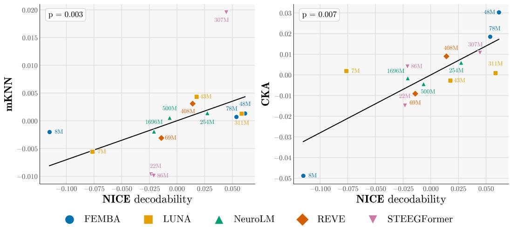  
Figure 1: Intra-modality alignment correlates with model capability. Individual points denote models; shape and colour indicate family, and labels indicate parameter count. Vertical axis: alignment after subtracting results obtained using the null model (App. B), averaged over that model’s alignments to every model outside its own family for the mKNN (left) and CKA (right). Horizontal axis: NICE decodability. Both axes are mean-centred within family. Alignments are computed on subject-averaged embeddings resampled to the shared 10 s windows (n = 1080).

## 3.2 Crossmodality Alignment: Vision and Language

The cyclic null introduced in Sec. 2 and applied to the within-EEG analysis in Figure 1 was also used for all cross-modal comparisons. Figure 2 illustrates its effect in this setting. Raw mKNN between FEMBA and DINOv2 increases with EEG model size, but the cyclic-null baseline increases at a comparable rate. In this case every cell except one clears the null model, so the alignment is real, but the excess over the null model does not increase with model size. Thus, raw alignment against model size cannot by itself establish cross-modal convergence. All model-pair comparisons are in App. G

We therefore tested cross-modal convergence using the same null-centred alignment and NICEdecoding axis as in Figure 1. Figure 3 shows alignment with V-JEPA2 and BLOOMZ, averaged across the sizes of each partner family, so the question now is: do models with greater decodability align more strongly with the vision and language representations? Results against VideoMAE, VideoMAE-K400, DinoV2 and OpenLLaMa are presented in App F.

Alignment does not consistently correlate with NICE decodability for either vision or language models when measured with mKNN. In contrast, CKA shows a more consistent relationship with decodability, particularly for language models. This suggests a dissociation between local and global measures of representational similarity: the relationship between alignment and decodability is apparent at the level captured by CKA, but is not consistent when measuring local alignment between models using mKNN.

## 4 Discussion and limitations

We found that representations of EEG foundation models become more similar as these models increase their capability to decode a highly informative set of EEG markers. This was observed within and across families. We emphasise that this is evidence of convergence with capability, as measured by NICE decodability, rather than with scale. Within families, larger models showed higher calibrated local alignment (mKNN) but not global alignment (CKA), a comparison confounded by shared architectures and training data (App. E). Whether EEG representations converge with scale per se, as the PRH predicts for vision and language, remains open and may require EEG models spanning a wider range of sizes.

Additionally, cross-modal convergence was metric and modality dependent. Global alignment correlated strongly with decodability for language models and more weakly for some vision models, whereas local alignment showed no consistent association. One possible explanation is that low-level sensory features dominate local EEG neighbourhoods, whereas CKA summarizes global geometry across all samples and may therefore capture weaker, distributed similarities associated with shared semantic content. This interpretation is consistent with our data but was not tested directly.

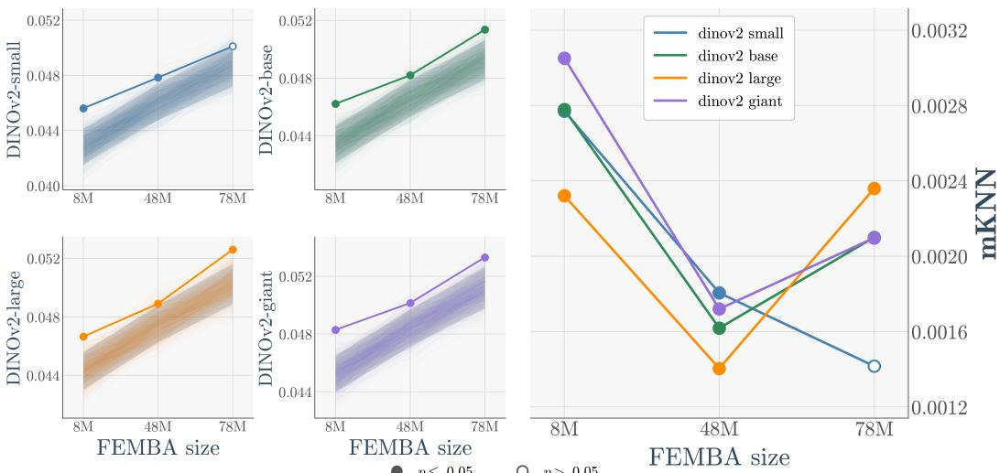  
● p ≤ 0.05 p> 0.05  
Figure 2: Cross-modal alignment increases due to heightened model sensitivity to temporal correlations and not because of model scaling Left: observed mKNN for FEMBA–DINOv2 pairs (solid coloured lines) and alignment under circular shifts (translucent lines; shaded 5th–95th percentile interval). Filled markers indicate comparisons with $p \leq 0 . 0 5$ under the cyclic-shift test. Right: Calibrated alignment for each pair. Although raw alignment increases with FEMBA size, the null-centred value does not increase consistently. All models pairs comparison are presented in Figures 7 and 8.

If EEG foundation models converge, this has practical consequences beyond the PRH itself. First, it suggests that what these models learn reflects structure in brain activity rather than specific structure of a given architecture or pretraining pipeline, so interpretations of one model’s representations (e.g., which brain states it separates) are more likely to transfer to others. Second, alignment to other models together with marker decodability offers a task-free way to compare EEG foundation models, which is useful where downstream benchmarks disagree and labelled data are scarce, as is common in clinical settings. Third, the global alignment with language models points to language as a possible common reference frame for interpreting EEG representations.

Our results and conclusions contain clear limitations. The analyses included only 14 models from five families and six participants, limiting statistical power. Also, neighbourhood similarity between EEG and video or language representations exceeded the time-shifted control only modestly, suggesting that part of the observed alignment may reflect shared temporal smoothness rather than contentspecific structure. Finally, all analyses relied on a single dataset, limiting the generalisability of our conclusions.

EEG × V-JEPA2  
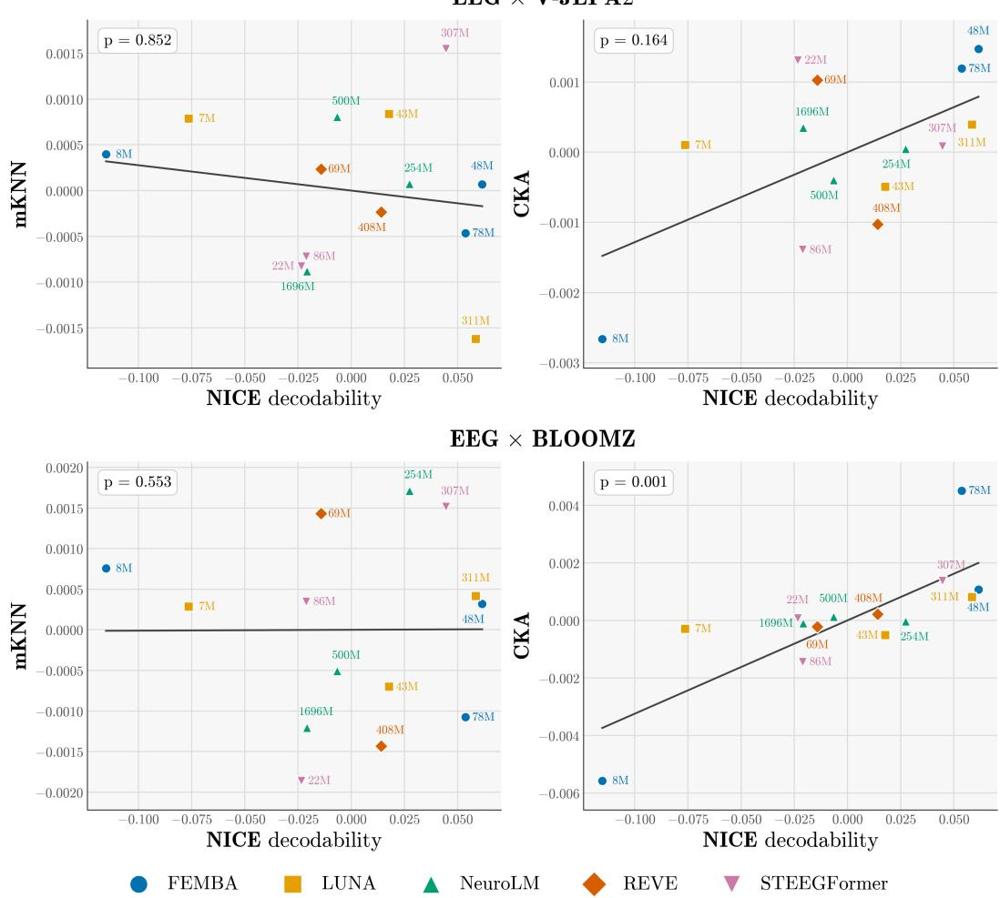  
Figure 3: Cross-modality global alignment correlates with model capability Individual points denote models; shape and colour indicate family, and labels indicate parameter count. Vertical axis: alignment after subtracting results obtained using the null model (App. B), and averaged for each EEG model across all sizes of the corresponding vision or language model family for the mKNN (left) and CKA (right). Horizontal axis: NICE decodability. Both axes are mean-centred within family. Each EEG model is paired with the partner tiled at its own window length on subject-averaged EEG embeddings.

## Acknowledgments and Disclosure of Funding

This work was supported by a BlueDot Rapid Grant. Nicolas Waehner is supported by a CONICET doctoral fellowship. Trinidad Borrell is supported by Paris Brain Institute America. Giovanni Marraffini is employed by Sigma Nova.

The authors declare no other competing interests.

## References

Mido Assran, Adrien Bardes, David Fan, Quentin Garrido, Russell Howes, et al. V-JEPA 2: Self-supervised video models enable understanding, prediction and planning. arXiv preprint arXiv:2506.09985, 2025.

Christoph Bandt and Bernd Pompe. Permutation entropy: A natural complexity measure for time series. Phys. Rev. Lett., 88:174102, Apr 2002. doi: 10.1103/PhysRevLett.88.174102. URL https://link.aps.org/doi/10.1103/PhysRevLett.88.174102.

Trinidad Borrell, Steven Dillmann, Kshitij Duraphe, Furkan Eris, Ashod Khederlarian, Aman Kumar, Giovanni Marraffini, Michael J. Smith, Shashwat Sourav, Rocco Di Tella, and John F. Wu. The platonic universe: Do foundation models see the same sky? In Mechanistic Interpretability Workshop, International Conference on Machine Learning (ICML), 2026.

Barry J. Devereux, Alex Clarke, and Lorraine K. Tyler. Integrated deep visual and semantic attractor neural networks predict fMRI pattern-information along the ventral object processing pathway. Scientific Reports, 8(1):10636, 2018. doi: 10.1038/s41598-018-28865-1.

James J. DiCarlo, Davide Zoccolan, and Nicole C. Rust. How does the brain solve visual object recognition? Neuron, 73(3):415–434, 2012. doi: 10.1016/j.neuron.2012.01.010.

Berkay Döner, Thorir Mar Ingolfsson, Luca Benini, and Yawei Li. LUNA: Efficient and topologyagnostic foundation model for EEG signal analysis. In Advances in Neural Information Processing Systems (NeurIPS), 2025. arXiv:2510.22257.

Yassine El Ouahidi, Jonathan Lys, Philipp Thölke, Nicolas Farrugia, Bastien Pasdeloup, Vincent Gripon, Karim Jerbi, and Giulia Lioi. REVE: A foundation model for EEG – adapting to any setup with large-scale pretraining on 25,000 subjects. arXiv preprint arXiv:2510.21585, 2025.

Denis A Engemann, Federico Raimondo, Jean-Rémi King, Benjamin Rohaut, Gilles Louppe, Frederic Faugeras, Jitka Annen, Helena Cassol, Olivia Gosseries, Diego Fernandez-Slezak, Steven Laureys, Lionel Naccache, Stanislas Dehaene, and Jacobo D Sitt. Robust eeg-based cross-site and crossprotocol classification of states of consciousness. Brain, 141(11):3179–3192, 2018.

Jianxiong Gao, Yichang Liu, Baofeng Yang, Jianfeng Feng, and Yanwei Fu. Cinebrain: A large-scale multi-modal brain dataset during naturalistic audiovisual narrative processing. arXiv preprint arXiv:2503.06940, 2025.

Xinyang Geng and Hao Liu. OpenLLaMA: An open reproduction of LLaMA. https://github. com/openlm-research/open\_llama, 2023.

Kalanit Grill-Spector and Rafael Malach. The human visual cortex. Annual Review ofNeuroscience, 27:649–677, 2004. doi: 10.1146/annurev.neuro.27.070203.144220.

Fabian Gröger, Shuo Wen, and Maria Brbic. Revisiting the platonic representation hypothesis: An ´ aristotelian view. arXiv preprint arXiv:2602.14486, 2026.

Zellig S. Harris. Distributional structure. Word, 10(2-3):146–162, 1954.

Jordan Hoffmann, Sebastian Borgeaud, Arthur Mensch, et al. Training compute-optimal large language models. In Advances in Neural Information Processing Systems, 2022.

Minyoung Huh, Brian Cheung, Tongzhou Wang, and Phillip Isola. The platonic representation hypothesis. In International Conference on Machine Learning (ICML), 2024. arXiv:2405.07987.

Alexander G. Huth, Wendy A. de Heer, Thomas L. Griffiths, Frédéric E. Theunissen, and Jack L. Gallant. Natural speech reveals the semantic maps that tile human cerebral cortex. Nature, 532 (7600):453–458, 2016. doi: 10.1038/nature17637.

Wei-Bang Jiang, Yansen Wang, Bao-Liang Lu, and Dongsheng Li. NeuroLM: A universal multi-task foundation model for bridging the gap between language and EEG signals. In International Conference on Learning Representations (ICLR), 2025. arXiv:2409.00101.

Jared Kaplan, Sam McCandlish, Tom Henighan, Tom B. Brown, Benjamin Chess, Rewon Child, Scott Gray, Alec Radford, Jeffrey Wu, and Dario Amodei. Scaling laws for neural language models. arXiv preprint arXiv:2001.08361, 2020.

A. Sophia Koepke, Daniil Zverev, Shiry Ginosar, and Alexei A. Efros. Back into plato’s cave: Examining cross-modal representational convergence at scale. arXiv preprint arXiv:2604.18572, 2026.

Simon Kornblith, Mohammad Norouzi, Honglak Lee, and Geoffrey Hinton. Similarity of neural network representations revisited. In International Conference on Machine Learning (ICML), 2019.

Matthew A. Lambon Ralph, Elizabeth Jefferies, Karalyn Patterson, and Timothy T. Rogers. The neural and computational bases of semantic cognition. Nature Reviews Neuroscience, 18(1):42–55, 2017. doi: 10.1038/nrn.2016.150.

Tom M. Mitchell, Svetlana V. Shinkareva, Andrew Carlson, Kai-Min Chang, Vicente L. Malave, Robert A. Mason, and Marcel Adam Just. Predicting human brain activity associated with the meanings of nouns. Science, 320(5880):1191–1195, 2008. doi: 10.1126/science.1152876.

Niklas Muennighoff, Thomas Wang, Lintang Sutawika, Adam Roberts, Stella Biderman, Teven Le Scao, M Saiful Bari, Sheng Shen, Zheng Xin Yong, Hailey Schoelkopf, Xiangru Tang, Dragomir Radev, Alham Fikri Aji, Khalid Almubarak, Samuel Albanie, Zaid Alyafeai, Albert Webson, Edward Raff, and Colin Raffel. Crosslingual generalization through multitask finetuning. In Proceedings ofthe 61st Annual Meeting ofthe Associationfor Computational Linguistics (Volume 1: Long Papers), pages 15991–16111, Toronto, Canada, 2023. Association for Computational Linguistics. doi: 10.18653/v1/2023.acl-long.891. URL https://aclanthology.org/2023. acl-long.891/.

Maxime Oquab, Timothée Darcet, Théo Moutakanni, Huy Vo, Marc Szafraniec, Vasil Khalidov, et al. DINOv2: Learning robust visual features without supervision. arXiv preprint arXiv:2304.07193, 2023.

Karalyn Patterson, Peter J. Nestor, and Timothy T. Rogers. Where do you know what you know? The representation of semantic knowledge in the human brain. Nature Reviews Neuroscience, 8(12): 976–987, 2007. doi: 10.1038/nrn2277.

Jacobo D Sitt, Jean-Rémi King, Imen El Karoui, Benjamin Rohaut, Frederic Faugeras, Alexandre Gramfort, Laurent Cohen, Mariano Sigman, Stanislas Dehaene, and Lionel Naccache. Large scale screening of neural signatures of consciousness in patients in a vegetative or minimally conscious state. Brain, 137(8):2258–2270, 2014.

Anna Tegon, Thorir Mar Ingolfsson, Xiaying Wang, Luca Benini, and Yawei Li. FEMBA: Efficient and scalable EEG analysis with a bidirectional mamba foundation model. arXiv preprint arXiv:2502.06438, 2025.

Zhan Tong, Yibing Song, Jue Wang, and Limin Wang. VideoMAE: Masked autoencoders are data-efficient learners for self-supervised video pre-training. In Advances in Neural Information Processing Systems (NeurIPS), 2022.

Liuyin Yang, Qiang Sun, Ang Li, and Marc M. Van Hulle. Are EEG foundation models worth it? comparative evaluation with traditional decoders in diverse BCI tasks. In International Conference on Learning Representations (ICLR), 2026. URL https://openreview.net/forum?id= 5Xwm8e6vbh.

Pratham Yashwante and Rose Yu. Time series, vision, and language: Exploring the limits of alignment in contrastive representation spaces. arXiv preprint arXiv:2602.19367, 2026.

## A Preprocessing

Data and windowing. We use Season 7 of CineBrain [Gao et al., 2025], the first ten episodes, which all six subjects share: 10 800 s stored as 13 500 consecutive 0.8 s frames. The EEG is recorded with a 64-channel GSN-HydroCel cap at 1000 Hz and distributed band-pass filtered to 0.1–30 Hz with a 50 Hz notch; the fMRI is distributed as one flat masked-voxel vector of 18 946 dimensions per repetition time (TR = 0.8 s), already z-scored and not atlas-parcellated. Both share the same 0.8 s frame grid, on which a 4 s video clip c covers frames [5c, 5c + 5). We take both releases as distributed and add no cleaning of our own: no independent component analysis, no artefact rejection, no channel interpolation, and no re-referencing beyond the montages individual models require, so every window of every subject enters the analysis. All representations live on non-overlapping windows tiling the recording from t = 0, with the length L fixed by a window consistent with the ones used in pretraining for each EEG model family: 5 s for FEMBA and LUNA (W = 2160 windows), 6 s for ST-EEGFormer (W = 1800), 8 s for NeuroLM (W = 1350), 10 s for REVE (W = 1080), and a 4 s clip-native grid (W = 2700) where no EEG model is involved.

EEG. Each model receives the input format of its own pretraining pipeline. FEMBA and LUNA use the 22 bipolar pairs of the TUEG double-banana montage at 256 Hz, the former with per-channel interquartile-range normalisation and clipping to [−20, 20], the latter z-scored per channel and window; NeuroLM uses 64 channels at 200 Hz, rescaled to the microvolt range of its training data and tokenised as 64 channels $\times \ 8$ patches of 200 samples; ST-EEGFormer uses 62 channels at 128 Hz, z-scored per channel; REVE uses 64 channels at 200 Hz, band-passed 0.5–99 Hz, z-scored per channel over the full session and clipped at $\pm 1 5 \sigma$ . The models therefore do not all see the same electrodes, and the two band-passes are inert given the 30 Hz low-pass of the data. For each model we extract the hidden state of every block and mean-pool it over tokens, giving one vector per layer, window and subject.

fMRI. Treating fMRI as a representation rather than a target, it passes through no model. Per subject we assemble the $1 3 5 0 0 \times 1 8 9 4 6$ matrix of per-TR voxel vectors and average the TRs whose centre time falls in $[ w L + h , ( w + 1 ) L + h )$ , where h is a hemodynamic delay. As the released data are already hemodynamically aligned, we swept $h \in [ 0 , 8 ]$ s and found $h \stackrel { \cdot } { = } 0$ s to maximise alignment; all reported results use $h = 0 \mathrm { { s } }$ . This gives one voxel vector per window per subject, on the same grid as every other representation.

Stimulus and subjects. For a window of length L we concatenate the frames of every 4 s clip it overlaps and sample from that span: 16 frames uniformly for the video transformers, one frame per second for the image models, whose per-block class tokens are averaged over the window. Language input uses the Qwen-2.5-VL-7B caption CineBrain provides per clip; a window takes every caption it overlaps, concatenated in order, two for the 5, 6 and 8 s grids and three for the 10 s grid, embedded as layerwise masked mean-pools. When L is not a multiple of 4 s adjacent windows share a boundary clip and caption, inflating temporal autocorrelation, which the shift-null and block-permutation tests of the main text control for. Alignment scores are computed per subject and then averaged, so no similarity computation mixes subjects, whereas the interpretability analyses use subject-averaged embeddings and markers.

## B Null calibration

Here we define the null used in this work, adapted from the i.i.d calibration of Gröger et al. [2026].

Stating this formally: let n be the number of windows in the grid, and let $C _ { n } = \{ c _ { d } \} _ { d = 0 } ^ { n - 1 }$ be the cyclic group whose elements rigidly rotate the window index,

$$
c _ { d } ( { \bf Y } ) [ i ] = { \bf Y } [ ( i - d ) \bmod n ] .\tag{1}
$$

That is, $c _ { d }$ moves the entry at position $i - d$ to position i: the whole sequence slides by d windows, and the modn returns what falls off the end to the front. The rotated sequence holds the same n vectors in the same cyclic order, so $\mathbf { Y } \mathbf { \widetilde { s } }$ own autocorrelation is left intact and its marginal distribution is identical; only its correspondence with X is destroyed, whereas a freea shuffle destroys both.

The cyclic group defines a strictly stronger null than the i.i.d. one:

$H _ { 0 } { \mathrm { : } }$ : X and Y similarity at the true temporal pairing is no greater than at an arbitrary circular shift of one against the other.

Assumption 3.1 of Gröger et al. [2026] then reads $P _ { H _ { 0 } ^ { \prime } } ( \mathbf { X } , \mathbf { Y } ) = P _ { H _ { 0 } ^ { \prime } } ( \mathbf { X } , c _ { d } ( \mathbf { Y } ) )$ for every $c _ { d } \in C _ { n }$ i.e. approximate circular stationarity of Y.

Because we report the maximum alignment s over layer pairs, we follow the aggregation-aware calibration of Gröger et al. [2026, §5.2]: the same rotation is applied to every layer of B before the maximum is taken,

$$
S _ { \ell , \ell ^ { \prime } } ^ { ( d ) } = s \Big ( { \bf X } _ { \ell } ^ { ( A ) } , c _ { d } \Big ( { \bf Y } _ { \ell ^ { \prime } } ^ { ( B ) } \Big ) \Big ) , \qquad T ^ { ( d ) } = \operatorname* { m a x } _ { \ell , \ell ^ { \prime } } S _ { \ell , \ell ^ { \prime } } ^ { ( d ) } ,\tag{2}
$$

so the null retains the same selection advantage as the observed statistic.

Since $c _ { 0 }$ is the identity, $T _ { \mathrm { o b s } } = T ^ { ( 0 ) }$ , and $| C _ { n } | = n$ is small enough to enumerate exhaustively, so $K = n - 1$ is fixed by the number of windows rather than chosen and the right-tail permutation

p-value

$$
p ~ = ~ \frac { 1 + \# \{ d \neq 0 ~ : ~ T ^ { ( d ) } \geq T ^ { ( 0 ) } \} } { K + 1 }\tag{3}
$$

is exact rather than Monte Carlo, with floor $1 / n$ . We report as magnitude the excess over the null

$$
\Delta = T ^ { ( 0 ) } - \frac { 1 } { n - 1 } \sum _ { d = 1 } ^ { n - 1 } T ^ { ( d ) } .\tag{4}
$$

in every alignment plot, whether it is mKNN or CKA. ∆ is the “null-centered” calibration that Gröger et al. [2026, App. E.3] evaluate alongside their gated score and find to collapse correctly to the null baseline across all metrics; we prefer it here because it is α-free and, unlike their Eq. (17), commutes with the averaging over comparisons that our y axes perform in Figures 1, 3, 5 and 6. Evidence against $H _ { 0 }$ is carried by $p .$

## C NICE markers

The markers span three families: (i) Spectral (11 markers): absolute (log) and normalised band powers in δ (1–4 Hz), θ (4–8 Hz), α (8–13 Hz) and β (13–30 Hz), plus spectral entropy, median spectral frequency and the 90% spectral edge frequency (SE90), all computed from a Welch periodogram restricted to 1–30 Hz; (ii) Information theory (3 markers): permutation entropy [Bandt and Pompe, 2002] of the broadband signal and of the θ- and α-filtered signals (embedding order 3, unit delay, normalised by log 3!); (iii) Complexity (2 markers): the Hjorth mobility and complexity parameters, i.e. the variance ratios of the signal and its first and second derivatives.

Each marker is computed per channel and then summarised as the median across the 64 EEG channels, yielding one scalar per marker per time window. Windows are non-overlapping and tile the recording from $t = 0 ;$ their length matches the input window of the EEG model under comparison (5, 6, 8 or 10 s), so that marker vectors and model embeddings are defined on exactly the same temporal grid. The resulting per-window vectors are averaged across the six subjects, to match the subject-averaged embeddings. This produces a 16-dimensional embedding per window. Crucially, every dimension is interpretable by construction, corresponding to a specific marker whose clinical meaning has been established across years of research [Engemann et al., 2018].

## D Models, grids and marker scores

Table 1 lists every EEG model, the grid it defines, its marker score, and its mean similarity to models of other families. Table 2 breaks the marker score down by marker.

Table 1: The 14 EEG models. Window and count give the grid each model defines natively; crossmodel similarity is computed after resampling to the shared 10 s grid (1080 windows). The marker score is the mean $R ^ { 2 }$ over the sixteen EEG markers on subject-averaged data, and is the horizontal axis of Figures 1 and 3. Values are uncentred; the figures plot the same quantities after mean-centring within family.
<table><tr><td>Family</td><td>Size</td><td>Params (M)</td><td>Window (s)</td><td>Windows</td><td>Marker  $R ^ { 2 }$ </td><td>MKNN</td><td>CKA</td></tr><tr><td>FEMBA</td><td>tiny</td><td>8</td><td>5</td><td>2160</td><td>-0.154</td><td>0.057</td><td>0.136</td></tr><tr><td>FEMBA</td><td>base</td><td>48</td><td>5</td><td>2160</td><td>+0.023</td><td>0.061</td><td>0.215</td></tr><tr><td>FEMBA</td><td>large</td><td>78</td><td>5</td><td>2160</td><td>+0.015</td><td>0.060</td><td>0.203</td></tr><tr><td>LUNA</td><td>base</td><td>7</td><td>5</td><td>2160</td><td>+0.190</td><td>0.063</td><td>0.284</td></tr><tr><td>LUNA</td><td>large</td><td>43</td><td>5</td><td>2160</td><td>+0.284</td><td>0.073</td><td>0.279</td></tr><tr><td>LUNA</td><td>huge</td><td>311</td><td>5</td><td>2160</td><td>+0.325</td><td>0.070</td><td>0.283</td></tr><tr><td>NeuroLM</td><td>b</td><td>254</td><td>8</td><td>1350</td><td>+0.594</td><td>0.041</td><td>0.226</td></tr><tr><td>NeuroLM</td><td>1</td><td>500</td><td>8</td><td>1350</td><td>+0.560</td><td>0.040</td><td>0.215</td></tr><tr><td>NeuroLM</td><td>xl</td><td>1696</td><td>8</td><td>1350</td><td>+0.546</td><td>0.037</td><td>0.218</td></tr><tr><td>REVE</td><td>base</td><td>69</td><td>10</td><td>1080</td><td>+0.667</td><td>0.052</td><td>0.223</td></tr><tr><td>REVE</td><td>large</td><td>408</td><td>10</td><td>1080</td><td>+0.695</td><td>0.058</td><td>0.241</td></tr><tr><td>STEEGFormer</td><td>small</td><td>22</td><td>6</td><td>1800</td><td>+0.663</td><td>0.049</td><td>0.287</td></tr><tr><td>STEEGFormer</td><td>base</td><td>86</td><td>6</td><td>1800</td><td>+0.666</td><td>0.049</td><td>0.306</td></tr><tr><td>STEEGFormer</td><td>large</td><td>307</td><td>6</td><td>1800</td><td>+0.731</td><td>0.078</td><td>0.313</td></tr></table>

Table 2: The sixteen EEG markers, and how well the model embeddings predict them. Median and best $R ^ { 2 }$ are taken across the 14 EEG models. The three permutation entropy markers had non-positive median $( R ^ { 2 } )$ across models, although some individual models predicted them above chance.
<table><tr><td>Marker</td><td>Median  $R ^ { 2 }$ </td><td>Best  $R ^ { 2 }$ </td><td>Best model</td></tr><tr><td>abs_delta</td><td>+0.466</td><td>+0.887</td><td>reve-base</td></tr><tr><td>rel_delta</td><td>+0.676</td><td>+0.768</td><td>reve-large</td></tr><tr><td>abs_theta</td><td>+0.232</td><td>+0.877</td><td>reve-large</td></tr><tr><td>rel_theta</td><td>+0.523</td><td>+0.631</td><td>steegformer-large</td></tr><tr><td>abs_alpha</td><td>+0.066</td><td>+0.824</td><td>reve-large</td></tr><tr><td>rel_alpha</td><td>+0.593</td><td>+0.671</td><td>steegformer-large</td></tr><tr><td>abs_beta</td><td>+0.046</td><td>+0.850</td><td>reve-large</td></tr><tr><td>rel_beta</td><td>+0.345</td><td>+0.827</td><td>steegformer-large</td></tr><tr><td>spec_entropy</td><td>+0.409</td><td>+0.719</td><td>steegformer-large</td></tr><tr><td>median_freq</td><td>+0.597</td><td>+0.756</td><td>steegformer-large</td></tr><tr><td>spec_edge90</td><td>+0.449</td><td>+0.786</td><td>steegformer-large</td></tr><tr><td>pe_broad</td><td>-0.275</td><td>+0.779</td><td>steegformer-large</td></tr><tr><td>pe_theta</td><td>-0.022</td><td>+0.198</td><td>neurolm-xl</td></tr><tr><td>pe_alpha</td><td>-0.025</td><td>+0.292</td><td>neurolm-b</td></tr><tr><td>hjorth_mobility</td><td>+0.660</td><td>+0.944</td><td>steegformer-large</td></tr><tr><td>hjorth_complexity</td><td>+0.584</td><td>+0.868</td><td>steegformer-large</td></tr></table>

## E Intramodality Intra-architecture

For each family, we selected the two smallest models and the two largest, and measured the similarity of each pair. Figure 4 shows how every family the larger pair is more aligned in mKNN, but only FEMBA increases in CKA. We excluded REVE because it includes only two distinct sizes.

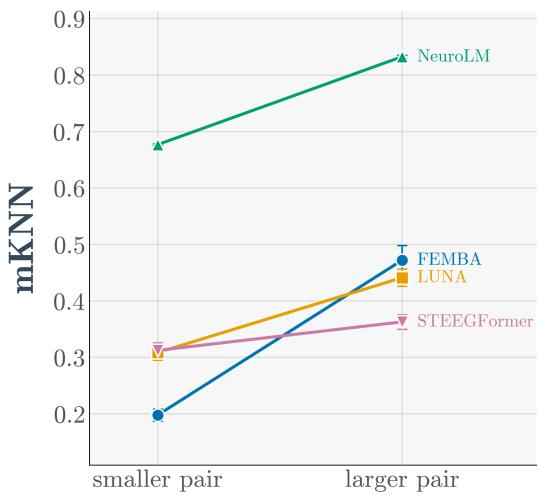

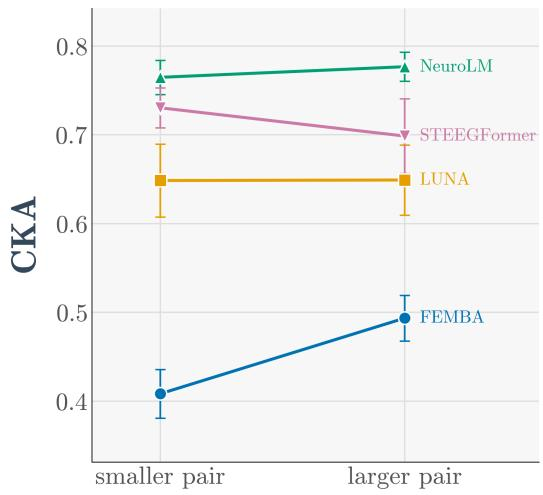  
Figure 4: Similarity between two models of the same family, for the two smallest models and the two largest. Every family alignment rises locally but only FEMBA does globally.

## F Crossmodality against every model: Vision and Language

Here we show the results obtained with OpenLLaMA in Figure 5 and with DINOv2, VideoMAE and VideoMAE-K400 in Figure 6, against NICE decodability. We observe consistent global alignment against language models.

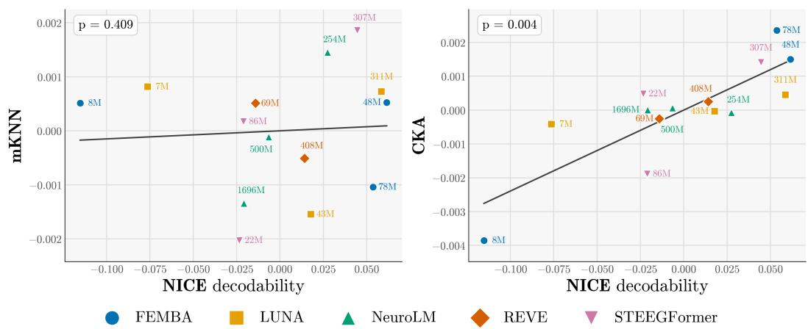  
Figure 5: Individual points denote models; shape and colour indicate family, and labels indicate parameter count. Vertical axis: calibrated alignment averaged across the available OpenLLaMA sizes for the mKNN (left) and CKA (right). Horizontal axis: NICE decodability. Both axes are mean-centred within family. Each EEG model is paired with the partner tiled at its own window length (W = 2160, 1800, 1350, 1080 for the 5, 6, 8 and 10 s families), on subject-averaged EEG embeddings.

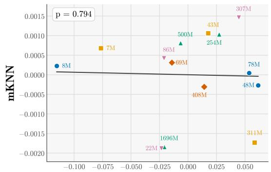

EEG × DINOv2  
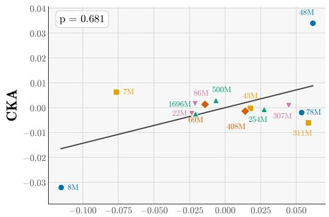

EEG × VideoMAE  
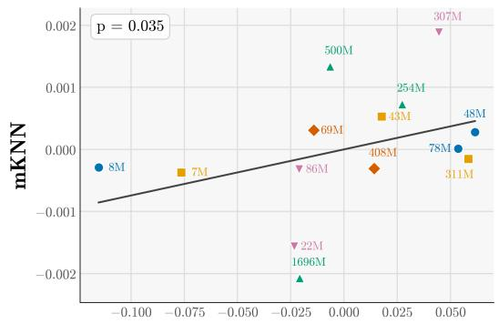

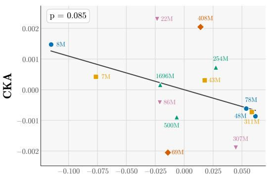

EEG × VideoMAE-K400  
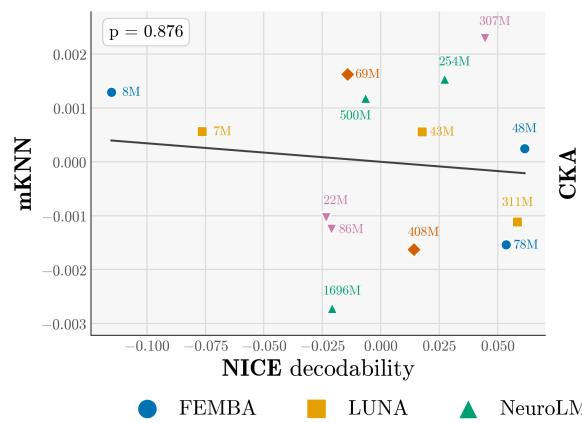

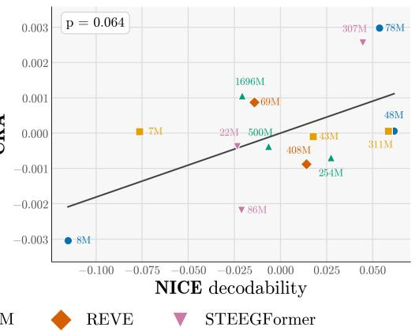  
Figure 6: Individual points denote models; shape and colour indicate family, and labels indicate parameter count. Vertical axis: alignment calibrated averaged across all sizes of the indicated vision model family for the mKNN (left) and CKA (right). Horizontal axis: NICE decodability. Both axes are mean-centred within family. Each EEG model is paired with the partner tiled at its own window length (W = 2160, 1800, 1350, 1080 for the 5, 6, 8 and 10 s families), on subject-averaged EEG embeddings.

## G EEG similarity to vision and language

Each EEG model is paired with each vision model on the EEG model’s own tiling and scored with mKNN in Figure 7 and with CKA in Figure 8, taking the best score over layer pairs and calibrating against the cyclic null. Two questions are separable here, and we treat them separately: whether alignment exists at all, and whether it grows with model capacity. Although they don’t always clear the null with $p > 0 . 0 5$ , alignment between EEG models and models not trained on neural data therefore exists in many cases, but it doesn’t improve as the EEG models grow.

This may be explainable by the results of Koepke et al. [2026], where they argue that in a non-bijective dataset the alignment seems to be more fragile. This seems to be valid in the CineBrain dataset, as all stimuli come from the same series.

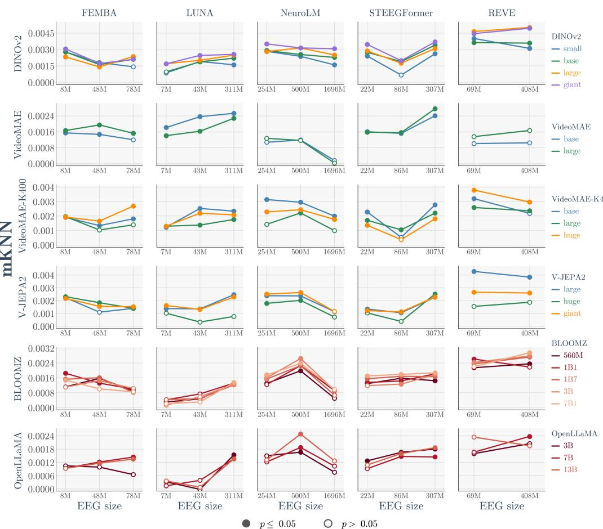  
Figure 7: Each EEG model mKNN alignment to every vision and language model. Many clear the null but there is no correlation with model size.

## H Alignment of vision and language models with fMRI

Figure 9 shows the alignment between fMRI and video and language models under mKNN. The margin above the null is considerably larger than for EEG (Fig. 2). This is consistent with fMRI’s high spatial resolution and its well-documented capacity to encode rich semantic Huth et al. [2016] and hierarchical visual Devereux et al. [2018] structure. Within each model family, however, the null tracks the observed line almost exactly. As with EEG, what the larger model gains with model size is shared temporal smoothness.

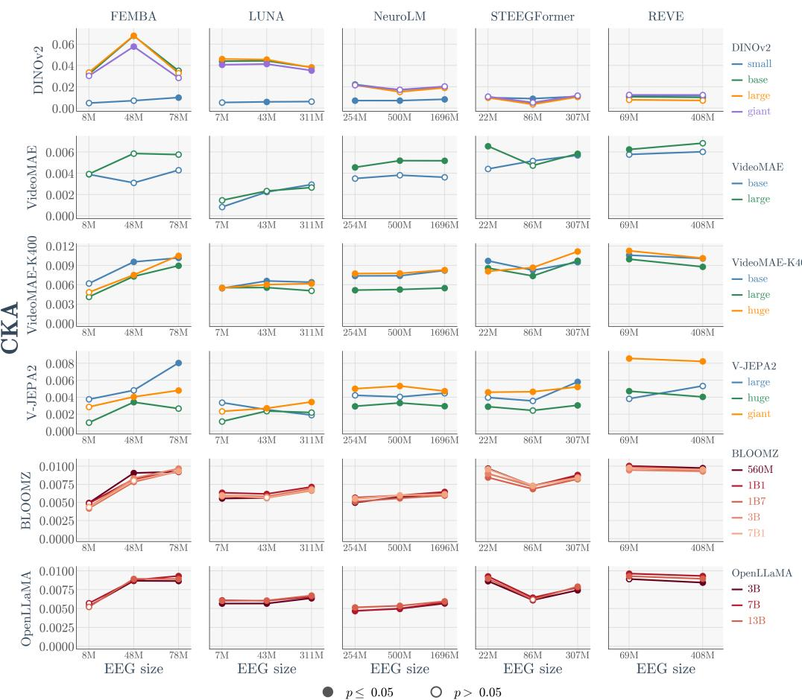

Figure 8: Each EEG model CKA alignment to every vision and language model. Many exceed the null but there is no correlation with model size.  
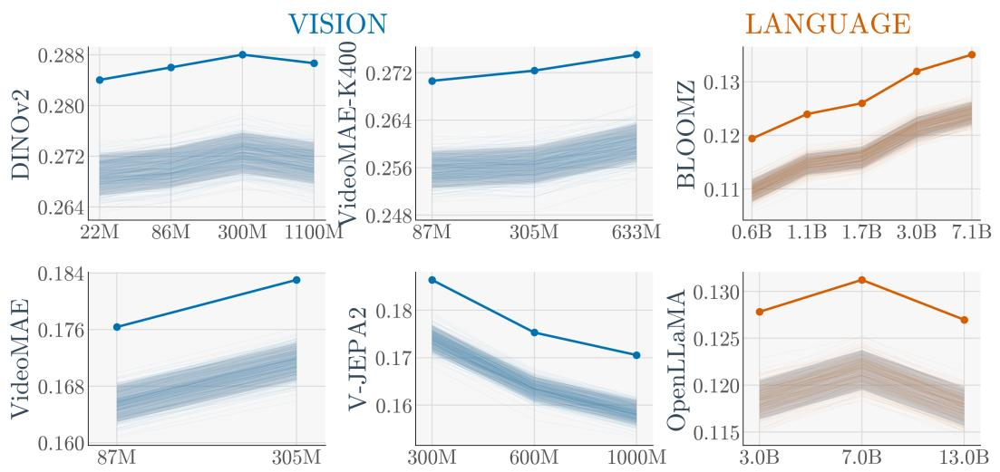  
Figure 9: mKNN alignment to brain activity against model size. Similarity of each vision and language model to fMRI, plotted against parameter count. Solid coloured lines show observed mKNN at the true temporal pairing. The raw score changes with size, but the null tracks it closely.