# Treating the Symptom, Missing the Cause: Anatomy of a Scientific Reasoning Failure

Anna Gogleva∗ Thomas Charman Martin Balla Karl Gemayel Relation Therapeutics anna.gogleva@relationrx.com

## Abstract

Scientific agents can find interventions that work without understanding why they do. We study this failure mode in controlled synthetic regulatory systems, where agents must experimentally identify a hidden fault and rescue the resulting phenotype. Across seven LLMs, every model restores the healthy phenotypes more often than it identifies the fault. Claude Opus 4.6 and Sonnet 4.6 rescue every organism while diagnosing only 55% and 35% of them. This failure is not simply due to insufficient exploration or unavailable evidence. In most cases, the cause is experimentally identifiable, and agents encounter evidence that distinguishes competing causes in 91% of relevant sessions, and still frequently misdiagnose the system.

Targeted probes reveal where experimental reasoning breaks down. Models reliably interpret decisive evidence and revise hypotheses when the causal comparison is explicit, and can locate that evidence within a full experimental record. However, they struggle to predict the outcome of the experiment under each competing cause, a necessary step in using the observed result to distinguish between them. Agents can therefore gather the right evidence and still infer the wrong cause. As AI systems take on a growing role in synthesising scientific evidence, these findings highlight the need to evaluate how they use evidence to reach causal conclusions, alongside whether their interventions succeed.

## 1 Introduction

LLMs are moving from answering scientific questions to participating in the experimental process itself. They generate hypotheses [1–4], propose experiments [5], interpret results [6–8], and decide what to test next [9]. This shift makes the process by which an agent reaches a scientific conclusion increasingly important, not just the quality of its final output. An agent may reach a useful, even correct, result without understanding the system it is studying [10].

In biology, one particularly important case is the distinction between successful intervention and causal understanding. An intervention can restore a phenotype without identifying its cause, just as a treatment can relieve symptoms without modifying the underlying disease mechanism. An agent judged only by its outputs can therefore appear scientifically competent while holding an incorrect causal model, or none at all [11–13].

This raises a harder question for evaluating scientific agents. When an agent reaches the wrong causal conclusion, where did the reasoning fail? It may explore too little, choose experiments that cannot distinguish competing explanations, encounter informative evidence but fail to recognise its significance, or fail to integrate evidence accumulated across the investigation. Alternatively, the available experiments may simply be unable to resolve the ambiguity. Outcome-based evaluation cannot distinguish these failure modes. Large-scale audits of scientific agents report symptoms of the same problem: evidence ignored in most traces, refutation rarely triggering revision [10], but without ground truth they cannot locate its source.

Answering this question requires knowing more than whether the final answer is correct. For each reasoning session, we need to know which alternative hypotheses remain plausible, which experiments could distinguish them, what those experiments would reveal, and what evidence the agent actually encountered. Existing interactive benchmarks tend to evaluate the informativeness of chosen experiments prospectively [14], but generally cannot tell us what alternative experiments would have revealed. Fixed biological datasets provide even less freedom to ask what an agent could have discovered through a different experiment.

We therefore study agents in synthetic regulatory systems, where they can freely perturb an unknown network, observe its response, diagnose a hidden fault, and design an intervention to restore the healthy phenotype. The underlying mechanism is fully known to us but hidden from the agent. This gives us counterfactual access to every possible experiment. We can map the competing causes and the experiments that distinguish them, then trace what the agent actually tests and how it uses the evidence.

We begin from an apparent contradiction: agents canfix systems they cannot explain. We then trace this gap through the experimental investigation. Diagnostic failures often persist even when the cause is experimentally identifiable and evidence distinguishing competing causes appears in the agent’s own trajectory. Targeted probes further show that models can interpret such evidence, and locate it within a full experimental record, but cannot derive what phenotype readouts their candidate hypotheses predict based on it. Successful investigations also exhibit a distinctive contrastive signature, echoing experimental strategies used for causal attribution in biology.

Together, these results expose a failure mode that endpoint evaluation can hide: scientific agents may obtain the evidence required for causal inference without successfully carrying it through to the causal conclusion. Successful intervention is therefore not, by itself, evidence of causal understanding.

## 2 A controlled environment for experimental discrimination

We study agents in controlled synthetic regulatory systems with fully known ground truth (see the LUCA environment [15]). Each contains 20 genes connected in a regulatory network, three external signals, and three observable phenotypes (Figure 1a). The systems are generated procedurally, their

## a. Anatomy of a synthetic organism

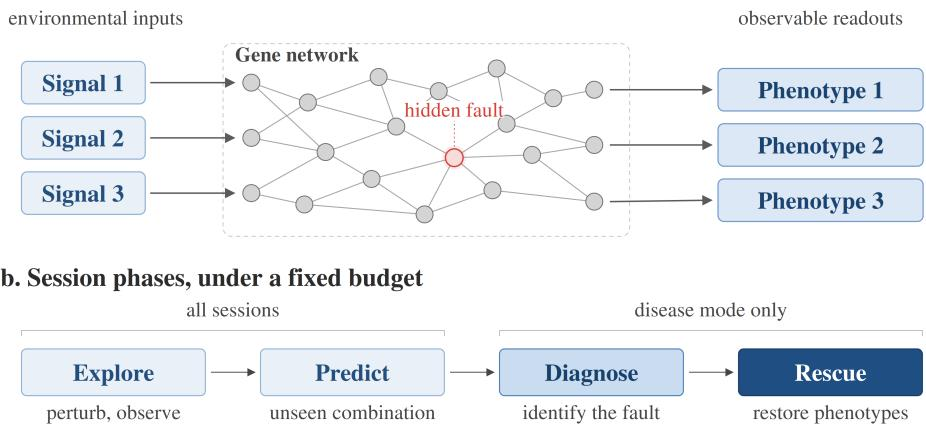  
Figure 1: Controlled experimental environment. (a) A synthetic organism maps environmental inputs through an unknown gene regulatory network to three observable phenotypes; one example hidden fault is highlighted. Agents cannot observe the network directly and must learn about the system through perturbations. (b) Each session proceeds under a fixed experimental budget. All sessions include exploration and prediction; disease sessions additionally require diagnosis of a hidden fault followed by an intervention to rescue the phenotypes.

dynamics are deterministic, and gene and signal names are invented, so agents cannot rely on prior biological knowledge and must learn through experimentation. The experimental budget is sufficient to perturb every gene at least once, so an informative experiment left unrun reflects the agent’s choices rather than a tight budget. The design follows synthetic networks used as controlled ground-truth systems [16–18].

Each system has a healthy state. In addition, we create a disease condition by introducing one hidden fault: a gene fixed at high or low activity, or an external signal permanently active. Under a fixed budget, the agent can increase ↑, decrease ↓, or block ∅ genes, activate signals, and observe the resulting phenotypes. It then predicts the outcome of an unseen perturbation combination, commits to a diagnosis of the faulty component and failure mode, and proposes a rescue intended to restore the healthy phenotypes (Figure 1b). Diagnosis must be submitted before rescue, so the rescue outcome cannot revise it. For more details about the environment setup see Appendix A.

We score diagnosis as correct only when the agent identifies both the faulty component and its failure mode. Rescue is correct when the phenotypes return to their healthy range. These two outcomes can dissociate, which is where our investigation begins.

## 3 Agents can fix systems they cannot diagnose

Successful intervention does not necessarily imply correct causal understanding. Similar dissociations between task success and causal reasoning have been observed in other interactive settings [12, 13, 19]. We reproduce it here: agents are consistently better at restoring a system to its healthy state than at identifying the fault that caused it (Figure 2). On medium-difficulty organisms, Claude Opus 4.6 rescues all 20 organisms but correctly diagnoses only 55%; Sonnet 4.6 likewise achieves perfect rescue but only 35% diagnosis. Rescue scores exceed diagnosis for every model we evaluate, though the two confidence intervals overlap for the weakest performers (Appendix B.1).

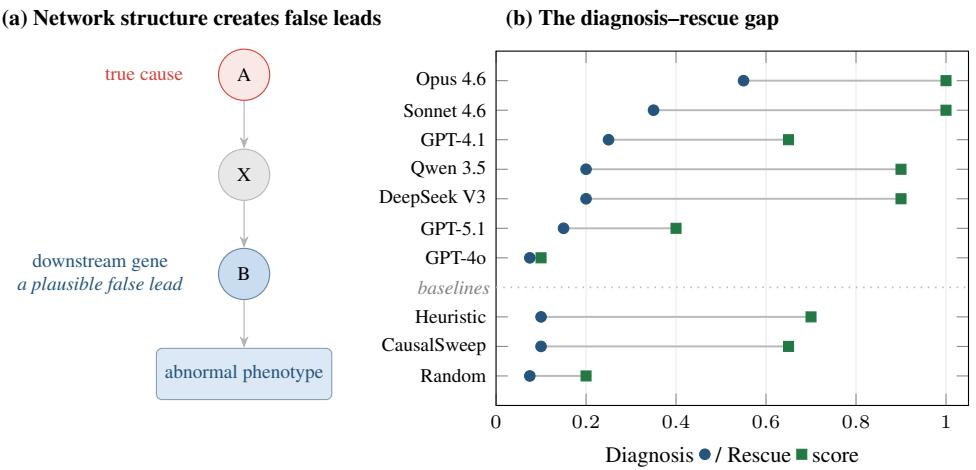  
Figure 2: The diagnosis–rescue gap. (a) A downstream gene can provide a plausible diagnosis and rescue target, restoring the phenotype without correcting the true fault. (b) Diagnosis and rescue at medium difficulty (20 seeds) for seven LLMs and three non-LLM baselines. Lines connect the two scores for each agent. CIs and prediction accuracy are in Appendix B.1 (Table 2).

Compensatory effects inherently present in networks could explain this gap. A downstream gene can be an effective point of intervention without being the source of the fault (Figure 2a). Changing it may restore the phenotypes by compensating for the fault, while leaving its cause unidentified. So, even in these small networks, finding an intervention and identifying the causal fault are distinct problems that can be non-trivial. Agents are explicitly asked to locate the causal gene or signal (Appendix B.6).

## 4 The investigation

The diagnosis–rescue gap itself is not our main finding. Our controlled environment lets us investigate why it occurs by tracing the agents’ experimental trajectories and testing possible explanations. The

non-LLM baselines do not log trajectories, so the behavioural analyses that follow cover the seven LLMs (420 sessions). We begin with the simplest hypothesis.

,→ First question — Perhaps agents misdiagnose because they do not investigate the system thoroughly enough?

## 4.1 First suspect: insufficient exploration

If insufficient exploration explains the gap, agents that experiment longer or more broadly should diagnose more accurately. At first glance this seems plausible. Models investigate the same organisms very differently (Figure 3a): the average number of experiments per session ranges from 7.4 to 24.1, while the ratio of genes probed ranges from about a quarter of the genes in a network to all of them. Models that explore more also tend to diagnose better.

Within each model, however, the pattern disappears (Figure 3b). Sessions above each model’s median experiment count have a diagnosis rate of 0.26, compared with 0.29 for sessions below it. Experiment count is likewise uncorrelated with diagnosis within models (r = −0.05). Breadth shows the same pattern: among the five models with varying coverage, the mean within-model correlation between gene coverage and diagnosis is +0.04. Claude Opus 4.6 and Sonnet 4.6 probe every gene in every session, leaving no within-model variation to compare.

(a) Across models, exploration varies widely  
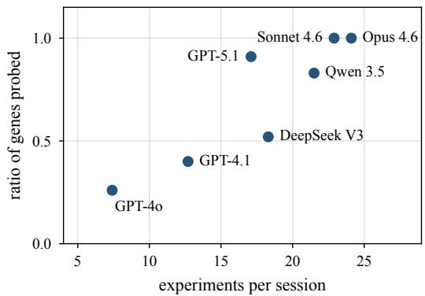

(b) Within models, more exploration does not help  
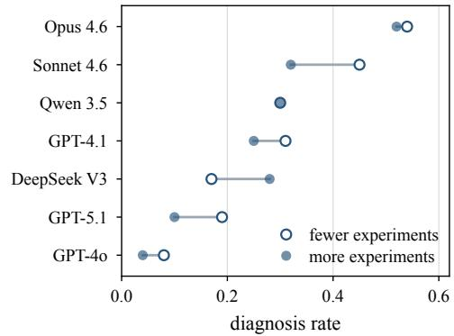  
Figure 3: Exploration does not simply explain diagnostic success. (a) Models differ substantially in both the number of experiments they run and the ratio of genes they probe. (b) Within each model, sessions above versus below its median experiment count show no consistent advantage from greater exploration.

▶ Takeaway — Diagnostic failure cannot be explained simply by agents running too few experiments or probing too few genes.

,→ Next question — Perhaps the problem is not insufficient exploration, but a lack of experiments capable ofidentifying the cause?

## 4.2 Second suspect: missing evidence

More exploration did not explain diagnostic success. This raises a more basic possibility: perhaps some organisms simply cannot be diagnosed from the experiments available to the agent? If two different faults produce the same observations under every permitted intervention, no experimental strategy can tell them apart.

Our controlled setting lets us check this directly. Suppose two faults produce the same abnormal phenotype: from that observation alone, both are plausible causes. We call the second an alternative hypothesis. An experiment is discriminating if its outcome would differ depending on which fault is present. Because the underlying system is known, we can simulate every possible fault and intervention, including experiments the agent never ran (Figure 4).

This separates the 60 organisms into three cases. In 14, only the true fault fits the initial phenotype (unambiguous). In 39, alternatives initially fit but available experiments can distinguish them from the truth (resolvable ambiguity). Only 7 contain an alternative that no available experiment can distinguish from the true fault (structural ambiguity). So, in 53 of 60 organisms, the cause is identifiable using the evidence available to the agent.

(b) One experiment separates them  
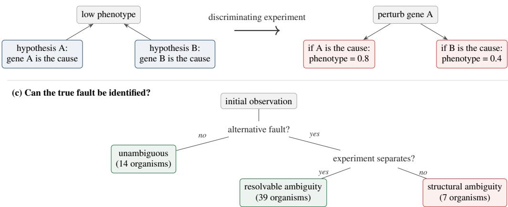  
Figure 4: Alternative hypotheses and discriminating experiments. (a) Two different faults can produce the same abnormal readout, leaving both as plausible causes. (b) An experiment is discriminating if its outcome differs depending on which fault is present. Values in (a) and (b) are illustrative. (c) We classify the 60 organisms by whether an alternative fault fits the initial observation and, if so, whether an available experiment can distinguish it from the true fault.

The mere presence of competing hypotheses does not explain the failures either. Diagnosis is similar on unambiguous and resolvably ambiguous organisms: 0.31 [0.16, 0.46] versus 0.30 [0.23, 0.37], respectively (bootstrap 95% CIs clustered by organism).

▶ Takeaway — Agents had access to experiments capable ofidentifying the cause in most organisms;   
poor diagnosis cannot be attributed to missing information.

,→ Next question — Ifthe evidence was available, do agents actually seek it?

## 4.3 The culprit: unused evidence

For each organism with at least one resolvable alternative (n = 43), we compare the experiments agents choose with uniform random selection from the same available interventions. Across 6,596 experiments run before agents commit their diagnosis, 24.1% of agents’ choices discriminate between the true fault and an alternative, compared with 19.2% under random selection (Figure 5). The difference is systematic across organisms (t = 4.6) but small: agents show only a weak preference for experiments that separate competing hypotheses, echoing the confirmation bias reported in LLMs [20].

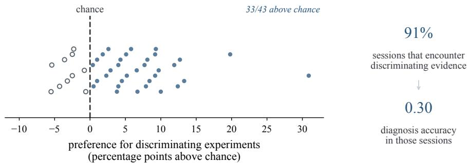  
Figure 5: Agents usually encounter discriminating evidence, but barely use it. Each point shows, for one organism with a resolvable alternative (n = 43), how often agents choose discriminating experiments relative to random choice. Agents show only a small preference above chance (24.1% vs. 19.2%). Nevertheless, 91% of sessions encounter discriminating evidence before diagnosis, yet diagnosis accuracy in those sessions is only 0.30.

This comparison is an oracle audit: discriminating experiments are identified using the ground truth and dynamics that are, by design, not available to the agents. Still, agents can test competing hypotheses by choosing experiments they expect to produce different outcomes depending on which hypothesis is correct.

Despite this weak preference, agents usually encounter discriminating evidence anyway. In 91% of committed sessions on these organisms, they run at least one discriminating experiment before diagnosis, yet diagnosis accuracy in these sessions is only 0.30. The evidence is rarely difficult to isolate: 97% of these sessions contain a discriminating result from a single perturbation. Nor does it arrive too late: agents run a median of 16 further experiments after first encountering it. So, the evidence is usually present in the agent’s own trajectory, in a simple form and well before it commits.

Figure 6 shows one example. The agent considers G008 as a possible cause and tests it in three directions. Each result favours the true fault over G008, yet the agent continues for another 14 experiments and eventually diagnoses G008. Its subsequent rescue succeeds despite the wrong diagnosis. Here, the problem is not obtaining evidence against the eventual diagnosis, but carrying that evidence forward into the causal conclusion.

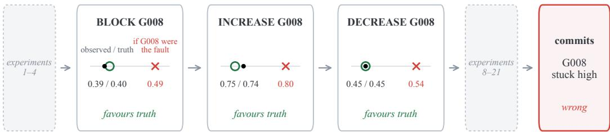  
Figure 6: One agent holds the evidence and commits against it. Experiments 5–7 probe the agent’s eventual diagnosis, G008, in three directions. In each case, the observed readout of one phenotype (black) matches the true fault’s prediction (green) rather than G008’s (red). The agent nevertheless commits to G008 14 experiments later.

▶ Takeaway — Agents choose discriminating experiments barely more often than chance, but encounter them in nearly every session. Most still reach the wrong diagnosis.

,→ Next question — Why does evidence that distinguishes competing causes fail to change the diagnosis?

## 4.4 The signature: successful diagnosis is contrastive

We first look for a behavioural signature of the investigations that succeed. One pattern stands out: correct diagnosis is strongly associated with perturbing the true causal component in both directions before committing.

Table 1: Diagnosis accuracy by how agents perturb the true cause, with session counts in brackets. Testing in both directions is associated with higher accuracy for every model. Five cells contain fewer than ten sessions, so individual estimates should be interpreted cautiously.
<table><tr><td rowspan="2">model</td><td colspan="3">true cause perturbed</td></tr><tr><td>never</td><td>one direction</td><td>both directions</td></tr><tr><td>Opus 4.6</td><td>0.00 (3) </td><td>0.00 (19)</td><td>0.84(38)</td></tr><tr><td>GPT-4.1</td><td>0.00 (25)</td><td>0.06 (16)</td><td>0.84(19)</td></tr><tr><td>Sonnet 4.6</td><td>0.00 (2)</td><td>0.00 (24)</td><td>0.71 (34)</td></tr><tr><td>Qwen 3.5</td><td>0.00(8)</td><td>0.13(30)</td><td>0.64(22)</td></tr><tr><td>GPT-4o</td><td>0.00 (43)</td><td>0.08 (12)</td><td>0.60 (5)</td></tr><tr><td>DeepSeek V3</td><td>0.00 (21)</td><td>0.00 (16)</td><td>0.57 (23)</td></tr><tr><td>GPT-5.1</td><td>0.00 (6)</td><td>0.03 (39)</td><td>0.53(15)</td></tr><tr><td>pooled</td><td>0.00 (108)</td><td>0.04(156)</td><td>0.71 (156)</td></tr></table>

When agents perturb the true cause in only one direction, diagnosis accuracy is 0.04; when they perturb it in both directions, accuracy rises to 0.71 (Table 1). No agent correctly diagnoses a cause it never perturbs (108 sessions). The same ordering holds for every model: accuracy in the both-directions group ranges from 0.53 for GPT-5.1 to 0.84 for Claude Opus 4.6.

Testing in both directions provides a contrast around the same candidate cause: the agent observes how the system responds to opposing changes rather than to a single intervention. This resembles the complementary use of loss- and gain-of-function perturbations in functional genomics, including CRISPRi and CRISPRa screens [21]. Successful diagnosis is therefore associated not simply with more evidence, but with contrastive evidence about the same candidate cause.

The association does not establish why this pattern predicts success. Testing in both directions may make the causal evidence easier to interpret, or agents that already suspect the correct cause may simply be more likely to test it systematically.

▶ Takeaway — Successful diagnosis has a strong contrastive signature: agents that test the true cause in both directions arefar more likely to identify it correctly.

,→ Next question — Can agents recognise and act on discriminating evidence when it is put directly in front of them?

## 4.5 Probing where evidence use breaks down

Agents usually encounter discriminating evidence but often fail to act on it. To find out why, we replay real investigations and gradually expose evidence to the agents. For each of the 43 organisms with a resolvable alternative we take one real session and cut it just before the agent committed a diagnosis. 42 of the 43 records come from Opus 4.6 sessions and one from a Sonnet 4.6 session, with a median of 22 experiments and 1–1.5k tokens of log. All seven models read the same experimental session records.

We designed three probe types, following increasing difficulty of the task. Probe 1 shows a single experiment; probe 2 adds a working hypothesis to defend or update; probes 3a to 3c show the whole log and withdraw the support in even more granular increments (Figure 7). Appendix B.4 provides construction details for each probe, together with confidence intervals and a repeat run.

(a) Probes gradually expose evidence and retract support  
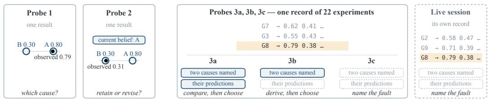

(b) Accuracy holds until the predictions are withheld  
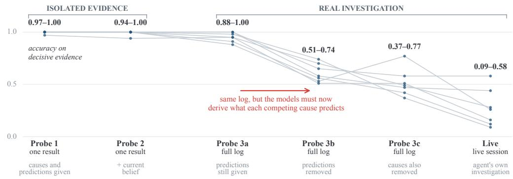  
Figure 7: Evidence use breaks in context. (a) Each probe shows more of the investigation and gives less help with it: the two competing causes, the readout each one predicts, both, or neither. (b) Accuracy on decisive evidence, each gray line represents a model; per-model values are in Tables 5 and 6. Accuracy stays close to 1.00 for as long as the predicted readouts are given (Probes 1–2 and 3a), falls once the models must work them out (3b–c), and falls further in live sessions.

Isolated evidence is easy to interpret. Probe 1 provides two candidate causes, their predicted outcomes, and an observed result; Probe 2 additionally assigns a current hypothesis and asks whether to retain or revise it. On 69 discriminating results, six of seven models are at or near ceiling on both tasks. DeepSeek V3 is the exception: it revises a contradicted hypothesis almost perfectly (0.94) but retains a supported one in only 0.74 of cases. Thus, when the causal comparison is explicit, models can both interpret decisive evidence and revise their hypothesis.

Models are less reliable at recognising non-evidence. On 43 items, one per organism, where the two causes predict readouts less than the measurement noise apart, Probe 1 accuracy falls to 0.30–0.53. Models usually choose the numerically closer prediction rather than conclude that the result is uninformative; in Probe 2, this triggers unwarranted revision in 5–13 of 43 cases.

The same evidence becomes difficult to interpret in the context of an experiment. Probe 3 has three layers, and each removes one kind of support while the record itself stays the same. The first layer (3a) supplies the two competing causes and the readout each one predicts for every logged experiment, so the model only has to find the experiment that separates them. Accuracy in this case is 0.88–1.00, matching the isolated-evidence probes, although the decisive result stays buried where the source agent left it. The second layer (3b) withholds those predictions, so the model must work out for itself what each cause implies: accuracy falls to 0.51–0.74. Performance of every model drops, and the two intervals do not overlap for any of them. Finally, the third layer (3c) withholds the causes as well, which leaves the live diagnosis question asked of a record the model did not have to collect. Here accuracy reaches 0.37–0.77. These results suggest that the failure mode cannot be localised to finding the decisive result in the experimental log. Repeating the first two layers on records written by a different model reproduces the pattern, with the same median gain of 0.35.

Reading the same record also compresses the large differences between models. On these 43 organisms, live diagnosis ranges from 0.09 to 0.58; given the identical experimental record, it ranges from 0.37 to 0.77. Live performance therefore reflects both reasoning over evidence and the evidence produced by the model’s own investigation.

▶ Takeaway — Models can interpret decisive evidence, revise a hypothesis, and locate the decisive observation inside afull experimental record. Even given appropriate and sufficient evidence, models struggle to predict the phenotype readouts that competing explanations of the malfunction would produce.

## 5 Conclusion

Scientific agents can restore a system’s behaviour without identifying the underlying cause. We used a controlled experimental environment to ask where this gap comes from, following the failure mode from experimental exploration to the use of evidence. Figure 8 shows the investigation as a chain: each step eliminates one explanation and hands its question to the next.

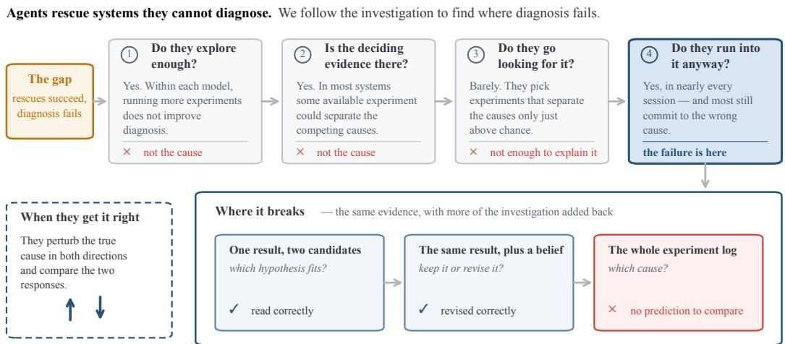  
Figure 8: Tracing the diagnosis–rescue gap through the investigation. Successive analyses rule out insufficient exploration and, for most systems, missing evidence, while bidirectional testing (dashed box) marks a correlate of successful diagnosis. Probes localise the remaining failure: models interpret and revise on isolated evidence, and still locate it inside a full record, but cannot derive what each competing cause predicts.

The failure proved surprisingly difficult to localise. Agents did not simply explore too little. We established that discriminating evidence was usually accessible and appeared in most experimental sessions. We used targeted probes to dissect the reasoning process: agents interpreted isolated evidence and revised their hypotheses reliably, and recovered the decisive observation from a full experimental record once they were told what each competing cause predicted, but could not derive those predictions themselves. One possible explanation is that deriving those readouts requires a causal model of the organism, which the models would have to build from the record in front of them. Successful investigations nevertheless showed one distinctive signature: the true cause was tested in both directions far more often than in failed investigations.

The broader conclusion is that successful intervention, informative experiments, and even access to decisive evidence do not by themselves demonstrate causal understanding. Evaluating scientific agents therefore requires looking inside the reasoning traces: what hypotheses remain plausible, what evidence could distinguish them, what evidence the agent obtains, and what it does with it. Our synthetic systems make these questions measurable by construction. They do not establish how often the same failures occur in real biology, but allow us to locate failures in scientific reasoning before asking whether they persist in more realistic settings.

## References

[1] Chris Lu, Cong Lu, Robert Tjarko Lange, Jakob Foerster, Jeff Clune, and David Ha. The AI scientist: Towards fully automated open-ended scientific discovery. arXiv preprint arXiv:2408.06292, 2024.

[2] Bodhisattwa Prasad Majumder, Harshit Surana, Dhruv Agarwal, Bhavana Dalvi Mishra, Abhijeetsingh Meena, Aryan Prakhar, Tirth Vora, Tushar Khot, Ashish Sabharwal, and Peter Clark. DiscoveryBench: Towards data-driven discovery with large language models. arXiv preprint arXiv:2407.01725, 2024.

[3] Agnieszka Dobrowolska, Rogier Hintzen, Martin Balla, Karl Gemayel, Sabine Reichert, Thomas Charman, Jen Ning Lim, Lindsay Edwards, and Anna Gogleva. Tiny moves: Game-based hypothesis refinement. arXiv preprint arXiv:2602.09801, 2026.

[4] Tingting Chen, Beibei Lin, Zifeng Yuan, Qiran Zou, Hongyu He, Anirudh Goyal, Yew-Soon Ong, and Dianbo Liu. HypoSpace: A diagnostic benchmark for set-valued hypothesis generation under underdetermination and sublinear coverage bounds. arXiv preprint arXiv:2510.15614, 2025. ICML 2026.

[5] Jon M. Laurent, Joseph D. Janizek, Michael Ruzo, Michaela M. Hinks, Michael J. Hammerling, Siddharth Narayanan, Manvitha Ponnapati, Andrew D. White, and Samuel G. Rodriques. LAB-Bench: Measuring capabilities of language models for biology research. arXiv preprint arXiv:2407.10362, 2024.

[6] Menghua Wu, Russell Littman, Jacob Levine, Lin Qiu, Tommaso Biancalani, David Richmond, and Jan-Christian Huetter. Contextualizing biological perturbation experiments through language. In Proceedings of the International Conference on Learning Representations (ICLR), 2025. arXiv:2502.21290.

[7] Haiteng Zhao, Chang Ma, Fangzhi Xu, Lingpeng Kong, and Zhi-Hong Deng. BioMaze: Benchmarking and enhancing large language models for biological pathway reasoning. arXiv preprint arXiv:2502.16660, 2025.

[8] Ziru Chen, Shijie Chen, Yuting Ning, Qianheng Zhang, Boshi Wang, Botao Yu, Yifei Li, Zeyi Liao, Chen Wei, Zitong Lu, Vishal Dey, Mingyi Xue, Frazier N. Baker, Benjamin Burns, Daniel Adu-Ampratwum, Xuhui Huang, Xia Ning, Song Gao, Yu Su, and Huan Sun. ScienceAgent-Bench: Toward rigorous assessment of language agents for data-driven scientific discovery. In Proceedings of the International Conference on Learning Representations (ICLR), 2025. arXiv:2410.05080.

[9] Daniil A. Boiko, Robert MacKnight, Ben Kline, and Gabe Gomes. Autonomous chemical research with large language models. Nature, 624(7992):570–578, 2023.

[10] Martiño Ríos-García, Nawaf Alampara, Chandan Gupta, Indrajeet Mandal, Sajid Mannan, Ali Asghar Aghajani, N. M. Anoop Krishnan, and Kevin Maik Jablonka. AI scientists produce results without reasoning scientifically. arXiv preprint arXiv:2604.18805, 2026.

[11] Wenting Chen, Zhongrui Zhu, Guolin Huang, and Wenxuan Wang. MedEinst: Benchmarking the einstellung effect in medical LLMs through counterfactual differential diagnosis. arXiv preprint arXiv:2601.06636, 2026.

[12] Zhenhao Chen, Yongqiang Chen, Chenxi Liu, Junchi Yu, Xiangchen Song, Zijian Li, Jialin Li, Philip Torr, Bo Han, and Kun Zhang. CausalGame: Benchmarking causal thinking of LLM agents in games. arXiv preprint arXiv:2607.04293, 2026. Short version accepted as an Oral at ICML 2026.

[13] Junlin Yang, Dylan Zhang, Xiangchen Song, Qirun Dai, Xiao Liu, Yuen Chen, Aniket Vashishtha, Jing Shi, Chenhao Tan, and Hao Peng. CausaLab: A scalable environment for interactive causal discovery toward AI scientists. arXiv preprint arXiv:2605.26029, 2026.

[14] Kanishk Gandhi, Michael Y. Li, Lyle Goodyear, Agam Bhatia, Louise Li, Aditi Bhaskar, Mohammed Zaman, and Noah D. Goodman. BoxingGym: Benchmarking progress in automated experimental design and model discovery. arXiv preprint arXiv:2501.01540, 2025. NeurIPS 2025 Workshop on Scaling Environments for Agents (SEA).

[15] Anna Gogleva, Thomas Charman, Martin Balla, and Karl Gemayel. LUCA: A synthetic world for experimental reasoning. arXiv preprint arXiv:2611.03100, 2026.

[16] Tim Van den Bulcke, Koenraad Van Leemput, Bart Naudts, Piet van Remortel, Hongwu Ma, Alain Verschoren, Bart De Moor, and Kathleen Marchal. SynTReN: a generator of synthetic gene expression data for design and analysis of structure learning algorithms. BMC Bioinformatics, 7:43, 2006.

[17] Thomas Schaffter, Daniel Marbach, and Dario Floreano. GeneNetWeaver: in silico benchmark generation and performance profiling of network inference methods. Bioinformatics, 27(16):2263–2270, 2011.

[18] Andreas Tjärnberg, Daniel C. Morgan, Matthew Studham, Torbjörn E. M. Nordling, and Erik L. L. Sonnhammer. GeneSPIDER – gene regulatory network inference benchmarking with controlled network and data properties. Molecular BioSystems, 13(7):1304–1312, 2017.

[19] Siyuan Liu, Hongbang Yuan, Xinze Li, Ziyue Zhu, Yixin Cao, and Yu-Gang Jiang. What do LLM agents know about their world? Task2Quiz: A paradigm for studying environment understanding. arXiv preprint arXiv:2601.09503, 2026.

[20] Ayush Rajesh Jhaveri, Anthony GX-Chen, Ilia Sucholutsky, and Eunsol Choi. Failing to falsify: Evaluating and mitigating confirmation bias in language models. arXiv preprint arXiv:2604.02485, 2026.

[21] Luke A. Gilbert, Max A. Horlbeck, Britt Adamson, Jacqueline E. Villalta, Yuwen Chen, Evan H. Whitehead, Carla Guimaraes, Barbara Panning, Hidde L. Ploegh, Michael C. Bassik, Lei S. Qi, Martin Kampmann, and Jonathan S. Weissman. Genome-scale CRISPR-mediated control of gene repression and activation. Cell, 159(3):647–661, 2014.

## Disclosure of LLM use

Large language models are the object of study in this work: the seven models evaluated throughout the paper are listed in Appendix B.3. Separately, the authors used an LLM-based coding assistant while preparing this manuscript. Its role was limited to editing the LAT X source, writing the plotting scripts that render several of the figures from tabulated results, cross-checking reported numbers and citations against the analysis outputs, and searching for related work. It did not run experiments, choose analyses, or score any model output: all benchmark and probe scoring is programmatic and uses exact or graded string matching against ground truth (Appendix A), with no model acting as a judge. The authors designed the study, made every analysis decision, and take responsibility for all claims in the paper.

## Reproducibility statement

The benchmark environment is available at https://github.com/RelationRx/luca. Organisms are fully determined by a (seed, tier, N) triple and generation is frozen at a tagged commit, so every system reported here can be regenerated exactly; Appendix A gives the dynamics, the fault model, the budget rule, and the scoring definitions. The behavioural results rest on 420 sessions, one per (model, organism) pair over seven LLMs and 60 disease organisms drawn from three sweeps. The discrimination census that defines alternatives and discriminating sets is specified in Appendix B.2, the exploration axes in Appendix B.3, and the construction, item counts, and response budgets of all three probes in Appendix B.4. The task instructions and every probe prompt are reproduced verbatim in Appendix B.6. Uncertainty is reported three ways: t-distribution intervals over seeds for the per-model scores in Appendix B.1, bootstrap intervals clustered by organism for organism-level quantities, and Wilson intervals for item accuracies; a full second run of the isolated-evidence probes is summarised in Appendix B.4.

## Ethics statement

This work uses only synthetic regulatory systems generated by code. It involves no human or animal subjects, no personal or clinical data, and no experiments on biological material. The organisms are invented abstractions rather than models of any real organism, and all gene, signal, and phenotype names are constructed words with no correspondence to real biological entities, so the paper conveys no information about real pathways or interventions. The study evaluates the limitations of AI systems on this synthetic task; we make no claim that the reported failure rates transfer to real biological discovery, and we caution against reading the diagnostic scores as evidence about any specific deployed system.

## Appendix

## A The LUCA environment

This appendix summarises the benchmark environment and its validation. The full design, generation pipeline, and validation experiments are in the benchmark paper [15]; everything the results in this paper depend on is restated here.

Organisms. An organism is a synthetic gene regulatory network of N genes in functional modules, driven by external signals and read out through observable phenotypes. At N=20, the setting used throughout this paper, an organism has 4 modules, 3 signals, and 3 phenotypes. Gene states $s _ { i } \in [ 0 , 1 ]$ evolve by a sigmoid update, $s _ { i } \gets \sigma \big ( \beta ( \sum _ { j } w _ { i j } s _ { j } + c _ { i } + b _ { i } ) \big ) + \varepsilon _ { i }$ , where positive weights activate and negative weights inhibit, c sums the active signal contributions, $b _ { i }$ is a gene bias, $\beta$ sets the steepness, and $\varepsilon _ { i } \setminus \mathcal { N } ( 0 , \sigma ^ { 2 } )$ is per-gene noise; the network is iterated to a fixed point. Difficulty tiers (easy, medium, hard) vary edge density, feed-forward and feedback structure, sigmoid steepness, noise, and the fraction of latent genes; the medium tier has no latent genes and moderate feedback. Every organism is fully determined by a (seed, tier, N) triple.

Invented vocabulary. All entity names are constructed words with no correspondence to real biological entities (genes G001–G020, signals such as burst-Y, phenotypes such as adaptation-score), removing the retrieval confound: an agent cannot look the system up, it can only experiment on it. The benchmark paper [15] tests this choice directly in a paired ablation (invented versus real human gene names, crossed with prompt stance and difficulty; 320 sessions) and finds no effect of the vocabulary in any paired contrast.

Faults, sessions, and scoring. In disease mode one gene or signal is locked into an abnormal state: a gene locked high, a gene locked low, or a chronically active external signal. The fault drives at least one phenotype outside its healthy range, is never a latent gene, and by construction at least one corrective single-target intervention exists. A session gives the agent a fixed budget of $B = N + N _ { \mathrm { s i g } } + 8$ experiments (31 at N=20) — enough for a complete single-gene sweep with little room for follow-up. The agent explores freely, answers two held-out prediction tasks, commits to a single malfunction hypothesis, and only then may test rescues: rescue is locked until the diagnosis is committed, so a rescue can never be found by trial and error and then rationalised into a diagnosis. Scoring: prediction accuracy is the fraction of phenotypes predicted within ±0.10 of ground truth; diagnosis is graded 1.0 (correct target and fault type), 0.5 (correct target, wrong type), 0.0 (wrong target); rescue is the fraction of aberrant phenotypes restored to the healthy range. A reviewer of this paper found that the released scorer instead counted every phenotype inside its healthy range, so an intervention that changed nothing scored $2 / 3$ on an organism with one aberrant phenotype of three. We thank them for the catch. The scorer has been corrected and every rescue score reported here is computed on the corrected metric; the benchmark release carries the fix. A no-intervention control under the corrected metric scores $0 . 1 5 0 \pm 0 . 1 7 1$ rather than zero, because in 3 of the 20 medium-difficulty organisms the aberrant phenotype lies within 0.02 of its healthy range and simulation noise alone can move it inside (Appendix B.1). The environment itself is deterministic: the three non-LLM baselines reproduce the scores reported here exactly from the released code. The seven LLM rows are single sampled runs, so they cannot be reproduced exactly, by us or by anyone else. Section 3 uses the graded diagnosis score; the investigation sections and the probes use exact match (target and type), which is the stricter criterion.

Interventions and action names. The tool-level action names are invented, like the rest of the vocabulary, as an anti-prior precaution: BLOCK (suppress to zero), BOOST (saturate), DAMPEN (partial reduction), plus signal activation. The paper’s prose and figures write these as block, increase, and decrease. Signals can be activated but not inhibited, mirroring limited interventional access in real biology.

Non-LLM baselines. Three baselines calibrate the task (Figure 2b). Random predicts 0.5 for every phenotype and runs no experiments; it quantifies the structural floor of each score. Heuristic blocks each gene once and predicts by summing individual effects. CausalSweep is a calibration baseline with privileged access to the sigmoid dynamics model (not to the network weights): it blocks and boosts every gene systematically and predicts by inverting the sigmoid. No LLM agent is given the underlying formula. CausalSweep’s near-perfect prediction accuracy with near-chance diagnosi (Table 2) shows that exhaustive, well-calibrated experimentation does not by itself produce causal identification.

## B Supplementary methods and tables

## B.1 The gap, with confidence intervals

Table 2 gives the per-model scores behind Figure 2b, with 95% confidence intervals (t-distribution over 20 seeds, medium disease; missing scores count as 0), plus prediction accuracy on the two held-out tasks. Rescue exceeds diagnosis for every model, and the two intervals fail to overlap for six of the ten agents. The final row is a no-intervention control: an empty intervention scored by the same metric. It is not zero because in 3 of the 20 organisms the aberrant phenotype lies within 0.02 of its healthy range, so simulation noise alone can move it inside. The Random baseline scores no better than this control, so random interventions essentially never rescue.

Table 2: Diagnosis, rescue, and prediction accuracy with 95% confidence intervals. Medium disease, 20 seeds per agent, mean ± 95% CI. Seven LLMs, then the three non-LLM baselines.
<table><tr><td>agent</td><td>prediction acc.</td><td>diagnosis</td><td>rescue</td></tr><tr><td>Opus 4.6</td><td> $0 . 8 5 0 \pm 0 . 0 5 6$ </td><td> $0 . 5 5 0 \pm 0 . 2 3 9$ </td><td> $1 . 0 0 0 \pm 0 . 0 0 0$ </td></tr><tr><td>Sonnet 4.6</td><td> $0 . 9 1 7 \pm 0 . 0 5 4$ </td><td> $0 . 3 5 0 \pm 0 . 2 2 9$ </td><td> $1 . 0 0 0 \pm 0 . 0 0 0$ </td></tr><tr><td>GPT-4.1</td><td> $0 . 8 1 7 \pm 0 . 0 8 4$ </td><td> $0 . 2 5 0 \pm 0 . 2 0 8$ </td><td> $0 . 6 5 0 \pm 0 . 2 2 9$ </td></tr><tr><td>Qwen 3.5</td><td> $0 . 7 9 2 \pm 0 . 0 6 6$ </td><td> $0 . 2 0 0 \pm 0 . 1 9 2$ </td><td> $0 . 9 0 0 \pm 0 . 1 4 4$ </td></tr><tr><td>DeepSeek V3</td><td> $0 . 7 0 8 \pm 0 . 0 6 1$ </td><td> $0 . 2 0 0 \pm 0 . 1 9 2$ </td><td> $0 . 9 0 0 \pm 0 . 1 4 4$ </td></tr><tr><td>GPT-5.1</td><td> $0 . 7 8 3 \pm 0 . 1 1 6$ </td><td> $0 . 1 5 0 \pm 0 . 1 7 1$ </td><td> $0 . 4 0 0 \pm 0 . 2 3 5$ </td></tr><tr><td>GPT-40</td><td> $0 . 6 4 2 \pm 0 . 0 6 8$ </td><td> $0 . 0 7 5 \pm 0 . 1 1 5$ </td><td> $0 . 1 0 0 \pm 0 . 1 4 4$ </td></tr><tr><td>CausalSweep</td><td> $0 . 9 3 3 \pm 0 . 0 4 7$ </td><td> $0 . 1 0 0 \pm 0 . 1 4 4$ </td><td> $0 . 6 5 0 \pm 0 . 2 2 9$ </td></tr><tr><td>Heuristic</td><td> $0 . 6 2 5 \pm 0 . 0 6 1$ </td><td> $0 . 1 0 0 \pm 0 . 1 4 4$ </td><td> $0 . 7 0 0 \pm 0 . 2 2 0$ </td></tr><tr><td>Random</td><td> $0 . 4 0 0 \pm 0 . 0 7 8$ </td><td> $0 . 0 7 5 \pm 0 . 1 1 5$ </td><td> $0 . 2 0 0 \pm 0 . 1 9 2$ </td></tr><tr><td>No intervention</td><td></td><td></td><td> $0 . 1 5 0 \pm 0 . 1 7 1$ </td></tr></table>

## B.2 The discrimination census

For each organism we enumerate every possible fault (agent-visible genes × locked high/low, signals × chronic activation), keep the alternatives — faults whose predicted baseline matches the true baseline within ±0.10 — and then simulate every available intervention under each alternative. An intervention is discriminating for an alternative when its predicted outcomes under the two candidate faults differ by more than ±0.10 on at least one phenotype; the organism’s discriminating set is the union over its alternatives. Organisms with alternatives have 2.3 of them on average, and a non-empty discriminating set holds on average 11.8 of the 63 available interventions — the one-in-five base rate that Section 4.3 tests agents’ choices against. Within the 39 resolvable organisms, 24 have a single experiment that separates the truth from every alternative at once; the rest need one experiment per alternative. Table 3 gives diagnosis by ambiguity class with the confidence intervals that Section 4.2 states qualitatively.

Table 3: Diagnosis accuracy by ambiguity class. Bootstrap 95% CIs clustered by organism (organisms resampled, not sessions), since sessions on one organism share a task.
<table><tr><td>class</td><td>organisms</td><td>committed sessions</td><td>diagnosis [95% CI]</td></tr><tr><td>unambiguous</td><td>14</td><td>98</td><td>0.31 [0.16, 0.46]</td></tr><tr><td>resolvable ambiguity</td><td>39</td><td>273</td><td>0.30 [0.23, 0.37]</td></tr><tr><td>structural ambiguity</td><td>7</td><td>49</td><td>0.12 [0.00, 0.29]</td></tr></table>

## B.3 Exploration axes

Section 4.1 describes experimentation along three axes, computed per session from the logged trajectories. Volume: the number of experiment calls (each costs one budget unit). Breadth: coverage, the fraction of the organism’s genes probed at least once (signals not counted). Direction: a target is tested bidirectionally when the same session pushes it both down and up. Table 4 gives the per-model means over all three disease sweeps. The diagnosis and rescue columns here use exact-match scoring pooled over all 60 organisms, so they differ from Table 2 (graded scoring, medium sweep only).

Table 4: Exploration axes per model, mean per session over all 420 sessions (60 per model). Diagnosis and rescue are exact-match, pooled over the three disease sweeps.
<table><tr><td>model</td><td>experiments</td><td>budget used</td><td>coverage</td><td>bidir. rate</td><td>diagnosis</td><td>rescue</td></tr><tr><td>Opus 4.6</td><td>24.1</td><td>84%</td><td>1.00</td><td>0.20</td><td>0.53</td><td>0.98</td></tr><tr><td>Sonnet 4.6</td><td>22.9</td><td>78%</td><td>1.00</td><td>0.26</td><td>0.40</td><td>0.94</td></tr><tr><td>Qwen 3.5</td><td>21.5</td><td>75%</td><td>0.83</td><td>0.36</td><td>0.30</td><td>0.94</td></tr><tr><td>DeepSeek V3</td><td>18.3</td><td>67%</td><td>0.52</td><td>0.43</td><td>0.22</td><td>0.93</td></tr><tr><td>GPT-5.1</td><td>17.1</td><td>59%</td><td>0.91</td><td>0.23</td><td>0.15</td><td>0.46</td></tr><tr><td>GPT-4.1</td><td>12.7</td><td>47%</td><td>0.40</td><td>0.37</td><td>0.28</td><td>0.73</td></tr><tr><td>GPT-40</td><td>7.4</td><td>28%</td><td>0.26</td><td>0.23</td><td>0.07</td><td>0.61</td></tr></table>

## B.4 Probe construction and full probe tables

Probes 1–2 (isolated evidence). Single-turn items built from the census and the session logs: 69 real items (a discriminating result; predicted separations $\geq 0 . 1 4 )$ and 43 fillers (an uninformative result; every phenotype gap $\leq 0 . 0 3 )$ , 112 items in total, 96 of whose observed values come from real session logs. Probe 1 shows the two candidate faults, their predicted readouts, and the observed value, and asks which fault the result supports (A / B / UNDETERMINED). Probe 2 adds an assigned working hypothesis and asks whether to retain or revise it. All seven models ran at a uniform 512-token response budget. Verbatim prompts for all probes, and the session task instructions, are in Appendix B.6. Uncertainty is ± half the 95% Wilson interval; cells at a boundary show the one-sided bound. A full second run of probes 1–2 (all seven models) moves the 35 table cells by 0.025 on average; real-item cells are essentially exact, filler cells move by up to 0.14 — filler differences under about 0.10 between models should not be interpreted.

Table 5: Probes 1–2: item accuracy per model. Real items n=69 (revise 34, retain 35), fillers $n { = } 4 3 .$ Filler accuracy means answering UNDETERMINED; revise-on-noise counts filler items answered REVISE — switching hypothesis on an uninformative result.
<table><tr><td>model</td><td>P1 real</td><td> $\mathrm { P 1 ~ f i l l e r }$ </td><td>P2 revise</td><td>P2 retain</td><td>P2 filler</td><td>revise-on-noise</td></tr><tr><td>Opus 4.6</td><td>1.00 (≥0.95)</td><td> $0 . 3 5 \pm 0 . 1 4$ </td><td> $1 . 0 0 \left( \geq 0 . 9 0 \right)$ </td><td> $1 . 0 0 \left( \geq 0 . 9 0 \right)$ </td><td> $0 . 6 3 \pm 0 . 1 4$ </td><td>5/43</td></tr><tr><td>Sonnet 4.6</td><td>1.00 (≥0.95)</td><td> $0 . 4 4 \pm 0 . 1 4$ </td><td> $1 . 0 0 \left( \geq 0 . 9 0 \right)$ </td><td> $1 . 0 0 \left( \geq 0 . 9 0 \right)$ </td><td> $0 . 5 1 \pm 0 . 1 4$ </td><td>5/43</td></tr><tr><td>GPT-4.1</td><td>1.00 (≥0.95)</td><td> $0 . 3 3 \pm 0 . 1 3$ </td><td>1.00 (≥0.90)</td><td> $0 . 9 7 \pm 0 . 0 7$ </td><td> $0 . 6 3 \pm 0 . 1 4$ </td><td>5/43</td></tr><tr><td>GPT-40</td><td>1.00 (≥0.95)</td><td> $0 . 3 0 \pm 0 . 1 3$ </td><td> $1 . 0 0 \left( \geq 0 . 9 0 \right)$ </td><td> $0 . 9 4 \pm 0 . 0 9$ </td><td> $0 . 4 0 \pm 0 . 1 4$ </td><td>13/43</td></tr><tr><td>GPT-5.1</td><td> $1 . 0 0 \left( \geq 0 . 9 5 \right)$ </td><td> $0 . 5 3 \pm 0 . 1 4$ </td><td> $1 . 0 0 \left( \geq 0 . 9 0 \right)$ </td><td> $1 . 0 0 \left( \geq 0 . 9 0 \right)$ </td><td> $0 . 3 5 \pm 0 . 1 4$ </td><td>8/43</td></tr><tr><td>DeepSeek V3</td><td> $0 . 9 7 \pm 0 . 0 5$ </td><td> $0 . 3 7 \pm 0 . 1 4$ </td><td> $0 . 9 4 \pm 0 . 0 9$ </td><td> $0 . 7 4 \pm 0 . 1 4$ </td><td> $0 . 5 8 \pm 0 . 1 4$ </td><td>10/43</td></tr><tr><td>Qwen 3.5</td><td> $1 . 0 0 \left( \geq 0 . 9 5 \right)$ </td><td> $0 . 3 3 \pm 0 . 1 3$ </td><td> $1 . 0 0 \left( \geq 0 . 9 0 \right)$ </td><td> $1 . 0 0 \left( \geq 0 . 9 0 \right)$ </td><td> $0 . 6 0 \pm 0 . 1 4$ </td><td>5/43</td></tr></table>

Probe 3 (evidence in context). Fixed replay: for each of the 43 organisms with a resolvable alternative, one real session’s full pre-commit evidence (median 22 experiments; 42 of the 43 records come from Opus 4.6 sessions and one from a Sonnet 4.6 session) is rendered as a neutral log. All models read the same 43 logs, each as a single-turn question, at a 1024-token response budget. The three conditions remove the scaffolding one step at a time. Probe 3a gives the two candidate faults and the oracle’s predicted readout of all three phenotypes under each candidate, for every experiment in the log, followed by Probe 1’s noise sentence. Probe 3b withholds those predictions and gives the two candidate faults alone (A / B / UNDETERMINED); probe 3c asks openly for the fault (target and type, exact match). The live column repeats each model’s live exact-match diagnosis on the same

43 organisms. Models answered UNDETERMINED in 1 of 301 3b answers — the pick-a-side habit of Table 5 persists in context.

A source-robustness run repeats Probes 3a and 3b on records written by Qwen 3.5 instead: the same 43 organisms, the same competing causes and assignment, logs of the same median length, 602 calls with no errors. Accuracy is 0.84–0.95 with the predictions supplied against 0.37–0.72 without them, a median gain of 0.35 against 0.35 on the Opus-sourced records; every model improves and all seven interval pairs are disjoint on both sets. Per-model differences between the two source sets are within their intervals and are not interpreted.

Probe 3a exists because Probe 3b differs from Probe 1 in four ways at once: the relevant experiment is no longer named, the relevant phenotype is no longer named, the per-candidate predictions are no longer given, and the noise tolerance is no longer stated. Probe 3a restores the last two while leaving the decisive observation buried, and reuses the Probe 3b items unchanged — same organisms, same source sessions, same transcripts, same candidate assignment. The untreated baseline is deliberately not a row: an alias is defined as matching the true fault at baseline within the 0.10 separation threshold, so the residual gap (median 0.057 over the 43 items) is not evidence by that criterion, yet is large enough to answer from without reading the log. Every item retains at least one row whose two predictions separate by at least 0.10; across those rows 174 favour the true fault and 6 favour the alias, all 6 on the hard tier. Pooled accuracy by difficulty is 0.98 (medium), 0.96 (easy) and 0.89 (hard), with 14 errors in 301 answers and no unparsed or UNDETERMINED reply.

Table 6: Probe 3: the same evidence, inside an investigation record. n=43 per cell, ± 95% Wilson halfwidths; cells at the ceiling show the one-sided bound. Probe 3a supplies the candidate predictions for every logged experiment, 3b withholds them. The replayed logs come almost entirely from Opus 4.6 sessions, so 3c measures reasoning over that evidence, not what each model’s own investigation would have produced.
<table><tr><td>model</td><td></td><td>3a (predictions given) 3b (predictions derived) 3c (open diagnosis)</td><td></td><td>live</td></tr><tr><td>Opus 4.6</td><td> $1 . 0 0 \left( \geq 0 . 9 2 \right)$ </td><td> $0 . 6 5 \pm 0 . 1 4$ </td><td> $0 . 5 8 \pm 0 . 1 4$ </td><td> $0 . 5 8 \pm 0 . 1 4$ </td></tr><tr><td>Sonnet 4.6</td><td> $1 . 0 0 \left( \geq 0 . 9 2 \right)$ </td><td> $0 . 5 8 \pm 0 . 1 4$ </td><td> $0 . 4 7 \pm 0 . 1 4$ </td><td> $0 . 4 4 \pm 0 . 1 4$ </td></tr><tr><td>GPT-4.1</td><td> $0 . 9 5 \pm 0 . 0 7$ </td><td> $0 . 7 0 \pm 0 . 1 3$ </td><td> $0 . 4 9 \pm 0 . 1 4$ </td><td> $0 . 2 8 \pm 0 . 1 3$ </td></tr><tr><td>GPT-40</td><td> $0 . 9 8 \pm 0 . 0 6$ </td><td> $0 . 7 4 \pm 0 . 1 3$ </td><td> $0 . 3 7 \pm 0 . 1 4$ </td><td> $0 . 0 9 \pm 0 . 0 9$ </td></tr><tr><td>GPT-5.1</td><td> $0 . 9 1 \pm 0 . 0 9$ </td><td> $0 . 5 6 \pm 0 . 1 4$ </td><td> $0 . 4 2 \pm 0 . 1 4$ </td><td> $0 . 1 2 \pm 0 . 1 0$ </td></tr><tr><td>DeepSeek V3</td><td> $0 . 9 5 \pm 0 . 0 7$ </td><td> $0 . 5 1 \pm 0 . 1 4$ </td><td> $0 . 5 1 \pm 0 . 1 4$ </td><td> $0 . 1 6 \pm 0 . 1 1$ </td></tr><tr><td>Qwen 3.5</td><td> $0 . 8 8 \pm 0 . 1 0$ </td><td> $0 . 5 3 \pm 0 . 1 4$ </td><td> $0 . 7 7 \pm 0 . 1 2$ </td><td> $0 . 2 6 \pm 0 . 1 3$ </td></tr></table>

## B.5 The full case-study trace

Figure 9 shows the complete 24-experiment record of the session excerpted in Figure 6, including the multi-intervention calls the excerpt elides. Two details complete the story told in Section 4.3. First, none of the agent’s solo pre-commit experiments formally separates the truth from its eventual diagnosis at the ±0.10 criterion — the readouts consistently favour the truth without being decisive, which is why the figure says favours. Second, at experiment 22, after the commit locked its hypothesis, the agent ran one of the four experiments that do formally separate the two candidates: the observed 0.60 against the 0.79 its diagnosis predicts is the decisive refutation of its own committed hypothesis, run too late to matter.

## B.6 Task instructions and probe prompts

The excerpts below are verbatim from the benchmark and probe code; only line wrapping is adjusted, and ⟨angle brackets⟩ mark values filled in per item. BLOCK / BOOST / DAMPEN are the invented tool-level action names discussed in Appendix A; the paper’s prose writes them as block / increase / decrease. The complete session system prompt and tool schemas are in the released code.

Session system prompt (excerpts). Every session opens with the anti-prior block:

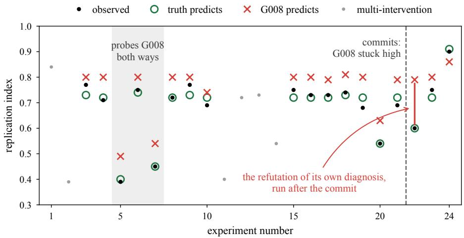  
Figure 9: The full session record behind Figure 6. Observed readouts (black) against the predictions of the true fault (green rings) and of the agent’s eventual diagnosis, G008 (red crosses); gray dots are multi-intervention calls, for which no single-fault prediction is defined. The shaded band marks the three G008 probes of Figure 6; the dashed line marks the commit; the red segment at experiment 22 is the post-commit refutation.

Prior biological knowledge is IRRELEVANT and may mislead you. The only valid path to understanding this organism is systematic causal reasoning from perturbation experiments.

Disease sessions add:

DISEASE CONTEXT: This cell exhibits aberrant phenotypes compared to its healthy baseline ranges. The regulatory network has a single malfunction — either a node locked high (LOCK\_HI), a node locked low (LOCK\_LO), or a persistently active external signal (PERSIST). Your job is to identify it and restore healthy phenotypes.

The diagnosis and rescue tasks, from the prompt’s PRIMARY GOALS list:

1. Malfunction diagnosis — identify which gene or signal is broken and how (LOCK\_HI / LOCK\_LO / PERSIST). Submit via submit\_malfunction\_hypothesis().   
2. Rescue — design an intervention that restores aberrant phenotypes to healthy ranges. Test it via test\_rescue().

and the workflow step that makes the commitment binding:

When confident, submit your malfunction hypothesis via submit\_malfunction\_hypothesis(). This is a one-time, irreversible commitment — it locks immediately and unlocks test\_rescue(). Score is revealed at session end.

Tool descriptions. The two disease-mode tools, as described to the agent:

submit\_malfunction\_hypothesis — “Submit your hypothesis about which gene or signal is malfunctioning and how. No budget cost. One submission only — locked immediately. Unlocks test\_rescue(). Score is NOT returned here; it is revealed at session end. Commit only when confident — you cannot revise this.” Arguments: target\_name (a gene name or signal label) and malfunction\_type (LOCK\_HI, LOCK\_LO, or PERSIST).   
test\_rescue — “Test whether a proposed intervention restores aberrant phenotypes to healthy ranges. Costs 1 budget. Requires submit\_malfunction\_hypothesis() to be called first. Runs the organism from the disease baseline with your intervention and reports per-phenotype restoration status and MSE vs healthy baseline.” Argument: a map of targets to interventions (BLOCK / BOOST / DAMPEN for genes, or signal activation).

Probe 1 (read one clue). The full single-turn prompt:

You are analysing a synthetic organism with exactly one hidden fault.   
The fault is one of these two candidates:   
(A) ⟨candidate A   
(B) ⟨candidate B⟩   
An experiment was run: ⟨experiment⟩.   
Predicted ‘⟨phenotype⟩’ readout:   
if (A) is true: about ⟨value   
if (B) is true: about ⟨value   
Observed ‘⟨phenotype⟩’: ⟨value⟩   
Predictions and readouts carry simulation noise; deviations up to   
about ±0.05 from a matching prediction are common.   
Which candidate does this result support?   
Answer with exactly one token: A, B, or UNDETERMINED.

Candidates render as, e.g., “gene G012 is locked high (LOCK\_HI)” or “signal burst-Y is persistently active (PERSIST)”; experiments as “apply BLOCK to gene G012” or “activate signal nutrient-X”.

Probe 2 (update a belief). Identical to Probe 1, with one line inserted after the candidates —

Your current working hypothesis is (⟨A or B⟩).

— and the closing question replaced by:

Given this result, should you RETAIN your hypothesis, REVISE it to the other candidate, or is the result   
UNINFORMATIVE between the two?   
Answer with exactly one token: RETAIN, REVISE, or UNINFORMATIVE.

Probe 3 (diagnose from the log). Each item replays one session’s pre-diagnosis experiment log. The transcript format:

A budget-limited investigation was run on a synthetic organism with   
exactly one hidden fault (a gene locked high or low, or a signal   
persistently active).   
Genes: ⟨gene list⟩   
Signals: ⟨signal list, with modes⟩   
Baseline phenotypes (diseased) vs healthy ranges:   
⟨label⟩: ⟨value⟩ (healthy ⟨lo⟩–⟨hi⟩) <-- ABERRANT [ifoutside]   
Experiments run, in order (each line: interventions -> resulting phenotypes):   
1. ⟨action⟩ ⟨target⟩ -> ⟨phenotype values

Probe 3b appends the two candidates and asks:

Exactly one of these two candidate faults is present:   
(A) ⟨candidate A⟩   
(B) ⟨candidate B⟩   
Based on the evidence above, which candidate is more likely?   
You may reason briefly first. End your reply with one line:   
ANSWER: A or ANSWER: B or ANSWER: UNDETERMINED

Probe 3c removes the candidates and asks for an open diagnosis:

Based on the evidence above, name the single most likely fault.   
Fault types: LOCK\_HI, LOCK\_LO, PERSIST. You may reason briefly   
first. End your reply with one line:   
ANSWER: ⟨target⟩ ⟨type⟩ e.g. ANSWER: G007 LOCK\_HI

Probe 3a (predictions supplied). Probe 3b’s prompt, with one block inserted between the candidates and the question:

Predicted readouts under each candidate, for every experiment above:   
⟨n⟩. ⟨interventions⟩   
if (A) is true: ⟨phenotype readouts⟩   
if (B) is true: ⟨phenotype readouts⟩   
Predictions and readouts carry simulation noise; deviations up to   
about ±0.05 from a matching prediction are common.