# UniFlow: Unified Multi-Scale Flow Matching for Time Series Generation

Shibo Feng\*, Wei Li\*, Min Wu Senior Member, IEEE, Chunyan Miao† Fellow, IEEE, Peilin Zhao† Senior Member, IEEE

Abstract—Real-world time series exhibit complex dynamics across multiple temporal resolutions, yet effectively incorporating multi-scale information into generative modeling remains challenging without increasing generative complexity. We propose UniFlow, a unified framework that integrates multi-scale representation learning with efficient non-autoregressive generation through a shared-semantic discrete interface. Specifically, a multi-scale tokenizer employs shared-index voting to consolidate complementary temporal information into a single public-ID sequence, while scale-specific codebooks preserve the information required for reconstruction. Building on this unified representation, we develop geometry-aware categorical flow matching, which initializes transport from learned low-rank anchors and generates public identities non-autoregressively. This design captures multi-scale temporal structure without requiring multiple generative token streams or sequential token decoding. Experiments across four benchmarks and both short- and longterm settings demonstrate improved generative fidelity, strong cross-scale consistency, and substantial inference speedups over representative autoregressive and diffusion-based baselines. Code is available at https://github.com/William-Liwei/uniflow

Index Terms—Time Series, Vector Quantization, Flow Matching.

## I. INTRODUCTION

Time-series generation aims to learn the underlying distribution of temporal processes, supporting applications such as simulation, data augmentation, privacy-preserving analysis, and downstream model development. Recent advances span adversarial generators [1, 2], variational latent models [3], diffusion-based approaches [4, 5, 6], and flow-based generative models [7]. Despite their progress in generative fidelity, effectively incorporating multiscale temporal information into a unified and efficient generation process remains an important challenge.

Real-world time series exhibit complex dynamics across multiple temporal resolutions, ranging from local fluctuations and periodic variations to long-term trends. These structures provide complementary information about the same underlying process, motivating multiscale representation learning in temporal modeling [8, 9, 10]. For generation, however, capturing individual temporal patterns is not sufficient: the generated sequences must also preserve their relationships across scales. This raises a fundamental question: How can complementary multiscale information be integrated into a unified generative representation without introducing multiple token streams or excessive generation complexity? Addressing this question involves three key challenges.

1. Capturing Complementary Multi-scale Dynamics. Tem poral patterns exhibit different characteristics across resolutions, making it difficult for a single temporal view to explicitly distinguish local variations from broader temporal structures. An effective representation should capture complementary information at different scales while preserving their correspondence to the same underlying sequence.

2. Unifying Multi-scale Semantics without Interface Expansion. Multi-scale representations naturally introduce multiple sets of latent features or discrete tokens. Directly generating separate scale-specific streams requires coordination across representations, while concatenating them increases the sequence length presented to the generator. The challenge is therefore to consolidate multi-scale information into shared semantic identities without expanding the generator-facing token sequence.

3. Efficient Generation of Unified Token Sequences. Autoregressive token generation relies on sequential decoding, where predictions depend on previously generated tokens. Its teacher-forced training procedure also introduces a discrepancy between training and inference histories, potentially accumulating errors during generation [11, 12]. An alternative should generate the complete shared-token sequence nonautoregressively while effectively modeling the structure of its latent distribution.

To address these challenges, we propose UniFlow, a unified multi-scale time-series generation framework that connects shared-semantic tokenization with geometry-aware categorical flow matching. In Stage 1, aligned scale-specific encoders extract complementary temporal representations, while sharedindex voting assigns a common public identity to each temporal position. Scale-specific codebooks retain reconstruction details, whereas the resulting public-ID sequence provides a single, length-L generative interface regardless of the number of scales. In Stage 2, a learned low-rank anchor prior provides structured initialization for categorical flow matching, which models the complete public-ID trajectory through nonautoregressive continuous transport. This design integrates multi-scale representation learning with efficient generation without requiring multiple synchronized token streams.

Our main contributions are summarized as follows:

• Unified Multi-scale Semantic Tokenization. We introduce shared-index voting with scale-specific codebooks to integrate complementary temporal information into a single public-ID sequence, preserving multi-scale reconstruction information without expanding the generative interface.

• Geometry-Aware Non-Autoregressive Generation. We develop a categorical flow framework that combines learned low-rank anchor initialization with parallel public-ID generation, avoiding sequential token decoding while leveraging the learned latent structure.

• Generative Fidelity and Multi-scale Consistency. Extensive experiments across four benchmarks demonstrate improved generative fidelity and inference efficiency. Reconstruction, cross-scale consistency, and scale-aware statistical analyses further validate the effectiveness of the unified multi-scale representation.

## II. RELATED WORK

Generative Models for Time Series Generation. Generative modeling has advanced time series generation through diverse paradigms, including adversarial learning, variational inference, diffusion, and flow-based methods. TimeGAN [1] and COT-GAN [2] employ adversarial objectives to capture temporal distributions, while TimeVAE [3] provides a latentvariable generative framework. Diffusion-based methods [4, 5, 6, 13] achieve expressive distribution modeling through iterative denoising, whereas FlowTS [7] explores efficient continuous transport via rectified flow. Despite their respective strengths, effectively incorporating intrinsic temporal characteristics, particularly multiscale dependencies, into generative modeling while balancing generative fidelity and sampling efficiency remains an important research direction.

Discrete and Multi-scale Representation Learning. VQ-VAE [14] and VQGAN [15] compress observations into reusable discrete tokens. Hierarchical and residual quantization further enhance representational capacity through mul tiple latent levels [16, 17]. Recently, vector-quantized modeling has gained increasing attention in time series generation. SDformer [18] and SDFlow [19] introduces similaritydriven discrete token modeling, while MSDformer [20] and TimeMAR [21] explore multi-scale discrete generation. Despite these advances, balancing temporal representation quality and efficient generative fidelity remains an important challenge. UniFlow addresses this challenge by integrating multiscale information into a unified public-token interface for nonautoregressive generation.

Flow Matching and Non-Autoregressive Generation. Flow matching and rectified flow learn continuous transport fields [22, 23, 24], while stochastic interpolants connect flowbased and diffusion-based modeling [25, 26]. Variational flow matching further supports flexible endpoint distributions, including categorical posteriors [27], with DiT providing a scalable generative backbone [28]. In discrete representation learning, TokenFlow [29] aligns text-guided semantic and pixel-level visual features through shared code indices, unifying image understanding and generation. In contrast, UniFlow employs shared-index learning to integrate multi-scale temporal evidence into a single public-ID sequence, enabling nonautoregressive categorical flow generation without separate scale-specific token streams.

The Position of UniFlow Existing studies have advanced time series generation through expressive generative models, multiscale discrete representations, and efficient flow-based learning. However, effectively integrating complementary temporal information without increasing generative complexity remains an important challenge. To bridge these directions, UniFlow unifies multiscale semantic representations through a shared public-token interface and employs geometry-aware categorical flow matching for non-autoregressive generation. This design enables rich multiscale modeling within a single generative sequence, providing an effective balance between representation capacity and efficient generative fidelity.

## III. PRELIMINARIES

We fix the notation shared by both stages and briefly recall the single-scale components that UniFlow generalizes. UniFlow combines a shared-index multi-scale token interface with non-autoregressive token space generation.

Problem Formulation. Let $\mathbf { X } _ { 1 : \ell } = ( \mathbf { x } _ { 1 } , \ldots , \mathbf { x } _ { \ell } ) \in \mathbb { R } ^ { \ell \times d }$ be a multivariate time series drawn from the unknown data distribution $p _ { \mathrm { d a t a } }$ . Given a source variable $\mathbf { Z } _ { 0 } \sim \pi _ { 0 }$ , unconditional generation learns a mapping $\mathcal { G }$ such that

$$
\hat { \mathbf { X } } _ { 1 : \ell } = \mathcal { G } ( \mathbf { Z } _ { 0 } ) , \qquad p _ { \mathcal { G } } \approx p _ { \mathrm { d a t a } } .\tag{1}
$$

For aligned temporal views $\lbrace \mathcal { T } _ { m } \rbrace _ { m = 1 } ^ { M }$ induced by different receptive fields or patch scales, the multi-scale objective additionally requires the joint generated view distribution

$$
\operatorname { L a w } \left( \mathcal { T } _ { 1 } ( \hat { \mathbf { X } } ) , \ldots , \mathcal { T } _ { M } ( \hat { \mathbf { X } } ) \right)\tag{2}
$$

to approximate the corresponding joint distribution of real views. The goal is therefore one coherent generated sequence, rather than independently generated outputs for different temporal scales.

Similarity-Based Quantization. Following similarity-based discrete tokenization [18, 19], a VQ tokenizer first maps the input sequence to latent features $\mathbf { H } _ { 1 : L } = \mathcal { E } ( \mathbf { X } _ { 1 : \ell } ) \in \bar { \mathbb { R } } ^ { L \times d _ { c } }$ where $L = \ell / s$ is the compressed token length. Each latent vector is then assigned to one code in a learned vocabulary $\mathcal { C } = \{ \mathbf { c } _ { k } \} _ { k = 0 } ^ { K - 1 } \subset \mathbb { R } ^ { \breve { d } _ { c } }$ by cosine similarity:

$$
y _ { i } = Q ( \mathbf { h } _ { i } ) : = \arg \operatorname* { m a x } _ { k = 0 , \ldots , K - 1 } \frac { \mathbf { h } _ { i } } { \left\| \mathbf { h } _ { i } \right\| } \cdot \frac { \mathbf { c } _ { k } } { \left\| \mathbf { c } _ { k } \right\| } .\tag{3}
$$

Normalized similarities help prevent the codebook from collapsing toward a few large-norm entries, after which the decoder reconstructs the series from the retrieved embeddings. UniFlow extends this rule with aligned branches that produce scale-specific latents but jointly export one public token sequence and codebook; Section IV-A details the shared mapping across branch-specific codebooks.

Rectified Flow Matching (RFM) [30]. RFM learns a timedependent velocity field $\bar { \mathbf { v } } _ { \theta } : \mathbb { R } ^ { D } \times [ 0 , 1 ] \to \mathbb { R } ^ { D }$ whose ODE moves samples from a simple source distribution toward the target distribution:

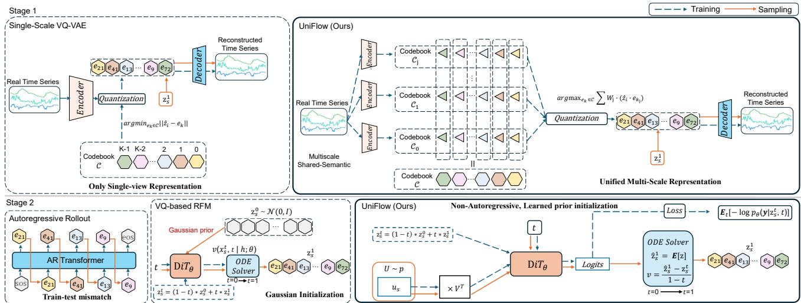  
Fig. 1: Overview of UniFlow. Stage 1 integrates aligned temporal representations through shared-index voting, yielding a single public-ID sequence and scale-specific codebooks. Stage 2 generates public identities using anchor-initialized categorical flow matching, followed by scale-specific embedding retrieval and decoding. Dashed blue and solid orange arrows denote training and sampling, respectively.

$$
\frac { d \mathbf { z } _ { t } } { d t } = \mathbf { v } _ { \theta } ( \mathbf { z } _ { t } , t ) , \quad \mathbf { z } _ { 0 } \sim p _ { 0 } , \quad \mathbf { z } _ { 1 } \sim p _ { \mathrm { d a t a } } .\tag{4}
$$

For the linear interpolation path ${ \bf z } _ { t } = ( 1 - t ) { \bf z } _ { 0 } + t { \bf z } _ { 1 }$ , the target velocity becomes ${ \bf z } _ { 1 } - { \bf z } _ { 0 }$ , leading to the objective

$$
\mathcal { L } _ { \mathrm { F M } } = \mathbb { E } _ { t , { \mathbf { z } _ { 0 } } , { \mathbf { z } _ { 1 } } } \left[ \| { \mathbf { v } _ { \theta } } ( { \mathbf { z } _ { t } } , t ) - ( { \mathbf { z } _ { 1 } } - { \mathbf { z } _ { 0 } } ) \| ^ { 2 } \right] .\tag{5}
$$

Because the whole sequence evolves jointly under this ODE, flow matching removes the left-to-right dependency that drives exposure bias in autoregressive token models.

## IV. METHOD

As illustrated in Fig. 1, UniFlow consists of two stages that connect multiscale representation learning with unified nonautoregressive generation. Stage 1 learns a shared-semantic tokenizer, in which aligned temporal views jointly determine a single public-ID sequence while retaining scale-specific codebooks for reconstruction. Stage 2 models this sequence through geometry-aware categorical flow matching, combining a learned low-rank anchor prior with non-autoregressive endpoint prediction. Thus, multiscale information is incorporated into a single generative interface without introducing separate token streams for individual scales.

## A. Stage 1: Shared-Semantic Multiscale Tokenization

Aligned Temporal Representations. Given an input time series $\mathbf { X } _ { 1 : \ell } \in \mathbb { R } ^ { \ell \times d }$ , we employ M temporal encoders with different receptive fields or patch sizes:

$$
\mathbf { H } _ { 1 : L } ^ { ( m ) } = { \mathcal { E } } ^ { ( m ) } ( \mathbf { X } _ { 1 : \ell } ) \in \mathbb { R } ^ { L \times d _ { m } } , \qquad \sum _ { m = 1 } ^ { M } d _ { m } = d _ { c } .\tag{6}
$$

All branches are aligned to the same compressed temporal length L, so each position i is characterized by the complementary representations $\{ \mathbf { h } _ { i } ^ { ( m ) } \} _ { m = 1 } ^ { M }$ . Our implementation uses fine- and coarse-scale branches, while the formulation allows more temporal resolutions.

Independently quantizing these views would produce multiple scale-specific token sequences, requiring the generator to represent their temporal evolution and cross-scale dependencies. We instead separate shared semantic identity from scalespecific realization: the branches retain private embedding spaces but jointly select a public discrete index.

(1) Shared-index Voting Quantization. Branch m maintains a codebook

$$
\mathcal { C } ^ { ( m ) } = \{ \mathbf { c } _ { k } ^ { ( m ) } \} _ { k = 0 } ^ { K - 1 } \subset \mathbb { R } ^ { d _ { m } } ,\tag{7}
$$

with a common index set $\{ 0 , \ldots , K - 1 \}$ across branches. For each position i and candidate code $k ,$ the normalized branchwise similarity is

$$
s _ { i , k } ^ { ( m ) } = \frac { \mathbf { h } _ { i } ^ { ( m ) } } { \| \mathbf { h } _ { i } ^ { ( m ) } \| _ { 2 } } \cdot \frac { \mathbf { c } _ { k } ^ { ( m ) } } { \| \mathbf { c } _ { k } ^ { ( m ) } \| _ { 2 } } .\tag{8}
$$

The branch-wise evidence is combined before discrete assignment:

$$
y _ { i } = \arg \operatorname* { m a x } _ { k = 0 , \ldots , K - 1 } \sum _ { m = 1 } ^ { M } \alpha _ { m } s _ { i , k } ^ { ( m ) } , \qquad \sum _ { m = 1 } ^ { M } \alpha _ { m } = 1 .\tag{9}
$$

Accordingly, each temporal position receives one public ID rather than separate scale-specific assignments. Importantly, a shared index does not force the branch embeddings to be identical: code k acts as a common semantic key whose realization $\mathbf { c } _ { k } ^ { ( m ) }$ remains specific to scale m.

(2) Public-token Construction and Training. After selecting $y _ { i } ,$ each branch retrieves its private codeword $\tilde { \mathbf { h } } _ { i } ^ { ( m ) } = \mathbf { c } _ { y _ { i } } ^ { ( m ) }$ The decoder reconstructs the sequence from the concatenated embeddings

$$
\tilde { \mathbf { h } } _ { i } = \mathrm { c o n c a t } \left( \tilde { \mathbf { h } } _ { i } ^ { ( 1 ) } , \ldots , \tilde { \mathbf { h } } _ { i } ^ { ( M ) } \right) \in \mathbb { R } ^ { d _ { c } } .\tag{10}
$$

This induces a fused public codebook

$$
\mathcal { C } _ { \mathrm { s h a r e d } } = \left\{ \mathbf { c } _ { k } ^ { \mathrm { s h a r e d } } = \mathrm { c o n c a t } \left( \mathbf { c } _ { k } ^ { ( 1 ) } , \ldots , \mathbf { c } _ { k } ^ { ( M ) } \right) \right\} _ { k = 0 } ^ { K - 1 } .\tag{11}
$$

Stage 1 is trained with reconstruction and branch-wise commitment losses:

$$
\begin{array} { l } { \displaystyle \mathcal { L } _ { \mathrm { V Q } } = \| \mathbf { X } _ { 1 : \ell } - \tilde { \mathbf { X } } _ { 1 : \ell } \| _ { F } ^ { 2 } } \\ { \displaystyle + \frac { \lambda } { L } \sum _ { i = 1 } ^ { L } \sum _ { m = 1 } ^ { M } \alpha _ { m } \left( 1 - \mathbf { h } _ { i } ^ { ( m ) } \cdot \mathbf { s } \mathbf { g } ( \tilde { \mathbf { h } } _ { i } ^ { ( m ) } ) \right) , } \end{array}\tag{12}
$$

where the dot products are evaluated using normalized branch features and codewords, and $\operatorname { s g } ( \cdot )$ denotes stop-gradient. Scale-specific codebooks are updated by exponential moving average (EMA), with inactive-code resetting to maintain utilization.

Once trained, the tokenizer is frozen. Its output consists of one public-ID sequence $y _ { 1 : L }$ and the fused endpoint representation

$$
\mathbf { Z } _ { 1 } = \left[ \mathbf { c } _ { y _ { 1 } } ^ { \mathrm { s h a r e d } } , \ldots , \mathbf { c } _ { y _ { L } } ^ { \mathrm { s h a r e d } } \right] ^ { \top } \in \mathbb { R } ^ { L \times d _ { c } } ,\tag{13}
$$

which provides the shared discrete vocabulary and continuous endpoint targets for Stage 2.

## B. Stage 2: Geometry-Aware Categorical Flow Matching

Stage 2 models the public-token sequence exported by the frozen tokenizer. We first construct a structured source distribution informed by the geometry of training endpoints, and then learn a continuous velocity field through categorical prediction over their public identities.

(1) Low-rank Anchor Initialization. Valid public-token endpoints are assembled from a finite shared codebook and exhibit sequence-level structure in the ambient latent space. To capture this geometry, we vectorize the endpoints as

$$
\begin{array} { r } { \mathbf { z } _ { 1 } = \mathrm { v e c } ( \mathbf { Z } _ { 1 } ) \in \mathbb { R } ^ { D } , \qquad D = L d _ { c } , } \end{array}\tag{14}
$$

and collect $N _ { a }$ training endpoints in

$$
\mathbf { Z } _ { a } = \left[ \mathbf { z } _ { 1 } ^ { ( 1 ) } , \ldots , \mathbf { z } _ { 1 } ^ { ( N _ { a } ) } \right] ^ { \top } \in \mathbb { R } ^ { N _ { a } \times D } .\tag{15}
$$

We approximate these endpoints using a learned low-rank factorization,

$$
\begin{array} { r } { { \bf Z } _ { a } \approx { \bf U } { \bf V } ^ { \top } , \qquad r \ll D , } \end{array}\tag{16}
$$

where $\mathbf { U } \in \mathbb { R } ^ { N _ { a } \times r }$ contains support coordinates and ${ \textbf { V } } \in$ $\mathbb { R } ^ { D \times r }$ provides a shared basis. The coordinates are regularized by

$$
\mathcal { L } _ { \mathrm { r e g } } = \lambda _ { \mu } \| \bar { \mathbf { u } } \| _ { 2 } ^ { 2 } + \lambda _ { \sigma } \left| \mathrm { s t d } ( \mathbf { U } ) - 1 \right| .\tag{17}
$$

For a sampled support coordinate ${ \bf u } _ { a } ,$ , we construct an anchor by local perturbation:

$$
\begin{array} { r } { \epsilon \sim \mathcal { N } ( \mathbf { 0 } , h ^ { 2 } \mathbf { I } _ { r } ) , \qquad \mathbf { z } _ { 0 } = ( \mathbf { u } _ { a } + \epsilon ) \mathbf { V } ^ { \top } . } \end{array}\tag{18}
$$

After reshaping $\mathbf { z } _ { 0 }$ into $\mathbf { Z } _ { 0 } \in \mathbb { R } ^ { L \times d _ { c } }$ , we apply token-wise normalization,

$$
\begin{array} { r } { \mathbf Z _ { 0 } \gets \mathrm { R o w N o r m } ( \mathbf Z _ { 0 } ) . } \end{array}\tag{19}
$$

The bandwidth h is determined from neighboring supportcoordinate distances. This procedure defines an anchor distribution $p _ { \mathrm { a n c h o r } }$ concentrated around the learned low-rank scaffold rather than an isotropic ambient-space source.

(2) Categorical Endpoint Prediction. For an anchor–endpoint training pair $( \mathbf { Z } _ { 0 } , \mathbf { Z } _ { 1 } )$ and $t \in [ 0 , 1 )$ , the interpolation is

$$
{ \bf Z } _ { t } = ( 1 - t ) { \bf Z } _ { 0 } + t { \bf Z } _ { 1 } .\tag{20}
$$

A DiT-based network predicts logits $f _ { \theta } ( \mathbf { Z } _ { t } , t ) \in \mathbb { R } ^ { L \times K }$ defining a categorical posterior at each position:

$$
\begin{array} { r } { q _ { \theta } ( y _ { i } = k \mid \mathbf { Z } _ { t } , t ) = \boldsymbol { \pi } _ { \boldsymbol { \theta } , i } ^ { t , k } , } \\ { \boldsymbol { \pi } _ { \boldsymbol { \theta } , i } ^ { t , k } = \frac { \exp ( f _ { \boldsymbol { \theta } , i } ^ { k } ( \mathbf { Z } _ { t } , t ) / \tau ) } { \sum _ { j = 0 } ^ { K - 1 } \exp ( f _ { \boldsymbol { \theta } , i } ^ { j } ( \mathbf { Z } _ { t } , t ) / \tau ) } , } \end{array}\tag{21}
$$

where $\tau$ is the softmax temperature. Rather than regressing an unconstrained endpoint embedding, the model directly learns the probabilities of the valid public identities supplied by Stage 1.

(3) Categorical-to-continuous Transport. The categorical prediction is mapped to the shared embedding space using its expected codeword:

$$
\mu _ { \boldsymbol { \theta } , i } ( \mathbf { Z } _ { t } , t ) = \sum _ { k = 0 } ^ { K - 1 } \pi _ { \boldsymbol { \theta } , i } ^ { t , k } \mathbf { c } _ { k } ^ { \mathrm { s h a r e d } } .\tag{22}
$$

Stacking these means gives $\mathrm { M } _ { \theta } ( \mathbf { Z } _ { t } , t ) \in \mathbb { R } ^ { L \times d _ { c } }$ . We parameterize the velocity field by

$$
{ \bf V } _ { \theta } ( { \bf Z } _ { t } , t ) = \frac { \mathrm { M } _ { \theta } ( { \bf Z } _ { t } , t ) - { \bf Z } _ { t } } { 1 - t } , \qquad t < 1 .\tag{23}
$$

The categorical cross-entropy objective is

$$
\mathcal { L } _ { \mathrm { C E } } = - \mathbb { E } _ { t , ( \mathbf { Z } _ { 0 } , \mathbf { Z } _ { 1 } ) } \left[ \sum _ { i = 1 } ^ { L } \log \pi _ { \theta , i } ^ { t , y _ { i } } \right] ,\tag{24}
$$

where the expectation is taken under the anchor–endpoint training coupling. The categorical objective trains the flow network, while $\mathcal { L } _ { \mathrm { r e g } }$ regularizes the learned anchor coordinates. The two roles are distinct: the anchor prior specifies the source geometry, whereas the categorical network predicts endpoint identities and thereby determines continuous transport.

(4) Non-autoregressive Sampling and Decoding. At inference, we sample $\mathbf { Z } _ { 0 } \sim p _ { \mathrm { a n c h o r } }$ and numerically solve

$$
\frac { \mathrm { d } \mathbf Z _ { t } } { \mathrm { d } t } = \mathbf V _ { \theta } ( \mathbf Z _ { t } , t )\tag{25}
$$

to obtain an estimated terminal state $\widehat { \mathbf { Z } } _ { 1 }$ . Public identities are retrieved position-wise using cosine similarity:

$$
\hat { y } _ { i } = \arg \operatorname* { m a x } _ { k \in \{ 0 , \ldots , K - 1 \} } \cos \left( \hat { \mathbf { z } } _ { 1 , i } , \mathbf { c } _ { k } ^ { \mathrm { s h a r e d } } \right) .\tag{26}
$$

Each generated ID retrieves its private codewords $\{ \mathbf { c } _ { \hat { y } _ { i } } ^ { ( m ) } \} _ { m = 1 } ^ { M } ,$ which are concatenated and passed to the frozen decoder to produce $\widehat { \mathbf { X } } _ { 1 : \ell } .$ The ODE evolves all temporal positions jointly, avoiding sequential autoregressive token decoding while retaining a generator-facing sequence of length L.

Overall Training and Generation Workflow. UniFlow follows a two-stage training procedure. Stage 1 learns the sharedsemantic tokenizer and scale-specific codebooks, which are subsequently frozen to provide unified public token representations for Stage 2. The categorical flow generator then learns to transport samples from the structured anchor prior toward these representations. During inference, the generated latent states are mapped to public IDs, which retrieve scale-specific embeddings for time series reconstruction. This workflow integrates multi-scale representation learning with non-autoregressive generation through a single public-token interface.

## C. Theoretical Properties of Unified Multiscale Generation

We analyze the unified interface from two perspectives. At the representation level of Stage 1, we examine the reliability of shared voting quantization, the recoverability of public identities from individual views, and the complexity of length-preserving generation. At the generative level of Stage 2, we characterize the geometry of the anchor source and the consistency between categorical endpoint prediction and continuous velocity learning.

a) Reliability of shared-index voting.: The shared mapping raises a fundamental question: when does aggregating multiple temporal views yield a more reliable semantic assignment? Let $y _ { i } ^ { \star }$ be a fixed reference identity, specified independently of the score fluctuations being analyzed. For a competing code $k \neq y _ { i } ^ { \star }$ , define the branch-wise target-versuscompetitor margin

$$
\Delta _ { i , k } ^ { ( m ) } = s _ { i , y _ { i } ^ { \star } } ^ { ( m ) } - s _ { i , k } ^ { ( m ) } .\tag{27}
$$

Writing the vector of margins as

$$
\begin{array} { r } { \Delta _ { i , k } = \pmb { \mu } _ { i , k } + \pmb { \varepsilon } _ { i , k } , } \end{array}\tag{28}
$$

we regard $\mu _ { i , k }$ as the expected cross-scale margin and $\varepsilon _ { i , k }$ as its variation.

Proposition 1 (Robustness of shared-index voting). Suppose $\varepsilon _ { i , k }$ is zero-mean sub-Gaussian with covariance proxy $\Sigma _ { i , k } \succeq$ 0 and $\pmb { \alpha } ^ { \top } \pmb { \mu } _ { i , k } > 0$ for all $k \neq y _ { i } ^ { \star }$ . Then the shared assignment $\widetilde { y } _ { i }$ satisfies

$$
\mathbb { P } ( \widetilde { y } _ { i } \neq y _ { i } ^ { \star } ) \leq \sum _ { k \neq y _ { i } ^ { \star } } \exp \left( - \frac { ( \boldsymbol { \alpha } ^ { \top } \pmb { \mu } _ { i , k } ) ^ { 2 } } { 2 \boldsymbol { \alpha } ^ { \top } \Sigma _ { i , k } \boldsymbol { \alpha } } \right) ,\tag{29}
$$

where a term with zero variance proxy and a positive projected margin is interpreted as zero.

The result follows from a sub-Gaussian tail bound on each aggregated margin and a union bound over competing codes (Appendix I). It shows that shared-vote reliability is governed by the aggregated margin relative to cross-scale uncertainty. Additional temporal views can therefore improve assignment reliability when their complementary evidence increases this margin-to-uncertainty ratio. This result characterizes the conditions under which aggregating cross-scale evidence can improve assignment reliability, providing a probabilistic motivation for shared-index voting.

b) Single-view recoverability and decoder stability.: We next examine whether the public ID $y _ { i }$ from Eq. (9) remains recognizable from an individual view. For branch r, define

$$
y _ { i , \mathrm { r e c } } ^ { ( r ) } = \arg \operatorname* { m a x } _ { k } s _ { i , k } ^ { ( r ) } , \qquad \gamma _ { i } ^ { ( r ) } = s _ { i , y _ { i } } ^ { ( r ) } - \operatorname* { m a x } _ { k \neq y _ { i } } s _ { i , k } ^ { ( r ) } .\tag{30}
$$

<table><tr><td>Dataset</td><td>Shared Ref. Token</td><td>Shared Ref. Seq</td><td>Scale-1 Token</td><td>Scale-1 Seq</td><td>Scale-2 Token</td><td>Scale-2 Seq</td></tr><tr><td>Sine</td><td>1.0000</td><td>1.0000</td><td>0.7873</td><td>0.2396</td><td>0.8540</td><td>0.3906</td></tr><tr><td>Stock</td><td>1.0000</td><td>1.0000</td><td>0.8053</td><td>0.3372</td><td>0.9053</td><td>0.5789</td></tr><tr><td>ETTh</td><td>1.0000</td><td>1.0000</td><td>0.8305</td><td>0.3389</td><td>0.8676</td><td>0.4281</td></tr><tr><td>Energy</td><td>1.0000</td><td>1.0000</td><td>0.8847</td><td>0.4974</td><td>0.8823</td><td>0.4868</td></tr></table>

TABLE I: Agreement with the canonical public-ID sequence. Shared Ref. denotes the full shared mapping, while Scale 1 and Scale 2 recover the public IDs from a single temporal view.

Proposition 2 (Single-view recovery and decoder stability). $I f \gamma _ { i } ^ { ( r ) } > 0 ,$ branch r uniquely recovers the shared identity, $i . e . , \ y _ { i , \mathrm { r e c } } ^ { ( r ) } = y _ { i }$ . This assignment remains unchanged under similarity-score perturbations bounded by ϵ in $\ell _ { \infty }$ norm whenever $\gamma _ { i } ^ { ( r ) } > 2 \epsilon$

Further, suppose the decoder $\mathcal { D } _ { \mathrm { d e c } }$ is $L _ { \mathrm { d e c } } .$ -Lipschitz, and define the diameter of branch codebook m by

$$
B _ { m } = \operatorname* { m a x } _ { j , k } \| \mathbf { c } _ { j } ^ { ( m ) } - \mathbf { c } _ { k } ^ { ( m ) } \| _ { 2 } .\tag{31}
$$

Let $\mathbf { H } _ { \mathrm { s h a r e d } }$ and $\mathbf { H } _ { \mathrm { r e c } }$ denote the fused codeword matrices selected by the shared and recovered IDs, respectively, and let $S$ be the set of positions where these IDs differ. Then

$$
\begin{array} { l } { \displaystyle \| \mathcal { D } _ { \mathrm { d e c } } ( \mathbf { H } _ { \mathrm { r e c } } ) - \mathcal { D } _ { \mathrm { d e c } } ( \mathbf { H } _ { \mathrm { s h a r e d } } ) \| _ { F } } \\ { \displaystyle \leq L _ { \mathrm { d e c } } \sqrt { | S | \sum _ { m = 1 } ^ { M } B _ { m } ^ { 2 } } . } \end{array}\tag{32}
$$

Consequently, for an input sequence X,

$$
\begin{array} { r l } & { \| { \mathbf { X } } - { \mathcal { D } } _ { \mathrm { d e c } } ( { \mathbf { H } } _ { \mathrm { r e c } } ) \| _ { F } } \\ & { \quad \leq \| { \mathbf { X } } - { \mathcal { D } } _ { \mathrm { d e c } } ( { \mathbf { H } } _ { \mathrm { s h a r e d } } ) \| _ { F } + L _ { \mathrm { d e c } } \sqrt { | S | \sum _ { m = 1 } ^ { M } B _ { m } ^ { 2 } } . } \end{array}\tag{33}
$$

The margin conditions ensure the stability of individual code assignments; the decoder bounds follow from codebook diameters, decoder Lipschitzness, and the triangle inequality (Appendix I). They clarify how a common public identity can be recovered from scale-specific representations, and how mismatched identities can affect reconstruction.

Empirical Verification of Shared-ID Recoverability. Table I complements the above analysis by evaluating how well the canonical public-ID sequence obtained from the full shared mapping can be recovered from an individual temporal view. The Shared Ref. columns report agreement with the original shared assignment itself and therefore equal 1.0 by construction, serving as the reference for the complete multi-scale representation. In contrast, using only Scale 1 or Scale 2 recovers between 78.73% and 90.53% of the public IDs across the four datasets. This indicates that the shared semantic identity remains largely recognizable from either temporal resolution.

Importantly, the single-view agreement is high but not perfect, suggesting that the two scales preserve complementary rather than fully redundant information. The lower sequencelevel agreement is expected because it requires exact recovery of every token in a sequence; consequently, even a small number of position-wise mismatches causes the entire sequence to be counted as inconsistent.

c) Complexity of the unified interface.: The public representation exposes L tokens to Stage 2 independently of the number of aligned temporal branches.

Proposition 3 (Complexity of the unified interface). Assume M aligned branches, each with L tokens, and afixed per-token DiT hidden width $d _ { \mathrm { m o d e l } }$ . The unified public-token sequence requires a self-attention term of

$$
O ( L ^ { 2 } d _ { \mathrm { m o d e l } } ) .\tag{34}
$$

Concatenating M separate scale-specific sequences yields ML tokens and a self-attention term of

$$
O ( M ^ { 2 } L ^ { 2 } d _ { \mathrm { m o d e l } } ) ,\tag{35}
$$

while M separate attention streams require a total of

$$
O ( M L ^ { 2 } d _ { \mathrm { m o d e l } } ) ,\tag{36}
$$

before any cross-stream interaction.

Its structural implication is that a shared public-ID interface avoids the scale-dependent expansion of the generator-facing token sequence.

d) Structured Initialization and Categorical-flow Consistency.: The learned anchor prior provides a structured source distribution for categorical flow transport. Specifically, for the unnormalized anchor $\mathbf { z } _ { 0 } ^ { \mathrm { p r e } } \ = \ ( \mathbf { u } _ { a } + \epsilon ) \mathbf { V } ^ { \intercal }$ , where $\epsilon \sim \mathcal { N } ( \mathbf { 0 } , h ^ { 2 } \mathbf { I } _ { r } )$ , we have

$$
\begin{array} { r } { \mathbb { E } [ \mathbf { z } _ { 0 } ^ { \mathrm { p r e } } \mid \mathbf { u } _ { a } ] = \mathbf { u } _ { a } \mathbf { V } ^ { \top } , } \\ { \mathrm { C o v } ( \mathbf { z } _ { 0 } ^ { \mathrm { p r e } } \mid \mathbf { u } _ { a } ) = h ^ { 2 } \mathbf { V } \mathbf { V } ^ { \top } . } \end{array}\tag{37}
$$

Thus, the source perturbations before row normalization lie within a learned subspace of dimension at most r. Given the resulting anchor–endpoint coupling, the population conditional velocity associated with Eq. (20) is

$$
{ \bf V } ^ { \star } ( { \bf Z } _ { t } , t ) = \mathbb { E } [ { \bf Z } _ { 1 } - { \bf Z } _ { 0 } \mid { \bf Z } _ { t } , t ] .\tag{38}
$$

We next establish how categorical endpoint learning recovers this conditional velocity field under the population-optimality assumption.

Proposition 4 (Categorical endpoint and velocity consistency). Assume the categorical model can represent the true conditional position-wise distributions and that the population cross-entropy optimum is attained. Then, for each temporal position i,

$$
q _ { \theta } ( y _ { i } = k \mid \mathbf { Z } _ { t } , t ) = p ( y _ { i } = k \mid \mathbf { Z } _ { t } , t ) .\tag{39}
$$

Consequently,

$$
\mu _ { \boldsymbol { \theta } , i } ( \mathbf { Z } _ { t } , t ) = \mathbb { E } [ \mathbf { z } _ { 1 , i } \mid \mathbf { Z } _ { t } , t ] ,\tag{40}
$$

and the induced velocity field satisfies, for $t < 1$

$$
{ \bf V } _ { \theta } ( { \bf Z } _ { t } , t ) = { \bf V } ^ { \star } ( { \bf Z } _ { t } , t ) .\tag{41}
$$

At the population optimum, the position-wise categorical probabilities recover the conditional codebook expectations. Moreover, interpolation implies

$$
\begin{array} { r l } & { \mathbb { E } [ \mathbf { Z } _ { 1 } - \mathbf { Z } _ { 0 } \mid \mathbf { Z } _ { t } , t ] } \\ & { \quad = \frac { \mathbb { E } [ \mathbf { Z } _ { 1 } \mid \mathbf { Z } _ { t } , t ] - \mathbf { Z } _ { t } } { 1 - t } , } \end{array}\tag{42}
$$

Algorithm 1 Training procedure of UniFlow.   
Require: Training set D, multi-scale encoders, branch code  
books, decoder, and voting weights.   
1: Stage 1: shared-semantic tokenization   
2: for each minibatch $\mathbf { X } \sim \mathcal { D }$ do   
3: Encode aligned temporal views and compute branch  
wise similarities.   
4: Select each public ID by the weighted shared-mapping   
rule.   
5: Retrieve private branch embeddings and concatenate   
them.   
6: Reconstruct X and optimize $\mathcal { L } _ { \mathrm { V Q } } .$   
7: Update branch codebooks by EMA and inactive-code   
resetting.   
8: end for   
9: Freeze Stage 1 and construct public-token matrices $\mathbf { Z } _ { 1 }$   
10: Vectorize public-token matrices and initialize U, V from   
$\mathbf { Z } _ { a } \approx \mathbf { U } \mathbf { V } ^ { \top }$   
11: Stage 2: anchor-initialized categorical flow   
12: for each endpoint minibatch do   
13: Construct $\mathbf { Z } _ { 0 }$ from the corresponding low-rank coordi  
nates.   
14: Sample t and set ${ \bf Z } _ { t } = ( 1 - t ) { \bf Z } _ { 0 } + t { \bf Z } _ { 1 }$   
15: Predict position-wise public-ID logits.   
16: Update θ, U, V using $\mathcal { L } _ { \mathrm { C E } } + \mathcal { L } _ { \mathrm { r e g } } .$   
17: end for   
18: Construct $p _ { \mathrm { a n c h o r } }$ from learned support coordinates and   
their local smoothing scale.   
19: return Frozen Stage 1, flow model, $\mathbf { V } ,$ and $p _ { \mathrm { a n c h o r } } .$

which coincides with Eq. (23). Thus, categorical endpoint supervision is consistent with the corresponding conditional continuous velocity field under the stated assumptions. The conclusion concerns position-wise conditional marginals and does not, on its own, establish consistency of the full joint categorical sequence distribution.

e) Consistency of geometric readout.: The final public-ID assignment is obtained through cosine similarity between the generated terminal state and the shared codebook. For nonzero vectors, let $\bar { \mathbf { z } } _ { 1 , i }$ and $\bar { \mathbf { c } } _ { k }$ denote their normalized forms, and define

$$
\delta _ { k } ^ { \mathrm { c o s } } = \operatorname* { m i n } _ { j \neq k } \| \bar { \mathbf { c } } _ { k } - \bar { \mathbf { c } } _ { j } \| _ { 2 } .\tag{43}
$$

Assuming distinct normalized codewords, if

$$
\| \bar { \mathbf { z } } _ { 1 , i } - \bar { \mathbf { c } } _ { k } \| _ { 2 } < \frac { \delta _ { k } ^ { \mathrm { c o s } } } { 2 } ,\tag{44}
$$

then k is the unique cosine nearest-code assignment. This follows from the triangle inequality and the equivalence between cosine maximization and Euclidean nearest-neighbor search on normalized vectors.

This condition provides a sufficient guarantee for stable public-ID retrieval from the generated terminal state, establishing a geometric foundation for reliable discrete token reconstruction in UniFlow.

Algorithm 2 Sampling with UniFlow.   
Require: Anchor prior $p _ { \mathrm { a n c h o r } } ,$ basis V, flow $\mathbf { V } _ { \theta } ,$ branch   
codebooks $\{ { \mathcal { C } } ^ { ( m ) } \} _ { m = 1 } ^ { \bar { M } }$ , shared codebook $\mathcal { C } _ { \mathrm { s h a r e d } }$ , and   
decoder $\mathcal { D } _ { \mathrm { d e c } } .$   
1: Sample ue0 $\sim p _ { \mathrm { a n c h o r } } .$   
2: Project through $\mathbf { V } ^ { \top }$ , reshape to $\hat { \mathbf { Z } } _ { 0 } \in \mathbb { R } ^ { L \times d _ { c } }$ , and apply   
row normalization.   
3: $\hat { \mathbf { Z } } _ { 1 } \gets \mathrm { O D E S o l v e } ( \mathbf { V } _ { \theta } , \hat { \mathbf { Z } } _ { 0 } , 0 , 1 ) ,$   
4: for $i = 1 , \ldots , L$ do   
5: $\begin{array} { r } { \hat { y } _ { i } \gets \arg \operatorname* { m a x } _ { k } \cos ( \hat { \mathbf { z } } _ { 1 , i } , \mathbf { c } _ { k } ^ { \mathrm { s h a r e d } } ) . } \end{array}$   
6: $\hat { \mathbf { h } } _ { i }  \mathrm { c o n c a t } ( \mathbf { c } _ { \hat { y } _ { i } } ^ { ( 1 ) } , \ldots , \mathbf { c } _ { \hat { y } _ { i } } ^ { ( \check { M } ) } ) .$   
7: end for   
8: $\hat { \mathbf { X } }  \mathcal { D } _ { \mathrm { d e c } } ( \hat { \mathbf { H } } )$   
9: return ${ \hat { \mathbf { X } } } .$

## V. EXPERIMENTS

## A. Experimental Setup

Benchmarks.We evaluate on four datasets spanning diverse domains and complexities, following the protocol established by prior work [1, 18]:

• Sines: Synthetic sinusoidal sequences with varying frequencies and phases, 5 features. This serves as a sanity check for basic temporal pattern capture.

• Stocks: Daily Google stock prices from 2004–2019, including open/close/high/low prices and volume, 6 features. Real financial data with complex non-stationary dynamics.

• ETTh: Hourly electrical transformer temperature measurements, 7 features. Industrial time series with periodic patterns and trend components.

• Energy: UCI appliance energy use dataset with weather and environmental sensors, 28 features. High-dimensional multivariate series with complex cross-correlations.

Baselines. We compare UniFlow with representative timeseries generation methods across five generative paradigms. GAN-based methods include TimeGAN [1], which combines adversarial and supervised learning to preserve temporal dynamics in a learned embedding space, and COT-GAN [2], which employs causal optimal transport to capture temporal dependencies in sequential data. VAE-based methods include TimeVAE [3], which learns probabilistic latent representations and supports interpretable temporal components such as trends and seasonality. Diffusion-based methods include DiffWave [31], which generates waveforms through iterative reverse diffusion; DiffTime [32], which adapts diffusion modeling to time-series generation and supports constraint-aware sampling; and Diffusion-TS [6], which incorporates disentangled temporal representations and Fourier-based objectives for interpretable sequence generation. Discrete-token methods include SDformer-ar [18] and SDformer-m [18], which combine similarity-driven vector quantization with autoregressive or masked discrete Transformer modeling. We additionally include MSDformer [20], a multi-scale autoregressive discrete generative variant of SDformer, which demonstrates competitive generation performance in long-term settings. Flow-based methods include FlowTS [7], which employs rectified flow to learn continuous transport trajectories for efficient time-series generation.

Evaluation Metrics. To comprehensively evaluate the fidelity and utility of generated time series, we report three complementary metrics: Discriminative Score, Predictive Score, and Context-FID, with results averaged over five random seeds.

To be specific, Discriminative Score (DS) evaluates the distinguishability between real and generated time series using a post-hoc binary classifier. Following TimeGAN and Diffusion-TS [1, 6], we train a GRU-based classifier with a sigmoid output layer on balanced real and synthetic samples, and evaluate its accuracy on a held-out test set. The score is defined as $\mathrm { D S } ~ = ~ | \mathrm { A c c } - 0 . 5 |$ , where Acc denotes the classification accuracy. A lower DS indicates that generated sequences are more difficult to distinguish from real data, with zero corresponding to chance-level discrimination. The classifier is trained using binary cross-entropy and Adam for 2,000 iterations with a batch size of 128. Predictive Score (PS) evaluates temporal predictive fidelity by training a GRUbased one-step-ahead predictor $g _ { \mathrm { s y n } }$ on synthetic sequences and evaluating its mean absolute error (MAE) on held-out real sequences:

$$
\mathrm { P S } = \frac { 1 } { N } \sum _ { i = 1 } ^ { N } \mathrm { M A E } \left( { \pmb x } _ { i , 2 : T } , g _ { \mathrm { s y n } } ( { \pmb x } _ { i , 1 : T - 1 } ) \right) .\tag{45}
$$

Here, N denotes the number of real test sequences, and MAE is computed over all predicted time steps and variables. Lower PS indicates better preservation of temporal predictive structure. The predictor is trained using Adam with an L1 loss for 5,000 iterations and a batch size of 128. Context-FID (C-FID) evaluates the distributional fidelity of generated time series in a contextual representation space. Following [6, 33, 20], we employ a TS2Vec encoder [34], pretrained on real training data, to extract 320-dimensional embeddings from full-length real and synthetic sequences. The Frechet distance between their´ Gaussian-approximated embedding distributions is computed as

$$
\mathrm { C - F I D } = \Vert \pmb { \mu _ { r } } - \pmb { \mu _ { s } } \Vert _ { 2 } ^ { 2 } + \mathrm { T r } \bigg ( \pmb { \Sigma _ { r } } + \pmb { \Sigma _ { s } } - 2 \big ( \pmb { \Sigma _ { r } } \pmb { \Sigma _ { s } } \big ) ^ { 1 / 2 } \bigg ) \ ,\tag{46}
$$

where $\mu _ { r } , \pmb { \mu } _ { s }$ and $\Sigma _ { r } , \Sigma _ { s }$ denote the empirical means and covariance matrices of real and synthetic embeddings, respectively. Lower C-FID indicates closer alignment between their contextual feature distributions.

Implementation Details. We evaluate UniFlow on unconditional generation with $\ell \ = \ 2 4$ and on longer horizons $\ell \in \{ 6 4 , 1 2 8 , 2 5 6 \}$ within above four datasets. For UniFlow, Stage 1 always uses a two-branch shared-index tokenizer with $\begin{array} { r } { K \ = \ 5 1 2 } \end{array}$ , fused width $d _ { c } \ = \ 5 1 2$ , branch widths 192/320, depths $2 / 4$ , patch sizes $2 / 4 ,$ weights $0 . 4 / 0 . 6 $ , and downsampling rate $s = 4$ . The datails are show in Tables III and IV. Also, each Stage 2 generator is paired only with its matched Stage 1 checkpoint, so the reported results do not mix incompatible tokenizers and generators. All experiments were run on a single NVIDIA GPU with 8 GB memory, with results averaged over five runs.

<table><tr><td rowspan="2">Category</td><td rowspan="2">Method</td><td colspan="3">Sine</td><td colspan="3">Stock</td><td colspan="3">ETTh</td><td colspan="3">Energy</td></tr><tr><td>DS↓</td><td>PS↓</td><td>C-FID ↓</td><td>DS↓</td><td>PS↓</td><td>C-FID ↓</td><td>DS ↓</td><td>PS↓</td><td>C-FID ↓</td><td>DS ↓</td><td>PS↓</td><td>C-FID ↓</td></tr><tr><td>GAN-based</td><td>TimeGAN</td><td>.011±.008</td><td>.093±.019</td><td>.101±.014</td><td>.102±.021</td><td>.038±.001</td><td>.103±.013</td><td>.114±.055</td><td>.124±.001</td><td>.300±.013</td><td>.236±.012</td><td>.273±.004</td><td>.767±.103</td></tr><tr><td rowspan="2">VAE-based</td><td>COT-GAN</td><td>.254±.137</td><td>.100±.000</td><td>1.337±.068</td><td>.230±.016</td><td>.047±.001</td><td>.408±.086</td><td>.325±.099</td><td>.129±.000</td><td>.980±.071</td><td>.498±.002</td><td>.259±.000</td><td>1.039±.028</td></tr><tr><td>TimeVAE</td><td>.041±.044</td><td>.093±.000</td><td>.307±.060</td><td>.145±.120</td><td>.039±.000</td><td>.215±.035</td><td>.209±.058</td><td>.126±.004</td><td>.805±.186</td><td>.499±.000</td><td>.292±.000</td><td>1.631±.142</td></tr><tr><td rowspan="3">Diffusion-based</td><td>DiffWave</td><td>.017±.008</td><td>.093±.000</td><td>.014±.002</td><td>.232±.061</td><td>.047±.000</td><td>.232±.032</td><td>.190±.008</td><td>.130±.001</td><td>.873±.061</td><td>.493±.004</td><td>.251±.000</td><td>1.031±.131</td></tr><tr><td>DiffTime</td><td>.013±.006</td><td>.093±.000</td><td>.006±.001</td><td>.097±.016</td><td>.038±.001</td><td>.236±.074</td><td>.100±.007</td><td>.121±.004</td><td>.299±.044</td><td>.445±.004</td><td>.252±.000</td><td>.279±.045</td></tr><tr><td>Diffusion-TS</td><td>.006±.007</td><td>.093±.000</td><td>.006±.000</td><td>.067±.015</td><td>.036±.000</td><td>.147±.025</td><td>.061±.009</td><td>.119±.002</td><td>.116±.010</td><td>.122±.003</td><td>.250±.000</td><td>.089±.024</td></tr><tr><td rowspan="2">Discrete-token</td><td>SDformer-m</td><td>.008±.004</td><td>.093±.000</td><td>.010±.002</td><td>.020±.011</td><td>.037±.000</td><td>.034±.008</td><td>.022±.001</td><td>.119±.002</td><td>.019±.003</td><td>.062±.006</td><td>.250±.000</td><td>.041±.005</td></tr><tr><td>SDformer-ar</td><td>.006±.004</td><td>.093±.000</td><td>.001±.000</td><td>.010±.006</td><td>.037±.000</td><td>.002±.000</td><td>.003±.001</td><td>.118±.002</td><td>.008±.001</td><td>.006±.004</td><td>.249±.000</td><td>.003±.000</td></tr><tr><td>Flow-based</td><td>FlowTS</td><td>.005±.005</td><td>.092±.000</td><td>.002±.000</td><td>.019±.013</td><td>.036±.000</td><td>.015±.003</td><td>.011±.015</td><td>.118±.005</td><td>.024±.001</td><td>.053±.010</td><td>.250±.000</td><td>.031±.004</td></tr><tr><td>Ours</td><td>UniFlow</td><td>.003±.001</td><td>.092±.000</td><td>.0004±.0000</td><td>.005±.002</td><td>.036±.000</td><td>.001±.000</td><td>.003±.001</td><td>.118±.001</td><td>.001±.000</td><td>.003±.002</td><td>.249±.000</td><td>.001±.000</td></tr><tr><td>Reference</td><td>Original</td><td></td><td>.094±.001</td><td></td><td></td><td>.036±.001</td><td></td><td></td><td>.121±.005</td><td></td><td></td><td>.250±.003</td><td></td></tr></table>

TABLE II: Unconditional generation results on standard benchmarks (ℓ = 24). Best results in bold, second best underlined. Lower is better for all metrics. Original denotes the real-data PS reference. Results show mean ± std over 5 runs.

<table><tr><td>l</td><td>Branch Dims</td><td>Branch Depths</td><td>Patch Sizes</td><td>Shared Weights</td><td>K</td><td>dc</td><td>S</td></tr><tr><td>24</td><td>192/320</td><td>2/4</td><td>2/4</td><td>0.4/0.6</td><td>512</td><td>512</td><td>4</td></tr><tr><td>64</td><td>192/320</td><td>2/4</td><td>2/4</td><td>0.4/0.6</td><td>512</td><td>512</td><td>4</td></tr><tr><td>128</td><td>192/320</td><td>2/4</td><td>2/4</td><td>0.4/0.6</td><td>512</td><td>512</td><td>4</td></tr><tr><td>256</td><td>192/320</td><td>2/4</td><td>2/4</td><td>0.4/0.6</td><td>512</td><td>512</td><td>4</td></tr></table>

TABLE III: Stage 1 tokenizer settings used by UniFlow across sequence lengths.

<table><tr><td>l</td><td>Rank r</td><td>DiT Layers</td><td> $d _ { \mathrm { m o d e l } }$ </td><td>Heads</td><td>ODE Steps</td><td>Bandwidth Factor</td></tr><tr><td>24</td><td>256</td><td>1</td><td>512</td><td>16</td><td>20</td><td>0.005</td></tr><tr><td>64</td><td>256-512</td><td>3</td><td>1024</td><td>16</td><td>20</td><td>0.005</td></tr><tr><td>128</td><td>512</td><td>3</td><td>1024</td><td>16</td><td>20</td><td>0.005</td></tr><tr><td>256</td><td>1024</td><td>3</td><td>1024</td><td>16</td><td>20</td><td>0.005</td></tr></table>

TABLE IV: Stage 2 generator settings used by UniFlow across sequence lengths.

## B. Main Results

1) Short-Sequence Generation (ℓ = 24).: Table II shows that UniFlow is already strong in the short-horizon regime, where autoregressive error accumulation is less pronounced and several baselines remain competitive. The largest separation appears in DS and C-FID, the two metrics most directly tied to distributional realism. On Energy, for example, UniFlow reduces DS from 0.006 to 0.003 and C-FID from 0.003 to 0.001 compared with the strongest token baseline. PS remains competitive across datasets. Together with the tokenizer ablation, this result shows that the shared multi-scale representation is useful even before long-horizon error accumulation becomes dominant. Also, we found that UniFlow’s parallel transport also provides an efficiency advantage: in our wall-clock runs, generating 1,024 short-horizon samples is about 3–7.5× faster than autoregressive token decoding, which is shown in Table VI.

2) Long-Sequence Generation $( \ell \in \{ 6 4 , 1 2 8 , 2 5 6 \} ) .$ : Table V evaluates long-horizon generation on ETTh and Energy. Across all sequence lengths, UniFlow consistently achieves the lowest DS and C-FID while maintaining competitive PS, demonstrating strong distributional fidelity as the generation horizon increases. Compared with the autoregressive discrete model SDformer-ar, UniFlow reduces DS from 0.008 to 0.005 and C-FID from 0.021 to 0.001 on ETTh at ℓ = 256, with corresponding reductions from 0.017 to 0.007 and 0.041 to 0.002 on Energy. Notably, MSDformer, a multi-scale autoregressive extension of SDformer, further improves longhorizon generative performance, highlighting the value of incorporating multi-scale temporal information. Nevertheless, UniFlow consistently outperforms MSDformer in DS and C-FID across both datasets and all evaluated lengths, suggesting that multi-scale representations can be effectively integrated into a unified non-autoregressive generative interface. These results demonstrate the effectiveness of UniFlow in modeling long-range temporal distributions without relying on sequential token generation.

## C. Cross-Scale Complementarity and Generative Consistency

A central motivation of the shared-index design is to integrate complementary temporal information into a unified representation. To examine the contribution of cross-scale integration, we compare the full shared-token model with two single-scale variants that recover the Stage 2 trajectory using only Scale 1 or Scale 2, while keeping the decoder and remaining generator settings unchanged.

Table VII evaluates generative quality using DS/C-FID and MAE/MSE, together with cross-scale consistency through Cycle Agree. Given N generated sequences, we re-encode each sample using the frozen multi-scale tokenizer and independently recover the public IDs from the two temporal branches, which is defined as

$$
\mathrm { C y c l e \ A g r e e } = \frac { 1 } { N L } \sum _ { n = 1 } ^ { N } \sum _ { i = 1 } ^ { L } \mathbb { I } \left[ \hat { y } _ { i } ^ { ( 1 , n ) } = \hat { y } _ { i } ^ { ( 2 , n ) } \right] ,\tag{47}
$$

where $\hat { y } _ { i } ^ { ( m , n ) } = \arg \operatorname* { m a x } _ { k } \cos ( \pmb { \mathcal { E } } ^ { ( m ) } ( \hat { \mathbf { X } } ^ { ( n ) } ) _ { i } , \mathbf { c } _ { k } ^ { ( m ) } )$ denotes the ID recovered independently from scale m. Higher value indicates stronger cross-scale agreement under the frozen tokenizer, rather than external semantic correctness.

Across all three datasets, shared generation consistently achieves lower DS/C-FID and higher agreement than either ing effectively integrates this information into a more coherent generative representation.

<table><tr><td></td><td colspan="3">DS ↓</td><td colspan="3">PS↓</td><td colspan="3">C-FID ↓</td></tr><tr><td>Method</td><td>l = 64</td><td> $\ell = 1 2 8$ </td><td> $\ell = 2 5 6$ </td><td>l = 64</td><td> $\ell = 1 2 8$ </td><td> $\ell = 2 5 6$ </td><td> $\ell = 6 4$ </td><td> $\ell = 1 2 8$ </td><td> $\ell = 2 5 6$ </td></tr><tr><td colspan="10">ETTh Dataset</td></tr><tr><td>TimeGAN</td><td> $. 2 2 7 { \pm } . 0 7 8$ </td><td> $. 1 8 8 { \pm } . 0 7 4$ </td><td> $. 4 4 2 \pm . 0 5 6$ </td><td> $. 1 3 2 { \pm } . 0 0 8$ </td><td> $. 1 5 3 { \pm } . 0 1 4$ </td><td> $. 2 2 0 { \pm } . 0 0 8 $ </td><td> $1 . 1 3 0 { \pm } . 1 0 2 \ $ </td><td> $1 . 5 5 3 { \pm } . 1 6 9$ </td><td> $5 . 8 7 2 { \pm } . 2 0 8$ </td></tr><tr><td>COT-GAN</td><td> $. 2 9 6 \pm . 3 4 8$ </td><td> $. 4 5 1 { \pm } . 0 8 0$ </td><td> $. 4 6 1 { \pm } . 0 1 0$ </td><td> $. 1 3 5 { \pm } . 0 0 3$ </td><td> $. 1 2 6 { \pm } . 0 0 1$ </td><td> $. 1 2 9 { \pm } . 0 0 0$ </td><td> $3 . 0 0 8 { \pm } . 2 7 7$ </td><td> $2 . 6 3 9 { \pm } . 4 2 7$ </td><td> $4 . 0 7 5 { \pm } . 8 9 4$ </td></tr><tr><td>TimeVAE</td><td> $. 1 7 1 \pm . 1 4 2$ </td><td> $. 1 5 4 \pm . 0 8 7$ </td><td> $. 1 7 8 { \pm } . 0 7 6$ </td><td> $. 1 1 8 { \pm } . 0 0 4$ </td><td> $. 1 1 3 { \pm } . 0 0 5$ </td><td> $. 1 1 0 { \pm } . 0 2 7$ </td><td> $. 8 2 7 { \pm } . 1 4 6 $ </td><td> $1 . 0 6 2 { \pm } . 1 3 4 $ </td><td> $. 8 2 6 { \pm } . 0 9 3$ </td></tr><tr><td>DiffWave</td><td> $. 2 5 4 \pm . 0 7 4$ </td><td> $. 2 7 4 \pm . 0 4 7$ </td><td> $. 3 0 4 \pm . 0 6 8$ </td><td> $. 1 3 3 { \pm } . 0 0 8$ </td><td> $. 1 2 9 { \pm } . 0 0 3$ </td><td> $. 1 3 2 { \pm } . 0 0 1$ </td><td> $1 . 5 4 3 { \pm } . 1 5 3$ </td><td> $2 . 3 5 4 \pm . 1 7 0$ </td><td> $2 . 8 9 9 \pm . 2 8 9$ </td></tr><tr><td>DiffTime</td><td>.150±.003</td><td> $. 1 7 6 { \pm } . 0 1 5$ </td><td> $. 2 4 3 { \pm } . 0 0 5$ </td><td> $. 1 1 8 { \pm } . 0 0 4$ </td><td> $. 1 2 0 { \pm } . 0 0 8 $ </td><td> $. 1 1 8 { \pm } . 0 0 3$ </td><td> $1 . 2 7 9 { \pm } . 0 8 3$ </td><td> $2 . 5 5 4 \pm . 3 1 8$ </td><td> $3 . 5 2 4 { \pm } . 8 3 0$ </td></tr><tr><td>Diffusion-TS</td><td>.106±.048</td><td> $. 1 4 4 \pm . 0 6 0$ </td><td> $. 0 6 0 { \pm } . 0 3 0 $ </td><td> $. 1 1 6 { \pm } . 0 0 0$ </td><td> $. 1 1 0 { \pm } . 0 0 3$ </td><td> $. 1 0 9 { \pm } . 0 1 3$ </td><td> $. 6 3 1 { \pm } . 0 5 8$ </td><td> $. 7 8 7 \pm . 0 6 2$ </td><td>.423±.038</td></tr><tr><td>FlowTS</td><td>.010±.004</td><td> $. 0 4 0 { \pm } . 0 1 2$ </td><td> $. 0 8 1 \pm . 0 2 2$ </td><td> $. 1 1 5 { \pm } . 0 0 5$ </td><td> $\mathbf { \mathbf { . 1 0 4 } } \pm \mathbf { . 0 1 } 3$ </td><td> $. 1 0 7 { \pm } . 0 0 5$ </td><td> $. 0 3 9 { \pm } . 0 0 3$ </td><td> $. 1 2 8 { \pm } . 0 0 7$ </td><td>.302±.018</td></tr><tr><td>SDformer-ar</td><td>.018±.007</td><td> $. 0 1 3 { \pm } . 0 0 5$ </td><td> $. 0 0 8 { \pm } . 0 0 6$ </td><td> $. 1 1 6 { \pm } . 0 0 6$ </td><td> $. 1 1 0 { \pm } . 0 0 7$ </td><td> $\mathbf { \sigma } \mathbf { . 0 9 5 } \pm . 0 \mathbf { 0 3 }$ </td><td> $. 0 1 8 { \pm } . 0 0 3$ </td><td> $. 0 2 4 { \pm } . 0 0 1$ </td><td> $. 0 2 1 { \pm } . 0 0 1 $ </td></tr><tr><td>MSDformer</td><td> $. 0 1 3 { \pm } . 0 1 2$ </td><td> $. 0 0 6 { \pm } . 0 0 3$ </td><td> $. 0 0 7 { \pm } . 0 0 5$ </td><td> $\underline { { \cdot 1 1 2 \pm . 0 0 8 } }$ </td><td> $. 1 1 0 { \pm } . 0 0 9$ </td><td> $. 1 1 0 { \pm } . 0 0 5$ </td><td> $. 0 1 5 { \pm } . 0 0 2 $ </td><td> $. 0 2 3 { \pm } . 0 0 2 $ </td><td> $. 0 1 8 { \pm } . 0 0 2 $ </td></tr><tr><td>UniFlow</td><td>.003±.000</td><td> $\overline { { { \bf { 0 0 6 } } { \bf { \pm . 0 0 2 } } } }$ </td><td> $\mathbf { \sigma } \mathbf { \cdot 0 0 5 \pm . 0 0 2 }$ </td><td> $\overline { { \mathbf { 1 1 2 } \pm . \mathbf { 0 0 3 } } }$ </td><td> $. 1 0 8 { \pm } . 0 0 6$ </td><td> $. 1 0 5 { \pm } . 0 0 5$ </td><td> $\mathbf { \sigma } _ { \mathbf { 0 0 1 } \pm . 0 0 0 }$ </td><td> $\mathbf { \sigma } \mathbf { \cdot 0 0 1 } \pm . 0 0 0$ </td><td>.001±.000</td></tr><tr><td>Original</td><td></td><td></td><td></td><td> $. I I 4 { \pm } . 0 0 6$ </td><td> $. I O 8 { \pm } . O O 5$ </td><td> $. I O 6 { \pm } . O I O$ </td><td></td><td></td><td></td></tr><tr><td colspan="10">Energy Dataset</td></tr><tr><td>TimeGAN</td><td>.498±.001</td><td> $. 4 9 9 { \pm } . 0 0 1$ </td><td> $. 4 9 9 { \pm } . 0 0 0$ </td><td> $. 2 9 1 { \pm } . 0 0 3$ </td><td> $. 3 0 3 { \pm } . 0 0 2$ </td><td> $. 3 5 1 { \pm } . 0 0 4$ </td><td> $1 . 2 3 0 { \pm } . 0 7 0 $ </td><td> $2 . 5 3 5 { \pm } . 3 7 2$ </td><td> $5 . 0 3 2 { \pm } . 8 3 1$ </td></tr><tr><td>COT-GAN</td><td>.499±.001</td><td> $. 4 9 9 { \pm } . 0 0 1$ </td><td> $. 4 9 8 { \pm } . 0 0 4$ </td><td> $. 2 6 2 { \pm } . 0 0 2$ </td><td> $. 2 6 9 { \pm } . 0 0 2$ </td><td> $. 2 7 5 { \pm } . 0 0 4$ </td><td> $1 . 8 2 4 { \pm } . 1 4 4$ </td><td>1.822±.271</td><td> $2 . 5 3 3 { \pm } . 4 6 7$ </td></tr><tr><td>TimeVAE</td><td>.499±.000</td><td> $. 4 9 9 { \pm } . 0 0 0$ </td><td> $. 4 9 9 { \pm } . 0 0 0$ </td><td> $. 3 0 2 { \pm } . 0 0 1$ </td><td> $. 3 1 8 { \pm } . 0 0 0$ </td><td> $. 3 5 3 { \pm } . 0 0 3$ </td><td> $2 . 6 6 2 { \pm } . 0 8 7$ </td><td>3.125±.106</td><td> $3 . 7 6 8 \pm . 9 9 8$ </td></tr><tr><td>DiffWave</td><td>.497±.004</td><td> $. 4 9 9 { \pm } . 0 0 1$ </td><td> $. 4 9 9 { \pm } . 0 0 0$ </td><td> $. 2 5 2 { \pm } . 0 0 1$ </td><td> $. 2 5 2 { \pm } . 0 0 0$ </td><td> $. 2 5 1 { \pm } . 0 0 0$ </td><td> $2 . 6 9 7 { \scriptstyle \pm . 4 1 8 }$ </td><td> $5 . 5 5 2 { \pm } . 5 2 8$ </td><td> $5 . 5 7 2 { \pm } . 5 8 4$ </td></tr><tr><td>DiffTime</td><td>.328±.031</td><td> $. 3 9 6 \pm . 0 2 4$ </td><td> $. 4 3 7 { \pm } . 0 9 5$ </td><td> $. 2 5 2 { \pm } . 0 0 0$ </td><td> $. 2 5 1 { \pm } . 0 0 0$ </td><td> $. 2 5 1 { \pm } . 0 0 0$ </td><td> $. 7 6 2 \pm . 1 5 7$ </td><td> $1 . 3 4 4 { \pm } . 1 3 1$ </td><td> $4 . 7 3 5 { \pm } . 7 2 9$ </td></tr><tr><td>Diffusion-TS</td><td>.078±.021</td><td> $. 1 4 3 { \pm } . 0 7 5$ </td><td> $. 2 9 0 { \pm } . 1 2 3$ </td><td> $. 2 4 9 { \pm } . 0 0 0$ </td><td> $. 2 4 7 { \pm } . 0 0 1$ </td><td> $. 2 4 5 { \pm } . 0 0 1$ </td><td> $. 1 3 5 { \pm } . 0 1 7$ </td><td> $. 0 8 7 { \pm } . 0 1 9$ </td><td> $. 1 2 6 \pm . 0 2 4$ </td></tr><tr><td>SDformer-ar</td><td>.010±.007</td><td> $. 0 1 3 { \pm } . 0 0 7$ </td><td> $. 0 1 7 { \pm } . 0 0 3$ </td><td> $. 2 4 7 { \pm } . 0 0 1 $ </td><td> $\underline { { 2 4 4 \pm . 0 0 0 } }$ </td><td> $. 2 4 3 { \pm } . 0 0 2 $ </td><td> $. 0 3 1 { \pm } . 0 0 2$ </td><td> $. 0 3 6 { \pm } . 0 0 2$ </td><td> $. 0 4 1 { \pm } . 0 0 3$ </td></tr><tr><td>MSDformer</td><td>.009±.006</td><td> $\underline { { . 0 0 9 \pm . 0 0 6 } }$ </td><td> $. 0 1 0 { \pm } . 0 0 9 \ $ </td><td> $\overline { { . 2 4 7 \pm . 0 0 1 } }$ </td><td> $\overline { { 2 4 4 \pm . 0 0 0 } }$ </td><td> $\overline { { . 2 4 3 \pm . 0 0 3 } }$ </td><td> $. 0 2 7 { \pm } . 0 0 3$ </td><td> $. 0 3 4 { \pm } . 0 0 4$ </td><td> $. 0 3 2 { \pm } . 0 0 2$ </td></tr><tr><td>UniFlow</td><td>.003±.001</td><td> $\overline { { { \bf { 0 0 6 } } { \pm } { \bf { . 0 0 3 } } } }$ </td><td> $\overline { { { \bf { 0 0 7 } } \pm { \bf { . 0 0 5 } } } }$ </td><td> $\overline { { . 2 4 7 \pm . 0 0 0 } }$ </td><td>.243±.001</td><td> $. 2 4 2 { \pm } . 0 0 2$ </td><td> $\overline { { { \bf { 0 0 1 } } { \pm } { \bf { . 0 0 0 } } } }$ </td><td> $\overline { { { \bf { 0 0 1 } } { \pm } { \bf { . 0 0 0 } } } }$ </td><td> $\overline { { { \bf { 0 0 2 } } { \pm } . { \bf { 0 0 0 } } } }$ </td></tr><tr><td>Original</td><td></td><td></td><td></td><td> $. 2 4 5 { \pm } . 0 0 2$ </td><td> $. 2 4 3 { \pm } . 0 0 0$ </td><td> $. 2 4 3 { \pm } . 0 0 0$ </td><td></td><td></td><td></td></tr></table>

TABLE V: Long-horizon generation on ETTh and Energy $( \ell = 6 4 , 1 2 8 , 2 5 6 )$ . Best and second-best results are bold and underlined; all metrics are lower-better. $\mathrm { M e a n } \pm \mathrm { s t d }$ over 5 runs; Original is the real-data PS reference.

<table><tr><td>Method</td><td>Sine</td><td>Stock</td><td>ETTh</td><td>Energy</td></tr><tr><td>Diffusion-TS</td><td>9.57</td><td>10.12</td><td>11.85</td><td>34.92</td></tr><tr><td>SDformer-ar</td><td>0.15</td><td>0.18</td><td>0.40</td><td>0.15</td></tr><tr><td>MSDformer</td><td>0.95</td><td>0.96</td><td>0.30</td><td>0.96</td></tr><tr><td>UniFlow (Ours)</td><td>0.05</td><td>0.04</td><td>0.04</td><td>0.04</td></tr><tr><td>Speedup vs AR</td><td>3.0×</td><td>4.5×</td><td>7.5×</td><td>3.8×</td></tr></table>

TABLE VI: Inference time (seconds) for generating 1,024 samples at $\ell = 2 4$ . The comparison is calculated relative to the fastest autoregressive baseline on each dataset.

Coarse-View Distributional Consistency. To further assess whether the generated sequences preserve temporal structure beyond their original resolution, we evaluate their distributions under non-overlapping temporal aggregation. For each window $w \in \{ 2 , 4 \}$ , we construct summary features from the aggregated trajectories, first-order differences, and channel-wise means and standard deviations. We then compute a Frechet-´ type distance between real and generated features, standardized using real-data statistics, and average the distances across windows.

<table><tr><td>Dataset</td><td>Variant</td><td>DS / C-FID ↓</td><td>MAE / MSE ↓</td><td>Cycle Agree. ↑</td></tr><tr><td rowspan="4">Sine</td><td>Real (ref.)</td><td></td><td></td><td>0.665</td></tr><tr><td>Shared gen.</td><td>0.003 / 0.0004</td><td>0.1201 / 0.0268</td><td>0.766</td></tr><tr><td>Scale-1 gen.</td><td>0.008 / 0.009</td><td>0.1062 / 0.0208</td><td>0.499</td></tr><tr><td>Scale-2 gen.</td><td>0.011 / 0.007</td><td>0.1110 / 0.0227</td><td>0.540</td></tr><tr><td rowspan="4">ETTh</td><td>Real (ref.)</td><td></td><td></td><td>0.711</td></tr><tr><td>Shared gen.</td><td>0.003 / 0.001</td><td>0.1543 / 0.0428</td><td>0.768</td></tr><tr><td>Scale-1 gen.</td><td>0.108 / 0.008</td><td>0.1457 / 0.0383</td><td>0.467</td></tr><tr><td>Scale-2 gen.</td><td>0.069 / 0.010</td><td>0.1497  / 0.0400</td><td>0.477</td></tr><tr><td rowspan="4">Energy</td><td>Real (ref.)</td><td></td><td></td><td>0.778</td></tr><tr><td>Shared gen.</td><td>0.003 / 0.001</td><td>0.2011 / 0.0703</td><td>0.789</td></tr><tr><td>Scale-1 gen.</td><td>0.345 / 0.363</td><td>0.1768 / 0.0561</td><td>0.483</td></tr><tr><td>Scale-2 gen.</td><td>0.316 / 0.326</td><td>0.1704 / 0.0517</td><td>0.466</td></tr></table>

<table><tr><td>Dataset</td><td>Shared Dist.</td><td>S1 Dist.</td><td>S2 Dist.</td><td>S1/Shared</td><td>S2/Shared</td></tr><tr><td>Sine</td><td>0.455</td><td>15.185</td><td>13.908</td><td>33.3×</td><td>30.5×</td></tr><tr><td>ETTh</td><td>3.746</td><td>14.949</td><td>14.848</td><td>4.0×</td><td>4.0×</td></tr><tr><td>Energy</td><td>62.493</td><td>369.868</td><td>241.368</td><td>5.9×</td><td>3.9×</td></tr></table>

TABLE VIII: Coarse-view distributional fidelity under nonoverlapping temporal aggregation $w \in \{ 2 , 4 \}$ . Distances are averaged across windows; lower is better. Ratios indicate the relative distances of single-scale variants to shared generation.  
TABLE VII: Single-view generation and tokenizer-cycle consistency. Cycle Agree. compares scale-specific IDs after decoding and re-encoding.

single-scale variant. Although individual scales occasionally yield lower MAE/MSE, these improvements do not translate into better distributional fidelity or cross-scale consistency. These observations suggest that different temporal views provide complementary information and that shared-index model-

As shown in Table VIII, shared generation consistently achieves the lowest coarse-view distances across all three datasets. Compared with shared generation, the Scale-1 and Scale-2 variants exhibit approximately 30.5–33.3× larger distances on Sine, 4.0× on ETTh, and 3.9–5.9× on Energy. These results complement the scale-aware visualizations in Fig. 3, showing that the benefits of shared-index generation extend beyond discrete semantic agreement to the preservation of observable temporal statistics under aggregation.

Together, these analyses provide complementary evidence at both semantic and observable levels: shared-index generation improves cross-scale agreement in the learned token space while more faithfully reproducing multi-scale temporal statistics in the generated sequences. This distinction highlights the role of the unified public-ID interface in preserving information across temporal resolutions without introducing separate generative token streams.

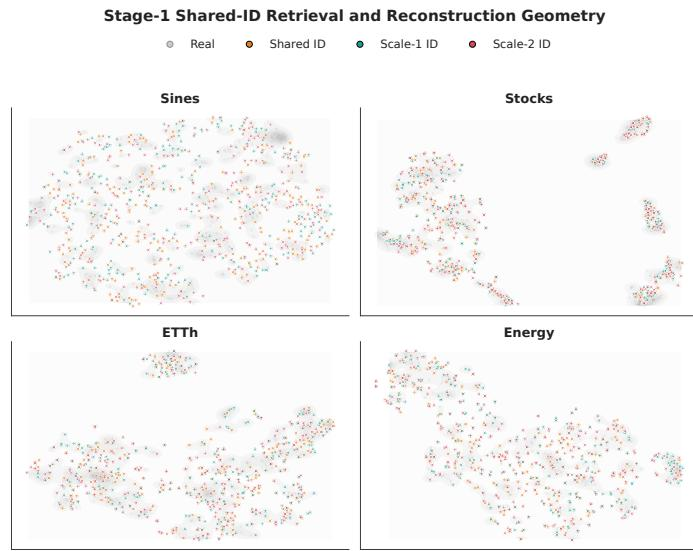  
Fig. 2: t-SNE visualization of real and Stage 1 reconstructed samples under different public-ID assignments.

<table><tr><td>Condition</td><td>Initial Acc.</td><td>Refined Acc.</td><td>Correction</td><td>DS / C-FID</td></tr><tr><td>Scale-1 IDs</td><td>0.7873</td><td>0.9999</td><td>0.9996</td><td>0.0116 / 0.00024</td></tr><tr><td>Scale-2 IDs</td><td>0.8540</td><td>0.9999</td><td>0.9997</td><td>0.0109 / 0.00026</td></tr></table>

TABLE IX: Sine conditional public-ID refinement diagnostic. Initial accuracy is the token match between a single branch’s recovered IDs and the jointly voted shared IDs; refined accuracy is measured after the conditional Stage 2 refinement.

## D. Effects of Shared-Index Voting on Reconstruction Fidelity

A key question in shared-semantic tokenization is whether unifying multiple temporal views into a single public ID compromises reconstruction fidelity. To investigate this, we evaluate Stage 1 reconstruction by comparing the original shared-index assignment with single-view alternatives that recover public IDs using only Scale 1 or Scale 2, while keeping the learned scale-specific codebooks and decoder fixed.

Table X reports reconstruction MSE/MAE and their changes relative to the shared assignment. The shared mapping consistently achieves the lowest reconstruction errors across all four datasets, indicating that aggregating cross-scale evidence produces more informative code assignments than relying on either individual view. The varying reconstruction degradation across datasets and scales highlights their data-dependent contributions, further motivating the integration of complementary temporal evidence through shared-index voting.

These findings complement the single-view recoverability analysis by showing that shared-index voting improves not only discrete ID agreement but also reconstruction fidelity.

Together with the Stage 2 generation results DS/C-FID in Table VII, they provide evidence that the unified public-token interface supports both faithful reconstruction and high-quality generative modeling. The t-SNE visualization in Fig. 2 further illustrates the distributional overlap between real samples and Stage 1 reconstructions under different public-ID assignments.

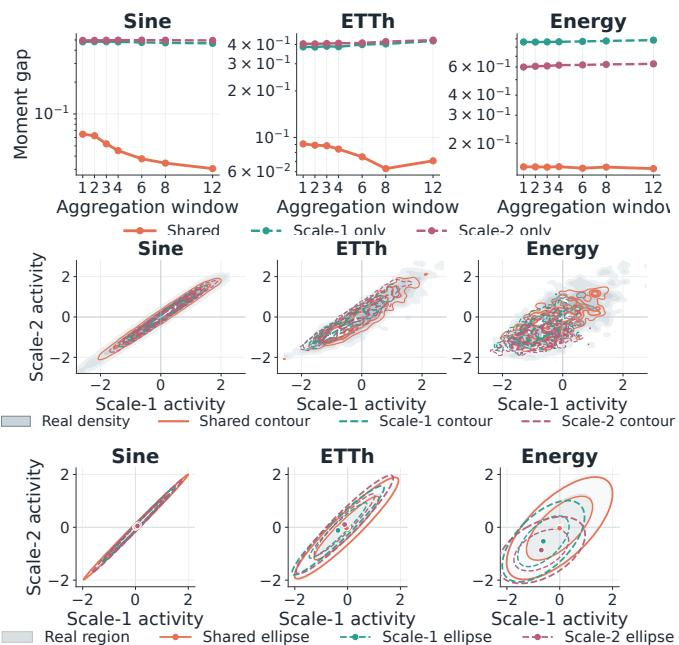  
Fig. 3: Multi-scale temporal structure under shared and singlescale generation. Top: Temporal aggregation gaps. Middle: Joint fine- and coarse-scale activity distributions. Bottom: Covariance ellipses of joint variation. Shared generation better preserves the real-data multi-scale structure.

## E. Single-View Conditioned Shared-ID Refinement

Building upon the single-view recovery property in Proposition 2, we further investigate whether Stage 2 can refine incomplete public-ID assignments obtained from an individual temporal scale. While the proposition characterizes when branch-specific evidence is sufficient for stable ID recovery, it does not guarantee correct assignments at positions with insufficient semantic margins.

To examine this setting, we conduct a controlled experiment on Sine, where IDs independently recovered from Scale 1 or Scale 2 initialize the refinement process and condition Stage 2 through adaptive layer normalization (AdaLN). The jointly voted shared IDs serve as the reference for evaluating token recovery.

As shown in Table IX, conditional refinement improves token accuracy from 78.73%/85.40% to 99.99% for Scale 1/Scale 2, correcting over 99.9% of initially mismatched IDs. The refined sequences also achieve DS/C-FID values of 0.0116/0.00024 and 0.0109/0.00026, respectively.

These results extend the single-view recoverability analysis by showing that, in this controlled setting, Stage 2 can substantially reduce ambiguities remaining in individual-scale ID assignments. This further illustrates the potential of the sharedsemantic interface for conditional cross-scale generation.

<table><tr><td rowspan="2">Dataset</td><td colspan="5">MSE↓</td><td colspan="5">MAE↓</td></tr><tr><td>Shared</td><td>Scale-1</td><td>Scale-2</td><td>S1 ∆</td><td>S2 ∆</td><td>Shared</td><td>Scale-1</td><td>Scale-2</td><td>S1 ∆</td><td>S2 ∆</td></tr><tr><td>Sine</td><td>0.00004929</td><td>0.00005341</td><td>0.00006096</td><td>0.00000412</td><td>0.00001166</td><td>0.005348</td><td>0.005533</td><td>0.005819</td><td>0.000185</td><td>0.000471</td></tr><tr><td>Stock</td><td>0.00018091</td><td>0.00018585</td><td>0.00018173</td><td>0.00000495</td><td>0.00000082</td><td>0.008570</td><td>0.008625</td><td>0.008587</td><td>0.000055</td><td>0.000017</td></tr><tr><td>ETTh</td><td>0.00010566</td><td>0.00011746</td><td>0.00013094</td><td>0.00001180</td><td>0.00002528</td><td>0.007804</td><td>0.008116</td><td>0.008494</td><td>0.000312</td><td>0.000690</td></tr><tr><td>Energy</td><td>0.00005832</td><td>0.00008911</td><td>0.00016054</td><td>0.00003078</td><td>0.00010222</td><td>0.005546</td><td>0.005986</td><td>0.006699</td><td>0.000440</td><td>0.001153</td></tr><tr><td>Avg. ∆</td><td></td><td></td><td>1</td><td>0.00001291</td><td>0.00003500</td><td></td><td></td><td></td><td>0.000248</td><td>0.000583</td></tr></table>

TABLE X: Reconstruction performance under shared and single-view public-ID assignments. ∆ denotes the increase in reconstruction error relative to the shared mapping. Lower values indicate better reconstruction quality.

## F. Ablation Study

Table XI examines three key design choices of UniFlow: multi-scale tokenization, the shared public-ID interface, and flow initialization of Energy dataset.

Multi-scale Tokenization. Introducing multiple temporal scales alone does not guarantee better generation. The dilationonly variant performs worse than single-scale token flow (DS: 0.027 vs. 0.006), whereas patch-based multi-scale tokenization achieves substantially lower DS/C-FID 0.003/0.001. This contrast indicates that the effectiveness of multi-scale modeling depends on how temporal information is represented and aligned, rather than simply increasing the number of scales.

Shared Semantic Interface. Keeping the Stage 2 architecture and token sequence length fixed, replacing jointly voted public IDs with Scale 1 or Scale 2 IDs substantially degrades DS/C-FID, from 0.003/0.001 to 0.345/0.363 and 0.316/0.326, respectively. This result highlights the importance of integrating cross-scale evidence into a unified semantic identity, rather than relying on individual scale-specific assignments.

Geometry-aware Initialization. Replacing the learned anchor prior with Gaussian coordinates increases DS/C-FID to 0.218/0.279. A fitted-mixture prior improves performance to 0.047/0.031, but remains inferior to the learned anchor prior 0.003/0.001. These results suggest that initialization informed by the learned low-rank support structure provides a more suitable starting distribution for categorical flow transport than the evaluated alternatives.

Overall, the three ablations reveal complementary roles across the two stages: multi-scale tokenization determines the temporal information captured by the tokenizer, shared-index voting consolidates this information into a unified generative interface, and the anchor prior determines the initialization geometry for subsequent transport. Their combined effectiveness supports the representation-to-generation design of UniFlow.

## VI. CONCLUSION

We presented UniFlow, a unified framework for multi-scale time series generation that reconciles rich temporal representations with efficient generative modeling. Through sharedindex voting and scale-specific codebooks, UniFlow integrates complementary temporal information into a single public-ID sequence while preserving scale-dependent reconstruction details. Building on this unified representation, geometryaware categorical flow matching leverages learned low-rank anchors to initialize continuous transport and enables non autoregressive generation without sequential token decoding.

<table><tr><td>Component</td><td>Variant</td><td>DS↓</td><td>C-FID ↓</td></tr><tr><td rowspan="3">Tokenizer</td><td>Single-scale token flow</td><td>0.006</td><td>0.003</td></tr><tr><td>Multi-scale, dilation-only</td><td>0.027</td><td>0.018</td></tr><tr><td>Multi-scale, patch-based</td><td>0.003</td><td>0.001</td></tr><tr><td rowspan="3">Interface</td><td>Shared public IDs</td><td>0.003</td><td>0.001</td></tr><tr><td>Scale-1 IDs only</td><td>0.345</td><td>0.363</td></tr><tr><td>Scale-2 IDs only</td><td>0.316</td><td>0.326</td></tr><tr><td rowspan="3">Prior</td><td>Gaussian coordinate prior</td><td>0.218</td><td>0.279</td></tr><tr><td>Fitted-mixture prior</td><td>0.047</td><td>0.031</td></tr><tr><td>Learned anchor prior</td><td>0.003</td><td>0.001</td></tr></table>

TABLE XI: Ablation of multi-scale tokenization, shared-ID interface, and flow initialization on Energy.

Extensive experiments demonstrate that UniFlow achieves improved generative fidelity and inference efficiency across diverse benchmarks and generation horizons. Further analyses validate its effectiveness in preserving reconstruction fidelity, cross-scale semantic consistency, and multi-scale temporal structure. These findings highlight that rich multi-scale information can be integrated into a unified generative interface, enabling high-quality and efficient time series generation without multiple token streams.

Limitations and Future Directions. Modeling temporal information across multiple scales is essential for capturing the complex dynamics of time series data. The current tokenization of UniFlow relies on predefined temporal scales. Exploring adaptive scale selection and integration could further enhance its ability.

## REFERENCES

[1] J. Yoon, D. Jarrett, and M. Van der Schaar, “Time-series generative adversarial networks,” Advances in neural information processing systems, vol. 32, 2019.

[2] T. Xu, L. K. Wenliang, M. Munn, and B. Acciaio, “Cot-gan: Generating sequential data via causal optimal transport,” Advances in neural information processing systems, vol. 33, pp. 8798–8809, 2020.

[3] A. Desai, C. Freeman, Z. Wang, and I. Beaver, “TimeVAE: A variational auto-encoder for multivariate time series generation,” arXiv preprint arXiv:2111.08095, 2021.

[4] Y. Tashiro, J. Song, Y. Song, and S. Ermon, “Csdi: Conditional score-based diffusion models for probabilistic

time series imputation,” Advances in neural information processing systems, vol. 34, pp. 24 804–24 816, 2021.

[5] J. M. L. Alcaraz and N. Strodthoff, “Diffusion-based time series imputation and forecasting with structured state space models,” arXiv preprint arXiv:2208.09399, 2022.

[6] X. Yuan and Y. Qiao, “Diffusion-ts: Interpretable diffusion for general time series generation,” arXiv preprint arXiv:2403.01742, 2024.

[7] Y. Hu, X. Wang, Z. Ding, L. Wu, H. Zhang, S. Z. Li, S. Wang, J. Zhang, Z. Li, and T. Chen, “Flowts: Time series generation via rectified flow,” arXiv preprint arXiv:2411.07506, 2024.

[8] B. Lim and S. Zohren, “Time-series forecasting with deep learning: a survey,” Philosophical transactions of the royal society a: mathematical, physical and engineering sciences, vol. 379, no. 2194, 2021.

[9] S. Wu, X. Xiao, Q. Ding, P. Zhao, Y. Wei, and J. Huang, “Adversarial sparse transformer for time series forecasting,” Advances in neural information processing systems, vol. 33, pp. 17 105–17 115, 2020.

[10] Q. Ding, S. Wu, H. Sun, J. Guo, and J. Guo, “Hierarchical multi-scale gaussian transformer for stock movement prediction.” in Ijcai, 2020, pp. 4640–4646.

[11] S. Bengio, O. Vinyals, N. Jaitly, and N. Shazeer, “Scheduled sampling for sequence prediction with recurrent neural networks,” Advances in neural information processing systems, vol. 28, 2015.

[12] F. Schmidt, “Generalization in generation: A closer look at exposure bias,” arXiv preprint arXiv:1910.00292, 2019.

[13] S. Feng, C. Miao, Z. Zhang, and P. Zhao, “Latent diffusion transformer for probabilistic time series forecasting,” in Proceedings of the AAAI Conference on Artificial Intelligence, vol. 38, 2024, pp. 11 979–11 987.

[14] A. van den Oord, O. Vinyals, and K. Kavukcuoglu, “Neural discrete representation learning,” Advances in neural information processing systems, vol. 30, 2017.

[15] P. Esser, R. Rombach, and B. Ommer, “Taming transformers for high-resolution image synthesis,” in Proceedings ofthe IEEE/CVF conference on computer vision and pattern recognition, 2021, pp. 12 873–12 883.

[16] W. Williams, S. Ringer, T. Ash, D. MacLeod, J. Dougherty, and J. Hughes, “Hierarchical quantized autoencoders,” Advances in Neural Information Processing Systems, vol. 33, pp. 4524–4535, 2020.

[17] F. Shibo, P. Zhao, L. Liu, P. Wu, and Z. Shen, “Hdt: Hierarchical discrete transformer for multivariate time series forecasting,” in Proceedings of the AAAI Conference on Artificial Intelligence, vol. 39, no. 1, 2025, pp. 746–754.

[18] Z. Chen, S. Feng, Z. Zhang, X. Xiao, X. Gao, and P. Zhao, “Sdformer: Similarity-driven discrete transformer for time series generation,” Advances in Neural Information Processing Systems, vol. 37, pp. 132 179– 132 207, 2024.

[19] W. Li, S. Feng, P. Wu, X. Gao, M. Wu, and P. Zhao, “Sdflow: Similarity-driven flow matching for time series generation,” arXiv preprint arXiv:2605.05736, 2026.

[20] S. Feng, Z. Chen, X. Xiao, Z. Zhang, Q. Li, X. Gao, and

P. Zhao, “Msdformer: Multi-scale discrete transformer for time series generation,” IEEE Transactions on Pattern Analysis and Machine Intelligence, 2026.

[21] X. Xu, Q. Zhong, and J. Hu, “Timemar: Multi-scale autoregressive modeling for unconditional time series generation,” in Proceedings of the ACM Web Conference 2026, 2026, pp. 5132–5143.

[22] Y. Lipman, R. T. Chen, H. Ben-Hamu, M. Nickel, and M. Le, “Flow matching for generative modeling,” arXiv preprint arXiv:2210.02747, 2022.

[23] X. Liu, C. Gong, and Q. Liu, “Flow straight and fast: Learning to generate and transfer data with rectified flow,” arXiv preprint arXiv:2209.03003, 2022.

[24] A. Tong, K. Fatras, N. Malkin, G. Huguet, Y. Zhang, J. Rector-Brooks, G. Wolf, and Y. Bengio, “Improving and generalizing flow-based generative models with minibatch optimal transport,” arXiv preprint arXiv:2302.00482, 2023.

[25] M. S. Albergo, N. M. Boffi, and E. Vanden-Eijnden, “Stochastic interpolants: A unifying framework for flows and diffusions,” arXiv preprint arXiv:2303.08797, 2023.

[26] R. T. Chen and Y. Lipman, “Flow matching on general geometries,” arXiv preprint arXiv:2302.03660, 2023.

[27] F. Eijkelboom, G. Bartosh, C. Andersson Naesseth, M. Welling, and J.-W. van de Meent, “Variational flow matching for graph generation,” Advances in Neural Information Processing Systems, vol. 37, pp. 11 735– 11 764, 2024.

[28] W. Peebles and S. Xie, “Scalable diffusion models with transformers,” in Proceedings of the IEEE/CVF international conference on computer vision, 2023, pp. 4195– 4205.

[29] L. Qu, H. Zhang, Y. Liu, X. Wang, Y. Jiang, Y. Gao, H. Ye, D. K. Du, Z. Yuan, and X. Wu, “Tokenflow: Unified image tokenizer for multimodal understanding and generation,” arXiv preprint arXiv:2412.03069, 2024.

[30] X. Liu, C. Gong, and Q. Liu, “Flow straight and fast: Learning to generate and transfer data with rectified flow,” arXiv preprint arXiv:2209.03003, 2022.

[31] Z. Kong, W. Ping, J. Huang, K. Zhao, and B. Catanzaro, “Diffwave: A versatile diffusion model for audio synthesis,” arXiv preprint arXiv:2009.09761, 2020.

[32] A. Coletta, S. Gopalakrishnan, D. Borrajo, and S. Vyetrenko, “On the constrained time-series generation problem,” Advances in Neural Information Processing Systems, vol. 36, pp. 61 048–61 059, 2023.

[33] P. Jeha, M. Bohlke-Schneider, P. Mercado, S. Kapoor, R. S. Nirwan, V. Flunkert, J. Gasthaus, and T. Januschowski, “Psa-gan: Progressive self attention gans for synthetic time series,” in The tenth international conference on learning representations, 2022.

[34] Z. Yue, Y. Wang, J. Duan, T. Yang, C. Huang, Y. Tong, and B. Xu, “Ts2vec: Towards universal representation of time series,” in Proceedings of the AAAI conference on artificial intelligence, vol. 36, no. 8, 2022, pp. 8980– 8987.

[35] L. van der Maaten and G. E. Hinton, “Visualizing data using t-sne,” Journal of machine learning research,

vol. 9, no. Nov, pp. 2579–2605, 2008.

## VII. BIOGRAPHY SECTION

Shibo Feng is currently a researcher at Nanyang Technological University (NTU), Singapore. His research focuses on Generative AI and its applications, including large models and time series analysis. He has served as the reviewer for top-tier venues such as ICML, ICLR, NeurIPS, and TPAMI. He received his PhD’s degree in College of Computing and Data Science (CCDS) from Nanyang Technological University.

  
University.

Wei Li studies computer science and technology at Shanghai University, China (2023–2027), and has been admitted to the joint Ph.D. program of Shanghai Jiao Tong University and Beijing Zhongguancun Academy, starting in 2027. His research focuses on machine learning and data mining, including time-series generation, forecasting, clustering, and representation learning. His representative works include SDFlow (NeurIPS 2026) and APCL (KDD 2026). He has been invited to review for venues including Neural Networks, NeurIPS (ethics review),

AAAI, and ICASSP. He received the National Scholarship and the Baosteel Scholarship in 2026.

Min Wu is a Chapter Head at the A\*STAR Institute of Advanced Intelligence and Computing (A\*STAR IAIC), and Deputy Head of Tech Development at the AI Centre of Excellence for Manufacturing (AIMfg). He received his Ph.D. in Computer Science from Nanyang Technological University (NTU) in 2011 and his B.E. in Computer Science from the University of Science and Technology of China (USTC) in 2006. He has won several best paper awards and serves as an Associate Editor for journals including Neural Networks and IEEE Transactions on Neural

Networks and Learning Systems. His current research interests focus on AI for time series data, graph data, and biological and healthcare data.

Chunyan Miao is a President’s Chair Professor and the Chair of College of Computing and Data Science at Nanyang Technological University (NTU), Singapore. She received her Ph.D. degree from NTU and was an NSERC Postdoctoral Fellow at Simon Fraser University (SFU), Canada. She was a founding faculty member of the Centre for Digital Media established by the University of British Columbia (UBC) and SFU. She was also a Tan Chin Tuan Engineering Fellow at Harvard and MIT. Dr. Miao has focused on her research in Artificial intelligence

(AI) and real-world AI applications for impactful research in health, aging, education, and smart services. She is the Founding Director of the Joint NTU-UBC Research Centre of Excellence in Active Living for the Elderly (LILY), Singapore’s first center focusing on AI-empowered solutions to population aging challenges. She is the Founding Director of the Alibaba-NTU Singapore Joint Research Institute (JRI), Alibaba’s first and largest JRI outside China. She is an Editor/Associate Editor of leading international journals including IJIT, IEEE Big Data, IEEE IoT, IEEE Access and IEEE Service Computing, and has served as Chair/TPC member of international conferences such as IEEE ICA, ICAA, ACM KDD. She serves on various national committees and is the Chair of the SCS AI Ethics Review Committee.

Peilin Zhao is currently a professor at Shanghai Jiao Tong University. He previously worked at Tencent Group, Ant Group, A\*STAR Singapore, and Rutgers University. His research focuses on machine learning and its applications, including large models, AI for science, AI for games, and recommendation systems. He has served as an Area Chair and Associate Editor for top-tier venues such as ICML, NeurIPS, and TPAMI. He received his bachelor’s degree in mathematics from Zhejiang University and his PhD in computer science from Nanyang Technological

# Supplementary Materials for UniFlow

## I. PROBABILISTIC ROBUSTNESS OF THE SHARED MAPPING

We analyze how weighted cross-scale evidence affects the probability of an incorrect public-ID assignment. Fix a temporal position i, let $y _ { i } ^ { \star } \ \in \ \{ 0 , \ldots , K - 1 \}$ denote the reference public ID, and define the branch-wise margin against a competing code $k \neq y _ { i } ^ { \star }$ as

$$
\Delta _ { i , k } ^ { ( m ) } : = s _ { i , y _ { i } ^ { \star } } ^ { ( m ) } - s _ { i , k } ^ { ( m ) } .\tag{48}
$$

Theorem 5 (Probabilistic robustness of shared-index voting). For each competitor k $\neq y _ { i } ^ { \star }$ , assume that the margin vector

$$
\begin{array} { r } { \pmb { \Delta } _ { i , k } : = \left( \Delta _ { i , k } ^ { ( 1 ) } , \ldots , \Delta _ { i , k } ^ { ( M ) } \right) ^ { \top } = \pmb { \mu } _ { i , k } + \pmb { \varepsilon } _ { i , k } , } \end{array}\tag{49}
$$

where $\mathbb { E } [ \varepsilon _ { i , k } ] = \mathbf { 0 }$ and $\varepsilon _ { i , k }$ is sub-Gaussian with covariance proxy $\pmb { \Sigma } _ { i , k } \succeq 0 , i . e .$

$$
\mathbb { E } \big [ \mathrm { e x p } \big ( \lambda \mathbf { a } ^ { \top } \pmb { \varepsilon } _ { i , k } \big ) \big ] \leq \mathrm { e x p } \bigg ( \frac { \lambda ^ { 2 } } { 2 } \mathbf { a } ^ { \top } \pmb { \Sigma } _ { i , k } \mathbf { a } \bigg )\tag{50}
$$

for every $\lambda \in \mathbb { R }$ and $\mathbf { a } \in \mathbb { R } ^ { M }$ . Let $\pmb { \alpha } = ( \alpha _ { 1 } , \ldots , \alpha _ { M } ) ^ { \top }$ , where $\alpha _ { m } \geq 0$ and $\textstyle \sum _ { m } \alpha _ { m } = 1$ , and define

$$
\widetilde { y } _ { i } = \arg \operatorname* { m a x } _ { j \in \{ 0 , \ldots , K - 1 \} } \sum _ { m = 1 } ^ { M } \alpha _ { m } s _ { i , j } ^ { ( m ) } .\tag{51}
$$

If $\pmb { \alpha } ^ { \top } \pmb { \mu } _ { i , k } > 0$ for every $k \neq y _ { i } ^ { \star }$ , then

$$
\mathbb { P } ( \widetilde { y } _ { i } \neq y _ { i } ^ { \star } ) \leq \sum _ { k \neq y _ { i } ^ { \star } } \exp \biggl ( - \frac { ( \pmb { \alpha } ^ { \top } \pmb { \mu } _ { i , k } ) ^ { 2 } } { 2 \pmb { \alpha } ^ { \top } \pmb { \Sigma } _ { i , k } \pmb { \alpha } } \biggr ) .\tag{52}
$$

When $\alpha ^ { \top } \Sigma _ { i , k } \alpha = 0$ and ${ \pmb { \alpha } } ^ { \top } { \pmb { \mu } } _ { i , k } > 0$ , the corresponding term is interpreted as zero.

Proof. For a competitor $k \neq y _ { i } ^ { \star }$ , the shared vote can prefer k to $y _ { i } ^ { \star }$ only if

$$
\alpha ^ { \top } \Delta _ { i , k } \leq 0 .\tag{53}
$$

Using $\Delta _ { i , k } = \mu _ { i , k } + \varepsilon _ { i , k }$ , this event is equivalent to

$$
\begin{array} { r } { \pmb { \alpha } ^ { \top } \pmb { \varepsilon } _ { i , k } \le - \pmb { \alpha } ^ { \top } \pmb { \mu } _ { i , k } . } \end{array}\tag{54}
$$

The sub-Gaussian assumption implies that ${ \pmb { \alpha } } ^ { \top } \varepsilon _ { i , k }$ has variance proxy $\pmb { \alpha } ^ { \top } \pmb { \Sigma } _ { i , k } \pmb { \alpha }$ . Therefore,

$$
\mathbb { P } \big ( \boldsymbol { \alpha } ^ { \top } \Delta _ { i , k } \leq 0 \big ) \leq \exp \left( - \frac { ( \boldsymbol { \alpha } ^ { \top } \pmb { \mu } _ { i , k } ) ^ { 2 } } { 2 \boldsymbol { \alpha } ^ { \top } \Sigma _ { i , k } \boldsymbol { \alpha } } \right) .\tag{55}
$$

A prediction error requires at least one competitor to attain a score no smaller than the reference code. Applying the union bound over all $k \neq y _ { i } ^ { \star }$ proves Equation (52). □

Corollary 6 (Pairwise optimal voting weights). Fix i and $k \neq$ y⋆, and suppose $\Sigma _ { i , k } \succ 0$ . Among all nonzero weight vectors, the exponent in Theorem 5 is maximized by

$$
\begin{array} { r } { { \pmb { \alpha } } _ { i , k } ^ { \star } \propto \sum _ { i , k } ^ { - 1 } \mu _ { i , k } . } \end{array}\tag{56}
$$

If $\Sigma _ { i , k } ^ { - 1 } \mu _ { i , k }$ is component-wise nonnegative, the simplexconstrained solution is

$$
\alpha _ { i , k } ^ { \star } = \frac { \Sigma _ { i , k } ^ { - 1 } \mu _ { i , k } } { 1 ^ { \top } \Sigma _ { i , k } ^ { - 1 } \mu _ { i , k } } .\tag{57}
$$

Proof. For a fixed competitor, maximizing the exponent is equivalent to maximizing

$$
\mathcal { R } _ { i , k } ( \pmb { \alpha } ) : = \frac { ( \pmb { \alpha } ^ { \top } \pmb { \mu } _ { i , k } ) ^ { 2 } } { \pmb { \alpha } ^ { \top } \pmb { \Sigma } _ { i , k } \pmb { \alpha } } .\tag{58}
$$

Let ${ \bf b } = { \Sigma _ { i , k } ^ { 1 / 2 } }$ α and $\mathbf { c } = \pmb { \Sigma } _ { i , k } ^ { - 1 / 2 } \pmb { \mu } _ { i , k }$ . By Cauchy–Schwarz,

$$
\mathcal { R } _ { i , k } ( \alpha ) = \frac { ( \mathbf { b } ^ { \top } \mathbf { c } ) ^ { 2 } } { \| \mathbf { b } \| _ { 2 } ^ { 2 } } \leq \| \mathbf { c } \| _ { 2 } ^ { 2 } ,\tag{59}
$$

with equality if and only if b $\propto \mathbf { c } ,$ or equivalently α ∝ $\Sigma _ { i , k } ^ { - 1 } \mu _ { i , k }$ . Normalization to unit sum gives the simplex solution when the vector is component-wise nonnegative. □

Remark 7 (Independent branch noise). If branch noises are independent and

$$
\begin{array} { r } { \Sigma _ { i , k } = \mathrm { d i a g } ( \sigma _ { i , k , 1 } ^ { 2 } , \dots , \sigma _ { i , k , M } ^ { 2 } ) , } \end{array}\tag{60}
$$

then the pairwise optimal weight satisfies

$$
\alpha _ { i , k , m } ^ { \star } \propto \frac { \mu _ { i , k , m } } { \sigma _ { i , k , m } ^ { 2 } } .\tag{61}
$$

Thus, a branch receives more weight when it provides a larger expected target-versus-competitor margin and less weight when that margin is noisy.

We next state a complementary single-view recovery condition. Let $y _ { i }$ be the shared ID defined in Equation (9), and let branch r retrieve $y _ { i , \mathrm { r e c } } ^ { ( r ) } = \arg \operatorname* { m a x } _ { k } s _ { i , k } ^ { ( r ) }$ using only its own similarity scores.

Proposition 8 (Single-view recovery under branch margin). If branch r has a positive one-vs-all margin

$$
\gamma _ { i } ^ { ( r ) } : = s _ { i , y _ { i } } ^ { ( r ) } - \operatorname* { m a x } _ { k \neq y _ { i } } s _ { i , k } ^ { ( r ) } > 0 ,
$$

then branch r alone recovers the shared ID, i.e., $y _ { i , \mathrm { r e c } } ^ { ( r ) } = y _ { i }$ If the branch scores are perturbed by at most ϵ in $\ell _ { \infty }$ norm and $\gamma _ { i } ^ { ( r ) } > 2 \epsilon$ , the recovered ID is unchanged.

Proof. The positive margin condition implies $s _ { i , y _ { i } } ^ { ( r ) } > s _ { i , k } ^ { ( r ) }$ for every $k \ \ne \ y _ { i }$ , so the branch-only argmax is $y _ { i }$ . Under a perturbation bounded by $\epsilon ,$ the score of $y _ { i }$ can decrease by at most ϵ and any competitor can increase by at most $\epsilon ,$ so the perturbed margin remains at least $\gamma _ { i } ^ { ( r ) } - 2 \dot { \epsilon } > 0$ . The argmax is therefore unchanged. □

This condition explains how a single temporal view can recover the public ID without requiring all branches to be identical. It also clarifies why the empirical recovery rates in Table I need not be exactly one: branch-only recovery succeeds where the branch-specific margin is positive and sufficiently stable, while the full shared vote can still use complementary evidence from the other branch.

## II. DETAILS OF BASELINES

In this part, we briefly introduce the baselines:

TimeGAN [1] is a method that combines Generative Adversarial Networks (GANs) with sequence modeling. It jointly optimizes supervised and unsupervised adversarial losses to learn both the static features and dynamic dependencies of time series data, thereby generating high-quality synthetic time series.

COT-GAN [2] is a GAN-based method that incorporates causal optimal transport theory. It optimizes the distribution matching between generated and real data to produce highquality synthetic time series.

TimeVAE [3] is a time series generation method based on Variational Autoencoders (VAEs). It enhances model interpretability by incorporating domain-specific temporal patterns (such as polynomial trends and seasonality) and optimizes training efficiency to accurately represent and efficiently synthesize the temporal attributes of the original data.

DiffWave [31] is an audio synthesis method based on diffusion probabilistic models. The model combines a nonautoregressive structure with bidirectional dilated convolutions to generate high-quality audio in parallel, offering significant advantages in synthesis speed. It also ensures the quality of the generated audio by progressively denoising white noise to produce the target audio waveform.

DiffTime [32] is a time series generation method based on a constrained optimization framework. It combines conditional diffusion models to efficiently generate synthetic time series that meet specific constraints.

SDformer-ar and SDformer-m [18] are two variants of the Similarity-driven Discrete Transformer SDformer for timeseries generation. SDformer employs similarity-driven vector quantization to learn discrete time-series representations, followed by Transformer-based token distribution modeling. Specifically, SDformer-ar adopts autoregressive token generation with sequential decoding, whereas SDformer-m employs masked token modeling with iterative refinement. Both variants share the same discrete tokenization framework but differ in their generative strategies.

MSDformer [20] is a multi-scale extension of SDformer, with a particular focus on long-term time-series generation. It introduces a coarse-to-fine discrete tokenization framework that captures multiscale temporal dependencies through coarse representations and residual quantization, preserving both long-range structures and fine-grained details. An autoregressive discrete Transformer then models the resulting token sequences to generate time series with improved temporal fidelity.

FlowTS [7] is a flow-based generative model for time series that employs rectified flow to learn approximately straight transport trajectories between source and target distributions. It incorporates trend-seasonality decomposition, attention registers, and rotary positional embeddings to capture temporal dependencies and improve generation fidelity. An adaptive sampling strategy further enhances sampling efficiency, supporting both unconditional and conditional time-series generation.

## III. MODEL DETAILS

This section presents the detailed architectures of UniFlow. Here, B, d, and ℓ denote the batch size, input dimensionality, and sequence length, respectively. Stage 1 employs M scalespecific encoders with hidden dimension H and branch dimensions $\lbrace d _ { m } \rbrace _ { m = 1 } ^ { M }$ , producing a unified public-token sequence of length $L = \ell / s ,$ where s denotes the temporal compression ratio and $\begin{array} { r } { d _ { c } = \sum _ { m } d _ { m } } \end{array}$ is the fused code dimension. The encoder, residual block, and shared-ID decoder are detailed in Tables XII, XIII, and XIV, respectively. Stage 2 employs a DiT-based categorical flow generator, where $D , N _ { f } , A ,$ , and r denote the Transformer hidden dimension, number of layers, attention heads, and anchor rank, respectively. Its architecture is summarized in Table XV.

## IV. VISUALIZATION METHODS

To qualitatively assess the distributional fidelity of generated time series, we employ two complementary visualization techniques: t-distributed Stochastic Neighbor Embedding (t-SNE) and Kernel Density Estimation (KDE).

t-SNE [35] projects high-dimensional time-series representations into a two-dimensional space by preserving local neighborhood relationships. It constructs pairwise similarities using adaptive Gaussian kernels and optimizes the low-dimensional embedding through Kullback–Leibler divergence minimization. By jointly visualizing real and generated samples, t-SNE provides a qualitative comparison of their local distributional structures.

Kernel Density Estimation (KDE) estimates continuous probability densities through kernel-based smoothing. Applied to real and generated time-series features, KDE enables visual comparison of their marginal or joint distributions, highlighting differences in density concentration, dispersion, and distributional modes.

These two visualization techniques offer complementary perspectives on generative fidelity. Specifically, t-SNE reveals local neighborhood structures, whereas KDE characterizes the distributional properties of temporal features.

## V. OVERVIEW OF UNIFLOW

UniFlow is a unified framework that integrates multi-scale representation learning with efficient non-autoregressive timeseries generation. In Stage 1, shared-index voting consolidates complementary temporal information into a single public-ID sequence, while scale-specific codebooks preserve multiscale reconstruction details. In Stage 2, geometry-aware categorical flow matching combines learned low-rank anchor initialization with continuous transport to generate the unified public-token representation.

More specifically, UniFlow extends SDFlow [19] toward efficient multi-scale time series generation. Building upon its non-autoregressive categorical flow framework and learned low-rank anchor prior, UniFlow introduces shared-index multiscale tokenization to integrate complementary temporal information into a unified public-ID sequence. This extension enables multiscale generative modeling without increasing the generator-facing sequence length or requiring separate scalespecific generative streams.

<table><tr><td>Layer</td><td>Function</td><td>Description</td><td>Input Shape</td><td>Output Shape</td></tr><tr><td>1</td><td>Input permutation</td><td>Channel-first representation</td><td> $( B , \ell , d )$ </td><td> $( B , d , \ell )$ </td></tr><tr><td>2</td><td>Patch Conv1D</td><td> $d \to H ,$  kernel/stride  $p _ { m }$ </td><td> $( B , d , \ell )$ </td><td> $( \vec { B } , H , \ell _ { m , 0 } )$ </td></tr><tr><td>3</td><td>ReLU</td><td>Activation</td><td> $( \vec { B } , H , \ell _ { m , 0 } )$ </td><td> $\left( B , H , \ell _ { m , 0 } \right)$ </td></tr><tr><td>4</td><td>ResNet</td><td>Depth  $n _ { m } ,$  dilation growth  $g _ { m }$ </td><td> $\left( B , H , \ell _ { m , 0 } \right)$ </td><td> $\left( B , H , \ell _ { m , 0 } \right)$ </td></tr><tr><td>5</td><td>Downsampling + ResNet</td><td>Stride-2 Conv1D + ResNet, repeated  $q _ { m }$  times</td><td> $( \bar { B } , H , \ell _ { m , j - 1 } )$ </td><td> $\left( B , H , \ell _ { m , j } \right)$ </td></tr><tr><td>6</td><td>Output Conv1D</td><td> $H \to d _ { m } ,$  kernel 3</td><td> $( B , H , L )$ </td><td> $( B , d _ { m } , L )$ </td></tr></table>

TABLE XII: Detailed architecture of the Stage 1 multiscale encoders. Each branch employs scale-specific patching and residual modeling to produce aligned temporal representations of length L.

<table><tr><td>Layer</td><td>Function</td><td>Description</td><td>Input Shape</td><td>Output Shape</td></tr><tr><td>1</td><td>ReLU</td><td>Activation</td><td> $( B , H , L _ { r } )$ </td><td> $( B , H , L _ { r } )$ </td></tr><tr><td>2</td><td>Dilated Conv1D</td><td> $H  H ,$  kernel 3, dilation δ, padding δ</td><td> $\left( B , H , L _ { r } \right)$ </td><td> $\left( B , H , L _ { r } \right)$ </td></tr><tr><td>3</td><td>ReLU</td><td>Activation</td><td> $\left( B , H , L _ { r } \right)$ </td><td> $\left( B , H , L _ { r } \right)$ </td></tr><tr><td>4</td><td>Pointwise Conv1D</td><td> $H  H ,$  kernel 1</td><td> $\left( B , H , L _ { r } \right)$ </td><td> $\left( B , H , L _ { r } \right)$ </td></tr><tr><td>5</td><td>Residual connection</td><td> ${ \mathrm { O u t p u t } } = { \mathrm { I n p u t } } + { \mathrm { C o n v } }$  output</td><td> $\left( B , H , L _ { r } \right)$ </td><td> $\left( B , H , L _ { r } \right)$ </td></tr></table>

TABLE XIII: Detailed architecture of the Stage 1 residual convolutional block, where δ denotes the dilation rate and $L _ { r }$ the temporal feature length.

<table><tr><td>Layer</td><td>Function</td><td>Description</td><td>Input Shape</td><td>Output Shape</td></tr><tr><td>1</td><td>Shared-index voting</td><td>Weighted cosine similarity, vocabulary size K</td><td> $\{ ( B , d _ { m } , L ) \} _ { m = 1 } ^ { M }$ </td><td> $( B , L )$ </td></tr><tr><td>2</td><td>Codebook retrieval</td><td>Shared-ID lookup in scale-specific codebooks</td><td> $( B , L )$ </td><td> $\{ ( B , L , d _ { m } ) \} _ { m = 1 } ^ { M }$ </td></tr><tr><td>3</td><td>Feature fusion</td><td>Concatenate private embeddings,  $\begin{array} { r } { d _ { c } = \sum _ { m } d _ { m } } \end{array}$ </td><td> $\{ ( B , L , d _ { m } ) \} _ { m = 1 } ^ { M }$ </td><td> $( B , d _ { c } , L )$ </td></tr><tr><td>4</td><td>Input Conv1D</td><td> $d _ { c }  H .$  kernel 3</td><td> $( B , d _ { c } , L )$ </td><td> $( B , H , L )$ </td></tr><tr><td>5</td><td>ReLU</td><td>Activation</td><td> $( B , H , L )$ </td><td> $( B , H , L )$ </td></tr><tr><td>6</td><td>ResNet</td><td>Depth  $n _ { \mathrm { d e c } } ,$  reverse dilation</td><td> $( B , H , 2 ^ { j - 1 } L )$ </td><td> $( B , H , 2 ^ { j - 1 } L )$ </td></tr><tr><td>7</td><td>Upsample + Conv1D</td><td>Nearest-neighbor upsampling  $\mathbf { \times } 2 + \mathbf { C o n v } 1 \mathbf { D }$ </td><td> $( B , H , 2 ^ { j - 1 } L )$ </td><td> $( B , H , 2 ^ { j } L )$ </td></tr><tr><td></td><td></td><td>Repeat layers 6–7 for  $\bar { T _ { d } }$  operations</td><td></td><td></td></tr><tr><td>8</td><td>Output projection</td><td>Conv1D + ReLU + Conv1D,  $H  d$ </td><td> $( B , H , 2 ^ { T _ { d } } L )$ </td><td> $( B , d , 2 ^ { T _ { d } } L )$ </td></tr><tr><td>9</td><td>Output alignment</td><td>Match length l and permute</td><td> $( B , d , 2 ^ { T _ { d } } L )$ </td><td> $( B , \ell , d )$ </td></tr></table>

TABLE XIV: Detailed architecture of Stage 1 shared-ID assignment and reconstruction. Shared public IDs retrieve scalespecific codebook embeddings, which are fused for time-series reconstruction.

<table><tr><td>Layer</td><td>Function</td><td>Description</td><td>Input Shape</td><td>Output Shape</td></tr><tr><td>1</td><td>Low-rank anchor</td><td>Projection through  $V \in \mathbb { R } ^ { r \times L d _ { c } }$ </td><td> $( B , r )$ </td><td> $( B , L , d _ { c } )$ </td></tr><tr><td>2</td><td>Flow interpolation</td><td> $Z _ { t } \dot { = } ( 1 - t ) Z _ { 0 } \dot { + } t Z _ { 1 }$ </td><td> $Z _ { 0 } , Z _ { 1 } : ( B , L , d _ { c } )$ </td><td> $( B , L , d _ { c } )$ </td></tr><tr><td>3</td><td>Global token</td><td>Prepend one learned token</td><td> $( B , L , d _ { c } )$ </td><td> $( \vec { B } , L + 1 , \dot { d } _ { c } )$ </td></tr><tr><td>4</td><td>Input projection</td><td>Linear  $d _ { c }  D +$  positional encoding</td><td> $( \vec { B } , L + 1 , \dot { d } _ { c } )$ </td><td> $( B , L + 1 , D )$ </td></tr><tr><td>5</td><td>Time embedding</td><td>Linear  $1  4 D + \mathrm { \hat { S } i L U + L i n e a r ~ } 4 \bar { D }  4 D$ </td><td>(B,1)</td><td> $( B , 4 D )$ </td></tr><tr><td>6</td><td>DiT blocks</td><td> $\mathrm { A d a L N + M H S A } \ ( A$  heads) + FFN (4D), repeated  $N _ { f }$ </td><td> $( B , \dot { L } + \dot { 1 } , D )$ </td><td> $( \boldsymbol { B } , \boldsymbol { L } + 1 , \boldsymbol { D } )$ </td></tr><tr><td>7</td><td>Categorical head</td><td>times LayerNorm + Linear  $D \to K ,$  remove global-token output</td><td> $( B , L + 1 , D )$ </td><td> $( B , L , K )$ </td></tr><tr><td>8</td><td>Endpoint estimation</td><td>Softmax + codebook expectation</td><td> $( B , L , K )$ </td><td> $( B , L , d _ { c } )$ </td></tr><tr><td>9</td><td>ODE transport</td><td>Parallel velocity-based integration</td><td> $( B , L , d _ { c } )$ </td><td> $( B , L , d _ { c } )$ </td></tr><tr><td>10</td><td>Public-ID readout</td><td>Normalize + nearest-code assignment</td><td> $( B , L , d _ { c } )$ </td><td>(B, L)</td></tr></table>

TABLE XV: Detailed architecture of the Stage 2 non-autoregressive categorical flow generator. The DiT predicts categorical endpoint distributions for joint transport of all public-token positions.

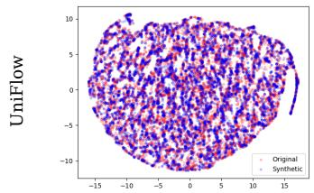

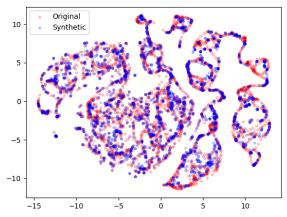

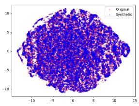

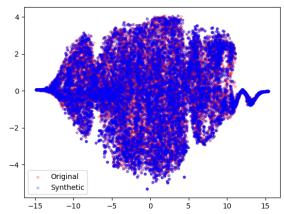

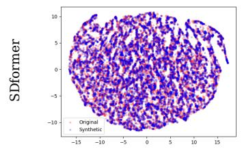

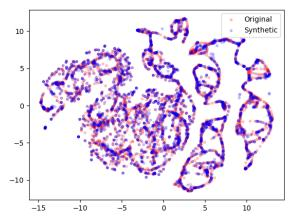

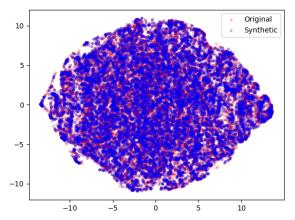

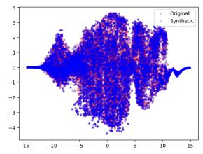

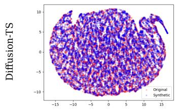  
(a) Sines

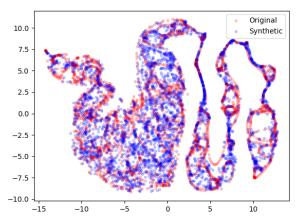  
(b) Stocks

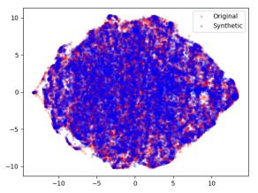  
(c) ETTh

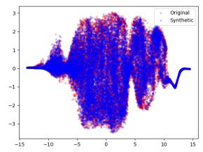  
(d) Energy  
Fig. 4: t-SNE visualizations of the time series synthesized by UniFlow, SDformer and Diffusion-TS.

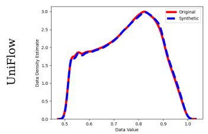

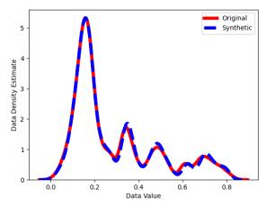

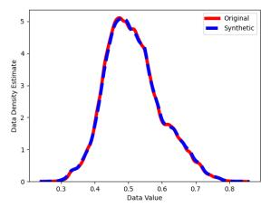

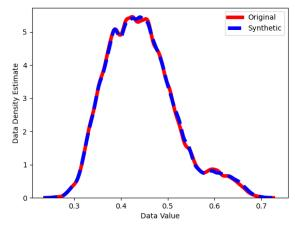

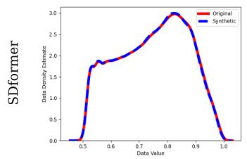

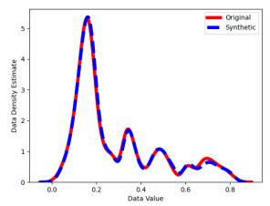

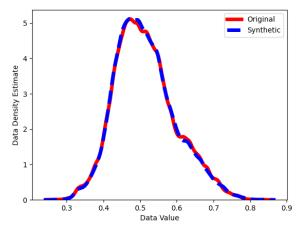

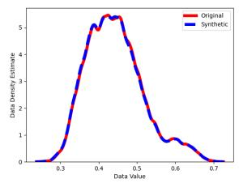

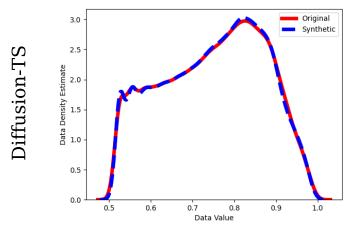  
(a) Sines

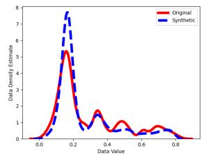  
(b) Stocks

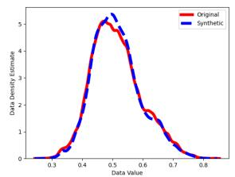  
(c) ETTh

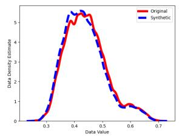  
(d) Energy  
Fig. 5: Kernel density estimation visualizations of the time series synthesized by UniFlow, SDformer and Diffusion-TS.