# WHEN SHOULD AN LLM STEERING EDIT DEPEND ON THE INPUT?

Rachael Harkness & Konrad Rawlik

Baillie Gifford Pandemic Science Hub, Centre for Inflammation Research

The University of Edinburgh

{rachael.harkness,konrad.rawlik}@ed.ac.uk

## ABSTRACT

An activation steering edit should depend on the input exactly when the destination varies inside the class a query requests, and that is measurable before any rule is fitted or applied. Contrastive Activation Addition (CAA) adds one fixed direction to every input, the difference of the class means. Conditioning it on the requested class accounts for the between-class variation in the required displacement and leaves the within-class variation untouched, which no rule that reads only the source state can express. We study the impact of increasing inputdependence in the steering edit, moving from a difference of means to a destination retrieved per query — the mean of the k stored states nearest the query, inside the requested class — in which the two baselines are endpoints: at k equal to the class size the retrieved rule is the class-conditional difference of means. We measure input-dependent steering on six substitution corpora that vary in whether the edit changes a word or a clause, and on an external benchmark, and find that input-dependent steering outperforms fixed-direction steering when the destination varies within the class. Retrieval wins at every layer of every substitution corpus in two models, and the level of input-dependence needed governs how to apply it: word-level edits are best made in the first tenth of the network from a few neighbours, clause-level edits at any depth from the class mean. Where the class already determines the answer the class mean suffices and retrieval only matches it, though a fixed direction still fails there. Four quantities computed from the states alone identify the regime in which the edit should be applied.

## 1 INTRODUCTION

Activation steering perturbs hidden states with a vector chosen to induce a behaviour. CAA collects states from prompts exhibiting the behaviour and from prompts that do not, and adds the difference of their means to every input. This assumes one displacement describes the edit for every input, and the assumption fails whenever the required edit depends on what the input says: steering a sentence toward the next weekday asks something different of Monday and Thursday, where steering a concept from male to female (king to queen) does not.

Two repairs are available, and they are the same rule at different settings. Conditioning the difference of means on the class a query is steered toward gives one vector per class rather than one per corpus. Retrieving instead gives a destination per query: search a bank of states that already exhibit the target behaviour and steer toward the mean of the k nearest. §3.1.1 shows these are endpoints of one family — at k equal to the class size the retrieved rule is the class-conditional difference of means — so k controls the locality of the edit and therefore how closely the retrieved destination matches the ideal per-query direction; this characterises the trade-off between global and local edits and defines the difference between class-conditional and per-query retrieval. Figure 1 displays the effects of per-query retrieval.

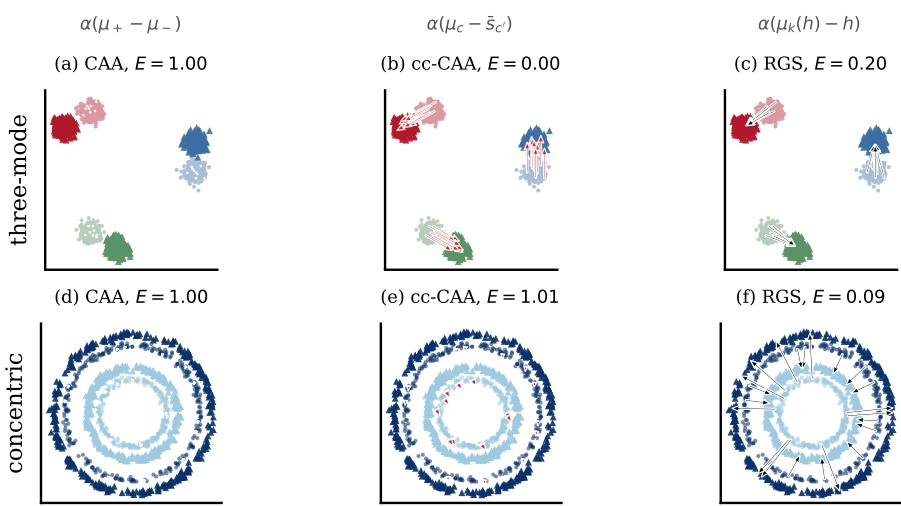  
queries (source) datastore (target class) a CAA rule's edit retrieval's edit  
Figure 1: A fixed direction fails where the required displacements disagree, and a per query destination recovers the task. Three rules on two generated constructions in two dimensions; E is reference error, 1 being the score for leaving the input alone. THREE-MODE (a–c) rotates the offsets between classes, so CAA’s vector is zero by construction while the same difference of means taken inside a class is exact (class-conditional CAA); CONCENTRIC (d–f) sends each query outward at its own angle, so the displacements cancel within a class too and neither fixed rule has anything to estimate. Only a RGS destination survives both (§F gives more detail).

This trade-off is task-dependent, and can be characterised quantitatively before any rule is fitted. Each rule has the same form, one direction per query times a scalar chosen on held-out data, so each can be scored in advance by how well its directions agree with the edits the task requires. We compute four such quantities and measure them against what the rules go on to score.

We evaluate on five families: synthetic constructions whose correct answers are set rather than measured, two token corpora, six substitution corpora built to vary the level of the concept an edit changes (word to clause), two A/B behavioural benchmarks, and two external benchmarks run under their own protocols. Throughout we compare RGS against CAA, class-conditional CAA and an affine map fitted on the query-to-target correspondence none of the unpaired rules receive, and we ask what governs the choice between them: the level of the concept, the coverage of the bank, the depth at which the edit is made, and whether the destination varies inside the class a query requests.

## 2 RELATED WORK

Steering by a fixed direction. Most activation steering adds one vector to every input: activation addition (Turner et al., 2023) and Contrastive Activation Addition (Rimsky et al., 2023) estimate it from contrastive prompt pairs, inference-time intervention (Li et al., 2023) fits per-head directions to a probe, representation engineering (Zou et al., 2023) builds reading and control vectors from the same contrast, and task arithmetic (Ilharco et al., 2023) composes fixed directions in weight space. All share the assumption examined here — that one displacement describes the edit for every input — and all are evaluated by class-level outcomes, which a rule collapsing every query onto the class centroid satisfies exactly. Evidence that some model features are not linearly organised (Engels et al., 2024) suggests the assumption is not universal, without saying which tasks violate it.

Conditioning the intervention on the input. Function vectors (Todd et al., 2024) condition on the task, applying one vector per task rather than per query. Retrieval over a datastore of hidden states is established as a way of conditioning a model’s output on nearest neighbours (Khandelwal et al., 2020; 2021; Shi et al., 2022; Huang et al., 2023), which interpolate the output distribution with a neighbour-weighted one. We use the same machinery for a different purpose: the neighbourhood supplies a steering destination in state space, so the intervention remains a single additive edit at one layer and composes with the fixed-direction methods above.

## Our contributions.

(i) We introduce RGS, a rule for input-dependent steering of which class-conditional CAA is the $k = | \mathcal { D } _ { c } |$ endpoint (§3.1.1).

(ii) We evaluate RGS against alternative steering methods on a variety of corpora to identify the successes and failures relative to fixed steering rules.

(iii) We identify that concept level (words vs. phrases) organises where in the model the edit is best made, and how local the rule should be (§4).

(iv) We define four diagnostic quantities computed from the task alone which predict the success of each rule and propose their use as a screening tool for input-dependent steering (§4.8).

## 3 METHODS

We compare input-dependent rules against fixed rules. Both apply the same general method i.e., a displacement is added to a source state; they differ only in how much of the data bank the destination is read from — the whole corpus (CAA), one class (class-conditional CAA), or the k entries nearest the query (RGS). For RGS and class-conditional CAA, k names which rule is running, and choosing k is defines the locality the edit should be.

## 3.1 STEERING RULES

Let $\mathcal { D }$ be a bank of target states and $\mathcal { S }$ a set of source states. Writing each rule as the displacement it adds,

$$
\delta _ { \mathsf { C A A } } ( h ) = \alpha \big ( \mathrm { m e a n } ( \mathcal D ) - \mathrm { m e a n } ( \mathcal S ) \big ) , \qquad \delta _ { \mathsf { R G S } } ( h ) = \alpha \big ( \mu _ { k } ( h ) - h \big ) , \quad \mu _ { k } ( h ) = \frac { 1 } { k } \sum _ { x \in N _ { k } ( h ) } x ,\tag{1}
$$

where $N _ { k } ( h )$ are the k elements of $\mathcal { D }$ nearest h using a Euclidean distance. The search is limited to target states, entries remain unlinked to any source. α is a scalar value that weights the displacement. Both α and k are selected on a validation split and reported unchanged on test.

With C for the number of classes, $\mathcal { D } _ { c }$ for the entries labelled c and $\mathcal { S } _ { c ^ { \prime } }$ for the sources steered toward it, class-conditional CAA is equation (1)’s difference of means taken inside a class, α(mean(D ) − mean(Sc′)), which gives one vector per class rather than one for the corpus. We additionally consider a fitted affine map (defined in $\ S \mathbf { A } ) .$ . The fitted affine map requires aligned pairs and is reported throughout as a ceiling on the comparison .

## 3.1.1 RGS AND CLASS-CONDITIONAL CAA COINCIDE AT $k = | \mathcal { D } _ { c } |$

Restricting the search to class c and taking $k = | \mathcal { D } _ { c } | \mathrm { g i v e s } \mu _ { k } ( h ) = \mathrm { m e a n } ( \mathcal { D } _ { c } ) ,$ , so

$$
\begin{array} { r } { \delta _ { \mathtt { R G S } } ( h ) \big | _ { k = | \mathcal { D } _ { c } | } = \alpha \big ( \mathrm { m e a n } ( \mathcal { D } _ { c } ) - h \big ) , \qquad \delta _ { c l a s s - c o n d i t i o n a l C \mathrm { A A } } ( h ) = \alpha \big ( \mathrm { m e a n } ( \mathcal { D } _ { c } ) - \mathrm { m e a n } ( \mathcal { S } _ { c ^ { \prime } } ) \big ) . } \end{array}\tag{2}
$$

and since $\mathbb { E } [ h ] = \operatorname* { m e a n } ( \mathcal { S } _ { c ^ { \prime } } )$ the two coincide in expectation: class-conditional CAA aims at the target class centroid from the source class centroid, RGS from the query. $\mathrm { A t } \ k = 1$ it transplants a single stored state, at the class ceiling it is class-conditional CAA so the selected k reports which rule won.

## 3.2 CORPORA

Five families: six substitution corpora, two token corpora, two A/B behavioural benchmarks, gener ated constructions with set geometries, and an external benchmark that runs under its own protocol (§3.2.4). All but the A/B benchmarks supply a per-query reference, i.e. the state the model would have produced had the correct edit already been made, which is what makes reference error and per-item identity computable (§3.4). Corpora are split by frames, so no frame appears in both a fitted rule’s training pairs and its evaluation queries, and steering results are four-fold cross-validated. Reference errors are normalised by the whole corpus’s required step rather than each fold’s, so the unsteered score reads $1 . 0 0 0 { \scriptstyle \pm 0 . 0 \dot { 7 } } 3$ rather than exactly 1 (§S).

## 3.2.1 SUBSTITUTION CORPORA

Six corpora that vary one property while holding everything else fixed (Table 4, §B). Each corpora pairs a source span with a destination span in every class, renders both in the same sentence frame and reads the last-token state, so a source and its reference differ by a single property, e.g., the lexical or propositional decision, and by nothing else (frames, rendered examples and the rules keeping class vocabularies equal). Four are word-level: LEXICON maps an English noun to its French, German or Spanish equivalent (water → eau), so source and destination vocabularies are disjoint; TENSE maps an irregular verb to its past, progressive or third-person form; REGISTER maps a neutral word to a formal or casual synonym; and CASING upper-cases or capitalises a word and is the theoretical control, every query needing the same edit. Two are clause-level: SENTIMENT replaces a neutral clause with a positive or negative one and is the only corpus whose source and reference are two different clauses rather than one clause with a span replaced, and CERTAINTY asserts or hedges a proposition with both renderings ending on the same word. The size of each corpus is given in Table 4 in §B.

## 3.2.2 TOKEN CORPORA

Two corpora that define two steering tasks by varying a single token in the frame. Weekday advancement steers a sentence naming one day toward the next (“. . . moved to Monday” → “. . . to Tuesday”), over 1200 templates and seven days. Source and target sets are the same states permuted, so mean $\mathbf { \mathcal { D } } ) = \mathbf { m e a n } ( \mathcal { S } )$ and CAA’s vector is zero by identity rather than estimation error; the day centroids are near-equidistant rather than ringed, so each day requires a different step (§H). Countryto-capital steers toward a capital (“. . . held in France $" \to \cdots \mathrm { i n } \bar { \mathrm { P a r i s } } ^ { , * } )$ , over 20 country/capital pairs, 40 frames and 12 subjects.

## 3.2.3 BEHAVIOURAL BENCHMARKS

Two A/B corpora from the model-written evaluations of Perez et al. (2022), sycophancy and corrigibility, each presenting a question with two answers, one of which exhibits the behaviour. They supply no per-query reference — the two states of an item differ mostly in which answer is selected — so reference error and identity are undefined and we score them by forced choice (§3.4).

## 3.2.4 COUNTERFACT BENCHMARK

We use one external benchmark and score it the way its own literature scores it. COUNTERFACT (Meng et al., 2022) asks a subject-relation prompt to end in a new object; the bank is the benchmark’s own attribute prompts, states of other subjects that already carry that object, and the score is its efficacy measure — the fraction of cases where the edited model prefers the new object to the true one. Protocol in full in §N.

## 3.2.5 GENERATED CONSTRUCTIONS

We generate four two-dimensional datasets with set geometric arrangements. Each dataset is constructed to demonstrate the failure cases of fixed steering rules, so every rule’s correct score is known before it runs. CAA adds the difference of class means to every query, so the only part of the required edit it can supply is the part every query shares: with displacements $d _ { i } = r _ { i } - h _ { i }$ , its vector is $\mathbb { E } [ d ]$ and what it necessarily leaves is their spread about that mean. Each construction removes that shared part in a different way.

THREE-MODE rotates each of three clusters’ offsets, so the required displacements cancel across classes and CAA is left with a zero vector, while the same difference of means taken inside a class is exact. We include a SHARED-OFFSET control that varies globality alone to make the task solvable by CAA. CONCENTRIC puts the classes on rings and sends each query radially outward at its own angle; radial vectors average to zero around a ring, so the displacements cancel within a class as well and class-conditional CAA has nothing to estimate either, and the two ring ratios cannot be served by one linear map. We include a HIERARCHICAL construction that places every class inside every cluster and gives each cluster its own rotation, so the displacement a class requires depends on which cluster the query sits in: the linear part of the required map is shared across clusters but the intercept is not. Described in detail in Figure 4 in §F.

## 3.3 DIAGNOSTICS

Before either rule is run we compute four diagnostic quantities that describe a steering task: the standardised displacement $D = \sqrt { \mathbb { E } \| d \| ^ { 2 } } / \sqrt { \mathbb { E } \| x - \bar { x } \| ^ { 2 } }$ , how far the state must move in units of the states’ own spread; the global shared fraction $g = \| \dot { \mathbb { E } } [ d ] \| / \mathbb { E } \| d \|$ , whether the per-sample displacements $d _ { i } = r _ { i } - h _ { i }$ point the same way; the residual $R = \sqrt { \mathbb { E } \| d - \bar { d } \| ^ { 2 } } / \sqrt { \mathbb { E } \| x - \bar { x } \| ^ { 2 } }$ , the portion of the edit no single vector supplies; and the retrieval alignment A, agreement between optimal retrieved displacement and true displacement, reported as $1 - A$ to keep to the same units as $E , D , g$ and R need the pairs alone; A also needs class labels and a bank, so every one of them asks for more supervision than the rule it screens for. Definitions in full are in §D, and the sample size each requires, six pairs for $R ,$ thousands for $^ { g , }$ and hundreds for A, in $\ S \mathrm { E }$

## 3.4 EVALUATION

Six metrics are reported, in two groups; definitions in full, with the estimator choices, are in $\ S C$ In state space, measured against the ground truth reference: reference error E, the distance from a steered state to its own reference in units of the corpus’s mean required step, so $E = 1$ is the score for no change to the input; per-item identity, the fraction of steered states whose nearest reference among all test references is its own; and destination rate, the fraction whose nearest class centroid is its target. On the decoded text: span match, whether the continuation contains the destination span; forced choice, the share of probability on the requested destination against that concept’s destinations in the other classes, class-balanced so a fixed preference scores exactly $1 / C$ (the chance level for a random guess); and fluency, the log-probability of the steered continuation under the unsteered model, read against that model’s own greedy continuation with only the source span rewritten.

A query’s source is a concept rendered in a frame; its reference is that same frame with the requested class’s destination substituted in. The source is therefore fixed by the concept alone and the reference by the concept and the class, so the C queries that steer one concept to its C destinations have C distinct references but one shared source state h. Any rule whose edit is a function of the source state alone — CAA, the fitted affine map, any single vector added at a fixed α — is never told which class is requested, so all C receive the same edit and land on the same steered state, and one state is nearest to at most one of those C references (visualised in Figure 1). Per-item identity equation (5) is therefore capped for such a rule at exactly $1 / C ,$ , by construction rather than by estimation error. A rule that reads the requested class, RGS among others, is not bound. Not every metric is defined on every corpus, since a state-space metric needs a per-query reference and span match needs a single-word destination; Table 1 states which is reported where.

Table 1: Metrics by corpus family. ✓: reported here; —: not. The A/B and clause-level absences are structural (no per-query reference; span match needs a single-word destination); the token ones are choices.
<table><tr><td rowspan="2">Metric</td><td colspan="2">Substitution</td><td rowspan="2">Token</td><td rowspan="2">A/B</td></tr><tr><td>word</td><td>clause</td></tr><tr><td>Reference error E (4)</td><td>√</td><td>√</td><td>√</td><td></td></tr><tr><td>Per-item identity (5)</td><td>√</td><td>√</td><td></td><td></td></tr><tr><td>Destination rate (6)</td><td>√</td><td>√</td><td>√</td><td></td></tr><tr><td>Span match</td><td>√</td><td></td><td></td><td></td></tr><tr><td>Forced choice</td><td>√</td><td>√</td><td></td><td>√</td></tr><tr><td>Fluency, span-swapped</td><td>√</td><td>√</td><td></td><td></td></tr></table>

## 4 RESULTS

We establish where an input-dependent destination beats a fixed one, and what sets the margin of improvement. We consider performance in: generated constructions with known ground truths (§4.1); substitution tasks which vary in the level of substitution required, from token-level (§4.2) to clause-level (§4.3); multiple choice (A/B) benchmarks for model behaviour (§4.6); and an external benchmark for counterfactual retrieval (§4.7). We then identify what bounds that result by evaluating a set of conditions, including, model depth, data bank coverage (§4.5), and answer formatting (i.e., multiple choice).

## 4.1 GENERATED CONSTRUCTIONS

Each construction is generated to demonstrate the failure case of each fixed rule: THREE-MODE cancels the required displacements across classes and so defeats CAA, CONCENTRIC cancels them within a class and so defeats class-conditional CAA, and HIERARCHICAL makes the edit depend on a cluster the class label does not name and so defeats the affine map. The geometry is set rather than measured, so each rule’s correct score is known before it runs. Results are presented in Table 7 and Figure 4 in §F). On THREE-MODE, CONCENTRIC and HIERARCHICAL, RGS reaches 0.200, 0.081 and 0.155 reference error against CAA’s 1.000, 1.001 and 1.000; on the CONCENTRIC and HIERARCHICAL geometries RGS also beats class-conditional CAA (1.008, 1.010) and the paired affine map (0.826, 0.973). The control isolates the cause: the same clusters with one shared offset in place of rotated ones restore CAA to 0.012, so it fails because the required displacements disagree (Figure 1). The constructions also test the screen directly: A anticipates successfully what RGS scores to within 0.020 on all four (§F).

## 4.2 TOKEN CORPORA

On the two token corpora RGS beats class-conditional CAA on reference error at matched class information — 0.307 against 0.326 on weekday and 0.408 against 0.524 on capitals, in reference error — while the affine map (which is given aligned pairs) wins at 0.195 and 0.292. CAA reads 1.000 and 0.778 (Table 8 in §G).

Weekday is the sharpest case: the corpus permutes one set of states, so the two centroids coincide. The seven day centroids are near-equidistant rather than ringed (§H), and a permutation of equidistant points has no preferred direction. This explains why CAA scores equivalent to the no steering value while the affine map reaches 0.195. For this geometry, RGS improves on the affine map by 0.112 despite receiving no pairs at all.

## 4.3 SUBSTITUTION CORPORA

On the substitution corpora RGS beats CAA on every corpus and at every layer of the model where steering is applied, narrowest on the CASING control at layer 13 $( 0 . 0 5 \dot { 9 } \pm \dot { 0 } . 0 2$ in reference error, Figure 2d) — the corpus whose required displacements agree most closely $( g = 0 . 6 5$ against 0.31– 0.56 elsewhere) and where CAA is correspondingly at its strongest. We find that retrieval consistently improves performance across all substitution corpora, with the magnitude of improvement varying according to the level of the concept being edited: a single word in the four word-level corpora, a whole clause in SENTIMENT and CERTAINTY (§3.2).

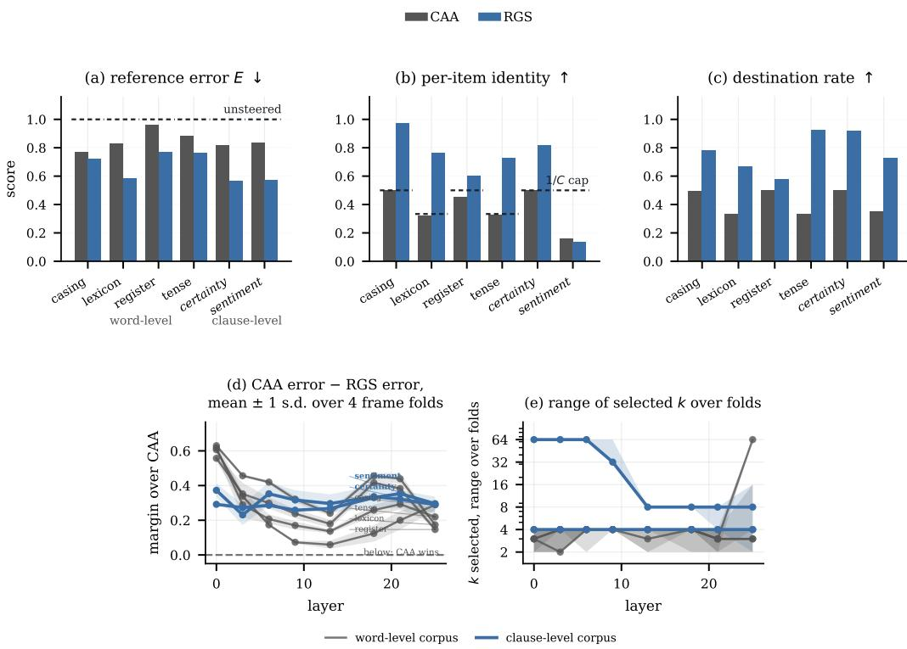  
Figure 2: CAA against RGS on the six substitution corpora at layer 13 of Gemma-2-2B-it, grouped by concept level with clause-level in italics. Dashed lines are equivalent to no steering in (a) reference error and the 1/C cap in (b) per-item identity; (c) is the destination rate (6). Table 9 in §I gives the same cells numerically. (d) The margin over CAA with ±1 s.d. bands, (e) range of optimal RGSk values over 4 cross validation folds. Arrows indicate the direction of improvement.

Figure 2 gives the comparison at one operating point, layer 13 with α and k selected on validation. On reference error RGS wins on all six corpora and the level does not order the result: the margin over CAA is 0.05 on the control, 0.12 to 0.24 on the other word-level corpora and 0.25 to 0.26 on the clause-level ones, so a clause edit is no harder for retrieval to aim at than a word edit. On per-item identity the two rules differ in kind rather than degree, CAA sitting at or below the 1/C cap on every corpus while RGS clears it on five of six (see §I). The level also sets where in the model depth the edit is best made: all four word-level corpora reach their lowest error at layer 0 and rise steeply out of it, varying by 0.29 to 0.45 across model depth, while the two clause-level corpora vary by 0.11 and 0.15 and SENTIMENT’s and CLAUSE’s best layer is 21 of 26. We find that the general shape holds where experiments are repeated in Llama-2-7b-chat (§L).

By (2) the selected k reports which rule won, and the depth at which retrieval becomes local rises with the level: word-level corpora select k = 1 at the embedding and loosen to 3–6 through the layers, while SENTIMENT takes the class ceiling there — the rule that wins is class-conditional CAA — and becomes local only from layer 13. That locality is worth most of the margin: replacing the selected k with the class ceiling raises reference error at every layer of every corpus except where the sweep takes the ceiling anyway, costing 0.44 to 0.59 on the four corpora local at layer 0 (§J). We therefore read k as a regime for input-dependent locality rather than a value, and the regimes are stable across folds (Figure 2e).

Per-item identity separates the rules far more than reference error does — RGS’s margin over CAA on CASING is 0.467 in identity against 0.059 in error — and Table 2 puts both capped rules beside RGS over four folds. The two fixed rules sit at or below their ceiling on every corpus, CAA reading 0.310 to 0.500 and the affine map 0.313 to 0.500. RGS, given the requested class as well as the source state, clears the ceiling on five corpora, and on four of them roughly doubles what any fixed rule can reach — 0.967 and 0.915 against a cap of 0.50, 0.709 and 0.686 against 0.33 — beating the affine map by 0.107 to 0.467. REGISTER is the narrow case, clearing the cap by 0.060 against a fold spread

of 0.053; SENTIMENT is the one loss, RGS reading 0.127 where CAA reads 0.123, so conditioning on the input buys nothing here. Concept level does not order those gaps — the two largest margins are the word-level CASING control and the clause-level CERTAINTY, and what separates CERTAINTY from SENTIMENT is the span: SENTIMENT rewrites a whole clause rather than replacing a phrase, so the bank holds no destination for a particular query, which is reflected in its selected k of 8 (against 4 elsewhere), here the neighbourhood is widening toward a class mean that cannot distinguish the queries it steers.
<table><tr><td>Corpus</td><td>Level</td><td>Cap 1/C</td><td>CAA</td><td>Affine map</td><td>RGS</td><td> $\mathrm { R G S \mathrm { ~ - ~ } C A A }$ </td></tr><tr><td>CASING</td><td>word</td><td>0.50</td><td> $0 . 5 0 0 { \scriptstyle \pm 0 . 0 0 0 }$ </td><td> $0 . 5 0 0 { \scriptstyle \pm 0 . 0 0 0 }$ </td><td> $\mathbf { 0 . 9 6 7 \pm 0 . 0 3 1 }$ </td><td>+0.467</td></tr><tr><td>CERTAINTY</td><td>clause</td><td>0.50</td><td> $0 . 4 9 2 { \scriptstyle \pm 0 . 0 1 7 }$ </td><td> $0 . 4 7 5 { \pm } 0 . 0 2 2$ </td><td> $\mathbf { 0 . 9 1 5 \pm 0 . 0 5 4 }$ </td><td>+0.423</td></tr><tr><td>TENSE</td><td>word</td><td>0.33</td><td> $0 . 3 2 6 \pm 0 . 0 0 7$ </td><td> $0 . 3 1 3 { \pm } 0 . 0 1 1$ </td><td> $\mathbf { 0 . 7 0 9 \pm 0 . 0 8 0 }$ </td><td>+0.383</td></tr><tr><td>LEXICON</td><td>word</td><td>0.33</td><td> $0 . 3 1 0 { \pm } 0 . 0 1 5$ </td><td> $0 . 3 2 1 \pm 0 . 0 1 1$ </td><td> $\mathbf { 0 . 6 8 6 \pm 0 . 0 6 8 }$ </td><td>+0.376</td></tr><tr><td>REGISTER</td><td>word</td><td>0.50</td><td> $0 . 4 4 6 \pm 0 . 0 2 0$ </td><td> $0 . 4 5 2 { \scriptstyle \pm 0 . 0 4 0 }$ </td><td> $\mathbf { 0 . 5 6 0 \pm 0 . 0 5 3 }$ </td><td>+0.113</td></tr><tr><td>SENTIMENT</td><td>clause</td><td>0.50</td><td> $0 . 1 2 3 { \pm } 0 . 0 1 4$ </td><td> $\mathbf { 0 . 3 4 0 \pm 0 . 0 5 6 }$ </td><td> $0 . 1 2 7 \pm 0 . 0 3 0$ </td><td>+0.004</td></tr></table>

Table 2: Per-item identity at layer 13, mean ± s.d. over four frame folds, ordered by the last column. CAA and the affine map read the state alone and are capped at 1/C (§3.4), the affine map reaching the cap on CASING and never exceeding it.

## 4.4 DECODED TEXT

When decoding continuations $( n = 6 0 )$ , span match collapses with model depth on every corpus while the forced choice does not: RGS holds 0.786 and 0.784 at layer 21 on the two three-class corpora against chance 0.333, so the edit reaches the output distribution at every depth and ceases to be the greedy argmax past the shallow layers. CAA sits at chance on every corpus at every layer. Span match is undefined at clause level, reading 0 there for every rule including those that changed the output, which is why the forced choice is reported beside it (§K).

## 4.5 COVERAGE

Retrieval draws on a bank containing the destination in other frames (described in detail in §B). Partitioning the vocabulary so the bank holds one half of the concepts and the queries ask for the other (Table 3), RGSs margin over the affine map closes to within 0´ .04 on the word-level corpora and CERTAINTY. The advantage of this family is therefore largely dependent on coverage, and where coverage is insufficient on four of the six corpora the failure mode is merely degradation to classconditional CAA. Overall, we observe that input-dependent rules outperform fixed rules despite the limitations placed on the bank.

Under disjoint coverage, on CERTAINTY and CASING RGS maintains locality and this is where CAA wins. CAA reads reference errors 0.820 against RGSs 0´ .901 and 0.740 against 0.790. Therefore, where the edit does not require a stored destination, a difference of means is the better rule. For CASING the edit transforms the word rather than looking it up, which is why it is the only corpus in which RGS maintains it’s per-item identity score under reduced coverage $( 0 . 9 7  0 . 9 2 )$ . In SENTI-MENT the affine map degrades in reference error from 0.430 to 0.639 against RGSs 0´ .573 to 0.603, so here the map’s advantage depends on the vocabulary. RGS is stable there because it is already reading the class: it selects k = 64 and gains nothing in identity over CAA (0.127 against 0.123), so the partition has nothing to take away.

## 4.6 A/B BENCHMARKS

On A/B behavioural benchmarks in Llama-2-7b-chat, scored by the share of probability on the answer exhibiting the behaviour, RGS wins on SYCOPHANCY (0.496 against CAA’s 0.543, from 0.570 unsteered) and loses on CORRIGIBILITY (0.288 against 0.230, from 0.392) — the one case where a difference of means beats an input-conditional target.

Here, the answer format is the primary cause. An item’s two states differ mostly in which option is selected, and that token-level flip dominates the displacement; pooled across k items the flip directions cancel. Retrieval inherits the problem: its class-restricted neighbourhood holds states sharing the behaviour label but differing in answer letter, so its mean points along the letter axis. The diagnostics (§3.3) say so in advance — 1 −A is near-zero and the neighbourhood aims no better than leaving the input alone, which rules out retrieval here at any depth (§Q, per-layer in §M).

<table><tr><td rowspan="2">Corpus</td><td colspan="2">RGS</td><td colspan="2">CAA</td><td colspan="2">Affine map</td><td rowspan="2"></td><td colspan="2">RGS identity</td></tr><tr><td>full</td><td>disj.</td><td>full</td><td>disj.</td><td>full</td><td>disj.</td><td>k disj.</td><td>full disj.</td></tr><tr><td>LEXICON</td><td>0.585</td><td>0.768</td><td>0.826</td><td>0.858</td><td>0.672</td><td>0.780</td><td>64</td><td>0.76</td><td>0.44</td></tr><tr><td>TENSE</td><td>0.762</td><td>0.831</td><td>0.882</td><td>0.880</td><td>0.826</td><td>0.872</td><td>32</td><td>0.73</td><td>0.65</td></tr><tr><td>REGISTER</td><td>0.767</td><td>0.883</td><td>0.962</td><td>0.984</td><td>0.779</td><td>0.886</td><td>64</td><td>0.60</td><td>0.36</td></tr><tr><td>SENTIMENT</td><td>0.573</td><td>0.603</td><td>0.834</td><td>0.874</td><td>0.430</td><td>0.639</td><td>64</td><td>0.13</td><td>0.13</td></tr><tr><td>CERTAINTY</td><td>0.565</td><td>0.901</td><td>0.818</td><td>0.820</td><td>0.678</td><td>0.904</td><td>32</td><td>0.82</td><td>0.60</td></tr><tr><td>CASING</td><td>0.721</td><td>0.790</td><td>0.768</td><td>0.740</td><td>0.766</td><td>0.822</td><td>16</td><td>0.97</td><td>0.92</td></tr></table>

Table 3: Reference error at layer 13 under full coverage and with the vocabulary partitioned so the bank holds one half of the concepts and the queries ask for the other, leaving no query’s own destination stored. Lower is better; k and identity are retrieval’s. RGS keeps a margin over CAA on four corpora under the split and loses it on CERTAINTY and CASING, where a difference of means becomes the better rule.

## 4.7 EXTERNAL BENCHMARKS: COUNTERFACT

The CounterFact benchmark presented here is taken from Meng et al. (2022) and run under its own protocol (§3.2.4). Every case asks a different prompt to end in a different object, so no single displacement can serve two cases at once, and the bank is the benchmark’s own attribute prompts — states of other subjects that already carry the requested object. Scored by the benchmark’s efficacy measure — the share of cases where, at the prompt’s final position, the first token of the new object outscores that of the true object — on 60 held-out cases (Table 12, §N), CAA fails and is indistinguishable from not steering (0.233–0.250 against 0.250). class-conditional CAA improves on this, at 0.883 at layer 20, and RGS near matches this (0.767). This follows from (2): every case asking for FRENCH wants the same state, so the class holds no variation for a neighbourhood to exploit and the difference between class means is the correct rule.

The diagnostics predict this. On these test queries retrieval alignment A reads 0.765 − −0.792 and the residual edit metric R shows that a single direction leaves 0.991–0.992 of the required displacement, at every layer. CAA is predicted to do nothing and does, while the requested class leaves 0.77–0.81, at a k of 16 against a class of 18–23: near enough the ceiling that by (2) the rule being screened is class-conditional CAA rather than RGSCoverage barely moves it here (0˙ .765–0.792 with a state for this case’s own destination in the bank, 0.769–0.809 without): any state carrying the requested object serves, which is what it means for the class to determine the answer (§O).

## 4.8 DIAGNOSTICS

The four quantities of §3.3 are computed prior to rule fitting. Table 14 (§R) scores each against the CAA-minus-RGS margin and against RGS’s own reference error across four task families. Results visualised in Figure10 (§R). We evaluate the number of pairs each estimator requires, this is given in detail in §E.

1−A, whether the neighbourhood aims where the query has to go, ranks RGS’s error best (0.65 mean over families, 0.97 across the token family) — it is retrieval’s own field, scored before retrieval runs. It is also the only metric asking for more than the pairs, since it needs class labels, a bank and hundreds of pairs. Absent a bank, the quantity to read is R (the part of the edit no single vector supplies) at 0.29 from six pairs, while D (how far the state must move) ranks the same outcome at 0.39 from the same six. g, the measure of whether the required displacements point the same way, reverses sign between families (+0.27 on the token corpora, −0.52 on the substitution and A/B families) and needs thousands of pairs where R needs six, so we report it as a component of R and never on its own (§4.6). No diagnostic ranks the margin reliably, so they are able to say where input-dependence can improve performance, but not by how much. (§P).

## 5 DISCUSSION

A fixed steering rule is insufficient when the required edit depends on the query, and the evaluation on the token corpora quantifies that failure (§4.2). On WEEKDAY the required displacements are a permutation of one another and cancel exactly, $g = 0 . 0 0 0$ at every captured depth, so CAA is not merely imprecise but fits a zero vector; the failure is structural rather than empirical, and the constructions of §4.1 reproduce it in a geometry where the correct answer is known in advance. RGS returns a query-specific destination, rectifying the failures of CAA whilst differing only in form, not level of supervision. The affine map requires a higher level of supervision in the form of corresponding pairs; where these are not available the method is unusable, and therefore incomparable with other steering methods.

Evaluation on the substitution corpora shows that the advantage is not confined to constructed geometry. RGS lowers reference error in all cross-validated layer-by-corpus experiments across two models. We show the concept-level of the edit decides where in the model to apply it, word-level corpora peaking sharply in the first tenth of the network and clause-level corpora staying flat, a distinction that replicates in a second model (§L).

With our proposed diagnostic measures, the data can be used to decide on the more suitable method before either rule is fitted: R orders the families from six unlabelled pairs, and where given a bank, 1 − A ranks RGSs error at Spearman 0´ .65 and reads zero where retrieval has nothing to exploit. Both failures we report were visible to it in advance. On the A/B benchmarks A reads 0.91–1.02 at every layer, so the neighbourhood aims no better than leaving the input alone (§4.6). Similarly, on CounterFact diagnostics predict CAA failure against RGSThe screen was built on our own corpora˙ and is read here on a benchmark it was not designed against.

Input-dependent steering may be limited in some ways. RGS costs more computation at steering time by searching a bank that is held in memory, whereas CAA simply adds a precomputed vector; we report no timing experiments as the difference in execution time between the methods was negligible in our work. The advantage of RGS rests substantially on coverage (§4.5), which is the intended setting, but is not a universal one. Where coverage is insufficient, however, RGS does not fail arbitrarily: k interpolates between a neighbourhood and the class it is drawn from, and at the class ceiling the two coincide (2), so a query whose neighbours carry nothing its class does not already carry is steered by the class-conditional mean.

Taken together, our results suggest the following procedure. Measure R first, at six pairs and no labels; where a bank exists, measure A, and treat 1 − A ≈ 0 as a verdict against retrieval; if given abundant corresponding pairs, fit a map. Where those pairs do not exist the map cannot be fitted, and RGS is the only input-dependent rule available, reading a destination per query from exactly the labels CAA already requires. The question a practitioner faces is therefore not which steering rule is better in general, but whether the destination varies inside the class their query requests, and that is measurable before any rule is run.

## 6 CONCLUSION

A fixed steering rule is insufficient when the embedding geometry and task require edits that depend on the query. We present RGS as an alternative to CAA that returns a query-specific destination. RGS rectifies the failures of CAA whilst differing only in form, not requiring the additional supervision an affine map demands. In cases where RGS fails, it simply degrades to class-conditional CAA. Not all geometries and tasks benefit from this approach, however. Therefore, we developed data-derived diagnostic measures that can be used to decide on the more suitable method a priori.

## REPRODUCIBILITY STATEMENT

All figures and tables regenerate from cached results . Splits, seeds and the full argument list of each run are recorded in the output JSON. Hyperparameters are selected on validation splits disjoint from both the bank and the reported score.

## THE USE OF LARGE LANGUAGE MODELS

An LLM-based assistant was used to polish prose — tightening wording and shortening passages already drafted by the authors. It was not used to generate research ideas, design experiments, write the analysis code, or interpret results, and all claims and numbers in the paper were produced and verified by the authors.

## REFERENCES

J. Engels, E. J. Michaud, I. Liao, W. Gurnee, and M. Tegmark. Not all language model features are linear. arXiv:2405.14860, 2024.

Y. Huang, D. Liu, Z. Zhong, W. Shi, and Y. T. Lee. kNN-Adapter: Efficient domain adaptation for black-box language models. arXiv:2302.10879, 2023.

G. Ilharco, M. T. Ribeiro, M. Wortsman, et al. Editing models with task arithmetic. In International Conference on Learning Representations, 2023.

U. Khandelwal, O. Levy, D. Jurafsky, L. Zettlemoyer, and M. Lewis. Generalization through memorization: Nearest neighbor language models. In International Conference on Learning Representations, 2020.

U. Khandelwal, A. Fan, D. Jurafsky, L. Zettlemoyer, and M. Lewis. Nearest neighbor machine translation. In International Conference on Learning Representations, 2021.

K. Li, O. Patel, F. Viegas, H. Pfister, and M. Wattenberg. Inference-time intervention: Eliciting´ truthful answers from a language model. In Advances in Neural Information Processing Systems, 2023.

K. Meng, D. Bau, A. Andonian, and Y. Belinkov. Locating and editing factual associations in GPT. In Advances in Neural Information Processing Systems, 2022.

E. Perez, S. Ringer, K. Lukosiˇ ut¯ e, et al. Discovering language model behaviors with model-written˙ evaluations. arXiv:2212.09251, 2022.

N. Rimsky, N. Gabrieli, J. Schulz, et al. Steering Llama 2 via contrastive activation addition. arXiv:2312.06681, 2023.

W. Shi, J. Michael, S. Gururangan, and L. Zettlemoyer. Nearest neighbor zero-shot inference. In Empirical Methods in Natural Language Processing, 2022.

E. Todd, M. L. Li, A. S. Sharma, et al. Function vectors in large language models. In International Conference on Learning Representations, 2024.

A. M. Turner, L. Thiergart, G. Leech, et al. Activation addition: Steering language models without optimization. arXiv:2308.10248, 2023.

A. Zou, L. Phan, S. Chen, et al. Representation engineering: A top-down approach to AI transparency. arXiv:2310.01405, 2023.

## APPENDIX

## A THE AFFINE MAP

We evaluate a single global map along side a single global displacement. We define this as,

$$
\delta _ { \mathrm { a f f i n e } } ( h ) = \alpha \big ( W h + b - h \big ) ,\tag{3}
$$

with $W \in \mathbb { R } ^ { d \times d }$ and $b \in \mathbb { R } ^ { d }$ fitted by ridge regression on the training pairs $( h _ { i } , r _ { i } )$ , minimising $\begin{array} { r } { \sum _ { i } \lVert W h _ { i } + b - r _ { i } \rVert ^ { 2 } + \lambda \lVert W \rVert _ { F } ^ { 2 } } \end{array}$ . The penalty is selected from a logarithmic grid on the validation split, by the same objective is used for the selection of every other rule’s α.

It is reported as a ceiling on steering here because it is the most supervised rule here: it needs each query aligned to the particular state it had to become, which class-conditional CAA and RGS does not. Its output is still a function of h alone, which is what places it under the 1/C identity ceiling of §3.4 alongside CAA, and what the generated constructions exploit: a task can defeat every global displacement and still be solved by a global linear map, so a win over CAA that the affine map also achieves is not evidence for an input-conditional destination (§F).

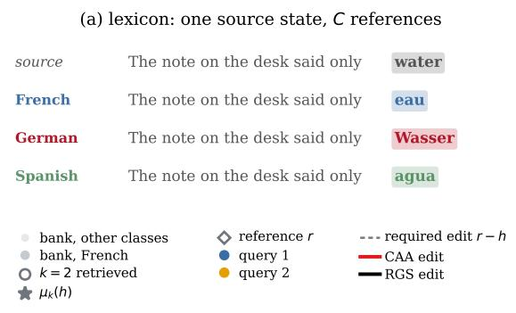

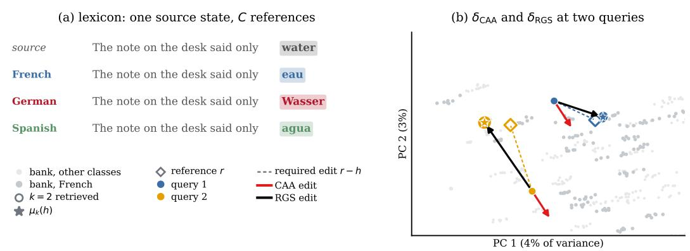

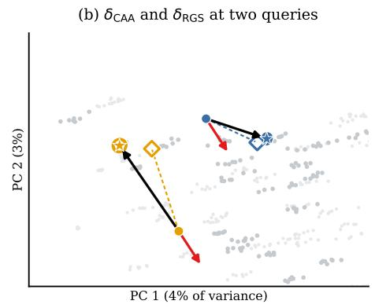  
Figure 3: Example of a substitution corpus and how the rules act on it. (a) One concept of LEXICON in one frame, once per class: the prompt is identical across the four renderings and only the highlighted span differs. The C renderings therefore share a single source state h, which is why any rule that is a function of h alone is capped at 1/C on per-item identity (§3.4). (b) The two rules as operations, on two queries of the same class at layer 0 of Gemma-2-2B-it. CAA moves both along the same vector — two arrows that are one arrow translated, and that same vector for every query in the corpus — while RGS averages the k nearest bank entries of the requested class and steers to that point, which differs between the two. Shape says what a mark is and colour which query it belongs to, so a neighbour both queries retrieved appears as two concentric rings; the dashed line is the step each query required. The plane carries 7% of the variance and the neighbours were selected in the full space, so it cannot be read for distance and the retrieved k are ringed rather than left to the eye. Measured in the full space the queries score E = 0.94 and 1.01 under CAA against 0.13 and 0.96 under RGS— the second is one retrieval does not solve, kept because the split ordered them that way.

## B CORPUS EXAMPLES

How the six corpora of §3.2 are built and rendered: the frames, the construction rules that keep class vocabularies equal, one worked example per corpus, and the corpus sizes the capture holds.
<table><tr><td>Corpus</td><td>Level</td><td>C</td><td>Classes</td><td>Concepts</td><td>Pairs</td><td>States</td></tr><tr><td>LEXICON</td><td>word</td><td>3</td><td>French, German, Spanish</td><td>25</td><td>900</td><td>1800</td></tr><tr><td>TENSE</td><td>word</td><td>3</td><td>past, progressive, third-person</td><td>28</td><td>1008</td><td>2016</td></tr><tr><td>REGISTER</td><td>word</td><td>2</td><td>formal, casual</td><td>28</td><td>672</td><td>1344</td></tr><tr><td>SENTIMENT</td><td>clause</td><td>2</td><td>positive, negative</td><td>20</td><td>480</td><td>960</td></tr><tr><td>CERTAINTY</td><td>clause</td><td>2</td><td>asserted, hedged</td><td>20</td><td>480</td><td>960</td></tr><tr><td>CASING (control)</td><td>word</td><td>2</td><td>upper, title</td><td>28</td><td>672</td><td>1344</td></tr></table>

Table 4: The six substitution corpora. Pairs = concepts × classes × 12 frames, the number of steering problems the corpus poses; states is twice that, a source and a reference for each. Class sizes are equal by construction (§B).

Table 5 gives one rendered pair per corpus per class, taken from the first sentence frame, and Figure 3 shows one concept as the model sees it. The source prompt is identical across the classes of a concept — only the destination differs — which is the property §3.4 uses to derive the 1/C cap on per-item identity.

Note the contrast between SENTIMENT and CERTAINTY, which is what makes them a matched pair rather than two clause corpora. SENTIMENT replaces the whole clause, so its source and reference share only a topic. CERTAINTY inserts one hedging adverb and both renderings end on the same word (finished), so the last-token state differs only in the context that precedes it. The second is the harder test of whether retrieval can find a propositional attitude without a token-level cue, and §4.3 reports that retrieval does better on it than on SENTIMENT.

Frames. Each corpus is rendered in twelve sentence frames chosen to end on the substituted span and to name nothing from any vocabulary, so the only thing distinguishing a pair is the span itself. The word-level corpora use frames such as “The note on the desk said only {word}”. The clauselevel corpora need their own, since “The label on the box read the meeting was a complete failure” is not a sentence; they use reporting frames such as “She said that {clause}” with deliberately flat verbs, because a frame like “everyone agreed that” would put a stance in the frame and the stance is what the class must carry. Twelve is also what makes a frame-disjoint four-fold split possible.

Table 5: Rendered source and reference prompts, frame 1 of 12. The substituted span is the last token of each prompt, which is where states are read.
<table><tr><td>Corpus</td><td>Class</td><td>Prompt</td></tr><tr><td rowspan="4">LEXICON</td><td>source</td><td>The note on the desk said only water</td></tr><tr><td>French</td><td>The note on the desk said only eau</td></tr><tr><td>German</td><td>The note on the desk said only Wasser</td></tr><tr><td>Spanish</td><td>The note on the desk said only agua</td></tr><tr><td rowspan="4">TENSE</td><td>source</td><td>The note on the desk said only go</td></tr><tr><td>past</td><td>The note on the desk said only went</td></tr><tr><td>progressive</td><td>The note on the desk said only going</td></tr><tr><td>third-person</td><td>The note on the desk said only goes</td></tr><tr><td rowspan="3">REGISTER</td><td>source</td><td>The note on the desk said only buy</td></tr><tr><td>formal</td><td>The note on the desk said only purchase</td></tr><tr><td>casual</td><td>The note on the desk said only grab</td></tr><tr><td rowspan="3">CASING</td><td>source</td><td>The note on the desk said only water</td></tr><tr><td>upper</td><td>The note on the desk said only WATER</td></tr><tr><td>title</td><td>The note on the desk said only Water</td></tr><tr><td rowspan="3">SENTIMENT</td><td>source</td><td>She said that the meeting ran for an hour</td></tr><tr><td>positive</td><td>She said that the meeting was a genuine success</td></tr><tr><td>negative</td><td>She said that the meeting was a total failure</td></tr><tr><td rowspan="3">CERTAINTY</td><td>source</td><td>She said that the report is finished</td></tr><tr><td>asserted</td><td>She said that the report is certainly finished</td></tr><tr><td>hedged</td><td>She said that the report is possibly finished</td></tr><tr><td rowspan="2">weekday</td><td>source</td><td>The budget meeting has been moved to Monday</td></tr><tr><td>next day</td><td>The budget meeting has been moved to Tuesday</td></tr><tr><td rowspan="2">capitals</td><td>source</td><td>The budget conference will be held in France</td></tr><tr><td>capital</td><td>The budget conference will be held in Paris</td></tr></table>

Construction rules. Two rules keep the diagnostics honest. Every concept carries every class, so no class has a smaller vocabulary than another and A cannot become partly a measurement of which concepts happen to be stored. And a concept whose destination in some class equals the source word is dropped rather than kept with that class removed: a cognate such as French table asks for no displacement at all, and keeping the concept while dropping one class would leave the classes with different vocabularies.

For the generated constructions, the states are sampled rather than produced by a model: three isotropic modes with per-mode displacements chosen so that their mean is zero, which sets $g = 0$ exactly and leaves retrieval quality as the only free variable.

## C METRIC DEFINITIONS IN FULL

The definitions behind §3.4, with the estimator choices each one rests on.

STATE-SPACE METRICS

Reference error. For query state $h _ { i } .$ , steered state $h _ { i } ^ { \prime }$ and reference $r _ { i } ,$

$$
E = \frac { 1 } { n } \sum _ { i } \Vert h _ { i } ^ { \prime } - r _ { i } \Vert \ \middle / \ s , \qquad s = \frac { 1 } { n } \sum _ { i } \Vert r _ { i } - h _ { i } \Vert ,\tag{4}
$$

so $E = 1$ is the score for leaving the input alone, $E = 0$ is exact, and $E > 1$ means the edit moved states away from their references. Normalising by the corpus’s own mean required step s makes the scale comparable across corpora and layers whose displacements differ in size. E is measured against each query’s own reference rather than against a class centroid, which matters because distance-to-centroid is minimised exactly by mapping every query onto that centroid — the collapse an input-conditional rule exists to avoid.

Per-item identity. E is an average of norms and so tolerates a rule that lands every query in the right region without distinguishing between them. Identity asks the sharper question: for each steered state, is the nearest reference among all test references its own?

$$
\mathrm { i d } = \frac { 1 } { n } \sum _ { i } ^ { \phantom { } } \mathcal { H } \Big [ \arg \operatorname* { m i n } _ { j } \big \| h _ { i } ^ { \prime } - r _ { j } \big \| = i \Big ] .\tag{5}
$$

Higher is better. This is the metric the $1 / C$ ceiling above binds, for any rule that does not read the requested class, and Table 2 shows the affine map reaching it exactly on CASING $( 0 . 5 0 0 \pm 0 . 0 0 0 ) $ and never exceeding it. Identity is therefore not a harder version of E but a different question: E asks how close a rule lands, and identity asks whether it could have distinguished the queries at all.

Destination rate. The class-level companion to identity, and the readout most comparable to what the steering literature usually reports. Form one centroid per class per side $- \mu _ { c } ^ { \mathrm { s r c } }$ over that class’s sources and $\mu _ { c } ^ { \mathrm { t g t } }$ over its references — and ask whether a steered state’s nearest centroid, among all 2C, is its own class’s target side:

$$
\operatorname* { d e s t } = \frac { 1 } { n } \sum _ { i } \mathcal { k } ^ { \prime } \Big [ \mathop { \mathrm { \ a r g m i n } } _ { s \in \{ \mathrm { \scriptsize { s r c , t g t } } \} , c } \left\| h _ { i } ^ { \prime } - \mu _ { c } ^ { s } \right\| = \mu _ { c _ { i } } ^ { \mathrm { t g t } } \Big ] .\tag{6}
$$

Including the source-side centroids is what makes the number start in the right place. A classifier over destinations alone assigns every state to some destination, so an unsteered query scores well for having moved nowhere; with the source side present it is nearest its own starting centroid and score zero.

The rate is a class-level question and is satisfiable by collapse: a rule emitting one point per class — which RGS at large k very nearly does — attains it by construction. It is therefore reported beside identity (5) rather than instead of it, the two answering ”did it reach the right region” and ”did it reach the right item”. Collapse needs no third metric to detect it: E is measured against each query’s own reference, so a rule mapping every query to one point scores badly, and identity caps such a rule at $1 / C$ by (5).

## OUTPUT METRICS

State-space results need not survive into text, so we decode continuations under each rule. The readout that is well defined depends on the level of the concept.

Span match. For a destination that is a single word, we record whether the continuation contains it, matched case-sensitively on CASING where the case is the task. For a destination that is a clause the question is not well posed: no rule was going to make the model emit a particular twelve-word clause verbatim, and the measure reads 0 for every rule including the ones that changed the output. That is a property of the metric, not a steering result.

Forced choice. Defined at both levels. For each query the candidates are that concept’s destinations in each class — available because every concept carries every class by construction — scored under the edited model, and we report the share of probability on the requested one against chance $1 / C .$ Candidate spans differ in token length, so scores are mean per-token log-probabilities before normalising. Two properties make it readable. It needs no external classifier, so no second model’s biases enter. And probe sets are class-balanced, which is load-bearing rather than tidy: a rule with a fixed preference for one class is right on the queries requesting it and wrong on the rest, so on a balanced set it scores exactly chance however strong that preference is. On an unbalanced set the same rule would report the corpus’s class prior as though steering had produced it.

Fluency. Steered text is scored by its mean per-token log-probability under the unsteered model. Read against unsteered text this is misleading, since the unsteered continuation is that model’s own greedy output and sits near the scorer’s maximum by construction, so any intervention starts behind. We therefore report it against a span-swapped reference: the model’s greedy continuation with only the source span rewritten to the destination. That is the likelihood a correct edit attains, and the number a steered continuation is compared with.

## D DIAGNOSTICS IN FULL

Before either rule is run we define four quantities that describe a steering task rather than score a rule on it: how far the state must move (standardised displacement, D), whether the required steps agree (global shared fraction, g), how much of the edit is left once the agreeing part is removed (R), and how well a retrieved neighbourhood aims at what each query requires (retrieval alignment, $1 - A )$ All are computed from the paired states $( h _ { i } , r _ { i } )$ and the required edits $d ( h _ { i } ) = r _ { i } - h _ { i }$ they define; $1 - A$ also requires class labels and a bank to search, which here is the set of references. Every one therefore asks for more supervision than the rule it screens for, and how many pairs each needs is measured in Table 6 (§E), and what each requires in Table 14 (§R).

Retrieval alignment. Every rule compared here takes the form “one direction per query, times one scalar”, and the scalar is selected, so what governs a rule’s score is not the length of its $\alpha = 1$ step but how well its directions align with d. For a proposed field u the optimal scalar is $\alpha = \langle d , u \rangle / \langle u , u \rangle$ in closed form, leaving

$$
\begin{array} { r } { \mathrm { r e s } ( u ) = \mathrm { m e a n } _ { i } \| d _ { i } - \alpha u _ { i } \| / \operatorname* { m e a n } _ { i } \| d _ { i } \| , } \end{array}\tag{7}
$$

in the units of $E \colon ~ 1$ for a field that helps no more than leaving the input alone, 0 for one that reproduces d exactly after scaling. Applied to retrieval’s own field $u _ { i } = \mu _ { k } ( h _ { i } ) - h _ { i }$ , minimised over k as the rule’s selection would, (7) gives the retrieval alignment A, reported as $1 - A$ to keep E’s scale. It asks whether the bank aims, and aim is all it tests: a neighbourhood pointing correctly but too far is not penalised, since selecting α would fix that. Unlike the three below it is a property of the bank as well as of the corpus, and it grants retrieval the best step size and neighbourhood on the very queries it scores, where the rule must choose both on separate data, so it bounds what retrieval can achieve rather than predicting what it will.

## The standardised displacement

$$
D = \sqrt { \mathbb { E } _ { i } \| d _ { i } \| ^ { 2 } } \bigm / \sqrt { \mathbb { E } _ { j } \| x _ { j } - \bar { x } \| ^ { 2 } }\tag{8}
$$

is the root-mean-square edit in units of the spread of the pooled states about their centre, a standardised effect size on the scale Cohen’s d is read on. It says nothing about agreement between edits.

## The global shared fraction

$$
g = { \frac { \Vert \mathbb { E } [ d ] \Vert } { \mathbb { E } \Vert d \Vert } }\tag{9}
$$

asks whether the required steps point the same way, insensitive to their lengths: $g = 1$ describes a task every query asks the same thing of, $g = 0$ one whose steps cancel. It is a directional summary and not a score. It is also expensive to estimate, costing two orders of magnitude more pairs than the other three diagnostics (Table 6).

The residual edit. R is the portion of the edit no single vector supplies, in the same units as $D \colon$ the root-mean-square displacement about its own mean, over the states’ spread. It is what a per-query rule is left to work with, and the strongest diagnostic available without labels or a bank.

It is the residual leg of an exact decomposition, $D ^ { 2 } = S ^ { 2 } + R ^ { 2 }$ , with S the part a difference of means does supply, so it can equally be written $R = D \sqrt { 1 - \| \mathbb { E } [ d ] \| ^ { 2 } / \mathbb { E } \| d \| ^ { 2 } }$ . It is also written $D \sqrt { 1 - g ^ { 2 } }$ the same expression with the mean of norms in place of the root-mean-square. The two are not identical $- \phantom { } g ^ { 2 }$ is the larger by Jensen’s inequality, so that form reads the smaller residual — and both appear here: the per-task values reported by the library, including every R in the layerwise tables, are the squared form, while the rank correlations of Tables 14 and 15 are computed from $D \sqrt { 1 - g ^ { 2 } }$ , the form their axis labels can state without a second symbol. The choice does not move them: the two correlate at 0.999 or better within every family, and recomputing Table 15 from the squared form moves no cell by more than 0.01 (0.84 against 0.84 on the token corpora, 0.26 against 0.26 on the substitution family, 0.40 against 0.41 on the A/B benchmarks).

## E ESTIMATOR SAMPLE SIZE

The pair requirement of Table 14 is measured rather than assumed, by subsampling each estimator on a fixed task and comparing against its value on the full corpus. The targets are the sample sizes at which relative standard error reaches 2%.

R reaches it at 6 pairs and D at 16, and the elbow does not move across four generated geometries, which is what makes the sample size one number rather than a per-task one. g is the contrast: on a task constructed so that the displacements cancel it is biased rather than merely noisy, reading above its true zero until the sample runs into the thousands (2048), because the norm of a mean cannot average its sampling noise away.

A behaves differently depending on what is being subsampled, and the distinction matters in practice. Subsampling the queries against a fixed bank, it reaches 2% at 384–512. Subsampling the pairs, which shrinks the bank as well, it does not reach 2% within 512 on three of four constructions — the pairs are also the datastore it searches. This is the sense in which A is cheap to measure and expensive to supply.

Table 6 collects the requirement for all four. Each is a functional of the required edits $d _ { i } = r _ { i } - h _ { i }$ so each needs every source linked to the reference it had to become, and what separates them is how many such links: R at 6, D at 16, 1 −A at 384–512 queries against a fixed bank, and g not usefully at any sample size we ran. The correspondence is the same for all four, which is why a diagnostic asks for more supervision than RGS itself, whatever its sample size.
<table><tr><td>Diagnostic</td><td>Requires</td><td>Pairs to 2%</td><td>Fitted slope</td><td>Error at n = 32</td><td>Error at n = 512</td></tr><tr><td> $R = D \sqrt { 1 - g ^ { 2 } }$ </td><td>pairs</td><td>6</td><td>-0.56</td><td>1.0%</td><td>0.2%</td></tr><tr><td>D</td><td>pairs</td><td>16</td><td>-0.80</td><td>2.0%</td><td>0.2%</td></tr><tr><td></td><td>pairs</td><td>2048</td><td>-0.52</td><td>0.158 (bias)</td><td>0.039 (bias)</td></tr><tr><td> $^ { g } _ { 1 - A , }$  queries subsampled</td><td>pairs, labels, bank</td><td>384-512</td><td></td><td></td><td></td></tr><tr><td> $1 - A ,$  pairs subsampled</td><td>pairs, labels, bank</td><td>&gt;512</td><td></td><td></td><td></td></tr></table>

Table 6: The number of corresponding pairs each diagnostic needs. “Pairs to $2 \%$ is the sample size at which relative standard error reaches 2%, read from the recorded power-law fit, and the two right-hand columns give the measured error at two grid points either side of it. A slope near −0.5 is the Monte-Carlo rate. g is biased rather than merely noisy on a task whose displacements cancel, which is why its target runs into the thousands. 1−A is swept two ways: against a fixed bank it reaches 2% within the grid, while subsampling the pairs shrinks the bank with the sample and 3 of 4 constructions do not reach 2% by 512.

## F GENERATED CONSTRUCTIONS

The four constructions of §3.2.5 are positive controls: the geometry is set rather than measured, so each rule’s correct score is known before it is run. All are two-dimensional with 300 states per class and five seeds; Figure 4 draws all four, including the two of Figure 1 with their k sweeps, and Table 7 reports what each rule scores.

The constructions. THREE-MODE places three source clusters and rotates each one’s offset, so the required displacements cancel and $g = 0$ exactly. SHARED OFFSET is the same geometry with one common offset instead, placing $g = 1 \colon$ it is the control that isolates g as the variable, since nothing else about the task changes. CONCENTRIC puts classes on rings of radius 1 and 2 and sends each query radially outward at its own angle; radial vectors average to zero around a ring, so the mean displacement vanishes within a class as well as across classes, and the two ring ratios (2 and $\frac { 1 } { 2 } )$ cannot be served by one linear map. HIERARCHICAL places every class inside every cluster with a cluster-specific rotation, so the displacement for a class depends on which cluster the query is in; the linear part of the required map is shared across clusters but the intercept is not.

What they establish beyond §4.1. The selected k separates RGS from the rule it coincides with at $k = \left| \mathcal { D } _ { c } \right| ( 2 )$ : 300, the class ceiling, where the class mean is the right answer, and 10 to 30 where it is not. And the retrieval alignment A anticipates what RGS then scores to within 0.020 on all four constructions, the tightest evidence available that 1 − A measures the headroom it is read as measuring.

cc-CAA, α = 1

(a) three-mode: CAA

(e) three-mode: cc-CAA  
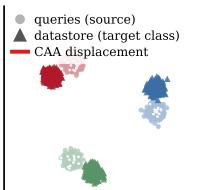  
CAA, α = 0.1, norm 0.00

(b) shared-ofset control: CAA  
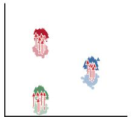  
CAA, α = 1, norm 2.23

(c) concentric: CAA  
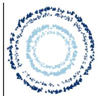  
CAA, α = 0.6, norm 0.09

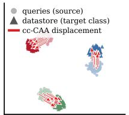  
(f) shared-ofset control: cc-CAA  
cc-CAA, α = 1

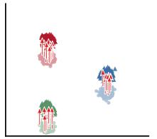

(g) concentric: cc-CAA  
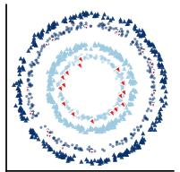  
cc-CAA, α = 1.8

(i) three-mode: RGS  
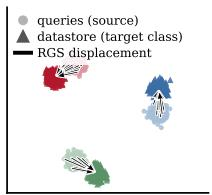  
RGS, k = 300, α = 0.9

(j) shared-ofset control: RGS  
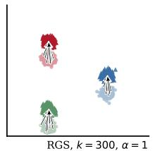

(k) concentric: RGS  
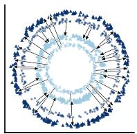  
RGS, k = 10, α = 1.1  
CAA, α = 2, norm 0.00

(n) shared-ofset control  
(m) three-mode  
(o) concentric  
(q) three-mode  
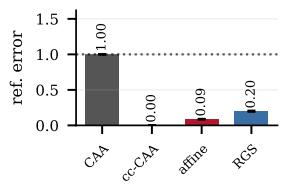

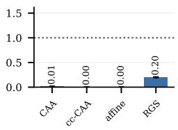

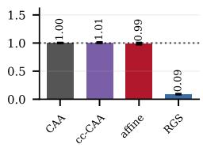  
(r) shared-ofset control  
(s) concentric  
(l) hierarchical: RGS

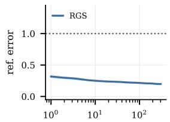

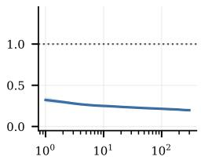

(d) hierarchical: CAA  
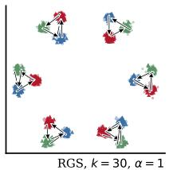  
k  
k

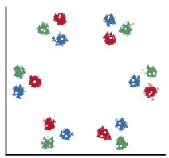

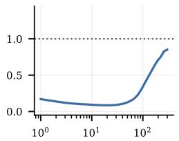  
k  
cc-CAA, α = 1.9

(h) hierarchical: cc-CAA  
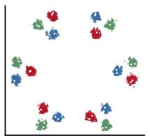

(p) hierarchical  
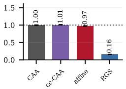

(t) hierarchical  
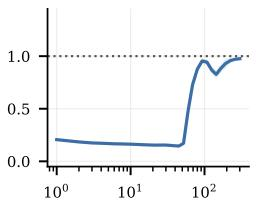  
k

Figure 4: Steering rules on constructed geometries. The four constructions appear in the same order throughout: (a)–(d) draw CAA’s edit, (e)–(h) class-conditional CAA’s and (i)–(l) RGS’s, each at the α and k it selected and on one scale, so only the rule differs between them. CAAis near zero on all but SHARED OFFSET. class conditional CAA reproduces the required edit wherever the displacement is constant within a class and collapses to a stub on CONCENTRIC and HIERARCHICAL, where it cancels within a class as well, while RGS’s arrows turn with the mode, the ring and the cluster. (m)–(p) give Table 7 as bars and (q)–(t) sweep k, where the rise at large k on the last two constructions is the neighbourhood mean growing past one ring or cluster.

Table 7: Generated constructions: diagnostics computed before any rule runs, and the reference error each rule scores, mean ± s.d. over five seeds. k is RGS’s selected neighbourhood, over the grid {1,3,10,30,100,300} and selected per seed; the class holds 300 states, so k = 300 is the class ceiling at which RGS coincides with class-conditional CAA (2).
<table><tr><td rowspan="2">Construction</td><td colspan="2">Diagnostics</td><td colspan="4">Reference error E</td><td rowspan="2">k</td></tr><tr><td>g</td><td></td><td>CAA</td><td>class-conditional CAA</td><td>affine</td><td>RGS</td></tr><tr><td>THREE-MODE</td><td>0.000</td><td>0.220</td><td>1.000</td><td>0.000</td><td>0.088</td><td>0.200</td><td>300</td></tr><tr><td>SHARED OFFSET</td><td>1.000</td><td>0.220</td><td>0.012</td><td>0.000</td><td>0.000</td><td>0.200</td><td>300</td></tr><tr><td>CONCENTRIC</td><td>0.054</td><td>0.072</td><td>1.001</td><td>1.008</td><td>0.826</td><td>0.081</td><td>10-30</td></tr><tr><td>HIERARCHICAL</td><td>0.000</td><td>0.149</td><td>1.000</td><td>1.010</td><td>0.973</td><td>0.155</td><td>30</td></tr></table>

## G THE TOKEN CORPORA IN FULL

The supervision ladder of §4.2 with its fold spreads: four rules on weekday advancement and country-to-capital, cross-validated. The two unpaired rules are matched on class information, so the gap between them is what locality inside the class is worth, and the affine map is a ceiling rather than an entrant.

Table 8: Reference error on the token corpora, mean ± s.d. over 5 folds; lower is better. CAA’s weekday vector is zero by identity rather than estimation error, the corpus permuting one set of states (§H).
<table><tr><td>Rule</td><td>Supervision</td><td>Weekday</td><td>Capitals</td></tr><tr><td>Affine map</td><td>paired</td><td>0.195± 0.003</td><td> $\mathbf { 0 . 2 9 2 } \pm 0 . 0 0 8$ </td></tr><tr><td>class-conditional CAA</td><td>unpaired</td><td> $0 . 3 2 6 \pm 0 . 0 0 2$ </td><td> $0 . 5 2 4 \pm 0 . 0 0 5$ </td></tr><tr><td>RGS (target class)</td><td>unpaired</td><td> $0 . 3 0 7 \pm 0 . 0 0 4$ </td><td> $0 . 4 0 8 \pm 0 . 0 0 9$ </td></tr><tr><td>CAA</td><td>unpaired</td><td> $1 . 0 0 0 { \scriptstyle \pm 0 . 0 0 0 }$ </td><td> $0 . 7 7 8 \pm 0 . 0 0 3$ </td></tr></table>

## H THE WEEKDAY CORPUS’S GEOMETRY

§4.2 reports that CAA’s weekday vector is zero by identity rather than by estimation error: the corpus steers each day to the next, so the source and target sets are the same seven states permuted and their centroids coincide. Figure 5 adds the shape of the seven classes, because the obvious reading of that shape is wrong in a way that matters for what a fixed direction could have done.

Projected onto their top two components, which carry 0.58 of the variance, the day centroids fall in calendar order around a rough circle (a). A circle would make “next day” a rotation, and a rotation is something a single displacement approximates locally. The measurement rejects it. On a ring, centroids two and three steps apart sit at 1.80 and 2.25 times the distance between neighbours; here they sit at 1.16 and 1.23, far nearer the value 1 that equidistant classes would give (b), and the ratio holds within 0.07 at every layer of the stack (c).

The seven days are therefore close to mutually equidistant, and “next day” is a permutation of nearequidistant points rather than a step along a curve. That is consistent with the rest of the token-corpus result: a permutation has no preferred direction, which is why CAA scores exactly the no-op value, but it is expressible by a single linear map, which is why the fitted affine map is the rule that does best here (§4.2).

## I THE SUBSTITUTION CORPORA AT ONE LAYER

Table 9 is Figure 2 numerically, its panels a bar chart cannot carry: the score for leaving the input alone, against which every reference error is read; the affine map, which is the paired ceiling rather than a competitor; and the α and k each rule selected on validation, which are part of the result rather than a footnote to it. One frame-disjoint split, one layer, no averaging over depth.

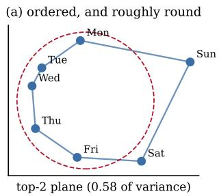

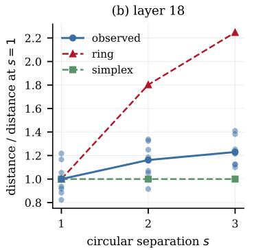

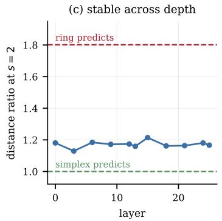  
Figure 5: The weekday classes at layer 18 of Gemma-2-2B-it. (a) the seven day centroids in their top-two plane, in calendar order, with a circle fitted at their mean radius. (b) distances between centroids by circular separation, normalised by the distance between neighbours, against what a ring and a simplex of equidistant points predict; each faint point is one centroid pair. (c) the separation-2 ratio at every captured layer.

One cell is worth locating here: RGS’s selected k is 4 on every word-level corpus and 8 on SENTI-MENT, the one clause-level corpus in the table whose identity falls below the cap — the same split §4.3 develops across all nine layers.
<table><tr><td></td><td></td><td></td><td colspan="3">Reference error ↓</td><td colspan="2">Identity ↑</td><td colspan="2">Destination ↑</td><td colspan="3">Selected</td></tr><tr><td>Corpus</td><td>Level</td><td>Unsteered</td><td>CAA</td><td>RGS</td><td>Affine</td><td>CAA</td><td>RGS</td><td>CAA</td><td>RGS</td><td> $\alpha _ { \mathrm { { C A A } } }$ </td><td> $\alpha _ { \mathrm { { R G S } } }$ </td><td>k</td></tr><tr><td>LEXICON</td><td>word</td><td>0.966</td><td>0.826</td><td>0.585</td><td>0.672</td><td>0.32</td><td>0.76</td><td>0.33</td><td>0.67</td><td>0.9</td><td>0.7</td><td>4</td></tr><tr><td>TENSE</td><td>word</td><td>0.990</td><td>0.882</td><td>0.762</td><td>0.826</td><td>0.33</td><td>0.73</td><td>0.33</td><td>0.92</td><td>0.8</td><td>0.5</td><td>4</td></tr><tr><td>REGISTER</td><td>word</td><td>1.004</td><td>0.962</td><td>0.767</td><td>0.779</td><td>0.45</td><td>0.60</td><td>0.50</td><td>0.58</td><td>0.9</td><td>0.6</td><td>4</td></tr><tr><td>SENTIMENT</td><td>clause</td><td>1.003</td><td>0.834</td><td>0.573</td><td>0.430</td><td>0.16</td><td>0.13</td><td>0.35</td><td>0.72</td><td>1.0</td><td>0.9</td><td>8</td></tr><tr><td>CERTAINTY</td><td>clause</td><td>0.978</td><td>0.818</td><td>0.565</td><td>0.678</td><td>0.50</td><td>0.82</td><td>0.50</td><td>0.92</td><td>1.0</td><td>0.8</td><td>4</td></tr><tr><td>CASING</td><td>word</td><td>0.936</td><td>0.768</td><td>0.721</td><td>0.766</td><td>0.50</td><td>0.97</td><td>0.49</td><td>0.78</td><td>0.8</td><td>0.4</td><td>4</td></tr></table>

Table 9: CAA against RGS on the 6 substitution corpora at layer 13 of Gemma-2-2B-it, on one frame-disjoint test split. α for both rules and k for retrieval are selected on validation and reported unchanged on test. Reference error is in units of each corpus’s own required step, so the unsteered column is the score for doing nothing. The affine map is shown as the ceiling rather than as a competitor: it is fitted on matched pairs, which neither unpaired rule receives. Identity is the fraction of steered states whose nearest reference among all test references is its own, capped at 1/C for any rule that is a function of the state alone.

## J THE k SWEEP IN FULL

Section 4.3 reports the selected k and its fold range. Figure 6 gives the underlying curves: where between k = 1 and the class ceiling each corpus places the winner at each depth, and how much the choice was worth, measured as the spread of test error across the whole grid.

The second panel is what licenses reporting k as a regime. On SENTIMENT the curve is flat everywhere (0.05–0.16), so no choice of k is worth much and the fold-to-fold instability of the selection is expected; on the word-level corpora the curve is steepest exactly where the selection is most local.

Two details of the sweep are worth recording. The sweep grid refines the selection grid and does not extend past it: the winner is chosen from $\left\{ 1 , 2 , 4 , \dots , \dot { 6 } 4 \right\}$ , so a curve drawn to a larger k would report the class-ceiling regime at a value the selection could never choose, and a figure and a table describing one run would disagree. And α is re-selected at every k, since a neighbourhood that aims well but reaches short is a different finding from one that does not aim, and a single step size imposed across the grid would merge them.

## K PROPAGATION TO TEXT

Figure 7 gives the two panels behind §4.4, on the same runs the text quotes.

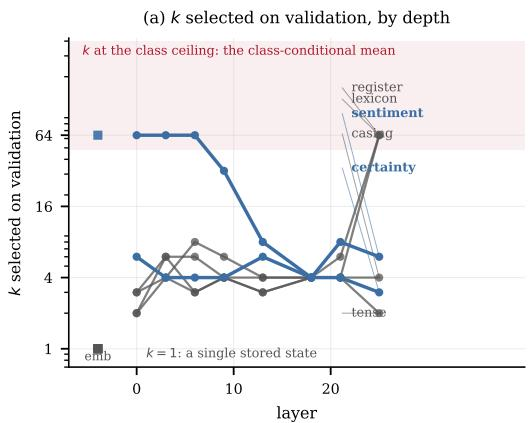

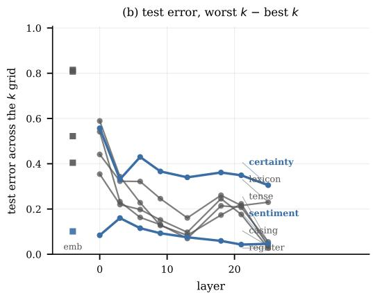  
Figure 6: Where retrieval is a local rule, and what choosing k is worth. (a) k selected on validation against depth; the shaded band is the class-ceiling regime, where RGS reduces to class-conditional CAA. (b) the spread of test error across the k grid: how much the choice was worth.

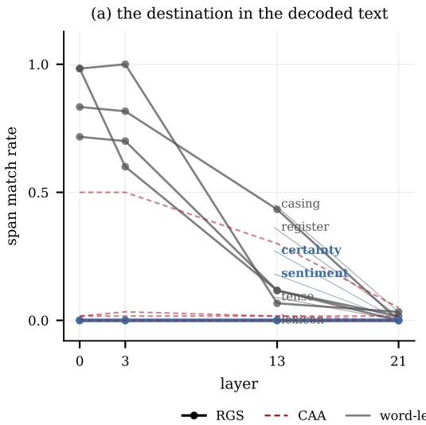

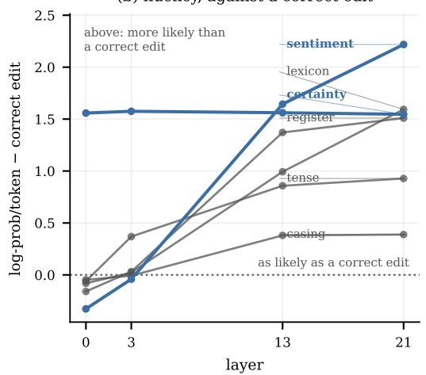  
Figure 7: The effect of steering on the decoded text $( n = 6 0 )$ . (a) the rate at which the destination span appears in the decoded continuation; it collapses with depth on every corpus, with CAA near zero throughout except on the CASING control. (b) the per-token log-probability of the same continuations under the unsteered model, minus that of a span-swapped reference — the model’s own greedy continuation with only the source span rewritten — so 0 is the likelihood a correct edit attains. Above the line means the steered text is more likely than a correct edit would be, which past the shallow layers is the same fact as (a): the edit cost nothing because little was changed. The forced-choice readout of these runs is quoted in the text.

CASING shows why CAA sits at chance throughout: it scores 0.50 span match there — which resembles partial success — and exactly 0.500 forced choice, since it upper-cases unconditionally, satisfying one class and failing the other. Against the span-swapped reference, RGS’s shallow continuations cost what a correct edit costs, and by layer 21 cost nothing, having changed nothing.

## L MODEL DEPTH VALIDATION

We compare the performance of steering at different model depths across the substitution corpora in both Gemma-2-2B-it and LLama-2-7b-chat, giving the 90 layer-by-corpus cells §4.3 reports (Figure 8). The comparison is of shape rather than specific levels, since the two models differ in width, depth and tokeniser.

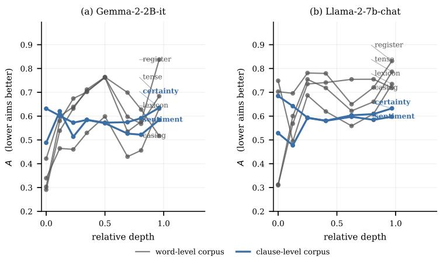  
Figure 8: Steering in every substitution corpus was evaluated at nine depths of (a) Gemma-2-2B-it and (b) Llama-2-7b-chat. A is plotted against the relative depth in both models.

## M A/B BENCHMARKS, PER LAYER

Table 10 gives the per-layer measurements behind §4.6. The margin is in the units of the benchmark’s own outcome, the share of probability mass on the behaviour-exhibiting answer, so positive means retrieval beat the difference of means. A varies by 0.006 across the six layers of sycophancy and by 0.038 across corrigibility, while the measured margin varies by 0.098 and 0.124 and changes sign on corrigibility. With this we demonstrate that a diagnostic saturated at the top of its range cannot order outcomes. We are restricted to reading 1 −A as a verdict on the task and not as a ranking of rule performance over layers.

Table 10: Retrieval alignment A and the measured CAA-minus-RGS margin, by layer, on the two A/B benchmarks in Llama-2-7b-chat. A is saturated at every layer in both tasks; the margin varies.
<table><tr><td rowspan="2">Layer</td><td colspan="2">Sycophancy</td><td colspan="2">Corrigibility</td></tr><tr><td>A</td><td>measured margin</td><td>A</td><td>measured margin</td></tr><tr><td>5</td><td>1.002</td><td>+0.022</td><td>1.008</td><td>+0.006</td></tr><tr><td>9</td><td>1.002</td><td>+0.015</td><td>1.021</td><td>+0.066</td></tr><tr><td>13</td><td>1.008</td><td>+0.047</td><td>1.026</td><td>-0.058</td></tr><tr><td>17</td><td>1.006</td><td>+0.111</td><td>1.038</td><td>-0.040</td></tr><tr><td>21</td><td>1.008</td><td>+0.113</td><td>1.043</td><td>-0.008</td></tr><tr><td>25</td><td>1.008</td><td>+0.081</td><td>1.046</td><td>-0.030</td></tr></table>

## N COUNTERFACT

Cases are drawn balanced across target objects — 30 objects, four cases each — rather than sampled freely, because an object requested once has only its own attribute prompts in the bank, and k at the class ceiling is then the whole bank: retrieval would coincide with class-conditional CAA by (2) before any measurement. With four cases per object the bank holds 24 states per class and k has room to be local. Cases are split in half into fitting and test, α and k are selected on a third of the fitting half, and no rule sees the query’s own prompt.

Two things this run is not. The intervention is a single additive edit at one layer, which is far weaker than the weight edits CounterFact was built for — Meng et al. (2022) report efficacy near 1 — so the table compares steering rules with each other and not against model editing. And top-1 accuracy stays low for every rule, so the ordering rests on the efficacy measure rather than on the argmax.

<table><tr><td></td><td></td><td colspan="2">CAA</td><td colspan="2">Task vector</td><td colspan="2">RGS</td></tr><tr><td>Task</td><td>Layer</td><td>shared</td><td>disj.</td><td>shared</td><td>disj.</td><td>shared</td><td>disj.</td></tr><tr><td>ENGLISH-FRENCH</td><td>13</td><td>0.00</td><td>0.00</td><td>0.00</td><td>0.00</td><td>0.00</td><td>0.00</td></tr><tr><td>ENGLISH-FRENCH</td><td>20</td><td>1.00</td><td>1.00</td><td>0.00</td><td>0.00</td><td>1.00</td><td>0.00</td></tr><tr><td>COUNTRY-CAPITAL</td><td>13</td><td>0.88</td><td>0.88</td><td>1.00</td><td>1.00</td><td>0.88</td><td>1.00</td></tr><tr><td>COUNTRY-CAPITAL</td><td>20</td><td>1.00</td><td>1.00</td><td>0.00</td><td>0.00</td><td>1.00</td><td>0.00</td></tr><tr><td>ANTONYM</td><td>13</td><td>0.90</td><td>0.90</td><td>0.90</td><td>0.90</td><td>0.90</td><td>0.90</td></tr><tr><td>ANTONYM</td><td>20</td><td>0.50</td><td>0.50</td><td>0.70</td><td>0.70</td><td>0.80</td><td>0.00</td></tr></table>

Table 11: Top-1 accuracy on the in-context-learning protocol in Gemma-2-2B-it: the intervention is applied at the last token of a zero-shot query and scored by whether the target word is produced. The unsteered model scores 0.00 everywhere. All three rules read the same states — the last token of in-context prompts — and differ only in using their mean or the k nearest. shared lets retrieval’s bank hold states for the query’s corresponding source–target pair under other demonstration draws; disjoint does not. The additive function vector of this literature is CAA at these states — a task-conditioned mean minus the zero-shot mean is a difference of means — and is reported here under that name; it is the additive part of Todd et al. (2024) without the causal head selection, so it is a lower bound on the published method.
<table><tr><td rowspan="2">Rule</td><td colspan="2">Layer 6</td><td colspan="2">Layer 13</td><td colspan="2">Layer 20</td></tr><tr><td>eff.</td><td>top-1</td><td>eff.</td><td>top-1</td><td>eff.</td><td>top-1</td></tr><tr><td>Unsteered</td><td>0.250</td><td>0.017</td><td>0.250</td><td>0.017</td><td>0.250</td><td>0.017</td></tr><tr><td>CAA</td><td>0.250</td><td>0.017</td><td>0.233</td><td>0.017</td><td>0.250</td><td>0.017</td></tr><tr><td>class-conditional CAA</td><td>0.417</td><td>0.000</td><td>0.667</td><td>0.000</td><td>0.883</td><td>0.250</td></tr><tr><td>RGS</td><td>0.350</td><td>0.000</td><td>0.650</td><td>0.017</td><td>0.767</td><td>0.083</td></tr></table>

Table 12: CounterFact (Meng et al., 2022) in Gemma-2-2B-it, 60 held-out cases. Efficacy is the benchmark’s own measure — the fraction of cases where the edited model prefers the new object to the true one — and top-1 is the stricter rate at which the new object is the argmax. Every rule reads the same bank, the states of the benchmark’s attribute prompts, and α and k are selected on held-out cases. CAA is indistinguishable from not steering at every layer; the rule that works is the class-conditional mean, which retrieval matches without beating.

## O THE SCREEN ON THE EXTERNAL BENCHMARKS

The diagnostics of §3.3 read on CounterFact (Table 13), on the test queries the accuracies are scored on. The benchmark supplies no paired destination, so we take one from its own material: one of the case’s attribute prompts, another subject’s prompt that already carries the requested object. It is held out of the bank, and the two conditions ask whether the case’s remaining prompts stay in its class (shared, the bank the rule is given, §N) or go (disjoint). All four say the class fixes the destination. $g = 0 . 1 3 – 0 . 1 4$ leaves R within 0.01 of D, so a single vector is left with the whole edit and CAA scores 0.233–0.250 against 0.250 unsteered. $A = 0 . { \bar { 7 } } 7 { - } 0 . 8 1$ at a k of 16 against classes of 18 to 23 is the class mean by (2), and coverage moves it by under 0.02 where it moves the in-context tasks by 0.45: any state carrying the object serves as well as the case’s own. The screen orders these rules; it does not size the gap between them.

## P THE DIAGNOSTICS ACROSS DEPTH

Table 14 pools every layer, and a diagnostic can rank corpora against each other at one depth without tracking one corpus along the stack. Across corpora, at each of the eight non-embedding layers (Figure 11), only 1 − A keeps its sign, correlating with RGS’s reference error between −0.43 and −1.00; D and R rank the outcome as a size diagnostic should near the input $( \rho = + 0 . 4 3$ at layer 0) and reverse to −0.94 and −0.83 past mid-stack, and g changes sign twice (§R). Within one corpus, where only the representation changes (Figure 9), A tracks the outcome at $\rho = + 0 . 9 9$ on both token corpora and is saturated in [1.00,1.05] on the benchmarks, where the correlations are therefore noise. D reads −0.99 and −0.96 on the token corpora, the opposite of its sign across corpora, and takes opposite signs on the two benchmarks, +0.77 and −0.77: a quantity whose sign depends on which comparison is being made is not one to screen on alone.

<table><tr><td>Layer</td><td>Bank</td><td>A</td><td>k</td><td>g</td><td>D</td><td>R</td></tr><tr><td>6</td><td>shared</td><td>0.792</td><td>16</td><td>0.132</td><td>1.143</td><td>1.134</td></tr><tr><td>6</td><td>disjoint</td><td>0.809</td><td>16</td><td>0.132</td><td>1.143</td><td>1.134</td></tr><tr><td>13</td><td>shared</td><td>0.783</td><td>16</td><td>0.133</td><td>1.167</td><td>1.157</td></tr><tr><td>13</td><td>disjoint</td><td>0.792</td><td>16</td><td>0.133</td><td>1.167</td><td>1.157</td></tr><tr><td>20</td><td>shared</td><td>0.765</td><td>16</td><td>0.141</td><td>1.171</td><td>1.160</td></tr><tr><td>20</td><td>disjoint</td><td>0.769</td><td>16</td><td>0.141</td><td>1.171</td><td>1.160</td></tr></table>

Table 13: Diagnostics computed on the test queries the accuracies in Tables 11 and 12 are scored on. The four quantities of $\ S { \bar { 3 } } . 3 \colon$ the retrieval alignment A at its best k, the shared fraction g, the standardised displacement D and the residual $R , g , D$ and R read the pairs alone and so do not depend on the bank. The benchmark supplies its own reference state $\mathrm { i . e . , }$ the case’s own attribute prompts. shared leaves that case’s remaining rows in its class, which is the bank the rule is given; disjoint drops them, leaving the same object’s entries from othe cases.

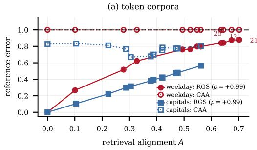  
(0: aims exactly, 1: no better than not steering)

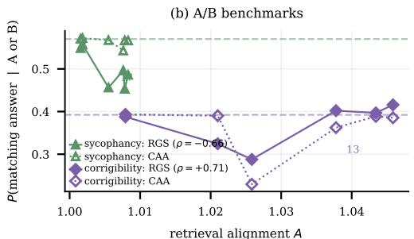  
(0: aims exactly, 1: no better than not steering)

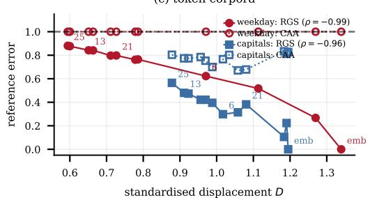  
(size of the required edit, in units of the states' own spread)

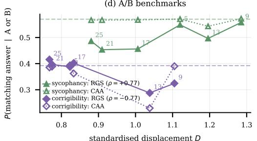  
(size of the required edit, in units of the states' own spread)  
Figure 9: Retrieval alignment A (a, b) and standardised displacement D (c, d) against what the rules score, one point per captured layer of one fixed corpus. Token corpora (a, c) are read in reference error, the dashed line at 1 being the no-op score; the A/B benchmarks (b, d) in the share of probability on the behaviour-exhibiting answer, against each corpus’s own dotted unsteered level. Depth varies the diagnostic without varying the task: weekday asks the same edit at every layer, but D falls from 1.34 to 0.59 as the states’ spread changes.

Two cautions belong with the panel. Six corpora give six points per layer, so any single correlation is noisy; the claim rests on the sign holding across eight layers rather than on a value at one. And the diagnostics differ in how much they move at all: 1 −A ranges over 0.16–1.00 across the corpora and layers drawn, while SENTIMENT’s D varies by 0.10 over the whole stack, so a size diagnostic has little with which to separate the layers of one corpus even where it separates corpora.

## Q WHAT THE A/B FAILURE SHOWS ABOUT THE DIAGNOSTICS

The benchmark family of §4.6 is where the diagnostics divide most sharply, and it is the case that decides which of them to read.

A reads 0.91–1.02 at every layer of both benchmarks, so 1 − A is zero to within its own noise and occasionally negative: the class-restricted neighbourhood aims no better than leaving the input alone, and there is nothing for an input-conditional destination to reach. That is a family-level verdict rather than a per-layer forecast — within a range that narrow, ranking the layers measures noise, and the measured margins do vary in sign across them (Table 10) — but it is the verdict that matters, since a practitioner reading 1 −A ≈ 0 would not have run retrieval on this corpus at any layer.

Table 14: The four diagnostics: what each asks, what it costs to estimate, and what it ranks. Rank correlations are Spearman against the measured CAA-minus-RGS margin (worst of four task families) and against RGS’s own reference error (mean over families). “Pairs” is the sample size at which each estimator reaches 2% relative standard error, measured rather than assumed (§E). Only 1 −A needs a datastore, and the pairs used to estimate it are also the bank it searches. Ordered by what they rank; none ranks the margin reliably.
<table><tr><td>Symbol</td><td>Question</td><td>Requires</td><td>Pairs</td><td>→ margin (worst)</td><td>→ RGS error (mean)</td></tr><tr><td>1-A</td><td>How much can a neighbourhood reach?</td><td>pairs, labels, bank</td><td>384-512</td><td>0.27</td><td>0.65</td></tr><tr><td> $R = D \sqrt { 1 - g ^ { 2 } }$ </td><td>How much is left for a per-query rule?</td><td>pairs</td><td>6</td><td>0.26</td><td>0.29</td></tr><tr><td>D</td><td>How much of the state must move?</td><td>pairs</td><td>16</td><td>0.20</td><td>0.39</td></tr><tr><td>g</td><td>Do the required edits point the same way?</td><td>pairs</td><td>~2000</td><td>-0.52</td><td>0.36</td></tr></table>

g says the opposite, and is wrong. Pooled over items it reads 0.135 on sycophancy and 0.458 on corrigibility, the signature of a task whose required edits disagree. Computed within a fixed answer letter it rises to 0.763 and 0.848: one vector describes the edit almost completely once the letter is held constant. The cancellation described in §4.6 suppresses g and makes a format artefact look like input-dependence, which is the mechanism behind its sign reversal in §R.

The consequence is a rule for which quantity to trust. A low g is necessary for an input-conditional rule to help and is not sufficient, because a known nuisance variable can suppress it. A, measured on the search the rule actually performs, is not fooled, which is why 1 −A and not g is the quantity to read wherever a bank exists. Given a nuisance factor known in advance, we recommend reporting g conditioned on it beside the pooled value; the gap between the two, 0.63 and 0.39 here, is itself the diagnostic.

## R PER-FAMILY SCREEN CORRELATIONS

Table 14 reports the worst family for each diagnostic. Table 15 gives all four, and Figure 10 the scatter each correlation summarises. Two patterns are only visible here. First, g does not merely rank poorly, it reverses sign between families (+0.27 on the token corpora against −0.52 on both the A/B and substitution families), which is why we do not report it alone. Second, the substitution family is what separates 1 −A from the size diagnostics: all 48 of its measurements have a positive margin, so the margin varies by how much rather than by whether, and a size diagnostic has nothing to rank it with (R falls to 0.26) while 1 −A reaches 0.84.

The families are never pooled. Their outcomes are on different scales — a reference error is divided by its own task’s required step, a probability is not divided by anything — so a correlation over concatenated points would rank the families against each other rather than the screens.

Table 15: Spearman correlation with the measured margin, by task family. “n/a” marks a screen that does not vary on that family: the screened synthetic tasks are constructed at g = 0 and differ only in floating-point noise.
<table><tr><td>Screen</td><td>Synthetic (n=5)</td><td>Token (n=24)</td><td>A/B (n=12)</td><td>Substitution (n=48)</td></tr><tr><td>8</td><td>n/a</td><td>0.27</td><td>-0.52</td><td>-0.52</td></tr><tr><td>D</td><td>1.00</td><td>0.96</td><td>0.31</td><td>0.20</td></tr><tr><td> $R = D \sqrt { 1 - g ^ { 2 } }$ </td><td>1.00</td><td>0.84</td><td>0.40</td><td>0.26</td></tr><tr><td>1-A</td><td>1.00</td><td>0.97</td><td>0.27</td><td>0.84</td></tr></table>

## S CROSS-VALIDATION DETAILS

Folds partition the twelve sentence frames into four disjoint test blocks of three, so every frame takes exactly one turn as a test frame. Re-seeding a single split instead would give overlapping test sets and measure resampling rather than the corpus. Validation frames rotate with the fold, so no frame participates in every selection.

(f) diagnostic value by task  
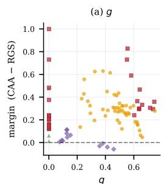

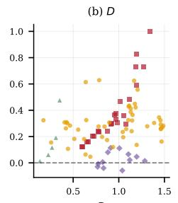

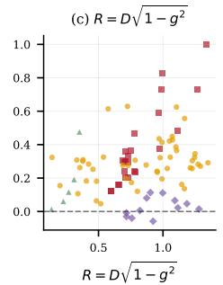

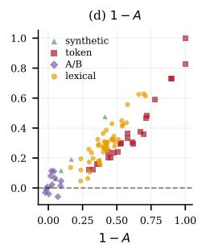

(e) each diagnostic against the margin, by task family  
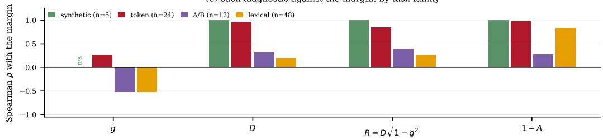

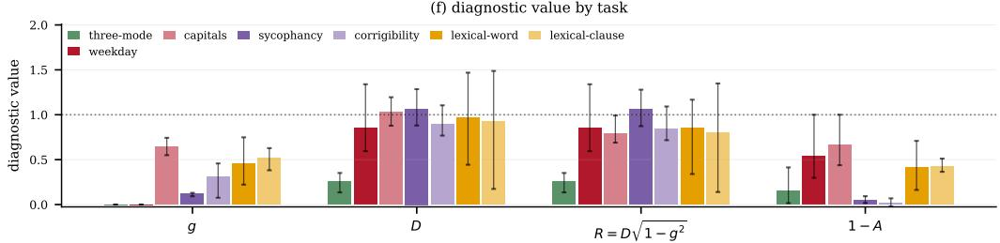  
Figure 10: The four diagnostics against the measured margin. (a)–(d) scatter by family; (e)–(h) the correlations of Table 15; (i)–(l) what each diagnostic reads on each task, which is needed to check that a family’s bar is not set by a quantity that barely varies there — the A/B bars for 1 −A are the case in point, and the reason §4.6 reads that family’s value rather than its ranking.

Reported errors are normalised by the whole corpus’s required step rather than each fold’s, so that errors from different folds are in one unit. The consequence is that the unsteered score reads 1.000± 0.073 rather than exactly 1; that spread is a measurement of how much the frame blocks differ in required step, and is the scale against which every other spread in the cross-validated tables should be read.

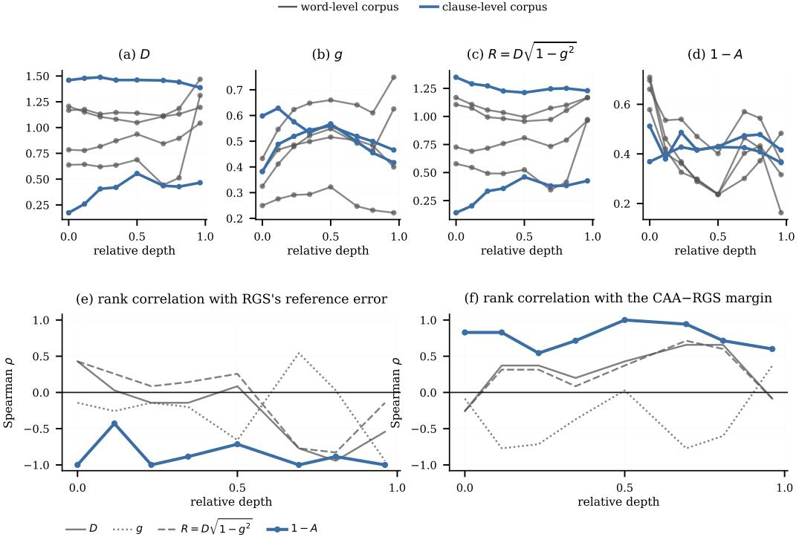  
Figure 11: The four diagnostics across depth on the six substitution corpora in Gemma-2-2B-it. (a)–(d) what each one reads, one line per corpus, clause-level corpora in blue. $\mathrm { ( e ) } { - } \mathrm { ( f ) }$ whether each still ranks the outcome at that depth, as the rank correlation over the six corpora within a single layer; 1 − A is drawn heavier. The embedding is excluded, as in every lexical depth panel: its states ignore the sentence frame, so the bank holds each query’s own reference and the screen reads a task no later layer poses.