# WORKLOAD-STATIC OPTICAL CIRCUIT SWITCHING FOR SCALABLE LLM INFERENCE DECODE

Maximilian Thurmer ¨ 1 Nicolas Scotto di Perto 1 Eloise Stein 1 Natanijel Vasic 1 Mikaeil Bagherli 1 Zhenguo Wu 2 Benjamin Klenk 2 Holger Froning ¨ 3 Johannes Feldmann 1

## ABSTRACT

LLM inference decode executes fine-grained collectives whose latency directly limits per-user interactivity, yet scale-up fabrics are still built from electronic packet switches designed for training. We observe that, for a given model deployment and parallelization, the communication structure of decode is fixed, and propose workload-static optical circuit switching (OCS): circuits are configured once per deployment, co-designed with model parallelism and with topology-aware collective schedules that turn spare accelerator ports into fewer communication phases or higher bandwidth. We evaluate this design with GXNET, a graph-based workload emulator coupled to analytical and flit-level network models grounded in hardware measurements. In a 576-accelerator scale-up domain serving 5T-parameter MoE models with up to 5M tokens of context, all-OCS fabrics improve interactivity by up to 65 % and energy efficiency by up to 119 % over 4:1 oversubscribed packet-switched fabrics.

## 1 INTRODUCTION

Large language model inference increasingly stresses not only accelerator throughput, but also latency, energy efficiency, and system cost. While training and prefill are dominated by large matrix operations and comparatively large communication transfers, autoregressive decode gener ates one token or verifies only a few at a time and repeatedly executes fine-grained communication whose latency directly affects user-facing responsiveness (Yu et al., 2022; Kwon et al., 2023; Zhong et al., 2024; Agrawal et al., 2024b).

At the same time, growing model size, mixture-of-experts architectures, and long-context inference increase parameter, activation, and KV-cache footprints (Kwon et al., 2023; Aminabadi et al., 2022; DeepSeek-AI et al., 2026). As these requirements outgrow per-accelerator memory capacity, individual model instances increasingly span many accelerators (Aminabadi et al., 2022; Bhatia et al., 2025; Yang et al., 2025), creating pressure to extend tightly coupled scaleup fabrics to larger domains and beyond conventional rack boundaries (Shou et al., 2025; Zuo et al., 2025; Bhargava et al., 2026).

The consequence is a tension between scale and latency: decode benefits from low token-to-token latency and therefore low round-trip time within the scale-up fabric (Singhania et al., 2026). However, extending electronic-packetswitched scale-up networks beyond a single rack typically requires additional switching levels, longer physical paths, or both, increasing end-to-end communication latency.

Optical links are attractive for spanning larger accelerator domains, while optical circuit switching (OCS) can avoid repeated electronic packet switching (EPS) at intermediate levels (Jouppi et al., 2023). Figure 1 contrasts conventional packet-switched fabrics with our workload-static OCS approach: circuits are configured for the model deployment and reused throughout decode rather than reconfigured within the token-generation loop. Efficient use of such circuits requires physical topology, routing, collective schedules, device placement, and model parallelization to be co-designed (Wang et al., 2023; 2024; Jouppi et al., 2023).

Prior work has addressed distributed training (Narayanan et al., 2021; Jiang et al., 2024), workload and network simulation (Won et al., 2023; Agrawal et al., 2024a), inference serving and disaggregation (Yu et al., 2022; Kwon et al., 2023; Agrawal et al., 2024b; Zhong et al., 2024; Patel et al., 2024; Qin et al., 2025), and expert- or context-parallel inference (DeepSeek-AI et al., 2024; Zhu et al., 2025; Zuo et al., 2025; Yang et al., 2025; Bhatia et al., 2025). These approaches improve accelerator utilization and throughput, but do not remove the latency sensitivity of low-batch or high-interactivity1 decode.

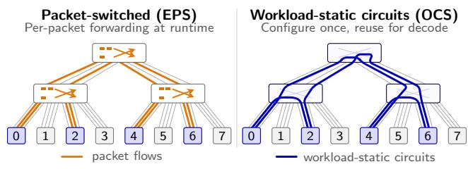  
Figure 1. Schematic two-level scale-up fabrics connecting a highlighted collective group (ranks 0, 2, 4, and 6). EPS forwards packets independently at runtime; OCS circuits are planned once for the deployment’s collective demands and reused throughout decode. Gray connections denote other physical links. Paths are illustrative rather than a bandwidth-matched comparison.

OCS has been explored for datacenter networks (Poutievski et al., 2022; Liu et al., 2023), scale-out fabrics (Wang et al., 2023), and distributed training (Jouppi et al., 2023; Khani et al., 2021; Liao et al., 2025; Shou et al., 2025), typically for provisioning, topology optimization, or workload-phasedependent reconfiguration. Decode poses a different challenge: communication occurs at fine temporal granularity, while OCS reconfiguration is generally too slow to follow the token-generation loop. This makes per-token optical reconfiguration unattractive for latency-critical inference.

The co-design of decode parallelization, collective communication, and optical scale-up topology remains underexplored. For inference decode, the central question is not whether OCS can follow token-level communication changes dynamically, but whether the communication pattern can be regularized and scheduled such that an optical topology can be configured once and reused throughout serving.

This work studies workload-static OCS as a scale-up network design point for large-scale LLM inference decode. The OCS fabric is configured at deployment time and kept fixed during token generation, acting as a workload-specific static optical topology that realizes the logical communication structure of distributed decode. For a fixed model, context regime, accelerator allocation, service-level objective (interactivity target) and parallelization strategy, communication patterns are known at deployment time. Even in mixture-of-experts inference, token routing only modulates volume, not connectivity: production all-to-all kernels communicate with every peer of a fixed expert-parallel group during each call, with statically allocated per-peer buffers, and with batches padded to pre-captured accelerator execution graph sizes (NVIDIA, 2026c; vLLM Project, 2026a).

Evaluating distributed AI workloads on compute systems requires exploring model architectures, parallelization strategies, accelerator properties, collective algorithms, and network topologies that are difficult to benchmark directly at full scale. Physical access to hundreds of future-generation accelerators is limited, and production traces are tied to specific hardware and software stacks. A flexible modeling framework is therefore needed to study the design space while grounding assumptions in kernel and communication behavior measured on real hardware.

This work makes the following contributions.

1. We introduce workload-static OCS for LLM inference decode: optical circuits are configured once per deployment and co-designed with model parallelization and topology-aware collective schedules to realize recurring communication demand with low-latency logical overlays.

2. We introduce GXNET, a graph-based distributed LLM workload emulation framework that transforms modellevel computation graphs into distributed execution traces with explicit compute, memory, and communication operators.

3. We combine analytical and event-based network modeling for all-EPS, hybrid EPS/OCS, and all-OCS scaleup fabrics. The analytical model supports broad designspace exploration, while a flit-level simulator estimates collective execution time, routing behavior, credit effects, and link utilization.

4. We evaluate 1T- and 5T-parameter MoE decode across 128–512 serving accelerators in a 576-accelerator scaleup domain. All-OCS improves interactivity by up to 65 % and system-level energy efficiency by up to 119 % over all-EPS, while sensitivity analysis over bandwidth, radix, and accelerator latency identifies the regimes in which workload-static OCS is most beneficial.

More broadly, we argue that inference specialization should extend beyond accelerators to the scale-up network: communication structure known before execution need not be rediscovered dynamically by a general-purpose packet fabric.

## 2 BACKGROUND AND RELATED WORK

There is a large corpus of prior literature which addresses many separate pieces of the work presented here. Some work is devoted to related use cases - e.g. training rather than inference. Other contributions focus on a subset of the design space addressed here - for instance ignoring the cooptimization of collective schedules and underlying network topology:

Large scale distributed LLM training has received wide attention in the past. The parallelization strategies were studied (Narayanan et al., 2021) and cast into analytical, roofline-based models (Isaev et al., 2023). Other approaches which seek to model computation and communication separately are partially based on real hardware traces or synthetic ones that are then feeding a network simulator (Won et al., 2023). These approaches, however, have been developed for training. Calculon (Isaev et al., 2023) models the scaleup and scale-out networks with single-level latency and bandwidth parameters and assumes bandwidth-optimal collective implementations, which captures step time for large, bandwidth-dominated collectives but not the small, latencybound collectives of decode. Network simulators such as ASTRA-sim (Won et al., 2023) resolve communication in more detail, but do not treat parallelization strategy, collective schedule, and optical circuit topology as a joint design space. Inference-specific simulators such as Vidur (Agrawal et al., 2024a) and LLMServingSim (Cho et al., 2024) address serving-level questions such as scheduling, batching, and deployment configuration; their communication model is either profiled on existing hardware (Agrawal et al., 2024a) or inherited from ASTRA-sim (Cho et al., 2024), so the scale-up fabric is not a design variable.

Inference serving and disaggregation methods have been widely described (Yu et al., 2022; Kwon et al., 2023; NVIDIA, 2026c; Zhong et al., 2024; Patel et al., 2024; Qin et al., 2025). In particular, advances in prefill/decode disaggregation (Zhong et al., 2024; Patel et al., 2024) have identified the difference in computation, memory access and network access footprints between prefill and decode phases as a root cause of inefficient inference serving. Consequently, recent work explores dedicated hardware for these two phases of inference and extends this approach by further decomposing the decode phase into attention and feed-forward-network portions, resulting in heterogeneous inference hardware (NVIDIA, 2026a; Zhu et al., 2025), while others argue that shifting phase ratios favor a single balanced accelerator (Ho et al., 2026). In these cases, the network architectures remain packet-switched (Ho et al., 2026; Microsoft, 2026) or use fixed direct-connect topologies (Bhargava et al., 2026; Google, 2026) whose physical connectivity is not tailored to the workload, with many accelerator links reaching into the scale-up network.

Extensive work has examined the role of OCS in AI compute clusters ever since the inception of Google’s TPUv4 (Jouppi et al., 2023). There has been work focusing on optimizing the network topology through OCS (Wang et al., 2023; Liao et al., 2025) and investigations into the required reconfiguration speeds of OCS control planes and optical transceiver relock times to exploit the very predictable and long-running nature of large collective operations resulting from AI training workloads such that an OCS operates more like an optical burst switch (OBS) (Wu et al., 2025). Harvest (Rahman et al., 2026) and its precursors (Hammer et al., 2025; Addanki, 2025) go further and synthesize optimal circuit schedules within individual collectives of scale-up domains, which requires fast OCS reconfiguration and tight coupling of the OCS and accelerator control planes, advancing the OCS towards something close to an optical packet switch. Other work has tried to leverage the dual network approach, scale-up inside the rack/box, scale-out between them - to reshape scale-out traffic within the scale-up domain such that the scale-out fabric reduces to rails (Wang et al., 2024) that can in turn be realized with OCS (Ding et al., 2025). Apart from Harvest, all this work addresses training use cases and focuses on collective schedules for bandwidth optimality as a natural consequence.

In latency-sensitive decode, bandwidth-optimal collective schedules are not necessarily latency-optimal, and resulting collective schedules on scale-up networks are already showing an increasing specialization by expected traffic volume as a consequence (NVIDIA, 2026e). In decode, tensor, KV-cache, and expert parallelism can induce frequent collectives with small payloads, exposing acceleratorto-accelerator round-trip time rather than only aggregate bandwidth. Optimized communication kernels based on remote-store operations reduce software overhead, but not the underlying sensitivity to fabric latency. In parallel, collective acceleration engines (Google, 2026; Meta, 2026) are moving collective execution into dedicated accelerator hardware. Serving stacks already select collective implementations, but through fixed, offline-tuned heuristics (NVIDIA, 2026e). Exposing communication explicitly to an automated mapping and scheduling search is a step towards co-optimizing serving and collective implementation (Ho et al., 2026), but the repercussions on the ideal network fabric serving the chosen collectives, or even network topology co-optimization for the chosen collective, remain open. The work presented here exploits this specialization more systematically by extending it from the collective schedule to the scale-up topology. It extends the idea of short-circuiting ring collectives (Hammer et al., 2025) but, in contrast to per-collective reconfiguration (Rahman et al., 2026), derives one topology for the composite decode schedule, i.e., for all collectives of inference decode at once, which the OCS then holds throughout serving, removing reconfiguration from the decode critical path.

## 3 WORKLOAD-STATIC OCS TOPOLOGY DESIGN

Workload-static OCS maps the recurring collective communication demands of distributed decode onto optical circuits configured once at deployment time. Different model regions, notably attention and MoE/FFN, induce distinct logical connectivity requirements over the same multi-port accelerators. We jointly plan the corresponding logical overlays, collective schedules, and their embedding into the physical fabric, deriving fixed OCS configurations and precomputed accelerator routing tables. Communication may involve data relay through intermediate accelerators, allowing the fixed circuits to support multiple logical topologies. We consider rail-optimized two-level scale-up fabrics (Wang et al., 2024), whose physical construction is detailed in Appendix C.7.

Table 1. Deployment-time communication demand per decode step for Megatron 5T (128 layers) on 512 accelerators, using Helix parallelization $( \mathrm { K V P } , \mathrm { T P A } , \mathrm { E P } , \mathrm { T P E } ) = ( 4 , 1 2 8 , 6 4 , 8 )$ and FP4 (AR: all-reduce, AG: all-gather, A2A: all-to-all). Region, axis, collective, groups G of R ranks, and calls per group are fixed for deployment; batch size B only changes the payload per call.
<table><tr><td colspan="4"></td><td colspan="3">Payload per call</td></tr><tr><td>Axis</td><td>Coll.</td><td> $G \times R$ </td><td>Calls</td><td>B=1</td><td> $B { = } 4$ </td><td> $B { = } 1 6$ </td></tr><tr><td colspan="7">Attention</td></tr><tr><td>world AR</td><td></td><td> $1 \times 5 1 2$ </td><td>128</td><td>4KiB</td><td>16 KiB</td><td>64 KiB</td></tr><tr><td>KVP</td><td>A2A</td><td> $1 2 8 \times 4$ </td><td>128</td><td>66 B</td><td>264 B</td><td>1056 B</td></tr><tr><td>TPA</td><td>none</td><td> $4 \times 1 2 8$ </td><td>0</td><td></td><td></td><td></td></tr><tr><td colspan="7"> $F F N$ </td></tr><tr><td>EP</td><td>AG</td><td> $8 \times 6 4$ </td><td>128</td><td>256 KiB</td><td>512 KiB</td><td>768 KiB</td></tr><tr><td>TPE</td><td>AR</td><td> $6 4 \times 8$ </td><td>128</td><td>4KiB</td><td>8KiB</td><td>12 KiB</td></tr><tr><td>LM head</td><td></td><td></td><td></td><td></td><td></td><td></td></tr><tr><td colspan="7"></td></tr><tr><td>world AG</td><td></td><td> $1 \times 5 1 2$ </td><td>1</td><td>25 KiB</td><td>100 KiB</td><td>400 KiB</td></tr></table>

## 3.1 Static Communication Demand in Decode

We consider a prefill/decode-disaggregated deployment in which the scale-up fabric serves autoregressive decode. At deployment time, an inference framework selects the model, accelerator allocation, parallelization scheme (such as Helix or DP/TP/EP) and degrees (e.g. TP4 EP8), and operating targets such as maximum context length and interactivity. For a fixed configuration, the communication demand of each decode step is known structurally: participating rank groups, mesh axes, collective primitives, and invocation counts are determined by the model and parallelization. Payloads may depend on batch size and expert routing, but the communication support, the set of possible communicating rank pairs, required by the topology remains fixed.

Inference frameworks already select a collective implementation from a set of viable options: TensorRT-LLM picks between one-shot, two-shot and NCCL all-reduce from offlinetuned tables keyed on tensor-parallel group size, hidden size and token count. As scale-up domains grow, additional factors, such as placement-dependent latency, will have to be factored in. Workload-static switching as described here is a more systematic approach to optimize network communication under the same constraints.

We use Helix-style distributed decode (Bhatia et al., 2025), which induces different communication demands across model regions. Attention uses KV-parallel (KVP) and tensor-parallel (TPA) axes, whereas the MoE/FFN region uses expert-parallel (EP) and tensor-parallel (TPE) axes over the same accelerators. Table 1 illustrates the resulting demand: its structural columns are deployment-static, while batch size changes the payload per collective invocation. The KVP all-to-all exchanges partial attention outputs and log-sum-exp statistics across KV-cache shards, as required by Helix-style attention parallelism. Some axes induce no communication in a given region. In this configuration, context length affects KV-cache computation and memory traffic, but not the collective structure or payload.

Token routing may change traffic volume across peers, but need not change the communication support. Our evaluated expert axis uses fixed-group collectives with buffers padded to the busiest expert-parallel rank, so FFN payloads need not scale linearly with batch size (Appendix B.2). Other implementations can regularize routing-dependent traffic through padding or bucketing, at the cost of additional traffic (Appendix A.4). Thus, the fabric can be planned against recurring collective demands rather than topology-agnostic worst-case connectivity.

## 3.2 From Communication Demand to Logical Topology

We convert the static communication demand of an inference decode forward pass into logical communication graphs. Table 1 gives a worked example of such a demand pattern. Each graph corresponds to one mesh axis in one decode region; its vertices are the participating accelerator ranks, and its edges are the direct communication links available to the collective schedule. The topology planner embeds these graphs into the physical accelerator links.

Since different decode regions induce different logical meshes over the same accelerators, these graphs must be embedded jointly into a shared physical host graph. Its circuits remain fixed during serving, while different regions may reuse them through different logical views.

For power-of-two accelerator counts, we describe logical overlays through Cayley-style graphs. Ranks are labeled by bit strings, and generators connect ranks whose labels differ by a fixed mask. Unit generators yield cube-like structures; additional generators introduce folds or chords that reduce diameter. Folds extend the idea of short-circuiting ring collectives (Hammer et al., 2025): instead of reconfiguring the OCS per collective step, the shortcut circuits are provisioned once at deployment, so their cost is accelerator port degree rather than reconfiguration delay on the critical path. Different mesh axes can thus be viewed as different partitions or colorings of one shared host graph, allowing several phase-specific logical topologies to be served by one workload-static set of optical circuits. Figure 2(a) illustrates this for a $Q _ { 4 }$ -style host graph: the same physical connectivity induces different logical mesh views by changing the partition of rank-label bits. Appendix A.1 gives the formal construction.

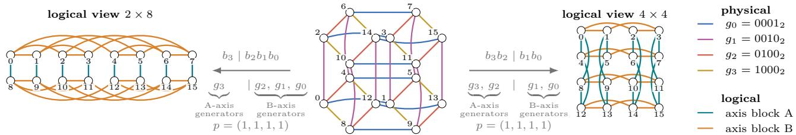  
(a) Same $Q _ { 4 }$ host connectivity under logical dimension partitions $b _ { 3 } \mid b _ { 2 } b _ { 1 } b _ { 0 }$ and $b _ { 3 } b _ { 2 } \mid b _ { 1 } b _ { 0 } ,$ , yielding logical shapes $2 \times 8$ and $4 \times 4 ,$ respectively.

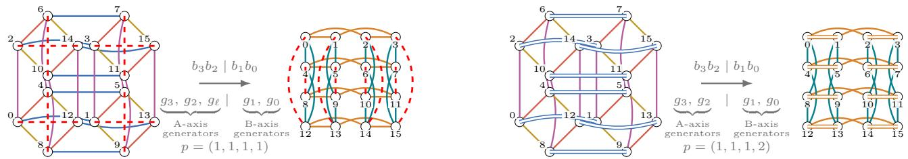  
×(b) Latency shaping: an additional fold generator gℓ = 12 = $1 1 0 0 _ { 2 } = 1 1$ | 002 augments axis-A connectivity and can reduce the collective phase count $h _ { i }$  
×(c) Bandwidth shaping: an additional circuit duplicates the $g _ { 0 } = 1 = 0 0 0 1 _ { 2 } \mathrm { \dot { ~ = ~ } } 0 0 \ |$ | 012 edge family, increasing its multiplicity pi without changing logical connectivity.  
Figure 2. Workload-static OCS topology design example with base generator set $G = ( g _ { 3 } , g _ { 2 } , g _ { 1 } , g _ { 0 } )$ inducing a $Q _ { 4 }$ host graph under a shared per-accelerator port budget $L .$ The same physical host graph supports multiple logical communication structures (a). One additional port relative to the $Q _ { 4 }$ base can be allocated either to shortcut connectivity for lower collective depth (b) or to parallel circuits for higher effective bandwidth (c).

## 3.3 Port Allocation as Latency/Bandwidth Trade-off

The previous subsections turn a decode workload into a set of axis requirements over a shared accelerator set. We now expose the main degree of freedom of OCS-based scale-up fabrics with multi-port accelerators: each accelerator has a finite port budget $L ,$ and every port can be spent either to reduce the number of serialized communication phases or to increase bandwidth along an already selected logical edge.

For one logical axis i, assume a regular overlay of degree $d _ { i }$ and uniform edge multiplicity $p _ { i } ,$ i.e., each logical edge on that axis is realized by $p _ { i }$ parallel circuits. We estimate a collective schedule with a Hockney-style model

$$
T _ { i } \approx h _ { i } \lambda _ { i } + \frac { v _ { i } } { p _ { i } R } ,\tag{1}
$$

where $h _ { i }$ is the number of serialized schedule phases, $\lambda _ { i }$ is the per-phase accelerator-to-accelerator latency along the selected physical path, $v _ { i }$ is the bottleneck volume, and R is the bandwidth of one physical link. For an EPS path, $\lambda _ { i }$ includes the latency of the electronic switch stages traversed; for an OCS path, it includes endpoint, link, and optical passthrough latency. Folds reduce $h _ { i }$ by shortening the logical graph; parallel circuits increase $p _ { i }$ and reduce serialization time, as shown in Figures 2(b) and $2 ( \mathrm { c } )$

More generally, let $H = ( V , E )$ denote the physical host graph and $p _ { e }$ the multiplicity of edge $e .$ Since each circuit consumes one port at its endpoint, the per-accelerator port budget is

$$
\sum _ { e \in \delta ( u ) } p _ { e } \le L \qquad \forall u \in V ,\tag{2}
$$

where $\delta ( u )$ is the set of edges incident to accelerator u.

For disjoint axis-specific edge families of degree $d _ { i }$ and uniform multiplicity $p _ { i }$ , this simplifies to $\textstyle \sum _ { i } d _ { i } p _ { i } \leq L$ . In the shared-host construction, physical edges reused across dif ferent logical views are counted only once. Thus, the OCS fabric exposes an explicit exchange rate between latency and bandwidth: ports spent on additional generators make the graph shallower $( h _ { i } \downarrow )$ , while ports spent on multiplicity make selected edges wider $( p _ { i } \uparrow )$

A fold that reduces the schedule by $\Delta h$ phases saves approximately $\Delta h \lambda _ { i }$ , provided the schedule exploits it. Increasing multiplicity from $p _ { i } \mathrm { t o } p _ { i } + 1$ instead saves $v _ { i } / [ R p _ { i } ( p _ { i } + 1 ) ]$ ].

With a locally linear volume model $v _ { i } \approx c _ { i } m$ , where $m$ is the number of tokens per forward pass and $c _ { i }$ the bottleneck volume per token, the crossover occurs at

$$
m _ { i } ^ { \star } \approx \frac { \Delta h \lambda _ { i } R p _ { i } ( p _ { i } + 1 ) } { c _ { i } } .\tag{3}
$$

Below this threshold, reducing schedule depth is preferable; above it, additional bandwidth becomes more valuable. High-interactivity decode therefore favors latency-shaped topologies for many, but not necessarily all, axes.

## 3.4 Collectives as Topology-Specific Schedules

A logical topology improves collective performance only if the communication schedule exploits its connectivity. We describe each collective implementation by a logical overlay, a validity predicate specifying which overlays support the collective, and an ordered schedule of communication phases. Each phase specifies communicating rank pairs, the logical edges used, payload slices, and dependencies on preceding phases. The schedule determines the serialized phase count, bottleneck volume, and link utilization for the analytical model, as well as the communication events initiated by a network simulator (such as Simlette, see Section 5).

We have implemented a planner, conceptually part of the inference deployment framework, which jointly searches over axis partitions, folding generators, edge multiplicities, and compatible collective schedules under the shared accelerator port budget. It selects the topology–schedule combination minimizing predicted communication time for the deployment’s target message-size regime. Folds reduce latency only when schedules exploit their additional connectivity, while parallel circuits improve bandwidth only when schedules distribute traffic across them. Appendix A.2 details the topology search, and Appendix A.3 describes the topology-aware collective algorithms.

## 4 GXNET: WORKLOAD MODELING FOR DISTRIBUTED LLM DECODE

GXNET converts a model-level computation graph and a deployment, i.e., accelerator specification, system size, precision, and parallelization strategy, into a shape-exact distributed decode execution with explicit compute regions, memory traffic, collectives, device groups, and timing dependencies. It provides the deployment-time communication demand for topology planning and the timed execution for network simulation. Appendix B provides additional details.

## 4.1 Model Graph and Sharding Transformations

One decode step is a computation graph whose tensors carry shape, element type, and logical device placement. A decode step is specialized to generating one token (or verifying multiple tokens) per active request against an existing KV cache. Communication is derived structurally from this placement: wherever adjacent operators require different tensor placements, GXNET inserts a collective, whose group follows from the mesh axes, payload from tensor shape and element width, and occurrence count from the layer structure. For a fixed model and parallelization, this yields the deployment-time demand of Table 1 before execution.

The same sharded graph yields the per-rank weight and KV-cache footprint, which bounds the batch size feasible in accelerator memory. For MoE regions, we model dropless routing that is uniform in expectation: routing affects expert compute and FFN collective payloads, but not collective group membership; routing skew is not modeled.

## 4.2 Per-rank Execution Trace and Cost Model

GXNET lowers the communication-explicit graph into a perrank execution trace, akin to traces recorded on real hardware with tools such as Chakra (Sridharan et al., 2026): the compute regions, memory accesses, collectives, and dependencies a single accelerator carries out or is exposed to during a decode step. Where a collective schedule (Section 3.4) describes how one collective uses a logical overlay, the trace determines when collectives occur, which ranks participate, what payload they carry, and whether their latency is exposed or hidden behind computation.

The dependency representation can express communication– computation overlap. We use Helix’s attention/FFN sharding without HOP-B, i.e., without splitting attention into microbatches whose all-to-all overlaps with the attention of the next, so communication latency is fully exposed in the decode-step timeline. A sensitivity analysis (Appendix B.5) shows that HOP-B does not improve decode-step time in the evaluated configurations: for GPT-OSS-5.3-like, microbatching adds more all-to-all communication than HOP-B can hide, and for Megatron 5T, it yields no net benefit.

Each compute region’s execution time is estimated with a roofline model taking the maximum of compute time and HBM-transfer time, using tensor-derived FLOPs and bytes together with size-dependent compute and memory efficiencies. Operators between communication points are grouped into fused execution windows and charged one launch overhead per window. Exact efficiency functions and accelerator parameters are given in Appendix B.3, and Appendix D.3 relates the model to kernel measurements on current hardware.

GXNET is analytical rather than cycle-accurate; projected accelerators use specification-level throughput and bandwidth parameters, while measured kernel durations can replace analytical estimates for existing hardware.

## 4.3 Coupling GXNET to the Network Model

GXNET interfaces with the network model at two points. Before execution, it emits the complete communication demand of a decode step, against which the OCS fabric of

Section 3 is mapped and routed once at setup. In practice, an inference framework such as vLLM (Kwon et al., 2023) or SGLang (Zheng et al., 2024), which already holds this information, would perform this step. During execution, GXNET registers each collective with its group, primitive, payload, axis, and earliest start time. It does so until all further events in its scheduler are blocked by dependencies to pending/registered collective operations. It then calls an advance function to delegate control to the network simulator. The network simulator returns the collective’s actual start and completion time on the specified network topology and for the given collective schedule. Once the completion time is known, dependent operators in GXNET’s internal scheduler are released. Whether a collective is exposed on the decode critical path is thus determined by the coupled execution, not by summing independently timed messages.

All collective instances whose dependencies are satisfied may be in flight simultaneously; Simlette advances them jointly and therefore captures contention and credit stalls between concurrent groups, whereas the analytical backend estimates collectives independently. A run produces a timed decode-step timeline, from which we derive token-to-token latency, per-user interactivity, and system throughput, and, with the power model of Appendix D.4, energy-normalized throughput.

## 5 COMMUNICATION MODEL AND GROUNDING

Evaluating workload-static OCS fabrics requires estimating the completion time of collective communication kernels on hardware and topologies that are not yet available at scale. We use two models for this: a fast analytical model to evaluate candidate topologies and schedules, and a flit-level simulator to capture effects that the analytical model misses, such as credit stalls and link contention. Both use latency parameters based on measurements from current hardware.

## 5.1 Simlette: a Flit-Level Event-Based Simulator

We evaluate collective schedules and routing on EPS and OCS fabrics using Simlette, a discrete-event simulator built on SimPy (Team SimPy). Inspired by the UALink specification (Ultra Accelerator Link Consortium, 2025), it models memory-semantic transactions at flit granularity, capturing serialization, link contention, and credit stalls during execution. Simlette supports single-level and two-level spine-leaf fabrics, dynamic EPS packet switching and spraying, and workload-static OCS routing without runtime reconfiguration.

The simulator separates workload mapping into four independent layers: physical topology, worker allocation, collective schedule, and routing (Appendix C.1). This modular design allows us to vary each component independently while keeping the others fixed, enabling controlled comparisons of fabrics, placements, schedules, and routing strategies.

## 5.2 UALink Transactions and Credit-Based Flow Control

Simlette implements the transaction and credit-based flow control system of the UALink specification, the same mechanisms used in practice for direct accelerator-to-accelerator communication. Each transaction pairs a request (e.g., a read or a write) issued by an Originator with the response returned by a Completer. One or more 64-byte Transaction Layer (TL) flits are grouped into a 640-byte Data Link (DL) flit before being put on the link, and switching and flow control operate at DL-flit granularity. Each port maintains independent credit channels for request and response traffic, so that traffic in one direction can never block the other. A port must hold a credit on the corresponding channel before sending a DL flit; credits are returned once the receiver has processed the data, so a buffer is never sent more data than it can store.

## 5.3 Latency Decomposition

The fixed per-hop latency is divided into four components: endpoint latency inside the accelerator (processor to cache to scale-up port), protocol latency of the scale-up port including credit transmission, link propagation delay, and switch forwarding delay.

For the latency comparison, we apply common endpoint, protocol, and propagation parameters, while distinguishing EPS forwarding (approx. 300 ns (UALink Spec., Sec. 10.9.2) unloaded pin-to-pin latency) from OCS optical pass-through (approx. 10 ns).

Figure 3 shows the latency of a 512-accelerator all-reduce on an example single-level fabric. The buffer size is the amount of data, in bytes, that each accelerator holds at the end of the collective. For the low-batch payloads of Table 1 (4 to 64 KiB), switch latency accounts for about a third of each EPS bar, while OCS removes almost all of it (2 % of the bar).

For buffers of 1 to 64 KiB, which cover the low-batch payloads of Table 1, the completion time is 3.18–3.26 µs for OCS, compared with 5.21–5.26 µs for EPS. As the payload grows beyond 64 KiB, serialization takes over on OCS, reaching 41 % of the time at 1 MiB (2.07 µs), where OCS remains faster with 5.10 µs compared with 6.41 $\mu \mathrm { s }$ for EPS.

## 5.4 Analytical Model and Consistency Checks

The analytical model times each candidate port allocation of Section 3.3 by Eq. (1), with the bottleneck volume v obtained as the sum over all phases of the data carried by the most loaded edge (Appendix C.2). Simlette then builds the circuits of the allocation with the lowest predicted time and simulates the collectives on them flit by flit, including credit waits and the load on each link.

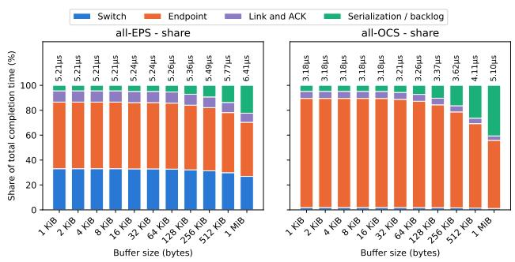  
Figure 3. Latency decomposition of a 512-accelerator all-reduce (parallel RS+AG schedule) on a single-level fabric (36 ports per accelerator, 400 Gb/s links). Total completion time is shown above each bar. Simulations were run using optimized mode (each message is sent as a single flit; see Appendix C.5).

The analytical model assumes that phases do not overlap, that no transfer shares its link with another, and that a sender never waits for buffer space at the receiver. Without contention and with unlimited buffers, Simlette reproduces the analytical completion time for all message sizes and radices on a single-level OCS fabric (Appendix C.4). When the buffer per port is too small to keep a link busy for one hop, senders wait for credits and Simlette results are up to 1.9× slower; when several flows reach the same switch port, as for the two-shot all-reduce on EPS, the analytical model underestimates completion time by up to 2×.

The analytical model is accurate for contention-free schedules with sufficient buffering. Simlette captures additional delays from credit stalls and concurrent traffic, which the analytical model omits. We therefore use the analytical model for design-space exploration and Simlette to evaluate the selected configurations with a more detailed representation of contention and credit effects.

## 5.5 Grounding

We parameterize Simlette using hardware measurements and published interconnect specifications (Appendix C.6). Custom accelerator-to-accelerator ping-pong kernels estimate end-to-end communication latency, while pointer-chasing microbenchmarks characterize the local memory hierarchy (Luo et al., 2025). On NVIDIA Blackwell B300 for example, memory-hierarchy measurements yield access latencies of approximately 14 ns (shared memory), 17 ns (L1), and 140 ns (L2), compared with a measured acceleratorto-accelerator remote-access round trip of 1.61 µs. These measurements constrain the accelerator-side latency budget, while the attribution of the remaining latency to protocol, interconnect, and switching components requires additional modeling assumptions (Appendix C.6). We characterize accelerator-to-accelerator latency using several ping-pong kernel implementations, and we select the minimum measured duration as a minimum upper bound. Appendix C.6 details further measurements and implementation-dependent variation.

End-to-end measurements do not uniquely determine the latency contribution of every internal component. We therefore state the assumed component latencies explicitly and examine their influence through the sensitivity analysis of Appendix E. Simlette produces deterministic completion times for the specified hardware and workload parameters; run-to-run jitter and tail-latency distributions are outside the scope of this evaluation.

## 6 EVALUATION

We first present results for two model architectures, Megatron 5T MoE and GPT-OSS-5.3-like, for very large context lengths of 5 million tokens. The choice of large models with large context is motivated by current hardware limitations and the resulting need to scale to fabrics larger than what a single datacenter rack can provide, even with accelerators such as the upcoming Vera Rubin platforms (NVIDIA, c). Model architectures and accelerator properties are given in Appendices D.1 and D.3.

## 6.1 Optimized Interactivity-Throughput Envelope

Figure 4 plots achieved interactivity, the per-user throughput metric, against total system throughput for various batch sizes. A batch of 16 concurrent users is the largest that the 512 serving accelerators can hold for Megatron before KV cache pages have to be swapped out of an accelerator’s HBM. The three network scenarios are two-level networks using only EPS (all-EPS), OCS on the second level (hybrid EPS/OCS), or only OCS (all-OCS); the first two are 4:1 oversubscribed towards the second level, while all-OCS is non-blocking (Appendix C.7). The EPS-based fabrics use 4:1 leaf-to-spine oversubscription to maintain a practical system-power envelope. A sensitivity experiment with GPT-OSS-5.3-like at batch size 1 shows that removing oversubscription requires four times as many spine switches (288 vs. 72), yet reduces collective completion time by only 3.2 % (13.61 to 13.18 µs). Consistently, the bandwidth sensitivity in Figure 28 from Appendix E shows that even quadrupling per-port bandwidth barely changes the all-OCS interactivity advantage (64.8 % to 62.8 %), supporting the interpretation that the observed gains are primarily latency-driven rather than an artifact of EPS oversubscription.

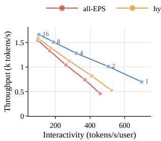  
(a) Megatron 5T MoE

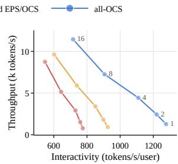  
(b) GPT-OSS-5.3-like  
Figure 4. Per-user interactivity vs. total system token throughput Pareto curves for two large LLMs provisioned for a context of 5 million tokens. The models are spread across 512 Rubin-like (RX00) accelerators, keeping 64 accelerators (eight per rack) in cold spare. Marker color distinguishes the physical topologies (Appendix C.7), and labels on the all-OCS curve give the batch size. Each point describes a separately provisioned and planned point in the deployment design space.

The Pareto front for each scenario is found by searching the Helix parallelization space (Appendix B.6), so the optimal parallelization for a given batch size may differ between fabrics: reduced collective completion time can make a higher degree of parallelism along a mesh dimension viable. For instance, batch size 1 on Megatron calls for a Helix scheme (KVP4, TPA128, EP16, TPE32) on all-EPS, reaching 458 tokens/s/user, while all-OCS reaches 698 tokens/s/user with (KVP4, TPA128, EP8, TPE64). The larger FFN tensor-parallel group is enabled by our collective schedule optimization for large groups, whereas a group of 64 on this physical topology forces EPS traffic through both levels, and thus three switching devices.

## 6.2 Bottlenecks Change with Batch Size

In high-interactivity/low-batch regimes of Figure 4, collective communication volume is small and network latency contributes substantially to decode-step time, so the difference between all-EPS and all-OCS fabrics is significant: for GPT-OSS-5.3-like, 775 versus 1277 tokens/s/user, 1.65× the interactivity. In practice, achievable values may be lower due to unmodeled system properties such as acceleratorto-accelerator jitter or GEMM inefficiencies for certain operand aspect ratios; on the other hand, this analysis does not factor in EPS-specific disadvantages such as tail latency due to buffer congestion and arbitration delays. The lower power consumption of OCS fabrics further amplifies their advantage, so the energy per generated token decreases through both lower system power and faster token generation.

As batch size increases, compute kernel time and network transaction sizes grow, which reduces the share of exposed latency in the token generation time (time per output token,

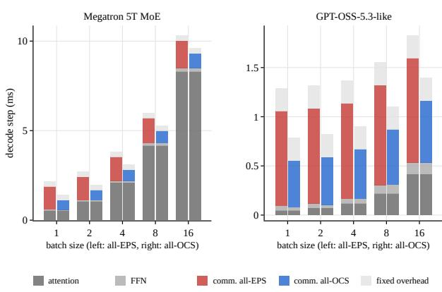  
Figure 5. Decode-step time over batch size for the fabric-specific Pareto-optimal configurations of Figure 4, all-EPS (left bar) and all-OCS (right bar) of each pair. For Megatron, attention time grows with batch and dominates from batch 4 on, so the constant OCS saving in communication shrinks in relative terms; for GPT-OSS-5.3-like, communication remains the dominant term. Note the different vertical scales.

TPOT). Figure 5 shows that this effect is strong for Megatron but weak for GPT-OSS-5.3-like. Attention time scales with the KV bytes read per decode step, i.e., with the product of batch size and context length. Megatron keeps 1 MiB of KV cache per token of context, GPT-OSS-5.3-like only 48 KiB, since its interleaved sliding-window attention reads the full context in only half of its layers, with 16 instead of 128 KV heads (Table 10, Appendix D.1); the hidden size, 8192 in both models, does not explain the difference. At 5M context, Megatron’s attention time therefore grows from 0.53 ms at batch 1 to 8.3 ms at batch 16, while communication stays nearly constant, so the OCS saving of 0.71 to 0.74 ms per step falls from 34 % to 7 % of the all-EPS step. For GPT-OSS-5.3-like, attention reaches only 0.41 ms, and communication remains the largest term throughout. The remainder of each step is the fixed invocation cost of its fused execution windows (Section 4), identical across fabrics and batch sizes.

## 6.3 Scaling and Energy Efficiency

Figure 6 shows the scaling with system size for each of the three physical topologies; each point is again the result of a parallelization search. The maximum context is fixed at 64K tokens to allow scaling across a range of world sizes; after all, growing scale-up domains is not always motivated by higher interactivity but may also be required to provide more low-latency, high-bandwidth memory. At batch sizes 1 and 4, interactivity first rises with world size and then falls once collectives span the second level: all-EPS peaks at 64 accelerators, all-OCS only at 128, 26 % and 41 % higher than the all-EPS peak. At batch 16, all-OCS fabrics show the most favorable interactivity, and thus throughput, scaling, reaching 1.5× the interactivity of all-EPS at 512 accelerators.

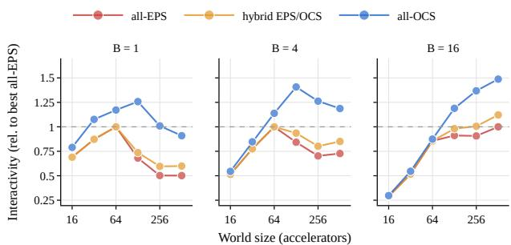  
Figure 6. System size (world size) scaling of Megatron 5T MoE at a fixed context of 64K tokens for batch sizes 1, 4, and 16. Interactivity is shown relative to the best all-EPS result at each batch size (dotted line).

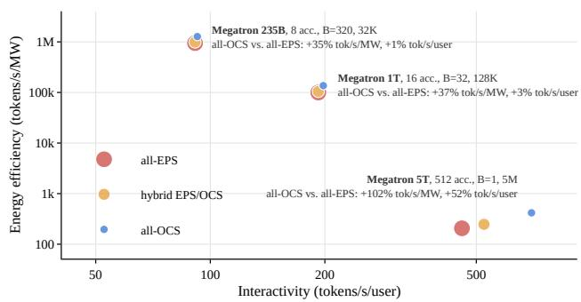  
Figure 7. Energy efficiency vs. interactivity across models of different size and context length, illustrating the benefits of workloadstatic, all-OCS switching in large-scale inference decode.

Finally, Figure 7 takes a broader perspective across three scenarios of model size and maximum context length. Small models with small context are usually the free-tier variants that AI providers offer, while large models with long context are a paid service because they aim to provide high-value work such as agent supervision and long-term reasoning. Instead of total system throughput, the y-axis shows tokens per second per megawatt, the perspective of datacenter operators whose token volume, and thus profitability, is usually limited by available power. The proposed scheme is of general utility across the three very different regimes evaluated here: owing to the lower per-port power of OCS (Appendix D.4), all-OCS fabrics outperform their EPS counterparts in throughput per unit energy by 35 to 37 % even for the 8- and 16-accelerator deployments of Megatron 235B and 1T, where interactivity improves by only 1 to 3 %, and by up to 102 % in the high-value, large-model regime where the interactivity advantage rises to 52 %; across the GPT-OSS family, the energy efficiency gain ranges from 32 to 119 % (Appendix D.2). GPT-OSS-5.3-like at batch 1 is also the baseline of the sensitivity analysis over per-port bandwidth, accelerator radix, and switch and accelerator latency in Appendix E.

## 7 DISCUSSION AND CONCLUSION

Distributed LLM decode exhibits recurring collective communication patterns that can be served by optical circuits configured once per deployment. We show that jointly optimizing circuit connectivity, accelerator port allocation, and topology-aware collective schedules allows OCS-based fabrics to support these patterns without runtime reconfiguration. Allocating ports to reduce communication phases or increase effective bandwidth improves modeled interactivity and energy efficiency over EPS-based fabrics, particularly in latency-sensitive decode regimes. For Megatron 5T MoE, all-OCS fabrics improve modeled interactivity by up to 52 % and energy efficiency by up to 102 % over the oversubscribed all-EPS baseline; for GPT-OSS-5.3-like, the corresponding improvements reach 65 % and 119 %.

Given a physical fabric and accelerator port budget, our planner constructs candidate logical overlays from Cayleygraph generators. It jointly explores mesh-axis partitions, shortcut connections that reduce collective schedule depth, and parallel circuits that increase bandwidth. Compatible collective schedules are evaluated using an analytical latency–bandwidth model, and the configuration minimizing workload-weighted communication time is mapped onto physical ports as a deployment-static circuit topology.

These benefits of our approach are conditional on the workload and hardware assumptions. Their magnitude depends on the communication exposed on the decode critical path, accelerator endpoint latency, model architecture, and the power and oversubscription assumptions of the compared fabrics. With co-packaged optics (CPO), accelerators may see a rise in both per-port data rates, e.g., through WDMcapable optical PHYs such as OCI (OCI MSA, 2026), and port count (accelerator radix). Both can be shown to improve the benefits of workload-static switching in terms of system performance and energy efficiency (Appendix E).

Our main evaluation excludes compute–communication overlap, although HOP-B microbatching is examined separately (Appendix B.5). We also assume balanced expert routing and do not model routing skew or stochastic executiontime variations.

More broadly, our results motivate treating scale-up topology, model parallelization, and collective schedules as a joint optimization problem, including for optically switched fabrics. Future work should validate the predicted performance and energy benefits on physical hardware, extend the optimization to overlapping computation and communication, and assess robustness to dynamic traffic and routing imbalance. Workload-static OCS thus offers a promising alternative to general-purpose packet switching when communication requirements are predictable at deployment time.

## REFERENCES

Addanki, V. When light bends to the collective will: A theory and vision for adaptive photonic scale-up domains. CoRR, abs/2510.08072, 2025. URL https://arxiv. org/abs/2510.08072.

Agrawal, A., Kedia, N., Mohan, J., Panwar, A., Kwatra, N., Gulavani, B., Ramjee, R., and Tumanov, A. Vidur: A large-scale simulation framework for LLM inference. In Proceedings ofMachine Learning and Systems (MLSys), volume 6, pp. 351–366, 2024a. URL https://proc eedings.mlsys.org/paper\_files/paper/ 2024/file/b74a8de47d2b3c928360e0a011 f48351-Paper-Conference.pdf.

Agrawal, A., Kedia, N., Panwar, A., Mohan, J., Kwatra, N., Gulavani, B. S., Tumanov, A., and Ramjee, R. Taming throughput-latency tradeoff in LLM inference with Sarathi-Serve. In 18th USENIX Symposium on Operating Systems Design and Implementation (OSDI 24). USENIX Association, 2024b. URL https://www.usenix.o rg/system/files/osdi24-agrawal.pdf.

Aminabadi, R. Y., Rajbhandari, S., Awan, A. A., Li, C., Li, D., Zheng, E., Ruwase, O., Smith, S., Zhang, M., Rasley, J., and He, Y. DeepSpeed-Inference: Enabling efficient inference of transformer models at unprecedented scale. In SC22: International Conferencefor High Performance Computing, Networking, Storage and Analysis, 2022. doi: 10.5555/3571885.3571946.

Arista Networks. 7060X5 Series Data Sheet. Arista Networks, Inc., a. URL https://www.arista.com/a ssets/data/pdf/Datasheets/7060X5-Dat asheet.pdf. Accessed: Oct. 2026.

Arista Networks. 7060X6 Series Data Sheet. Arista Networks, Inc., b. URL https://www.arista.com/a ssets/data/pdf/Datasheets/7060X6-Dat asheet.pdf. Accessed: Oct. 2026.

Bhargava, R., Allison, T., and Petty, H. NVIDIA Vera Rubin POD: Seven chips, five rack-scale systems, one AI supercomputer. NVIDIA Technical Blog, March 2026. URL https://developer.nvidia.com/blog/ nvidia-vera-rubin-pod-seven-chips-fiv e-rack-scale-systems-one-ai-superco mputer/.

Bhatia, N., More, A., Borkar, R., Mitra, T., Matas, R., Zhao, R., Golub, M., Mudigere, D., Pharris, B., and Rouhani, B. D. Helix parallelism: Rethinking sharding strategies

for interactive multi-million-token LLM decoding. CoRR, abs/2507.07120, 2025. URL https://arxiv.org/ abs/2507.07120.

Broadcom. TH5 51.2T Bailly CPO. Broadcom Inc. URL https://docs.broadcom.com/doc/th5-51. 2t-bailly-cpo. Accessed: Oct. 2026.

Broadcom. Broadcom Ships Tomahawk Ultra. Press release, Jul. 15 2025. URL https://investors.broadc om.com/news-releases/news-release-det ails/broadcom-ships-tomahawk-ultra-r eimagining-ethernet-switch-hpc.

Broadcom Inc. Scale up ethernet framework specification. Document Scale-Ethernet-RM104. URL https://do cs.broadcom.com/doc/scale-up-etherne t-framework.

Bruck, J., Ho, C.-T., Kipnis, S., Upfal, E., and Weathersby, D. Efficient algorithms for all-to-all communications in multiport message-passing systems. IEEE Transactions on Parallel and Distributed Systems, 8(11):1143–1156, 1997. doi: 10.1109/71.642949.

Cheng, X., Zhang, Z., Zhou, Y., Ji, J., Jiang, J., Zhao, Z., Xiao, Z., Ye, Z., Huang, Y., Lai, R., Jin, H., Hou, B., Wu, M., Dong, Y., Yip, A., Wang, S., Yang, W., Miao, X., Chen, T., and Jia, Z. MPK: A compiler and runtime for mega-kernelizing tensor programs. CoRR, abs/2512.22219, 2025. URL https://arxiv.org/ abs/2512.22219.

Cho, J., Kim, M., Choi, H., Heo, G., and Park, J. LLMServingSim: A HW/SW co-simulation infrastructure for LLM inference serving at scale. In 2024 IEEE International Symposium on Workload Characterization (IISWC), 2024. doi: 10.1109/IISWC63097.2024.00012.

Cisco. Cisco 400G QSFP Transceiver Modules Data Sheet. Cisco Systems, Inc. URL https://www.cisco.co m/c/en/us/products/collateral/interf aces-modules/400g-qsfp-transceiver-m odules-ds.html. Accessed: Oct. 2026.

DeepSeek-AI. DeepEP: an efficient expert-parallel communication library. https://github.com/deepsee k-ai/DeepEP, 2026. Accessed: Oct. 2026.

DeepSeek-AI et al. DeepSeek-V3 technical report. CoRR, abs/2412.19437, 2024. URL https://arxiv.org/ abs/2412.19437.

DeepSeek-AI et al. DeepSeek-V4: Towards highly efficient million-token context intelligence, 2026. URL https: //arxiv.org/abs/2606.19348.

Ding, E., Ouyang, C., and Singh, R. Photonic rails in ML datacenters. CoRR, abs/2507.08119, 2025. URL https://arxiv.org/abs/2507.08119.

Godsil, C. and Royle, G. Algebraic Graph Theory, volume 207 of Graduate Texts in Mathematics. Springer, 2001.

Google. The eighth generation TPU family: Two chips optimized for the agentic era. In Hot Chips 38 Symposium (HCS), August 2026.

Hammer, S.-M., Schmid, S., Singh, R., and Addanki, V. Short-circuiting rings for low-latency AllReduce. CoRR, abs/2510.03491, 2025. URL https://arxiv.org/ abs/2510.03491.

Ho, R., Narayanaswami, R., and Leary, C. You can just build Things . . . chips. In Hot Chips 38 Symposium (HCS), August 2026.

IP Infusion. Broadcom Tomahawk 5 Platforms. URL https://www.ipinfusion.com/technolog y/tomahawk-5/. UfiSpace S9321-64E. Accessed: Oct. 2026.

Isaev, M., McDonald, N., Dennison, L., and Vuduc, R. Calculon: A methodology and tool for high-level co-design of systems and large language models. In Proceedings of the International Conference for High Performance Computing, Networking, Storage and Analysis (SC ’23). ACM, 2023. doi: 10.1145/3581784.3607102.

Jiang, Z., Lin, H., Zhong, Y., et al. MegaScale: Scaling large language model training to more than 10,000 GPUs. In 21st USENIX Symposium on Networked Systems Design and Implementation (NSDI 24). USENIX Association, 2024.

Jouppi, N., Kurian, G., Li, S., Ma, P., Nagarajan, R., Nai, L., Patil, N., Subramanian, S., Swing, A., Towles, B., Young, C., Zhou, X., Zhou, Z., and Patterson, D. A. TPU v4: An optically reconfigurable supercomputer for machine learning with hardware support for embeddings. In Proceedings of the 50th Annual International Symposium on Computer Architecture (ISCA ’23). ACM, 2023. doi: 10.1145/3579371.3589350.

Khani, M., Ghobadi, M., Alizadeh, M., Zhu, Z., Glick, M., Bergman, K., Vahdat, A., Klenk, B., and Ebrahimi, E. SiP-ML: High-bandwidth optical network interconnects for machine learning training. In Proceedings of the ACM SIGCOMM 2021 Conference. ACM, 2021. doi: 10.1145/3452296.3472900.

Kwon, W., Li, Z., Zhuang, S., Sheng, Y., Zheng, L., Yu, C. H., Gonzalez, J. E., Zhang, H., and Stoica, I. Efficient memory management for large language model serving

with PagedAttention. In Proceedings of the 29th Symposium on Operating Systems Principles (SOSP ’23), pp. 611–626. ACM, 2023. doi: 10.1145/3600006.3613165.

Lenovo Press. Lenovo NVIDIA GB300 NVL72 Rack Scale AI Product Guide. Product Guide LP2357, Lenovo. URL https://lenovopress.lenovo.com/lp2357. Accessed: Oct. 2026.

Liao, X., Sun, Y., Tian, H., Wan, X., Jin, Y., Wang, Z., Ren, Z., Huang, X., Li, W., Tse, K. F., Zhong, Z., Liu, G., Zhang, Y., Ye, X., Zhang, Y., and Chen, K. MixNet: A runtime reconfigurable optical-electrical fabric for distributed mixture-of-experts training. In Proceedings of the ACM SIGCOMM 2025 Conference. ACM, 2025. doi: 10.1145/3718958.3750465. Preprint titled mFabric, arXiv:2501.03905.

Liu, H., Urata, R., Yasumura, K., Zhou, X., Bannon, R., Berger, J., Dashti, P., Jouppi, N., Lam, C., Li, S., Mao, E., Nelson, D., Papen, G., Tariq, M., and Vahdat, A. Lightwave fabrics: At-scale optical circuit switching for datacenter and machine learning systems. In Proceedings ofthe ACM SIGCOMM 2023 Conference, pp. 499–515. ACM, 2023. doi: 10.1145/3603269.3604836.

Luo, W., Fan, R., Li, Z., Du, D., Liu, H., Wang, Q., and Chu, X. Dissecting the NVIDIA Hopper architecture through microbenchmarking and multiple level analysis, 2025. Extends the IPDPS 2024 paper; artifact: https: //github.com/HPMLL/NVIDIA-Hopper-Ben chmark.

Meta. Four MTIA chips in two years: Scaling AI experiences for billions. Meta AI Blog, March 2026. URL https://ai.meta.com/blog/meta-mtia-s cale-ai-chips-for-billions/.

Microsoft. Maia 200: The AI accelerator built for inference. Official Microsoft Blog, January 2026. URL https: //blogs.microsoft.com/blog/2026/01/2 6/maia-200-the-ai-accelerator-built -for-inference/.

Narayanan, D., Shoeybi, M., Casper, J., LeGresley, P., Patwary, M., Korthikanti, V., Vainbrand, D., Kashinkunti, P., Bernauer, J., Catanzaro, B., Phanishayee, A., and Zaharia, M. Efficient large-scale language model training on GPU clusters using Megatron-LM. In Proceedings ofthe International Conference for High Performance Computing, Networking, Storage and Analysis (SC ’21). ACM, 2021. doi: 10.1145/3458817.3476209.

NVIDIA. DGX GB200 User Guide – Hardware. NVIDIA Corporation, a. URL https://docs.nvidia.co m/dgx/dgxgb200-user-guide/hardware.ht ml. Accessed: Oct. 2026.

NVIDIA. Mission Control Software Administration Guide 2.3.1 – Power Reservation Steering FAQ. NVIDIA Corporation, b. URL https://docs.nvidia.com/mi ssion-control/docs/systems-administr ation-guide/2.3.1/prs/faq.html. Accessed: Oct. 2026.

NVIDIA. Inside the NVIDIA Vera Rubin Platform: Six New Chips, One AI Supercomputer. NVIDIA Technical Blog, c. URL https://developer.nvidia.com/blo g/inside-the-nvidia-rubin-platform-s ix-new-chips-one-ai-supercomputer/. Accessed: Oct. 2026.

NVIDIA. Scaling expert parallelism in TensorRT-LLM (part 3: Pushing the performance boundary). https: //github.com/NVIDIA/TensorRT-LLM/blo b/5deb230/docs/source/blogs/tech\_blo g/blog14\_Scaling\_Expert\_Parallelism\_ in\_TensorRT-LLM\_part3.md, 2025. TensorRT-LLM tech blog 14, commit 5deb230.

NVIDIA. Inside NVIDIA Groq 3 LPX: The low-latency inference accelerator for the NVIDIA Vera Rubin platform. NVIDIA Technical Blog, 2026a. URL https: //developer.nvidia.com/blog/inside-n vidia-groq-3-lpx-the-low-latency-inf erence-accelerator-for-the-nvidia-ver a-rubin-platform.

NVIDIA. NVIDIA Vera Rubin NVL72. https://ww w.nvidia.com/en-us/data-center/vera-r ubin-nvl72/, 2026b. Product page as archived by the Internet Archive on 2026-01-06. https://web. archive.org/web/20260106054134/https: //www.nvidia.com/en-us/data-center/ve ra-rubin-nvl72/. Accessed 2026-10-27.

NVIDIA. TensorRT-LLM. https://github.com /NVIDIA/TensorRT-LLM/tree/ff94288d99 c7237aca5d49ab7f7165aaf07b8b53, 2026c. Commit ff94288.

NVIDIA. TensorRT-LLM one-sided MoE all-to-all: workspace sizing. https://github.com/NVI DIA/TensorRT-LLM/blob/ff94288d99c723 7aca5d49ab7f7165aaf07b8b53/tensorrt\_ llm/\_torch/moe/fused\_moe/communicati on/nvlink\_one\_sided.py#L244-L286, 2026d. Commit ff94288, nvlink one sided.py, L244–286.

NVIDIA. TensorRT-LLM all-reduce strategy selection by tensor-parallel size, hidden size and token count. https: //github.com/NVIDIA/TensorRT-LLM/blo b/ff94288d99c7237aca5d49ab7f7165aaf0 7b8b53/cpp/tensorrt\_llm/common/custo mAllReduceUtils.h#L89-L259, 2026e. Commit

ff94288, customAllReduceUtils.h, L89–259 (one-shot / two-shot / NCCL lookup tables).

NVIDIA. Optimizing MoE communication with one-sided AlltoAll over NVLink. https://github.com/NVI DIA/TensorRT-LLM/blob/5deb230/docs/s ource/blogs/tech\_blog/blog18\_Optimiz ing\_MoE\_Communication\_with\_One\_Sided \_AlltoAll\_Over\_NVLink.md, 2026f. TensorRT-LLM tech blog 18, commit 5deb230.

NVIDIA. Helix parallelism: Scaling multi-million-token decoding with KV cache sharding. https://gith ub.com/NVIDIA/TensorRT-LLM/blob/5deb 230/docs/source/blogs/tech\_blog/blog 22\_Helix\_Parallelism\_Scaling\_Multi\_M illion\_Token\_Decoding\_with\_KV\_Cache\_ Sharding.md, 2026g. TensorRT-LLM tech blog 22, commit 5deb230.

OCI MSA. OCI MSA 200g optical PHY specification, v1.0. Optical Compute Interconnect Multi-Source Agreement, 2026. URL https://www.oci-msa.org/downl oads/OCI\_MSA\_200G\_Optical\_PHY\_Specif ication\_v1p0.pdf.

Patel, P., Choukse, E., Zhang, C., Shah, A., Goiri, ´I., Maleki, S., and Bianchini, R. Splitwise: Efficient generative LLM inference using phase splitting. In Proceedings of the 51st Annual International Symposium on Computer Architecture (ISCA ’24), 2024.

Poutievski, L., Mashayekhi, O., Ong, J., Singh, A., Tariq, M., Wang, R., Zhang, J., Beauregard, V., Conner, P., Gribble, S., Kapoor, R., Kratzer, S., Li, N., Liu, H., Nagaraj, K., Ornstein, J., Sawhney, S., Urata, R., Vicisano, L., Yasumura, K., Zhang, S., Zhou, J., and Vahdat, A. Jupiter evolving: Transforming Google’s datacenter network via optical circuit switches and software-defined networking. In Proceedings ofthe ACM SIGCOMM 2022 Conference, pp. 66–85. ACM, 2022.

Qin, R., Li, Z., He, W., Cui, J., Ren, F., Zhang, M., Wu, Y., Zheng, W., and Xu, X. Mooncake: Trading more storage for less computation — a KVCache-centric architecture for serving LLM chatbot. In 23rd USENIX Conference on File and Storage Technologies (FAST 25). USENIX Association, 2025. URL https://www.usenix.o rg/conference/fast25/presentation/qin.

Rahman, M., Joseph, S., Kodkani, N., Arzani, B., and Addanki, V. Harvest: Adaptive photonic switching schedules for collective communication in scale-up domains. In Proceedings ofthe ACM SIGCOMM 2026 Conference. ACM, 2026. doi: 10.1145/3789240.3829166.

SemiAnalysis. Co-Packaged Optics (CPO) Book. Semi-Analysis newsletter, a. URL https://newsletter .semianalysis.com/p/co-packaged-optic s-cpo-book-scaling. Accessed: Oct. 2026.

SemiAnalysis. GB200 Hardware Architecture – Component Supply Chain & BOM. SemiAnalysis newsletter, b. URL https://newsletter.semianalysis.com/ p/gb200-hardware-architecture-and-com ponent. Accessed: Oct. 2026.

SemiAnalysis. Vera Rubin – Extreme Co-Design. Semi-Analysis newsletter, c. URL https://newslett er.semianalysis.com/p/vera-rubin-ext reme-co-design-an-evolution. Accessed: Oct. 2026.

SGLang Project. DCP: A2A + FlashInfer-MNNVL comm backends and q-replicate (Helix). https://gith ub.com/sgl-project/sglang/pull/21637, 2026. SGLang pull request 21637.

Shou, C., Liu, G., Nie, H., Meng, H., Zhou, Y., Jiang, Y., Lv, W., Xu, Y., Lu, Y., Chen, Z., Yu, Y., Shen, Y., Zhu, Y., and Jiang, D. InfiniteHBD: Building datacenter-scale highbandwidth domain for LLM with optical circuit switching transceivers. In Proceedings ofthe ACM SIGCOMM 2025 Conference. ACM, 2025. doi: 10.1145/3718958.375046 8.

Singhania, P., Singh, S., Hough, L. D., Srivastava, A., Menon, H., Jekel, C. F., and Bhatele, A. Understanding and improving communication performance in multi-node LLM inference. In ACM Conference on AI and Agentic Systems (CAIS ’26). ACM, 2026. doi: 10.1145/3786335.3813165.

Sridharan, S., Balogh, A., Beckmann, B. M., Coutinho, B., Feng, L., Fu, S., Gao, S., Garakani, M., Heo, T., Kanter, D., Ladd, J., Li, Z., Liu, W., Man, C., Mihailescu, D., More, S., Park, J., Ramachandran, A., Ramakrishnaiah, V., Rashidi, S., Reddi, V. J., Sharma, P., Tian, P., Won, W., Wu, H., Xu, H., Yoo, J., and Krishna, T. MLCommons Chakra: Advancing performance benchmarking and co-design using standardized execution traces. In Proceedings ofMachine Learning and Systems (MLSys 2026), 2026. URL https://proceedings.mlsy s.org/paper\_files/paper/2026/hash/53 fe824f289060ce705ed7c01dae59d2-Abstr act-Conference.html.

Supermicro. DCBBS Blueprints for NVIDIA Vera Rubin NVL72. URL https://www.supermicro.com /en/accelerators/nvidia/vera-rubin. Accessed: Oct. 2026.

Team SimPy. SimPy: Discrete event simulation for Python. https://simpy.readthedocs.io. Accessed: Oct. 2026.

TechInsights. Tomahawk 5 Switches at 51.2 Tbps. TechInsights blog. URL https://www.techinsights .com/blog/tomahawk-5-switches-512tbps. Accessed: Oct. 2026.

The Next Platform. The Third Time Will Be The Charm For Broadcom Switch Co-Packaged Optics. The Next Platform, Oct. 17 2025. URL https://www.next platform.com/2025/10/17/the-third-tim e-will-be-the-charm-for-broadcom-swi tch-co-packaged-optics/.

Ultra Accelerator Link Consortium. UALink 200 specification, rev. 1.0. Technical report, Ultra Accelerator Link Consortium, Inc., April 2025. URL https: //ualinkconsortium.org/specification/. © 2024–2025 Ultra Accelerator Link Consortium, Inc. All rights reserved.

vLLM Project. vLLM one-sided NVLink all-to-all manager (FlashInfer port of the TensorRT-LLM kernel). https: //github.com/vllm-project/vllm/blob/f 0a5f111f205b5c73bb34fbd41f8f0d9936b5 43f/vllm/distributed/device\_communic ators/all2all.py#L817-L850, 2026a. Commit f0a5f11, all2all.py, L817–850.

vLLM Project. Add all-to-all communication backend for DCP. https://github.com/vllm-project/v llm/pull/34883, 2026b. vLLM pull request 34883.

Wang, W., Khazraee, M., Zhong, Z., Ghobadi, M., Jia, Z., Mudigere, D., Zhang, Y., and Kewitsch, A. TopoOpt: Cooptimizing network topology and parallelization strategy for distributed training jobs. In 20th USENIX Symposium on Networked Systems Design and Implementation (NSDI 23), pp. 739–767. USENIX Association, 2023. URL https://www.usenix.org/system/files/ nsdi23-wang-weiyang.pdf.

Wang, W., Ghobadi, M., Shakeri, K., Zhang, Y., and Hasani, N. Rail-only: A low-cost high-performance network for training LLMs with trillion parameters. In 2024 IEEE Symposium on High-Performance Interconnects (HOTI), pp. 1–10. IEEE, 2024. doi: 10.1109/HOTI63208.2024.0 0013.

Won, W., Heo, T., Rashidi, S., Sridharan, S., Srinivasan, S., and Krishna, T. ASTRA-sim2.0: Modeling hierarchical networks and disaggregated systems for large-model training at scale. In IEEE International Symposium on Performance Analysis of Systems and Software (ISPASS 2023), 2023.

Wu, Z., Klenk, B., Dennison, L., and Bergman, K. ACTINA: Adapting circuit-switching techniques for AI networking architectures. In Proceedings of the International Conference for High Performance Computing, Networking, Storage and Analysis (SC ’25), pp. 1211–1222. ACM, 2025. doi: 10.1145/3712285.3759842.

Yang, A., Yang, J., Ibrahim, A., Xie, X., Tang, B., Sizov, G., Park, J., and Huang, J. Context parallelism for scalable million-token inference. In Proceedings ofMachine Learning and Systems (MLSys 2025), volume 7, 2025. URL https://proceedings.mlsys.org/pa per\_files/paper/2025/hash/78834433ed c3291f4c6cbbd2759324db-Abstract-Confe rence.html.

Yu, G.-I., Jeong, J. S., Kim, G.-W., Kim, S., and Chun, B.-G. Orca: A distributed serving system for transformerbased generative models. In 16th USENIX Symposium on Operating Systems Design and Implementation (OSDI 22), pp. 521–538. USENIX Association, 2022. URL https://www.usenix.org/system/files/ osdi22-yu.pdf.

Zhang, K., Cui, Y., Zhang, S., Ding, C., Qian, S., Wang, L., Cao, J., Xue, G., Huang, C., Yang, G., and Zhang, L. PipeWeave: Synergizing analytical and learning models for unified GPU performance prediction. CoRR, abs/2601.14910, 2026. URL https://arxiv.or g/abs/2601.14910. Accepted to ISCA 2026.

Zheng, L., Yin, L., Xie, Z., Sun, C., Huang, J., Yu, C. H., Cao, S., Kozyrakis, C., Stoica, I., Gonzalez, J. E., Barrett, C., and Sheng, Y. SGLang: Efficient execution of structured language model programs. In Advances in Neural Information Processing Systems 37 (NeurIPS 2024), 2024. doi: 10.52202/079017-2000.

Zhong, Y., Liu, S., Chen, J., Hu, J., Zhu, Y., Liu, X., Jin, X., and Zhang, H. DistServe: Disaggregating prefill and decoding for goodput-optimized large language model serving. In 18th USENIX Symposium on Operating Systems Design and Implementation (OSDI 24). USENIX Association, 2024. URL https://www.usenix.org/s ystem/files/osdi24-zhong-yinmin.pdf.

Zhu, R., Jiang, Z., Jin, C., Wu, P., Stuardo, C. A., Wang, D., Zhang, X., Zhou, H., Wei, H., Cheng, Y., Xiao, J., Zhang, X., Liu, L., Lin, H., Chang, L.-W., Ye, J., Yu, X., Liu, X., and Jin, X. MegaScale-Infer: Serving mixture-of-experts at scale with disaggregated expert parallelism. CoRR, abs/2504.02263, 2025. URL https://arxiv.org/ abs/2504.02263.

Zuo, P. et al. Serving large language models on Huawei CloudMatrix384. CoRR, abs/2506.12708, 2025. URL https://arxiv.org/abs/2506.12708.

## AI USAGE DISCLOSURE

Assistance of AI was extensively used in the context of this work. It was used to assist in writing code for GXNET. It was used to assist in writing code for the Simlette network simulator. It was used to help in formalizing the mathematical concepts underlying the algorithmic ideas of mesh fabric creation and collective schedule implementation. It was used to check public availability of performance and power data used in this work. It was used to draft text snippet suggestions for certain paragraphs that were then manually edited and revised. It was used for consistency checks between data and text. It was used for a consistent formatting style of figures.

## A WORKLOAD-STATIC TOPOLOGY AND COLLECTIVE DESIGN

This appendix details the workload-static topology design and collective schedules. It covers graph construction, joint topology–schedule optimization, and variable MoE traffic, followed by worked examples, fabric comparisons, alternative port allocations, and limitations.

Throughout this appendix we use the notation of Section 3 and drop the axis index i where only one axis is considered: h is the number of serialized schedule phases, λ the per-phase latency, v the bottleneck volume, p the edge multiplicity, R the bandwidth of one physical link, and m the number of tokens per forward pass. We denote the payload of one collective call by σ, with $\sigma = c m$ for a per-token volume $c ;$ we also call it the buffer size of the collective, i.e., the larger of its input and output buffers (Section 3.1). It differs from the messages a schedule sends: each phase transfers per-port messages whose sizes are determined by the schedule and, e.g., for coset-factored schedules, are not uniform across phases.

## A.1 Shared-Host Graph Construction

Under Helix parallelism (Bhatia et al., 2025), every layer of a decode step passes through a sequence of regions, each of which arranges the same N accelerators into its own logical device mesh (Figure 8). The attention region uses a mesh of shape (KVP, TPA) and ends in an all-to-all over its KV-parallel axis; the output projection is followed by an all-reduce over a one-dimensional mesh spanning all accelerators; and the FFN/MoE region uses a mesh of shape (TPE, EP), with a tensor-parallel all-reduce and an expertparallel all-gather. Each dimension of a mesh is a mesh axis, and its extents form the mesh shape. The accelerators that differ only in their coordinate along one axis form a collective group of that axis, so in a two-axis mesh every accelerator belongs to exactly two collective groups, one per axis.

Helix is one of several parallelization schemes for decode, and its region structure is more demanding than that of the common TP/EP scheme. There, attention and FFN typically share one mesh and one tensor-parallel axis; under Helix, the attention and FFN meshes split the same accelerators along different axes, since TPE generally differs from TPA. The shared-host allocation must therefore serve several conflicting mesh shapes with one host graph, in which every mesh axis uses a subgraph and the subgraphs of different meshes share edges. The subgraphs have to be chosen in conjunction with the collective schedules, since a densely connected logical topology only pays off where a schedule can exploit its additional edges. We build every subgraph from a hypercube spanning the collective groups of its axis, the regular topology in which each of $2 ^ { a }$ accelerators has one link per dimension to a neighbors. Hypercubes suit this purpose because the hypercubes of all mesh axes are sub-cubes of one hypercube spanning all accelerators, so a single wiring serves every mesh shape. To them we add either folds, i.e., shortcuts across the cube that lower its diameter, or parallel circuits that raise its bandwidth, both at the cost of additional ports. Choosing them for all meshes at once is a joint optimization problem, in which the alignment of folds across meshes (Appendix A.1) and the joint choice of partitions and folds (Appendix A.2) become necessary.

Bit labels, cosets, and the hypercube invariant We label each of the $N = 2 ^ { n }$ accelerators with its index in binary. A generator is an n-bit mask g that induces the edge x ↔ x⊕g at every node. A set S of generators thus defines the Cayley graph $\mathrm { C a y } ( ( \mathbb { Z } _ { 2 } ) ^ { n } , S )$ of the group of n-bit labels under bitwise XOR: its vertices are the labels, and every label x is connected to x ⊕ s for each $s \in S$ (Godsil & Royle, 2001). Since every label is its own inverse under XOR, the edges are undirected. Three standard properties of such graphs are used throughout: for distinct non-zero generators, the graph is |S|-regular, i.e., every node has one neighbor per generator; it is vertex-transitive, i.e., it looks identical from every node, so per-node port counts and schedules carry over to all nodes; and it is connected exactly when S spans $( \mathbb { Z } _ { 2 } ) ^ { n }$ . We write labels and masks as bit strings, most significant bit first, so that a label reads $x = b _ { n - 1 } \ldots b _ { 0 } ;$ the generator $g = 1 1 1$ , for instance, sets bits 0, 1 and 2 and connects every label x to $x \oplus 1 1 1$ , i.e., to the label with these three bits flipped. The unit masks $e _ { j } = 2 ^ { j }$ generate the hypercube $Q _ { n }$ , whose degree and diameter are both n and whose graph distance is the Hamming distance (Table 2).

A 2-D mesh of shape $\left( 2 ^ { a _ { 0 } } , 2 ^ { a _ { 1 } } \right)$ partitions the bit positions into two blocks. The coordinate of a node along an axis is the value of that axis’s bits, and a collective group is the set of nodes that agree on all bits outside the block. Each group is therefore a coset of the block subgroup: there are $N / s _ { i }$ of them, each of size $s _ { i } = 2 ^ { a _ { i } }$ . This is why we restrict axis extents to powers of two: grid coordinate and label slice become the same object. Other sizes could be handled by planning the enclosing power of two and marking the surplus labels as absent, which we do not implement.

Unit masks over disjoint blocks together form the unitmask set of the larger cube. For $N \ = \ 1 6 .$ , the meshes $( 2 , 8 ) = Q _ { 1 } \sqcup Q _ { 3 }$ and $( 4 , 4 ) = Q _ { 2 } \sqcup Q _ { 2 }$ are therefore the same 32-edge cube $Q _ { 4 }$ , colored into axes in two different ways (Figure 2(a)). One fixed wiring thus serves every power-of-two mesh shape at diameter n. Every other configuration the shared-host planner considers keeps this cube as its base and only adds to it, either additional generators that fold it (Appendix A.1) or parallel circuits that widen its edges.

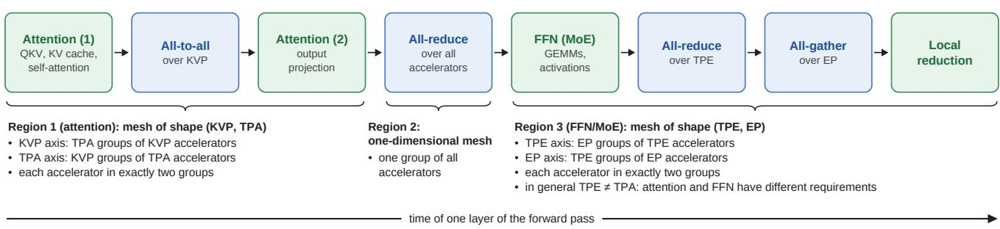  
Figure 8. One layer of a decode step under Helix parallelism (simplified); the full decode step repeats it for every layer, followed by one all-gather of the logits (not shown). Each region arranges the same accelerators into its own device mesh; every collective runs over one axis of its region’s mesh.

Table 2. Notation for topologies and folds used in this appendix. Example: the block fold $Q _ { 5 } [ 3 , 2 ] = K _ { 8 } \sqsupset K _ { 4 }$ has degree $7 + 3 = 1 0$ and diameter 2.
<table><tr><td>notation</td><td>meaning</td></tr><tr><td>Hamming weight |g|</td><td>number of 1-bits of a mask; the Hamming distance of two labels  $x , y$  is |x ⊕ y|, the number of bit positions in which they differ</td></tr><tr><td> $Q _ { n }$ </td><td>hypercube on n bits; its generators are the n unit masks, i.e., the masks of Hamming weight 1</td></tr><tr><td> $Q _ { n } + g$ </td><td> $Q _ { n }$  with the additional generator g, a fold</td></tr><tr><td> $F Q _ { n }$ </td><td>folded cube  $Q _ { n } + 1 \ldots 1 _ { \mathrm { ~ } }$  in which every node is joined to its antipode</td></tr><tr><td> $K _ { s }$ </td><td>complete graph on s nodes</td></tr><tr><td> $G \sqcap H , K _ { s } ^ { \ell }$ </td><td>Cartesian product: two nodes are adjacent if they agree in one factor and are adjacent in the other;  $K _ { s } ^ { \ell } = K _ { s } \mathbf { \hat { \Pi } } \cdot \cdot \cdot \big \Pi K _ { s }$  with l factors</td></tr><tr><td>block, sub-block</td><td>the bit positions an axis owns; a subset of them</td></tr><tr><td>block subgroup coset (of a block)</td><td>all masks supported on the bits of a block,  $\mathrm { i . e . , }$  all ways of flipping only these bits the labels  $x \not \oplus s$  for a fixed x and all s in the block subgroup, i.e., all labels that agree with x outside</td></tr><tr><td></td><td>the block; each coset is one collective group of the axis that owns the block</td></tr><tr><td>complete layer on k bits</td><td>all  $2 ^ { k } - 1$  non-zero masks supported on a sub-block of k bits; it turns every coset of that sub-block into  $K _ { 2 ^ { k } }$ </td></tr><tr><td> $Q _ { a } [ k _ { 1 } , \ldots , k _ { \ell } ]$ </td><td>block fold: the a bits of an axis split into sub-blocks of  $k _ { j }$  bits, each carrying a complete layer; equals  $K _ { 2 ^ { k _ { 1 } } } \sqcup \cdots \sqcup K _ { 2 ^ { k _ { \ell } } }$  , with degree  $\sum _ { j } ( 2 ^ { k _ { j } } - 1 )$  and diameter l</td></tr><tr><td>uniform block fold mixed-radix block fold</td><td>all sub-blocks of equal size,  $k _ { j } = a / \ell , \mathrm { e . g . , } ^ { \prime } Q _ { 6 } [ 3 , 3 ] = K _ { 8 } \sqcup K _ { 8 }$  sub-blocks of different sizes,  $\dot { \mathrm { e . g . , } } \dot { Q } _ { 7 } [ 4 \mathrm { , 3 } ] = \dot { K } _ { 1 6 } \dot { \bigtriangledown } K _ { 8 } \mathrm { ; }$  reading a label as a number whose digit  $2 ^ { k _ { j } }$ </td></tr></table>

Table 3. Per-axis degree ladder for an axis of size $2 ^ { a }$ at degree d.
<table><tr><td>degree d</td><td>topology</td><td>group</td><td>diameter</td></tr><tr><td> $d = a$ </td><td>hypercube  $Q _ { a }$ </td><td> $\left( \mathbb { Z } _ { 2 } \right) ^ { a } \ a$ </td><td></td></tr><tr><td> $d > a$ </td><td>folded cube</td><td> $( \mathbb { Z } _ { 2 } ) ^ { a } \ < a$ </td><td></td></tr><tr><td> $2 < d < a$ </td><td>circulant</td><td> $\mathbb { Z } _ { 2 ^ { a } }$ </td><td>intermediate</td></tr><tr><td> $d = 2$ </td><td>ring</td><td> $\mathbb { Z } _ { 2 ^ { a } }$ </td><td> $2 ^ { a - 1 }$ </td></tr></table>

The planner treats the bit partition of each mesh as its placement decision and chooses it jointly with the folds (Appendix A.2).

Table 3 summarizes the topologies a single axis could take. Reducing the degree below $d = a$ differs qualitatively from increasing it: the axis can no longer remain in $( \mathbb { Z } _ { 2 } ) ^ { a }$ and has to change group. The shared-host planner therefore stays in the cube family, $d \geq a ;$ rings and circulants appear only in the stacked-link allocation of Appendix A.6 and for a ring schedule on a single mesh (Appendix A.5.1).

Folding generators, the support rule, and alignment The hypercube uses n ports per accelerator, one per unit mask. Any further port, i.e., a host degree $D > n ,$ , can be spent on an additional generator of Hamming weight at least two. Whereas a unit mask connects labels that differ in a single bit, a generator of weight w connects labels that differ in w bits at once, a pair the cube alone separates by w hops. Such generators act as chords that fold the cube. Adding $g = 1 1 1$ to an axis of size 8 makes antipodal nodes adjacent, raising the degree from 3 to 4 and lowering the diameter from 3 to 2 (Figure 9). Whether a fold helps a given axis is governed by its support: a folding generator only helps a mesh axis if all of its set bits lie inside that axis’s bit block. If its support spans two blocks, the circuits are still built and occupy ports, but the collectives of that mesh leave them idle.

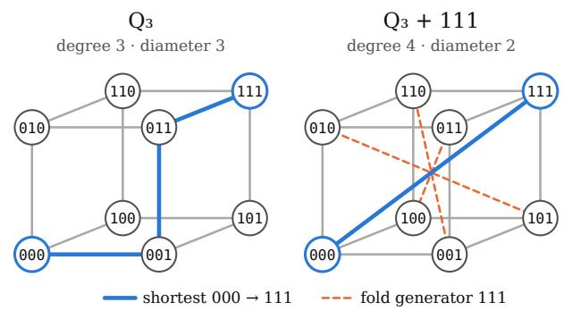  
Figure 9. Folding a hypercube. Left: Q3 with generators {001, 010, 100} has degree 3 and diameter 3; 000 → 111 takes three hops. Right: the fold generator $g = 1 1 1$ adds one port per node and joins every node to its antipode, so 000 → 111 takes one hop and the diameter drops to 2.

Since a generator adds one port on every node, folds are a global resource shared by all meshes, and they are the main source of coupling between them. For $N = 1 6$ with the concurrent mesh shapes (2, 8) and (4, 4) and their partitions $b _ { 3 } \ | \ b _ { 2 } b _ { 1 } b _ { 0 }$ and $b _ { 3 } b _ { 2 } \ | \ b _ { 1 } b _ { 0 }$ of Figure 2(a), the mask 0011 lies inside axis B of both meshes and reduces the diameter of both from 4 to 3. The mask 1100 helps only (4, 4), whose axis A it turns into $K _ { 4 } ;$ it leaves (2, 8) at diameter 4, since that partition places bits 3 and 2 on different axes. Together, the two masks bring (4, 4) to diameter 2 and (2, 8) to 3 (Figure 10). Choosing partitions such that one chord serves the latency-bound axes of several meshes is therefore a genuine optimization problem, and the reason why partitions are part of the search.

Two cases simplify the problem. With a single mesh there is nothing to align to, so an axis could leave the cube family, e.g., become a degree-2 ring that frees ports for edge multiplicity; our planner offers this only to the ring schedule, which it can evaluate, since an analytical cost model exists, but which the simulator does not execute (Table 7). This is because in the latency-bound inference decode regime, the ring algorithm typically is the worst of all schedule choices. A logical-only axis, i.e., a mesh dimension that carries no collective, such as a replica or pipeline-stage axis, receives neither circuits nor collective groups. Its bits still label nodes so that the other axes can index their cosets by them, but the ports it would otherwise occupy remain available.

Realizing the host graph: edge coloring Mapping the host graph onto the OCS planes is an edge coloring problem in which colors correspond to ports. For a Cayley graph of $( \mathbb { Z } _ { 2 } ) ^ { n }$ , this coloring is immediate: the edges $\{ x , x \oplus g \}$ of one generator g form a perfect matching, so coloring every edge by its generator is proper and uses exactly D colors, and each of the $p _ { e }$ circuits of a multiplied edge receives its own copy of that color. Every aligned host graph therefore fits the port budget of Eq. (2) without a coloring search, whatever the weights of its generators. Only when the combined demand graph is not a Cayley graph of $( \mathbb { Z } _ { 2 } ) ^ { n }$ for instance for meshes that are not aligned to one host, can it require one color more than its maximum degree (Vizing’s theorem); a port then has to be reserved.

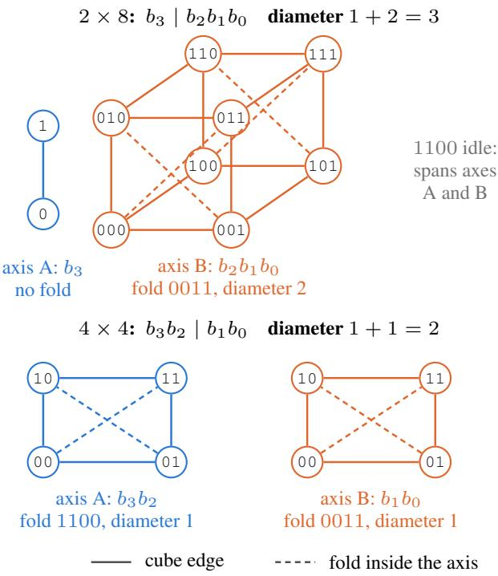  
Figure 10. Folds shared by two meshes on one host: $N = 1 6 , Q _ { 4 }$ with the folds 0011 and 1100, under the partitions of Figure 2(a). Each panel shows one collective group per axis; every other group of the axis is a translate of it. Solid lines are cube edges, dashed lines folds whose support lies inside the axis. The mask 0011 folds axis B of both meshes; the mask 1100 folds axis A of the $4 \times 4$ mesh and is idle for the 2 × 8 mesh, whose partition splits bits 3 and 2.

## A.2 Joint Topology–Schedule Optimization

The impact of folds and multiplicity The planner spends the ports of Eq. (2) on two resources: fold generators, which cost one port per node and reduce the phase count h of the axes whose schedules can use them, and parallel circuits, which raise the multiplicity p of an axis. Each axis is evaluated using Eq. (1), where h counts the phases the selected schedule actually traverses, not the graph diameter, and an axis completes at the pace of its least-multiplied generator, its effective multiplicity $p _ { i } .$ . An edge shared by several axes takes the largest multiplicity any of them requires; together with the global nature of folds, this is the only coupling between meshes. The planner minimizes $\sum _ { i } w _ { i } T _ { i }$ subject to Eq. (2), where $w _ { i }$ counts how often axis i’s collective

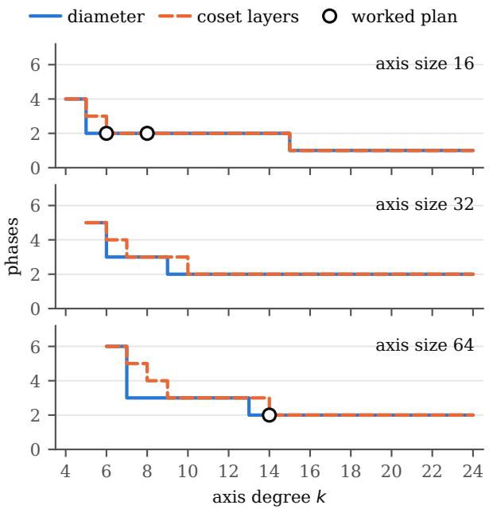  
Figure 11. Diameter frontier and schedulable frontier for axis sizes 16, 32 and 64: the fewest phases a folded cube of a given degree allows, for any schedule (diameter) and for the coset-factored schedules (coset layers). Both are staircases with plateaus that lengthen with axis size. On the axis of size 64, diameter 2 is reached at degree 13, but two coset layers only at degree 14. Circles mark the folded axes of the worked plan (Table 6).

occurs per decode step.

The diameter frontier and the schedulable frontier The number of phases a given degree can buy is a staircase (Figure 11). The diameter frontier bounds every schedule; the schedulable frontier of the coset-factored schedules (Appendix A.3) lags behind it, because these schedules need generator sets that factor into non-overlapping layers: on an axis of 64 accelerators, diameter 2 is reached at degree 13, but two coset layers only at degree 14. Both frontiers are precomputed per axis size.

Search structure and the planner The planner proceeds in the stages of Figure 12: it selects candidate schedules per axis, derives each axis’s ladder of candidate folds from its schedule, searches bit partitions, fold sets and multiplicities jointly, and colors the resulting circuits onto ports. For large instances, the search is heuristic. The planner is deterministic, so a plan is a pure function of its request and can be cached and reused.

Binding the cost model to execution The cost model is only trustworthy if h and v are properties of the actual schedule rather than of an idealization of it. We therefore specify every collective implementation as a triple of an executable schedule, a validity predicate, and a closed-form cost (Section 3.4), and check that the three agree. The closed-form cost takes the topology and the payload and returns $( h , v , u )$ : serialized phases, bottleneck-link bytes, and ports driven per node. It does not receive λ, R or $p ;$ the planner alone owns these deployment parameters and forms T by Eq. (1). We run the resulting check for every collective schedule the planner can select: under the assumptions of the closed form, i.e., a fixed per-phase latency λ, link bandwidth R, multiplicity $p = 1$ and no competing traffic, the simulated completion time of the schedule has to match $h \lambda + v / ( p R )$

The check prevents two failure modes that would otherwise be undetectable. First, crediting recursive doubling with a folded diameter it cannot use would make the selector prefer it on every folded cube. Second, charging RS+AG a full message per phase instead of its geometric two-shot total would make the selector never choose it. The validity predicate keeps invalid combinations of schedule and topology out of the search entirely, rather than having the cost model extrapolate a value for a schedule that would not run.

The scope of this check is internal consistency between the closed form and a simulated execution of the same schedule under the same idealizing assumptions; it is not a hardware validation. It currently covers $p = 1$ only: with parallel circuits, the closed form is known to over-predict the simulated time, so plans that use $p > 1$ are, if anything, estimated pessimistically. Grounding of the constants themselves (λ, R, endpoint and protocol terms) is treated separately in Section 5.5.

## A.3 Topology-Aware Collective Schedules

All-reduce operating points Two lower bounds hold for any all-reduce schedule: the diameter of the topology, since every node’s result depends on all inputs, and $\lceil \log _ { d + 1 } N \rceil$ phases at degree d. The achievable minimum is the larger of the two.

Recursive doubling cannot use folding edges, since merging partial results with overlapping source sets would count inputs twice. Our coset-factored schedules respect this constraint: they group the generators of a fold into layers $\mathit { S 1 } , \ldots , \mathit { S _ { \ell } }$ that tile the group without overlap, $\Pi _ { j } ( 1 +$ $| S _ { j } | ) = N$ , and exchange over one layer per phase, so a fold of ℓ layers needs ℓ phases. On a block fold, these layers are exactly its complete layers (Table 2). Where no such tiling is as short as the diameter, as on $Q _ { 4 } \mathrm { + } 1 1 1 1$ , the diameter can still be reached by reusing links across phases at a higher volume, as the one-shot schedule does (Table 4). The parallel variant of the coset-factored schedule keeps the ℓ phases and reduces the bottleneck volume from ℓσ to σ. RS+AG on the same layers trades phases for volume: a reduce-scatter and an all-gather of ℓ phases each, with a volume that shrinks geometrically in the layer radices $r _ { j } = 1 + | S _ { j } |$ |, the number of nodes a layer connects,

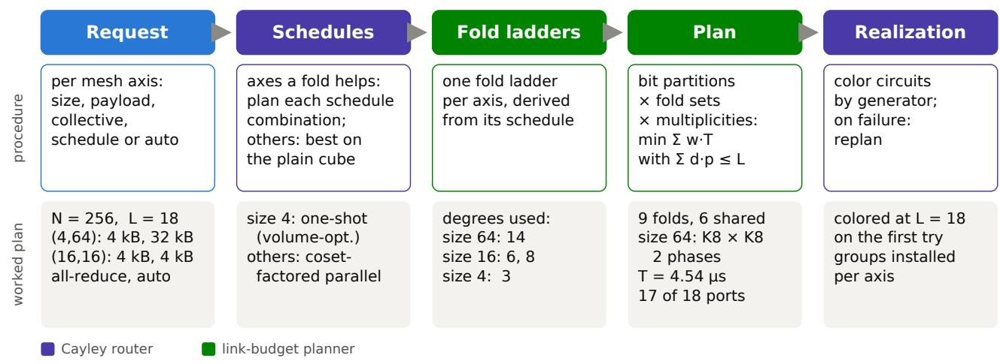  
Figure 12. Fabric planning. Top: the five stages, colored by the component that runs them; the router selects schedules and realizes the circuits, the planner builds each axis’s fold ladder and searches partitions, folds and multiplicities. Bottom: the worked plan of Table 6 $( N = 2 5 6 , L = 1 8 )$ , which is colored onto ports at the full budget on the first attempt.

Table 4. Serialized phases h and bottleneck volume v (cell: h / v, with v in units of the buffer size σ) of each all-reduce schedule, as returned by its closed-form cost. min. h: the lower bound on the phase count, i.e., the larger of the diameter and $\lceil \log _ { d + 1 } N \rceil$ . Bold marks the schedules that attain it.
<table><tr><td>topology (deg, diam) min. h rec. doubling</td><td></td><td></td><td></td><td></td><td>one-shot coset-fact. coset-fact. par.</td></tr><tr><td> $Q _ { 3 } \left( 3 , 3 \right)$ </td><td>3</td><td>3/3σ</td><td>3/12σ</td><td> $\mathbf { 3 } \ : / \ : 3 \sigma$ </td><td>3/σ</td></tr><tr><td> $F Q _ { 3 } \left( 4 , 2 \right)$ </td><td>2</td><td>3/3σ</td><td>2/6σ</td><td> $2 \ : / \ : 2 \sigma$ </td><td>2/σ</td></tr><tr><td> $Q _ { 4 } ( 4 , 4 )$ </td><td>4</td><td>4/4σ</td><td>4/32σ</td><td>4/4σ</td><td>4/σ</td></tr><tr><td> $Q _ { 4 } \mathrm { + } 1 1 0 0 \ ( 5 , 3 )$ </td><td>3</td><td>4/4σ</td><td>3/20σ</td><td>3/3σ</td><td>3/σ</td></tr><tr><td> $Q _ { 4 } \mathrm { { + } } 1 1 1 1 \ ( 5 , 2 )$ </td><td>2</td><td>4/4σ</td><td>2/7σ</td><td>3/3σ</td><td>31σ</td></tr></table>

Table 5. The all-reduce operating points on a chain of ℓ coset layers. The volume of parallel RS+AG holds for uniform folds.
<table><tr><td>schedule</td><td>phases</td><td>bottleneck vol. regime</td><td></td></tr><tr><td>recursive doubling</td><td>log2 N</td><td> $\log _ { 2 } { N } \cdot \sigma$ </td><td>dominated</td></tr><tr><td>coset-factored</td><td>l</td><td> $\ell \sigma$ </td><td>latency</td></tr><tr><td>coset-factored parallel l</td><td></td><td>σ</td><td>latency</td></tr><tr><td>RS+AG</td><td>2l</td><td> $\mathrm { E q . } \left( 4 \right)$ </td><td>bandwidth</td></tr><tr><td>RS+AG parallel</td><td>2l</td><td> $\mathrm { E q . } ( 4 ) / \ell$ </td><td>bandwidth</td></tr></table>

$$
v _ { \scriptscriptstyle { \mathrm { R S + A G } } } = 2 \sigma \sum _ { j = 1 } ^ { \ell } \prod _ { k \leq j } r _ { k } ^ { - 1 } ,\tag{4}
$$

which on the plain cube is the familiar $2 { \frac { N - 1 } { N } } \sigma ;$ its parallel variant divides this volume by ℓ on a uniform fold.

The planner selects by arg min T among the schedules whose validity predicate holds and that are not dominated (Table 5). In the latency-bound regime the coset-factored parallel schedule usually wins on the deepest fold the budget affords; in the bandwidth-bound regime parallel RS+AG does, whose volume is lower than σ but which needs twice as many phases. The worked plan of Appendix A.5.1 illustrates the former. Figure 13 compares the resulting allreduce completion times with those of the all-EPS fabric over a range of buffer sizes (Appendix A.5.2).

All-to-all The all-to-all generalizes the radix-r Bruck algorithm (Bruck et al., 1997) to multi-port accelerators on the same coset layers and takes ℓ phases on a fold of ℓ layers. For axes whose number of bits is prime, such as 128 accelerators, uniform folds are scarce, so we additionally admit balanced mixed-radix block folds such as $Q _ { 7 } [ 4 , 3 ] = K _ { 1 6 } \triangleleft K _ { 8 }$ (Table 2); their parallel schedules are priced by the narrowest layer. Figure 13 shows the corresponding all-to-all completion times (Appendix A.5.2).

## A.4 Variable MoE Traffic and Regularization

MoE token routing and deterministic all-to-all The workload-static argument requires the communication of decode to be fixed at deployment time. Token routing is the only mechanism in the model that varies from token to token, so we state here what has to be regularized, what does not, and what regularization costs.

With $N _ { \mathrm { e x p } }$ experts distributed over $N _ { \mathrm { e p } }$ expert-parallel groups and top-k routing, each decode step produces a dispatch traffic matrix $\dot { W ^ { \mathrm { ~ ~ } } } \in ~ \mathbb { N } ^ { N _ { \mathrm { e p } } \times N _ { \mathrm { e p } } }$ , whose entry $W _ { u v }$ counts the rows sent from group u to group v; a combine phase with the transposed pattern follows. The router determines the entries of W, but not its support: no routing decision is excluded a priori, and over any nontrivial number of steps every ordered pair occurs. The logical graph the circuits must serve is therefore the complete graph on the expert-parallel axis, i.e., an all-to-all, independent of the router. The topology can thus be static without any regularization. Regularization is only needed for the schedule, since a fixed phase structure and a fixed planner input both require the per-pair payloads to be fixed.

Capacity padding. We assign each expert a fixed capacity

$$
C = \left\lceil \gamma \cdot \frac { k m } { N _ { \mathrm { e x p } } } \right\rceil\tag{5}
$$

with capacity factor $\gamma \geq 1$ , and pad every buffer between a source group and a destination expert to $C$ rows. Every ordered pair then exchanges exactly $C { \cdot } ( N _ { \mathrm { e x p } } / N _ { \mathrm { e p } } ) { \cdot } d _ { \mathrm { m o d e l } }$ elements per step, independent of the routing outcome, where $d _ { \mathrm { m o d e l } }$ is the hidden size. The dispatch becomes a uniform all-to-all over the expert-parallel axis that maps directly onto the Bruck/coset schedule of Appendix $\mathrm { A . } 3 ,$ , with h and v fixed and known. Tokens exceeding the capacity are handled on an overflow path outside the static schedule, either dropped, as is common in training, or deferred to the next step. Production inference kernels take the opposite end of this trade-off: they size per-peer receive buffers for the worst case, so that no token is dropped (NVIDIA, 2026d; vLLM Project, 2026a). In our terms, this corresponds to the largest capacity factor, for which padding is only incurred in buffer memory and not necessarily on the wire.

Bucketing. Padding is the special case of a more general scheme in which per-pair counts are quantized to a small set of levels $C _ { 1 } < \cdots < C _ { q }$ and the schedule is planned for the largest. Bucketing recovers volume when the routing histogram is reliably skewed, at the cost of q cached plans instead of one. Since plans are pure functions of their request and are cached (Appendix A.2), the additional planning cost is paid once per bucket at deployment. Our simulator implements neither routing, capacity nor overflow: it runs the dispatch as a uniform all-to-all of the declared per-pair payload, which is exactly the padded dispatch with $q = 1$

Cost of padding in decode. Padding increases the bottleneck volume from $v \ { \mathrm { t o } } \ \gamma v $ , so by Eq. (1) the time of the axis becomes $T = h \lambda + \gamma v / ( p R )$ . With $v = c m$ , the relative

penalty is

$$
\frac { T _ { \gamma } } { T _ { 1 } } = 1 + \frac { \gamma - 1 } { 1 + \frac { h \lambda p R } { v } } = 1 + \frac { \left( \gamma - 1 \right) m } { m + \hat { m } } , \qquad \hat { m } = \frac { h \lambda p R } { c } ,\tag{6}
$$

where $\hat { m }$ is the token count at which the latency and bandwidth terms of Eq. (1) are equal. For $m \ll$ mˆ the penalty vanishes: an axis operating an order of magnitude below mˆ pays less than 10 % of $\gamma - 1$ . Regularization is therefore affordable in exactly the regime that requires it. At small $m ,$ the routing histogram is least balanced and $\gamma$ has to be largest, but this is also where m is furthest below mˆ . Conversely, at large batch sizes, where γ approaches 1 because the histogram concentrates, the axis has moved toward the bandwidth-bound regime in which padding would be expensive. Both effects act in the same direction.

Regularized token routing. Where an implementation may constrain the router, for instance through balanced assignment or expert-choice routing, the histogram becomes deterministic by construction and $\gamma = 1$ is attainable without dropping tokens. Since this changes model quality, it is out of scope for this paper; we note it because it removes the only remaining non-determinism in the communication pattern.

What remains variable. Regularization fixes the dispatch and combine patterns, but not the compute time of the expert MLPs, which still depends on the realized token counts unless the implementation also computes on padding. Similar variability arises from speculative decoding, which varies the number of tokens verified per step and thus compute times and payloads, but not which accelerators communicate. How such variability, and the regularization strategies that bound $\mathbf { i t } ,$ affect the decode step is a question for the workload model (Section 4) rather than for the network model: the circuits serve the collective schedule, whose structure stays fixed, so this variability changes the execution trace but not the network fabric.

## A.5 Worked Examples and Fabric Comparisons

## A.5.1 Worked Multi-Mesh Plans

A latency-bound multi-mesh plan. We consider $N =$ 256 $( n = 8 )$ accelerators with $L = 1 8$ ports, $R = 5 \times$ $1 0 ^ { 1 0 }$ B/s (400 Gb/s) and $\lambda = 0 . 5 2$ µs on a single-level OCS fabric. The fabric serves the mesh (4, 64) with all-reduce payloads of 4 kB and 32 kB and the mesh (16, 16) with 4 kB on both axes, and the planner selects every schedule automatically. Every axis is latency-bound, so the budget is spent on degree. The resulting plan has host degree $D = 1 7 .$ consisting of the 8 cube generators and 9 folding generators, uses 17 of the 18 ports, and achieves a total of $T = 4 . 5 4 \mu \mathrm { s }$ (Table $6 ;$ Figure 12 traces it through the planner’s stages).

Table 6. Resulting plan for the latency-bound multi-mesh example; for the notation, see Table 2.
<table><tr><td>mesh</td><td></td><td>axis size topology</td><td></td><td>deg h</td><td> $p$ </td><td>axis T</td></tr><tr><td> $( 4 , 6 4 )$ </td><td>0</td><td>4  $K _ { 4 }$ </td><td></td><td>3 1 1</td><td></td><td> $0 . 6 0 \mu s$ </td></tr><tr><td>(4, 64) 1</td><td></td><td>64  $Q _ { 6 } [ 3 , 3 ] = K _ { 8 } \bigcirc K _ { 8 }$ </td><td></td><td>14 2 1</td><td></td><td> $1 . 7 0 \mu \mathrm { s }$ </td></tr><tr><td>(16, 16) 0</td><td></td><td>16  $Q _ { 4 } [ 2 , 2 ] = K _ { 4 } \square K _ { 4 }$ </td><td></td><td>6 2 1</td><td></td><td> $1 . 1 2 \mu \mathrm { s }$ </td></tr><tr><td>(16, 16)1</td><td></td><td>16  $Q _ { 4 } [ 3 , 1 ] = K _ { 8 } \sqsupset K _ { 2 }$ </td><td></td><td>8 2 1</td><td></td><td> $1 . 1 2 \mu \mathrm { s }$ </td></tr></table>

The size-64 axis carries the coset-factored parallel schedule on two complete layers of seven generators each. In terms of Figure 11, it operates at degree 14, the first point of the schedulable frontier with two phases, rather than at degree 13, where the diameter frontier already reaches 2 but no two-layer factorization exists. The size-4 axis is folded into a complete graph and carries the volume-optimized one-shot schedule, which ties with coset-factored parallel there. Both axes of (16, 16) reach two phases without additional ports: the folds they use are a subset of those already present for (4, 64), which is why the second axis even receives a degree-8 fold where degree 6 would suffice. The eighteenth port remains unused, since no further fold reduces a phase count and a multiplicity increase on any axis costs at least three ports.

The cost of alignment. Table 7 contrasts a bandwidthbound axis with and without a second mesh to align to. With two or more meshes, the fabric is one aligned $Q _ { 6 } ,$ , so every axis must be a sub-cube and a degree-2 ring is not available. A ring schedule would have to run over a Graycode Hamiltonian cycle of the $Q _ { 5 } ,$ , driving only 2 of the 5 links per node; each multiplicity unit then costs 5 ports instead of 2, and the multi-mesh plan reaches $p = 7$ where a single-mesh ring reaches $p = 1 7$ . Alignment costs nothing, however, for the schedule the planner actually selects here. Parallel RS+AG drives all d links of the cube in every phase, so it gains nothing from a ring and both regimes arrive at the same plan, at half the time of the best ring. The ring schedule serves only as a reference: the planner can evaluate it, but the simulator does not execute it.

## A.5.2 Collective Performance Across Fabrics

Figure 13 compares single collectives spanning all 512 accelerators on the two fabrics of Section 6: the all-EPS fabric, two levels and 4:1 oversubscribed towards the second level, with dynamic routing and the schedules of current inference frameworks, and the all-OCS fabric, non-blocking, with the topology and schedule planned for every buffer size.

Every all-reduce on both fabrics is charged at least $2 { \frac { N - 1 } { N } } \sigma$ the volume of a valid sum all-reduce.

For small buffers, both collectives are latency-bound, and all-OCS completes them about twice as fast: a 1 KiB allreduce takes $1 . 7 8 \mu \mathrm { s }$ instead of $3 . 7 7 \mu \mathrm { s } .$ , a 1 KiB all-to-all $1 . 7 0 \mu s$ instead of $3 . 0 2 \mu \mathrm { s }$ . This advantage does not stem from bandwidth and would therefore persist against a nonblocking EPS fabric. A packet-switched fabric lets any node reach any other, which determines which edges are usable and therefore affects the bandwidth term; it cannot remove serialized phases from a collective, and the switch stages it traverses add to the latency term. Folding instead converts ports into fewer phases. For the all-reduce, the coset-factored parallel schedule is best up to 50 KiB and parallel ${ \mathrm { R S } } { + } { \mathrm { A G } }$ beyond, while the all-EPS fabric moves from one-shot to two-shot and, from 5 MiB on, halvingdoubling.

For large buffers, the all-reduce advantage grows to $3 . 6 \times$ at 50 MiB (68 instead of $2 4 2 \mu \mathrm { s } )$ , which mostly reflects the 4:1 oversubscription of the all-EPS fabric that all-OCS avoids (Appendix C.7); a non-blocking EPS fabric would close most of this part of the gap. For the all-to-all, the advantage peaks at $3 . 4 \times$ at 512 KiB (3.05 instead of $1 0 . 4 \mu \mathrm { s } )$ and is 1.84× at 250 MiB (0.66 instead of 1.21 ms).

The following Subsection A.5.3 separates the contributions of schedule, subscription, and switch technology to this gap.

## A.5.3 Contributions of Schedule, Subscription, and Switch Technology

The EPS fabric of our comparison is oversubscribed 4:1 between its leaf (level-1) and spine (level-2) switches, since a fully subscribed EPS spine with pluggable conversion exceeds a reasonable power envelope; the OCS spine needs no conversion and is fully subscribed. The all-to-all is the collective that suffers most from oversubscription: with C racks, a fraction $( C - 1 ) / C$ of every accelerator’s data is addressed to other racks and has to cross the spine, whatever the schedule. To separate the effect of the schedule from that of the fabric, we also run our parallel Bruck schedule on the EPS fabric, with the logical edges of the fold carried as packets over all physical links of each accelerator.

Figure 14 compares four configurations to examine the contributions of collective scheduling, spine subscription, and switch technology. The transition to the fully subscribed EPS reference also changes transport from packet routing to static circuits, so this step does not isolate subscription alone. The EPS fabric at 4:1 with its native all-to-all schedules is the deployment that still fits a reasonable power envelope. Running our parallel Bruck schedule on the same fabric changes only the schedule and accounts for about two thirds of the gap at large buffers: at 250 MiB, it reduces the completion time from 1.21 to 0.85 ms, against 0.66 ms on the OCS fabric. Raising the EPS spine to full subscription changes only the subscription; this configuration can only be built with static circuits, since circuits routed through an EPS spine are colorable only at full bisection, and we include it as a reference that exceeds a reasonable power envelope. At 250 MiB, this step accounts for the remaining third of the gap (0.85 to 0.66 ms). The remaining step replaces the EPS switches of that reference by OCS and changes only the switch technology; at large buffers the two perform alike (0.661 and 0.657 ms at 250 MiB). At small buffers they do not: every hop through an EPS switch still pays its switch latency, so the static reference takes 5.3 instead of 1.8 µs at 1 KiB, which is the latency advantage discussed in Appendix A.5.2. At large buffers, the OCS fabric therefore does not gain on bandwidth at equal subscription. It gains because full subscription is affordable for it, whereas on the EPS fabric the step from 4:1 to 1:1 is exactly the part of the gap that the oversubscribed spine imposes.

Table 7. The same bandwidth-bound axis, multi-mesh versus single-mesh, under the ring schedule and under parallel RS+AG: N = 64, $L = 3 6 , R = 5 \times 1 0 ^ { 1 0 } \mathrm { B } / \mathrm { s } , \lambda = 0 . 5 2 \mu \mathrm { s } ,$ , an axis of size 32 carrying 655 MB (640 000 KiB).
<table><tr><td>schedule</td><td>case</td><td>topology</td><td>deg</td><td>p</td><td>axis  $T$ </td></tr><tr><td>ring (planning only)</td><td>multi-mesh [(2, 32), (8, 8)]</td><td> $Q _ { 5 }$  sub-cube</td><td>5</td><td>7</td><td>3660 µs</td></tr><tr><td>ring (planning only)</td><td>single mesh (2, 32)</td><td>ring</td><td>2</td><td>17</td><td>1526 µs</td></tr><tr><td>parallel RS+AG</td><td>multi-mesh [(2, 32), (8, 8)]</td><td> $Q _ { 5 }$  sub-cube</td><td>5</td><td>7</td><td>731 µs</td></tr><tr><td>parallel RS+AG</td><td>single mesh (2, 32)</td><td> $Q _ { 5 }$ </td><td>5</td><td>7</td><td>731 µs</td></tr></table>

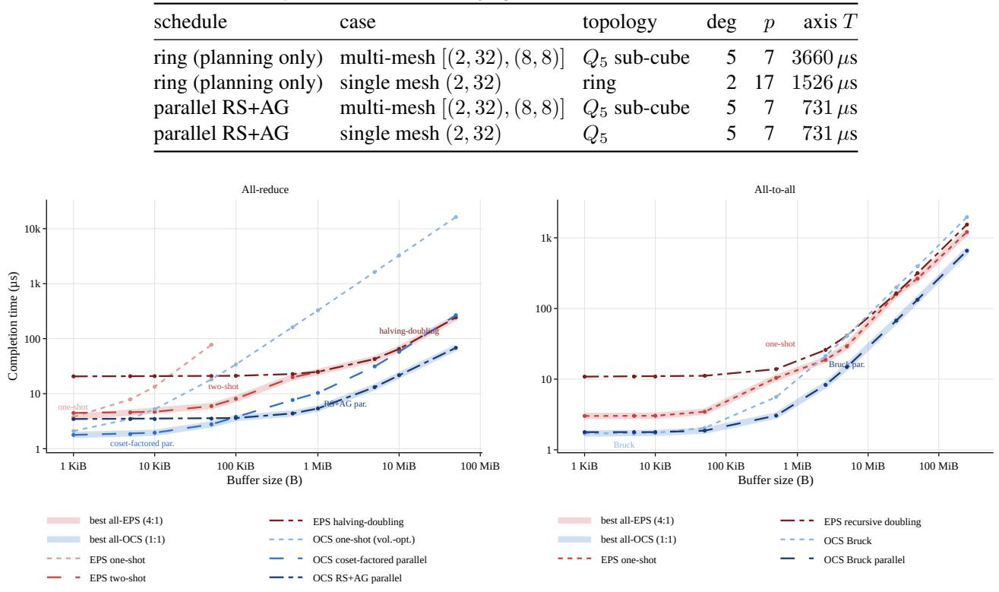  
Figure 13. Completion time of a single all-reduce (left) and all-to-all (right) spanning 512 accelerators in 16 racks, 36 ports per accelerator, against the buffer size of the collective. All-EPS: two levels, 4:1 oversubscribed towards the second level, dynamic routing. All-OCS: non-blocking, with the topology planned for every buffer size. Lines show the individual schedules, shaded bands the best schedule pe fabric and buffer size, labeled with the schedule that attains it.

## A.6 Shared-Host vs. Stacked-Link Allocation

An alternative to the shared-host construction of Section 3.2 is to treat each communication axis independently and allocate it a dedicated subset of accelerator ports. We call this stacked-link allocation. Newer inference hardware architectures devote physical subsets of their scale-up links to a given mesh axis, e.g., TP or EP in TP/EP parallelism (Ho et al., 2026). Stacked-link allocation is the workload-aware variant of this concept, which partitions the ports at deployment time rather than at system design time.

Each axis i receives $L _ { i }$ ports, with $\begin{array} { r } { \sum _ { i } L _ { i } \leq L { : } } \end{array}$ one port each, and the rest in proportion to the full-connectivity degree $N _ { i } - 1$ , rounded by largest remainder. $\begin{array} { r } { \operatorname { I f } \sum _ { i } ( N _ { i } - 1 ) \le } \end{array}$ $L ,$ every axis is fully connected and the leftover ports become parallel circuits. For each axis over its $N _ { i }$ ranks, we choose a circulant Cayley graph on $\mathbb { Z } _ { N _ { i } }$ at degree $L _ { i }$ that minimizes the diameter, using diameter as a latency-oriented proxy for collective completion time. The search is exhaustive for small axes and sampled for large ones, so for large axes the stacked-link circulant is a heuristic, not necessarily the minimum-diameter one. Since a circulant is not a cube, only the one-shot schedules run on it.

Figure 15 compares the two allocation approaches on a single-level OCS fabric of 512 accelerators under an 8 kB all-reduce on a 2-D mesh (8 × 64) with 72 collective groups:

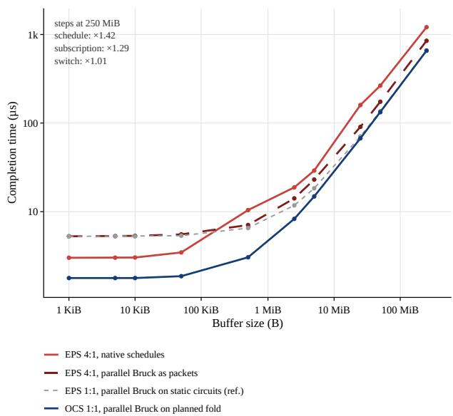  
Figure 14. All-to-all completion time against buffer size, 512 accelerators in 16 racks of 32 (36 ports per accelerator, 400 Gb/s per link). Four configurations, each differing from the next in one respect: EPS 4:1 with its native schedules; EPS 4:1 with parallel Bruck carried as packets; EPS 1:1 with parallel Bruck on static circuits, a reference that exceeds the power envelope; OCS 1:1 with parallel Bruck on the planned fold. The native EPS schedule is one-shot at every buffer size; the step ratios at 250 MiB are given in the upper left.

64 groups of 8 accelerators along the first axis, and 8 groups of 64 accelerators along the second. The two approaches use the L links of each accelerator differently. Stacked-link fixes the split beforehand: one set of ports is assigned to the 8- rank axis and another to the 64-rank axis. Each axis can then use its ports only to reduce the diameter of its own graph; until both axes are fully connected, ports assigned to one axis can neither be used by the other nor increase bandwidth. Shared-host instead uses $\log _ { 2 } N \ = \ 9$ ports to build the base hypercube, whose generators it splits between the two axes, three for the 8-rank axis and six for the 64-rank one. The remaining ports form a common pool, and the planner chooses folds and parallel circuits for both axes jointly under that budget: fold generators to remove collective phases when latency is the main bottleneck, parallel circuits to increase bandwidth when it is. The automatically selected collective schedule then uses whichever the plan provides. This gives shared-host a clear advantage at intermediate radix, from $L = 1 6 \mathrm { t o } L = 6 4$ in Figure 15. At higher radix, the two curves converge again: once $L \ge ( 8 - 1 ) + ( 6 4 -$ $1 ) = 7 0$ , stacked-link has enough ports to fully connect both axes independently, and both approaches reach a network diameter of one with the same completion time.

Shared-host allocation is therefore the more efficient in most cases, since one budget serves both axes and surplus ports can go to whichever of latency and bandwidth gains more. Stacked-link allocation is more flexible in the topology it can realize. Our current shared-host construction requires $L \geq \log _ { 2 } N$ , since its base host graph is defined over binary rank labels, and therefore assumes power-of-two axis extents; stacked-link only needs enough ports $L _ { i }$ per axis to connect its own $N _ { i }$ ranks. Both allocations determine which logical adjacencies and bandwidth are available to a collective, but neither alone determines the resulting execution time. Their benefits materialize only if the collective schedule can exploit the provided connectivity (Appendix A.3).

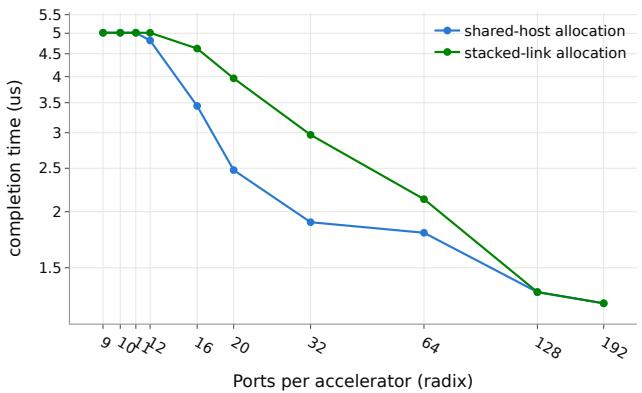  
Figure 15. 2-D mesh $( 8 \times 6 4 ) .$ , 8 kB all-reduce, 512 accelerators: completion time against accelerator radix, stacked-link allocation vs. shared-host allocation.

## A.7 Scope and Limitations

The multi-mesh search is heuristic and does not establish global optimality. Only one- and two-dimensional meshes are supported, all meshes of a deployment must span the same power-of-two world size, and non-power-of-two sizes are not supported at all. The conformance check covers $p = 1 \mathrm { o n l y }$ (Appendix A.2). The coset-factored schedules require that the partial sums combined in successive phases never overlap, which holds exactly when the generators of a fold tile the group as layers. On irregular folds, such as the diameter-optimal generator set of degree 13 on an axis of size 64, no such tiling exists, so these schedules need more phases than the diameter.

## B DETAILS ON GXNET

This appendix details how GXNET translates a model graph into a distributed decode-step execution. It describes the graph transformations, MoE load assumptions, compute and memory cost model, and coupling to the network simulator. It then evaluates sensitivity to HOP-B microbatching and explains the search over parallelization configurations used in the evaluation.

## B.1 From Model Graph to Distributed Decode Step

A model graph consists of the token embedding, the decoder layers, and the final norm and LM head. The decoder layers are one repeated block with a repetition count; Megatron 5T repeats one layer, GPT-OSS-5.3-like a pair of a slidingwindow and a full-attention layer. Tensor shapes are SymPy expressions in the batch size and in the mesh coordinates of the rank. A sequence of graph-to-graph passes turns the model into a timed distributed decode step:

1. Decode. The graph is specialized to generating one token per user against a KV cache that holds the context.

2. Precision. Activations, weights, and the KV cache are stored in FP4, and collectives communicate activations in FP4; Appendix E repeats the evaluation with BF16 communication.

3. Helix sharding. Attention is placed on a $\mathrm { K V P \times T P A }$ mesh, which shards the KV cache by sequence over KVP and by KV head over TPA, and the FFN on an EP × TPE mesh over the same accelerators. Collectives are inserted as described in Section 4 (Figure 26).

4. Kernels. Operators are grouped into fused kernels, e.g., the QKV projection, flash-decode attention, and the grouped expert GEMM.

5. Resources and time. Each kernel is annotated with its FLOPs and HBM traffic, and then with a duration (Appendix B.3).

6. Schedule. Each layer is split into an attention and an FFN region (four regions for GPT-OSS-5.3-like), which execute in order without HOP-B microbatching (Bhatia et al., 2025) (Appendix B.5).

The same sharded graph also yields a per-accelerator memory estimate (weights and KV cache), which bounds the batch size that fits in HBM.

## B.2 MoE Load Model

Since the all-reduce after the attention output projection replicates the expert input on every accelerator, token routing changes no collective (Section 3.1). It only sets how many tokens each expert processes, and with it the expert compute time and the payload of the TPE all-reduce and EP all-gather. We model dropless routing that is uniform in expectation. With B users and top-k routing over $N _ { \mathrm { e x p } }$ experts, the number of distinct active experts is approximately

$$
\begin{array} { r } { N _ { \mathrm { a c t } } = N _ { \mathrm { e x p } } \left( 1 - \left( \frac { N _ { \mathrm { e x p } } - 1 } { N _ { \mathrm { e x p } } } \right) ^ { B k } \right) , } \end{array}\tag{7}
$$

rounded to the nearest integer. The active experts are spread over the EP ranks, so each rank holds $\lfloor N _ { \mathrm { a c t } } / \mathrm { E P } \rfloor$ or $\lceil N _ { \mathrm { a c t } } / \mathrm { E P } \rceil$ of them, and its grouped expert GEMM processes $\lceil B k / N _ { \mathrm { a c t } } \rceil$ tokens per active expert. The collectives after the experts carry the rows of the busiest rank, its share of the routed tokens,

$$
\begin{array} { r } { R = \left\lceil \left\lceil \frac { N _ { \mathrm { a c t } } } { \mathrm { E P } } \right\rceil \frac { B k } { N _ { \mathrm { a c t } } } \right\rceil , } \end{array}\tag{8}
$$

rounded up once for the rank rather than once per expert. MoE payloads are therefore sublinear in B (Table 1). We do not model routing skew, which would raise expert compute and payload on the most loaded EP rank.

## B.3 Compute and Memory Cost Model

The duration of a kernel is a roofline estimate,

$$
t = \operatorname* { m a x } \left( \frac { F } { P _ { \mathrm { F P 4 } } \eta _ { F } ( F ) } , \frac { D } { W _ { \mathrm { H B M } } \eta _ { D } ( D ) } \right) ,\tag{9}
$$

where $F$ is the kernel’s FLOPs, D the bytes it moves to and from HBM, PFP4 and WHBM the peak FP4 throughput and HBM bandwidth of Table 11, and η and η size-dependent efficiencies. For RX00, η is 0.3 for transfers up to 1 MB, 0.6 up to 10 MB, 0.75 up to 100 MB, and 0.9 above; $\eta _ { F }$ is 0.15 for kernels up to 7 GFLOP, 0.36 up to 16 GFLOP, 0.53 up to 127 GFLOP, and 0.73 above. A grouped expert kernel reads the weights of every active expert on its rank. The efficiency functions are a step approximation of curves measured on H100 (Appendix D.3).

Kernel launches are charged per rank: the first kernel after each collective pays one launch overhead, and the kernels that follow until the next collective run back to back, as in an accelerator execution graph or persistent-kernel implementation. We use $0 . 8 \mu \mathrm { s }$ , the per-kernel gap of a replayed CUDA graph on B200 (Cheng et al., 2025).

## B.4 Execution and Network Coupling

The schedule is compiled into a plan of compute entries with fixed durations and communication entries whose durations are left to the network model. Each accelerator issues its compute entries in order, as from a single stream. Ranks with identical durations and dependencies share an entry, so the plan size depends on the number of distinct rank behaviors, which arise only where the active experts do not divide evenly over the EP ranks.

An entry starts when its last predecessor ends. A communication entry registers its collective with the network model at its start time, and its end stays open until the network model reports it. When no further collective can be registered, the network model advances to the next completion, and the reported end times are substituted into the entries that depend on them. The network model therefore holds every collective that is in flight at a given time, e.g., the concurrent groups of one mesh axis, which share second-level links on the two-level fabrics. Simlette simulates these collectives together, so link contention and credit stalls between them lengthen their completion times, and the compute that waits for them starts later. Pricing each collective in isolation would miss both effects; the analytical model does so. Before the walk, the network model receives the traffic demand of Table 1, against which the OCS planner builds circuits (Section 3); a registered collective outside this demand is an error.

Without HOP-B, no communication overlaps with computation, so every collective lies on the critical path and a decode step is the sum of kernel durations, launch overheads, and collective completion times. The OCS saving per step is the reduction in collective completion time. This also matches the public implementations of Helix: TensorRT-LLM provides Helix parallelism, but its documented implementation does not yet include HOP-B’s batch-wise pipelining of attention computation and all-to-all communication, which NVIDIA lists as future work (NVIDIA, 2026g), and the Helix all-to-all backends recently added to vLLM (vLLM Project, 2026b) and SGLang (SGLang Project, 2026) do not describe such overlap. The following subsection Appendix B.5 shows that HOP-B would not shorten the evaluated decode steps.

## B.5 Sensitivity to HOP-B

HOP-B (Bhatia et al., 2025) splits the attention of a decode step into microbatches and overlaps the KV-parallel all-toall of one microbatch with the attention computation of the next. The QKV projection, the FFN, and their collectives, i.e., the all-reduce after the output projection, the FFN allreduce and expert all-gather, and the logit all-gather, still run once on the whole batch and are not overlapped. Figure 16 evaluates it for both models at batch 16 and 5M context, the largest batch and context of Section 6, which give HOP-B the most computation to overlap with.

Microbatching does not reduce the bytes of the all-to-all, but it issues the all-to-all once per microbatch in every layer. Its payload is divided among the calls, but each additional call adds the fixed latency of a collective, which dominates for the small payloads of decode (Table 1), so the communication time before overlap grows with the number of microbatches. HOP-B can hide this communication only behind attention, the all-to-all of the last microbatch stays exposed, and the decode step becomes shorter only if the hidden communication exceeds the added communication.

For GPT-OSS-5.3-like, it does not. A decode step computes for only 0.77 ms, half of its layers attend to a 128-token window, and HOP-B hides at most 0.34 ms of communication, while eight microbatches add 1.6 ms of communication on all-EPS. Against the step without HOP-B, the decode step grows by 6, 22, and 70 % on all-EPS with 2, 4, and 8 microbatches, and by 4, 11, and 29 % on all-OCS, whose collectives have the lowest latency per call. For Megatron 5T, attention over the 5M-token context dominates the 8.8 ms of computation per step and hides all added all-to-alls, but the exposed communication does not shrink: the all-to-all of the last microbatch takes as long as the single all-to-all without HOP-B, and the other collectives are not overlapped. The decode-step time is therefore unchanged on every fabric.

For the evaluated model-parallel configurations, microbatching with HOP-B does not improve decode-step time relative to a single microbatch. For GPT-OSS-5.3-like, the additional collective startup costs exceed the communication hidden through overlap. For Megatron 5T, the additional communication is almost entirely hidden, but the remaining exposed communication is unchanged. The single-microbatch configuration is therefore optimal or equivalent among the evaluated schedules, supporting its use in Section 6.

## B.6 Searching the Parallelization Space

On N accelerators, a Helix split (KVP, TPA, EP, TPE) satisfies KVP · TPA = EP · TPE = N, with power-of-two degrees, TPA dividing the number of KV heads, EP dividing the number of experts, and TPE dividing the expert width. At N = 512, this gives 72 splits for Megatron 5T and 45 for GPT-OSS-5.3-like.

For Figure 4, we choose a split per cell, i.e., per model, context (32K and 5M tokens), batch size (1, 2, 4, 8, and 16), and fabric. GXNET with the analytical network model of Section 5.4 times every split in every cell: 2160 points for Megatron 5T and 1350 for GPT-OSS-5.3-like, each simulated in under a second. The analytical model ignores contention and credit stalls (Section 5.4), so we re-simulate with Simlette every split whose analytical interactivity is within 7 % of the best split of its fabric in that cell, and report the best Simlette result per cell. This amounts to 758 points for Megatron 5T and 338 for GPT-OSS-5.3-like, with a median simulation time of about 10 minutes per point.

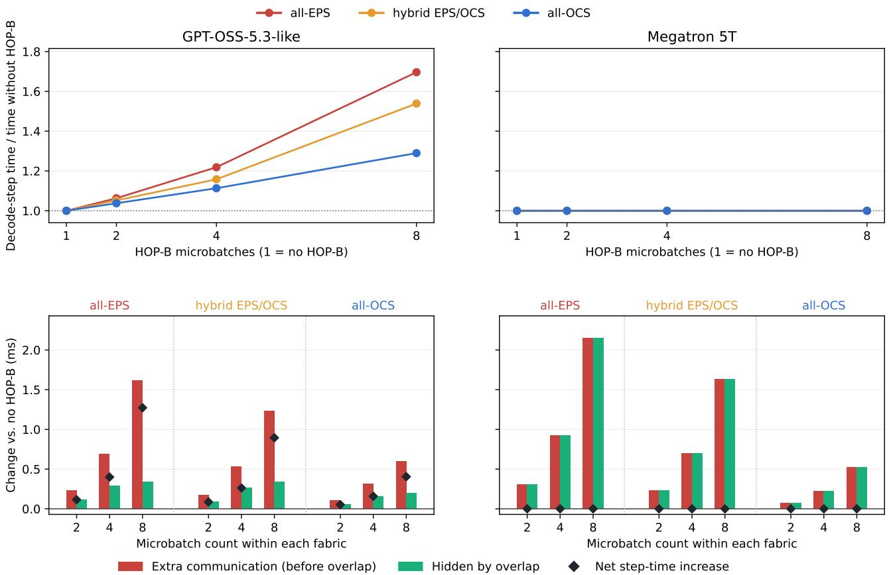  
Figure 16. HOP-B sensitivity at batch 16 and 5M context, simulated with Simlette, each fabric at its parallelization of Figure 4. One microbatch is the execution without HOP-B used in Section 6. Top: decode-step time with HOP-B over 2, 4, and 8 microbatches, relative to the step without HOP-B. Note that results for Megatron 5T coincide at approximately 1.0, so red and orange curves are not visible. Bottom: change against the step without HOP-B in communication time before overlap (red), in communication hidden behind compute (green), and in decode-step time (diamonds).

## C COLLECTIVE ALGORITHMS AND TIME CONSUMPTION IN THE NETWORK SIMULATOR

This appendix details how Simlette models collective communication on the evaluated network fabrics. It describes the simulator’s mapping stages, derives the analytical timing model, and explains the collective schedules and their consistency checks. It then presents simulation optimizations, hardware measurements used to parameterize latency, and the physical fabric configurations used in the evaluation.

## C.1 Simlette Layers

Simlette separates the OCS-specific problem of mapping an ML workload to the physical network fabric into four layers, applied in the following order. The first is the topology: the physical host graph $H = ( V , E )$ of devices, switches, and the ports that connect them, under the per-accelerator port budget L introduced in Section 3.3. The second is worker allocation: the mapping of logical ranks onto this physical graph, i.e., the embedding of a logical overlay (Section 3.2) into the accelerators and links that will actually carry its traffic. The third is the collective, which supplies the schedule defined in Section 3.4: the ordered sequence of phases, the rank pairs and edges used at each phase, and the payload carried on each. This layer jointly searches over the collective and its logical topology, keeps the lowest-cost pair, and thereby determines the number of phases $h _ { i } .$ . The fourth is routing, which takes the chosen logical topology together with the physical topology and the allocation, and maps it onto concrete ports, paths, and circuit assignments. These four layers stay independent in the implementation.

## C.2 Derivation of the Analytical Model

We compute the terms of Eq. 1 from the schedule of Section 3.4. Let $b _ { k , e }$ be the amount of data, in bytes, sent on logical edge e during phase k. All transfers of a phase start at the same time, and the phase ends when the transfer on the most loaded edge arrives. This transfer takes the latency $\lambda$ of one hop, plus the time to put its data on the edge. The edge is made of $p$ parallel circuits of bandwidth R each, expressed in bytes per second (400 Gb/s corresponds to $R = 5 0 \mathrm { G B } / \mathrm { s } )$ , so sending $b _ { k , e }$ takes $b _ { k , e } / ( p R )$ and phase k lasts $\lambda + \operatorname* { m a x } _ { e } b _ { k , e } / ( p R )$ . Adding the h phases gives Eq. 1, with the bottleneck volume

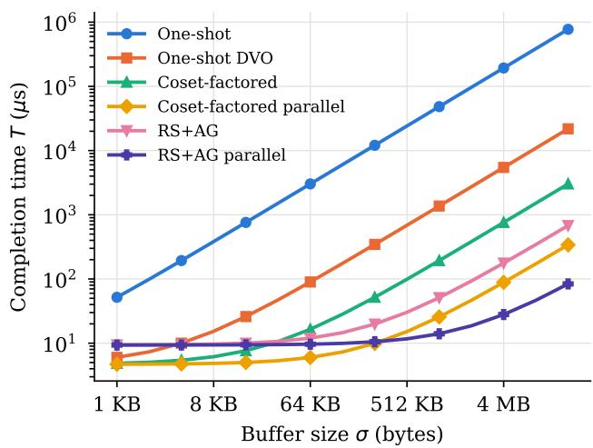  
Figure 17. Completion time from Eqs. (1) and (10) for an allreduce on 512 accelerators connected as a hypercube without extra generators, with $L = 9$ ports, $p = 1 , \lambda = 0 . 5 2 \mu \mathrm { s } ,$ and $R = 4 0 0 \mathrm { G b / s }$

$$
v = \sum _ { k = 1 } ^ { h } \operatorname* { m a x } _ { e } b _ { k , e } ,\tag{10}
$$

i.e., the sum, over all phases, of the data carried by the most loaded edge of each phase. This assumes that phases do not overlap, and that no other collective uses the same links at the same time.

## C.3 Collective Algorithms for Workload-static Switching

Each collective algorithm in Simlette computes h, the schedule phase count, and v, the bottleneck data volume, from its own phases, for a buffer size σ on a logical graph of N ranks.

## C.3.1 All-reduce schedules

Simlette implements the all-reduce schedules of Appendix A.3: the one-shot schedule, which reaches every rank within the diameter of the graph, and its data-volumeoptimized variant (one-shot DVO), as well as the cosetfactored and RS+AG schedules and their parallel variants, which exchange over one coset layer per phase (Tables 4 and 5).

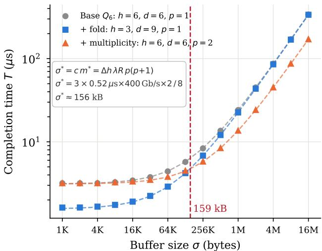  
Figure 18. Topology-schedule interaction at network level. Completion time of one all-reduce among 64 accelerators on a singlelevel OCS fabric (400 Gb/s per link), as a function of the buffer size σ of the all-reduce. Base topology $Q _ { 6 } ,$ +fold (fewer phases h, larger degree $d ) ,$ and +multiplicity $( p = 2$ parallel links per logical edge). The dashed line marks the simulated crossover between +fold and +multiplicity (159 kB), close to the buffer size $\boldsymbol { \sigma } ^ { \star } = c m ^ { \star }$ ≈ 156 kB predicted by Eq. (3).

Example: Analytical completion time of the all-reduce algorithms Figure 17 shows the completion time of the all-reduce algorithms on N = 512 accelerators, from 1 KiB to 16 MiB. For small buffers the latency term hλ is the largest, and the time depends mostly on the number of phases. For example, the two RS+AG algorithms take 18 phases, and their latency term is $1 8 \times 0 . 5 2 = 9 . 4 \mu \mathrm { s }$ . The other algorithms take only 9 phases, and their latency term is $9 \times 0 . 5 2 = 4 . 7 \mu \mathrm { s }$

For large buffers the bandwidth term $v / ( p R )$ is the largest, and the algorithm that sends the least data is the fastest. Coset-factored sends the full buffer in each of its 9 phases. RS+AG sends only a part of the buffer in each phase, and about twice the buffer in total. RS+AG takes twice as many phases, but sends less data. The two curves cross at the buffer size where the extra phases of RS+AG cost as much time as the extra data of coset-factored. Below this size coset-factored is faster, and above it RS+AG is faster. Their parallel variants keep the same number of phases, but send 9 times less data on the most loaded link.

One-shot is the slowest at every size. At each phase, a rank sends to each neighbor every contribution it has received so far. This number grows from one phase to the next, and the same contributions cross the same links many times.

Topology-schedule interaction Figure 18 shows the topology-schedule interaction at network level. The collective is a single all-reduce over N = 64 accelerators, with buffer sizes from 1 KiB to 16 MiB in powers of two. The schedule is coset-factored parallel, and the physical fabric is a single-level all-OCS with a radix of 13 ports per accelerator, of which L = 12 are used for circuits, and a bandwidth of R = 400 Gb/s per link.

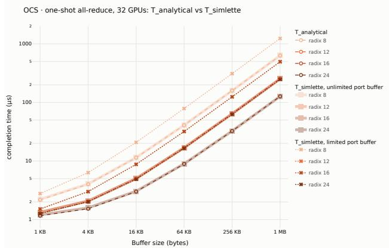  
Figure 19. One-shot all-reduce on 32 accelerators with OCS: analytical model against Simlette with an unlimited and a limited buffer per port. Colors show the number of ports per accelerator.

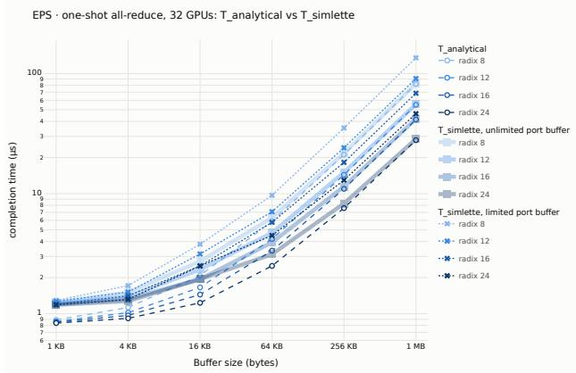  
Figure 20. One-shot all-reduce on 32 accelerators with EPS: analytical model against Simlette with an unlimited and a limited buffer per port.

## C.3.2 All-to-all schedules

r-Bruck (radix-r Bruck all-to-all on a block fold, r-Bruck takes h = ℓ phases on a fold of ℓ layers. The all-to-all is uniform: every rank starts and ends with the same payload σ, so v is the same for all ranks. r-Bruck implements the Helix all-to-all of Table 1 in our evaluation.

## C.4 Analytical Model against Simlette

The analytical model describes what we expect when nothing gets in the way, so without congestion Simlette should give the same results. To compare the two, we run single all-reduces on 32 accelerators connected by a single-level fabric with 400 Gb/s links, with buffer sizes from 1 KiB to 1 MiB and 8, 12, 16 or 24 ports per accelerator. All runs use persistent kernels, so a collective is complete when its last data arrives, as in the analytical model.

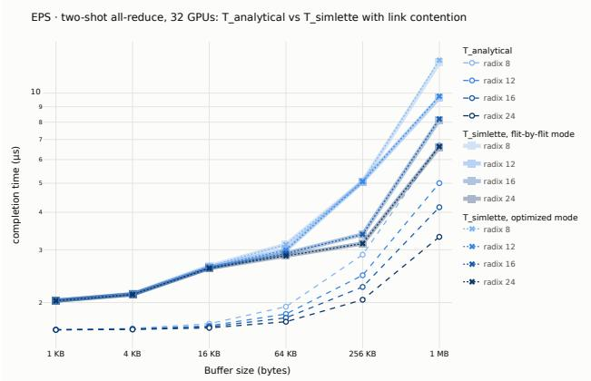  
Figure 21. Two-shot all-reduce on 32 accelerators with EPS and an unlimited buffer: analytical model against Simlette in flit-by-flit and optimized modes.

OCS. Figure 19 uses the one-shot all-reduce, whose schedule never sends two flows on the same link at the same time, so there is no link contention. With an unlimited buffer, Simlette and the analytical model give the same results for all buffer sizes and radices, which shows that the simulator’s behavior is consistent with the model. If the buffer on each port is too small to keep a link busy for one hop, senders have to wait for credits, and Simlette is up to 1.9× slower than the analytical model.

EPS: credit stalls. Figure 20 uses the same one-shot allreduce on EPS, again without link contention. With an unlimited buffer, Simlette and the analytical model agree within 5 % for small buffers and for buffers of 256 KiB and larger. For 16-64 KiB, however, Simlette is up to 29 % slower: a buffer this small yields per-port messages of only a few flits, which cannot be divided evenly across the links, so the busiest link carries more data than the analytical model assumes. With the buffer of every port reduced below what one hop needs to keep its link busy, senders wait for credits, which makes Simlette 1.6-1.7× slower than the analytical model. For example, with a 1 MiB buffer and 8 ports, the analytical model gives 82.1 µs and Simlette 135.0 µs: Simlette is 52.9 µs slower, and its most delayed port spends 53.4 µs waiting for credits.

EPS: link contention. Figure 21 uses the two-shot allreduce on EPS with an unlimited buffer, so there are no credit stalls. Two-shot consists of a reduce-scatter followed by an all-gather. In each phase, all accelerators send to the others in the same order, so they all target the same destination at the same time, and the switch port leading to that destination becomes congested. From 16 KiB onwards, Simlette is 1.5-2× slower than the analytical model, which counts the right amount of data on each link but cannot capture the time flows spend waiting for each other. The optimized mode of Simlette (Appendix C.5) gives almost the same results as the flit-by-flit mode, with less than 2 % difference.

## C.5 Simlette Simulation Procedure Optimizations

Most of the latency along a hop is not paid at the point where it is decided in the simulation. When a switch or a scale-up port adds its share of delay, that delay is added to a timestamp carried on the message, while the operation handing the message to the next stage happens immediately, at the same simulated instant. Simulated time only moves forward at a few points: right before a port puts a message on the link, during serialization, and when a flit reaches its destination.

This deferred accounting matters because several flits are usually in flight at once: by the time a port is ready to send one, part of the delay it owes may already have elapsed while other flits were being processed elsewhere, so only the remaining gap, if any, still needs to be paid as a real wait. Simlette computes latency this way so that it always knows exactly how much of that gap is left to catch up, and never pays for the latency twice. The simulation stays exact even though every delay is resolved only when needed.

Simulating a message flit by flit means creating one event for every flit a device sends, rather than a single event for the whole message. At scale, this overhead itself costs real time to execute. A single all-reduce on a simple singlelevel topology with 256 accelerators and a 40 KiB buffer already takes about 14 minutes to simulate flit by flit. Larger buffers and more devices in the topology push this further, up to several hours. This is why Simlette also supports an optimized mode: the entire message is handed to the link in a single event, and the delay it would have accumulated flit by flit is charged at once on arrival. This way, only one event is created per message per transfer, instead of one event per flit per transfer. A flit is 640 bytes and a message can be tens of kilobytes, so flit-by-flit mode schedules dozens of events where the optimized mode schedules one; with the 40 KiB buffer of this experiment, a message spans up to 64 flits. As shown in Figure 21, both modes give almost the same completion times. Figure 22 compares the runtime of both modes as a function of accelerator count, on a fixedradix topology (8 ports per accelerator) with a 40 KiB buffer, and shows the resulting speedup directly. From 32 to 256 accelerators, the optimized mode is consistently 7-9× faster.

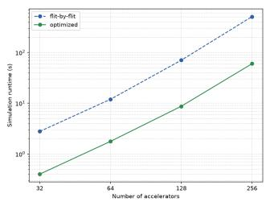

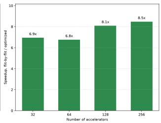  
Figure 22. Left: simulation runtime for flit-by-flit vs. optimized mode, as a function of accelerator count, on a fixed-radix EPS single-level topology (8 ports per accelerator) with a 40 KiB allreduce buffer. Right: the resulting speedup of optimized mode over flit-by-flit. Runtimes measured on a single core of an AMD Ryzen 9 9950X desktop processor.

For the 256-accelerator topology, this cuts runtime from 827 seconds down to 90 seconds.

Determinism The simulation is currently fully deterministic: given the same topology, routing, and workload, every run produces the exact same completion time, with no randomness in link timing, arrivals, or failures. This makes results easy to reproduce and attribute to a single cause, but it does not capture the variability real hardware shows, so the completion times we report should be read as a best case rather than a distribution. This is particularly true for EPS based fabrics, where network-internal dynamics such as arbitration are well known to cause collective completion tail latencies.

## C.6 Scale-up Latency Profiles

End-to-end measurements. We characterize acceleratorto-accelerator communication latency using several pingpong kernel implementations. Figure 23 illustrates the substantial implementation dependence of measured round-trip times. For model parameterization, we use the minimum observed latencies as an optimistic estimate of the hardware communication path.

Latency decomposition. Figure 24 shows the latency component decomposition of network transactions on scaleup networks as modeled by the analytical network backend of GXNET and as used for the parametrization of our flitbased network simulator interfacing with GXNET. Note that this is not official NVIDIA data. The bare metal measurements carried out in Section 5.5 can only provide a limited number of known values to a set of equations that will then be underspecified. Specifically, allocating latency to the subcomponents “GPU MMU”, “TX”, “RX”, “SWITCH” (core switch latency) and “LINK TLB” is a matter of educated guesses. We believe that budgeting more latency into RX rather than TX sections is well justified by the FEC decode overhead alone.

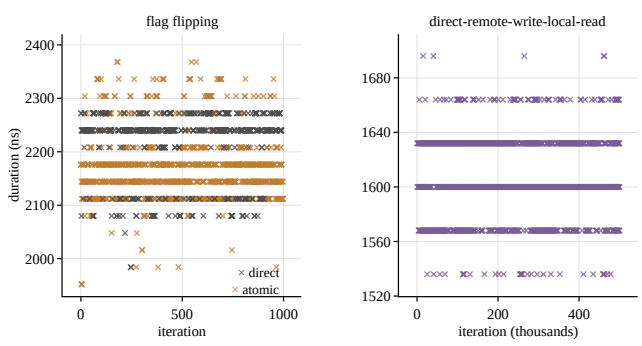  
Figure 23. Measured durations of the ping-pong kernel over many iterations; left: flag-flipping implementation (direct and atomic variants), right: direct-remote-write-local-read implementation.

Results for collective completion times in inference decode, especially for low-batch/high-interactivity cases, will be very susceptible to rebalancing spent latency between TX/RX stages and switch core. A lower switch pin-topin latency than the unloaded 300 ns assumed in this paper (UALink Spec., Sec. 10.9.2) would translate into a smaller performance advantage for all-OCS based network fabrics - and this for two separate reasons: first, the latency difference between EPS and OCS switches as such would reduce. More importantly however, OCS fabrics rely on relaying information through the accelerator itself. A lower EPS pin-to-pin latency directly translates into higher accelerator ingress/egress latency because the absolute PE-to-PE latency must stay the same.

However, the opposite is of course also true: accelerators with very low ingress/egress latencies will emphasize the advantage of all-OCS fabrics. In light of recent industry trends to offload processing elements from collective communication tasks and introduce hardware based “collective acceleration engines” into the architectures (e.g., TPU 8i (Google, 2026)), the importance to lower switch pin-to-pin latencies in the network will grow in future systems.

Memory-hierarchy latency. The accelerator-specific terms of the scale-up latency decomposition cover the path from the PE through the cache hierarchy to the scale-up port. We anchor them by replicating the pointer-chasing results of Table 3 in (Luo et al., 2025) with the open-source microbenchmarks accompanying that paper, run on H100 and B300 (Table 8). On H100 we measure ≈41 cycles (L1), ≈29 cycles (shared memory) and ≈276 cycles (L2), matching the published H800 values for shared memory and L2 and slightly exceeding the published L1 latency. On B300 the same binaries yield ≈34, ≈28.6 and ≈277 cycles. Reading the GPU global timer from PTX instead of the cycle counter, and averaging over 30,000 samples, gives ≈14.0 ns, ≈16.7 ns and ≈139.7 ns for shared memory, L1 and L2 respectively, without assuming an SM clock frequency. Two observations matter for the model: on-SM and L2-hit latency is effectively unchanged across two GPU generations, so it can be carried into future-accelerator scenarios with little risk; and L2, the deepest on-chip stage a remote access traverses, sits below 150 ns and is therefore a small fraction of the accelerator-to-accelerator path (Figure 24).

Scale-up latency parametrization variants The latency profile break-down presented above has to work with a set of assumptions for the per-component latencies on the data path. In order to study sensitivity of our results to latency attribution variations, we choose three different attributions that either emphasize or de-emphasize the contribution of the EPS switch core (Table 9).

## C.7 Physical Fabrics

We evaluate three scale-up fabric families as reference points for where optical circuits enter the accelerator-to-accelerator path. In all cases, each accelerator exposes L links of bandwidth R. We describe both packet- and circuit-switched fabrics by the paths available to collective schedules: hop count, per-hop latency, available bandwidth, and port consumption.

The all-EPS baseline represents a conventional electronicpacket-switched scale-up fabric. It provides flexible any-toany connectivity, but traffic pays the latency of the electronic switching stages it traverses. The hybrid EPS/OCS fabric keeps local connectivity electronic while replacing the level-2 switches with deployment-time optical circuits, making it an incremental path from current EPS fabrics toward optical scale-up. The all-OCS fabric connects accelerator links directly to an optical circuit-switched fabric whose circuits are planned before serving starts and kept fixed throughout deployment.

The fabrics therefore differ in runtime routing flexibility and in how much electronic switching latency remains on accelerator-to-accelerator paths. In the all-OCS case, the full port budget L can be assigned to the logical overlays induced by decode, either to reduce serialized communication phases, widen selected logical edges, or support multiple phase-specific overlays over the same accelerator set.

Concretely, each accelerator exposes L = 36 links of R = 400 Gb/s and all switching devices have a radix of 72, following NVL72-class systems. We instantiate a two-level electronic packet switch (EPS) based network (all-EPS), the same network with the devices on level 2 replaced by OCS (hybrid EPS/OCS), and a third topology in which all switching devices are OCS (all-OCS). In the all-EPS and hybrid fabrics, each level-1 switch uses 32 ports towards the accelerators and 8 towards level 2, i.e., a 4:1 oversubscription towards the second level, since a fully subscribed EPS spine with pluggable conversion exceeds a reasonable power envelope. The all-OCS fabric instead uses 32 ports in each direction and is thus non-blocking: its OCS devices require no E/O conversion and consume so little power per port (Appendix D.4) that the full uplink bandwidth still fits into a lower system power than either EPS-based fabric. Consequently, part of the all-OCS advantage for collective groups that span level 2 stems from this higher level-2 bandwidth rather than from the switching technology alone; the energy-efficiency results of Section 6 account for the full port count of each fabric.

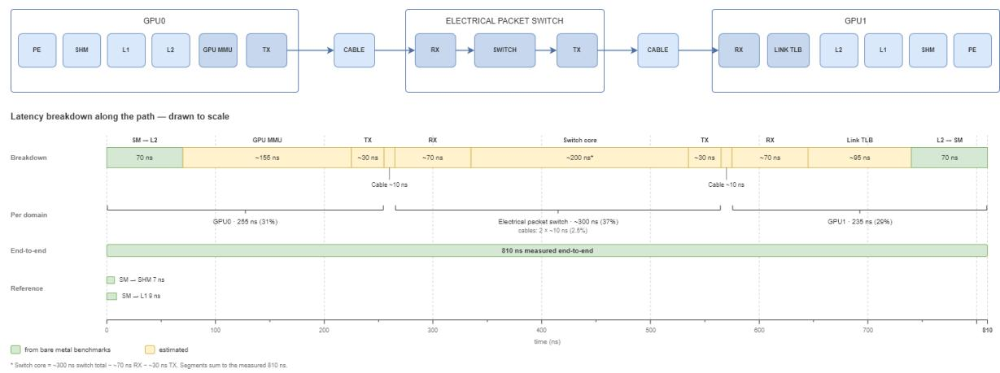

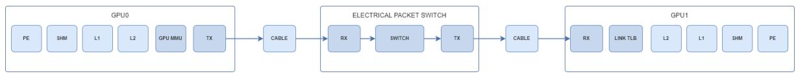

Figure 24. Cumulative latency from the SM of GPU0 to each memory scope, all arrows sharing one origin (B300, GPU global timer, 30,000-sample average). (1) shared memory, 14 ns; (2) L1, 17 ns; (3) L2, 140 ns; (4) remote access to the L2 of GPU1 through two NVLink ports, two cables and one NVSwitch stage, 1610 ns end-to-end (ping-pong, direct-remote-write-local-read). The on-chip stages account for under 10 % of the round trip; the remainder is fabric traversal and remote-access handling.  
Table 8. Pointer-chasing hit latency in clock cycles. Published values from Table 3 of (Luo et al., 2025); H100 and B300 measured with the same benchmark binaries.
<table><tr><td></td><td>RTX4090 (Luo et al., 2025)</td><td>A100 (Luo et al., 2025)</td><td>H800 (Luo et al., 2025)</td><td>H100 B300 (ours) (ours)</td></tr><tr><td>L1 cache</td><td>32.0</td><td>33.0</td><td>32.0</td><td>41.1 34.1</td></tr><tr><td>Shared memory</td><td>30.1</td><td>29.0</td><td>29.0</td><td>29.0 28.6</td></tr><tr><td>L2 cache</td><td>273.0</td><td>202.8-408</td><td>264.5-502 276.2</td><td>276.8</td></tr></table>

Table 9. Remote-access latency budget (ns) under low, nominal and high switch-latency assumptions.
<table><tr><td>Case</td><td>Switch total</td><td>Switch core</td><td>MMU +TLB</td><td>GPU MMU</td><td>Link TLB</td><td>Total</td></tr><tr><td>Low</td><td>200</td><td>100</td><td>350</td><td>217</td><td>133</td><td>810</td></tr><tr><td>Nominal</td><td>300</td><td>200</td><td>250</td><td>155</td><td>95</td><td>810</td></tr><tr><td>High</td><td>500</td><td>400</td><td>50</td><td>31</td><td>19</td><td>810</td></tr></table>

Fixed in all cases (260 ns): SM L2 70, TX 30, cable 10, cable 10, RX 70, L2 SM 70. Switch total = RX 70 + core + TX 30. MMU + TLB = 550 switch total, split at the nominal ratio 155:95 (62 % / 38 %).

Note that while the EPS based fabric uses all traits wellknown to EPS based scale-up networks such as multi-path routing and packet spraying in accelerators and switches, the all-OCS fabric runs on the collective schedules presented in Section 3.4, which in turn make use of the topologies described in Section 3.2. The hybrid EPS/OCS fabric configures the OCS on the topmost level once at deployment, using the same planner to place workers such that bandwidth demand is balanced across the level-2 OCS devices, and otherwise relies on the same collective operations as implemented by current inference frameworks such as TensorRT-LLM (NVIDIA, 2026c), vLLM (Kwon et al., 2023) or SGLang (Zheng et al., 2024).

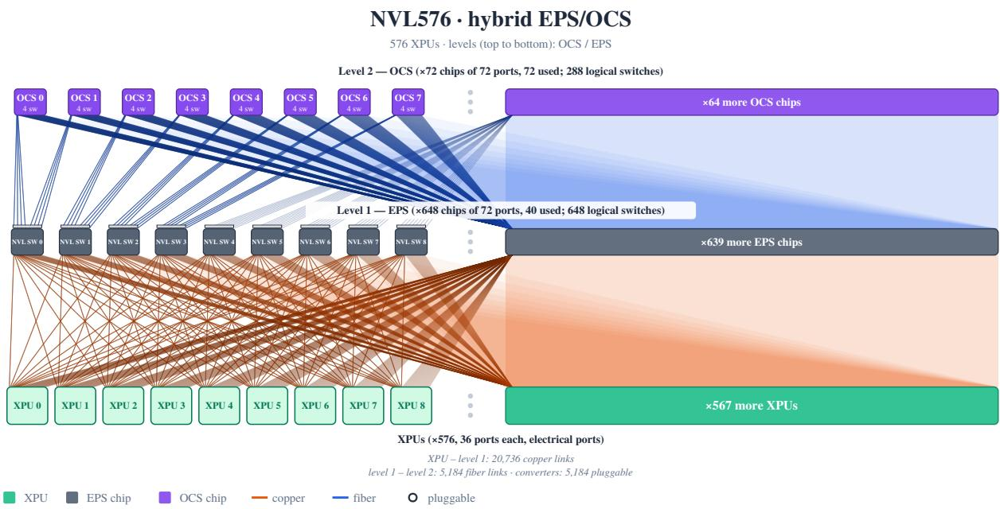

(a) Hybrid EPS/OCS: level-1 EPS (32 down / 8 up, 4:1), level-2 OCS.  
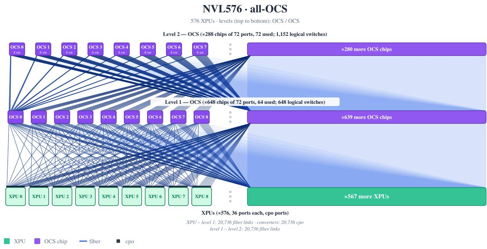  
(b) All-OCS: non-blocking, OCS on both levels, CPO at the accelerators.  
Figure 25. Physical scale-up fabrics of the 576-accelerator system: 36 ports per accelerator at 400 Gb/s, switching devices of radix 72. The all-EPS fabric has the topology of (a) with EPS on both levels.

## D MODELS AND ACCELERATORS

This appendix documents the model architectures, accelerator parameters, and power assumptions underlying the evaluation in Section 6, with model and accelerator specifications summarized in Tables 10 and 11. It also presents energy-efficiency results across the GPT-OSS family and examines the compute cost model against measured kernel durations, clarifying the assumptions and limitations of the projected accelerator results.

Table 10. Model properties as used in the analyses of this paper. Active parameters include the embedding and LM head. Attention: full, or interleaved sliding-window (SW, 128-token window) and full layers. KV cache per token counts only layers whose cache grows with context.
<table><tr><td></td><td colspan="2">Parameters</td><td></td><td></td><td colspan="2">Attention</td><td colspan="2">Experts</td><td></td><td></td></tr><tr><td>Model</td><td>Total</td><td>Active</td><td>Layers</td><td>Hidden</td><td>Type</td><td>Q/ KV heads × dim</td><td> $\mathrm { T o t a l } /$   $\mathrm { t o p } { - } k$ </td><td>Width</td><td>Vocab</td><td>KV cache per token</td></tr><tr><td>Megatron 235B</td><td>0.23 T</td><td>17B</td><td>96</td><td>1536</td><td>GQA, full</td><td> $6 4 / 1 6 \times 9 6$ </td><td>128 /8</td><td>4096</td><td>51,200</td><td>144 KiB</td></tr><tr><td>Megatron 1T</td><td>1.10T</td><td>38 B</td><td>128</td><td>2048</td><td>GQA, full</td><td> $1 2 \dot { 8 } / 6 4 \times 3 2$ </td><td>256/ 8</td><td>5440</td><td>51,200</td><td>256 KiB</td></tr><tr><td>Megatron 5T</td><td>5.00 T</td><td>207 B</td><td>128</td><td>8192</td><td>GQA, full</td><td> $2 5 6 / 1 2 8 \times 6 4$ </td><td>256/8</td><td>6144</td><td>51,200</td><td>1,024 KiB</td></tr><tr><td>GPT-OSS-120B</td><td>0.12T</td><td>5.7B</td><td>36</td><td>2880</td><td>GQA, SW / full</td><td> $6 4 / 8 \times 6 4$ </td><td>128 /4</td><td>2880</td><td>201,088</td><td>9KiB</td></tr><tr><td>GPT-OSS-1T-like</td><td>1.05 T</td><td>21 B</td><td>64</td><td>4608</td><td>GQA, SW / full</td><td> $7 2 / 8 \times 6 4$ </td><td>256 /4</td><td>4608</td><td>201,088</td><td>16 KiB</td></tr><tr><td>GPT-OSS-5.3-like</td><td>4.97T</td><td>95 B</td><td>96</td><td>8192</td><td>GQA, SW / full</td><td> $1 2 \dot { 8 } / 1 6 \times 6 4$ </td><td>256 /4</td><td>8192</td><td>201,088</td><td>48 KiB</td></tr></table>

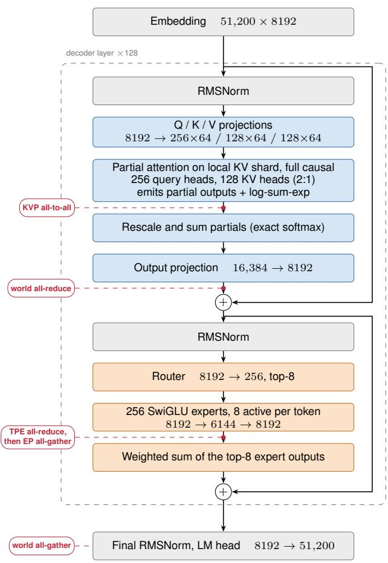  
(a) Megatron 5T MoE

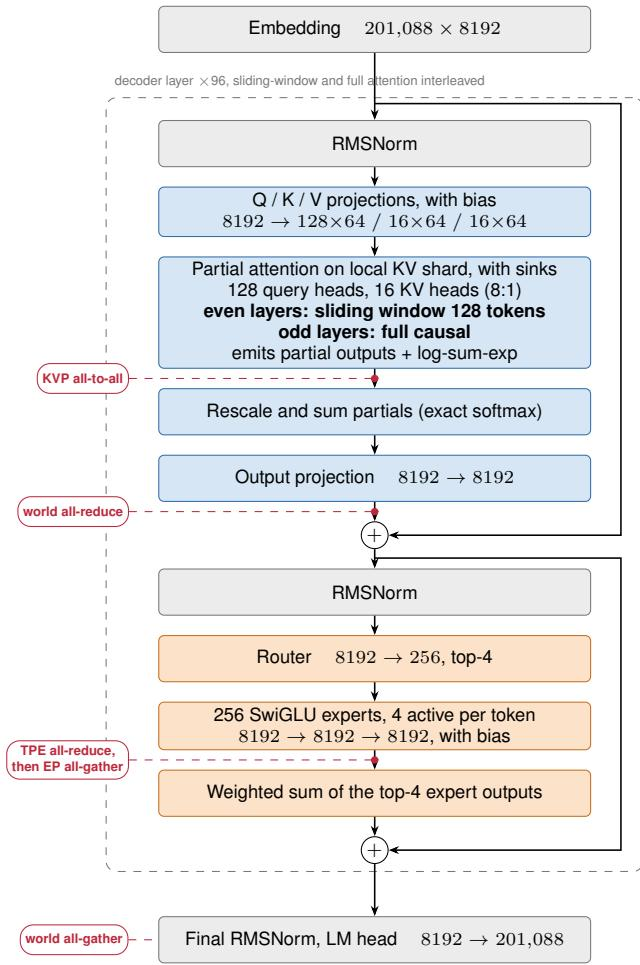  
(b) GPT-OSS-5.3-like (extrapolated from GPT-OSS-120B)  
Figure 26. One decoder layer of each model, with the tensor dimensions of its projections. Red markers show where Helix parallelism issues each collective of Table 1: the KV-parallel all-to-all that exchanges the partial attention outputs and log-sum-exp statistics each rank computes over its KV shard, before they are rescaled into the exact softmax result; the all-reduce over all accelerators after the output projection; the FFN tensor-parallel all-reduce followed by the expert-parallel all-gather, between the experts and their weighted combination; and one all-gather of the vocabulary-sharded logits per decode step.

## D.1 Models

Figures 26a and 26b show one decoder layer of each model. GPT-OSS-5.3-like is our extrapolation of the open-weight GPT-OSS-120B to the 5T scale. It keeps the GPT-OSS architecture recipe, namely interleaved sliding-window and full attention with a 128-token window and attention sinks, eight query heads per KV head, experts as wide as the hidden size with four active per token, and the 201,088- token vocabulary. It scales the hidden size from 2880 to 8192, the depth from 36 to 96 layers, the attention from 64 query and 8 KV heads to 128 and 16, and the expert count from 128 to 256.

The two models share their overall shape. Both are prenorm decoders of about 5T parameters with a hidden size of 8192, in which grouped-query attention is followed by a mixture-of-experts FFN of 256 SwiGLU experts. Under Helix parallelism both issue the same five collectives at the same points of the layer, so the deployment-static structure of Table 1 is identical between them apart from the layer count. Because the hidden size is the same, the all-reduces and the expert all-gather also carry the same 4 KiB per token in both models.

The models differ above all in their attention, which decides how a decode step responds to context length.

• Interleaved sliding-window attention. GPT-OSS-5.3-like alternates between layers that attend only to the most recent 128 tokens and layers with full causal attention. The KV cache and attention time of a sliding-window layer do not depend on context length, so only 48 of its 96 layers read the whole context. Every one of Megatron’s 128 layers does. Removing the sliding window from GPT-OSS-5.3-like in GXNET doubles the part of its attention time that grows with context, from 0.39 to 0.77 ms per decode step between 32K and 5M context at batch 16.

• Narrow grouped-query attention. The full-attention layers of GPT-OSS-5.3-like keep 16 KV heads, eight query heads each. Megatron keeps 128 KV heads under 256 query heads, which also makes its attention 16,384 wide, twice the hidden size. Giving GPT-OSS-5.3-like Megatron’s 128 KV heads multiplies its context-dependent attention time by eight, to 3.1 ms in the same setting.

• KV cache. Together, the two points above give Megatron 1 MiB of KV cache per token of context against 48 KiB for GPT-OSS-5.3-like, a factor of 21. At 5M tokens one Megatron user occupies 5.2 TB of HBM and one GPT-OSS-5.3-like user 246 GB. This is what bounds the evaluated batch to 16 for Megatron on 512 accelerators, and it is why decode attention time grows much faster with batch and context for Megatron than for GPT-OSS-5.3- like (Section 6).

• Experts. Megatron’s experts are fine-grained (6144 wide,

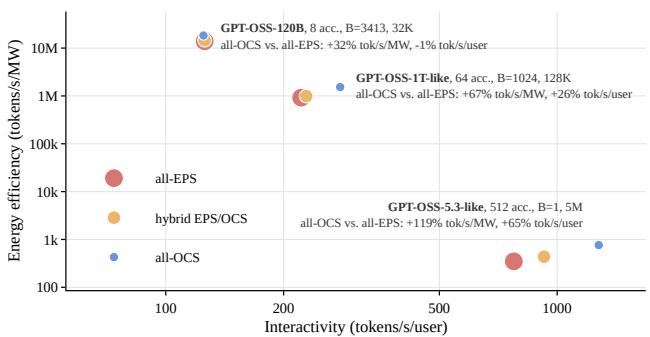  
Figure 27. Energy efficiency vs. interactivity across models of the GPT-OSS family, analogous to Figure 7.

0.75 of the hidden size) with eight active per token; those of GPT-OSS-5.3-like are as wide as the hidden size with four active. Megatron therefore activates 207 B parameters per token against 95 B.

• Vocabulary and details. GPT-OSS-5.3-like has a four times larger vocabulary, which only enlarges the LM head and the final logit all-gather. Its attention sinks and projection biases do not change the communication structure.

## D.2 Energy Efficiency across the GPT-OSS Family

Figure 27 repeats the comparison of Figure 7 for three models of the GPT-OSS family: the open-weight GPT-OSS-120B on 8 accelerators at 32K context and batch 3413, GPT-OSS-1T-like on 64 accelerators at 128K context and batch 1024, and GPT-OSS-5.3-like on 512 accelerators at 5M context and batch 1. GPT-OSS-1T-like is an intermediate extrapolation of GPT-OSS-120B built like GPT-OSS-5.3- like, with a hidden size of 4608, 64 layers, 72 query and 8 KV heads, and 256 experts (Table 10). All-OCS fabrics improve throughput per unit energy by 32 %, 67 % and 119 %, respectively. For GPT-OSS-120B, whose deployment spans only eight accelerators, interactivity is practically unchanged (−1 %), so the gain stems from system power alone; for GPT-OSS-1T-like, interactivity improves by 26 %, and for GPT-OSS-5.3-like, whose decode step is dominated by communication (Figure 5), by 65 %.

## D.3 Accelerators

RX00 is a projected accelerator modeled on announced Rubin figures (as announced at GTC in March 2026 (NVIDIA, 2026b)), so its kernel durations cannot be measured. Its parameters in Table 11 are peak throughput and bandwidth; the efficiency functions of Appendix B.3 are a step approximation of curves measured on H100, which we use unchanged for B200 and RX00.

The cost model is a roofline with size-dependent efficiencies and no fixed cost per kernel. Operators between two collectives form one execution window that pays a single in-graph launch overhead, which assumes they run back to back as in a persistent kernel (Cheng et al., 2025). The model therefore gives a lower bound on compute time rather than a prediction of a particular kernel implementation.

Table 11. Accelerator properties as used in the analyses of this paper. FP4 is the tensor-core peak that the roofline model scales by a shape dependent efficiency. Every execution window between collectives additionally pays the in-graph launch overhead once (Appendix B.3).
<table><tr><td>Accelerator</td><td>FP4 peak</td><td>HBM capacity</td><td>HBM bandwidth</td><td>Scale-up ports</td><td>Per-port bandwidth (unidirectional)</td><td>Kernel launch</td><td>In-graph launch</td></tr><tr><td>NVIDIA B200</td><td>20 PFLOP/s</td><td>186GB</td><td>8TB/s</td><td>18</td><td>400 Gb/s</td><td>2.5 µs</td><td>0.8 µs</td></tr><tr><td>NVIDIA RX00 (Rubin-like)</td><td>50 PFLOP/s</td><td>288 GB</td><td>22 TB/s</td><td>36</td><td>400 Gb/s</td><td>2.5 μs</td><td>0.8µs</td></tr></table>

We choose a roofline deliberately. Predicting kernel durations more precisely requires either profiling operators on the target accelerator, as in Vidur (Agrawal et al., 2024a), or models fitted to measurements of existing kernels, such as PipeWeave (Zhang et al., 2026). The first is impossible for an unreleased accelerator. The second generalizes to held-out GPUs of architectures seen in training, e.g., from H20 and H800 to H100 and H200, but has not been shown to carry over to a new architecture generation, and reports no separate error for the small batch sizes of decode, where durations depend on kernel setup, tiling, and occupancy rather than on FLOPs and bytes. Such models can be more accurate on the hardware they were fitted to, but their error on a new architecture has neither a known size nor a known sign. The error of a roofline has a known sign: it underestimates.

We compared the model with Nsight Systems traces of GPT-OSS-120B decode on four B200 with tensor parallelism and CUDA-graph replay, at batch sizes 1 to 16. The decode kernels there read a few to a few tens of MB per accelerator and reach 12 to 53 % of the peak HBM bandwidth, below the efficiencies of Appendix B.3, so the H100 curves remain optimistic one generation later. Even under CUDA-graph replay, no kernel finishes in less than about 3 µs. These decode kernels therefore take 1.4 to 5 times as long as their roofline estimate, and more for the smallest ones. A persistent-kernel implementation avoids part of this per-kernel cost, which is the execution our fused windows assume.

Since the model underestimates compute time, the share of communication in a decode step, and with it the relative OCS gain of Section 6, is an upper estimate, while the absolute reduction of collective completion time per step does not depend on the compute model. For existing accelerators, GXNET can replace the roofline estimate of any operator with a measured kernel duration without changing the graph or the sharding.

## D.4 Power Model

Our power models are based on publicly available data. In conjunction with the topologies described in Appendix C.7, we always assume that moving between scale-up network levels 1 and 2 requires optical cabling (due to rack-to-rack distance) and that all-OCS based topologies make use of CPO at the accelerator. The power figures we use for the system components are given in Table 12, together with their origin wherever applicable.

Table 12 lists the power figures used by the model. All values are thermal-design (maximum) figures, so the model gives an upper bound on power independent of traffic. Per-XPU power is not the accelerator TDP. We take the designed rack power of an NVL72-class system (NVIDIA, b), subtract the scale-up switch trays, and divide by the 72 accelerators. The resulting figure therefore includes each XPU’s share of host CPU, NICs, DPU, fans and voltage-regulation losses.

No public figure exists for the GB200/GB300 switch tray, so we assume 1.7 kW. We cross-check this value by scaling the published power of a 51.2 Tb/s scale-up Ethernet switch ASIC (800 W (Broadcom, 2025)) to the two 28.8 Tb/s switch ASICs per tray (SemiAnalysis, b). We then apply the system-to-ASIC overhead observed for Tomahawk 5 (913 W system without optics (IP Infusion) versus about 500 W ASIC (TechInsights)). This yields about 1.64 kW, within 4 % of our assumption.

No rack power has been published for Vera Rubin NVL72. We use the 220 kW Max-P estimate of (SemiAnalysis, c), which agrees with the 227 kW per-rack cooling sizing of an OEM reference design (Supermicro). The rack’s power shelves (4 × 110 kW, N+1) define a provisioning ceiling, not a TDP. The Rubin tray holds four switch ASICs instead of two (NVIDIA, c). Each ASIC keeps the per-ASIC bandwidth of 28.8 Tb/s (SemiAnalysis, c), so we double the tray power. Per 400 G-equivalent port, the scale-up switching power is therefore the same as for GB200.

EPS ports at 800 G and 1.6 T are extrapolated from the 400 G anchor assuming a 35 % energy-per-bit reduction per doubling of port rate. This is the reduction observed between the 25.6 and 51.2 Tb/s generations of switch systems measured on the same basis (typical power, excluding optics) (Arista Networks, a;b).

Table 12. Component power assumptions of the power model (TDP basis, not load-aware). Data rates are unidirectional; every port is bidirectional and carries one transceiver module.
<table><tr><td>Component</td><td>Variant</td><td>Value</td><td>Unit</td><td>Derivation / source</td></tr><tr><td rowspan="4">XPU (incl. host share)</td><td>B200 (GB200 NVL72)</td><td>1454</td><td>W</td><td> $( P _ { \mathrm { r a c k } } - 9 P _ { \mathrm { s w } } ) / 7 2 , P _ { \mathrm { r a c k } } = 1 2 0 \mathrm { k W }$  (NVIDIA, a;b),  $P _ { \mathrm { s w } } = 1 . 7 \mathrm { k W }$ </td></tr><tr><td>B300 (GB300 NVL72)</td><td>1663</td><td>W</td><td>as above,  $P _ { \mathrm { r a c k } } = 1 3 5 \mathrm { k W }$  (NVIDIA, b; Lenovo Press)</td></tr><tr><td>Rubin (VR200 NVL72)</td><td>2631</td><td>W</td><td>as above,  $\begin{array} { r c l } { P _ { \mathrm { r a c k } } } & { = } & { 2 2 0 \mathrm { k W \ ( M a x { - } P ) } } \end{array}$  (Semi- Analysis, c; Supermicro),  $P _ { \mathrm { s w } } ~ = ~ 3 . 4 \mathrm { k W }$  (4</td></tr><tr><td></td><td></td><td></td><td>ASIĆs/tray (NVIDIA, c)) switch tray:  $P _ { \mathrm { s w } } / ( 2 \times 7 2 )$  ; cross-check (Broad-</td></tr><tr><td rowspan="4">EPS (scale-up), per port</td><td>400 G</td><td>11.81</td><td>W</td><td>com, 2025; TechInsights; IP Infusion)</td></tr><tr><td>800 G</td><td>15.35</td><td>W</td><td>extrapolated:  $2 \times \mathrm { r a t e } , - 3 5 \%$  energy/bit (Arista Networks, a;b)</td></tr><tr><td>1600 G</td><td>19.95</td><td>W</td><td>extrapolated: 2× rate, —35 % energy/bit</td></tr><tr><td>200 G</td><td>1.36</td><td>W</td><td></td></tr><tr><td rowspan="4">OCS, per port</td><td>400 G</td><td>1.50</td><td>W</td><td rowspan="4">internal projections; unidirectional, two fibers per port</td></tr><tr><td>800 G</td><td>1.65</td><td>W</td></tr><tr><td>1600 G</td><td>1.82</td><td>W</td></tr><tr><td>400 G DR4</td><td>9</td><td>W</td></tr><tr><td rowspan="3">Pluggable module</td><td>800 G DR4</td><td>17</td><td>W</td><td>vendor datasheet, max (Cisco) (SemiAnalysis, a)</td></tr><tr><td>1.6T</td><td>30</td><td>W</td><td>(SemiAnalysis, b)</td></tr><tr><td>400 G (6.9 pJ/bit)</td><td>2.75</td><td>W</td><td>Broadcom Bailly, 5.5 W per 800 G (Broadcom)</td></tr><tr><td rowspan="2">CPO, per port</td><td>800 G (5.6 pJ/bit)</td><td>4.50</td><td>W</td><td>NVIDIA Quantum-X Photonics, 4-5 W per</td></tr><tr><td>1600 G (4.4 pJ/bit)</td><td>7.00</td><td>W</td><td>800 G (SemiAnalysis, a) Broadcom TH6 Davisson, 3.5 W per 800 G (The Next Platform, 2025)</td></tr></table>

OCS figures are internal projections for a switch whose ports each use two unidirectional fibers. The power per port is 1.5 W at 400 G.

Every switching device, EPS or OCS, is evaluated with all of its physical ports, whether a port is used or not. On the level-1 switches of the EPS-based fabrics, which use 40 of their 72 ports, this is conservative, but the per-port figure amortizes device-level power, such as that of the switch ASIC core, which does not scale down with unused ports.

Optical links attach either through one pluggable transceiver per port or through co-packaged optics (CPO). For CPO we use the energy per bit published for switch-side optical engines, including the external laser source, and multiply by the unidirectional rate. We assume the same CPO energy per bit when an accelerator attaches directly to the level-1 OCS switches.

## E SENSITIVITY ANALYSIS

This appendix examines the sensitivity of the evaluation results to network bandwidth, accelerator radix, switch and endpoint latency, and communication precision. These analyses assess how the relative performance and energy efficiency of the evaluated fabrics depend on the baseline configuration and modeling assumptions.

Figure 28 varies one fabric or accelerator parameter at a time for GPT-OSS-5.3-like at batch 1 and 5M context, the latency-bound regime of Section 6. The parallelization is reoptimized for every point, and all four sweeps share the baseline of Section 6, with a 64.8 % interactivity and a 118.7 % energy-efficiency advantage of all-OCS over all-EPS. Since energy efficiency is throughput per system power, the energy advantage is the interactivity advantage multiplied by the ratio of all-EPS system power to that of the respective fabric, which is 1.33 for all-OCS at the baseline.

Per-port bandwidth. At batch 1, the interactivity advantage of all-OCS is nearly insensitive to bandwidth, staying between 62.8 % and 65.2 % between 400 Gb/s and 1.6 Tb/s. Since the all-EPS baseline is oversubscribed towards its second level, it carries a bandwidth-bound component that shrinks with per-port bandwidth, whereas the non-blocking all-OCS fabric has little to gain. The energy advantage of all-OCS nevertheless grows from 119 % to 161 %, as the power ratio rises from 1.33 to 1.60: per rate doubling, EPS port power grows by 30 % and pluggable power almost doubles, while OCS port power grows by only 10 % and the energy per bit of CPO decreases (Appendix D.4). The hybrid fabric does not benefit, since it retains electronic level-1 switches and pluggables on every link between the two levels.

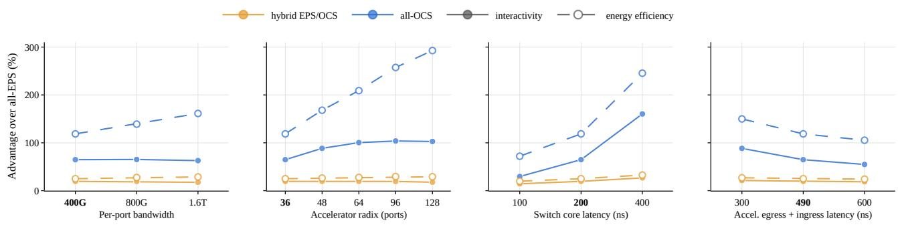  
Figure 28. Sensitivity of the advantage of hybrid EPS/OCS and all-OCS fabrics over all-EPS for GPT-OSS-5.3-like at batch 1 and 5M context on 512 of 576 accelerators. Solid: interactivity; dashed: energy efficiency (tokens/s/MW). Bold tick labels mark the baseline configuration of Section 6; the parallelization is re-optimized for every point.

Accelerator radix. Co-packaged optics allow the accelerator radix to grow. For inference decode, additional ports pay off substantially at first: the interactivity advantage of all-OCS rises from 65 % at 36 ports to 88 % at 48 ports and 100 % at 64 ports, but then saturates at 104 % and 103 % for 96 and 128 ports. Along the way, the planner changes the parallelization of all-OCS: it keeps the baseline split up to 48 ports (32/16/2/256 in KVP/TPA/EP/TPE), spreads the FFN over a single tensor-parallel group of all 512 accelerators (32/16/1/512) at 64 and 128 ports, and uses 32/16/8/64 at 96 ports, so additional ports buy freedom of parallelization as much as speed. The saturation follows from the schedulable frontier of Appendix A.2: phase counts drop in discrete steps, each further step costs considerably more ports than the previous one, e.g., two phases on an axis of 64 accelerators cost 14 ports and one phase 63, and ports between two steps buy no phase reduction. At a fixed system size, more accelerator radix therefore affords larger scale-up domains, or links for network-attached memory, rather than higher interactivity directly. In energy efficiency, however, the advantage of all-OCS keeps growing to 293 %, as the power ratio rises from 1.33 to 1.94 with every port added to the packet-switched fabric.

Switch latency attribution. Our measurements (Section 5.5) cannot separate accelerator from switch latency, and the unloaded 300 ns pin-to-pin latency of the UALink specification (Ultra Accelerator Link Consortium, 2025) may be exceeded under load. We therefore keep the 810 ns per switch hop of Table 9 constant and shift latency between accelerator and switch core. Since the all-OCS path bypasses the switch core, every nanosecond moved into the switch shortens it: the interactivity advantage grows from 30 % to 65 % and 160 % for switch core latencies of 100, 200, and 400 ns, at a constant power ratio of 1.33. The results are thus highly sensitive to where latency is spent, which explains the effort of recent architectures to keep latency-critical traffic within a single switch level: Jalapeno˜ bifurcates its links into separate single-level domains for tensor and expert parallelism (Ho et al., 2026), a design-time counterpart of the stacked-link allocation of Appendix A.6.

Accelerator latency. Reducing accelerator egress and ingress latency benefits both fabrics, but all-OCS considerably more, since its per-hop latency consists almost entirely of accelerator latency: its interactivity advantage changes by about 9 to 12 percentage points per 100 ns, from 88 % at 300 ns to 55 % at 600 ns. The hybrid fabric gains almost nothing, as it runs the same packet-switched collective schedules over the same electronic level-1 paths as all-EPS. Collective acceleration engines (Google, 2026) that shorten the accelerator-side path therefore directly increase the advantage of workload-static OCS, and so does lighter forward error correction: an EPS switch terminates FEC at every hop, whereas a passive optical path is terminated once at its endpoints. Scale-Up Ethernet names RS-272 as a candidate to reduce receive latency (Broadcom Inc., Sec. 3.5.4), with link-level retransmission as the hardware-based safety net for residual errors.

Communication precision. Our baseline models activation communication in FP4, consistent with the assumed activation storage precision (Appendix B.1). This is a forward-looking assumption: many serving collectives still communicate in BF16, including the default MoE combine paths in DeepEP (DeepSeek-AI, 2026) and TensorRT-LLM (NVIDIA, 2026f). However, lower-precision transport is already supported for MoE dispatch (FP8/NVFP4) and optionally for combine (NVFP4) (DeepSeek-AI, 2026; NVIDIA, 2025; 2026f).

To assess sensitivity to communication precision, we repeat the evaluation of Figure 4 using BF16 activation transfers, quadrupling the bytes per activation element relative to FP4, while Helix softmax statistics are communicated in FP32. For each precision, we independently repeat the full parallelization search of Appendix B.6, selecting the best-performing configuration for each workload and fabric. We account for the resulting communication volumes but do not model precision-conversion overheads or numerical accuracy effects.

All-OCS continues to outperform all-EPS in every configuration, with an interactivity advantage of 9.6–75.7 %, compared with 7.3–81.6 % under FP4. Up to batch size 8, the advantage generally decreases by up to 16 percentage points. At batch size 16, it instead increases by 1–3 points, consistent with additional bandwidth pressure on the oversubscribed EPS fabric. The hybrid fabric changes by at most 3 points, except for Megatron 5T at 32K context and batch size 16, where its advantage decreases from 12.5 to 5.7 %.

Thus, the relative benefits depend on communication precision, but the conclusions of Section 6 remain unchanged. The HOP-B findings (Appendix B.5) are also robust: repeated all-to-all startup costs continue to outweigh overlap savings for GPT-OSS-5.3-like, whose decode-step time under BF16 increases by 58 % on all-EPS and 24 % on all-OCS with eight microbatches.