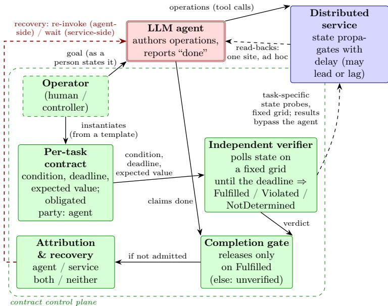
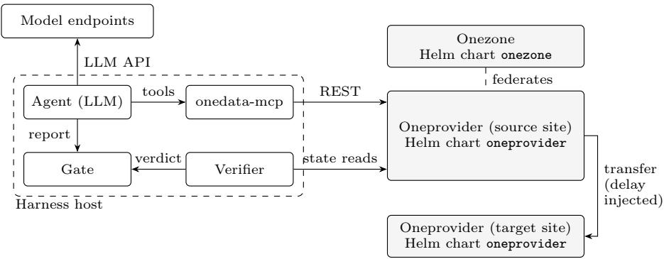

# When the Consumer Is an Agent: Execution-Grounded Service-Level Agreements

Michał Orzechowski<sup>1,2,3</sup>(<sup></sup>) , Renata G. Słota<sup>1</sup> , and Jacek Kitowski<sup>1,2</sup>

<sup>1</sup> AGH University of Krakow, Poland

morzech@agh.edu.pl

<sup>2</sup> ACK Cyfronet AGH, Krakow, Poland

3 Sano Centre for Computational Medicine, Krakow, Poland

Abstract. Large language model (LLM) agents increasingly act as service consumers. They select operations and report whether a task is complete. In an asynchronous distributed service, an accepted call or immediate state read does not establish that the required state became observable by its deadline. We introduce execution-grounded completion contracts, which treat completion as a service-level outcome. An independent control plane observes a deadline-bound service-state predicate, admits completion, and directs recovery while the agent performs the task. We evaluate placement and deletion in a live multi-provider data service with heterogeneous models and an injected transfer delay. Across policies, some tasks that missed the deadline were accepted and some that met it were rejected. Under enforcement, accepted completions remained consistent with later observations; all included healthy tasks completed, and unresolved faulted tasks terminated as unverified. The results show that completion of these tasks can be governed by independent observation of service state rather than by the agent’s self-assessment.

Keywords: Service-level agreements · LLM agents · Runtime verification · Eventual consistency · Service reliability · Federated data services.

## 1 Introduction

LLM agents increasingly act as service consumers on behalf of users: they interpret a goal, select and invoke service operations, and report whether the requested task is complete. Unlike a deterministic program executing a fixed call sequence, each decision can fail even when every service call succeeds. An agent can therefore report completion despite contrary service state [1,24].

Asynchronous distributed services make that report dificult to assess. An accepted operation may not yet have reached every component, and data and status signals may converge at diferent times [26,10]. A report-time read can capture an intermediate state rather than establish whether the user’s goal held by its deadline. Operation acceptance and task fulfillment are therefore distinct; completion is a service-level question about whether the requested state became observable in time.

Existing mechanisms constrain agent actions and tool use, assess execution traces, or inspect recorded environment state [27,15,9,29,28]. These mechanisms improve execution-time observability and control but leave a service-level requirement: an authoritative, deadline-aware completion decision for the requested state.

Service-level agreement methodology separates a measurable objective from its assessment and the consequences of missing it; WS-Agreement also permits guarantee terms that bind the consumer, not only the provider [2,12]. We bring this perspective to agent-mediated service tasks by treating completion as a service-level outcome rather than an agent-authored judgment. Our central idea is to separate task execution from completion authority: the agent performs the task, while an independent assessment of service state determines whether the requested state became observable within the required time. We realize this separation through execution-grounded completion contracts; Sect. 3 develops their operational model.

We combine consumer-obligated guarantee terms with independent state verification at an agentic service consumer’s completion boundary, and give a first live evaluation of the resulting service-control decisions on a federated data service. The paper makes four contributions:

1. A service-control model for agent-consumer completion contracts: state predicate, deadline, verdicts, evidence boundary, gate, and recovery outcomes.

2. A comparison of four common completion policies with a deadline-aware reference over recorded ungated trials, showing acceptance-side and rejectionside disagreements.

3. An evidence-based attribution rule evaluated against an injected fault, with shadowed cases reported separately from cases in which both sides leave observable evidence.

4. A live evaluation of contract enforcement on two task types and seven models, reporting admitted completions, explicit unverified terminations, recovery mechanisms, runtime activity, and dollar cost.

## 2 Background and Related Work

Service-level agreements separate a promise from the mechanism that measures it. WSLA specifies and monitors measurable service objectives. WS-Agreement represents guarantee terms, obligated parties, and assessment states [12,2]. WS-Agreement permits terms that obligate either the provider or the consumer, and its assessment vocabulary includes Fulfilled, Violated, and NotDetermined. Consumer obligations are therefore part of the standard model; the open design question is how to make one operational at an LLM agent’s completion boundary.

Most operational service objectives concern provider behavior, such as availability, latency, and error budgets [6,22]. AgentSLA likewise treats the agent as a provider with quality obligations [11]; verifiable-SLA work protects provider telemetry from self-reporting through trusted execution and cryptographic evidence [8]. Our setting difers in role and granularity: the governed component consumes rather than provides a service, and the objective concerns one task’s required state.

The backend adds uncertainty to this consumer-side obligation. In an eventually consistent service, an accepted operation can become visible at diferent sites at diferent times, and status metadata may lead or lag the data it describes [26,10]. Consequently, neither a successful call nor one immediate read establishes that a task-level condition held by its deadline. The observer must evaluate a pre-specified condition against state sampled over a time window.

Research on service composition supplies much of the machinery for timebounded observation. Dynamo uses runtime rules for BPEL compositions [3]. Event-calculus monitors check service requirements [17]; Cremona implements WS-Agreement creation and monitoring [16]; and Leitner et al. predict and prevent SLA violations in composite services [13]. These systems observe and act on service properties. Our problem adds an LLM-controlled consumer whose completion report is itself the governed decision.

Agent-verification systems apply related ideas during execution. AgentSpec checks triggered safety rules at runtime, and ToolGate uses preconditions to gate a tool call and postconditions to decide whether its result may update a trusted symbolic state [27,15]. STRATUS organizes cloud-operations agents in a state machine and enforces a no-regression specification during mitigation [9]. Interwhen uses self or external verifiers to check properties of a reasoning trace and steer generation at test time [7]. These approaches primarily govern actions, intermediate state, or reasoning while a task is being executed.

Moving verification to the completion decision changes what is governed. Verify-Gated Completion presents the gate pattern: an agent proposes completion and a read-only verifier admits it, failing closed on weak evidence [20]; its stated scope excludes task-level success, comparison with ungated baselines, and recovery efectiveness. We keep the gate and change its evidence, deadline semantics and recovery, and compare task-level decisions with four common completion policies across seven models. Table 1 compares these approaches by the evidence they check, their decision point, deadline, attribution, and the action after a failed check.

Common completion checks use less outcome evidence. An LLM judge reads a transcript rather than backend state [29]. Tool-agent benchmarks may inspect final environment state, but ordinarily after the interaction rather than as a live admission decision [28]. A report-time state read improves on transcript-only judging but still samples one point in an asynchronous transition. Sect. 4 scores these information positions as completion policies on the same ungated records.

Together, these lines of work supply the parts of a completion contract. Runtime verification provides bounded observation [14], design by contract supplies pre-specified postconditions [18], test oracles assess observed outcomes [4], and workflow engines add timeouts and retries [25]. Consumer-driven contract tests instead validate interactions before deployment [23]. The model developed next combines these elements at a service-consuming agent’s live completion boundary and uses the verdict evidence to direct recovery.

Table 1. Comparison of agent-verification approaches and their verification semantics.
<table><tr><td>Approach</td><td>Evidence checked</td><td>Decision point Deadline Attribution Action after a</td><td></td><td>(agent or service)</td><td>failed check</td></tr><tr><td>AgentSpec [27]</td><td>The agent&#x27;s trajectory and next action</td><td>On a trigger: state change, before an action, or agent finish</td><td>No</td><td>No</td><td>Stop, ask the user, self-examine, or run a corrective action</td></tr><tr><td>ToolGate [15]</td><td>and results against the agent&#x27;s trusted symbolic state</td><td>Tool preconditions At each tool call No</td><td></td><td>No</td><td>Block the call or discard its result</td></tr><tr><td>STRATUS [9]</td><td>Severity of the managed system&#x27;s mitigation state</td><td>After each transaction</td><td>No</td><td>No</td><td>Undo the transaction</td></tr><tr><td>Verify-Gated Completion [20] evidence packets,</td><td>Claim and common ground,</td><td>When the agent No proposes completion</td><td></td><td>No</td><td>Withhold completion; recovery is a</td></tr><tr><td>This paper</td><td>and task state A pre-specified predicate over live from</td><td>At completion,</td><td>Yes</td><td>Yes, from runtime</td><td>separate path Withhold completion; the</td></tr><tr><td></td><td>backend state, observed outside the agent&#x27;s session</td><td>observations up to the deadline</td><td></td><td>evidence</td><td>deadline violation stays recorded; recovery routed by the attributed cause</td></tr></table>

## 3 Per-Task Completion Contracts

A user supplies a bounded goal, for example, “replicate this file to site B and confirm that it arrived.” Before the agent receives it, an operator—a person, controller, or agent-management system—instantiates a contract from a task template. The agent does not write the condition against which it will be assessed.

The contract binds five elements: a machine-checkable predicate over observable service state, the task start and deadline, the obligated component, and a recovery policy. Predicate instantiation fixes target identifiers and expected values; in this study, the obligated component is the agent. In WS-Agreement terminology, the predicate and deadline form the objective, the agent is its obligated party, and observations act as service indicators [2].

Contract evaluation requires evidence independent of the obligated agent. The verifier is a deterministic program outside the agent’s session, with read-only access to the same class of service state exposed by the agent’s tools. Its probes and results do not enter the agent’s context. The agent’s report or interpretation therefore cannot become verdict evidence.

Once the task starts, the verifier samples the state named by the predicate on a fixed grid until the deadline. A Fulfilled verdict means that an observation no later than the deadline satisfied the predicate. A Violated verdict means that readable observations did not establish the predicate in time. A NotDetermined verdict means that the verifier lacked suficient readable evidence to decide. A failed probe cannot count as satisfaction.

The deadline belongs to the original obligation. If the predicate becomes true only afterward, the original attempt remains Violated. Later observations may record convergence and support recovery, but cannot revise that verdict. This distinction separates the service outcome eventually reached from the promise made for a particular time window.

The verdict establishes whether the obligation was met, but not why it was missed. After a Violated verdict, the verifier therefore considers two evidence streams. Agent-side evidence records whether a valid operation targeted the canonical object in time; service-side evidence records call outcomes and the subsequent state trajectory. The implementation emits agent, service, both, or neither as a recovery-oriented classification.

The classification follows the available evidence. Without a valid target operation, the injected service path leaves no task-specific trace, so any service contribution is shadowed. A valid timely operation followed by a missed state deadline supplies service-side evidence under the study’s fault model. Evidence of both shortfalls produces both; insuficient attribution evidence produces neither, while unreadable verifier evidence produces NotDetermined.

A late agent operation can overlap subsequent service convergence in the recorded trajectory. The evaluation reports evidence coverage separately from conditional agreement with the injected cause.

Attribution turns the verdict into a control decision. The completion gate releases a report only after a Fulfilled verdict; recovery is not evidence of completion, so the resulting state must be verified again. The classification selects the action: re-invoke the agent with the canonical target after an agent-side shortfall, wait and re-observe after a service-side shortfall, re-invoke and then wait after evidence of both, or escalate and perform one bounded re-check when evidence is insuficient. Figure 1 summarizes this path from contract instantiation to admitted completion or recovery.

Recovery does not erase a missed deadline. Re-invocation creates a new, identified attempt over the same predicate and expected value, with a new verification window. A wait cycle keeps the existing anchor and extends the observation deadline. In both cases, the earlier verdict remains in the record. The record therefore distinguishes Fulfilled on the first attempt, Violated then verified after recovery, and terminated unverified. Section 4 specifies the cycle and wall-clock limits used in the evaluation.

The distinction becomes concrete when an agent targets the wrong service object. In the evaluation, some models supplied a site’s human-readable label where the service required an internal identifier. The call was accepted and health remained green, but the target state did not change. The verifier classified the missing valid target operation as agent-side; a new attempt received the canonical identifier and was admitted only after the predicate was observed.

The study instantiates this mechanism in a service with a bounded operation vocabulary and one operator-defined template per task type. A natural-language goal becomes a contract through template selection, parameter extraction, and operator confirmation. Scored runs start from the resulting contract; the derivation pilot in Sect. 5.4 tests this process on the study’s templated goals. Deriving contracts from free-form goals is a separate problem; the evaluation concerns what a contract does once it exists.

  
Fig. 1. Completion-contract architecture (red: agent, non-authoritative for completion; green: contract control plane; blue: distributed service). An operator instantiates a task contract from a template. The verifier observes service state outside the agent’s context; its verdict gates completion, and the attribution informs recovery.

Whatever the template, the guarantee extends only as far as its predicate. A checksum or side-efect constraint must appear in that predicate to be enforced. The evaluation addresses fallible agents that misground or misgrade tasks; adversarial evasion is outside its threat model.

## 4 Evaluation Design

The evaluation asks three questions. RQ1: How often do common completion policies disagree with deadline-aware observation of service state, and in which direction? RQ2: For what share of violations does runtime evidence support attribution between agent and service, and how often does it agree with the injected cause when the required evidence is observable? RQ3: What happens when the verdict is enforced as a completion gate, including recovery outcomes and cost?

We study a live Onedata federation [21]: independently operated storage sites exposed as one eventually consistent data-management service. Cross-site changes take time to propagate even when calls succeed and components remain healthy. The study observes this asynchrony in the live service rather than a simulated state machine.

Two task types exercise opposite state transitions (Table 2): placement establishes a replica at a named site, whereas deletion removes a file from every site. Their predicates use target byte count for placement and path absence plus residual bytes for deletion. Both use a 30 s task deadline and 3 s polling interval, fixed before the scored runs.

Table 2. Evaluated contract instances. The predicates and expected values were fixed before each run; the agent was the obligated component in both tasks.
<table><tr><td></td><td>Placement task</td><td>Deletion task</td></tr><tr><td>Goal</td><td>&quot;replicate this file to site B, and confirm it arrived&quot;</td><td>&quot;delete this file from everywhere — not just hidden; confirm it is fully removed&quot;</td></tr><tr><td>Fulfillment condition Verification</td><td>the file&#x27;s byte count at the target site equals the write-time expected size state polled every 3s to the deadline; the</td><td>the path is absent and no site retains bytes for the pre-captured file identifier path-absence and per-site residue probes</td></tr><tr><td></td><td>service&#x27;s own status signals are diagnostic only</td><td>on the pre-captured identifier, polled to the deadline</td></tr><tr><td>Recovery</td><td>routed by attribution: re-invoke with the canonical target (agent) / wait (service) / terminate as unverified</td><td>same routing (Sect. 5.3)</td></tr></table>

Table 3. Study cells used by the three RQs, reported as included/planned. A dash denotes a condition not run, not a zero outcome. Full cells hold seven models, eight runs each.
<table><tr><td>Mode</td><td>Task</td><td>Healthy I/P</td><td>Fault I/P</td><td>Primary use</td></tr><tr><td>ungated</td><td>placement</td><td>56/56</td><td>56/56</td><td>RQ1; RQ2</td></tr><tr><td>ungated</td><td>deletion</td><td>56/56</td><td></td><td>RQ1; organic violations</td></tr><tr><td>gated</td><td>placement</td><td>56/56</td><td>56/56</td><td>RQ3</td></tr><tr><td>gated</td><td>deletion</td><td>50/56</td><td></td><td>RQ3</td></tr></table>

We evaluate both tasks with seven models from five families: GLM-4.7- Flash and GLM-5.2-FP8; Qwen3-Coder-30B; gemma-4-31B; claude-haiku-4-5 and claude-sonnet-5; and Llama-3.3-70B. Every agent receives the same frozen task prompt, a five-tool MCP interface [19], and eight tool rounds. The interface exposes the reads needed to inspect task state and the task’s single mutating operation. Each full 56-trial cell contains eight runs per model, sampling heterogeneous behavior across five model families.

Table 3 maps the study cells to the RQs. Ungated records are re-scored for RQ1 and supply attribution evidence for RQ2; new gated executions, in which the verdict changes runtime behavior, support RQ3. The injected fault was applied only to placement. Deletion eligibility required setup to establish a converged two-site replica before the agent turn, leaving 50 of 56 planned gated attempts. All other planned 56-trial cells were included in full.

The injected condition adds a 35 s delay to the target’s inter-provider transfer path. Because the delay exceeds the 30 s deadline, afected placement cannot meet the contract although calls succeed and component health remains green. The condition isolates the evidence gap between operational health and task fulfillment [5]. The injection record establishes that the fault was active but is withheld from the runtime verifier. RQ2 counts service-side evidence when a valid transfer exposes the injected path and marks the remaining cases as shadowed.

Each ungated trial records the agent’s tool-call trace and report, call outcomes, health signals, timestamped verifier observations through and beyond the deadline, the instantiated predicate, and injection status. Gated records also contain attempt identifiers, verdicts, emitted attribution, recovery actions, and the final admitted or unverified outcome.

These records support five completion policies, ordered by what each can read:

1. Self-report: accept if the agent says the task is complete.

2. Call-and-health monitoring: accept unless a call or service-health alarm fires.

3. Transcript judge: a fixed claude-sonnet-5 judge reads the agent’s trace and final answer, but not the service state; unparseable responses yield NotDetermined [1].

4. State at report time: read the service state once when the agent reports.

5. State until deadline: observe the contracted predicate through the deadline (Sect. 3).

The fifth policy supplies the study’s operational reference verdict: its predicate, deadline, and observations define whether a trial is Fulfilled. RQ1 measures how decisions based on less or earlier evidence depart from that reference. Later observations of the same predicate check the consistency of gate-admitted completions.

The analysis distinguishes errors in both directions. A false pass pairs policy acceptance with a Violated reference verdict; a false alarm pairs rejection or NotDetermined with a Fulfilled reference verdict. Tables report trial-level incidence (n/N) unless a caption gives a conditional denominator. Conditional false-pass and false-alarm rates divide by the Violated and Fulfilled reference outcomes, respectively. Healthy placement contains 23 Violated and 33 Fulfilled outcomes. NotDetermined remains a separate decision even when grouped with non-acceptance for false-alarm incidence.

Enforcement adds task-level outcomes. In gated runs, an admitted report is a verified completion; it becomes a false completion if later observations contradict the admitted predicate. A predicate reached only after recovery is verified after recovery, while the missed attempt remains Violated. A task that exhausts its cycle or wall-clock cap without a Fulfilled attempt terminates unverified. These classes preserve earlier deadline violations. Later-contradiction rates divide by admitted completions; recovery and termination counts use all gated trials.

The first verification cycle is anchored before the agent turn. Re-invocation starts a fresh 30 s window; waiting extends the current window. Recovery is capped at three cycles and a 120 s wall budget, checked between cycles.

We report aggregate counts across the evaluated panel. The panel varies agent behaviour; the evaluation asks whether one completion criterion holds across that variation, not how the models compare. Wilson 95% intervals accompany the principal binomial proportions, including zero counts.

Two supplementary analyses extend the design. A same-day control compared two 56-trial healthy-placement arms: the original prompt and one that also supplied the contract’s target, predicate, deadline, and instruction to check until success or timeout. A second pilot applied one fixed derivation prompt to the study’s 56 placement and 56 deletion goals, then compared the result with the operator-instantiated contract. Results report each analysis with its own denominator. Recorded traces also provide the count of tool calls outside the task-specific toolbox used in the admission-control analysis.

Table 4. Recorded read-back preceding each of the 21 false completion reports in the healthy ungated placement cell. Counts sum to 21.
<table><tr><td>Read-back class</td><td>n (of 21)</td><td>What the recorded read showed</td></tr><tr><td>Read, then ignored</td><td>6</td><td>Nothing at the target; reported done anyway.</td></tr><tr><td>Job status, not data</td><td>5</td><td>Took the transfer job&#x27;s successful submission as arrival; the target itself still held zero bytes.</td></tr><tr><td>Late-but-real convergence</td><td>5</td><td>Placement genuinely converged, but only past the 30-second deadline.</td></tr><tr><td>Wrong signal (directory ag- gregate)</td><td>4</td><td>Read a nonzero parent-directory total, mistaking it for the target file.</td></tr><tr><td>No read-back</td><td>1</td><td>No read-back issued before reporting done.</td></tr></table>

Table 5. Placement-policy error incidence, shown as $n / 5 6$ (percentage) within each cell. Healthy placement contains 23 Violated and 33 Fulfilled reference outcomes; all 56 injected- fault outcomes are Violated.

<table><tr><td>Completion policy</td><td>Healthy FP</td><td>Healthy FA</td><td>Fault FP</td></tr><tr><td>self-report</td><td>21/56 (38%)</td><td>9/56 (16%)</td><td>37/56 (66%)</td></tr><tr><td>call/health monitoring</td><td>14/56 (25%)</td><td>1/56 (2%)</td><td>47/56 (84%)</td></tr><tr><td>transcript judge</td><td>0/56</td><td>20/56 (36%)</td><td>1/56 (2%)</td></tr><tr><td>state at report time</td><td>1/56 (2%)</td><td>0/56</td><td>0/56</td></tr><tr><td>state until deadline (reference)</td><td>0/56</td><td>0/56</td><td>0/56</td></tr></table>

## 5 Results

## 5.1 Completion-policy errors (RQ1)

In the 56 healthy placement trials, the deadline-aware reference classified 33 as Fulfilled and 23 as Violated. Self-report erred in both directions: agents accepted 21 violations and made no completion report for nine fulfilled trials. The reference returned no NotDetermined verdict in the healthy placement, faulted placement, or deletion populations.

Twenty of those 21 false reports followed at least one agent read-back. The recorded signals included contrary target state, successful job submission, a directory aggregate, and convergence after the deadline (Table 4). Every false deletion report likewise followed a post-delete read.

Table 5 reports error incidence over all 56 trials in each placement cell. Calland-health monitoring accepted 14 of 23 healthy violations and 47 of 56 faulted violations. Under the injected delay, successful calls and green health did not establish arrival at the target. The transcript judge accepted none of the 23 healthy violations but failed to accept 20 of 33 fulfilled trials. Eight outputs were unparseable and therefore NotDetermined, split evenly between the two reference classes. A report-time state read made one false pass.

Table 6 re-scores the same trajectories at diferent deadlines. At 30 s, four of the 23 healthy violations later converged; the other 19, caused by absent or incorrectly targeted operations, remained Violated throughout the observation horizon. All injected-delay trajectories remained Violated through $4 0 \mathrm { s } ,$ and no policy comparison changed direction from 25 to 40 s.

Deletion produced a diferent pattern among 16 Violated and 40 Fulfilled reference outcomes. Self-report, call-and-health monitoring, and the report-time read accepted 12, 11, and 9 of the 16 violations, respectively (Table 7). The transcript judge accepted no violation but also no fulfilled deletion. Its 56 verdicts

Table 6. Deadline sensitivity from re-scoring the same 56 healthy and 56 faulted placement trajectories at each T. “Healthy late cases” counts trajectories observed to converge within the recorded horizon, but only after T; the 19 never-convergent healthy trajectories remain Violated but are not in that row. “Fault passes” counts faulted trajectories satisfied by T.
<table><tr><td>Deadline T (s)</td><td>10 20 25 30 (used) 35 40</td><td></td><td></td><td></td><td></td></tr><tr><td>healthy late cases at T 37 22 13</td><td></td><td></td><td>4</td><td>2</td><td>1</td></tr><tr><td>fault passes</td><td></td><td>0 0 0</td><td>0</td><td>0</td><td>0</td></tr></table>

Table 7. Deletion false passes as trial incidence and conditional on the 16 Violated among 56 ungated trials. The transcript judge also false-alarmed on all 40 Fulfilled.

<table><tr><td>Completion policy</td><td>FP incidence</td><td>FP among Violated</td></tr><tr><td>self-report</td><td>12/56 (21%)</td><td>12/16 (75%)</td></tr><tr><td>call/health monitoring</td><td>11/56 (20%)</td><td>11/16 (69%)</td></tr><tr><td>transcript judge</td><td>0/56</td><td>0/16</td></tr><tr><td>state at report time</td><td>9/56 (16%)</td><td>9/16 (56%)</td></tr><tr><td>state until deadline (reference)</td><td>0/56</td><td>0/16</td></tr></table>

Table 8. Attribution accounting for the 56 injected-fault placement trials. One truthneither trial lies outside the injected-cause denominator; shadowed trials remain in the ground-truthable denominator.

<table><tr><td>Attribution quantity</td><td>Observed result</td></tr><tr><td>ground-truthable against injected cause</td><td>55/56 (98%)</td></tr><tr><td>evidence observable</td><td>37/55 (67%)</td></tr><tr><td>shadowed by missing valid operation</td><td>18/55 (33%)</td></tr><tr><td>agreement when evidence observable</td><td>37/37 (100%)</td></tr></table>

comprised 44 NotDetermined (35 on Fulfilled and nine on Violated outcomes) and 12 Violated.

## 5.2 Evidence coverage for attribution (RQ2)

The injected delay was active in all 56 faulted placement trials. One operation lay outside the injection window and had ground-truth class neither, leaving 55 trials ground-truthable against the injected cause. In 18, no valid target operation exposed the service path, so its contribution was shadowed. All 37 trials with the required operation and state evidence agreed with the injected cause (95% Wilson lower bound 90.6%). Evidence coverage was therefore 37/55 (67%), with conditional agreement of 37/37 (100%; Table 8).

As a secondary check, blinded author adjudication of the 39 violations without an injected fault agreed with the emitted attribution in 28 cases (72%). The 11 disagreements concentrated in failed control-API calls and operations issued too late to separate agent delay from subsequent convergence.

## 5.3 Enforced completion and recovery (RQ3)

Across 112 gated placement trials, 109 ended in an admitted completion and three terminated unverified. Later observations contradicted none of the 109 admitted completions (95% Wilson upper bound 3.4%). All 56 healthy trials reached verified completion. Under the injected delay, every first attempt missed its deadline; 53 trials recovered and three terminated unverified (Table 9). In all 53 records the first attempt keeps its verdict.

Table 9. Outcomes of the 112 gated placement trials. “Recovered” means the first attempt failed and a later attempt was verified; it does not revise the first verdict.
<table><tr><td>Gate outcome</td><td>Healthy (56) Fault (56)</td><td></td></tr><tr><td>verified completions</td><td>56</td><td>53</td></tr><tr><td>later-contradicted completions</td><td>0</td><td>0</td></tr><tr><td>unverified terminations (explicit)</td><td>0</td><td>3</td></tr><tr><td>trials recovered after a failed first attempt</td><td>29 (52%)</td><td>53 (95%)</td></tr><tr><td>runtime-activity index per verified completion (mean)</td><td>17.88</td><td>32.58</td></tr></table>

Table 10. First-attempt failures recovered by mechanism in the 56 healthy gated placement trials. Each model contributes eight trials.

<table><tr><td colspan="4">Model Rescued /8) By re-invoke By re-check</td></tr><tr><td>Qwen3-Coder-30B</td><td>6</td><td>6</td><td>0</td></tr><tr><td>Llama-3.3-70B</td><td>5</td><td>5</td><td>0</td></tr><tr><td>GLM-4.7-Flash</td><td>4</td><td>4</td><td>0</td></tr><tr><td>GLM-5.2-FP8</td><td>4</td><td>0</td><td>4</td></tr><tr><td>claude-sonnet-5</td><td>8</td><td>1</td><td>7</td></tr><tr><td>claude-haiku-4-5</td><td>2</td><td>0</td><td>2</td></tr><tr><td>gemma-4-31B</td><td>0</td><td>0</td><td>0</td></tr><tr><td>total</td><td>29</td><td>16</td><td>13</td></tr></table>

Table 11. Unweighted runtime-activity index per verified placement completion. Each entry sums verifier probes, agent invocations, and gate retries, divides by the number of verified completions, and gives the three event types equal weight.
<table><tr><td rowspan="2">Model</td><td colspan="2">Runtime-activity index</td></tr><tr><td>Healthy</td><td>Injected delay</td></tr><tr><td>gemma-4-31B</td><td>9.12</td><td>28.00</td></tr><tr><td>claude-haiku-4-5</td><td>11.88</td><td>24.00</td></tr><tr><td>GLM-5.2-FP8</td><td>15.50</td><td>31.71</td></tr><tr><td>Llama-3.3-70B</td><td>19.25</td><td>50.50</td></tr><tr><td>claude-sonnet-5</td><td>20.50</td><td>20.12</td></tr><tr><td>GLM-4.7-Flash</td><td>20.50</td><td>36.62</td></tr><tr><td>Qwen3-Coder-30B</td><td>28.38</td><td>41.50</td></tr></table>

The 50 included healthy gated deletion trials also all reached verified completion, with no later contradiction (0/50; upper bound 7.1%).

One placement trial ended with a NotDetermined verdict and no deletion trial did. NotDetermined is a verifier verdict, whereas unverified is task-level termination after the recovery budget; only one of the three unverified trials ended NotDetermined.

Healthy gated placement recovered 29 failed first attempts, 16 through reinvocation and 13 through the escalation re-check (Table 10).

Fixed recovery policies can be bounded on these records. Waiting cannot create a missing operation, so an always-wait policy completes at most 40 of 56 healthy and 39 of 56 faulted trials, against 56 and 53 under routed recovery. An always-re-invoke policy would re-engage the agent in 13 healthy and 39 faulted trials that routing completed without it.

Table 11 describes recovery activity with an unweighted index: the sum of verifier probes, agent invocations, and gate retries divided by verified completions. It is neither elapsed time nor monetary cost, and its per-model values are descriptive rather than a ranking.

Table 12. Recorded model charges (USD) in eight-trial cells for the two SDK-billed models, with and without the gate. Ungated counts completions within the deadline; gated counts trials that reached the predicate, including after recovery. Service and infrastructure costs are excluded: the federation is shared, and its cost cannot be reliably attributed to individual tasks; the verifier’s cost is reported as its probe count.
<table><tr><td colspan="3"></td><td colspan="2">Ungated Gated</td><td colspan="2"></td></tr><tr><td>Model</td><td>Condition</td><td>in time</td><td>USD</td><td>reached</td><td>USD</td><td>Spend change</td></tr><tr><td rowspan="2">claude-haiku-4-5</td><td>healthy</td><td>8/8</td><td>0.2532</td><td>8/8</td><td>0.2826</td><td>+11.6%</td></tr><tr><td>fault</td><td>0/8</td><td>0.3343</td><td>8/8</td><td>0.3518</td><td>+5.2%</td></tr><tr><td rowspan="2">claude-sonnet-5</td><td>healthy</td><td>5/8</td><td>1.5733</td><td>8/8</td><td>1.8380</td><td>+16.8%</td></tr><tr><td>fault</td><td>0/8</td><td>1.8811</td><td>8/8</td><td>2.0627</td><td>+9.7%</td></tr></table>

Direct billing isolates the gate’s cost for the two SDK-billed models, each run with and without the gate (Table 12). Gating added 5–17% to model spend. Under the fault, both models reached the predicate in 8 of 8 gated trials, after recovery, and in 0 of 8 ungated trials; the gate does not make faulted tasks meet the deadline. Charges use the SDK’s July 2026 billed token accounting, including tool-use tokens.

The verifier issued about 32 probes per placement trial without the fault, gated or not, and about 56 per faulted gated trial, where recovery windows add probes. A separate benchmark with up to 100 open contracts measured the verifier’s own cost: at the 3 s interval, about 0.2 CPU core-seconds per contract per minute (100 contracts: a third of one core, 54 MiB), no probe failures, and no change in another client’s median latency. The cost followed the polling rate, from 0.13 at 5 s to 0.44–0.59 core-seconds at 1 s.

## 5.4 Supplementary analyses

The first supplementary analysis asks whether giving the contract to the agent improves its actions. A post hoc, same-day paired control compared the original prompt with one that also supplied the condition, deadline, and instruction to check until success or timeout (56 trials per arm). Providing the exact target eliminated wrong-target schedules (10/56 to 0), reduced omitted transfers (11/56 to 5/56), and reduced reference violations from 23/56 to 8/56. Contract information improved action selection without making self-report authoritative: the uninformed arm reported all 23 violations complete, and the informed arm reported six of eight complete.

Before the completion decision, admission control blocked all 117 attempted calls outside the task-specific toolbox, including 64 to a rule-setting operation that ofered another placement path. In a separate derivation pilot, a fixed prompt reconstructed the instantiated contract for all 56 placement and all 56 deletion goals (95% Wilson lower bound 93.6% for each task family). The pilot measured consistency on the study’s templated goals.

## 6 Discussion

The results support separating execution from completion authority. The agent selects and executes operations; a control-plane component with a pre-specified predicate, a clock, and independent observations decides whether the resulting service state satisfies the task. As in other service-control mechanisms, the component doing work emits evidence, while a separate mechanism decides whether an objective was met.

The RQ1 comparisons show why this distinction matters. Self-report, health monitoring, transcript judging, and report-time state reads decide from evidence available at diferent times and scopes. A deadline verdict instead asks whether the contracted state became observable within the specified window. Supplying the contract to the agent improved operation choices in the supplementary control, while independent admission still supplied the completion decision. The two interventions are complementary.

This separation also clarifies the heterogeneous-model result. In the evaluated healthy placement cell, models difered in first-attempt success and recovery activity, while the gate applied one completion criterion to all of them. Model capability determines how the predicate is reached; the gate determines when completion is admitted. A system can therefore expose model diferences as latency, retries, or cost without changing the stated meaning of “complete.”

Separating authority does not by itself determine the strength of the guarantee; the predicate sets that boundary. Byte counts and path residue are inexpensive service-state checks; checksums, atomic snapshots, and side-efect constraints provide stronger assurance but demand richer observability. The contract exposes this trade-of at task definition time.

The predicate governs outcomes, whereas tool admission governs which actions may occur. Restricting the ofered toolbox prevented of-tool calls from executing, and the completion gate controlled whether the resulting task state could be reported as done. A deployable agent-service architecture needs both: action-time controls for operations that must never execute and completion-time controls for outcomes that must be observed before release.

When the predicate is missed, the control plane must also decide how to recover. That decision depends on evidence from both agent action and service state. A missing target operation can shadow a service contribution, while a late operation can overlap subsequent service convergence. The runtime used the emitted classification to select re-invocation and wait recoveries. The completion gate is the primary result; attribution is a secondary mechanism, validated where its evidence was observable (37 of 55 cases). Its errors can slow recovery but cannot admit a false completion. A production interface should make not attributable a first-class outcome for such ambiguous trajectories.

Beyond a single task, per-task verdicts could become inputs to service-level aggregates such as error budgets, and a multi-stage workflow could require a Fulfilled stage verdict before the next stage begins. Composition raises additional questions about deadline allocation, compensation for in-flight efects, and recovery across stage boundaries. The current single-task contract provides the unit from which these workflow guarantees can be composed.

## 7 Threats to Validity

Construct validity. The operational reference captures only the contracted predicate within the 30 s deadline. Placement checks byte count, not contents; deletion checks path absence and per-site residue, not an atomic federation snapshot. The runtime-activity index measures neither time nor monetary cost. Attribution reports evidence coverage separately from conditional agreement; the organic comparison relies on blinded secondary author adjudication.

Internal validity. The trials ran on a live shared federation, where background load, convergence, run timing and order, and model endpoints may afect rates. Fixed prompts define one agent configuration. The 35 s injected delay exceeds the 30 s deadline and represents one fault mechanism.

External validity. The study covers one live federated data service, two tasks, seven models, and one injected fault class, applied only to placement. Other services may require diferent predicates and observations. Deployment assumes timely read-only access to authoritative service state and stable task identifiers.

## 8 Conclusion

When an LLM agent consumes a service, execution and completion authority need not reside in the same component. The agent may choose operations and inspect intermediate state, while an independent control plane decides whether a pre-specified task predicate held within its time window. This separation is the paper’s main service-computing contribution. It turns “done” from a conversational claim into an observable runtime decision with an explicit outcome and recovery path.

The live evaluation shows what that separation changes. Completion policies based on agent reports, health signals, transcripts, or one state read diverged from deadline-aware service state in diferent directions. Under enforcement, the same admission rule applied across a heterogeneous model panel: no admitted completion was later contradicted for the evaluated predicates, healthy tasks completed, and unresolved faulted tasks terminated explicitly rather than silently passing. Model behavior still afected retries, latency, and cost. It no longer determined the semantics by which completion was admitted.

The evaluation makes consumer-obligated SLA semantics operational at task granularity: specify the required state before execution, observe it independently, preserve deadline violations through recovery, and make the verdict authoritative at the completion boundary. The selected predicate defines what completion means, while observable agent and service evidence directs recovery.

Future work should first validate contract derivation on goals and services beyond the two templates used here and make NotDetermined and not-attributable outcomes explicit in the runtime interface. A second priority is a controlled comparison of attribution-based recovery with always-wait and always-re-invoke policies. Broader evaluations should then cover other service classes, gentler and mixed faults, and multi-stage contracts whose deadlines and recoveries compose across a workflow.

Replication package. The replication package contains the trial records, endpoint and generation settings, run order, setup-eligibility and reset procedures, deterministic verdict and attribution code, and table-generation scripts. Every reported number regenerates exactly from the released traces; the live runs deliberately used a real shared service, whose load and convergence vary. It is available at doi:10.5281/zenodo.23000442.

Acknowledgments. This work is co-financed by the Government Ofice of the Slovak Republic within the EU NextGenerationEU, Recovery and Resilience Plan under the SPICE project (09I02-03-V01-00012), by the Polish Ministry of Education and Science under the programs (5399/DIGITAL/2023/2, MEiN/2023/DIR/3796), by the EU Horizon 2020 program (No 857533), and by the subvention assigned to AGH University of Krakow. We acknowledge ACK Cyfronet AGH (PGINT/2026/019551, PLG/2026/019435, Gaia/AIF/101314359, LAIF/AIF/101234208) for providing computational resources.

## References

1. Advani, L.: From confident closing to silent failure: Characterizing false success in LLM agents (2026), arXiv:2606.09863

2. Andrieux, A., Czajkowski, K., Dan, A., et al.: Web services agreement specification (WS-Agreement). Grid Forum Document GFD-R-P.107, Open Grid Forum (2007)

3. Baresi, L., Guinea, S.: Towards dynamic monitoring of WS-BPEL processes. In: Proc. ICSOC. LNCS, vol. 3826, pp. 269–282 (2005)

4. Barr, E.T., Harman, M., McMinn, P., Shahbaz, M., Yoo, S.: The oracle problem in software testing: A survey. IEEE Transactions on Software Engineering 41(5), 507–525 (2015). https://doi.org/10.1109/TSE.2014.2372785

5. Basiri, A., Behnam, N., de Rooij, R., Hochstein, L., Kosewski, L., Reynolds, J., Rosenthal, C.: Chaos engineering. IEEE Software 33(3), 35–41 (2016)

6. Beyer, B., Jones, C., Petof, J., Murphy, N.R. (eds.): Site Reliability Engineering: How Google Runs Production Systems. O’Reilly Media (2016)

7. Bhat, V.K., Chanda, P., Khandelwal, A., Swaroop, M., Balasubramanian, V.N., Kambhampati, S., Natarajan, N., Sharma, A.: interwhen: A generalizable framework for verifiable reasoning with test-time monitors (2026), arXiv:2602.11202v1

8. Castillo, F., Brito, E., Werner, S., Pullonen-Raudvere, P., Heiss, J.: Towards trusted service monitoring: Verifiable service level agreements. In: Service-Oriented Computing – ICSOC 2025, Part II. LNCS, vol. 16321, pp. 159–174. Springer (2026). https://doi.org/10.1007/978-981-95-5015-9\_12

9. Chen, Y., Pan, J., Clark, J., et al.: STRATUS: A multi-agent system for autonomous reliability engineering of modern clouds. In: Proc. NeurIPS 2025 (2025), arXiv:2506.02009

10. DeCandia, G., Hastorun, D., Jampani, M., et al.: Dynamo: Amazon’s highly available key-value store. In: Proc. SOSP 2007. pp. 205–220. ACM (2007). https: //doi.org/10.1145/1294261.1294281

11. Jouneaux, G., Cabot, J.: AgentSLA: Towards a service level agreement for AI agents (2025), arXiv:2511.02885

12. Keller, A., Ludwig, H.: The WSLA framework: Specifying and monitoring service level agreements for web services. Journal of Network and Systems Management 11(1), 57–81 (2003). https://doi.org/10.1023/A:1022445108617

13. Leitner, P., Michlmayr, A., Rosenberg, F., Dustdar, S.: Monitoring, prediction and prevention of SLA violations in composite services. In: Proc. IEEE ICWS (2010)

14. Leucker, M., Schallhart, C.: A brief account of runtime verification. Journal of Logic and Algebraic Programming 78(5), 293–303 (2009). https://doi.org/10. 1016/j.jlap.2008.08.004

15. Liu, Y., Peng, X., Cao, J., et al.: ToolGate: Contract-grounded and verified tool execution for LLMs. In: Findings of ACL 2026. pp. 9653–9684 (2026). https: //doi.org/10.18653/v1/2026.findings-acl.470

16. Ludwig, H., Dan, A., Kearney, R.: Cremona: An architecture and library for creation and monitoring of WS-Agreements. In: Proc. ICSOC. pp. 65–74 (2004)

17. Mahbub, K., Spanoudakis, G.: A framework for requirements monitoring of service based systems. In: Proc. ICSOC. pp. 84–93 (2004)

18. Meyer, B.: Applying “design by contract”. Computer 25(10), 40–51 (1992). https: //doi.org/10.1109/2.161279

19. Model Context Protocol Community: Model context protocol specification, version 2025-11-25. https://modelcontextprotocol.io/specification/ 2025-11-25 (2025), accessed 2026-07-08

20. Nguyen, H.D., Tran, X.T.: Verify-gated completion as admission control in a governed multi-agent runtime: A bounded architecture case study (2026), arXiv:2605.17998

21. Onedata Project: Onedata: Data management platform. https://onedata.org, version 25.0, accessed 2026-07-08

22. OpenSLO Community: OpenSLO: An open specification for defining and expressing service level objectives. https://github.com/OpenSLO/OpenSLO, version openslo/v1, accessed 2026-07-08

23. Pact Foundation: Pact: Consumer-driven contract testing. https://pact.io, accessed 2026-07-16

24. Rabanser, S., Kapoor, S., Kirgis, P., et al.: Towards a science of AI agent reliability. In: Proc. ICML 2026. PMLR, vol. 306 (2026), arXiv:2602.16666

25. Temporal Technologies: Temporal: Durable execution platform. https:// temporal.io, accessed 2026-07-16

26. Vogels, W.: Eventually consistent. Communications of the ACM 52(1), 40–44 (2009). https://doi.org/10.1145/1435417.1435432

27. Wang, H., Poskitt, C.M., Sun, J.: AgentSpec: Customizable runtime enforcement for safe and reliable LLM agents. In: Proc. ICSE 2026 (2026), arXiv:2503.18666

28. Yao, S., Shinn, N., Razavi, P., Narasimhan, K.: τ-bench: A benchmark for tool-agent-user interaction in real-world domains. In: Proc. ICLR 2025 (2025), arXiv:2406.12045

29. Zheng, L., Chiang, W.L., Sheng, Y., et al.: Judging LLM-as-a-Judge with MT-Bench and chatbot arena. In: Proc. NeurIPS 2023, Datasets and Benchmarks Track (2023), arXiv:2306.05685

# Artifact for When the Consumer Is an Agent: Execution-Grounded Service-Level Agreements

Michał Orzechowski<sup>1,2,3</sup>(<sup></sup>) , Renata G. Słota<sup>1</sup> , and Jacek Kitowski<sup>1,2</sup>

<sup>1</sup> AGH University of Krakow, Poland

morzech@agh.edu.pl

<sup>2</sup> ACK Cyfronet AGH, Krakow, Poland

3 Sano Centre for Computational Medicine, Krakow, Poland

Abstract. This paper describes the artifact of the ICSOC 2026 paper ‘When the Consumer Is an Agent: Execution-Grounded Service-Level Agreements’. The study lets LLM agents perform data management tasks in a live Onedata federation and decides task completion by independent observation of service state up to a deadline. The artifact contains the per-trial recordings of the study, standard-library Python code that regenerates the paper’s tables and in-text numbers from these recordings with one command, the experiment harness with its configuration, an ofline test suite, and a container that runs both checks without network access. The storage stack, the tool server, and the harness are open source, and Onedata is deployed on Kubernetes from public Helm charts, so the experiments can also be run anew on another deployment and with other models.

Keywords: Replication package · Service-level agreements · LLM agents · Onedata · Kubernetes

## 1 Introduction

The paper [9] studies completion contracts for LLM agents that consume a service. Before an agent starts a task, a contract fixes the required service state and a deadline; an independent verifier observes that state; and a gate admits the agent’s completion only when the state holds. The evaluation runs seven models on data placement and deletion tasks in a live federated data service, with and without an injected network delay. The artifact supports three uses: verifying the reported numbers from the recorded trials, checking the experiment harness without any service or model, and running the experiments anew on one’s own deployment and models.

The storage stack, the tool server, and the harness are open source. The federated service is Onedata [7] (Apache-2.0), in which a Onezone service federates storage sites that each run a Oneprovider. Both services are deployed on Kubernetes, here the k3s distribution [2] (Apache-2.0), from the public Onedata Helm charts [6] (MIT) and the public Onedata container images. Onedata also underpins EGI DataHub [1], a central Onezone instance whose default Oneprovider is operated by ACK Cyfronet AGH. The agents reach the service through the onedata-mcp tool server [5] (MIT), which is built on the Model Context Protocol [4] Python SDK [3] (MIT). The harness and the scoring code in this artifact are released under the MIT License.

  
Fig. 1. Experimental setup. The Onedata services run on Kubernetes (k3s) and are installed from the public Helm charts; each Oneprovider serves POSIX storage. The harness host runs the agent loop, the onedata-mcp tool server, the verifier, and the gate.

Five of the seven agent models are open-weight models (GLM-4.7-Flash, GLM-5.2-FP8, Qwen3-Coder-30B, gemma-4-31B, and Llama-3.3-70B) served through an OpenAI-compatible endpoint. The other two (claude-haiku-4-5 and claude-sonnet-5), the transcript judge, and the contract-derivation pilot use Anthropic’s commercial API through the Claude Code command-line tool. Each model is one entry in a configuration file, so other models can be substituted without code changes. Figure 1 shows the experimental setup.

The artifact [8] is maintained at https://github.com/groundnuty/ icsoc-2026-replication-package. Zenodo archives all its versions under doi:10.5281/zenodo.23000442; this paper describes release 1.0.0, archived under doi:10.5281/zenodo.23000443.

## 2 Artifact Contents

Table 1 lists the repository. Table 2 summarises the three ways to use it. The first two need no account, no network access, and no payment; only a new run needs a Onedata deployment and access to models. Both run on an ordinary machine without a GPU: the unpacked package takes about 36 MB, the Python environment of the ofline check about 300 MB, and the container image about 630 MB.

Table 1. Contents of the artifact.
<table><tr><td>Path</td><td>Content</td></tr><tr><td>recordings/</td><td>779 files: one JSON record per trial, grouped by study popu- lation, and the runs of the verifier-overhead benchmark</td></tr><tr><td>SHA256SUMS, checksums.py</td><td>checksums of every recording</td></tr><tr><td>regenerate.py, a6_table.py, in_text.py, scoring/</td><td>scoring code (Python standard library only)</td></tr><tr><td>outputs/</td><td>regenerated table bodies and in-text numbers</td></tr><tr><td>harness/, scored_sweep_driver.py, a4_sweep_driver.py</td><td>experiment harness and run drivers</td></tr><tr><td>config/</td><td>deployment settings, model arms, model and judge settings</td></tr><tr><td>prompts/ Makefile, Dockerfile,</td><td>every prompt, verbatim</td></tr><tr><td>requirements-harness.txt</td><td>entry points, container, pinned packages</td></tr><tr><td>README.md, RECORDINGS.md,</td><td></td></tr><tr><td>ENVIRONMENT.md, VERIFICATION.md</td><td>usage, record format, environment, transcript of a clean run</td></tr></table>

Table 2. Three ways to use the artifact.
<table><tr><td>Path</td><td>What it shows</td><td>Needs</td><td>Time</td></tr><tr><td>Data only</td><td>every table and in-text number, regenerated from the recordings</td><td>Python ≥3.10 (standard library) and make</td><td>seconds</td></tr><tr><td>Offline check</td><td>the harness test suite, including checks against the recorded arms, contracts, and prompts</td><td>Python 3.12–3.14 and pinned packages, or Docker; no network, no credentials</td><td>seconds after install</td></tr><tr><td>New run</td><td>a new run of the experiments</td><td>a Onedata deployment, model endpoints, API keys</td><td>hours</td></tr></table>

## 3 Data-Only Verification

From a clone of the repository or the unpacked Zenodo archive, run make check. The command verifies the 779 recording files against SHA256SUMS, checks that each study population holds exactly the expected files, regenerates every output, and compares each output byte for byte with the committed copy. Its last line reads check: all 13 outputs byte-identical to the committed files. It reads only recordings/, uses no network and no model, and was tested with Python 3.10, 3.12, 3.13, and 3.14. On a mismatch it prints the diference and keeps the regenerated files in outputs.regenerated/. VERIFICATION.md records the output of these commands and of the ofline check (Sect. 4), run on the release archive, for comparison.

Table 3. Computed tables of the paper and the files that regenerate them.
<table><tr><td>Paper</td><td>Content</td><td>Output file</td></tr><tr><td>Table 3</td><td>study cells</td><td>tab-study-matrix-body.tex</td></tr><tr><td>Table 4</td><td>read-back classes of false completion reports</td><td>tab2-readback-classes-body.tex</td></tr><tr><td>Table 5</td><td>placement-policy error incidence</td><td>tab3-placement-misjudgment-body.tex</td></tr><tr><td>Table 6</td><td>deadline sensitivity</td><td>tab10-deadline-sensitivity-body.tex</td></tr><tr><td>Table 7</td><td>deletion false passes</td><td>tab5-deletion-misjudgment-body.tex</td></tr><tr><td></td><td>Table 8 attribution accounting</td><td>tab6-attribution-body.tex</td></tr><tr><td>Table 9 gate outcomes</td><td></td><td>tab9-gate-outcomes-body.tex</td></tr><tr><td></td><td>Table 10 recovered first-attempt failures by mechanism tab7-rescue-mechanism-body.tex</td><td></td></tr><tr><td></td><td>Table 11 runtime-activity index</td><td>tab8-cost-body.tex</td></tr><tr><td></td><td>Table 12 model charges with and without the gate</td><td>tab11-cost-dollars-body.tex</td></tr><tr><td>Sect. 5.3 verifier overhead</td><td></td><td>a6-overhead-table.md</td></tr></table>

Table 3 maps the computed tables of the paper to their outputs. Every number stated in the paper’s text is in outputs/in-text-numbers.txt, one line per number with its section, population, and level (trial, cycle, first attempt, or final). Two lines difer from the printed text: the secondary adjudication in Sect. 5.2 of the paper is not regenerated, because its data is not included, and for the admission-control count in Sect. 5.4 the file gives the count over the included recordings. Tables 1 and 2 of the paper are descriptive and are not computed.

## 4 Ofline Check

The ofline check runs the harness test suite without network access or credentials:

python3 -m venv .venv .venv/bin/pip install -r requirements-harness.txt make test PYTHON=.venv/bin/python

or, in a container,

docker build -t consumer-agent-sla-artifact . docker run --rm --network none consumer-agent-sla-artifact

which runs both make check and make test. The suite has 442 tests, and its output ends with Ran 442 tests and OK. Besides unit tests of the harness, two tests tie the shipped code to the recordings: the model arms built from config/arms.json have the recorded name, model settings, and adapter for every one of the 448 recorded trials that use them, and the driver switches rebuild the recorded contract and prompt byte for byte for all 168 deletion, informed, and paired trials. The check exercises no live service and no model. It shows that the harness runs and matches the recorded configuration; it does not show that a new run reproduces the recorded behaviour.

## 5 New Run on Your Own Deployment

A new run needs a Onedata 25 deployment with one Onezone and two storage sites, a source and a target, each running a Oneprovider with POSIX storage and reachable over HTTPS, and a Onezone administrator credential. The services are deployed on any Kubernetes cluster from the public Helm charts (Table 4 lists the versions used), with site-specific values such as domain names, TLS certificates, and the storage backend, and with the image set to the 25.0 release:

```batch
helm repo add onedata https://onedata.github.io/charts
helm install onezone onedata/onezone --version 0.2.20-rc2 \
--set image=onedata/onezone:25.0 -f onezone.yaml
helm install oneprovider onedata/oneprovider --version 0.2.20-rc7 \
--set image=onedata/oneprovider:25.0 -f site.yaml
```

with one Oneprovider release per storage site. The harness creates a fresh space for each run, supports it on both sites, writes its own trial files, and removes the space at the end. The agents use the onedata-mcp tool server at the commit

in Table 4. Model access is set in config/arms.json, with one entry per model arm: the adapter kind (openai-compatible or anthropic-sdk), the model identifier, the base URL, and the name of the environment variable that holds the API key. Runs with the injected delay also need access to the target site’s cluster with permission to attach a debug container with NET\_ADMIN to the target Oneprovider pod. Deployment settings are in config/federation.json (Sect. 6). A placement run without the fault starts with

RUN\_ID=placement SWEEP\_FAULT=none .venv/bin/python scored\_sweep\_driver.py

and further environment variables select the other experiments:

SWEEP\_FAULT=netem\_lag injected delay SWEEP\_SCENARIO=deletion deletion task SWEEP\_INFORMED=1 prompt that also states the contract

The gated variants run with a4\_sweep\_driver.py, and the overhead benchmark with harness/a6\_overhead.py. New runs write records in the format of recordings/. In the recorded runs, 56 trials without the fault took about 5–10 minutes, faulted trials about 1 minute each ungated and 2 minutes gated, and the overhead benchmark about 80 minutes; the two Anthropic arms together cost USD 1.5–2.4 per 56-trial population. A new run is a new experiment, not a reproduction of the recorded one: models are sampled, hosted models can be renamed or withdrawn, and a shared service has its own timing.

## 6 Extending the Artifact

Another model is one more entry in config/arms.json, for example

{"name": "my-model", "kind": "openai-compatible", "model\_id": "org/model", "base\_url": "https://host/v1", "key\_env": "MY\_API\_KEY"}

after which SWEEP\_LEGS=org/model selects it and SWEEP\_K sets the number of repetitions. An optional api\_model\_id sends a diferent identifier to the endpoint while the record keeps model\_id. Another deployment is described in config/federation.json: the Onezone URL; for each storage site its label, provider identifier, host, and storage identifier; and, for the injected delay, the coordinates of the target Oneprovider pod. Each key can also be set by an environment variable HARNESS\_<KEY>.

## 7 Data Origins and Provenance

The recordings are the harness output of the study runs, stored as recorded and covered by the checksums. Each trial record stores the requested model identifier and its generation settings, the verbatim prompt, the agent’s messages and tool calls with their results, the verifier’s state timeline, the gate outcome on gated runs, cost accounting, the start time, and the harness version that produced it; RECORDINGS.md documents the format. The files moved in the trials are 4096- byte files written by the harness, and prompts/ holds every prompt given to the agents, the judge, and the derivation pilot.

Table 4. Environment of the recorded runs.
<table><tr><td>Component</td><td>Version or setting</td></tr><tr><td>Onedata</td><td>25.0 (Onezone and Oneprovider)</td></tr><tr><td>Kubernetes</td><td>k3s v1.34.1+k3s1</td></tr><tr><td>Helm charts</td><td>https://onedata.github.io/charts: onezone 0.2.20-rc2, oneprovider 0.2.20-rc7</td></tr><tr><td>Topology Agent tools</td><td>one Onezone; two storage sites, each a Oneprovider with POSIX storage onedata-mcp commit 7973925; MCP Python SDK 1.28.1 (protocol 2025-11-25)</td></tr><tr><td>Trial parameters</td><td>deadline 30 s; verifier polling every 3 s up to 45 s; injected delay 35 s on the</td></tr><tr><td>Verifier host</td><td>target&#x27;s inter-site transfer traffic AMD Opteron 62xx class CPU, 16 cores; Python 3.14.6</td></tr></table>

## 8 Experiment Environment

Table 4 lists the environment of the recorded runs; ENVIRONMENT.md gives the details.

## 9 License

The code is released under the MIT License; the recordings and the prompts are released under CC BY 4.0 (LICENSE). The licences of the components are given in Sect. 1. Citation metadata are in CITATION.cff.

## References

1. EGI Foundation: EGI DataHub. https://docs.egi.eu/users/data/management/ datahub/, accessed 2026-09-27

2. K3s Project: K3s: Lightweight Kubernetes. https://github.com/k3s-io/k3s, accessed 2026-09-27

3. Model Context Protocol Community: Model Context Protocol Python SDK. https: //github.com/modelcontextprotocol/python-sdk, version 1.28.1, accessed 2026- 09-27

4. Model Context Protocol Community: Model Context Protocol specification, version 2025-11-25. https://modelcontextprotocol.io/specification/2025-11-25 (2025), accessed 2026-07-08

5. onedata-mcp: MCP server for Onedata. https://github.com/groundnuty/onedat a-mcp, commit 7973925, accessed 2026-09-27

6. Onedata Project: Helm charts for Onedata. https://github.com/onedata/charts, chart repository https://onedata.github.io/charts, accessed 2026-09-27

7. Onedata Project: Onedata: Data management platform. https://onedata.org, version 25.0, accessed 2026-07-08

8. Orzechowski, M., Słota, R.G., Kitowski, J.: Replication package for ‘When the consumer is an agent: Execution-grounded service-level agreements’. Zenodo, https: //doi.org/10.5281/zenodo.23000442 (2026)

9. Orzechowski, M., Słota, R.G., Kitowski, J.: When the consumer is an agent: Execution-grounded service-level agreements. In: Service-Oriented Computing – IC-SOC 2026. Lecture Notes in Computer Science, Springer (2026), to appear