# You don’t need long context

Peter Belcak, Saurav Muralidharan, Jindong Jiang, Yonggan Fu, Wonmin Byeon, Hanrong Ye, Ryan Angilly, Ali Taghibakhshi, Shih-Yang Liu, Siru Ouyang, Greg Heinrich, Pavlo Molchanov

Abstract. Later tokens are costlier to generate than earlier tokens. On frontier open weight models, the disparity in cost may rise to as much as $7 \mathrm { x } .$ Through frequent compaction, we show across a broad range of long-horizon and long-input tasks that frontier language models sacrifice little to no task accuracy when maintaining short contexts. We further demonstrate that LLM performance does not collapse on long-horizon software engineering tasks even when taking at most one action per context, and based on that we outline the concept of semantic state space models (SSSMs). Our findings question the need for long-context language models.

Links: Lab | Project Moonshot: Local Frontier Intelligence

## 1. Introduction

Not all tokens are generated equal. Token generation latency and memory footprint both grow with the number of tokens in a language model’s context. This is due to the inherent linear relationship between the computational cost of generating a token and its depth within a context [25]. Figure 1 shows the cloud token generation cost as a function of context window size for a selection of popular open-weight models. Observe that there is a considerable monetary benefit to serving models on cloud GPUs with consistently shorter contexts. This fact is often hidden from the end user since retail token prices are quoted at a fixed price per 1M tokens regardless of the input context length. Note that the extent of cost reductions (3.6× to 7×) rivals or exceeds that of many other orthogonal optimization methods such as aggressive quantization or structured sparsification [5, 14, 8].

Monetary cost is not the only quality of LM workloads that sufers when inputs are long.

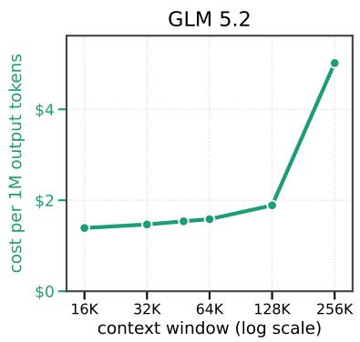

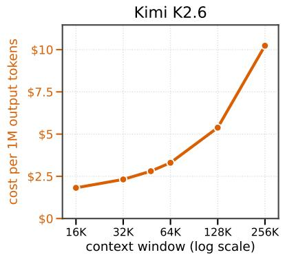

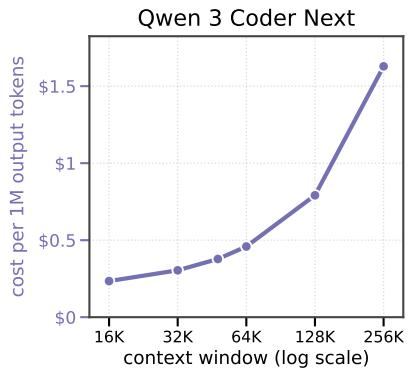  
Figure 1 ⋃︀ The cost of long context. Dollar cost of generating 1M output tokens on an existing input KV cache as a function of the context window size, obtained by converting the measured peak decode throughput of each deployment at on-demand H100 prices (\$3.85 per GPU-hour, Nebius, Sept. 2026). Input request lengths are drawn uniformly at random. GLM 5.2 and Kimi K2.6 are served with INT4 weights and BF16 activations, Qwen 3 Coder Next is served in BF16. Serving at a context window size of 256K rather than 16K costs 3.6× more per generated token for GLM, 5.6× more for Kimi, and 7× more for Qwen.

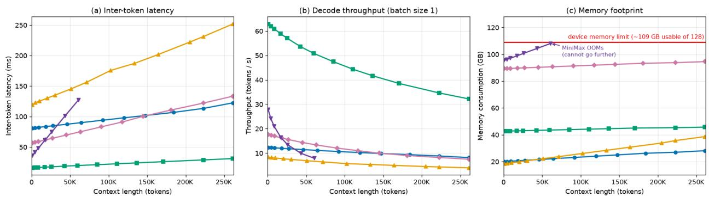  
Owen 3.6 27B (NVFP4) Qwen 3 Coder Next 80B A3B (NVFP4) Gemma 4 31B (GGUF Q4) Step 3.7 Flash 198B A11B (GGUF Q3)MiniMax M2.7 (GGUF IQ3\_XXS)

Figure 2 ⋃︀ The burden of long context. The token generation latency, token throughput, and memory footprint of several open-source models measured on an NVIDIA DGX Spark plotted as a function of input context length. For several models, later tokens take approximately 2x longer to generate than earlier tokens and require a larger memory footprint.

Figure 2 shows the token generation latency, throughput, and memory footprint of several popular locally-run coding models as a function of the input context length. Observe how the generation inter-token latency approximately doubles for several models across the measured context lengths, implying a doubling of the time required to generate a response at longer contexts.

Put simply, the longer the input context provided to the language model (LM), the slower, more memory hungry, and more expensive its output token generation.

Given the considerable benefits of keeping input context short in both cloud and edge LM use, one would assume that popular LMs would have naturally evolved to operate on contexts only as short as necessary to complete their tasks. This could not be farther from the truth. As seen in Table 1, which compares the lengths of well-known works of writing with the context window sizes of representative proprietary and open-weight models, context window sizes have vastly outgrown many influential writings. It would seem that models have been evolving to accommodate the ever larger possible inputs rather than to maximize eficiency.

The enormous context window sizes of contemporary LMs and the tangible cost advantages of keeping their contexts short thus appear to be at odds with each other. While operating with longer contexts might in some cases be thought beneficial to model task accuracy, we must ask:

## RQ0 Are long contexts necessary?

If not, let’s do away with long contexts and long-context models. And, if there are currently any objective benefits of keeping long context models, we can likely preserve them by making the appropriate post-training adjustments to future models.

<table><tr><td colspan="3">Literary works</td><td colspan="3">Model context window sizes</td></tr><tr><td>Work</td><td>Words</td><td>Tokens</td><td>Model</td><td>Words</td><td>Tokens</td></tr><tr><td>The Old Man and the Sea [21]</td><td>~27K</td><td>~37K</td><td>MiniMax M2.7 [31]</td><td>~150K</td><td>200K</td></tr><tr><td>The Great Gatsby [15]</td><td>~48K</td><td>~64K</td><td>Claude Opus 4.5 [2]</td><td>~150K</td><td>200K</td></tr><tr><td>Qur&#x27;an (Saheeh Int&#x27;l translation) [38]</td><td>~156K</td><td>~207K</td><td>Gemma 4 31B [16]</td><td>~192K</td><td>256K</td></tr><tr><td>King James New Testament [26]</td><td>~181K</td><td>~241K</td><td>Kimi K2.6 [32]</td><td>~192K</td><td>256K</td></tr><tr><td>Great Expectations [12]</td><td>~184K</td><td>~245K</td><td>Qwen 3 Coder Next [9]</td><td>~197K</td><td>262K</td></tr><tr><td>The Lord of the Rings [42]</td><td>~481K</td><td>~640K</td><td>Gemini 3.8 Flash [13]</td><td>~750K</td><td>1M</td></tr><tr><td>War and Peace [43]</td><td>~566K</td><td>~753K</td><td>GLM 5.2 [51]</td><td>~750K</td><td>1M</td></tr><tr><td>King James Old Testament [26]</td><td>~603K</td><td>~802K</td><td>GPT 5.6 Sol [34]</td><td>~790K</td><td>1.05M</td></tr></table>

Table 1 ⋃︀ Lengths of literary works against model context window sizes. Word counts use the cited English editions. Word-token conversions use approximately 1.33 tokens per English word, while actual counts vary with text and tokenizer. Models and their context window sizes are detailed in Section 2.3.

To answer RQ0, look at where the so-called long contexts (and, correspondingly, large context windows) in language modeling come from. Broadly, there are two types of workloads that often result in long input contexts being passed to LMs:

LCW1 Workloads of long-horizon tasks – tasks that may require many actions in order to be completed and where the context builds up as the model makes its way towards the completion of the task [11, 47, 52].

LCW2 Workloads of long-input tasks – tasks that require operating across a large amount of input information [6, 45, 29].

Examining these two types of workloads more closely, it is not immediately clear whether operating on long contexts is necessary in order to complete them. In particular, the entire conversational history of LCW1 does not necessarily need to be considered at every step of a long-horizon operation in order to successfully complete the task. Likewise, the long inputs of LCW2 do not necessarily need to be ingested in their entirety at all times in order for the workload to conclude successfully. Moreover, observe that the tasks in LCW2 can always be reduced to LCW1 by storing the long input as a resource and equipping the LM with a tool for selective input reading.

Motivated by the advantages of keeping LM generation contexts short and the apparent lack of clear justification for the popular practice for ingesting long inputs all at once and maintaining long conversational histories as discussed above, we decompose RQ0 to pose the following research questions:

RQ1 Can long-horizon tasks be completed without long contexts?

RQ2 Can long-input tasks be completed without long contexts?

RQ3 Can long-horizon tasks be completed taking no more than a single action per context?

The rest of this paper is aimed at curtly answering these questions.

## 2. Methodology

We use one methodology to answer all research questions posed in Section 1.

## 2.1. Definitions

The base term “context” is, unfortunately, considerably overloaded in language modelling. Below we outline our working definitions intended to fix the meaning of otherwise vaguely interpreted terms commonly used in the community and relied on throughout this paper. Their numerical boundaries are rough rules of thumb.

Inference step. An inference step is one invocation of an LM to produce output. In agentic workflows, it typically coincides with one agent turn of a conversation.

Input context. At a given inference step, the input context is the complete sequence of tokens made available to the LM to produce output. It may include system instructions, the task input, prior model outputs, tool results, and any other conversational history.

Output context. At a given inference step, the output context is the complete sequence of tokens generated by the LM in the inference step. It may include a thinking trace, tool calls, user-oriented outputs, or other model output artifacts.

Context. At a given inference step, the context is the input context, the input context and an associated output context, or the input context and any token space reserved for a possible output context.

Context window and context window size. The context window is the space of tokens an LM can comprehend at any given point, usually imposed by the model’s architecture or indirectly by its post-training data bias. Contexts exceeding context windows may cause system errors or unexpected behavior. The context window size is the maximum number of tokens that an LM endpoint can process in one invocation, whether imposed by the model’s context window or narrowed by its serving configuration.

Long context. We call a context long when its length approaches constituting a significant fraction of context window size of many contemporary frontier models, which tends to rest at approximately 256K tokens or more at the time of this study. We further call an execution regime or context-management strategy long-context if it permits the context to grow toward that scale, even when an individual run terminates before reaching the context window size.

Short context. We call a context short when its length is much closer to zero than to the context window size common to many contemporary frontier models. In the operating regimes emphasized in this work, short contexts are commonly limited to roughly 16K–50K tokens. Note that we take “short” to mean short relative to common context window sizes; it does not mean that the context is small in an absolute linguistic sense. Even context window sizes of 16K–50K tokens sufice to contain elaborate literary works (cf. Table 1).

Long-input task. A long input task is a task which is accompanied by a long input – i.e., input information that would constitute a long context if ingested directly. The term long input refers to the size of the available task input, irrespective of whether a harness places all of it in the model context at once or exposes it through selective input reading.

Long-horizon task. A long-horizon task is a task whose completion requires many sequential model actions, with later actions depending on the observations, artifacts, or decisions produced by earlier ones. Absent context management, the resulting interaction history accumulates across the task and may grow toward a model’s context window size and form a long context.

## 2.2. Benchmarks

We assess the merits of RQ1–RQ3 by considering two groups of benchmarks corresponding to the sources of long context identified in Section 1: long-horizon tasks (LCW1), whose interaction histories grow as an agent acts, and long-input tasks (LCW2), whose source material can itself fill or exceed a model’s context window size. Our ensemble of benchmarks covers realistic software-engineering, information-seeking, and tool-use workloads with controlled long-input diagnostics.

Long-horizon task benchmarks. The long-horizon task benchmark group aims to represent real sequential workflows in which the model must repeatedly inspect an environment, select an action, observe its result, and use that result to decide what to do next. Without context management, every command, tool response, retrieved document, and intermediate decision is appended to an ever-growing history. The software-engineering benchmarks are particularly representative examples because repository exploration, implementation, and validation naturally form long sequences of interdependent actions. The remaining benchmarks broaden this group to information retrieval, user interaction, and cross-tool orchestration.

• SWE-bench Verified [23] is a human-validated set of 500 real GitHub issue-resolution tasks from popular repositories, where the agent must produce a patch that passes the repository’s held-out test suite.

• SWE-bench Multilingual [48] comprises 300 manually curated issue-resolution tasks from repositories across nine programming languages. It tests repository exploration, implementation, and validation across diferent language ecosystems.

• Terminal-Bench 2.1 [30] is an agentic benchmark of 89 real command-line tasks executed in sandboxed containers and scored by per-task verifiers, measuring end-to-end terminal problem-solving beyond single-repository patching.

• FRAMES [27] contains 824 challenging multi-hop questions whose answers require combining information from two to fifteen Wikipedia articles. In our agentic formulation, the model searches a fixed Wikipedia corpus, opens relevant articles incrementally, and submits a free-form answer evaluated against the reference answer by an LM judge. The benchmark consequently tests iterative retrieval and evidence integration while allowing the retrieved evidence to accumulate in the interaction history.

• �<sup>2</sup>-bench [7] evaluates agents that converse with a simulated user while operating domain-specific tools under explicit policy constraints. We use the 184-task golden set spanning retail, airline, and telecommunications; success requires both satisfying the user’s request and bringing the environment to the correct final state. Its mixture of dialogue, reasoning, and state-changing tool calls tests whether information established early in an interaction remains usable by later actions.

• BFCLv3 [36] evaluates multi-turn tool use in simulated environments. We use its 200 long-context episodes, which require agents to retain information across user turns and schedule state-changing tool

calls.

Long-input task benchmarks. The long-input task benchmark group holds the task question comparatively short while making the information needed to answer it large, at least in principle. It includes three broad, realistic long-document QA benchmarks and four needle-style benchmarks.

• LongBench v2 [6] comprises 503 challenging multiple-choice questions with heterogeneous, predominantly natural inputs ranging from 8K to approximately 2M words. Its six task families cover singleand multi-document question answering, long in-context learning, long dialogue, code-repository understanding, and structured-data understanding.

• LOONG [45] is a 1,600-question multi-document benchmark in which a question typically depends on multiple complete financial reports, legal cases, or academic papers in either English or Chinese. Its locating, comparison, clustering, and chain-of-reasoning tasks are designed so that evidence is distributed across multiple load-bearing documents.

• Artificial Analysis Long Context Reasoning (AA-LCR) [4] comprises 100 human-crafted questions requiring reasoning across sets of real-world documents averaging approximately 100K input tokens. Its seven document categories include company and industry reports, government consultations, academic and legal documents, marketing materials, and survey reports. Answers require integrating evidence and performing multi-step reasoning across documents, rather than retrieving a directly stated fact.

• Needle in a Haystack (NIAH) [24] consists of target sentences inserted at controlled depths in long bodies of unrelated essay text and of asking for the fact expressed by that sentence. Our 125-instance grid varies both insertion depth and document length, with contexts extending from 16K to roughly 500K tokens.

• RULER [22] is a synthetic long-context suite containing thirteen tasks: eight needle-retrieval variants, variable tracking, common- and frequent-word extraction, and two multi-hop question-answering tasks. We evaluate all thirteen at 256K and 500K tokens and score the recall of the required answer set.

• Counting-Stars [39] scatters 32 marked numbers throughout a long text and asks the model to recover them all. We use the complete 192-question public set, spanning English and Chinese, acquisition and reasoning variants, and documents from 4K to 128K tokens. The reasoning variant includes initially incorrect counts that are subsequently corrected, requiring the model to distinguish the final value from a nearby distractor rather than merely copy every marked number.

• BABILong [28] consists of short facts from the bAbI [46] reasoning tasks embedded into book text. Answering requires locating the relevant statements and then performing operations such as fact chaining, counting, negation, or set tracking. We evaluate 550 questions across all ten task types and five input lengths from 64K to 1M tokens.

Note that even the needle-style benchmarks considered often do not feature a clear lexical overlap aiding easy retrieval. They do, however, require aggregation, variable tracking, or reasoning over multiple retrieved facts for the correct answer to be produced.

## 2.3. Models

We perform our study on two groups of models. Large closed-weight models are used as the workers in our principal task-accuracy experiments, while large open-weight models support the cloud system throughput study and complementary local experiments.

Large closed-weight models. Our principal benchmark experiments use Claude Opus 4.5 and GPT 5.6 Sol. We select these models as representative of the strong general-purpose models used for coding, tool use, and other long-horizon workflows. Using independently developed model families also reduces the risk that an observed efect of compaction is specific to one provider or post-training recipe.

Large open-weight models. We use large open-weight models for two additional parts of the experimentation. First, the cloud-throughput study in Figure 1 uses models large enough to require multi-GPU deployment and exposes the efect of context window size under saturated serving load:

• GLM 5.2 [17, 50], evaluated at context window sizes up to 1M tokens;

• Kimi K2.6 [32], evaluated at context window sizes up to 256K tokens; and

• Qwen 3 Coder Next [9], evaluated at context window sizes up to 256K tokens.

We fit the context-cost ratio from these throughput measurements and define the RQ1 optimized-retail-cost estimate in Appendix B.

Second, we use locally deployable open-weight models for the on-device systems measurements in Figure 2 and for complementary task-level experiments. We deploy them on an NVIDIA DGX Spark [33], whose 128GB of unified memory leaves about 109GB available for local LM serving.

Such deployments are relevant when source code or other task data must remain on-device for privacy or cost reasons. The two Qwen checkpoints are served in NVFP4 [1]; the remaining three are served from GGUF weights through llama.cpp using 3- to 4-bit k-/i-quantization. Together they cover hybrid linear/softmax attention, distinct interleaved sliding-window/global-attention stacks, gated grouped-query attention, and conventional full grouped-query softmax attention. This architectural diversity helps to test the suficiency of short context claimed in RQ1 across models with diferent attention mechanisms and post-training characteristics.

• Qwen 3.6 27B [37] is a 27B-parameter dense model served in NVFP4. Its layers alternate in a 3:1 pattern between Gated DeltaNet and gated full attention. It has a context window size of 256K tokens.

• Qwen 3 Coder Next [9] is a sparse MoE model with 80B total and 3B active parameters, served in NVFP4. It uses the same hybrid Gated DeltaNet/full-attention pattern and has a context window size of 256K tokens.

• Gemma 4 31B [16] is a 31B-parameter dense model served from GGUF Q4\_K\_M weights. It interleaves 1024-token local sliding-window attention with global-attention layers and has a context window size of 256K tokens.

• Step 3.7 Flash (198B A11B) [40] is a sparse MoE model with 198B total and 11B active parameters, served from GGUF Q3\_K\_M weights. It interleaves 512-token sliding-window and full-attention layers in a 3:1 pattern, uses head-wise gated grouped-query attention, and has a context window size of 256K tokens.

• MiniMax M2.7 [10] is a sparse MoE model with 230B total and 10B active parameters, served from GGUF IQ3\_XXS weights. It uses full-softmax grouped-query attention throughout and has a context window size of 200K tokens [31].

## 2.4. Harnesses

We use two closely related base harnesses. Both implement a minimal ReAct loop: the task is supplied in an initial user message, the model issues one Bash action at a time, and each action and its result are appended to the conversation [49]. When used, the Bash environment exposes the files, programs, and benchmark-specific utilities available to the agent. Each Bash invocation treats the related standard output, return code, and any execution error as action results.

mini-swe-agent. For software-engineering and terminal tasks, we use the released mini-swe-agent harness [41], with only the environment integration required by each benchmark. Its system prompt describes the software-engineering workflow, and its Bash environment provides the task repository or container. When done, the agent submits its proposed pull request as a patch for evaluation.

mini-agent. For the remaining benchmarks, we use our mini-agent harness, which is a straightforward generalization of mini-swe-agent away from software engineering. It retains the same agent loop, model interface, and Bash interface, but uses benchmark-specific instructions, environments, and submission rules. The instructions specify the available commands, task procedure, and required answer format. Only the system instruction and task description are provided in the initial user message. Supporting inputs and tools are made available through the environment. When done, an evaluation benchmark adapter recognizes the designated submission command, extracts its payload, terminates the episode, and records the prediction in the benchmark evaluator’s required format.

## 2.4.1. Accommodations for long conversational context

We compare three context-management regimes applied to the base harnesses described above. These regimes determine which interaction history is presented to the model. The regimes’ functioning is illustrated in

Figure 3.  
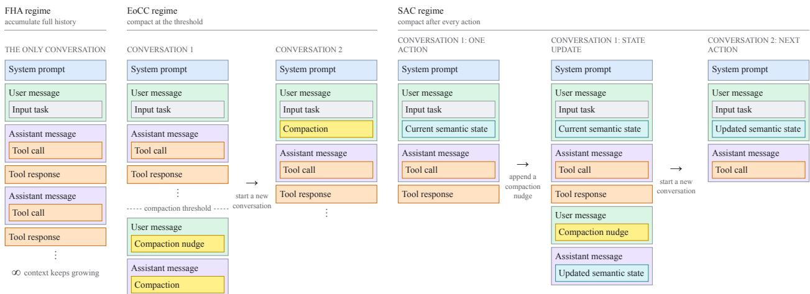  
Figure 3 ⋃︀ Context-management regimes. The three context-management regimes considered in this work: Full-History Accumulation (FHA), End-of-Conversation Compaction (EoCC), and Single-Action Compaction (SAC).

Full-History Accumulation (FHA). The baseline full-history accumulation regime appends every model action and environment observation to a single conversation for the duration of the task. No history is removed or replaced during a run. This is the default mode of operation for mini-swe-agent and mini-agent.

End-of-Conversation Compaction (EoCC). This regime follows the full-history ReAct loop until the length of the conversational context crosses a pre-specified compaction threshold. The model is then instructed within the active conversation to produce a bounded, task-relevant compaction of its state (see Appendix A). A higher total context limit reserves space for this compaction turn and terminates the conversation if compaction does not complete in time. The harness starts a fresh conversation containing the original task and the compacted state, and execution resumes under the same system prompt. This cycle repeats whenever the compaction threshold is crossed. We write these two values as “total context limit / compaction threshold” in tokens.

Single-Action Compaction (SAC). This regime maintains a compact semantic state and essentially no conversational history. Each conversation receives the task and current semantic state, performs exactly one environment action, observes its result, and updates the semantic state. The harness then discards that conversation and starts a fresh one for the next action. For the experiments in Section 5, we apply SAC as a context-management regime to mini-swe-agent; the underlying agent harness, model, and task environment otherwise remain unchanged. SAC therefore keeps the active conversational context shortest of the three regimes and operationalizes the single-action setting of RQ3.

Context length measures. We distinguish total length from peak length. For a full-history baseline, total length is the length of its execution’s conversation. For EoCC and SAC, total length is the sum of the final lengths of all conversations created during the execution. Peak length is the length of the largest conversation produced during the task. Both measures are expressed in thousands of tokens (K) and summarized across tasks as mean / median / maximum or median / maximum, as indicated in each table.

## 2.4.2. Accommodations for long inputs

We enable selective input reading by storing each long input as one or more documents (e.g., input01.txt, input02.txt) in the agent’s filesystem environment rather than placing their full contents in the initial conversation. The task message identifies the available documents, and the agent performs selective input reading using standard Bash tools (e.g., sed, awk, head). This method of input presentation makes selective input reading an explicit environment action and thereby reduces a long-input workload to a long-horizon workload. We provide the agent instructions and examples of selective reading in Appendix E.

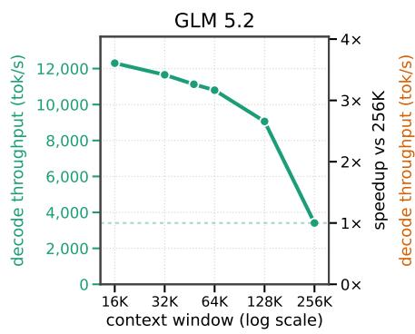

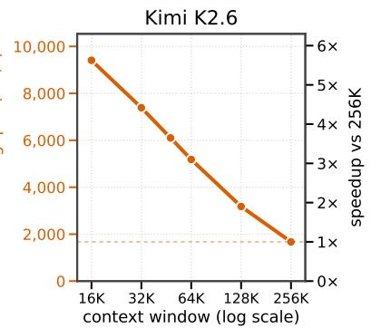

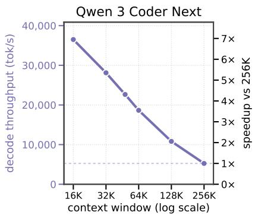  
Figure 4 ⋃︀ Decode throughput collapses as the context window size grows. Peak sustained decode throughput (tokens/s, left axis) for open-weight coding models served under vLLM on NVIDIA H100 GPUs, as a function of the configured context window size. GLM 5.2 and Kimi K2.6 are served with INT4 experts and BF16 activations (Kimi additionally with an FP8 KV cache), Qwen 3 Coder Next in BF16. The right axis re-expresses the same curve as a speedup over the 256K operating point. Reducing the context window size from 256K to 16K buys 3.6× (GLM 5.2), 5.6× (Kimi K2.6), and 7× (Qwen 3 Coder Next) more decoded tokens per second on identical hardware.

## 2.5. Latency and throughput measurement

Cloud serving. For each model, we use the smallest H100 node-deployment that can hold the served checkpoint and a KV cache at the maximum evaluated context window size: eight H100 GPUs for Qwen 3 Coder Next and sixteen for GLM 5.2 and Kimi K2.6. For each context window size, we draw request lengths uniformly from nested prefixes of a shared token sequence, with suficient space reserved for generation. We prefill the longest prefix once, enable prefix caching, and require every subsequent prefix request to generate exactly 1, 024 tokens. After warm-up, we sweep request concurrency and measure sustained aggregate decode throughput as completed output tokens divided by elapsed time. We report the highest-throughput setting with no KV-cache preemption; repeated measurements varied by at most 2%. The results are in Figure 4. The cost values in Figure 1 convert these throughput measurements to the cost of 1M output tokens using the stated hourly GPU price.

Local serving. On the DGX Spark, we evaluate one model instance and one request at a time. For each model, we construct a sequence at its maximum supported length and measure generation after prefixes of increasing length drawn from that sequence. At each length, we record the mean inter-token latency over the next 1, 024 generated tokens and the total device-memory consumption. The batch-one decode throughput in Figure 2 is the reciprocal of the mean inter-token latency.

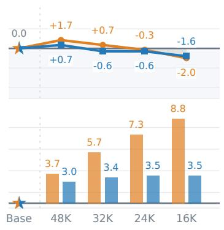

## 3. Long-horizon tasks don’t need long contexts

RQ1. Can long-horizon tasks be completed without long contexts?

Answer: Yes. Frequent compaction keeps the context short while broadly maintaining task accuracy.

Following the outline of Section 2, we evaluate EoCC on 6 benchmarks representing long-horizon workloads and measure the performance of EoCC-modified harnesses against their baseline FHA counterparts. For each benchmark and model, we sequentially decrease the total context token limit and the corresponding compaction threshold to fit the total context limit. This has the efect of lowering the maximum context window needed by the model and of triggering increasingly more frequent compactions while executing long-horizon tasks. We describe what these compactions are designed to preserve in Appendix A. For SWE-bench Verified, TerminalBench 2.1, SWE-bench Multilingual, and FRAMES, we evaluate the models at total context limits / compaction thresholds (cf. Section 2.4.1) of 48K/36K, 32K/24K, 24K/18K, and 16K/12K. For BFCLv3, we consider 24K/18K, 16K/12K, and 12K/8K, while for Tau2Bench, we consider 16K/12K, 12K/8K, and 8K/6K.

Figure 5 plots the EoCC accuracies and estimated cost savings relative to FHA baselines against increasing levels of compaction.

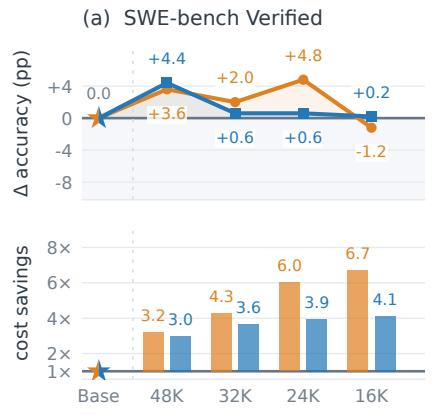

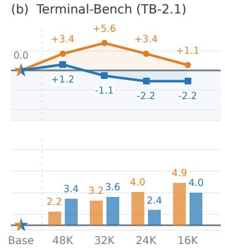  
(c) SWE-bench Multilingual

(d) FRAMES  
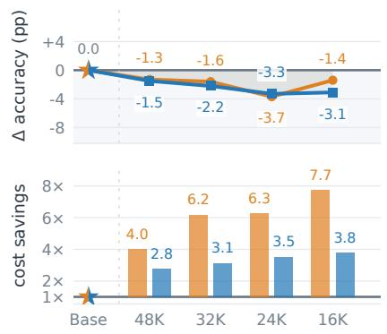

(e) BFCLv3  
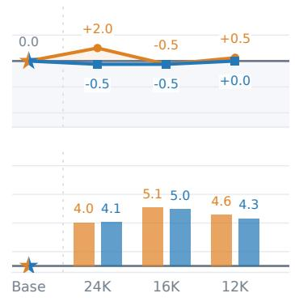  
(f) Tau2Bench  
total context limit

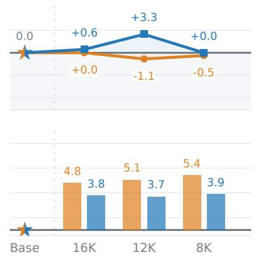

Figure 5 ⋃︀ Long-horizon results as a function of total context limit. Top: accuracy changes in percentage points relative to each model’s full-history baseline; zero indicates unchanged accuracy. Bottom: baseline estimated optimized retail cost divided by the compaction configuration’s estimated optimized retail cost; 1× indicates unchanged cost. Orange/blue identify Claude Opus 4.5 and GPT 5.6 Sol, respectively, and stars mark the baselines. Cost estimates use the model in Appendix B.

Skimming through the line plots, observe first that the performance broadly remains flat, sometimes falling a few points below, sometimes remaining elevated above the baseline. More specifically, across all benchmarks and compaction thresholds, the relative performance of Opus 4.5 ranges from -3.7 to +5.6ppts, while the relative performance of GPT 5.6 Sol ranges from -3.3 to +4.4. The ranges are somewhat deceiving when considered by themselves, however: for either model, no more than 5 out of 22 threshold configurations lose more than 2ppts of the baseline. Secondly, observe the multiples of cost savings across all benchmarks, ranging from 2.2x to 8.8x for Opus 4.5 and from 2.4x to 5.0x for GPT 5.6 Sol. These represent the estimated cost savings as a consequence of serving only shorter context window sizes, and are considerable.

One pathology that could occur due to frequent compaction is that while it may successfully enforce smaller context window size, the full workflow history might be becoming longer as a consequence of the model having to re-do previously done tasks or to revisit previously seen information. Such behavior could result in an increased total token spend per task, ultimately erasing some of the cost savings due to smaller context windows. In our experimentation, this was generally not the case. Detailed per-benchmark accuracy, token spend, total length, cost and their discussion are provided in Appendix C.

In sum, we observe that even the naive approach to keeping context short by compacting agent’s work history once its conversation reaches a certain restrictive threshold leads to, broadly-speaking, on-par performance in model performance on long-horizon tasks when using frontier closed-weight models. Complementary results for open-weight models are provided in Appendix D. It would seem that the benefits of maintaining long contexts manifest themselves inconsistently and are not drastic so as to discourage eforts to keep the working context short in autonomous agentic workloads. Hence our answer to RQ1: yes.

## 3.1. Long-horizon tasks may sometimes need the history

Long-horizon tasks may sometimes need the history, but that does not mean that they require long contexts.

Compaction is a lossy context compression method. Information will be lost as a consequence of compacting a conversational history. Even more information will be lost if the conversational history being compacted already contains a result of an earlier compaction.

It is not too dificult to construct a task whose accuracy is guaranteed to sufer when a compaction is performed. Consider, for example, an agent that has access to a tool that generates coin tosses and reports the outcome of each coin toss in its tool result. With a compaction budget fixed, the agent is guaranteed to eventually start losing information about the outcomes of some of the coin tosses. If, at some point, the agent needs to inspect the sequence of coin toss outcomes (e.g., access the �th outcome), it is guaranteed to eventually fail as a consequence of some compaction necessarily eliminating some of its toss outcome records, with the compaction being the cause.

Observe, however, that any such example can be eliminated by creating a harness that keeps a record of every message of any agentic conversation, and makes it readily accessible to the agent by the means of a selective reading tool. The querying of the agent’s conversational history then becomes a long-input task, which we tackle in RQ2.

In other words, there is a diference between information that needs to be a part of model context and information that could, in principle, be retrieved selectively on a “need-to-know basis”.

Note that the findings of our experimentation above are not that “you don’t ever need to access conversational history”, but roughly that “you don’t need to keep the entire conversational history in the context in order to complete long-horizon tasks”.

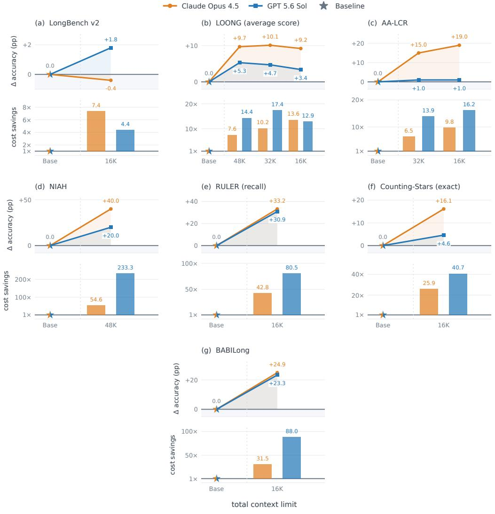

## 4. Long-input tasks don’t need long contexts

RQ2. Can long-input tasks be completed without long contexts?

Answer: Yes. Selective input reading and compaction keep contexts short, maintaining task accuracy.

We evaluate EoCC on 7 benchmarks representing long-input workloads and measure the performance of EoCC-modified harnesses against their baseline full-input counterparts. For each benchmark and model, the full-input baseline receives the entirety of the input as prescribed by the benchmark while the compacting harness uses Bash tools to perform selective reading of inputs from environment filesystem (see Appendix E). Where appropriate in EoCC runs, we further sequentially decrease the total context token limit and the corresponding compaction threshold to fit the total context limit. For many long-input tasks (especially the needle-based tasks), one restrictive total token limit is enough to showcase on-par or better performance.

Figure 6 plots the EoCC accuracies and estimated cost savings relative to FHA baselines against one or multiple levels of compaction.

Figure 6 ⋃︀ Long-input results as a function of total context limit. Top: accuracy changes relative to each model’s full-input baseline. Bottom: optimized retail cost savings, using the model in Appendix B.

Looking through the line plots, observe first that the performance broadly remains flat, sometimes falling a few points below, sometimes remaining elevated above the baseline. More specifically, across all benchmarks and compaction thresholds, the relative performance of Opus 4.5 ranges from -0.4 to +40.0ppts, while the relative performance of GPT 5.6 Sol ranges from +1.0 to +30.9 (!). Observe also the multiples of cost savings across all benchmarks, ranging from 6.5x to 54.6x for Opus 4.5 and from 4.4x to 233.3x for GPT 5.6 Sol. These represent the estimated cost savings as a consequence of both selective input reading and serving only shorter context window sizes, and warrant serious consideration.

Figures 7 and 8 plot total conversation length, summed across stretches, against document length. On logarithmic document-length axes spanning orders of magnitude, conversation lengths on the linear vertical axes remain concentrated in broadly similar bands for most tasks, with some longer outliers. The dashed equal-length reference $y = x$ rises exponentially in these plotting coordinates, whereas most conversations do not grow proportionally with document length. This shows that even as document length increases, the conversation length remains broadly bounded.

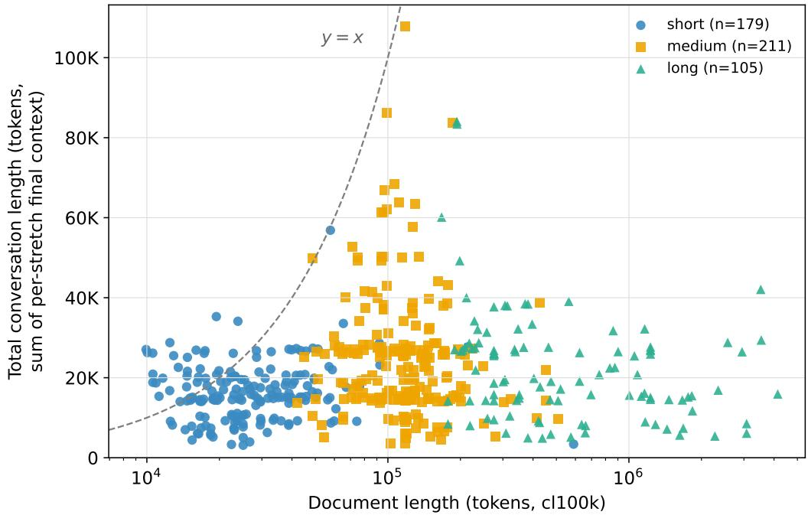  
Figure 7 ⋃︀ LongBench v2: conversation length versus document length. Claude Opus 4.5, compaction at 16K / 12K. The document-length axis is logarithmic and the conversation-length axis is linear. The dashed curve marks $y = x$

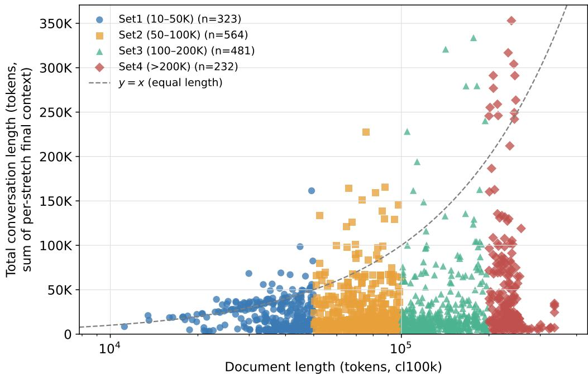  
Figure 8 ⋃︀ LOONG: conversation length versus document length. Claude Opus 4.5, compaction at 48K / 40K (1,600 questions). The document-length axis is logarithmic and the conversation-length axis is linear. The dashed curve marks � = �.

Detailed per-benchmark accuracy, token spend, cost, compactions and their discussion are provided in Appendix F.

In summary, we observe that selective input reading, with compaction available as a fallback, matches or improves long input baseline performance across almost all long-input benchmarks and remains close to baseline in the remaining case, while keeping peak live context far below baseline conversation lengths. The near-zero median number of compactions and the roughly constant conversation lengths as document size grows support the intuition that despite the long inputs provided to tasks, the actual amount of information required to solve those tasks remains low. Thus, the size of a task’s input does not itself establish a need for long context. Hence our answer to RQ2: yes.

## 5. Compaction can be performed after every action

RQ3. Can long-horizon tasks be completed taking no more than a single action per context?

Answer: Yes. Single-action compaction maintains an efective compact semantic state.

The combined comparison in Table 2 shows that, for Claude Opus 4.5, SAC preserves the mini-swe-agent baseline accuracy on SWE-bench Verified and improves it by 4.6 percentage points on Terminal-Bench. For GPT 5.6 Sol, SAC reaches 82.4% on SWE-bench Verified and 84.3% on Terminal-Bench (75 of 89 tasks solved), below its mini baseline by 2.0 and 3.3 percentage points, respectively. Meanwhile, across both models and benchmarks, median peak live context under SAC is only 7–9K tokens, and the maximum falls from 130–200K to 15–37K tokens.
<table><tr><td rowspan="2">Benchmark</td><td colspan="4">Accuracy (%)</td><td colspan="3">Peak context length (K)</td></tr><tr><td>mini baseline</td><td>Best EoCC</td><td></td><td>SAC</td><td>mini (median /max)</td><td>Best EoCC (median /max)</td><td>SAC (median/max)</td></tr><tr><td>Claude Opus 4.5</td><td></td><td></td><td></td><td></td><td></td><td></td><td></td></tr><tr><td>SWE-bench Verified</td><td>70.0</td><td>74.8</td><td>(24K / 18K)</td><td>70.2</td><td>32/200</td><td>19/22</td><td>8/16</td></tr><tr><td>Terminal-Bench (2.1)</td><td>47.2</td><td>52.8</td><td>(32K / 24K)</td><td>51.8</td><td>27/130</td><td>24/31</td><td>9/19</td></tr><tr><td>GPT 5.6 Sol</td><td></td><td></td><td></td><td></td><td></td><td></td><td></td></tr><tr><td>SWE-bench Verified</td><td>84.4</td><td>88.8</td><td>(48K / 36K)</td><td>82.4</td><td>18/173</td><td>22/35</td><td>7/15</td></tr><tr><td>Terminal-Bench (2.1)</td><td>87.6</td><td>88.8</td><td>(48K / 36K)</td><td>84.3</td><td>17/133</td><td>23/40</td><td>8/37</td></tr></table>

Table 2 ⋃︀ SAC versus FHA and EoCC. The mini baseline is the full-history accumulation regime. The Best EoCC accuracy is accompanied by its total context limit / compaction threshold in parentheses. The Best EoCC and SAC columns under Peak context length report the largest single-call contexts under the best EoCC configuration and SAC, respectively; all context statistics are per task in K tokens and reported as median / maximum.

Thus, SAC preserves or improves baseline accuracy for Claude Opus 4.5, while GPT 5.6 Sol incurs small accuracy reductions. This is somewhat remarkable, considering that both models reduce each interaction to a single action and carry only a compact semantic state between contexts. The resulting live contexts are far shorter than the full-history conversations, showing that compaction frequency can be pushed to relative extremes without catastrophic consequences for task accuracy. Hence our answer to RQ3: yes.

## 5.1. Semantic State Space Models (SSSMs).

The above observations of Section 5 and earlier observations of Sections 3 and 4 force a reflection: If powerful models can broadly maintain performance by compacting often or even compacting after taking a single action, cannot all long-context workflows be coerced into becoming single-action workflows through compaction? In other words, could not all models potentially be performing single-action compaction (SAC) by default? To do so would roughly correspond to maintaining a semantic state across long-context workflows.

We propose the notion of a Semantic State Space Model (SSSM). A SSSM is a model post-trained to (1) comprehend an input language description of a state of a conversation, (2) reason about the appropriate next action or about the task at hand, (3) take an action, (4) register its outcome, and (5) update the language description of the conversation’s state with the reasoning conclusions, action decisions, and action outcomes in a way that allows a separate inference instance of the SSSM to continue the conversation toward completion. The notion of a SSSM is closely related to that of a State-Space Model [19, 20, 18]. Unlike an SSM, which maintains a black-box neural state between token generations, an SSSM maintains an explainable natural language (hence “semantic”) state between turns of a continuing conversation.

The utility of SSSMs as opposed to existing conversational models trained for growing full-history conversations lies in their increased token eficiency – as shown in Figure 1, there is a considerable cost benefit to maintaining short contexts. We further surmise that it is considerably more data-eficient to train semantic state-space models due to the lack of need to teach the model to pay attention to the suitable patches of earlier context. Ultimately, we see no reason why SSSMs could not match the performance of full-history-accumulating models, which begs the question: Why train full-history-accumulating models in the first place?

## 6. Conclusion

Our experiments provide afirmative answers to all three research questions RQ1–RQ3. In particular, we found that on long-horizon tasks, even simple end-of-conversation compaction usually matches or slightly improves on full-history accuracy, with only modest losses in the remaining settings. We showed that on long-input tasks, selective input reading with compaction as a fallback matches or improves (sometimes considerably) the full-input baselines in almost every case while keeping live context short. Finally, single-action compaction nearly preserves or improves on the baseline accuracy while carrying only a compact semantic state between actions.

RQ1–RQ3 were motivated by the root question RQ0: “Are long contexts necessary?” Based on the afirmative answers to all of the above, we conclude that long contexts are not necessary for the completion of “long-context” tasks. This is far from surprising. After all, the very motivation behind the definition of computability rests on the assumption that anything computable may be computed by comprehending only a bounded amount of input at a time and maintaining only a finite state of mind [44].

Our evidence does not rule out the existence of tasks for which long context is beneficial, nor does it prove that every possible task can be solved with short context. It does, however, show that the standard arguments in favor of long contexts stemming from long input and long conversational horizons are insuficient: disciplined state maintenance and selective access remove the presumed necessity in every setting we tested. We believe that with the appropriate adjustments made to the post-training of LMs, the context window size requirements currently imposed on these models by the standard arguments for long contexts could be removed, and model context window sizes could shrink drastically, significantly improving the cost of token generation on the cloud and the speed of token generation on local inference accelerators.

## References

[1] Eduardo Alvarez, Omri Almog, Eric Chung, Simon Layton, Dusan Stosic, Ronny Krashinsky, and Kyle Aubrey. Introducing NVFP4 for eficient and accurate low-precision inference. NVIDIA Technical Blog, June 2025. URL https://developer.nvidia.com/blog/introducing-nvfp4-for-efficientand-accurate-low-precision-inference/.

[2] Anthropic. Introducing Claude Opus 4.5. Oficial announcement, November 2025. URL https:// www.anthropic.com/news/claude-opus-4-5.

[3] Anthropic. Claude Opus 4.5 model overview and pricing. Claude Platform documentation, 2026. URL https://platform.claude.com/docs/en/models/opus-4-5/overview. Accessed September 29, 2026.

[4] Artificial Analysis Team. Artificial analysis long context reasoning benchmark (LCR). Hugging Face dataset, 2025. URL https://huggingface.co/datasets/ArtificialAnalysis/AA-LCR.

[5] Saleh Ashkboos, Ilia Markov, Elias Frantar, Tingxuan Zhong, Xincheng Wang, Jie Ren, Torsten Hoefler, and Dan Alistarh. QUIK: Towards end-to-end 4-bit inference on generative large language models. In Proceedings of the 2024 Conference on Empirical Methods in Natural Language Processing, pages 3355– 3371. Association for Computational Linguistics, November 2024. doi: 10.18653/v1/2024.emnlp-main.197. URL https://aclanthology.org/2024.emnlp-main.197/.

[6] Yushi Bai, Shangqing Tu, Jiajie Zhang, Hao Peng, Xiaozhi Wang, Xin Lv, Shulin Cao, Jiazheng Xu, Lei Hou, Yuxiao Dong, Jie Tang, and Juanzi Li. LongBench v2: Towards deeper understanding and reasoning on realistic long-context multitasks. In Proceedings of the 63rd Annual Meeting of the Association for Computational Linguistics (Volume 1: Long Papers), pages 3639–3664, Vienna, Austria, July 2025. Association for Computational Linguistics. doi: 10.18653/v1/2025.acl-long.183. URL https://aclanthology.org/2025.acl-long.183/.

[7] Victor Barres, Honghua Dong, Soham Ray, Xujie Si, and Karthik Narasimhan. �<sup>2</sup>-bench: Evaluating conversational agents in a dual-control environment, 2025. URL https://arxiv.org/abs/2506.07982.

[8] Federico Busato and Jef Pool. Exploiting NVIDIA ampere structured sparsity with cuSPARSELt. NVIDIA Technical Blog, December 2020. URL https://developer.nvidia.com/blog/exploitingampere-structured-sparsity-with-cusparselt/.

[9] Ruisheng Cao, Mouxiang Chen, Jiawei Chen, Zeyu Cui, Yunlong Feng, Binyuan Hui, Yuheng Jing, Kaixin Li, Mingze Li, Junyang Lin, Zeyao Ma, Kashun Shum, Xuwu Wang, Jinxi Wei, Jiaxi Yang, Jiajun Zhang, Lei Zhang, Zongmeng Zhang, Wenting Zhao, and Fan Zhou. Qwen3-Coder-Next technical report, 2026. URL https://arxiv.org/abs/2603.00729.

[10] Aili Chen et al. The MiniMax-M2 series: Mini activations unleashing max real-world intelligence, 2026. URL https://arxiv.org/abs/2605.26494.

[11] Xiang Deng, Jef Da, Edwin Pan, Yannis Yiming He, Charles Ide, Kanak Garg, Niklas Laufer, Andrew Park, Nitin Pasari, Chetan Rane, Karmini Sampath, Maya Krishnan, Srivatsa Kundurthy, Sean Hendryx, Zifan Wang, Vijay Bharadwaj, Jef Holm, Raja Aluri, Chen Bo Calvin Zhang, Noah Jacobson, Bing Liu, and Brad Kenstler. SWE-Bench Pro: Can AI agents solve long-horizon software engineering tasks?, 2025. URL https://arxiv.org/abs/2509.16941.

[12] Charles Dickens. Great expectations. Project Gutenberg, 1998. URL https://www.gutenberg.org/ ebooks/1400. Project Gutenberg eBook no. 1400.

[13] Tulsee Doshi and Raluca Ada Popa. Introducing Gemini 3.8 Flash and 3.8 Flash Cyber. Google oficial blog, September 2026. URL https://blog.google/innovation-and-ai/models-and-research/ gemini-models/3-8-flash-and-3-8-flash-cyber/.

[14] Vage Egiazarian, Andrei Panferov, Denis Kuznedelev, Elias Frantar, Artem Babenko, and Dan Alistarh. Extreme compression of large language models via additive quantization. In Proceedings of the 41st International Conference on Machine Learning, volume 235 of Proceedings of Machine Learning Research, pages 12284–12303. PMLR, 2024. URL https://proceedings.mlr.press/v235/egiazarian24a.html.

[15] F. Scott Fitzgerald. The great gatsby. Project Gutenberg, 2021. URL https://www.gutenberg.org/ ebooks/64317. Project Gutenberg eBook no. 64317.

[16] Gemma Team et al. Gemma 4 technical report, 2026. URL https://arxiv.org/abs/2607.02770.

[17] GLM-5 Team et al. GLM-5: from vibe coding to agentic engineering, 2026. URL https://arxiv.org/ abs/2602.15763.

[18] Albert Gu and Tri Dao. Mamba: Linear-time sequence modeling with selective state spaces, 2024. URL https://arxiv.org/abs/2312.00752.

[19] Albert Gu, Isys Johnson, Karan Goel, Khaled Saab, Tri Dao, Atri Rudra, and Christopher Ré. Combining recurrent, convolutional, and continuous-time models with linear state space layers. In M. Ranzato, A. Beygelzimer, Y. Dauphin, P.S. Liang, and J. Wortman Vaughan, editors, Advances in Neural Information Processing Systems, volume 34, pages 572–585. Curran Associates, Inc., 2021. URL https://proceedings.neurips.cc/paper\_files/paper/2021/file/ 05546b0e38ab9175cd905eebcc6ebb76-Paper.pdf.

[20] Albert Gu, Karan Goel, and Christopher Ré. Eficiently modeling long sequences with structured state spaces, 2022. URL https://arxiv.org/abs/2111.00396.

[21] Ernest Hemingway. The Old Man and the Sea. Charles Scribner’s Sons, New York, 1952.

[22] Cheng-Ping Hsieh, Simeng Sun, Samuel Kriman, Shantanu Acharya, Dima Rekesh, Fei Jia, Yang Zhang, and Boris Ginsburg. RULER: What’s the real context size of your long-context language models?, 2024. URL https://arxiv.org/abs/2404.06654.

[23] Carlos E. Jimenez, John Yang, Alexander Wettig, Shunyu Yao, Kexin Pei, Ofir Press, and Karthik Narasimhan. SWE-bench: Can language models resolve real-world GitHub issues? In The Twelfth International Conference on Learning Representations, 2024. URL https://openreview.net/forum?id= VTF8yNQM66.

[24] Gregory Kamradt. Needle in a haystack: Pressure testing LLMs. GitHub repository, 2023. URL https://github.com/gkamradt/needle-in-a-haystack. Canonical benchmark implementation; no arXiv paper.

[25] Feyza Duman Keles, Pruthuvi Mahesakya Wijewardena, and Chinmay Hegde. On the computational complexity of self-attention. In International conference on algorithmic learning theory, pages 597–619. PMLR, 2023.

[26] King James Bible. The king james version of the bible. Project Gutenberg, 1989. URL https: //www.gutenberg.org/ebooks/10. Project Gutenberg eBook no. 10.

[27] Satyapriya Krishna, Kalpesh Krishna, Anhad Mohananey, Steven Schwarcz, Adam Stambler, Shyam Upadhyay, and Manaal Faruqui. Fact, fetch, and reason: A unified evaluation of retrieval-augmented generation. In Proceedings of the 2025 Conference of the Nations of the Americas Chapter of the Association for Computational Linguistics: Human Language Technologies (Volume 1: Long Papers), pages 4745–4759, Albuquerque, New Mexico, April 2025. Association for Computational Linguistics. doi: 10.18653/v1/2025.naacl-long.243. URL https://aclanthology.org/2025.naacl-long.243/.

[28] Yuri Kuratov, Aydar Bulatov, Petr Anokhin, Ivan Rodkin, Dmitry Sorokin, Artyom Sorokin, and Mikhail Burtsev. BABILong: Testing the limits of LLMs with long context reasoning-in-a-haystack. In Advances in Neural Information Processing Systems, volume 37, pages 106519–106554. Curran Associates, Inc., 2024. doi: 10.52202/079017-3381. URL https://proceedings.neurips.cc/paper\_files/paper/2024/ hash/c0d62e70dbc659cc9bd44cbcf1cb652f-Abstract-Datasets\_and\_Benchmarks\_Track.html.

[29] Nelson F Liu, Kevin Lin, John Hewitt, Ashwin Paranjape, Michele Bevilacqua, Fabio Petroni, and Percy Liang. Lost in the middle: How language models use long contexts. Transactions of the Association for Computational Linguistics, 12:157–173, 2024. doi: 10.1162/tacl\_a\_00638. URL https://aclanthology.org/2024.tacl-1.9/.

[30] Mike A. Merrill, Alexander G. Shaw, Nicholas Carlini, Boxuan Li, Harsh Raj, Ivan Bercovich, Lin Shi, Jeong Yeon Shin, Thomas Walshe, E. Kelly Buchanan, Junhong Shen, Guanghao Ye, Haowei Lin, Jason Poulos, Maoyu Wang, Marianna Nezhurina, Jenia Jitsev, Di Lu, Orfeas Menis Mastromichalakis, Zhiwei Xu, Zizhao Chen, Yue Liu, Robert Zhang, Leon Liangyu Chen, Anurag Kashyap, Jan-Lucas Uslu, Jefrey Li, Jianbo Wu, Minghao Yan, Song Bian, Vedang Sharma, Ke Sun, Steven Dillmann, Akshay Anand, Andrew Lanpouthakoun, Bardia Koopah, Changran Hu, Etash Guha, Gabriel H. S. Dreiman, Jiacheng Zhu, Karl Krauth, Li Zhong, Niklas Muennighof, Robert Amanfu, Shangyin Tan, Shreyas Pimpalgaonkar, Tushar Aggarwal, Xiangning Lin, Xin Lan, Xuandong Zhao, Yiqing Liang, Yuanli Wang, Zilong Wang, Changzhi Zhou, David Heineman, Hange Liu, Harsh Trivedi, John Yang, Junhong Lin, Manish Shetty, Michael Yang, Nabil Omi, Negin Raoof, Shanda Li, Terry Yue Zhuo, Wuwei Lin, Yiwei Dai, Yuxin Wang, Wenhao Chai, Shang Zhou, Dariush Wahdany, Ziyu She, Jiaming Hu, Zhikang Dong, Yuxuan Zhu, Sasha Cui, Ahson Saiyed, Arinbjörn Kolbeinsson, Jesse Hu, Christopher Michael Rytting, Ryan Marten, Yixin Wang, Alex Dimakis, Andy Konwinski, and Ludwig Schmidt. Terminal-Bench: Benchmarking agents on hard, realistic tasks in command line interfaces, 2026. URL https://arxiv.org/abs/2601.11868.

[31] MiniMax. MiniMax-M2.7 checkpoint configuration. Oficial Hugging Face model repository, 2026. URL https://huggingface.co/MiniMaxAI/MiniMax-M2.7/blob/main/config.json. Accessed October 27, 2026.

[32] Moonshot AI. Kimi K2.6: From code to creation, from one to many. Oficial model release, 2026. URL https://www.kimi.ai/ai-models/kimi-k2-6. Accessed September 14, 2026.

[33] NVIDIA Corporation. NVIDIA DGX spark arrives for world’s AI developers. NVIDIA Newsroom, October 2025. URL https://nvidianews.nvidia.com/news/nvidia-dgx-spark-arrives-for-worlds-aidevelopers.

[34] OpenAI. GPT-5.6 Sol model specifications. OpenAI API documentation, 2026. URL https: //developers.openai.com/api/docs/models/gpt-5.6-sol. Accessed September 16, 2026.

[35] OpenAI. GPT-5.6 Sol model pricing. OpenAI API documentation, 2026. URL https:// developers.openai.com/api/docs/models/gpt-5.6-sol. Accessed September 29, 2026.

[36] Shishir G Patil, Huanzhi Mao, Fanjia Yan, Charlie Cheng-Jie Ji, Vishnu Suresh, Ion Stoica, and Joseph E Gonzalez. The berkeley function calling leaderboard (bfcl): From tool use to agentic evaluation of large language models. In Forty-second International Conference on Machine Learning, 2025.

[37] Qwen Team. Qwen3.6-27B: Flagship-level coding in a 27B dense model, April 2026. URL https: //qwen.ai/blog?id=qwen3.6-27b.

[38] Saheeh International. The Qur’an: Arabic Text with Corresponding English Meanings. Abul-Qasim Publishing House, Jeddah, Saudi Arabia, 1997.

[39] Mingyang Song, Mao Zheng, and Xuan Luo. Counting-Stars: A multi-evidence, position-aware, and scalable benchmark for evaluating long-context large language models. In Proceedings of the 31st International Conference on Computational Linguistics, pages 3753–3763, Abu Dhabi, UAE, January 2025. Association for Computational Linguistics. URL https://aclanthology.org/2025.coling-main.253/.

[40] StepFun. Step-3.7-Flash model card. Hugging Face model card, May 2026. URL https:// huggingface.co/stepfun-ai/Step-3.7-Flash. Accessed September 14, 2026.

[41] SWE-agent Team. mini-swe-agent: The minimal AI software engineering agent, 2025. URL https: //github.com/swe-agent/mini-swe-agent.

[42] J. R. R. Tolkien. The Lord of the Rings. George Allen & Unwin, London, 1954–1955. Three volumes.

[43] Leo Tolstoy. War and peace. Project Gutenberg, 2001. URL https://www.gutenberg.org/ebooks/2600. Project Gutenberg eBook no. 2600.

[44] A. M. Turing. On computable numbers, with an application to the Entscheidungsproblem. Proceedings of the London Mathematical Society, s2-42(1):230–265, 1937. doi: 10.1112/plms/s2-42.1.230. URL https://doi.org/10.1112/plms/s2-42.1.230.

[45] Minzheng Wang, Longze Chen, Fu Cheng, Shengyi Liao, Xinghua Zhang, Bingli Wu, Haiyang Yu, Nan Xu, Lei Zhang, Run Luo, Yunshui Li, Min Yang, Fei Huang, and Yongbin Li. Leave no document behind: Benchmarking long-context LLMs with extended multi-doc QA. In Proceedings of the 2024 Conference on Empirical Methods in Natural Language Processing, pages 5627–5646, Miami, Florida, USA, November 2024. Association for Computational Linguistics. doi: 10.18653/v1/2024.emnlp-main.322. URL https://aclanthology.org/2024.emnlp-main.322/.

[46] Jason Weston, Antoine Bordes, Sumit Chopra, Alexander M. Rush, Bart van Merriënboer, Armand Joulin, and Tomas Mikolov. Towards AI-complete question answering: A set of prerequisite toy tasks, 2015. URL https://arxiv.org/abs/1502.05698.

[47] John Yang, Carlos E Jimenez, Alexander Wettig, Kilian Lieret, Shunyu Yao, Karthik R Narasimhan, and Ofir Press. SWE-agent: Agent-computer interfaces enable automated software engineering. In The Thirty-eighth Annual Conference on Neural Information Processing Systems, 2024. URL https: //openreview.net/forum?id=mXpq6ut8J3.

[48] John Yang, Kilian Lieret, Carlos E. Jimenez, Alexander Wettig, Kabir Khandpur, Yanzhe Zhang, Binyuan Hui, Ofir Press, Ludwig Schmidt, and Diyi Yang. Swe-smith: Scaling data for software engineering agents, 2025. URL https://arxiv.org/abs/2504.21798.

[49] Shunyu Yao, Jefrey Zhao, Dian Yu, Nan Du, Izhak Shafran, Karthik Narasimhan, and Yuan Cao. ReAct: Synergizing reasoning and acting in language models. In The Eleventh International Conference on Learning Representations, 2023. URL https://openreview.net/forum?id=WE\_vluYUL-X.

[50] Z.ai. GLM-5.2 model card. Hugging Face model card, 2026. URL https://huggingface.co/zai-org/ GLM-5.2. Accessed September 14, 2026.

[51] Z.ai. GLM-5.2. Oficial model release blog, 2026. URL https://z.ai/blog/glm-5.2.

[52] Shuyan Zhou, Frank F. Xu, Hao Zhu, Xuhui Zhou, Robert Lo, Abishek Sridhar, Xianyi Cheng, Tianyue Ou, Yonatan Bisk, Daniel Fried, Uri Alon, and Graham Neubig. Webarena: A realistic web environment for building autonomous agents. arXiv preprint arXiv:2307.13854, 2023. URL https://arxiv.org/abs/ 2307.13854.

## A. What characterizes a good compaction?

It is a common experience of human-in-the-loop agent-aided SWE workflows that after a compaction is performed, certain crucial information disappears from the context and has to be obtained again, slowing down the SWE process or perhaps even confusing the model and losing crucial user preferences included in previous instructions. Note that human-in-the-loop agent-aided SWE workflows consist of two parts: autonomous SWE work performed by the agent, and reception and comprehension of the human’s steering feedback. Because of this, compactions produced for such workflows need to account for not only the information the agent needs to achieve its goals, but also for all potential information that might be relevant to follow-up autonomous work that might be triggered as a result of the human’s feedback.

In our experimentation, we initially set out to identify the cheapest, most useful method of compaction that can preserve as much task accuracy as possible on autonomous SWE work. We discovered that treating compaction as a mere special case of summarization is suboptimal for this purpose. LM summarizations generally attempt to give equal weight to all facts present in the input and are prone to overemphasize repeated segments of the agent trace regardless of their ultimate relevance to the tail of the trace being compacted. We explored the subject along two axes: the method $( \mathrm { e . g . }$ , summarization or message pruning) and the information being pruned (e.g., the entire trace or only the trace segment since the last compaction plus the contents of the last compaction). We discovered that the best compactions are not those that faithfully capture the gist of the agentic trace, but those that best select facts relevant to the work yet to be performed – i.e., they are not narratives of the execution history but carefully cherry-picked briefs for further execution. In particular, we found that the most accuracy-preserving compactions, regardless of the frequency of compaction, are those that contain (1) a verbatim or near-verbatim copy of the input task, (2) a record of agent’s current occupation, intentions, and planned next steps, and (3) all the artifacts that are of direct relevance to future execution, including (3a) a decomposed plan made from the input task, (3b) a list of requirements detailing when to consider the task complete, and any pieces of information or pointers to artifacts containing information that is of relevance to the aforementioned two. Finally, we found that the above structure of compactions readily extends even to workflows that are not necessarily SWE-related in their nature. We used the same compaction structure for every type of workflow considered in this work.

## B. Estimated optimized retail cost

For model �, let $C _ { \mathrm { o u t p u t } , M } ( W )$ denote the USD per million output tokens at size �. For measured models, let $T _ { M } ( W )$ be the peak aggregate decode throughput (output tokens per second after input-context processing, assuming KV cached input). Fixed GPU allocation and hourly rate imply the 16K-to-256K cost ratio

$$
r _ { M } = { \frac { C _ { \mathrm { o u t p u t } , M } ( 1 6 \mathrm { K } ) } { C _ { \mathrm { o u t p u t } , M } ( 2 5 6 \mathrm { K } ) } } = { \frac { T _ { M } ( 2 5 6 \mathrm { K } ) } { T _ { M } ( 1 6 \mathrm { K } ) } } = { \left\{ \begin{array} { l l } { 0 . 2 7 7 2 \quad { \mathrm { G L M } } \ 5 . 2 , } \\ { 0 . 1 7 7 7 \quad \mathrm { K i m i } \ \mathrm { K } 2 . 6 , } \\ { 0 . 1 4 3 9 \quad { \mathrm { Q w e n } } \ 3 \ { \mathrm { C o d e r } } \ \mathrm { N e x t } . } \end{array} \right. }\tag{1}
$$

We take the rounded mean of the above measurements, $r = 0 . 2 0$

For target frontier model �, let $W _ { M } ^ { \mathrm { m a x } }$ be the assumed reference context window size: 200, 000 tokens for Opus 4.5 and 272K for GPT 5.6 Sol [3, 35]. The GPT’s 272K reference context window size is its standard-price ceiling (the model supports 1, 050, 000 tokens, but our compaction � never exceeds the standard-price ceiling). For each compaction experiment, let $W \leq W _ { M } ^ { \mathrm { m a x } }$ be the EoCC total context limit and let �<sup>max</sup> be the context window size for the FHA baseline (Section 2.4.1). To estimate the cost of output $C _ { \mathrm { o u t p u t } , M } ^ { \mathrm { e s t i m a t e } } ( W )$ of model �, we anchor $C _ { \mathrm { o u t p u t } , M } ( W _ { M } ^ { \operatorname* { m a x } } )$ at the standard retail output price, \$25 for Opus 4.5 or \$20 for GPT 5.6 Sol, and then interpolate to �-times-the-standard-price at 16K, clamping smaller $W { \mathrm { s } } { \mathrm { : } }$

$$
C _ { \mathrm { o u t p u t } , M } ^ { \mathrm { e s t . } } ( W ) = C _ { \mathrm { o u t p u t } , M } ( W _ { M } ^ { \mathrm { m a x } } ) \left[ r + ( 1 - r ) \frac { \mathrm { m a x } ( W , 1 6 \mathrm { K } ) - 1 6 \mathrm { K } } { W _ { M } ^ { \mathrm { m a x } } - 1 6 \mathrm { K } } \right] .\tag{2}
$$

Let $C _ { \mathrm { i n p u t } , M } ( W )$ and $C _ { \mathrm { c a c h e d } , M } ( W )$ be the est. USD per million uncached-input and cached-input tokens, respectively. These we deduce by preserving the original 5:1 output-to-uncached-input ratio and 10:1 uncachedinput-to-cached-input ratio of the frontier models:

$$
C _ { \mathrm { i n p u t } , M } ( W ) = \frac { C _ { \mathrm { o u t p u t } , M } ^ { \mathrm { e s t . } } ( W ) } { 5 } , \qquad C _ { \mathrm { c a c h e d } , M } ( W ) = \frac { C _ { \mathrm { i n p u t } , M } ^ { \mathrm { e s t . } } ( W ) } { 1 0 } .\tag{3}
$$

For every experiment with model � maintaining the EoCC total context limit at $W ,$ let $I , H ,$ and $O$ be aggregate millions of uncached input, cached input (cache hits), and generated output tokens, respectively. We compute the estimate of the final estimated optimized retail cost as reported in the paper as:

$$
E O R C _ { M } ( W ) = I C _ { \mathrm { i n p u t } , M } ^ { \mathrm { e s t . } } ( W ) + H C _ { \mathrm { c a c h e d } , M } ^ { \mathrm { e s t . } } ( W ) + O C _ { \mathrm { o u t p u t } , M } ^ { \mathrm { e s t . } } ( W ) .\tag{4}
$$

## C. Detailed long-horizon results

The tables below report accuracy and cost profiles for Claude Opus 4.5 and GPT 5.6 Sol. Each table compares a baseline FHA agent (Section 2.4) against an EoCC agent with diferent total context limits and compaction thresholds (Section 2.4.1). Values are written as “total context limit / compaction threshold” in tokens: the agent compacts when the running context approaches the compaction threshold and never exceeds the total context limit.

Throughout the results, notice the following:

• In terms of accuracy, compactions tend to perform closely on-par with or slightly better than the corresponding baseline.

• In terms of total token spend, new input token counts generally increase with decreasing context window size while the re-used cached tokens generally decrease, consistently with the intuitive expectation. Output tokens are generally elevated when compacting.

Inspecting Table 3, we observe that every evaluated pair of total context limit and compaction threshold matches or improves on the baseline for GPT 5.6 Sol; Claude Opus 4.5 improves at every setting except the tightest (16K / 12K), where accuracy decreases by 1.2 percentage points. The best results improve accuracy by 4.8 percentage points for Claude Opus 4.5 and 4.4 points for GPT 5.6 Sol.
<table><tr><td rowspan="3">Configuration</td><td rowspan="2" colspan="2">Accuracy</td><td rowspan="2" colspan="2">Token spend (M)</td><td rowspan="2" colspan="2">Nominal retail cost (USD)</td><td rowspan="2" colspan="2">Estimated optimized retail cost (USD)</td><td rowspan="2" colspan="2"></td><td rowspan="2" colspan="2"></td><td rowspan="2" colspan="2">Total length (K)</td></tr><tr><td colspan="2">Compactions Opus</td></tr><tr><td colspan="2">Opus</td><td colspan="2">GPT</td><td colspan="2">GPT</td><td colspan="2">Opus GPT</td><td colspan="2">GPT</td><td colspan="2">GPT</td><td colspan="2">GPT</td></tr><tr><td>Baseline (no compaction)</td><td>70.0</td><td>84.4</td><td>20.0/ /420.0 /4.4</td><td>16.4/100.2/3.1</td><td></td><td></td><td></td><td></td><td>$167.68</td><td>0/0/0</td><td>0/0/0</td><td>48/32/200</td><td>22/18/173</td></tr><tr><td></td><td></td><td>88.8</td><td>20.0</td><td></td><td>$420.00</td><td>$167.68</td><td>$420.00</td><td></td><td></td><td></td><td></td><td></td><td></td></tr><tr><td>Compaction, 48K /36K</td><td>73.6</td><td></td><td>/334.7/4.5</td><td>17.6 /94.2/3.9</td><td>$379.85</td><td>$186.08</td><td>$130.20</td><td>$55.82</td><td></td><td>0.3/0/6</td><td>0.4/0/5</td><td>30/25/226</td><td>26/22/156</td></tr><tr><td>Compaction, 32K 24K</td><td>72.0 74.8</td><td>85.0</td><td>23.0 /255.9/4.7</td><td>17.2 /73.4/4.3</td><td>$360.45</td><td>$184.16</td><td>$97.82</td><td>$46.04 $42.52</td><td>0.8/1/13</td><td></td><td>0.9/1/9 32</td><td>/28 /336</td><td>28/24/189</td></tr><tr><td>Compaction, 24K 18K Compaction, 16K 12K</td><td>68.8</td><td>85.0 84.6</td><td>22.0 /166.5/4.1 28.3/ /127.3/4.3</td><td>17.7 19.7/45.8/</td><td>/60.4/4.7 $295.75 /5.3 $312.65</td><td>$188.96 $203.12</td><td>$69.71 $62.53</td><td>$40.62</td><td></td><td>1.0/1/18 2.1/1/32</td><td>1.5/1/18 3.0/2/61</td><td>29/23 /362 34/24/415</td><td>32/24/287 36/26/605</td></tr></table>

Table 3 ⋃︀ SWE-bench Verified. Accuracy is the percentage of instances resolved. Token spend lists new / cached input and output, expressed in M tokens, aggregated over the benchmark (new excludes promptcache hits). Nominal retail cost multiplies these rounded totals by published standard API prices per million new input / cached input / output tokens: \$5 / \$0.50 / \$25 for Opus 4.5 and \$4 / \$0.40 / \$20 for GPT 5.6 Sol, as of September 29, 2026 [3, 35]. Estimated optimized retail cost applies the context factor defined in Appendix B to the same token totals. Compactions and Total length are per task, given as mean / median / max; Total length is in K tokens and sums each sub-conversation’s final context across stretches.

On SWE-bench Multilingual (Table 4), the largest accuracy gains occur at 48K / 36K: 1.7 percentage points for Claude Opus 4.5 and 0.7 points for GPT 5.6 Sol. At the tightest setting (16K / 12K), accuracy falls below the corresponding baselines by 2.0 and 1.6 percentage points, respectively.
<table><tr><td>Configuration</td><td colspan="2">Accuracy</td><td colspan="2">Token spend (M)</td><td colspan="2">Nominal retail cost (USD)</td><td colspan="2">Estimated optimized retail cost (USD)</td><td colspan="2">Compactions</td><td colspan="2">Total length (K)</td></tr><tr><td></td><td>Opus</td><td>GPT</td><td>Opus</td><td>GPT</td><td>Opus</td><td>GPT</td><td>Opus</td><td>GPT</td><td>Opus</td><td>GPT</td><td>Opus</td><td>GPT</td></tr><tr><td>Baseline (no compaction)</td><td>66.3</td><td>79.3</td><td>11.9 /384.1 /3.0</td><td>7.4/66.2/1.6</td><td>$326.55</td><td>$88.08</td><td>$326.55</td><td>$88.08</td><td>0/0/0</td><td>0/0/0</td><td>35/31 /95</td><td>23/21/63</td></tr><tr><td>Compaction, 48K /36K</td><td>68.0</td><td>80.0</td><td>12.8/245.5/2.9</td><td>8.8/65.6/1.9</td><td>$259.25</td><td>$99.44</td><td>$87.56</td><td>$29.48</td><td>0.4/0/3</td><td>0.3/0/5</td><td>38/33/157</td><td>28/23/190</td></tr><tr><td>Compaction, 32K /24K</td><td>67.0</td><td>78.7</td><td>14.0/147.0/2.8</td><td>10.0/49.1 /2.3</td><td>$213.50</td><td>$105.64</td><td>$57.23</td><td>$26.16</td><td>1.1/1/8</td><td>1.1/1/14</td><td>39/32 /192</td><td>33/27/312</td></tr><tr><td>Compaction, 24K 18K</td><td>66.0</td><td>78.7</td><td>15.6/91.0/ 2.7</td><td>10.8/40.3/ /2.6</td><td>$191.00</td><td>$111.32</td><td>$44.54</td><td>$24.85</td><td>1.9/1/13</td><td>1.8/1/18</td><td>41/31/ /235</td><td>37/28/312</td></tr><tr><td>Compaction, 16K 12K</td><td>64.3</td><td>77.7</td><td>17.0/65.4/2.7</td><td>12.4/31.5/3.1</td><td>$185.20</td><td>$124.20</td><td>$37.04</td><td>$24.84</td><td>2.7/2/26</td><td>3.4/2/44</td><td>42/33/340</td><td>43/30/472</td></tr></table>

Table 4 ⋃︀ SWE-bench Multilingual. Results for Claude Opus 4.5 High and GPT 5.6 Sol Medium on 300 instances per model. Columns and quantities are as in Table 3.

The Terminal-Bench results in Table 5 show a similar pattern: compaction improves Claude Opus 4.5 at every evaluated pair of total context limit and compaction threshold. GPT 5.6 Sol improves by 1.2 percentage points at 48K / 36K and loses 1.1, 2.2, and 2.2 points at 32K / 24K, 24K / 18K, and 16K / 12K, respectively. The largest gain is 5.6 percentage points for Claude Opus 4.5 with a 32K total context limit and 24K compaction threshold.

<table><tr><td></td><td colspan="2">Accuracy</td><td colspan="2">Token spend (M)</td><td colspan="2">Nominal retail cost (USD)</td><td colspan="2">Estimated optimized retail cost (USD)</td><td colspan="2">Compactions</td><td colspan="2">Total length (K)</td></tr><tr><td>Configuration</td><td colspan="2">Opus</td><td colspan="2"></td><td colspan="2">Opus</td><td colspan="2"></td><td colspan="2"></td><td colspan="2"></td></tr><tr><td></td><td></td><td>GPT</td><td>Opus</td><td>GPT</td><td></td><td>GPT</td><td>Opus</td><td>GPT</td><td>Opus</td><td>GPT</td><td>Opus</td><td>GPT</td></tr><tr><td>Baseline (no compaction)</td><td>47.2</td><td>87.6</td><td>3.9/81.6/1.1</td><td>3.6/30.4/1.1</td><td>$87.80</td><td>$48.56</td><td>$87.80</td><td>$48.56</td><td>0/0/0</td><td>0/0/0</td><td>34/27/130</td><td>28 /17 /133</td></tr><tr><td>Compaction, 48K /36K</td><td>50.6</td><td>88.8</td><td>6.2/77.5/1.8</td><td>3.7/16.7/1.3</td><td>$114.75</td><td>$47.48</td><td>$39.33</td><td>$14.24</td><td>0.9/0/7</td><td>0.6/0/8</td><td>51/29/288</td><td>33/18/281</td></tr><tr><td>Compaction, 32K 24K</td><td>52.8</td><td>86.5</td><td>6.7/47.1/1.7</td><td>4.0/14.1/1.6</td><td>$99.55</td><td>$53.64</td><td>$27.02</td><td>$13.41</td><td>1.7/1/13</td><td>1.4/0/18</td><td>51/31/296</td><td>37/18/359</td></tr><tr><td>Compaction, 24K 18K</td><td>50.6</td><td>85.4</td><td>6.5/34.0/1.7</td><td>6.8/18.0/2.8</td><td>$92.00</td><td>$90.40</td><td>$21.68</td><td>$20.34</td><td>2.1/1/14</td><td>4.0/2/20</td><td>48/25/271</td><td>72/44/331</td></tr><tr><td>Compaction, 16K 12K</td><td>48.3</td><td>85.4</td><td>7.6/23.0/1.6</td><td>4.2/10.3/2.0</td><td>$89.50</td><td>$60.92</td><td>$17.90</td><td>$12.18</td><td>3.5/1/25</td><td>3.8/2/29</td><td>49/23/312</td><td>43/23/297</td></tr></table>

Table 5 ⋃︀ Terminal-Bench (TB-2.1). Columns and quantities are as in Table 3; Accuracy is the percentage of tasks solved.

As shown in Table 6, on FRAMES, compaction reduces accuracy by 1.3–3.7 percentage points for Claude Opus 4.5 and 1.5–3.3 points for GPT 5.6 Sol relative to their updated baselines of 81.0% and 90.2%. At 16K / 12K, the reductions are 1.4 and 3.1 points, while estimated optimized costs fall by 7.7× and 3.8×, respectively.
<table><tr><td></td><td colspan="2">Accuracy</td><td colspan="2">Token spend (M)</td><td colspan="2">Nominal retail cost (USD)</td><td colspan="2">Estimated optimized retail cost (USD)</td><td colspan="2">Compactions</td><td colspan="2">Total length (K)</td></tr><tr><td>Configuration</td><td>Opus</td><td>GPT</td><td>Opus</td><td>GPT</td><td>Opus</td><td>GPT</td><td>Opus</td><td>GPT</td><td>Opus</td><td>GPT</td><td>Opus</td><td>GPT</td></tr><tr><td>Baseline (no compaction)</td><td>81.0</td><td>90.2</td><td>27.4/606.5/2.7</td><td>21.9 /177.6 /2.4</td><td>$507.75</td><td>$206.64</td><td>$507.75</td><td>$206.64</td><td>0/0/0</td><td>0/0/0</td><td>25/14/92</td><td>17/10/140</td></tr><tr><td>Compaction, 48K/ /36K</td><td>79.7</td><td>88.7</td><td>30.2 /307.6/2.6</td><td>27.6/171.1/3.5</td><td>$369.80</td><td>$248.84</td><td>$126.76</td><td>$74.65</td><td>0.4/0/3</td><td>0.5/0/7</td><td>24/12/103</td><td>26/10/206</td></tr><tr><td>Compaction, 32K 24K</td><td>79.4</td><td>88.0</td><td>28.7 /196.6/2.4</td><td>30.0/147.7/4.2</td><td>$301.80</td><td>$263.08</td><td>$81.90</td><td>$65.77</td><td>0.8/0/4</td><td>1.1/0/9</td><td>27/13/111</td><td>30/10/177</td></tr><tr><td>Compaction, 24K 18K</td><td>77.3</td><td>86.9</td><td>36.8 /173.2/ /2.9</td><td>29.4/125.4/4.6</td><td>$343.10</td><td>$259.76</td><td>$80.87</td><td>$58.45</td><td>1.0/0/6</td><td>1.6/0/11</td><td>26/12/112</td><td>30/9/164</td></tr><tr><td>Compaction, 16K 12K</td><td>79.6</td><td>87.1</td><td>39.2 /108.2/3.1</td><td>28.9/105.2/5.7</td><td>$327.60</td><td>$271.68</td><td>$65.52</td><td>$54.34</td><td>1.6/1/9</td><td>2.6/1/13</td><td>25/13/104</td><td>31/11/137</td></tr></table>

Table 6 ⋃︀ FRAMES. Columns and quantities are as in Table 3; Accuracy is the percentage of questions answered correctly.

On the 200 long-context multi-turn episodes of BFCLv3, Table 7 reports accuracy, token consumption, compaction frequency and accumulated total context.
<table><tr><td>Configuration</td><td colspan="2">Accuracy</td><td colspan="2">Token spend (M)</td><td colspan="2">Nominal retail cost (USD)</td><td colspan="2">Estimated optimized retail cost (USD)</td><td colspan="2">Compactions</td><td colspan="2">Total length (K)</td></tr><tr><td></td><td>Opus</td><td>GPT</td><td>Opus</td><td>GPT</td><td>Opus</td><td>GPT</td><td>Opus</td><td>GPT</td><td>Opus</td><td>GPT</td><td>Opus</td><td>GPT</td></tr><tr><td>Baseline (no compaction)</td><td>62.0</td><td>39.5</td><td>3.6/18.9 /0.3</td><td>1.8/15.0/0.1</td><td>$34.95</td><td>$15.20</td><td>$34.95</td><td>$15.20</td><td>0.0/ 0/0</td><td>0.0/ 0 /0</td><td>15.2/12.5/70.9</td><td>11.2/7.2/66.5</td></tr><tr><td>Compaction, 24K / 18K</td><td>64.0</td><td>39.0</td><td>4.6/12.6/0.3</td><td>2.2 /9.5 /0.2</td><td>$36.80</td><td>$16.60</td><td>$8.64</td><td>$3.74</td><td>0.3/0/3</td><td>0.2/0/2</td><td>17.3/11.5/90.1</td><td>12.3/7.2/77.7</td></tr><tr><td>Compaction, 16K / 12K</td><td>61.5</td><td>39.0</td><td>4.5/ 8.9 / 0.3</td><td>2.0/8.1/0.2</td><td>$34.45</td><td>$15.24</td><td>$6.89</td><td>$3.05</td><td>0.6/1/4</td><td>0.4/0/3</td><td>19.7/18.8 /104.1</td><td>14.5/7.4/77.8</td></tr><tr><td>Compaction, 12K / 8K</td><td>62.5</td><td>39.5</td><td>4.9/7.5/0.4</td><td>2.2/6.9/0.3</td><td>$38.25</td><td>$17.56</td><td>$7.65</td><td>$3.51</td><td>1.1/1/5</td><td>0.6/1/4</td><td>22.2/18.6/89.6</td><td>15.2/11.5/84.0</td></tr></table>

Table 7 ⋃︀ BFCLv3 (200 long-context multi-turn episodes). Columns and quantities are as in Table 3; Accuracy is the percentage of episodes passed.

Finally, Table 8 shows that compaction keeps Claude Opus 4.5 within 1.1 percentage points of its 79.3% baseline accuracy on �<sup>2</sup>-bench: accuracy is 78.2% with a 12K total context limit and 8K compaction threshold, matches the baseline with 16K / 12K, and reaches 78.8% with 8K / 6K. GPT 5.6 Sol improves with a 12K total context limit and 8K compaction threshold and remains near its baseline with the other total context limits and compaction thresholds.
<table><tr><td></td><td colspan="2">Accuracy</td><td colspan="2">Token spend (M)</td><td colspan="2">Nominal retail cost (USD)</td><td colspan="2">Estimated optimized retail cost (USD)</td></tr><tr><td>Configuration</td><td>Opus</td><td>GPT</td><td>Opus</td><td>GPT</td><td>Opus</td><td>GPT</td><td>Opus</td><td>GPT</td></tr><tr><td>Baseline (no compaction)</td><td>79.3</td><td>73.9</td><td>14.5 /0.3</td><td>11.4/0.2</td><td>$80.00</td><td>$49.60</td><td>$80.00</td><td>$49.60</td></tr><tr><td>Compaction, 16K / 12K</td><td>79.3</td><td>74.5</td><td>15.1/0.3</td><td>15.3/0.2</td><td>$83.00</td><td>$65.20</td><td>$16.60</td><td>$13.04</td></tr><tr><td>Compaction, 12K /8K</td><td>78.2</td><td>77.2</td><td>14.3/0.3</td><td>15.2/0.3</td><td>$79.00</td><td>$66.80</td><td>$15.80</td><td>$13.36</td></tr><tr><td>Compaction, 8K 6K</td><td>78.8</td><td>73.9</td><td>13.2/0.3</td><td>14.4/0.3</td><td>$73.50</td><td>$63.60</td><td>$14.70</td><td>$12.72</td></tr></table>

Table 8 ⋃︀ $\tau ^ { 2 } \mathrm { - }$ bench. Columns and quantities are as in Table 3.

## D. Open-weight model results

We also evaluate the five quantized open-weight models described in Section 2.3 on SWE-bench Verified and Terminal-Bench 2.1 (Tables 9 and 10). The compaction settings are 48K / 40K, 32K / 24K, and 16K / 12K, expressed as total context limit / compaction threshold.

Robustness to compaction varies across models. Qwen 3.6 27B and MiniMax M2.7 are comparatively robust, whereas Gemma 4 31B, Step 3.7 Flash, and especially Qwen 3 Coder Next show larger losses as the context budget tightens. Qwen 3 Coder Next catastrophically collapses on SWE-bench Verified from 53.0% to 3.6% at 16K / 12K, mostly because its verbose trajectories leave too little room for useful progress between compactions. At this tightest setting, every model loses SWE-bench accuracy relative to its baseline, although Qwen 3.6 27B and MiniMax M2.7 retain their Terminal-Bench baseline scores.

Observe that despite the gradual tightening of the compaction threshold, all models maintain their ability to complete a significant fraction of the benchmark workflows successfully. This goes on to show that even smallto medium-sized compact coding models with no explicit compaction post-training exhibit material utility while operating with shorter context window sizes.
<table><tr><td>Model</td><td>Baseline</td><td>48K /40K</td><td>32K  / 24K</td><td>16K /12K</td></tr><tr><td>Qwen 3.6 27B</td><td>68.6</td><td>69.4</td><td>68.2</td><td>65.0</td></tr><tr><td>Qwen 3 Coder Next</td><td>53.0</td><td>49.2</td><td>40.4</td><td>3.6</td></tr><tr><td>Gemma 4 31B</td><td>65.2</td><td>65.0</td><td>65.8</td><td>58.0</td></tr><tr><td>Step 3.7 Flash</td><td>70.0</td><td>66.8</td><td>64.6</td><td>56.6</td></tr><tr><td>MiniMax M2.7</td><td>72.6</td><td>73.0</td><td>73.2</td><td>67.8</td></tr></table>

Table 9 ⋃︀ Open-weight results on SWE-bench Verified. Scores are percentages of 500 instances resolved; patch-application failures count as unresolved. Baseline uses full-history accumulation without an agent context cap; the other columns report EoCC at the indicated total context limit / compaction threshold.

<table><tr><td>Model</td><td>Baseline</td><td>48K /40K</td><td>32K / 24K</td><td>16K / 12K</td></tr><tr><td>Qwen 3.6 27B</td><td>43.8</td><td>48.3</td><td>49.4</td><td>43.8</td></tr><tr><td>Qwen 3 Coder Next</td><td>29.2</td><td>34.8</td><td>34.8</td><td>30.3</td></tr><tr><td>Gemma 4 31B</td><td>40.4</td><td>34.8</td><td>29.2</td><td>33.7</td></tr><tr><td>Step 3.7 Flash</td><td>41.6</td><td>32.6</td><td>34.8</td><td>28.1</td></tr><tr><td>MiniMax M2.7</td><td>40.4</td><td>37.1</td><td>38.2</td><td>40.4</td></tr></table>

Table 10 ⋃︀ Open-weight results on Terminal-Bench 2.1. Columns are as in Table 9; scores are percentages of 89 tasks solved.

## E. Selective reading of long inputs

Our generalized adaptation of mini-swe-agent, mini-agent, exposes long benchmark inputs as text files that the agent can inspect through a bash tool. LongBench v2 uses one document file, whereas LOONG and AA-LCR expose multiple source files. The operation of mini-agent is straightforward. The model receives the question and file information and then chooses which text to retrieve in order to start answering the question. A succession of Bash-invoked searches then scan entire files, but only their returned matched excerpts enter the model’s context.

The basic process of a single search is to identify the entities, quantities, or claims needed for the answer, and then to read a small surrounding window to interpret the candidate evidence. Further related searches might then be used to retrieve more candidates looked up using broader sets of synonyms. Standard commands such as grep, sed, head, and tail are the backbone of the search process. Convenience commands provide document sizes (doc-stats), file manifests (docs-list), bounded reads (doc-read), and search-term variants (doc-syn) allow for more surgical readouts from files and expanded search follow-ups.

## E.1. Instructions supplied to the agent.

The base system prompt gives the following man-like tool description:

doc-read [--start CHAR] [--chars N] [--lines A:B]   
Read a BOUNDED window (default 6000 chars, hard-capped at 8000). Give a   
character offset window, or a 1-based inclusive line range. The header   
tells you the command to read the next contiguous window. This is how you   
read the document sequentially without ever exceeding your budget.   
grep -n -i -E ’<regex>’ "\$LONGBENCH\_DOC"   
Find where a name / number / phrase appears (with -n for line numbers).   
Then doc-read around those lines. This is usually far faster than reading   
straight through -- locate the relevant passages, then read only those.

The system prompt also makes the preference for selective reading explicit:

IMPORTANT --- read only what you need.   
Keep each read small (<= \~6000 chars).   
Do NOT try to dump the whole document.   
Search for the entities/claims each option hinges on, read the surrounding passages, and verify.

## E.2. Examples from recorded runs.

The following excerpts retain only commands and selected tool output. They are illustrative traces, not estimates of typical reading cost.

1. LongBench v2: locate a word, then read its grammatical context. In the question of the dataset’s first sample, the agent translates a Kalamang sentence using a grammar of roughly 1M characters (19K lines). It searches for a word from the sentence and uses the returned line number to select a 36-line passage.

```shell
$ grep -n -i -E ’\bkademor\b’ "$LONGBENCH_DOC" | head -20
3840:Two other verbs ewa ’to speak’ and kademor ’to be mad’ introduce an object to the scene when the
applicative is used. [...]
[...]
$ doc-read --lines 3835:3870 "$LONGBENCH_DOC"
[lines 3835:3870 of 18830]
[...]
Two other verbs ewa ’to speak’ and kademor ’to be mad’ introduce an object to the scene when the applicative is
used. [...]
mena ma ecie ma an=at ko=ewa
otherwise 3sg return 3sg 1sg=obj appl=speak
’Otherwise when he comes back, he is mad at me.’ *-0000-0000-0004-1BA3-3[conv100:15]
[...]
```

Through a follow-up doc-read, the agent retrieves surrounding grammar and examples, rather than relying solely on the lexical match retrieved with the earlier grep.

2. LOONG: search across papers, then verify a paper’s identity. The question of the dataset’s first sample asks for citation relationships among three supplied papers (roughly 138K characters in total). The agent searches two other papers for the target paper’s name. Later, it reads only the beginning of the matching paper to verify its title.

```powershell
$ grep -rn -i -E "OpenMoE" doc02.txt doc03.txt
doc02.txt:279:Fuzhao Xue, Zian Zheng, Yao Fu, Jinjie Ni, Zangwei Zheng, Wangchunshu Zhou, and Yang You. OpenMoE
: An early effort on open mixture-of-experts language models. arXiv preprint arXiv:2402.01739, 2024.
[... intervening checks omitted ...]
$ doc-read doc02.txt --start 0 --chars 1000
[doc02.txt chars 0:1000 of 44964] next: doc-read doc02.txt --start 1000 --chars 1000
Lory: Fully Differentiable Mixture-of-Experts for Autoregressive Language Model Pre-training
[...]
```

This example combines a grep search across files with a surgical 1K-character follow-up read.

3. AA-LCR: read the context needed to apply an exclusion. The question of the second sample asks for industries ranked by consumer-related infringements over three decades, explicitly excluding broadcasting. Four supplied documents contain roughly 404K characters. After narrowing the search to one report, the mini-agent retrieves a short passage containing the industry names, counts, and time span.

```powershell
$ grep -n -i -E ’consumer infringements|consumer-related|infringement notices|enforceable undertakings|
Broadcasting’ documents/doc02.txt
259:There have been 12 infringement notices and enforceable undertakings issued
267:example, in the Broadcasting industry, a single firm received 10 contraventions
[...]
[... intervening checks omitted ...]
$ doc-read documents/doc02.txt --lines 245:272; grep -n -i -E ’There have been [0-9]+|only [0-9]+ infringements
|received [0-9]+ contraventions’ documents/doc02.txt
[documents/doc02.txt lines 245:272 of 657]
[...]
There have been 12 infringement notices and enforceable undertakings issued
over 30 years in the airline industry, which is famously dominated by a small
number of companies.
By contrast, in the Accommodation industry, which is less concentrated and has
a higher number businesses, only 4 infringements were issued.
Repeat offences in concentrated industries are a key driver of these results. For
example, in the Broadcasting industry, a single firm received 10 contraventions
over the 30 year period (see Figure A11 for more information).
[...]
```

Here, a sequence of grep searches and doc-reads is executed until the key relevant passage has been identified.

## F. Detailed long-input results

To demonstrate RQ2, we compare the performance of selectively-reading, compacting agents against the more straightforward benchmark baselines that involve pasting long inputs into the models’ work conversations. Following the long-input accommodations in Section 2.4.2, the agents tested read only task-relevant portions of each document and use compaction when their working context reaches the compaction threshold. Compaction thresholds are reported as “total context limit / compaction threshold” in tokens.

LongBench v2 shows that selective input reading preserves baseline-level accuracy without placing the full documents in the models’ working context. In Table 11, GPT 5.6 Sol improves by 1.8 percentage points and Claude Opus 4.5 remains within 0.4 points of its baseline. The 16K total context limit bounds peak live context, while compaction events remain infrequent.
<table><tr><td rowspan="2">Configuration</td><td colspan="2">Accuracy</td><td colspan="2">Token spend (M)</td><td colspan="2">Nominal retail cost (USD)</td><td colspan="2">Estimated optimized retail cost (USD)</td><td colspan="2">Compactions</td></tr><tr><td>Opus</td><td>GPT</td><td>Opus</td><td>GPT</td><td>Opus</td><td>GPT</td><td>Opus</td><td>GPT</td><td>Opus</td><td>GPT</td></tr><tr><td>Baseline (no compaction)</td><td>68.0</td><td>70.8</td><td>17.6/263.4/2.2</td><td>9.1 / 47.0 / 1.2</td><td>$274.70</td><td>$79.20</td><td>$274.70</td><td>$79.20</td><td>0/0/0</td><td>0/0/0</td></tr><tr><td>Compaction, 16K / 12K</td><td>67.6</td><td>72.6</td><td>20.4/61.4/2.1</td><td>9.6/49.5/1.6</td><td>$185.20</td><td>$90.20</td><td>$37.04</td><td>$18.04</td><td>1.4/1/9</td><td>0.1 / 0/3</td></tr></table>

Table 11 ⋃︀ LongBench v2. Accuracy is the percentage answered correctly. Token spend lists new input / cached input / output, expressed in M tokens, aggregated over the benchmark (new input excludes prompt-cache hits). Compactions are per task, given as mean / median / max. Nominal retail cost uses the standard rates in Table 3: per million new-input, cached-input, and output tokens, respectively, \$5, \$0.50, and \$25 for Opus 4.5; and \$4, \$0.40, and \$20 for GPT 5.6 Sol. Estimated optimized retail cost applies the context factor in Appendix B to the same token totals.

LOONG provides the clearest realistic multi-document result in support of our answer to RQ2: every setting in Table 12 improves both average score and perfect-answer rate for both models over the full-input baseline. Depending on the setting, peak live context is bounded at 16–48K tokens. Compaction is correspondingly rare: both models have a median of zero compactions at the two larger settings, and even at 16K / 12K the medians are very low.
<table><tr><td rowspan="2">Configuration</td><td colspan="2">Accuracy (avg / perfect)</td><td colspan="2">Token spend (M)</td><td colspan="2">Nominal retail cost (USD)</td><td colspan="2">Estimated optimized retail cost (USD)</td><td colspan="2">Compactions</td></tr><tr><td>Opus</td><td>GPT</td><td>Opus</td><td>GPT</td><td>Opus</td><td>GPT</td><td>Opus</td><td>GPT</td><td>Opus</td><td>GPT</td></tr><tr><td>Baseline (no compaction)</td><td>70.1/38.9</td><td>79.3 /44.4</td><td>272.0 / 0.0 / 0.3</td><td>272.0 / 0.0 / 0.1</td><td>$1367.50</td><td>$1090.00</td><td>$1367.50</td><td>$1090.00</td><td>0/0/0</td><td>0/0/0</td></tr><tr><td>Compaction, 48K / 40K</td><td>79.8/52.6</td><td>84.6/53.0</td><td>57.6 /232.1 /5.2</td><td>23.7 /85.1/6.2</td><td>$534.05</td><td>$252.84</td><td>$181.11</td><td>$75.85</td><td>0.5/0/11</td><td>0.2/0/10</td></tr><tr><td>Compaction, 32K /24K</td><td>80.2/53.7</td><td>84.0/52.1</td><td>54.6/174.5/5.5</td><td>23.5/69.7/6.4</td><td>$497.75</td><td>$249.88</td><td>$134.18</td><td>$62.47</td><td>0.7/0/16</td><td>0.4/0/16</td></tr><tr><td>Compaction, 16K /12K</td><td>79.3/53.4</td><td>82.7/51.9</td><td>55.4/115.2/6.7</td><td>31.1 /61.0/ /13.7</td><td>$502.10</td><td>$422.80</td><td>$100.42</td><td>$84.56</td><td>1.4/1/46</td><td>2.0/0/61</td></tr></table>

Table 12 ⋃︀ LOONG. Columns and quantities are as in Table 11; Accuracy (avg / perfect) lists average score / perfect-answer rate.

AA-LCR shows the same benefit on multi-document reasoning (Table 13). At 16K / 12K, Claude Opus 4.5 reaches 84.0% accuracy versus 65.0% for the full-input baseline, while GPT 5.6 Sol reaches 83.0% versus 82.0%.
<table><tr><td></td><td colspan="2">Accuracy</td><td colspan="2">Token spend (M)</td><td colspan="2">Nominal retail cost (USD)</td><td colspan="2">Estimated optimized retail cost (USD)</td><td colspan="2">Compactions</td></tr><tr><td>Configuration</td><td>Opus</td><td>GPT</td><td>Opus</td><td>GPT</td><td>Opus</td><td>GPT</td><td>Opus</td><td>GPT</td><td>Opus</td><td>GPT</td></tr><tr><td>Baseline (no compaction)</td><td>65.0</td><td>82.0</td><td>10.4 /0.0 /0.0</td><td>9.4/ 0.0 /0.0</td><td>$52.00</td><td>$37.60</td><td>$52.00</td><td>$37.60</td><td>0.0 / 0 / 0</td><td>0.0/0 /0</td></tr><tr><td>Compaction, 32K / 24K</td><td>80.0</td><td>83.0</td><td>2.7/17.2/ /0.3</td><td>0.9/3.0/0.3</td><td>$29.60</td><td>$10.80</td><td>$7.98</td><td>$2.70</td><td>0.2/0/3</td><td>0.1/0/3</td></tr><tr><td>Compaction, 16K / 12K</td><td>84.0</td><td>83.0</td><td>2.9 /9.0 / 0.3</td><td>1.1/3.0/0.3</td><td>$26.50</td><td>$11.60</td><td>$5.30</td><td>$2.32</td><td>0.5/0/6</td><td>0.3/0/3</td></tr></table>

Table 13 ⋃︀ AA-LCR. Columns and quantities are as in Table 11.

On NIAH, selective input reading raises both models to 100% accuracy (Table 14). The agents find the relevant evidence so directly that neither model performs a single compaction. We attribute the stark success on this benchmark to existence of some more straightforward lexical overlap between the needles (and their known common synonyms) and the questions that are used to search for the needles. Here we take the opportunity to also note that the entire concept of needle-in-a-haystack benchmarks is based on the premise that there is such a thing as a long-context task. Starting from that premise, needle-in-a-haystack benchmarks are proposed as a proxy to evaluate model abilities to retrieve from such context as a part of operations the model under evaluation might have to perform in order to deal with the supposedly existing class of long-context tasks. Again, we highlight that we have found no evidence of existence of inherently long-context tasks and have so far been able to address all tasks that have previously been producing long contexts by the simple means of selective input reading and compaction.

<table><tr><td rowspan="2">Configuration</td><td colspan="2">Accuracy</td><td colspan="2">Token spend (M)</td><td colspan="2">Nominal retail cost (USD)</td><td colspan="2">Estimated optimized retail cost (USD)</td><td colspan="2">Compactions</td></tr><tr><td>Opus</td><td>GPT</td><td>Opus</td><td>GPT</td><td>Opus</td><td>GPT</td><td>Opus</td><td>GPT</td><td>Opus</td><td>GPT</td></tr><tr><td>Baseline (no compaction)</td><td>60.0</td><td>80.0</td><td>14.8 / 0.0 / 0.0</td><td>13.5 / 0.0 / 0.1</td><td>$74.00</td><td>$56.00</td><td>$74.00</td><td>$56.00</td><td>0/0/0</td><td>0/0/0</td></tr><tr><td>Compaction, 48K / 36K</td><td>100.0</td><td>100.0</td><td>0.8 / 0.0 / 0.0</td><td>0.2 / 0.0 / 0.0</td><td>$4.00</td><td>$0.80</td><td>$1.36</td><td>$0.24</td><td>0/0/0</td><td>0/0/0</td></tr></table>

Table 14 ⋃︀ NIAH. Columns and quantities are as in Table 11. The agent selectively reads from a filesystem, while the baseline processes the whole document.

RULER further firmly supports our findings: mean recall rises from 62.5% to 95.7% for Claude Opus 4.5 and from 65.5% to 96.4% for GPT 5.6 Sol (Table 15). Peak live context is bounded by a 16K total context limit. The median number of compactions is zero for both models, showing that selective input reading usually solves the tasks before any compactions are needed.
<table><tr><td></td><td colspan="2">Accuracy (recall / exact)</td><td colspan="2">Token spend (M)</td><td colspan="2">Nominal retail cost (USD)</td><td colspan="2">Estimated optimized retail cost (USD)</td><td colspan="2">Compactions</td></tr><tr><td>Configuration</td><td colspan="2">Opus</td><td colspan="2">Opus</td><td colspan="2"></td><td colspan="2">Opus</td><td colspan="2">Opus</td></tr><tr><td></td><td></td><td>GPT</td><td></td><td>GPT</td><td>Opus</td><td>GPT</td><td></td><td>GPT</td><td></td><td>GPT</td></tr><tr><td>Baseline (no compaction)</td><td>62.5/51.3</td><td>65.5/54.9</td><td>175.5/0.0 /0.1</td><td>176.9 / 0.0 / 0.9</td><td>$880.00</td><td>$725.60</td><td>$880.00</td><td>$725.60</td><td>0/0/0</td><td>0/0/0</td></tr><tr><td>Compaction, 16K / 12K</td><td>95.7/94.4</td><td>96.4/95.4</td><td>14.8/17.7/0.8</td><td>7.5/12.7 /0.5</td><td>$102.85</td><td>$45.08</td><td>$20.57</td><td>$9.02</td><td>0.0/0/7</td><td>0.0/0/2</td></tr></table>

Table 15 ⋃︀ RULER. Columns and quantities are as in Table 11; Accuracy (recall /exact) lists mean recall / exactmatch rate.

On Counting-Stars, selective input reading reaches a 99.7% mean score and 81.2% exact match for both models, improving the exact-match rate from 65.1% for Claude Opus 4.5 and 76.6% for GPT 5.6 Sol (Table 16). Neither model performs any compaction, so the result comes entirely from reading only the relevant input portions.
<table><tr><td></td><td colspan="2">Accuracy (mean / exact)</td><td colspan="2">Token spend (M)</td><td colspan="2">Nominal retail cost (USD)</td><td colspan="2">Estimated optimized retail cost (USD)</td><td colspan="2">Compactions</td></tr><tr><td>Configuration</td><td>Opus</td><td>GPT</td><td>Opus</td><td>GPT</td><td>Opus</td><td>GPT</td><td>Opus</td><td>GPT</td><td>Opus</td><td>GPT</td></tr><tr><td>Baseline (no compaction)</td><td>98.5 /65.1</td><td>99.3/ 76.6</td><td>9.5 / 0.0 / 0.3</td><td>9.5/ 0.0 /0.3</td><td>$55.00</td><td>$44.00</td><td>$55.00</td><td>$44.00</td><td>0/0/0</td><td>0/0/0</td></tr><tr><td>Compaction, 16K / 12K</td><td>99.7/81.2</td><td>99.7/81.2</td><td>1.6/0.2/ 0.1</td><td>0.8 /0.5 /0.1</td><td>$10.60</td><td>$5.40</td><td>$2.12</td><td>$1.08</td><td>0/0/0</td><td>0/0/0</td></tr></table>

Table 16 ⋃︀ Counting-Stars. Columns and quantities are as in Table 11; Accuracy (mean / exact) lists mean score / exact-match rate.

BABILong combines selective input reading with a large accuracy gain (Table 17), where accuracy improves by 24.9 percentage points for Claude Opus 4.5 and 23.3 points for GPT 5.6 Sol. Peak live context is bounded at 16K tokens. GPT 5.6 Sol never compacts, and Claude Opus 4.5 performs at most one compaction per task, once again showing that selective input reading does nearly all of the context reduction.
<table><tr><td></td><td colspan="2">Accuracy</td><td colspan="2">Token spend (M)</td><td colspan="2">Nominal retail cost (USD)</td><td colspan="2">Estimated optimized retail cost (USD)</td><td colspan="2">Compactions</td></tr><tr><td>Configuration</td><td>Opus</td><td>GPT</td><td>Opus</td><td>GPT</td><td>Opus</td><td>GPT</td><td>Opus</td><td>GPT</td><td>Opus</td><td>GPT</td></tr><tr><td>Baseline (no compaction)</td><td>67.1</td><td>70.7</td><td>72.1 /0.0 /0.0</td><td>69.4 / 0.0 / 0.3</td><td>$360.50</td><td>$283.60</td><td>$360.50</td><td>$283.60</td><td>0/0/0</td><td>0/0/0</td></tr><tr><td>Compaction, 16K / 12K</td><td>92.0</td><td>94.0</td><td>8.3 / 6.4 / 0.5</td><td>2.3 / 2.3 / 0.3</td><td>$57.20</td><td>$16.12</td><td>$11.44</td><td>$3.22</td><td>0.0/0/1</td><td>0/0/0</td></tr></table>

Table 17 ⋃︀ BABILong. Columns and quantities are as in Table 11.

## G. Agent outlines

The templates below give outlines of the structure of compaction prompts in mini-swe-agent and mini-agent used in this work.

G.1. mini-swe-agent

We use the released mini-swe-agent harness [41] v2.4, with negligible changes for environment integration and context management. The underlying task-solving loop is fully retained.

To compact its earlier work, we use the following prompt passed as a user message once the compaction threshold is met. threshold is met.

Compaction prompt   
Stop work. Write only a concise handoff recap; do not run commands or call tools.   
The conversation will reset to the system prompt, task, and this recap.   
{persistence}   
Record:   
1. Objective - one line describing the required result.   
2. Established facts - exact paths, relevant symbols or commands, observed values,   
and important errors/output. Separate observations from unverified ideas.   
3. Applied changes - each changed/created file, what changed, and whether verified.   
4. Verification - exact checks run, outcomes, failures, obstacles, and workarounds.   
5. Dead ends - failed approaches that should not be repeated.   
6. Remaining plan - outstanding subgoals, in execution order; the immediate next   
command or edit; and the condition for completion.   
{handoff\_details}   
If needed output was truncated, give a narrow command to retrieve it.   
{submission\_reminder}

## G.2. mini-agent

As described in Section 2, we generalize the base released mini-swe-agent harness into a mini-agent harness by removing SWE-specific instructions and adding instructions enabling additional classes of agentic workflows.

System prompt   
You solve the supplied task by interacting with a computer through bash.   
Work step by step: inspect relevant evidence, act, observe the result, and verify   
that it meets the task’s requirements. Keep command output focused.   
{command\_rules}   
{context\_instructions}

User prompt   
<task>   
{task}   
</task>   
{input\_details}   
Available tools:   
{tools}   
How to work:   
{work\_instructions}   
Submission:   
{submission instructions}   
{recap\_section}

Compaction prompt   
Stop work. Write only a concise handoff recap; do not call tools.   
The conversation will reset, and the system prompt, task, and recap will be   
provided again. {persistence}

<table><tr><td>Preserve what your next stretch needs: 1. Current progress and best answer/result, separating verified facts from assumptions.</td><td></td><td></td></tr><tr><td>2. Relevant evidence with exact values and source locations; changes already made,</td><td></td><td></td></tr><tr><td>if any, with paths and verification status.</td><td></td><td></td></tr><tr><td>3. What was solved, what worked, what remains unresolved, what failed, and useful commands already tried.</td><td></td><td></td></tr><tr><td>4. Remaining plan - outstanding subgoals, in execution order; the immediate next</td><td></td><td></td></tr><tr><td>command or edit; and the condition for completion.</td><td></td><td></td></tr><tr><td></td><td></td><td></td></tr><tr><td>{handoff_details}</td><td></td><td></td></tr><tr><td></td><td></td><td></td></tr><tr><td>If important output was truncated, name a narrow command to retrieve the missing</td><td></td><td></td></tr><tr><td>part. Do not invent observations or repeat the full task or document manifest.</td><td></td><td></td></tr><tr><td>{submission_reminder}</td><td></td><td></td></tr><tr><td></td><td></td><td></td></tr><tr><td></td><td></td><td></td></tr><tr><td></td><td></td><td></td></tr><tr><td></td><td></td><td></td></tr><tr><td></td><td></td><td></td></tr><tr><td></td><td></td><td></td></tr><tr><td></td><td></td><td></td></tr><tr><td></td><td></td><td></td></tr><tr><td></td><td></td><td></td></tr><tr><td></td><td></td><td></td></tr><tr><td></td><td></td><td></td></tr><tr><td></td><td></td><td></td></tr><tr><td></td><td></td><td></td></tr><tr><td></td><td></td><td></td></tr><tr><td></td><td></td><td></td></tr><tr><td></td><td></td><td></td></tr><tr><td></td><td></td><td></td></tr></table>

<table><tr><td>Variable</td><td>Description</td></tr><tr><td>task</td><td>Supplied question or task, including answer options and output requirements.</td></tr><tr><td>input_details</td><td>Source filenames, document manifest, sizes, working directory, and other in- stance metadata.</td></tr><tr><td>tools</td><td>Available commands, arguments, and limits on retrieved text.</td></tr><tr><td>work_instructions</td><td>Evidence-gathering procedure, calculations, verification requirements, and per- mitted changes.</td></tr><tr><td>command_rules</td><td>Number of Bash calls required on work turns and shell execution behavior.</td></tr><tr><td>submission_instructions</td><td>Exact completion command and required answer or artifact format. Instructions for resuming execution from the compacted state and produc-</td></tr><tr><td>context_instructions</td><td>ing the next compaction before starting a fresh conversation; empty without</td></tr><tr><td>recap_section</td><td>compaction. Instructions for continuing execution, followed by the compacted state from the preceding conversation; empty without compaction.</td></tr><tr><td>recap</td><td>Compacted state inserted into recap_section for the next conversation; ini-</td></tr><tr><td>persistence</td><td>tially a brief statement that no prior work exists. Which files and environment state remain available across conversations, and</td></tr><tr><td>handoff_details</td><td>which information must be preserved in the compacted state. Additional instructions specifying evidence, input coverage, calculations, or</td></tr><tr><td>submission_reminder</td><td>implementation state to preserve in the compaction. Checks required before task completion and the completion protocol to preserve</td></tr></table>