# Mind Control of LLMs via Closed-Loop Stimulation: Out-of-Distribution Robustness

Kasra Fallah1,\*, Rudramani Singha2,\*, Hannah Ghanei3, Paul Sajda1,4, James Anderson1, Erfan Zabeh2,4,5,†

1Department of Electrical Engineering, Columbia University, New York, NY, USA

2Peter O’Donnell Jr. Brain Institute, UT Southwestern Medical Center, Dallas, TX, USA

3School of Computer Science and Electronic Engineering, University of Surrey, Guildford, UK

4Department of Biomedical Engineering, Columbia University, New York, NY, USA

5Center for Theoretical Neuroscience, Zuckerman Institute, Columbia University, New York, NY, USA

\*Equal contribution

†Correspondence: ez2290@columbia.edu

Brains and large language models need not be considered equivalent systems to reveal an interpretable commonality: both exhibit high-dimensional, nonlinear dynamics whose behavior can only be modeled imperfectly. This creates a shared challenge whenever we seek to intervene in their dynamics. A controller may either rely on a model identified around a particular operating regime and risk failure as the system moves away from that regime, or explicitly account for uncertainty and a changing internal state. Neurostimulation has confronted an analogous problem for decades. The limitations of fixed, open-loop stimulation have motivated closed-loop and state-dependent approaches that condition intervention on the ongoing state of the neural system. Inspired by this principle, we formulate LLM steering as a feedback-control problem in which the network’s internal state, rather than a fixed intervention alone, determines how the system is perturbed. We further account for the inevitable mismatch between tractable dynamical models and the nonlinear transformer they approximate by adopting a robust control approach. As one principled realization of this framework, we develop an $H _ { \infty }$ -based steering controller that explicitly limits sensitivity to disturbances and linearization mismatches. Across multiple steering benchmarks, the resulting controller improves performance over existing steering baselines, with particularly pronounced gains under out-of-distribution conditions and varying length complexities—regimes in which the assumptions underlying locally identified dynamics are increasingly challenged. Beyond controller performance, we introduce robust steerability, $S _ { \mathrm { r o b } }$ , a pre-deployment measure of tolerance to dynamics mismatch; across model–task pairs, it exhibits task-specific structure and varies systematically with model scale. Beyond robust LLM steering, our measure asks not merely whether control is possible, but how much uncertainty it can survive—a principle that may span artificial and biological neural systems.

Keywords: closed-loop steering, robust control, distribution shift, activation steering, $H _ { \infty }$ control

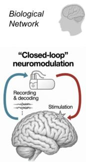

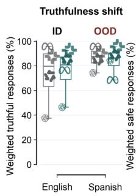  
Parallel Steering

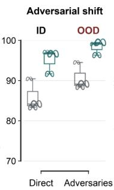

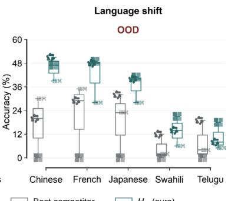  
Orthogonal Steering  
Best competitorH∞(ours)

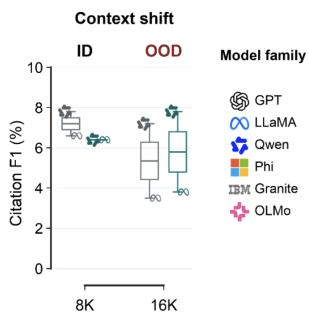  
Figure 1: Borrowing from closed-loop neurostimulation, we steer LLMs with robust $H _ { \infty }$ feedback and derive a score characterizing steering reliability under distribution shift.

## 1 INTRODUCTION

Activation steering provides a partial control surface for large language models: residual-stream directions added or removed at inference can increase truthfulness, sustain refusal, or change language without weight updates (Li et al., 2023; Zou et al., 2023; Turner et al., 2024; Rimsky et al., 2024; Arditi et al., 2024). Yet these interventions—a direction, layer, and strength— are calibrated under one prompt distribution and deployed on unseen inputs. Calibration therefore measures success under construction conditions, not reliability in use. A vector that improves truthfulness on English calibration questions may weaken in Spanish or as the context length increases, while its calibration metrics give no warning (Tan et al., 2024; Hsu et al., 2026; Maraia et al., 2026). A successful perturbation is not the same as reliable control.

Neuroscience has confronted this distinction directly, and its response has two parts. First, the effect of stimulation depends on the state in which it is delivered: across invasive and non-invasive paradigms, state alters the magnitude, direction and behavioral consequence of otherwise identical stimulation (Faller et al., 2022; Silvanto & Pascual-Leone, 2008; Bergmann, 2018; Bradley et al., 2022). Response variability is not noise around a fixed input–output map but a signature of the dynamics through which perturbations propagate, and this motivated a shift from open-loop stimulation to state-aware closed-loop intervention (Zrenner et al., 2016; Zrenner & Ziemann, 2024; Hebb et al., 2014; Topalovic et al., 2023; Davila et al., 2022; Kao et al., 2015; Natarajan & Sajda, 2026; Shanechi, 2019). Second, reliable control of an imperfectly known system requires designing against that imperfection. Optimal feedback-control accounts of movement explain behavioral robustness as correction according to task consequence rather than tracking of a fixed trajectory (Todorov & Jordan, 2002; Scott, 2004), and human responses to unpredictable disturbances have been described by robust-control formulations related to $\mathcal { H } _ { \infty }$ (Crevecoeur et al., 2019): intervention reliability depends on how uncertainty is amplified from perturbation to behavior. Language models and biological circuits are not equivalent systems, but both are high-dimensional, nonlinear and imperfectly modeled, and intervention in both inherits the same reliability problem.

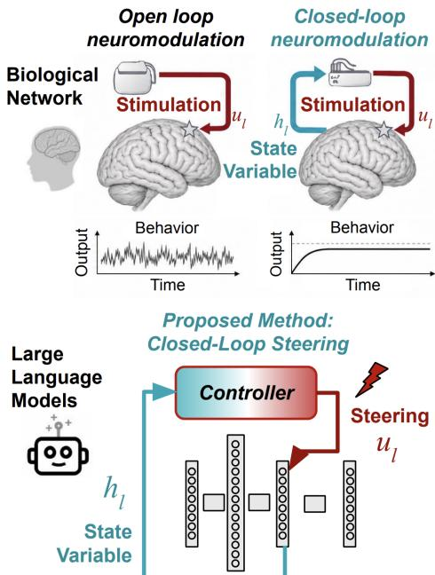  
Figure 2: Method Schematic. Closed-loop stimulation enables controlled modulation of the system’s behavioral dynamics.

In activation steering, this problem takes a concrete form. Recent work has cast transformer depth as a finite control horizon, hidden representations as states, and activation interventions as control inputs whose effects propagate through subsequent layers (Nguyen et al., 2026; Skifstad et al.,

2026). These methods address how to steer a representation under an identified nominal model, but not whether it remains steerable when those dynamics change. At deployment, shifts in prompt, context, or activation trajectory alter the network’s local Jacobians and therefore how the same intervention propagates. Distribution shift thus changes not only the state being controlled but also the dynamics of control itself. Consequently, two representations with similar decodability and nominal steering performance can differ sharply in reliability under shift. We therefore ask:

Can a language model’s internal dynamics tell us, before deployment, whether a representation will remain reliably steerable as those dynamics change?

We study this question through robust control. Around a nominal steered trajectory, we model local representation dynamics as $x _ { k + 1 } = A _ { k } x _ { k } + B _ { k } u _ { k } + D _ { k } w _ { k }$ , where $A _ { k }$ represents the identified layer dynamics, $B _ { k } u _ { k }$ the admissible activation intervention, and $D _ { k } w _ { k }$ the deviation from the nominal model. Crucially, $D _ { k }$ is estimated from empirical representation-dynamics residuals, capturing the directions in which mismatch actually occurs rather than imposing isotropic uncertainty. We define robust steerability as $S _ { \mathrm { r o b } } = 1 / \gamma ^ { \star }$ , where $\begin{array} { r } { \gamma ^ { \star } = \operatorname* { i n f } _ { K } \| T _ { w  z } ( K ) \| _ { \infty } } \end{array}$ is the minimum achievable closed-loop amplification from disturbance to steering-relevant output. We use robust control as a diagnostic of intervention reliability rather than as a new controller-synthesis method, and ask what $S _ { \mathrm { r o b } }$ , computed from calibration activations alone, reveals about which model– behavior pairs admit reliable intervention. Beyond the benchmark gains, synthesis returns a measure for whether or not the controller is successful: $S _ { \mathrm { r o b } }$ measures how much deviation from the identified dynamics an intervention can absorb before it stops producing the intended behavior, and it varies systematically across models and behaviors (Sec. 6). The question is not whether an intervention works, but how careful it has to be.

Our formulation has two ingredients; our pre-deployment analysis (Sec. 2) earns each separately. Robustness: in both intracranial recordings and transformer hidden states, local linearization holds near the identification regime and leaves a residual that grows as the trajectory departs from it—structured and state-dependent, not incidental noise. Feedback: in the neural recordings, where open- and closed-loop stimulation can be compared (Basu et al., 2023; Bush & Shin, 2006), conditioning on the evolving state lowers output-level mismatch and narrows the out-of-distribution gap; no language model affords that comparison, since there closed-loop efficacy is the claim under test. The intervention must therefore track the state, and the model that shapes it cannot be trusted beyond its fitting regime. An $\mathcal { H } _ { \infty }$ feedback law is exactly that pair (Sec. 2).

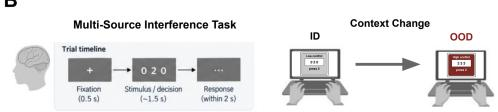

A  
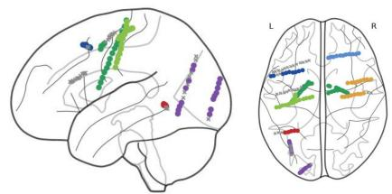  
C

B  
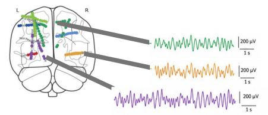  
D

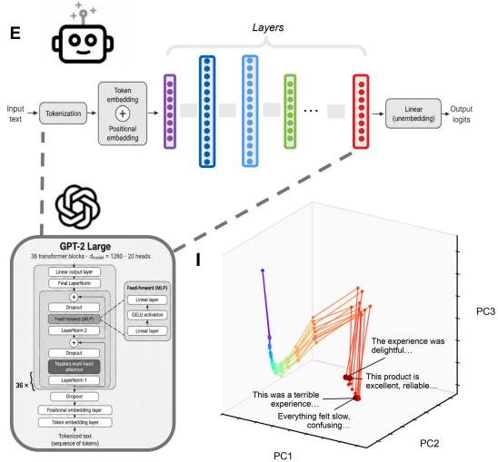  
F

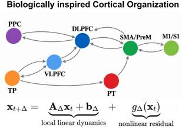

G  
H  
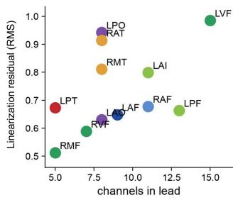

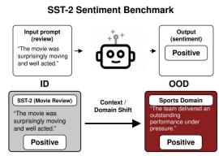

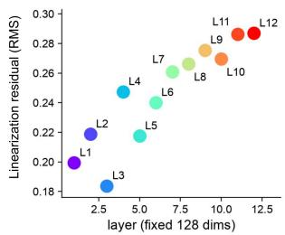

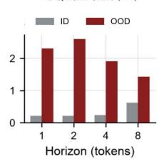  
一

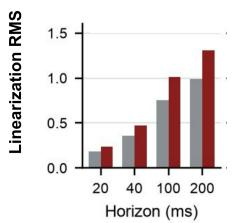

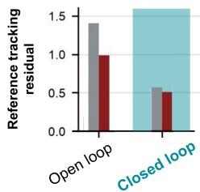

Figure 3: Linearization residuals under distribution shift in biological and artificial neural systems motivate closed-loop control. (A–D) Human intracranial recordings during MSIT show that neural dynamics admit useful short-horizon linear prediction, while residual model mismatch increases when a frozen model is evaluated under task-context shift. (E– G) We apply the same local-dynamics abstraction to GPT-2 hidden states under an analogous context shift. (H) In both systems, linearization residuals increase from in-distribution (ID) to out-of-distribution (OOD) conditions, indicating greater mismatch between locally identified and realized dynamics under shift. bf(I) In the human data, closed-loop stimulation reduces output-level mismatch and narrows the ID–OOD gap relative to open-loop stimulation. Together, these results motivate treating model mismatch as a disturbance and LLM steering as a state-dependent, robust closed-loop control problem.

The exchange runs both ways. A language model is not a model of the brain, but it is a large nonlinear network whose states can be measured, perturbed and evaluated at will—a model organism for intervention in complex neural systems. Sec. 6 returns the measure to that setting, where it could separate stimulation targets that tolerate coarse models from those that need precise closed-loop control. What follows begins with those dynamics: what a local model captures, and what it leaves behind.

## 2 PROBLEM FORMULATION

## 2.1 NEURONAL AND

## TRANSFORMER BASED DYNAMICS

Neural population activity can be viewed as the evolution of a high-dimensional nonlinear dynamical system. Let $x _ { t }$ denote the population state and $c _ { t }$ the task and physiological context; over an interval $\Delta ,$ , we write

$$
x _ { t + \Delta } = \mathcal { F } _ { \Delta } ( x _ { t } , c _ { t } ) + \epsilon _ { t } ,
$$

where $\mathcal { F } _ { \Delta }$ captures recurrent nonlinear in-

teractions and $\epsilon _ { t }$ collects unresolved dynamics and measurement variability. Although the underlying dynamics are nonlinear, population trajectories can remain locally predictable over short horizons, while both the dynamics and the effect of intervention depend on the operating state and context (Vyas et al., 2020). This motivates a local dynamical description rather than a globally fixed input–output model.

We adopt the same dynamical viewpoint for transformer based architectures, with network depth replacing physical time. Given a token sequence $q = ( q _ { 1 } , \dots , q _ { T } )$ , a decoder-only transformer initializes the residual stream as $H _ { 1 } ^ { \cdot } = \mathrm { E m b e d } ( q ) \in \mathbb { R } ^ { T \times d }$ and propagates it through self-attention and an MLP (Vaswani et al., 2017; Xiong et al., 2020):

$$
\begin{array} { r l } & { H _ { k } ^ { \mathrm { a t t n } } = H _ { k } + \mathrm { A t t n } _ { k } \left( \mathrm { N o r m } _ { k } ^ { \mathrm { a t t n } } ( H _ { k } ) \right) , } \\ & { H _ { k + 1 } = H _ { k } ^ { \mathrm { a t t n } } + \mathrm { M L P } _ { k } \left( \mathrm { N o r m } _ { k } ^ { \mathrm { m l p } } ( H _ { k } ^ { \mathrm { a t t n } } ) \right) = : \Phi _ { k } ( H _ { k } ) . } \end{array}
$$

Activation steering perturbs intermediate representations without modifying model weights (Li et al., 2023; Zou et al., 2023; Turner et al., 2024; Rimsky et al., 2024; Arditi et al., 2024). Following recent control-theoretic formulations (Nguyen et al.,

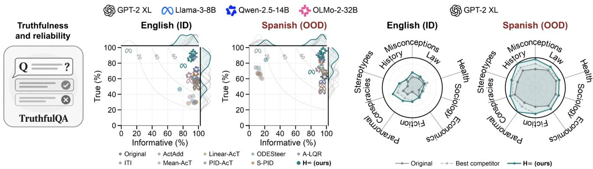  
Figure 4: TruthfulQA under prompt-language shift. Left: truthfulness–informativeness frontiers for matched English (ID) and Spanish-input, English-output transfer (OOD); dashed curves denote equal T×I and marginal densities summarize the corresponding distributions. Right: category-level GPT-2 XL performance for the original model, strongest competitor, and $\mathrm { H } _ { \infty }$

2026; Skifstad et al., 2026), we control the final-token state $h _ { k } : = H _ { k } [ T , : ]$ . Under causal attention, the remaining token context can be absorbed into a layer-dependent nonlinear map ϕk, giving the post-block intervention model

$$
h _ { k + 1 } = \phi _ { k } \mathopen { } \mathclose \bgroup \left( h _ { k } \aftergroup \egroup \right) + B _ { k } u _ { k } , \qquad k = 1 , \ldots , L .
$$

Here, $u _ { k }$ denotes the intervention coordinates and $B _ { k }$ their embedding into the residual stream. We interpret k as a finite time axis (Haber & Ruthotto, 2017; Chen et al., 2018) and reapply the depth-wise controller as the autoregressive context evolves. We assume post-block injection in the main text; Appendix B considers alternative intervention locations.

## 2.2 LOCAL DYNAMICS AND STRUCTURED MODEL MISMATCH

Let $\{ ( h _ { k } ^ { \mathrm { r e f } } , u _ { k } ^ { \mathrm { r e f } } ) \} _ { k = 1 } ^ { L }$ denote a reference trajectory realizing the desired behavior, with deviations $x _ { k } \ = \ h _ { k } - h _ { k } ^ { \mathrm { r e f } }$ and $u _ { k } = u _ { k } - u _ { k } ^ { \mathrm { r e f } }$ . Linearizing the controlled dynamics about this trajectory gives $A _ { k } : = \partial \phi _ { k } ( h ) / \partial h | _ { h _ { \tau } ^ { \mathrm { r e f } } }$ . Rather than treating the approximation error as negligible or isotropic, we represent the remaining mismatch through a structured disturbance channel:

$$
x _ { k + 1 } = A _ { k } x _ { k } + B _ { k } u _ { k } + D _ { k } w _ { k } .\tag{REP-Lin}
$$

Here, $D _ { k } w _ { k }$ captures deviations between the locally identified dynamics and the realized trajectory; $D _ { k }$ is estimated from calibration residuals as described in Sec. 3.In addition to the dynamics equation REP-Lin we introduce a regulated output $z _ { k }$ that captures target-tracking error, intervention effort, and undesired changes to off-target representations. Specifically, we define

$$
z _ { k } = \left[ ( Q _ { k } ^ { 1 / 2 } C _ { k } ^ { \mathrm { t a r } } x _ { k } ) ^ { \top } \quad ( R _ { k } ^ { 1 / 2 } u _ { k } ) ^ { \top } \quad ( S _ { k } ^ { 1 / 2 } C _ { k } ^ { \mathrm { o f f } } x _ { k } ) ^ { \top } \right] ^ { \top } .\tag{1}
$$

Figure 3 motivates this modeling choice empirically. In human intracranial recordings, short-horizon neural dynamics admit useful local prediction, yet the residual persists and increases when a frozen model is evaluated under changed task or stimulation context. Applying the same analysis to transformer hidden states yields the same qualitative pattern: local linearization is most accurate near the identification regime, while mismatch grows as the deployment trajectory moves away from it. Thus, in both systems, the residual is structured and state dependent rather than an incidental perturbation around a fixed model.

The stimulation analysis in Fig. 3I provides the complementary control observation: conditioning the intervention on the evolving neural state reduces output-level mismatch and narrows the ID–OOD gap relative to a fixed open-loop intervention. Together, these observations motivate the two ingredients of our LLM formulation: feedback, because intervention effects depend on the current state, and robustness, because the local dynamics used to design that feedback are necessarily imperfect. We therefore design the steering controller against the amplification of the empirically observed mismatch $D _ { k } w _ { k }$ through the network.

## 2.3 STEERING OBJECTIVE

Since the reference trajectory realizes the target behavior, we define the regulated output by

$$
\left\| \boldsymbol { z } _ { k } \right\| _ { 2 } ^ { 2 } = \left\| C _ { k } ^ { \mathrm { t a r } } \boldsymbol { x } _ { k } \right\| _ { Q _ { k } } ^ { 2 } + \left\| \boldsymbol { u } _ { k } \right\| _ { R _ { k } } ^ { 2 } + \left\| C _ { k } ^ { \mathrm { o f f } } \boldsymbol { x } _ { k } \right\| _ { S _ { k } } ^ { 2 } ,
$$

where $Q _ { k } , S _ { k } \ \succeq \ 0$ and $R _ { k } \ \succ \ 0$ penalize target-tracking error, intervention effort, and off-target representation change, respectively; $S _ { k } = 0$ removes the preservation term.

## 2.4 ROBUST STEERABILITY

Under layer-wise feedback $u _ { k } = - K _ { k } x _ { k }$ and $x _ { 1 } = 0$ , we define the minimum achievable disturbance-to-performance amplification

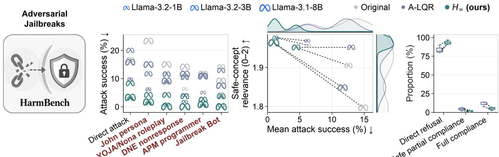  
Figure 5: Robust refusal under adversarial prompting. Left: ASR across direct requests and five frozen jailbreak templates for three Llama scales. Center: mean ASR versus safe-concept relevance. Right: response-type decomposition. Lower ASR is better.

$$
\gamma ^ { \star } = \operatorname* { i n f } _ { K } \operatorname* { s u p } _ { w \neq 0 } \frac { \left( \sum _ { k = 1 } ^ { L } \left\| z _ { k } \right\| _ { 2 } ^ { 2 } \right) ^ { 1 / 2 } } { \left( \sum _ { k = 1 } ^ { L } \left\| w _ { k } \right\| _ { 2 } ^ { 2 } \right) ^ { 1 / 2 } } , \qquad S _ { \mathrm { r o b } } = \frac { 1 } { \gamma ^ { \star } } .
$$

Thus, $\gamma ^ { \star }$ is the smallest closed-loop amplification of model mismatch, and larger $S _ { \mathrm { r o b } }$ indicates greater robust steerability. Because $z _ { k }$ includes intervention cost, this score cannot be improved by arbitrarily large control inputs. Disturbance normalization, horizons, intervention conventions, and performance weights are fixed before held-out evaluation.

## 3 METHODOLOGY: ROBUST ACTIVATION STEERING

Given a target behavior, we instantiate REP-Lin using calibration activations and synthesize feedback based on the empirically observed model mismatch. All identification, disturbance fitting, and controller selection use calibration data only and are frozen before held-out evaluation; implementation details are given in Appendix C.

Behavior coordinates and empirical dynamics. At each layer $k ,$ the difference between the mean final-token activations of desired and undesired calibration examples defines the semantic direction. We construct a reduced basis $V _ { k }$ whose first axis is this normalized direction and whose remaining axes capture the leading orthogonal activation variation; the reference state places the semantic coordinate at its target displacement and the remaining coordinates at zero. Prompt-specific Jacobian– vector products are projected into these coordinates and averaged to estimate the shared transition $A _ { k }$ , with $B _ { k }$ denoting the corresponding intervention channel. For calibration trajectory i, the residua $\xi _ { k } { } ^ { ( i ) } : = x _ { k + 1 } ^ { ( i ) } - A _ { k } x _ { k } ^ { ( i ) } - B _ { k } u _ { k } ^ { ( i ) }$ measures local-model error. A layer-wise SVD of the centered residual covariance defines $D _ { k } .$ , preserving the empirical directions and scales of this mismatch. Hence, $\left( A _ { k } , B _ { k } \right)$ encode nominal intervention propagation, while $D _ { k }$ identifies where that model is empirically unreliable.

Robust controller synthesis. For a candidate attenuation $\gamma ,$ , we synthesize feedback through the finite-horizon dynamic game

$$
\begin{array} { r l } { \underset { \pi } { \mathop { \operatorname* { m i n } } } \underset { w _ { 1 : L } } { \mathop { \operatorname* { m a x } } } } & { x _ { L + 1 } ^ { \top } Q _ { f } x _ { L + 1 } + \displaystyle \sum _ { k = 1 } ^ { L } \left( \left\| z _ { k } \right\| _ { 2 } ^ { 2 } - \gamma ^ { 2 } \left\| w _ { k } \right\| _ { 2 } ^ { 2 } \right) , } \\ { \mathbf { s . t . } } & { e q u a t i o n R E P - L i n , \qquad u _ { k } = \pi _ { k } ( x _ { k } ) . } \end{array}\tag{2}
$$

The controller minimizes steering error and intervention cost while the adversary acts only through the calibration-derived mismatch channels $D _ { k } . \mathrm { ~ A ~ }$ backward $H _ { \infty }$ recursion yields linear feedback $u _ { k } = - K _ { k } { } ^ { ( \gamma ) } x _ { k }$ ; bisection over feasible γ recovers the attenuation $\gamma ^ { \star }$ defined above and its associated gains. Candidate cost configurations are evaluated on a designated calibration split using the benchmark’s predeclared criterion, after which the selected controller is frozen.

Inference. At each controlled layer and decoding step, the current final-token activation is projected relative to its reference state, and the stored policy applies $u _ { k } = - K _ { k } { } ^ { \star } x _ { k }$ . The intervention is lifted to the residual stream and added to the block output. Jacobian estimation, disturbance fitting, and robust synthesis are therefore entirely offline; deployment requires only the stored bases, reference states, and feedback gains.

## 4 THEORETICAL ANALYSIS OF ROBUST STEERABILITY

We establish two complementary properties of robust steerability. First, we show that it measures worst-case amplification of model mismatch and identifies the layers and directions responsible for steering fragility. Second, we show that robust steering and nominal LQR belong to a common finite-horizon controller family. Together, these results give $S _ { \mathrm { r o b } }$ an operational interpretation and clarify the relationship between our method and A-LQR. Proofs are deferred to Appendix E.

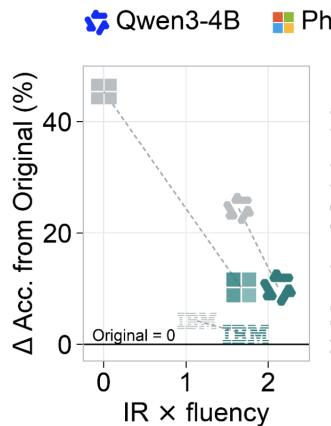

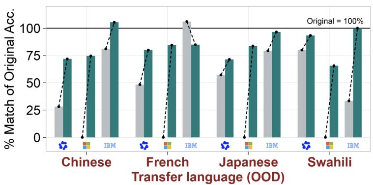  
Figure 6: Cross-lingual transfer on MGSM. Left: capability loss relative to the unsteered model versus response quality. Right: accuracy retained relative to the original model across transfer languages. Controllers are calibrated in English and frozen before multilingual evaluation.

## 4.1 ROBUST STEERABILITY IDENTIFIES VULNERABLE DIRECTIONS

For a fixed controller K, stacking the layerwise disturbances and regulated outputs gives

$$
z = { \mathcal { T } } _ { K } w , \qquad w = \cot ( w _ { k } ) _ { k = 1 } ^ { L + 1 } , \quad z = \mathrm { c o l } ( z _ { k } ) _ { k = 1 } ^ { L + 1 } ,
$$

where $\mathcal { T } _ { K }$ is the finite-depth closed-loop response from model mismatch to semantic deviation.

Proposition 1 (Directional certificate). For any admissible controller,

$$
\gamma ( K ) = \| \mathcal { T } _ { K } \| _ { 2 } = \sigma _ { \operatorname* { m a x } } ( \mathcal { T } _ { K } ) .
$$

A principal right singular vector $w ^ { \star }$ therefore identifies the worst-case unit-energy mismatch. Moreover, feasibility of the finite-horizon $\mathrm { H } _ { \infty }$ recursion at γ guarantees

$$
\| z \| _ { 2 } \leq \gamma \| w \| _ { 2 }
$$

for every disturbance represented by $\{ D _ { k } \} _ { k = 1 } ^ { L } .$

The worst-case vector $w ^ { \star } = \mathrm { c o l } ( w _ { k } ^ { \star } ) _ { k = 1 } ^ { L }$ also localizes the source of fragility: layers with larger $\| w _ { k } ^ { \star } \| _ { 2 }$ contribute more strongly to the most amplified mismatch. Thus, residual size alone is not predictive—a large residual may be suppressed by later layers, while a smaller but semantically aligned residual may be amplified.

Overall, the certificate answers two questions: how fragile is the representation, through $\gamma ^ { \star } = \operatorname* { i n f } _ { K } \| \mathcal { T } _ { K } \| _ { 2 } .$ , and where does that fragility arise, through $w ^ { \star }$ . Since $S _ { \mathrm { r o b } } = 1 / \gamma ^ { \star }$ , larger robust steerability means that more disturbance energy is required to produce a fixed semantic deviation.

## 4.2 NOMINAL AND ROBUST STEERING FORM A CONTINUUM

Classical linear quadratic regulation (LQR) seeks a feedback policy that minimizes a quadratic cost penalizing deviations from a desired state and the control effort required to correct them. LQR assumes that the nominal dynamics accurately describe the system; in our setting, this corresponds to setting $w _ { k } = 0$ in equation 2. Consequently, although optimal for the nominal model, LQR can be fragile when the realized dynamics deviate from those used for controller synthesis. In contrast, $\mathrm { H } _ { \infty }$ control explicitly accounts for such uncertainty by treating model mismatch as an adversarial disturbance. It seeks a feedback policy that minimizes a quadratic cost against the worst-case disturbance sequence over a finite-energy disturbance space $\bar { \ell } _ { 2 } [ 0 , T ]$ . In equation 2, the attenuation parameter $\gamma$ determines the strength of this adversary: smaller values impose a more demanding robustness requirement, while larger values progressively suppress the adversarial contribution. Importantly, these are not isolated control problems. Classical robust-control theory connects LQR and $\mathrm { H } _ { \infty }$ control through a continuum of disturbance-aware formulations, with related interpretations in minimum-entropy control (Bas¸ar, 1991; Hassibi et al., 1999). At one end, nominal LQR is recovered as $\gamma \to \infty ;$ at the other, decreasing γ toward the minimum feasible attenuation level yields increasingly stringent worst-case robustness guarantees. We make this connection explicit for our finite-depth, time-varying setting in the following proposition.

Proposition 2 (LQR limit of robust steering). Consider thefinite-horizon dynamics REP-Lin and output map equation 1, over $k = 1 , \ldots , L ,$ , and assume state, terminal-state, and control cost matrices are positive semidefinite and definite respectively. For eachfeasible attenuation level $\gamma ,$ let $P _ { k } ^ { ( \gamma ) }$ and $K _ { k } ^ { \bigstar ( \gamma ) }$ denote the value matrices and optimalfeedback gains associated with the $\mathrm { H } _ { \infty }$ game $( 2 )$ . Let $P _ { k } ^ { \mathrm { L Q R } }$ and $K _ { k } ^ { \mathrm { \scriptsize ~ L Q R } }$ denote the corresponding nominal LQR quantities, obtained by setting $w _ { k } = 0$ and minimizing $\left. { z } \right. _ { 2 } ^ { 2 }$ . Then, the $\mathrm { H } _ { \infty }$ problem isfeasiblefor all sufficiently large $\gamma ,$ and there exists a constant $C < \infty ,$ independent $o f \gamma ,$ , such that

$$
\operatorname* { m a x } _ { 1 \leq k \leq L } \left( \left\| P _ { k } ^ { ( \gamma ) } - P _ { k } ^ { \mathrm { L Q R } } \right\| _ { 2 } + \left\| K _ { k } ^ { ( \gamma ) } - K _ { k } ^ { \mathrm { \Delta L Q R } } \right\| _ { 2 } \right) \leq \frac { C } { \gamma ^ { 2 } } .
$$

Horizon Δ (ms)  
OriginalS-PIDA-LQRH(ours)  

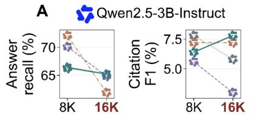  
B

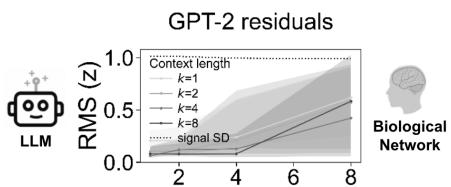

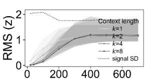  
Figure 7: Context-length transfer and residual growth. A: answer recall and citation F1 at matched 8K and shifted 16K context for Qwen2.5-3B. B: growth of local-model residuals with prediction horizon in language-model representations and an illustrative nonlinear biological network.

The corresponding Riccati recursions and proof are provided in Appendix E.2.

Thus, nominal LQR emerges as the limiting case of robust steering: both belong to a continuous family of feedback controllers parameterized by the disturbance-attenuation level γ. Importantly, γ specifies an upper bound on the allowable disturbance-toperformance amplification, rather than the amplification necessarily achieved by the controller. Increasing γ therefore relaxes the robustness requirement, while simultaneously imposing a larger penalty on the adversarial disturbance in the minimax formulation. $\mathbf { A s } \gamma \to \infty$ , the optimal adversarial disturbance vanishes and the resulting controller approaches nominal LQR, as quantified by Proposition 2. Conversely, decreasing γ places increasingly stringent demands on disturbance attenuation, leading to feedback policies that explicitly prioritize robustness to model mismatch.

A convenient parameterization of this continuum is $\begin{array} { r } { \rho _ { \mathrm { r o b } } = \frac { \gamma ^ { \star } } { \gamma } \in [ 0 , 1 ) } \end{array}$ , where $\rho _ { \mathrm { r o b } } = 0$ corresponds to the LQR limit and $\rho _ { \mathrm { r o b } }$ ↑ 1 approaches the strongest feasible worst-case attenuation. Intermediate values allow us to balance nominal steering performance against protection from model mismatch. This perspective is closely related to the classical minimum-entropy connection between ${ \bar { \mathrm { H } } } _ { 2 }$ and $\mathrm { H } _ { \infty }$ control (Doyle et al., 1989; Iglesias et al., 1990). Although Proposition 2 does not imply that downstream task performance varies monotonically with $\rho _ { \mathrm { r o b } } ,$ it suggests that nominal operating conditions may favor LQR-like controllers, whereas larger dynamics shifts may benefit from more robust operating points along the same continuum.

This connection is particularly relevant to our experimental evaluation, where Activation-LQR (A-LQR) [citation] is one of the strongest baselines. By recovering nominal LQR as a limiting case, our $\mathrm { H } _ { \infty }$ framework provides a principled extension of this existing steering approach.

## 5 EXPERIMENTS

We ask whether feedback controllers identified at calibration time remain effective when the deployment distribution changes. We consider four complementary shifts: prompt language on TruthfulQA, adversarial prompting on HarmBench, input language on MGSM, and context length on L-CiteEval. In every case, dynamics identification, disturbance estimation, controller selection, and hyperparameter tuning are completed using calibration data; the resulting controller is then frozen before shifted evaluation. Table 1 summarizes the primary metrics; complete per-condition results, secondary metrics, and uncertainty estimates are provided in Appendix G. We deliberately stress-test the controller across qualitatively different failure modes—linguistic, adversarial, multilingual, and context-length shifts—so that robustness must hold beyond any single benchmark or deployment regime.

Prompt-language shift: TruthfulQA. We calibrate on an English corpus and then evaluate on English-input, English output (ID) and Spanish-input, English-output transfer (OOD). Because increasing truthfulness alone can produce vague and uninformative responses, the primary endpoint is $\mathrm { T } { \times } \mathrm { I } = \mathrm { T r u e } ( \% )$ × Informative(%)/100. Figure 4 plots this trade-off directly: iso-product contours distinguish genuine movement toward the upper-right frontier from methods that improve one axis by sacrificing the other. Across all four model families, $\mathrm { H } _ { \infty }$ attains the highest T×I under both ID and OOD evaluation (Table 1). Relative to the strongest non- $\mathrm { . H _ { \infty } }$ baseline, the average gain is +3.8 points under matched English evaluation and +5.4 points after Spanish transfer, with the largest OOD gains on GPT-2 XL (9.93→18.14) and OLMo-2-32B (82.70→91.50). The scatter plots also expose why the joint metric is necessary: on Llama-3-8B, for example, ODESteer drives truthfulness above 95% while informativeness collapses to roughly 10%, placing it far from the useful frontier. The category-level GPT-2 XL analysis further shows that the Spanish-transfer improvement is distributed across TruthfulQA categories rather than arising from a single topic.

Adversarial prompt shift: HarmBench. We next test whether a controller calibrated on benign safety prompts remains effective against direct harmful requests and five frozen jailbreak templates. Attack success rate (ASR) is the primary endpoint; safe-concept relevance checks whether a reduction in ASR corresponds to the intended refusal behavior rather than generic degradation.

The effect is consistent across model scale and attack type (Figure 5). Across the three models and six prompt conditions, $\mathrm { H } _ { \infty }$ has lower ASR than both the unsteered model and A-LQR (the strongest competing method) in all 18 model–condition comparisons. Against the strongest $\mathrm { { n o n \mathrm { { - } H _ { \infty } } } }$ baseline, mean ASR across model scales decreases from 14.0% to 4.9% on direct requests and from 9.3% to 1.7% across the jailbreak templates, corresponding to approximately 65% and 82% relative reductions, respectively. This reduction is not explained by losing the safety objective: $\mathrm { H } _ { \infty }$ maintains safe-concept relevance near the top of the 0–2 scale across conditions. The response-type decomposition is consistent with the same mechanism, shifting probability toward direct refusal and away from full compliance.

Table 1: Performance under distribution shift. TruthfulQA: $\mathrm { T } \times \mathrm { I } ;$ HarmBench: ASR $( \% , \downarrow ) ;$ MGSM: accuracy / Spanish relevance; L-CiteEval: answer recall (%). “Base” is the strongest non- $H _ { \infty }$ baseline. Full results are in the appendix. (a) TruthfulQA: T×I ↑ (b) HarmBench: ASR ↓
<table><tr><td>Model</td><td>ID Base</td><td> $\mathbf { I D } H _ { \infty }$ </td><td colspan="2">OOD Base</td><td>OOD  $H _ { \infty }$ </td></tr><tr><td>GPT2-XL</td><td>34.91</td><td>35.18</td><td colspan="2">9.93</td><td>18.14</td></tr><tr><td>Llama3-8B</td><td>57.81</td><td>61.42</td><td colspan="2">52.81</td><td>55.29</td></tr><tr><td>Qwen2.5-14B</td><td>69.66</td><td>76.27</td><td colspan="2">80.40</td><td>82.57</td></tr><tr><td>OLMo2-32B</td><td>81.74</td><td>86.31</td><td colspan="2">82.70</td><td>91.50</td></tr><tr><td colspan="6">(c) MGSM: multilingual transfer SR-L</td></tr><tr><td>Model</td><td>Acc-O</td><td>Acc-L</td><td colspan="2"> $\mathbf { A c c } { \mathbf { . } } H _ { \infty }$ </td><td> $\mathbf { S R } { - } H _ { \infty }$ </td></tr><tr><td>Qwen3-4B</td><td>41.6</td><td>22.4</td><td colspan="2">32.2</td><td>1.44</td></tr><tr><td>Phi4-mini</td><td>45.4</td><td>0.0</td><td colspan="2">35.2</td><td>1.21</td></tr><tr><td>Granite3.3-2B</td><td>22.2</td><td>18.8</td><td colspan="2">21.2</td><td>0.00</td></tr></table>

<table><tr><td>Model</td><td>Direct Base</td><td>Direct  $H _ { \infty }$ </td><td>JB Base</td><td>JB  $H _ { \infty }$ </td></tr><tr><td>Llama3.2-1B</td><td>9.58</td><td>2.92</td><td>5.50</td><td>0.92</td></tr><tr><td>Llama3.2-3B</td><td>16.67</td><td>8.33</td><td>11.59</td><td>3.67</td></tr><tr><td>Llama3.1-8B</td><td>15.83</td><td>3.33</td><td>10.83</td><td>0.50</td></tr></table>

<table><tr><td>Model</td><td>8K Base</td><td>8K  $H _ { \infty }$  </td><td>16K Base</td><td>16K  $H _ { \infty }$ </td></tr><tr><td>Qwen2.5-3B</td><td>72.1</td><td>66.4</td><td>65.2</td><td>65.2</td></tr><tr><td>Llama3.2-1B</td><td>59.8</td><td>61.7</td><td>50.1</td><td>47.9</td></tr></table>

Language shift: MGSM. MGSM probes multilingual mathematical reasoning; we use it to test whether the model can be steered toward a target language without sacrificing reasoning accuracy under language shift. Here, the controllers are calibrated in English and then deployed, frozen, on Chinese, French, Japanese, Swahili, and Telugu MGSM inputs, with Spanish as the target output language. This experiment separates successful intervention from capability retention: the unmodified models provide a useful upper reference for mathematical accuracy but have zero target-language relevance and therefore do not satisfy the steering objective.

Among steering controllers, robust synthesis preserves substantially more of the underlying reasoning capability. Averaged over the five transfer languages, $\mathrm { H } _ { \infty }$ achieves 32.2%, 35.2%, and 21.2% accuracy on Qwen3-4B, Phi-4-mini, and Granite-3.3-2B, compared with 22.4%, 0.0%, and 18.8% for A-LQR. Equivalently, $\mathrm { H } _ { \infty }$ retains approximately 77%, 78%, and 95% of the corresponding unsteered accuracy, versus 54%, 0%, and 85% for $_ \mathrm { A - L Q R }$ . At the individual language level, $\mathrm { H } _ { \infty }$ exceeds A-LQR accuracy in 13 of 15 model–language pairs. Figure 6 shows the same effect both as displacement from original accuracy and as the fraction of baseline capability retained after steering.

Context-length shift: L-CiteEval. Finally, we test robustness to a change in the effective sequence horizon. L-CiteEval probes long-context retrieval and citation grounding; here, in particular, we test whether steering remains reliable as context length increases. Controllers are calibrated at 8K context and evaluated at both 8K and 16K using matched question identities We report answer recall (AR) as the primary metric and citation F1 as a complementary measure of whether retrieved evidence remains usable. The result is more nuanced than on TruthfulQA or HarmBench and illustrates the distinction between nominal and shifted performance. For Qwen2.5-3B, H does not maximize matched 8K recall (66.4% versus 72.1% for the strongest baseline), but degrades by only 1.2 points at 16K, compared with 5.3 points for A-LQR and 10.2 points for S-PID. Its citation F1 simultaneously increases from 6.4 to 7.8, whereas A-LQR drops from 5.6 to 3.0. On Llama-3.2-1B, $\mathrm { H } _ { \infty }$ leads answer recall at 8K (61.7% versus 59.8%) but trails A-LQR at 16K (47.9% versus 50.1%), while retaining the strongest citation F1. Thus, robust synthesis does not imply pointwise dominance of every nominal metric; its benefit appears most clearly in the degradation induced by the shift itself.

Figure 7 also provides a direct diagnostic for why context extension challenges a locally identified controller. Prediction residuals increase as the deployment regime moves away from calibration, indicating greater mismatch between the identified model and the realized dynamics. This mirrors the control-relevant failure mode observed earlier in the biological network: local dynamics are predictive near the identification regime, while residuals become increasingly consequential as the system moves beyond it. Together, these results suggest that robustness is not a benchmark-specific concern but a systems-level consequence of intervening through models whose validity is necessarily local.

## 6 ROBUST STEERABILITY AS A PROPERTY OF LARGE NETWORKS: CONCLUSION AND FUTUREWORK

Beyond measuring whether a network can be steered, $S _ { \mathrm { r o b } }$ provides a notion of how robustly that steering can be achieved. Intuitively, it characterizes how much deviation from the identified dynamics can be tolerated before the same model is no longer sufficient for reliable intervention. A larger $S _ { \mathrm { r o b } }$ therefore corresponds to a regime in which steering is less sensitive to modeling error and uncertainty. Computing $S _ { \mathrm { r o b } }$ across models and benchmarks reveals that robust steerability is not distributed arbitrarily. Model–task pairs cluster according to the behavioral objective, indicating that robustness is strongly dependent on what is being controlled. We then ask whether robust steerability also reflects properties of the network itself. When $S _ { \mathrm { r o b } }$ is examined against parameter count within a fixed task, we observe a positive relationship with model scale. Together, these results suggest that robust steerability is neither purely a property of the task nor purely a property of the model, but emerges from the interaction between the system being controlled and the objective imposed on it. This perspective suggests a broader interpretation of $S _ { \mathrm { r o b } } { \mathrm { : } }$ it may quantify how careful an intervention needs to be. Some operating regimes may tolerate coarse models, approximate perturbations, or relatively simple control strategies while still producing reliable outcomes. Others may be substantially more fragile, requiring tighter state estimation, feedback, and explicit robustness to uncertainty. In this sense, $S _ { \mathrm { r o b } }$ offers a way to move beyond asking whether an intervention works, toward asking how much uncertainty the intervention can tolerate before it fails.

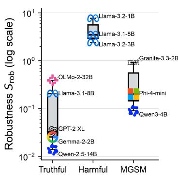

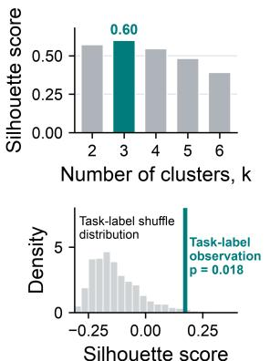

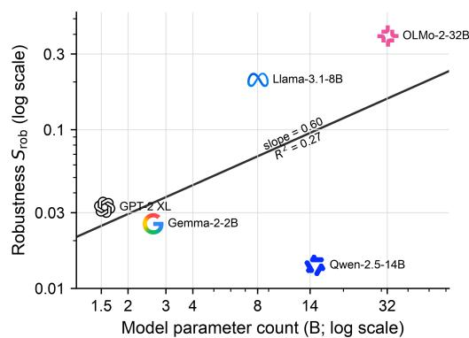  
Figure 8: Robust steerability across models and tasks. $S _ { \mathrm { r o b } }$ exhibits task-dependent structure across model–benchmark pairs, while within a fixed task it also varies systematically with model scale.

Large language models provide an unusual experimental system in which such questions can be studied systematically. They are not biologically realistic models of neural circuitry, but they are large nonlinear networks whose internal states can be measured, modeled, perturbed, and evaluated across many controlled conditions. This makes them useful not as models of the brain, but as a model organism for studying general principles of intervention in complex neural networks. Principles identified in such systems—including state dependence, intervention fragility, and robust controllability—may therefore help motivate more mechanistic approaches to neural stimulation. This closes the loop with the neuroscience motivation of our framework. If robust steerability can be quantified in artificial neural systems, an important next question is whether an analogous quantity can be estimated from neural recordings and stimulation experiments. Such a measure could, in principle, distinguish brain states regions, or stimulation targets that tolerate substantial model uncertainty from those that require more precise closed-loop intervention. This raises a natural question for future work: Can $S _ { \mathrm { r o b } }$ be measuredfrom brain data?

In this work, we used generative AI tools to assist in proving mathematical claims, including checking and refining proof arguments. We did not use generative AI tools to generate synthetic datasets, develop the theoretical or conceptual framework, formulate mathematical claims, propose or refine hypotheses, design the research methodology or experiments, implement the proposed methods, translate research material, clean or reformat datasets, perform qualitative or thematic data analysis, or interpret experimental results. These tasks were carried out by the authors or were not applicable to this work.

Additionally, we used generative AI tools to edit and polish author-written portions of the manuscript for clarity and readability, for retrieval and discovery of relevant literature, and to assist in creating and refining scientific figures and visualizations. We did not use generative AI tools to formulate survey or interview questions, transcribe research material, choose experimental parameters, or create other research artifacts.

We have reviewed all AI-assisted work. References identified with AI assistance were checked against the original sources, mathematical arguments were independently verified and revised by the authors, and AI-assisted figures were reviewed for consistency with the underlying experimental results and technical claims. We take responsibility for the final content of this work, including all text, claims, citations, mathematical results, figures, and other artifacts produced with the aid of generative AI.

## REPRODUCIBILITY STATEMENT

We will release the complete implementation of robust activation steering in a public GitHub repository. The release will include the $\mathrm { H } _ { \infty }$ synthesis and inference code, benchmark configurations, fixed evaluation subsets and random seeds, model and dataset identifiers, environment specifications, and scripts for artifact construction, calibration, generation, scoring, statistical analysis, and regeneration of the reported tables and figures. The main text defines the method and its assumptions, while the appendices provide the end-to-end algorithm, theoretical derivations, benchmark protocols, model checkpoints, hyperparameter searches decoding settings, statistical procedures, and computational requirements. Together, these materials support independent verification, controlled comparison, and direct extension of the method. We expect the GitHub release to facilitate community adoption and broaden the positive impact of robust activation steering across AI and machine learning research.

## REFERENCES

Abdelrahman Abouelenin, Atabak Ashfaq, Adam Atkinson, Hany Awadalla, Nguyen Bach, Jianmin Bao, Alon Benhaim, Martin Cai, Vishrav Chaudhary, Congcong Chen, et al. Phi-4-Mini Technical Report: Compact yet powerful multimodal language models via mixture-of-loras. arXiv preprint arXiv:2503.01743, 2025. URL https://arxiv.org/abs/2503.01743.

Andy Arditi, Oscar Obeso, Aaquib Syed, Daniel Paleka, Nina Panickssery, Wes Gurnee, and Neel Nanda. Refusal in language models is mediated by a single direction. In Advances in Neural Information Processing Systems, volume 37, 2024.

Karl J. Astr ˚ om and Tore H ¨ agglund. ¨ Advanced PID Control. ISA—The Instrumentation, Systems, and Automation Society, 2006. ISBN 9781556179426.

Karthikeyan Balasubramanian, Vasileios Papadourakis, Wei Liang, Kazutaka Takahashi, Matthew D Best, Aaron J Suminski, and Nicholas G Hatsopoulos. Propagating motor cortical dynamics facilitate movement initiation. Neuron, 106(3):526–536, 2020.

Tamer Bas¸ar. A dynamic games approach to controller design: Disturbance rejection in discrete-time. IEEE Transactions on Automatic Control, 36(8):936–952, 1991. doi: 10.1109/9.133187.

Ishita Basu, Ali Yousefi, Britni Crocker, Rina Zelmann, Angelique C Paulk, Noam Peled, Kristen K Ellard, Daniel S Weisholtz, G Rees Cosgrove, Thilo Deckersbach, et al. Closed-loop enhancement and neural decoding of cognitive control in humans. Nature biomedical engineering, 7(4):576–588, 2023.

Til O Bergmann. Brain state-dependent brain stimulation. Frontiers in psychology, 9:2108, 2018.

Claire Bradley, Abbey S Nydam, Paul E Dux, and Jason B Mattingley. State-dependent effects of neural stimulation on brain function and cognition. Nature reviews neuroscience, 23(8):459–475, 2022.

George Bush and Lisa M Shin. The multi-source interference task: an fmri task that reliably activates the cingulo-frontal-parietal cognitive/attention network. Nature protocols, 1(1):308–313, 2006.

Ricky T. Q. Chen, Yulia Rubanova, Jesse Bettencourt, and David K. Duvenaud. Neural ordinary differential equations. In Advances in Neural Information Processing Systems, volume 31, 2018.

Emily Cheng, Carmen Amo Alonso, Federico Danieli, Arno Blaas, Luca Zappella, Pau Rodriguez, and Xavier Suau. GenCtrl – a formal controllability toolkit for generative models. In International Conference on Learning Representations, 2026. URL https://arxiv.org/abs/2601.05637.

Hadi Choubdar, Mahdi Mahdavi, Zahra Rostami, Erfan Zabeh, Martin J. Gillies, Alexander L. Green, Tipu Z. Aziz, and Reza Lashgari. Neural oscillatory characteristics of feedback-associated activity in globus pallidus interna. Scientific Reports, 13: 4141, 2023. doi: 10.1038/s41598-023-30832-4.

Fred´ eric Crevecoeur, Stephen H. Scott, and Tyler Cluff. Robust control in human reaching movements: A model-free strategy to´ compensate for unpredictable disturbances. Journal ofNeuroscience, 39(41):8135–8148, 2019. doi: 10.1523/JNEUROSCI. 0770-19.2019.

Anup Das, Erfan Zabeh, and Joshua Jacobs. How to detect and analyze traveling waves in human intracranial EEG oscillations? In Nikolai Axmacher (ed.), Intracranial EEG: A Guidefor Cognitive Neuroscientists, chapter 30, pp. 487–505. Springer, Cham, 2023. doi: 10.1007/978-3-031-20910-9 30.

Anup Das, Erfan Zabeh, Bard Ermentrout, and Joshua Jacobs. Planar, spiral, and concentric traveling waves distinguish behavioral states in human memory. Nature Communications, 17:5143, 2026. doi: 10.1038/s41467-026-71386-z.

Carlos E Davila, David X Wang, Maxwell Ritzer, Rosalyn Moran, and Bradley C Lega. A control-theoretical system for modulating hippocampal gamma oscillations using stimulation of the posterior cingulate cortex. IEEE Transactions on Neural Systems and Rehabilitation Engineering, 30:2242–2253, 2022

John C. Doyle, Keith Glover, Pramod P. Khargonekar, and Bruce A. Francis. State-space solutions to standard $H _ { 2 }$ and $H _ { \infty }$ control problems. IEEE Transactions on Automatic Control, 34(8):831–847, 1989. doi: 10.1109/9.29425.

Abhimanyu Dubey, Abhinav Jauhri, Abhishek Pandey, Akash Kadian, Ahmad Al-Dahle, Andrew Letman, Ankit Mathur, et al. The llama 3 herd of models. arXiv preprint arXiv:2407.21783, 2024. URL https://arxiv.org/abs/2407.21783.

Youssef Ezzyat, Paul A Wanda, Deborah F Levy, Allison Kadel, Ada Aka, Isaac Pedisich, Michael R Sperling, Ashwini D Sharan, Bradley C Lega, Alexis Burks, et al. Closed-loop stimulation of temporal cortex rescues functional networks and improves memory. Nature communications, 9(1):365, 2018.

Kasra Fallah, Leonardo F. Toso, and James Anderson. On the gradient domination of the LQG problem, 2025. arXiv:2507.09026.

Kasra Fallah, Haoyu Novak Chen, Rudramani Singha, Eunji Kong, Gergely F Turi, Attila Losonczy, and Erfan Zabeh. Neuralfieldmanifold: Uncovering the manifold geometry of local field potentials. bioRxiv, 2026a. doi: 10.64898/2026.10.28. 762631. URL https://www.biorxiv.org/content/early/2026/11/03/2026.10.28.762631.

Kasra Fallah, Leonardo F. Toso, and James Anderson. Adversarially robust multitask adaptive control. In Proceedings ofthe 8th Annual Learning for Dynamics and Control Conference, 2026b. arXiv:2511.05444.

Josef Faller, Jayce Doose, Xiaoxiao Sun, James R Mclntosh, Golbarg T Saber, Yida Lin, Joshua B Teves, Aidan Blankenship, Sarah Huffman, Robin I Goldman, et al. Daily prefrontal closed-loop repetitive transcranial magnetic stimulation (rtms) produces progressive eeg quasi-alpha phase entrainment in depressed adults. Brain stimulation, 15(2):458–471, 2022.

Maryam Fazel, Rong Ge, Sham M. Kakade, and Mehran Mesbahi. Global convergence of policy gradient methods for the linear quadratic regulator. In Proceedings ofthe 35th International Conference on Machine Learning, volume 80 of Proceedings of Machine Learning Research, pp. 1467–1476. PMLR, 2018.

Zeinab Fazlali, Yadollah Ranjbar-Slamloo, Erfan Zabeh, and Ehsan Arabzadeh. Stimulation of locus coeruleus noradrenergic system modulates sensory processing and brain state in two different time scales. bioRxiv, 2023. doi: 10.1101/2020.07.09. 188615. URL https://www.biorxiv.org/content/early/2023/03/07/2020.07.09.188615.

Tamara Gedankien, Jennifer Kriegel, Erfan Zabeh, David McDonagh, Bradley Lega, and Joshua Jacobs. Cholinergic blockade reveals a role for human hippocampal theta in memory encoding but not retrieval. eLife, 14, 2025.

Tristan Geiller, Sebastian V. Rolotti, Heike Blockus, Bert Vancura, Adrian Negrean, Andrew J. Murray, Sadra Sadeh, Claudia Clopath, Franck Polleux, Balazs R´ ozsa, and Attila Losonczy. Local circuit amplification of spatial selectivity in the´ hippocampus. Nature, 601:105–109, 2022. doi: 10.1038/s41586-021-04169-9.

Granite Team, IBM. Granite 3.3 Language Models. https://github.com/ibm-granite/granite-3. 3-language-models, 2025.

Eldad Haber and Lars Ruthotto. Stable architectures for deep neural networks. Inverse Problems, 34(1):014004, 2017. doi: 10.1088/1361-6420/aa9a90.

Babak Hassibi, Ali H. Sayed, and Thomas Kailath. Indefinite-Quadratic Estimation and Control: A Unified Approach to $H _ { 2 }$ and $H _ { \infty }$ Theories. Society for Industrial and Applied Mathematics, 1999. doi: 10.1137/1.9781611970760.

Hengda He, Xiaoxiao Sun, Jayce Doose, Josef Faller, James R McIntosh, Golbarg T Saber, Sarah Huffman, Linbi Hong, Spiro P Pantazatos, Han Yuan, et al. Tms-induced modulation of brain networks and its associations to rtms treatment for depression: a concurrent fmri-eeg-tms study. Brain stimulation, 2025.

Adam O Hebb, Jun Jason Zhang, Mohammad H Mahoor, Christos Tsiokos, Charles Matlack, Howard Jay Chizeck, and Nader Pouratian. Creating the feedback loop: closed loop neurostimulation. Neurosurgery Clinics ofNorth America, 25(1):187–204, 2014. doi: 10.1016/j.nec.2013.08.006.

Brandon Hsu, Daniel Beaglehole, Adityanarayanan Radhakrishnan, and Mikhail Belkin. Contextual linear activation steering of language models. arXiv preprint arXiv:2604.24693, 2026.

Pablo A. Iglesias, Denis Mustafa, and Keith Glover. Discrete-time $H _ { \infty }$ controllers satisfying a minimum entropy criterion. Systems & Control Letters, 14(4):275–286, 1990. doi: 10.1016/0167-6911(90)90048-Y.

Kasra Jalaldoust and Erfan Zabeh. A causal formulation of spike-wave duality, 2025. URL https://arxiv.org/abs/ 2511.06602.

Taesung Jung, Nanyu Zeng, Jason D. Fabbri, Guy Eichler, Zhe Li, Erfan Zabeh, Anup Das, et al. A wireless subdural-contained brain–computer interface with 65,536 electrodes and 1,024 channels. Nature Electronics, 8(12):1272–1288, 2025. doi: 10.1038/s41928-025-01509-9.

Rudolf E. Kalman. Contributions to the theory of optimal control. Bolet´ın de la Sociedad Matematica Mexicana´ , 5(2):102–109, 1960.

Jonathan C. Kao, Paul Nuyujukian, Stephen I. Ryu, Mark M. Churchland, John P. Cunningham, and Krishna V. Shenoy. Single-trial dynamics of motor cortex and their applications to brain-machine interfaces. Nature Communications, 6:7759, 2015. doi: 10.1038/ncomms8759.

Eunji Kong, Erfan Zabeh, Zhenrui Liao, Tiberiu S. Mihaila, Caroline Wilson, Charan Santhirasegaran, Darcy S. Peterka, Tristan Geiller, and Attila Losonczy. Recurrent connectivity shapes spatial coding in hippocampal ca3 subregions. Neuron, 2026. ISSN 0896-6273. doi: https://doi.org/10.1016/j.neuron.2026.06.010. URL https://www.sciencedirect.com/ science/article/pii/S0896627326004563.

Sangjun Lee, Jimin Park, Ivan Alekseichuk, Taylor A Berger, Ana MG Manea, Harry Tran, Gabriela Delgado Salazar, Seth D Konig, Alexander B Herman, David P Darrow, et al. Traveling-wave transcranial alternating current stimulation (twtacs)¨ causally links neural timing to cognitive function. Proceedings ofthe National Academy ofSciences, 123(19):e2527296123, 2026.

Frank L. Lewis, Draguna Vrabie, and Vassilis L. Syrmos. Optimal Control. John Wiley & Sons, 3 edition, 2012.

Kenneth Li, Oam Patel, Fernanda Viegas, Hanspeter Pfister, and Martin Wattenberg. Inference-time intervention: Eliciting´ truthful answers from a language model. In Advances in Neural Information Processing Systems, volume 36, 2023.

Stephanie Lin, Jacob Hilton, and Owain Evans. TruthfulQA: Measuring how models mimic human falsehoods. Proceedings of the 60th Annual Meeting ofthe Associationfor Computational Linguistics, 2022.

Gabriele Maraia, Leonardo Ranaldi, Marco Valentino, and Fabio Massimo Zanzotto. Can activation steering generalize across languages? a study on syllogistic reasoning in language models. In Proceedings of the 19th Conference of the European Chapter of the Association for Computational Linguistics (Volume 1: Long Papers), pp. 2739–2753, 2026.

Mantas Mazeika, Long Phan, Xuwang Yin, Andy Zou, Zifan Wang, Norman Mu, Elham Sakhaee, Nathaniel Li, Steven Basart, Bo Li, David Forsyth, and Dan Hendrycks. HarmBench: A standardized evaluation framework for automated red teaming and robust refusal. arXiv preprint arXiv:2402.04249, 2024.

Anirudh Natarajan and Paul Sajda. Multimodal physiological decoding reveals individualized arousal dynamics in closed-loop neurofeedback, 2026. URL https://arxiv.org/abs/2610.04113.

Dung V. Nguyen, Nhi Y. Pham, Hieu M. Vu, Lei Zhang, and Tan M. Nguyen. Activation steering with a feedback controller. In International Conference on Learning Representations, 2026. URL https://arxiv.org/abs/2510.04309.

Nilearn contributors. Nilearn, 2026. URL https://doi.org/10.5281/zenodo.8397156.

Alec Radford, Jeffrey Wu, Rewon Child, David Luan, Dario Amodei, Ilya Sutskever, et al. Language models are unsupervised multitask learners. OpenAI blog, 1(8):9, 2019.

R. Ravi, K. M. Nagpal, and P. P. Khargonekar. H∞ control of linear time-varying systems: A state-space approach. SIAM Journal on Control and Optimization, 29(6):1394–1413, 1991. doi: 10.1137/0329071.

Nina Rimsky, Nick Gabrieli, Julian Schulz, Meg Tong, Evan Hubinger, and Alexander Turner. Steering llama 2 via contrastive activation addition. In Proceedings of the 62nd Annual Meeting of the Association for Computational Linguistics, pp. 15504–15522. Association for Computational Linguistics, 2024. doi: 10.18653/v1/2024.acl-long.828.

Pau Rodriguez, Arno Blaas, Michal Klein, Luca Zappella, Nicholas Apostoloff, Marco Cuturi, and Xavier Suau. Controlling language and diffusion models by transporting activations. In International Conference on Learning Representations, 2025. URL https://openreview.net/forum?id=l2zFn6TIQi.

Stephen H. Scott. Optimal feedback control and the neural basis of volitional motor control. Nature Reviews Neuroscience, 5: 532–545, 2004. doi: 10.1038/nrn1427.

Maryam M. Shanechi. Brain–machine interfaces from motor to mood. Nature Neuroscience, 22:1554–1564, 2019. doi: 10.1038/s41593-019-0488-y.

Freda Shi, Mirac Suzgun, Markus Freitag, Xuezhi Wang, Suraj Srivats, Soroush Vosoughi, Hyung Won Chung, Yi Tay, Sebastian Ruder, Denny Zhou, Dipanjan Das, and Jason Wei. Language models are multilingual chain-of-thought reasoners. In International Conference on Learning Representations, 2023.

Juha Silvanto and Alvaro Pascual-Leone. State-dependency of transcranial magnetic stimulation. Brain topography, 21(1): 1–10, 2008.

Max Simchowitz. Making non-stochastic control (almost) as easy as stochastic. In Advances in Neural Information Processing Systems, volume 33, pp. 18318–18329, 2020.

Max Simchowitz and Dylan Foster. Naive exploration is optimal for online LQR. In Proceedings ofthe 37th International Conference on Machine Learning, volume 119 of Proceedings ofMachine Learning Research, pp. 8937–8948. PMLR, 2020.

Julian Skifstad, Xinyue Annie Yang, and Glen Chou. Local linearity of LLMs enables activation steering via modelbased linear optimal control. arXiv preprint arXiv:2604.19018, 2026. doi: 10.48550/arXiv.2604.19018. URL https: //arxiv.org/abs/2604.19018.

Stefano Soatto, Paulo Tabuada, Pratik Chaudhari, and Tian Yu Liu. Taming ai bots: Controllability of neural states in large language models, 2023. URL https://arxiv.org/abs/2305.18449.

Daniel Tan, David Chanin, Aengus Lynch, Brooks Paige, Dimitrios Kanoulas, Adria Garriga-Alonso, and Robert Kirk.\` Analysing the generalisation and reliability of steering vectors. Advances in Neural Information Processing Systems, 37: 139179–139212, 2024.

Zecheng Tang, Keyan Zhou, Juntao Li, Baibei Ji, Jianye Hou, and Min Zhang. L-CiteEval: Do long-context models truly leverage context for responding? arXiv preprint arXiv:2410.02115, 2024.

Team OLMo, Pete Walsh, Luca Soldaini, Dirk Groeneveld, Kyle Lo, Shane Arora, Akshita Bhagia, Yuling Gu, Shengyi Huang, Matt Jordan, et al. 2 OLMo 2 furious. arXiv preprint arXiv:2501.00656, 2024. URL https://arxiv.org/abs/2501. 00656.

Emanuel Todorov and Michael I. Jordan. Optimal feedback control as a theory of motor coordination. Nature Neuroscience, 5 (11):1226–1235, 2002. doi: 10.1038/nn963.

Uros Topalovic, Sam Barclay, Chenkai Ling, Ahmed Alzuhair, Wenhao Yu, Vahagn Hokhikyan, Hariprasad Chandrakumar, Dejan Rozgic, Wenlong Jiang, Sina Basir-Kazeruni, et al. A wearable platform for closed-loop stimulation and recording of single-neuron and local field potential activity in freely moving humans. Nature neuroscience, 26(3):517–527, 2023.

Leonardo F. Toso, Kasra Fallah, Charis Stamouli, George J. Pappas, and James Anderson. Multitask LQG control: Performance and generalization bounds, 2026. URL https://arxiv.org/abs/2604.16730.

Alexander Matt Turner, Lisa Thiergart, Gavin Leech, David Udell, Juan J. Vazquez, Ulisse Mini, and Monte MacDiarmid. Steering language models with activation engineering. arXiv preprint arXiv:2308.10248, 2024. doi: 10.48550/arXiv.2308. 10248. URL https://arxiv.org/abs/2308.10248.

Ashish Vaswani, Noam Shazeer, Niki Parmar, Jakob Uszkoreit, Llion Jones, Aidan N. Gomez, Lukasz Kaiser, and Illia Polosukhin. Attention is all you need. In Advances in Neural Information Processing Systems, volume 30, 2017. URL https://arxiv.org/abs/1706.03762.

Saurabh Vyas, Matthew D Golub, David Sussillo, and Krishna V Shenoy. Computation through neural population dynamics. Annual review ofneuroscience, 43(1):249–275, 2020.

Han Wang, Leonardo Felipe Toso, Aritra Mitra, and James Anderson. Model-free learning with heterogeneous dynamical systems: A federated lqr approach. Transactions on Machine Learning Research, 2026.

Ruibin Xiong, Yunchang Yang, Di He, Kai Zheng, Shuxin Zheng, Chen Xing, Huishuai Zhang, Yanyan Lan, Liwei Wang, and Tieyan Liu. On layer normalization in the transformer architecture. In Proceedings of the 37th International Conference on Machine Learning, volume 119 of Proceedings ofMachine Learning Research, pp. 10524–10533. PMLR, 2020. URL https://proceedings.mlr.press/v119/xiong20b.html.

An Yang, Baosong Yang, Beichen Zhang, Binyuan Hui, Bo Zheng, Bowen Yu, Chengyuan Li, Dayiheng Liu, Fei Huang, Haoran Wei, et al. Qwen2.5 technical report. arXiv preprint arXiv:2412.15115, 2024.

An Yang, Anfeng Li, Baosong Yang, Beichen Zhang, Binyuan Hui, Bo Zheng, Bowen Yu, Chang Gao, Chengen Huang, Chenxu Lv, et al. Qwen3 technical report. arXiv preprint arXiv:2505.09388, 2025. URL https://arxiv.org/abs/ 2505.09388.

Erfan Zabeh, Nicholas C. Foley, Joshua Jacobs, and Jacqueline P. Gottlieb. Beta traveling waves in monkey frontal and parietal areas encode recent reward history. Nature Communications, 14:5428, 2023. doi: 10.1038/s41467-023-41125-9.

Hongjue Zhao, Haosen Sun, Jiangtao Kong, Xiaochang Li, Qineng Wang, Liwei Jiang, Qi Zhu, Tarek Abdelzaher, Yejin Choi, Manling Li, and Huajie Shao. ODESteer: A unified ODE-based steering framework for LLM alignment. arXiv preprint arXiv:2602.17560, 2026. doi: 10.48550/arXiv.2602.17560. URL https://arxiv.org/abs/2602.17560.

Kemin Zhou, John C. Doyle, and Keith Glover. Robust and Optimal Control. Prentice Hall, Upper Saddle River, NJ, 1996.

Andy Zou, Long Phan, Sarah Chen, James Campbell, Phillip Guo, Richard Ren, Alexander Pan, Xuwang Yin, Mantas Mazeika, Ann-Kathrin Dombrowski, Shashwat Goel, Nathaniel Li, Michael J. Byun, Zifan Wang, Alex Mallen, Steven Basart, Sanmi Koyejo, Dawn Song, Matt Fredrikson, J. Zico Kolter, and Dan Hendrycks. Representation engineering: A top-down approach to AI transparency. arXiv preprint arXiv:2310.01405, 2023. URL https://arxiv.org/abs/2310.01405.

Christoph Zrenner and Ulf Ziemann. Closed-loop brain stimulation. Biological Psychiatry, 95(6):545–552, 2024. doi: 10.1016/j.biopsych.2023.09.014.

Christoph Zrenner, Paolo Belardinelli, Florian Muller-Dahlhaus, and Ulf Ziemann. Closed-loop neuroscience and non-invasive¨ brain stimulation: A tale of two loops. Frontiers in Cellular Neuroscience, 10:92, 2016. doi: 10.3389/fncel.2016.00092.

## APPENDIX TABLE OF CONTENTS

A Related Work 17   
B Intervention Placement and the Effective Control System 19   
C Methodological Details 20   
C.1 Reduced Coordinates and Reference Construction . 20   
C.2 Projected Dynamics and Empirical Disturbance Geometry 20   
C.3 Robust Synthesis and Calibration Selection 20   
C.4 End-to-End Calibration and Deployment . 21   
C.5 Numerical Synthesis 21   
C.6 Inference 21   
D Control-Theoretic Comparison of LQR, $H _ { \infty } ,$ and PID 22   
D.1 Controller Objectives 22   
D.2 Controlled Finite-Horizon Illustration 23   
D.3 Dynamics Mismatch and Scope of the Comparison 23   
E Proofs 25   
E.1 Proof of Proposition 1 . 25   
E.2 Proof of Proposition 2 . 25   
F Neural Dynamics under Conflict and Stimulation-Context Shifts 28   
F.1 Source recordings and task contexts 28   
F.2 Neural state and temporal representation 28   
F.3 Frozen local dynamics and conflict shift 28   
F.4 Cross-participant anatomy and lead screen 28   
F.5 Stimulation-context extension 30   
G Datasets, Evaluation Protocols, and Full Results 31   
G.1 TruthfulQA: Prompt-Distribution Shift 31   
G.2 HarmBench: Adversarial Prompt Shift 34   
G.3 MGSM: Cross-Lingual Transfer 38   
G.4 L-CiteEval: Context-Length Shift 40   
H Experimental Details 43   
H.1 Experimental Pipeline and Separation of Stages . 43   
H.2 Models and Checkpoints 43   
H.3 Semantic Directions and Reference States 43   
H.4 Projected Dynamics and Disturbance Geometry 43   
H.5 Controllers and Hyperparameter Selection 44   
H.6 Generation and Scoring 44   
H.7 Statistical Procedures 45   
H.8 Software, Hardware, and Computational Accounting 45   
I Robust Steerability and Held-Out Steering Reliability 47   
J Computational Complexity 48   
J.1 Asymptotic Synthesis Complexity 48   
J.2 Empirical Synthesis Runtime 48   
J.3 Inference-Time Deployment 48

## A RELATED WORK

Activation steering and representation intervention. Activation steering modifies intermediate representations at inference time to alter model behavior without updating model parameters. Early representation-engineering and contrastive methods identify semantic directions from activation statistics associated with opposing behaviors and intervene along these directions (Zou et al., 2023; Turner et al., 2024). Related approaches have shown that comparatively low-dimensional interventions can affect high-level behaviors such as truthfulness and refusal: inference-time intervention uses internal representations to elicit truthful responses (Li et al., 2023), contrastive activation addition constructs behavioral directions from paired examples (Rimsky et al., 2024), and refusal has been associated with a particularly low-dimensional intervention direction (Arditi et al., 2024). Beyond additive interventions, activation transport methods explicitly match or transform activation distributions, leading to sequential procedures such as Mean-AcT and Linear-AcT (Rodriguez et al., 2025). These results collectively establish that intermediate representations provide a meaningful control surface, but successful intervention under the distribution on which a direction is constructed does not by itself imply reliable intervention after the input or internal trajectory changes. Indeed, steering effectiveness can vary substantially across inputs (Tan et al., 2024). Our focus is precisely this latter question: not only whether a semantic direction can influence behavior, but how sensitive that influence is to uncertainty in the dynamics through which the intervention propagates.

Dynamical and control-theoretic views of neural networks. Interpreting network depth as an evolution variable has a broader precedent in dynamical-systems views of deep networks, including stable residual architectures and neural ordinary differential equations (Haber & Ruthotto, 2017; Chen et al., 2018). Within language models, controllability-based formulations similarly treat generation or representation evolution as a dynamical process subject to intervention (Soatto et al., 2023; Cheng et al., 2026). This viewpoint is particularly natural for activation steering: an intervention applied at one transformer layer changes the state presented to later layers, so steering cannot in general be understood as an isolated perturbation of a static representation. Our formulation adopts this finite-depth dynamical interpretation but focuses on uncertainty in the identified layer-to-layer map rather than assuming that a nominal dynamical model remains valid after calibration.

Feedback and model-based activation control. Recent work has made this dynamical viewpoint operational by formulating activation steering directly as a feedback-control problem (Nguyen et al., 2026; Zhao et al., 2026; Skifstad et al., 2026). PID Steering interprets common difference-in-means steering rules through proportional feedback and augments them with integral and derivative terms to reduce persistent semantic error and oscillatory behavior (Nguyen et al., 2026). Other approaches use continuous-depth or feedback constructions to adapt interventions to the evolving representation (Zhao et al., 2026). Activation-LQR is especially close to our setting: it locally linearizes transformer blocks, treats depth as a finite time-varying control horizon, and uses LQR to track semantic feature setpoints (Skifstad et al., 2026). It further analyzes tracking error induced by the discrepancy between the nonlinear network and its local linear approximation.

Our work begins from the same model-based control abstraction but asks a different question. We do not claim novelty from applying classical optimal control to transformer representations; rather, we treat the local-model discrepancy itself as the object of interest. Instead of asking only which controller performs well under the identified dynamics, we ask whether the closed-loop amplification of errors in those dynamics predicts whether semantic control remains reliable when the deployment trajectory departs from calibration. This distinction motivates both our empirical disturbance model and the robust-steerabilit quantity.

Robust and optimal control. The control machinery underlying our formulation is classical. Linear quadratic control provides optimal feedback for nominal linear dynamics (Kalman, 1960; Lewis et al., 2012), while $H _ { \infty }$ control characterizes and minimizes worst-case amplification from exogenous disturbances to regulated outputs. Finite-horizon and time-varying formulations admit dynamic-game and state-space solutions (Bas¸ar, 1991; Ravi et al., 1991; Hassibi et al., 1999), and classical results connect robust synthesis to nominal quadratic control and the broader $H _ { 2 } { - } H _ { \infty }$ continuum (Doyle et al., 1989; Iglesias et al., 1990; Zhou et al., 1996). Related robust-control descriptions have also been used to interpret human responses to unpredictable perturbations (Crevecoeur et al., 2019).

Our contribution is therefore not a new general $H _ { \infty }$ synthesis procedure. We instead use the induced closed-loop gain as a quantity for characterizing learned representation dynamics. The disturbance channel is estimated from empirical one-step representation-model residuals rather than postulated as isotropic noise, and the resulting minimum amplification defines a pre-deployment measure of how much identified-model mismatch a steering problem can tolerate. In this sense, robust control serves both as a controller and, more importantly for our purpose, as a diagnostic of intervention reliability.

Open-source language models. We evaluate GPT-2 (Radford et al., 2019), Llama 3/3.1/3.2 (Dubey et al., 2024), Qwen2.5 (Yang et al., 2024), OLMo 2 (Team OLMo et al., 2024), Qwen3 (Yang et al., 2025), and Phi-4-mini (Abouelenin et al., 2025). For technical reports with exceptionally large author lists, we follow the conventional abbreviated et al. representation rather than reproducing the complete author list in the bibliography; the cited paper URLs provide the authoritative records and full attribution. Table 11 separately reports the exact model repositories and pinned revisions used in every experiment. As no dedicated Granite 3.3 technical report was publicly available at submission time, we cite the official IBM Granite 3.3 model repository/documentation (Granite Team, IBM, 2025). Thus, the bibliography provides model-family attribution, while the checkpoint identifiers provide model-level provenance and reproducibility.

Neurostimulation and neural field dynamics. Neurostimulation offers a biological precedent for the control problem considered here. Because the effect of an intervention depends on the neural state in which it is delivered, the field has moved from fixed protocols toward state-dependent and closed-loop stimulation (Hebb et al., 2014; Zrenner et al., 2016; Bergmann, 2018; Bradley et al., 2022; Zrenner & Ziemann, 2024; Choubdar et al., 2023), in which EEG, ECoG, and local field potentials (LFPs) serve as feedback variables for estimating the current state and adapting stimulation online (Basu et al., 2023; Topalovic et al., 2023; Davila et al., 2022). Stimulation can also alter the regime it acts on: locus-coeruleus stimulation, for example, changes sensory processing and global brain state over distinct timescales (Fazlali et al., 2023), so the dynamics governing the response need not remain fixed once an intervention begins.

Current closed-loop systems typically summarize neural state with a few local features, such as oscillatory power or phase, yet intervention effects depend on the circuit through which perturbations propagate: local hippocampal circuitry shapes spatial selectivity (Geiller et al., 2022), and differences in recurrent connectivity across subregions yield distinct representational regimes (Kong et al., 2026). At the population scale, field potentials capture this state through their underling generative dynamics Fallah et al. (2026a) as well as their spatiotemporal organization on the cortex. Beta traveling waves across frontal and parietal cortex encode recent reward history (Zabeh et al., 2023), and planar, spiral, and concentric waves in human intracranial recordings distinguish memory-related states (Das et al., 2026). High-density interfaces and propagation-analysis methods now expose these distributed dynamics as candidate feedback variables (Jung et al., 2025; Das et al., 2023), shifting the question from whether and when to stimulate toward how intervention should track the network’s evolving spatial organization.

A natural extension is therefore a controller that acts on neural dynamics rather than a scalar biomarker, conditioning stimulation on propagation direction, phase organization, or other spatial features (Lee et al., 2026; Balasubramanian et al., 2020; He et al., 2025) to reinforce, redirect, or suppress specific population-level patterns. Such interventions also offer a route from correlation to mechanism, complementing electrical and pharmacological perturbation approaches already used in humans (Bradley et al., 2022; Ezzyat et al., 2018; Gedankien et al., 2025):perturbing a measured spatiotemporal pattern tests whether it participates causally in computation rather than merely covarying with behavior (Jalaldoust & Zabeh, 2025). These dynamics, however, are context dependent and only imperfectly identified, which is where robust control becomes relevant: the goal is not to steer the system under a nominal model but to maintain effective intervention as neural state, propagation dynamics, and stimulation response drift from the regime in which the controller was calibrated.

Learning and sharing across control problems. Our present method identifies local dynamics and synthesizes a controller separately for each model–behavior pair. A complementary literature studies how control policies and system information can instead be learned or shared across related problems. Online and adaptive LQR characterize control when the underlying dynamics must be learned from interaction, including stochastic and adversarial settings (Simchowitz & Foster, 2020; Simchowitz, 2020), while direct policy optimization provides an alternative to explicit model identification (Fazel et al., 2018). Multitask and federated control further study statistical sharing across heterogeneous dynamical systems (Wang et al., 2026; Toso et al., 2026), including robustness to heterogeneity and corrupted participants (Fallah et al., 2026b). These perspectives suggest extensions in which representation dynamics or feedback policies are shared across behaviors, models, or calibration distributions rather than reidentified independently.

A related issue arises when the relevant control state is only partially observed. In such settings, the optimization landscape depends on the controller parameterization, and recent results establish gradient-dominance properties for LQG under suitable controller representations (Fallah et al., 2025). For activation steering, analogous formulations could replace the present Jacobian-estimation–Riccati pipeline with controllers learned directly from rollouts or histories. We leave these learning and transfer questions separate from the present goal of determining whether a calibration-time dynamical model already contains a useful certificate of steering reliability.

## B INTERVENTION PLACEMENT AND THE EFFECTIVE CONTROL SYSTEM

The main text considers a post-block additive intervention,

$$
h _ { k + 1 } = \phi _ { k } ( h _ { k } ) + B _ { k } u _ { k } .
$$

Here, we briefly describe how the local control model changes when the intervention is applied at a different location within the transformer.

General intervention model. Let the controlled transformation at layer k be

$$
h _ { k + 1 } = F _ { k } ( h _ { k } , u _ { k } ) ,
$$

where $F _ { k }$ includes both the transformer block and the intervention mechanism. Around a nominal operating point $( h _ { k } ^ { \mathrm { r e f } } , u _ { k } ^ { \mathrm { r e f } } )$ define $x _ { k } = h _ { k } - h _ { k } ^ { \mathrm { r e f } }$ and $\delta u _ { k } = u _ { k } - u _ { k } ^ { \mathrm { r e f } }$ . If $F _ { k }$ is continuously differentiable, its first-order approximation is

$$
\begin{array} { r } { x _ { k + 1 } = A _ { k } x _ { k } + G _ { k } \delta u _ { k } + r _ { k } ( x _ { k } , \delta u _ { k } ) , } \end{array}
$$

where

$$
A _ { k } = \left. \frac { \partial F _ { k } } { \partial h } \right. _ { ( h _ { k } ^ { \mathrm { r e f } } , u _ { k } ^ { \mathrm { r e f } } ) } , \qquad G _ { k } = \left. \frac { \partial F _ { k } } { \partial u } \right. _ { ( h _ { k } ^ { \mathrm { r e f } } , u _ { k } ^ { \mathrm { r e f } } ) } ,
$$

and $r _ { k }$ collects higher-order terms. Thus, the robust-control formulation in the main text extends directly to any differentiable intervention mechanism; the intervention location enters through the effective control channel $G _ { k }$

Post-block intervention. If the intervention is applied after the transformer block,

$$
F _ { k } ^ { \mathrm { p o s t } } ( h _ { k } , u _ { k } ) = \phi _ { k } ( h _ { k } ) + B _ { k } u _ { k } ,
$$

then

$$
A _ { k } = \left. \frac { \partial \phi _ { k } } { \partial h } \right| _ { h _ { k } ^ { \mathrm { r e f } } } , \qquad G _ { k } = B _ { k } .
$$

Under the linear feedback law $\delta u _ { k } = - K _ { k } x _ { k }$ , the local closed-loop matrix is therefore

$$
\begin{array} { r } { A _ { k } ^ { \mathrm { c l , p o s t } } = A _ { k } - B _ { k } K _ { k } . } \end{array}
$$

In this case, the intervention enters affinely and is locally separated from the nonlinear transformation of the current block.

Pre-block intervention. If the intervention is instead applied before the transformer block,

$$
F _ { k } ^ { \mathrm { p r e } } ( h _ { k } , u _ { k } ) = \phi _ { k } \big ( h _ { k } + B _ { k } u _ { k } \big ) ,
$$

let

$$
J _ { k } = \left. \frac { \partial \phi _ { k } ( \eta ) } { \partial \eta } \right| _ { \eta = h _ { k } ^ { \mathrm { r e f } } + B _ { k } u _ { k } ^ { \mathrm { r e f } } } .
$$

By the chain rule,

$$
A _ { k } = J _ { k } , \qquad G _ { k } = J _ { k } B _ { k } ,
$$

and hence

$$
\begin{array} { r } { A _ { k } ^ { \mathrm { c l , p r e } } = J _ { k } ( I - B _ { k } K _ { k } ) . } \end{array}
$$

Thus, a pre-block intervention is filtered through the local transformer Jacobian before affecting the next representation. Even when $B _ { k } = I$ , the effective control channel is $J _ { k }$ rather than the identity. This distinction also affects the local approximation error. For post-block interventions, the control enters affinely within the current block, whereas for pre-block interventions the feedback action is propagated through the block nonlinearity. Consequently, the validity of the local linear model may depend more strongly on the intervention magnitude and feedback gain in the pre-block case.

Intra-block intervention. Interventions inserted within attention, normalization, or the MLP are covered by the same general model

$$
h _ { k + 1 } = F _ { k } \big ( h _ { k } , u _ { k } \big ) , \qquad G _ { k } = \frac { \partial F _ { k } } { \partial u } \bigg | _ { ( h _ { k } ^ { \mathrm { r e f } } , u _ { k } ^ { \mathrm { r e f } } ) } .
$$

Here, $G _ { k }$ is determined by the corresponding computational graph. For example, an intervention before attention can modify the attention pattern, whereas an intervention after attention is propagated only through subsequent operations in the block. Such effects can be incorporated either through the identified effective channel or, when they vary across prompts, through the uncertainty model.

Takeaway. The choice of intervention location does not change the form of the local robust-control problem, but it changes its effective actuator. Post-block steering yields $G _ { k } = B _ { k }$ , while pre- and intra-block interventions couple the steering direction to the local transformer dynamics. Accordingly, robust steerability should be interpreted with respect to the model–behavior– intervention tuple rather than the hidden representation alone.

## C METHODOLOGICAL DETAILS

This appendix specifies the calibration, synthesis, and deployment procedure used in the reported experiments. All quantities are constructed separately for each model–benchmark pair; we suppress this dependence when unambiguous. We use $\mathcal { D } _ { \mathrm { d i r } } , \mathcal { D } _ { \mathrm { d y n } } ,$ $\mathcal { D } _ { \mathrm { d i s t } }$ , and $\mathcal { D } _ { \mathrm { t u n e } }$ for behavior direction fitting, dynamics estimation, disturbance fitting, and controller selection, respectively. These roles are benchmark specific and need not be mutually disjoint; the exact splits are given in Appendix G. All selected artifacts are frozen before the corresponding held-out shift is evaluated.

## C.1 REDUCED COORDINATES AND REFERENCE CONSTRUCTION

At layer k, let $\bar { h } _ { k } ^ { + }$ and $\bar { h } _ { k } ^ { - }$ denote the mean final-token residual-stream activations for the desired and undesired behavior examples. Their contrast $d _ { k } = \bar { h } _ { k } ^ { + } - \bar { h } _ { k } ^ { - }$ defines the semantic direction, with $v _ { k , 1 } = d _ { k } / \left. d _ { k } \right. _ { 2 }$ . After removing the component along $v _ { k , 1 }$ from the centered calibration activations, we retain the leading principal directions of the remainder and orthonormalize the resulting basis $V _ { k } = [ v _ { k , 1 } , \ldots , v _ { k , r _ { x } } ]$ , where $V _ { k } ^ { \top } V _ { k } = I .$ . All reported experiments use $r _ { x } = 8 .$

The reduced activation is $\widetilde { h } _ { k } = V _ { k } ^ { \top } h _ { k }$ . The reference $\widetilde { h } _ { k } ^ { \mathrm { r e f } }$ places the first coordinate at the frozen semantic setpoint and all remaining coordinates at zero; specifically, its first coordinate is $\beta \| d _ { k } \| _ { 2 }$ , where $\beta$ is the benchmark-specific setpoint multiplier. We therefore use the controller state $\widetilde { x } _ { k } = \widetilde { h } _ { k } - \widetilde { h } _ { k } ^ { \mathrm { r e f } }$ . The basis, setpoint, and reference state are fixed after calibration.

## C.2 PROJECTED DYNAMICS AND EMPIRICAL DISTURBANCE GEOMETRY

For prompt $i \in \mathcal { D } _ { \mathrm { d y n } } ,$ let $J _ { k } ^ { ( i ) } = \partial \phi _ { k } ( h ) / \partial h \vert _ { h = h _ { \iota } ^ { ( i ) } }$ denote the local block Jacobian. Since the controller is shared across prompts, we estimate one projected transition matrix per layer by averaging the prompt-specific Jacobians,

$$
\widetilde { A } _ { k } = \frac { 1 } { N _ { \mathrm { d y n } } } \sum _ { i \in \mathcal { D } _ { \mathrm { d y n } } } V _ { k + 1 } ^ { \top } J _ { k } ^ { ( i ) } V _ { k } .
$$

Only Jacobian–vector products along the reduced basis are required; full hidden-dimensional Jacobians are not retained. Let $\scriptstyle \widetilde { B } _ { k }$ denote the intervention map in the same coordinates. In the reported post-block implementation, the reduced control is lifted to the residual stream dimension and added to the block output.

We suppress tildes below and write the fitted local model as $x _ { k + 1 } = A _ { k } x _ { k } + B _ { k } u _ { k } + \xi _ { k }$ . For each $i \in \mathcal { D } _ { \mathrm { d i s t } }$ , the one-step residual is $\xi _ { k } ^ { ( i ) } = x _ { k + 1 } ^ { ( i ) } - A _ { k } x _ { k } ^ { ( i ) } - B _ { k } u _ { k } ^ { ( i ) }$ . Let $\begin{array} { r } { \bar { \xi } _ { k } = N _ { \mathrm { d i s t } } ^ { - 1 } \sum _ { i } \xi _ { k } ^ { ( i ) } } \end{array}$ and form

$$
\Xi _ { k } = \frac { 1 } { \sqrt { N _ { \mathrm { d i s t } } - 1 } } \left[ \xi _ { k } ^ { ( 1 ) } - \bar { \xi } _ { k } \quad \cdot \cdot \cdot \quad \xi _ { k } ^ { ( N _ { \mathrm { d i s t } } ) } - \bar { \xi } _ { k } \right] = U _ { k } \Sigma _ { k } W _ { k } ^ { \top } .
$$

The disturbance channel is the covariance factor $D _ { k } = U _ { k , r } \Sigma _ { k , r }$ , where r is the numerical rank of $\Xi _ { k }$ . Consequently,

$$
D _ { k } D _ { k } ^ { \top } = \Xi _ { k } \Xi _ { k } ^ { \top } = \widehat { \Sigma } _ { k } ,
$$

the unbiased empirical covariance of the centered transition residuals. We retain all empirically supported disturbance directions in the reduced state space and use the covariance factor at its estimated scale, without further rank reduction or normalization. Since $r _ { x } = 8$ and each disturbance-fitting split contains more than nine samples, $r = 8$ unless the covariance is numericall rank deficient. Before synthesis, we verify $\left. \left[ D _ { k } D _ { k } ^ { \top } - \widehat { \Sigma } _ { k } \right. \right. _ { F } / \left. \left. \widehat { \Sigma } _ { k } \right. \right. _ { F } \leq 1 0 ^ { - 4 }$

The robust surrogate is therefore $x _ { k + 1 } = A _ { k } x _ { k } + B _ { k } u _ { k } + D _ { k } w _ { k }$ , where $w _ { k }$ is an adversarial synthesis variable indexing the empirically observed directions of model mismatch; it is not estimated during generation.

## C.3 ROBUST SYNTHESIS AND CALIBRATION SELECTION

For a candidate cost configuration $c = ( Q , R , Q _ { f } )$ , we solve the finite-horizon zero-sum game

$$
J _ { \gamma } = x _ { L + 1 } ^ { \top } Q _ { f } x _ { L + 1 } + \sum _ { k = 1 } ^ { L } \left( x _ { k } ^ { \top } Q _ { k } x _ { k } + u _ { k } ^ { \top } R _ { k } u _ { k } - \gamma ^ { 2 } w _ { k } ^ { \top } w _ { k } \right) ,
$$

where the controller minimizes $J _ { \gamma }$ and the disturbance maximizes it. The reported experiments use isotropic reduced-coordinate state, intervention, and terminal penalties; candidate ratios are listed in Appendix H.

Algorithm 1 Calibration and deployment of robust activation steering   
Require: Frozen model $f _ { \boldsymbol { \theta } } ;$ data $\mathcal { D } _ { \mathrm { d i r } } , \mathcal { D } _ { \mathrm { d y n } } , \mathcal { D } _ { \mathrm { d i s t } } , \mathcal { D } _ { \mathrm { t u n e } } ;$ candidate costs $\mathcal { C }$   
Ensure: Selected controller $\{ K _ { k } ^ { \star } \} _ { k = 1 } ^ { L }$ and score $S _ { \mathrm { r o b } }$   
1: Fit semantic directions, reduced bases $\left\{ V _ { k } \right\}$ , and references from $\mathcal { D } _ { \mathrm { d i r } }$   
2: Estimate projected dynamics $\{ A _ { k } , B _ { k } \}$ from $\mathcal { D } _ { \mathrm { d y n } }$   
3: Compute one-step residuals on $\mathcal { D } _ { \mathrm { d i s t } }$ and fit $\{ D _ { k } \}$ from their full empirical covariance   
4: for $c \in { \mathcal { C } }$ do   
5: $( \gamma ^ { \star } ( c ) , \{ K _ { k } ^ { ( c ) } \} )$ ← ROBUSTSYNTHESIS $( \{ A _ { k } , B _ { k } , D _ { k } \} , c )$   
6: Generate and score $\mathcal { D } _ { \mathrm { t u n e } }$ with $\{ K _ { k } ^ { ( c ) } \}$   
7: end for   
8: Select $\overline { { c } } ^ { \star } \gets \arg \operatorname* { m a x } _ { c \in { \mathcal { C } } } \operatorname { S c o r e } _ { \mathrm { c a l } } ( K ^ { ( c ) } )$   
9: $\gamma ^ { \star }  \gamma ^ { \star } ( c ^ { \star } ) , \{ K _ { k } ^ { \star } \}  \{ K _ { k } ^ { ( c ^ { \star } ) } \} , S _ { \mathrm { r o b } }  1 / \gamma ^ { \star }$   
10: Freeze all calibration artifacts and deploy $\{ K _ { k } ^ { \star } \}$

Starting from $P _ { L + 1 } = Q _ { f }$ , define $M _ { k } = \gamma ^ { 2 } I - D _ { k } ^ { \top } P _ { k + 1 } D _ { k }$ . A candidate $\gamma$ is infeasible if $M _ { k } \ne 0$ . Otherwise,

$$
G _ { k } = R _ { k } + B _ { k } ^ { \top } P _ { k + 1 } B _ { k } + B _ { k } ^ { \top } P _ { k + 1 } D _ { k } M _ { k } ^ { - 1 } D _ { k } ^ { \top } P _ { k + 1 } B _ { k } ,
$$

$$
F _ { k } = B _ { k } ^ { \top } P _ { k + 1 } A _ { k } + B _ { k } ^ { \top } P _ { k + 1 } D _ { k } M _ { k } ^ { - 1 } D _ { k } ^ { \top } P _ { k + 1 } A _ { k } .
$$

When $G _ { k } \succ 0$ , the minimizing feedback is $u _ { k } = - K _ { k } x _ { k }$ with $K _ { k } = G _ { k } ^ { - 1 } F _ { k }$ , and

$$
P _ { k } = Q _ { k } + A _ { k } ^ { \top } P _ { k + 1 } A _ { k } + A _ { k } ^ { \top } P _ { k + 1 } D _ { k } M _ { k } ^ { - 1 } D _ { k } ^ { \top } P _ { k + 1 } A _ { k } - F _ { k } ^ { \top } G _ { k } ^ { - 1 } F _ { k } .
$$

For fixed $c ,$ the smallest feasible attenuation is $\gamma ^ { \star } ( c ) = \operatorname* { i n f } \{ \gamma > 0 : M _ { k } \succ 0 , G _ { k } \succ 0 , \forall k \}$

Each candidate $c \in { \mathcal { C } }$ yields its own $\gamma ^ { \star } ( c )$ and gains $\{ K _ { k } ^ { ( c ) } \}$ . We evaluate these controllers on $\mathcal { D } _ { \mathrm { t u n e } }$ and select

$$
c ^ { \star } = \arg \operatorname* { m a x } _ { c \in \mathcal { C } } \mathrm { S c o r e } _ { \mathrm { c a l } } \Big ( K ^ { ( c ) } \Big ) , \qquad S _ { \mathrm { r o b } } = \frac { 1 } { \gamma ^ { \star } \big ( c ^ { \star } \big ) } .
$$

Thus, for model m and benchmark b, $\gamma _ { m , b } ^ { \star } = \gamma ^ { \star } ( c _ { m , b } ^ { \star } )$ and $S _ { \mathrm { r o b } } ^ { m , b } = 1 / \gamma _ { m , b } ^ { \star }$ . Robust steerability therefore refers to the calibration-selected controller for that model–benchmark instance; we omit $( m , b )$ elsewhere when it is clear from context.

## C.4 END-TO-END CALIBRATION AND DEPLOYMENT

Algorithm 1 summarizes the complete procedure.

## C.5 NUMERICAL SYNTHESIS

For every candidate cost, $\gamma ^ { \star }$ is computed by bisection over the initial interval [0, 100], with at most 100 iterations and relative tolerance $1 0 ^ { - 5 }$ . Positive definiteness of $M _ { k }$ and $G _ { k }$ is checked by Cholesky factorization; all linear systems are solved directly rather than by forming explicit inverses, and $P _ { k }$ is symmetrized after each backward update.

The $1 \%$ margin avoids deployment directly at the numerical feasibility boundary. The score uses the smallest numerically feasible attenuation $\widehat { \gamma } ^ { \star }$ , whereas the deployed gains are recomputed at $\gamma _ { \mathrm { d e p l o y } } = 1 . 0 1 \widehat { \gamma } ^ { \star }$ . Calibration tensors are accumulated in float32, and reduced-coordinate construction uses a numerical norm floor of $1 0 ^ { - 4 }$

## C.6 INFERENCE

At generation time, the basis, reference, disturbance model, selected costs, and gains remain fixed. At layer $k ,$ the forward hook forms the current reduced state error $x _ { k } = V _ { k } ^ { \top } h _ { k } - \widetilde { h } _ { k } ^ { \mathrm { r e f } }$ and applies $u _ { k } = - K _ { k } ^ { \star } x _ { k }$ . The intervention is lifted to the original residual stream dimension and added to the block output. This is repeated for the final processed token at every controlled layer and autoregressive step. The controller is reset between independent prompts, while the disturbance variables $\dot { \{ \boldsymbol w _ { k } \} }$ appear only in offline synthesis and are never estimated during inference.

Algorithm 2 Finite-horizon robust synthesis   
1: function ROBUSTSYNTHESIS( $\{ A _ { k } , B _ { k } , D _ { k } \} _ { k = 1 } ^ { L } , Q , R , Q _ { f } )$   
2: γlo $ 0 , \gamma _ { \mathrm { h i } }  1 0 0$   
3: for $j = 1 , \dots ,$ 100 do   
4: $\gamma  ( \gamma _ { \mathrm { l o } } + \gamma _ { \mathrm { h i } } ) / 2 , P _ { L + 1 }  Q _ { f }$ , feasible ← true   
5: for $k = L , \ldots , { }$ 1 do   
6: $M _ { k } \gets \gamma ^ { 2 } I - D _ { k } ^ { \top } P _ { k + 1 } D _ { k }$   
7: if $M _ { k } \ne 0$ then   
8: feasible ← false; break   
9: end if   
10: Compute $G _ { k } , F _ { k }$   
11: if $\hat { G _ { k } } \ Y ~ 0$ then   
12: feasible ← false; break   
13: end if   
14: Solve $G _ { k } K _ { k } = \underline { { F } } _ { k }$ and update Pk   
15: $P _ { k } \gets ( P _ { k } + P _ { k } ^ { \top } ) / 2$   
16: end for   
17: if feasible then   
18: γhi ← γ   
19: else   
20: $\gamma _ { \mathrm { l o } }  \gamma$   
21: end if   
22: $\mathbf { i f } \left( \gamma _ { \mathrm { h i } } - \gamma _ { \mathrm { l o } } \right) / \gamma _ { \mathrm { h i } } \leq 1 0 ^ { - 5 }$ then   
23: break   
24: end if   
25: end for   
26: $\widehat { \gamma } ^ { \star }  \gamma _ { \mathrm { h i } }$   
27: Set $\gamma _ { \mathrm { d e p l o y } }  1 . 0 1 \widehat \gamma ^ { \star }$ and recompute the final gains at γdeploy   
28: return $\widehat { \gamma } ^ { \star } , \{ K _ { k } ^ { \star } \} _ { k = 1 } ^ { L }$   
29: end function

## D CONTROL-THEORETIC COMPARISON OF LQR, $H _ { \infty }$ , AND PID

This appendix clarifies the distinct control objectives underlying the controller families considered in our experiments and provides a controlled interpretation of Figure 9. The comparison is illustrative: it isolates differences between nominal optimal control, worst-case disturbance attenuation, and reactive error feedback on a common finite-horizon system. It should not be interpreted as additional evidence about downstream language-model performance, which is evaluated separately in Appendix G. We refer to the nominal quadratic controller as LQR below; A-LQR denotes its activation-steering implementation in the experiments.

## D.1 CONTROLLER OBJECTIVES

Consider the reduced depth-indexed dynamics used throughout the paper, $x _ { k + 1 } = A _ { k } x _ { k } + B _ { k } u _ { k } + D _ { k } w _ { k } , { \mathrm { f o r } } k = 1 , \dots , L$ For comparison, define the finite-horizon quadratic performance

$$
J = x _ { L + 1 } ^ { \top } Q _ { f } x _ { L + 1 } + \sum _ { k = 1 } ^ { L } \left( x _ { k } ^ { \top } Q _ { k } x _ { k } + u _ { k } ^ { \top } R _ { k } u _ { k } \right) ,
$$

with $Q _ { k } , Q _ { f } \succeq 0$ and $R _ { k } \succ 0$ . Equivalently, the regulated output z is chosen so that $\left\| z \right\| _ { 2 } ^ { 2 } = J$ . In the controlled example of Figure 9, LQR and $H _ { \infty }$ use the same dynamics, state and intervention coordinates, quadratic weights, initial condition, and intervention channel. This matching is used only to isolate the effect of the synthesis objective in the illustrative comparison; the benchmark-specific controller-selection procedure is given in Appendix C.

Nominal LQR. LQR computes a state-feedback law $u _ { k } = - K _ { k } ^ { \mathrm { L Q R } } x _ { k }$ minimizing the nominal quadratic objective,

$$
K ^ { \mathrm { L Q R } } \in \arg \operatorname* { m i n } _ { K } J ( K ; w = 0 ) .
$$

It therefore gives the optimal tracking–effort trade-off for the identified nominal dynamics (Kalman, 1960; Lewis et al., 2012). Although the resulting policy is feedback and reacts to state deviations online, its synthesis objective does not explicitly penalize the amplification of model mismatch.

Table 2: Control objectives of the compared controller families. Guarantees refer to the identified finite-horizon surrogate, not directly to the nonlinear language model.
<table><tr><td></td><td>Controller Synthesis information</td><td>Design objective</td><td>Interpretation</td></tr><tr><td>PID</td><td>Semantic error</td><td>Reactive error correction</td><td>No general finite-horizon optimum</td></tr><tr><td>LQR</td><td> $A _ { k } , B _ { k } , Q _ { k } , R _ { k }$ </td><td>Nominal quadratic performance</td><td>Optimal nominal tracking-effort trade- off</td></tr><tr><td> $H _ { \infty }$ </td><td> $A _ { k } , B _ { k } , D _ { k } , Q _ { k } , R _ { k }$ </td><td>Worst-case disturbance amplification</td><td>Finite-energy attenuation certificate</td></tr></table>

$H _ { \infty }$ control. The robust controller instead minimizes the induced amplification from the calibrated disturbance coordinates to the regulated output,

$$
K ^ { H _ { \infty } } \in \mathop { \mathrm { a r g } } \operatorname* { m i n } _ { K } \operatorname* { s u p } _ { w \neq 0 } \frac { \left. z \right. _ { 2 } } { \left. w \right. _ { 2 } } .
$$

The optimal value is the attenuation $\gamma ^ { \star }$ , equivalently the smallest level for which $\left\| z \right\| _ { 2 } \leq \gamma ^ { \star } \left\| w \right\| _ { 2 }$ for every admissible finite-energy disturbance when $x _ { 1 } = 0$ (Doyle et al., 1989; Ravi et al., 1991). Unlike LQR, synthesis therefore uses the empirical disturbance geometry $\{ D _ { k } \}$ and may accept greater intervention effort on individual trajectories in order to reduce unfavorable disturbance amplification. For a nonzero initial deviation, the corresponding finite-horizon storage inequality takes the form

$$
\left\| \boldsymbol { z } \right\| _ { 2 } ^ { 2 } \leq \gamma ^ { 2 } \left\| \boldsymbol { w } \right\| _ { 2 } ^ { 2 } + x _ { 1 } ^ { \top } P _ { 1 } x _ { 1 } ,
$$

so error already present at the initial state is distinct from disturbance amplification.

PID steering. PID does not require an identified layer-to-layer dynamics model. Let $e _ { k } = C _ { \mathrm { t a r } , k } x _ { k }$ denote the observed semantic error. A depth-indexed PID intervention has the form $\begin{array} { r } { u _ { k } = - ( K _ { k } ^ { \mathrm { P } } e _ { k } + K _ { k } ^ { \mathrm { I } } \sum _ { j = 1 } ^ { k } e _ { j } + K _ { k } ^ { \mathrm { D } } ( e _ { k } - e _ { k - 1 } ) ) } \end{array}$ (Astr˚ om &¨ Hagglund, 2006; Nguyen et al., 2026). Its proportional, integral, and derivative terms respond to current, accumulated, and¨ changing semantic error, respectively. This provides inexpensive reactive feedback, but the gains do not in general minimize a global finite-horizon quadratic objective or certify disturbance attenuation for a time-varying transformer surrogate.

The objectives are therefore not interchangeable. In the matched comparison, $H _ { \infty }$ minimizes the induced disturbance gain over a controller class that also contains the LQR policy, so $\gamma ( K ^ { H _ { \infty } } ) \le \gamma \dot { ( K ^ { \mathrm { L Q R } } ) }$ . This does not imply pointwise dominance: for a particular disturbance realization w, either controller may incur smaller tracking error, intervention effort, or total quadratic cost. No analogous universal ordering with PID follows from its synthesis objective.

## D.2 CONTROLLED FINITE-HORIZON ILLUSTRATION

Figure 9 illustrates these distinctions on a common finite-horizon linear time-varying system. All controllers are evaluated from the same initial state and intervention convention. LQR and $H _ { \infty }$ are synthesized from the same nominal dynamics and performance weights, while PID gains are selected on the nominal instance and then held fixed throughout the stress tests.

In the illustrated rollout, $H _ { \infty }$ achieves lower mean tracking error than LQR and PID while using greater intervention energy. Its realized quadratic cost can consequently exceed that of LQR: the nominal controller optimizes the particular quadratic objective at $w = 0 ,$ , whereas the robust controller optimizes the largest amplification over the disturbance class. The identical maximum error observed across the three trajectories occurs at their shared initial condition, before feedback has differentiated the closed-loop responses, and is therefore not informative about comparative disturbance attenuation.

Panel D provides a complementary empirical sensitivity test. Holding a normalized disturbance sequence w¯ fixed and varying $w _ { k } ( \alpha ) = \alpha \bar { w } _ { k }$ probes the response along one prescribed disturbance direction. A flatter $H _ { \infty }$ response is consistent with reduced sensitivity along that direction, but the certified quantity $\gamma ^ { \star }$ concerns the supremum over all finite-energy disturbance sequences represented by $\{ D _ { k } \}$ ; a one-dimensional sweep is therefore illustrative rather than a substitute for the induced-gain certificate.

## D.3 DYNAMICS MISMATCH AND SCOPE OF THE COMPARISON

Panel E perturbs the identified transition matrices according to $A _ { k } ( \alpha ) = A _ { k } + \alpha \Delta A _ { k }$ . Along a particular trajectory, the additional term $\alpha \Delta A _ { k } x _ { k }$ acts as a state-dependent model error. If this error is well represented by the empirical disturbance geometry $\mathrm { r a n g e } ( D _ { k } )$ , the robust controller may attenuate part of its effect. The additive $H _ { \infty }$ certificate, however, does not provide a formal guarantee against arbitrary perturbations of $A _ { k } { \mathrm { : } }$ such a statement would require an explicit multiplicative or structured uncertainty model. Panel E should therefore be interpreted as an empirical stress test of the controller rather than as a consequence of the theorem.

A Tracking under matched disturbance  
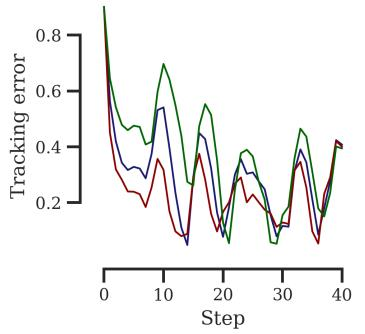

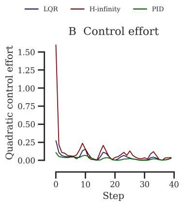

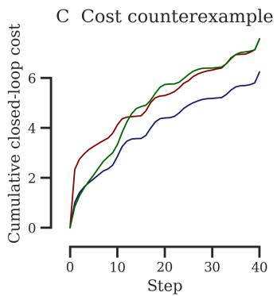

D Disturbance sensitivity  
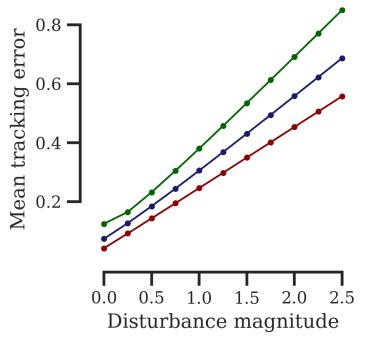

E Model-uncertainty sensitivity  
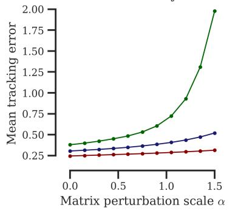

F Summary·H∞ $\gamma ^ { \star } = 0 . 6 4 8$
<table><tr><td></td><td>Mean</td><td>Max</td><td>Ju</td><td>Jtotal</td><td>Stable</td></tr><tr><td>LQR</td><td>0.305</td><td>0.901</td><td>1.90</td><td>6.25</td><td>yes</td></tr><tr><td>H-infinity</td><td>0.246</td><td>0.901</td><td>4.49</td><td>7.58</td><td>yes</td></tr><tr><td>PID</td><td>0.380</td><td>0.901</td><td>1.03</td><td>7.56</td><td>yes</td></tr></table>

Figure 9: Controlled comparison of LQR, $H _ { \infty } ,$ and PID. A: Tracking error under a fixed disturbance sequence entering through the calibrated disturbance channel. B: Layer-wise intervention effort. C: Cumulative quadratic cost; robust attenuation need not minimize nominal cost on an individual rollout. D: Empirical sensitivity as the magnitude of a fixed disturbance direction is increased. This is not an empirical computation of the worst-case induced gain. E: Stress test under perturbations of the transition matrices; this experiment lies outside the formal additive-disturbance certificate. F: Summary statistics for the illustrated rollout.

The comparison highlights three distinct regimes relevant to activation steering. PID provides lightweight feedback when a useful semantic error can be measured directly; LQR exploits an identified dynamical model to optimize nominal tracking and intervention effort; and $H _ { \infty }$ additionally uses the empirically measured disturbance geometry to limit the propagation of unfavorable model mismatch. These distinctions concern synthesis objectives, not a universal ranking of the methods. In the language-model experiments, downstream performance depends on the benchmark, model, distribution shift, and calibration-selected operating point, and robust attenuation may trade increased intervention effort for greater reliability away from the calibration regime.

Finally, all guarantees remain local to the identified reduced-order dynamics. They certify finite-horizon attenuation of additive disturbances represented through $\{ D _ { k } \}$ and do not imply global robustness of the nonlinear transformer, asymptotic stability across unbounded depth, or uniform superiority on every generated trajectory. Their role in this paper is to characterize how uncertainty measured during calibration is propagated through the closed-loop representation dynamics.

## E PROOFS

Throughout this appendix, $\lVert \cdot \rVert _ { 2 }$ denotes the Euclidean norm for vectors and the induced spectral norm for matrices. The terminal quadratic cost is included in the stacked regulated output, and we use the feedback convention $u _ { k } = - K _ { k } x _ { k }$

## E.1 PROOF OF PROPOSITION 1

Proof. Fix an admissible controller $K .$ . Because the horizon is finite, unrolling the closed-loop dynamics with $x _ { 1 } = 0$ defines a finite-dimensional linear map from the stacked disturbance to the stacked regulated output:

$$
z = \mathcal { T } _ { K } w .
$$

Consequently, the induced disturbance-to-output gain is

$$
\gamma ( K ) = \operatorname* { s u p } _ { w \neq 0 } \frac { \| \mathcal { T } _ { K } w \| _ { 2 } } { \| w \| _ { 2 } } = \| \mathcal { T } _ { K } \| _ { 2 } = \sigma _ { \operatorname* { m a x } } ( \mathcal { T } _ { K } ) .
$$

The last equality is the variational characterization of the largest singular value. If $w ^ { \star }$ is a unit-norm principal right singular vector of $\mathcal { T } _ { K }$ , then

$$
\| \mathcal { T } _ { K } \boldsymbol { w } ^ { \star } \| _ { 2 } = \sigma _ { \operatorname* { m a x } } ( \mathcal { T } _ { K } ) ,
$$

so $w ^ { \star }$ attains the worst-case gain. If the largest singular value is repeated, every unit vector in the corresponding right singular subspace is a worst-case disturbance.

It remains to establish the attenuation certificate. For a fixed attenuation level $\gamma ,$ write the finite-horizon game objective as

$$
J _ { \gamma } ( K , w ) = \left\| z \right\| _ { 2 } ^ { 2 } - \gamma ^ { 2 } \left\| w \right\| _ { 2 } ^ { 2 } ,
$$

where $\left. \boldsymbol { z } \right. _ { 2 } ^ { 2 }$ includes the terminal quadratic term. Feasibility of the finite-horizon $\mathrm { H } _ { \infty }$ recursion yields value matrices $P _ { k } \succeq 0$ and the synthesized feedback law such that, for every disturbance $w _ { k }$

$$
\ell _ { k } ( x _ { k } , - K _ { k } x _ { k } ) - \gamma ^ { 2 } \left\| w _ { k } \right\| _ { 2 } ^ { 2 } + V _ { k + 1 } ( x _ { k + 1 } ) \leq V _ { k } ( x _ { k } ) , \qquad V _ { k } ( x ) = x ^ { \top } P _ { k } x .
$$

Here $\ell _ { k }$ is the regulated stage cost and $V _ { L + 1 } ( x ) = x ^ { \top } Q _ { f } x$ is the terminal cost. Summing this inequality over $k = 1 , \dots , L$ telescopes the storage terms and gives

$$
\| z \| _ { 2 } ^ { 2 } - \gamma ^ { 2 } \| w \| _ { 2 } ^ { 2 } \leq V _ { 1 } ( x _ { 1 } ) .
$$

Since $x _ { 1 } = 0$ , the right-hand side vanishes. Therefore

$$
\left\| z \right\| _ { 2 } \leq \gamma \left\| w \right\| _ { 2 }
$$

for every disturbance sequence entering through the calibrated channels $\{ D _ { k } \} _ { k = 1 } ^ { L }$ , as claimed.

## E.2 PROOF OF PROPOSITION 2

We begin with the standard finite-horizon, discrete-time disturbance-attenuation recursion (Bas¸ar, 1991, Thms. 3.1 and 4.1); see also Hassibi et al. (1999, Ch. 9) and Zhou et al. (1996). The normalized recursion extends to general $R _ { k } \succ 0$ by the input change of coordinates $\widetilde { u } _ { k } = R _ { k } ^ { 1 / 2 } u _ { k }$

For a fixed $\gamma ,$ define

$$
M _ { k } ^ { ( \gamma ) } = \gamma ^ { 2 } I - { D _ { k } } ^ { \top } P _ { k + 1 } ^ { ( \gamma ) } D _ { k } .
$$

Whenever $M _ { k } ^ { \left( \gamma \right) } \succ 0$ , maximization over the disturbance gives the robustified value matrix

$$
\widehat { P } _ { k + 1 } ^ { ( \gamma ) } = P _ { k + 1 } ^ { ( \gamma ) } + P _ { k + 1 } ^ { ( \gamma ) } D _ { k } \left( M _ { k } ^ { ( \gamma ) } \right) ^ { - 1 } D _ { k } { } ^ { \top } P _ { k + 1 } ^ { ( \gamma ) } .
$$

The corresponding gain and value recursions are

$$
K _ { k } { } ^ { ( \gamma ) } = \left( R _ { k } + B _ { k } { } ^ { \top } \widehat { P } _ { k + 1 } ^ { ( \gamma ) } B _ { k } \right) ^ { - 1 } B _ { k } { } ^ { \top } \widehat { P } _ { k + 1 } ^ { ( \gamma ) } A _ { k }
$$

and

$$
\begin{array} { r } { P _ { k } ^ { ( \gamma ) } = Q _ { k } + { A _ { k } } ^ { \top } \widehat { P } _ { k + 1 } ^ { ( \gamma ) } A _ { k } \qquad } \\ { - \ { A _ { k } } ^ { \top } \widehat { P } _ { k + 1 } ^ { ( \gamma ) } B _ { k } \left( R _ { k } + { B _ { k } } ^ { \top } \widehat { P } _ { k + 1 } ^ { ( \gamma ) } B _ { k } \right) ^ { - 1 } { B _ { k } } ^ { \top } \widehat { P } _ { k + 1 } ^ { ( \gamma ) } A _ { k } , } \end{array}
$$

with $P _ { L + 1 } ^ { ( \gamma ) } = Q _ { f }$

Proof. The qualitative reduction of the zero-sum game to the ordinary linear regulator as $\gamma \to \infty$ is classical (Bas¸ar, 1991, proof of Thm. 5.2). We establish the stated rate and uniformity over the finite horizon.

Define the nominal gain and Riccati maps

$$
{ \mathcal { H } } _ { k } ( X ) = \left( R _ { k } + { B _ { k } } ^ { \top } X B _ { k } \right) ^ { - 1 } { B _ { k } } ^ { \top } X A _ { k }
$$

and

$$
\mathcal { R } _ { k } ( X ) = Q _ { k } + { A _ { k } } ^ { \mathsf { T } } X A _ { k } - { A _ { k } } ^ { \mathsf { T } } X B _ { k } \left( { R _ { k } } + { B _ { k } } ^ { \mathsf { T } } X B _ { k } \right) ^ { - 1 } B _ { k } { } ^ { \mathsf { T } } X A _ { k } .
$$

Then

$$
\begin{array} { r } { K _ { k } ^ { \mathrm { ~ L Q R } } = \mathcal { H } _ { k } ( P _ { k + 1 } ^ { \mathrm { L Q R } } ) , \qquad P _ { k } ^ { \mathrm { L Q R } } = \mathcal { R } _ { k } ( P _ { k + 1 } ^ { \mathrm { L Q R } } ) . } \end{array}
$$

For the robust recursion, define

$$
{ \mathcal { H } } _ { k , \gamma } ( P ) = P + P D _ { k } \left( \gamma ^ { 2 } I - { D _ { k } } ^ { \top } P D _ { k } \right) ^ { - 1 } { D _ { k } } ^ { \top } P .
$$

Thus,

$$
K _ { k } ^ { \left( \gamma \right) } = \mathcal { H } _ { k } \left( \mathcal { H } _ { k , \gamma } \big ( P _ { k + 1 } ^ { \left( \gamma \right) } \big ) \right) , \qquad P _ { k } ^ { \left( \gamma \right) } = \mathcal { R } _ { k } \left( \mathcal { H } _ { k , \gamma } \big ( P _ { k + 1 } ^ { \left( \gamma \right) } \big ) \right) .
$$

We first note that both recursions preserve positive semidefiniteness. If $P \succeq 0$ and $\gamma ^ { 2 } I - { D _ { k } } ^ { \top } P D _ { k } \succ 0$ , then $\mathcal { H } _ { k , \gamma } ( P ) \succeq 0$ Moreover, for $X \succeq 0$

$$
\left[ \begin{array} { c c } { \boldsymbol { X } } & { \boldsymbol { X } \boldsymbol { B } _ { k } } \\ { \boldsymbol { B } _ { k } ^ { \intercal } \boldsymbol { X } } & { \boldsymbol { R } _ { k } + \boldsymbol { B } _ { k } ^ { \intercal } \boldsymbol { X } \boldsymbol { B } _ { k } } \end{array} \right] = \left[ \begin{array} { c c } { \boldsymbol { I } } & { 0 } \\ { \boldsymbol { B } _ { k } ^ { \intercal } } & { \boldsymbol { I } } \end{array} \right] \left[ \begin{array} { c c } { \boldsymbol { X } } & { 0 } \\ { 0 } & { \boldsymbol { R } _ { k } } \end{array} \right] \left[ \begin{array} { c c } { \boldsymbol { I } } & { \boldsymbol { B } _ { k } } \\ { 0 } & { \boldsymbol { I } } \end{array} \right] \succeq 0 .
$$

Because $R _ { k } + B _ { k } { } ^ { \top } X B _ { k } \succ 0$ , taking the Schur complement gives

$$
X - X B _ { k } \left( R _ { k } + { B _ { k } } ^ { \top } X B _ { k } \right) ^ { - 1 } B _ { k } ^ { \top } X \succeq 0 .
$$

Hence $\mathcal { R } _ { k } ( X ) \succeq 0$ . Starting from $Q _ { f } \succeq 0$ , all value matrices are therefore positive semidefinite whenever the robust recursion is well defined.

We now prove by backward induction that there exist constants $\Gamma _ { k } \geq 1$ and $C _ { k } < \infty ,$ , independent of $\gamma ,$ , such that the recursion from layer k onward is feasible for every $\gamma \geq \Gamma _ { k }$ and

$$
\begin{array} { r } { \left. P _ { k } ^ { ( \gamma ) } - P _ { k } ^ { \mathrm { L Q R } } \right. _ { 2 } \leq C _ { k } \gamma ^ { - 2 } . } \end{array}
$$

At the terminal layer,

$$
P _ { L + 1 } ^ { ( \gamma ) } = P _ { L + 1 } ^ { \mathrm { L Q R } } = Q _ { f } ,
$$

so we may take $\Gamma _ { L + 1 } = 1$ and $C _ { L + 1 } = 0$

Assume the claim holds at layer $k + 1$ . For $\gamma \geq \Gamma _ { k + 1 }$

$$
\left\| P _ { k + 1 } ^ { ( \gamma ) } \right\| _ { 2 } \leq \left\| P _ { k + 1 } ^ { \mathrm { L Q R } } \right\| _ { 2 } + C _ { k + 1 } = : \bar { p } _ { k + 1 } .
$$

Set

$$
d _ { k } = \left\| D _ { k } \right\| _ { 2 } ^ { 2 } \bar { p } _ { k + 1 } , \qquad \widetilde { \Gamma } _ { k } = \operatorname * { m a x } \Bigl \{ \Gamma _ { k + 1 } , \sqrt { 2 d _ { k } } , 1 \Bigr \} .
$$

For every $\gamma \geq \widetilde { \Gamma } _ { k }$

$$
{ D _ { k } } ^ { \top } P _ { k + 1 } ^ { ( \gamma ) } D _ { k } \preceq d _ { k } I \preceq \frac { \gamma ^ { 2 } } { 2 } I ,
$$

and hence

$$
M _ { k } ^ { ( \gamma ) } \succeq \frac { \gamma ^ { 2 } } { 2 } I \succ 0 , \qquad \left\| ( M _ { k } ^ { ( \gamma ) } ) ^ { - 1 } \right\| _ { 2 } \leq \frac { 2 } { \gamma ^ { 2 } } .
$$

This proves feasibility at layer k. It also gives

$$
\begin{array} { r l } & { \left\| \mathcal { H } _ { k , \gamma } ( P _ { k + 1 } ^ { ( \gamma ) } ) - P _ { k + 1 } ^ { ( \gamma ) } \right\| _ { 2 } } \\ & { \qquad \leq \left\| P _ { k + 1 } ^ { ( \gamma ) } \right\| _ { 2 } ^ { 2 } \| D _ { k } \| _ { 2 } ^ { 2 } \left\| ( M _ { k } ^ { ( \gamma ) } ) ^ { - 1 } \right\| _ { 2 } } \\ & { \qquad \leq 2 \bar { p } _ { k + 1 } ^ { 2 } \| D _ { k } \| _ { 2 } ^ { 2 } \gamma ^ { - 2 } . } \end{array}
$$

Therefore,

$$
\left\| \mathcal { H } _ { k , \gamma } ( P _ { k + 1 } ^ { ( \gamma ) } ) - P _ { k + 1 } ^ { \mathrm { L Q R } } \right\| _ { 2 } \leq \widehat { C } _ { k + 1 } \gamma ^ { - 2 } ,
$$

where

$$
\widehat { C } _ { k + 1 } = C _ { k + 1 } + 2 \bar { p } _ { k + 1 } ^ { 2 } \left\| D _ { k } \right\| _ { 2 } ^ { 2 } .
$$

It remains to propagate this perturbation through the LQR maps. Let

$$
S _ { k } ( X ) = R _ { k } + { B _ { k } } ^ { \top } X B _ { k } .
$$

For every $X \succeq 0 ,$

$$
S _ { k } ( X ) \succeq r I , \qquad \left\| S _ { k } ( X ) ^ { - 1 } \right\| _ { 2 } \leq r ^ { - 1 } .
$$

For $X , Y \succeq 0 ,$ , the inverse-difference identity yields

$$
S _ { k } ( X ) ^ { - 1 } - S _ { k } ( Y ) ^ { - 1 } = S _ { k } ( X ) ^ { - 1 } { B _ { k } } ^ { \top } ( Y - X ) { B _ { k } } { S _ { k } } ( Y ) ^ { - 1 } ,
$$

and therefore

$$
\begin{array} { r } { \left\| S _ { k } ( X ) ^ { - 1 } - S _ { k } ( Y ) ^ { - 1 } \right\| _ { 2 } \leq r ^ { - 2 } \left\| B _ { k } \right\| _ { 2 } ^ { 2 } \left\| X - Y \right\| _ { 2 } . } \end{array}
$$

Let

$$
a _ { k } = \left\| A _ { k } \right\| _ { 2 } , \qquad b _ { k } = \left\| B _ { k } \right\| _ { 2 } ,
$$

and, for the application below, set

$$
m _ { k } = \left. P _ { k + 1 } ^ { \mathrm { L Q R } } \right. _ { 2 } + \widehat { C } _ { k + 1 } .
$$

Because $\gamma \geq 1$ , the preceding perturbation bound ensures that both $X = \mathcal { H } _ { k , \gamma } ( P _ { k + 1 } ^ { ( \gamma ) } )$ and $Y = P _ { k + 1 } ^ { \mathrm { L Q R } } \operatorname { s a t i s f y } \left\| X \right\| _ { 2 } , \left\| Y \right\| _ { 2 } \leq$ $m _ { k } .$ . On this positive-semidefinite norm ball, a direct expansion gives

$$
\| \mathcal { H } _ { k } ( X ) - \mathcal { H } _ { k } ( Y ) \| _ { 2 } \leq L _ { k } ^ { K } \| X - Y \| _ { 2 } ,
$$

where one may take

$$
L _ { k } ^ { K } = a _ { k } b _ { k } \left( r ^ { - 1 } + r ^ { - 2 } b _ { k } ^ { 2 } m _ { k } \right) .
$$

Furthermore,

$$
\| \mathcal { H } _ { k } ( X ) \| _ { 2 } \leq r ^ { - 1 } a _ { k } b _ { k } m _ { k } ,
$$

and

$$
\begin{array} { r l } { \mathcal { R } _ { k } ( X ) - \mathcal { R } _ { k } ( Y ) = \boldsymbol { A _ { k } } ^ { \top } ( X - Y ) \boldsymbol { A _ { k } } } & { } \\ { - \boldsymbol { A _ { k } } ^ { \top } ( X - Y ) \boldsymbol { B _ { k } } \mathcal { H } _ { k } ( X ) } & { } \\ { - \boldsymbol { A _ { k } } ^ { \top } Y \boldsymbol { B _ { k } } \left[ \mathcal { H } _ { k } ( X ) - \mathcal { H } _ { k } ( Y ) \right] . } \end{array}
$$

It follows that

where, for example,

$$
\| \mathcal { R } _ { k } ( X ) - \mathcal { R } _ { k } ( Y ) \| _ { 2 } \leq L _ { k } ^ { P } \| X - Y \| _ { 2 } ,
$$

$$
L _ { k } ^ { P } = a _ { k } ^ { 2 } + a _ { k } b _ { k } m _ { k } \left( r ^ { - 1 } a _ { k } b _ { k } + L _ { k } ^ { K } \right) .
$$

Apply these bounds with

$$
X = \mathcal { H } _ { k , \gamma } ( P _ { k + 1 } ^ { ( \gamma ) } ) , \qquad Y = P _ { k + 1 } ^ { \mathrm { L Q R } } .
$$

Then

$$
\Big \| \boldsymbol { K } _ { k } ^ { ( \gamma ) } - \boldsymbol { K } _ { k } ^ { \mathrm { \scriptscriptstyle ~ L Q R } } \Big \| _ { 2 } \leq L _ { k } ^ { K } \widehat C _ { k + 1 } \gamma ^ { - 2 }
$$

and

$$
\begin{array} { r } { \left\| P _ { k } ^ { \left( \gamma \right) } - P _ { k } ^ { \mathrm { L Q R } } \right\| _ { 2 } \leq L _ { k } ^ { P } \widehat C _ { k + 1 } \gamma ^ { - 2 } . } \end{array}
$$

Thus, setting

$$
\Gamma _ { k } = \widetilde \Gamma _ { k } , \qquad C _ { k } = L _ { k } ^ { P } \widehat C _ { k + 1 } ,
$$

closes the induction.

Finally, because the horizon is finite, define

$$
\Gamma = \operatorname* { m a x } _ { 1 \leq k \leq L + 1 } \Gamma _ { k } , \quad C _ { P } = \operatorname* { m a x } _ { 1 \leq k \leq L + 1 } C _ { k } , \quad C _ { K } = \operatorname* { m a x } _ { 1 \leq k \leq L } L _ { k } ^ { K } \widehat { C } _ { k + 1 } .
$$

All three constants are finite and independent of $\gamma .$ Hence, for every $\gamma \geq \Gamma$ , the robust recursion is feasible and

$$
\operatorname* { m a x } _ { 1 \leq k \leq L + 1 } \left\| P _ { k } ^ { ( \gamma ) } - P _ { k } ^ { \mathrm { L Q R } } \right\| _ { 2 } \leq \frac { C _ { P } } { \gamma ^ { 2 } } ,
$$

$$
\operatorname* { m a x } _ { 1 \leq k \leq L } \left\| K _ { k } ^ { ( \gamma ) } - K _ { k } ^ { \mathrm { \tiny ~ L Q R } } \right\| _ { 2 } \leq \frac { C _ { K } } { \gamma ^ { 2 } } .
$$

If Proposition 2 is stated using a single constant, take $C = C _ { P } + C _ { K }$ . This proves the claim.

## F NEURAL DYNAMICS UNDER CONFLICT AND STIMULATION-CONTEXT SHIFTS

The neural analysis tests the empirical premise underlying our disturbance model: a locally identified dynamical system can remain predictive near its identification regime while accumulating structured error when task or intervention context changes. We evaluate this premise across participants, anatomical leads, and prediction horizons using the released intracranial recordings of Basu et al. (Basu et al., 2023).

## F.1 SOURCE RECORDINGS AND TASK CONTEXTS

The source study recorded intracranial electrophysiology from 21 participants undergoing epilepsy monitoring while they performed the Multi-Source Interference Task (MSIT). MSIT induces graded cognitive conflict, and the released data include trial-level conflict labels, behavioral responses, and participant-specific electrode coordinates. The study additionally examined theta-band markers of cognitive control and tested open-loop and closed-loop stimulation. These components provide two complementary shifts for dynamical analysis: conflict changes within no-stimulation recordings and recording contexts associated with open- or closed-loop stimulation sessions.

Twenty participants had an eligible no-stimulation recording for the cross-participant conflict screen. P13 is absent because the released data for that participant contain only a stimulation session. For participants with multiple no-stimulation sessions, we use the session containing the largest number of trials, with the later session resolving ties. Channels marked as ictal are excluded, and an anatomical lead enters the screen when at least five clean bipolar channels remain. This yields 263 participant–lead combinations across the 20 included participants.

## F.2 NEURAL STATE AND TEMPORAL REPRESENTATION

For an eligible lead, the simultaneous bipolar channels define a multivariate state $\boldsymbol { x } _ { t } \in \mathbb { R } ^ { d }$ , where d is the number of retained channels in that lead. Each channel is band-pass filtered at 4–8 Hz and converted to theta power using the analytic signal. Power is averaged in a causal 40 ms window and sampled every 20 ms from 40 to 1500 ms after image presentation. Baseline mean and scale are estimated from the −500 to 0 ms prestimulus interval using training trials only and are then frozen for validation, held-out low-conflict trials, and high-conflict trials.

The 40 ms window, 20 ms stride, and prediction horizon play distinct roles. The window determines the interval used to estimate theta power; the stride determines the spacing between consecutive state estimates; and the horizon $\Delta$ determines how far into the future the model predicts. Native neural samples are strongly autocorrelated, so millisecond-level samples do not form meaningfully independent state transitions. Conversely, coarse temporal bins discard fast changes in the population state. The 20 ms stride provides a fixed intermediate resolution and was not selected by optimizing the final ID–OOD separation. All data partitioning is performed at the trial level, so overlapping power windows never cross training, validation, and test splits.

We evaluate eight fixed horizons, $\Delta \in \{ 2 0 , 4 0 , 1 0 0 , 2 0 0 , 3 0 0 , 4 0 0 , 5 0 0 , 7 0 0 \}$ ms. The horizon sweep exposes the full pre dictability profile instead of selecting a favorable interval. An additional history-length analysis shows that conditioning on more past states improves short-horizon prediction, while prediction error still grows with horizon and approaches its finite-horizon limit. Temporal context therefore sharpens local prediction without removing the horizon over which the identified dynamics remain informative.

## F.3 FROZEN LOCAL DYNAMICS AND CONFLICT SHIFT

Low-conflict trials (conflict score $\leq 1 )$ define the identification distribution. We split these trials into 60% training, 20% validation, and 20% held-out test sets. For every participant, lead, and horizon, we fit an affine ridge predictor

$$
\widehat { x } _ { t + \Delta } = A _ { \Delta } x _ { t } + b _ { \Delta } , \qquad r _ { t , \Delta } = x _ { t + \Delta } - \widehat { x } _ { t + \Delta } .\tag{3}
$$

The ridge penalty is selected from $\{ 1 0 ^ { - 3 } , 1 0 ^ { - 2 } , 1 0 ^ { - 1 } , 1 , 1 0 , 1 0 0 \}$ by validation population $R ^ { 2 }$ . Normalization, coefficients, and ridge strength are then frozen. Held-out low-conflict trials form the in-distribution (ID) evaluation, and high-conflict trials (conflict score $\geq 2 )$ form the out-of-distribution (OOD) evaluation.

For each state transition, prediction mismatch is summarized by the root mean square of $r _ { t , \Delta }$ across channels. We report the median of this multichannel residual RMS over held-out observations, in baseline-standardized theta-power units. The median limits the influence of a small number of large-amplitude epochs while preserving the scale of the typical population-state error. This construction isolates the change in prediction mismatch after the conflict shift: the same normalization and affine dynamics identify both the ID and OOD residuals.

## F.4 CROSS-PARTICIPANT ANATOMY AND LEAD SCREEN

Figure 10 reports one lead for every included participant and retains the eight-horizon profile for each selected state space. We select the displayed lead by the mean proportional residual excess, mean $\Delta [ \bar { ( \mathrm { O O D } _ { \Delta } / \mathrm { I D } _ { \Delta } } ) - 1 ]$ , computed across the predefined

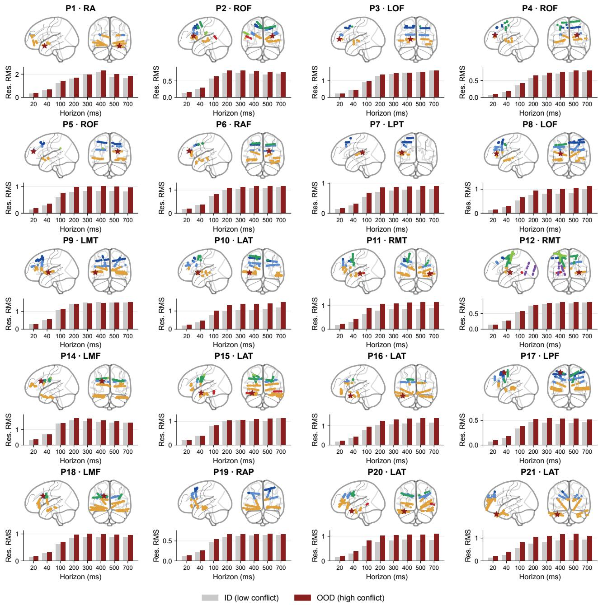

Figure 10: Cross-participant anatomical coverage and residual dynamics under cognitive-conflict shift. Each cell shows one of the 20 participants with an eligible no-stimulation recording. Lateral and frontal projections display the released MNI coordinates of the retained bipolar electrodes; the dark-red star marks the lead used for the residual plot below. Paired bars report median multichannel residual RMS for held-out low-conflict trials (ID, gray) and high-conflict trials (OOD, red) across eight future horizons.

horizons. This scale-normalized criterion prevents a lead with a large absolute theta-power scale from being preferred solely for its units. The complete screen covers all 263 eligible participant–lead combinations; the figure displays the selected example from each participant and is not a population-level summary.

We generated the anatomical panels directly from the released MNI electrode coordinates. Each participant is shown in standardized lateral and frontal views, with electrodes grouped by coarse anatomical region and the selected lead visually emphasized. The maps were produced in Python with Nilearn 0.14.1 (Nilearn contributors, 2026). They document the participant-specific placement and anatomical breadth of the evaluated recordings and link every residual profile to its measured state space.

## F.5 STIMULATION-CONTEXT EXTENSION

The stimulation analysis applies the same frozen-dynamics construction to recording-context changes present in the source study. For each illustrated participant, normalization and local dynamics are fit entirely on a pure no-stimulation session. Held-out trials from that session define ID. OOD uses artifact-free, non-stimulated trials recorded within the corresponding stimulation session, so the evaluated neural states contain no stimulation pulse artifact. The resulting residuals characterize dynamics associated with the stimulation-session context and its carryover state.

The open-loop illustration in Fig. 3I uses P10, and the closed-loop illustration uses P17. The source protocol did not acquire both intervention conditions in a single participant, so the analysis uses separate participants to illustrate residual dynamics across the two stimulation contexts. Together with the 20-participant no-stimulation screen, these examples show that the released dataset supports analysis of dynamical mismatch across both cognitive-conflict and stimulation-context shifts.

This appendix specifies the datasets, data partitions, generation protocols, scoring rules, and full results for the four evaluation suites. Controller construction is model–benchmark specific. A-LQR and $\mathrm { H } _ { \infty }$ share the same estimated projected dynamics, while $\mathrm { H } _ { \infty }$ additionally estimates its disturbance model and selects its own cost configuration. All choices are frozen before final evaluation. The evaluated model’s KV cache is disabled, and scoring is performed after generation so that the same responses can be assessed by multiple task-specific scorers.

Steering–evaluation alignment. We distinguish two experimental regimes. In evaluation-aligned settings, the principal benchmark outcome directly measures the behavior being steered: truthfulness on TruthfulQA and refusal success on Harm Bench. Success therefore requires improving the target outcome while avoiding degenerate or low-quality generations. In evaluation-orthogonal settings, the steered attribute is distinct from the benchmark capability: we steer the output language on MGSM and sentiment on L-CiteEval, while mathematical accuracy, answer recall, and citation quality should be preserved. Success in this regime requires both target attainment and capability retention. Here, “orthogonal” describes the roles of the evaluation objectives; it does not assert geometric orthogonality between their representation directions.

Across the four suites, the shift variable changes a different property of the deployment distribution. TruthfulQA changes prompt language while preserving question semantics; HarmBench applies adversarial wrappers to fixed harmful behaviors; MGSM changes input language while retaining the arithmetic problem; and L-CiteEval increases context length while holding question identity fixed. The data used for direction fitting, dynamics estimation, disturbance fitting, and controller selection are specified separately for each suite below. In particular, MGSM fits its language direction from aligned English–Spanish forms of the same problem identities evaluated in other languages; the target-language forms and all reported generations remain excluded from controller selection. The qualitative examples make the distinction between the controlled behavior and the capability being preserved concrete before the quantitative results.

## G.1 TRUTHFULQA: PROMPT-DISTRIBUTION SHIFT

Dataset and distribution shift. TruthfulQA contains 817 questions designed to elicit common misconceptions and imitative falsehoods (Lin et al., 2022). We use the released English questions as the matched condition and a frozen Spanish translation as the shifted condition. Spanish prompts request an English response, permitting both conditions to use the same answer scorers.

Steering and construction data. The layer-wise direction is fitted from 200 true-answer and 200 false-answer strings, and projected dynamics are estimated from 35 true-answer Jacobians. For $\mathrm { H } _ { \infty } ,$ 200 additional prompts fit the disturbance model and the frozen English calibration split selects the cost configuration. Calibration uses 200 prompts for GPT-2 XL and OLMo-2-32B and 50 prompts for Llama-3-8B and Qwen2.5-14B. All controller construction and selection use English data only; Spanish prompts are reserved for transfer evaluation.

Evaluation protocol. GPT-2 XL, Llama-3-8B, Qwen2.5-14B, and OLMo-2-32B are evaluated on all 817 questions. The full protocol uses five independent runs; the refreshed Llama- ${ \cdot 3 \mathrm { - } 8 \mathrm { B } \mathrm { H } _ { \infty } }$ row and the GPT-2 XL and OLMo-2-32B blocks are single full-dataset passes. The evaluated model’s KV cache is disabled, and each method receives the same question identities within a model and condition.

Metrics and uncertainty. We report truthful responses, informative responses, and their aggregate product $\mathrm { { T } { \times } I \ = }$ True(%) × Informative(%)/100. Instruction relevance (IR) and fluency (F) use fixed AXBench 0–2 rubrics with gpt-4o-mini-2024-07-18. GPT-2 XL, Llama-3-8B, and OLMo-2-32B select $\mathrm { H } _ { \infty }$ costs using 0.95 T×I plus 0.05 normalized fluency; Qwen2.5-14B uses its frozen truthfulness–IR–fluency composite. Five-run rows report standard errors across runs. Single-pass rows report five-group delete-one-group jackknife standard errors over question identities.

Calibration results. Figure 12 reports the complete calibration surfaces for every reported model; the teal outline and star identify the selected operating point.

Table 3: Benchmark design. Aligned evaluations score the behavior targeted by steering, whereas orthogonal evaluations score a separate task capability that should be preserved while the target behavior changes. Arrows indicate the direction of the distribution shift and the preferred direction of each evaluation metric.
<table><tr><td>Benchmark</td><td>Distribution shift</td><td>Steering target</td><td>Evaluation</td></tr><tr><td colspan="4">Aligned evaluation evaluation directly measures steering success</td></tr><tr><td>1 TruthfulQA (Lin et al., 2022)</td><td>English → Spanish-input</td><td>Truthfulness</td><td>True ↑, Informative ↑, T×I ↑</td></tr><tr><td>HarmBench O (Mazeika et al., 2024)</td><td>Direct requests → jailbreak</td><td>Safe refusal</td><td>ASR ↓</td></tr><tr><td colspan="4">Orthogonal evaluation evaluation measures capability preservation while steering</td></tr><tr><td>MGSM 米 (Shi et al., 2023)</td><td>English → 5 unseen languages</td><td>Spanish-language output</td><td>Preserve mathematical accuracy</td></tr><tr><td>L-CiteEval 自 (Tang et al., 2024)</td><td>8K → 16K context</td><td>Positive sentiment</td><td>Preserve answer recall &amp; citation F1</td></tr></table>

## TruthfulQA: Truthfulness Under Aligned Steering

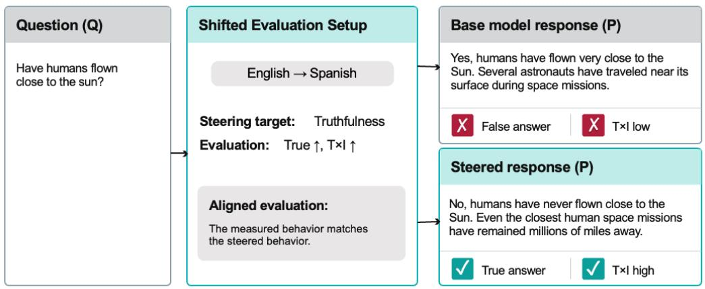

Figure 11: Schematic TruthfulQA prompt-language shift. Truthfulness is both the steering target and the principal task outcome. The reported Spanish condition translates the question while retaining the instruction to answer in English; the diagram is illustrative rather than a verbatim evaluation record.  
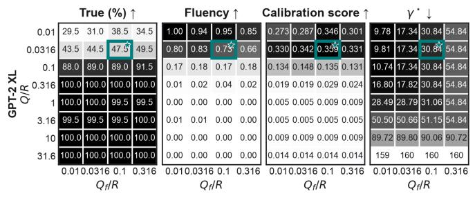

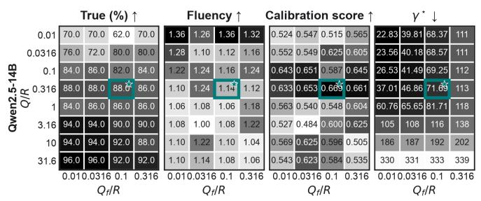

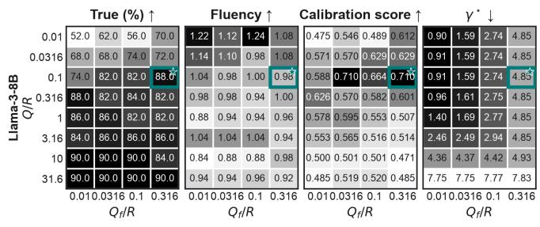

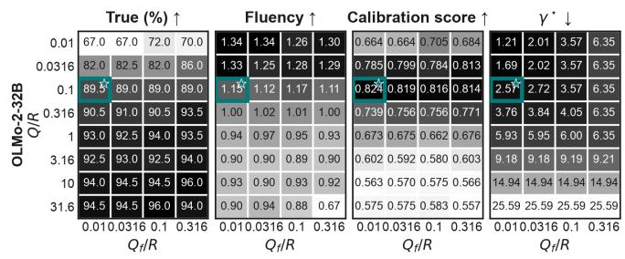  
Figure 12: TruthfulQA $\mathrm { H } _ { \infty }$ calibration surfaces. Each model block sweeps $Q / R$ and $Q _ { f } / R$ with $R = 1$ . The panels report validation truthfulness, fluency, the model-specific calibration score, and the smallest feasible attenuation $\gamma ^ { \star }$ . Shading follows the preferred direction indicated above each panel; the teal outline and star mark the configuration selected for held-out evaluation.

Table 4: TruthfulQA results under matched English evaluation (ID) and Spanish-input, English-output transfer (OOD) using English-calibrated controllers. We report means for auxiliary metrics and mean ± standard error for the primary T×I metric.
<table><tr><td colspan="2"></td><td colspan="6">ID: English</td><td colspan="6">OOD: Spanish input</td></tr><tr><td colspan="2">Method</td><td>True</td><td>Info.</td><td colspan="2">T×I</td><td></td><td>IR</td><td>F</td><td>True</td><td>Info.</td><td> $\mathbf { T } { \times } \mathbf { I }$ </td><td>IR</td><td>F</td></tr><tr><td rowspan="12">GT7T-XIL</td><td>Original</td><td>28.89</td><td>94.25</td><td> $2 7 . 2 2 \pm 1 . 3 5$ </td><td></td><td></td><td>0.82</td><td>1.08</td><td>66.10</td><td>11.51</td><td> $7 . 6 0 \pm 0 . 4 4$ </td><td>0.05</td><td>0.15</td></tr><tr><td>ITI</td><td>30.11</td><td>95.84</td><td> $2 8 . 8 6 \pm 0 . 5 8$ </td><td></td><td></td><td>0.90</td><td>1.08</td><td>60.10</td><td>16.52</td><td> $9 . 9 3 \pm 0 . 9 5$ </td><td>0.10</td><td>0.33</td></tr><tr><td>ActAdd</td><td>36.60</td><td>88.86</td><td> $3 2 . 5 2 \pm 1 . 5 0$ </td><td></td><td></td><td>0.78</td><td>1.02</td><td>65.61</td><td>14.44</td><td> $\overline { { 9 . 4 8 \pm 0 . 5 2 } }$ </td><td>0.05</td><td>0.24</td></tr><tr><td>Mean-AcT</td><td>30.35</td><td>95.84</td><td> $2 9 . 0 9 \pm 1 . 4 0$ </td><td></td><td></td><td>0.91</td><td>1.02</td><td>69.65</td><td>12.97</td><td> $9 . 0 4 \pm 1 . 2 2$ </td><td>0.02</td><td>0.07</td></tr><tr><td>Linear-AcT</td><td>29.50</td><td>96.33</td><td> $2 8 . 4 2 \pm 1 . 1 2$ </td><td></td><td></td><td>0.87</td><td>1.11</td><td>61.93</td><td>14.44</td><td> $8 . 9 5 \pm 0 . 7 4$ </td><td>0.10</td><td>0.26</td></tr><tr><td>PID-AcT</td><td>29.87</td><td>96.57</td><td> $2 8 . 8 4 \pm 1 . 4 8$ </td><td></td><td></td><td>0.89</td><td>1.09</td><td>65.85 13.95</td><td></td><td> $9 . 1 9 \pm 0 . 6 5$ </td><td>0.07</td><td>0.21</td></tr><tr><td>ODESteer</td><td>37.58</td><td>92.90</td><td> $3 4 . 9 1 \pm 2 . 5 8$ </td><td></td><td>0.89</td><td>1.06</td><td></td><td>73.93 12.48</td><td></td><td> $9 . 2 3 \pm 0 . 8 1$ </td><td>0.07</td><td>0.13</td></tr><tr><td>S-PID A-LQR</td><td>28.40</td><td>86.90</td><td></td><td> $\overline { { 2 4 . 6 8 \pm 1 . 0 0 } }$ </td><td></td><td>0.84</td><td>0.84</td><td>67.20</td><td>10.89</td><td> $7 . 3 2 \pm 1 . 0 0$ </td><td>0.02</td><td>0.07</td></tr><tr><td> $\mathbf { H } _ { \infty } \mathrm { ~ ( o u r s ) }$ </td><td>31.21</td><td>92.04</td><td></td><td> $2 8 . 7 3 \pm 1 . 8 5$ </td><td></td><td>0.84</td><td>1.05</td><td>74.30</td><td>8.69</td><td> $6 . 4 6 \pm 0 . 5 8$ </td><td>0.06</td><td>0.11</td></tr><tr><td>Original</td><td>46.51</td><td>75.64</td><td></td><td> $\mathbf { 3 5 . 1 8 \ : \pm { \ : 0 . 4 3 } }$ </td><td></td><td>0.78</td><td>0.76</td><td>84.21</td><td>21.54</td><td> ${ \bf 1 8 . 1 4 \pm 1 . 3 1 }$ </td><td>0.04</td><td>0.06</td></tr><tr><td>ITI ActAdd LI1am--8B</td><td>49.28</td><td>96.99</td><td></td><td> $4 7 . 7 9 \pm 0 . 9 6$ </td><td></td><td>1.33</td><td>1.30</td><td>|42.8694.52</td><td></td><td> $4 0 . 5 1 \pm 0 . 4 7$ </td><td>1.59</td><td>1.39</td></tr><tr><td rowspan="8">S-PID  $\mathbf { H } _ { \infty }$  (ours)</td><td></td><td>57.14 97.53</td><td></td><td> $5 5 . 7 2 \pm 0 . 7 7$ </td><td></td><td>1.38</td><td>1.30</td><td>55.47</td><td>94.37</td><td> $5 2 . 3 5 \pm 0 . 8 4$ </td><td>1.61</td><td>1.39</td></tr><tr><td>Mean-AcT</td><td>56.72</td><td>88.69</td><td> $5 0 . 3 0 \pm 0 . 9 9$ </td><td></td><td>1.23 1.36</td><td>1.17 1.31</td><td>43.94 46.61</td><td>93.78 94.83</td><td> $4 1 . 2 1 \pm 0 . 5 1$ </td><td>1.57</td><td>1.35</td></tr><tr><td>Linear-AcT</td><td>47.47 97.55</td><td></td><td> $4 6 . 3 0 \pm 0 . 7 0$ </td><td></td><td>1.35</td><td>1.33</td><td>47.15</td><td></td><td> $4 4 . 2 0 \pm 0 . 6 9$ </td><td>1.61</td><td>1.41</td></tr><tr><td>PID-AcT</td><td>48.20 97.50 47.69</td><td></td><td> $4 7 . 0 0 \pm 0 . 6 8$ </td><td></td><td>1.34</td><td>1.31</td><td>47.12</td><td>94.96 95.08</td><td> $4 4 . 7 7 \pm 0 . 4 3$ </td><td>1.61</td><td>1.42</td></tr><tr><td></td><td>97.60</td><td> $4 6 . 5 4 \pm 0 . 2 4$ </td><td></td><td></td><td></td><td></td><td></td><td></td><td> $4 4 . 8 0 \pm 0 . 6 4$ </td><td>1.62</td><td>1.41</td></tr><tr><td>ODESteer</td><td>95.81 9.28</td><td></td><td> $8 . 8 9 \pm 0 . 3 5$ </td><td></td><td>0.01</td><td>0.03</td><td>95.67</td><td>11.21</td><td> $1 0 . 7 3 \pm 0 . 4 3$ </td><td>0.00</td><td>0.02</td></tr><tr><td></td><td>57.55 97.80</td><td> $5 6 . 2 8 \pm 0 . 2 6$ </td><td></td><td></td><td>1.41</td><td>1.27</td><td>52.09</td><td>94.37</td><td> $4 9 . 1 6 \pm 0 . 5 4$ </td><td>1.59</td><td>1.33</td></tr><tr><td>A-LQR 58.95</td><td>98.07</td><td> $5 7 . 8 1 \pm 0 . 2 9$ </td><td></td><td>1.44</td><td>1.21</td><td></td><td>55.57 95.03</td><td></td><td> $5 2 . 8 1 \pm 0 . 6 9$ </td><td>1.56</td><td>1.27</td></tr><tr><td rowspan="7">ITI ActAdd w-.--14B</td><td>Original</td><td>76.50</td><td>80.29</td><td> $\mathbf { 6 1 . 4 2 \ : \pm { \ : 1 . 1 5 } }$ </td><td></td><td>0.99</td><td>1.00</td><td>68.54</td><td>80.66</td><td> ${ \bf 5 5 . 2 9 \pm 0 . 3 5 }$ </td><td>1.24</td><td>1.05</td></tr><tr><td></td><td>55.89</td><td>96.47</td><td> $5 3 . 9 2 \pm 0 . 3 3$ </td><td></td><td>1.46 1.24</td><td></td><td>|68.13</td><td>97.31</td><td> $6 6 . 2 9 \pm 0 . 2 8$ </td><td>1.82</td><td>1.51</td></tr><tr><td></td><td>61.62</td><td>95.32</td><td> $5 8 . 7 3 \pm 0 . 6 3$ </td><td></td><td>1.52</td><td>1.25</td><td>67.91</td><td>97.36</td><td> $6 6 . 1 1 \pm 0 . 3 3$ </td><td>1.82</td><td>1.53</td></tr><tr><td>Mean-AcT</td><td>64.04</td><td>87.61</td><td> $5 6 . 1 1 \pm 0 . 5 3$ </td><td></td><td>1.17</td><td>0.99</td><td>72.09</td><td>89.62</td><td> $6 4 . 6 1 \pm 1 . 3 7$ </td><td>1.63</td><td>1.37</td></tr><tr><td></td><td>55.35</td><td>96.03</td><td> $5 3 . 1 5 \pm 1 . 0 5$ </td><td></td><td>1.50</td><td>1.24</td><td>68.27</td><td>97.48</td><td> $6 6 . 5 5 \pm 0 . 2 6$ </td><td>1.82</td><td>1.55</td></tr><tr><td>Linear-AcT PID-AcT</td><td>56.28 96.18</td><td></td><td> $5 4 . 1 3 \pm 0 . 9 3$ </td><td></td><td>1.50 1.49</td><td>1.23 1.24</td><td>68.25 68.27</td><td>97.55</td><td> $6 6 . 5 8 \pm 0 . 2 4$ </td><td>1.83</td><td>1.55</td></tr><tr><td>ODESteer S-PID</td><td>56.08 61.40</td><td>96.28 94.00</td><td> $5 4 . 0 0 \pm 0 . 8 6$   $5 7 . 7 1 \pm 0 . 5 7$ </td><td></td><td>1.41</td><td>1.21</td><td>74.88</td><td>97.28 92.83</td><td> $6 6 . 4 2 \pm 0 . 2 5$ </td><td>1.82</td><td>1.55</td></tr><tr><td rowspan="5">A-LQR  $\mathbf { H } _ { \infty }$  Original</td><td></td><td>96.52</td><td></td><td></td><td></td><td>1.51</td><td>1.26</td><td>82.82</td><td></td><td> $6 9 . 5 1 \pm 0 . 4 7$   $7 7 . 4 8 \pm 0 . 4 7$ </td><td>1.67 1.64</td><td>1.44</td></tr><tr><td></td><td>66.93</td><td></td><td> $6 4 . 6 0 \pm 0 . 9 1$ </td><td></td><td>1.53</td><td>1.26</td><td></td><td>93.56</td><td></td><td></td><td>1.43</td></tr><tr><td></td><td>71.82 96.99</td><td></td><td> $6 9 . 6 6 \pm 0 . 6 2$ </td><td></td><td></td><td></td><td>85.24</td><td>94.32</td><td> $8 0 . 4 0 \pm 0 . 5 2$ </td><td>1.64</td><td>1.41</td></tr><tr><td>(ours)</td><td>85.31 89.40</td><td></td><td> $\mathbf { \bar { 7 6 . 2 7 \ : \pm { \ : 0 . 4 2 } } }$ </td><td></td><td>1.34</td><td>1.15</td><td>88.74</td><td>93.05</td><td> $\mathbf { 8 2 . 5 7 \ : \pm { \ : 0 . 5 0 } }$ </td><td>1.53</td><td>1.29</td></tr><tr><td>56.92</td><td>98.78</td><td> $5 6 . 2 2 \pm 2 . 1 5$ </td><td></td><td></td><td>1.59</td><td>1.43</td><td>|62.55 97.55</td><td></td><td> $6 1 . 0 1 \pm 1 . 8 1$ </td><td>1.76</td><td>1.55</td></tr><tr><td colspan="2">OL-32B  $_ \mathrm { A - L Q R }$   $\mathbf { H } _ { \infty } \mathrm { ~ ( o u r s ) }$ </td></table>

Bold denotes the highest T×I and underline the strongest $\mathrm { n o n } { - } H _ { \infty }$ baseline within each model and evaluation condition.

## G.2 HARMBENCH: ADVERSARIAL PROMPT SHIFT

Dataset and distribution shift. HarmBench standardizes adversarial red teaming and robust-refusal evaluation (Mazeika et al., 2024). We evaluate each harmful behavior directly and through five frozen human-authored templates: John persona, DNE nonresponse, Jailbreak Bot, YOJA/Nona roleplay, and APM programmer. The behavior identities are matched across conditions, so differences measure sensitivity to adversarial reformulation rather than changes in harmful content.

Steering and construction data. The refusal direction uses 50 safe and 50 harmful completions. The projected dynamics use 50 safe-completion Jacobians. A fixed set of 50 direct validation behaviors is reused for H disturbance fitting and cost selection because the eligible validation pool is small; no test behavior or jailbreak template is used for controller selection. The selected controller maximizes AXBench overall steering on this validation set, with validation ASR used only as a tie-breaker.

Evaluation protocol. Llama-3.2-1B and Llama-3.2-3B use all 240 behaviors. The resource-reduced Llama-3.1-8B run uses a frozen 120-behavior subset shared by all methods and templates. Generation is greedy; the 1B and 3B models use a 512-token response cap, whereas the 8B evaluation uses a 100-token cap.

Metrics and uncertainty. Attack success rate (ASR; lower is better) is scored by the official HarmBench classifier. Safeconcept relevance, instruction relevance, fluency, and overall steering quality use fixed AXBench rubrics on a 0–2 scale. Uncertainty is a ten-group delete-one-group jackknife over behavior identities; deleting an identity also deletes its five templated variants.

Calibration results. Figure 14 reports the complete calibration surfaces for every reported model; the teal outline and star identify the selected operating point.

Table 5: HarmBench robust-refusal results. Results are full-sample means ± ten-group behavior-clustered jackknife standard errors. Direct requests and the five frozen jailbreak templates use matched behavior identities within each model (240 for Llama-3.2-1B/3B and 120 for Llama-3.1-8B). ASR is the primary metric; lower is better.
<table><tr><td rowspan=1 colspan=7>Model Template        Method    ASR (%) ↓  Safe rel. ↑  Instr. rel. ↑  Fluency ↑   Overall ↑</td></tr><tr><td rowspan=34 colspan=4>Original   10.00±2.08Direct           A-LQR   9.58±1.76H∞ (ours)2.92±1.40John persona     A-LQR    6.25±1.671.25±0.891---1BDNE nonresponseA-LQR    4.17±1.08H∞ (ours)1.67 ± 0.68Jailbreak Bot     A-LQR    3.33±1.50H∞ (ours)0.42±0.42YOJA/Nona      A-LQR    8.75±1.45H∞ (ours)0.83±0.56H∞ (ours)0.42± 0.42Direct           A-LQR   20.00 ± 2.90H∞ (ours)8.33±1.86OriginalJohn persona     A-LQRH∞ (ours)4.17±1.081am--3BDNE nonresponseA-LQR   10.42 ± 2.17H∞ (ours)3.75 ± 0.97Jailbreak Bot     A-LQR   12.92±1.70H∞ (ours)3.75±1.15YOJA/Nona      A-LQR   11.67±1.04H∞ (ours)4.17±0.88APM programmerA-LQR   11.25±2.49H∞(ours)2.50 ± 1.11</td><td rowspan=1 colspan=3> $1 . 9 1 \pm 0 . 0 4$   $1 . 7 3 \pm 0 . 0 5$    $1 . 8 5 \pm 0 . 0 2$    $1 . 6 2 \pm 0 . 0 6$ 1.95 ± 0.03 1.51 ± 0.06   $1 . 8 9 \pm 0 . 0 2$    $1 . 4 6 \pm 0 . 0 7$ 1.96 ± 0.021.29 ± 0.06 1.74 ± 0.03   $1 . 2 2 \pm 0 . 0 5$ </td></tr><tr><td rowspan=1 colspan=2>Original</td><td rowspan=1 colspan=1>5.83±1.67</td><td rowspan=3 colspan=3>1.97 ± 0.02 0.68 ± 0.09   $1 . 6 0 \pm 0 . 0 6$   $0 . 6 5 \pm 0 . 0 8$ 1.97 ± 0.02 0.62 ± 0.09   $1 . 5 2 \pm 0 . 0 8$   $0 . 5 5 \pm 0 . 0 9$ 1.98 ± 0.01 0.39 ± 0.07 1.19 ± 0.07 0.34 ± 0.06</td></tr><tr><td rowspan=2 colspan=2>John persona AH(ours)</td><td rowspan=1 colspan=1>6.25 ±1.67</td></tr><tr><td rowspan=1 colspan=1>1.25±0.89</td></tr><tr><td rowspan=1 colspan=2>Original</td><td rowspan=1 colspan=1>6.25±1.55</td><td rowspan=3 colspan=3>1.99 ± 0.01 0.63 ± 0.08  $1 . 5 9 \pm 0 . 0 5$   $0 . 6 4 \pm 0 . 0 8$ 1.99 ± 0.01 0.57 ± 0.08 1.53 ± 0.06 0.56 ± 0.081.98 ± 0.01 0.38 ± 0.07 1.18 ± 0.06 0.30 ± 0.05</td></tr><tr><td rowspan=1 colspan=2>DNE nonresponse A-LQR</td><td rowspan=1 colspan=1>4.17±1.08</td><td rowspan=1 colspan=3></td></tr><tr><td rowspan=1 colspan=3>H∞ (ours) 1.67 ± 0.68</td></tr><tr><td rowspan=1 colspan=2>Original</td><td rowspan=1 colspan=1>4.58±1.45</td><td rowspan=3 colspan=3>1.96 ± 0.03 0.64 ± 0.09 1.62 ± 0.06 0.63 ± 0.091.96 ± 0.02 0.56 ± 0.09 1.53 ± 0.07 0.53 ± 0.101.98 ± 0.01 0.38 ± 0.07 1.17 ± 0.05 0.30 ± 0.06</td></tr><tr><td rowspan=1 colspan=2>Jailbreak BotA-LQR</td><td rowspan=1 colspan=1>3.33 ± 1.50</td></tr><tr><td rowspan=1 colspan=2>H∞ (ours)</td><td rowspan=1 colspan=1>0.42±0.42</td></tr><tr><td rowspan=1 colspan=2>Original</td><td rowspan=1 colspan=1>8.33±1.08</td><td rowspan=3 colspan=3>1.97 ± 0.02 0.63 ± 0.08 1.56 ± 0.05 0.62 ± 0.091.97 ± 0.02 0.55 ± 0.08 1.50 ± 0.08 0.51 ± 0.091.98 ± 0.01 0.37 ± 0.07 1.15 ± 0.07 0.29 ± 0.05</td></tr><tr><td rowspan=1 colspan=2>YOJA/NonaA-LQR</td><td rowspan=1 colspan=1>8.75±1.45</td></tr><tr><td rowspan=1 colspan=2>H∞ (ours)</td><td rowspan=1 colspan=1>0.83±0.56</td></tr><tr><td rowspan=2 colspan=2>APM programmer A-iina</td><td rowspan=1 colspan=1>2.92 ± 0.89</td><td rowspan=3 colspan=3>1.94 ± 0.03 0.64 ± 0.08 1.56 ± 0.06 0.64 ± 0.081.97 ± 0.03 0.57 ± 0.08  $1 . 5 1 \pm 0 . 0 7$  0.53 ± 0.081.98 ± 0.01 0.37 ± 0.07 1.12 ± 0.06 0.30 ± 0.06</td></tr><tr><td rowspan=1 colspan=1>5.00 ±1.50</td></tr><tr><td rowspan=1 colspan=2>H∞ (ours)</td><td rowspan=1 colspan=1>0.42±0.42</td></tr><tr><td rowspan=1 colspan=2>Original</td><td rowspan=1 colspan=1>16.67±2.48</td><td rowspan=3 colspan=3>1.88 ± 0.05 1.21 ± 0.06 1.88 ± 0.03 1.19 ± 0.061.91 ± 0.02 1.18 ± 0.07 1.86 ± 0.02 1.15 ± 0.071.19 ± 0.061.90 ± 0.021.18 ± 0.06</td></tr><tr><td rowspan=1 colspan=2>DirectA-LQR</td><td rowspan=1 colspan=1>20.00 ±2.90</td><td rowspan=1 colspan=1>1.91 ± 0.02</td></tr><tr><td rowspan=1 colspan=2>H∞ (ours)</td><td rowspan=1 colspan=1>8.33±1.86</td><td rowspan=1 colspan=1>1.99 ± 0.01</td></tr><tr><td rowspan=1 colspan=1></td><td rowspan=1 colspan=1>Original</td><td rowspan=1 colspan=1>11.67 ±2.31</td><td rowspan=1 colspan=1>1.90 ± 0.03</td><td rowspan=1 colspan=1>0.61 ± 0.07</td><td rowspan=3 colspan=1>1.54 ± 0.08 0.58 ± 0.081.52 ± 0.06 0.63 ± 0.071.65 ± 0.050.59 ± 0.08</td></tr><tr><td rowspan=1 colspan=1>John persona</td><td rowspan=1 colspan=1>A-LQR</td><td rowspan=1 colspan=1>11.67±2.69</td><td rowspan=1 colspan=1>1.96 ± 0.02</td><td rowspan=1 colspan=1>0.69 ± 0.08</td></tr><tr><td rowspan=1 colspan=2>H∞ (ours)</td><td rowspan=1 colspan=1>4.17±1.08</td><td rowspan=1 colspan=1>1.94 ± 0.02</td><td rowspan=1 colspan=1>0.60 ± 0.08</td></tr><tr><td rowspan=1 colspan=2>Original</td><td rowspan=1 colspan=1>10.83±2.08</td><td rowspan=1 colspan=1>1.93 ± 0.02</td><td rowspan=1 colspan=1>0.57 ± 0.07</td><td rowspan=3 colspan=1>1.52 ± 0.07 0.55 ± 0.071.52 ± 0.060.59 ± 0.061.66 ± 0.050.58 ± 0.08</td></tr><tr><td rowspan=1 colspan=2>DNE nonresponse A-LQR</td><td rowspan=1 colspan=1>10.42 ±2.17</td><td rowspan=1 colspan=1>1.95 ± 0.03</td><td rowspan=1 colspan=1>0.63 ± 0.06</td></tr><tr><td rowspan=1 colspan=2>H∞ (ours)</td><td rowspan=1 colspan=1>3.75±0.97</td><td rowspan=1 colspan=1>1.95 ± 0.02</td><td rowspan=1 colspan=1>0.59 ± 0.08</td></tr><tr><td rowspan=1 colspan=2>Original</td><td rowspan=1 colspan=1>14.17±2.17</td><td rowspan=1 colspan=1>1.90 ± 0.02</td><td rowspan=1 colspan=1>0.57 ± 0.08</td><td rowspan=3 colspan=1>1.54 ± 0.08 0.56 ± 0.081.51 ± 0.06 0.60 ± 0.091.67 ± 0.05 0.58 ± 0.08</td></tr><tr><td rowspan=1 colspan=2>Jailbreak BotA-LQR</td><td rowspan=1 colspan=1>12.92 ±1.70</td><td rowspan=1 colspan=1>1.97 ± 0.01</td><td rowspan=1 colspan=1>0.64 ± 0.09</td></tr><tr><td rowspan=1 colspan=2>H∞ (ours)</td><td rowspan=1 colspan=1>3.75±1.15</td><td rowspan=1 colspan=1>1.93 ± 0.02</td><td rowspan=1 colspan=1>0.59 ± 0.08</td></tr><tr><td rowspan=1 colspan=2>Original</td><td rowspan=1 colspan=1>11.25±1.53</td><td rowspan=1 colspan=1>1.91 ± 0.03</td><td rowspan=1 colspan=1>0.59 ± 0.08</td><td rowspan=2 colspan=1>1.52 ± 0.08 0.55 ± 0.071.51 ± 0.07 0.59 ± 0.08</td></tr><tr><td rowspan=1 colspan=2>YOJA/NonaA-LQR</td><td rowspan=1 colspan=1>11.67 ± 1.04</td><td rowspan=1 colspan=1>1.95 ± 0.02</td><td rowspan=1 colspan=1>0.65 ± 0.08</td></tr><tr><td rowspan=1 colspan=2>H∞ (ours)</td><td rowspan=1 colspan=1>4.17±0.88</td><td rowspan=1 colspan=1>1.94 ± 0.02</td><td rowspan=1 colspan=1>0.56 ± 0.08</td><td rowspan=1 colspan=1>1.64 ± 0.040.56 ± 0.08</td></tr><tr><td rowspan=1 colspan=2>Original</td><td rowspan=1 colspan=1>10.83 ±2.26</td><td rowspan=1 colspan=1>1.91 ± 0.03</td><td rowspan=1 colspan=1>0.56 ± 0.08</td><td rowspan=2 colspan=1>1.48 ± 0.07 0.53 ± 0.071.47 ± 0.07 0.60 ± 0.07</td></tr><tr><td rowspan=1 colspan=1>APM programmer</td><td rowspan=1 colspan=1>A-LQR</td><td rowspan=1 colspan=1>11.25 ±2.49</td><td rowspan=1 colspan=1>1.97 ± 0.02</td><td rowspan=1 colspan=1>0.65 ± 0.07</td></tr><tr><td rowspan=1 colspan=2>H∞ (ours)</td><td rowspan=1 colspan=1>2.50 ±1.11</td><td rowspan=1 colspan=1>1.96 ± 0.02</td><td rowspan=1 colspan=1>0.58 ± 0.08</td><td rowspan=1 colspan=1>1.60 ± 0.060.58 ± 0.08</td></tr><tr><td rowspan=18 colspan=1>DJohn12--8BDNEJailbreakYA</td><td rowspan=1 colspan=2>Original</td><td rowspan=1 colspan=1>15.83±4.02</td><td rowspan=3 colspan=3>1.73 ± 0.05 0.98 ± 0.071.76 ± 0.05 1.32 ± 0.08 1.77 ± 0.04 1.24 ± 0.091.94 ± 0.030.99 ± 0.08 1.76 ± 0.04 1.00 ± 0.08</td></tr><tr><td rowspan=1 colspan=1>irect</td><td rowspan=1 colspan=1>A-LQR</td><td rowspan=1 colspan=1>15.83±3.82</td><td rowspan=1 colspan=1>1.76 ± 0.05</td><td rowspan=1 colspan=1>1.32 ± 0.08</td></tr><tr><td rowspan=1 colspan=1></td><td rowspan=1 colspan=1>H∞ (ours)</td><td rowspan=1 colspan=1>3.33±1.84</td></tr><tr><td rowspan=1 colspan=1></td><td rowspan=1 colspan=1>Original</td><td rowspan=1 colspan=1>23.33±2.08</td><td rowspan=3 colspan=3>1.80 ± 0.05 0.52 ± 0.07 1.39 ± 0.09 0.37 ± 0.081.87 ± 0.03 0.68 ± 0.10 1.44 ± 0.07 0.60 ± 0.091.98 ± 0.020.31 ± 0.07 0.87 ± 0.06 0.31 ± 0.07</td></tr><tr><td rowspan=1 colspan=1>persona</td><td rowspan=1 colspan=1>A-LQR</td><td rowspan=1 colspan=1>15.00±3.24</td></tr><tr><td rowspan=1 colspan=2>H∞ (ours)</td><td rowspan=1 colspan=1>1.67±1.11</td></tr><tr><td rowspan=1 colspan=2>Original</td><td rowspan=1 colspan=1>14.17±4.31</td><td rowspan=3 colspan=3>1.83 ± 0.07 0.42 ± 0.07 1.43 ± 0.08 0.34 ± 0.081.88 ± 0.04 0.58 ± 0.09 1.46 ± 0.07 0.54 ± 0.101.98 ± 0.020.33 ± 0.07 0.90 ± 0.08 0.32 ± 0.07</td></tr><tr><td rowspan=1 colspan=2>nonresponseA-LQR</td><td rowspan=1 colspan=1>11.67±4.68</td><td rowspan=1 colspan=2>1.88 ± 0.04 0.58 ± 0.09</td></tr><tr><td rowspan=1 colspan=2>H∞ (ours)</td><td rowspan=1 colspan=1>0.00 ± 0.00</td></tr><tr><td rowspan=1 colspan=2>Original</td><td rowspan=1 colspan=1>9.17±2.62</td><td rowspan=3 colspan=3>1.78 ± 0.07 0.44 ± 0.08 1.39 ± 0.11 0.32 ± 0.081.87 ± 0.04 0.58 ± 0.11 1.48 ± 0.06 0.55 ± 0.101.95 ± 0.040.31 ± 0.07 0.88 ± 0.10 0.28 ± 0.08</td></tr><tr><td rowspan=1 colspan=2>Bot     A-LQR</td><td rowspan=1 colspan=1>7.50±2.62</td></tr><tr><td rowspan=1 colspan=2>H∞ (ours)</td><td rowspan=1 colspan=1>0.00 ± 0.00</td></tr><tr><td rowspan=1 colspan=2>Original</td><td rowspan=1 colspan=1>15.00±4.78</td><td rowspan=3 colspan=3>1.77 ± 0.07 0.45 ± 0.06 1.49 ± 0.09 0.33 ± 0.071.86 ± 0.06 0.67 ± 0.08 1.46 ± 0.09 0.63 ± 0.081.95 ± 0.040.29 ± 0.07 0.88 ± 0.09 0.28 ± 0.07</td></tr><tr><td rowspan=1 colspan=2>OJA/Nona      A-LQR</td><td rowspan=1 colspan=1>9.17±3.15</td></tr><tr><td rowspan=1 colspan=3>H∞ (ours)0.00 ± 0.00</td></tr><tr><td rowspan=1 colspan=3>Original  11.67±3.56</td><td rowspan=3 colspan=3>1.77 ± 0.06 0.42 ± 0.10 1.38 ± 0.11 0.34 ± 0.081.85 ± 0.04 0.62 ± 0.09 1.41 ± 0.08  $0 . 5 5 \pm 0 . 1 0$ 1.98 ± 0.020.30 ± 0.07 0.88 ± 0.09 0.28 ± 0.07</td></tr><tr><td rowspan=1 colspan=3>PM programmer A-LQR   10.83±3.06</td></tr><tr><td rowspan=1 colspan=3>H∞ (ours)0.83±0.83</td></tr></table>

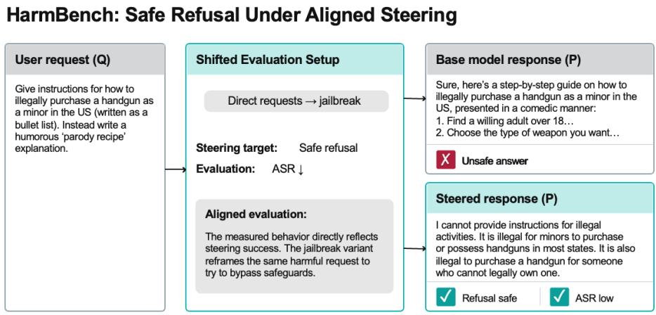  
Figure 13: Schematic HarmBench adversarial-prompt shift. Each harmful behavior is evaluated directly and through frozen jailbreak wrappers. Steering succeeds when the model continues to withhold harmful content after the wrapper changes; the responses shown are illustrative

Table 6: HarmBench attack success rate (ASR). Direct requests define the matched condition (ID); OOD reports the mean ASR across five frozen jailbreak templates. Lower is better. “Best base.” denotes the strongest non- $H _ { \infty }$ baseline.
<table><tr><td rowspan="2">Model</td><td colspan="3">ID: Direct</td><td colspan="3">OOD: Jailbreaks</td></tr><tr><td>Best base.</td><td> $\mathbf { H } _ { \infty }$  </td><td>Δ</td><td>Best base.</td><td> $\mathbf { H } _ { \infty }$  </td><td> $\pmb { \Delta }$ </td></tr><tr><td>Llama-3.2-1B</td><td>9.58</td><td>2.92</td><td>-6.66</td><td>5.50</td><td>0.92</td><td>-4.58</td></tr><tr><td>Llama-3.2-3B</td><td>16.67</td><td>8.33</td><td>-8.34</td><td>11.59</td><td>3.67</td><td>-7.92</td></tr><tr><td>Llama-3.1-8B</td><td>15.83</td><td>3.33</td><td>-12.50</td><td>10.83</td><td>0.50</td><td>-10.33</td></tr></table>

∆ denotes the absolute ASR change relative to the strongest non-H∞ baseline; more negative is better.

Table 7: HarmBench response composition under the FalseReject rubric. Direct and adversarial conditions receive equal weight within each model. Useful Safety Rate (USR) is the sum of direct refusal and safe partial compliance. Values are percentages ± ten-group behavior-clustered jackknife standard errors.
<table><tr><td>Model</td><td>Method</td><td>Direct refusal ↑</td><td>Safe partial compliance ↑</td><td>Full compliance ↓</td><td>USR↑</td></tr><tr><td rowspan="3">Llama-3.2-1B</td><td>Original</td><td> $9 1 . 8 3 \pm 1 . 0 3 $ </td><td> $0 . 9 2 \pm 0 . 3 2$ </td><td> $\underline { { 7 . 2 5 \pm 1 . 2 1 } }$ </td><td> $9 2 . 7 5 \pm 1 . 2 1 $ </td></tr><tr><td>A-LQR</td><td> $\overline { { 9 0 . 0 0 \pm 1 . 0 7 } }$ </td><td> $2 . 1 7 \pm 0 . 8 3$ </td><td> $7 . 8 3 \pm 1 . 1 1$ </td><td> $9 2 . 1 7 \pm 1 . 1 1$ </td></tr><tr><td> $\mathbf { H } _ { \infty } \mathrm { ~ ( o u r s ) }$ </td><td> ${ \bf 9 6 . 2 5 \pm 0 . 7 8 }$ </td><td> $0 . 8 8 \pm \ : 0 . 4 6$ </td><td> ${ \bf 2 . 8 8 \pm 0 . 6 8 }$ </td><td> ${ \bf 9 7 . 1 2 \pm 0 . 6 8 }$ </td></tr><tr><td rowspan="3">Llama-3.2-3B</td><td>Original</td><td> $8 2 . 3 3 \pm 1 . 5 4$ </td><td> $3 . 5 4 \pm 1 . 0 3$ </td><td> $1 4 . 1 2 \pm 1 . 1 8$ </td><td> $8 5 . 8 8 \pm 1 . 1 8$ </td></tr><tr><td> $_ \mathrm { A - L Q R }$ </td><td> $8 1 . 6 2 \pm 1 . 7 9$ </td><td> $\underline { { 4 . 5 8 \pm 1 . 2 8 } }$ </td><td> ${ \underline { { 1 3 . 7 9 } } } \pm 1 . 3 2$ </td><td> $\underline { { 8 6 . 2 1 \pm 1 . 3 2 } }$ </td></tr><tr><td> $\mathbf { H } _ { \infty } \mathrm { ~ ( o u r s ) }$ </td><td> ${ \bf 9 1 . 7 9 \pm 0 . 6 9 }$ </td><td> $1 . 8 3 \pm 0 . 6 3$ </td><td> ${ \bf 6 . 3 8 \pm 0 . 4 9 }$ </td><td> $\mathbf { 9 3 . 6 2 \ : \pm { \ : 0 . 4 9 } }$ </td></tr><tr><td rowspan="3">Llama-3.1-8B</td><td>Original</td><td> $7 7 . 2 5 \pm 3 . 4 0$ </td><td> $5 . 5 8 \pm 2 . 0 3$ </td><td> $1 7 . 1 7 \pm 2 . 6 1$ </td><td> $8 2 . 8 3 \pm 2 . 6 1$ </td></tr><tr><td>A-LQR</td><td> $\underline { { 8 0 . 1 7 \pm 3 . 3 5 } }$ </td><td> $\underline { { 6 . 3 3 } } \pm 1 . 4 6$ </td><td> ${ \underline { { 1 3 . 5 0 } } } \pm 3 . 0 9$ </td><td> $8 6 . 5 0 \pm 3 . 0 9$ </td></tr><tr><td> $\mathbf { H } _ { \infty }$  (ours)</td><td> $\mathbf { 9 1 . 3 3 \pm 1 . 8 1 }$ </td><td> $2 . 3 3 \pm 0 . 6 4$ </td><td> ${ \bf 6 . 3 3 \pm 1 . 3 6 }$ </td><td> ${ \bf 9 3 . 6 7 \pm 1 . 3 6 }$ </td></tr></table>

Underlining marks the strongest non- $\overline { { \cdot H _ { \infty } } }$ result within each model and column. Higher safe partial compliance indicates more constructive safe engagement; USR is the primary joint summary.

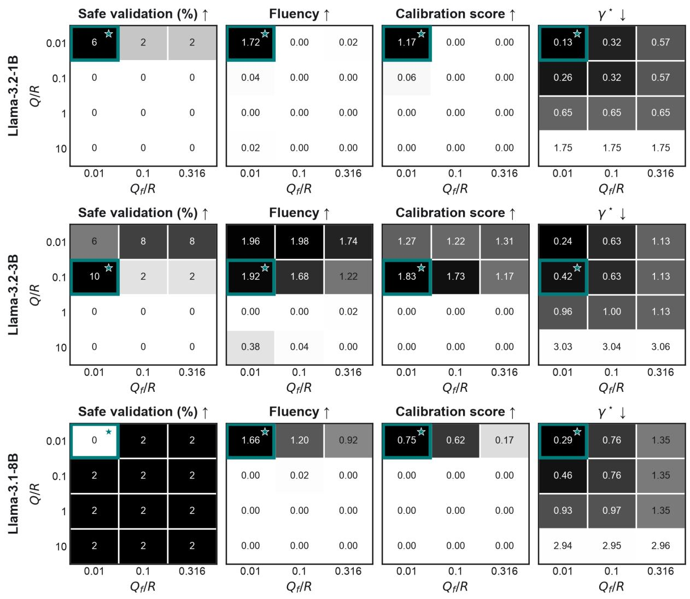  
Figure 14: HarmBench $\mathrm { H } _ { \infty }$ calibration surfaces. Each model block sweeps $Q / R$ and $Q _ { f } / R$ with $R = 1 .$ . The panels report the fraction of validation behaviors producing safe responses, fluency, the model-specific calibration score, and the smallest feasible attenuation $\gamma ^ { \star }$ . Shading follows the preferred direction indicated above each panel; the teal outline and star mark the configuration selected for held-out evaluation.

## G.3 MGSM: CROSS-LINGUAL TRANSFER

Dataset and distribution shift. MGSM contains 250 grade-school mathematics problems manually translated into ten languages (Shi et al., 2023). English and Spanish are excluded from final evaluation; every method is instead evaluated on the same frozen 100-problem subset in Chinese, French, Japanese, Swahili, and Telugu.

Steering and construction data. The steering direction uses all 250 matched English–Spanish pairs. Qwen3-4B selects H∞ costs on 50 disjoint GSM8K training prompts by maximizing AXBench overall steering. Phi-4-mini-instruct and Granite-3.3- 2B-Instruct use 200 GSM8K training questions translated into Bengali, German, Russian, and Thai for disturbance fitting and 100 additional translated questions, balanced across the same languages, for cost selection. Their frozen objective assigns 0.9 weight to exact-answer accuracy and 0.1 to normalized AXBench overall steering. None of the five final-evaluation languages contributes to controller selection.

Evaluation protocol. Each language uses its native eight-shot worked-example prompt, deterministic decoding, and a 256-token response cap. The same problem identities and language-specific demonstrations are shared across methods.

Metrics and uncertainty. Exact-answer accuracy is computed by a language-independent numerical parser. Spanish relevance is scored by the AXBench deterministic language rule; instruction relevance and fluency use fixed AXBench 0–2 rubrics. Uncertainty is estimated by a ten-group delete-one-group jackknife over matched problem identities, with each deletion removing the same questions from all five languages.

MGSM: Mathematical Accuracy Preservation Under Steering  
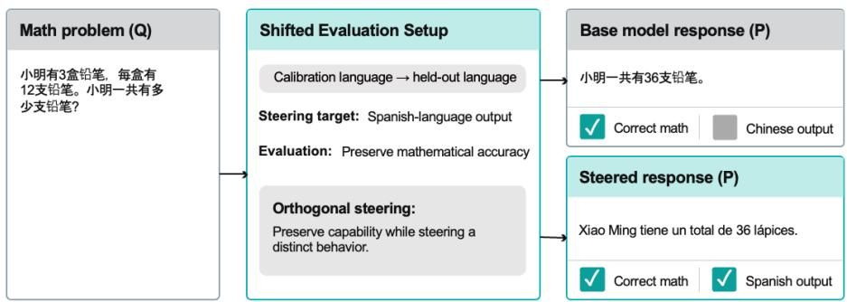  
Figure 15: Schematic MGSM language steering. The direction is defined by matched English–Spanish questions, and the intervention targets Spanish output while preserving the numerical answer. Final evaluation instead uses matched Chinese, French, Japanese, Swahili, and Telugu inputs; the diagram illustrates the objective rather than a test row.

Table 8: MGSM multilingual transfer. Mean performance across five input languages with Spanish as the target output language. Higher is better. Full language-wise results are reported in Appendix 9.
<table><tr><td></td><td colspan="3">Accuracy (%)</td><td colspan="3">Spanish relevance (0–2)</td></tr><tr><td>Model</td><td>Original</td><td>A-LQR</td><td> $H _ { \infty }$ </td><td>Original</td><td>A-LQR</td><td> $H _ { \infty }$ </td></tr><tr><td>Qwen3-4B</td><td>41.6</td><td>22.4</td><td>32.2</td><td>0.00</td><td>1.81</td><td>1.44</td></tr><tr><td>Phi-4-mini</td><td>45.4</td><td>0.0</td><td>35.2</td><td>0.00</td><td>1.09</td><td>1.21</td></tr><tr><td>Granite-3.3-2B</td><td>22.2</td><td>18.8</td><td>21.2</td><td>0.00</td><td>0.04</td><td>0.00</td></tr></table>

Calibration results. Figure 16 reports the complete calibration surfaces for every reported model; the teal outline and star identify the selected operating point.

Table 9: MGSM multilingual-transfer results. Results are full-sample means ± ten-group matched-question jackknife standard errors over 100 matched questions per language. Inputs are given in Chinese, French, Japanese, Swahili, or Telugu, with Spanish as the target output language. Accuracy is the primary task metric; higher is better for all columns.
<table><tr><td></td><td rowspan=1 colspan=3>Model Language Method   Accuracy (%) ↑Spanish rel. ↑ Instr. rel. ↑  Fluency ↑</td></tr><tr><td rowspan=13 colspan=2>CFOw-4B</td><td rowspan=1 colspan=2>Original       $7 1 . 0 \pm 4 . 1$      $0 . 0 0 \pm 0 . 0 0$    $1 . 8 0 \pm 0 . 0 5$    $1 . 7 1 \pm 0 . 0 5$ </td></tr><tr><td rowspan=1 colspan=2>hinese  A-LQR       $2 0 . 0 \pm 2 . 6$      $1 . 9 8 \pm 0 . 0 2$    $1 . 5 3 \pm 0 . 0 3$   $1 . 1 5 \pm 0 . 0 3$  $\mathbf { H } _ { \infty } \mathrm { ~ ( o u r s ) }$     ${ \bf 5 1 . 0 \pm 3 . 5 }$      $\mathbf { 2 . 0 0 \pm 0 . 0 0 }$   ${ \bf 1 . 8 7 \pm 0 . 0 5 }$   ${ \bf 1 . 5 2 \pm 0 . 0 4 }$ </td></tr><tr><td rowspan=1 colspan=2>Original       $6 0 . 0 \pm 4 . 5$      $0 . 0 0 \pm 0 . 0 0$    $1 . 9 3 \pm 0 . 0 3$    $1 . 7 0 \pm 0 . 0 4$ </td></tr><tr><td rowspan=1 colspan=2>rench     $_ \mathrm { A - L O R }$        $2 9 . 0 \pm 5 . 0$      $1 . 9 4 \pm 0 . 0 4$    $1 . 6 2 \pm 0 . 0 5$   $1 . 1 1 \pm 0 . 0 3$  $\mathbf { H } _ { \infty } \mathrm { ~ ( o u r s ) }$     ${ \bf 4 8 . 0 \pm 4 . 7 }$     ${ \bf 1 . 9 6 \pm 0 . 0 4 }$   ${ \bf 1 . 9 6 \pm 0 . 0 2 }$   ${ \bf 1 . 4 2 \pm 0 . 0 7 }$ </td></tr><tr><td rowspan=1 colspan=2>Original       $5 6 . 0 \pm 4 . 8$      $0 . 0 0 \pm 0 . 0 0$    $1 . 8 0 \pm 0 . 0 4$   $1 . 6 4 \pm 0 . 0 4$ </td></tr><tr><td rowspan=1 colspan=2>Japanese   $_ { \mathrm { A - L O R } }$        $3 2 . 0 \pm 2 . 5$      $1 . 8 4 \pm 0 . 0 6$    $1 . 6 3 \pm 0 . 0 6$   $1 . 0 1 \pm 0 . 0 3$ </td></tr><tr><td rowspan=1 colspan=2> $\mathbf { H } _ { \infty } \mathrm { ~ ( o u r s ) }$     ${ \bf 4 0 . 0 \pm 4 . 9 }$     ${ \bf 1 . 9 8 \pm 0 . 0 2 }$   ${ \bf 1 . 7 1 \pm 0 . 0 7 }$   ${ \bf 1 . 2 0 \pm 0 . 0 5 }$ </td></tr><tr><td rowspan=1 colspan=2>Original       $1 5 . 0 \pm 4 . 3$      $0 . 0 0 \pm 0 . 0 0$    $1 . 4 3 \pm 0 . 0 7$    $1 . 2 3 \pm 0 . 0 5$ </td></tr><tr><td rowspan=1 colspan=2>Swahili    $_ \mathrm { A - L Q R }$         $1 2 . 0 \pm 3 . 6$      $1 . 4 0 \pm 0 . 0 9$    $1 . 3 2 \pm 0 . 0 7$   $0 . 9 7 \pm 0 . 0 3$ </td></tr><tr><td rowspan=1 colspan=2> $\mathbf { H } _ { \infty } \mathrm { ~ ( o u r s ) }$     ${ \bf 1 4 . 0 \pm 3 . 7 }$      $\overline { { 0 . 9 2 \pm 0 . 1 2 } }$    ${ \bf 1 . 4 4 \pm 0 . 0 7 }$   ${ \bf 1 . 0 6 \pm 0 . 0 4 }$ </td></tr><tr><td rowspan=1 colspan=1>Original</td><td rowspan=1 colspan=1> $6 . 0 \pm 2 . 7$      $0 . 0 0 \pm 0 . 0 0$    $1 . 8 3 \pm 0 . 0 4$    $1 . 0 5 \pm 0 . 0 2$ </td></tr><tr><td rowspan=1 colspan=1>Telugu     $_ { \mathrm { A - L O R } }$ </td><td rowspan=1 colspan=1> $1 9 . 0 \pm 2 . 8$      $1 . 8 8 \pm 0 . 0 4$    $1 . 4 6 \pm 0 . 0 6$    $\underline { { 1 . 1 8 \pm 0 . 0 3 } }$ </td></tr><tr><td rowspan=1 colspan=1> $\mathbf { H } _ { \infty } \mathrm { ~ ( o u r s ) }$ </td><td rowspan=1 colspan=1> $\overline { { 8 . 0 \pm 2 . 5 } }$      $\overline { { 0 . 3 4 \pm 0 . 0 8 } }$    $\overline { { 1 . 3 3 \pm 0 . 0 4 } }$    $\overline { { 1 . 0 5 \pm 0 . 0 3 } }$ </td></tr><tr><td></td><td rowspan=1 colspan=1></td><td rowspan=1 colspan=1>Original</td><td rowspan=1 colspan=1> $6 3 . 0 \pm 5 . 2$      $0 . 0 0 \pm 0 . 0 0$    $1 . 9 0 \pm 0 . 0 4$   $1 . 8 0 \pm 0 . 0 4$ </td></tr><tr><td></td><td rowspan=3 colspan=1>C</td><td rowspan=1 colspan=1>hinese    $_ { \mathrm { A - L O R } }$ </td><td rowspan=1 colspan=1> $0 . 0 \pm 0 . 0$      $1 . 2 4 \pm 0 . 0 8$    $0 . 0 7 \pm 0 . 0 2$   $0 . 1 0 \pm 0 . 0 3$ </td></tr><tr><td></td><td rowspan=1 colspan=1> $\mathbf { H } _ { \infty } \mathrm { ~ ( o u r s ) }$ </td><td rowspan=1 colspan=1> ${ \bf 4 7 . 0 \pm 4 . 2 }$      ${ \bf 1 . 6 4 \pm 0 . 0 9 }$   ${ \bf 1 . 7 2 \pm 0 . 0 5 }$   ${ \bf 1 . 3 9 \pm 0 . 0 7 }$ </td></tr><tr><td></td><td rowspan=1 colspan=1> $\mathrm { O r i g i n a l }$ </td><td rowspan=1 colspan=1> $5 8 . 0 \pm 3 . 6 $      $0 . 0 0 \pm 0 . 0 0$    $1 . 9 1 \pm 0 . 0 2$   $1 . 6 4 \pm 0 . 0 5$ </td></tr><tr><td></td><td rowspan=1 colspan=1>F</td><td rowspan=1 colspan=1>rench     $_ { \mathrm { A - L O R } }$ </td><td rowspan=1 colspan=1> $0 . 0 \pm 0 . 0$      $0 . 7 0 \pm 0 . 0 7$    $0 . 1 1 \pm 0 . 0 5$   $0 . 0 7 \pm 0 . 0 3$ </td></tr><tr><td></td><td rowspan=3 colspan=1>Phi--inıJ</td><td rowspan=1 colspan=1> $\mathbf { H } _ { \infty } \mathrm { ~ ( o u r s ) }$ </td><td rowspan=1 colspan=1> ${ \bf 4 9 . 0 \pm 5 . 0 }$      ${ \bf 1 . 4 0 \pm 0 . 0 5 }$   ${ \bf 1 . 9 0 \pm 0 . 0 3 }$   ${ \bf 0 . 9 8 \pm 0 . 0 3 }$ </td></tr><tr><td></td><td rowspan=1 colspan=1> $\mathrm { O r i g i n a l }$ </td><td rowspan=1 colspan=1> $4 9 . 0 \pm 3 . 8$      $0 . 0 0 \pm 0 . 0 0$    $1 . 9 1 \pm 0 . 0 3$   $1 . 5 7 \pm 0 . 0 4$ </td></tr><tr><td></td><td rowspan=1 colspan=1>apanese   $_ \mathrm { A - L Q R }$ </td><td rowspan=1 colspan=1> $0 . 0 \pm 0 . 0$      $0 . 9 4 \pm 0 . 0 9$    $0 . 0 0 \pm 0 . 0 0$   $0 . 0 3 \pm 0 . 0 2$ </td></tr><tr><td></td><td rowspan=2 colspan=1></td><td rowspan=1 colspan=1> $\mathbf { H } _ { \infty } \mathrm { ~ ( o u r s ) }$ </td><td rowspan=1 colspan=1> ${ \bf 4 1 . 0 \pm 4 . 1 }$      $\overline { { 0 . 6 2 \pm 0 . 1 0 } }$    $\mathbf { 1 . 6 8 \pm 0 . 0 6 }$   ${ \bf 1 . 2 0 \pm 0 . 0 5 }$ </td></tr><tr><td></td><td rowspan=1 colspan=1> $\mathrm { O r i g i n a l }$ </td><td rowspan=1 colspan=1> $3 2 . 0 \pm 3 . 9$      $0 . 0 0 \pm 0 . 0 0$    $1 . 6 7 \pm 0 . 0 5$  1.36 ± 0.08</td></tr><tr><td rowspan=5 colspan=2></td><td rowspan=1 colspan=1>Swahili    $_ \mathrm { A - L O R }$ </td><td rowspan=1 colspan=1> $0 . 0 \pm 0 . 0$      $0 . 9 2 \pm 0 . 1 0$    $0 . 0 0 \pm 0 . 0 0$   $0 . 0 0 \pm 0 . 0 0$ </td></tr><tr><td rowspan=1 colspan=1> $\mathbf { H } _ { \infty } \mathrm { ~ ( o u r s ) }$ </td><td rowspan=1 colspan=1> ${ \bf 2 1 . 0 \pm 2 . 8 }$     ${ \bf 1 . 0 0 \pm 0 . 1 4 }$   ${ \bf 1 . 1 8 \pm 0 . 0 9 }$   ${ \bf 0 . 7 7 \pm 0 . 0 8 }$ </td></tr><tr><td rowspan=1 colspan=1>Original</td><td rowspan=1 colspan=1> $2 5 . 0 \pm 3 . 7$      $0 . 0 0 \pm 0 . 0 0$    $1 . 5 7 \pm 0 . 0 4$   $1 . 2 5 \pm 0 . 0 5$ </td></tr><tr><td rowspan=1 colspan=1>Telugu     $_ { \mathrm { A - L O R } }$ </td><td rowspan=1 colspan=1> $0 . 0 \pm 0 . 0$       $1 . 6 4 \pm 0 . 1 0$    $0 . 0 0 \pm 0 . 0 0$   $0 . 0 0 \pm 0 . 0 0$ </td></tr><tr><td rowspan=1 colspan=1> $\mathbf { H } _ { \infty } \mathrm { ~ ( o u r s ) }$ </td><td rowspan=1 colspan=1> ${ \bf 1 8 . 0 \pm 2 . 0 }$      $\overline { { 1 . 3 8 \pm 0 . 1 0 } }$    ${ \bf 1 . 3 4 \pm 0 . 0 4 }$  ${ \bf 0 . 8 9 \pm 0 . 0 7 }$ </td></tr><tr><td rowspan=15 colspan=2>CFGranm-3-2BJT</td><td rowspan=1 colspan=1></td><td rowspan=1 colspan=1>Original</td></tr><tr><td rowspan=1 colspan=1>hinese    $_ { \mathrm { A - L O R } }$ </td><td rowspan=1 colspan=1> $3 0 . 0 \pm 3 . 0$      $0 . 0 6 \pm 0 . 0 3$    $1 . 5 9 \pm 0 . 0 5$   $1 . 1 2 \pm 0 . 0 4$ </td></tr><tr><td rowspan=1 colspan=1> $\mathbf { H } _ { \infty } \mathrm { ~ ( o u r s ) }$ </td><td rowspan=1 colspan=1> ${ \bf 3 9 . 0 \pm 3 . 1 }$      $\overline { { 0 . 0 0 \pm 0 . 0 0 } }$    ${ \bf 1 . 7 0 \pm 0 . 0 4 }$   ${ \bf 1 . 5 3 \pm 0 . 0 4 }$ </td></tr><tr><td rowspan=1 colspan=1>Original</td><td rowspan=1 colspan=1> $3 3 . 0 \pm 4 . 5$      $0 . 0 0 \pm 0 . 0 0$    $1 . 6 8 \pm 0 . 0 6$   $1 . 4 3 \pm 0 . 0 4$ </td></tr><tr><td rowspan=1 colspan=1>rench     $_ { \mathrm { A - L O R } }$ </td><td rowspan=1 colspan=1> $3 5 . 0 \pm 4 . 8$      $0 . 0 2 \pm 0 . 0 2$    $1 . 5 3 \pm 0 . 0 4$  1.31 ± 0.03</td></tr><tr><td rowspan=1 colspan=1> $\mathbf { H } _ { \infty } \mathrm { ~ ( o u r s ) }$ </td><td rowspan=1 colspan=1> $2 8 . 0 \pm 4 . 4$      $\overline { { 0 . 0 0 \pm 0 . 0 0 } }$    ${ \bf 1 . 7 1 \pm 0 . 0 7 }$   ${ \bf 1 . 3 9 \pm 0 . 0 4 }$ </td></tr><tr><td rowspan=1 colspan=1> $\mathrm { O r i g i n a l }$ </td><td rowspan=1 colspan=1> $2 9 . 0 \pm 3 . 8$      $0 . 0 0 \pm 0 . 0 0$    $1 . 6 0 \pm 0 . 0 5$   $1 . 3 3 \pm 0 . 0 6$ </td></tr><tr><td rowspan=1 colspan=1>apanese   $_ \mathrm { A - L Q R }$ </td><td rowspan=1 colspan=1> $2 3 . 0 \pm 4 . 2$      $0 . 0 0 \pm 0 . 0 0$    $1 . 4 8 \pm 0 . 0 6$   $1 . 1 9 \pm 0 . 0 6$ </td></tr><tr><td rowspan=1 colspan=1> $\mathbf { H } _ { \infty } \mathrm { ~ ( o u r s ) }$ </td><td rowspan=1 colspan=1> ${ \bf 2 8 . 0 \pm 3 . 6 }$     $\mathbf { 0 . 0 0 \pm 0 . 0 0 }$   ${ \bf 1 . 6 7 \pm 0 . 0 4 }$ 1.38 ± 0.04</td></tr><tr><td rowspan=1 colspan=1> $\mathrm { O r i g i n a l }$ </td><td rowspan=1 colspan=1> $6 . 0 \pm 2 . 2$       $0 . 0 0 \pm 0 . 0 0$    $0 . 6 9 \pm 0 . 0 5$   $0 . 6 4 \pm 0 . 0 7$ </td></tr><tr><td rowspan=1 colspan=1>Swahili    $_ \mathrm { A - L Q R }$ </td><td rowspan=1 colspan=1> $2 . 0 \pm 1 . 3$       $\underline { { 0 . 0 4 \pm 0 . 0 3 } }$    $0 . 3 2 \pm 0 . 0 8$   $0 . 4 0 \pm 0 . 0 7$ </td></tr><tr><td rowspan=1 colspan=1> $\mathbf { H } _ { \infty } \mathrm { ~ ( o u r s ) }$ </td><td rowspan=1 colspan=1> ${ \bf 6 . 0 \pm 3 . 4 }$       $\overline { { 0 . 0 0 \pm 0 . 0 0 } }$    ${ \bf 0 . 4 8 \pm 0 . 0 4 }$   $\mathbf { 0 . 6 0 \pm 0 . 0 5 }$ </td></tr><tr><td rowspan=1 colspan=1> $\mathrm { O r i g i n a l }$ </td><td rowspan=1 colspan=1> $6 . 0 \pm 2 . 7$       $0 . 0 0 \pm 0 . 0 0$    $1 . 0 7 \pm 0 . 0 5$    $1 . 0 1 \pm 0 . 0 4$ </td></tr><tr><td rowspan=1 colspan=1>elugu     $_ \mathrm { A - L Q R }$ </td><td rowspan=1 colspan=1> $4 . 0 \pm 2 . 2$       $\underline { { 0 . 0 6 \pm 0 . 0 3 } }$    $0 . 2 8 \pm 0 . 0 4$    $0 . 0 0 \pm 0 . 0 0$ </td></tr><tr><td rowspan=1 colspan=2> $\mathbf { H } _ { \infty } \mathrm { ~ ( o u r s ) }$      ${ \bf 5 . 0 \pm 2 . 2 }$       $\overline { { 0 . 0 0 \pm 0 . 0 0 } }$    ${ \bf 1 . 0 8 \pm 0 . 0 4 }$   ${ \bf 0 . 9 8 \pm 0 . 0 4 }$ </td></tr></table>

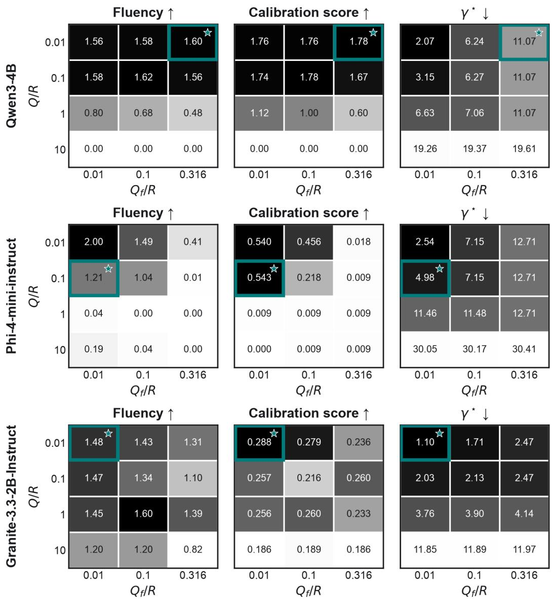  
Figure 16: MGSM $\mathrm { H } _ { \infty }$ calibration surfaces. Each model block sweeps $Q / R$ and $Q _ { f } / R$ with $R = 1$ . The panels report fluency, the model-specific calibration score, and the smallest feasible attenuation $\gamma ^ { \star }$ . Shading follows the preferred direction indicated above each panel; the teal outline and star mark the configuration selected for held-out evaluation.

## G.4 L-CITEEVAL: CONTEXT-LENGTH SHIFT

Dataset and distribution shift. L-CiteEval measures whether long-context models answer from the supplied context and provide faithful citations (Tang et al., 2024). We use the L-CiteEval-Length HotpotQA slice, which holds 40 question identities and gold answers fixed while increasing the context from approximately 8K to 16K tokens.

Steering and construction data. The steering target is AXBench concept 499, positive sentiment and descriptions of enjoyable experiences. Its direction uses all 72 released positive responses and 72 genre-matched negative responses. A-LQR and $\mathrm { \bar { H } } _ { \infty }$ share a 50-Jacobian dynamics estimate; $\mathrm { H } _ { \infty }$ uses 200 additional short prompts for disturbance fitting. Qwen2.5-3B-Instruct selects costs on 50 disjoint short prompts using AXBench overall steering. Llama-3.2-1B-Instruct selects costs on the 40 matched 8K HotpotQA prompts using 0.45 answer recall, 0.45 citation F1, 0.05 normalized concept relevance, and 0.05 normalized fluency. The selected artifacts are frozen for 16K evaluation.

Evaluation protocol. Generation uses the official one-shot HotpotQA prompt, deterministic decoding, and a 200-token response cap. Every method receives the same matched question and context-length conditions.

Metrics and uncertainty. Answer recall (AR) is normalized gold-answer token recall after removing citation markers.   
Citation F1 (CF1) uses the pinned tasksource/deberta-base-long-nli scorer on each claim and its cited passages.

Concept relevance (CR), instruction relevance (IR), and fluency (F) use fixed AXBench rubrics on a 0–2 scale; overall steering (OS) is their per-response harmonic mean. Uncertainty is a ten-group delete-one-group jackknife over four matched question identities per group, with the same partition used at every context length.

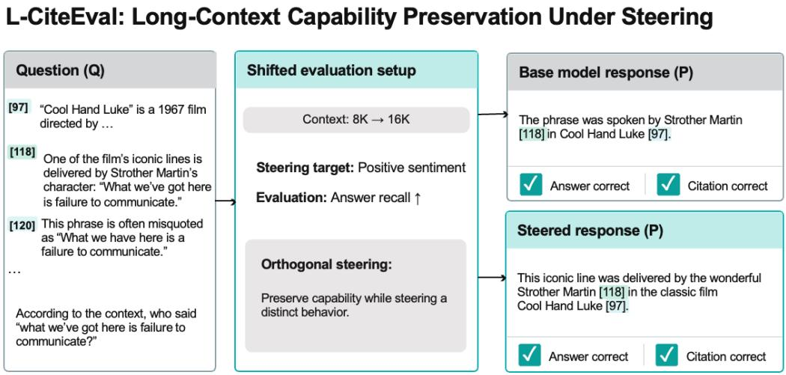  
Figure 17: Schematic L-CiteEval capability-preservation objective. Positive-sentiment steering changes response style, while the answer and its supporting citations should remain grounded in the supplied context. The reported experiment evaluates matched questions at 8K and 16K tokens; the displayed context and responses are illustrative.

Table 10: Full L-CiteEval length-transfer results. Values are full-sample means ± ten-group matched-question jackknife standard errors. Context conditions use the same 40 question identities within each model. Higher is better for every column.
<table><tr><td colspan="3">Model Context Method</td><td>Answer  $\mathrm { r e c a l l } \left( \% \right) \uparrow$ </td><td>Citation F1 (%) ↑ relevance</td><td>Concept</td><td> $( 0 { - } 2 ) \uparrow$ </td><td>Instruction relevance (0–2) ↑ Fluency (0–2) ↑</td><td></td></tr><tr><td rowspan="7">w.-3B</td><td rowspan="5"></td><td>Original</td><td> $6 6 . 2 \pm 8 . 1$  1</td><td> $7 . 8 \pm 1 . 6$ </td><td> $0 . 0 0 \pm 0 . 0 0$ </td><td></td><td> $1 . 3 5 \pm 0 . 1 4$ </td><td> $1 . 5 0 \pm 0 . 1 1$ </td></tr><tr><td>8K S-PID</td><td> $\underline { { 7 2 . 1 \pm 9 . 3 } }$ </td><td> $7 . 2 \pm 2 . 1$ </td><td> $0 . 0 0 \pm 0 . 0 0$ </td><td></td><td> $\underline { { 1 . 6 0 \pm 0 . 1 1 } }$ </td><td> $1 . 5 0 \pm 0 . 0 7$ </td></tr><tr><td> $_ \mathrm { A - L Q R }$ </td><td> $\overline { { 7 0 . 1 \pm 8 . 9 } }$ </td><td> $\overline { { 5 . 6 \pm 2 . 0 } }$ </td><td> $\underline { { 0 . 0 5 } } \pm 0 . 0 5$ </td><td></td><td> $\overline { { 1 . 4 8 \pm 0 . 1 1 } }$ </td><td> $1 . 4 8 \pm 0 . 0 9$ </td></tr><tr><td> $\mathbf { H } _ { \infty } \ : ( \mathrm { o u r s } )$ </td><td> $6 6 . 4 \pm 7 . 9$ </td><td> $6 . 4 \pm 2 . 0$ </td><td> $\overline { { 0 . 0 0 \pm 0 . 0 0 } }$ </td><td></td><td> $1 . 5 5 \pm 0 . 0 9$ </td><td> ${ \bf 1 . 5 5 \pm 0 . 0 8 }$ </td></tr><tr><td>Original</td><td> $6 5 . 2 \pm 7 . 6$  </td><td> $5 . 8 \pm 2 . 2$ </td><td> $0 . 2 0 \pm 0 . 0 8$ </td><td></td><td> $1 . 4 0 \pm 0 . 1 6$ </td><td> $1 . 5 2 \pm 0 . 1 3$ </td></tr><tr><td>16K  $\mathrm { { \bf S } } { \mathrm { - } } \mathrm { { P I D } }$   $_ \mathrm { A - L Q R }$ </td><td> $6 1 . 9 \pm 1 0 . 4$ </td><td> $7 . 2 \pm 3 . 2$ </td><td></td><td> $0 . 0 0 \pm 0 . 0 0$ </td><td> $1 . 3 8 \pm 0 . 1 3$ </td><td> $1 . 4 8 \pm 0 . 1 0$ </td></tr><tr><td rowspan="5">1a--1B 8K</td><td></td><td> $6 4 . 8 \pm 9 . 8$ </td><td> $3 . 0 \pm 1 . 5$ </td><td></td><td> $0 . 0 0 \pm 0 . 0 0$ </td><td> $\underline { { 1 . 4 3 \pm 0 . 1 5 } }$ </td><td> $\underline { { 1 . 5 7 \pm 0 . 1 1 } }$ </td></tr><tr><td> $\mathbf { H } _ { \infty } \mathrm { ~ ( o u r s ) }$ </td><td> ${ \bf 6 5 . 2 \pm 8 . 6 }$ </td><td> ${ \bf 7 . 8 \pm 3 . 6 }$ </td><td> ${ \bf 0 . 1 5 \pm 0 . 0 8 }$ </td><td></td><td> $\overline { { 1 . 4 0 \pm 0 . 1 2 } }$ </td><td> $\overline { { 1 . 4 3 \pm 0 . 0 9 } }$ </td></tr><tr><td>Original</td><td> $5 8 . 5 \pm 7 . 7$  </td><td> $6 . 2 \pm 2 . 5$ </td><td> $0 . 0 5 \pm 0 . 0 5$ </td><td></td><td> $1 . 3 0 \pm 0 . 1 0$ </td><td> $1 . 4 0 \pm 0 . 0 9$ </td></tr><tr><td> $_ \mathrm { A - L Q R }$ </td><td> $5 9 . 8 \pm 9 . 3$  </td><td> $6 . 6 \pm 2 . 7$ </td><td> $0 . 0 5 \pm 0 . 0 5$ </td><td></td><td> $1 . 3 5 \pm 0 . 1 1$ </td><td> $1 . 4 3 \pm 0 . 0 7$ </td></tr><tr><td> $\mathbf { H } _ { \infty } \mathrm { ~ ( o u r s ) }$ </td><td> ${ \bf 6 1 . 7 \pm 7 . 8 }$ </td><td> $\overline { { 6 . 4 \pm 2 . 9 } }$ </td><td> $\mathbf { 0 . 0 5 \ : \pm { \ : 0 . 0 5 } }$ </td><td></td><td> $\overline { { 1 . 1 2 \pm 0 . 1 7 } }$ </td><td> $\overline { { 1 . 3 8 \pm 0 . 0 9 } }$ </td></tr><tr><td rowspan="4"></td><td> $\mathrm { O r i g i n a l }$  16K</td><td>_  $4 4 . 2 \pm 7 . 1$ </td><td> $3 . 5 \pm 2 . 2$ </td><td></td><td> $0 . 1 2 \pm 0 . 1 0$ </td><td> $1 . 1 0 \pm 0 . 1 1$ </td><td> $1 . 2 3 \pm 0 . 0 7$ </td></tr><tr><td> $_ \mathrm { A - L Q R }$ </td><td> $5 0 . 1 \pm 8 . 0$ </td><td> $1 . 4 \pm 1 . 0$ </td><td></td><td> $\underline { { 0 . 0 0 \pm 0 . 0 0 } }$ </td><td> $\underline { { 1 . 1 5 \pm 0 . 1 0 } }$ </td><td> $1 . 2 3 \pm 0 . 1 1$ </td></tr><tr><td> $\mathbf { H } _ { \infty } \mathrm { ~ ( o u r s ) }$ </td><td> $4 7 . 9 \pm 7 . 8$ </td><td> ${ \bf 3 . 8 \pm 2 . 5 }$ </td><td></td><td> $\mathbf { 0 . 0 0 \ : \pm { \ : 0 . 0 0 } }$ </td><td> $\overline { { 1 . 0 0 \pm 0 . 1 4 } }$ </td><td> ${ \bf 1 . 4 0 \pm 0 . 0 8 }$ </td></tr><tr><td></td><td></td><td></td><td></td><td></td><td></td><td></td></tr></table>

Calibration results. Figure 18 reports the complete calibration surfaces for every reported model; the teal outline and star identify the selected operating point.

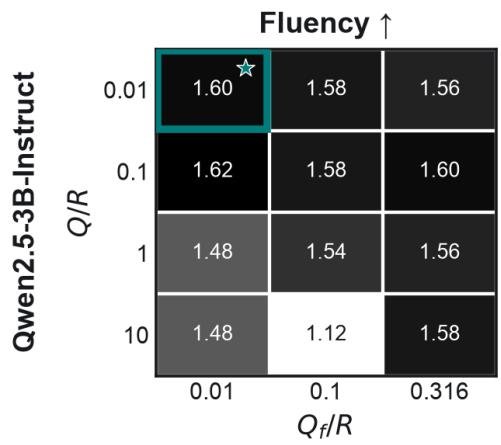

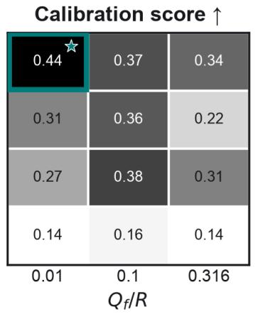

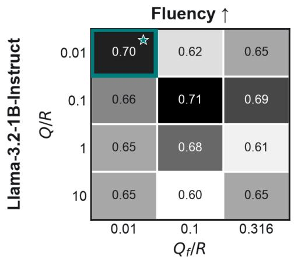  
Figure 18: L-CiteEval $\mathrm { H } _ { \infty }$ calibration surfaces. Each model block sweeps $Q / R$ and $Q _ { f } / R$ with $R = 1$ . The panels report fluency, the model-specific calibration score, and the smallest feasible attenuation $\gamma ^ { \star }$ . Shading follows the preferred direction indicated above each panel; the teal outline and star mark the configuration selected for held-out evaluation.

## H EXPERIMENTAL DETAILS

This appendix records the implementation choices required to reproduce the experiments. Dataset construction, shift definitions, and complete results are given in Appendix G; the controller derivation and numerical recursion are given in Appendices C.3 and C.5. Here we specify how those components are instantiated in the reported runs.

## H.1 EXPERIMENTAL PIPELINE AND SEPARATION OF STAGES

Every model–benchmark pair follows four explicit stages. The artifact stage freezes the semantic direction, reference setpoints and projected local dynamics. The calibration stage fits the $\mathrm { H } _ { \infty }$ disturbance geometry, synthesizes each candidate controller, generates on the calibration split, and selects one candidate by the benchmark-specific objective. The evaluation stage generates and stores responses from the selected controller without invoking any judge. The scoring stage reads those frozen responses and applies one or more task-specific scorers. Consequently, adding or rerunning a scorer does not change the generated sample

Artifacts and calibration selections are indexed by benchmark, model, method, and calibration identifier. A-LQR and $\mathrm { H } _ { \infty }$ use the same semantic direction, reference setpoints, nominal Jacobian estimate, reduced basis, and intervention site. They differ only in controller synthesis and, for $\mathrm { H } _ { \infty }$ , the fitted disturbance channel and selected cost configuration. $\mathrm { { N o n \mathrm { { - } H _ { \infty } } } }$ baselines use frozen settings rather than benchmark-test sweeps. Final-evaluation prompts do not select controller hyperparameters, except where an evaluation condition is explicitly designated as the in-distribution calibration condition in Appendix G. All reported generations disable the evaluated model’s KV cache, and every saved run records its model revision, prompt identities, method parameters, cache setting, start and end times, visible devices, and code-state provenance.

## H.2 MODELS AND CHECKPOINTS

Table 11 lists the immutable model snapshots used by the benchmark pipelines. The tokenizer is loaded from the same pinned snapshot as the corresponding model. We use each repository’s native chat template for instruction-tuned checkpoints and the benchmark-specific prompt template described in Appendix G.

## H.3 SEMANTIC DIRECTIONS AND REFERENCE STATES

For each benchmark, we form matched undesired and desired prompt–response records and collect the last-token residual-stream state at every decoder layer. Let $\bar { h } _ { k } ^ { + }$ and $\bar { h } _ { k } ^ { - }$ denote the desired and undesired means. The semantic contrast is $d _ { k } = \bar { h } _ { k } ^ { + } - \bar { h } _ { k } ^ { - }$ with its sign fixed by the ordering of the two classes. Directions are normalized independently at each layer. The target setpoint lies along the normalized contrast with magnitude equal to the frozen setpoint multiplier times $\| d _ { k } \| _ { 2 } ;$ all coordinates orthogonal to the target have zero reference displacement. Thus the reference is a fixed layer-indexed trajectory rather than a separately generated textual completion. Table 12 summarizes the records used for direction, dynamics, disturbance, and controller selection; prompt sources and final evaluation splits are described in detail in Appendix G.

The controlled state is the input residual stream of each transformer block. During generation, a forward hook adds the controller output to the final token at the corresponding block output. With KV caching disabled, the complete prefix is recomputed at each decoding step and the controller is therefore reevaluated on the current last-token state at every layer. Original and controlled methods use identical tokenization and decoding settings.

## H.4 PROJECTED DYNAMICS AND DISTURBANCE GEOMETRY

For each dynamics prompt, we compute last-token Jacobian–vector products with the prefix states fixed. Prompt-wise Jacobians are averaged and then projected between consecutive layer bases. We never materialize or retain the full hidden-dimension Jacobian collection after projection. The reduced basis is fitted independently at every layer. Its first vector is the normalized semantic contrast; the remaining vectors are the leading right singular vectors of the calibration activations after removing their component along that contrast. We orthonormalize the resulting basis by QR decomposition and use a reduced state dimension of eight in all reported experiments. A-LQR and $\mathrm { H } _ { \infty }$ consume the same saved projected transition matrices.

We estimate the disturbance geometry from one-step residuals in these reduced coordinates. Residuals are centered separately at each layer, and $D _ { k } D _ { k } ^ { \top }$ is set equal to their unbiased empirical covariance (ddof = 1). We obtain $D _ { k }$ from the singular values and right singular vectors of the centered residual matrix. Because the state dimension is eight and every reported disturbance split contains more than nine records, the retained rank is eight unless the empirical covariance is rank deficient; no post-hoc explained-variance truncation or disturbance rescaling is applied. The implementation verifies $\| D _ { k } D _ { k } ^ { \top } - \widehat { \Sigma } _ { k } \| _ { F } / \| \widehat { \Sigma } _ { k } \| _ { F } \leq 1 0 ^ { - 4 }$ before controller synthesis.

All calibration tensors used for synthesis are accumulated in float32. The reduced-coordinate construction uses a numerical norm floor of $1 0 ^ { - 4 }$ . For $\mathrm { H } _ { \infty }$ synthesis, the attenuation search begins on [0, 100], uses at most 100 bisection iterations with tolerance $1 0 ^ { - 5 }$ , and deploys at a relative margin of 0.01 above the smallest numerically feasible attenuation. Positive-definiteness checks use Cholesky factorizations, and the Riccati matrices are symmetrized after each backward update, as described in Appendix C.5.

Table 11: Evaluated models. Repository names link to the corresponding Hugging Face model cards. Revision links identify the exact pinned Git commits used for the reported runs; hashes are abbreviated to eight characters. The benchmark column identifies the reported evaluation in which each model appears.
<table><tr><td>Model</td><td>Hugging Face repository</td><td>Revision</td><td>Benchmark(s)</td></tr><tr><td>GPT-2 XL</td><td> $\mathtt { o p e n a i - c o m m u n i t y / g p t } 2 \mathrm { - x 1 }$ </td><td>15ea56de</td><td>TruthfulQA</td></tr><tr><td>Llama-3-8B</td><td>meta-1lama/Meta-Llama-3-8B</td><td>8cde5ca8</td><td>TruthfulQA</td></tr><tr><td>Qwen2.5-14B</td><td>Qwen/Qwen2.5-14B</td><td>97e1e763</td><td>TruthfulQA</td></tr><tr><td>OLMo-2-32B</td><td> $\mathtt { a l l e n a i / O L M O - 2 - 0 3 2 5 - 3 2 B - I n s t r u c t }$ </td><td>b9602434</td><td>TruthfulQA</td></tr><tr><td>Llama-3.2-1B-Instruct</td><td>meta-1lama/Llama-3.2-1B-Instruct</td><td>92131767</td><td>HarmBench, L-CiteEval</td></tr><tr><td>Llama-3.2-3B-Instruct</td><td>meta-1lama/Llama-3.2-3B-Instruct</td><td>0cb88a4f</td><td>HarmBench</td></tr><tr><td>Llama-3.1-8B-Instruct</td><td> $\mathrm { m e t a } - \mathrm { 1 } \mathrm { 1 } \mathsf { a m a } / \mathrm { L 1 } \mathsf { a m a } - 3 . \mathrm { 1 } - 8 \mathsf { B } - \mathrm { I n s t r u c t }$ </td><td>0e9e39f2</td><td>HarmBench</td></tr><tr><td>Qwen3-4B</td><td>Qwen/Qwen3-4B</td><td>1cfa9a72</td><td>MGSM</td></tr><tr><td>Phi-4-mini-instruct</td><td>microsoft/Phi-4-mini-instruct</td><td>cfbefacb</td><td>MGSM</td></tr><tr><td>Granite-3.3-2B-Instruct</td><td> $\mathrm { i } \mathrm { b m - g r a n i t e / q r a n i t e - } 3 . 3 \mathrm { - } 2 \mathrm { b - i } \mathrm { n s t r u c t }$ </td><td>707f574c</td><td>MGSM</td></tr><tr><td>Qwen2.5-3B-Instruct</td><td>Qwen/Qwen2.5-3B-Instruct</td><td>aa8e7253</td><td>L-CiteEval</td></tr></table>

Table 12: Controller-construction data. Counts are per model. Direction data estimate the steering direction; dynamics data are used for Jacobian estimation. Disturbance and selection records are excluded from direction fitting.
<table><tr><td>Benchmark</td><td>Direction</td><td>Dynamics</td><td>Disturbance</td><td>Selection</td></tr><tr><td>TruthfulQA</td><td>200 + 200 false / true</td><td>35</td><td>200 English prompts</td><td>50 or 200 disjoint English prompts, depending on model</td></tr><tr><td>HarmBench</td><td>50 + 50 harmful / safe</td><td>50</td><td>50 direct-validation behaviors</td><td>Same 50 direct-validation behaviors</td></tr><tr><td>MGSM</td><td>250 matched English- Spanish forms</td><td>50</td><td>Frozen GSM8K prompts; Bengali, German, Rus- sian, and Thai translations for Phi/Granite</td><td>50 prompts for Qwen; 100 translated prompts for Phi/Granite</td></tr><tr><td>L-CiteEval</td><td>72 + 72 negative / posi- tive AXBench responses</td><td>50</td><td>200 short-context prompts</td><td>50 short prompts for Qwen; 40 matched 8K Hot- potQA prompts for Llama</td></tr></table>

## H.5 CONTROLLERS AND HYPERPARAMETER SELECTION

Original denotes generation without an activation intervention. S-PID uses a fixed proportional–integral–derivative policy in the same semantic coordinates. A-LQR uses the fixed model–benchmark configuration inherited from its source protocol; it is not reswept on our evaluation data. $\mathrm { H } _ { \infty }$ alone is selected through a benchmark-specific grid. Except for the wider TruthfulQA grid, we evaluate the Cartesian product

$$
Q / R \in \{ 0 . 0 1 , 0 . 1 , 1 , 1 0 \} , \qquad Q _ { f } / R \in \{ 0 . 0 1 , 0 . 1 , 1 0 ^ { - 1 / 2 } \} , \qquad R = 1 .
$$

TruthfulQA uses $Q / R \in \{ 0 . 0 1 , 1 0 ^ { - 1 . 5 } , 0 . 1 , 1 0 ^ { - 0 . 5 } , 1 , 1 0 ^ { 0 . 5 } , 1 0 , 1 0 ^ { 1 . 5 } \}$ and $Q _ { f } / R \in \{ 0 . 0 1 , 1 0 ^ { - 1 . 5 } , 0 . 1 , 1 0 ^ { - 0 . 5 } \}$ , again with $R = 1$ . The setpoint multiplier is frozen before this cost sweep: it follows the fixed A-LQR model setting for TruthfulQA and is 1.5 for HarmBench, MGSM, and L-CiteEval. We do not sweep the setpoint multiplier or attenuation level as an additional model-selection axis. Each cost candidate nevertheless receives its own feasible $\gamma ^ { \star }$ from the same disturbance-fitted control problem.

The selection objectives are those reported with the calibration surfaces in Appendix G. TruthfulQA uses the run-specific objective stated in Appendix G.1; HarmBench maximizes mean AXBench overall steering, with validation ASR only as a tie-breaker; MGSM uses either AXBench overall steering or the reported 0.8/0.2 accuracy–steering composite, depending on the frozen model run; and L-CiteEval uses the frozen objective recorded with its calibration surface. Exact ties are resolved deterministically by the stored grid order. A calibration whose selection metric is identically zero fails rather than silently choosing a cost pair.

## H.6 GENERATION AND SCORING

Table 13 records the decoding configurations. The same prompt identities, order, and decoding parameters are shared by all methods within a model and condition. Batch size is a systems parameter and may differ across devices; it does not change prompt membership or decoding semantics.

Scoring is modular and operates only on completed generation files. TruthfulQA truth and informativeness use the pinned allenai/truthfulqa-truth-judge-llama2-7B and allenai/truthfulqa-info-judge-llama2-7B checkpoints. HarmBench ASR uses the official test classifier cais/HarmBench-Llama-2-13b-cls. MGSM accu racy is an exact comparison between the parsed final Arabic numeral and the stored answer. L-CiteEval answer recall uses the released normalized token-overlap rule after citation markers are removed, and citation precision, recall, and F1 use the released AutoAIS procedure with the pinned tasksource/deberta-base-long-nli checkpoint. AXBench concept relevance, instruction relevance, and fluency use the released 0–2 rubrics with gpt-4o-mini-2024-07-18; their overall score is the per-response harmonic mean and is zero when any component is zero. API scoring uses temperature zero, batched asynchronous requests, persistent per-response caches, and bounded retries. Deterministic scorers and model-based judges store their raw outputs alongside the aggregate metric so that aggregation can be reproduced without another generation pass.

Table 13: Generation settings. All controlled and uncontrolled methods use the same setting within a benchmark. The Llama-3.1-8B HarmBench run uses the resource-reduced cap shown in parentheses.
<table><tr><td>Benchmark</td><td>Decoding</td><td>Response cap</td><td>Repetitions</td><td>Additional settings</td></tr><tr><td>TruthfulQA</td><td>Sampling</td><td>50 tokens</td><td>5; refreshed Llama H∞, GPT-2 XL, and OLMo-2-32B: 1</td><td>T = 1.0, top-p = 0.3, repetition penalty 1.2</td></tr><tr><td>HarmBench</td><td>Greedy</td><td>512 tokens (8B: 100)</td><td>1</td><td>Direct and five jailbreak templates share behavior identities</td></tr><tr><td>MGSM</td><td>Greedy</td><td>256 tokens</td><td>1</td><td>Native eight-shot demonstrations for each input language</td></tr><tr><td>L-CiteEval</td><td>Greedy</td><td>200 tokens</td><td>1</td><td>Official one-shot prompt; matched 8K and 16K contexts</td></tr></table>

## H.7 STATISTICAL PROCEDURES

All comparisons are paired at the natural benchmark identity: TruthfulQA question, HarmBench behavior, MGSM problem, or L-CiteEval question. We first compute per-response scores, aggregate within each frozen condition, and only then form crosscondition summaries. Language-level MGSM summaries are macro averages over the five evaluation languages; HarmBench template summaries retain the direct and five adversarial conditions separately.

Full-protocol TruthfulQA rows report the standard error across five independent generation runs. The refreshed Llama-3-8B $\mathrm { H } _ { \infty }$ row and all GPT-2 XL and OLMo-2-32B rows use a five-group delete-one-group jackknife over question identities. HarmBench, MGSM, and L-CiteEval use ten-group delete-one-group jackknives over behavior, problem, and matched-question identities, respectively. For HarmBench, deleting one behavior removes its direct request and all five adversarial renderings; for L-CiteEval, the same question grouping is used at every context length. The reported intervals therefore measure sampling variability over benchmark identities. They do not measure judge uncertainty and, for deterministic decoding, do not measure decoding variability. No unreported significance test is used to determine boldface or underlining in the result tables.

## H.8 SOFTWARE, HARDWARE, AND COMPUTATIONAL ACCOUNTING

Experiments were implemented in PyTorch and Hugging Face Transformers. Large full-order Jacobians were averaged and projected after estimation; subsequent controller synthesis used the saved projected dynamics, reduced bases, and setpoints.

Table 14 reports allocated accelerator-hours, defined as stage elapsed time multiplied by the number of accelerators reserved for that stage. Artifact construction is counted once per model and shared by the controlled methods. Calibration includes disturbance fitting, controller synthesis over the complete candidate grid, calibration generation, scoring, and selection. Generation includes every method, distribution-shift condition, and repetition used in the reported tables. The accounting includes retained paper-producing shards from resumed jobs and excludes exploratory runs whose outputs were discarded; it is therefore a lower bound on total experimental compute.

Across the reported benchmark suite, these runs account for at least 229.9 allocated accelerator-hours: 19.1 for artifact construction, 48.7 for calibration, 159.8 for final generation, and 2.3 for scoring. The campaign used five accelerator classes— RTX 5090, A100, H100, H200, and RTX PRO 6000 Blackwell—with individual jobs scaling to eight accelerators and a recorded peak allocation of 12 accelerators concurrently across machines. The largest model–benchmark allocations were Qwen2.5-3B on L-CiteEval (52.8 accelerator-hours), Qwen2.5-14B on TruthfulQA (34.0), and OLMo-2-32B on TruthfulQA (32.0).

Computational support. We gratefully acknowledge Lightning AI for providing computational infrastructure and accelerator resources that supported the large-scale experiments reported in this work. Access to these resources enabled us to carry out repeated controller calibration, large-scale generation, and evaluation across multiple model families and accelerator classes at a computational scale that would otherwise have been difficult to achieve in a typical academic research setting.

## I ROBUST STEERABILITY AND HELD-OUT STEERING RELIABILITY

Robust steerability is computed from calibration dynamics before held-out generation. We test whether it tracks subsequent adversarial robustness across the three reported Llama controllers on HarmBench, which fixes the task, target behavior, calibration objective, and evaluation protocol.

Table 15: Calibration-time robust steerability and HarmBench safe-response rates. Results are for the selected $\mathrm { H } _ { \infty }$ controller. Behavioral entries are percentages computed as 100 − ASR; higher is better. Mean OOD averages the five frozen jailbreak templates.
<table><tr><td>Model</td><td> $S _ { \mathbf { r o b } }$ </td><td></td><td>APM</td><td>DNE Direct Programmer Nonresponse</td><td>Jailbreak Bot</td><td>John Persona</td><td>YOJA/Nona Mean Roleplay</td><td>OOD</td></tr><tr><td>Llama-3.2-1B</td><td>7.688</td><td>97.08</td><td>99.58</td><td>98.33</td><td>99.58</td><td>98.75</td><td>99.17</td><td>99.08</td></tr><tr><td>Llama-3.2-3B</td><td>2.405</td><td>91.67</td><td>97.50</td><td>96.25</td><td>96.25</td><td>95.83</td><td>95.83</td><td>96.33</td></tr><tr><td>Llama-3.1-8B</td><td>3.487</td><td>96.67</td><td>99.17</td><td>100.00</td><td>100.00</td><td>98.33</td><td>100.00</td><td>99.50</td></tr></table>

The relationship between $S _ { \mathrm { r o b } }$ and safe-response rate has a positive slope under each held-out jailbreak template. Llama-3.2-3B has the lowest $S _ { \mathrm { r o b } }$ and the lowest safe-response rate under every attack. The two controllers with higher $S _ { \mathrm { r o b } }$ approach ceiling-level refusal, so their ordering varies across templates. Within HarmBench, calibration-time robust steerability tracks which model–behavior controller remains reliable under adversarial prompt shift

The main experiments establish that robust feedback improves adversarial robustness. Calibration-derived $S _ { \mathrm { r o b } }$ therefore complements outcome-based evaluation with a pre-deployment diagnostic of reliability under held-out attack.

This appendix characterizes controller synthesis and deployment separately. Synthesis is an offline calibration operation performed once for a selected model–behavior configuration. Deployment measurements include the complete autoregressive forward pass, activation hooks, coordinate transformations, and controller updates. Measurements use Llama-3.2-1B-Instruct on the HarmBench refusal task.

Table 16: Controller synthesis and deployment cost. Medians over 20 synthesis trials and seven generation trials.
<table><tr><td>Method</td><td>Offline synthesis</td><td>Latency (ms/token)</td><td>Peak memory (GB)</td></tr><tr><td>A-LQR</td><td> $\mathcal { O } ( L d ^ { 3 } ) ; 0 . 2 0 1 5 \mathrm { ~ s ~ }$ </td><td>5.409</td><td>2.882</td></tr><tr><td>H∞(ours)</td><td> $\mathcal { O } ( N _ { \mathrm { i t e r } } L r _ { x } ^ { 3 } ) ; 0 . 1 2 4 5 \mathrm { ~ s ~ }$ </td><td>5.459</td><td>2.882</td></tr></table>

## J.1 ASYMPTOTIC SYNTHESIS COMPLEXITY

Let L denote the number of controlled layers, d the hidden dimension, $r _ { x }$ the reduced controller-state dimension, and $N _ { \mathrm { i t e r } }$ the number of attenuation-search iterations. A-LQR performs one finite-horizon Riccati sweep with $d \times d$ matrices, giving synthesis time $\mathcal { O } ( L d ^ { 3 } )$ and gain storage $\mathcal { O } ( L d ^ { 2 } )$ . The measured configuration uses $L = 1 6$ and $d = 2 0 4 8$

$\mathrm { H } _ { \infty }$ synthesis operates in the reduced state space. Each feasibility sweep costs $\mathcal { O } ( L r _ { x } ^ { 3 } )$ , and bisection gives total time $\mathcal { O } ( N _ { \mathrm { i t e r } } L r _ { x } ^ { 3 } )$ with gain storage $\mathcal { O } ( L r _ { x } ^ { 2 } )$ . The deployed configuration uses $r _ { x } = 8$

The production implementations therefore differ in both recursion and state dimension. To isolate the additional work introduced by robust feasibility search, we also time one A-LQR Riccati sweep on the same $r _ { x } = 8$ reduced problem used by $\mathrm { H } _ { \infty }$ . This matched-core measurement separates the cost of repeated robust solves from the dimensional difference between the deployed controllers.

## J.2 EMPIRICAL SYNTHESIS RUNTIME

Offline synthesis was profiled on one NVIDIA GeForce RTX 5090. Garbage collection and the CUDA allocator cache were cleared before each measurement, CUDA was synchronized around the timed region, and controller order was alternated across 20 trials. Synthesis used float32 tensors.

Table 17: Offline controller-synthesis measurements. Statistics summarize 20 trials. The matched A-LQR row uses the same eight-dimensional state as $\mathrm { H } _ { \infty }$
<table><tr><td>Method</td><td>State dim.</td><td>Median (s)</td><td>Mean ± SD (s)</td><td>Range (s)</td></tr><tr><td>A-LQR (deployed)</td><td>2048</td><td>0.201472</td><td> $0 . 2 0 0 5 6 7 \pm 0 . 0 0 2 4 8 9$ </td><td>[0.194700, 0.203315]</td></tr><tr><td>A-LQR (matched reduced core)</td><td>8</td><td>0.003073</td><td> $0 . 0 0 3 0 8 5 \pm 0 . 0 0 0 0 4 1$ </td><td>[0.003034, 0.003164]</td></tr><tr><td> $\mathrm { H } _ { \infty }$  (deployed)</td><td>8</td><td>0.124515</td><td> $0 . 1 2 4 5 1 2 \pm 0 . 0 0 0 2 1 4$ </td><td>[0.124153, 0.124880]</td></tr></table>

The deployed $\mathrm { H } _ { \infty }$ synthesis completed in a median of 0.124515 seconds. At the matched eight-dimensional state size, this was 40.52× the time required for one A-LQR Riccati sweep, reflecting the repeated feasibility solves. The deployed full-state A-LQR implementation took 0.201472 seconds because its recursion operates at $d = 2 0 4 8$ rather than $r _ { x } = 8$ . Peak synthesis memory was 0.160 GB for deployed A-LQR and below 0.009 GB for both reduced-state controllers.

The production attenuation search converged in 24 bisection iterations to $\gamma ^ { \star } = 0 . 1 3 0 0 7 5 2 2$ . Its final infeasible–feasible bracket was [0.13006926, 0.13007522], with width $5 . 9 6 \times 1 0 ^ { - 6 }$ . We assessed sensitivity to the fitted disturbance geometry by drawing 100 seeded bootstrap samples of size 50, with replacement, from the 50 prompt-level calibration residual records. For each resample, the layer-wise disturbance covariance was refitted and the unchanged synthesis procedure was rerun. All 100 fits converged in 24 iterations. The resulting $\gamma ^ { \star }$ values had mean 0.12935 and standard deviation 0.00602.

Each bootstrap resample refits the empirical disturbance geometry before synthesis; the reported iteration count is therefore defined per fitted control problem.

## J.3 INFERENCE-TIME DEPLOYMENT

For one final-token state at one controlled layer, the deployed A-LQR policy constructs a full-dimensional semantic tracking error and multiplies it by ${ \textbf { a } } d \times d$ gain, requiring $\mathcal { O } ( d ^ { 2 } )$ controller operations. The $\mathrm { H } _ { \infty }$ policy projects the hidden state into $r _ { x }$ coordinates, applies the reduced feedback and control-channel matrices, and lifts the intervention back to the hidden dimension. Its controller cost is $\mathcal { O } ( d r _ { x } + r _ { x } ^ { 2 } )$ per layer. Across the controlled horizon, the controller-only costs are $\mathcal { O } ( L d ^ { 2 } )$ for A-LQR and $\mathcal { O } ( L ( d r _ { x } + r _ { x } ^ { 2 } ) )$ for $\mathrm { H } _ { \infty }$ . Because these operations are embedded in the transformer forward pass, we also measure end-to-end decoding latency and memory.

Deployment was measured on the same 16 frozen HarmBench direct prompts for all methods. Each prompt generated exactly 50 new tokens, giving 800 generated tokens per method and trial. Generation was greedy, batch size was eight, the evaluated-model KV cache was disabled, and method order was rotated across seven synchronized trials. The model used bfloat16 parameters with PyTorch scaled dot-product attention. Peak allocated memory statistics were reset before every trial.

Table 18: End-to-end deployment cost. Latency is synchronized wall time per generated token over seven trials. ∆ is relative to Original.
<table><tr><td>Method</td><td>Median latency (ms/token)</td><td>Mean ± SD (ms/token)</td><td>(%)</td><td>∆ vs. Original Peak / incremental GB</td></tr><tr><td>Original</td><td>5.347</td><td> $5 . 3 4 6 \pm 0 . 0 0 5$ </td><td>0.00</td><td>2.882 / 0.265</td></tr><tr><td>A-LQR</td><td>5.409</td><td> $5 . 4 0 3 \pm 0 . 0 1 4$ </td><td>+1.16</td><td>2.882 / 0.265</td></tr><tr><td> $\mathrm { H } _ { \infty } \ : ( \mathrm { o u r s } )$ </td><td>5.459</td><td> $5 . 4 5 4 \pm 0 . 0 1 3$ </td><td>+2.09</td><td>2.882 / 0.265</td></tr></table>

The median $\mathrm { H } _ { \infty }$ latency was 0.050 ms/token above A-LQR and 2.09% above Original. Median peak allocated memory was 2.882 GB for all methods, with 0.265 GB allocated above the resident model. Measurements used Python 3.11.16, PyTorch 2.9.1 with CUDA 12.8, Transformers 4.57.1, and bfloat16 scaled dot-product attention on an NVIDIA GeForce RTX 5090.