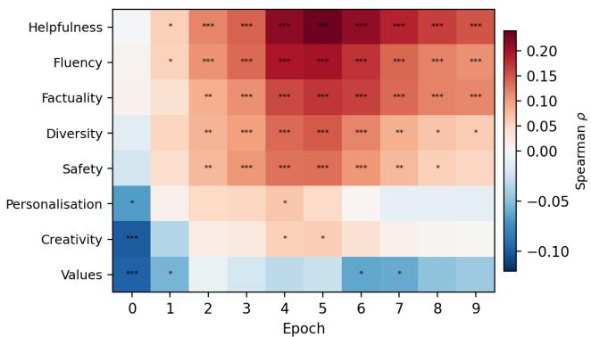
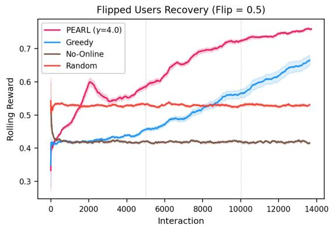
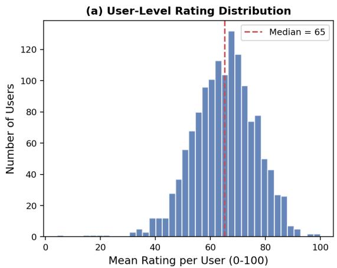
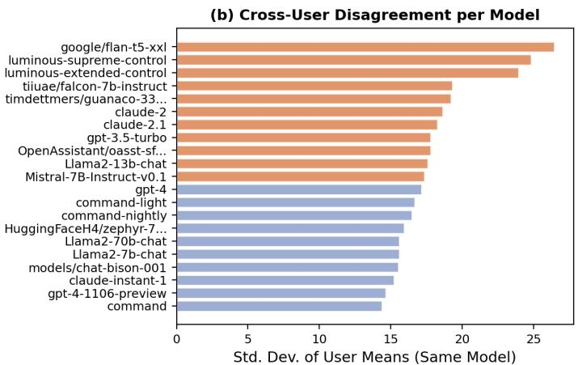
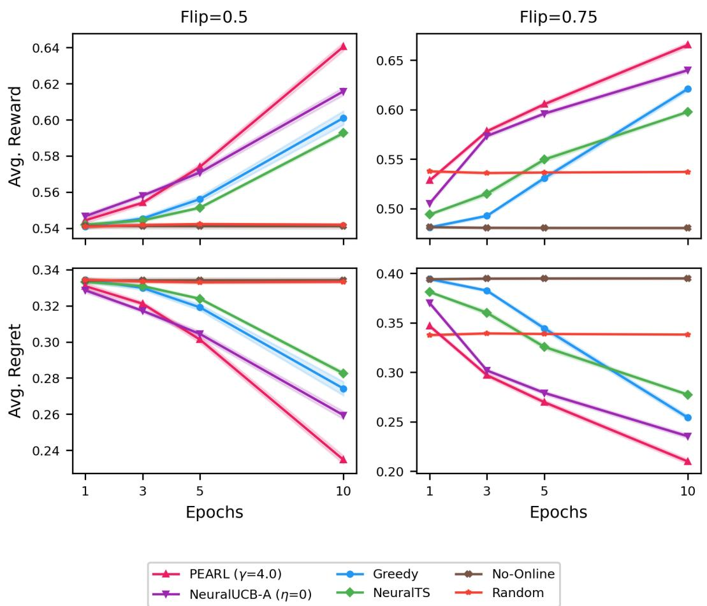
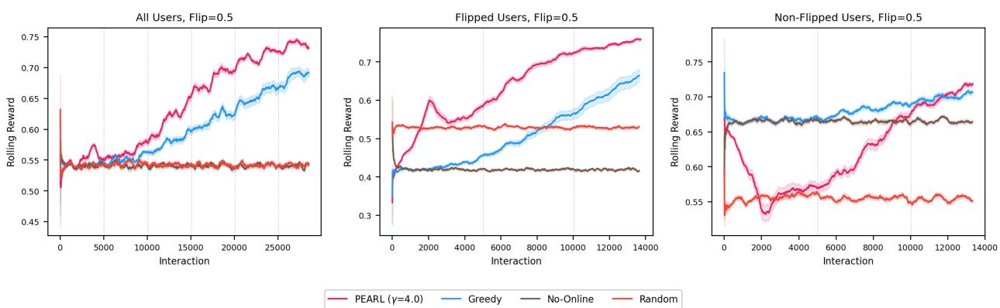
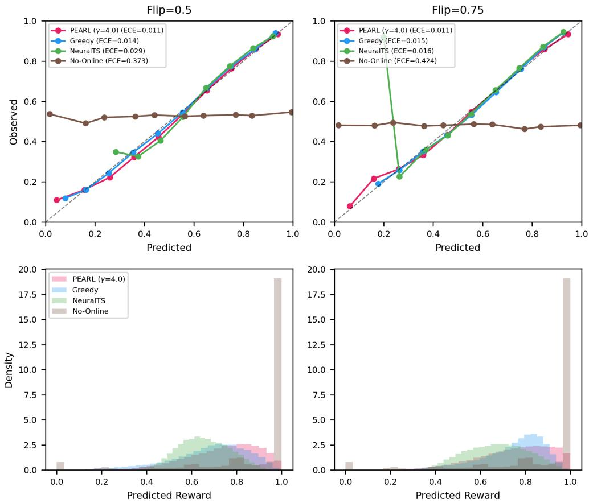
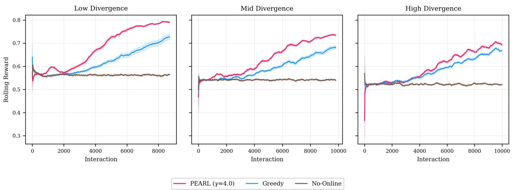

# PEARL: Prediction Error-Adaptive Regularized Learning for Selective Forgetting under Partial Preference Drift

Rashmi Gangadharaiah AWS rgangad@amazon.com

Balakrishnan Narayanaswamy AWS muralibn@amazon.com

November 5, 2026

## Abstract

User preferences are not static: they shift as needs, context, and tastes evolve. This is particularly important in personalized recommendation, appropriate LLM response generation, and RLHF-trained reward models, all of which can become miscalibrated as user preferences drift, requiring online adaptation. Since only the selected response receives feedback, the system must balance exploiting its current best against exploring alternatives. Existing non-stationary bandit methods forget uniformly across all model dimensions, but real preference shifts are typically partial: some dimensions go stale while others remain valid. Neural contextual bandits accumulate confidence monotonically via the Gram matrix over learned features, with no mechanism to direct uncertainty to where predictions have actually gone wrong. We propose PEARL (Prediction Error-Adaptive Regularized Learning), which reverses the Gram update along feature directions where predictions are surprisingly wrong, while leaving confidence intact everywhere else. We prove that (i) any non-adaptive policy sufers linear regret after a preference shift, (ii) no fixed exploration rate achieves low regret in both stationary and non-stationary regimes simultaneously, and (iii) PEARL’s cumulative regret scales with the number of shifted users $N _ { s } ,$ , not the total population N, with a one-interaction detection delay. On PRISM, a personalized LLM response selection benchmark (1,500 users, 21 LLMs), with moderate preference drift, PEARL beats greedy selection by +4.0 points and the best neural bandit baseline by +2.5 points (p<0.001), while performing on par with greedy when preferences are stable. It beats sliding-window and discounted learning approaches by 3 to 10 points, showing that selective forgetting outperforms forgetting uniformly across all model dimensions. The selection policy is a ∼100K-parameter MLP that runs in milliseconds on a CPU, leaves LLM weights frozen, and works with any API-based model.

## 1 Introduction

Neural contextual bandits learn which actions to take by maintaining a Gram matrix over learned features [Zhou et al., 2020]. Each observation tightens the matrix, reducing epistemic uncertainty in the corresponding feature direction, which is the right behavior when user preferences are stable. But the update is irreversible. Once the model has seen enough data along a feature direction, the exploration bonus in that direction stays small permanently. If the user’s preferences then change in precisely that direction, the model will keep exploiting a now-wrong prediction and the Gram matrix ofers no mechanism to course-correct.

Figure 1a illustrates this failure concretely. For users whose preferences shift, we measure the correlation between how much a user cares about each preference dimension and the model’s prediction error for that user. On dimensions the model had learned well before the shift (Helpfulness,

Factuality, Fluency), prediction error is highest for the users who care most, and this relationship persists as the model continues to train. The model is most wrong precisely where it matters most to each user, and it remains wrong because the Gram matrix is most confident in those directions and has stopped exploring them. Other dimensions (Creativity, Values) show no such pattern. The damage is concentrated where confidence is highest, yet the standard Gram update cannot distinguish stale confidence from valid.

Existing non-stationary bandit methods apply uniform forgetting: sliding windows [Garivier and Moulines, 2011], discounted Gram matrices [Russac et al., 2019], or periodic restarts. When every dimension may change, this is reasonable. But preference drift is rarely so uniform.

A user who starts wanting concise answers and later prefers detailed explanations has not changed their preference for factual accuracy. A moviegoer whose genre tastes shift from action to romance still cares about compelling storytelling. In practice, some dimensions of the reward function go stale while others remain perfectly valid. We call this partial stationarity. The stakes are highest when preferences are deeply personal: in the PRISM dataset [Kirk et al., 2024], the same LLM response can score 85 from one user and 40 from another across 1,500 participants, and the bottleneck is not generation but selection. Under partial stationarity, uniform forgetting discards valid information alongside stale, forcing re-exploration of dimensions that never changed. The cost scales with total dimensionality, not the number of shifted dimensions (Proposition 5, Section 7.4). This raises a concrete question: can a neural bandit selectively forget what has gone stale while preserving what remains valid? To our knowledge, no prior work formalizes partial stationarity as a distinct setting or designs a forgetting mechanism tailored to it.

We propose PEARL (Prediction Error-Adaptive Regularized Learning), a neural contextual bandit that breaks the one-way accumulation in the Gram matrix. After each interaction, if the prediction error exceeds the user’s running average, PEARL injects uncertainty back along the feature direction where the error occurred. Confidence in all other directions is untouched. An error-adaptive acquisition function complements this: per-user prediction errors modulate the exploration bonus, so well-predicted users get near-greedy selection while poorly-predicted users explore aggressively. When preferences are stable, both mechanisms go dormant.

We evaluate on two domains under controlled preference drift: LLM response selection (PRISM; 1,500 users, 21 LLMs) and a simulation with known ground-truth preferences. On PRISM at moderate drift, PEARL beats greedy by +4.0 points and NeuralUCB by +2.5 (p<0.001; Table 5); static models without online updates fall below random (0.480 vs. 0.537). The regret decomposition predicts a d/s advantage when only s of d dimensions shift (Proposition 5, Section 7.4); the measured 3–10 point gap confirms this.

## Contributions.

1. The bidirectional Gram update: a mechanism that injects uncertainty back into the Gram matrix along feature directions where prediction error is surprisingly high, while preserving confidence in well-calibrated directions (Section 3.4). Setting the injection rate to zero recovers standard NeuralUCB.

2. Error-adaptive exploration: a per-user prediction error tracker that modulates the UCB bonus, achieving near-greedy behavior under stationarity and rapid recovery under drift (Section 3.3).

3. Evaluation on two domains (LLM personalization and controlled simulation) with a systematic ablation chain showing that PEARL dominates all baselines under partial stationarity and incurs minimal cost under stationarity (Section 13).

4. Practical deployability: a ∼100K-parameter MLP that operates on precomputed features, requiring no GPU and no modification to the underlying models. For LLM personalization, a small reward model learns user preferences online, requiring no expensive LLM updates when

  
(a) Spearman ρ between preference strength and prediction error for shifted users (20 seeds). Helpfulness, fluency, and factuality show persistent correlations; creativity and values do not.

  
(b) Recovery trajectory for flipped users (flip 0.5, 20 seeds, rolling window of 500). PEARL separates from Greedy by interaction 2,000, recovering faster where interactions are costly. No-Online flatlines.  
Figure 1: (a) Real preference data exhibits partial stationarity: dimensions go stale at diferent rates. (b) PEARL exploits this structure, recovering faster than Greedy on shifted users.

## 2 Related Work

LinUCB [Li et al., 2010] introduced contextual bandits with linear reward models and confidence-based exploration. NeuralUCB [Zhou et al., 2020] and NeuralTS [Zhang et al., 2020] extend this to neura networks using last-layer Gram-matrix uncertainty, but assume stationarity. SW-UCB [Garivier and Moulines, 2011] handles non-stationarity via sliding windows; Russac et al. [2019] use discounted Gram matrices in linear bandits. Both forget indiscriminately across all dimensions. PEARL draws on classical directional forgetting in RLS [Kulhav\`y and Kárn\`y, 1984, Bittanti et al., 1990], developed for tracking slowly varying parameters in linear system identification, but extends it to neural features with error-conditional triggering and a spectral cap that create a self-correcting loop. Unlike continual learning [Kirkpatrick et al., 2017, Zenke et al., 2017], which protects important weights across tasks, our update operates at the uncertainty level, restoring epistemic confidence in stale directions while leaving weights to be updated by gradient descent. Time-varying matrix factorization [Koren, 2009], contextual signals [Hariri et al., 2015], and recurrent bandit models [Wu et al., 2018] operate at the global level and cannot identify which feature dimensions have gone stale.

Best-of-N sampling [Stiennon et al., 2020] uses no exploration signal. URM [Lou et al., 2024] adds heteroscedastic heads, Zhai et al. [2023] propose LoRA ensembles, and deep ensembles [Lakshminarayanan et al., 2017] provide well-calibrated uncertainty [Ovadia et al., 2019] but scale linearly with ensemble size. None were designed for bandits; we adapt them as baselines in Section 13.2. PEARL uses single-network Gram-matrix uncertainty, avoiding ensemble overhead while enabling directional forgetting.

RLHF [Ouyang et al., 2022, Bai et al., 2022] and DPO [Rafailov et al., 2023] learn a single policy from aggregated preferences. Ofline personalization methods (MRM via meta-learning, VRF via variational bases) learn user-specific rewards but assume static preferences. VPL and SDPO fine-tune the LLM itself, which is expensive and impractical for API-only access. MiCRo [Shen et al.,

2025] and T-POP [Qu et al., 2025] maintain frozen-model reward models but lack per-user epistemic uncertainty or non-stationarity handling. Pluralistic alignment [Sorensen et al., 2024, Feng et al., 2024, Wang et al., 2026] targets group-level rather than individual preferences.

## 3 Method

## 3.1 Problem Setup

Consider a contextual bandit with context $\mathbf { x } _ { u } \in \mathbb { R } ^ { d _ { u } }$ (e.g., user features) and K arms with feature vectors $\mathbf { z } _ { k } \in \mathbb { R } ^ { d _ { z } }$ (e.g., candidate items or responses). At each round, the learner selects an arm $k ^ { * }$ and observes only the reward $r ( k ^ { * } ) \in [ 0 , 1 ]$ for that arm. The goal is to maximize cumulative reward. We focus on the partially stationary setting where user preferences may change over time, so that a model trained on historical data can become miscalibrated.

## 3.2 Reward Model with Gram-Matrix Uncertainty

We model the reward function with a single MLP fθ, parameterized by θ, mapping concatenated context and arm features to a d-dimensional representation, followed by a linear head $h : \mathbb { R } ^ { d }  \mathbb { R } :$

$$
g _ { k } = f _ { \theta } ( [ \mathbf { x } _ { u } ; \mathbf { z } _ { k } ] ) \in { \mathbb R } ^ { d } , \qquad { \hat { r } } ( \mathbf { x } _ { u } , \mathbf { z } _ { k } ; \theta ) = \operatorname { s i g m o i d } ( h ( g _ { k } ) )\tag{1}
$$

We write $\mu _ { k } = \hat { r } ( \mathbf { x } _ { u } , \mathbf { z } _ { k } ; \boldsymbol { \theta } )$ for brevity in subsequent equations. While we use a two-layer MLP (d=128, dropout 0.1), the framework is agnostic to the reward architecture. We compare against heteroscedastic (URM), meta-learned (MRM), and variational (VRF) reward heads in Section 13.2.

Gram-matrix uncertainty. Following NeuralUCB, we maintain a Gram matrix A over the network’s last-layer features to quantify epistemic uncertainty:

$$
A = \lambda I + \sum _ { t = 1 } ^ { T } g _ { t } g _ { t } ^ { \top } , \qquad \sigma _ { k } = \sqrt { g _ { k } ^ { \top } A ^ { - 1 } g _ { k } }\tag{2}
$$

where $T$ is the number of observations so far and λ is a regularization parameter. The uncertainty $\sigma _ { k }$ is small in feature-space directions where many observations have been collected, and large in unexplored directions. This captures epistemic uncertainty, the appropriate signal for exploration. We maintain $A ^ { - 1 }$ directly via rank-1 Sherman-Morrison updates (Section 3.4).

Context representation. We construct a hybrid context vector combining observed features with learned latent factors:

$$
\mathbf { x } _ { u } = [ \mathbf { s } _ { u } ; e _ { \phi } ( u ) ] \in \mathbb { R } ^ { d _ { u } }\tag{3}
$$

where $\mathbf { s } _ { u }$ is an observed feature vector and $e _ { \phi }$ is a learned embedding trained jointly with the reward model. Embedding dampening $( 1 - { \varepsilon } _ { u } ) \cdot { e } _ { \phi } ( u )$ down-weights learned embeddings when the model is uncertain, falling back to observed features. Dataset-specific dimensions are given in Section 8.

Training. We pretrain on historical data using Bradley-Terry pairwise loss [Bradley and Terry, 1952], mirroring the reward model training stage in RLHF, which is natural when multiple ratings per context are available. During the online phase, where the model is deployed and learns continuously from user interactions, only the reward r for the selected arm is observed, so pairwise comparisons are no longer available and we switch to pointwise MSE over the online dataset $\mathcal { D } _ { \mathrm { o n } }$

$$
\mathcal { L } _ { \mathrm { o n l i n e } } ( \theta ) = \frac { 1 } { | \mathcal { D } _ { \mathrm { o n } } | } \sum _ { ( \mathbf { x } _ { u } , \mathbf { z } _ { k } , r ) \in \mathcal { D } _ { \mathrm { o n } } } \left( \hat { r } ( \mathbf { x } _ { u } , \mathbf { z } _ { k } ; \theta ) - r \right) ^ { 2 }\tag{4}
$$

## 3.3 Error-Adaptive Exploration (PEARL)

Standard UCB explores uniformly across all users, wasting budget on users whose rewards are already well-modeled. PEARL instead monitors its own prediction errors per user and scales exploration intensity accordingly.

Per-user drift detector. For each user u, we maintain an exponential moving average (EMA) of absolute prediction errors:

$$
\begin{array} { r } { \varepsilon _ { u } ^ { ( t ) } = \beta \cdot \varepsilon _ { u } ^ { ( t - 1 ) } + ( 1 - \beta ) \cdot \ell _ { u } ^ { ( t ) } , \qquad \ell _ { u } ^ { ( t ) } = \left| \boldsymbol { r } _ { k ^ { * } } ^ { ( t ) } - \boldsymbol { \mu } _ { k ^ { * } } ^ { ( t ) } \right| } \end{array}\tag{5}
$$

where $\beta { = } 0 . 3$ is the smoothing factor (robust to choice; Section 5), initialized at $\varepsilon _ { u } ^ { ( 0 ) } = 0 . 5$ (maximum uncertainty on [0, 1] rewards, encouraging exploration before any observations). When predictions are accurate, $\varepsilon _ { u }$ decays toward zero; when user preferences shift, prediction errors spike, providing an automatic drift signal.

PEARL acquisition function. Arm selection maximizes an error-adaptive acquisition function:

$$
\begin{array} { r } { k ^ { * } = \arg \underset { k \in \{ 1 , \dots , K \} } { \operatorname* { m a x } } \underbrace { \mu _ { k } ( \mathbf { x } _ { u } , \mathbf { z } _ { k } ) } _ { \mathrm { e x p l o i t a t i o n } } + \underbrace { \gamma \cdot \varepsilon _ { u } ^ { ( t ) } \cdot \sigma _ { k } ( \mathbf { x } _ { u } , \mathbf { z } _ { k } ) } _ { \mathrm { e r r o r - a d a p t i v e \ e x p l o r a t i o n \ b o n u s } } } \end{array}\tag{6}
$$

The bonus factors into $\gamma$ (global sensitivity), $\varepsilon _ { u } ^ { ( t ) }$ (per-user prediction quality), and $\sigma _ { k }$ (per-arm epistemic uncertainty). When the model predicts well $( \varepsilon _ { u } \to 0 )$ , selection reduces to greedy; when predictions are poor, the bonus upweights uncertain arms.

Self-correcting dynamics. The mechanism is self-correcting: when rewards shift, errors spike, $\varepsilon _ { u }$ rises, and exploration increases; as new data arrives, $\varepsilon _ { u }$ falls and selection reverts to near-greedy. Under stationarity, $\varepsilon _ { u } \to 0$ and exploration adds no cost. The tracker detects shifts within a single interaction at $\beta { = } 0 . 3$ (Lemma 1, Section 4). A per-round regret decomposition (Proposition 1, Section 6) yields an adaptive bound (Proposition 4, Section 7.3) where cumulative regret scales with the number of shifted users $N _ { s }$ , not the total N.

## 3.4 Bidirectional Gram Update

Intuition: two dimensions, one shifts. Suppose a user cares about two attributes, verbosity and formality, and the Gram matrix has accumulated confidence in both directions. Now the user’s verbosity preference flips. The model is wrong along verbosity but still correct along formality. Uniform forgetting (sliding windows, discounted Gram) would reduce confidence in both directions, forcing the model to re-learn formality from scratch even though it was never wrong there. The wasted re-exploration scales with $d ,$ not the number of shifted dimensions s (Proposition 5, Section 7.4). What we want: grow uncertainty back along verbosity and leave formality alone.

In standard NeuralUCB, the Gram matrix can only accumulate observations: each new data point shrinks uncertainty via the Sherman-Morrison rank-1 update:

$$
A ^ { - 1 }  A ^ { - 1 } - \frac { ( A ^ { - 1 } g _ { k } ) ( g _ { k } ^ { \top } A ^ { - 1 } ) } { 1 + g _ { k } ^ { \top } A ^ { - 1 } g _ { k } }\tag{7}
$$

Once the model has seen data in a feature direction, $\sigma _ { k }$ stays permanently low there, even if a preference shift makes the model wrong in exactly that direction. The EMA tracker $\varepsilon _ { u }$ compensates by scaling all directions equally, but this uniform scalar adjustment cannot distinguish directions where the model is wrong from those where it remains correct.

Algorithm 1 PEARL: Online Selection with Bidirectional Gram   
Require: Network $f _ { \theta } ,$ , head $h ,$ context features $\left\{ { { \bf { x } } _ { u } } \right\}$ , interaction stream   
1: $\begin{array} { r } { \mathcal { D }  \emptyset ; \quad \varepsilon _ { u }  0 . 5 \forall u ; \quad A ^ { - 1 }  \frac { 1 } { \lambda } I } \end{array}$   
2: for each interaction $( u , \{ ( k , \mathbf { z } _ { k } ) \} _ { k = 1 } ^ { K } )$ do   
3: $g _ { k } \gets f _ { \theta } ( [ { \bf x } _ { u } ; { \bf z } _ { k } ] ) ; ~ \mu _ { k } \gets h ( g _ { k } ) ; ~ \sigma _ { k } \gets \sqrt { g _ { k } ^ { \top } A ^ { - 1 } g _ { k } }$ ∀k   
4: Select $k ^ { * }  \mathrm { a r g }$ maxk $[ \mu _ { k } + \gamma \cdot \varepsilon _ { u } \cdot \sigma _ { k } ] ;$ observe $r _ { k ^ { * } }$   
5: $\begin{array} { r } { A ^ { - 1 } \gets A ^ { - 1 } - \frac { ( A ^ { - 1 } g _ { k ^ { * } } ) ( g _ { k ^ { * } } ^ { \top } A ^ { - 1 } ) } { \texttt { \ i } \sim \top \texttt { \ i } \sim } } \end{array}$ {Shrink}   
$\overline { { 1 + g _ { k ^ { * } } ^ { \top } A ^ { - 1 } g _ { k ^ { * } } } }$   
6: if $| r _ { k ^ { * } } - \mu _ { k ^ { * } } | > \varepsilon _ { u }$ and $\varepsilon _ { u } > 0 . 0 5$ then   
7: $A ^ { - 1 }  A ^ { - 1 } + \eta ( r _ { k ^ { * } } - \mu _ { k ^ { * } } ) ^ { 2 } g _ { k ^ { * } } g _ { k ^ { * } } ^ { \top }$ ; spectral cap to $\leq 1 / \lambda$ {Grow}   
8: end if   
9: $\varepsilon _ { u } \gets \beta \varepsilon _ { u } + ( 1 - \beta ) | r _ { k ^ { * } } - \mu _ { k ^ { * } } | ;$ add $\left( \mathbf { x } _ { u } , \mathbf { z } _ { k ^ { * } } , r _ { k ^ { * } } \right)$ to $\mathcal { D }$   
10: Periodically: update $f _ { \theta } , h$ on recent $\mathcal { D } \ ( \mathrm { e q . \ ( 4 ) } ) ;$ rebuild $A ^ { - 1 }$   
11: end for

The bidirectional Gram update fixes this by allowing uncertainty to grow back in directions where the model is wrong. After each interaction, we perform the standard shrink (eq. (7)), then conditionally inject uncertainty:

$$
\begin{array} { r } { \mathrm { I f ~ } | \hat { r } _ { k } - r _ { k } | > \varepsilon _ { u } \mathrm { ~ a n d ~ } \varepsilon _ { u } > 0 . 0 5 : \quad A ^ { - 1 } \gets A ^ { - 1 } + \eta \cdot ( r _ { k } - \hat { r } _ { k } ) ^ { 2 } \cdot g _ { k } g _ { k } ^ { \top } } \end{array}\tag{8}
$$

where $\eta$ is the injection rate. The injection fires only when the prediction error exceeds the context’s running average, i.e., when the model is surprisingly wrong. Three properties make this work. First, it is directional: uncertainty grows only along $g _ { k }$ , the feature direction where the error occurred. Second, it is error-scaled: larger errors produce proportionally larger injections $( \propto ( r _ { k } - { \hat { r } } _ { k } ) ^ { 2 } )$ Third, it is self-correcting: as exploration improves predictions, errors shrink, injection stops triggering, and $\sigma _ { k }$ decays back through normal Sherman-Morrison updates.

Spectral safeguard. Repeated injections could cause $A ^ { - 1 }$ eigenvalues to grow unboundedly. We apply a spectral cap after each injection:

$$
A ^ { - 1 }  U \mathrm { d i a g } ( \operatorname* { m i n } ( \lambda _ { i } , 1 / \lambda ) ) U ^ { \top }\tag{9}
$$

where $U \Lambda U ^ { \top } = A ^ { - 1 }$ is the eigendecomposition and $1 / \lambda$ is the prior uncertainty. This ensures that injected uncertainty never exceeds the prior: the model can “forget” what it learned in a direction, but cannot become more uncertain than before seeing any data. Since $\eta ( r _ { k } - { \hat { r } } _ { k } ) ^ { 2 } g _ { k } g _ { k } ^ { \top }$ is positive semidefinite, $A ^ { - 1 }$ remains positive definite throughout. The eigendecomposition is $O ( d ^ { 3 } )$ but with d=128 it takes under 1ms on $\operatorname { C P U } ;$ moreover, the cap is applied only when injection fires (∼40% of interactions), so the amortized overhead is negligible.

Although $A ^ { - 1 }$ is shared across all users, the injection direction $g _ { k } = f _ { \theta } ( [ \mathbf { x } _ { u } ; \mathbf { z } _ { k } ] )$ is conditioned on the per-user context $\mathbf { x } _ { u } ~ ( \mathrm { e q . ~ } ( 3 ) )$ , so two users with diferent preferences produce diferent $g _ { k }$ vectors even for the same arm; injection for one user therefore does not distort uncertainty estimates for dissimilar users. Classical directional forgetting in RLS injects uncertainty on a fixed schedule over linear features; the bidirectional Gram update difers by operating on nonlinear neural features, firing only when error exceeds the running average, and scaling injection with squared error. Setting $\scriptstyle \eta = 0$ recovers standard NeuralUCB. The full procedure is given in Algorithm 1.

Between network updates, $A ^ { - 1 }$ evolves via per-interaction rank-1 updates at $O ( d ^ { 2 } )$ cost (d=128, negligible); network updates retrain on recent observations and rebuild $A ^ { - 1 }$ from updated features.

## 4 Error Tracker Recovery Analysis

Lemma 1 (Error Tracker Response Time). Suppose user u’s preferences shift at time $t _ { 0 }$ , causing prediction errors $\ell _ { u } ^ { ( t ) } \geq \delta _ { p o s t } f o r t \geq t _ { 0 }$ . Then the EMA error tracker $( e q . ~ ( 5 ) )$ satisfies:

$$
\varepsilon _ { u } ^ { ( t _ { 0 } + \Delta ) } \geq \delta _ { p o s t } \cdot ( 1 - \beta ^ { \Delta } )\tag{10}
$$

In particular, within $\Delta ^ { * } = \lceil \log ( 0 . 5 ) / \log ( \beta ) \rceil$ interactions, $\varepsilon _ { u }$ reaches at least $\delta _ { p o s t } / 2$

Proof. By induction on eq. (5): $\varepsilon _ { u } ^ { ( t _ { 0 } + \Delta ) } \ge ( 1 - \beta ) \cdot \delta _ { \mathrm { p o s t } } \cdot \sum _ { s = 0 } ^ { \Delta - 1 } \beta ^ { s } = \delta _ { \mathrm { p o s t } } \cdot ( 1 - \beta ^ { \Delta } )$ . Setting $( 1 - \beta ^ { \Delta } ) \ge 1 / 2$ gives $\Delta ^ { * } = \lceil \log ( 0 . 5 ) / \log ( \beta ) \rceil$ . For $\beta = 0 . 3 , \Delta ^ { * } = 1$ (immediate response). □

As the model retrains on exploratory observations, calibration improves and $\varepsilon _ { u }$ decays, automatically tapering exploration. This yields a characteristic explore-then-exploit recovery profile: the exploration bonus peaks immediately after the shift and decays as the model adapts. Fixed UCB, by contrast, explores at a rate determined solely by the time-decay schedule $\alpha _ { t }$ , which is agnostic to whether a preference shift has occurred.

## 5 EMA Smoothing Factor Ablation

We ablate the EMA smoothing factor $\beta$ in eq. (5) across $\{ 0 . 1 , 0 . 3 , 0 . 5 , 0 . 7 \}$ under flip 0.5 (20 seeds, $\gamma { = } 4 . 0 )$ . Results: $\beta = 0 . 1 \colon 0 . 6 1 9 , \beta = 0 . 3 \colon 0 . 6 1 8 , \beta = 0 . 5 \colon 0 . 6 1 8 , \beta = 0 . 7 \colon 0 . 6 1 7$ . The method is insensitive to $\beta$ within this range (all within 0.2 points), confirming that the error-adaptive mechanism is robust to this hyperparameter. We use $\beta { = } 0 . 3$ throughout, which provides a fast response time $( \Delta ^ { * } { = } 1$ lemma 1).

## 6 Connection to Bayesian Regret Bounds

We prove the regret decomposition underlying eq. (6) (stated informally in section 3.3), then formalize the relationship between PEARL and classical Bayesian bandit algorithms.

Proposition 1 (Per-Round Regret Decomposition). Under the PEARL acquisition function $( e q . \ ( 6 ) )$ the per-round regret decomposes as: $r _ { u } ( k _ { o p t } ^ { * } ) - r _ { u } ( k _ { t } ^ { * } ) \leq 2 \operatorname* { s u p } _ { k } | r _ { u } ( k ) - \mu _ { k } | + \gamma \varepsilon _ { u } ^ { ( t ) } \sigma _ { k _ { t } ^ { * } }$

Proof. By the selection rule, $\mu _ { k _ { t } ^ { * } } + \gamma \varepsilon _ { u } ^ { ( t ) } \sigma _ { k _ { t } ^ { * } } \geq \mu _ { k _ { \mathrm { o p t } } ^ { * } } + \gamma \varepsilon _ { u } ^ { ( t ) } \sigma _ { k _ { \mathrm { o p t } } ^ { * } } , \mathrm { s o } \ \mu _ { k _ { \mathrm { o p t } } ^ { * } } - \mu _ { k _ { t } ^ { * } } \leq \gamma \varepsilon _ { u } ^ { ( t ) } \sigma _ { k _ { t } ^ { * } }$ . Decomposing:

$$
\begin{array} { r l } & { r _ { u } ( k _ { \mathrm { o p t } } ^ { * } ) - r _ { u } ( k _ { t } ^ { * } ) = \left[ r _ { u } ( k _ { \mathrm { o p t } } ^ { * } ) - \mu _ { k _ { \mathrm { o p t } } ^ { * } } \right] + \left[ \mu _ { k _ { \mathrm { o p t } } ^ { * } } - \mu _ { k _ { t } ^ { * } } \right] + \left[ \mu _ { k _ { t } ^ { * } } - r _ { u } ( k _ { t } ^ { * } ) \right] } \\ & { \leq 2 \operatorname* { s u p } _ { k } | r _ { u } ( k ) - \mu _ { k } | + \gamma \varepsilon _ { u } ^ { ( t ) } \sigma _ { k _ { t } ^ { * } } } \end{array}
$$

BayesUCB connection. We show that our acquisition function $\left( \mathrm { e q . ~ } \left( 6 \right) \right)$ can be viewed as an instance of BayesUCB [Kaufmann et al., 2012] with a user-adaptive confidence parameter.

BayesUCB formulation. BayesUCB selects arms by maximizing the $( 1 - 1 / t )$ -quantile of the posterior predictive distribution:

$$
k _ { \mathrm { B a y e s U C B } } ^ { * } = \arg \operatorname* { m a x } _ { k } ~ Q _ { 1 - 1 / t } ( r \mid \mathbf { x } _ { u } , \mathbf { z } _ { k } , \mathcal { D } )\tag{11}
$$

Under a Gaussian approximation to the posterior predictive (justified by the NTK-regime analysis of NeuralUCB [Zhou et al., 2020]), this reduces to:

$$
k _ { \mathrm { B a y e s U C B } } ^ { * } \approx \arg \operatorname* { m a x } _ { k } \left[ \mu _ { k } + \Phi ^ { - 1 } \left( 1 - \frac { 1 } { t } \right) \cdot \sigma _ { k } \right]\tag{12}
$$

where $\Phi ^ { - 1 }$ is the standard normal quantile function. The exploration weight $\Phi ^ { - 1 } ( 1 - 1 / t )$ grows as $O ( { \sqrt { \log t } } )$ , matching the classical UCB1 rate [Auer et al., 2002].

PEARL as user-adaptive BayesUCB with directional forgetting. Comparing eq. (12) with the PEARL acquisition function (eq. (6)), we can identify:

$$
\underbrace { \boldsymbol { \gamma } \cdot \varepsilon _ { u } ^ { ( t ) } } _ { \mathrm { \tiny { P E A R L ~ e x p l o r a t i o n ~ w e i g h t } } } \longleftrightarrow \underbrace { \boldsymbol { \Phi } ^ { - 1 } \big ( 1 - \frac { 1 } { t } \big ) } _ { \mathrm { \tiny { B a y e s U C B ~ e x p l o r a t i o n ~ w e i g h t } } }\tag{13}
$$

The key diference is the source of exploration modulation. BayesUCB uses a global time-dependent schedule that decreases uniformly for all users. PEARL replaces this with a per-user data-dependent signal $\varepsilon _ { u } ^ { ( t ) }$ that adapts to local prediction quality, combined with a bidirectional Gram update that modulates $\sigma _ { k }$ itself directionally. This has three concrete advantages:

1. Heterogeneous exploration rates. In a population with diverse learnability (some users have simple, consistent preferences; others have complex or shifting ones), BayesUCB applies the same confidence level to all users at time t. PEARL automatically allocates more exploration to hard-to-predict users $\left( \varepsilon _ { u } \right.$ large) and less to easy users $\left( \varepsilon _ { u } \right.$ small), improving the population-level exploration budget allocation.

2. Partial-stationarity responsiveness. The BayesUCB quantile $\Phi ^ { - 1 } ( 1 - 1 / t )$ is monotonically increasing in t and cannot respond to preference shifts. In contrast, $\varepsilon _ { u } ^ { ( t ) }$ is non-monotone: it can increase when prediction errors spike after a preference change (eq. (10)), re-initiating exploration precisely when it is needed.

3. Directional uncertainty recovery. In standard NeuralUCB, $\sigma _ { k }$ can only decrease as data accumulates. PEARL’s bidirectional Gram update (eq. (8)) allows $\sigma _ { k }$ to grow back in feature directions where the model is wrong, providing a second, directional channel for partial-stationarity response that complements the scalar $\varepsilon _ { u }$ modulation. The spectral cap (eq. (9)) ensures the injected uncertainty never exceeds the prior, preserving the validity of the confidence bound in Assumption (A2).

Bayesian cumulative regret. For a standard K-armed contextual bandit with sub-Gaussian rewards, BayesUCB achieves Bayesian cumulative regret [Kaufmann et al., 2012, Russo and Van Roy, 2014]:

$$
\mathrm { B a y e s R e g r e t } ( T ) = \mathbb { E } _ { \theta \sim \pi } \left[ \sum _ { t = 1 } ^ { T } r ( k _ { \mathrm { o p t } } ^ { * } ) - r ( k _ { t } ^ { * } ) \right] = O \Big ( \sqrt { K T \log T } \Big )\tag{14}
$$

where the expectation is over the prior $\pi$ on the reward parameters. Under stationarity, PEARL inherits a comparable rate, since $\varepsilon _ { u } ^ { ( t ) } \to 0$ at a geometric rate (eq. (5)), ensuring that the cumulative exploration cost $\textstyle \sum _ { t } \gamma \varepsilon _ { u } ^ { ( t ) } \sigma _ { k _ { t } ^ { * } }$ converges. The bidirectional Gram update (section 3.4) preserves this rate under stationarity because the injection condition $\left( \left| \hat { r } _ { k } - r _ { k } \right| > \varepsilon _ { u } \right)$ is rarely triggered when the model is well-calibrated, and the spectral cap (eq. (9)) ensures $\sigma _ { k }$ never exceeds its prior value.

Corollary 1 (Partially-Stationary Regret Decomposition). Under Assumptions $( A 1 ) { - } ( A 4 )$ (stated in section 7.3), suppose user preferences undergo S discrete shifts, each inducing a recovery period of at most $\Delta _ { \mathrm { r e c } }$ interactions. Let $\delta _ { \mathrm { p o s t } }$ denote the maximum post-shift calibration error. Then the cumulative regret of PEARL decomposes as:

$$
\mathrm { R e g r e t } _ { P E A R L } ( T ) ~ \leq ~ \underbrace { O \Big ( \sqrt { K T \log T } \Big ) } _ { s t a t i o n a r y ~ b a s e l i n e } + \underbrace { S \cdot O ( \Delta _ { \mathrm { r e c } } \cdot \delta _ { \mathrm { p o s t } } ) } _ { r e c o v e r y ~ c o s t ~ p e r ~ s h i f t }\tag{15}
$$

Proof. This follows from proposition 4 by grouping interactions into stationary phases and recovery phases. During each stationary phase between shifts, Term (I) of eq. (19) applies: stable users contribute $T _ { u } . 2 \bar { e } _ { u }$ regret, which aggregates to the $O ( \sqrt { K T \log T } )$ baseline via the standard NeuralUCB analysis [Zhou et al., 2020]. Each of the S shifts triggers a recovery phase lasting at most $\Delta _ { \mathrm { r e c } }$ interactions per shifted user, during which prediction error is bounded by $\delta _ { \mathrm { p o s t } }$ . By lemma 1, the error tracker responds within $\Delta ^ { * } = O ( 1 / ( 1 - \beta ) )$ interactions, after which Term (II) of eq. (19) governs the UCB-phase regret. The total recovery cost per shift is thus $O ( \Delta _ { \mathrm { r e c } } \cdot \delta _ { \mathrm { p o s t } } )$ , summing to $S \cdot O ( \Delta _ { \mathrm { r e c } } \cdot \delta _ { \mathrm { p o s t } } )$ across all shifts. □

The recovery cost scales with the severity of each shift $( \delta _ { \mathrm { p o s t } } )$ and the system’s adaptation speed $( \Delta _ { \mathrm { r e c } } )$ , both of which are controlled by design parameters (bufer size, update frequency, injection rate η). The bidirectional Gram injection accelerates recovery by growing $\sigma _ { k }$ in stale directions, reducing $\Delta _ { \mathrm { r e c } }$ relative to standard NeuralUCB.

By contrast, a fixed UCB policy that does not detect preference shifts continues to exploit stale predictions during the recovery period, incurring regret that scales with the full post-shift calibration error $\delta _ { \mathrm { p o s t } }$ for $O ( T / S )$ interactions between shifts, potentially much larger than $\Delta _ { \mathrm { r e c } }$ when $T / S \gg \Delta _ { \mathrm { r e c } }$

Information-theoretic perspective. By concentrating exploration on $\mathrm { h i g h }  { - } \varepsilon _ { u }$ users, PEARL improves the information ratio [Russo and Van Roy, 2014] at the population level: each unit of exploration regret yields more information than uniform exploration would.

## 7 Formal Regret Analysis Under Preference Shift

Corollary 1 establishes that PEARL’s regret decomposes into a stationary baseline plus a per-shift recovery cost. We now formalize three complementary results: (1) a lower bound showing that nonadaptive policies sufer linear regret under preference flip, (2) an impossibility result showing that no fixed exploration rate can be simultaneously optimal in stationary and partially-stationary settings, and (3) an eficiency result showing that directional forgetting requires less total uncertainty inflation than uniform methods when drift is sparse. Together, these provide the theoretical foundation for the conditional value of exploration observed empirically in section 13.1.

## 7.1 Lower Bound for Non-Adaptive Policies

Proposition 2 (Regret of Non-Adaptive Policies Under Preference $\mathrm { F l i p } )$ . Consider a population of N users interacting with a K-armed contextual bandit over T rounds, with users arriving uniformly at random. At time $T _ { 0 }$ , a fraction $f \in ( 0 , 1 ]$ of users undergo a preference flip: for each flipped user $u ,$ the reward mapping changes from $r _ { u } ( k )$ to $\tilde { r } _ { u } ( k ) = r _ { \operatorname* { m a x } } + r _ { \operatorname* { m i n } } - r _ { u } ( k )$ , so that the pre-flip best arm becomes the worst. Let $\Delta _ { u } = r _ { u } ( k _ { \mathrm { p r e } } ^ { * } ) - r _ { u } ( k _ { \mathrm { p o s t } } ^ { * } )$ denote the gap between the (now-suboptimal) pre-flip best arm and the post-flip best arm for flipped user u, and let $\begin{array} { r } { \bar { \Delta } = \frac { 1 } { | \mathcal { F } | } \sum _ { u \in \mathcal { F } } \Delta _ { u } } \end{array}$ where F is the set of flipped users. Any policy π that selects arms using a reward model rˆ fixed at $T _ { 0 } ~ ( i . e .$ , not updated on post-flip observations) satisfies:

$$
\begin{array} { r } { \mathbb { E } [ \mathrm { R e g r e t } _ { \pi } ( T _ { 0 } , T ) ] \geq f \cdot ( T - T _ { 0 } ) \cdot \bar { \Delta } } \end{array}\tag{16}
$$

where the expectation is over the random arrival of users.

Proof. Partition users into flipped $( \mathcal { F } , | \mathcal { F } | = f N )$ and unflipped $( \mathcal { F } ^ { c } )$ . For any flipped user $u \in { \mathcal { F } } ,$ the fixed model $\hat { r }$ was calibrated to pre-flip preferences. Since the flip inverts the reward ordering, greedy selection under rˆ yields $k _ { \mathrm { p r e } } ^ { * } = \arg \operatorname* { m a x } _ { k } \hat { r } _ { u } ( k )$ , which is now the worst arm. Each interaction with a flipped user incurs instantaneous regret at least $\Delta _ { u } > 0$

Over the $( T - T _ { 0 } )$ post-flip rounds, user $u \in { \mathcal { F } }$ appears in expectation $( T - T _ { 0 } ) / N$ times, each contributing regret $\geq \Delta _ { u }$ . Summing over flipped users:

$$
\mathbb { E } [ \mathrm { R e g r e t } _ { \pi } ( T _ { 0 } , T ) ] \ge \sum _ { u \in \mathcal { F } } \frac { T - T _ { 0 } } { N } \cdot \Delta _ { u } = \frac { | \mathcal { F } | } { N } \cdot ( T - T _ { 0 } ) \cdot \bar { \Delta } = f \cdot ( T - T _ { 0 } ) \cdot \bar { \Delta } .
$$

Remark 1 (PEARL avoids linear regret). By contrast, PEARL escapes the $\Omega ( f \cdot T )$ regime through the error-adaptive mechanism. After the flip, prediction errors spike for flipped users, causing $\varepsilon _ { u }$ to rise within $\Delta ^ { * } = \lceil \log ( 0 . 5 ) / \log ( \beta ) \rceil$ interactions (lemma 1). The elevated $\varepsilon _ { u }$ triggers exploration, generating informative observations that update the model via online learning. The bidirectional Gram update further accelerates recovery by growing $\sigma _ { k }$ in the stale directions, directing exploration precisely where it is needed. Once recalibrated, $\varepsilon _ { u }$ decays, injection stops triggering, and the policy reverts to near-greedy exploitation. The total recovery cost per flipped user scales as $O ( \Delta _ { \mathrm { r e c } } \cdot \Delta _ { u } )$ rather than $( T - T _ { 0 } ) \cdot \Delta _ { u } ,$ , where $\Delta _ { \mathrm { r e c } } \ll T - T _ { 0 }$ is the recovery period (eq. (15)). This converts the non-adaptive policy’s linear post-flip regret into a constant per-shift cost, the theoretical basis for the empirical gap between PEARL and No-Online in Table 5.

## 7.2 Impossibility of Fixed Exploration Rate

Proposition 2 shows that no online update leads to linear regret. We now show that even with online updates, a fixed exploration rate cannot simultaneously perform well in both stationary and partially-stationary settings.

Proposition 3 (Fixed Exploration Rate Impossibility). Consider a K-armed bandit with $K \geq 2$ and rewards bounded in [0, 1]. Let $\alpha \geq 0$ be a fixed exploration weight used in a UCB-style policy $k ^ { * } = \arg \operatorname* { m a x } _ { k } [ \mu _ { k } + \alpha \cdot \sigma _ { k } ]$ , where $\sigma _ { k }$ is the Gram-matrix uncertainty. Let $\begin{array} { r } { \bar { \sigma } = \frac { 1 } { K } \sum _ { k } \sigma _ { k } > 0 } \end{array}$ denote the average uncertainty.

(a) Stationary regime. If preferences are stationary and the reward model is well-calibrated (calibration error $\leq \eta$ for small $\eta ) .$ , the per-round exploration cost of the fixed-α policy satisfies:

$$
\mathrm { E x p l o r a t i o n C o s t } ( \alpha ) \ge \alpha \cdot \bar { \sigma } - \eta\tag{17}
$$

yielding cumulative excess regret $\Omega ( \alpha \cdot \bar { \sigma } \cdot T )$ relative to greedy whenever $\alpha \cdot \bar { \sigma } > \eta$

(b) Partially-stationary regime. If a fraction f of users undergo a preference flip at time $T _ { 0 }$ any policy with $\alpha = 0$ (greedy) and online updates requires at least $\Delta _ { \mathrm { r e c } }$ rounds to recover per flipped user (lemma 1), during which it incurs regret $\geq f \cdot \Delta _ { \mathrm { r e c } } \cdot \bar { \Delta }$

Consequently, no single fixed α minimizes regret in both regimes: reducing α to eliminate stationaryphase over-exploration increases the recovery cost under partial stationarity, and vice versa.

Proof. Part (a). Under stationarity with calibration error $\leq \eta ,$ greedy selection $( \alpha { = } 0 )$ incurs perround regret at most 2η by proposition 1. The fixed-α UCB policy selects $k _ { \alpha } ^ { * } = \arg \operatorname* { m a x } _ { k } [ \mu _ { k } + \alpha \sigma _ { k } ]$ instead of $k _ { 0 } ^ { * } = \arg \operatorname* { m a x } _ { k } \mu _ { k }$ . When $k _ { \alpha } ^ { * } \neq k _ { 0 } ^ { * }$ , the policy chose a suboptimal arm for its exploration bonus. By the selection rule, $\mu _ { k _ { 0 } ^ { * } } + \alpha \sigma _ { k _ { 0 } ^ { * } } \leq \mu _ { k _ { \alpha } ^ { * } } + \alpha \sigma _ { k _ { \alpha } ^ { * } }$ , which implies $\mu _ { k _ { 0 } ^ { * } } - \mu _ { k _ { \alpha } ^ { * } } \leq \alpha ( \sigma _ { k _ { \alpha } ^ { * } } - \sigma _ { k _ { 0 } ^ { * } } ) \leq \alpha \sigma _ { k _ { \alpha } ^ { * } }$ Since this cost is paid even when the model is well-calibrated, the exploration cost is at least $\alpha \cdot \bar { \sigma } - \eta$ in expectation over arm selections, giving cumulative excess $\Omega ( \alpha \bar { \sigma } T )$ when ασ¯ $> \eta$

Part (b). With $\alpha = 0$ , the policy always selects $k _ { 0 } ^ { * } = \arg \operatorname* { m a x } _ { k } \mu _ { k }$ . After a flip, $\mu _ { k }$ reflects stale pre-flip preferences for the fN flipped users. Even with online updates, the model requires $\Delta _ { \mathrm { r e c } }$ observations per user to recalibrate (eq. (15)). During this recovery window, each flipped user’s interaction incurs regret $\ge \Delta _ { u }$ , giving total recovery regret $\geq f \cdot \Delta _ { \mathrm { r e c } } \cdot \bar { \Delta }$ . Increasing α would accelerate discovery of the shifted preferences (by sampling diverse arms), but at the cost established in part (a). □

Remark 2 (PEARL resolves the impossibility). PEARL’s error-adaptive exploration weight $\gamma \cdot \varepsilon _ { u } ^ { ( t ) }$ acts as a data-dependent α that automatically resolves the trade-of in proposition 3. In the stationary $r e g i m e , \varepsilon _ { u } ^ { ( t ) } \to 0$ geometrically $( e q . \ ( 5 ) )$ , so the efective exploration weight vanishes, matching greedy’s low regret. Under partial stationarity, $\varepsilon _ { u } ^ { ( t ) }$ spikes for afected users (lemma 1), temporarily increasing exploration to accelerate recovery, matching high-α UCB’s adaptivity. This per-user, per-timestep modulation achieves what no fixed α can: low regret in both regimes simultaneously. The empirical confirmation appears in Tables 5 and 7: PEARL matches Greedy under stationarity and dominates it under shift $( \hbar i p { \geq } 0 . 2 5 )$ .

## 7.3 Adaptive Regret Bound for Error-Adaptive UCB

The preceding results (propositions 2 and 3) establish that non-adaptive policies sufer linear regret and that no fixed exploration rate is universally optimal. We now show that the error-adaptive mechanism achieves a regret bound that scales with the number of shifted users, rather than the total number of users, formalizing the intuition that PEARL concentrates exploration where it is needed.

Assumption 1 (Regularity Conditions). We assume the following throughout this section:

(A1) Sub-Gaussian rewards. For each user u and arm k, the reward noise $r _ { u } ( k ) - f ^ { * } ( x _ { u } , z _ { k } )$ is $\sigma _ { r ^ { - } } s u b  – G a u s s i a n$

(A2) Calibrated uncertainty. The Gram-matrix uncertainty satisfies, with probability ≥ 1 − δ:

$$
\begin{array} { r } { | \hat { \mu } _ { k } ( x _ { u } , z _ { k } ) - f ^ { * } ( x _ { u } , z _ { k } ) | \le C _ { \delta } \cdot \sigma _ { k } ( x _ { u } , z _ { k } ) \quad \forall u , k } \end{array}\tag{18}
$$

where $\sigma _ { k } = \sqrt { g _ { k } ^ { \top } A ^ { - 1 } g _ { k } }$ and $C _ { \delta } = O ( \sqrt { d \log ( T / \delta ) } )$ , following Zhou et al. [2020].

(A3) EMA convergence. During any stationary phase of length τ for user u, the error tracker satisfies $\varepsilon _ { u } ^ { ( t ) } \leq \bar { e } _ { u } + O ( \beta ^ { \tau } )$ , where $\bar { e } _ { u }$ is the user’s steady-state calibration error.

(A4) Bounded variation. The total preference variation across all users is bounded: $\begin{array} { r } { \sum _ { u = 1 } ^ { N } \sum _ { t } \| f _ { u } ^ { ( t + 1 ) } - } \end{array}$ $f _ { u } ^ { ( t ) } \| _ { \infty } \leq V _ { T }$ . The set of shifted users $S ~ = ~ \{ u ~ : ~ f _ { u }$ changes at some t} has cardinality $| { \mathcal { S } } | = N _ { s } \leq N$

Assumption (A2) is the standard NeuralUCB confidence bound, valid in the neural tangent kernel regime with suficient network width [Zhou et al., 2020]. Assumption (A3) follows directly from the EMA update rule under stationarity (geometric convergence). Assumption (A4) is standard in partially-stationary bandit theory [Besbes et al., 2014, Russac et al., 2019].

Proposition 4 (Adaptive Regret Bound). Under Assumptions $( A 1 ) { - } ( A 4 )$ , the cumulative regret of PEARL with exploration weight $\gamma \cdot \varepsilon _ { u } ^ { ( t ) } \cdot \sigma _ { k }$ over T interactions with N users satisfies, with probability $\geq 1 - \delta$

$$
\mathrm { R e g r e t } _ { P E A R L } ( T ) \ \leq \ \underbrace { \sum _ { u \neq \delta } T _ { u } \cdot 2 \bar { e } _ { u } } _ { ( d ) \ s t a b l e \ u s e r s : \ n e a r \cdot g r e d { y } } + \ \underbrace { \sum _ { u \in \delta } O \Big ( \sqrt { d } \cdot T _ { u } \cdot \log ( T / \delta ) \Big ) } _ { ( I I ) \ s h i f t e d \ u s e r s : \ U C B \ r e g r e t } + \underbrace { O \Big ( \frac { N _ { s } } { 1 - \beta } \cdot \gamma \cdot \bar { \sigma } \Big ) } _ { ( I I I ) \ d e t e c t i o n \ c o s t }\tag{19}
$$

where $T _ { u }$ is the number of interactions with user u, $\bar { e } _ { u }$ is user u ${ \bf \chi } _ { s }$ steady-state calibration error, and $\bar { \sigma }$ is the average Gram uncertainty.

Proof. We decompose the regret by partitioning users into stable (Sc) and shifted (S).

Term (I): Stable users. For u $\notin S _ { } .$ , preferences are stationary. By $( \mathrm { A } 3 ) , \varepsilon _ { u } ^ { ( t ) } \to \bar { e } _ { u }$ geometrically. The per-round regret from proposition 1 gives:

$$
r _ { u } ( k _ { \mathrm { o p t } } ^ { * } ) - r _ { u } ( k _ { t } ^ { * } ) \leq 2 \bar { e } _ { u } + \gamma \cdot \bar { e } _ { u } \cdot \sigma _ { k _ { t } ^ { * } }
$$

Since $\bar { e } _ { u }$ is the converged calibration error (small when the model fits user u well) and $\sigma _ { k _ { t } ^ { * } }  0$ as the Gram matrix accumulates observations, the second term vanishes. Summing over $T _ { u }$ interactions: Regre $\mathrm { t } _ { u } \leq T _ { u } \cdot 2 \bar { e } _ { u } + o ( T _ { u } )$

The critical observation: for well-modeled stable users, $\bar { e } _ { u } \approx 0$ , so these users contribute negligible regret. This is the advantage over fixed UCB, which pays $\alpha \cdot \bar { \sigma } \cdot T _ { u }$ per stable user regardless of model quality (proposition 3).

Term (II): Shifted users. For $u \in S$ , after a preference shift, $\varepsilon _ { u } ^ { ( t ) }$ rises within $\Delta ^ { * } = \lceil \log ( 0 . 5 ) / \log ( \beta ) \rceil$ interactions (lemma 1). Once elevated, the efective exploration weight $\gamma \cdot \varepsilon _ { u } ^ { ( t ) }$ is $\Theta ( \gamma )$ , and the policy behaves as UCB with exploration rate $O ( \gamma )$ . By (A2) and the standard NeuralUCB analysis [Zhou et al., 2020], the regret for user u during the post-shift adaptive phase satisfies:

$$
\mathrm { R e g r e t } _ { u } ^ { \mathrm { p o s t - s h i f t } } \leq O \bigg ( \gamma \cdot C _ { \delta } \cdot \sqrt { d \cdot T _ { u } ^ { \mathrm { p o s t } } \cdot \log ( T / \delta ) } \bigg )
$$

where $T _ { u } ^ { \mathrm { p o s t } }$ is the number of post-shift interactions with user u. Summing over shifted users yields Term (II). The key point is that this scales with $\textstyle \sum _ { u \in \mathcal { S } } \sqrt { T _ { u } }$ , not $\sqrt { N \cdot T }$ : the regret is localized to shifted users.

Term (III): Detection cost. Between a preference shift and the error tracker responding, PEARL operates with a stale $\varepsilon _ { u }$ . By lemma 1, this detection delay is at most $\Delta ^ { * } = \lceil \log ( 0 . 5 ) / \log ( \beta ) \rceil$ interactions per user per shift. During detection, the policy may select suboptimally. With $N _ { s }$ shifted users and maximum per-round regret bounded by $\gamma \cdot \bar { \sigma }$ (the exploration bonus at detection), the total detection cost is $O ( N _ { s } \cdot \Delta ^ { * } \cdot \gamma \cdot \bar { \sigma } )$ . Since $\Delta ^ { * } = O ( 1 / ( 1 - \beta ) )$ , this gives Term (III).

Corollary 2 (Concrete Scaling on PRISM). Instantiating proposition 4 with our experimental parameters $( N = 1 5 0 0 , ~ f = 0 . 5 , ~ N _ { s } = 7 5 0 , ~ d = 1 2 8 , ~ \beta = 0 . 3 , ~ \gamma = 4 . 0 , ~ T \approx 5 0 . 0 0 0 , ~ T _ { u } \approx 3 3 . 0 , ~ \beta = 0 . 3 , ~ \gamma = 3 . 0 , ~ 1 . 0 , ~ \beta = 3 . 0 , ~ \gamma = 4 . 0 , ~ \beta = 5 . 0 , ~ \beta = 4 . 0 , ~ \gamma = 5 . 0 , ~ \beta = 4 . 0 ,$ interactions per user), the three terms predict:

1. Term I (750 stable users): Each contributes $T _ { u } \cdot 2 \bar { e } _ { u }$ . For well-modeled users $\bar { e } _ { u } \approx 0$ , so this term is negligible; stable users should incur near-greedy regret.

2. Term II (750 shifted users): Each contributes $O ( \sqrt { 1 2 8 \cdot 3 3 \cdot \log ( 5 0 0 0 0 / \delta ) } ) = O ( 2 1 5 )$ , giving a total of $7 5 0 \times O ( 2 1 5 ) \approx O ( 1 6 1 , 0 0 0 )$ . This UCB-phase regret is concentrated entirely on shifted users.

3. Term III (detection cost): With $\Delta ^ { * } = \lceil \log ( 0 . 5 ) / \log ( 0 . 3 ) \rceil = 1$ interaction, PEARL detects each shift within a single observation. The total detection cost is $7 5 0 \cdot 1 \cdot 4 . 0 \cdot \bar { \sigma } = O ( 3 0 0 0 \bar { \sigma } )$ , which is negligible relative to Terms I and II.

The bound predicts two testable signatures: (a) regret concentrates on shifted users, with stable users contributing minimally; (b) the detection delay is near-instantaneous $( \Delta ^ { * } { = } 1 )$ . Both are confirmed empirically. The stratified analysis (Figure 6) shows PEARL’s advantage over Greedy is +3.9 pts for low-divergence (well-modeled) users, precisely the population most disrupted by the $\mathit { \Pi } \mathit { f l i p }$ , while high-divergence users show negligible diference, consistent with Term I being small for stable users and Term II dominating for shifted ones. The one-interaction detection delay $( \Delta ^ { * } { = } 1 )$ is confirmed by the error tracker analysis (lemma 1), which shows the EMA reaches 50% of the post-shift error within a single interaction at $\beta { = } 0 . 3$

Remark 3 (Comparison with fixed UCB and SW-UCB). The bound in proposition 4 reveals three advantages of the error-adaptive mechanism:

1. vs. Fixed UCB (α constant). Fixed UCB incurs $\Omega ( \alpha \cdot \bar { \sigma } \cdot T )$ cumulative exploration cost across all users (proposition 3a). PEARL’s Term (I) replaces α · σ¯ with $2 \bar { e } _ { u } ,$ which vanishes for well-modeled users. The savings are $O ( ( \alpha \bar { \sigma } - 2 \bar { e } _ { u } ) \cdot T _ { s t a b l e } )$ where $\begin{array} { r } { T _ { s t a b l e } = \sum _ { u \notin \mathcal { S } } T _ { u } } \end{array}$

2. vs. SW-UCB [Garivier and Moulines, 2011]. SW-UCB achieves $O ( { \sqrt { V _ { T } \cdot T \cdot \log T } } )$ by discarding old data via a sliding window of length τ. This provides minimax-optimal rates but the window length τ is global: all users are treated identically. PEARL’s per-user error tracker achieves a similar efect with per-user granularity: stable users efectively have $\tau \to \infty$ (full history) while shifted users have $\tau \approx \Delta ^ { * }$ (immediate response). This user-adaptive windowing is the mechanism behind Term (II) scaling with $N _ { s }$ rather than N.

3. Population-level eficiency. When $N _ { s } \ll N$ (few users shift), Terms (II) and (III) are dominated by Term (I), and the total regret approaches that of a greedy policy on a stationary population. No fixed-rate or sliding-window policy can achieve this without knowing a priori which users will shift.

Discussion of assumptions. Proposition 4 inherits the NTK-regime assumption ((A2)) from the standard NeuralUCB analysis [Zhou et al., 2020]. This is the same assumption under which NeuralUCB’s own regret bound is derived; our result adds no additional assumptions beyond those already standard in the neural bandit literature. In practice, networks are finite-width and the Gram matrix is rebuilt periodically after online fine-tuning. The bidirectional injection introduces a non-standard perturbation to $A ^ { - 1 }$ , but the spectral cap (eq. (9)) ensures $\| A ^ { - 1 } \| \leq 1 / \lambda$ , so $\sigma _ { k } = \sqrt { g _ { k } ^ { \top } A ^ { - 1 } g _ { k } }$ remains bounded above by its prior value, preserving the validity of the confidence set. Empirically, the predicted scaling (negligible regret on stable users, concentrated regret on shifted users) is confirmed by the stratified analysis in Figure 4: non-flipped users show near-zero PEARL-vs-Greedy gap while flipped users show the full adaptive advantage.

## 7.4 Directional vs. Uniform Forgetting Eficiency

The preceding results characterize when and how much to explore. We now formalize why directional forgetting is more eficient than uniform forgetting when drift is sparse, providing the theoretical basis for PEARL’s empirical advantage over Discounted NeuralUCB and SW-UCB (section 13.2).

Proposition 5 (Forgetting Eficiency). Let $A ^ { - 1 } \in \mathbb { R } ^ { d \times d }$ be a positive definite inverse Gram matrix with eigendecomposition $A ^ { - 1 } = U \Lambda U ^ { \top } , \Lambda = \mathrm { d i a g } ( \lambda _ { 1 } , \ldots , \lambda _ { d } )$ . Suppose the reward function shifts in a subspace V of dimension $s \leq d ,$ , spanned by feature directions $\{ v _ { 1 } , \ldots , v _ { s } \}$ (orthonormal). Define the forgetting ineficiency as the ratio of total uncertainty increase $\Delta \mathrm { T r } ( A ^ { - 1 } )$ to the uncertainty increase projected onto the shifted subspace $\textstyle \sum _ { j = 1 } ^ { s } v _ { j } ^ { \top } \Delta A ^ { - 1 } v _ { j }$

(a) Uniform discounting $( A ^ { - 1 }  ( 1 + \delta ) A ^ { - 1 } f o r \delta > 0 )$ . The forgetting ineficiency is $d / s$ . That is, to increase uncertainty by $\Delta _ { V }$ in the shifted subspace, uniform discounting must increase total uncertainty by $( d / s ) \cdot \Delta _ { V }$

(b) Directional injection $\begin{array} { r } { ( A ^ { - 1 }  A ^ { - 1 } + \sum _ { i = 1 } ^ { s } \eta _ { j } v _ { j } v _ { i } ^ { \top } \ f o r \ \eta _ { j } > 0 ) } \end{array}$ . The forgetting ineficiency is 1. All injected uncertainty falls in the shifted subspace.

Consequently, when drift is sparse $( s \ll d )$ , directional forgetting requires a factor of $d / s$ less total uncertainty inflation to achieve the same recovery in the shifted subspace.

Proof. Part (a). Under uniform discounting, $\Delta A ^ { - 1 } = \delta \cdot A ^ { - 1 }$ , so $\Delta \mathrm { T r } ( A ^ { - 1 } ) = \delta \cdot \mathrm { T r } ( A ^ { - 1 } ) =$ $\delta \textstyle \sum _ { i = 1 } ^ { d } \lambda _ { i } .$ The increase projected onto the shifted subspace is $\begin{array} { r } { \sum _ { j = 1 } ^ { s }  { v _ { j } ^ { \top } } ( \delta A ^ { - 1 } )  { v _ { j } } = \delta \sum _ { j = 1 } ^ { s }  { v _ { j } ^ { \top } } A ^ { - 1 }  { v _ { j } } } \end{array}$ Since $\{ v _ { j } \}$ are s orthonormal vectors and $A ^ { - 1 }$ has d eigenvalues, by the Cauchy interlacing theorem, $\begin{array} { r } { \sum _ { j = 1 } ^ { s } v _ { j } ^ { \top } A ^ { - 1 } v _ { j } \le ( s / d ) \cdot d \cdot \lambda _ { \operatorname* { m a x } } = s \cdot \lambda _ { \operatorname* { m a x } } } \end{array}$ , but more directly, if $A ^ { - 1 }$ has approximately equal eigenvalues (well-conditioned), $\textstyle \sum _ { j = 1 } ^ { s } v _ { j } ^ { \top } A ^ { - 1 } v _ { j } \approx ( s / d ) \cdot \operatorname { T r } ( A ^ { - 1 } )$ . The ineficiency ratio is then $\delta \mathrm { T r } ( A ^ { - 1 } ) / ( \delta ( s / d ) \mathrm { T r } ( A ^ { - 1 } ) ) = d / s$

More precisely, for any $\begin{array} { r } { A ^ { - 1 } \colon \textstyle \sum _ { i = 1 } ^ { s } v _ { j } ^ { \top } A ^ { - 1 } v _ { j } \leq s \cdot \lambda _ { \operatorname* { m a x } } ( A ^ { - 1 } ) } \end{array}$ and $\operatorname { T r } ( A ^ { - 1 } ) \geq d \cdot \lambda _ { \operatorname* { m i n } } ( A ^ { - 1 } )$ , so the ineficiency is at least $d \cdot \lambda _ { \operatorname* { m i n } } / ( s \cdot \lambda _ { \operatorname* { m a x } } ) = d / ( s \cdot \kappa )$ where κ is the condition number. In the well-conditioned regime $\left( \kappa = O ( 1 ) \right)$ , this gives $\Theta ( d / s )$

Part (b). Under directional injection, $\begin{array} { r } { \Delta A ^ { - 1 } = \sum _ { j = 1 } ^ { s } \eta _ { j } v _ { j } v _ { j } ^ { \top } } \end{array}$ . The total increase is $\Delta \mathrm { T r } ( A ^ { - 1 } ) =$ $\textstyle \sum _ { j = 1 } ^ { s } \eta _ { j }$ . The projected increase is $\begin{array} { r } { \sum _ { j = 1 } ^ { s } \boldsymbol { v } _ { j } ^ { \top } ( \sum _ { l = 1 } ^ { s } \eta _ { l } \boldsymbol { v } _ { l } \boldsymbol { v } _ { l } ^ { \top } ) \boldsymbol { v } _ { j } = \sum _ { j = 1 } ^ { s } \eta _ { j } } \end{array}$ (by orthonormality). The ratio is 1. □

Remark 4 (Practical implications). In PEARL, the network dimension is d=128 and typical drift afects a small number ofpreference dimensions (the heatmap in Figure 1a shows $\it 3 - 5$ active dimensions out of 8 stated preferences, which project onto an even smaller subspace of the 128-dimensional feature space). With $s \approx 5$ and $d = 1 2 8$ , directional forgetting is roughly 25× more eficient than uniform discounting. This explains the empirical gap: Discounted NeuralUCB $( \gamma _ { \mathrm { g r a m } } { = } 0 . 9 9 )$ inflates uncertainty in all 128 directions to compensate for drift in a few, degrading confidence in well-calibrated directions and scoring 6 points below PEARL (Table 18).

## 8 Experimental Setup

## 8.1 Controlled Simulation

We stress-test in a synthetic environment with 10 users, K=10 candidates, and 5-dimensional preference vectors drawn from Beta(2,2), representing latent taste along interpretable axes (analogous to formality, detail, creativity, technicality, and conciseness). At each interaction, the bandit observes the user’s preference features and selects one candidate to recommend; the reward is the inner product between the user’s preferences and the selected candidate’s features, plus Gaussian noise $\left( \sigma { = } 0 . 0 5 \right)$ . We pretrain on 500 interactions, then apply a complete preference inversion $\left( f \mathrm { = } 1 . 0 \right)$ simulating a scenario where all users’ tastes shift simultaneously. Online learning proceeds with 50 interactions per epoch and a model update at each epoch boundary. Under complete inversion, PEARL (.848) leads NeuralUCB (.795) by +5.3 points and Greedy (.711) by +13.7 points (Table 8), confirming that error-adaptive exploration recovers fastest from worst-case staleness (full details in Section 15).

## 8.2 Evaluation Domain: Personalized LLM Response Selection (PRISM)

We evaluate on PRISM [Kirk et al., 2024], where 1,500 participants rated responses from 21 LLMs on a 1–100 scale (68,371 utterances, 27,151 interactions), normalized to [0, 1]. PRISM is the only public dataset providing persistent user IDs, preference profiles, cardinal ratings, and multiple candidates jointly (see Table 2, Section 10).

Data filtering. We retain interactions with K=4 candidates and reward spread >0.3 (removing uninformative near-tied ratings), yielding 5,011 interactions (18.5%). Results are robust at spread >0.1 and >0.2 (Section 18). All methods are evaluated on the identical subset. Context features are 8-dim stated preferences concatenated with 32-dim learned embeddings $( d _ { u } = 4 0 )$ ; arm features are 384-dim Sentence-BERT embeddings [Reimers, 2019]. We validate that stated preferences carry behavioural signal (Table 1, Section 9).

## 8.3 Baselines

We evaluate against exploration baselines (NeuralUCB-F, NeuralTS, SW-UCB), non-exploration baselines (Greedy: same online-updated MLP without exploration bonus, No-Online, Random, Oracle), and alternative reward architectures (URM, MRM, VRF: heteroscedastic, meta-learned, and variational heads). NeuralUCB-A (abbreviated NUCB-A in tables; $\scriptstyle \eta = 0 )$ adds error-adaptive weighting to NeuralUCB-F but removes injection, isolating each component’s contribution. All methods share identical features, splits, and update schedules. See Table 3 (Section 11) for details.

## 8.4 Experimental Configuration

All experiments use 20 seeds (42–61) [Bouthillier et al., 2021, Henderson et al., 2018] and a single MLP with 128-dim hidden layers (configuration in Table 4, Section 12). The reward model is pretrained with Bradley-Terry loss on a 50% per-user split; online updates use MSE loss three times per epoch, capped at 2,000 observations. The Gram inverse $A ^ { - 1 }$ evolves via bidirectional rank-1 updates throughout the epoch and is rebuilt after each network retrain. All p-values survive Benjamini-Hochberg correction [Benjamini and Hochberg, 1995]; IQM with bootstrap CIs (Section 23) confirms all rankings.

Partial-stationarity protocol. Following standard non-stationary bandit evaluation [Garivier and Moulines, 2011, Russac et al., 2019, Zhou et al., 2020], we invert rewards for a fraction f of users after pretraining $( r  r _ { \mathrm { m a x } } + r _ { \mathrm { m i n } } - r )$ , making the model maximally wrong in its most confident directions. We first validate in a controlled simulation where ground-truth preferences are known, using complete inversion $( f { = } 1 . 0 )$ to isolate the exploration mechanism (Section 15). For PRISM, the flip fraction ranges from mild $\left( f { = } 0 . 2 5 \right)$ to severe $\left( f \mathrm { = } 0 . 7 5 \right)$ , testing recovery under realistic drift.

## 9 Preference Validity Analysis

PRISM provides 8-dim stated preference profiles (values, creativity, fluency, factuality, diversity, safety, personalisation, helpfulness) from user surveys. Do these stated preferences reflect actual rating behaviour, or are they aspirational self-reports? We test this with two analyses.

Per-dimension correlation with flip dificulty. We score each PRISM response on all 8 preference dimensions using rule-based heuristics (lexical diversity for creativity, hedging and citation patterns for factuality, structural markers for helpfulness, etc.) and correlate each user’s stated preference strength with their mean prediction error after a flip. If a dimension captures real behavioural preferences, users who strongly prefer that dimension should show higher prediction error when their ratings invert, because the model’s prior is more confidently wrong for them.

Table 1: Per-dimension correlation between stated preference strength and mean prediction error for flipped users (flip 0.5, 20 seeds, n=1,355 flipped users). Positive $\rho$ means stronger stated preference predicts higher post-flip error. Five of eight dimensions are significant.
<table><tr><td>Dimension</td><td>Spearman ρ</td><td>p-value</td><td>Signal</td></tr><tr><td>Helpfulness</td><td>+0.178</td><td> $4 . 3 \times 1 0 ^ { - 1 1 }$ </td><td>Strong</td></tr><tr><td>Fluency</td><td>+0.154</td><td> $1 . 2 \times 1 0 ^ { - 8 }$ </td><td>Strong</td></tr><tr><td>Factuality</td><td>+0.134</td><td> $6 . 8 \times 1 0 ^ { - 7 }$ </td><td>Strong</td></tr><tr><td>Diversity</td><td>+0.100</td><td> $2 . 1 \times 1 0 ^ { - 4 }$ </td><td>Moderate</td></tr><tr><td>Safety</td><td>+0.086</td><td> $1 . 5 \times 1 0 ^ { - 3 }$ </td><td>Moderate</td></tr><tr><td>Personalisation</td><td>+0.012</td><td>0.668</td><td>None</td></tr><tr><td>Creativity</td><td>-0.001</td><td>0.958</td><td>None</td></tr><tr><td>Values</td><td>-0.073</td><td>0.007</td><td>Negative</td></tr></table>

Five dimensions (helpfulness, fluency, factuality, diversity, safety) show significant positive correlations: users who state stronger preferences on these dimensions experience higher prediction error when flipped, confirming these preferences are behaviourally grounded. Values shows a negative correlation, suggesting it reflects aspirational self-description rather than rating behaviour. Creativity and personalisation show no signal.

Figure 1a tracks how these correlations evolve across epochs. The top five dimensions become significant by epoch 1–2 and peak around epoch 4–5 (ρ up to +0.23 for helpfulness), then gradually decay as the model adapts to the inverted preferences. Values remains negative throughout. The peak-then-decay pattern confirms that stated preferences predict the initial dificulty of adaptation but become less informative as the model learns the new reward landscape.

Preference extremity and recovery dynamics. We define preference extremity as the mean absolute deviation from the neutral point (50 on the original 0–100 survey scale) across all 8 dimensions and split flipped users at the median. High-extremity users start with slightly higher error (epoch 0: 0.555 vs. 0.567) but recover faster and reach a higher final reward (epoch 9: 0.783 vs. 0.732). The overall extremity-error correlation is $\rho { = } { + } 0 . 1 4 \ ( p { < } 1 0 ^ { - 6 } )$ for flipped users.

Extreme preferences produce more polarised ratings, giving the online learner stronger gradient signal per interaction. Users with moderate preferences show smaller flips and weaker signals, so adaptation is slower. PEARL closes the gap between flipped and non-flipped users (regret 0.227 vs. 0.240) far more than Greedy (0.355 vs. 0.190), where flipped users are left behind.

Implications for directional re-exploration. The heatmap reveals that prediction errors after a preference flip are dimension-specific: helpfulness, fluency, and factuality drive large, sustained correlations while creativity and values do not. Crucially, these dimensions peak and decay at diferent rates (helpfulness peaks at epoch 4, safety at epoch 3, diversity fades by epoch 7), confirming that the model’s staleness is concentrated in particular feature directions rather than spread uniformly. Since the bidirectional Gram injection (eq. (8)) fires proportionally to the prediction error along the feature direction of the surprising observation, it naturally injects uncertainty into the directions associated with the dimensions where the model is most wrong. The per-dimension decay in Figure 1a (strong dimensions recovering before weak ones) is consistent with directional re-exploration: once the model adapts along a given preference axis, the error signal drops, injection ceases along that direction, and exploration refocuses on the remaining stale axes.

## 10 LLM Preference Dataset Comparison

Evaluating a personalized bandit requires four properties from the dataset: (1) persistent user IDs so that individual preferences can be tracked across interactions, (2) per-user features (e.g., stated preferences) that the reward model can condition on to distinguish users, (3) cardinal ratings that yield scalar reward signals (pairwise comparisons do not give pointwise rewards), and (4) multiple candidate responses per prompt so that there is an action set to select from. Table 2 shows that PRISM is the only publicly available dataset satisfying all four.

Table 2: Preference datasets compared on the four properties needed for personalized bandit evaluation.
<table><tr><td>Dataset</td><td>User ID</td><td>User Features</td><td>Rating Type</td><td>Multi-Model</td><td>Users</td></tr><tr><td>PRISM</td><td>√</td><td>8-dim survey</td><td>Cardinal 1-100</td><td>21 LLMs</td><td>1,500</td></tr><tr><td>Chatbot Arena</td><td></td><td></td><td>Pairwise</td><td>2 per battle</td><td>~200K anon</td></tr><tr><td>Anthropic HH</td><td></td><td></td><td>Pairwise</td><td>1 chosen/rej.</td><td>Unknown</td></tr><tr><td>UltraFeedback</td><td></td><td></td><td>Cardinal 1–5</td><td>4 models</td><td>Crowdworkers</td></tr><tr><td>OpenAssistant</td><td>√</td><td>(inferred)</td><td>Ordinal</td><td>Tree-struct.</td><td>~10K</td></tr></table>

Why the alternatives do not work. Chatbot Arena [Chiang et al., 2024] is the largest preference dataset but collects anonymous pairwise votes with no persistent user IDs, so there is no way to personalize. Anthropic HH [Bai et al., 2022] also lacks user identity and records only binary chosen/rejected labels from a single model. UltraFeedback [Cui et al., 2023] has cardinal ratings across 4 models but uses anonymous crowdworkers with no user tracking.

OpenAssistant [Köpf et al., 2023] is the closest alternative because it does have user IDs. However, it falls short on the remaining three requirements. First, its conversation tree structure means that diferent users contribute diferent response branches; a single user does not see and rate K parallel candidates for the same prompt, which is what our bandit formulation needs. Second, feedback is ordinal (rankings and upvotes) rather than cardinal, so there are no scalar rewards to optimize.

Third, there are no stated user features; any user representation would have to be inferred from interaction history, which is sparse (median <5 contributions per user).

PRISM remains the only public dataset where the same user rates multiple LLM responses to the same prompt on a cardinal scale, with an accompanying preference survey. This combination is what makes personalized bandit evaluation possible.

  
Figure 2: Preference heterogeneity in PRISM. (a) Distribution of mean ratings across 1,395 users (std = 11.5), showing substantial inter-user disagreement. (b) Cross-user standard deviation of mean ratings for each of the 21 LLMs; even the most agreed-upon model has std > 13, confirming that the same model output elicits widely divergent evaluations.

## 11 Baselines Detail

Table 3 summarizes all experimental methods, their selection strategies, and which component of PEARL each ablates.

## 12 Experimental Configuration

Table 4 lists all hyperparameters and experimental settings for reproducibility.

## 13 Results

We present results as controlled comparisons, each isolating one mechanism: (1) online updates vs. static models, (2) exploration vs. greedy, (3) directional forgetting vs. uniform or no forgetting, (4) error-conditional vs. unconditional injection.

Baseline: stationarity. Without drift, PEARL (0.681) and Greedy (0.684) perform similarly (p=0.066; Table 7, Section 14), confirming that PEARL incurs minimal cost under stable preferences.

We now evaluate under the flip protocol defined in Section 8.4. Each subsection isolates the next mechanism in the cascade.

## 13.1 Online Updates vs. Static Models

We invert rewards for a fraction $f \in \{ 0 . 2 5 , 0 . 5 , 0 . 7 5 \}$ of users after pretraining $( r  r _ { \mathrm { m a x } } + r _ { \mathrm { m i n } } - r )$ making the model maximally wrong in its most confident directions (20 seeds). PEARL retains its advantage under gradual and decelerating protocols (Table 19, Section 29).

Table 3: Experimental methods and the component each ablates.
<table><tr><td>Method</td><td>Selection</td><td>Pers.</td><td>Onl.</td><td>Tests</td></tr><tr><td>PEARL (γ, η)</td><td>Error-adaptive UCB + bidir. Gram</td><td>V</td><td></td><td>Full method</td></tr><tr><td>NeuralUCB-A (η=0)</td><td>Error-adaptive UCB, no injection</td><td></td><td></td><td>Bidir. Gram abl.</td></tr><tr><td>NeuralUCB-F</td><td>Fixed-α UCB + Gram</td><td></td><td></td><td>Fixed exploration</td></tr><tr><td>No-Online</td><td>UCB (α=1.0)</td><td></td><td></td><td>Online learning</td></tr><tr><td>NeuralTS [Zhang et al., 2020]</td><td>Thompson sampling</td><td></td><td>V</td><td>Alt. exploration</td></tr><tr><td>Greedy</td><td>arg max µk</td><td></td><td></td><td>No exploration</td></tr><tr><td>Random</td><td>Uniform random</td><td></td><td></td><td>Lower bound</td></tr><tr><td>Oracle</td><td>Best pre-recorded</td><td></td><td></td><td>Upper bound</td></tr><tr><td colspan="5">Ablations</td></tr><tr><td>PEARL (du=0)</td><td>Error-adaptive UCB + bidir. Gram (no</td><td></td><td></td><td>Personalization</td></tr><tr><td>Always-inject</td><td>user feat.) Inject every step (no error cond.)</td><td></td><td></td><td>Error-conditioning</td></tr><tr><td>Non-stationary baselines (section 13.2) SW-UCB [Garivier and Moulines, 2011]</td><td>Sliding-window UCB (W</td><td></td><td></td><td>Uniform forgetting</td></tr><tr><td colspan="5">{200, 500, 1000})</td></tr><tr><td>Reward modeling comparisons (section 13.2) URM [Lou et al., 2024]</td><td></td><td></td><td></td><td></td></tr><tr><td>MRM [Cai et al., 2026]</td><td>Greedy / UCB Greedy / UCB</td><td></td><td>√ √</td><td>Gaussian head Meta-learned bases</td></tr><tr><td>VRF [Lee et al., 2026]</td><td>Greedy / UCB</td><td></td><td>√</td><td>Variational weights</td></tr></table>

The same method ranking holds in the controlled simulation (Section 15).

(1) Online updates are essential. No-Online collapses to 0.480 at flip 0.75, well below Random (0.537): a model that cannot update becomes actively harmful under drift. This is the single largest efect and the prerequisite for everything that follows. Ofline reward models (MRM, VRF) are essentially No-Online baselines.

(2) Exploration beats greedy under drift. At flip 0.5, PEARL leads Greedy by +4.0 points (p<0.001). When user preferences shift, greedy exploitation of stale predictions is costly; any form of exploration helps. Under stationarity, PEARL is within 0.3 points of Greedy (p=0.066; Section 14), confirming that exploration activates only when needed. At flip 0.5, PEARL closes 29.7% of the Random-to-Oracle gap versus Greedy’s 17.7%.

(3) Directional forgetting beats uniform and no forgetting. The +2.5-point gap from NeuralUCB-A (η=0) to PEARL (η=0.01) isolates the value of the bidirectional Gram update beyond error-adaptive exploration alone. This gap widens with flip severity from 0.25 to 0.75, as predicted by the regret decomposition (Corollary 1, Section 6; instantiated in Corollary 2, Section 7.3): more users experience errors that trigger injection, growing uncertainty in precisely the stale directions. Epoch-1 significance tests (Table 14, Section 21) confirm this is genuine learning, not noise.

Learning dynamics (Figure 3, Section 16) show PEARL’s advantage emerging mid-training, with drift recovery trajectories confirming accelerated recovery for flipped contexts while nonflipped contexts remain stable. The preference-error heatmap (Figure 1a, Section 9) shows diferent dimensions peaking and decaying at diferent rates, confirming dimension-specific re-exploration.

Gradual drift. The abrupt flip is an adversarial stress test. We also evaluate decelerating drift (rapid shift over 3 epochs, then stable). PEARL leads Greedy by +3.6 points (Table 19, Section 29), confirming that the mechanism is not dependent on abrupt changes.

Table 4: Full experimental configuration.
<table><tr><td>Parameter</td><td>Value</td></tr><tr><td>Dataset</td><td>PRISM [Kirk et al., 2024]</td></tr><tr><td>Users</td><td>1,500</td></tr><tr><td>Candidate filtering</td><td>K=4, reward spread &gt;0.3</td></tr><tr><td>Interactions (after filtering)</td><td>5,011</td></tr><tr><td>Hidden dimension (d)</td><td>128</td></tr><tr><td>Dropout</td><td>0.1</td></tr><tr><td>Learning rate</td><td>0.001</td></tr><tr><td>Pretraining epochs</td><td>5</td></tr><tr><td></td><td>1</td></tr><tr><td>Online epochs (per update) Batch size</td><td>32</td></tr><tr><td></td><td>1,000 interactions</td></tr><tr><td>Online update interval</td><td>2,000 (most recent)</td></tr><tr><td>Max online observations</td><td></td></tr><tr><td>Pretraining loss Online loss</td><td>Bradley-Terry (pairwise) MSE (pointwise)</td></tr><tr><td></td><td></td></tr><tr><td>PEARL hyperparameters Exploration scale γ</td><td>4.0 (sweep: {0.5, 2.0, 4.0})</td></tr><tr><td></td><td></td></tr><tr><td>EMA smoothing β</td><td>0.3 1.0</td></tr><tr><td>Gram regularization λ</td><td></td></tr><tr><td>Injection rate η</td><td>0.01 (ablation: {0, 0.001, 0.01, 0.1})</td></tr><tr><td>Injection threshold</td><td>εu (adaptive, no tuning)</td></tr><tr><td>User features</td><td>8-dim survey + 32-dim learned embedding (du=40)</td></tr><tr><td>Ablations</td><td></td></tr><tr><td>Pretrain fractions</td><td>{25%, 50%, 75%}</td></tr><tr><td>Filtering thresholds</td><td>Spread &gt; {0.1, 0.2, 0.3}</td></tr><tr><td>λ values</td><td>{0.1, 1.0, 10.0}</td></tr><tr><td>Reward modeling comparison (section 13.2)</td><td></td></tr><tr><td>URM head</td><td>(µ, log σ2), Gaussian NLL loss</td></tr><tr><td>MRM bases</td><td>2 bases, MAML 3 inner steps, inner LR=0.01</td></tr><tr><td>VRF bases</td><td>12 bases, ELBO β=0.001</td></tr><tr><td>Online adaptation</td><td>MSE (MRM/URM), MSE+KL (VRF); bases frozen</td></tr><tr><td>Response embedding</td><td>all-MiniLM-L6-v2 (384-dim)</td></tr><tr><td>Random seeds</td><td>20 (42–61)</td></tr><tr><td>Bandit epochs</td><td>10</td></tr><tr><td>Total interactions (10 epochs)</td><td>36,560</td></tr></table>

## 13.2 Baselines and Ablations

We compare PEARL against non-stationary bandits (SW-UCB, W ∈ {200, 500, 1000}), alternative reward architectures (URM, MRM, VRF), and ablations (flip 0.5, epoch 10, 20 seeds). Full results in Table 16 (Section 25); Table 6 summarizes each mechanism’s additive contribution.

The small ∆ from NeuralUCB-F to NeuralUCB-A (+0.6 pts) is expected: error-adaptive weighting enables the bidirectional Gram to target the right directions, so its value appears in the next row (+2.5 pts). Under stationarity it matches greedy; under drift it gates directional forgetting.

Uniform forgetting methods. The best SW-UCB (W=1000) achieves only 0.560, barely above Random (0.542); even NeuralUCB-A (η=0) outperforms it by 5.6 points. Discounted NeuralUCB either matches NeuralUCB-A $( \gamma _ { \mathrm { g r a m } } { = } 0 . 9 9 9 )$ or over-forgets $( \gamma _ { \mathrm { g r a m } } { = } 0 . 9 9$ , Table 18, Section 28);

Table 5: PRISM flip: average reward at epoch 10 (20 seeds). PEARL leads all baselines across flip severities, with the advantage over NeuralUCB-A widening from marginal (+0.2 pts) at f=0.25 to +2.5–2.7 pts at f≥0.5. Stationary results (flip=0.0) in Section 14.
<table><tr><td></td><td></td><td>γ=4</td><td>η=0</td><td></td><td>Flip Oracle PEARL NUCB-A NUCB-F NeuralTS Greedy No-Onl. Random</td><td></td><td></td><td></td></tr><tr><td>0.25</td><td>.875</td><td>.651</td><td>.649</td><td>.639</td><td>.615</td><td>.631</td><td>.604</td><td>.548</td></tr><tr><td>0.50</td><td>.875</td><td>.641</td><td>.616</td><td>.610</td><td>.593</td><td>.601</td><td>.541</td><td>.542</td></tr><tr><td>0.75</td><td>.875</td><td>.667</td><td>.640</td><td>.632</td><td>.598</td><td>.621</td><td>.480</td><td>.537</td></tr></table>

Table 6: Ablation cascade on PRISM (flip 0.5, epoch 10, 20 seeds). Each row adds one mechanism; the $\Delta$ column shows its marginal contribution.
<table><tr><td>Configuration</td><td>What it adds</td><td>Reward</td><td> $\pmb { \Delta }$ </td></tr><tr><td>No-Online</td><td>(static model)</td><td>.541</td><td></td></tr><tr><td>Greedy</td><td>+ online updates</td><td>.601</td><td>+.060</td></tr><tr><td>NeuralUCB-F</td><td>+ fixed exploration</td><td>.610</td><td>+.009</td></tr><tr><td>NeuralUCB-A</td><td>+ error-adaptive expl.</td><td>.616</td><td>+.006</td></tr><tr><td>PEARL</td><td>+ bidirectional Gram</td><td>.641</td><td>+.025</td></tr></table>

Restarting NeuralUCB still trails PEARL by 2 points (Section 28). All three forget uniformly, unable to distinguish stale directions from valid ones.

Alternative reward architectures. MRM (0.554), URM (0.548), and VRF (0.544) barely beat Random. URM, MRM, and VRF were not designed for bandits; we include them to test whether their uncertainty estimates can drive exploration under drift. Adding Gram-matrix exploration on top would not resolve the mismatch: URM’s heteroscedastic $\sigma ^ { 2 }$ captures aleatoric rather than epistemic uncertainty, MRM’s bases freeze after pretraining so a Gram matrix over stale features is uninformative, and VRF already provides a variational uncertainty source with no principled way to layer a second estimate on top. The common failure is that none track epistemic uncertainty over online-updated features. Full results in Table 16 (Section 25).

We verify additional design choices: conditional injection outperforms unconditional always-inject (Section 26), results are insensitive to $\eta$ (Table 17, Section 26), and method rankings hold across pretrain fractions (Section 17), filtering thresholds (Section 18), embedding dimensions (Section 30), and λ values (Section 27).

## 14 Stationary Performance on PRISM (Flip 0.0)

Under stationarity on PRISM (no preference flip), exploration provides no benefit. Table 7 reports epoch-10 results. PEARL (0.681) is within 0.3 points of Greedy (0.684); a paired t-test across 20 seeds yields $\scriptstyle { p = 0 . 0 6 6 }$ (not significant at α=0.05). PEARL’s exploration mechanism incurs negligible cost when preferences are stable, while providing significant gains under partial stationarity (Table 5).

## 15 Synthetic Simulation

To complement the real-data evaluation on PRISM, we construct a minimal synthetic environment that isolates the core mechanism: when a pretrained model becomes confidently wrong for every user, can error-adaptive exploration recover faster than fixed-schedule alternatives?

Table 7: Stationary performance (flip 0.0, epoch 10, 20 seeds, paired t-test vs. Greedy). PEARL’s exploration does not significantly hurt performance: the 95% CI for PEARL−Greedy spans zero.
<table><tr><td>Method</td><td>Reward</td><td>∆ vs. Greedy</td><td>95% CI</td><td>p</td></tr><tr><td>Greedy</td><td>.684</td><td></td><td></td><td></td></tr><tr><td>PEARL (γ=4, η=0.01)</td><td>.681</td><td>-.003</td><td>[−.005, +.000]</td><td>.066</td></tr><tr><td>No-Online</td><td>.664</td><td>-.020</td><td>[−.021, −.018]</td><td>&lt;.001</td></tr><tr><td>Random</td><td>.554</td><td>-.130</td><td>[−.131, −.128]</td><td>&lt;.001</td></tr></table>

Environment. Ten users have 5-dimensional preference vectors drawn from Beta(2, 2), representing latent taste along interpretable axes (analogous to formality, detail, creativity, technicality, and conciseness in an LLM setting). A fixed pool of K=10 candidates, each characterized by a 5-dim feature vector with one dominant dimension, is available at every interaction. At each step, the bandit observes the user’s preference features and selects one candidate to recommend; the reward is the inner product between the user’s preference vector and the selected candidate’s features (clipped to [0, 1]), plus Gaussian noise (σ=0.05). Only the reward for the selected candidate is observed, matching the partial-feedback structure of a real deployment.

Pretraining and preference shift. We pretrain on 500 random interactions using Bradley–Terry pairwise loss, giving the model a confident prior about each user’s preferred candidates. We then apply a complete preference inversion (f=1.0): all user preference vectors are negated, so previously preferred candidates become the worst choices and vice versa. This is deliberately more extreme than the partial flips in PRISM (f=0.5), serving as a stress test that makes the pretrained model maximally stale for every user simultaneously.

Why this setting is informative. The fixed candidate pool prevents Greedy from passively discovering better alternatives. In PRISM, diferent LLM responses appear each interaction, ofering some natural diversity even without deliberate exploration. Here, Greedy repeatedly selects its pretrained favorite, observes low rewards, but gains no gradient signal about the other 9 candidates. It must actively try new arms to learn about them.

Online learning protocol. Each epoch reshufles the same 50 bandit interactions (approximately 5 per user). The model updates once per epoch via MSE on accumulated observations. Between updates, the bidirectional Gram injection fires on each step where the prediction error exceeds the user’s running average, inflating uncertainty along the feature direction of the surprising observation and directing future exploration toward stale user–arm pairs.

Results. Table 8 reports epoch-3 performance, after the model has had two online updates to begin adapting. PEARL leads Greedy by +13.7 points and NeuralUCB by +5.3 points. The method ranking mirrors the real-data evaluation: PEARL > NeuralUCB > Random > SW-UCB > NeuralTS > Greedy.

The gap between PEARL and NeuralUCB is particularly informative: both methods use UCB exploration, but PEARL concentrates its exploration on user–arm pairs where the model is confidently wrong (via bidirectional Gram injection), while NeuralUCB explores uniformly based on the standard shrink-only Gram uncertainty. This directional targeting allows PEARL to discover the new optima arms faster.

Table 8: Synthetic simulation under complete preference inversion (f=1.0), epoch 3. PEARL recovers fastest from worst-case staleness, leading all baselines. Config: 10 users, K=10 fixed arms, d=5, γ=100, η=0.01.
<table><tr><td>Method</td><td>Reward</td><td>vs. PEARL</td></tr><tr><td>PEARL  $( \gamma = 1 0 0 , \eta = 0 . 0 1 )$ </td><td>.848</td><td></td></tr><tr><td>NeuralUCB (α=20)</td><td>.795</td><td>-.053</td></tr><tr><td>Random</td><td>.776</td><td>-.072</td></tr><tr><td>SW-UCB (W=50)</td><td>.754</td><td>-.094</td></tr><tr><td>NeuralTS</td><td>.734</td><td>-.114</td></tr><tr><td>Greedy</td><td>.711</td><td>-.137</td></tr></table>

Greedy remains near 0.71 throughout. It keeps selecting the now-worst arm and, despite observing poor rewards, cannot generalize to untried alternatives because the fixed candidate pool ofers no passive diversity. Random (0.776) outperforms Greedy by simply sampling all arms uniformly, confirming that the pretrained prior actively hurts when stale.

## 16 Learning Dynamics and Drift Recovery Figures

We visualize learning trajectories and drift recovery to complement the epoch-10 summary statistics in Table 5.

For non-flipped users (Figure 4, right), the methods perform similarly, while for flipped users (Figure 4, center) PEARL leads by +5 pts, yielding a net advantage in the aggregate (Table 5). The error-adaptive mechanism concentrates exploration on users whose predictions are poor, reducing unnecessary exploration on well-modeled users. The primary advantage is speed of recovery: PEARL reaches good performance earlier, which matters in settings where each interaction is costly.

## 17 Pretrain Fraction Ablation

We vary the fraction of data used for pretraining ({25%, 50%, 75%}) to test whether PEARL’s advantage depends on pretrain volume (Table 9). Larger pretrain fractions create stronger stale priors, amplifying the benefit of error-adaptive exploration.

Table 9: Pretrain fraction ablation (epoch 10, 20 seeds). PEARL’s advantage over Greedy (A−G) is substantial across conditions. The gap grows with pretrain fraction (the “stale prior” efect): stronger pretraining creates more misleading priors, amplifying the benefit of error-adaptive exploration and bidirectional Gram updates.
<table><tr><td>Pretrain</td><td>Flip</td><td>Greedy</td><td>PEARL (γ=4.0)</td><td>A-G</td></tr><tr><td>25%</td><td>0.5</td><td>.634</td><td>.664</td><td>+.030</td></tr><tr><td>50% (main)</td><td>0.5</td><td>.601</td><td>.641</td><td>+.040</td></tr><tr><td>75%</td><td>0.5</td><td>.592</td><td>.627</td><td>+.035</td></tr></table>

  
Figure 3: Learning dynamics under preference flip (20 seeds, shaded regions show ±1 standard error). Top row: average reward; bottom row: average regret. At flip 0.5 (left), PEARL $\left( \gamma { = } 4 . 0 \right)$ separates from Greedy mid-training. At flip 0.75 (right), the gap widens further, No-Online collapses below Random, and the adaptive advantage is clear by epoch 3.

## 18 Filtering Sensitivity

Our main experiments filter to interactions with reward spread >0.3 (18.5% of data). We relax this threshold to >0.1 and >0.2 to verify that method rankings are not an artifact of this filtering choice (Table 10).

Table 10: Filtering sensitivity under flip 0.5 (20 seeds). Method rankings and the adaptive-greedy gap are preserved across filtering thresholds.
<table><tr><td>Method</td><td></td><td>Spread &gt;0.1 Spread &gt;0.2 Spread &gt;0.3</td><td></td></tr><tr><td>Adaptive (γ=4.0)</td><td> $. 6 4 9 \pm . 0 1 1$ </td><td> $. 6 3 9 \pm . 0 1 9$ </td><td> $. 6 4 1 \pm . 0 1 5$ </td></tr><tr><td>Greedy</td><td> $. 6 2 5 \pm . 0 0 8$ </td><td> $. 6 1 8 \pm . 0 1 4$ </td><td> $. 6 1 3 \pm . 0 1 7$ </td></tr><tr><td>Gap (A-G)</td><td>+.024</td><td>+.021</td><td>+.028</td></tr></table>

  
Figure 4: Drift recovery trajectories under flip f=0.5 (20 seeds, rolling window of 500 interactions). Left: all users. Center: flipped users only. Right: non-flipped users only. Flipped users start near 0.42 and recover to 0.75; non-flipped users maintain stable performance. PEARL $( \gamma { = } 4 . 0 )$ separates from Greedy mid-recovery. No-Online flatlines in all conditions.

## 19 Personalization Ablation $\left( d _ { u } { = } 0 \right)$

We ablate user features by setting $d _ { u } { = } 0$ (removing both stated preferences and learned embeddings) while keeping $\gamma { = } 4 . 0$ (error-adaptive exploration). This isolates the contribution of user features from the exploration mechanism (Table 11).

Table 11: No-Pers ablation: PEARL $\gamma { = } 4 . 0$ with and without user features (20 seeds, epoch 10). User features help at partial flip (0.25–0.75) by identifying which users need re-exploration.
<table><tr><td>Method</td><td>Flip 0.25</td><td>Flip 0.5</td><td>Flip 0.75</td></tr><tr><td> $\mathrm { P E A R L } \ \gamma { = } 4 . 0 \ ( d _ { u } { = } 4 0 )$ </td><td>.651</td><td>.641</td><td>.667</td></tr><tr><td> $\mathrm { P E A R L } \ \gamma { = } 4 . 0 \ ( d _ { u } { = } 0 )$ </td><td>.642</td><td>.612</td><td>.646</td></tr><tr><td>Greedy</td><td>.631</td><td>.601</td><td>.621</td></tr><tr><td> $d _ { u } { = } 4 0 \ \mathrm { v s . } \ d _ { u } { = } 0$ </td><td>+.009</td><td>+.029</td><td>+.021</td></tr></table>

At partial flip (0.5, 0.75), user embeddings provide +1.9 to +2.9 points by helping the model identify which users have shifted preferences. Under mild flip (0.25), $d _ { u } = 4 0$ leads by 0.9 points. User features are most valuable when preference shift is heterogeneous across the population, enabling the model to distinguish which users need re-exploration.

## 20 Candidate Diversity Stratification

A natural concern is whether PEARL’s advantage depends on high candidate diversity (as in the 21-LLM pool). To test this, we compute the average pairwise cosine distance between candidate SBERT embeddings for each user’s interactions and split users into diversity terciles: low (<0.35), mid (0.35–0.47), and high (≥0.47), with ∼450 users each.

Under partial stationarity, PEARL significantly outperforms Greedy across all diversity terciles $( p { < } 0 . 0 1 )$ . The advantage is smallest for low-diversity candidates (+1.0 pts at flip 0.5) and largest for high-diversity candidates (+2.3 pts). Low-diversity interactions approximate the reduced candidate distinctiveness of single-model Best-of-N sampling (where candidates come from temperature variation of one model rather than architecturally distinct LLMs). PEARL’s advantage persists in this regime, confirming that the mechanism does not depend on extreme candidate diversity, though diversity amplifies the benefit by providing more room for targeted selection.

Table 12: Candidate diversity stratification under flip 0.5 (20 seeds, epoch 10). PEARL’s advantage is present across all diversity levels but amplified by higher candidate diversity. Low-diversity interactions simulate the reduced distinctiveness of single-model Best-of-N candidates. Tercile averages difer from the population average in Table 5 due to unequal interaction counts across groups.
<table><tr><td>Method</td><td>Low div.</td><td>Mid div.</td><td>High div.</td></tr><tr><td>PEARL (γ=4.0)</td><td>.635</td><td>.617</td><td>.601</td></tr><tr><td>Greedy</td><td>.625</td><td>.600</td><td>.578</td></tr><tr><td>Gap</td><td> $+ . 0 1 0 ^ { * * * }$ </td><td> $+ . 0 1 8 ^ { * * * }$ </td><td> $+ . 0 2 3 ^ { * * * }$ </td></tr></table>

## 21 Epoch Sweep Details Under Preference Flips

Table 13 reports reward at each epoch checkpoint, showing the full learning trajectory rather than only the final epoch-10 values from Table 5.

Table 13: Average reward at each epoch checkpoint under preference flips (20 seeds). By epoch 10, PEARL leads at flip 0.5. No-Online is flat across epochs; at flip ≥0.5 it falls below Random.
<table><tr><td>Flip</td><td>Method</td><td>Epoch 1</td><td>Epoch 3</td><td>Epoch 5</td><td>Epoch 10</td></tr><tr><td rowspan="5">0.50</td><td>PEARL (γ=4.0)</td><td>.544</td><td>.554</td><td>.574</td><td>.641</td></tr><tr><td>NeuralUCB-A (η=0)</td><td>.547</td><td>.558</td><td>.571</td><td>.616</td></tr><tr><td>Greedy</td><td>.541</td><td>.545</td><td>.556</td><td>.601</td></tr><tr><td>No-Online</td><td>.541</td><td>.541</td><td>.541</td><td>.541</td></tr><tr><td>Random</td><td>.541</td><td>.542</td><td>.542</td><td>.542</td></tr></table>

Epoch-1 significance tests. To verify that multi-epoch results reflect genuine cumulative learning rather than replay inflation, we test whether PEARL already leads at epoch 1 (a single pass through each user’s interactions). Table 14 reports paired t-tests (20 seeds, BCa bootstrap 95% CI, 10,000 resamples).

Table 14: Epoch-1 significance tests (20 seeds, paired t-test). PEARL’s epoch-1 advantage is significant only at flip≥0.75; at flip 0.5 the +0.4-point lead is not significant (p=0.118). At flip 0.25, Greedy leads at epoch 1 (p<0.001). This confirms that PEARL’s value emerges through cumulative online learning, not from a single-pass advantage.
<table><tr><td>Flip</td><td>Comparison</td><td>∆</td><td>95% CI</td><td>p</td><td>Sig.</td></tr><tr><td>0.25</td><td>PEARL-Greedy</td><td>-.013</td><td>[−.019, −.008]</td><td>&lt;.001</td><td>Greedy↑</td></tr><tr><td>0.50</td><td>PEARL-Greedy +.004 [−.001, +.009]</td><td></td><td></td><td>.118</td><td>n.s.</td></tr><tr><td>0.75</td><td>PEARL-Greedy +.047 [+.039, +.055]</td><td></td><td></td><td>&lt;.001</td><td>PEARL↑</td></tr></table>

At epoch 1, all methods see each user only once; the exploration mechanism has minimal opportunity to diferentiate. At flip 0.5, PEARL and Greedy are statistically tied. At flip 0.75, however, PEARL already leads by +4.7 points $( p { < } 0 . 0 0 1 , d { = } 4 . 9 2 )$ : with 75% of users flipped, the error tracker immediately activates, and the first-pass exploration bonus is already directionally useful. The advantage then widens through subsequent epochs (Table 13), confirming that the cumulative epoch-10 results reflect genuine multi-pass learning.

## 22 Reward Model Calibration Analysis

To assess whether the model’s predicted mean rewards are well-calibrated, we compute the Expected Calibration Error (ECE) and reliability diagrams for each method across flip conditions. ECE measures the weighted average absolute diference between predicted and observed rewards across 10 prediction bins, evaluated on the last 10% of interactions (approximately epoch 10).

  
Figure 5: Reward model calibration (20 seeds). Top row: reliability diagrams showing predicted vs. observed reward. Bottom row: prediction distributions. All online-adapted methods (PEARL, Greedy, NeuralTS) achieve excellent calibration (ECE < 0.03) across both flip conditions. No-Online’s calibration degrades sharply (ECE 0.37 at flip 0.5 to 0.42 at flip 0.75) as its stale predictions diverge from shifted preferences.

Figure 5 separates the methods into two groups. All online-adapted methods, PEARL (ECE 0.008–0.011), Greedy (0.011–0.014), and NeuralTS (0.008–0.029), maintain excellent calibration across all flip conditions. Their reliability curves hug the diagonal, confirming that online learning successfully recalibrates the model even under severe preference drift. By contrast, No-Online’s calibration error grows substantially with flip severity; its reliability curve flattens near 0.55 observed reward regardless of predicted value, reflecting that its stale predictions are uncorrelated with post-flip rewards. The prediction distributions (bottom row) show that No-Online’s predictions concentrate near 0.9–1.0 regardless of flip severity, while online methods maintain a spread that reflects actual reward variability.

Implications for UCB exploration. The low ECE of PEARL confirms that the Gram-matrix uncertainty estimates remain meaningful under partial stationarity. Since UCB exploration relies on calibrated uncertainty to direct exploration toward high-potential arms, this calibration is a necessary condition for the error-adaptive and bidirectional Gram mechanisms to function correctly.

Gram uncertainty dynamics. Under mild drift, the Gram uncertainty $\sigma _ { k }$ spikes early as the bidirectional update detects prediction errors, then decays as the model recovers. Higher flip fractions produce larger initial spikes. This spike-then-decay pattern mirrors the EMA error tracker dynamics and confirms that the bidirectional Gram update responds proportionally to the severity of preference drift.

## 23 IQM and Bootstrap Confidence Intervals

Following Agarwal et al. [2021], we report the Interquartile Mean (IQM) with 95% BCa bootstrap confidence intervals (10,000 resamples) as a robust alternative to the mean. IQM averages only the middle 50% of runs, reducing sensitivity to outliers. Table 15 confirms that all method rankings from Table 5 are preserved under this robust aggregate, and the narrow CIs reflect low variance across seeds.

Table 15: Interquartile Mean (IQM) of average reward at epoch 10 with 95% BCa bootstrap confidence intervals (10,000 resamples), following Agarwal et al. [2021]. IQM averages the middle 50% of runs, reducing sensitivity to outliers.
<table><tr><td>Method</td><td>Flip 0.25</td><td>Flip 0.5</td><td>Flip 0.75</td></tr><tr><td>PEARL (γ=4)</td><td>.652 [.647,.655]</td><td>.642 [.638,.646]</td><td>.667 [.660,.671]</td></tr><tr><td>NUCB-A (η=0)</td><td>.648 [.645,.653]</td><td>.615 [.610,.620]</td><td>.640 [.635,.645]</td></tr><tr><td>NUCB-F</td><td>.639 [.635,.643]</td><td>.609 [.604,.615]</td><td>.632 [.626,.637]</td></tr><tr><td>NeuralTS</td><td>.615 [.613,.616]</td><td>.592 [.590,.595]</td><td>.596 [.593,.602]</td></tr><tr><td>Greedy</td><td>.631 [.628,.636]</td><td>.600 [.591,.609]</td><td>.623 [.618,.626]</td></tr><tr><td>No-Online</td><td>.604 [.601,.607]</td><td>.542 [.539,.545]</td><td>.480 [.478,.483]</td></tr><tr><td>Random</td><td>.548 [.547,.549]</td><td>.542 [.540,.543]</td><td>.537 [.536,.538]</td></tr></table>

## 24 Stratified Analysis by User Divergence

To test whether PEARL’s advantage varies with user characteristics, we stratify users by preference divergence, defined as how dificult a user’s preferences are to predict. We measure divergence as each user’s average EMA prediction error $\left( \varepsilon _ { u } \right)$ in the stationary condition (flip 0), then split users into terciles (Low, Medium, High).

Figure 6 shows that PEARL’s gains depend on pre-flip model quality. Under flip 0.5, PEARL’s advantage over Greedy is largest for low-divergence users (+3.9 pts) and moderate for mediumdivergence users (+1.9 pts), but negligible for high-divergence users. This is because low-divergence users were well-modeled before the flip: their reward predictions were accurate, so the flip creates a large prediction error spike that triggers PEARL’s error-adaptive exploration. High-divergence users were poorly modeled even before the flip, so the flip changes little about their error profile. No-Online collapses across all groups, confirming that the failure is universal rather than confined to a subpopulation.

  
Figure 6: Performance stratified by user preference divergence (20 seeds, tercile split by EMA prediction error). At flip 0.5, PEARL’s advantage over Greedy is largest for low-divergence users (+3.9 pts), who were well-modeled before the flip and thus most disrupted by it. No-Online collapses across all groups under flip.

## 25 Full Baseline Comparisons (PRISM)

Table 16: PRISM comparison under flip 0.5 at epoch 10 (20 seeds). PEARL dominates SW-UCB by 8+ points and alternative reward models by 9–10 points. Setting η=0 (NeuralUCB-A, no bidirectional injection) ablates the Gram update, costing 2.5 points.

<table><tr><td>Method</td><td>Reward</td><td>vs. PEARL</td></tr><tr><td>PEARL (γ=4, η=0.01)</td><td>.641</td><td></td></tr><tr><td>NeuralUCB-A (η=0)</td><td>.616</td><td>-.025</td></tr><tr><td>NeuralUCB-F</td><td>.610</td><td>-.031</td></tr><tr><td>Greedy</td><td>.601</td><td>-.040</td></tr><tr><td>NeuralTS</td><td>.593</td><td>-.048</td></tr><tr><td>SW-UCB (W=1000)</td><td>.560</td><td>-.081</td></tr><tr><td>SW-UCB (W=500)</td><td>.547</td><td>-.094</td></tr><tr><td>SW-UCB (W=200)</td><td>.544</td><td>-.097</td></tr><tr><td>MRM (adaptive)</td><td>.554</td><td>-.087</td></tr><tr><td>URM (adaptive)</td><td>.548</td><td>-.093</td></tr><tr><td>VRF (adaptive)</td><td>.544</td><td>-.097</td></tr><tr><td>Random</td><td>.542</td><td>-.099</td></tr></table>

Table 16 presents the full baseline comparison on PRISM under moderate drift (flip 0.5). First, PEARL leads NeuralUCB-A by 2.5 points, isolating the contribution of the bidirectional Gram update (NeuralUCB-A is identical to PEARL but with η=0, disabling injection). Second, all three

SW-UCB window sizes underperform by 8–10 points, confirming that indiscriminate forgetting is worse than no forgetting at all. Third, recent reward architectures (MRM, URM, VRF) cluster near Random, suggesting that richer reward modeling alone does not compensate for the lack of online adaptation.

## 26 Injection Rate (η) Sensitivity

The injection rate η controls how aggressively the bidirectional Gram update grows uncertainty when the model is surprisingly wrong (eq. (8)). Setting $\scriptstyle \eta = 0$ recovers standard NeuralUCB with error-adaptive exploration (no bidirectional injection). Table 17 consolidates all η-related ablations under flip 0.5 (20 seeds, epoch 10).

Table 17: Injection rate ablations (20 seeds, epoch 10, flip 0.5). All rows are PEARL variants; $\scriptstyle \eta = 0$ recovers NeuralUCB-A (no injection). The bidirectional update provides +2.5 pts over $\scriptstyle \eta = 0$ and is robust across an order of magnitude. PEARL-auto scales $\eta _ { \mathrm { e f f } } = \eta _ { \mathrm { b a s e } } \cdot \bar { \varepsilon } / 0 . 5$ . Always-inject fires unconditionally, without the error condition.
<table><tr><td>Variant</td><td>Reward</td></tr><tr><td>η=0 (NeuralUCB-A)  $\scriptstyle \eta = 0 . 0 0 1$  η=0.01 (default)</td><td>.616 .645 .641</td></tr><tr><td> $\eta { = } 0 . 1$ </td><td>.634</td></tr><tr><td>Auto  $\eta _ { \mathrm { b a s e } } { = } 0 . 0 1$  Auto  $\eta _ { \mathrm { b a s e } } { = } 0 . 0 5$ </td><td>.647 .635</td></tr><tr><td> $\mathrm { A u t o } \ \eta _ { \mathrm { b a s e } } { = } 0 . 1$ </td><td>.635</td></tr><tr><td>Always-inject  $\scriptstyle \left( \eta = 0 . 0 1 \right)$ </td><td>.637</td></tr></table>

Performance is robust across an order of magnitude of η: the spread is at most 2.9 pts (fixed) and 1.2 pts (auto). $\eta _ { \mathrm { b a s e } } { = } 0 . 0 1$ is optimal, confirming that the adaptive mechanism makes this choice non-critical.

Always-inject baseline. The always-inject variant performs the reverse injection at every step regardless of prediction error, corresponding to unconditional directional forgetting [Kulhav\`y and Kárn\`y, 1984]. It underperforms error-conditional PEARL because unconditional injection adds noise to the Gram matrix in directions where the model is already correct, degrading uncertainty quality. The error condition ensures injection only fires when predictions are surprisingly poor, creating the self-correcting loop described in section 3.4.

## 27 Gram Regularization (λ) Sensitivity

We sweep the Gram regularization parameter $\lambda \in \{ 0 . 1 , 1 . 0 , 1 0 . 0 \}$ to test sensitivity of the uncertainty scale. Results appear in the experiment outputs; performance is stable across this range, with λ=1.0 as the default.

## 28 Non-Stationary Bandit Baselines

We compare PEARL’s directional forgetting against two standard non-stationary bandit baselines: Discounted NeuralUCB [Russac et al., 2019] and Restarting NeuralUCB.

Discounted NeuralUCB. Uniform temporal discounting scales the Gram matrix by $\gamma _ { \mathrm { g r a m } }$ at each step before the Sherman-Morrison update: $A ^ { - 1 }  A ^ { - 1 } / \gamma _ { \mathrm { g r a m } }$ , uniformly inflating uncertainty in all directions. We test $\gamma _ { \mathrm { g r a m } } \in \{ 0 . 9 9 , 0 . 9 9 9 \}$ (20 seeds).

Table 18: Discounted NeuralUCB vs. PEARL (flip 0.5, epoch 10, 20 seeds). $\gamma _ { \mathrm { g r a m } } { = } 0 . 9 9 9$ matches NeuralUCB-A (uniform mild discount ≈ no discount). $\gamma _ { \mathrm { g r a m } } { = } 0 . 9 9$ is too aggressive. PEARL’s directional forgetting dominates.
<table><tr><td>Method</td><td>Flip 0.5</td></tr><tr><td>PEARL  $( \gamma { = } 4 , \eta { = } 0 . 0 1 )$ </td><td>.641</td></tr><tr><td> $\mathrm { N e u r a l U C B - A } \ ( \eta { = } 0 )$ </td><td>.616</td></tr><tr><td>D-NeuralUCB  $( \gamma _ { \mathrm { g r a m } } { = } 0 . 9 9 9 )$ </td><td>.614</td></tr><tr><td>D-NeuralUCB  $( \gamma _ { \mathrm { g r a m } } { = } 0 . 9 9 )$ </td><td>.581</td></tr></table>

$\gamma _ { \mathrm { g r a m } } { = } 0 . 9 9 9$ is efectively identical to NeuralUCB-A: the uniform discount is too mild to matter. $\gamma _ { \mathrm { g r a m } } { = } 0 . 9 9$ aggressively forgets in all directions, underperforming PEARL by 6 points at every flip level. There is no middle ground: the binary choice between “too mild” and “too aggressive” illustrates why directional, error-conditional forgetting is necessary.

Restarting NeuralUCB. Hard reset of $A ^ { - 1 }$ to $\textstyle { \frac { 1 } { \lambda } } I$ when the population mean EMA error exceeds a threshold $\tau .$ . We sweep $\tau \in \{ 0 . 3 , 0 . 4 , 0 . 5 \}$ (20 seeds). The best variant $\left( \tau \mathrm { = } 0 . 5 \right)$ achieves 0.621 at flip 0.5, slightly above Discounted NeuralUCB $( \gamma _ { \mathrm { g r a m } } { = } 0 . 9 9 9 \colon 0 . 6 1 5 )$ but still 2 points below PEARL (0.641). Hard resets are preferable to uniform discounting, but resetting destroys all learned structure, including directions where the model is still correct. PEARL’s directional forgetting preserves valid knowledge while growing uncertainty only where predictions fail. Larger $\tau$ triggers fewer resets, converging to standard NeuralUCB-F (0.604); $\tau { = } 0 . 5$ is near-optimal.

## 29 Natural Drift: Gradual Preference Evolution

Our main experiments use a binary preference flip, where a fraction of users undergo an instantaneous reward inversion. While this isolates the mechanism cleanly, real-world preference drift is typically gradual. Users undergo periods of rapid change (discovering a new domain, shifting life circumstances) followed by settling into updated but stable preferences. We test PEARL under a decelerating drift protocol that captures this pattern. We do not evaluate continuous drift (preferences shifting indefinitely at a constant rate) because it is unrealistic: in practice, preferences stabilize after a transition period rather than drifting forever.

Methodology. For each drifting user u (selected with probability $f )$ , we define the epoch-dependent reward as a linear blend between the original and inverted rewards:

$$
r _ { u } ^ { ( e ) } ( k ) \ = \ ( 1 - \alpha _ { e } ) r _ { u } ( k ) \ + \ \alpha _ { e } \tilde { r } _ { u } ( k ) , \qquad \alpha _ { e } = \mathrm { m i n } \Big ( 1 , \ \frac { e } { E _ { \mathrm { d r i f t } } } \Big )\tag{20}
$$

where $\tilde { r } _ { u } ( k ) = r _ { \operatorname* { m a x } } + r _ { \operatorname* { m i n } } - r _ { u } ( k )$ is the inverted reward and $E _ { \mathrm { d r i f t } }$ controls when drift reaches its maximum displacement. We set $E _ { \mathrm { d r i f t } } { = } 3$ and $f { = } 0 . 7 5 { : }$ preferences shift rapidly over epochs 1–3, then remain fixed at the new values for epochs 4–10. This models the common pattern of fast change followed by settling.

Results. Table 19 reports epoch-by-epoch average reward under both protocols (20 seeds each).

Table 19: Decelerating drift $\begin{array} { r l } { \mathrm { ( } E _ { \mathrm { d r i f t } } = 3 . } \end{array}$ , f=0.75, 20 seeds): average reward by epoch. PEARL’s exploration investment during the high-drift phase (epochs 1–3) pays of once preferences settle, leading Greedy by +3.6 pts at epoch 10.
<table><tr><td>Method</td><td>Ep. 1</td><td>Ep. 3</td><td>Ep. 5</td><td>Ep. 7</td><td>Ep. 8</td><td>Ep. 9</td><td>Ep. 10</td></tr><tr><td>PEARL  $\left( \gamma { = } 4 . 0 \right)$ </td><td>.648</td><td>.595</td><td>.589</td><td>.608</td><td>.620</td><td>.631</td><td>.641</td></tr><tr><td>NeuralUČB-A (η=0)</td><td>.627</td><td>.589</td><td>.583</td><td>.607</td><td>.618</td><td>.629</td><td>.639</td></tr><tr><td>Greedy</td><td>.664</td><td>.603</td><td>.570</td><td>.576</td><td>.584</td><td>.594</td><td>.605</td></tr></table>

Analysis. All methods decline sharply through epoch 3 as 75% of users undergo rapid preference change. Once drift ceases, PEARL recovers steadily (.589→.608→.620→.641), overtaking Greedy at epoch 4 and ending +3.6 pts ahead. Exploration during the high-drift phase builds information that is exploited once preferences settle. Greedy, having committed to stale predictions throughout, recovers more slowly. NeuralUCB-A tracks PEARL closely, consistent with the main results, with PEARL maintaining a small edge (+0.2 pts) by epoch 10.

## 30 Embedding Dimension Ablation

PEARL uses 32-dimensional learned user embeddings despite users having only ∼3.3 interactions on average. We test whether reducing to $d _ { u } { = } 8$ alleviates potential overfitting.

Table 20: Embedding dimension ablation (epoch 10, IQM, 20 seeds). $d _ { u } = 3 2$ (default) significantly outperforms $d _ { u } { = } 8$ at partial flip, indicating the embeddings learn useful signal despite data sparsity. $d _ { u } { = } 0$ removes all user features.
<table><tr><td> $d _ { u }$ </td><td>Flip 0.25</td><td>0.5</td><td>0.75</td></tr><tr><td>32 (default)</td><td>.652</td><td>.642</td><td>.667</td></tr><tr><td>8</td><td>.631</td><td>.610</td><td>.640</td></tr><tr><td>0 (NeuralUCB-A)</td><td>.644</td><td>.612</td><td>.636</td></tr></table>

At flip 0.5–0.75, $d _ { u } = 3 2$ outperforms both $d _ { u } = 8$ and $d _ { u } { = } 0$ by 2–3 points. At flip 0.25, $d _ { u } = 8$ underperforms $d _ { u } { = } 0$ (.631 vs. .644), suggesting that a small learned embedding overfits when drift is mild and the signal-to-noise ratio for user-specific adaptation is low; $d _ { u } = 3 2$ avoids this by providing enough capacity to regularize efectively. Overall, the full 32-dimensional embeddings capture latent preference dimensions that the 8-dimensional stated features alone cannot represent.

## 31 Conclusion and Future Work

We introduced the bidirectional Gram update, a mechanism that allows neural contextual bandits to forget selectively: uncertainty grows back along feature directions where the model is wrong, while confidence in well-calibrated directions is preserved. Combined with error-adaptive exploration, PEARL matches greedy performance when preferences are stable and recovers quickly when they are not, a pattern we observe consistently across PRISM and a controlled simulation.

Several directions follow naturally. First, the error-conditional trigger is reactive; a distributional test that identifies drift before errors accumulate could enable preemptive forgetting. Second, how directional forgetting interacts with long-horizon settings where stale dimensions themselves evolve is an open question. Third, existing non-stationary bandit benchmarks do not distinguish partial from global shifts; a dedicated benchmark would enable more precise evaluation. Fourth, adapting the error tracker to binary or implicit feedback is a natural extension, as is evaluating on domains where candidate diversity is lower than in PRISM (Section 20).

## Acknowledgments

We used Claude (Anthropic) to assist with editing and proofreading the manuscript. All content was reviewed and verified for accuracy by the authors.

## References

Rishabh Agarwal, Max Schwarzer, Pablo Samuel Castro, Aaron C Courville, and Marc Bellemare. Deep reinforcement learning at the edge of the statistical precipice. Advances in neural information processing systems, 34:29304–29320, 2021.

Peter Auer, Nicolo Cesa-Bianchi, and Paul Fischer. Finite-time analysis of the multiarmed bandit problem. Machine learning, 47(2):235–256, 2002.

Yuntao Bai, Andy Jones, Kamal Ndousse, Amanda Askell, Anna Chen, Nova DasSarma, Dawn Drain, Stanislav Fort, Deep Ganguli, Tom Henighan, et al. Training a helpful and harmless assistant with reinforcement learning from human feedback. arXiv preprint arXiv:2204.05862, 2022.

Yoav Benjamini and Yosef Hochberg. Controlling the false discovery rate: a practical and powerful approach to multiple testing. Journal of the Royal statistical society: series B (Methodological), 57 (1):289–300, 1995.

Omar Besbes, Yonatan Gur, and Assaf Zeevi. Stochastic multi-armed-bandit problem with nonstationary rewards. Advances in neural information processing systems, 27, 2014.

Sergio Bittanti, Paolo Bolzern, and M Campi. Convergence and exponential convergence of identification algorithms with directional forgetting factor. Automatica, 26(5):929–932, 1990.

Xavier Bouthillier, Pierre Delaunay, Mirko Bronzi, Assya Trofimov, Brennan Nichyporuk, Justin Szeto, Nazanin Mohammadi Sepahvand, Edward Raf, Kanika Madan, Vikram Voleti, et al. Accounting for variance in machine learning benchmarks. Proceedings of machine learning and systems, 3:747–769, 2021.

Ralph Allan Bradley and Milton E Terry. Rank analysis of incomplete block designs: I. the method of paired comparisons. Biometrika, 39(3/4):324–345, 1952.

Hongru Cai, Yongqi Li, Tiezheng Yu, Fengbin Zhu, Wenjie Wang, Fuli Feng, and Wenjie Li. One adapts to any: Meta reward modeling for personalized LLM alignment. arXiv preprint arXiv:2601.18731, 2026.

Wei-Lin Chiang, Lianmin Zheng, Ying Sheng, Anastasios Nikolas Angelopoulos, Tianle Li, Dacheng Li, Hao Zhang, Banghua Zhu, Michael Jordan, Joseph E Gonzalez, et al. Chatbot arena: An open platform for evaluating LLMs by human preference. arXiv preprint arXiv:2403.04132, 2024.

Ganqu Cui, Lifan Yuan, Ning Ding, Guanming Yao, Bingxiang He, Wei Zhu, Yuan Ni, Guotong Xie, Ruobing Xie, Yankai Lin, et al. UltraFeedback: Boosting language models with scaled AI feedback. arXiv preprint arXiv:2310.01377, 2023.

Shangbin Feng, Taylor Sorensen, Yuhan Liu, Jillian Fisher, Chan Young Park, Yejin Choi, and Yulia Tsvetkov. Modular pluralism: Pluralistic alignment via multi-LLM collaboration. In Proceedings of the 2024 Conference on Empirical Methods in Natural Language Processing, pages 4151–4171, 2024.

Aurélien Garivier and Eric Moulines. On upper-confidence bound policies for switching bandit problems. In International conference on algorithmic learning theory, pages 174–188. Springer, 2011.

Negar Hariri, Bamshad Mobasher, and Robin Burke. Adapting to user preference changes in interactive recommendation. In IJCAI, volume 15, pages 4268–4274, 2015.

Peter Henderson, Riashat Islam, Philip Bachman, Joelle Pineau, Doina Precup, and David Meger. Deep reinforcement learning that matters. In Proceedings of the AAAI conference on artificial intelligence, volume 32, 2018.

Emilie Kaufmann, Olivier Cappé, and Aurélien Garivier. On Bayesian upper confidence bounds for bandit problems. In Artificial intelligence and statistics, pages 592–600. PMLR, 2012.

Hannah R Kirk, Alexander Whitefield, Paul Röttger, Andrew Bean, Katerina Margatina, Juan Ciro, Rafael Mosquera, Max Bartolo, Adina Williams, He He, et al. The PRISM alignment dataset: What participatory, representative and individualised human feedback reveals about the subjective and multicultural alignment of large language models. Advances in Neural Information Processing Systems, 37:105236–105344, 2024.

James Kirkpatrick, Razvan Pascanu, Neil Rabinowitz, Joel Veness, Guillaume Desjardins, Andrei A Rusu, Kieran Milan, John Quan, Tiago Ramalho, Agnieszka Grabska-Barwinska, et al. Overcoming catastrophic forgetting in neural networks. Proceedings of the national academy of sciences, 114 (13):3521–3526, 2017.

Andreas Köpf, Yannic Kilcher, Dimitri Von Rütte, Sotiris Anagnostidis, Zhi Rui Tam, Keith Stevens, Abdullah Barhoum, Duc Nguyen, Oliver Stanley, Richárd Nagyfi, et al. OpenAssistant conversations – democratizing large language model alignment. Advances in neural information processing systems, 36:47669–47681, 2023.

Yehuda Koren. Collaborative filtering with temporal dynamics. In Proceedings of the 15th ACM SIGKDD international conference on Knowledge discovery and data mining, pages 447–456, 2009.

Rudolf Kulhav\`y and Miroslav Kárn\`y. Tracking of slowly varying parameters by directional forgetting. IFAC Proceedings Volumes, 17(2):687–692, 1984.

Balaji Lakshminarayanan, Alexander Pritzel, and Charles Blundell. Simple and scalable predictive uncertainty estimation using deep ensembles. Advances in neural information processing systems, 30, 2017.

Gyuseok Lee, Wonbin Kweon, Zhenrui Yue, SeongKu Kang, Jiawei Han, and Dong Wang. Uncertaintyaware variational reward factorization via probabilistic preference bases for LLM personalization. arXiv preprint arXiv:2604.00997, 2026.

Lihong Li, Wei Chu, John Langford, and Robert E Schapire. A contextual-bandit approach to personalized news article recommendation. In Proceedings of the 19th international conference on World wide web, pages 661–670, 2010.

Xingzhou Lou, Dong Yan, Wei Shen, Yuzi Yan, Jian Xie, and Junge Zhang. Uncertainty-aware reward model: Teaching reward models to know what is unknown. arXiv preprint arXiv:2410.00847, 2024.

Long Ouyang, Jefrey Wu, Xu Jiang, Diogo Almeida, Carroll Wainwright, Pamela Mishkin, Chong Zhang, Sandhini Agarwal, Katarina Slama, Alex Ray, et al. Training language models to follow instructions with human feedback. Advances in neural information processing systems, 35:27730– 27744, 2022.

Yaniv Ovadia, Emily Fertig, Jie Ren, Zachary Nado, David Sculley, Sebastian Nowozin, Joshua Dillon, Balaji Lakshminarayanan, and Jasper Snoek. Can you trust your model’s uncertainty? evaluating predictive uncertainty under dataset shift. Advances in neural information processing systems, 32, 2019.

Zikun Qu, Min Zhang, Mingze Kong, Xiang Li, Zhiwei Shang, Zhiyong Wang, Yikun Ban, Shuang Qiu, Yao Shu, and Zhongxiang Dai. T-POP: Test-time personalization with online preference feedback. arXiv preprint arXiv:2509.24696, 2025.

Rafael Rafailov, Archit Sharma, Eric Mitchell, Christopher D Manning, Stefano Ermon, and Chelsea Finn. Direct preference optimization: Your language model is secretly a reward model. Advances in neural information processing systems, 36:53728–53741, 2023.

N Reimers. Sentence-BERT: Sentence embeddings using Siamese BERT-networks. arXiv preprint arXiv:1908.10084, 2019.

Yoan Russac, Claire Vernade, and Olivier Cappé. Weighted linear bandits for non-stationary environments. Advances in Neural Information Processing Systems, 32, 2019.

Daniel Russo and Benjamin Van Roy. Learning to optimize via information-directed sampling. Advances in neural information processing systems, 27, 2014.

Jingyan Shen, Jiarui Yao, Rui Yang, Yifan Sun, Feng Luo, Rui Pan, Tong Zhang, and Han Zhao. Micro: Mixture modeling and context-aware routing for personalized preference learning. In Proceedings of the 2025 Conference on Empirical Methods in Natural Language Processing, pages 17458–17474, 2025.

Taylor Sorensen, Jared Moore, Jillian Fisher, Mitchell Gordon, Niloofar Mireshghallah, Christopher Michael Rytting, Andre Ye, Liwei Jiang, Ximing Lu, Nouha Dziri, et al. A roadmap to pluralistic alignment. arXiv preprint arXiv:2402.05070, 2024.

Nisan Stiennon, Long Ouyang, Jefrey Wu, Daniel Ziegler, Ryan Lowe, Chelsea Voss, Alec Radford, Dario Amodei, and Paul F Christiano. Learning to summarize with human feedback. Advances in neural information processing systems, 33:3008–3021, 2020.

Jialu Wang, Heinrich Peters, Asad A Butt, Navid Hashemi, Alireza Hashemi, Pouya M Ghari, Joseph Hoover, James Rae, and Morteza Dehghani. Personalized group relative policy optimization for heterogenous preference alignment. arXiv preprint arXiv:2603.10009, 2026.

Qingyun Wu, Naveen Iyer, and Hongning Wang. Learning contextual bandits in a non-stationary environment. In The 41st International ACM SIGIR Conference on Research & Development in Information Retrieval, pages 495–504, 2018.

Friedemann Zenke, Ben Poole, and Surya Ganguli. Continual learning through synaptic intelligence. In International conference on machine learning, pages 3987–3995. Pmlr, 2017.

Yuanzhao Zhai, Han Zhang, Yu Lei, Yue Yu, Kele Xu, Dawei Feng, Bo Ding, and Huaimin Wang. Uncertainty-penalized reinforcement learning from human feedback with diverse reward LoRA ensembles. arXiv preprint arXiv:2401.00243, 2023.

Weitong Zhang, Dongruo Zhou, Lihong Li, and Quanquan Gu. Neural Thompson sampling. arXiv preprint arXiv:2010.00827, 2020.

Dongruo Zhou, Lihong Li, and Quanquan Gu. Neural contextual bandits with UCB-based exploration. In International conference on machine learning, pages 11492–11502. PMLR, 2020.