# RACE: Calibrated Cumulative Scoring for Rollout-Free Robot Policy Checkpoint Selection

Changyeon Kim1, Yekyung Nah1, Kimin Lee1,2

1KAIST, 2Config

https://changyeon.site/race/

Assessing the deployment performance of learned robot policies during training is challenging, as directly measuring task success requires costly real-world trials for each candidate checkpoint. Averaged validation loss ofers a rollout-free alternative, but its checkpoint rankings can be inconsistent with deployment performance. We analyze two limitations of this criterion: it penalizes action deviations without considering whether the policy can recover from them, and gives later reference predictions equal weight even when earlier deviations may lead execution away from the reference. We propose RACE, a novel rollout-free metric for ranking checkpoints using a fixed set of held-out successful trajectories. RACE calibrates action deviations against state-conditional thresholds derived from action diferences at similar states in these trajectories. We aggregate these scores through a running product, so that a substantial deviation reduces the contribution of subsequent reference predictions. Averaging the resulting cumulative scores over time and across trajectories yields the checkpoint score. In simulation, RACE outperforms baselines across validation sources, while several baselines degrade sharply when the validation set changes. On real robots, its rankings align with deployment success across the evaluated policy backbones and tasks of varying dificulty. Perturbation analyses further show that RACE distinguishes deviations with markedly diferent efects on task success, even when baselines respond similarly.

## 1. Introduction

Recent advances in robot learning have enabled manipulation policies to perform an increasingly broad range of tasks across diferent embodiments (Black et al., 2024, 2025; Bjorck et al., 2025; Team et al., 2025b,a; Team, 2026). As these policies are trained and adapted to new settings, it remains dificult to assess how their ability to complete tasks evolves during training. A decreasing training loss does not necessarily identify the checkpoint that will perform best in deployment. Directly measuring task success requires repeated trials on a real robot, and evaluating the many checkpoints produced during training therefore incurs substantial robot time and human efort. This motivates validation criteria that can identify promising checkpoints and focus hardware evaluation on a small set of candidates.

To reduce hardware evaluation costs, surrogate-based approaches evaluate policies in calibrated simulators (Li et al., 2024; Jain et al., 2025) or learned world models (Li et al., 2025; Quevedo et al., 2025; Wang et al., 2026; Zhang et al., 2026). However, their usefulness depends on how accurately the surrogate represents the target environment, and constructing or adapting it can require additional data and computation. Rollout-free evaluation ofers a complementary approach: a fixed validation set is collected once and reused across checkpoints, whereas deployment trials must be repeated for each evaluated candidate. A common criterion is prediction error on held-out demonstrations, although it can correlate poorly with closed-loop success (Li et al., 2024; Pan et al., 2026).

This mismatch reflects two limitations. First, smaller action errors do not necessarily imply higher task success: a closed-loop policy can correct some deviations, whereas others prevent task completion. Reducing a recoverable deviation can therefore lower validation loss without increasing success. Second, held-out evaluation continues along the reference trajectory regardless of the policy’s previous predictions. After a substantial deviation, later reference observations may no longer reflect the states the policy would encounter (Ross et al., 2011; Spencer et al., 2021; Simchowitz et al., 2025), yet a temporal mean gives their scores equal weight. Of-manifold norm (Pan et al., 2026), a recent alternative, measures deviation from a local expert action manifold but likewise scores predictions pointwise, without accounting for how earlier deviations afect the availability of later execution.

In this paper, we propose RACE (Reference-cAlibrated cumulative scoringfor rollout-free Checkpoint SElection), a novel rollout-free metric for ranking policy checkpoints highly aligned with deployment performance using a fixed set of held-out successful trajectories. RACE calibrates action deviations against state-conditional thresholds derived from action diferences at similar states in these trajectories. To compare deviations across action groups with diferent physical units, such as translation and rotation, we measure each group’s deviation separately and normalize it by its threshold. Deviations within the threshold receive a group score of one, while larger relative deviations receive lower scores, avoiding rewards for closer imitation within the chosen range. We combine the group scores into timestep scores and form a cumulative score curve through their running product, so that a substantial deviation reduces the contribution of subsequent reference predictions. Averaging this curve over time preserves the contribution of the trajectory prefix before a deviation while giving earlier reductions a greater efect on the score. Finally, we average the trajectory scores across the reference set, and rank checkpoints in descending order of the resulting score.

Throughout extensive experiments, we demonstrate the efectiveness of RACE in both simulation and real-world settings. In simulation, RACE consistently outperforms the baselines across validation sets drawn from demonstrations and policy rollouts, while several baselines deteriorate sharply when the validation source changes. On real robots, its rankings remain positively correlated with deployment success across the evaluated policy backbones and tasks of varying dificulty. Perturbation analyses further show that RACE distinguishes perturbations with markedly diferent efects on task success, even when baselines respond similarly.

We highlight our key contributions below:

• We identify and analyze two limitations of averaged validation loss for checkpoint selection: it penalizes action deviations without considering whether the policy can recover from them, and temporal averaging ignores how earlier deviations afect the relevance of later reference predictions.

• We propose RACE, a rollout-free checkpoint scoring method that calibrates action deviations using successful reference trajectories, forms cumulative scores through running products, and averages them over time and across trajectories.

• We demonstrate improved checkpoint ranking in standard held-out demonstration evaluation for both simulation and real-world manipulation tasks.

## 2. Related Work

Evaluating robot policies Prior work has sought to reduce the cost of evaluating robot policies on real hardware (Bauer et al., 2022; Atreya et al., 2025; Zhou et al., 2025). Sequential statistical procedures (Snyder et al., 2025, 2026) reduce the number of trials by stopping policy comparisons once suficient evidence has accumulated, while still relying on rollout outcomes. Simulation-based (Li et al., 2024; Jain et al., 2025; Zhang et al., 2026) and world-model-based (Li et al., 2025; Quevedo et al., 2025; Li et al., 2026) evaluators assess candidates through interactions with a surrogate environment. Hybrid real–sim approaches combine paired hardware and simulation evaluations through control variates (Luo et al., 2025) or prediction-powered inference (Badithela et al., 2025) to obtain confidence intervals on mean real-world performance with fewer hardware trials. These methods still rely on rollout outcomes from the policies being evaluated. RACE ranks checkpoints from their predictions on a fixed set of held-out successful trajectories, requiring no additional hardware or surrogate rollouts during scoring. The same reference set is reused across candidates to support shortlisting before deployment evaluation.

Rollout-free policy evaluation Of-policy evaluation (OPE) estimates a policy’s expected return from logged data, using learned value functions (Le et al., 2019; Paine et al., 2020) or importance-sampling corrections (Precup et al., 2000; Jiang and Li, 2016). These approaches use rewards in the logged data to estimate return. Our setting targets relative checkpoint ranking from successful reference trajectories, without per-step reward annotations or a learned return estimator.

Reward-free model selection has also been studied for imitation learning (Hussenot et al., 2021). Validation action MSE is a common criterion, yet it can correlate poorly with deployment performance (Li et al., 2024; Pan et al., 2026). It penalizes action discrepancies without considering whether the policy can recover from them. Of-manifold norm (Pan et al., 2026) measures the component of a predicted action outside a local subspace formed by expert actions at nearby states. Both criteria score predictions at recorded observations without adjusting the contribution of later predictions for earlier deviations. RACE derives thresholds from action diferences at similar states in successful reference trajectories and converts deviations beyond these thresholds into lower timestep scores. The running product of these scores forms a cumulative score curve, reducing the contribution of later reference predictions after substantial earlier deviations. We rank checkpoints by averaging cumulative scores over time within each trajectory and then across reference trajectories.

Persistent deviations, successful completion  

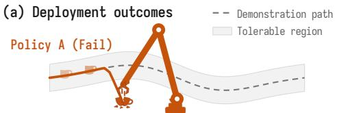

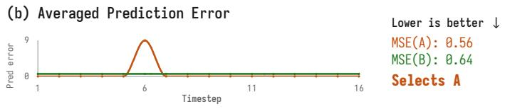

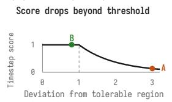

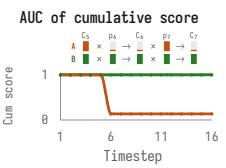  
Figure 1: Motivation and key idea of RACE. (a) Both policies are evaluated on the held-out demonstration. Policy $\pi A$ deviates from the demonstrated route and breaks the cup, whereas $\pi _ { B }$ reaches the destination despite persistent smaller deviations. (b) Averaged prediction error dilutes the large deviation of $\pi A$ with smaller errors elsewhere, giving it a lower mean squared error than $\pi _ { B } .$ . (c) Deviations within a reference-derived threshold receive a timestep score of one; larger deviations receive lower scores. Running products reduce the contribution of later predictions, as illustrated by two successive updates in the small bars. Averaging the cumulative scores over time correctly selects $\pi _ { B } ;$ higher scores are preferred.

## 3. Main Method

In this section, we introduce RACE, a novel rollout-free validation metric for policy checkpoint selection highly correlated with deployment performance. We first formulate the checkpoint selection problem (Section 3.1), then illustrate the limitations of averaged prediction error through a motivating example (Section 3.2), and finally present the scoring method (Section 3.3).

## 3.1. Problem Formulation

Training a policy � typically yields a sequence of $N _ { \mathrm { c k p t } }$ checkpoints $\Pi = \{ \pi _ { 1 } , \ldots , \pi _ { N _ { \mathrm { c k p t } } } \}$ saved at successive gradient steps. Each checkpoint’s quality is typically measured by its closed-loop success rate:

$$
J ( \pi ) = \operatorname* { P r } _ { \rho _ { 0 } , \pi } [ \exists t \leq T : s _ { t } \in S _ { \mathrm { s u c c e s s } } ] ,
$$

where $\rho _ { 0 }$ is the initial-state distribution, $T$ is the episode horizon, and $S _ { \mathrm { s u c c e s s } }$ indicates the set of successful states. Because $J ( \pi )$ can only be estimated through deployment at environments, evaluating every � scales poorly with |Π| and may be unsafe on real hardware. We therefore study rollout-free checkpoint selection: given a held-out set of successful reference trajectories $\mathcal { D } _ { \mathrm { v a l } } = \{ \tau ^ { ( j ) } \} _ { j = 1 } ^ { N _ { \mathrm { v a l } } }$ , we seek a scoring function $S ( \pi ; \mathcal { D } _ { \mathrm { v a l } } )$ that ranks candidates without executing rollouts, using only each policy’s predictions on $\mathcal { D } _ { \mathrm { v a l } ; }$ such that its induced ranking is highly correlated with the deployment ranking under $J .$ The reference trajectories may be demonstrations or previously collected successful policy rollouts.

## 3.2. Pitfall of Averaged Prediction Error

A common rollout-free criterion for checkpoint selection is the averaged prediction error on held-out demonstrations (Li et al., 2024; Pan et al., 2026). Given a policy � and validation set $\mathcal { D } _ { \mathrm { v a l } . }$ , let $\ell _ { t } = \mathcal { L } ( \pi ( o _ { t } ) , a _ { t } )$ denote the per-step prediction error at timestep �, where $\mathcal { L }$ is a distance metric matched to the policy’s output space (e.g. MSE for deterministic policies, flow-matching or negative log-likelihood for generative ones). it averages errors within each trajectory and then across trajectories, giving each demonstration equal weight. The criterion selects the checkpoint maximizing:

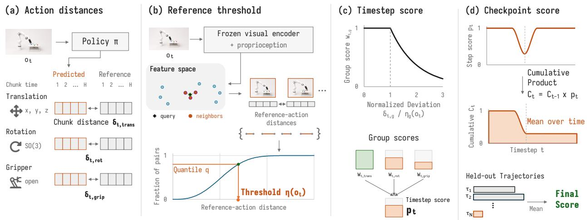  
Figure 2: RACE scoring procedure. (a) We compare predicted and reference action chunks within each action group to obtain $\delta _ { t , g } .$ (b) Distances between eligible pairs of reference chunks define a distribution whose quantile at level � gives the state-conditional threshold $\eta _ { g } \big ( o _ { t } \big )$ . The representation, neighborhoods, and thresholds are shared across candidate checkpoints. Both comparisons use the same group distance $D _ { g } ;$ the illustrated configuration averages the largest 50% of within-chunk timestep distances in physical units. (c) Threshold-normalized deviations yield group scores, which a soft minimum combines into $p _ { t } \in [ 0 , 1 ] .$ . (d) We form running products of the timestep scores, then average over time and across trajectories to rank checkpoints; higher scores are preferred.

$$
S _ { \mathrm { a v g } } ( \pi ; \mathcal { D } _ { \mathrm { v a l } } ) = - \frac { 1 } { N _ { \mathrm { v a l } } } \sum _ { j = 1 } ^ { N _ { \mathrm { v a l } } } \left[ \frac { 1 } { T _ { j } } \sum _ { t = 1 } ^ { T _ { j } } \ell _ { t } ^ { ( j ) } \right] ,
$$

where $T _ { j }$ denotes the length of trajectory $j .$

To illustrate the limitation, we provide two hypothetical policies evaluated on the same held-out demonstration (Figure 1). Policy $\pi _ { A }$ closely reproduces the reference actions at most timesteps, but one of its actions causes task failure during execution $( e . g .$ , dropping the object beyond the robot’s reach). Policy $\pi _ { B }$ difers more frequently from the reference actions at many timesteps, but it resides in tolerable region and completes the task. Despite these contrasting outcomes, $\pi _ { A }$ can obtain a lower average prediction error because its many small errors dilute the isolated large deviation. The mean-error criterion would then misleadingly select $\pi _ { A }$ over $\pi _ { B } .$

These observations suggest two considerations for designing rollout-free evaluation criteria. First, action prediction errors need not translate directly into task failure. A closed-loop policy may correct some deviations through subsequent actions, whereas other deviations can prevent task completion. Reducing an error from which the policy can recover therefore need not improve its success rate, even though it lowers the validation loss. This motivates calibrating prediction errors before aggregating them, rather than treating every numerical reduction as an improvement in checkpoint quality. Second, averaged prediction error scores each prediction at a recorded demonstration observation, regardless of the policy’s earlier predictions. If an earlier deviation would cause execution to depart from the reference, predictions at subsequent timesteps may no longer describe the policy’s closed-loop behavior. This motivates reducing the contribution of later validation steps following a substantial deviation.

## 3.3. RACE

RACE evaluates checkpoints in two stages (Figure 2). First, state-conditional calibration compares action deviations against thresholds derived from reference actions at similar states, yielding timestep scores in [0, 1] (Section 3.3.1). Second, temporal aggregation forms running products of these scores, so that a low score reduces the contribution of later reference predictions. Averaging the resulting curves over time and across trajectories gives the checkpoint score (Section 3.3.2).

## 3.3.1. State-Conditional Calibration

We first describe how to assign a timestep score $p _ { t } \in [ 0 , 1 ]$ to a single predicted action chunk. At observation $o _ { t } ,$ let $\mathbf { a } _ { t } = ( a _ { t } , \dots , a _ { t + H - 1 } )$ denote the reference action chunk of length �, and let $\hat { \mathbf { a } } _ { t }$ denote a chunk predicted by the policy.

Group distances As action components difer in physical units and geometry, computing a single Euclidean distance over the full action vector can therefore overemphasize components with larger numerical scales and misrepresent rotational diferences. To resolve this, we first restore actions to their physical units and partition them into � groups, such as translation and rotation. We compute distances separately for each group, using Euclidean distance for Euclidean components and the geodesic angle on $\mathrm { S O ( 3 ) }$ for rotations. For chunked predictions, we aggregate these distances over the prediction horizon. Averaging all timestep distances can dilute a brief but large deviation. We therefore define $D _ { g }$ as the mean of the largest 50% of the timestep distances within group �, giving greater weight to larger deviations. The predicted chunk’s deviation in group $g$ is defined as

$$
\delta _ { t , g } = D _ { g } ( \hat { \bf a } _ { t } , { \bf a } _ { t } ) .
$$

Reference thresholds To determine which deviations to penalize, we use diferences between actions taken at similar states in successful reference trajectories. Our design treats deviations within a chosen range of these diferences as acceptable and penalizes larger deviations. Because this range can vary across states, we introduce state-conditioned threshold: for each observation $o _ { t } ,$ we retrieve the � nearest reference observations in $\mathcal { D } _ { \mathrm { v a l } }$ using frozen visual features and proprioception, then compute pairwise distances between their action chunks using the same $D _ { g } . ^ { 1 }$ We set $\eta _ { g } ( o _ { t } )$ to the �-quantile of these distances. The quantile level $q$ controls the coverage of this reference range: larger values yield higher thresholds and penalize only larger deviations. The resulting threshold is tighter where nearby reference actions are more consistent (e.g. fine-grained placement) and looser where they difer more $( e . g .$ , free-space movement).

Timestep scores To compare deviations across action groups on a common relative scale, we divide each group deviation by its own threshold. Deviations within the threshold receive a score of one, so closer imitation within this range does not improve the score. Beyond the threshold, an exponential decay penalizes the relative excess:

$$
w _ { t , g } = \exp \left( - \left[ \frac { \delta _ { t , g } } { \eta _ { g } ( o _ { t } ) } - 1 \right] _ { + } \right) ,
$$

where $[ x ] _ { + } = \operatorname* { m a x } ( x , 0 )$

We combine the group scores using a normalized soft minimum. This aggregation is symmetric across groups while giving greater influence to lower scores from any group:

$$
p _ { t } = - \log \left( \frac { 1 } { G } \sum _ { g = 1 } ^ { G } \exp ( - w _ { t , g } ) \right) .
$$

We can also evaluate � action chunks predicted at the same observation. We score each chunk using the same reference and thresholds, then average the resulting scores as $\begin{array} { r } { p _ { t } = \frac { 1 } { M } \sum _ { m = 1 } ^ { M } p _ { t } ^ { ( m ) } } \end{array}$ , where $p _ { t } ^ { ( m ) }$ is the score of the �-th chunk. Scoring each chunk before averaging preserves the efect of deviations above the threshold that averaging raw distances may conceal. Empirically, averaging over multiple chunks yields more stable scores and improves checkpoint-ranking accuracy compared with a single sample.

## 3.3.2. Temporal Aggregation

To reduce the contribution of later predictions after substantial deviations, we form the running product of the timestep scores. For trajectory $\tau ^ { ( j ) }$ , we initialize $C _ { 0 } ^ { ( j ) } = 1$ and define

$$
C _ { t } ^ { ( j ) } = C _ { t - 1 } ^ { ( j ) } p _ { t } ^ { ( j ) } = \prod _ { u = 1 } ^ { t } p _ { u } ^ { ( j ) } .
$$

Table 1: Rollout-free checkpoint ranking on DexMimicGen. All criteria utilizes the same 10 successful trajectories per source to rank 12 checkpoints per run. Entries are means with 95% hierarchical bootstrap intervals, averaged over 10 training seeds per task and then eight tasks. Arrows indicate better values; bold marks the best mean per metric within each source. See Section 4 for the evaluation protocol.
<table><tr><td>Validation source</td><td>Criterion</td><td>Hit@1↑</td><td>Hit@3↑</td><td>Hit@5↑</td><td> $\rho \uparrow$ </td><td>MMRV↓</td><td>nRegret↓</td></tr><tr><td rowspan="4">Held-out Demos</td><td>RACE</td><td>0.44[0.23,0.65]</td><td>0.75 [0.59,0.90]</td><td>0.95 [0.88,1.00]</td><td>0.83 [0.72,0.92]</td><td>0.030[0.012,0.053]</td><td>0.082[0.035,0.142]</td></tr><tr><td>Validation Loss</td><td>0.31 [0.12,0.53]</td><td>0.59[0.33,0.82]</td><td>0.75 [0.49,0.97]</td><td>0.52[0.01,0.93]</td><td>0.042[0.011,0.088]</td><td>0.238 [0.030,0.504]</td></tr><tr><td>Validation MSE</td><td>0.00 [0.00,0.00]</td><td>0.08[0.00,0.17]</td><td>0.20[0.04,0.40]</td><td>-0.22[-0.62,0.20]</td><td>0.122[0.068,0.180]</td><td>0.495 [0.325,0.660]</td></tr><tr><td>Off-Manifold Norm</td><td>0.25 [0.11,0.40]</td><td>0.54[0.33,0.74]</td><td>0.72 [0.46,0.94]</td><td>0.60 [0.22,0.8]</td><td>0.042[0.022,0.067]</td><td>0.146[0.052,0.288]</td></tr><tr><td rowspan="4">Rollouts</td><td>RACE</td><td>0.27 [0.12,0.45]</td><td>0.62[0.38,0.83]</td><td>0.90[0.77,1.00]</td><td>0.79[0.69,0.88]</td><td>0.034[0.021,0.047]</td><td>0.113 [0.049,0.186]</td></tr><tr><td>Validation Loss</td><td>0.03 [0.00,0.10]</td><td>0.12[0.02,0.27]</td><td>0.15 [0.03,0.30]</td><td>-0.10[-0.45,0.25]</td><td>0.136[0.086,0.190]</td><td>0.402[0.298,0.514]</td></tr><tr><td>Validation MSE</td><td>0.08 [0.02,0.18]</td><td>0.22[0.05,0.40]</td><td>0.30 [0.12,0.50]</td><td>-0.06[-0.27,0.16]</td><td>0.129[0.084,0.177]</td><td>0.480[0.343,0.633]</td></tr><tr><td>Off-Manifold Norm</td><td>0.17 [0.07,0.27]</td><td>0.37[0.23,0.50]</td><td>0.55 [0.42,0.68]</td><td>0.53 [0.39,0.66]</td><td>0.068[0.047,0.094]</td><td>0.164[0.123,0.207]</td></tr><tr><td rowspan="4">Noised Rollouts</td><td>RACE</td><td>0.32[0.19,0.49]</td><td>0.69[0.52,0.85]</td><td>0.91 [0.81,0.99]</td><td>0.78 [0.68,0.86]</td><td>0.035[0.021,0.053]</td><td>0.081 [0.053,0.116]</td></tr><tr><td>Validation Loss</td><td>0.00 [0.00,0.00]</td><td>0.04[0.00,0.11]</td><td>0.09 [0.01,0.19]</td><td>-0.47[-0.68,-0.15]</td><td>0.154[0.105,0.202]</td><td>0.613 [0.462,0.773]</td></tr><tr><td>Validation MSE</td><td>0.09[0.00,0.21]</td><td>0.29[0.11,0.49]</td><td>0.39[0.17,0.61]</td><td>0.30[-0.05,0.61]</td><td>0.083[0.041,0.130]</td><td>0.288 [0.148,0.443]</td></tr><tr><td>Off-Manifold Norm</td><td>0.06[0.01,0.14]</td><td>0.31 [0.16,0.47]</td><td>0.42[0.25,0.59]</td><td>0.30[0.05,0.52]</td><td>0.085 [0.055,0.122]</td><td>0.276[0.185,0.405]</td></tr></table>

A timestep score of one leaves the cumulative value unchanged, whereas a lower score reduces it from that point onward. Repeated low scores compound this reduction. We score each trajectory by its mean cumulative score over the $T _ { j }$ evaluated timesteps, equivalently the normalized area under the cumulative score curve (AUC):

$$
S _ { \tau } ^ { ( j ) } = \frac { 1 } { T _ { j } } \sum _ { t = 1 } ^ { T _ { j } } C _ { t } ^ { ( j ) } .
$$

Finally, we get the final score $S ( \pi ; \mathcal { D } _ { \mathrm { v a l } } )$ by averaging the trajectory scores over the held-out set:

$$
S ( \pi ; \mathcal { D } _ { \mathrm { v a l } } ) = \frac { 1 } { N _ { \mathrm { v a l } } } \sum _ { j = 1 } ^ { N _ { \mathrm { v a l } } } S _ { \tau } ^ { ( j ) } .
$$

For the candidate set Π, we compute $\{ S ( \pi ; { \mathcal { D } } _ { \operatorname { v a l } } ) \} _ { \pi \in \Pi }$ and rank checkpoints in descending order of their scores.

## 4. Experiments

We design our experiments to answer three questions:

• Can RACE rank checkpoints more reliably from held-out demonstrations, and retain useful rankings with other successful reference sources? (Section 4.1)

• Does it support real-robot checkpoint selection across policy families and task demands? (Section 4.2)

• Which scoring choices contribute to ranking quality, and how do changes in successful references afect it? (Section 4.3)

Formal metric definitions and task-level results are provided in Sections A.1, B.1 and B.2.

Baselines We compare three criteria on held-out demonstrations: Validation Loss, the behavior-cloning training objective, Validation MSE, the mean squared action prediction error independent of the training objectives, and Of-Manifold Norm (Pan et al., 2026), the residual norm after projection onto a local basis formed from the � nearest neighbors. For visibility, we negate all baseline values so higher scores are preferred like our proposed score.

Metrics Let $y _ { i }$ denote the empirical success rate of checkpoint � and $s _ { i }$ its ofline criterion score (higher is better). Spearman correlation $\rho$ measures agreement between the rankings induced by $s _ { i }$ and $y _ { i }$ . Hit@� $( K \in \{ 1 , 3 , 5 \} )$ is the fraction of runs in which the empirically best checkpoint is among the criterion’s top-� candidates. nRegret measures the success-rate gap between the empirically best checkpoint and the criterion’s highest-scoring checkpoint, normalized by the best-minus-worst success-rate range. Mean Maximum Rank Violation (MMRV) averages each checkpoint’s largest success-rate gap among its pairwise ranking disagreements, assigning zero when none occur. Thus, ranking errors involving larger performance gaps incur greater penalties. We refer to (Li et al., 2024) for the formal definition.

## 4.1. Simulation Experiments

Setup We evaluate eight DexMimicGen (Jiang et al., 2025) tasks, excluding Transport. The action partition follows the robot embodiment and its control interface. For bimanual Franka with parallel grippers (Threading and Three Piece Assembly), each arm contributes separate end-efector translation and rotation groups, giving $G = 4 ,$ and binary gripper commands are excluded. For bimanual Franka with dexterous hands (Box Cleanup, Lift Tray, and Drawer Cleanup), each hand’s absolute joint-position vector forms one additional group, giving $G = 6$ . For GR-1 (Pouring, Cofee, and Can Sort), we group the absolute joint positions of each arm and hand separately, giving � = 4. Translation and joint-position vectors use Euclidean distance, while rotations use the geodesic angle on SO(3).

For each task, we train flow-matching Chi-UNet policies (Chi et al., 2024; Pan et al., 2026) using behavior cloning on 500 demonstrations following RoboMimic (Mandlekar et al., 2021), aggregated with 10 independent training seeds. Each run yields 12 checkpoints saved every 50 epochs over 600 epochs. Each checkpoint’s empirical success rate is the mean of its own 200 deployment rollouts. To test each metric under varying degrees of distribution shift, we construct a separate validation set of 10 successful trajectories for each of the following three sources: (i) Held-out Demonstrations are from expert trajectories matching the training distribution exactly but not used for training. (ii) Rollouts denote successful closed-loop trajectories from the separately trained policy, introducing mild shift through the policy’s own state visitation, and (iii) Noised Rollouts are collected using successful rollouts from the same policy perturbed with Gaussian action noise of standard deviation 0.02, clipped to ±0.05, representing the largest shift.

For each reference source, we compute metrics per training run, average the 10 seeds within each task, and then average the task means with equal weights. We draw 10,000 hierarchical bootstrap resamples: each resample draws tasks with replacement, then training seeds with replacement within each sampled task, and recomputes the same aggregate. The notation [�, �] denotes the lower and upper bounds of the resulting 95% bootstrap interval.

Results As shown in Table 1, RACE achieves the strongest ranking quality across all metrics and configurations. Crucially, RACE maintains stable scores as the validation distribution shifts from clean demonstrations to noisy rollouts, whereas baselines like Validation Loss and Of Manifold Norm collapse significantly under distribution shift and exhibit negative correlation values. These results confirm that RACE provides a reliable ranking signal regardless of how the validation trajectories are collected, a critical property for real-robot workflows where clean demonstrations are scarce.

## 4.2. Real-World Experiments

To validate that RACE generalizes beyond simulation, we evaluate it on real-robot manipulation tasks using two policy architectures of diferent scales: a task-specific difusion policy trained from scratch and a large pretrained VLA fine-tuned on in-domain data. All experiments use a Franka Research 3 arm following DROID (Khazatsky et al., 2024) hardware and software setup, with task-specific demonstrations collected via teleoperation. In both settings, held-out demonstrations unseen during training serve as the validation set, and baselines and ranking metrics follow the same protocol as in Section 4.1. To support reliable empirical comparison, we evaluate each of 10 checkpoints with 30 deployment rollouts on each of three tasks, yielding 30 × 10 × 3 = 900 real-robot evaluations per policy family and 1,800 in total.

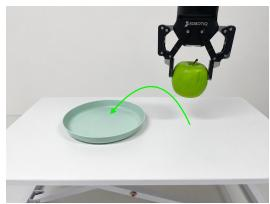

(a) PnP Apple  
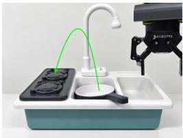

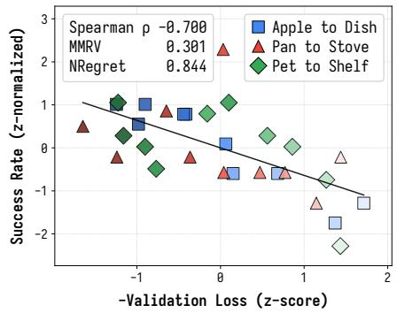

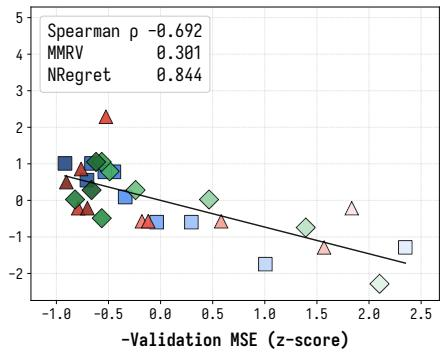

(b) Put Pan on Stove  
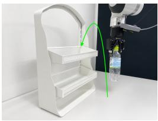  
(c) Put Pet on Shelf

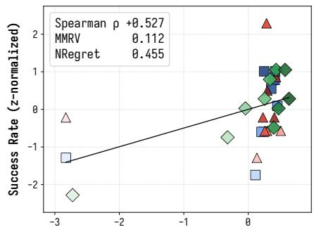  
−Off-Manifold Norm (z-score)

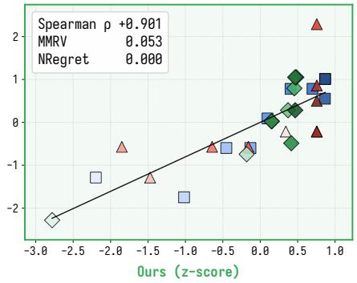  
Figure 3: Difusion Policy experiments. (Left) task setups. (Right) z-normalized criterion scores versus z-normalized empirical success rates, with one marker per checkpoint; marker shape and color distinguish tasks. Each task uses 20 training and 30 held-out validation demonstrations, 10 candidate checkpoints, and 30 deployment rollouts per checkpoint (900 rollouts across the three tasks). RACE uses task-specific scoring settings. Panel annotations report point estimates of Spearman � ↑, MMRV↓, and NRegret↓.

## Difusion Policy Experiments

Setup We fine-tune DROID Difusion Policy (Khazatsky et al., 2024) with pre-trained ResNet-50 encoder using two exterior left camera views. The policy is co-trained with the DROID dataset for 50 epochs on 20 task-specific demonstrations and checkpointed every 5 epochs. We evaluate on three tabletop tasks—PnP Apple, Put Pan on Stove, and Put Pet on Shelf—each validated against 30 held-out demonstrations. The policy predicts relative end-efector translation and rotation, with rotations represented in 6D (Zhou et al., 2019), together with a binary gripper command. For scoring, translation and rotation form two separate groups (� = 2), and the gripper is excluded. We use Euclidean distance for translation and convert the 6D rotation representation to SO(3) before computing the geodesic angle.

Results As shown in Figure 3, standard baselines struggle in this setting: Validation Loss and Validation MSE produces highly negative correlation values and reverses the true checkpoint ranking. While Of-Manifold Norm recovers moderate correlation, this result is mainly due to the separation of early checkpoints, and all other checkpoints are indistinguishable. In contrast, RACE consistently ranks checkpoints in alignment with deployment success across all three tasks, demonstrating its robustness and reliability for real-robot checkpoint selection.

## VLA Experiments

Setup To test RACE on longer-horizon tasks that require precise sequential manipulation, we fine-tune $\pi _ { 0 . 5 } – \mathrm { D R O I D }$ (Black et al., 2025) using wrist camera and a single exterior left camera view. The policy uses 7-DoF joint-velocity control. We train and evaluate on 3 tasks with varying dificulties: Nest Cups, Put Two Cubes, and PnP 3 Fruit. All tasks are trained with 20 demonstrations and validated against 30 held-out demonstrations. For scoring, each arm joint forms a separate scalar group (� = 7), with the absolute diference between predicted and reference joint velocities as its distance. The binary gripper command is excluded.

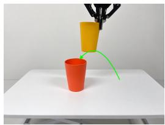

(a) Nest Cups  
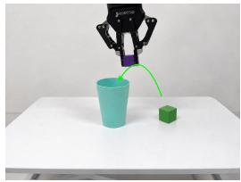

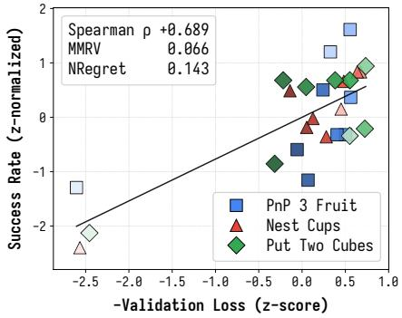

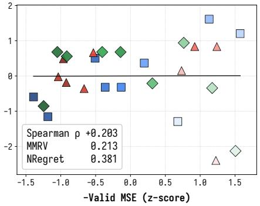

(b) Put Two Cubes  
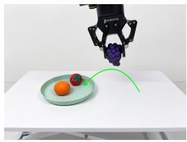  
(c) PnP 3 Fruit

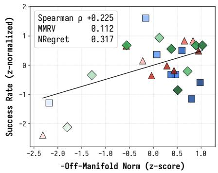

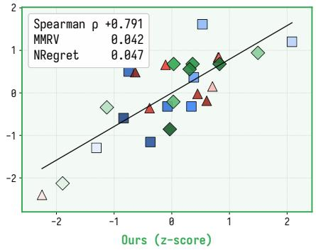  
Figure 4: � -DROID experiments. (Left) task setups. (Right) z-normalized criterion scores versus z-normalized empirical success rates, with one marker per checkpoint; marker shape and color distinguish tasks. Policies use joint-velocity control and are fine-tuned on 20 target-task training demonstrations per task. Each task uses 30 held-out validation demonstrations, 10 candidate checkpoints, and 30 deployment rollouts per checkpoint (900 rollouts across the three tasks). RACE uses task-specific scoring settings. Panel annotations report point estimates of Spearman � ↑, MMRV↓, and NRegret↓.

Table 2: Perturbation Analysis We apply diferent scale of perturbations on trained policies for Box Cleanup tasks, and compared changes relative to the original policy using 50 fixed scenes.
<table><tr><td>Variant</td><td>∆Success</td><td>∆MSE</td><td>∆Off-Man.</td><td>∆RACE</td></tr><tr><td>Uniform  $\scriptstyle \left( \sigma = 0 . 0 5 \right)$ </td><td>-4.0%P</td><td>-2.46%</td><td>-2.51%</td><td>-1.42%</td></tr><tr><td>Bottleneck  $\left( \sigma \mathrm { = } 0 . 2 \right)$ </td><td>-40.0%P</td><td>-2.47%</td><td>-2.00%</td><td>-52.69%</td></tr></table>

Results As shown in Figure 4, the baselines recover moderate correlation in this setting, yet RACE leads by a clear margin. The gap is most pronounced on Put Two Cubes and PnP 3 Fruit, where longer horizons amplify compounding errors that one-step losses fail to capture. We hypothesize that baselines perform better here than in the Difusion Policy setting because $\pi _ { 0 . 5 } { } ^ { \prime } { s }$ large-scale pretraining provides well-structured representations, ensuring that validation loss tracks genuine policy improvement rather than overfitting. Nevertheless, RACE still outperforms all baselines by a consistent margin and, across both architectures, reliably selects near-optimal checkpoints on real hardware with irreducible variables from human operators and sensor noise.

## 4.3. Analyses and Ablation Studies

Perturbations with similar prediction error The motivating example in Section 3.2 raises a practical question: can similar prediction errors accompany diferent deployment consequences? On Box Cleanup, we perturb one trained policy uniformly $( \sigma = 0 . 0 5 )$ or at bottlenecks (i.e., robot aligning the box lid to the box) $( \sigma = 0 . 2 )$ , matching average prediction error and evaluating 50 paired rollouts from identical initial states. Despite similar MSE and Of-Manifold Norm changes, bottleneck perturbations degrade success and RACE scores more strongly (Table 2). This supports the complete score’s sensitivity to consequential deviations. Success-diference ranges use paired resampling; ofline metric changes are point estimates.

Table 3: Component and temporal ablations across four tasks. (a) Removing calibration threshold uses � = 1.0 for all groups, and removing state conditioning fixes the threshold across states. (b) Both reductions use identical timestep scores. Means are shown above 95% hierarchical bootstrap intervals. Bold marks the best value per column within each panel.  
(a) Component ablation
<table><tr><td>Setting</td><td>ρ↑</td><td>MMRV↓</td><td>nRegret↓</td></tr><tr><td rowspan="2">Full</td><td>0.76</td><td>0.040</td><td>0.096</td></tr><tr><td>[0.66,0.86]</td><td>[0.02,0.07]</td><td>[0.05,0.15]</td></tr><tr><td rowspan="2">w/o action group</td><td>0.69</td><td>0.048</td><td>0.148</td></tr><tr><td>[0.56,0.81] 0.31</td><td>[0.03,0.07] 0.093</td><td>[0.09,0.21]</td></tr><tr><td rowspan="2">w/o calib. threshold</td><td>[0.11,0.52]</td><td>[0.05,0.13]</td><td>0.363</td></tr><tr><td>0.42</td><td>0.083</td><td>[0.29,0.44] 0.334</td></tr><tr><td>w/o state cond.</td><td>[0.20,0.68]</td><td>[0.03,0.14]</td><td>[0.19,0.47]</td></tr></table>

(b) Temporal aggregation
<table><tr><td>Setting</td><td> $\rho \uparrow$ </td><td>MMRV↓</td><td>nRegret↓</td></tr><tr><td>Mean</td><td>0.63 [0.40,0.78]</td><td>0.052 [0.02,0.10]</td><td>0.180 [0.09,0.33]</td></tr><tr><td>Cumulative scoring</td><td>0.76 [0.66,0.86]</td><td>0.040 [0.02,0.07]</td><td>0.096 [0.05,0.15]</td></tr></table>

Table 4: Task-specific versus shared settings. Means over 24 task/reference-source combinations across eight tasks, with 95% hierarchical bootstrap intervals in brackets. Shared (task �) varies only neighborhood size �. Bold marks the best value per column.
<table><tr><td>Setting</td><td>ρ↑</td><td>MMRV↓</td><td>nRegret↓</td></tr><tr><td>Tuned</td><td>0.80 [0.74,0.86]</td><td>0.033 [0.02,0.05]</td><td>0.090 [0.06,0.12]</td></tr><tr><td>Shared (task k)</td><td>0.75 [0.67,0.81]</td><td>0.037 [0.03,0.05]</td><td>0.110 [0.08,0.15]</td></tr><tr><td>Shared</td><td>0.69 [0.57,0.78]</td><td>0.038 [0.03,0.05]</td><td>0.135 [0.10,0.17]</td></tr></table>

Component ablation To identify which design choices contribute to ranking, we remove action grouping (Grp), threshold scoring (Thr), or state-conditional adaptation (SC) on Cofee, Drawer Cleanup, Pouring, and Three Piece Assembly. Each removal lowers aggregate ranking quality (Table 3(a)), supporting comparisons that account for heterogeneous action units and calibrate deviations against state-relative reference variation.

Temporal aggregation The perturbation comparison evaluates the complete score; to separate temporal aggregation from calibration, we compare the per-trajectory mean of identical stored � values with cumulative scoring (Section 3.3.2), which averages their running products over time. Both methods then average trajectory scores with equal weights. Candidates, references, thresholds, sampled predictions, and deployment outcomes are fixed. Across four DexMimicGen tasks, cumulative scoring improves ranking correlation and lowers selection regret compared with the mean (Table 3(b)). This supports reducing the contribution of later reference predictions after a substantial deviation, beyond calibrating individual timestep scores.

Shared scoring settings To assess tuning burden, we compare task-specific (Tuned), fully Shared, and Shared settings with task-specific neighborhood size � across the 22 task/reference-source combinations spanning the eight DexMimicGen tasks. Fully Shared settings reduce ranking quality relative to Tuned (Table 4). Allowing only � to vary by task recovers part of the gap, indicating that adapting neighborhood size provides some of the benefit of task-specific tuning while sharing the remaining settings.

Augmenting with rollouts On PnP Apple, supplementing held-out demonstrations with successful final-policy rollouts improves checkpoint ranking (Table 5(a)). This suggests that successful policy rollouts can complement held-out demonstrations as reference data, improving selection without changing the scoring rule.

Robustness to temporal artifacts To examine reference trajectories containing idle segments, we collect successful policy rollouts with a random 3–5 second pause at a randomly chosen point in each rollout (Table 5(b)). Checkpoint rankings remain comparable to those obtained with held-out demonstrations, with slightly lower correlation but lower MMRV. These results suggest that successful references containing idle segments can still provide useful information for checkpoint selection.

Table 5: Real-world reference-set analyses. (a) Adding successful final-policy rollouts to held-out demonstrations on PnP Apple. (b) Using successful policy rollouts containing a random 3–5 second pause. $\rho$ denotes Spearman correlation in (a) and Pearson correlation in (b). Values are point estimates.  
(a) Rollout augmentation
<table><tr><td>Reference set</td><td> $\rho \uparrow$ </td><td>MMRV↓</td></tr><tr><td>Held-out</td><td>0.834</td><td>0.230</td></tr><tr><td>+ Rollouts</td><td>0.920</td><td>0.070</td></tr></table>

(b) Temporal artifacts
<table><tr><td>Reference set</td><td> $\rho \uparrow$ </td><td>MMRV↓</td></tr><tr><td>Held-out</td><td>0.834</td><td>0.230</td></tr><tr><td>Paused Rollouts</td><td>0.801</td><td>0.194</td></tr></table>

## 5. Conclusion

We present RACE, a novel rollout-free checkpoint selection metric that converts action deviations from successful reference trajectories into a normalized score. RACE provides a practical way to compare robot policy checkpoints before deployment using a reusable set of successful trajectories. Our simulation and real-robot results show that RACE rankings align more closely with task success than those based on averaged prediction error. This can support more informed decisions during policy development, from tracking progress across checkpoints to focusing limited robot evaluation on promising candidates.

Despite of its advantages, RACE has two limitations. First, even though action variation at nearby successful states is a proxy for tolerable deviation, but it cannot establish whether a candidate policy would recover from an error or predict its behavior at unseen states induced by its own actions. Second, RACE provides a relative ranking, not a calibrated success-rate estimate, and selected candidates still require deployment validation.

## References

Pranav Atreya, Karl Pertsch, Tony Lee, Moo Jin Kim, Arhan Jain, Artur Kuramshin, Cyrus Neary, Edward S. Hu, Kanav Arora, Kirsty Ellis, Luca Macesanu, Matthew Leonard, Meedeum Cho, Ozgur Aslan, Shivin Dass, Tony Wang, Xingfang Yuan, Abhishek Gupta, Dinesh Jayaraman, Glen Berseth, Kostas Daniilidis, Roberto Martín-Martín, Youngwoon Lee, Percy Liang, Chelsea Finn, and Sergey Levine. Roboarena: Distributed real-world evaluation of generalist robot policies. In Conference on Robot Learning, 2025.

Apurva Badithela, David Snyder, Lihan Zha, Joseph Mikhail, Matthew O’Kelly, Anushri Dixit, and Anirudha Majumdar. Reliable and scalable robot policy evaluation with imperfect simulators. arXiv preprint arXiv:2510.04354, 2025.

Stefan Bauer, Manuel Wüthrich, Felix Widmaier, Annika Buchholz, Sebastian Stark, Anirudh Goyal, Thomas Steinbrenner, Joel Akpo, Shruti Joshi, Vincent Berenz, et al. Real robot challenge: A robotics competition in the cloud. In NeurIPS 2021 Competitions and Demonstrations Track, 2022.

Johan Bjorck, Fernando Castañeda, Nikita Cherniadev, Xingye Da, Runyu Ding, Linxi Fan, Yu Fang, Dieter Fox, Fengyuan Hu, Spencer Huang, et al. Gr00t n1: An open foundation model for generalist humanoid robots. arXiv preprint arXiv:2503.14734, 2025.

Kevin Black, Noah Brown, Danny Driess, Adnan Esmail, Michael Equi, Chelsea Finn, Niccolo Fusai, Lachy Groom, Karol Hausman, Brian Ichter, et al. ��\_0: A vision-language-action flow model for general robot control. In Robotics: Science and Systems, 2024.

Kevin Black, Noah Brown, James Darpinian, Karan Dhabalia, Danny Driess, Adnan Esmail, Michael Robert Equi, Chelsea Finn, Niccolo Fusai, Manuel Y. Galliker, Dibya Ghosh, Lachy Groom, Karol Hausman, brian ichter, Szymon Jakubczak, Tim Jones, Liyiming Ke, Devin LeBlanc, Sergey Levine, Adrian Li-Bell, Mohith Mothukuri, Suraj Nair, Karl Pertsch, Allen Z. Ren, Lucy Xiaoyang Shi, Laura Smith, Jost Tobias Springenberg, Kyle Stachowicz, James Tanner, Quan Vuong, Homer Walke, Anna Walling, Haohuan Wang, Lili Yu, and Ury Zhilinsky. \$\pi\_{0.5}\$: a vision-language-action model with open-world generalization. In Conference on Robot Learning, 2025.

Cheng Chi, Zhenjia Xu, Siyuan Feng, Eric Cousineau, Yilun Du, Benjamin Burchfiel, Russ Tedrake, and Shuran Song. Difusion policy: Visuomotor policy learning via action difusion. International Journal of Robotics Research, 2024.

Leonard Hussenot, Marcin Andrychowicz, Damien Vincent, Robert Dadashi, Anton Raichuk, Lukasz Stafiniak, Sertan Girgin, Raphael Marinier, Nikola Momchev, Sabela Ramos, Manu Orsini, Olivier Bachem, Matthieu Geist, and Olivier Pietquin. Hyperparameter selection for imitation learning. In International Conference on Machine Learning, 2021.

Arhan Jain, Mingtong Zhang, Kanav Arora, William Chen, Marcel Torne, Muhammad Zubair Irshad, Sergey Zakharov, Yue Wang, Sergey Levine, Chelsea Finn, Wei-Chiu Ma, Dhruv Shah, Abhishek Gupta, and Karl Pertsch. Polaris: Scalable real-to-sim evaluations for generalist robot policies. arXiv preprint arXiv:2512.16881, 2025.

Nan Jiang and Lihong Li. Doubly robust of-policy value evaluation for reinforcement learning. In International Conference on Machine Learning, 2016.

Zhenyu Jiang, Yuqi Xie, Kevin Lin, Zhenjia Xu, Weikang Wan, Ajay Mandlekar, Linxi Jim Fan, and Yuke Zhu. Dexmimicgen: Automated data generation for bimanual dexterous manipulation via imitation learning. In IEEE International Conference on Robotics and Automation, 2025.

Alexander Khazatsky, Karl Pertsch, Suraj Nair, Ashwin Balakrishna, Sudeep Dasari, Siddharth Karamcheti, Soroush Nasiriany, Mohan Kumar Srirama, Lawrence Yunliang Chen, Kirsty Ellis, et al. Droid: A large-scale in-the-wild robot manipulation dataset. In Robotics: Science and Systems, 2024.

Hoang M. Le, Cameron Voloshin, and Yisong Yue. Batch policy learning under constraints. arXiv preprint arXiv:1903.08738, 2019.

Xuanlin Li, Kyle Hsu, Jiayuan Gu, Oier Mees, Karl Pertsch, Homer Rich Walke, Chuyuan Fu, Ishikaa Lunawat, Isabel Sieh, Sean Kirmani, Sergey Levine, Jiajun Wu, Chelsea Finn, Hao Su, Quan Vuong, and Ted Xiao. Evaluating real-world robot manipulation policies in simulation. In 8th Annual Conference on Robot Learning, 2024.

Yaxuan Li, Yichen Zhu, Junjie Wen, Chaomin Shen, and Yi Xu. Worldeval: World model as real-world robot policies evaluator. arXiv preprint arXiv:2505.19017, 2025.

Yaxuan Li, Zhongyi Zhou, Yefei Chen, Yaokai Xue, and Yichen Zhu. dworldeval: Scalable robotic policy evaluation via discrete difusion world model. In International Conference on Machine Learning, 2026.

Rachel Luo, Heng Yang, Michael Watson, Apoorva Sharma, Sushant Veer, Edward Schmerling, and Marco Pavone. Leveraging correlation across test platforms for variance-reduced metric estimation. In Conference on Robot Learning, 2025.

Ajay Mandlekar, Danfei Xu, Josiah Wong, Soroush Nasiriany, Chen Wang, Rohun Kulkarni, Li Fei-Fei, Silvio Savarese, Yuke Zhu, and Roberto Martín-Martín. What matters in learning from ofline human demonstrations for robot manipulation. In Conference on Robot Learning, 2021.

Tom Le Paine, Cosmin Paduraru, Andrea Michi, Caglar Gulcehre, Konrad Zolna, Alexander Novikov, Ziyu Wang, and Nando de Freitas. Hyperparameter selection for ofline reinforcement learning. arXiv preprint arXiv:2007.09055, 2020.

Chaoyi Pan, Giri Anantharaman, Nai-Chieh Huang, Claire Jin, Daniel Pfrommer, Chenyang Yuan, Frank Permenter, Guannan Qu, Nicholas Bofi, Guanya Shi, and Max Simchowitz. Much ado about noising: Dispelling the myths of generative robotic control. In International Conference on Learning Representations, 2026.

Doina Precup, Richard S. Sutton, and Satinder P. Singh. Eligibility traces for of-policy policy evaluation. In International Conference on Machine Learning, 2000.

Julian Quevedo, Ansh Kumar Sharma, Yixiang Sun, Varad Suryavanshi, Percy Liang, and Sherry Yang. Evaluating robot policies in a world model. arXiv preprint arXiv:2506.00613, 2025.

Stéphane Ross, Geofrey Gordon, and Drew Bagnell. A reduction of imitation learning and structured prediction to no-regret online learning. In International Conference on Artificial Intelligence and Statistics, 2011.

Max Simchowitz, Daniel Pfrommer, and Ali Jadbabaie. The pitfalls of imitation learning when actions are continuous. In Conference on Learning Theory, 2025.

David Snyder, Asher James Hancock, Apurva Badithela, Emma Dixon, Patrick Miller, Rares Andrei Ambrus, Anirudha Majumdar, Masha Itkina, and Haruki Nishimura. Is your imitation learning policy better than mine? policy comparison with near-optimal stopping. arXiv preprint arXiv:2503.10966, 2025.

David Snyder, Apurva Badithela, Nikolai Matni, George Pappas, Anirudha Majumdar, Masha Itkina, and Haruki Nishimura. Beyond binary success: Sample-eficient and statistically rigorous robot policy comparison. arXiv preprint arXiv:2603.13616, 2026.

Jonathan Spencer, Sanjiban Choudhury, Arun Venkatraman, Brian Ziebart, and J. Andrew Bagnell. Feedback in imitation learning: The three regimes of covariate shift. arXiv preprint arXiv:2102.02872, 2021.

Gemini Robotics Team, Abbas Abdolmaleki, Saminda Abeyruwan, Joshua Ainslie, Jean-Baptiste Alayrac, Montserrat Gonzalez Arenas, Ashwin Balakrishna, Nathan Batchelor, Alex Bewley, Jef Bingham, et al. Gemini robotics 1.5: Pushing the frontier of generalist robots with advanced embodied reasoning, thinking, and motion transfer. arXiv preprint arXiv:2510.03342, 2025a.

Gemini Robotics Team, Saminda Abeyruwan, Joshua Ainslie, Jean-Baptiste Alayrac, Montserrat Gonzalez Arenas, Travis Armstrong, Ashwin Balakrishna, Robert Baruch, Maria Bauza, Michiel Blokzijl, et al. Gemini robotics: Bringing ai into the physical world. arXiv preprint arXiv:2503.20020, 2025b.

Generalist AI Team. Gen-1: Scaling embodied foundation models to mastery. Generalist AI Blog, 2026. https://generalistai.com/blog/apr-02-2026-GEN-1.

Yixuan Wang, Rhythm Syed, Fangyu Wu, Mengchao Zhang, Aykut Onol, Jose Barreiros, Hooshang Nayyeri, Tony Dear, Huan Zhang, and Yunzhu Li. Interactive world simulator for robot policy training and evaluation. arXiv preprint arXiv:2603.08546, 2026.

Kaifeng Zhang, Shuo Sha, Hanxiao Jiang, Matthew Loper, Hyunjong Song, Guangyan Cai, Zhuo Xu, Xiaochen Hu, Changxi Zheng, and Yunzhu Li. Real-to-sim robot policy evaluation with gaussian splatting simulation of soft-body interactions. In IEEE International Conference on Robotics and Automation, 2026.

Yi Zhou, Connelly Barnes, Jingwan Lu, Jimei Yang, and Hao Li. On the continuity of rotation representations in neural networks. In IEEE Conference on Computer Vision and Pattern Recognition, 2019.

Zhiyuan Zhou, Pranav Atreya, You Liang Tan, Karl Pertsch, and Sergey Levine. Autoeval: Autonomous evaluation of generalist robot manipulation policies in the real world. In Conference on Robot Learning, 2025.

## Appendix

## A. Experiment Details

## A.1. Ranking Metrics

Let $y _ { i }$ be the empirical success rate and $s _ { i }$ the ofline score of checkpoint �, with higher scores preferred. For each run, let $i ^ { \star } = \arg \operatorname* { m a x } _ { i } y _ { i }$ and ˆ� = arg max $s _ { i }$ . We break selection ties by checkpoint order, preferring the earliest checkpoint. The set $\mathrm { T o p K } ( s )$ contains the � highest-scoring checkpoints under the same rule.

Hit@� The per-run selection indicator is

$$
\mathrm { H i t @ K } = \mathbf { 1 } [ i ^ { \star } \in \mathrm { T o p K } ( s ) ] .\tag{1}
$$

Averaging this indicator across runs gives the frequency with which the criterion’s shortlist contains the empirically best checkpoint.

Spearman correlation Let $r ( s )$ and $r ( y )$ denote the checkpoint ranks induced by the ofline scores and empirical success rates, assigning average ranks to ties. Spearman correlation is

$$
\rho = \mathrm { C o r r } ( r ( s ) , r ( y ) ) ,\tag{2}
$$

where Corr is Pearson correlation. This measures agreement over the full checkpoint ordering rather than only the selected checkpoint.

Mean Maximum Rank Violation We compute MMRV (Li et al., 2024) using success-rate gaps:

$$
\mathrm { M M R V } = \frac { 1 } { N } \sum _ { i = 1 } ^ { N } \operatorname* { m a x } _ { 1 \leq j \leq N } \left\{ | y _ { i } - y _ { j } | \mathbf { 1 } [ ( s _ { i } < s _ { j } ) \neq ( y _ { i } < y _ { j } ) ] \right\} .\tag{3}
$$

Here $N$ is the number of candidate checkpoints in the run. A checkpoint with no pairwise disagreement contributes zero; a disagreement across a larger success-rate gap contributes a larger penalty.

Normalized regret For a nonzero success-rate range, the normalized selection regret is

$$
{ \mathrm { n R e g r e t } } = { \frac { y _ { i ^ { \star } } - y _ { \hat { i } } } { \operatorname* { m a x } _ { i } y _ { i } - \operatorname* { m i n } _ { i } y _ { i } } } .\tag{4}
$$

This dimensionless quantity measures the selected checkpoint’s performance loss relative to the observed best-to-worst range.

## A.2. Implementation Details

Shared reference calibration The visual representation used for neighborhood retrieval is frozen, and the reference features, neighborhoods, and thresholds are computed once and shared across candidate checkpoints. Thus, a checkpoint’s score changes through its predicted actions rather than through a changing reference representation or calibration. Algorithms 1 and 2 specify the computation and its reuse. The group distance $D _ { g }$ follows Section 3.3.1, and all action distances are computed in physical units. The pseudocode assumes that each retrieved neighborhood supplies at least one eligible pair of action chunks and that the resulting thresholds satisfy $\eta _ { g } { \left( o _ { t } \right) } > 0$

Algorithm 1 RACE checkpoint scoring   
Require: Candidate checkpoints Π; successful references $\mathcal { D } _ { \mathrm { v a l } }$ with actions in physical units; frozen retrieval   
representation �; group distances $D _ { 1 } , \ldots , D _ { G } ;$ chunk length $H ;$ neighborhood size $k ;$ quantile level $q ;$   
number of samples �   
Ensure: A score $S ( \pi ; \mathcal { D } _ { \mathrm { v a l } } )$ for each $\pi \in \Pi$   
1: Compute shared thresholds $\eta _ { g } ( o _ { t } ^ { ( j ) } )$ using Algorithm 2   
2: for each checkpoint $\pi \in \Pi$ do   
3: for each reference trajectory $\tau ^ { ( j ) } \in \mathcal { D } _ { \mathrm { v a l } }$ do   
4: $C _ { 0 } ^ { ( j ) } \gets 1$   
5: for each evaluated observation $o _ { t } ^ { ( j ) } , t = 1 , \dots , T _ { j }$ do   
6: Read the reference action chunk $\mathbf { a } _ { t } ^ { ( j ) }$ of length �   
7: for $m = 1 , \ldots , M$ do   
8: Sample $\hat { \mathbf { a } } _ { t } ^ { ( j , m ) } \sim \pi ( o _ { t } ^ { ( j ) } )$ and restore physical units   
9: for $g = 1 , \ldots , G$ do   
10: $\delta _ { t , g } ^ { ( j , m ) } \gets \dot { D _ { g } } ( \hat { \mathbf { a } } _ { t } ^ { ( j , m ) } , \mathbf { a } _ { t } ^ { ( j ) } )$   
11: $w _ { t , g } ^ { ( j , m ) } \gets \mathrm { e x p } \Bigl ( - [ \delta _ { t , g } ^ { ( j , m ) } / \eta _ { g } ( o _ { t } ^ { ( j ) } ) - 1 ] _ { + } \Bigr )$   
12: end for   
13: $\begin{array} { r } { p _ { t } ^ { ( j , m ) } \gets - \log \Big ( G ^ { - 1 } \sum _ { g = 1 } ^ { G } \exp ( - w _ { t , g } ^ { ( j , m ) } ) \Big ) } \end{array}$   
14: end for   
15: $\begin{array} { r } { p _ { t } ^ { ( j ) }  M ^ { - 1 } \sum _ { m = 1 } ^ { M } p _ { t } ^ { ( j , m ) } } \end{array}$   
16: $C _ { t } ^ { ( j ) } \gets C _ { t - 1 } ^ { ( j ) } p _ { t } ^ { ( j ) }$   
17: end for   
18: $\begin{array} { r } { \hat { S _ { \tau } ^ { ( j ) } }  T _ { j } ^ { - 1 } \sum _ { t = 1 } ^ { T _ { j } } C _ { t } ^ { ( j ) } } \end{array}$   
19: end for   
20: $\begin{array} { r l } {  { S ( \pi ; \mathcal { D } _ { \mathrm { v a l } } )  N _ { \mathrm { v a l } } ^ { - 1 } \sum _ { j = 1 } ^ { N _ { \mathrm { v a l } } } S _ { \tau } ^ { ( j ) } } } \end{array}$   
21: end for

Algorithm 2 State-conditional reference thresholds   
Require: Successful references $\mathcal { D } _ { \mathrm { v a l } }$ with action chunks of length � in physical units; frozen retrieval repre  
sentation $\psi ;$ neighborhood size �; quantile level �; group distances $D _ { 1 } , \ldots , D _ { G }$   
Ensure: Thresholds $\eta _ { g } ( o _ { t } ^ { ( j ) } )$ for all evaluated reference observations and groups   
1: Encode reference observations using $\psi ,$ combining frozen visual features and proprioception   
2: for each evaluated reference observation $o _ { t } ^ { ( j ) }$ do   
3: Retrieve its � nearest reference observations and their action chunks   
4: Form eligible pairs $\mathcal { P } _ { t } ^ { ( j ) }$ of distinct retrieved chunks: same-trajectory pairs for joint-velocity control;   
within- or across-trajectory pairs for task-space control   
5: for $g = 1 , \ldots , G$ do   
6: $\mathcal { \bar { E } } _ { t , g } ^ { ( j ) }  \{ D _ { g } ( \mathbf { a } _ { u } , \mathbf { a } _ { v } ) : ( u , v ) \in \mathcal { P } _ { t } ^ { ( j ) } \}$   
7: $\eta _ { g } ( o _ { t } ^ { ( j ) } )  \mathrm { Q u a n t i l e } _ { q } ( \mathcal { E } _ { t , g } ^ { ( j ) } )$   
8: end for   
9: end for

Of-Manifold Norm For a query state, the baseline retrieves nearby expert states and stacks their actions into a local basis $A = [ a ^ { ( 1 ) } , \ldots , a ^ { \bar { ( k ) } } ]$ ]. For a predicted action $^ { a , }$ its residual norm is

$$
\mathrm { O M N } ( a ) = \| a - P _ { A } ( a ) \| _ { 2 } ,\tag{5}
$$

where $P _ { A }$ projects onto the span of the columns of � (Pan et al., 2026). The ofline ranking uses the negative residual. In the Difusion Policy experiments, Of-Manifold Norm retrieves references using the same frozen policy encoder as RACE. The $\pi _ { 0 . 5 } – \mathrm { D R O I D }$ experiments use the original Of-Manifold Norm baseline.

Real-world data and software The Difusion Policy experiments use the released DROID policy-learning code2. Training mixes DROID data and target-task demonstrations in equal proportions, and observation and action normalization uses the DROID dataset statistics. The $\pi _ { 0 . 5 } – \mathrm { D R O I D }$ experiments use the released pretrained checkpoint and the RLDS dataset fine-tuning recipe from OpenPI3. The control interfaces, action groups, camera inputs, and task sets are specified in Section 4.2.

## A.2.1. Task success criteria and initialization

## Difusion Policy tasks

• PnP Apple: The robot grasps an apple from the table and places it in a bowl. Success requires the apple to come to rest fully inside the bowl; its initial position is randomized within a $5 \times 5$ cm tabletop region.

• Put Pet on Shelf: The robot places a plastic bottle on the top shelf. Success requires the bottle to rest stably on the shelf surface; its initial position is randomized within a $5 \times 5$ cm tabletop region.

## �0.5-DROID tasks

• Nest Cups: The robot nests an orange cup on the left into a yellow cup on the right. Success requires the orange cup to be fully seated inside the yellow cup; both initial cup positions are randomized within the workspace.

• Put Two Cubes: The robot picks up two cubes from the table and places them in a cup. Success requires both cubes to rest inside the cup; at episode initialization, the two cubes are randomly assigned to two fixed tabletop positions.

• PnP 3 Fruit: The robot picks up three toy fruits from the table and places them on a plate. Success requires all three fruits to rest on the plate; each fruit has a fixed nominal initial position, with its placement randomized within a local box of area $2 \mathrm { c m } ^ { 2 }$ at that position.

## B. Task-Level Experimental Results

## B.1. Simulation Experiments

Tables 6 to 13 report ranking performance for each DexMimicGen task and reference source, averaged over the training seeds. The strongest criterion depends on the task and reference source: for example, Validation Loss has lower reported regret on held-out demonstrations for Drawer Cleanup, whereas RACE has lower reported regret for both rollout-based reference sources on that task. The final column lists the reported checkpoint-selection regret.

Table 6: Box Cleanup. Per-task ranking performance on DexMimicGen (Jiang et al., 2025), averaged over 10 seeds. Arrows indicate better values; bold marks the best reported value per metric within each validation source.
<table><tr><td>Validation source</td><td>Criterion</td><td>Hit@1↑</td><td>Hit@3↑</td><td>Hit@5↑</td><td>ρ↑</td><td>MMRV↓</td><td>Regret↓</td></tr><tr><td rowspan="4">Held-out Demos</td><td>RACE</td><td>0.600</td><td>1.000</td><td>1.000</td><td>0.969</td><td>0.008</td><td>0.009</td></tr><tr><td>Validation Loss</td><td>0.400</td><td>0.800</td><td>1.000</td><td>0.938</td><td>0.011</td><td>0.017</td></tr><tr><td>Validation MSE</td><td>0.000</td><td>0.000</td><td>0.000</td><td>-0.892</td><td>0.256</td><td>0.754</td></tr><tr><td>Off-Manifold Norm</td><td>0.300</td><td>0.700</td><td>0.900</td><td>0.848</td><td>0.028</td><td>0.048</td></tr><tr><td rowspan="4">Rollouts</td><td>RACE</td><td>0.300</td><td>0.800</td><td>1.000</td><td>0.902</td><td>0.016</td><td>0.041</td></tr><tr><td>Validation Loss</td><td>0.000</td><td>0.000</td><td>0.000</td><td>-0.708</td><td>0.245</td><td>0.619</td></tr><tr><td>Validation MSE</td><td>0.100</td><td>0.300</td><td>0.400</td><td>-0.143</td><td>0.228</td><td>0.781</td></tr><tr><td>Off-Manifold Norm</td><td>0.100</td><td>0.300</td><td>0.400</td><td>0.287</td><td>0.121</td><td>0.190</td></tr><tr><td rowspan="4">Noised Rollouts</td><td>RACE</td><td>0.100</td><td>0.700</td><td>0.900</td><td>0.903</td><td>0.017</td><td>0.052</td></tr><tr><td>Validation Loss</td><td>0.000</td><td>0.000</td><td>0.200</td><td>-0.655</td><td>0.247</td><td>0.569</td></tr><tr><td>Validation MSE</td><td>0.100</td><td>0.600</td><td>0.600</td><td>0.573</td><td>0.052</td><td>0.118</td></tr><tr><td>Off-Manifold Norm</td><td>0.000</td><td>0.600</td><td>0.700</td><td>0.413</td><td>0.097</td><td>0.207</td></tr></table>

Table 7: Can Sort. Per-task ranking performance on DexMimicGen (Jiang et al., 2025), averaged over 10 seeds. Arrows indicate better values; bold marks the best reported value per metric within each validation source.
<table><tr><td>Validation source</td><td>Criterion</td><td>Hit@1↑</td><td>Hit@3↑</td><td>Hit@5↑</td><td>ρ↑</td><td>MMRV↓</td><td>Regret↓</td></tr><tr><td rowspan="4">Held-out Demos</td><td>RACE</td><td>0.300</td><td>0.600</td><td>1.000</td><td>0.815</td><td>0.017</td><td>0.037</td></tr><tr><td>Validation Loss</td><td>0.000</td><td>0.000</td><td>0.100</td><td>-0.886</td><td>0.073</td><td>0.981</td></tr><tr><td>Validation MSE</td><td>0.000</td><td>0.100</td><td>0.300</td><td>-0.555</td><td>0.058</td><td>0.730</td></tr><tr><td>Off-Manifold Norm</td><td>0.000</td><td>0.000</td><td>0.000</td><td>-0.638</td><td>0.069</td><td>0.574</td></tr><tr><td rowspan="4">Rollouts</td><td>RACE</td><td>0.600</td><td>0.900</td><td>1.000</td><td>0.908</td><td>0.040</td><td>0.016</td></tr><tr><td>Validation Loss</td><td>0.000</td><td>0.000</td><td>0.100</td><td>-0.517</td><td>0.198</td><td>0.396</td></tr><tr><td>Validation MSE</td><td>0.100</td><td>0.500</td><td>0.600</td><td>0.200</td><td>0.133</td><td>0.311</td></tr><tr><td>Off-Manifold Norm</td><td>0.200</td><td>0.400</td><td>0.600</td><td>0.461</td><td>0.086</td><td>0.110</td></tr><tr><td rowspan="4">Noised Rollouts</td><td>RACE</td><td>0.700</td><td>0.900</td><td>1.000</td><td>0.708</td><td>0.023</td><td>0.063</td></tr><tr><td>Validation Loss</td><td>0.000</td><td>0.000</td><td>0.000</td><td>-0.793</td><td>0.072</td><td>0.907</td></tr><tr><td>Validation MSE</td><td>0.400</td><td>0.700</td><td>0.700</td><td>0.832</td><td>0.008</td><td>0.038</td></tr><tr><td>Off-Manifold Norm</td><td>0.100</td><td>0.100</td><td>0.400</td><td>0.184</td><td>0.039</td><td>0.220</td></tr></table>

Table 8: Cofee. Per-task ranking performance on DexMimicGen (Jiang et al., 2025), averaged over 10 seeds. Arrows indicate better values; bold marks the best reported value per metric within each validation source.
<table><tr><td>Validation source</td><td>Criterion</td><td>Hit@1↑</td><td>Hit@3↑</td><td>Hit@5↑</td><td>人  $\rho ^ { \star }$ </td><td>MMRV↓</td><td>Regret↓</td></tr><tr><td rowspan="4">Held-out Demos</td><td>RACE</td><td>0.100</td><td>0.400</td><td>0.800</td><td>0.589</td><td>0.076</td><td>0.184</td></tr><tr><td>Validation Loss</td><td>0.000</td><td>0.100</td><td>0.300</td><td>-0.396</td><td>0.190</td><td>0.698</td></tr><tr><td>Validation MSE</td><td>0.000</td><td>0.300</td><td>0.700</td><td>0.718</td><td>0.045</td><td>0.139</td></tr><tr><td>Off-Manifold Norm</td><td>0.100</td><td>0.300</td><td>0.400</td><td>0.350</td><td>0.118</td><td>0.204</td></tr><tr><td rowspan="4">Rollouts</td><td>RACE</td><td>0.100</td><td>0.300</td><td>0.800</td><td>0.727</td><td>0.032</td><td>0.154</td></tr><tr><td>Validation Loss</td><td>0.000</td><td>0.100</td><td>0.300</td><td>0.238</td><td>0.092</td><td>0.366</td></tr><tr><td>Validation MSE</td><td>0.000</td><td>0.000</td><td>0.000</td><td>-0.364</td><td>0.121</td><td>0.532</td></tr><tr><td>Off-Manifold Norm</td><td>0.200</td><td>0.300</td><td>0.600</td><td>0.663</td><td>0.047</td><td>0.173</td></tr><tr><td rowspan="4">Noised Rollouts</td><td>RACE</td><td>0.400</td><td>0.500</td><td>0.800</td><td>0.770</td><td>0.045</td><td>0.083</td></tr><tr><td>Validation Loss</td><td>0.000</td><td>0.000</td><td>0.000</td><td>-0.719</td><td>0.205</td><td>0.984</td></tr><tr><td>Validation MSE</td><td>0.100</td><td>0.300</td><td>0.500</td><td>0.734</td><td>0.041</td><td>0.164</td></tr><tr><td>Off-Manifold Norm</td><td>0.000</td><td>0.000</td><td>0.000</td><td>-0.408</td><td>0.197</td><td>0.645</td></tr></table>

Table 9: Drawer Cleanup. Per-task ranking performance on DexMimicGen (Jiang et al., 2025), averaged over 10 seeds. Arrows indicate better values; bold marks the best reported value per metric within each validation source.
<table><tr><td>Validation source</td><td>Criterion</td><td>Hit@1↑</td><td>Hit@3↑</td><td>Hit@5↑</td><td>ρ↑</td><td>MMRV↓</td><td>Regret↓</td></tr><tr><td rowspan="4">Held-out Demos</td><td>RACE</td><td>0.500</td><td>0.700</td><td>1.000</td><td>0.639</td><td>0.083</td><td>0.172</td></tr><tr><td>Validation Loss</td><td>0.700</td><td>0.900</td><td>1.000</td><td>0.974</td><td>0.006</td><td>0.010</td></tr><tr><td>Validation MSE</td><td>0.000</td><td>0.000</td><td>0.000</td><td>-0.895</td><td>0.223</td><td>0.645</td></tr><tr><td>Off-Manifold Norm</td><td>0.400</td><td>0.800</td><td>0.900</td><td>0.900</td><td>0.024</td><td>0.025</td></tr><tr><td rowspan="4">Rollouts</td><td>RACE</td><td>0.600</td><td>0.900</td><td>1.000</td><td>0.908</td><td>0.040</td><td>0.016</td></tr><tr><td>Validation Loss</td><td>0.000</td><td>0.000</td><td>0.100</td><td>-0.534</td><td>0.198</td><td>0.390</td></tr><tr><td>Validation MSE</td><td>0.100</td><td>0.500</td><td>0.600</td><td>0.200</td><td>0.133</td><td>0.348</td></tr><tr><td>Off-Manifold Norm</td><td>0.200</td><td>0.400</td><td>0.600</td><td>0.461</td><td>0.086</td><td>0.110</td></tr><tr><td rowspan="4">Noised Rollouts</td><td>RACE</td><td>0.200</td><td>0.600</td><td>0.800</td><td>0.566</td><td>0.083</td><td>0.111</td></tr><tr><td>Validation Loss</td><td>0.000</td><td>0.000</td><td>0.000</td><td>-0.638</td><td>0.205</td><td>0.480</td></tr><tr><td>Validation MSE</td><td>0.000</td><td>0.000</td><td>0.000</td><td>-0.617</td><td>0.195</td><td>0.674</td></tr><tr><td>Off-Manifold Norm</td><td>0.000</td><td>0.300</td><td>0.400</td><td>0.258</td><td>0.100</td><td>0.303</td></tr></table>

Table 10: Lift Tray. Per-task ranking performance on DexMimicGen (Jiang et al., 2025), averaged over 10 seeds. Arrows indicate better values; bold marks the best reported value per metric within each validation source.
<table><tr><td>Validation source</td><td>Criterion</td><td>Hit@1↑</td><td>Hit@3↑</td><td>Hit@5↑</td><td>人  $\rho \mathcal { 1 }$ </td><td>MMRV↓</td><td>Regret↓</td></tr><tr><td rowspan="4">Held-out Demos</td><td>RACE</td><td>0.600</td><td>1.000</td><td>1.000</td><td>0.969</td><td>0.015</td><td>0.038</td></tr><tr><td>Validation Loss</td><td>0.700</td><td>1.000</td><td>1.000</td><td>0.964</td><td>0.013</td><td>0.024</td></tr><tr><td>Validation MSE</td><td>0.000</td><td>0.000</td><td>0.000</td><td>-0.387</td><td>0.175</td><td>0.587</td></tr><tr><td>Off-Manifold Norm</td><td>0.500</td><td>0.800</td><td>0.900</td><td>0.922</td><td>0.024</td><td>0.050</td></tr><tr><td rowspan="4">Rollouts</td><td>RACE</td><td>0.200</td><td>0.600</td><td>0.900</td><td>0.841</td><td>0.044</td><td>0.159</td></tr><tr><td>Validation Loss</td><td>0.100</td><td>0.100</td><td>0.100</td><td>0.244</td><td>0.138</td><td>0.291</td></tr><tr><td>Validation MSE</td><td>0.200</td><td>0.400</td><td>0.500</td><td>0.259</td><td>0.137</td><td>0.355</td></tr><tr><td>Off-Manifold Norm</td><td>0.100</td><td>0.300</td><td>0.600</td><td>0.710</td><td>0.069</td><td>0.169</td></tr><tr><td rowspan="4">Noised Rollouts</td><td>RACE</td><td>0.300</td><td>0.400</td><td>1.000</td><td>0.857</td><td>0.051</td><td>0.076</td></tr><tr><td>Validation Loss</td><td>0.000</td><td>0.100</td><td>0.200</td><td>-0.394</td><td>0.218</td><td>0.525</td></tr><tr><td>Validation MSE</td><td>0.100</td><td>0.300</td><td>0.400</td><td>0.148</td><td>0.156</td><td>0.434</td></tr><tr><td>Off-Manifold Norm</td><td>0.100</td><td>0.300</td><td>0.500</td><td>0.590</td><td>0.090</td><td>0.135</td></tr></table>

Table 11: Pouring. Per-task ranking performance on DexMimicGen (Jiang et al., 2025), averaged over 10 seeds. Arrows indicate better values; bold marks the best reported value per metric within each validation source.
<table><tr><td>Validation source</td><td>Criterion</td><td>Hit@1↑</td><td>Hit@3↑</td><td>Hit@5↑</td><td> $\rho \uparrow$ </td><td>MMRV↓</td><td>Regret↓</td></tr><tr><td rowspan="4">Held-out Demos</td><td>RACE</td><td>0.000</td><td>0.600</td><td>0.900</td><td>0.797</td><td>0.013</td><td>0.123</td></tr><tr><td>Validation Loss</td><td>0.100</td><td>0.600</td><td>0.900</td><td>0.766</td><td>0.009</td><td>0.067</td></tr><tr><td>Validation MSE</td><td>0.000</td><td>0.100</td><td>0.400</td><td>0.448</td><td>0.021</td><td>0.165</td></tr><tr><td>Off-Manifold Norm</td><td>0.300</td><td>0.700</td><td>1.000</td><td>0.778</td><td>0.009</td><td>0.051</td></tr><tr><td rowspan="4">Rollouts</td><td>RACE</td><td>0.300</td><td>0.800</td><td>1.000</td><td>0.803</td><td>0.010</td><td>0.062</td></tr><tr><td>Validation Loss</td><td>0.000</td><td>0.100</td><td>0.200</td><td>-0.286</td><td>0.075</td><td>0.468</td></tr><tr><td>Validation MSE</td><td>0.100</td><td>0.100</td><td>0.200</td><td>-0.009</td><td>0.035</td><td>0.339</td></tr><tr><td>Off-Manifold Norm</td><td>0.200</td><td>0.400</td><td>0.500</td><td>0.376</td><td>0.037</td><td>0.187</td></tr><tr><td rowspan="4">Noised Rollouts</td><td>RACE</td><td>0.200</td><td>0.800</td><td>1.000</td><td>0.609</td><td>0.025</td><td>0.137</td></tr><tr><td>Validation Loss</td><td>0.000</td><td>0.000</td><td>0.000</td><td>-0.641</td><td>0.083</td><td>0.605</td></tr><tr><td>Validation MSE</td><td>0.000</td><td>0.300</td><td>0.800</td><td>0.689</td><td>0.015</td><td>0.088</td></tr><tr><td>Off-Manifold Norm</td><td>0.100</td><td>0.400</td><td>0.500</td><td>0.134</td><td>0.046</td><td>0.177</td></tr></table>

Table 12: Threading. Per-task ranking performance on DexMimicGen (Jiang et al., 2025), averaged over 10 seeds. Arrows indicate better values; bold marks the best reported value per metric within each validation source.
<table><tr><td>Validation source</td><td>Criterion</td><td>Hit@1↑</td><td>Hit@3↑</td><td>Hit@5↑</td><td>人  $\rho \mathcal { 1 }$ </td><td>MMRV↓</td><td>Regret↓</td></tr><tr><td rowspan="4">Held-out Demos</td><td>RACE</td><td>0.900</td><td>0.900</td><td>0.900</td><td>0.906</td><td>0.012</td><td>0.050</td></tr><tr><td>Validation Loss</td><td>0.300</td><td>0.500</td><td>0.700</td><td>0.843</td><td>0.028</td><td>0.055</td></tr><tr><td>Validation MSE</td><td>0.000</td><td>0.000</td><td>0.000</td><td>-0.567</td><td>0.131</td><td>0.641</td></tr><tr><td>Off-Manifold Norm</td><td>0.300</td><td>0.400</td><td>0.700</td><td>0.778</td><td>0.037</td><td>0.138</td></tr><tr><td rowspan="4">Rollouts</td><td>RACE</td><td>0.100</td><td>0.300</td><td>0.800</td><td>0.591</td><td>0.055</td><td>0.239</td></tr><tr><td>Validation Loss</td><td>0.100</td><td>0.400</td><td>0.400</td><td>0.471</td><td>0.068</td><td>0.279</td></tr><tr><td>Validation MSE</td><td>0.000</td><td>0.000</td><td>0.100</td><td>-0.294</td><td>0.110</td><td>0.545</td></tr><tr><td>Off-Manifold Norm</td><td>0.200</td><td>0.500</td><td>0.600</td><td>0.681</td><td>0.047</td><td>0.150</td></tr><tr><td rowspan="4">Noised Rollouts</td><td>RACE</td><td>0.400</td><td>1.000</td><td>1.000</td><td>0.931</td><td>0.016</td><td>0.047</td></tr><tr><td>Validation Loss</td><td>0.000</td><td>0.200</td><td>0.200</td><td>0.543</td><td>0.058</td><td>0.257</td></tr><tr><td>Validation MSE</td><td>0.000</td><td>0.000</td><td>0.000</td><td>0.097</td><td>0.092</td><td>0.418</td></tr><tr><td>Off-Manifold Norm</td><td>0.100</td><td>0.500</td><td>0.600</td><td>0.745</td><td>0.036</td><td>0.216</td></tr></table>

Table 13: Three Piece Assembly. Per-task ranking performance on DexMimicGen (Jiang et al., 2025), averaged over 10 seeds. Arrows indicate better values; bold marks the best reported value per metric within each validation source.
<table><tr><td>Validation source</td><td>Criterion</td><td>Hit@1↑</td><td>Hit@3↑</td><td>Hit@5↑</td><td> $\rho \uparrow$ </td><td>MMRV↓</td><td>Regret↓</td></tr><tr><td rowspan="4">Held-out Demos</td><td>RACE</td><td>0.500</td><td>0.800</td><td>1.000</td><td>0.931</td><td>0.013</td><td>0.045</td></tr><tr><td>Validation Loss</td><td>0.300</td><td>0.800</td><td>1.000</td><td>0.953</td><td>0.009</td><td>0.055</td></tr><tr><td>Validation MSE</td><td>0.000</td><td>0.100</td><td>0.200</td><td>0.368</td><td>0.067</td><td>0.302</td></tr><tr><td>Off-Manifold Norm</td><td>0.100</td><td>0.600</td><td>1.000</td><td>0.877</td><td>0.024</td><td>0.079</td></tr><tr><td rowspan="4">Rollouts</td><td>RACE</td><td>0.100</td><td>0.300</td><td>0.700</td><td>0.703</td><td>0.041</td><td>0.163</td></tr><tr><td>Validation Loss</td><td>0.000</td><td>0.100</td><td>0.100</td><td>0.218</td><td>0.090</td><td>0.366</td></tr><tr><td>Validation MSE</td><td>0.000</td><td>0.000</td><td>0.000</td><td>-0.378</td><td>0.130</td><td>0.511</td></tr><tr><td>Off-Manifold Norm</td><td>0.200</td><td>0.300</td><td>0.600</td><td>0.671</td><td>0.048</td><td>0.177</td></tr><tr><td rowspan="4">Noised Rollouts</td><td>RACE</td><td>0.300</td><td>0.600</td><td>0.800</td><td>0.869</td><td>0.024</td><td>0.081</td></tr><tr><td>Validation Loss</td><td>0.000</td><td>0.000</td><td>0.100</td><td>-0.427</td><td>0.148</td><td>0.575</td></tr><tr><td>Validation MSE</td><td>0.000</td><td>0.100</td><td>0.100</td><td>-0.023</td><td>0.104</td><td>0.365</td></tr><tr><td>Off-Manifold Norm</td><td>0.100</td><td>0.300</td><td>0.300</td><td>0.479</td><td>0.074</td><td>0.305</td></tr></table>

## B.2. Real-World Experiments

Each task has two figures, each containing panels for the four criteria: one shows checkpoint-level scatter plots, and the other shows training progress. For Difusion Policy, Figures 5 and 6 show PnP Apple, Figures 7 and 8 show Put Pan on Stove, and Figures 9 and 10 show Put Pet on Shelf. For $\pi _ { 0 . 5 } – \mathrm { D R O I D } ,$ , Figures 11 and 12 show Nest Cups, Figures 13 and 14 show Put Two Cubes, and Figures 15 and 16 show PnP 3 Fruit.

In the scatter plots, each point is a checkpoint; success rates and criterion scores are standardized separately within each task using sample standard deviations. All baseline scores are sign-negated, so higher values are preferred for every criterion. The displayed Spearman correlation, MMRV, and nRegret are descriptive task-level point estimates, and regression lines visualize trends. In the progress plots, the left axis gives empirical success rate in percent and the right axis gives the signed, unstandardized criterion value. The horizontal axis is training epoch for Difusion Policy and training step for $\pi _ { 0 . 5 } – \mathrm { D R O I D }$ . These figures retain the supplied checkpoint set: ten checkpoints for each Difusion Policy task and a displayed subset of nine checkpoints for each $\pi _ { 0 . 5 } – \mathrm { D R O I D }$ task. The VLA curves shown here cover only this supplied subset of the checkpoint evaluations described in Section 4.2.

The two views distinguish overall checkpoint-order agreement from the timing of a criterion’s preferred checkpoint. A criterion can correlate with early improvement while missing a later decline or success-rate peak; the progress plots expose such diferences without treating decreasing supervised loss as evidence of increasing deployment success.

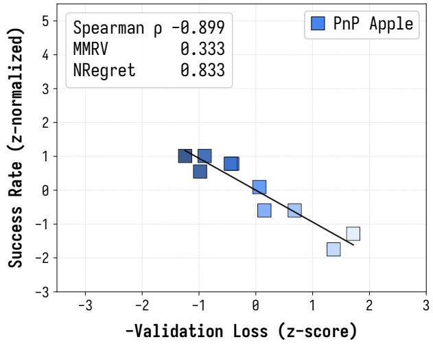

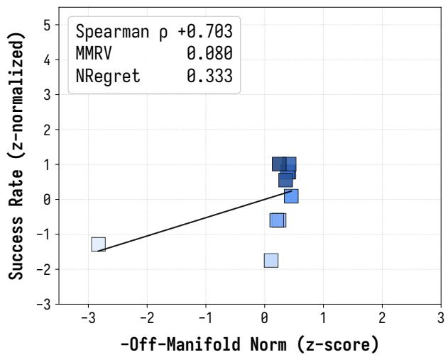

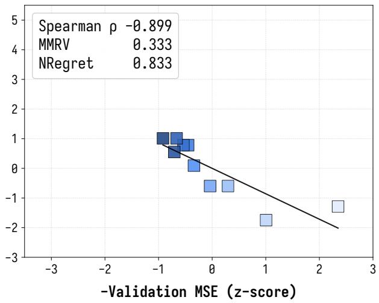

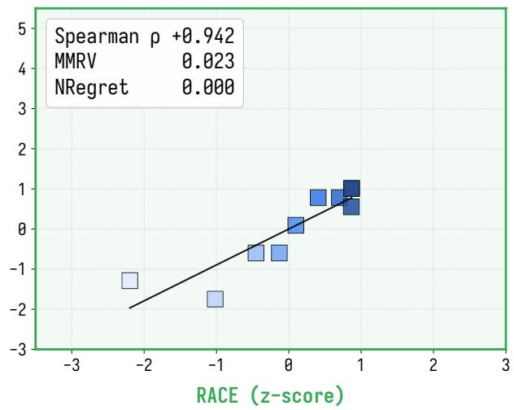  
Figure 5: Difusion Policy: PnP Apple. Task-level checkpoint-score versus success-rate scatter plots. Panels show Validation Loss, Validation MSE, Of-Manifold Norm, and RACE from left to right and top to bottom; both axes use within-task z-scores.

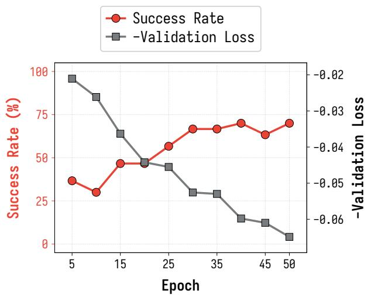

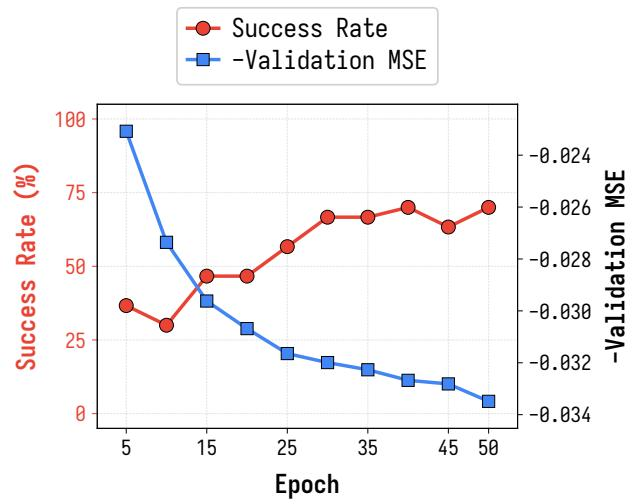

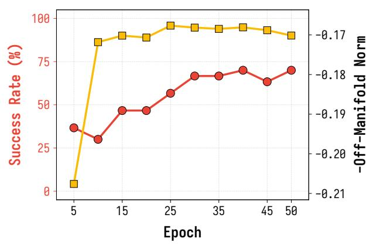

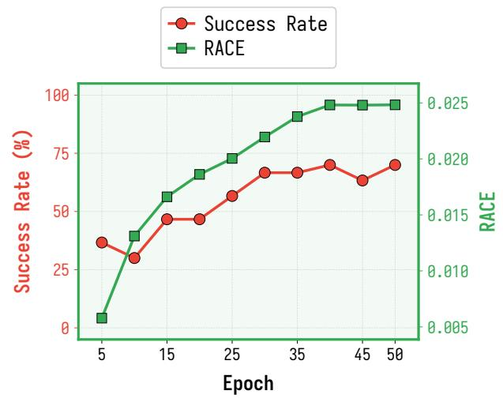  
Figure 6: Difusion Policy: PnP Apple across training. Each panel overlays empirical success rate (left axis, percent) and a signed criterion value (right axis) against training epoch. Panel order matches the preceding task-level scatter plots, where higher criterion values are preferred.

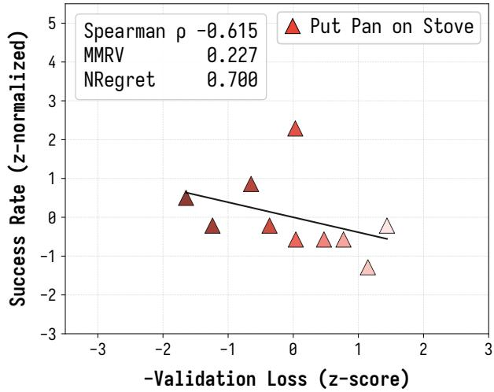

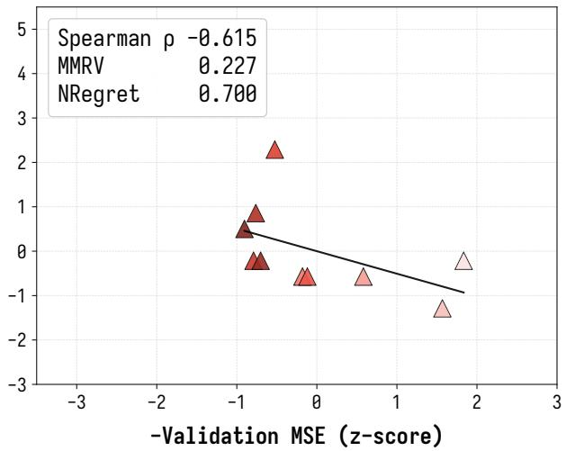

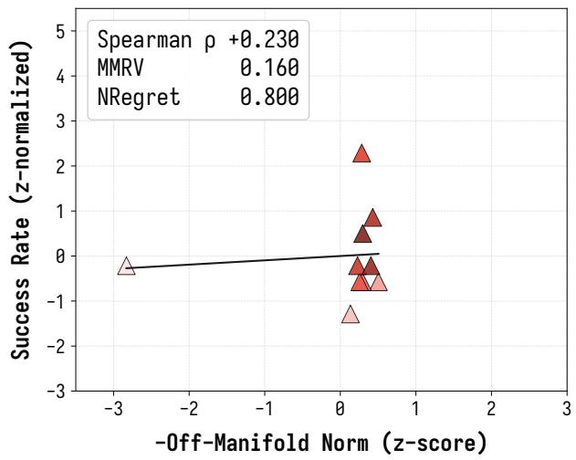

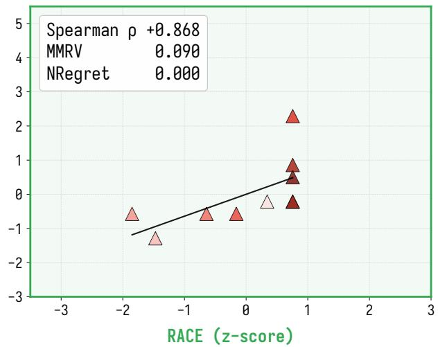  
Figure 7: Difusion Policy: Put Pan on Stove. Task-level checkpoint-score versus success-rate scatter plots. Panels show Validation Loss, Validation MSE, Of-Manifold Norm, and RACE from left to right and top to bottom; both axes use within-task z-scores.

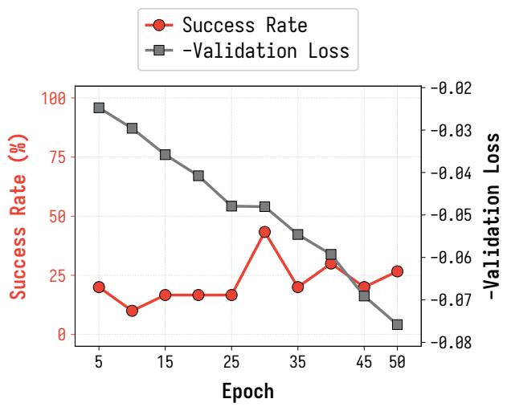

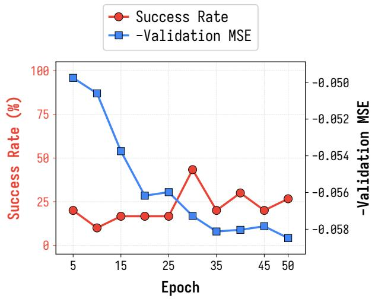

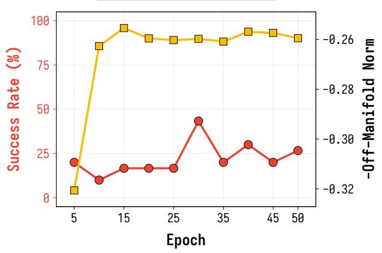

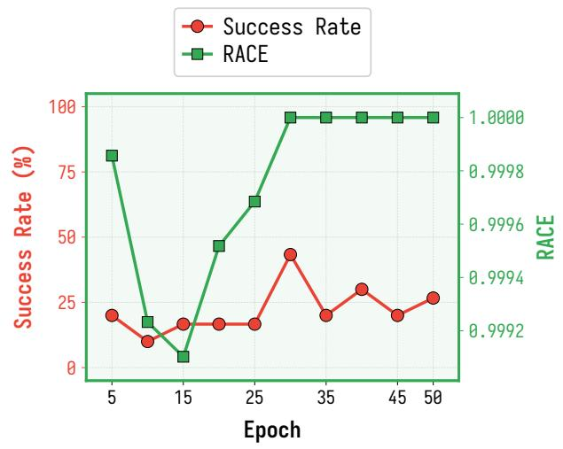  
Figure 8: Difusion Policy: Put Pan on Stove across training. Each panel overlays empirical success rate (left axis, percent) and a signed criterion value (right axis) against training epoch. Panel order matches the preceding task-level scatter plots, where higher criterion values are preferred.

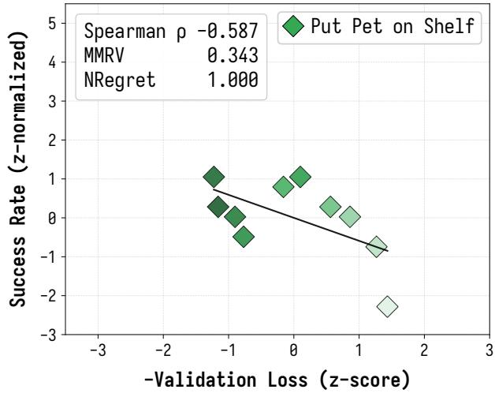

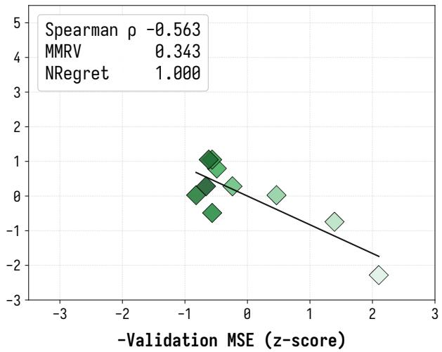

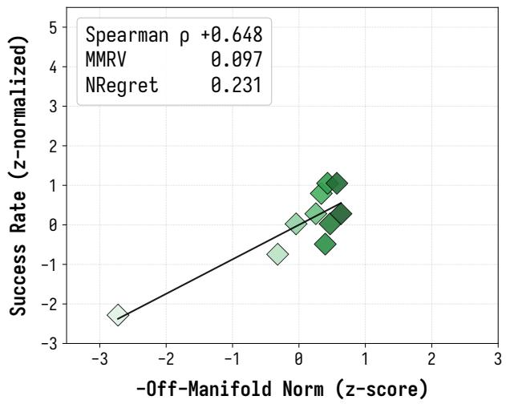

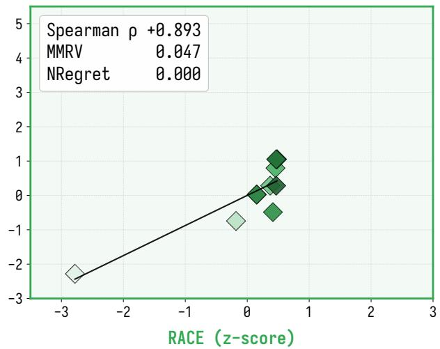  
Figure 9: Difusion Policy: Put Pet on Shelf. Task-level checkpoint-score versus success-rate scatter plots. Panels show Validation Loss, Validation MSE, Of-Manifold Norm, and RACE from left to right and top to bottom; both axes use within-task z-scores.

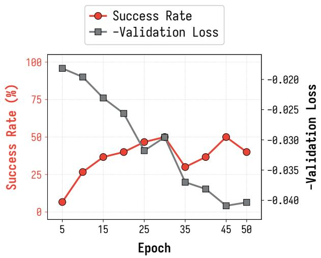

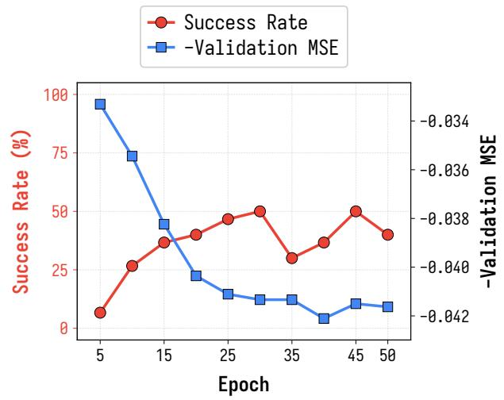

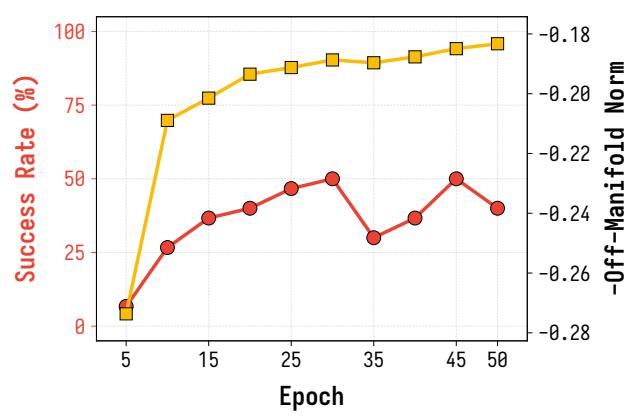

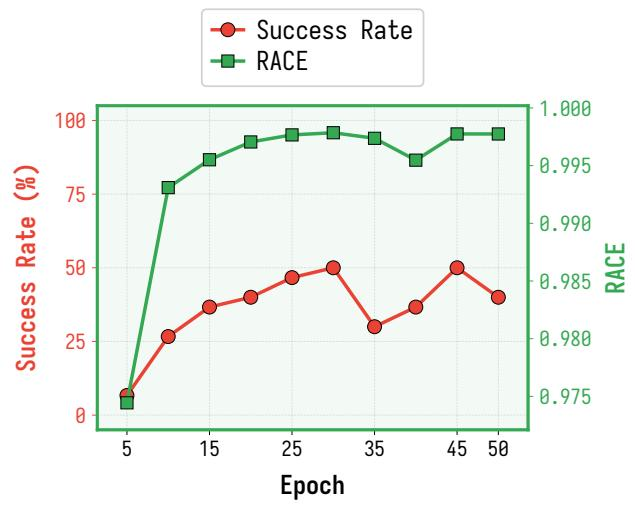  
Figure 10: Difusion Policy: Put Pet on Shelf across training. Each panel overlays empirical success rate (left axis, percent) and a signed criterion value (right axis) against training epoch. Panel order matches the preceding task-level scatter plots, where higher criterion values are preferred.

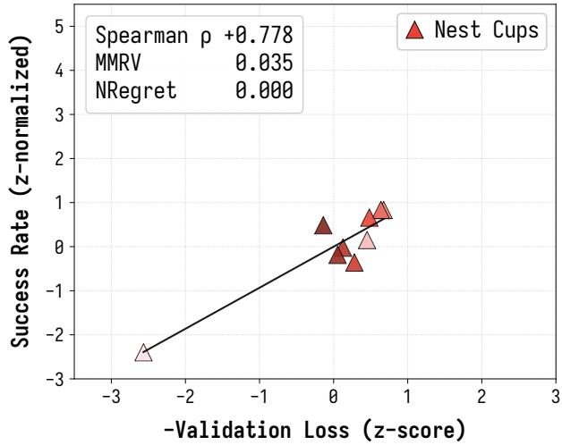

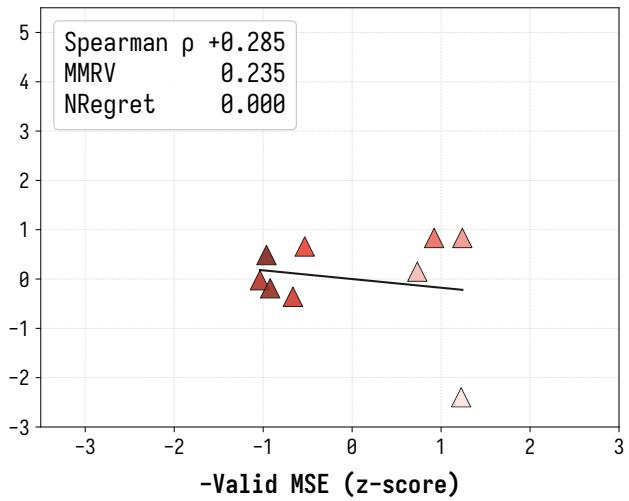

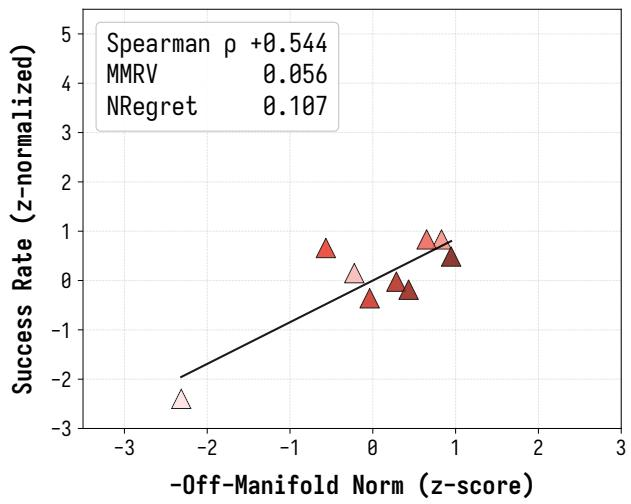

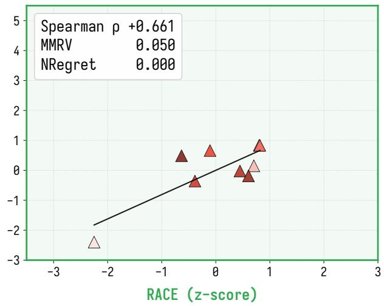  
Figure 11: $\pi _ { 0 . 5 } – \mathbf { D R O I D } \colon$ : Nest Cups. Task-level checkpoint-score versus success-rate scatter plots. Panels show Validation Loss, Validation MSE, Of-Manifold Norm, and RACE from left to right and top to bottom; both axes use within-task z-scores.

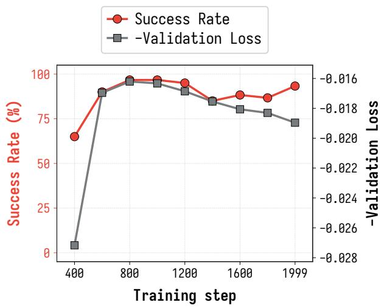

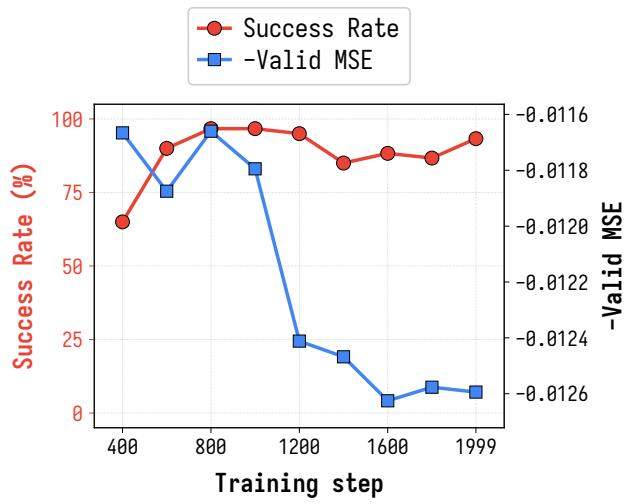

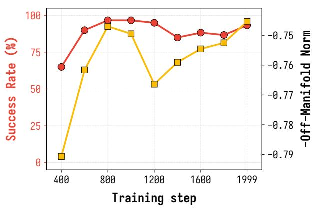

  
Figure 12: $\pi _ { 0 . 5 } – \mathbf { D R O I D }$ : Nest Cups across training. Each panel overlays empirical success rate (left axis, percent) and a signed criterion value (right axis) against training step. Panel order matches the preceding task-level scatter plots, where higher criterion values are preferred.

  
Figure 13: $\pi _ { 0 . 5 } { \bf - D R O I D } \colon$ Put Two Cubes. Task-level checkpoint-score versus success-rate scatter plots. Panels show Validation Loss, Validation MSE, Of-Manifold Norm, and RACE from left to right and top to bottom; both axes use within-task z-scores.

  
Figure 14: $\pi _ { 0 . 5 } – \mathbf { D R O I D } ;$ : Put Two Cubes across training. Each panel overlays empirical success rate (left axis, percent) and a signed criterion value (right axis) against training step. Panel order matches the preceding task-level scatter plots, where higher criterion values are preferred.

Figure $1 5 \colon \pi _ { 0 . 5 } { \bf - D R O I D } \colon \mathrm { P n P } \ 3$ Fruit. Task-level checkpoint-score versus success-rate scatter plots. Panels show Validation Loss, Validation MSE, Of-Manifold Norm, and RACE from left to right and top to bottom; both axes use within-task z-scores.  

  
Figure 16: $\pi _ { 0 . 5 } { \bf - D R O I D } \colon { \bf P n P } \ 3$ Fruit across training. Each panel overlays empirical success rate (left axis, percent) and a signed criterion value (right axis) against training step. Panel order matches the preceding task-level scatter plots, where higher criterion values are preferred.

