# RECAP: Context-Aware Prediction Recycling with Request-Local and Persistent Memories for Multimodal Speculative Decoding

Hengjie Zhu1,2, Dayan Wu1\*, Xinze Liu1,2, Peng Fu1, Zheng Lin1, Weiping Wang1

1Institute of Information Engineering, Chinese Academy of Sciences 2School of Cyber Security, University of Chinese Academy of Sciences {zhuhengjie, wudayan, liuxinze, fupeng, linzheng, wangweiping}@iie.ac.cn

## Abstract

Recycling a target model’s own predictions offers a training-free source of proposals for speculative decoding. In vision-language models, however, existing recycling indexes predictions by the last token alone, conflating predictions computed under different images and prefixes; we find that such reuse fails most often at image-sensitive decoding states. Longer keys reduce this aliasing but match fewer states. We introduce RECAP, which stores target predictions under one-, two-, and three-token keys: contextual memories live only for the current request and are thus implicitly conditioned on its image, while tokenlevel memory persists across requests to retain coverage. At each lookup, entropy-confidence weighting fuses the retrieved predictions according to their key specificity and concentration. Best-first search composes the fused transitions into a candidate tree, supplemented by suffix-matched continuations, and one target pass verifies the tree under greedy decoding. Without training or an auxiliary draft model, RECAP achieves mean speedups over autoregressive decoding of 1.66× and 1.56× across seven single-turn benchmarks on Qwen2.5-VL-7B and LLaVA-1.6-7B, exceeding the strongest training-free baseline, Token Recycling (1.51× and 1.37×). Our implementation is available in https://github.com/Senmo996/RECAPofficial-code.

## 1 Introduction

Vision-language models (VLMs) generate text one token at a time, so every output token requires a sequential target-model pass. Speculative decoding reduces the number of sequential passes by proposing several tokens and verifying them in one parallel pass (Leviathan et al., 2023; Chen et al., 2023). Multimodal methods usually obtain proposals from a separately trained drafter (Hu et al., 2026; Kang et al., 2026), adding training and serving cost for every target model. Tree verification offers a cheaper source: each pass computes full next-token distributions at tens of candidate nodes yet commits only a few tokens, discarding the rest. Prediction recycling stores these target predictions and reuses them as later proposals (Luo et al., 2025), requiring neither a draft model nor training.

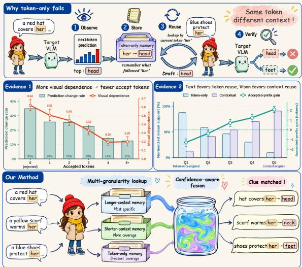  
Figure 1: The role of context in prediction recycling. Top: a cached her→head transition fails when reused after a different prefix. Middle: shorter accepted paths accompany stronger root image sensitivity (left), and source preference varies with candidate visual alignment (right). Bottom: RECAP retrieves and fuses predictions at multiple contextual resolutions.

A recycled prediction is valid for the condition under which the target computed it: the image and the textual prefix. Existing recycling indexes predictions by the last token alone; Token Recycling, for example, keeps one Top-k prediction row per vocabulary token in an adjacency matrix that every verification pass overwrites and that is retained across requests (Luo et al., 2025). Such a key merges all conditions that end in the same token, a mismatch we call condition aliasing. Along the prefix, her→head, cached after “a red hat covers her”, is reused after “blue shoes protect her”, where the target selectsfeet (Figure 1). Along the image, a prefix such as “the sign reads” must continue with whatever text the current image shows. Reuse also fails at image-sensitive states: in counterfactual diagnostics on 700 Qwen2.5-VL images, replacing the image changes the root prediction for 34.9% of fully rejected drafts but for only 12.4% of drafts that accept five or more tokens.

Longer keys reduce aliasing but recur less often: they recall the target token more reliably when they match, yet match far fewer decoding states. We call this tension the specificity–coverage trade-off. Suffix-matching methods such as Prompt Lookup Decoding and SAM Decoding condition on longer contexts (Somasundaram et al., 2025; Hu et al., 2025), but each match copies a single observed continuation rather than combining target predictions obtained under several context lengths.

The two parts of the condition call for separate controls. Key length distinguishes prefixes. Longer keys separate prefixes that a token key aliases, while shorter keys remain necessary for coverage. Neither resolution dominates: whether contextual or token-level candidates yield longer accepted prefixes depends on which carries more visual support (Appendix E), so candidate selection should combine resolutions. Memory lifetime distinguishes images. A lexical key cannot encode the image, but the image is fixed within a request, so request-local memory conditions its predictions on that image implicitly. Token transitions, in contrast, recur across requests, so token-level memory remains useful when retained across a stream.

We propose RECAP (REcycling Context-Aware Predictions), a training-free framework built on these two controls (Figure 2). It stores target predictions under one-, two-, and three-token keys; the two contextual maps live for a single request, whereas the token-level map persists across requests. Because a specific row may be diffuse while a shorter row is sharply peaked, RECAP does not simply prefer the longest key: it weights each retrieved row by a specificity prior scaled by an entropy-based confidence and mixes the rows, reinforcing shared candidates while retaining confident alternatives. Best-first search composes the fused transitions into a candidate tree, and a suffix automaton adds short continuations from the prompt and committed history. One target pass verifies the tree, commits the longest matching path, and writes the predictions of every evaluated node back to memory.

Our contributions are as follows:

• We identify condition aliasing in multimodal prediction recycling and show that tokenindexed reuse fails most often at imagesensitive states.

• We propose RECAP, a training-free framework that distinguishes prefixes through multilength keys with entropy-confidence fusion and images through request-local and persistent memories.

• RECAP achieves mean speedups of 1.66× and 1.56× on Qwen2.5-VL-7B and LLaVA-1.6-7B across seven single-turn benchmarks, and 1.89× and 1.59× on MMSpec, exceeding the strongest training-free baseline in mean speedup.

## 2 Related Work

Speculative decoding. Speculative decoding separates proposal generation from parallel target verification (Leviathan et al., 2023; Chen et al., 2023). Learned proposers exploit target representations: Medusa adds future-token heads with tree verification (Cai et al., 2024), and Hydra models dependencies between head predictions (Ankner et al., 2024). EAGLE drafts autoregressively in feature space (Li et al., 2024b), EAGLE-2 adapts draft trees to context-dependent confidence (Li et al., 2024a), and EAGLE-3 combines multi-layer features with direct token prediction (Li et al., 2026). RECAP keeps the propose–verify interface but drafts from memory of predictions the target has already evaluated.

Multimodal speculative decoding. Visual evidence adds a conditioning requirement to multimodal drafting: a drafter must propose tokens that are consistent with both the textual context and the visual input. Existing approaches address this challenge through different mechanisms. MSD separates text and visual token processing and trains a drafter with a text-to-multimodal curriculum (Lin et al., 2025); DREAM transfers refined target features through cross-attention (Hu et al., 2026); ViSpec adds a vision adaptor to drafting (Kang et al., 2026); SpecVLM combines EAGLE-style drafting, adaptive visual compression, and online-logit distillation (Huang et al., 2025). Together, these methods explore how visual information can be incorporated into a learned drafting process. MM-Spec evaluates such approaches across multimodal task categories (Shen et al., 2026). RECAP instead obtains visual conditioning from cached target predictions and request-local memory, reusing information produced under the current multimodal context without training a multimodal proposer.

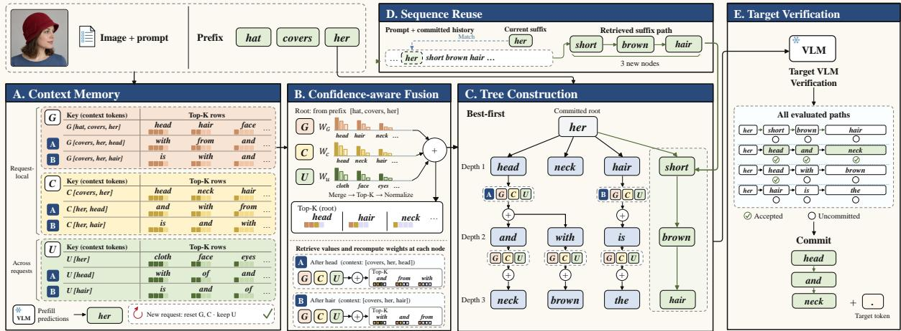  
Figure 2: The RECAP framework. (A) Three-, two-, and one-token keys retrieve Top-K prediction rows from G, C, and U; only U survives request boundaries. (B) Entropy-confidence weighting fuses the retrieved rows under specificity priors and normalizes the retained candidates. (C) Best-first tree search repeats retrieval and fusion under each node’s path context. (D) Suffix retrieval inserts a contiguous continuation from the prompt and committed history. (E) One packed target pass commits the matching path plus one target-selected token. All evaluated nodes refresh prediction memory; only committed tokens extend sequence history. Tokens and scores are illustrative.

Training-free speculative decoding. Trainingfree methods derive proposals from existing sequences and target computations. Prompt Lookup Decoding reuses repeated prompt substrings (Somasundaram et al., 2025); REST retrieves suffixmatched continuations from an external datastore (He et al., 2024); SAM Decoding finds longestsuffix matches in static corpora and generation history (Hu et al., 2025); SuffixDecoding builds frequency-scored trees from current and previous outputs (Oliaro et al., 2026). Lookahead generates and verifies n-grams through parallel iteration (Fu et al., 2024), and Token Recycling forms draft trees from token-indexed predictions (Luo et al., 2025). Related memory mechanisms include neural caches (Grave et al., 2016), kNN-LMs (Khandelwal et al., 2019), and hierarchical language models that support sparse longer contexts with shorter-context distributions (Teh, 2006). RECAP combines multiresolution lexical keys with request-local and persistent scopes, while the target retains control of commitment.

## 3 Context-Aware Prediction Recycling

## 3.1 Motivation

We examine how reuse depends on visual context through the 700-image counterfactual diagnostics in Figure 1 (Appendix E). With each text prefix fixed, target predictions are recomputed under mean-image and matched wrong-image controls, and results are averaged equally across benchmarks.

Evidence 1 relates draft acceptance to root sensitivity. With iterations grouped by accepted length, bars show root Top-1 changes under either control, and the curve gives the smaller of the two decreases in the original root token’s log probability. Rejected drafts score higher on both measures than 5+-token acceptances.

Evidence 2 compares sources at equal candidate budgets. With the prefix and candidate set fixed, visual support $E _ { s }$ is the smaller of the two reductions, under the image controls, in the log of the total target probability assigned to source s’s candidates. Relative support $E _ { G C } - E _ { U }$ between contextual (G/C) and token-only (U) candidates defines within-benchmark quintiles from token-only-aligned Q1 to context-aligned Q5. Bars show softmax-normalized support shares, and the curve shows contextual minus token-only acceptedprefix length. Its sign reversal indicates that the better source changes with candidate alignment, motivating memory that retains multiple context resolutions and fuses their evidence.

## 3.2 Problem Formulation

Let I be the image, p the prompt, and $y _ { < t }$ the generated prefix, with textual history $h \ = \ ( p , y _ { < t } )$ Greedy decoding with the VLM $P _ { \theta }$ over vocabulary V selects

$$
y _ { t } = \arg \operatorname* { m a x } _ { z \in \mathcal { V } } P _ { \theta } ( z \mid I , h ) ,\tag{1}
$$

Speculative decoding verifies a proposed sequence or tree in parallel, commits the longest prefix matching Equation 1, and emits one additional target-selected token (Leviathan et al., 2023), so accepting a draft tokens yields $a + 1$ output tokens per pass. RECAP preserves this commitment rule while building proposals from recycled target predictions.

## 3.3 Context-Stratified Prediction Memory

At each evaluated position, the target assigns logit $\ell _ { z }$ to token z. We retain the K highest-scoring tokens as $\scriptstyle { S _ { K } }$ . A stored prediction row consists of $\boldsymbol { \mathcal { S } } _ { K }$ and its normalized distribution

$$
\widehat { P } ( z ) = \frac { \exp ( \ell _ { z } ) } { \sum _ { v \in \mathcal { S } _ { K } } \exp ( \ell _ { v } ) } , \quad z \in \mathcal { S } _ { K } ,\tag{2}
$$

with zero mass on all other tokens. Each row thus inherits the conditioning of its source image and prefix.

Rows are addressed by the last one, two, or three tokens of $h .$ . For suffix $( u , v , x )$ , these keys retrieve $\mathcal { U } [ x ] , \mathcal { C } [ v , x ]$ , and $\mathcal { G } [ u , v , x ]$ . Thus, covers her, warms her, and protect her share the token key her but access distinct contextual rows (Figure 1), reducing condition aliasing.

Context refinement. Let $H _ { j }$ be the final j history tokens, and let $R _ { K } ^ { * } ( H _ { j } )$ denote the maximum expected recall of the target’s greedy token for selectors using only $H _ { j }$ and at most K candidates. Since $H _ { j }$ is a deterministic function of $H _ { j + 1 }$

$$
R _ { K } ^ { * } ( H _ { j } ) \leq R _ { K } ^ { * } ( H _ { j + 1 } ) , \quad j = 1 , 2 .\tag{3}
$$

A finer-context selector can reproduce every coarsecontext decision, but in a finite memory finer keys are observed less often; retaining shorter rows supplies coverage where longer keys are missing, as in hierarchical language models (Teh, 2006). Appendix F gives the proof.

Memory scope. Contextual maps $\mathcal { C }$ and $\mathcal { G }$ reset per request, making the current image and prompt implicit parts of the retrieval condition, whereas U persists within an inference stream and supplies earlier transitions when local memory is sparse. Prefill seeds $u ,$ tree verification refreshes all three maps, and each key retains its most recently assigned row.

## 3.4 Entropy-Confidence-Weighted Fusion

Let $( M _ { 1 } , \ldots , M _ { r } )$ denote the rows available for history h, ordered from most to least specific (G, $c , u )$ . RECAP fuses them by entropy-confidence weighting: each row’s weight is the product of a specificity prior, with $\alpha _ { 1 } \geq \alpha _ { 2 } \geq \alpha _ { 3 } > 0 \quad$ , and an entropy-based confidence, defined as the row’s inverse effective support:

$$
\begin{array} { r l } & { c _ { j } ( h ) = \exp \left[ - H \Big ( \widehat { P } _ { M _ { j } } \Big ) \right] , } \\ & { w _ { j } ( h ) = \frac { \alpha _ { j } c _ { j } ( h ) } { \sum _ { i = 1 } ^ { r } \alpha _ { i } c _ { i } ( h ) } , } \end{array}\tag{4}
$$

where $\begin{array} { r } { H ( P ) = - \sum _ { z } P ( z ) \log P ( z ) } \end{array}$ . The prior favors specific matches, and confidence favors concentrated predictions. Priors follow specificity rank among available rows: if only C and $\mathcal { U }$ match, they receive $\alpha _ { 1 }$ and $\alpha _ { 2 }$ . Weights are recomputed at every tree node without additional target evaluations or learned parameters. Confidence measures concentration under the source condition, not direct alignment with the current image.

The normalized weights define the mixture

$$
m ( z \mid h ) = \sum _ { j = 1 } ^ { r } w _ { j } ( h ) \widehat { P } _ { M _ { j } } ( z ) .\tag{5}
$$

We bound branching by selecting the Top-K tokens $S ( h )$ , using the same $K$ as row storage, and renormalizing:

$$
q ( z \mid h ) = \frac { m ( z \mid h ) } { \sum _ { v \in S ( h ) } m ( v \mid h ) } , \quad z \in S ( h ) ,\tag{6}
$$

with all other probabilities set to zero. A single retrieved row recovers ordinary lookup, and no match terminates expansion. Setting $c _ { j } ( h ) = 1$ for all available rows yields the fixed-prior special case, the w/o confidence configuration analyzed in Appendix I.

Weighted KL center. For fixed h, the weights do not depend on the candidate distribution $\rho ,$ , so the mixture is the weighted Kullback–Leibler (KL)

<table><tr><td rowspan="2">Models</td><td rowspan="2">Methods</td><td colspan="2">MMT</td><td colspan="2">SEED</td><td colspan="2">SciQA</td><td colspan="2">OCR</td><td colspan="2">ChartQA</td><td colspan="2">MathVista</td><td colspan="2">TextVQA</td><td colspan="2">Average</td></tr><tr><td>S</td><td></td><td>T</td><td>S</td><td>S</td><td>T</td><td>S</td><td>T</td><td>S</td><td>T</td><td>S</td><td></td><td>T</td><td>S</td><td>T S</td><td>T</td></tr><tr><td rowspan="7">Qwen2.5-VL 7B-Instruct</td><td>PLD</td><td>1.16</td><td>1.19</td><td>0.89</td><td>1.05</td><td>1.24</td><td>1.13</td><td>1.22</td><td>1.20</td><td>1.14</td><td>1.25</td><td>1.49</td><td>1.22</td><td>0.97</td><td>1.09</td><td>1.16</td><td>1.16</td></tr><tr><td>Lookahead</td><td>1.15</td><td>1.60</td><td>0.93</td><td>1.35</td><td>1.44</td><td>2.14</td><td>1.11</td><td>1.62</td><td>1.10</td><td>1.62</td><td>1.20</td><td>1.60</td><td>0.94</td><td>1.26</td><td>1.12</td><td>1.60</td></tr><tr><td>Tree Recycling</td><td>1.20</td><td>1.47</td><td>1.07</td><td>1.49</td><td>1.23</td><td>1.54</td><td>1.29</td><td>1.68</td><td>1.27</td><td>1.72</td><td>1.41</td><td>1.70</td><td>1.06</td><td>1.41</td><td>1.22</td><td>1.57</td></tr><tr><td>Token Recycling</td><td>1.59</td><td>2.57</td><td>1.25</td><td>2.58</td><td>1.60</td><td>2.60</td><td>1.51</td><td>2.82</td><td>1.54</td><td>2.89</td><td>1.86</td><td>2.84</td><td>1.21</td><td>2.63</td><td>1.51</td><td>2.71</td></tr><tr><td>SAM</td><td>1.11</td><td>1.24</td><td>1.06</td><td>1.34</td><td>1.15</td><td>1.36</td><td>1.20</td><td>1.33</td><td>1.23</td><td>1.57</td><td>1.21</td><td>1.38</td><td>1.05</td><td>1.26</td><td>1.14</td><td>1.35</td></tr><tr><td>SAM+ViSkip</td><td>1.04</td><td>1.25</td><td>0.99</td><td>1.27</td><td>1.07</td><td>1.29</td><td>1.04</td><td>1.28</td><td>1.16</td><td>1.50</td><td>1.14</td><td>1.36</td><td>0.99</td><td>1.22</td><td></td><td>1.061.31</td></tr><tr><td>RECAP</td><td>1.69</td><td>2.81</td><td>1.27</td><td>2.78</td><td>1.72</td><td>2.84</td><td>1.67</td><td>3.31</td><td>1.75</td><td>3.30</td><td>2.19</td><td>3.27</td><td>1.34</td><td>2.81</td><td>1.66</td><td>3.02</td></tr><tr><td rowspan="7">LLaVA-1.6 Vicuna-7B</td><td>PLD</td><td>1.01</td><td>1.34</td><td>0.91</td><td>1.14</td><td>1.09</td><td>1.23</td><td>1.28</td><td>1.53</td><td>1.02</td><td>1.34</td><td>1.19</td><td>1.40</td><td>0.89</td><td>1.11</td><td>1.06</td><td>1.30</td></tr><tr><td>Lookahead</td><td>0.80</td><td>1.74</td><td>0.70</td><td>1.48</td><td>0.94</td><td>2.11</td><td>0.91</td><td>2.11</td><td>0.74</td><td>1.66</td><td>0.79</td><td>1.70</td><td>0.64</td><td>1.31</td><td>0.79</td><td>1.73</td></tr><tr><td>Tree Recycling</td><td>1.23</td><td>1.48</td><td>1.15</td><td>1.49</td><td>1.22</td><td>1.43</td><td>1.40</td><td>1.82</td><td>1.28</td><td>1.60</td><td>1.37</td><td>1.69</td><td>1.13</td><td>1.34</td><td>1.25</td><td>1.55</td></tr><tr><td>Token Recycling</td><td>1.40</td><td>2.48</td><td>1.24</td><td>2.49</td><td>1.36</td><td>2.47</td><td>1.49</td><td>2.69</td><td>1.42</td><td>2.66</td><td>1.49</td><td>2.65</td><td>1.23</td><td>2.41</td><td>1.37</td><td>2.55</td></tr><tr><td>SAM</td><td>1.13</td><td>1.26</td><td>1.11</td><td>1.34</td><td>1.12</td><td>1.24</td><td>1.24</td><td>1.45</td><td>1.18</td><td>1.36</td><td>1.23</td><td>1.40</td><td>1.07</td><td>1.19</td><td>1.16</td><td>1.32</td></tr><tr><td>SAM+ViSkip</td><td>1.10</td><td>1.26</td><td>1.07</td><td>1.34</td><td>1.09</td><td>1.24</td><td>1.20</td><td>1.45</td><td>1.15</td><td>1.36</td><td>1.20</td><td>1.40</td><td>1.04</td><td>1.19</td><td>1.12</td><td>1.32</td></tr><tr><td>RECAP</td><td>1.63</td><td>2.77</td><td></td><td>1.31 2.82</td><td>1.56</td><td></td><td>2.701.81</td><td>3.40</td><td>1.58</td><td></td><td>3.06 1.71</td><td>3.11</td><td>1.29</td><td>2.59</td><td>1.56 2.92</td><td></td></tr></table>

Table 1: Speedup S (×) and acceptance length τ across seven single-turn benchmarks at temperature 0. SciQA denotes ScienceQA and OCR denotes OCRBench. S averages paired generation-throughput ratios against autoregressive decoding; τ averages accepted draft tokens plus one target-selected token. Higher is better for both metrics.

center (Abbas, 2009):

$$
m ( \cdot \mid h ) = \underset { \rho \in \Delta ( \mathcal { V } ) } { \arg \operatorname* { m i n } } \sum _ { j = 1 } ^ { r } w _ { j } ( h ) D _ { \mathrm { K L } } \big ( \widehat { P } _ { M _ { j } } \mid \mid \rho \big ) ,\tag{7}
$$

where $\Delta ( \nu )$ is the probability simplex. Top-K retention maximizes the preserved mixture mass, and the normalized proposal minimizes $D _ { \mathrm { K L } } ( q \Vert m )$ over distributions supported on at most K tokens (Appendix F).

## 3.5 Tree Construction and Verification

At every node, RECAP retrieves and fuses rows using the established prefix together with proposed ancestors. Best-first construction orders paths $\pi =$ $( z _ { 1 } , \ldots , z _ { d } )$ by the score

$$
\phi ( \pi ) = \prod _ { j = 1 } ^ { d } \eta _ { j } q ( z _ { j } \mid h _ { j } ) ,\tag{8}
$$

where $h _ { j } = ( h , z _ { < j } )$ supplies the path context and $\eta _ { j }$ controls depth-dependent expansion, until the node or depth budget is reached. Composing local predictions yields candidate sequences never stored as complete continuations.

A suffix automaton over the prompt and committed history retrieves the continuation following a match to the current suffix (Hu et al., 2025) and inserts it into the tree by sharing common prefixes, preserving observed sequence dependencies without modifying the fused transition scores.

The target verifies the joint tree in one packed pass, with ancestral attention confining each node to the established prefix and its own path. The longest path matching Equation 1 is committed together with one target-selected token; if no candidate agrees, the target directly supplies the next token.

Predictions from all evaluated nodes, including uncommitted branches, update U, C, and $\mathcal { G }$ under their path contexts, whereas only committed tokens enter the suffix automaton. An uncommitted branch thus contributes a target prediction valid under its hypothetical prefix, which may become useful when a compatible context recurs. Appendix A provides implementation settings and hyperparameters.

## 4 Experimental Evaluation

## 4.1 Setup

Models and workloads. Evaluation uses Qwen2.5-VL-7B-Instruct (Bai et al., 2025) and LLaVA-1.6 Vicuna-7B (Liu et al., 2024a) on an NVIDIA A100-SXM4-80GB GPU. Generation is greedy at batch size one, with at most 200 new tokens. We fix 1,000 inputs for each single-turn benchmark: MMT-Bench (Ying et al., 2024), SEED-Bench (Li et al., 2023), ScienceQA (Lu et al., 2022), OCRBench (Liu et al., 2024b), ChartQA (Masry et al., 2022), MathVista (Lu et al., 2024), and TextVQA (Singh et al., 2019). MMSpec adds 600 inputs from six categories, extending coverage to multi-turn conversations (Shen et al., 2026). For the main results, each benchmark, including MMSpec, forms one inference stream: persistent U is cleared after warmup and before each benchmark, then carried across that benchmark’s inputs, whereas C and G reset per request.

<table><tr><td rowspan="2">Models</td><td rowspan="2">Methods</td><td colspan="2">General VQA</td><td colspan="2">Text VQA</td><td colspan="2">Captioning</td><td colspan="2">Charts</td><td colspan="2">Reasoning</td><td colspan="2">Multi-turn</td><td colspan="2">Overall</td></tr><tr><td>S</td><td>T</td><td>S</td><td>T</td><td>S</td><td>T</td><td>S</td><td>T</td><td>S</td><td>T</td><td>S</td><td>T</td><td>S</td><td>T</td></tr><tr><td rowspan="7">Qwen2.5-VL 7B-Instruct</td><td>PLD</td><td>1.06</td><td>1.05</td><td>1.21</td><td>1.13</td><td>1.14</td><td>1.15</td><td>1.20</td><td>1.31</td><td>1.28</td><td>1.34</td><td>1.34</td><td>1.27</td><td>1.23</td><td>1.22</td></tr><tr><td>Lookahead</td><td>1.11</td><td>1.37</td><td>1.04</td><td>1.29</td><td>1.44</td><td>1.64</td><td>1.21</td><td>1.77</td><td>1.91</td><td>2.28</td><td>1.39</td><td>1.80</td><td>1.36</td><td>1.71</td></tr><tr><td>Tree Recycling</td><td>1.12</td><td>1.40</td><td>1.10</td><td>1.32</td><td>1.22</td><td>1.37</td><td>1.21</td><td>1.64</td><td>1.38</td><td>1.66</td><td>1.25</td><td>1.56</td><td>1.22</td><td>1.51</td></tr><tr><td>Token Recycling</td><td>1.51</td><td>2.57</td><td>1.31</td><td>2.49</td><td>1.80</td><td>2.51</td><td>1.38</td><td>2.60</td><td>1.77</td><td>2.64</td><td>1.57</td><td>2.60</td><td>1.56</td><td>2.57</td></tr><tr><td>SAM</td><td>1.05</td><td>1.14</td><td>1.13</td><td>1.13</td><td>1.03</td><td>1.07</td><td>1.14</td><td>1.54</td><td>1.18</td><td>1.31</td><td>1.08</td><td>1.23</td><td>1.10</td><td>1.24</td></tr><tr><td>SAM+ViSkip</td><td>0.97</td><td>1.16</td><td>1.00</td><td>1.12</td><td>0.95</td><td>1.06</td><td>1.06</td><td>1.55</td><td>1.07</td><td>1.29</td><td>0.99</td><td>1.24</td><td>1.00</td><td>1.24</td></tr><tr><td>RECAP</td><td>1.77</td><td>2.69</td><td>1.26</td><td>2.49</td><td>2.00</td><td>2.60</td><td>1.86</td><td>3.02</td><td>2.16</td><td>2.97</td><td>2.09</td><td>2.80</td><td>1.89</td><td>2.77</td></tr><tr><td rowspan="7">LLaVA-1.6 Vicuna-7B</td><td>PLD</td><td>1.03</td><td>1.10</td><td>1.06</td><td>1.08</td><td>1.09</td><td>1.17</td><td>1.21</td><td>1.54</td><td>1.37</td><td>1.79</td><td>1.33</td><td>1.82</td><td>1.21</td><td>1.48</td></tr><tr><td>Lookahead</td><td>0.93</td><td>1.41</td><td>0.85</td><td>1.25</td><td>0.87</td><td>1.34</td><td>1.02</td><td>1.66</td><td>1.03</td><td>1.72</td><td>0.90</td><td>1.43</td><td>0.92</td><td>1.46</td></tr><tr><td>Tree Recycling</td><td>1.12</td><td>1.43</td><td>1.17</td><td>1.40</td><td>1.19</td><td>1.34</td><td>1.34</td><td>1.70</td><td>1.37</td><td>1.77</td><td>1.35</td><td>1.64</td><td>1.27</td><td>1.56</td></tr><tr><td>Token Recycling</td><td>1.21</td><td>2.42</td><td>1.35</td><td>2.48</td><td>1.50</td><td>2.50</td><td>1.43</td><td>2.58</td><td>1.46</td><td>2.57</td><td>1.53</td><td>2.65</td><td>1.43</td><td>2.55</td></tr><tr><td>SAM</td><td>1.07</td><td>1.23</td><td>1.06</td><td>1.16</td><td>1.04</td><td>1.09</td><td>1.24</td><td>1.46</td><td>1.22</td><td>1.49</td><td>1.16</td><td>1.28</td><td>1.14</td><td>1.29</td></tr><tr><td>SAM+ViSkip</td><td>1.04</td><td>1.23</td><td>1.04</td><td>1.16</td><td>1.02</td><td>1.09</td><td>1.21</td><td>1.46</td><td>1.20</td><td>1.49</td><td>1.14</td><td>1.29</td><td>1.12</td><td>1.29</td></tr><tr><td>RECAP</td><td>1.26</td><td>2.60</td><td>1.44</td><td>2.64</td><td>1.65</td><td>2.63</td><td>1.65</td><td>3.10</td><td>1.67</td><td>3.09</td><td>1.73</td><td>2.93</td><td>1.59</td><td>2.85</td></tr></table>

Table 2: MMSpec speedup $S \left( \times \right)$ and acceptance length τ at temperature 0, with the metric definitions of Table 1. Each category contains 100 inputs; multi-turn conversations contribute 223 generation turns, giving 723 total turns. Overall values are turn-weighted averages of both metrics, rather than unweighted category means.

Baselines. We compare six draft-model-free approaches: Prompt Lookup Decoding (PLD; Somasundaram et al., 2025), Lookahead Decoding (Fu et al., 2024), Token Recycling (Luo et al., 2025), Tree Recycling, SAM Decoding (Hu et al., 2025), and SAM+ViSkip (Shen et al., 2026). Token Recycling and Tree Recycling run token-indexed recycling (Luo et al., 2025) on the same prefill and verification path as RECAP. Token Recycling follows the published configuration: a Top-8 adjacency matrix retained across requests drafts a static 80-node tree, and the matrix is cleared after warmup and at each benchmark boundary, as is U. Tree Recycling is a lighter variant that expands a smaller static tree from a request-local Top-4 matrix. All methods use fixed input manifests and an autoregressive reference from the same backbone. Their settings are listed in Appendix A.

Metrics. We report speedup $\begin{array} { r } { S = { \frac { 1 } { N } } \sum _ { i = 1 } ^ { N } r _ { i } ^ { m } } \end{array}$ as the mean of paired throughput ratios, defined by

$$
r _ { i } ^ { m } = \frac { n _ { i } ^ { m } / T _ { i } ^ { m } } { n _ { i } ^ { \mathrm { A R } } / T _ { i } ^ { \mathrm { A R } } } .\tag{9}
$$

For each generation unit, $n _ { i } ^ { m }$ and $T _ { i } ^ { m }$ are the output-token count and total generation time for method m. The autoregressive reference is denoted AR, and N is the number of generation units.

Our acceptance length τ includes the additional target-selected token:

$$
\tau = 1 + \frac { 1 } { N } \sum _ { i = 1 } ^ { N } \bar { a } _ { i } ,\tag{10}
$$

where $\bar { a } _ { i }$ averages draft tokens accepted per verification iteration for unit i.

When target evaluations are exact, RECAP preserves greedy decoding without loss.

## 4.2 Main Results

RECAP leads every single-turn model–benchmark comparison in speedup and acceptance (Table 1). Qwen’s mean speedup across seven benchmarks is 1.66×, compared with 1.51× for Token Recycling, the strongest baseline by mean speedup. LLaVA’s corresponding values are 1.56× and 1.37×. The gains cover reasoning, chart understanding, and text-centric inputs: Qwen reaches 2.19× on Math-Vista and 1.75× on ChartQA, while LLaVA reaches 1.81× on OCRBench and 1.71× on MathVista. Alongside its consistent lead in S, RECAP has the highest τ throughout. Its mean acceptance lengths of 3.02 and 2.92 exceed Token Recycling’s 2.71 and 2.55, the strongest baseline acceptance averages.

On MMSpec (Table 2), RECAP reaches overall speedups of 1.89× on Qwen and 1.59× on LLaVA, exceeding Token Recycling, the strongest baseline on both models, at 1.56× and 1.43×. RECAP leads in both speedup and acceptance length across categories except Qwen text VQA, where Token Recycling reaches 1.31× against 1.26×, while both methods round to $\tau = 2 . 4 9$ . Overall acceptance lengths for RECAP are 2.77 and 2.85. Multi-turn conversation yields 2.09× on Qwen, second only to complex reasoning at 2.16×, and 1.73× on LLaVA, its largest category speedup.

<table><tr><td>Model</td><td>Method</td><td>Params</td><td>GiB</td><td>T</td><td>S</td><td>AR</td></tr><tr><td rowspan="3">LLaVA</td><td>DREAM</td><td>607M</td><td>1.13</td><td>3.68</td><td>1.26</td><td>41.9</td></tr><tr><td>ViSpec</td><td>451M</td><td>0.84</td><td>3.74</td><td>1.05</td><td>61.2</td></tr><tr><td>RECAP</td><td>0</td><td>0</td><td>2.92</td><td>1.56</td><td>29.9</td></tr><tr><td rowspan="2">Qwen</td><td>ViSpec</td><td>890M</td><td>1.66</td><td>3.76</td><td>1.18</td><td>57.0</td></tr><tr><td>RECAP</td><td>0</td><td>0</td><td>3.02</td><td>1.66</td><td>39.4</td></tr></table>

Table 3: Deployment cost and decoding performance on the seven single-turn benchmarks in Table 1. Params and GiB denote drafter parameter counts and 16- bit GPU weight storage; AR is mean autoregressive throughput (tokens/s). DREAM and ViSpec use released checkpoints with top-4, depth-6, 32-node trees and a faster AR harness, so their S is not directly comparable with that of RECAP.

Comparison with trained drafters. Table 3 contrasts RECAP with released DREAM (Hu et al., 2026) and ViSpec (Kang et al., 2026) drafters on the same single-turn inputs. Trained drafters accept longer continuations, with mean τ of 3.68–3.76 against 2.92 and 3.02 for RECAP, which reaches 78–80% of their acceptance length. Their speedups of 1.05–1.26× fall below those of RECAP, but they were measured against autoregressive baselines of 41.9–61.2 tokens/s rather than 29.9–39.4 tokens/s, so this gap does not establish that RECAP decodes faster. Their acceptance advantage requires a training stage for each target model and adds 451M–890M parameters, or 0.84–1.66 GiB of 16-bit weights, to the serving GPU. RECAP adds no parameters or GPU-resident state; at the default budget, its proposal state occupies at most 8.70 MiB of host memory (Table 10). It therefore transfers to a new VLM without data collection, training, or a drafter checkpoint.

## 5 Analysis of Prediction Reuse

## 5.1 Component Contributions

Matched-budget ablations test which parts of the design contribute to throughput (Table 4). The MM-Spec subset comprises 120 inputs, 20 per category, expanding to 160 generation turns, and is evaluated with Qwen2.5-VL-7B. Policies share a tree builder and a 63-node transition budget. Reported gains average input-paired throughput changes after pooling each input’s turn-level token counts and times. Except for the confidence comparison, these controls use the fixed-prior special case (cj = 1), so each comparison isolates one component.

<table><tr><td>Comparison</td><td>Gain (%, ↑)</td></tr><tr><td>Candidate search</td><td></td></tr><tr><td>Best-first vs. fixed expansion</td><td>+4.90</td></tr><tr><td>Memory design Context backoff vs. unigram</td><td>+3.03</td></tr><tr><td></td><td></td></tr><tr><td>Uniform fusion vs. backoff</td><td>+0.75</td></tr><tr><td>Specificity priors vs. uniform fusion</td><td>+2.80</td></tr><tr><td>Entropy confidence vs. fixed priors†</td><td>+0.73/+1.09</td></tr><tr><td>Persistent vs. reset U</td><td>+5.42</td></tr><tr><td>Sequence reuse</td><td></td></tr><tr><td>Suffix insertion vs. none†</td><td>+0.61</td></tr></table>

Table 4: Paired throughput effects of individual components. Unmarked rows use the 120-input MMSpec subset with Qwen2.5-VL-7B; the persistence row averages five runs. † marks four-dataset controls (200 inputs per model for confidence, reported as Qwen/LLaVA; 400 inputs for suffix insertion). Backoff selects the most specific row available at a query.

Contextual backoff improves throughput over unigram recycling by 3.03%, and an independent repeat of the same 120-input comparison yields 2.42%. Uniform fusion improves backoff by 0.75%, and specificity priors improve uniform fusion by 2.80%. Across five runs, retaining token memory across requests improves throughput over per-request reset by 5.42% on average, ranging from 4.36% to 7.18%. Request-stream controls are detailed in Appendix D.

In four-dataset controls, entropy-confidence weighting adds a smaller gain over fixed priors: 0.73% mean throughput on Qwen and 1.09% on LLaVA. Confidence-based single-source gating decreases throughput by 0.66% and 1.90%, respectively. The contrast supports combining source evidence in these settings while qualifying the size of the confidence benefit. Appendix I details the adaptive rules and fixed-prior sensitivity.

Suffix complementarity is tested separately on 100 inputs each from ChartQA, TextVQA, OCR-Bench, and MMT-Bench. Adding suffix insertion to fusion improves mean paired throughput by 0.61%, with dataset-specific changes from −0.67% to +2.23% (Table 7).

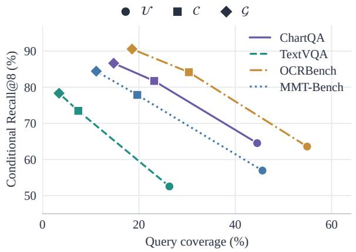  
(a) Coverage–recall trade-off

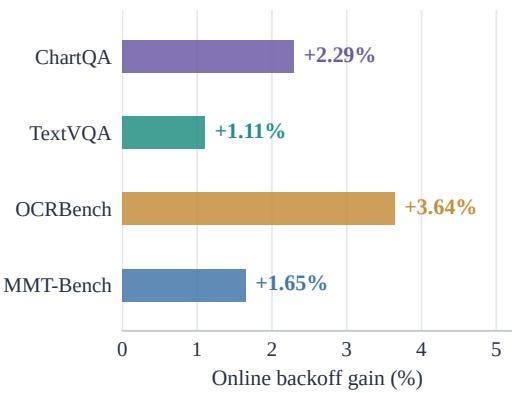  
(b) Online throughput gain  
Figure 3: The specificity–coverage trade-off and contextual backoff. (a) Query coverage and conditional Recall@8 across 23,811 states from 400 inputs. Each benchmark connects U (circle), C (square), and G (diamond). Finer keys raise conditional recall while reducing coverage. (b) Paired online throughput gains of U + C backoff against U.

## 5.2 Specificity Improves Matching; Backoff Retains Coverage

Replay comprises 23,811 states from 400 inputs, with 100 each from ChartQA, TextVQA, OCR-Bench, and MMT-Bench. Retrieval begins with empty memories and accesses only rows from earlier states. Query coverage is the fraction of states with a matching row. Conditional Recall@8 is recall of the reference next token among those covered states.

Stored rows preserve useful source-image information. To test this, we fix the query image, question, and prefix and vary the image used to compute earlier predictions. On jointly covered queries with eight candidates per source, matchingimage rows outperform swapped-image rows in fused Recall@8 by 0.89–6.35 percentage points across datasets (Appendix C).

All four datasets show higher conditional recall and lower coverage with finer keys (Figure 3(a)). On OCRBench, U coverage is 54.9% and G coverage is 18.6%, while recall rises from 63.6% to 90.6%. In a prompt-seeded variant of this replay, restricting evaluation to states where both G and U match, G improves Recall@8 over U by 5.00– 29.54 percentage points across datasets.

At equal actual candidate counts, $\mathcal { U } + \mathcal { C }$ backoff also improves matched continuation length on every dataset, from 0.516 to 0.709 tokens on ChartQA and 0.632 to 1.135 on OCRBench (Appendix C). This offline metric measures the longest tree prefix agreeing with the saved target continuation, excluding the root and target correction token.

Online controls yield 1.11–3.64% paired throughput gains from $\mathcal { U } ~ + ~ \mathcal { C }$ backoff (Figure 3(b)). Adding G improves offline matching further on ChartQA and MMT-Bench, with only small throughput changes online. Context refinement therefore supplies more precise candidates, and backoff preserves the coverage needed for their practical reuse.

## 5.3 Complementary Sequence Reuse

Suffix retrieval contributes sequence continuations beyond those formed by local transition composition. Starting with prompt-seeded U, we compare fusion alone with suffix-augmented fusion at equal actual candidate counts. The added suffix increases mean matched length by 0.059–0.190 tokens across four replay datasets (Appendix C). The matched-budget result attributes the improvement to complementary sequence evidence.

Online throughput changes from suffix insertion range between −0.67% and +2.23% across the four datasets. Timing includes retrieval, insertion, and overlap handling. At the default budget, retrieval, fusion, tree construction, and packing together require 0.907 ms per Qwen iteration and 1.121 ms per LLaVA iteration. Including memory refresh, suffix-index updates, token commitment, and other host-side decoding work, all stages outside target verification take 1.778 and 1.974 ms, or 8.20% and 5.61% of decoding wall time (Appendix G).

## 6 Conclusion

RECAP addresses contextual specificity and reuse scope jointly in multimodal prediction recycling, fusing request-local contextual memories with persistent token-level memory through entropyconfidence weighting without training or an auxiliary draft model. It reaches mean generationthroughput speedups of 1.66× and 1.56× across seven single-turn benchmarks on Qwen2.5-VL-7B and LLaVA-1.6-7B, and 1.89× and 1.59× on MM-Spec. Controlled analyses connect these gains to more precise contextual matching and reuse across request boundaries.

## Limitations

Our evidence covers greedy, batch-one generation with image-based inputs on two 7B VLMs. Larger models, concurrent serving, and video remain untested operating regimes. Default specificity priors, confidence weighting, and tree settings may yield different latency–memory tradeoffs across hardware and request lengths. The reported efficiency concerns generation throughput and does not establish downstream task accuracy or application-level latency distributions.

## Ethical considerations

This work studies inference efficiency using existing models and public evaluation data and introduces no new human-subject data collection. Deployments should follow the applicable model and dataset licenses and isolate online prediction memories at appropriate user or service boundaries. Faster inference does not remove the need to assess outputs for the intended application.

## References

Ali E Abbas. 2009. A kullback-leibler view of linear and log-linear pools. Decision Analysis, 6(1):25–37.

Zachary Ankner, Rishab Parthasarathy, Aniruddha Nrusimha, Christopher Rinard, Jonathan Ragan-Kelley, and William Brandon. 2024. Hydra: Sequentially-dependent draft heads for medusa decoding. arXiv preprint arXiv:2402.05109.

Shuai Bai, Keqin Chen, Xuejing Liu, Jialin Wang, Wenbin Ge, Sibo Song, Kai Dang, Peng Wang, Shijie Wang, Jun Tang, Humen Zhong, Yuanzhi Zhu, Mingkun Yang, Zhaohai Li, Jianqiang Wan, Pengfei Wang, Wei Ding, Zheren Fu, Yiheng Xu, and 8 others. 2025. Qwen2.5-vl technical report. Preprint, arXiv:2502.13923.

Tianle Cai, Yuhong Li, Zhengyang Geng, Hongwu Peng, Jason D Lee, Deming Chen, and Tri Dao. 2024. Medusa: Simple llm inference acceleration framework with multiple decoding heads. arXiv preprint arXiv:2401.10774.

Charlie Chen, Sebastian Borgeaud, Geoffrey Irving, Jean-Baptiste Lespiau, Laurent Sifre, and John Jumper. 2023. Accelerating large language model decoding with speculative sampling. arXiv preprint arXiv:2302.01318.

Yichao Fu, Peter Bailis, Ion Stoica, and Hao Zhang. 2024. Break the sequential dependency of llm inference using lookahead decoding. arXiv preprint arXiv:2402.02057.

Edouard Grave, Armand Joulin, and Nicolas Usunier. 2016. Improving neural language models with a continuous cache. arXiv preprint arXiv:1612.04426.

Zhenyu He, Zexuan Zhong, Tianle Cai, Jason Lee, and Di He. 2024. Rest: Retrieval-based speculative decoding. In Proceedings of the 2024 Conference of the North American Chapter ofthe Associationfor Computational Linguistics: Human Language Technologies (Volume 1: Long Papers), pages 1582–1595.

Yunhai Hu, Tianhua Xia, Zining Liu, Rahul Raman, Xingyu Liu, Bo Bao, Eric Sather, Vithursan Thangarasa, and Sai Qian Zhang. 2026. Dream: Drafting with refined target features and entropyadaptive cross-attention fusion for multimodal speculative decoding. Advances in Neural Information Processing Systems, 38:167592–167612.

Yuxuan Hu, Ke Wang, Xiaokang Zhang, Fanjin Zhang, Cuiping Li, Hong Chen, and Jing Zhang. 2025. Sam decoding: Speculative decoding via suffix automaton. In Proceedings of the 63rd Annual Meeting of the Associationfor Computational Linguistics (Volume 1: Long Papers), pages 12187–12204.

Haiduo Huang, Fuwei Yang, Zhenhua Liu, Xuanwu Yin, Dong Li, Pengju Ren, and Emad Barsoum. 2025. Specvlm: Fast speculative decoding in visionlanguage models. arXiv preprint arXiv:2509.11815.

Jialiang Kang, Han Shu, Wenshuo Li, Yingjie Zhai, and Xinghao Chen. 2026. Vispec: Accelerating visionlanguage models with vision-aware speculative decoding. Advances in Neural Information Processing Systems, 38:115511–115532.

Urvashi Khandelwal, Omer Levy, Dan Jurafsky, Luke Zettlemoyer, and Mike Lewis. 2019. Generalization through memorization: Nearest neighbor language models. arXiv preprint arXiv:1911.00172.

Yaniv Leviathan, Matan Kalman, and Yossi Matias. 2023. Fast inference from transformers via speculative decoding. In International conference on machine learning, pages 19274–19286. PMLR.

Bohao Li, Rui Wang, Guangzhi Wang, Yuying Ge, Yixiao Ge, and Ying Shan. 2023. Seed-bench: Benchmarking multimodal llms with generative comprehension. arXiv preprint arXiv:2307.16125.

Yuhui Li, Fangyun Wei, Chao Zhang, and Hongyang Zhang. 2024a. Eagle-2: Faster inference of language models with dynamic draft trees. In Proceedings of the 2024 conference on empirical methods in natural language processing, pages 7421–7432.

Yuhui Li, Fangyun Wei, Chao Zhang, and Hongyang Zhang. 2024b. Eagle: Speculative sampling requires rethinking feature uncertainty. arXiv preprint arXiv:2401.15077.

Yuhui Li, Fangyun Wei, Chao Zhang, and Hongyang Zhang. 2026. Eagle-3: Scaling up inference acceleration of large language models via training-time test. Advances in Neural Information Processing Systems, 38:136737–136756.

Luxi Lin, Zhihang Lin, Zhanpeng Zeng, and Rongrong Ji. 2025. Speculative decoding reimagined for multimodal large language models. arXiv preprint arXiv:2505.14260.

Haotian Liu, Chunyuan Li, Yuheng Li, Bo Li, Yuanhan Zhang, Sheng Shen, and Yong Jae Lee. 2024a. Llavanext: Improved reasoning, ocr, and world knowledge.

Yuliang Liu, Zhang Li, Mingxin Huang, Biao Yang, Wenwen Yu, Chunyuan Li, Xu-Cheng Yin, Cheng-Lin Liu, Lianwen Jin, and Xiang Bai. 2024b. Ocrbench: on the hidden mystery of ocr in large multimodal models. Science China Information Sciences, 67(12):220102.

Pan Lu, Hritik Bansal, Tony Xia, Jiacheng Liu, Chunyuan Li, Hannaneh Hajishirzi, Hao Cheng, Kai-Wei Chang, Michel Galley, and Jianfeng Gao. 2024. Mathvista: Evaluating mathematical reasoning of foundation models in visual contexts. In International Conference on Learning Representations, volume 2024, pages 23439–23554.

Pan Lu, Swaroop Mishra, Tanglin Xia, Liang Qiu, Kai-Wei Chang, Song-Chun Zhu, Oyvind Tafjord, Peter Clark, and Ashwin Kalyan. 2022. Learn to explain: Multimodal reasoning via thought chains for science question answering. Advances in neural information processing systems, 35:2507–2521.

Xianzhen Luo, Yixuan Wang, Qingfu Zhu, Zhiming Zhang, Xuanyu Zhang, Qing Yang, and Dongliang Xu. 2025. Turning trash into treasure: Accelerating inference of large language models with token recycling. In Proceedings ofthe 63rd Annual Meeting of the Association for Computational Linguistics (Volume 1: Long Papers), pages 6816–6831.

Ahmed Masry, Jia Qing Tan, Shafiq Joty, Enamul Hoque, et al. 2022. Chartqa: A benchmark for question answering about charts with visual and logical reasoning. In Findings of the association for computational linguistics: ACL 2022, pages 2263–2279.

Gabriele Oliaro, Zhihao Jia, Daniel Campos, and Aurick Qiao. 2026. Suffixdecoding: Extreme speculative decoding for emerging ai applications. Advances in Neural Information Processing Systems, 38:126326– 126354.

Hui Shen, Xin Wang, Ping Zhang, Yunta Hsieh, Qi Han, Zhongwei Wan, Ziheng Zhang, Jingxuan Zhang, Jing Xiong, Ziyuan Liu, et al. 2026. Mmspec: Benchmarking speculative decoding for vision-language models. arXiv preprint arXiv:2603.14989.

Amanpreet Singh, Vivek Natarajan, Meet Shah, Yu Jiang, Xinlei Chen, Dhruv Batra, Devi Parikh, and Marcus Rohrbach. 2019. Towards vqa models that can read. In 2019 IEEE/CVF Conference on Computer Vision and Pattern Recognition (CVPR), pages 8309–8318. IEEE.

Shwetha Somasundaram, Anirudh Phukan, and Apoorv Saxena. 2025. Pld+: Accelerating llm inference by leveraging language model artifacts. In Findings of the Association for Computational Linguistics: NAACL 2025, pages 6090–6104.

Yee Whye Teh. 2006. A hierarchical bayesian language model based on pitman-yor processes. In Proceedings ofthe 21st international conference on computational linguistics and 44th annual meeting of the associationfor computational linguistics, pages 985– 992.

Kaining Ying, Fanqing Meng, Jin Wang, Zhiqian Li, Han Lin, Yue Yang, Hao Zhang, Wenbo Zhang, Yuqi Lin, Shuo Liu, et al. 2024. Mmt-bench: A comprehensive multimodal benchmark for evaluating large vision-language models towards multitask agi. arXiv preprint arXiv:2404.16006.

## A Implementation and Baseline Settings

Model execution. Qwen and LLaVA run in bfloat16 and float16, respectively, on the workloads of Section 4.1. Timing covers prefill and decoding, excluding data loading and report aggregation.

RECAP defaults. We use Top-8 rows, width 8, depth 10, and 63 transition candidates excluding the root. Available rows receive priors (0.70, 0.20, 0.10) by decreasing specificity; entropy-confidence weighting multiplies each prior by the row’s confidence and normalizes the products (Equation 4). Depth priors are (0.68, 0.63, 0.50, 0.43, 0.40, 0.38), then 0.38. Prefix-sharing suffix insertion adds at most four tokens beyond the transition cap, giving at most 68 packed nodes including the root; controls described as suffix-inclusive instead count suffix nodes within the 63-node cap. Special image tokens and duplicate children are filtered.

Memory updates and packed verification. Prefill seeds U from each eligible prompt token’s first occurrence; ${ \mathcal { C } } / { \mathcal { G } }$ start empty. All evaluated rows refresh memory, retaining each key’s first batch occurrence and replacing older entries. Packed positions follow path depth; accepted-path key/value entries continue decoding. Stream and policy states are isolated and reset after warmup; in the main results, U is also cleared at each benchmark boundary, so no predictions carry over between benchmarks.

Baselines. PLD uses 4-token keys and at most 10 draft tokens; Lookahead uses decoding/branch lengths $6 4 / 1 2 .$ . Token Recycling follows the official implementation (Luo et al., 2025): a zeroinitialized Top-8 adjacency matrix fills the static imbalanced “2.2.2” tree (80 candidates, depth 6) layer by layer, and every verified node writes its Top-8 target predictions back to the matrix. Prefill logits are not written; the matrix persists across requests and is cleared only after warmup and at benchmark boundaries. Tree Recycling expands a static tree of width 2 and depth 4, giving 30 candidates under a 31-node cap, from a request-local Top-4 matrix. SAM uses total-token setting 64 and draft lengths 2–40. SAM+ViSkip caps drafts at 40 tokens and gates at 0.35 on head-averaged image attention at final-layer query zero.

## B Timing and Analysis Protocols

Fusion rule. The main results (Tables 1 and 2) and the MMSpec latency analysis (Appendix J) use entropy-confidence weighting. Component analyses in Section 5 and Appendices C, D, G, and H use its fixed-prior special case $( c _ { j } = 1 )$ , so that each control varies one component; Appendix I compares the two rules directly.

Pairing and timed boundaries. For the recycling methods (RECAP, Tree Recycling, and Token Recycling), SAM, and SAM+ViSkip, autoregressive references are interleaved with method runs; PLD and Lookahead pair generation units. Main methods each have a separate run and reference, while component controls share a run. Main recycling and MMSpec ablations synchronize at target forwards. SAM+ViSkip and four-dataset controls synchronize at generation boundaries; the four-dataset controls also share timing paths that include CPU candidate counters.

<table><tr><td rowspan="2">Dataset</td><td colspan="3">Coverage (%, ↑)</td><td colspan="3">Recall@8 (%, ↑)</td></tr><tr><td>U</td><td>C</td><td>g</td><td>U</td><td>C</td><td>g</td></tr><tr><td>ChartQA</td><td>44.5</td><td>23.2</td><td>14.8</td><td>64.5</td><td>81.7</td><td>86.6</td></tr><tr><td>TextVQA</td><td>26.3</td><td>7.4</td><td>3.4</td><td>52.5</td><td>73.5</td><td>78.3</td></tr><tr><td>OCRBench</td><td>54.9</td><td>30.4</td><td>18.6</td><td>63.6</td><td>84.2</td><td>90.6</td></tr><tr><td>MMT-Bench</td><td>45.6</td><td>19.7</td><td>11.2</td><td>56.9</td><td>77.9</td><td>84.4</td></tr></table>

Table 5: Coverage and conditional Recall@8 during empty-initialization replay. Queries are evaluated before their corresponding memory updates.

MMSpec controls. In MMSpec ablations, the ratio for input j pools its multi-turn records:

$$
R _ { j } ^ { a / b } = \frac { \sum _ { i \in j } n _ { i } ^ { a } / \sum _ { i \in j } T _ { i } ^ { a } } { \sum _ { i \in j } n _ { i } ^ { b } / \sum _ { i \in j } T _ { i } ^ { b } } .\tag{11}
$$

Gains are reported as $1 0 0 ( \mathrm { m e a n } _ { j } R _ { j } ^ { a / b } - 1 )$ . Resampling and repeated request orders reuse the same inputs. Their variation therefore reflects this fixed evaluation set, not independent-dataset uncertainty.

Offline replay. Offline replay queries before updating, includes unmatched empty-memory states, and compares proposals with saved native target continuations. Trees respect a 63-node cap and are rebuilt to the smallest actual count among policies. Matched length excludes the root and target correction token. Suffix additions are included in the cap for controls; the default configuration allows four extra nodes.

Offline means weight replay states within each dataset and use 2,000 paired image-cluster resamples: 97 ChartQA clusters and 100 clusters elsewhere. Online resampling pairs inputs, using 100 per dataset or the first 50 for scope controls.

## C Candidate-Level Results

Table 5 gives the coverage and recall values in Figure 3; the corresponding online gains are reported below.

With 100 paired inputs per dataset, shared initialization, and a 63-node cap, U +C backoff improves throughput over U by 2.29%, 1.11%, 3.64%, and 1.65% on ChartQA, TextVQA, OCRBench, and MMT-Bench, respectively.

Backoff versus fusion. Matched-node comparisons favor backoff over fusion on ChartQA and OCRBench, with similar continuation lengths elsewhere (Table 6).

<table><tr><td rowspan="2">Policy</td><td colspan="3">Matched continuation length (↑)</td></tr><tr><td>ChartQA</td><td>TextVQA OCR</td><td>MMT</td></tr><tr><td>U</td><td>0.516</td><td>0.224 0.632</td><td>0.444</td></tr><tr><td>U + C backoff</td><td>0.709</td><td>0.253 1.135</td><td>0.600</td></tr><tr><td>U + C + G backoff</td><td>0.778</td><td>0.252 1.128</td><td>0.638</td></tr><tr><td>Uniform fusion</td><td>0.737</td><td>0.253 1.041</td><td>0.629</td></tr><tr><td>Prior-weighted fusion</td><td>0.751</td><td>0.253 1.066</td><td>0.639</td></tr></table>

Table 6: Matched continuation length in emptyinitialization replay. Each state uses equal actual node counts across the compared policies. Prior-weighted fusion uses fixed priors $( c _ { j } = 1 )$

Fusion in online controls. With empty initialization and fixed priors, prior-weighted/uniform throughput ratios are 1.0043, 1.0015, 1.0006, and 1.0037 on ChartQA, TextVQA, OCRBench, and MMT-Bench. These near-neutral ratios qualify the gain observed in the prompt-seeded MMSpec control (Table 4) and show that specificity priors have setting-dependent benefits.

Suffix complementarity. At equal actual candidate counts under a 63-node cap, prompt-seeded suffix insertion adds first-token hits in 3.33%, 1.46%, 1.95%, and 2.31% of states (Table 7). Online policies are interleaved, bridge extension is disabled, and all suffix-related operations are timed.

Image-conditioned source predictions. Holding queries fixed and using eight candidates per source, jointly available matching-image rows increase fused Recall@8 over swapped-image rows by 5.55, 6.35, 1.91, and 0.89 points on ChartQA, TextVQA, OCRBench, and MMT-Bench. Donor images are category-matched on ChartQA/OCRBench and pooled on the other datasets. The context-only/trigram-only changes of $- 2 . 9 6 / - 2 . 5 0$ points on OCRBench show that longer-key sources do not benefit uniformly. No image-similarity gate is used.

## D Prediction Reuse across Request Streams

We test cross-task reuse by changing tokenmemory lifetime while holding contextual memory request-local. Persistent U is compared with perrequest reset, and C and G reset in both cases. The same 200 inputs are scheduled either in benchmark blocks or by alternating benchmarks.

Persistent memory improves throughput on ChartQA, OCRBench, and MMT-Bench under both schedules, with near-neutral effects on

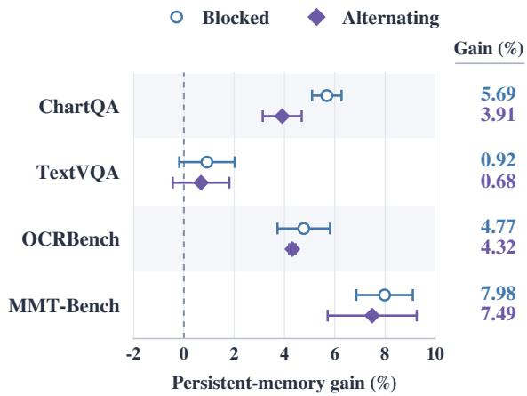  
Figure 4: Token-level reuse across task schedules. Persistent U is paired with per-request reset on identical inputs to measure throughput under blocked and alternating benchmark streams.

TextVQA (Figure 4). MMT-Bench gains are 7.98% for blocked streams and 7.49% for alternating streams. A task-boundary reset retains reuse within benchmarks but clears U on each benchmark switch. It becomes equivalent to per-request reset under alternation, while persistent U retains predictions through intervening tasks.

Within-dataset orders use seeds 17, 29, 43. The three memory policies maintain isolated states, reset ${ \mathcal { C } } / { \mathcal { G } }$ per request, and omit suffix insertion.

Table 8 averages paired input ratios separately for each seed. TextVQA’s pooled ratios are 0.987 under blocked scheduling and 0.990 under alternation, indicating near-neutral effects sensitive to aggregation. Alternating task-reset and per-requestreset acceptance is identical across 600 pairs. Memory snapshots include final prediction objects and exclude peak process RAM.

The persistent map keeps only the latest Top-K row for each token, bounding U storage by $O ( | \nu | K )$ per stream. On cyclic replay of a fixed Qwen trajectory pool, its host footprint remains near 2.67 MiB through 10,000 request updates.

## E Motivation Figure Diagnostics

Figure 1 uses Qwen2.5-VL-7B traces from 100 images per single-turn benchmark, totaling 700. We compute equal-benchmark averages and 10,000 within-benchmark image-cluster bootstrap resamples. The counterfactuals hold text prefixes fixed while recomputing representations with meanimage and matched wrong-image controls.

<table><tr><td rowspan="2">Dataset</td><td colspan="3">Offline matched continuation length</td><td colspan="2">Online fusion + suffix / fusion</td></tr><tr><td>Fusion</td><td>+ Suffix</td><td>Difference</td><td>Gain (%, ↑)</td><td>τ: before → after</td></tr><tr><td>ChartQA</td><td>1.123</td><td>1.313</td><td>0.190</td><td>+0.83</td><td> $2 . 8 0  2 . 8 8$ </td></tr><tr><td>TextVQA</td><td>0.355</td><td>0.413</td><td>0.059</td><td>+0.07</td><td> $2 . 1 8  2 . 1 8$ </td></tr><tr><td>OCRBench</td><td>1.417</td><td>1.538</td><td>0.120</td><td>-0.67</td><td> $2 . 6 6  2 . 6 2$ </td></tr><tr><td>MMT-Bench</td><td>0.750</td><td>0.866</td><td>0.116</td><td>+2.23</td><td> $2 . 4 0  2 . 4 4$ </td></tr></table>

Table 7: Suffix-retrieval controls. Offline matching omits root and correction tokens; online gains and acceptance length τ use Equations 9–10.

<table><tr><td rowspan="2">Dataset</td><td colspan="2">Throughput gain (%, ↑)</td></tr><tr><td>Blocked</td><td>Alternating</td></tr><tr><td>ChartQA</td><td> $5 . 6 9 \pm 0 . 5 9$ </td><td> $3 . 9 1 \pm 0 . 7 7$ </td></tr><tr><td>TextVQA</td><td> $0 . 9 2 \pm 1 . 1 0$ </td><td> $0 . 6 8 \pm 1 . 1 3$ </td></tr><tr><td>OCRBench</td><td> $4 . 7 7 \pm 1 . 0 4$ </td><td> $4 . 3 2 \pm 0 . 1 3$ </td></tr><tr><td>MMT-Bench</td><td> $7 . 9 8 \pm 1 . 1 2$ </td><td> $7 . 4 9 \pm 1 . 7 7$ </td></tr></table>

Table 8: Mean throughput gain ± sample SD for persistent U versus reset, measured across three orders of the same 200 inputs.

Accepted length and root sensitivity (left). Visual dependence is the smaller counterfactual decrease in the original root token’s log probability, and change rate records Top-1 changes under either control. Valid full-image anchors yield 15,677 drafts across 695 image clusters, grouped by accepted length into 0–4 and 5+. From rejection to 5+ acceptance, dependence declines $0 . 6 2 0 ~  ~ 0 . 1 9 8$ and root-change rate declines $3 4 . 9 \%  1 2 . 4 \%$

Candidate-source alignment (right). For tokenonly candidates $C _ { U }$ and contextual candidates $C _ { G C } ,$ , define the log candidate mass and visual support as

$$
L _ { s } ( J ) = \log \sum _ { z \in C _ { s } } P _ { \theta } ( z \mid J , p , y _ { < t } ) ,\tag{12}
$$

$$
E _ { s } = \operatorname* { m i n } _ { \substack { J \in \{ I _ { \mathrm { m e a n } } , I _ { \mathrm { w r o n g } } \} } } \big [ L _ { s } ( I ) - L _ { s } ( J ) \big ] .\tag{13}
$$

We retain 1,125 eligible states with valid full-image anchors, both sources, row overlap of at most 25%, and matched budgets of 2–8 candidates. Withinbenchmark quintiles of $E _ { G C } - E _ { U }$ run from Ualigned Q1 to context-aligned Q5. Bars show $\exp ( E _ { s } ) / ( \exp ( E _ { U } ) + \exp ( E _ { G C } ) )$ . The corresponding contextual acceptance gains are −1.292, −0.375, 0.709, 1.239, and 2.084 tokens. Acceptance is not used to define the bins.

<table><tr><td rowspan="2">Stage</td><td colspan="2">Qwen</td><td colspan="2">LLaVA</td></tr><tr><td>Wall</td><td>CPU</td><td>Wall</td><td>CPU</td></tr><tr><td>Suffix lookup</td><td>0.010</td><td>0.016</td><td>0.010</td><td>0.016</td></tr><tr><td>Lookup, fusion, search</td><td>0.506</td><td>0.510</td><td>0.592</td><td>0.598</td></tr><tr><td>Packing</td><td>0.391</td><td>0.409</td><td>0.519</td><td>0.538</td></tr><tr><td>Memory refresh</td><td>0.461</td><td>0.468</td><td>0.414</td><td>0.421</td></tr><tr><td>Suffix index update</td><td>0.027</td><td>0.034</td><td>0.028</td><td>0.034</td></tr><tr><td>Token commitment</td><td>0.256</td><td>0.273</td><td>0.286</td><td>0.304</td></tr><tr><td>Other decoding</td><td>0.127</td><td>0.148</td><td>0.125</td><td>0.145</td></tr><tr><td>Target verification</td><td>19.912</td><td>19.928</td><td>33.241</td><td>33.265</td></tr></table>

Table 9: Decoding-phase times in milliseconds, pooled over iterations at a 63-node cap with 40 inputs per model and two orders. Wall times are exclusive; CPU time includes synchronization polling.

## F Properties of Prediction Reuse

Context refinement. Let Z be the greedy target token under fixed tie-breaking and $H _ { j }$ the last j history tokens, start-padded as needed. Optimal recall is

$$
R _ { K } ^ { * } ( H _ { j } ) = \mathbb { E } \left[ \operatorname* { m a x } _ { \underset { | \mathcal { S } | \leq K } { S \subseteq \mathcal { V } } } \operatorname* { P r } ( Z \in \mathcal { S } \mid H _ { j } ) \right] .\tag{14}
$$

For $H _ { a } ~ = ~ f ( H _ { b } )$ , any coarse selector can be reproduced as $S _ { b } ( H _ { b } ) ~ = ~ S _ { a } ( f ( H _ { b } ) )$ ), proving $R _ { K } ^ { * } ( H _ { a } ) \ \leq \ R _ { K } ^ { * } ( H _ { b } )$ . Dropping the earliest token gives Equation 3. Finite memories still require shorter-key coverage.

Fusion and sparse selection. At a fixed query, let $\begin{array} { r } { m = \sum _ { j } w _ { j } P _ { j } } \end{array}$ combine normalized rows $P _ { j } =$ $\widehat { P } _ { M _ { j } }$ with fixed positive weights summing to one. The KL decomposition

$$
\begin{array} { l } { { \displaystyle \sum _ { j } w _ { j } D _ { \mathrm { K L } } ( P _ { j } \| \rho ) } } \\ { ~ = { \displaystyle \sum _ { j } w _ { j } D _ { \mathrm { K L } } ( P _ { j } \| m ) + D _ { \mathrm { K L } } ( m \| \rho ) } . } \end{array}\tag{15}
$$

makes m the unique minimizer in Equation 7, without row independence (Abbas, 2009).

<table><tr><td>Model</td><td>Cap</td><td>Mean nodes</td><td>Prep. ms</td><td>p95 ms</td><td>Host MiB</td><td>GPU GiB</td></tr><tr><td>Qwen</td><td>31</td><td>26.5</td><td>0.591</td><td>0.722</td><td>5.79</td><td>19.32</td></tr><tr><td>Qwen</td><td>63</td><td>55.2</td><td>0.907</td><td>1.227</td><td>7.88</td><td>19.32</td></tr><tr><td>Qwen</td><td>127</td><td>113.4</td><td>2.202</td><td>2.617</td><td>8.74</td><td>19.32</td></tr><tr><td>LLaVA</td><td>31</td><td>29.1</td><td>0.721</td><td>0.882</td><td>7.46</td><td>19.98</td></tr><tr><td>LLaVA</td><td>63</td><td>59.2</td><td>1.121</td><td>1.385</td><td>8.70</td><td>20.01</td></tr><tr><td>LLaVA</td><td>127</td><td>121.0</td><td>2.485</td><td>2.729</td><td>12.68</td><td>20.16</td></tr></table>

Table 10: Budget sensitivity with shared inputs and orders. Candidate counts include suffixes and exclude the root. Preparation covers lookup through packing; $p _ { 9 5 }$ is the request-average 95th percentile. Host memory is the largest proposal-state snapshot. GPU memory is peak model-process allocation, including weights and generation workspaces.

<table><tr><td>Model</td><td>|u|</td><td>Host MiB</td><td>Lookup ns</td></tr><tr><td rowspan="3">Qwen</td><td>1,000</td><td>0.67</td><td>109</td></tr><tr><td>10,000</td><td>7.03</td><td>141</td></tr><tr><td>152,064</td><td>109.14</td><td>386</td></tr><tr><td rowspan="3">LLaVA</td><td>1,000</td><td>0.67</td><td>109</td></tr><tr><td>10,000</td><td>7.03</td><td>140</td></tr><tr><td>32,064</td><td>23.36</td><td>183</td></tr></table>

Table 11: Synthetic occupancy stress test: host-object storage and median lookup latency, measured over seven repeats of 100,000 seeded ID/score hits with a checksum.

Let $\boldsymbol { \mathcal { S } } _ { K }$ retain the largest K positive masses of m (all if fewer), with deterministic ties, and $q =$ $m ( \cdot \mid S _ { K } )$ . Then

$$
\begin{array} { r l } { q \in } & { \underset { \rho \in \Delta ( \mathcal V ) } { \arg \operatorname* { m i n } } D _ { \mathrm { K L } } ( \rho \| m ) . } \\ & { | \underset { \mathrm { s u p p } ( \rho ) | \leq K } { \arg ( \rho ) } | \underset { \rho \in \Delta ( \mathcal V ) } { \sum } } \end{array}\tag{16}
$$

For nonempty ${ \mathcal { S } } \subseteq \operatorname { s u p p } ( m )$ and ρ supported on $s ,$

$$
\begin{array} { r l } { D _ { \mathrm { K L } } ( \rho \| m ) = D _ { \mathrm { K L } } ( \rho \| m ( \cdot \mid S ) ) } & { } \\ { - \log m ( S ) . } \end{array}\tag{17}
$$

Thus $\rho = m ( \cdot \mid S )$ attains − log $m ( \boldsymbol { S } )$ , and Top-K maximizes retained mass $m ( \boldsymbol { S } )$ , allowing tied optimal supports. These properties characterize proposals; target verification determines commitment.

## G Overhead and Memory Scaling

## G.1 Latency and Workspace

Profiling uses the same A100-SXM4-80GB GPU and AMD EPYC 9654 CPU for both models, with PyTorch 2.7.1, CUDA 12.6, and four CPU threads. Ten inputs per diagnostic dataset follow Appendix A. Orders $1 7 / 2 9$ interleave caps $3 1 / 6 3 / 1 2 7$ , resetting isolated states after warmup and between repeats. Profiling uses the fixed-prior special case $( c _ { j } = 1 ) $ ; entropy-confidence weighting additionally evaluates one row entropy per retrieved row at multi-source queries. In an isolated host microbenchmark of the reference Python fusion over 512 multi-source queries, this raises fusion time from 7.3 to 14.5 µs per query; the C++ builder used for the main results was not profiled separately.

<table><tr><td>Variant</td><td> $S \left( \times , \uparrow \right)$ </td><td>τ (↑)</td></tr><tr><td>RECAP (lexical)</td><td>1.63</td><td>2.67</td></tr><tr><td>RECAP + semantic fallback</td><td>1.61</td><td>2.78</td></tr><tr><td>RECAP + recency fallback</td><td>1.61</td><td>2.75</td></tr></table>

Table 12: Root fallback on MMSpec with Qwen2.5-VL-7B. All variants use fixed-prior fusion $( c _ { j } = 1 )$ . Longer accepted continuations accompany lower speedup. Best column values are bold.

We pool exclusive CUDA-synchronized phases over decoding iterations, excluding prefill and image encoding (Table 9). Packing includes topology, masks, positions, and verification inputs. Memory traversal and serialization are untimed. An uninstrumented 63-node stream measures instrumentation overhead, and four 64-token traces per model separately attribute CUDA kernel and memoryoperation time.

Stage costs. Preparation takes 0.907/1.121 ms on Qwen/LLaVA, or 4.18%/3.18% of decoding wall time. Adding memory refresh and suffix-index updates gives 1.395/1.563 ms (6.43%/4.44%), and all stages outside target verification total 1.778/1.974 ms (8.20%/5.61%). Instrumentation adds 1.01%/1.36% median latency. Retrieval, fusion, and search launch no CUDA work. Packing consumes 4.46/3.29 µs of device time per iteration, while verification consumes 16.60/28.04 ms, representing 98.88%/99.61% of decoding-device

<table><tr><td rowspan="2">Variant</td><td colspan="6">Qwen</td><td colspan="6">LLaVA</td></tr><tr><td>ChartQA</td><td>TextVQA</td><td>OCR</td><td>MMT</td><td>Mean</td><td>T</td><td>ChartQA</td><td>TextVQA</td><td>OCR</td><td>MMT</td><td>Mean</td><td>T</td></tr><tr><td>RECAP</td><td>+0.65</td><td>+1.24</td><td>+1.43</td><td>-0.41</td><td>+0.73</td><td>2.93</td><td>+2.30</td><td>+0.34</td><td>+1.71</td><td>+0.01</td><td>+1.09</td><td>2.90</td></tr><tr><td>w/o confidence</td><td>+0.00</td><td>+0.00</td><td>+0.00</td><td>+0.00</td><td>+0.00</td><td>2.91</td><td>+0.00</td><td>+0.00</td><td>+0.00</td><td>+0.00</td><td>+0.00</td><td>2.88</td></tr><tr><td>w/o prior</td><td>+0.37</td><td>+0.56</td><td>+1.38</td><td>-0.93</td><td>+0.35</td><td>2.91</td><td>+0.26</td><td>-0.67</td><td>+0.31</td><td>-0.92</td><td>-0.25</td><td>2.85</td></tr><tr><td>Uniform</td><td>+0.01</td><td>+0.37</td><td>+2.34</td><td>+0.22</td><td>+0.73</td><td>2.90</td><td>-0.47</td><td>+0.18</td><td>+2.29</td><td>-0.06</td><td>+0.48</td><td>2.86</td></tr><tr><td>Confidence gate</td><td>-1.10</td><td>+1.52</td><td>-1.33</td><td>-1.72</td><td>-0.66</td><td>2.83</td><td>-2.27</td><td>-1.56</td><td>-1.25</td><td>-2.53</td><td>-1.90</td><td>2.76</td></tr></table>

Table 13: Online fusion ablations, reporting mean input-paired throughput changes (%) against w/o confidence and acceptance length τ . Each model processes 200 inputs, 50 per dataset, under two orders. Policies share memory scope, candidate limits, and suffix insertion; timing includes weighting. Full RECAP is shaded.

<table><tr><td>Variant</td><td>ChartQA</td><td>TextVQA</td><td>OCR</td><td>MMT</td></tr><tr><td>RECAP</td><td>+0.00</td><td>+0.00</td><td>+0.01</td><td>-0.01</td></tr><tr><td>w/o confidence</td><td>+0.00</td><td>+0.00</td><td>+0.00</td><td>+0.00</td></tr><tr><td>w/o prior</td><td>-0.08</td><td>+0.00</td><td>-0.31</td><td>+0.00</td></tr><tr><td>Uniform</td><td>-0.08</td><td>+0.00</td><td>-0.30</td><td>+0.02</td></tr><tr><td>Confidence gate</td><td>-1.49</td><td>-0.14</td><td>-1.99</td><td>-0.95</td></tr><tr><td>Specificity backoff</td><td>-0.11</td><td>+0.00</td><td>+1.29</td><td>-0.24</td></tr><tr><td>w/o conf., soft prior</td><td>-0.04</td><td>+0.00</td><td>-0.16</td><td>+0.00</td></tr><tr><td>w/o conf., sharp prior</td><td>-0.02</td><td>+0.03</td><td>+0.15</td><td>-0.05</td></tr></table>

Table 14: Changes in all-query Recall@8 relative to w/o confidence (percentage points), evaluated on 23,811 Qwen states from 400 inputs. Uncovered states count as misses. Shading identifies RECAP.

time.

Budget sensitivity and workspace. For B candidates, the ancestor submatrix contains $( B + 1 ) ^ { 2 }$ entries. Table 10 deduplicates host objects shared across $\mathcal { U } / \mathcal { C } / \mathcal { G } .$ , the suffix index, and topology state.

## G.2 Persistent-Memory Growth

One latest Top-K row per token bounds persistent memory by $| \mathcal { U } | \le | \mathcal { V } |$ . The resulting space cost is $O ( | \nu | K )$ per stream and $O ( n _ { s } | \mathcal { V } | K )$ for $n _ { s }$ streams, independent of request count. Requestlocal ${ \mathcal { C } } / { \mathcal { G } }$ scale with the contexts evaluated within each request.

Replay of observed prediction rows. Cyclic replay reshuffles 400 native Qwen trajectories, 100 per diagnostic dataset, under seeds 17/29/43 at each pass. Top-8 memory reaches 3,821 keys and 2.67 MiB after 400 requests and stays stable through 10,000 updates (Figure 5). This result characterizes replacement on a fixed pool, not saturation under unseen inputs.

Vocabulary-capacity stress test. The capacity stress test fills synthetic Top-8 rows at three occupancies in fresh processes (Table 11). At full vocabulary occupancy, Qwen/LLaVA host storage is 109.14/23.36 MiB and RSS increases by 126.48/27.55 MiB. These capacity figures do not represent natural-stream footprints. Persistent rows contain no CUDA tensors.

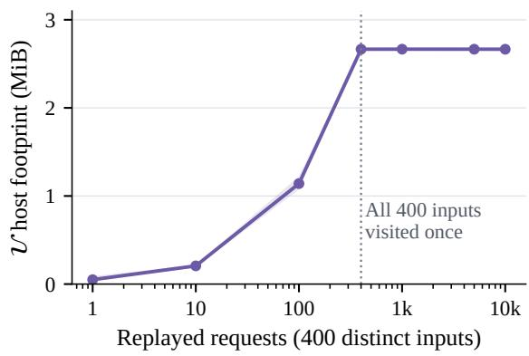

Figure 5: Persistent U over cyclic replay of the same 400 trajectories. Curves report the mean and min–max range across three replay orders.
<table><tr><td>Model</td><td>Method</td><td>P50</td><td>P90</td><td>P95</td><td>P99</td></tr><tr><td>Qwen</td><td>AR</td><td>2.70</td><td>8.44</td><td>11.63</td><td>15.07</td></tr><tr><td>Qwen</td><td>RECAP</td><td>1.52</td><td>4.46</td><td>6.08</td><td>7.56</td></tr><tr><td>LLaVA</td><td>AR</td><td>4.02</td><td>9.42</td><td>14.27</td><td>18.43</td></tr><tr><td>LLaVA</td><td>RECAP</td><td>2.38</td><td>5.45</td><td>8.25</td><td>10.67</td></tr></table>

Table 15: MMSpec per-input generation-latency percentiles in seconds, with lower values indicating faster generation. Pk denotes the kth percentile; RECAP rows are shaded.

Across all six occupancies, 63-node tree construction takes 0.242–0.249 ms, measured as the median of seven repeats of 128 queries with packing excluded.

## H Alternative Root-Level Retrieval

Qwen fallbacks use a fixed six-category MMSpec subset and activate only when all root lexical lookups fail; descendants retain lexical retrieval. Semantic fallback selects up to three rows by cosine similarity of verified and predecessor states, with no extra target forwards. A request-local FIFO index holds at most 2,048 surviving $\mathcal { U } / \mathcal { C } / \mathcal { G }$ rows; recency fallback selects the latest. Both use fixed priors (0.70, 0.20, 0.10) without confidence $( c _ { j } = 1 )$ and Top-8 candidates.

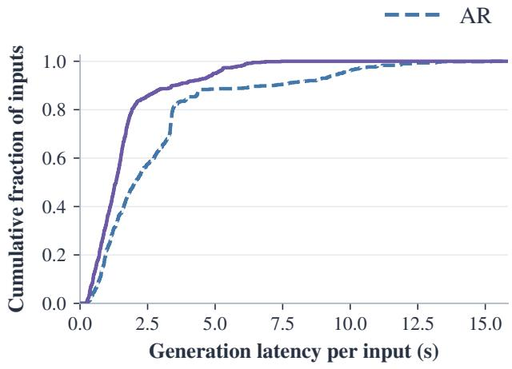  
(a) Qwen2.5-VL-7B

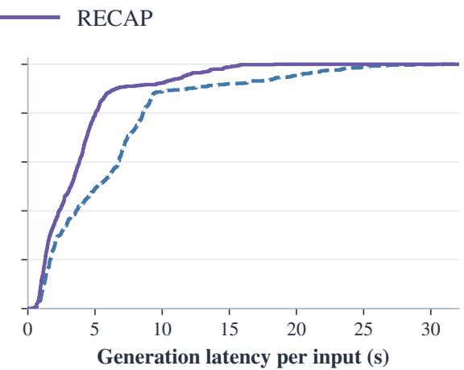  
(b) LLaVA-1.6-7B  
Figure 6: Per-input generation-latency CDFs on MMSpec for paired RECAP and AR runs. A leftward curve indicates lower latency. Multi-turn inputs contribute summed generation time across turns.

Interleaved policies share target-generated histories, depth 10, a 63-candidate cap including suffixes but excluding the root, and isolated persistent U and request-local ${ \mathcal { C } } / { \mathcal { G } }$ . Timing includes image encoding, prefill, index maintenance, and decoding; metrics average turns.

Both increase τ but reduce speedup by 1.46% (semantic) and 1.34% (recency; Table 12). Semantic lookup activates in 4.87% of iterations despite continuous index maintenance. Neither fallback is enabled by default.

## I Fusion Ablations

In Equation 4, w/o confidence sets $c _ { j } ( h ) = 1$ (reference), w/o prior sets $\alpha _ { j } = 1$ , and uniform fusion removes both factors. Hard gating selects the most confident row, breaking ties by specificity. All rules share retrieved rows, Top-8 truncation, and renormalization.

Offline matching. Replay uses earlier rows, prompt-seeded U, and empty ${ \mathcal { C } } / { \mathcal { G } } .$ RECAP changes all-query Recall@8 by less than 0.02 points; gating loses 0.14–1.99 points (Table 14). Without confidence, soft (0.55, 0.30, 0.15) and sharp (0.85, 0.10, 0.05) priors change recall by at most 0.17 points.

Online comparison. The 4,000 generations in Table 13 compare five rules with isolated memories, suffix insertion, and Appendix A’s settings. Policies rotate per request; timing includes image encoding, prefill, generation, and adaptation. Repeats reuse inputs to assess order variation. RECAP gains 0.73%/1.09% mean throughput on Qwen/LLaVA, with median paired changes of $- 0 . 1 2 \% / - 0 . 0 7 \%$ W/o prior (confidence only) and uniform fusion have mixed effects; gating lowers throughput on both models. Gains are modest and task-dependent. Confidence measures concentration; learned gates and visual-dependence signals remain untested.

Disagreement among sources. We further examine replay states where at least two retrieved rows have different Top-1 predictions. On these states, RECAP exceeds confidence gating by 9.62– 17.33 Recall@8 points (Figure 7; Table 16). Paired image-cluster intervals exclude zero on ChartQA, OCRBench, and MMT-Bench; TextVQA has only 52 such states and a wider interval crossing zero. These results support retaining complementary candidates when sources disagree. They isolate the benefit over hard source selection; the effect of confidence weighting relative to fixed priors is assessed separately above.

Observed fusion weights. Table 17 summarizes normalized weights from the online RECAP arm, grouping calls by the number of available rows. Each candidate-tree fusion call contributes equally, pooling both request orders; indices follow decreasing specificity among available sources. With three sources, pooled weights are (0.693, 0.199, 0.108)

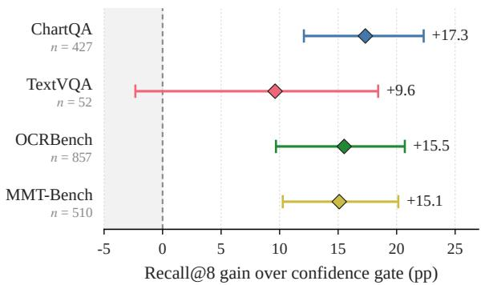  
Figure 7: Fusion gains over confidence gating on Qwen replay states with source disagreement. Points show Recall@8 differences; bars give 95% confidence intervals from 2,000 paired image-cluster bootstrap resamples. The dashed line marks zero gain, and n is the number of disagreement states.

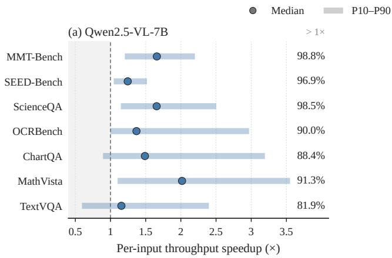

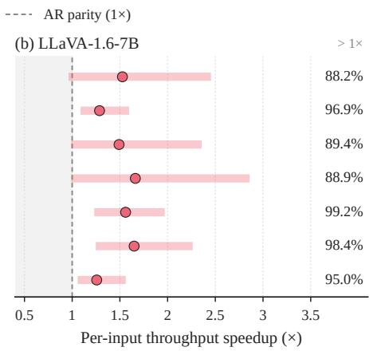

Figure 8: Per-input throughput speedup on the seven single-turn benchmarks (1,000 inputs per model and benchmark). Points mark medians and segments span P10–P90 of the input-level ratios. Dashed lines mark parity with AR; the percentages report inputs with strictly higher throughput than paired AR.
<table><tr><td>Dataset</td><td>States</td><td>RECAP</td><td>Confidence gate</td><td>Difference</td><td>95% CI</td></tr><tr><td>ChartQA</td><td>427</td><td>84.31</td><td>66.98</td><td>+17.33</td><td>[12.08, 22.31]</td></tr><tr><td>TextVQA</td><td>52</td><td>75.00</td><td>65.38</td><td>+9.62</td><td>[−2.33, 18.42]</td></tr><tr><td>OCRBench</td><td>857</td><td>62.43</td><td>46.91</td><td>+15.52</td><td>[9.69, 20.70]</td></tr><tr><td>MMT-Bench</td><td>510</td><td>77.65</td><td>62.55</td><td>+15.10</td><td>[10.27, 20.14]</td></tr></table>

Table 16: Recall@8 (%) on Qwen replay states with source disagreement. Differences and confidence intervals are in percentage points. Intervals use 2,000 paired image-cluster bootstrap resamples of the fixed evaluation set.

for Qwen and (0.688, 0.200, 0.112) for LLaVA, close to the prior (0.700, 0.200, 0.100). With two sources, the normalized prior is (0.778, 0.222), compared with observed means of (0.764, 0.236) and (0.763, 0.237). Thus confidence adjusts the allocation while preserving the average preference for specific sources. These averages describe aggregate weighting behavior; they do not imply small adjustments at every query.

## J Per-Input Runtime Distributions

MMSpec latency. Following MMSpec (Shen et al., 2026), we compare paired AR/RECAP generation times from Table 2. Input i contributes $\begin{array} { r } { T _ { i } ^ { ( m ) } \ = \ \sum _ { r = 1 } ^ { R _ { i } } t _ { i r } ^ { ( m ) } } \end{array}$ over $R _ { i }$ turns. Each $t _ { i r } ^ { ( m ) }$ includes prefill and decoding, excluding prompt preparation and output text decoding. All 600 inputs enter $\begin{array} { r } { \widehat { F } _ { m } ( t ) = N ^ { - 1 } \sum _ { i = 1 } ^ { N } \mathbf { 1 } [ T _ { i } ^ { ( m ) } \leq t ] } \end{array}$ without filtering.

RECAP lowers median and upper-tail latency (Figure 6; Table 15). Qwen/LLaVA P95 falls by 47.69%/42.17%, and 87.33%/97.83% of inputs are faster than paired AR.

Single-turn speedup. For each single-turn benchmark in Table 1, we summarize all 1,000 paired throughput ratios from Equation 9 without filtering (Figure 8; Table 18). These are empirical input-level percentiles, not uncertainty intervals. Median speedup exceeds one on every benchmark for both models, and 81.9–98.8% of Qwen inputs and 88.2–99.2% of LLaVA inputs have higher throughput than paired AR. The distributions nevertheless vary across tasks: Qwen reaches a median of 1.66× on MMT-Bench, with 98.8% of inputs benefiting, versus 1.15× and 81.9% on TextVQA. The latter also has a P10 of 0.59×, showing that positive average gains coexist with substantial slowdowns on some inputs.

<table><tr><td rowspan="2">Model</td><td rowspan="2">Dataset</td><td colspan="2">Two available sources</td><td colspan="2">Three available sources</td></tr><tr><td>Calls</td><td>Mean  $( w _ { 1 } , w _ { 2 } )$ </td><td>Calls</td><td>Mean  $( w _ { 1 } , w _ { 2 } , w _ { 3 } )$ </td></tr><tr><td>Qwen</td><td>ChartQA</td><td>15,101</td><td>(0.764, 0.236)</td><td>12,072</td><td>(0.697,0.197, 0.105)</td></tr><tr><td></td><td>TextVQA</td><td>12,689</td><td>(0.772, 0.228)</td><td>8,353</td><td>(0.700,0.197, 0.103)</td></tr><tr><td></td><td>OCRBench</td><td>20,883</td><td>(0.758, 0.242)</td><td>19,394</td><td>(0.693, 0.199, 0.108)</td></tr><tr><td></td><td>MMT-Bench</td><td>44,809</td><td>(0.765,0.235)</td><td>32,106</td><td>(0.689, 0.200, 0.110)</td></tr><tr><td></td><td>Pooled</td><td>93,482</td><td>(0.764, 0.236)</td><td>71,925</td><td>(0.693, 0.199, 0.108)</td></tr><tr><td>LLaVA</td><td>ChartQA</td><td>33,922</td><td>(0.764, 0.236)</td><td>20,304</td><td>(0.694, 0.198, 0.108)</td></tr><tr><td></td><td>TextVQA</td><td>17,023</td><td>(0.770, 0.230)</td><td>6,563</td><td>(0.700, 0.199, 0.102)</td></tr><tr><td></td><td>OCRBench</td><td>29,778</td><td>(0.759, 0.241)</td><td>32,512</td><td>(0.687, 0.200, 0.113)</td></tr><tr><td></td><td>MMT-Bench</td><td>44,589</td><td>(0.763,0.237)</td><td>36,050</td><td>(0.685,0.201, 0.115)</td></tr><tr><td></td><td>Pooled</td><td>125,312</td><td>(0.763,0.237)</td><td>95,429</td><td>(0.688, 0.200, 0.112)</td></tr></table>

Table 17: Mean normalized fusion weights in the online ablation, averaged over calls at all candidate-tree positions. Each model uses 200 inputs under two orders. Source indices denote specificity ranks among available rows. Single-source calls have weight one and are omitted.
<table><tr><td rowspan="2">Dataset</td><td colspan="4">Qwen</td><td colspan="4">LLaVA</td></tr><tr><td>P10</td><td>P50</td><td>P90</td><td> $r _ { i } > 1 ( \% )$ </td><td>P10</td><td>P50</td><td>P90</td><td> $r _ { i } > 1 ( \% )$ </td></tr><tr><td>MMT-Bench</td><td>1.20</td><td>1.66</td><td>2.20</td><td>98.8</td><td>0.96</td><td>1.53</td><td>2.46</td><td>88.2</td></tr><tr><td>SEED-Bench</td><td>1.05</td><td>1.24</td><td>1.52</td><td>96.9</td><td>1.09</td><td>1.29</td><td>1.60</td><td>96.9</td></tr><tr><td>ScienceQA</td><td>1.15</td><td>1.66</td><td>2.50</td><td>98.5</td><td>0.99</td><td>1.49</td><td>2.36</td><td>89.4</td></tr><tr><td>OCRBench</td><td>1.00</td><td>1.37</td><td>2.97</td><td>90.0</td><td>0.99</td><td>1.66</td><td>2.86</td><td>88.9</td></tr><tr><td>ChartQA</td><td>0.89</td><td>1.49</td><td>3.19</td><td>88.4</td><td>1.23</td><td>1.56</td><td>1.97</td><td>99.2</td></tr><tr><td>MathVista</td><td>1.10</td><td>2.02</td><td>3.55</td><td>91.3</td><td>1.25</td><td>1.65</td><td>2.26</td><td>98.4</td></tr><tr><td>TextVQA</td><td>0.59</td><td>1.15</td><td>2.40</td><td>81.9</td><td>1.06</td><td>1.26</td><td>1.56</td><td>95.0</td></tr></table>

Table 18: Distributions of paired throughput ratios for RECAP on the seven single-turn benchmarks (1,000 inputs per dataset and model). P10/P50/P90 report speedup factors; the final column for each model gives the percentage of inputs with strictly higher throughput than paired AR.