# Ray-Tracing-Based Dynamic Channel Sounding With Autoregressive Wi-Fi CSI Prediction

Lyutianyang Zhang, Member, IEEE, Yixin Ying, Liu Cao, Member, IEEE, Vanlin Sathya, Member, IEEE, Jinke Ren, Member, IEEE, and Shuguang Cui, Fellow, IEEE

Abstract—Channel sounding in Wi-Fi multiple-input multipleoutput (MIMO) systems must balance channel state information (CSI) accuracy against CSI acquisition overhead. Device mobility causes channel aging, while autoregressive CSI prediction introduces errors that accumulate over sounding intervals. However, standardized statistical channel models cannot fully capture the environment-specific channel dynamics encountered in physical artificial intelligence (AI) applications, motivating the use of Sionna-based ray tracing to evaluate CSI prediction under device mobility and evolving propagation geometry. This paper develops a dynamic sounding framework that integrates autoregressive CSI prediction with signal-to-interference-plusnoise ratio (SINR)-constrained interval selection. A Transformer with rotary position embedding that converts device positions into CSI sequences predicts CSI across multiple subcarriers for beamforming updates between sounding exchanges. We formulate sounding-interval selection as a predicted averagethroughput maximization problem under per-stream SINR lowerbound constraints, including CSI acquisition and processing overhead. A prediction-error perturbation analysis provides the SINR bounds, and cumulative-sum enumeration globally solves the finite single-variable problem. Actual SINR feasibility holds whenever the prediction errors satisfy the bounds. Ray-tracing experiments assess channel prediction, trajectory transfer, and autoregressive prediction errors. In single-STA Wi-Fi 7 link-level simulations, predicted-CSI beamforming improves mean goodput by 67.3%, 112.7%, and 119.1% over stale CSI for linear, circular, and cosine trajectories, respectively.

Index Terms—Channel sounding, channel prediction, ray tracing, Transformer, rotary position embedding, SINR-constrained control.

## I. INTRODUCTION

W I-FI 8, developed through IEEE 802.11bn [1], targets ultra-high reliability (UHR) under challenging network conditions [2]. Meanwhile, research toward a prospective Wi-Fi 9 generation explores a greater role for network intelligence. The formation of the IEEE 802.11 WLAN Intelligent Networking (WIN) study group and ongoing investigations of artificial intelligence (AI) and machine learning (AI/ML) within IEEE 802.11 reflect this direction [3], [4]. These developments motivate AI/ML models that anticipate changing radio conditions and support adaptive transmission decisions. However, prediction accuracy alone does not determine communication performance; it is necessary to investigate how to reduce the channel sounding overhead.

In Wi-Fi multiple-input multiple-output (MIMO) systems, an access point (AP) spatially multiplexes data streams over common time–frequency resources through transmit beamforming. In downlink multi-user MIMO (DL MU-MIMO), these streams can simultaneously serve multiple stations (STAs), i.e., mobile devices, provided that the precoders appropriately separate the intended transmissions. Accurate channel state information (CSI) is therefore essential for beamforming and interference suppression. However, STA mobility changes the propagation channels after sounding, creating a mismatch with the previously computed beamforming matrices. This mismatch can weaken the desired signals and introduce residual interference. More frequent sounding refreshes CSI but consumes training and feedback airtime [5], [6]. Moreover, the feedback burden depends on the number of spatial streams, subcarriers grouping, and etc., while the associated frame exchanges and interframe spaces for CSI acquisition further reduce airtime efficiency [7]. Thus, channel sounding-interval optimization must balance physical (PHY)-layer transmission quality against the medium access control (MAC)-layer airtime available for the transmitted data.

Channel prediction provides a means to alleviate this tradeoff by estimating future CSI from historical observations, allowing beamforming matrices to be updated between sounding exchanges. Classical prediction and channel-aging analyses characterize temporal channel variation and the consequences of delayed CSI [8], [9]. Angular-delay and propagation parameter methods exploit multipath structure [10], [11], whereas spatial-temporal predictors exploit correlations among channel coefficients [12] on one subcarrier in cellular networks based on perfect CSI feedback. In [13], a convolutional neural network and a convolutional long short-term memory are combined for single-step and multi-step channel prediction in high-speed railway networks. Spatial and temporal correlations are learned from propagation-graph-generated channel data, illustrating the value of incorporating propagation structure into prediction rather than treating channel coefficients as unrelated time series.

Transformer-based channel prediction uses attention to capture dependencies in historical CSI [14], while alternative architectures, such as LinFormer, further investigate prediction accuracy and computational efficiency [15]. Continuous-time, pretrained, and autoregressive approaches extend the temporal and representation choices available for CSI prediction [16]– [19]. As a related application, the large language model (LLM)-based method in [20] predicts future beam indices from historical beam indices and angles of departure. Such beam selection differs from predicting the complex channel matrices used here for singular value decomposition (SVD)- based precoding and evaluation of inter-stream interference. The comparison in [21] further examines neural-networkbased predictors over different prediction horizons, considering prediction quality and implementation complexity. These studies motivate learned prediction, but sounding control additionally requires relating the prediction horizon to transmission requirements and CSI acquisition overhead.

As more related work on Wi-Fi sounding, [22] investigates sounding-protocol design, while [23] implements the IEEE 802.11ax channel-sounding frame exchange in ns-3 and evaluates its overhead. The latter provides MAC-layer support for assessing CSI acquisition overhead, rather than a prediction-error-constrained sounding controller. In [24], a low-complexity dynamic sounding method adaptively adjusts the sounding interval in IEEE 802.11ac MU-MIMO networks using information obtained during operation. The impact of the explicit sounding period on Wi-Fi MU-MIMO performance is also investigated in [25], while feedback-rate selection addresses another component of CSI acquisition overhead [26]. These approaches establish the importance of sounding overhead and interval selection while our focus is determining how long the predicted CSI can support transmission when its errors affect individual spatial streams.

Learning-based CSI acquisition offers a complementary approach. DeepMux [27] combines AP-side learned channel sounding with resource allocation for joint MU-MIMO and orthogonal frequency-division multiple access (OFDMA) transmission in IEEE 802.11ax. It reconstructs frequencydomain CSI from feedback on a subset of tones and uses a neural network for resource-unit assignment, addressing both reporting overhead and resource allocation. In cellular massive MIMO, [28] uses a channel predictor at the base station and a lightweight predictor function at the user equipment to reduce feedback overhead without requiring a learned model. These works show that learned acquisition and prediction can reduce CSI-related costs, which motivate our investigation of the deployment of light Transformer at AP side for CSI prediction based on imperfect CSI with information compression and additional noise, so as to eliminate the energy consumption at the STA side while completely aligning with the IEEE channel sounding protocol.

Related cross-layer Wi-Fi studies investigate the joint coordinated-beamforming and cluster formation problem in WiFi 8 multi-AP Coordination scenario [29] and optimization toward multi-link operation in terms of low-latency [30] and AP–STA association and link allocation [31]. Our earlier work [7] specifically develops a hybrid model-driven and data-driven sounding framework for IEEE 802.11be downlink MIMO CSI prediction on a single subcarrier. It combines MAC-layer sounding airtime with PHY-layer channel aging to optimize the average data rate, using IEEE 802.11be Task Group (TGbe) channels and a first-order autoregressive, AR(1), aging model. An encoder–decoder Transformer predicts future beamforming information from historical partial CSI feedback, with interpolation providing finer-grained beamforming updates.

In summary, the proposed framework in this paper considers motion-dependent ray-traced channels and autoregressive CSI prediction. The prediction horizon depends on both of the CSI and geometry rather than a general IEEE 802.11 channel model with certain statistical channel-aging coefficients. Since Sionna ray tracing (RT) connects specified STA trajectories to multipath channel realizations [32]–[34], one can accurately verify the CSI prediction performance. In our framework, Sionna RT supplies the training and evaluation channels, while the learned predictor estimates future CSI from historical CSI, with causal receiver-position information as an optional input. Then the prediction performance is evaluated through IEEE 802.11bn link-level simulation. Unlike prior work [7] with one-step single prediction on a single subcarrier, this paper takes a more ambitious approach to investigate the autoregressive multi-subcarrier CSI prediction in WiFi MIMO systems with mobile WiFi clients based on the compressed Wi-Fi beamforming feedback simulated through Sionna RT. The dynamic channel sounding interval is also optimized under signal-to-interference- plus-noise ratio (SINR) bound for quality of service (QoS) guarantee. The distinction to our earlier work [7] is therefore not only the channel generator and prediction manner, but also the explicit connection between channel-prediction error and feasible transmission over the selected sounding interval. Despite the advantages of the proposed channel sounding architecture, we have encountered multiple challenges. First, autoregressive CSI prediction is likely to introduce cumulative prediction error; therefore per-stream SINR must be formulated and controlled by the optimized channel sounding interval. Second, theoretically speaking, the autoregressive CSI prediction must combine the positional information and the CSI to achieve higher prediction performance. Third, the throughput objective must strike the balance between the CSI prediction performance and the prediction overhead. To this end, we make the following contributions.

1) We develop an autoregressive CSI prediction framework combining ray-traced channels, temporal rotary position embedding (RoPE) [35], and Huber-loss training. The predicted complex channel coefficients support beamforming updates between sounding exchanges, with optional spatial encoding from causal position information.

2) We derive a per-stream SINR lower bound for prediction-based SVD precoding and combining. This bound yields sufficient feasibility conditions for sounding-interval selection, which maximizes predicted average throughput while accounting for sounding and processing overhead. We prove that cumulative-sum enumeration solves the sounding-interval problem, with linear search complexity after CSI prediction and SINR evaluation. The selected interval satisfies the actual SINR constraints whenever the channel errors remain within their assumed bounds.

3) We evaluate channel prediction, transfer learning, autoregressive prediction error, and single-STA goodput with ground-truth, autoregressive prediction, and stale CSI. Predicted-CSI beamforming improves mean goodput and DL rate adaptation on all three evaluated trajectories, while error accumulation in autoregressive prediction and occasional performance reversals support a finite prediction horizon.

The remainder of this paper is organized as follows. Section II presents the channel and sounding models. Section III develops the predictor, sounding-interval optimization, and complexity analysis. Section IV evaluates CSI prediction and link performance, and Section V concludes this paper. Proofs are provided in the supplemental appendices.

Notation: Italic letters denote scalars, bold lowercase and uppercase letters denote vectors and matrices, respectively, and bold calligraphic letters denote channel tensors. Other calligraphic symbols represent sets and quantities defined locally. The sets of real and complex numbers are denoted by R and $\mathbb { C } ,$ respectively. We use $\mathbb { R } ^ { + } ~ = ~ \left[ 0 , \infty \right)$ , with ${ \mathrm { j } } = { \sqrt { - 1 } }$ . Superscripts $( \cdot ) ^ { \dag } , ( \cdot ) ^ { \mathsf { H } }$ , and $( \cdot ) ^ { * }$ denote transpose, Hermitian transpose, and complex conjugation, respectively. The operators $\operatorname { R e } \{ \cdot \}$ and Im{·} extract the real and imaginary parts. For a matrix A, $\mathbf { A } ( i , : ) , \mathbf { A } ( : , j )$ , and $[ \mathbf { A } ] _ { i , j }$ denote its ith row, jth column, and (i, j)th entry, respectively. The matrix $\mathbf { I } _ { d }$ is the $d \times d$ identity matrix. The notation | · | denotes scalar magnitude or set cardinality, according to its argument. The norm $\Vert \cdot \Vert _ { \mathrm { F } }$ denotes the Frobenius norm, whereas $\| \cdot \| _ { 2 }$ denotes the Euclidean norm for vectors and the spectral norm for matrices. We write $\mathbb { E } [ \cdot ]$ for expectation, $[ x ] _ { + } = \operatorname* { m a x } \{ x , 0 \}$ , and ⌈x⌉ for the smallest integer no less than $x .$ The Kronecker delta $\delta _ { a , b }$ equals one when $a = b$ and zero otherwise. The indicator $\mathbf { 1 } \{ A \}$ equals one when event $A$ occurs and zero otherwise. Hats denote predicted or estimated quantities, including trained model parameters.

## II. SYSTEM MODEL

This section models MIMO transmission over time-varying channels and quantifies the throughput cost of channel sounding and processing overhead.

## A. Time-Varying MIMO Channel

An AP with $N _ { \mathrm { t } }$ antennas communicates with a mobile STA with $N _ { \mathrm { r } }$ receive antennas over $N _ { \mathrm { s } } ~ \in ~ \mathbb { Z } ^ { + + }$ spatial streams, where $1 ~ \le ~ N _ { \mathrm { s } } ~ \le ~ \operatorname* { m i n } \{ N _ { \mathrm { t } } , N _ { \mathrm { r } } \}$ . For each sounding cycle, we use the local time index $j ,$ with $j = 0$ at the start of sounding. Let $T _ { \mathrm { s } }$ be the slot duration and channel-sampling interval in seconds. At time index $j ,$ , let $\mathbf { r } [ j ] \in \mathbb { R } ^ { 3 }$ denote the STA position and $\mathbf { H } _ { q } [ j ] \in \mathbb { C } ^ { N _ { \mathrm { r } } \times N _ { \mathrm { t } } }$ denote its MIMO channel on subcarrier $q .$ . The indices $i = 1 , \ldots , N _ { \mathrm { s } }$ and $q = 1 , \ldots , N _ { \mathrm { s c } }$ denote streams and subcarriers, respectively. Let $h _ { q } ^ { ( u , v ) } [ j ] \in \mathbb { C }$ be the coefficient from transmit antenna $v = 1 , \ldots , N _ { \mathrm { t } }$ to receive antenna $u = 1 , \ldots , N _ { \mathrm { r } }$ . The channel tensor $\varkappa [ j ] \in$ $\mathbb { C } ^ { N _ { \mathrm { { s c } } } \times N _ { \mathrm { { r } } } \times N _ { \mathrm { { t } } } }$

In Fig. 1, $a \in \mathbb { C }$ is a path coefficient and τ is its propagation delay in seconds. Reflecting materials have relative permittivity $\varepsilon _ { r } ,$ , conductivity $\sigma ,$ , and thickness $d \geq 0$ in meters. Let M denote the collection of these parameters, which determine the reflection response together with incidence angle and polarization. Path geometry determines the propagation delay [33], [34].

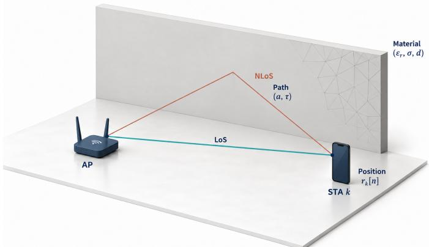  
Fig. 1. Ray-tracing geometry and the material, path, and position variables used in the channel model.

Let $\mathcal { P } [ j ]$ be the propagation-path set at local time $j T _ { \mathrm { s } }$ . For $\ell \in \mathcal { P } [ j ]$ and antenna pair $( u , v )$ , let $\tau _ { \ell } ^ { ( u , v ) } [ j ] \geq \bar { 0 }$ be the geometric propagation delay in seconds. Let $f _ { \mathrm { c } }$ and $\Delta f >$ 0 be the carrier frequency and subcarrier spacing in hertz. Define $\nu _ { q } = ( q - \lfloor N _ { \mathrm { s c } } / 2 \rfloor ) \Delta f$ and $f _ { q } = f _ { \mathrm { c } } + \nu _ { q }$ . When at least one valid path exists, let $\tau _ { \mathrm { m i n } } [ j ]$ be the earliest valid delay and define $\bar { \tau } _ { \ell } ^ { ( u , v ) } [ j ] = \tau _ { \ell } ^ { ( u , v ) } [ j ] - \tau _ { \mathrm { m i n } } [ j ] \geq 0$ . Define $a _ { \ell } ^ { ( u , v ) } [ j ] ( \mathcal { M } ) \in \mathbb { C }$ as the raw passband path coefficient before applying the propagation-delay phase. It includes propagation loss and material/polarization response, but excludes the delay phase applied below. A coefficient is zero if the path does not connect the antenna pair. Then

$$
\begin{array} { r } { \mathbf { H } _ { q } [ j ] = [ h _ { q } ^ { ( u , v ) } [ j ] ] _ { u , v } , } \end{array}\tag{1}
$$

where

$$
h _ { q } ^ { ( u , v ) } [ j ] = \sum _ { \ell \in \mathcal { P } [ j ] } a _ { \ell } ^ { ( u , v ) } [ j ] ( \mathcal { M } ) e ^ { - \mathrm { j } 2 \pi ( f _ { \mathrm { c } } + \nu _ { q } ) \bar { \tau } _ { \ell } ^ { ( u , v ) } [ j ] } .
$$

Equivalently, the baseband coefficient $\begin{array} { r l } { b _ { \ell } ^ { ( u , v ) } [ j ] } & { { } = } \end{array}$ $a _ { \ell } ^ { ( u , v ) } [ j ] ( \mathcal { M } ) e ^ { - \mathrm { j } 2 \pi f _ { \mathrm { c } } \bar { \tau } _ { \ell } ^ { ( u , v ) } [ j ] }$ gives the same response by applying only $e ^ { - \mathrm { j } 2 \pi \nu _ { q } \bar { \tau } _ { \ell } ^ { ( u , v ) } [ \bar { j } ] }$ to $b .$ Thus, the coefficients that contain carrier-delay phase must use the offsetfrequency expression. The delay reference and coefficient phase are transformed consistently. Channel energy is not normalized [36].

For individually traced antenna paths, the geometric antenna-pair delays supply the spatial propagation phase. For synthetic arrays, the alternative representation uses arraycenter path delays and the corresponding steering responses; the same spatial phase cannot be introduced through individual antenna-pair delays. Receive and transmit antennas index rows and columns, respectively. No rank-one assumption is imposed. If $\mathcal { P } [ j ]$ is empty, we set ${ \bf H } _ { q } [ j ] = { \bf 0 }$ without defining $\tau _ { \mathrm { m i n } } [ j ]$

Receiver motion changes path gains, delays, and visibility, altering channel coefficients and spatial subspaces. Path appearance or disappearance can cause abrupt changes. Define $\Delta \mathbf { H } _ { q } [ j ] = \mathbf { H } _ { q } [ j ] - \mathbf { H } _ { q } [ 0 ]$ as the variation from the current cycle’s zero-time channel. Prediction and error evaluation use the same channel phase convention. No temporal correlation model is imposed.

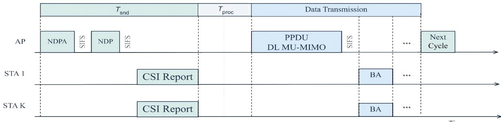  
Fig. 2. Frame exchange of channel sounding.

## B. MIMO Transmission and Channel Sounding

Let $\mathbf { V } _ { q } [ j ] ~ \in ~ \mathbb { C } ^ { N _ { \mathrm { t } } \times N _ { \mathrm { s } } }$ and $\mathbf { W } _ { q } [ j ] ~ \in ~ \mathbb { C } ^ { N _ { \mathrm { s } } \times N _ { \mathrm { r } } }$ denote the precoder and combiner at time index $j .$ The precoder includes the stream powers, with $\begin{array} { r l } { \mathbf { V } _ { q } ^ { \mathsf { H } } [ j ] \mathbf { V } _ { q } [ j ] } & { { } = } \end{array}$ $\mathrm { d i a g } ( p _ { q , 1 } [ j ] , \dots , p _ { q , N _ { \mathrm { s } } } [ j ] )$ , where $p _ { q , i } [ j ] > 0$ . Each combining row has a unit norm. Let $d _ { q , i } [ j ] \in \mathbb { C }$ denote the ith entry of $\mathbf { d } _ { q } [ j ] \in \mathbb { C } ^ { N _ { \mathrm { s } } }$ , transmitted on subcarrier $q$ at time index $j .$

The data streams are zero-mean and uncorrelated, with unit average symbol power: $\mathbb { E } [ d _ { q , i } [ j ] ] = 0$ and $\mathbb { E } [ d _ { q , i } [ j ] d _ { q , r } ^ { * } [ j ] ] =$ $\delta _ { i , r } .$ , where $r = 1 , \ldots , N _ { \mathrm { s } }$ . The Kronecker delta $\delta _ { a , b }$ equals one for $a = b$ and zero for $a \neq b .$ . Expectations are taken over data and noise with the channel and transceiver fixed. Let $\mathbf { x } _ { q } [ j ] \in$ $\mathbb { C } ^ { N _ { \mathrm { t } } }$ denote the transmitted signal vector, and let $\mathbf { y } _ { q } [ j ] \in \mathbb { C } ^ { N _ { \mathrm { r } } }$ denote the received signal vector at the STA. The noise ${ \bf n } _ { q } [ j ] \in$ $\mathbb { C } ^ { N _ { \mathrm { r } } }$ satisfies $\mathbf { n } _ { q } [ j ] \perp \perp \mathbf { d } _ { q } [ j ] , \mathbb { E } [ \mathbf { n } _ { q } [ j ] ] = \mathbf { 0 } , \mathbb { E } [ \mathbf { n } _ { q } [ j ] \mathbf { n } _ { q } ^ { \mathsf { H } } [ j ] ] =$ $\sigma _ { \mathrm { n } } ^ { 2 } \mathbf { I } _ { N _ { \mathrm { r } } }$ , where $\sigma _ { \mathrm { n } } ^ { 2 } > 0$ is the noise variance per receive antenna. The transmitted and received signal vectors are

$$
\mathbf { x } _ { q } [ j ] = \mathbf { V } _ { q } [ j ] \mathbf { d } _ { q } [ j ] ,\tag{2}
$$

$$
\mathbf { y } _ { q } [ j ] = \mathbf { H } _ { q } [ j ] \mathbf { x } _ { q } [ j ] + \mathbf { n } _ { q } [ j ] .\tag{3}
$$

Let $\widetilde { \mathbf { y } } _ { q } [ j ] ~ = ~ \mathbf { W } _ { q } [ j ] \mathbf { y } _ { q } [ j ] ~ \in ~ \mathbb { C } ^ { N _ { \mathrm { s } } }$ denote the combined signal vector, and let $\widehat { \mathbf { n } } _ { q } [ j ] = \mathbf { W } _ { q } [ j ] \mathbf { n } _ { q } [ j ] \in \mathbb { C } ^ { N _ { \mathrm { s } } }$ denote the combined noise vector. Substituting (2) into (3) gives

$$
\widetilde { \mathbf { y } } _ { q } [ j ] = \mathbf { W } _ { q } [ j ] \mathbf { H } _ { q } [ j ] \mathbf { V } _ { q } [ j ] \mathbf { d } _ { q } [ j ] + \widetilde { \mathbf { n } } _ { q } [ j ] .\tag{4}
$$

Let $P _ { q } > 0$ denote the transmit-power budget on subcarrier q. The unit-power, uncorrelated data streams give $\mathbb { E } \| \mathbf { x } _ { q } [ j ] \| _ { 2 } ^ { 2 } =$ $\begin{array} { r } { \| \mathbf { V } _ { q } [ j ] \| _ { \mathrm { F } } ^ { 2 } = \sum _ { r = 1 } ^ { N _ { \mathrm { s } } } p _ { q , r } [ j ] \le P _ { q } } \end{array}$ . Let $y _ { q , i } [ j ]$ and $\widetilde { n } _ { q , i } [ j ] \in \mathbb { C }$ denote the ith entries of $\widetilde { \mathbf { y } } _ { q } [ j ]$ and $\widetilde { \mathbf { n } } _ { q } [ j ]$ , respectively. The $( i , r ) \mathrm { t h }$ entry of $\mathbf { W } _ { q } [ j ] \mathbf { H } _ { q } [ j ] \dot { \mathbf { V } } _ { q } [ j ]$ gives the coupling from the transmitted stream r to received stream i. Expanding (4) yields

$$
\begin{array} { l } { { \displaystyle y _ { q , i } [ j ] = [ { \bf W } _ { q } [ j ] { \bf H } _ { q } [ j ] { \bf V } _ { q } [ j ] ] _ { i , i } d _ { q , i } [ j ] } \ ~ } \\ { { \displaystyle ~ + \sum _ { r = 1 \atop r \ne i } ^ { N _ { \mathrm { s } } } [ { \bf W } _ { q } [ j ] { \bf H } _ { q } [ j ] { \bf V } _ { q } [ j ] ] _ { i , r } d _ { q , r } [ j ] + \widetilde { n } _ { q , i } [ j ] } . } \end{array}\tag{5}
$$

The terms in (5) represent the desired signal, inter-stream interference, and noise, respectively. For $\breve { \mathbf { H } _ { \mathbf { \lambda } } } \in \bar { \mathbb { C } } ^ { N _ { \mathrm { r } } \times N _ { \mathbf { t } } }$ , define the interference power $\begin{array} { r } { I _ { q , i } \dot { [ \boldsymbol { j } ] } ( \mathbf { H } ) \dot { = } \sum _ { r = 1 \atop r \neq i } ^ { N _ { \mathrm { s } } } | [ \mathbf { W } _ { q } [ \boldsymbol { j } ] \mathbf { H } \mathbf { V } _ { q } [ \boldsymbol { j } ] ] _ { i , r } | ^ { 2 } \in } \end{array}$

$\mathbb { R } ^ { + }$ . Empty interference sums are zero. Unit-norm combining gives $\mathbb { E } [ | \tilde { n } _ { q , i } [ j ] | ^ { 2 } ] = \sigma _ { \mathrm { n } } ^ { 2 }$ . The per-stream SINR $\gamma _ { q , i } [ j ] ( \mathbf { H } ) \in$ R+ is

$$
\gamma _ { q , i } [ j ] ( \mathbf { H } ) = \frac { | [ \mathbf { W } _ { q } [ j ] \mathbf { H } \mathbf { V } _ { q } [ j ] ] _ { i , i } | ^ { 2 } } { \sigma _ { \mathrm { n } } ^ { 2 } + I _ { q , i } [ j ] ( \mathbf { H } ) } .\tag{6}
$$

The frame exchange of channel sounding in Fig. 2 acquires CSI through training and feedback [7]. Let $T _ { \mathrm { s n d } } > 0$ denote its total airtime in seconds, including frame overhead and interframe spaces. Let $\widetilde { \mathbf { H } } _ { q } [ 0 ] = \mathbf { H } _ { q } [ 0 ] + \mathbf { E } _ { q } ^ { \mathrm { o b s } } [ 0 ] \in \mathbb { C } ^ { N _ { \mathrm { r } } \times N _ { \mathrm { t } } }$ denote the sounded estimate referenced to the cycle-start channel. The estimate is available after channel sounding. The error $\mathbf { E } _ { q } ^ { \mathrm { o b s } } [ 0 ]$ includes CSI estimation, reporting, and acquisition-to-reference mismatch. This reference alignment is a modeling assumption. Let $T _ { \mathrm { p r o c } } \geq 0$ denote processing time in seconds. The cycle contains slots $t = 1 , \ldots , T$ , with slot t starting at local channel index $j = t - 1$ . Slots $1 , \ldots , T _ { 0 } - 1$ are reserved for sounding and processing and slots $T _ { 0 } , \ldots , T$ are used for carrying data. Thus the first data sample has local index $j ~ = ~ T _ { 0 } - 1$ . The sounding interval $T$ is the only optimization variable. Appendix A gives the overhead accounting.

Let $\mathbf { V } _ { q } ^ { 0 }$ and $\mathbf { W } _ { q } ^ { 0 }$ denote the precoding and combining matrices computed from the observed CSI $\widetilde { { \mathbf H } } _ { q } [ 0 ]$ and held fixed until the next sounding. The channel mismatch is $\mathbf { D } _ { q } [ j ] =$ $\mathbf { H } _ { q } [ j ] - \widetilde { \mathbf { H } } _ { q } [ 0 ] = \Delta \mathbf { H } _ { q } [ j ] - \mathbf { E } _ { q } ^ { \mathrm { o b s } } [ 0 ] \in \mathbb { C } ^ { N _ { \mathrm { r } } \times N _ { \mathrm { t } } }$ . Define $I _ { q , i } ^ { 0 } ( \mathbf { H } )$ as the interference by replacing $\mathbf { W } _ { q } [ j ]$ and $\mathbf { V } _ { q } [ j ]$ in $I _ { q , i } [ j ] ( \mathbf { H } )$ with $\mathbf { W } _ { q } ^ { 0 }$ and $\mathbf { V } _ { q } ^ { 0 } .$ , respectively. For ${ \bf H } = \bar { \bf H } _ { q } [ 0 ] + { \bf D } _ { q } [ j ]$ , (6) gives

$$
\gamma _ { q , i } ^ { \mathrm { s t a l e } } [ j ] = \frac { | [ \mathbf { W } _ { q } ^ { 0 } \mathbf { H } \mathbf { V } _ { q } ^ { 0 } ] _ { i , i } | ^ { 2 } } { \sigma _ { \mathrm { n } } ^ { 2 } + I _ { q , i } ^ { 0 } ( \mathbf { H } ) } .\tag{7}
$$

The mismatch adds $[ \mathbf { W } _ { q } ^ { 0 } \mathbf { D } _ { q } [ j ] \mathbf { V } _ { q } ^ { 0 } ] _ { i , r }$ to the coupling from stream r to stream i. It can reduce the desired gain and introduce inter-stream interference, lowering SINR and goodput. More frequent sounding limits this mismatch but leaves less airtime for data transmission.

## C. Throughput

For data slot t, let $\mathbf { H } _ { q , t } = \mathbf { H } _ { q } [ t - 1 ] \in \mathbb { C } ^ { N _ { \mathrm { r } } \times N _ { \mathrm { t } } }$ denote the channel matrix on subcarrier $q ,$ and $\gamma _ { q , i , t } ( \mathcal { H } ) \in \mathbb { R } ^ { + }$ denote the SINR of stream i, obtained from (6) using this slot’s channel, precoder, and combiner. Here $\mathcal { H } = \{ \mathbf { H } _ { q , t } : 0 \leq$ $q ~ < ~ N _ { \mathrm { s c } } , T _ { 0 } ~ \leq ~ t ~ \leq ~ T _ { \mathrm { m a x } } \}$ is the channel sequence over the prediction horizon. Slot t corresponds to predictor sample $j = t - 1$ ; the sampling index is not a control variable. Let $c _ { \mathrm { r } } > 0$ denote the fixed data-symbol rate including OFDM and packet overhead. Let $r [ t ] ( \mathcal { H } ) \in \mathbb { R } ^ { + }$ denote the throughput in slot t, and let $R ( T ; \mathcal { H } ) \in \mathbb { R } ^ { + }$ denote the average throughput over a sounding cycle, both in bit/s. They are given by

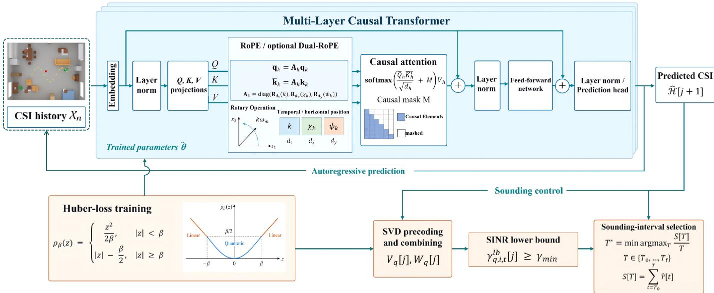  
Fig. 3. Autoregressive CSI prediction, Huber-loss training, and prediction-aided sounding control.

$$
\begin{array} { r l } & { r [ t ] ( \mathcal { H } ) = c _ { \mathrm { r } } \displaystyle \sum _ { q = 0 } ^ { N _ { \mathrm { s c } } - 1 } \sum _ { i = 1 } ^ { N _ { \mathrm { s } } } \log _ { 2 } \bigl ( 1 + \gamma _ { q , i , t } ( \mathcal { H } ) \bigr ) , } \\ & { R ( T ; \mathcal { H } ) = \displaystyle \frac { 1 } { T } \sum _ { t = T _ { 0 } } ^ { T } r [ t ] ( \mathcal { H } ) . } \end{array}\tag{8}
$$

(9)

The denominator T includes all cycle slots; the overhead slots contribute no transmitted data. The common slot duration therefore cancels when transmitted data are divided by cycle duration. These SINR-based throughput expressions do not include packet decoding or retransmissions.

## III. PREDICTION-AIDED SOUNDING FRAMEWORK

This section develops joint CSI prediction across subcarriers, formulates SINR-constrained sounding-interval optimization, and derives a globally optimal algorithm for the resulting finite problem.

## A. Autoregressive CSI Prediction

The information X, available after sounding, includes the L-snapshot channel history $\begin{array} { c c l } { { \pmb { { \cal B } } } } & { { = } } & { { \left( { \pmb { { \cal B } } } _ { 0 } , \ldots , { \pmb { { \cal B } } } _ { L - 1 } \right) } } \end{array}$ , where $\pmb { \mathcal { B } } _ { \ell } \in \dot { \mathbb { C } } ^ { N _ { \mathrm { s c } } \times N _ { \mathrm { r } } \times N _ { \mathrm { t } } }$ denotes the available CSI at time index $\ell = 0 , \dots , L - 1$ . Unobserved entries contain predictions, and the latest entry is the observed tensor $\mathcal { \widetilde { H } } [ 0 ] = \{ \widetilde { \mathbf { H } } _ { q } [ 0 ] \} _ { q }$ . Let $\widehat { \pmb { \mathscr { H } } } [ j ] = \{ \widehat { \bf H } _ { q } [ j ] \} _ { q }$ collect the per-subcarrier predictions conditioned on $\chi$ into a complex tensor in $\mathbb { C } ^ { N _ { \mathrm { { s c } } } \times N _ { \mathrm { { r } } } \times N _ { \mathrm { { t } } } }$ . The reference prediction is $\widehat { \pmb { \mathscr { H } } } [ 0 ] = \widetilde { \pmb { \mathscr { H } } } [ 0 ]$ . Let tok : $\mathbb { C } ^ { N _ { \mathrm { { s c } } } \times N _ { \mathrm { r } } \times N _ { \mathrm { t } } } $ $\mathbb { R } ^ { D _ { 0 } }$ denote the invertible map that concatenates the real channel coefficients followed by the imaginary coefficients, where $D _ { 0 } = 2 N _ { \mathrm { s c } } N _ { \mathrm { r } } N _ { \mathrm { t } }$ . Each token represents all selected subcarriers at one time step. The history CSI matrix $\textbf { X } \in$ $\mathbb { R } ^ { L \times D _ { 0 } }$ has entries $[ \mathbf { X } ] _ { \ell , c } = [ \mathrm { t o k } ( \pmb { \mathscr { B } } _ { \ell } ) ] _ { c } .$ , for $\ell = 0 , \ldots , L - 1$ and $c = 0 , \ldots , D _ { 0 } - 1$ . More generally, $\textbf { X } \in \ \mathbb { R } ^ { L _ { \mathrm { i n } } \times D _ { 0 } }$ contains $L _ { \mathrm { i n } }$ tokens, with row index $k ~ = ~ 0 , \ldots , L _ { \mathrm { i n } } - 1$ For fixed real offsets $\mu _ { c } \in \mathbb { R }$ and positive real scales $\lambda _ { c } > 0 , c = 0 , \ldots , D _ { 0 } - 1$ , define feature-wise normalization by $[ \mathcal { N } ( \mathbf { X } ) ] _ { k , c } ~ = ~ ( [ \mathbf { X } ] _ { k , c } - \mu _ { c } ) / \lambda _ { c }$ and its inverse by $[ \mathcal { N } ^ { - 1 } ( \mathbf { X } ) ] _ { k , c } = \lambda _ { c } [ \mathbf { X } ] _ { k , c } + \mu _ { c }$ . Let θ denote the real parameter vector of the causal Transformer. The predictor $\mathcal { F } _ { \theta }$ applies ${ \mathcal { N } } ,$ the Transformer, and $\mathcal { N } ^ { - 1 }$ , so its output is expressed in channel units.

Let $\textbf { P } \in \ \mathbb { R } ^ { L _ { \mathrm { i n } } \times 3 }$ denote the STA position. The spatial predictor returns $\mathcal { F } _ { \pmb { \theta } } ( \mathbf { X } ; \mathbf { P } ) \in \mathbb { R } ^ { L _ { \mathrm { i n } } \times D _ { 0 } }$ ; the temporal predictor omits P. Let $\mathbf { F } ^ { ( \ell ) } ~ \in ~ \mathbb { R } ^ { \lambda _ { \mathrm { i n } } \times d }$ denote the features at layer $\ell = 0 , \ldots , N _ { \ell } .$ . As presented in Fig. 3, the network has an embedding dimension $d , \ N _ { \ell }$ decoder layers, $N _ { \mathrm { h } }$ attention heads of even dimension $d _ { \mathrm { h } } ~ = ~ d / N _ { \mathrm { h } }$ , and a feed-forward network (FFN) of width $d _ { \mathrm { f } }$ with Gaussian error linear unit (GELU) activation [37]. The head and token indices are $h = 1 , \ldots , N _ { \mathrm { h } }$ and $k , k ^ { \prime } = 0 , \ldots , L _ { \mathrm { i n } } - 1$ . Embedding and reconstruction are

$$
\mathbf { F } ^ { ( 0 ) } = \mathcal { N } ( \mathbf { X } ) \mathbf { W } _ { \mathrm { i n } } + \mathbf { 1 } \mathbf { b } _ { \mathrm { i n } } ^ { \top } ,
$$

$$
\mathcal { F } _ { \boldsymbol { \theta } } ( \mathbf { X } ; \mathbf { P } ) = \mathcal { N } ^ { - 1 } \Big ( \mathrm { L N } ( \mathbf { F } ^ { ( N _ { \ell } ) } ) \mathbf { W } _ { \mathrm { o u t } } + \mathbf { 1 } \mathbf { b } _ { \mathrm { o u t } } ^ { \top } \Big ) ,\tag{10}
$$

(11)

where $\mathbf { W _ { \mathrm { i n } } } ~ \in ~ \mathbb { R } ^ { D _ { 0 } \times d }$ and $\mathbf { W _ { \mathrm { o u t } } } \in \mathbb { R } ^ { d \times D _ { 0 } }$ are learned projection matrices, $\mathbf { b } _ { \mathrm { i n } } \in \mathbb { R } ^ { d }$ and $\mathbf { b _ { \mathrm { o u t } } } \in \mathbb { R } ^ { D _ { 0 } }$ are learned biases, and 1 is the all-ones vector in $\mathbb { R } ^ { L _ { \mathrm { i n } } } . \mathrm { L N }$ denotes layer normalization across the features of each row. The embedding combines the frequency and MIMO channel coordinates; causal attention operates over time.

For a positive even integer d′ and $z \in \mathbb { R } .$ , let ${ \bf R } _ { d ^ { \prime } } ( z ) \in$ $\mathbb { R } ^ { d ^ { \prime } \times d ^ { \prime } }$ denote the block-diagonal matrix of two-dimensional rotations with angles $z \omega _ { m }$ , where $\omega _ { m } > 0 , m = 0 , \ldots , d ^ { \prime } / 2 -$ 1, are fixed rotary frequencies. Temporal rotary position embedding (RoPE) [35] uses the rotation matrix $\mathbf { A } _ { k } = \mathbf { R } _ { d _ { \mathrm { h } } } ( k ) \in$ $\mathbb { R } ^ { d _ { \mathrm { h } } \times d _ { \mathrm { h } } ^ { - } }$ at token k. At layer $\ell = 1 , \ldots , N _ { \ell }$ , let $\mathbf { F } = \ddot { \mathbf { F } } ^ { ( \ell - 1 ) }$ Head h affinely projects $\operatorname { L N } ( \mathbf { F } )$ into queries, keys, and values $\mathbf { Q } _ { h } , \mathbf { K } _ { h } , \mathbf { V } _ { h } \ \in \ \mathbb { R } ^ { L _ { \mathrm { i n } } \times d _ { \mathrm { h } } }$ , respectively. Let $\mathbf { q } _ { k } , \mathbf { k } _ { k } \ \in \ \mathbb { R } ^ { d _ { \mathrm { h } } }$ denote the transposed kth rows of $\mathbf Q _ { h }$ and ${ \bf K } _ { h }$ , respectively;

the encoding rotates $\mathbf { \overline { { q } } } _ { k } = \mathbf { A } _ { k } \mathbf { q } _ { k }$ and $\overline { { \mathbf { k } } } _ { k } = \mathbf { A } _ { k } \mathbf { k } _ { k }$ , leaving values unchanged. The identity $\mathbf { R } _ { d ^ { \prime } } ( z ) ^ { \mathsf { T } } \mathbf { R } _ { d ^ { \prime } } ( z ^ { \prime } ) = \mathbf { R } _ { d ^ { \prime } } ( z ^ { \prime } - z )$ gives

$$
\begin{array} { r } { \overline { { \mathbf { q } } } _ { k } ^ { \mathsf { T } } \overline { { \mathbf { k } } } _ { k ^ { \prime } } = \mathbf { q } _ { k } ^ { \mathsf { T } } \mathbf { R } _ { d _ { \mathrm { h } } } ( k ^ { \prime } - k ) \mathbf { k } _ { k ^ { \prime } } . } \end{array}\tag{12}
$$

The RoPE block in Fig. 3 encodes relative sample displacement through the rotated query–key product in (12). Dual-RoPE partitions each head into temporal and horizontal spatial components of positive even dimensions $d _ { \mathrm { t } } , d _ { \mathrm { x } } , d _ { \mathrm { y } }$ , with $d _ { \mathrm { t } } + d _ { \mathrm { x } } + d _ { \mathrm { y } } = d _ { \mathrm { h } }$ . For the spatial encoding, let $( x _ { k } , y _ { k } )$ be the first two coordinates of the kth row of P. A fixed reference origin $( x _ { \mathrm { r e f } } , y _ { \mathrm { r e f } } ) \in \mathbb { R } ^ { 2 }$ and length scale $\ell _ { \mathrm { r e f } } > 0$ both in meters, define the dimensionless real coordinates $\chi _ { k } = ( x _ { k } - x _ { \mathrm { r e f } } ) / \ell _ { \mathrm { r e f } }$ and $\psi _ { k } = ( y _ { k } - y _ { \mathrm { r e f } } ) / \ell _ { \mathrm { r e f } } .$ , giving ${ \bf A } _ { k } =$ dia $\mathrm { g } \big ( \mathbf { R } _ { d _ { \mathrm { t } } } ( k ) , \mathbf { R } _ { d _ { \mathrm { x } } } ( \chi _ { k } ) , \mathbf { R } _ { d _ { \mathrm { y } } } ( \psi _ { k } ) \big )$ . Let $\mathbf { q } _ { k , \alpha } , \mathbf { k } _ { k , \alpha } \in \mathbb { R } ^ { d _ { \alpha } }$ denote the query and key components in block $\alpha \in \{ \mathrm { t } , \mathrm { x } , \mathrm { y } \}$ Define the displacements $\Delta _ { \mathrm { t } } = k ^ { \prime } - k , \Delta _ { \mathrm { x } } = \chi _ { k ^ { \prime } } - \chi _ { k }$ , and $\Delta _ { \mathrm { y } } = \psi _ { k ^ { \prime } } - \psi _ { k }$ . The blockwise rotation identity yields

$$
\overline { { \mathbf { q } } } _ { k } ^ { \mathsf { T } } \overline { { \mathbf { k } } } _ { k ^ { \prime } } = \sum _ { \alpha \in \{ \mathrm { t } , \mathrm { x } , \mathrm { y } \} } \mathbf { q } _ { k , \alpha } ^ { \mathsf { T } } \mathbf { R } _ { d _ { \alpha } } ( \Delta _ { \alpha } ) \mathbf { k } _ { k ^ { \prime } , \alpha } .\tag{13}
$$

For fixed queries and keys, these scores depend on relative temporal and spatial displacement and are invariant to common coordinate shifts. The rotations preserve query and key norms. For either encoding, the rotated query and key matrices $\overline { { \mathbf { Q } } } _ { h } , \overline { { \mathbf { K } } } _ { h } \in \mathbb { R } ^ { L _ { \mathrm { i n } } \times \overline { { d _ { \mathrm { h } } } } }$ are obtained by stacking the rotated vectors as rows:

$$
\begin{array} { r } { \overline { { \mathbf { Q } } } _ { h } = \left[ \mathbf { A } _ { 0 } \mathbf { q } _ { 0 } , \ldots , \mathbf { A } _ { L _ { \mathrm { i n } } - 1 } \mathbf { q } _ { L _ { \mathrm { i n } } - 1 } \right] ^ { \mathsf { T } } , } \\ { \overline { { \mathbf { K } } } _ { h } = \left[ \mathbf { A } _ { 0 } \mathbf { k } _ { 0 } , \ldots , \mathbf { A } _ { L _ { \mathrm { i n } } - 1 } \mathbf { k } _ { L _ { \mathrm { i n } } - 1 } \right] ^ { \mathsf { T } } . } \end{array}
$$

Thus $[ \overline { { \mathbf { Q } } } _ { h } \overline { { \mathbf { K } } } _ { h } ^ { \mathsf { T } } ] _ { k , k ^ { \prime } } = \overline { { \mathbf { q } } } _ { k } ^ { \mathsf { T } } \overline { { \mathbf { k } } } _ { k ^ { \prime } }$ . The attention-head output ${ \mathbf O } _ { h } \in$ $\mathbb { R } ^ { L _ { \mathrm { i n } } \times \bar { d } _ { \mathrm { h } } }$ is

$$
\mathbf { O } _ { h } = \mathrm { s o f t m a x } \left( \frac { \overline { { \mathbf { Q } } } _ { h } \overline { { \mathbf { K } } } _ { h } ^ { \mathsf { T } } } { \sqrt { d _ { \mathrm { h } } } } + \mathbf { M } \right) \mathbf { V } _ { h } ,\tag{14}
$$

where softmax is applied rowwise. The causal mask $\textbf { M } \in$ $\{ 0 , - \infty \} ^ { L _ { \mathrm { i n } } \times L _ { \mathrm { i n } } }$ satisfies $[ { \bf { M } } ] _ { k , k ^ { \prime } } = 0$ for $\begin{array} { l l l } { { k ^ { \prime } } } & { { \leq } } & { { k } } \end{array}$ , and $[ \mathbf { M } ] _ { k , k ^ { \prime } } = - \infty$ otherwise. The attention output $\mathbf { O } \in \mathbb { R } ^ { L _ { \mathrm { i n } } \times d }$ is the projected concatenation $\mathbf { O } = [ \mathbf { O } _ { 1 } | \cdot \cdot \cdot | \mathbf { O } _ { N _ { \mathrm { h } } } ] \mathbf { W } _ { \mathrm { O } }$ , where $\mathbf { W } _ { \mathrm { O } } \in \bar { \mathbb { R } ^ { d \times d } }$ is the learned output projection and the brackets concatenate the attention-head outputs. At inference, the intermediate and output feature matrices $\mathbf { F } ^ { \prime } , \mathbf { F } ^ { \mathrm { o u t } } \in \mathbb { R } ^ { L _ { \mathrm { i n } } \times d }$ are

$$
\mathbf { F } ^ { \prime } = \mathbf { F } + \mathbf { O } ,\tag{15}
$$

$$
\mathbf { F } ^ { \mathrm { o u t } } = \mathbf { F } ^ { \prime } + \mathrm { F F N } ( \mathrm { L N } ( \mathbf { F } ^ { \prime } ) ) .\tag{16}
$$

The layer output is ${ \bf F } ^ { \mathrm { o u t } } = { \bf F } ^ { ( \ell ) } , \ell = 1 , \dots , N _ { \ell }$ . The rowwise FFN applies learned affine maps $\mathbb { R } ^ { d } \ \to \ \mathbb { R } ^ { d _ { \mathrm { f f } } } \ \to \ \mathbb { R } ^ { d }$ , with GELU between them. The rowwise operations and mask restrict output row k to inputs $0 , \ldots , k$

For training window $w ,$ let $\mathbf { X } _ { w } \in \mathbb { R } ^ { L _ { \mathrm { { i n } } } \times D _ { 0 } }$ contain L historical joint-channel tokens followed by the first $N _ { \mathrm { t a r } } { - } 1$ target tokens, where $L _ { \mathrm { i n } } = L + N _ { \mathrm { t a r } } - 1$ . Let $\mathbf { P } _ { w } \in \mathbb { R } ^ { L _ { \mathrm { i n } } \times 3 }$ contain the paired STA positions for the spatial variant. The predictedtoken matrix is $\widehat { \mathbf Y } _ { w } = \mathcal { F } _ { \pmb \theta } ( \mathbf { X } _ { w } ; \mathbf { \bar { P } } _ { w } ) \in \mathbb { R } ^ { L _ { \mathrm { i n } } \times D _ { 0 } }$ , with $\mathbf { P } _ { w }$ omitted for temporal RoPE. Let $\mathbf { y } _ { w , r } \in \mathbb { R } ^ { D _ { 0 } }$ denote target r in window w. Its prediction satisfies $\widehat { y } _ { w , r , c } = [ \widehat { \mathbf { Y } } _ { w } ] _ { L + r - 2 , c } ,$ for $r ~ = ~ 1 , \ldots , N _ { \mathrm { t a r } }$ and $c ~ = ~ 0 , \ldots , D _ { 0 } - 1$ . Causality restricts the prediction of target r to the history and its $r \mathrm { ~ - ~ } 1$ preceding targets. For $M _ { \mathrm { t r } }$ training windows, define $z _ { w , r , c } = y _ { w , r , c } - \widehat { y } _ { w , r , c } \in \mathbb { R }$ . The Huber-loss branch in Fig. 3 uses the empirical objective $\mathcal { L } ( \pmb { \theta } ) \in \mathbb { R } ^ { + }$

$$
\begin{array} { r } { \displaystyle \sum _ { \mathcal { C } ( \pmb { \theta } ) = \frac { w = 1 } { r = 1 } } ^ { { M _ { \mathrm { t r } } } } \sum _ { c = 1 } ^ { { N _ { \mathrm { t a r } } } } \sum _ { c = 0 } ^ { D _ { 0 } - 1 } \rho _ { \beta } ( z _ { w , r , c } ) } \\ { \displaystyle \mathcal { L } ( \pmb { \theta } ) = \frac { w = 1 } { r } r \frac { 1 } { { M _ { \mathrm { t r } } } { N _ { \mathrm { t a r } } } { D _ { 0 } } } . } \end{array}\tag{17}
$$

The scaled Huber loss weight $\rho _ { \beta } : \mathbb { R } \to \mathbb { R } ^ { + } \ [ 3 8 ]$ is $\rho _ { \beta } ( z ) =$ $z ^ { 2 } / ( 2 \beta )$ when $| z | < \beta$ and $| z | - \beta / 2$ otherwise, where $\beta >$ 0. Mean square error (MSE) variants use $\rho ( z ) ~ = ~ z ^ { 2 }$ . The Huber derivative $\rho _ { \beta } ^ { \prime } ( z ) = \mathrm { s g n } ( z ) \operatorname* { m i n } \{ | z | / \beta , 1 \}$ is bounded in magnitude by one. Let $\widehat { \pmb { \theta } }$ denote the trained parameter vector. This does not imply a deterministic bound on autoregressive prediction error. The objective is nonconvex in θ.

Between soundings, the predictor appends each CSI prediction to the L-snapshot history. Let $\begin{array} { l c l } { { \displaystyle B ^ { ( 0 ) } } } & { { = } } & { { B } } \end{array}$ and set $L _ { \mathrm { i n } } ~ = ~ L$ . For the spatial predictor, $\mathbf { P } ^ { ( j ) } \in \mathbb { R } ^ { L \times 3 }$ contains the paired position history, initialized with the measured or previously predicted positions in X . Let $f _ { \widehat { \pmb { \theta } } }$ apply $\mathcal { F } _ { \widehat { \pmb { \theta } } }$ once to the tokenized joint-channel history and reconstruct the last output with the inverse mapping $\mathrm { { t o k } ^ { \overline { { - 1 } } } }$ . The resulting channel tensor is

$$
\begin{array} { r } { \pmb { \widehat { \mathcal { H } } } [ j + 1 ] = f _ { \widehat { \theta } } ( \mathcal { B } ^ { ( j ) } ; \mathbf { P } ^ { ( j ) } ) \in \mathbb { C } ^ { N _ { \mathrm { s c } } \times N _ { \mathrm { r } } \times N _ { \mathrm { t } } } , } \end{array}\tag{18}
$$

with $\mathbf { P } ^ { ( j ) }$ omitted for temporal RoPE. The feedback path in Fig. 3 appends this tensor to the history and discards its oldest entry, yielding $B ^ { ( j + 1 ) }$ . Each step advances by $T _ { \mathrm { s } } ,$ producing the sequence used by all candidate intervals. The rollout includes the overhead period and the first data forecast is $\widehat { \pmb { \mathscr { H } } } [ T _ { 0 } - 1 ]$

For the causal spatial extension, let $ { \widetilde { \mathbf { r } } } _ { 1 } ,  { \widetilde { \mathbf { r } } } _ { 2 } \in  { \mathbb { R } } ^ { 3 }$ denote the latest two measured STA positions, acquired at local time indices $t _ { 1 } ~ < ~ t _ { 2 } ~ = ~ 0$ , and available before controller processing. The estimated velocity vector, in meters per second, is $\widehat { \mathbf { v } } \ \stackrel { - } { = } \ ( \widetilde { \mathbf { r } } _ { 2 } - \widetilde { \mathbf { r } } _ { 1 } ) / ( t _ { 2 } - t _ { 1 } ) \ \stackrel { - } { \in } \ \mathbb { R } ^ { 3 }$ . The position prediction $\widehat { \mathbf { r } } [ j + 1 ] = \widetilde { \mathbf { r } } _ { 2 } + ( j + 1 ) T _ { \mathrm { s } } \widehat { \mathbf { v } } \in \mathbb { R } ^ { 3 }$ is appended to the position history, whose oldest entry is discarded, yielding $\mathbf { \widehat P } ^ { ( j + 1 ) }$ alongside the channel-history update. The error analysis uses the same position extrapolation, autoregressive history updates, and observation-error model.

## B. SINR Analysis and Problem Formulation

The predicted channels determine the precoders and combiners. The prediction error then changes the desired gain and introduces inter-stream interference. We derive a SINR lower bound to construct the sounding-interval constraints. The SVD of each predicted channel is

$$
\widehat { \mathbf { H } } _ { q } [ j ] = \mathbf { L } _ { q } [ j ] \widehat { \boldsymbol { \Sigma } } _ { q } [ j ] \mathbf { R } _ { q } ^ { \mathsf { H } } [ j ] .\tag{19}
$$

Here the complex matrices $ { \mathbf { L } } _ { q } [ j ]$ and ${ \bf R } _ { q } [ j ]$ have $N _ { \mathrm { r } }$ and $N _ { \mathrm { t } }$ rows, respectively, and min $\{ N _ { \mathrm { r } } , N _ { \mathrm { t } } \}$ orthonormal columns contain the left and right singular vectors, respectively. The real diagonal matrix $\widehat { \Sigma } _ { q } [ j ]$ contains the singular values $\widehat { s } _ { q , 1 } [ j ] \ \geq \ \cdot \cdot \ \geq \ \widehat { s } _ { q , \mathrm { m i n } \{ N _ { \mathrm { r } } , N _ { \mathrm { t } } \} } [ j ] \ \geq \ 0 .$ . For $i = 1 , \ldots , N _ { \mathrm { s } } ,$ the precoder and combiner are defined by $[ \mathbf { V } _ { q } [ j ] ] _ { v , i } \ =$ $\sqrt { p _ { q , i } [ j ] } [ { \bf R } _ { q } [ j ] ] _ { v , i }$ and $[ \mathbf { W } _ { q } [ j ] ] _ { i , u } = [ \mathbf { L } _ { q } [ j ] ] _ { u , i } ^ { * }$ . On the predicted channel, $\gamma _ { q , i } [ j ] ( \widehat { \mathbf { H } } _ { q } [ j ] ) = p _ { q , i } [ j ] \widehat { s } _ { q , i } ^ { 2 } [ j ] / \sigma _ { \mathrm { n } } ^ { 2 }$ . The actual channel may retain inter-stream interference and is evaluated using (6).

For subcarrier q and sample $j ,$ , let ${ \bf E } _ { q } [ j ] ~ = ~ { \bf H } _ { q } [ j ] ~ -$ $\widehat { \mathbf { H } } _ { q } [ j ] \ \in \ \mathbb { C } ^ { N _ { \mathrm { r } } \times N _ { \mathrm { t } } }$ denote the prediction error. $\mathbf { A } \mathbf { t } { \boldsymbol { \ j } } = \mathbf { \boldsymbol { \ 0 } } .$ $\mathbf { E } _ { q } [ 0 ] = - \mathbf { E } _ { q } ^ { \mathrm { o b s } } [ 0 ]$ . Let ${ \bf W } = { \bar { \bf W } } _ { q } [ j ] , { \bf V } = { \bf V } _ { q } [ j ] , { \bf E } = { \bf E } _ { q } [ j ]$ and $p _ { r } = p _ { q , r } [ j ]$ for fixed q and j. Let $g _ { i } = \sqrt { p _ { i } } \widehat { s } _ { q , i } [ j ] \in \mathbb { R } ^ { + }$ denote the predicted desired-signal amplitude and let $e _ { i , r } =$ $[ \mathbf { W E V } ] _ { i , r } \in \mathbb { C }$ denote the error in the coupling from stream r to stream i. The SVD diagonalizes the predicted channel, so the actual SINR $\gamma _ { i } = \gamma _ { q , i } [ j ] ( { \bf H } _ { q } [ j ] )$ is

$$
\gamma _ { i } = \frac { | g _ { i } + e _ { i , i } | ^ { 2 } } { \sigma _ { \mathrm { n } } ^ { 2 } + \sum _ { r = 1 \atop r \neq i } ^ { N _ { \mathrm { s } } } | e _ { i , r } | ^ { 2 } } .\tag{20}
$$

Let $\varepsilon _ { q } [ j ] \in \mathbb { R } ^ { + }$ denote a given error bound, $\| \mathbf { E } _ { q } [ j ] \| _ { \mathrm { F } } \leq \varepsilon _ { q } [ j ]$ abbreviated by $\varepsilon$ for the fixed $q$ and $j .$ . These bounds are fixed across candidate sounding intervals.

Theorem 1. $I f \| \mathbf { E } \| _ { \mathrm { F } } \leq \varepsilon ,$ , the SVD precoder and combiner satisfy

$$
\gamma _ { i } \geq \gamma _ { i } ^ { \mathrm { l b } } ( \varepsilon ) : = \frac { [ g _ { i } - \varepsilon \sqrt { p _ { i } } ] _ { + } ^ { 2 } } { \sigma _ { \mathrm { n } } ^ { 2 } + \varepsilon ^ { 2 } \sum _ { r = 1 } ^ { N _ { \mathrm { s } } } p _ { r } } .\tag{21}
$$

Proof. The proof is shown in Appendix B.

The bound accounts for both desired-signal loss and interstream interference. It provides a sufficient SINR condition and failure of the condition does not necessarily imply link failure on the actual channel.

Let $\widehat { \bf H } _ { q , t } \ = \ \widehat { \bf H } _ { q } [ t - 1 ]$ and $\widehat { \mathcal { H } } \ = \ \{ \widehat { \mathbf { H } } _ { q , t } \ : \ 0 \ \leq \ q \ <$ $N _ { \mathrm { s c } } , T _ { 0 } \ \leq \ t \ \leq \ \bar { T } _ { \mathrm { m a x } } \}$ denote the predicted channel and sequence in cycle-slot notation. Let $\widehat { \gamma } _ { q , i , t } = \gamma _ { q , i , t } ( \widehat { \mathcal { H } } ) \in \mathbb { R } ^ { + }$ denote the predicted SINR, and $\widehat { r } [ t ] = r [ t ] ( \widehat { \mathcal { H } } ) \in \mathbb { R } ^ { + }$ denote the predicted slot throughput in bit/s. The predicted average throughput is $\widehat { R } ( T ) = \bar { R ( T ; \mathcal { H } ) }$ . For data slot t, let $\gamma _ { q , i , t } ^ { \mathrm { l b } } \in \mathbb { R } ^ { + }$ represent the lower bound on the SINR evaluated at $\dot { \boldsymbol { j } } = t - 1$ With $\gamma _ { \mathrm { m i n } } ~ > ~ 0$ , the sounding-interval selection problem is formulated as

$$
( \mathcal { P } _ { 1 } ) \operatorname* { m a x } _ { \begin{array} { l } { T \in \{ T _ { 0 } , \ldots , T _ { \operatorname* { m a x } } \} } \end{array} } \frac { 1 } { T } \sum _ { t = T _ { 0 } } ^ { T } \widehat { r } [ t ]\tag{22a}
$$

$$
\mathrm { s . t . } \quad \gamma _ { q , i , t } ^ { \mathrm { l b } } \geq \gamma _ { \mathrm { m i n } } , \quad \forall q , i , t = T _ { 0 } , \ldots , T .\tag{22b}
$$

The objective is the predicted average throughput in (9); the constraints apply to $q = 0 , \ldots , N _ { \mathrm { s c } } - 1$ and $i = 1 , \ldots , N _ { \mathrm { s } }$ By Theorem 1, the constraints ensure actual SINR feasibility whenever the channel errors satisfy their bounds. If rank $\begin{array} { r } { \hat { \mathbf { \rho } } _ { \mathrm { i } } ( \widehat { \mathbf { H } } _ { q , t } ) < N _ { \mathrm { s } } , } \end{array}$ , a selected singular value and its SINR lower bound are zero, violating (22b). Hence, no separate predictedchannel rank constraint is required.

## C. Sounding-Interval Optimization

A failed SINR constraint excludes the possibility of including any further slot into the sounding interval. Thus, the feasible set of $\mathcal { P } _ { 1 }$ is empty or $\{ T _ { 0 } , \ldots , T _ { \mathrm { f } } \}$ , where $T _ { \mathrm { f } }$ is the last feasible endpoint when it exists. Let $\begin{array} { r } { S [ T ] = \sum _ { t = T _ { 0 } } ^ { T } \widehat { r } [ t ] } \end{array}$ with $S [ T _ { 0 } - 1 ] = 0$ , since slots $1 , \ldots , T _ { 0 } - 1$ are reserved for channel sounding and processing. The optimization objective can be expressed as the average data rate $S [ T ] / T$ . Consider the data rate degradation constraint

$$
\widehat { r } [ t + 1 ] \leq \widehat { r } [ t ] .\tag{23}
$$

A sufficient condition for (23) can be expressed directly using the predicted SINRs already computed from the channel, precoding, and combining matrices. Specifically, evaluating (6) on the predicted channel gives

$$
\widehat { \gamma } _ { q , i , t } = \frac { | [ \mathbf { W } _ { q } [ j ] \widehat { \mathbf { H } } _ { q , t } \mathbf { V } _ { q } [ j ] ] _ { i , i } | ^ { 2 } } { \sigma _ { \mathrm { n } } ^ { 2 } + I _ { q , i } [ j ] ( \widehat { \mathbf { H } } _ { q , t } ) } .
$$

If these predicted SINRs satisfy $\widehat { \gamma } _ { q , i , t + 1 } \leq \widehat { \gamma } _ { q , i , t } , \forall q ,$ i at every consecutive pair of feasible data slots, then (8) yields

$$
\widehat { r } [ t + 1 ] - \widehat { r } [ t ] = c _ { \mathrm { r } } \sum _ { q = 0 } ^ { N _ { \mathrm { s c } } - 1 } \sum _ { i = 1 } ^ { N _ { \mathrm { s } } } \log _ { 2 } \biggr ( \frac { 1 + \widehat { \gamma } _ { q , i , t + 1 } } { 1 + \widehat { \gamma } _ { q , i , t } } \biggr ) \leq 0 .\tag{24}
$$

The inequality holds because each ratio is at most one, so every logarithm is non-positive, and $c _ { \mathrm { r } } > 0$ . Thus, non-increasing predicted SINRs for all streams and subcarriers are sufficient for (23). This condition is not necessary, since increases in some stream rates may be outweighed by decreases in others. Algorithm 1 checks (23) on the feasible prediction sequence before binary search. The throughput increment can be defined as

$$
G ( T ) = T \hat { r } [ T + 1 ] - S [ T ] , \qquad T _ { 0 } \leq T < T _ { \mathrm { f } } .\tag{25}
$$

Theorem 2. Algorithm 1 returns the smallest globally optimal solution of $\mathcal { P } _ { 1 }$ in both branches, and returns 0 ifthefeasible set is empty. For a non-empty feasible set satisfying (23), $\widehat { R } ( T )$ is unimodal. Its smallest global maximizer is the first $T <$ $T _ { \mathrm { f } }$ with $G ( T ) \ \leq \ 0 ,$ , or $T _ { \mathrm { f } }$ if no such endpoint exists. Any non-zero output satisfies the actual SINR constraints whenever $\| \mathbf { E } _ { q } [ j ] \| _ { \mathrm { F } } \leq \varepsilon _ { q } [ j ]$ for all subcarriers and prediction samples.

Proof. The proof is shown in Appendix C.

Algorithm 1 uses binary search when (23) holds. For unrestricted prediction sequences, its alternative branch compares all feasible averages. The proposed framework uses autoregressive CSI predictions to select a sounding interval that maximizes predicted average throughput while accounting for sounding and processing overhead. SINR lower bounds convert prediction-error bounds into sufficient feasibility constraints, and Algorithm 1 globally solves $\mathcal { P } _ { 1 }$

Remark 1. For an L-token history, one prediction costs $C _ { \mathrm { s t e p } } = O ( L D _ { 0 } d + N _ { \ell } [ L d ^ { 2 } + L ^ { 2 } \dot { d } + L d d _ { \mathrm { f } } \bar { ] } )$ . Per-slot SVD costs $O ( N _ { \mathrm { s c } } N _ { \mathrm { r } } N _ { \mathrm { t } }$ t min $\{ N _ { \mathrm { r } } , N _ { \mathrm { t } } \} )$ , and SINR-bound evaluation costs $O ( N _ { \mathrm { s c } } N _ { \mathrm { s } } )$ by reusing the total stream power. For $N = T _ { \mathrm { f } } - T _ { 0 } + 1 \geq 1$ feasible intervals, cumulative sums and checking (23) cost $O ( N )$ . The subsequent search uses $O ( \log ( N + 1 ) )$ evaluations of G when (23) holds and $O ( N )$ objective evaluations otherwise. Thus, the scalar intervalselection complexity and cumulative-sum storage are both $O ( N )$ . Prediction, transceiver computation, and interval selection are included in the processing overhead.

Algorithm 1: Global Sounding-Interval Optimization   
Input: $\widehat { \mathcal { H } } , \{ p _ { q , i } [ j ] \} , \{ \varepsilon _ { q } [ j ] \} , T _ { 0 } , T _ { \mathrm { m a x } } , \gamma _ { \mathrm { m i n } }$   
Output: T∗   
1 $T _ { \mathrm { f } } \doteq T _ { 0 } - 1 ; S [ T _ { 0 } - 1 ]  0$   
2 for $t = T _ { 0 } , \ldots , { \dot { T } } _ { \mathrm { m a x } }$ do   
3 Evaluate (19), (21)   
4 if min $\mathsf { 1 } _ { q , i } \gamma _ { q , i _ { \lambda } t } ^ { \mathrm { 1 b } } < \gamma _ { \mathrm { m i n } }$ then break   
5 ${ \widehat { r } } [ t ] \gets r [ t ] ( { \widehat { \mathcal { H } } } )$   
6 $\begin{array} { r } { \dot { S [ t ] }  \dot { S [ t - 1 ] } + \widehat { r } [ t ] ; T _ { \mathrm { f } }  t } \end{array}$   
7 $\mathbf { f } \ T _ { \mathrm { f } } < T _ { 0 }$ then return 0   
8 if (23) fails then   
S[t]   
9 return min argmax   
$t { \in } \{ T _ { 0 } , . . . , T _ { \mathrm { f } } \}$ t   
10 $a \gets T _ { 0 } ; b \gets T _ { \mathrm { f } }$   
11 while $a < b$ do   
12 m $ \lfloor ( a + b ) / 2 \rfloor$   
13 if $G ( \bar { m } ) \leq 0$ then $b \gets m$   
14 else $a \gets m + 1$   
15 return a

## IV. SIMULATION RESULTS

In this section, the numerical study evaluates channel prediction, trajectory transfer, autoregressive prediction, and single-STA MIMO transmission. Link-level comparisons assess precoding, modulation and coding scheme (MCS) selection, and goodput under different CSI policies. Soundinginterval optimization performance is also analyzed in this section through simulation.

## A. Simulation Setup

The ray-tracing environment is a room containing concrete, wood, plasterboard, metal, and etc., in which a fixed AP serves a moving STA with various trajectories. At the stored snapshot $m ,$ , Sionna RT computes the MIMO channel matrix $\mathbf { H } _ { q } [ m ]$ from the scene geometry, material properties, and antenna configuration. Each CSI snapshot contains $2 4 2 \times 2 \times 8$ coefficients on the frequency grid defined in Section II, and the geometry is recomputed every $T _ { \mathrm { s } } = 0 . 1$ ms. For the per-step channel traces, the room includes a moving object; the spatial traces additionally include receiver coordinates. These settings are verified in Sionna RT 2.0.1 and the WLAN simulation is implemented with the aid of WLAN Toolbox Matlab on a Nvidia DGX Spark. Table I summarizes the configuration. The source trajectories are linear and circular, and the transferlearning target follows a cosine trajectory, as shown in Fig. 4. The link simulations evaluate all three trajectories.

The prediction models share $L = 6 0$ history samples and $N _ { \mathrm { t a r } } ~ = ~ 1 0$ training targets. Each token contains the 242 selected subcarriers of the 20-MHz channel, giving $D _ { 0 } \ =$ $2 \times 2 4 2 \times 2 \times 8 = 7 7 4 4$ . Each model has six decoder layers, embedding width $d = 1 2 8$ , eight attention heads of dimension $d _ { \mathrm { h } } = 1 6 $ , FFN width $d _ { \mathrm { f f } } \ = \ 5 1 2$ , and training dropout of 0.1. For each even-dimensional rotary component $d ^ { \prime } ,$ , the frequencies are $\omega _ { m } = 1 0 0 0 0 ^ { - 2 m / d ^ { \prime } } , m = 0 , \dots , d ^ { \prime } / 2 - 1$ The RoPE+Huber model utilizes the scaled Huber loss with

TABLE I  
RAY-TRACING AND EVALUATION CONFIGURATION
<table><tr><td>Parameter</td><td>Value</td></tr><tr><td>Room dimensions</td><td> $1 0 \times 1 0 \times 3 . 2 ~ m ^ { 3 }$ </td></tr><tr><td>AP position Carrier / bandwidth parameter</td><td>(5, 5, 3.15, 1.35) m</td></tr><tr><td></td><td>2.437 GHz / 20 MHz</td></tr><tr><td>Frequency samples / spacing Transmit / receive elements</td><td>242 / 78.125 kHz</td></tr><tr><td></td><td>8 / 2  $2 \mathrm { ~ / ~ 5 ~ } \times 1 0 ^ { 5 }$ </td></tr><tr><td>Maximum path depth / ray samples Channel-trace sampling interval</td><td>per source 0.1 ms</td></tr><tr><td>Circular radius / nominal speed</td><td>1.5 m / 2 m/s</td></tr><tr><td>Displayed subcarrier index</td><td>120</td></tr><tr><td>Channel samples / displayed duration</td><td>1000 /  100 ms</td></tr><tr><td>Source / target window start index</td><td>14500 /  23500</td></tr><tr><td>Delayed-CSI reference delay</td><td>10 samples (1 ms)</td></tr><tr><td>Autoregressive prediction length</td><td>30 steps</td></tr><tr><td>Linear / circular prediction start</td><td>800 / 28000</td></tr></table>

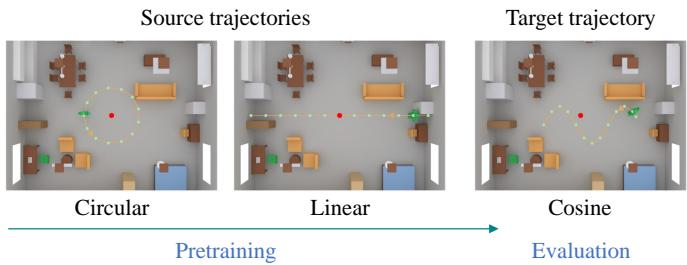  
Fig. 4. Linear and circular source trajectories and the cosine target trajectory in the simulation environment.

$\beta = 1 0 ^ { - 3 }$ for training:

$$
\rho _ { \beta } ( z ) = \left\{ \begin{array} { l l } { z ^ { 2 } , } & { | z | < \beta , } \\ { | z | - \displaystyle \frac { \beta } { 2 } , } & { | z | \geq \beta , } \end{array} \right.
$$

where $z \in \mathbb { R }$ denotes the prediction error of a channel feature after inverse normalization. The decoder-only and RoPE models are trained with MSE. The optional spatial extension allocates $( d _ { \mathrm { t } } , d _ { \mathrm { x } } , d _ { \mathrm { y } } ) = ( 8 , 4 , 4 )$ coordinates to the temporal and two spatial rotation blocks. The reported channel-domain comparisons use temporal RoPE. All models are trained with the Adam optimizer with a batch size of 8 prediction steps that contain 60 frames as input and 10 frames as groundtruth output. Each element in the input frames comprises both CSI and the positional information of STA at a certain time instant. In each epoch, the forward propagation evaluates the predictions and the loss $\mathcal { L } ( \pmb { \theta } )$ in (17) over the training set. Decoder-only, RoPE, and RoPE+Huber are each trained for 200 epochs with a learning rate $3 \times 1 0 ^ { - 5 }$ , and training from scratch on the cosine trajectory runs 50 epochs with a learning rate $3 \times 1 0 ^ { - 5 }$ . Transfer learning initializes all parameters from the pretrained RoPE+Huber model and first updates only the input projection $\mathbf { W } _ { \mathrm { i n } } , \mathbf { b } _ { \mathrm { i n } }$ and the prediction head $\mathbf { W } _ { \mathrm { o u t } } , \mathbf { b } _ { \mathrm { o u t } }$ in (10)–(11) for 15 epochs with a learning rate $1 0 ^ { - 4 }$ , with the decoder layers frozen, i.e., their attention and FFN parameters in (14)–(16) remain unchanged. Because the input projection and the prediction head connect the normalized CSI to the decoder layers, updating them adapts the model to the cosine trajectory, while the decoder layers keep their pretrained parameters unchanged. All parameters are then fine-tuned for 50 epochs with a learning rate $3 \times 1 0 ^ { - 5 }$ , so that transfer learning and training from scratch update all parameters for the same number of epochs.

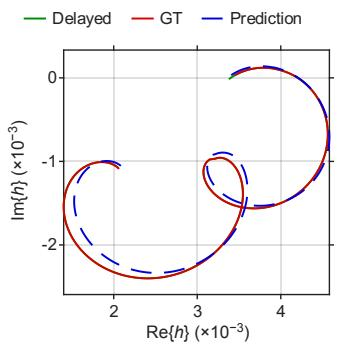  
(a) Decoder-only 1 for RX1/TX2

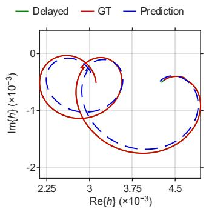  
(b) Decoder-only 2 for RX1/TX7

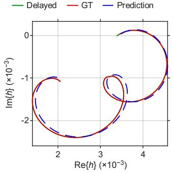

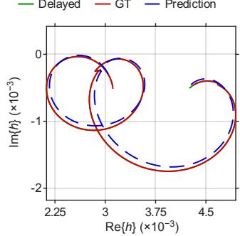  
(d) RoPE 1 for RX1/TX7

(c) RoPE 1 for RX1/TX2  
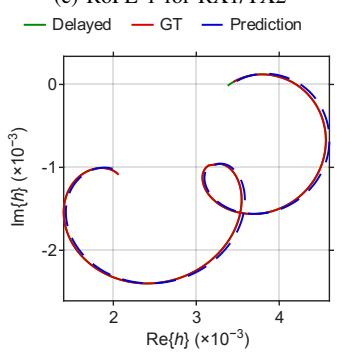  
(e) RoPE + Huber 1 for RX1/TX2

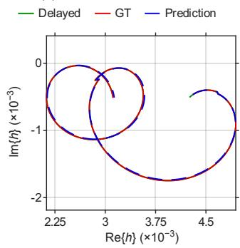  
(f) RoPE + Huber 2 for RX1/TX7

Fig. 5. Ground-truth and predicted CSI: (a)–(b) decoder-only; (c)–(d) RoPE; (e)–(f) RoPE+Huber.  
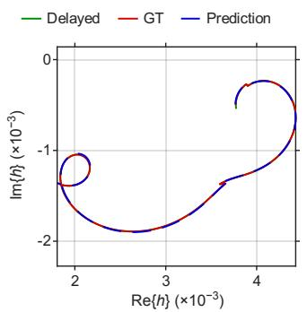

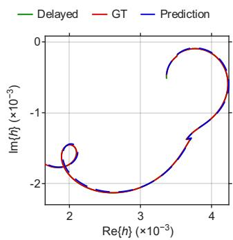  
Fig. 6. RoPE+Huber channel trajectories at RX0/TX1 and RX1/TX6.

Let $x _ { c } ^ { \mathrm { m i n } }$ and $x _ { c } ^ { \mathrm { m a x } }$ denote the minimum and maximum of the cth real or imaginary CSI component across all channel snapshots in the dataset. Different CSI components can have different numerical ranges across subcarriers and antenna pairs. Those ranges affect how the components enter the learned projections and influence parameter updates. Featurewise normalization gives the model a more consistent input scale, making optimization less sensitive to the raw CSI amplitudes. Hence, to place CSI components on comparable scales, min–max normalization $\mathcal { N }$ and its inverse are

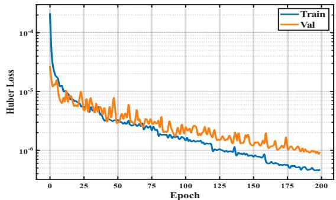  
Fig. 7. Training and validation Huber loss of the model trained on the datasets for linear and circular trajectories.

$$
\begin{array} { r } { [ \mathcal { N } ( \mathbf { X } ) ] _ { k , c } = \frac { [ \mathbf { X } ] _ { k , c } - \mu _ { c } } { \lambda _ { c } } , } \\ { [ \mathcal { N } ^ { - 1 } ( \mathbf { X } ) ] _ { k , c } = \lambda _ { c } [ \mathbf { X } ] _ { k , c } + \mu _ { c } , } \end{array}
$$

where $\mu _ { c } ~ = ~ x _ { c } ^ { \mathrm { m i n } }$ and $\lambda _ { c } ~ = ~ x _ { c } ^ { \operatorname* { m a x } } - x _ { c } ^ { \operatorname* { m i n } } + 1 0 ^ { - 8 }$ . Each prediction step consists of 70 frames, 60 historical frames as input tokens to the Transformer with 10 output frames that comprise 10 predicted CSI frames separated by 0.1 ms; that is, 1 ms of predicted CSI with 0.1 ms granularity. Linear, circular, and cosine trajectories are sorted by start time. The first 80% form the training set, and the remaining 20% form the validation set. For the pretrained models, $\mu _ { c }$ and $\lambda _ { c }$ are computed from all linear and circular frames, with the training and validation Huber losses shown in Fig. 7. The training and validation Huber losses decline steadily over the full 200 epochs and the loss curves remain stable in the later training stage, indicating that the pretrained model achieves good convergence and exhibits no significant overfitting. Training from scratch computes $\mu _ { c }$ and $\lambda _ { c }$ from all cosine frames, and transfer learning reuses them stored in the pretrained models.

## B. CSI Prediction Performance

Each comparison uses 1000 samples from all 16 antenna pairs. Decoder-only, RoPE, and RoPE+Huber are compared on a common source window. Zero-shot evaluation, training from scratch, and fine-tuning use a common cosine target window. The 100-ms traces concatenate one-step predictions obtained from updated ground-truth histories; autoregressive prediction is assessed separately over 30 steps. Let $\tau$ denote the 1000 evaluation indices and $\hat { \mathbf H } [ m ] \in \mathbb { C } ^ { \hat { N } _ { \mathrm { r } } \times N _ { \mathrm { t } } }$ denote the predicted channel matrix. For non-zero reference energy, the normalized MSE (NMSE) over all antenna pairs is

$$
\mathrm { N M S E } = \frac { \displaystyle \sum _ { m \in { \mathcal { T } } } \| \mathbf { H } [ m ] - \widehat { \mathbf { H } } [ m ] \| _ { \mathrm { F } } ^ { 2 } } { \displaystyle \sum _ { m \in { \mathcal { T } } } \| \mathbf { H } [ m ] \| _ { \mathrm { F } } ^ { 2 } } .\tag{26}
$$

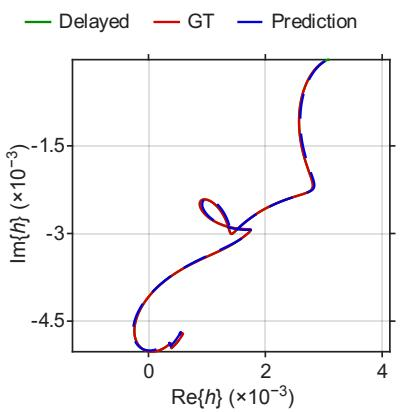  
(a) RX1/TX1

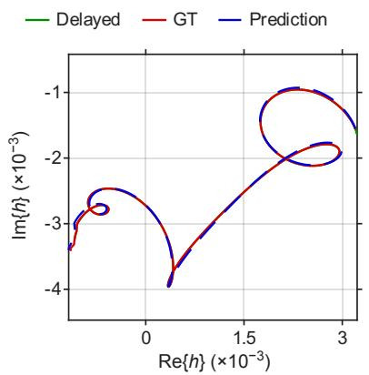  
(b) RX1/TX0

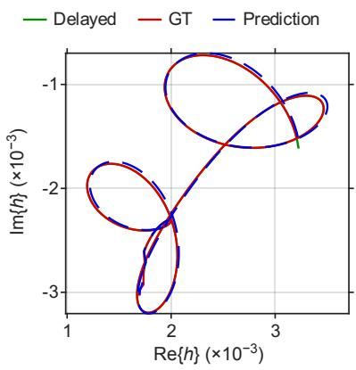  
(c) RX0/TX1

Fig. 8. Zero-shot channel prediction on the cosine trajectory.  
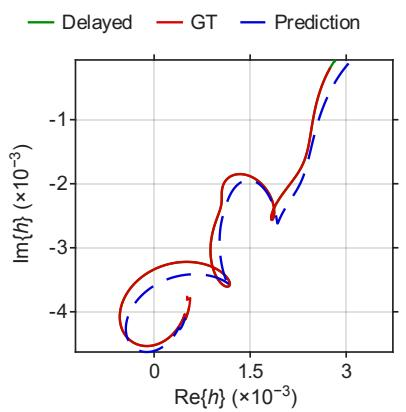  
(a) From scratch

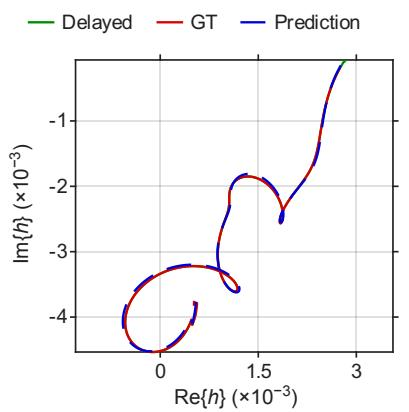  
(b) Zero-shot evaluation

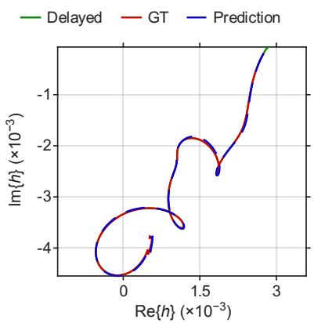  
(c) Transfer learning  
Fig. 9. Channel prediction for RX0/TX0 on the cosine target trajectory.

For each antenna pair, NMSE is computed from its groundtruth and predicted CSI. Figures 5–9 plot the ground-truth and predicted coefficients in the complex plane in the time domain. The delayed-CSI baseline uses $\widehat { \mathbf { H } } ^ { ( \mathrm { D e l a y e d } ) } [ m ] = \mathbf { H } [ m - 1 0 ]$ over the 990 overlapping samples, corresponding to a delay of $1 0 T _ { \mathrm { s } } = 1$ ms. The link-level stale policy holds the most recently sounded CSI until the next sounding update.

Figure 5 shows decoder-only in (a)–(b), RoPE in (c)–(d), and RoPE+Huber in (e)–(f). Their NMSE values across all 16 antenna pairs are $5 . 1 8 8 3 \times 1 0 ^ { - 4 }$ $4 . 1 0 2 4 \times 1 0 ^ { - 4 }$ , and $4 . 2 7 3 6 \times 1 0 ^ { - 5 }$ , respectively. The 1-ms delayed-CSI baseline has an NMSE of $4 . 3 2 3 3 \times 1 0 ^ { - 4 }$

RoPE+Huber achieves the lowest overall NMSE and outperforms the 1-ms delayed-CSI baseline on all 16 antenna pairs. RoPE and decoder-only outperform this baseline on 12 and 6 pairs, respectively. In Figure 5(e)–(f), the RoPE+Huber predictions closely follow the ground-truth. Figure 6 shows additional results for RX0/TX1 and RX1/TX6 in the left and right panels, respectively. This comparison evaluates the complete loss rather than the effect of Huber loss alone.

The cosine trajectory evaluates adaptation to a different motion pattern. Zero-shot prediction directly uses the model trained on linear and circular trajectories. Transfer learning fine-tunes this model using cosine-trajectory data, whereas training from scratch uses random initialization. Figure 8(a)– (c) show zero-shot predictions for RX1/TX1, RX1/TX0, and RX0/TX1, respectively. Across all 16 antenna pairs, the NMSE values are $1 . 2 7 2 1 \times 1 0 ^ { - 4 }$ for zero-shot prediction, 2.4279 × $1 0 ^ { - 3 }$ for training from scratch, and $7 . 8 6 1 7 \times 1 0 ^ { - 5 }$ for transfer learning, compared with $1 . 5 2 3 7 \times 1 0 ^ { - 3 }$ for the delayed-CSI baseline. Zero-shot prediction reduces the overall NMSE by 91.65% relative to the delayed CSI and achieves lower NMSE on every antenna pair. Transfer learning further reduces the overall NMSE by 38.20% relative to zero-shot prediction and by 96.76% relative to training from scratch. Figure 9(a)– (c) compare training from scratch, zero-shot prediction, and transfer learning for RX0/TX0. For this antenna pair, the corresponding NMSE values are $2 . 7 0 7 1 \times 1 0 ^ { - 3 } , 8 . 1 7 0 2 \times 1 0 ^ { - 5 }$ and $4 . 8 2 1 7 \times 1 0 ^ { - 5 }$ , respectively; the delayed-CSI baseline has an NMSE of $1 . 1 8 2 0 \times 1 0 ^ { - 3 }$

Figure 10 compares autoregressive prediction, prediction using updated ground-truth histories, and 1-ms delayed CSI for linear and circular motion. Autoregressive prediction feeds each prediction back into the history, whereas the updated method uses ground-truth CSI at every step. Over 30 steps, the plotted autoregressive NMSE increases from $1 . 1 6 2 5 \times 1 0 ^ { - 3 }$ to $1 . 3 2 4 2 \times 1 0 ^ { - 1 }$ for linear motion and from $3 . 9 4 1 5 \times 1 0 ^ { - 5 }$ to $4 . 0 5 6 0 \times 1 0 ^ { - 3 }$ for circular motion. With updated ground-truth histories, the final NMSE values remain at $1 . 5 5 6 2 \times 1 0 ^ { - 3 }$ and $4 . 3 7 4 1 \times 1 0 ^ { - 5 }$ , respectively. The widening gap between the two prediction methods illustrates error accumulation when predictions are repeatedly reused: at these steps, autoregressive prediction becomes less accurate than simply reusing 1-ms-old CSI, showing that the accumulated feedback error outweighs the benefit of the learned model and motivating a finite prediction horizon and renewed CSI acquisition.

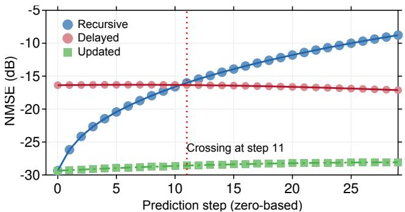

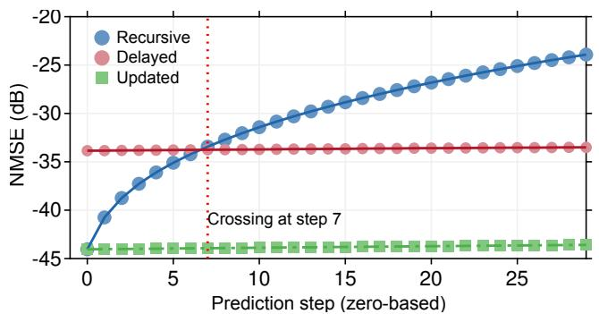  
Fig. 10. Autoregressive prediction residual NMSE for linear (top) and circular (bottom) motion. Updated represents the fresh ground-truth history. Delayed denotes the utilization of 1-ms-old CSI.

The growing gap between autoregressive and updatedhistory prediction illustrates the cost of repeatedly feeding estimates back into the model. An NMSE crossing can identify a loss of prediction advantage. It is noteworthy that the sounding decision may additionally depend on the per-stream SINR margin and the airtime required for a new CSI acquisition.

## C. Link-Level Goodput With Predicted CSI

The link-level experiments compare ground-truth CSI, predicted CSI, and stale CSI under the channel configuration in Table I. Ground-truth CSI uses the current channel, predicted CSI uses the channel prediction, and stale CSI retains the most recently sounded channel until the next update. All three methods transmit through the same ground-truth channel using two spatial streams and the same total transmit power. The selected CSI determines SVD precoding and combining, as well as MCS selection. The receiver estimates the CSI from noisy packet training.

For each method, goodput is calculated from the successfully delivered payload bits D and total service airtime A, measured in seconds: $G = D / A$ bits/s. Service airtime includes protocol overhead, failed transmission, and retransmission. Mean goodput is the arithmetic average of 100 values evaluated at 1-ms intervals. Figures 11–13 show the resulting goodput and transmit MCS.

For the linear trajectory in Figure 11, predicted CSI increases mean goodput from 61.25 Mb/s with stale CSI to

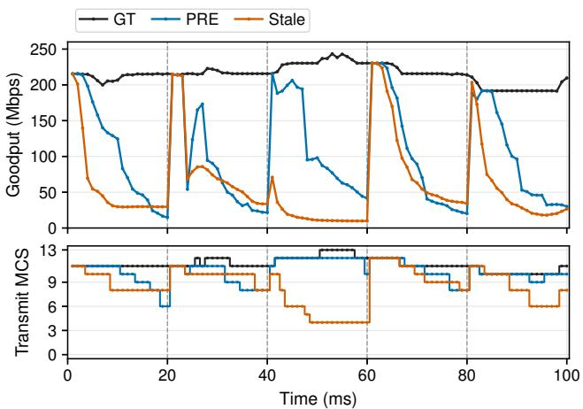  
Fig. 11. Goodput and transmit MCS for the linear trajectory.

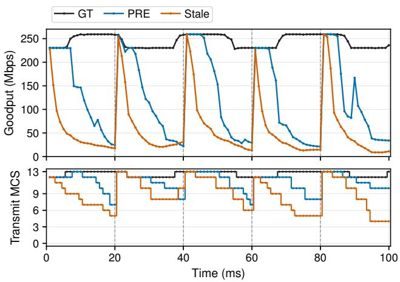  
Fig. 12. Goodput and transmit MCS for the circular trajectory.

102.47 Mb/s, with an improvement of 67.3%. Predicted CSI achieves higher goodput at 71 of the 100 evaluation points. Ground-truth CSI yields a mean goodput of 214.94 Mb/s.

For the circular trajectory in Figure 12, mean goodput increases from 58.12 to 123.64 Mb/s, with an improvement of 112.7%. This is the largest absolute gain among the three trajectories, at 65.52 Mb/s. Predicted CSI outperforms stale CSI at 97 of the 100 evaluation points, while ground-truth CSI achieves a mean goodput of 244.89 Mb/s.

For the cosine trajectory in Figure 13, mean goodput increases from 13.93 to 30.52 Mb/s, yielding the largest relative improvement of 119.1%. Despite this percentage gain, the absolute goodput remains below that of the linear and circular trajectories. Ground-truth CSI achieves a mean goodput of 202.67 Mb/s.

The benefit of prediction varies over time. Predicted CSI yields lower goodput than stale CSI during 31–40 and 72–81 ms for linear motion and 39–40 ms for circular motion. During 72–81 ms in the linear trajectory, its selected MCS is equal to or higher than that of stale CSI at eight of the ten evaluation points, yet its goodput is lower. A higher MCS therefore does not guarantee higher goodput: successful decoding also depends on the channel mismatch associated with the selected precoder. These reversals motivate a finite prediction horizon and renewed sounding, whose CSI acquisition overhead must be included when selecting the sounding interval.

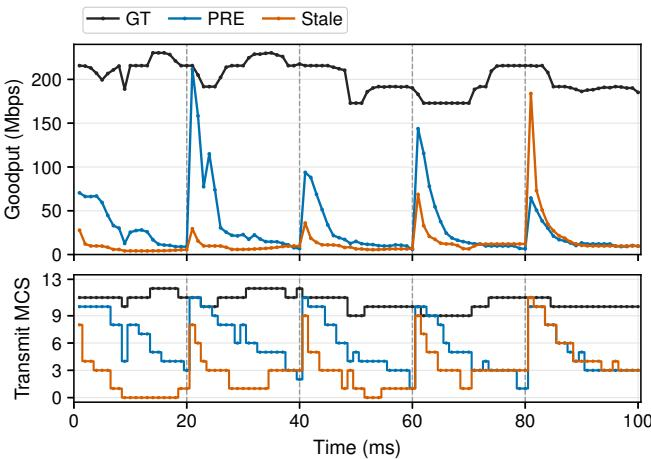

Fig. 13. Goodput and transmit MCS for the cosine trajectory.  
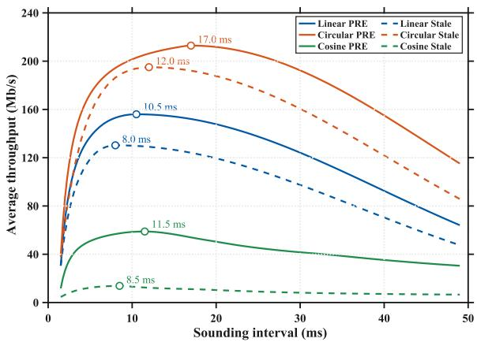  
Fig. 14. Average throughput versus sounding interval.

Figure 14 schematically illustrates the throughput–overhead tradeoff in (9). Shorter sounding intervals incur a larger overhead fraction, whereas longer sounding intervals can increase channel mismatch and autoregressive prediction error. The PRE curves illustrate the maxima at longer intervals than their stale counterparts.

## V. CONCLUSION

This paper presented a prediction-aided channel sounding framework for time-varying MIMO Wi-Fi links. The framework connects autoregressive CSI prediction and prediction error to SINR-constrained interval selection, balancing throughput with sounding and processing overhead. The resulting predicted average-throughput maximization problem admits a globally optimal solution. In single-STA Wi-Fi 7 simulations, predicted-CSI beamforming improved mean goodput over stale CSI by 67.3%, 112.7%, and 119.1% for linear, circular, and cosine trajectories, respectively. These results demonstrate the potential of CSI prediction to sustain MIMO link performance under receiver motion, while error accumulation in autoregressive prediction highlights the need for a finite prediction horizon.

[1] IEEE 802.11 Working Group, “IEEE Draft Standard for Information Technology–Telecommunications and Information Exchange between Systems Local and Metropolitan Area Networks–Specific Requirements - Part 11: Wireless LAN Medium Access Control (MAC) and Physical Layer (PHY) Specifications Amendment: Enhancements for Ultra High Reliability (UHR),” IEEE P802.11bn/D2.0, pp. 1–727, Oct. 2026.

[2] ——, “IEEE P802.11bn Ultra High Reliability (UHR) Task Group,” https://www.ieee802.org/11/Reports/tgbn update.htm, accessed: September 28, 2026.

[3] ——, “IEEE 802.11, The Working Group Setting the Standards for Wireless LANs,” https://www.ieee802.org/11/, accessed: September 28, 2026.

[4] ——, “IEEE P802.11—Artificial Intelligence Machine Learning (AIML) Standing Committee,” https://www.ieee802.org/11/Reports/aiml update. htm, accessed: September 28, 2026.

[5] B. Hassibi and B. M. Hochwald, “How much training is needed in multiple-antenna wireless links?” IEEE Trans. Inf. Theory, vol. 49, no. 4, pp. 951–963, 2003.

[6] G. Caire, N. Jindal, M. Kobayashi, and N. Ravindran, “Multiuser MIMO achievable rates with downlink training and channel state feedback,” IEEE Trans. Inf. Theory, vol. 56, no. 6, pp. 2845–2866, 2010.

[7] L. Zhang, L. Cao, D. Wei, M. Chen, Z. Chen, and S. Cui, “Crosslayer channel sounding optimization toward next-gen Wi-Fi: From model driven to data driven,” IEEE Trans. Wireless Commun., vol. 25, pp. 3319–3332, 2026.

[8] D. Schafhuber and G. Matz, “MMSE and adaptive prediction of timevarying channels for OFDM systems,” IEEE Trans. Wireless Commun., vol. 4, no. 2, pp. 593–602, 2005.

[9] K. T. Truong and R. W. Heath, Jr., “Effects of channel aging in massive MIMO systems,” J. Commun. Netw., vol. 15, no. 4, pp. 338–351, 2013.

[10] H. Yin, H. Wang, Y. Liu, and D. Gesbert, “Addressing the curse of mobility in massive MIMO with prony-based angular-delay domain channel predictions,” IEEE J. Sel. Areas Commun., vol. 38, no. 12, pp. 2903–2917, 2020.

[11] Z. Qin, H. Yin, Y. Cao, W. Li, and D. Gesbert, “A partial reciprocitybased channel prediction framework for FDD massive MIMO with high mobility,” IEEE Trans. Wireless Commun., vol. 21, no. 11, pp. 9638– 9652, 2022.

[12] C. Wu, X. Yi, Y. Zhu, W. Wang, L. You, and X. Gao, “Channel prediction in high-mobility massive MIMO: From spatio-temporal autoregression to deep learning,” IEEE J. Sel. Areas Commun., vol. 39, no. 7, pp. 1915–1930, 2021.

[13] T. Zhou, H. Zhang, B. Ai, C. Xue, and L. Liu, “Deep-learningbased spatial–temporal channel prediction for smart high-speed railway communication networks,” IEEE Trans. Wireless Commun., vol. 21, no. 7, pp. 5333–5345, 2022.

[14] H. Jiang, M. Cui, D. W. K. Ng, and L. Dai, “Accurate channel prediction based on transformer: Making mobility negligible,” IEEE J. Sel. Areas Commun., vol. 40, no. 9, pp. 2717–2732, 2022.

[15] Y. Jin, Y. Wu, Y. Gao, S. Zhang, S. Xu, and C.-X. Wang, “LinFormer: A linear-based lightweight transformer architecture for time-aware MIMO channel prediction,” IEEE Trans. Wireless Commun., vol. 24, no. 9, pp. 7177–7190, 2025.

[16] Y. Sang, K. Ma, L. Yao, P. Wang, Z. Wang, H. Zhu, and S. Chen, “Continuous-time transformer-based channel prediction with nonuniform pilot pattern,” IEEE Trans. Wireless Commun., 2026.

[17] B. Liu, X. Liu, S. Gao, X. Cheng, and L. Yang, “LLM4CP: Adapting large language models for channel prediction,” J. Commun. Inf. Netw., vol. 9, no. 2, pp. 113–125, 2024.

[18] S. Fan, Z. Liu, X. Gu, and H. Li, “Csi-LLM: A novel downlink channel prediction method aligned with llm pre-training,” in Proc. IEEE Wireless Commun. Netw. Conf. (WCNC), 2025, pp. 1–6.

[19] Z. Li, Q. Yang, Z. Xiong, Z. Shi, and T. Q. S. Quek, “Bridging the modality gap: Enhancing channel prediction with semantically aligned LLMs and knowledge distillation,” IEEE J. Sel. Areas Commun., vol. 44, pp. 3382–3396, 2026.

[20] Y. Sheng, K. Huang, L. Liang, P. Liu, S. Jin, and G. Y. Li, “Beam prediction based on large language models,” IEEE Wireless Commun. Lett., vol. 14, no. 5, pp. 1406–1410, 2025.

[21] O. Stenhammar, G. Fodor, and C. Fischione, “A comparison of neural networks for wireless channel prediction,” IEEE Wireless Commun., vol. 31, no. 3, pp. 235–241, 2024.

[22] T. Nabetani, N. Madhavan, H. Mori, and T. Aoki, “A novel low-overhead channel sounding protocol for downlink multi-user MIMO in IEEE

802.11ax WLAN,” IEICE Trans. Commun., vol. E101-B, no. 3, pp. 924– 932, 2018.

[23] J. Zhang, S. Avallone, and D. M. Blough, “Implementation and evaluation of IEEE 802.11ax channel sounding frame exchange in ns-3,” in Proc. Workshop ns-3 (WNS3), 2023, pp. 10–18.

[24] X. Ma, Q. Gao, J. Wang, V. Marojevic, and J. H. Reed, “Dynamic sounding for multi-user MIMO in wireless LANs,” IEEE Trans. Consum. Electron., vol. 63, no. 2, pp. 135–144, 2017.

[25] E. Endovitskiy, S. Tutelian, K. Chemrov, V. Loginov, and E. Khorov, “Impact of explicit channel sounding period on the Wi-Fi MU-MIMO performance,” in Proc. IEEE Int. Black Sea Conf. Commun. Netw. (BlackSeaCom), 2024, pp. 78–83.

[26] S. Lee and M. Min, “Analysis of the optimal feedback rate for limited feedback-based block diagonalization in cellular MU-MIMO systems,” IEEE Wireless Commun. Lett., vol. 13, no. 2, pp. 486–490, 2024.

[27] P. K. Sangdeh and H. Zeng, “DeepMux: Deep-learning-based channel sounding and resource allocation for IEEE 802.11ax,” IEEE J. Sel. Areas Commun., vol. 39, no. 8, pp. 2333–2346, 2021.

[28] M. K. Shehzad, L. Rose, and M. Assaad, “Massive MIMO CSI feedback using channel prediction: How to avoid machine learning at UE?” IEEE Trans. Wireless Commun., vol. 23, no. 9, pp. 10 850–10 863, 2024.

[29] L. Zhang, L. Cao, Z. Chen, D. Wei, M. Chen, V. Sathya, and S. Mao, “Wi-Fi 8 coordinated beamforming: A cross-layer approach toward optimized access point cluster formation,” IEEE Trans. Wireless Commun., vol. 25, pp. 12 468–12 481, 2026.

[30] L. Zhang, L. Cao, D. Wei, and X. Gao, “Scheduling in IEEE 802.11be multi-link operation for low latency and high reliability,” IEEE Trans. Green Commun. Netw., vol. 10, pp. 344–354, 2026.

[31] L. Zhang, H. Yin, S. Roy, L. Cao, X. Gao, and V. Sathya, “IEEE 802.11be network throughput optimization with multilink operation and AP controller,” IEEE Internet Things J., vol. 11, no. 13, pp. 23 850– 23 861, Jul. 2024.

[32] A. Alkhateeb, “DeepMIMO: A generic deep learning dataset for millimeter wave and massive MIMO applications,” in Proc. Inf. Theory Appl. Workshop (ITA), 2019.

[33] J. Hoydis, F. A. Aoudia, S. Cammerer, M. Nimier-David, N. Binder, G. Marcus, and A. Keller, “Sionna RT: Differentiable ray tracing for radio propagation modeling,” in Proc. IEEE Globecom Workshops (GC Wkshps), 2023, pp. 317–321.

[34] F. A. Aoudia, J. Hoydis, M. Nimier-David, B. Nicolet, S. Cammerer, and A. Keller, “Sionna RT: Technical report,” arXiv:2504.21719, 2025, version 3, revised September 3, 2026.

[35] J. Su, M. Ahmed, Y. Lu, S. Pan, W. Bo, and Y. Liu, “RoFormer: Enhanced transformer with rotary position embedding,” Neurocomputing, vol. 568, p. 127063, 2024.

[36] NVIDIA, “Sionna 2.0.1: Paths api documentation,” https://nvlabs.github. io/sionna/rt/api/paths.html, accessed September 6, 2026.

[37] A. Vaswani, N. Shazeer, N. Parmar, J. Uszkoreit, L. Jones, A. N. Gomez, L. Kaiser, and I. Polosukhin, “Attention is all you need,” in Proc. Adv. Neural Inf. Process. Syst. (NeurIPS), 2017, pp. 5998–6008.

[38] P. J. Huber, “Robust estimation of a location parameter,” Ann. Math. Statist., vol. 35, no. 1, pp. 73–101, 1964.