# Reasoning-Trace Overflow in Code Generation: An Empirical Study of Explicit Reasoning Models

Lukas Twist

King’s College London

Helen Yannakoudakis

Jie M. Zhang

London, UK

King’s College London

London, UK

King’s College London

London, UK

Abstract—Explicit reasoning can help language models generate code, but it also introduces a practical risk: the model may spend so much of its output budget reasoning that it never produces usable code. We study this behaviour in relatively small open-weight reasoning models, framing it as reasoning-trace overflow. Across seven models and six code benchmark settings, we measure how much of a fixed 32k-token output budget is spent on reasoning, whether that reasoning improves pass@1, and whether lightweight inference-time controls can mitigate overflow. Our results show that the value of reasoning is highly conditional. Overflow is rare on simpler function-level tasks, but becomes common on harder code-generation benchmarks and for particular model families: on several model–benchmark pairs, more than half of generations exhaust the full 32k-token budget while still reasoning. Most complete overflow is associated with repetitive reasoning loops, although substantial long reasoning also occurs without looping. Disabling reasoning can therefore be competitive for overflow-prone models, simply because it ensures that an answer is produced. At the same time, reasoning remains valuable for stronger models on harder algorithmic and codeunderstanding tasks. Finally, prompt steering can substantially reduce overflow for some models but is inconsistent, while budgeted transitions provide more direct control and can improve both performance and token efficiency for overflow-prone models. These findings suggest that explicit reasoning should be treated as a controllable resource for code generation, rather than an always-on capability.

## I. INTRODUCTION

Relatively small open-weight reasoning models are becoming increasingly attractive for code generation. They can be run locally, provide greater control over inference, and expose explicit reasoning traces that can be inspected and manipulated [1]. Recent work has shown that reasoning can support code generation through structured prompting, planning, and lightweight model training [2], [3], [4], while survey work highlights code reasoning as an increasingly important direction for software engineering [5]. However, explicit reasoning is not free: longer traces consume additional tokens and inference compute, and can contain substantial unnecessary reasoning [6], [7].

This raises a practical question: when models are asked to generate code, is explicit reasoning actually worth the cost? For code generation, this creates an additional constraint. A model must not only reason about the task, but also leave enough output budget to produce a complete program. For harder tasks, these two demands can grow together: the model may spend more tokens planning, searching, or checking possible implementations, while the final answer itself may also require more tokens. When reasoning consumes the available output budget, the model can fail slowly, spending substantial inference time and compute without returning usable code to the developer.

We refer to this failure mode as reasoning-trace overflow. Unlike ordinary verbosity, reasoning-trace overflow prevents answer generation altogether. Recent work has explored controlling reasoning length through token budgets, early stopping, and explicit reasoning limits [7], [8], [9], [10]. Most of this work focuses on controlling reasoning length in mathematical and general reasoning settings, with comparatively little attention paid to how excessive reasoning naturally manifests during code generation. This setting introduces an additional constraint: the reasoning trace must share the output budget with a potentially long executable answer.

To fill this gap, we conduct an empirical study of reasoningtrace overflow in code generation. We evaluate seven openweight reasoning models across six code benchmark settings under a fixed 32k-token output budget. Our study asks three questions. First, how much of the output budget do these models spend on reasoning, and when do they overflow? Second, does extended reasoning improve accuracy enough to justify this cost? Third, can lightweight inference-time controls – either prompt-based steering, which influences reasoning behaviour without modifying decoding, or budgeted transitions, which directly control when reasoning ends – reduce overflow while preserving accuracy?

Our results show that the value of explicit reasoning is highly conditional. Reasoning-trace overflow is uncommon on simple function-level synthesis tasks, but becomes frequent on harder code-generation benchmarks and for particular model families. Most complete overflow is associated with repetitive reasoning loops, although substantial long reasoning also occurs without looping. When overflow is common, disabling reasoning can be competitive not because reasoning is necessarily unhelpful, but because it ensures that the model reaches the answer stage: a response that exhausts its budget while still reasoning has no opportunity to pass the tests. At the same time, reasoning remains valuable for larger models on harder algorithmic and code-understanding benchmarks, where it can substantially improve pass@1 when the model successfully transitions to an answer.

We also find that overflow can be mitigated at inference time, but not reliably across all settings. Prompt steering can substantially reduce overflow for some models, but its effects are inconsistent and can come at the cost of accuracy. Budgeted transitions provide more direct control and can improve performance for overflow-prone models, while substantially reducing the token cost of successful answers. Overall, our findings suggest that reasoning should be treated as a controllable resource for code generation, rather than an always-on capability.

## Our contributions are as follows:

1) We define and operationalise reasoning-trace overflow, a failure mode in which explicit reasoning consumes the output budget before a code solution is produced.

2) We provide a broad empirical characterisation of reasoningtrace overflow across seven relatively small open-weight reasoning models and six code benchmark settings, showing how it varies with task type, model family, and model scale, how often complete overflow coincides with repetitive reasoning loops, and whether the associated reasoning improves accuracy.

3) We compare complementary forms of inference-time reasoning control, from prompt-based soft constraints to enforced transition budgets, and show how they trade off overflow, accuracy, and token efficiency.

## II. RELATED WORK

a) Reasoning for Code Generation: Chain-of-thought (CoT) prompting showed that intermediate reasoning can improve performance on complex tasks [11]. Subsequent work has explored more structured forms of reasoning, including Program-of-Thoughts prompting, which expresses reasoning through executable programs [12], and Structured CoT prompting, which guides code generation using program structures such as sequences, branches, and loops [2]. For code generation specifically, Self-Planning separates high-level planning from implementation [3], while COTTON studies CoT reasoning for lightweight code-generation models [4]. More recent work has also explored selective reasoning for code generation, such as UnCert-CoT, which activates CoT reasoning based on uncertainty to avoid unnecessary overthinking [13]. A recent survey highlights that reasoning is increasingly central to software engineering tasks, while also identifying the behaviour and failure modes of code reasoning as an open area for further study [5]. Our work follows this direction by studying not only whether reasoning helps code generation, but also when it consumes the output budget needed to produce code.

b) Long Reasoning: Recent work increasingly treats reasoning as a test-time resource rather than a free capability. Longer reasoning can produce diminishing or even negative returns [14], motivating efficient-reasoning methods that reduce unnecessary thinking while preserving accuracy [15], [7]. This broader phenomenon is often described as overthinking, where models continue reasoning after useful returns diminish or produce redundant computation [16], [17]. Recent work has also identified repetitive reasoning loops as a distinct failure mode in reasoning models [18], [19]. However, these studies do not consider code generation, where the reasoning trace must also leave sufficient output budget for an executable answer. Our focus is therefore a distinct operational failure: the reasoning trace can exhaust this shared budget before the model produces any usable code.

c) Reasoning Control: Several recent approaches control reasoning length more directly. S1 introduces budget forcing to terminate reasoning [8], Fractured CoT studies answering from truncated reasoning traces [9], Elastic Reasoning separates thinking and solution budgets [10], and TRACES explores adaptive early stopping [20]. In code specifically, Z1 combines code-reasoning training with a shifted thinking window to encourage answers [21]. We do not claim these budget-control mechanisms as new. Instead, we study the behaviour that motivates them in code generation: when existing reasoning models naturally exhaust their output budget before producing an answer, whether this extended reasoning improves correctness, and how soft and hard controls trade off overflow, accuracy, and token efficiency. We additionally measure the token cost per correct answer, capturing whether reasoning control produces useful code more efficiently rather than simply shortening the reasoning trace.

## III. REASONING-TRACE OVERFLOW

Explicit reasoning models produce a reasoning trace before emitting a final answer. In code generation, this can be costly because the model must both reason about the implementation and still leave enough output budget to produce the code itself. Longer or more complex solutions may therefore create pressure on both sides: they can require more reasoning to plan, and more tokens to write.

We define reasoning-trace overflow as a failure mode in which the explicit reasoning trace consumes the available output budget, preventing the model from producing a solution.

Formally, for a given input and decoding run, let B denote the operational output budget, and let $y$ be the generated output token sequence. We decompose $y$ into a reasoning trace $y _ { r }$ and an answer $y _ { a } ,$ such that $y = y _ { r } y _ { a }$ , where either segment may be empty depending on the generation behaviour.

We say that reasoning-trace overflow occurs when generation terminates at the output budget while still inside the reasoning trace:

$$
| y | = B \ \wedge \ | y _ { r } | = B \ \wedge \ | y _ { a } | = 0 .
$$

This is distinct from reasoning that is simply long or verbose; extended reasoning may still be useful when it leads to better code. The failure occurs when the reasoning trace crowds out the solution itself, causing the model to spend time and compute thinking without producing executable code.

We use reasoning-trace overflow as the central lens for our study. We first measure when explicit reasoning models approach or exhaust a fixed output budget, then examine whether extended reasoning improves accuracy enough to justify its cost, and finally evaluate whether lightweight inference-time controls can mitigate overflow.

## IV. RESEARCH QUESTIONS

RQ1 Overflow Dynamics. When do reasoning models approach or exhaust their operational token budget on code-generation tasks? We characterise reasoning overflow across models and benchmarks, analysing how reasoning-token usage varies across task types and benchmark difficulty profiles, including short-answer tasks that help separate reasoning cost from answer length. We further examine whether complete overflow is associated with repetitive reasoning loops.

RQ2 Reasoning Utility. Does extended reasoning improve coding task accuracy enough to justify its cost? We compare reasoning-enabled and reasoning-disabled generation to analyse when reasoning improves correctness, when it has little effect, and when it harms performance.

RQ3 Reasoning Control. Can lightweight inference-time controls reduce reasoning-trace overflow while preserving coding task accuracy? We evaluate both promptbased steering and budgeted reasoning-to-answer transitions, examining whether these interventions provide reliable control across models and tasks.

## V. EXPERIMENTAL SET-UP

We conduct a controlled benchmarking study of explicit reasoning behaviour across seven models and six code benchmark settings. Our repository provides the complete implementation and reproducibility details, including exact model and dataset revisions, software and library versions, generated outputs, per-task results, and evaluation configurations.1

## A. Model Selection

We focus on relatively small open-weight models because they are practical candidates for private, low-cost code generation, while providing full access to and control over their reasoning traces [1]. We evaluate seven open-weight explicit reasoning models, summarised in Table I. All models expose an explicit reasoning trace before producing a final answer, allowing us to separate reasoning from answer tokens and directly measure reasoning length and its effect on accuracy.

Our selection is designed to cover three sources of variation. First, we include models from different families and providers, including Alibaba’s Qwen models [22], the distillation-driven Llama- R1- 8B [23], the fully open OLMo3- 7B [24], and NVIDIA’s Nemotron models [25]. This reduces the risk of drawing conclusions from a single architecture or posttraining recipe. Second, the three Qwen models provide a controlled size comparison from 8B to 32B parameters, allowing us to study how reasoning-trace overflow changes with model scale. Third, the two Nemotron models provide a useful specialisation comparison: OpenReason-7B targets general reasoning, while CodeReason-7B is specialised for code generation. This lets us examine whether code-specific reasoning training reduces overflow or instead changes how reasoning budget is allocated.

TABLE I  
DETAILS OF ALL REASONING MODELS EVALUATED IN OUR STUDY.
<table><tr><td>Name</td><td>Provider</td><td>Variant</td><td></td><td>Size Release</td><td>Licence</td></tr><tr><td>Qwen3-8B</td><td>Qwen</td><td>Qwen3 [30]</td><td>8B</td><td>Apr. 2025</td><td>Apache 2.0</td></tr><tr><td>Qwen3-14B</td><td>Qwen</td><td>Qwen3 [31]</td><td></td><td>14B Apr. 2025</td><td>Apache 2.0</td></tr><tr><td>Qwen3-32B</td><td>Qwen</td><td>Qwen3 [32]</td><td></td><td>32B Apr. 2025</td><td>Apache 2.0</td></tr><tr><td>Llama-R1-8B</td><td></td><td>DeepSeek R1 Distilled [33]</td><td>8B</td><td>Jan. 2025</td><td>MIT</td></tr><tr><td>OLMo3-7B</td><td>Ai2</td><td>OLMo 3 Think [34]</td><td>7B</td><td>Dec. 2025</td><td>Apache 2.0</td></tr><tr><td>OpenReason-7B NVIDIA</td><td></td><td>OpenReasoning [35]</td><td>7B</td><td>Jul. 2025</td><td>CC BY 4.0</td></tr><tr><td>CodeReason-7B</td><td>NVIDIA</td><td>OpenCodeReasoning 1.1 [36] 7B</td><td></td><td>Jul. 2025</td><td>NVIDIA OML</td></tr></table>

## B. Model Configuration

We run all models with a fixed output budget of 32k tokens, following prior work that evaluates reasoning models under large but finite generation budgets [9]. Although some models support longer outputs, 32k tokens is already a substantial allowance for interactive code generation without additional repository context, and is commonly used as a large-budget setting for reasoning-model evaluation [26], [27]. We deliberately use this generous budget to avoid inducing overflow through an artificially tight output limit; smaller operational budgets would only expose additional generations that had not yet completed reasoning. Using the same output budget for every model also provides a shared resource constraint for comparison. Therefore, our reported overflow rates are operational measurements under a 32k-token budget.

We use greedy decoding throughout (temperature = 0.0, top p = 1.0) as a controlled, low-variance setting commonly used in code-generation evaluation [28]. Each model therefore produces a single solution per task, which we evaluate using pass@1. Generation terminates when the model produces its end-of-sequence token or reaches the 32k-token output budget. We use each model’s native chat template, preserving its expected reasoning and answer format, and do not use a system prompt so that models are evaluated under the task prompt alone without additional steering [29]. All experiments are run directly on a single NVIDIA H200 GPU.

## C. Dataset Selection

We select established benchmarks that span distinct coding task styles while providing automated correctness evaluation, covering function-level synthesis, practical library-based programming, competitive programming, and short-answer code reasoning. We include EvalPlus [37] as a clean functionlevel synthesis setting, using its HumanEval+ [38] and MBPP+ [39] tasks (542 tasks). We include BigCodeBen ch [40], [41] to test practical Python tasks with complex instructions and diverse library/function calls (1,140 tasks). We use LiveCodeBench [42], [43] to evaluate recent and contamination-aware competitive-programming problems, using the v5 and v6 subsets (342 tasks). Finally, we use the test subset of CodeContests [44], [45] as an additional competitive-programming benchmark with challenging algorithmic problems (165 tasks).

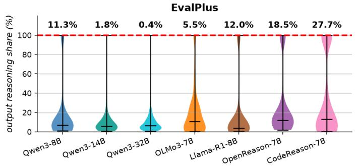

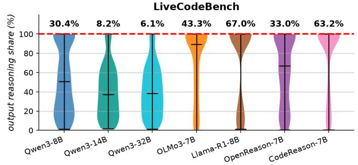

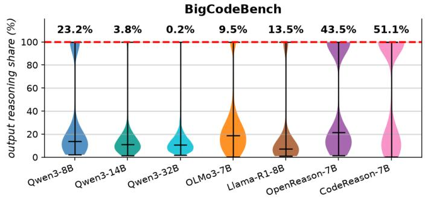

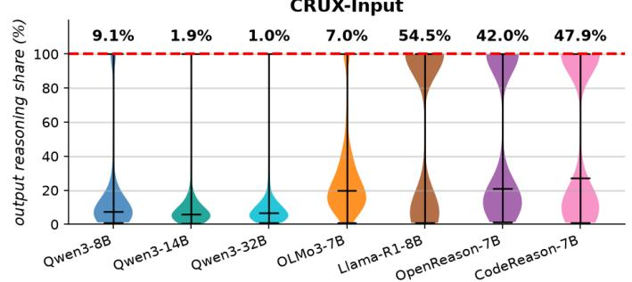

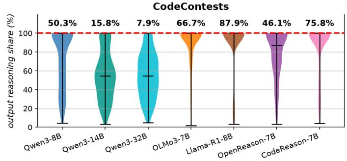

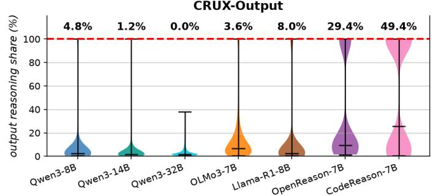  
Fig. 1. Results for RQ1 Overflow Dynamics. Distribution of reasoning-token usage under the standard reasoning-enabled setting. Each violin shows the percentage of the 32k output budget consumed by the explicit reasoning trace for a given model and benchmark. The dashed red line marks the full output budget, and the percentage above each violin reports the reasoning-trace overflow rate.

These benchmarks let us study reasoning-trace overflow across tasks that vary in difficulty profile, output length, and required programming knowledge. However, code generation also conflates reasoning with answer production, since successful answers often require many output tokens. To separate these factors, we additionally evaluate on CRUXEval [46], [47], a code-reasoning benchmark built from short Python functions with input-prediction (CRUX-Input) and outputprediction (CRUX-Output) tasks (800 tasks each). CRUXEv al allows us to test whether reasoning traces become long for code-based tasks even when the final answer is short.

## D. Evaluation Details

For each benchmark, we use the evaluation pipeline and execution environment recommended by the original benchmark authors, ensuring that pass@1 is computed consistently with the benchmark’s task formatting, tests, and correctness checks.

All models in our study expose reasoning using the standard <think> and </think> delimiters. We use

ThinkPack [48] to parse each output into a reasoning trace and an answer segment using these tags. For reasoning-enabled inference, the reasoning trace is the content generated before </think>, and the answer is the content generated after. For reasoning-disabled inference, we insert an empty reasoning segment before generation, forcing the model to begin directly in the answer.

We count reasoning tokens using each model’s own tokenizer. A run is counted as reasoning-trace overflow when generation reaches the 32k output budget without having produced the </think> tag, leaving no answer segment. In overflow cases, we do not attempt to extract code from the unfinished reasoning trace. Reasoning traces can be difficult or even illegible to users [49], and without the closing delimiter the model has not transitioned to its answer under the expected output protocol.

We additionally detect sustained textual reasoning loops across all reasoning-enabled generations. For each trace, we match its final 64-character suffix to the nearest earlier occurrence, using the distance between them as a candidate repetition period. We then trace this periodic pattern backwards until it breaks, and flag a loop only when the repeated region spans at least 2,000 characters and contains at least three complete cycles. These conservative thresholds avoid treating short or incidental repetition as a loop.

All reported metrics are computed from the stored pertask generations using the analysis scripts released in our repository.2

## VI. EXPERIMENTAL RESULTS

## A. RQ1 Overflow Dynamics

a) Set-up: To measure reasoning-trace overflow, we run each model on each benchmark using the standard task prompt and a fixed 32k output budget. For each response, we detect whether reasoning-trace overflow occurred and calculate the percentage of the output budget used by the reasoning trace. Fig. 1 shows the resulting distributions.

b) Results: Reasoning-trace usage varies substantially across both models and benchmarks. On EvalPlus, overflow is generally rare, with most models using only a small fraction of the available budget for reasoning. This is expected, as EvalPlus contains relatively small function-level synthesis tasks. However, even here, behaviour is not uniform: OpenReason-7B overflows on 27.7% of tasks, while the larger Qwen models almost never overflow.

The harder generation benchmarks show a much clearer overflow problem. On LiveCodeBench and CodeContes ts, several models spend a large fraction of the 32k budget on reasoning, and overflow rates become substantial. This suggests that reasoning-trace overflow is strongly associated with harder code-generation settings, where models have more to reason about while still needing to reserve enough tokens for a complete solution. The contrast with BigCodeBench is informative. Although BigCodeBench includes practical tasks involving libraries and APIs, its overflow rates are generally lower than those on LiveCodeBench and CodeContests. This suggests that inherent problem difficulty may be a stronger driver of overflow than API or library use alone. Models appear to overflow not simply because code answers are long, but because some tasks invite extended search, planning, or exploration before code generation.

The CRUXEval results provide a useful contrast. Because CRUXEval requires short answers rather than full code generation, it helps separate reasoning cost from answer length. Most models show low overflow on CRUX-Output, suggesting that short-answer code reasoning is less likely to exhaust the budget. However, CRUX-Input produces high overflow for several models, including Llama-R1-8B, OpenReason-7B, and CodeReason-7B. This shows that overflow is not only caused by long code outputs: some codebased tasks can trigger long reasoning traces even when the final answer is short.

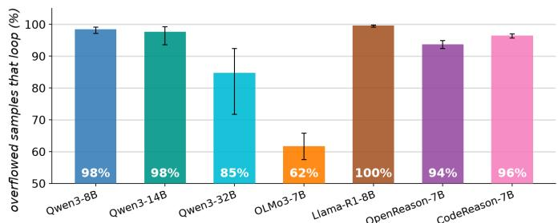  
Fig. 2. Reasoning Loop Analysis. Percentage of overflowed generations containing a detected reasoning loop for each model. A loop is identified as a repeated region spanning at least 2,000 characters and three complete cycles.

Finally, the Qwen family shows a consistent size effect. Across all benchmarks, overflow decreases sharply as model size increases from Qwen3-8B to Qwen3-14B and Qwen 3-32B. This suggests that larger models may require less extended reasoning to reach a solution, or may be better calibrated in when to stop reasoning. This is particularly visible on EvalPlus, BigCodeBench, and CRUXEval, where Qwen3-32B almost never overflows.

c) Reasoning Loops: Reasoning loops are strongly associated with reasoning trace overflow. Overall, 94% of overflowed generations contain a detected loop. As shown in Fig. 2, this is consistent across most models, ranging from 85–100%, with OLMo3-7B lower at 62%.

However, long reasoning is not limited to looping behaviour. Among generations using more than half of the 32k reasoning budget, 22% contain no detected loop. More strikingly, 99% of generations that reason for more than 16k tokens but still produce an answer contain no detected loop. Together with the broad reasoning-length distributions in Fig. 1, this suggests that loops are a major mechanism of complete overflow, while extended non-looping reasoning remains common on harder coding tasks.

## RQ1 SUMMARY.

Reasoning-trace overflow is not a rare edge case, but it is highly task- and model-dependent. It is uncommon on simple function-level synthesis, much more common on harder code-generation benchmarks, and still possible on short-answer code-reasoning tasks. Most complete overflow is associated with detected reasoning loops, although substantial long reasoning also occurs without looping. These results motivate the next question: whether extended reasoning improves accuracy enough to justify this risk.

## B. RQ2 Reasoning Utility

a) Set-up: To evaluate whether extended reasoning is useful, we compare standard reasoning-enabled inference against a reasoning-disabled setting. Here, reasoning-disabled refers specifically to disabling the explicit reasoning trace in the response; it does not imply the absence of latent internal computation, and the final answer may still contain reasoninglike text. This comparison is especially relevant given RQ1, where reasoning-enabled inference can fail to produce an answer when the reasoning trace exhausts the output budget. Accuracy comparisons are given in Fig. 3.

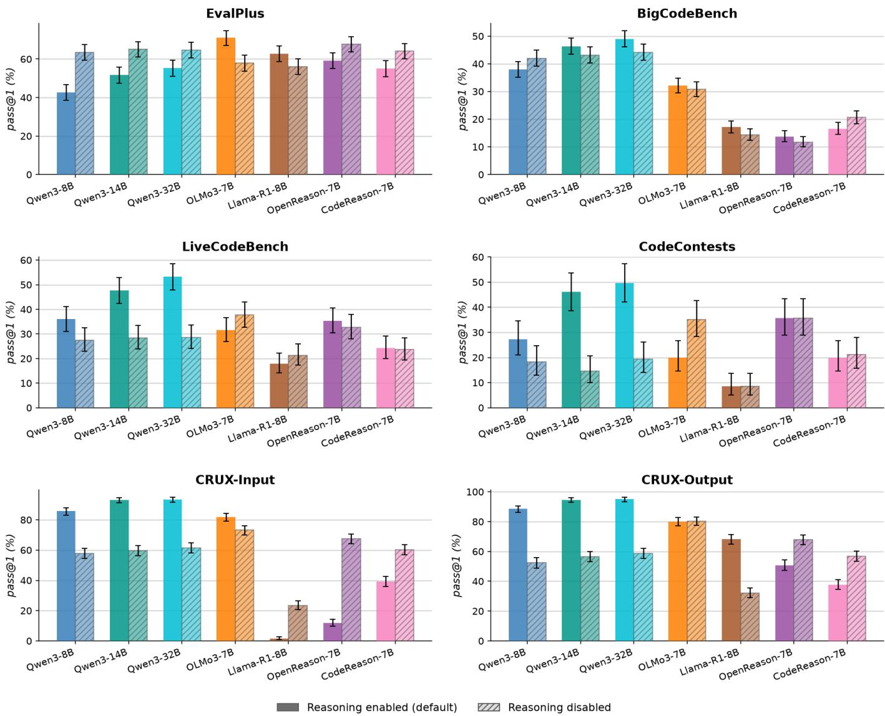  
Fig. 3. Results for RQ2 Reasoning Utility. Model accuracy (pass@1) with and without reasoning across all models and benchmarks. Solid bars show the standard reasoning-enabled setting, while hatched bars show the reasoning-disabled setting, where empty reasoning tags are inserted before generation to force the model to answer directly. Error bars indicate 95% Wilson confidence intervals.

b) Results: Extended reasoning is not uniformly beneficial. On EvalPlus and BigCodeBench, reasoningdisabled inference is often competitive with reasoning-enabled inference, with no consistent best option across models. This is important because reasoning-enabled inference can fail to produce an answer due to reasoning-trace overflow, wasting many tokens, whereas reasoning-disabled inference always proceeds directly to an answer. For these benchmarks, the additional cost and risk of explicit reasoning is not consistently matched by higher accuracy.

The harder generation benchmarks show a clearer benefit for some models, but still not universally. For the Qwen models, reasoning substantially improves performance on LiveCode Bench and CodeContests. For example, when reasoning is enabled, Qwen3-32B improves by 25 and 30 percentage points on LiveCodeBench and CodeContests, respectively. This aligns with the intuition that harder algorithmic tasks can benefit from explicit reasoning. However, the pattern is different for models that showed higher reasoning-trace overflow on these benchmarks. For OLMo3-7B, reasoningdisabled inference performs similarly or better on several benchmarks, while Llama-R1-8B remains weak on the harder generation tasks regardless of reasoning mode. The NVIDIA models also show mixed behaviour: CodeReason -7B benefits slightly from reasoning on CodeContests, while OpenReason-7B changes little. This suggests that the utility of reasoning is strongly model- and task-dependent. When a model is likely to exhaust its budget while reasoning, the benefit of explicit reasoning may be outweighed by the risk of never producing an answer.

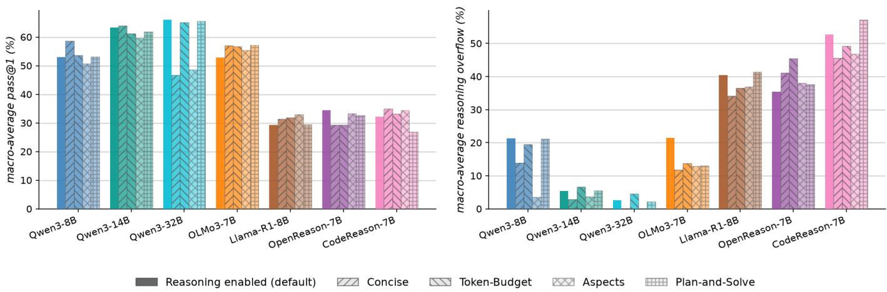  
Fig. 4. Results for RQ3 Reasoning Control, Prompt Steering. Effect of prompt-based steering on reasoning behaviour. Bars show macro-average pass@1 and reasoning-trace overflow across all benchmark settings for each model under the reasoning enabled, concise, token-budget, aspects, and Plan-and-Solve prompt-based strategies.

The CRUXEval results show that short-answer code reasoning behaves differently from code generation. For the Qwen models, explicit reasoning is especially useful: across CRUX- Input and CRUX- Output, reasoning-enabled inference is on average 34 percentage points higher than reasoning-disabled inference. This indicates that these codeunderstanding tasks benefit from reasoning, even though their final answers are short. In contrast, the NVIDIA models often improve when reasoning is disabled, despite showing high overflow on CRUX-Input in RQ1. This suggests that some models may over-reason on short-answer tasks, spending substantial budget without gaining accuracy.

## RQ2 SUMMARY.

Extended reasoning helps in some settings, especially for stronger models on harder algorithmic and codereasoning tasks, but only when the model is able to produce a final answer. On simpler code-generation tasks, reasoning can add substantial cost and occasionally prevent answer generation without delivering consistent accuracy gains. A budget-exhausted reasoning trace has no opportunity to pass the tests, regardless of whether its partial reasoning was useful. Therefore, when overflow is likely, disabling reasoning may improve accuracy simply by ensuring that the model produces an answer.

## C. RQ3 Reasoning Control

We investigate two complementary inference-time approaches to controlling reasoning. Prompt steering provides soft control by influencing reasoning behaviour without modifying decoding, while budgeted transitions provide hard control by explicitly enforcing when reasoning ends. For space, we report macro-average results in the main paper, weighting each of the six benchmark settings equally; exact prompts and full results are available in our repository.3

## 1) Prompt Steering:

a) Set-up: We first test whether reasoning can be controlled through prompt steering alone, by appending a fixed instruction to the original task prompt. We compare five prompt styles: an unmodified baseline (the default, reasoning enabled setting); a concise instruction that asks the model to keep reasoning brief and ensure a final answer; a tokenbudget instruction, inspired by TALE [7], that asks the model to use no more than 8k reasoning tokens before answering; an aspects instruction that discourages step-by-step reasoning and instead asks the model to briefly consider key implementation concerns such as inputs, outputs, edge cases, and design choices; and Plan-and-Solve [50], which provides a contrasting structured-reasoning baseline without explicitly limiting reasoning length. These conditions compare qualitative brevity, an explicit token limit, alternative reasoning structure, and structured planning against the model’s default behaviour. Each steering instruction is appended unchanged to every task prompt. Results are shown in Fig. 4.

b) Results: Prompt steering can reduce reasoning-trace overflow, but its effect is highly model-dependent. The largest reduction is seen for Qwen3-8B, where the aspects prompt reduces average overflow from 21.4% to 3.6% while retaining similar accuracy. OLMo3- 7B also benefits from brevityoriented prompts. However, the models with the highest baseline overflow remain difficult to control: Llama-R1-8B and CodeReason-7B still overflow on more than 34% and 45% of tasks, respectively, even under their best prompt. OpenReason-7B behaves differently again, with every steering prompt increasing average overflow.

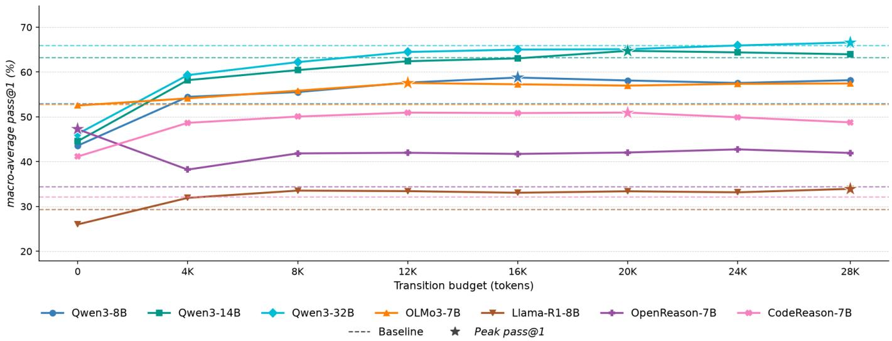  
Fig. 5. Results for RQ3 Reasoning Control, Budgeted Transitions. Effect of enforced reasoning-transition budgets on accuracy. Each line shows macroaverage pass@1 across all benchmark settings as the transition budget varies from immediate transition to 28k tokens. Dashed lines show each model’s standard reasoning-enabled baseline, and stars mark the best observed transition budget.

Accuracy is similarly mixed. Most changes are modest, but Qwen3-32B loses 17–19 percentage points under the qualitative concise and aspects prompts despite having little baseline overflow. In contrast, the explicit token-budget prompt largely preserves its accuracy. More broadly, however, simply stating an 8k budget provides weak control: it substantially reduces the overall rate of reasoning beyond 8k only for OLMo3-7B, from 36% to 22%, while producing much smaller changes for most models and worsening OpenReason-7B. Plan-and-Solve similarly provides no consistent reduction in overflow or improvement in accuracy.

The benchmark-level results show further variation. On harder generation tasks, shorter or more structured reasoning can reduce overflow for Qwen3- 8B, OLMo3- 7B, and OpenReason-7B, and can sometimes improve accuracy at the same time. However, the same interventions are much less reliable elsewhere. Prompt steering therefore provides useful soft control, but no single prompt consistently improves both accuracy and overflow across models and tasks.

## 2) Budgeted Transitions:

a) Set-up: Prompt steering can influence reasoning length, but even an explicit token-budget instruction cannot reliably enforce the requested limit. We next test budgeted transitions, which directly control when reasoning ends. Following prior work on budget forcing [8], we impose a transition budget $B _ { t }$ on the reasoning trace. The model generates normally until either reasoning completes or $B _ { t }$ is reached. If the model is still reasoning at $B _ { t } ,$ we append the end-ofreasoning token, </think>, and allow generation to continue in the answer segment. We sweep $B _ { t }$ in 4k-token steps from 0 − 28k, and compare against the standard reasoning-enabled baseline. Given the prevalence of loops among overflowed traces in RQ1, this also prevents repetitive reasoning from consuming the remainder of the output budget. The overall

32k-token output budget remains unchanged: tokens used for reasoning count toward this budget, and only the remaining budget is available for the final answer after transition. Results are shown in Fig. 5.

b) Results: Budgeted transitions provide more direct control, and the macro-average results show that many models benefit from being forced to answer after reasoning for a limited budget. For most models, accuracy improves sharply within the first few thousand reasoning tokens and then begins to plateau. The strongest average effect is seen for CodeReason-7B, where a moderate transition budget improves pass@1 by almost 20 percentage points over standard reasoning. Qwen3-8B, OLMo3-7B, and Llama-R1-8B also exceed their reasoning-enabled baselines under suitable budgets, while the larger Qwen models recover or slightly exceed their baseline performance. OpenReason-7B is the clearest exception: immediate transition (reasoning disabled) performs best on average, suggesting that additional reasoning may be actively unhelpful for this model. This reinforces that there is no single useful reasoning budget across models.

For budgeted transitions, the benchmark-level results show a clearer relationship with task difficulty. On the more difficult generation benchmarks, Qwen3-14B, Qwen3-32B, OpenReason-7B, and CodeReason-7B generally benefit from being allowed more reasoning before transition, with performance often continuing to improve at larger budgets. In contrast, on the shorter CRUXEval tasks, the Qwen models recover most of the benefit of reasoning within the first few thousand tokens, with little gained from substantially longer traces. Other models remain more mixed, and some model– task pairs are harmed by additional reasoning altogether. This suggests that budgeted transitions provide stronger control than prompting, but the appropriate reasoning budget remains highly task- and model-dependent.

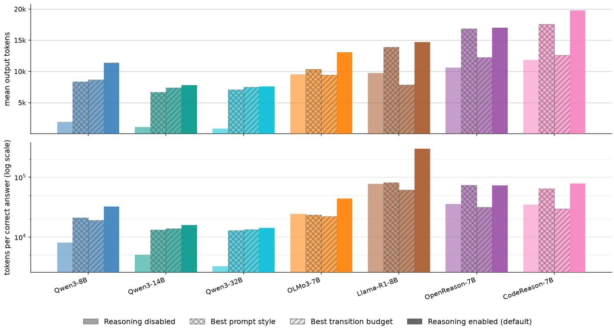  
Fig. 6. Token Efficiency Analysis. Token efficiency across inference strategies, macro-averaged over all six benchmark settings. The top panel shows mean output tokens, while the bottom panel shows tokens per correct answer on a log scale. For each model, the prompt style and transition budget with the highest macro-average pass@1 are shown.

## RQ3 SUMMARY.

Prompt steering and budgeted transitions provide two complementary forms of reasoning control. Prompt steering offers soft control: it is cheap and easy to deploy, and can substantially reduce overflow for some models, but its effects are inconsistent and can harm accuracy. Budgeted transitions offer hard control: they directly enforce when reasoning ends and often improve performance for overflow-prone models, but require access to the decoding process and an appropriate transition budget. Neither approach is universally best, reinforcing that effective reasoning control remains strongly dependent on the model and task.

## VII. TOKEN EFFICIENCY

Explicit reasoning introduces a direct generation cost, but token count alone does not capture whether this cost is worthwhile: a more expensive response may still be preferable if reasoning substantially improves accuracy. We therefore compare four settings: reasoning-disabled inference, standard reasoning-enabled inference, the best prompt-steering style from RQ3, and the best transition budget from RQ3. For the latter two, “best” is selected using the highest macro-average pass@1; these retrospectively selected settings provide an upper-bound comparison rather than a deployable budgetselection strategy. We report both mean output tokens and tokens per correct answer, calculated as the total number of generated tokens divided by the number of correct responses. Values are macro-averaged across the six benchmark settings.

Standard reasoning-enabled inference is the most expensive setting for every model, with the largest gaps appearing for models that were most prone to reasoning-trace overflow. For example, Llama-R1-8B averages roughly 15k output tokens under default reasoning, compared with 7.9k under its best transition budget, while CodeReason-7B falls from roughly 20k to 13k. Prompt steering sometimes reduces this cost, but usually only modestly. For the Qwen models, reasoningdisabled inference is much cheaper: Qwen3-8B, for example, falls from roughly 11k tokens under default reasoning to 1.9k when reasoning is disabled. Overall, transition budgets provide the most consistent reduction in output length while retaining strong accuracy.

The same pattern becomes more informative when we normalise by correctness. For OLMo3-7B, Llama-R1-8B, OpenReason-7B, and CodeReason-7B, the best transition budget requires substantially fewer tokens per correct answer than unconstrained reasoning, showing that longer reasoning does not provide proportional gains in accuracy. For Llama-R1-8B, this falls from roughly 300k to 61k tokens per correct answer. Its unusually high default cost is driven by the combination of long generations and relatively low baseline accuracy (≈29% pass@1), rather than token length alone. Prompt steering can also improve efficiency, but less reliably and generally by a smaller margin. For the Qwen models, reasoning-disabled inference remains the most tokenefficient setting overall; Qwen3-8B falls from roughly 32k tokens per correct answer under default reasoning to 8.1k, although RQ2 showed that explicit reasoning can still provide substantially higher absolute accuracy on harder tasks.

Token efficiency therefore reinforces the same trade-off seen throughout the paper. More reasoning can improve correctness, but its value depends strongly on the model. For overflowprone models in particular, controlling when reasoning ends can substantially increase the number of useful solutions obtained for a fixed token budget.

## VIII. DISCUSSION

a) Reasoning is not free: Our results suggest that explicit reasoning should not be treated as an automatic improvement for code generation. For some models and benchmarks, reasoning clearly improves pass@1, especially on harder algorithmic tasks. However, on simpler generation tasks, and for several model families, reasoning provides little benefit while increasing the risk of slow failure through reasoningtrace overflow. This makes the usefulness of reasoning highly conditional: it depends on the model, the task, and whether the model can stop reasoning in time to produce code.

b) Overflow is a practicalfailure mode: Reasoning-trace overflow is more than a token-count artifact. Most complete overflow in our study is associated with detected reasoning loops, meaning models can spend substantial inference budget repeating reasoning without ever producing code. However, long non-looping reasoning also remains common, showing that the broader problem is not reducible to looping alone. From a user’s perspective, both behaviours can waste generation budget and inference compute without producing a proportionate benefit.

c) Code generation needs reasoning control: Our results point toward a middle ground between always reasoning and never reasoning. When reasoning rarely overflows and provides clear accuracy gains, leaving it unconstrained can be worthwhile. For overflow-prone models, prompt steering offers cheap soft control, but remains inconsistent, while budgeted transitions provide more reliable hard control when the decoding process is accessible. The appropriate choice still depends on the model and task.

## IX. THREATS TO VALIDITY

a) Construct validity: We define reasoning-trace overflow using each model’s explicit reasoning delimiters, and therefore rely on models following their expected output protocol. This matches the practical failure we study—the model never transitions to a usable answer—but may not capture every possible formatting failure. We measure generation cost using output tokens rather than wall-clock latency or energy, and token counts are most directly comparable within the same model because tokenizers differ across families. Our loop detector targets sustained periodic repetition and may miss shorter or semantic loops, so the reported loop rates should be interpreted conservatively.

b) Internal validity: We use greedy decoding and a fixed 32k output budget to provide controlled comparisons across models and tasks. Different decoding strategies may change reasoning length, looping behaviour, and accuracy, while smaller operational budgets would increase the absolute rate of overflow. Our prompt interventions are deliberately simple, and the “best” prompt styles and transition budgets are selected retrospectively using macro-average pass@1, rather than by an adaptive deployment policy.

c) External validity: We focus on relatively small openweight models with accessible reasoning traces and on singleshot code-generation and code-reasoning benchmarks. Larger or closed models, hidden-reasoning systems, and agentic software-engineering settings may behave differently. In particular, multi-turn systems introduce additional factors such as tool use, retrieval, and repository context that are outside the scope of this study. Data contamination is a further threat. Older benchmarks may overlap with model pre-training data, but this is unlikely to inflate overflow rates: familiar or memorised solutions may require less search and planning, potentially making our estimates conservative.

d) Ethics: Finally, our study uses public benchmarks and open-weight models and does not involve human participants or personal data; we report accuracy alongside efficiency to avoid treating shorter reasoning as beneficial when it harms correctness.

## X. CONCLUSION

Explicit reasoning can improve code generation, but our results show that it is not a universal benefit. Across seven relatively small open-weight reasoning models and six code benchmark settings, we find that models often spend substantial portions of a 32k output budget on reasoning, sometimes failing to produce an answer at all. Most complete overflow is associated with detected reasoning loops, although substantial long reasoning also occurs without looping. This reasoningtrace overflow is most common on harder code-generation tasks, but remains highly model-dependent. We further show that disabling explicit reasoning can be competitive when overflow is likely, while prompt steering and budgeted transitions offer complementary soft and hard forms of control, with transition budgets also improving token efficiency for several overflow-prone models. Overall, our findings suggest that code-generation systems should treat reasoning as a controllable resource, rather than an always-on capability.

[1] C. Wang, T. Zhang, R. Hong, and J. Huang, “A short survey on small reasoning models: Training, inference, applications, and research directions,” Frontiers of Computer Science, vol. 20, no. 11, p. 2011366, Feb. 2026.

[2] J. Li, G. Li, Y. Li, and Z. Jin, “Structured Chain-of-Thought Prompting for Code Generation,” ACM Trans. Softw. Eng. Methodol., vol. 34, no. 2, pp. 37:1–37:23, Jan. 2025.

[3] X. Jiang, Y. Dong, L. Wang, Z. Fang, Q. Shang, G. Li, Z. Jin, and W. Jiao, “Self-Planning Code Generation with Large Language Models,” ACM Trans. Softw. Eng. Methodol., vol. 33, no. 7, pp. 182:1–182:30, Sep. 2024.

[4] G. Yang, Y. Zhou, X. Chen, X. Zhang, T. Y. Zhuo, and T. Chen, “Chainof-Thought in Neural Code Generation: From and for Lightweight Language Models,” IEEE Transactions on Software Engineering, vol. 50, no. 9, pp. 2437–2457, Sep. 2024.

[5] S. Pujar, I. Ceka, I. Manotas, G. Kaiser, B. Ray, and S. Ramji, “Code Reasoning for Software Engineering Tasks: A Survey and A Call to Action,” Transactions on Machine Learning Research, Jan. 2026.

[6] M. Wu, C. Zhou, S. Bates, and T. Jaakkola, “Thought calibration: Efficient and confident test-time scaling,” in Proceedings of the 2025 Conference on Empirical Methods in Natural Language Processing, C. Christodoulopoulos, T. Chakraborty, C. Rose, and V. Peng, Eds. Suzhou, China: Association for Computational Linguistics, Nov. 2025, pp. 14 291–14 305.

[7] T. Han, Z. Wang, C. Fang, S. Zhao, S. Ma, and Z. Chen, “Token-Budget-Aware LLM Reasoning,” in Findings of the Association for Computational Linguistics: ACL 2025, W. Che, J. Nabende, E. Shutova, and M. T. Pilehvar, Eds. Vienna, Austria: Association for Computational Linguistics, Jul. 2025, pp. 24 842–24 855.

[8] N. Muennighoff, Z. Yang, W. Shi, X. L. Li, L. Fei-Fei, H. Hajishirzi, L. Zettlemoyer, P. Liang, E. Candes, and T. Hashimoto, “S1: Simple\` test-time scaling,” in Proceedings of the 2025 Conference on Empirical Methods in Natural Language Processing, C. Christodoulopoulos, T. Chakraborty, C. Rose, and V. Peng, Eds. Suzhou, China: Association for Computational Linguistics, Nov. 2025, pp. 20 275–20 321.

[9] B. Liao, H. Dong, Y. Xu, D. Sahoo, C. Monz, J. Li, and C. Xiong, “Fractured Chain-of-Thought Reasoning,” https://arxiv.org/ abs/2505.12992v3, May 2025.

[10] Y. Xu, H. Dong, L. Wang, D. Sahoo, J. Li, and C. Xiong, “Scalable chain of thoughts via elastic reasoning,” in International Conference on Learning Representations, C. Vondrick, B. Hariharan, C. Raffel, L. Pinto, D. Yang, and A. Faust, Eds., vol. 2026, 2026, pp. 145 390– 145 412.

[11] J. Wei, X. Wang, D. Schuurmans, M. Bosma, B. Ichter, F. Xia, E. H. Chi, Q. V. Le, and D. Zhou, “Chain-of-thought prompting elicits reasoning in large language models,” in Proceedings of the 36th International Conference on Neural Information Processing Systems, ser. NIPS ’22. Red Hook, NY, USA: Curran Associates Inc., Nov. 2022, pp. 24 824– 24 837.

[12] W. Chen, X. Ma, X. Wang, and W. W. Cohen, “Program of Thoughts Prompting: Disentangling Computation from Reasoning for Numerical Reasoning Tasks,” Transactions on Machine Learning Research, Jun. 2023.

[13] Y. Zhu, G. Li, X. Jiang, J. Li, H. Mei, Z. Jin, Y. Dong, and Q. Zheng, “UnCert-CoT: Uncertainty-Aware Chain-of-Thought for Code Generation with Large Language Model,” in Advanced Intelligent Computing Technology and Applications: 21st International Conference, ICIC 2025, Ningbo, China, July 26–29, 2025, Proceedings, Part XXIII. Berlin, Heidelberg: Springer-Verlag, Jul. 2025, pp. 426–437.

[14] Y. Wu, Y. Wang, Z. Ye, T. Du, S. Jegelka, and Y. Wang, “When more is less: Understanding chain-of-thought length in llms,” in International Conference on Learning Representations, C. Vondrick, B. Hariharan, C. Raffel, L. Pinto, D. Yang, and A. Faust, Eds., vol. 2026, 2026, pp. 127 108–127 138.

[15] Y. Sui, Y.-N. Chuang, G. Wang, J. Zhang, T. Zhang, J. Yuan, H. Liu, A. Wen, S. Zhong, N. Zou, H. Chen, and X. Hu, “Stop Overthinking: A Survey on Efficient Reasoning for Large Language Models,” Transactions on Machine Learning Research, Apr. 2025.

[16] X. F. Zhang, A. Mohananey, A. Chronopoulou, P. Papalampidi, S. Gupta, T. Munkhdalai, L. Wang, and S. Upadhyay, “Do LLMs Really Need 10+ Thoughts for “Find the Time 1000 Days Later”? Towards Structural Understanding of LLM Overthinking,” in Proceedings of the 64th Annual

Meeting of the Association for Computational Linguistics (Volume 1: Long Papers), M. Liakata, V. P. Moreira, J. Zhang, and D. Jurgens, Eds. San Diego, California, United States: Association for Computational Linguistics, Jul. 2026, pp. 17 005–17 030.

[17] S. Zhou, R. Ling, J. Chen, X. Wang, T. Fan, and H. Wang, “When More Thinking Hurts: Overthinking in LLM Test-Time Compute Scaling,” in Findings of the Association for Computational Linguistics: ACL 2026, M. Liakata, V. P. Moreira, J. Zhang, and D. Jurgens, Eds. San Diego, California, United States: Association for Computational Linguistics, Jul. 2026, pp. 23 967–23 977.

[18] C. Pipis, S. Garg, V. Kontonis, V. Shrivastava, A. Krishnamurthy, and D. Papailiopoulos, “Wait, wait, wait... why do reasoning models loop?” in Proceedings of the 43rd International Conference on Machine Learning, ser. Proceedings of Machine Learning Research, T. Zhang, M. Dudik, M. Jaggi, A. Agarwal, S. Li, D. Schuurmans, J. Zhu, F. Berkenkamp, H. Dong, and A. Bietti, Eds., vol. 306. PMLR, 06–11 Jul 2026, pp. 98 934–98 964. [Online]. Available: https://proceedings.mlr.press/v306/pipis26a.html

[19] Z. Duan, L. Pang, Z. Wei, W. Duan, Y. Tian, S. Xu, J. Deng, Z. Yin, and X. Cheng, “Circular Reasoning: Understanding Self-Reinforcing Loops in Large Reasoning Models,” https://arxiv.org/abs/2601.0 5693, Jan. 2026.

[20] Y. Belkhiter, S. Tirupathi, G. Zizzo, and J. D. Kelleher, “TRACES: Tagging Reasoning Steps for Adaptive Cost-Efficient Early-Stopping,” https://arxiv.org/abs/2604.21057v1, Apr. 2026.

[21] Z. Yu, Y. Wu, Y. Zhao, A. Cohan, and X.-P. Zhang, “Z1: Efficient Testtime Scaling with Code,” in Proceedings of the 2025 Conference on Empirical Methods in Natural Language Processing: Industry Track, S. Potdar, L. Rojas-Barahona, and S. Montella, Eds. Suzhou (China): Association for Computational Linguistics, Nov. 2025, pp. 2688–2712.

[22] A. Yang, A. Li, B. Yang, B. Zhang, B. Hui, B. Zheng, B. Yu, C. Gao, C. Huang, C. Lv, C. Zheng, D. Liu, F. Zhou, F. Huang, F. Hu, H. Ge, H. Wei, H. Lin, J. Tang, J. Yang, J. Tu, J. Zhang, J. Yang, J. Yang, J. Zhou, J. Zhou, J. Lin, K. Dang, K. Bao, K. Yang, L. Yu, L. Deng, M. Li, M. Xue, M. Li, P. Zhang, P. Wang, Q. Zhu, R. Men, R. Gao, S. Liu, S. Luo, T. Li, T. Tang, W. Yin, X. Ren, X. Wang, X. Zhang, X. Ren, Y. Fan, Y. Su, Y. Zhang, Y. Zhang, Y. Wan, Y. Liu, Z. Wang, Z. Cui, Z. Zhang, Z. Zhou, and Z. Qiu, “Qwen3 Technical Report,” https://arxiv.org/abs/2505.09388, May 2025.

[23] D. Guo, D. Yang, H. Zhang, J. Song, P. Wang, Q. Zhu, R. Xu, R. Zhang, S. Ma, X. Bi, X. Zhang, X. Yu, Y. Wu, Z. F. Wu, Z. Gou, Z. Shao, Z. Li, Z. Gao, A. Liu, B. Xue, B. Wang, B. Wu, B. Feng, C. Lu, C. Zhao, C. Deng, C. Ruan, D. Dai, D. Chen, D. Ji, E. Li, F. Lin, F. Dai, F. Luo, G. Hao, G. Chen, G. Li, H. Zhang, H. Xu, H. Ding, H. Gao, H. Qu, H. Li, J. Guo, J. Li, J. Chen, J. Yuan, J. Tu, J. Qiu, J. Li, J. L. Cai, J. Ni, J. Liang, J. Chen, K. Dong, K. Hu, K. You, K. Gao, K. Guan, K. Huang, K. Yu, L. Wang, L. Zhang, L. Zhao, L. Wang, L. Zhang, L. Xu, L. Xia, M. Zhang, M. Zhang, M. Tang, M. Zhou, M. Li, M. Wang, M. Li, N. Tian, P. Huang, P. Zhang, Q. Wang, Q. Chen, Q. Du, R. Ge, R. Zhang, R. Pan, R. Wang, R. J. Chen, R. L. Jin, R. Chen, S. Lu, S. Zhou, S. Chen, S. Ye, S. Wang, S. Yu, S. Zhou, S. Pan, S. S. Li, S. Zhou, S. Wu, T. Yun, T. Pei, T. Sun, T. Wang, W. Zeng, W. Liu, W. Liang, W. Gao, W. Yu, W. Zhang, W. L. Xiao, W. An, X. Liu, X. Wang, X. Chen, X. Nie, X. Cheng, X. Liu, X. Xie, X. Liu, X. Yang, X. Li, X. Su, X. Lin, X. Q. Li, X. Jin, X. Shen, X. Chen, X. Sun, X. Wang, X. Song, X. Zhou, X. Wang, X. Shan, Y. K. Li, Y. Q. Wang, Y. X. Wei, Y. Zhang, Y. Xu, Y. Li, Y. Zhao, Y. Sun, Y. Wang, Y. Yu, Y. Zhang, Y. Shi, Y. Xiong, Y. He, Y. Piao, Y. Wang, Y. Tan, Y. Ma, Y. Liu, Y. Guo, Y. Ou, Y. Wang, Y. Gong, Y. Zou, Y. He, Y. Xiong, Y. Luo, Y. You, Y. Liu, Y. Zhou, Y. X. Zhu, Y. Huang, Y. Li, Y. Zheng, Y. Zhu, Y. Ma, Y. Tang, Y. Zha, Y. Yan, Z. Z. Ren, Z. Ren, Z. Sha, Z. Fu, Z. Xu, Z. Xie, Z. Zhang, Z. Hao, Z. Ma, Z. Yan, Z. Wu, Z. Gu, Z. Zhu, Z. Liu, Z. Li, Z. Xie, Z. Song, Z. Pan, Z. Huang, Z. Xu, Z. Zhang, and Z. Zhang, “DeepSeek-R1 incentivizes reasoning in LLMs through reinforcement learning,” Nature, vol. 645, no. 8081, pp. 633–638, Sep. 2025.

[24] Olmo Team, A. Ettinger, A. Bertsch, B. Kuehl, D. Graham, D. Heineman, D. Groeneveld, F. Brahman, F. Timbers, H. Ivison, J. Morrison, J. Poznanski, K. Lo, L. Soldaini, M. Jordan, M. Chen, M. Noukhovitch, N. Lambert, P. Walsh, P. Dasigi, R. Berry, S. Malik, S. Shah, S. Geng, S. Arora, S. Gupta, T. Anderson, T. Xiao, T. Murray, T. Romero, V. Graf, A. Asai, A. Bhagia, A. Wettig, A. Liu, A. Rangapur, C. Anastasiades, C. Huang, D. Schwenk, H. Trivedi, I. Magnusson, J. Lochner, J. Liu, L. J. V. Miranda, M. Sap, M. Morgan, M. Schmitz, M. Guerquin, M. Wilson, R. Huff, R. L. Bras, R. Xin, R. Shao, S. Skjonsberg, S. Z.

Shen, S. S. Li, T. Wilde, V. Pyatkin, W. Merrill, Y. Chang, Y. Gu, Z. Zeng, A. Sabharwal, L. Zettlemoyer, P. W. Koh, A. Farhadi, N. A. Smith, and H. Hajishirzi, “Olmo 3,” https://arxiv.org/abs/ 2512.13961, Apr. 2026.

[25] W. U. Ahmad, S. Narenthiran, S. Majumdar, A. Ficek, S. Jain, J. Huang, V. Noroozi, and B. Ginsburg, “OpenCodeReasoning: Advancing Data Distillation for Competitive Coding,” in Second Conference on Language Modeling, Aug. 2025.

[26] Q. Team, “Quickstart,” https://qwen.readthedocs.io/en/l atest/getting\_started/quickstart.html, 2024.

[27] N. Corporation, “Evaluation of Reasoning Models,” https://docs .nvidia.com/nemo/evaluator/latest/evaluation/run -evals/reasoning.html, 2025.

[28] Y. Song, G. Wang, S. Li, and B. Y. Lin, “The Good, The Bad, and The Greedy: Evaluation of LLMs Should Not Ignore Non-Determinism,” in Proceedings of the 2025 Conference of the Nations of the Americas Chapter of the Association for Computational Linguistics: Human Language Technologies (Volume 1: Long Papers), L. Chiruzzo, A. Ritter, and L. Wang, Eds. Albuquerque, New Mexico: Association for Computational Linguistics, Apr. 2025, pp. 4195–4206.

[29] N. Mu, J. Lu, M. Lavery, and D. Wagner, “A Closer Look at System Prompt Robustness,” in Neurips Safe Generative AI Workshop 2024, Feb. 2025.

[30] Qwen, “Qwen/Qwen3-8B,” https://huggingface.co/Qwen/ Qwen3-8B, Dec. 2025.

[31] Qwen, “Qwen/Qwen3-14B,” https://huggingface.co/Qwen/ Qwen3-14B, Dec. 2025.

[32] Qwen, “Qwen/Qwen3-32B,” https://huggingface.co/Qwen/ Qwen3-32B, Dec. 2025.

[33] deepseek-ai, “Deepseek-ai/DeepSeek-R1-Distill-Llama-8B,” https: //huggingface.co/deepseek-ai/DeepSeek-R1-Disti ll-Llama-8B, Nov. 2025.

[34] allenai, “Allenai/Olmo-3-7B-Think,” https://huggingface.co /allenai/Olmo-3-7B-Think, Jan. 2026.

[35] nvidia, “Nvidia/OpenReasoning-Nemotron-7B,” https://huggingf ace.co/nvidia/OpenReasoning-Nemotron-7B, Jun. 2026.

[36] nvidia, “Nvidia/OpenCodeReasoning-Nemotron-1.1-7B,” https://hu ggingface.co/nvidia/OpenCodeReasoning-Nemotron-1 .1-7B, May 2025.

[37] J. Liu, C. S. Xia, Y. Wang, and L. Zhang, “Is your code generated by ChatGPT really correct? rigorous evaluation of large language models for code generation,” in Proceedings of the 37th International Conference on Neural Information Processing Systems, ser. NIPS ’23. Red Hook, NY, USA: Curran Associates Inc., Dec. 2023, pp. 21 558– 21 572.

[38] evalplus, “Evalplus/humanevalplus at d32357c,” https://huggin gface.co/datasets/evalplus/humanevalplus/commit/ d32357c, May 2024.

[39] ——, “Evalplus/mbppplus at b2d74c9,” https://huggingface. co/datasets/evalplus/mbppplus/commit/b2d74c9, Apr. 2024.

[40] T. Y. Zhuo, M. C. Vu, J. Chim, H. Hu, W. Yu, R. Widyasari, I. N. B. Yusuf, H. Zhan, J. He, I. Paul, S. Brunner, C. Gong, T. Hoang, A. R. Zebaze, X. Hong, W.-D. Li, J. Kaddour, M. Xu, Z. Zhang, P. Yadav, N. Jain, A. Gu, Z. Cheng, J. Liu, Q. Liu, Z. Wang, D. Lo, B. Hui, N. Muennighoff, D. Fried, X. Du, H. de Vries, and L. V. Werra, “BigCodeBench: Benchmarking Code Generation with Diverse Function Calls and Complex Instructions,” in 13th International Conference on Learning Representations (ICLR25), Oct. 2024.

[41] bigcode, “Bigcode/bigcodebench at b74c0d0,” https://huggingf ace.co/datasets/bigcode/bigcodebench/commit/b74c 0d0, Apr. 2025.

[42] N. Jain, K. Han, A. Gu, W.-D. Li, F. Yan, T. Zhang, S. Wang, A. Solar-Lezama, K. Sen, and I. Stoica, “LiveCodeBench: Holistic and Contamination Free Evaluation of Large Language Models for Code,” https://arxiv.org/abs/2403.07974, Jun. 2024.

[43] livecodebench, “Livecodebench/code generation lite at 0fe84c3,” http s://huggingface.co/datasets/livecodebench/code\_g eneration\_lite/commit/0fe84c3, Jun. 2025.

[44] Y. Li, D. Choi, J. Chung, N. Kushman, J. Schrittwieser, R. Leblond, T. Eccles, J. Keeling, F. Gimeno, A. D. Lago, T. Hubert, P. Choy, C. de Masson d’Autume, I. Babuschkin, X. Chen, P.-S. Huang, J. Welbl, S. Gowal, A. Cherepanov, J. Molloy, D. J. Mankowitz, E. S. Robson, P. Kohli, N. de Freitas, K. Kavukcuoglu, and O. Vinyals, “Competitionlevel code generation with AlphaCode,” Science, vol. 378, no. 6624, pp. 1092–1097, 2022.

[45] deepmind, “Deepmind/code contests at 802411c,” https://huggin gface.co/datasets/deepmind/code\_contests/commit/ 802411c, Jun. 2023.

[46] A. Gu, B. Roziere, H. J. Leather, A. Solar-Lezama, G. Synnaeve, and S. Wang, “CRUXEval: A Benchmark for Code Reasoning, Understanding and Execution,” in Proceedings of the 41st International Conference on Machine Learning. PMLR, Jul. 2024, pp. 16 568–16 621.

[47] cruxeval-org, “Cruxeval-org/cruxeval at b96af04,” https://huggin gface.co/datasets/cruxeval-org/cruxeval/commit/b 96af04, Jan. 2024.

[48] L. Twist, H. Yannakoudakis, and J. M. Zhang, “Reasoning-Trace Collapse: Evaluating the Loss of Explicit Reasoning During Fine-Tuning,” in Advances in Neural Information Processing Systems, ser. NeurIPS ’26, vol. 39, December 2026, evaluations and Datasets Track. [Online]. Available: https://neurips.cc/virtual/2026/loc/paris/poster/139 406

[49] A. Jose, “Reasoning Models Sometimes Output Illegible Chains of Thought,” Advances in Neural Information Processing Systems, vol. 38, pp. 110 411–110 433, Apr. 2026.

[50] L. Wang, W. Xu, Y. Lan, Z. Hu, Y. Lan, R. K.-W. Lee, and E.- P. Lim, “Plan-and-Solve Prompting: Improving Zero-Shot Chain-of-Thought Reasoning by Large Language Models,” in Proceedings of the 61st Annual Meeting of the Association for Computational Linguistics (Volume 1: Long Papers), A. Rogers, J. Boyd-Graber, and N. Okazaki, Eds. Toronto, Canada: Association for Computational Linguistics, Jul. 2023, pp. 2609–2634.