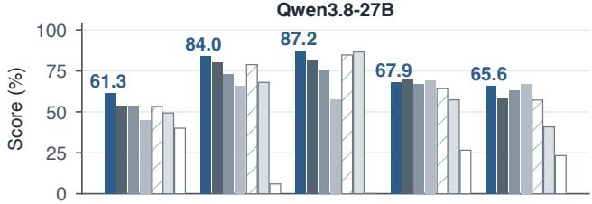
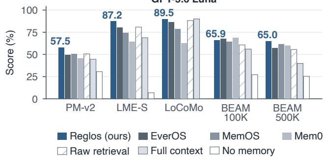
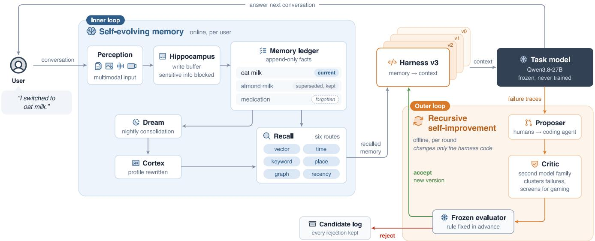
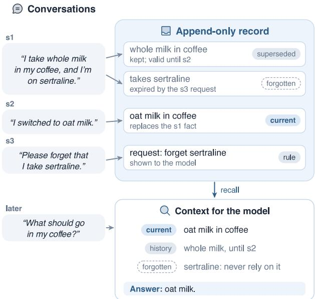
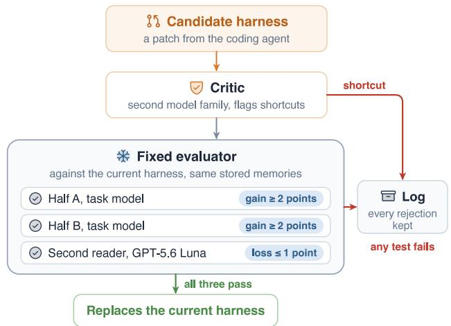
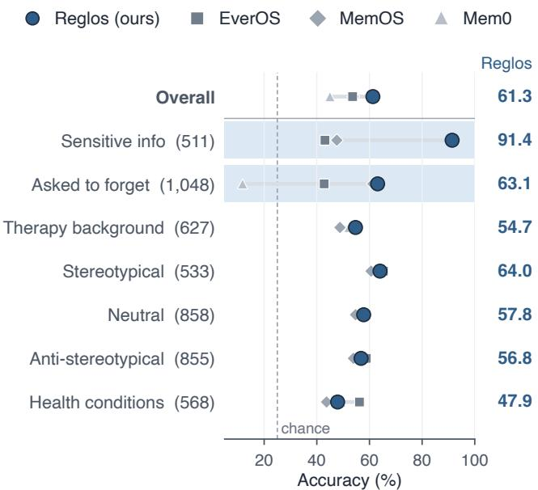
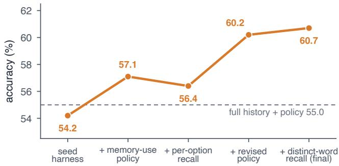
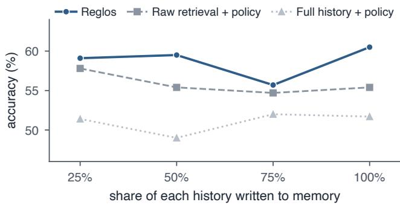

# Reglos: A Self-Evolving Personal Memory Agent with Recursive Self-Improvement

Sen Yang∗ Reglos.ai sen@reglos.ai

Jiaduo Lin

Reglos.ai jiaduo.lin@reglos.ai

Zehong Huang

Reglos.ai zehong.huang@reglos.ai

Wen Liu∗ Reglos.ai wen@reglos.ai

## Abstract

Personal agents draw on past conversations to tailor their responses to each user. Their memory systems store and update what each user says, and coding agents now also rewrite the harness that turns this memory into the model’s context. Such patches risk overfitting, because one tested only on the failures it targets can fix those cases and help nowhere else. We present Reglos, a training-free personal memory agent that tests whether harness changes help beyond the failures they were written to fix. Its self-evolving memory adds to each user’s append-only record with every conversation, as new preferences supersede old ones and facts can be forgotten. Its harness improves through recursive self-improvement, in which a coding agent proposes patches from failure traces and a critic from a second model family screens each one for benchmark gaming. After the harness is frozen, a fixed evaluator decides which further patches to accept. With the same backbone behind every system, Reglos outperforms state-of-the-art memory systems such as Mem0, MemOS and EverOS, reaching 61.3% and 84.0% on PersonaMem-v2 and LongMemEval-S with Qwen3.8-27B, and 57.5% and 87.2% with GPT-5.6 Luna.

Website: https://reglos.ai

## 1 Introduction

A personal assistant that talks with the same user for months has to keep track of what that user prefers (Hu et al. 2025; Jiang et al. 2025b). Some of those preferences change, and the user may later ask the assistant to forget others. Reading the whole history handles this poorly, and even frontier models often miss a preference the user only implied or keep applying one that has changed (Jiang et al. 2025b). Memory systems keep what each user says across conversations and recall it when the model answers (Packer et al. 2023; Chhikara et al. 2025; Rasmussen et al. 2025; Li et al. 2025; Hu et al. 2026). How well they work depends on what they store and on the code that decides what to recall and how to show it to the model, which we call the harness.

Although these systems update what they store as the user talks, the harness itself is usually written by hand and revised between releases. Recent work hands that job to coding agents, which evolve memory programs and pipelines against benchmarks (Liu et al. 2026b; Chen et al. 2026; Zhang et al.

  
Figure 1: Qwen3.8-27B writes memory for every system and answers in the top panel; GPT-5.6 Luna answers in the bottom panel. Reglos leads on PersonaMem-v2 and LongMemEval-S. Details in Table 1.

2025). A benchmark score alone leaves one question open: does a change help users whose failures nobody inspected while writing it?

Our own development data show why that question matters. A memory can be stored correctly and still be used wrongly: in 31% of the failures we traced, the evidence the model needed was already in its context (Section 4.1). Those are failures of the harness, and a coding agent can patch them, but a patch judged on the cases that prompted it can look better than it is. A prompt-only search over the harness text in the style of GEPA (Agrawal et al. 2026) gained 3.8 points on the questions it was selected on and 1.1 on questions it had never seen.

These failures point to two kinds of change with diferent owners. A user’s memory changes whenever that user talks, and an error in it is best fixed then, inside that user’s record. The harness serves every user at once, so a change to it can help some users and hurt others, and that is where overfitting happens. We therefore argue that a personal memory system should improve at two time scales: its memory online as each user talks, and its harness ofline through changes that a fixed evaluator accepts only after testing them on held-out users.

  
Figure 2: Reglos improves on two time scales: each user’s memory evolves online (inner loop), and the harness that turns memory into context for a frozen model is recursively improved ofline (outer loop). The brain-region labels name the write bufer (hippocampus) and the nightly profile (cortex); the proposer is a coding agent.

We present Reglos, a training-free personal memory agent built on this principle (Figure 2). Its inner loop is a selfevolving memory. Each fact enters an append-only record that stores when it holds and when it was learned, so a new preference can supersede an old one without erasing it. A request to forget expires the matching facts, and a nightly pass rewrites the profile from the user’s current facts. Because these states are explicit, the harness can tell the model which of two conflicting preferences is current and what it must not use. Its outer loop improves the harness through recursive self-improvement. A coding agent reads failure traces and writes patches, and a critic from a second model family clusters the same failures and rejects patches that game the benchmark. After the harness is frozen, a fixed evaluator accepts a patch only if it helps users held out from development. The two loops co-evolve. The outer loop learns from the failures of the memory the inner loop builds, and each accepted patch changes how that memory is written and read. Qwen3.8-27B writes memory throughout.

With Qwen3.8-27B writing memory for every system, Reglos outperforms Mem0, MemOS and EverOS on PersonaMem-v2, LongMemEval-S and LoCoMo, whether Qwen3.8-27B or GPT-5.6 Luna answers (Figure 1). On the oficial PersonaMem-v2 benchmark split it reaches 61.3%, 7.5 points above the strongest of them; the best published result we found is 57.2%, obtained with a GPT-4.1-mini reader (Liu et al. 2026c). On LongMemEval-S it reaches 84.0%, 3.6 points above EverOS. With GPT-5.6 Luna answering, it scores 57.5% and 87.2% and again leads both benchmarks. Within the outer loop, the coding agent’s accepted patches lift the harness from 54.2% to 60.7% on the validation questions. Our contributions are:

• A self-evolving personal memory agent. Reglos keeps an append-only memory for each user that records how preferences change and what the user asked to forget (Section 3).

• Recursive self-improvement of the harness. A coding agent proposes patches from failure traces, a critic from a second model family screens them, and after the freeze a fixed evaluator decides which further patches to keep (Sections 3.4 and 4.3).

• Training-free results across backbones. Reglos outperforms Mem0, MemOS and EverOS on three benchmarks under two answering models and exceeds the best published result under PersonaMem-v2’s oficial protocol (Section 4).

## 2 Related Work

Memory Systems and Benchmarks. Early memory for LLM agents paged information in and out of a bounded context (Packer et al. 2023) or kept a stream of observations with periodic reflection (Park et al. 2023). Production systems now extract and reconcile facts (Chhikara et al. 2025), build temporal knowledge graphs (Rasmussen et al. 2025), link notes (Xu et al. 2025) or manage memory as an operating system (Li et al. 2025; Hu et al. 2026); Hu et al. (2025) survey the space. Benchmarks have moved from recalling facts in long dialogues (Maharana et al. 2024; Wu et al. 2025) to inferring implicit, evolving preferences (Jiang et al. 2025a,b) and to long agent trajectories (Zhao et al. 2026). Two diagnostic studies shape our evaluation. Most memory systems fall below naive retrieval over the raw history on PersonaMem-v2 (He et al. 2026), so we report raw retrieval with our own answer policy as a control. On LoCoMo, most failures arise at retrieval (Yuan et al. 2026); on PersonaMem-v2 we find most reachable failures after retrieval, when the answering model already holds the evidence (Section 4).

Self-Evolving Agents and Memory. Self-evolving agents improve from their own interaction data and feedback (Gao et al. 2026; Fang et al. 2025); without retraining the underlying model, they reflect on failures (Shinn et al. 2023; Madaan et al. 2023), accumulate skills (Wang et al. 2024), or grow an evolving context or prompt (Zhang et al. 2026d; Agrawal et al. 2026). Memory is a common place where this evolution happens. MemEvolve meta-evolves how experience is encoded, stored and retrieved (Zhang et al. 2025), EvolveMem tunes retrieval configurations from failure logs (Liu et al. 2026a), MemSkill and SelfMem evolve memory skills and strategies (Zhang et al. 2026b; Yang et al. 2026), and MindMemOS evolves memory schemas and consolidates them by dreaming (Liang et al. 2026a); Memory-R1, Mem-α and Mem-T instead train the memory manager with reinforcement learning (Yan et al. 2025; Wang et al. 2025; Yue et al. 2026). Reglos’s inner loop is self-evolution of this kind, applied per user under fixed rules (supersession that keeps history, retraction that records the request, and user edits).

Recursive Self-Improvement. In the sense of Duan et al. (2026), recursive self-improvement (RSI) is an autonomous, closed loop whose changes persist and alter later improvement. One line of recent work trains the model inside that loop (Lin et al. 2026; Zhang et al. 2026a). Another is trainingfree and evolves the harness around a frozen model (Lee et al. 2026b; Zhang et al. 2026c; Lee et al. 2026a), and some systems combine the two (Wei et al. 2026; Su et al. 2026). RSI has also reached memory: MemPro, PrisMem and ALMA evolve the memory pipeline as code (Liu et al. 2026b; Chen et al. 2026; Xiong, Hu, and Clune 2026), and D2ACCI gates memory changes with statistical tests (Liu et al. 2026c). Reglos belongs to the training-free harness line, at the level of strategy autonomy: a coding agent proposes harness code, the task model stays frozen, and a fixed evaluator decides which changes to keep.

## 3 Reglos

Reglos pairs an online loop that updates each user’s memory with an ofline loop that recursively improves the harness supplying context to the frozen model, and the two co-evolve (Figure 2). The same memory service serves our own app, and Appendix A gives its thresholds and limits.

## 3.1 Inner Loop: Self-Evolving Memory

From conversation to facts. Each user’s memory grows from what that user says. New messages wait in a bufer until there are enough to be worth reading, and the task model then extracts the facts, commitments and requests to forget that they contain. Before any of this text reaches a model, secrets such as keys and card numbers are masked. Once extracted, each candidate is compared with the facts already stored. One batch call then decides whether it is new, already known, a replacement for an older fact, or extra detail for one. The accepted facts are kept in the language the user spoke and indexed for recall.

An append-only record. Every fact keeps the identifiers of its source messages, a perspective (the user’s own belief, an objective fact, or something the assistant said) and two times: when the fact holds and when the system learned it. A fact’s text is never rewritten, so a change of mind closes the old fact’s validity and leaves it in the record, where the history of a preference stays readable. A request to forget expires the matching facts and records the request itself, which the harness later shows the model with the rule never to rely on it. Figure 3 follows one user through these cases. Users can also inspect, correct, delete and undo any memory in the app.

  
Figure 3: One user’s record across three sessions. A change of mind closes the old fact and keeps it, a request to forget expires the fact and stays as a rule, and recall shows the model which version holds.

Consolidation and recall. The record is condensed as well as kept. Each night a pass called Dream summarizes the day’s sessions and rewrites the user’s profile from the facts that are still current. When a question arrives, recall searches the facts through six routes at once: three on content (vector, keyword and entity graph), two anchored on the time and place the question mentions, and recency. The content routes decide what can come back. Time, place and recency only raise facts that a content route has found, unless no content route finds anything, and a fact found by recency alone is dropped. The routes are fused by reciprocal rank fusion into a fixed token budget, and an explain call reports which route surfaced each item.

## 3.2 Engine and Serving

A Rust kernel and a Python harness. The memory kernel is a Rust service. The harness, the benchmark drivers and the outer loop are written in Python and call it over HTTP. The split sets what a candidate costs the outer loop. A harness change is scored on the memories already stored, while an engine change must re-ingest every history.

One database. The kernel keeps every layer of memory, and the work queue that maintains it, in a single PostgreSQL 16 database. The indexes behind recall’s three content routes live there too, as embedding columns beside the facts, a trigram index and a relational graph table, so no separate vector store is needed. Recall scans each user’s rows exactly. One user holds a few hundred to a few thousand facts, and an approximate index filtered down to one user can silently return fewer of them than asked. Extraction and Dream run asjobs that workers lease from the same database, so several instances share the load and a job interrupted by a crash is picked up when its lease expires.

Writes that never lose a fact. A candidate that matches a stored fact after normalization (case, width, spacing and punctuation) only confirms the stored row, with no model call. If the batch adjudication fails, every candidate is kept as new, so a model error can duplicate a fact but never lose one. Model calls back of for about three minutes on rate limits and server errors. With the model’s reasoning disabled, the engine uses a quarter of the output tokens and 2.6 seconds per model call against 9.3.

## 3.3 The Harness

The harness is the program that sits between the memory kernel and the frozen task model and determines what the model reads. It receives the question, together with its answer options where the benchmark provides them, but has no access to the dataset’s labels. Memory is reachable only through a narrow interface: recall, the list of stored items, the user’s profile and the source messages of each fact. Within this interface the harness may issue several recall queries, filter and rank the results across memory layers, and decide how the evidence is organized. These decisions form the search space of the outer loop (Section 3.4).

Each context opens with a memory-use policy and the user’s requests to forget, followed by the profile, the recalled facts with superseded ones marked as no longer true, and a small number of session summaries and raw excerpts. For multiple-choice questions the harness also retrieves evidence for each option. The options of a question typically share a template, so recall on the full option text returns nearly the same facts for all of them; the harness therefore queries with the terms that distinguish each option from the others. This per-option retrieval was the final step accepted by the outer loop (Section 4.3).

The policy specifies how the model should interpret the states that the record encodes. The model must not rely on facts the user asked to forget or on preferences that are no longer current, and it must keep the preferences of other people separate from the user’s own. Further rules address what the record cannot encode: the memory is incomplete, preferences must not be inferred from demographic attributes, and sensitive identifiers must not appear in the answer. Appendix A gives the full policy.

## 3.4 Outer Loop: Recursive Self-Improvement

Setting. We evolve the harness on PersonaMem-v2 (Jiang et al. 2025b), whose four-way questions turn on implicit, revised or retracted preferences, on preferences that belong to someone else, and on information the user asked not to repeat. Qwen3.8-27B (reasoning of) writes memory and answers throughout. The loop sees only the validation split. We report all PersonaMem-v2 results on the oficial 5,000- question test set. We scored it once after the freeze and never read its failures (Appendix C).

Proposer, critic and evaluator. The proposer is the coding agent Claude Code (Anthropic 2025) running Claude Opus 5.5. It reads raw failure traces and writes a patch to the harness, following the finding that raw traces carry more signal than summaries (Lee et al. 2026b). The critic is Codex (OpenAI 2025) running GPT-6.1 Sol, so the proposer and the critic come from diferent model families. The critic clusters the same failures independently and rejects any patch keyed to the dataset’s option templates or labels. A fixed evaluator then decides. After the freeze, every candidate faces the rule of Figure 4: it must gain on each of two persona-disjoint validation halves (1,317 questions) and may cost a second reader at most one point; GPT-5.6 Luna is that reader and answers from the same contexts. Humans fix the objective, the splits and the rule; the proposer decides what to change. In the taxonomy of Duan et al. (2026) this is strategy autonomy (L2), and the inner loop is environment adaptation (L4); Appendix C maps both loops onto their components.

  
Figure 4: After the freeze, a patch replaces the current harness only if it passes the critic’s review and every test of the fixed evaluator.

Trajectory. Five accepted steps built the harness before we froze it as v3, the harness behind every result in this paper; Section 4.3 traces them on the validation questions.

<table><tr><td></td><td colspan="5">Qwen3.8-27B</td><td colspan="5">GPT-5.6 Luna</td></tr><tr><td></td><td></td><td></td><td></td><td colspan="2">BEAM</td><td></td><td></td><td></td><td colspan="2">BEAM</td></tr><tr><td>Method</td><td>PM-v2</td><td>LME-S</td><td>LoCoMo</td><td>100K</td><td>500K</td><td>PM-v2</td><td>LME-S</td><td>LoCoMo</td><td>100K</td><td>500K</td></tr><tr><td>Context baselines</td><td></td><td></td><td></td><td></td><td></td><td></td><td></td><td></td><td></td><td></td></tr><tr><td>No memory</td><td>40.0</td><td>6.0</td><td>0.1</td><td>26.6</td><td>23.3</td><td>30.6</td><td>6.8</td><td>0.1</td><td>27.2</td><td>25.3</td></tr><tr><td>Full context</td><td>49.3</td><td>68.0</td><td>86.6</td><td>57.3</td><td>40.8</td><td>44.6</td><td>68.8</td><td>90.0</td><td>56.0</td><td>39.9</td></tr><tr><td>Raw retrieval</td><td>53.3</td><td>78.8</td><td>84.7</td><td>64.2</td><td>57.2</td><td>50.6</td><td>80.8</td><td>88.1</td><td>60.7</td><td>55.5</td></tr><tr><td>Memory systems</td><td></td><td></td><td></td><td></td><td></td><td></td><td></td><td></td><td></td><td></td></tr><tr><td>Mem0 (Chhikara et al. 2025)</td><td>45.0</td><td>65.6</td><td>57.8</td><td>69.4</td><td>66.8</td><td>45.2</td><td>64.4</td><td>62.4</td><td>68.8</td><td>59.9</td></tr><tr><td>MemOS (Li et al. 2025)</td><td>53.8</td><td>73.0</td><td>75.7</td><td>67.0</td><td>62.9</td><td>50.5</td><td>74.0</td><td>78.8</td><td>64.4</td><td>61.3</td></tr><tr><td>EverOS (Hu et al. 2026)</td><td>53.6</td><td>80.4</td><td>81.5</td><td>69.5</td><td>58.3</td><td>49.6</td><td>80.0</td><td>86.1</td><td>67.5</td><td>57.0</td></tr><tr><td>Reglos (ours)</td><td>61.3</td><td>84.0</td><td>87.2</td><td>67.9</td><td>65.6</td><td>57.5</td><td>87.2</td><td>89.5</td><td>65.9</td><td>65.0</td></tr></table>

Table 1: Results with two answering models. Qwen3.8-27B writes memory in every row. PM-v2: PersonaMem-v2; LME-S: LongMemEval-S; BEAM: mean rubric score. Best in bold, second underlined.

## 4 Results

Models. Qwen3.8-27B runs in non-thinking mode through Alibaba Cloud’s DashScope API, and qwen3.7-textembedding supplies every embedding. The EverOS store for BEAM-100K and the no-memory LoCoMo row with Qwen3.8-27B used the same unquantized weights served locally. GPT-5.6 Luna answers with its default reasoning setting.

Baselines. MemOS and EverOS run self-hosted; Appendix B describes their PersonaMem-v2 configurations. Mem0 uses its open-source extraction prompts and retrieval scoring, with its add and search logic running on an inprocess store. Zep runs through its open-source Graphiti engine. gpt-5.5 judges LongMemEval-S and LoCoMo (categories 1 to 4), and OmniMemEval’s rubric grader with gpt-5.5 scores BEAM. BEAM-100K and BEAM-500K each use ten sampled conversations with 200 questions. Full context keeps the newest 400k characters of a history.

## 4.1 PersonaMem-v2

Reglos is best on PersonaMem-v2 with both readers. Table 1 compares each system in its standard configuration, with Qwen3.8-27B writing memory in every row and answering in its left half. Reglos reaches 61.3%, 7.5 points above the strongest competitor and 12.0 above the same model reading the full history. With GPT-5.6 Luna answering from the same memories, Reglos reaches 57.5%, 6.9 points above the strongest baseline and 12.9 above the full history. Two controls test whether our policy or our harness alone explains the lead. Our memory-use policy lifts every baseline by 3 to 6 points, and EverOS with the policy still trails Reglos by 2.5. Raw retrieval inside the Reglos harness scores 58.1%, so the memory pipeline adds 3.2 points under the same harness (Table 2), the comparison memory systems are asked to report (He et al. 2026). Under the oficial protocol the best published result we found is 57.2%, from MemStack with a GPT-4.1-mini reader (Liu et al. 2026c).

Reglos’s lead comes from sensitive information and forgetting. Figure 5 breaks the results down by question type.

<table><tr><td>Baseline with our components</td><td>Accuracy</td><td>Reglos lead</td></tr><tr><td>EverOS + policy</td><td>58.9</td><td>+2.5</td></tr><tr><td>MemOS + policy</td><td>58.4</td><td>+3.0</td></tr><tr><td>Raw retrieval in Reglos harness</td><td>58.1</td><td>+3.2</td></tr><tr><td>Full context + policy</td><td>55.6</td><td>+5.7</td></tr><tr><td>Mem0 in Reglos harness</td><td>50.5</td><td>+10.8</td></tr><tr><td>Reglos</td><td>61.3</td><td></td></tr></table>

Table 2: Baselines given our memory-use policy or our harness, with Qwen3.8-27B answering. Reglos still leads every one.

  
Figure 5: PersonaMem-v2 accuracy by question type, with Qwen3.8-27B answering. Reglos leads most on sensitive information and forgetting.

On sensitive-information questions Reglos answers 91.4%, against 42.9% to 47.6% for the other memory systems. Where the user asked to forget, Reglos answers 63.1%, well ahead of EverOS (42.8%) and Mem0 (11.8%) and close to MemOS (61.3%). The tombstone and the memory-use policy target these two types, because they tell the reader what it must not use. On the five ordinary preference types EverOS is ahead on four, by 0.8 to 2.0 points on three and by 8.3 points on health conditions, and Reglos is ahead on therapy background. Split instead by whose preference a question turns on, one group is below chance for every system: preferences that belong to someone other than the user (19.0% to 20.5% on 522 questions).

The largest share of remaining errors asks for facts the user never stated. On the development slices we traced 159 failures of the task model to the layer responsible, with a stronger model checking each case (Table 3). In 48% the fact needed was never stated in the conversation, so no memory system could answer from the history; in 31% the evidence was in the context and the reader chose wrongly; in 16% the fact was in the conversation but never written to memory; in 4% it was written but not recalled. Among failures whose evidence exists in the history, reader errors form the largest group.

<table><tr><td>Where the failure arises (159 traced)</td><td>Share</td></tr><tr><td>Fact never stated in the conversation</td><td>48%</td></tr><tr><td>Evidence in context, reader chose wrongly</td><td>31%</td></tr><tr><td>Stated but never written to memory</td><td>16%</td></tr><tr><td>Written but not recalled</td><td>4%</td></tr></table>

Table 3: Where 159 traced development failures arise.

## 4.2 Generalization Across Benchmarks

Reglos leads the memory systems on LongMemEval-S and LoCoMo with both readers. Table 1 reports the other benchmarks. On LongMemEval-S (Wu et al. 2025) Reglos reaches 84.0% with Qwen3.8-27B and 87.2% with GPT-5.6 Luna, ahead of the next system by 3.6 and 6.4 points. Without the 54 questions used during development Reglos stays first (83.4%, against 79.8% for raw retrieval and 79.4% for EverOS); ten EverOS questions that never finished processing count as wrong, which costs it at most 2.0 points. On a 100-question sample with the same model, Zep (Rasmussen et al. 2025) answers 34.0%, against 79.0% for Reglos.

On LoCoMo (Maharana et al. 2024) Reglos exceeds EverOS by 5.7 points with Qwen3.8-27B and by 3.4 with GPT-5.6 Luna; with GPT-5.6 Luna the full history reaches 90.0% and Reglos 89.5%. LoCoMo histories are short enough that Reglos passes the reader the full dated history, so these numbers measure the reader and the prompt.

On BEAM (Tavakoli et al. 2026), scored with OmniMemEval’s rubric grader (MemTensor 2026), Reglos ranks first at 500K tokens with GPT-5.6 Luna (65.0 against 61.3 for MemOS). With Qwen3.8-27B it scores 65.6 there, 1.2 points behind Mem0. At 100K tokens it ranks third with both readers, 1.6 and 2.9 points behind the leader. On a 1M-token sample of two conversations and 40 questions, Reglos scores 67.6 against 64.3 for Mem0.

Reglos leads on multi-session and temporal questions. With Qwen3.8-27B answering, Reglos ranks first on the two largest LongMemEval-S question types (Table 4): 76.7% against 72.9% for EverOS on multi-session questions and 84.2% against 83.5% on temporal ones. Its largest margin over EverOS is on what the assistant said earlier (98.2% against 67.9%). The extracted facts hold mostly what the user said, and Reglos keeps raw conversation excerpts beside them. Raw retrieval returns conversation rounds and reaches 100.0% on this type. Its one clear weakness is the 30 preference questions, where EverOS and Mem0 lead by 13 to 17 points. On LoCoMo with Qwen3.8-27B, Reglos leads the memory systems in every category, by 6.2 points on single-hop and 10.0 on multi-hop questions over EverOS (Table 7). At BEAM-500K with Qwen3.8-27B, Reglos is ahead of Mem0 on temporal reasoning, abstention and contradiction resolution, and Mem0 is ahead on multi-session reasoning and knowledge updates.

<table><tr><td>Type (n)</td><td>Reglos EverOS</td><td></td><td>RAG</td><td>MemOS Mem0</td><td></td></tr><tr><td>Multi-session (133)</td><td>76.7</td><td>72.9</td><td>66.9</td><td>66.2</td><td>64.7</td></tr><tr><td>Temporal (133)</td><td>84.2</td><td>83.5</td><td>75.2</td><td>75.2</td><td>43.6</td></tr><tr><td>Knowledge update (78)</td><td>85.9</td><td>85.9</td><td>88.5</td><td>79.5</td><td>75.6</td></tr><tr><td>User facts (70)</td><td>94.3</td><td>94.3</td><td>90.0</td><td>88.6</td><td>88.6</td></tr><tr><td>Assistant said (56)</td><td>98.2</td><td>67.9</td><td>100.0</td><td>60.7</td><td>73.2</td></tr><tr><td>Preferences (30)</td><td>60.0</td><td>76.7</td><td>56.7</td><td>63.3</td><td>73.3</td></tr></table>

Table 4: LongMemEval-S accuracy by question type, with Qwen3.8-27B answering. RAG: raw retrieval.

## 4.3 The Outer Loop

The coding agent lifted the harness by 6.5 points. After the engine patch, four accepted steps took the harness from 54.2% to 60.7% on the 1,317 validation questions, overtaking the full history given the same policy (55.0%) at its first step (Figure 6). Table 5 lists the steps; the largest single gain came from a revised policy that treats memory as incomplete and keeps sensitive identifiers private. The final harness carries over to the held-out benchmark split, where the same model rises from 49.3% reading the full history to 61.3% (Table 1).

  
Figure 6: The coding agent lifts the harness from 54.2% to 60.7% in four accepted steps on 1,317 validation questions. Dashed: full history with the same policy.

<table><tr><td>Step</td><td>Change</td><td>Acc.</td></tr><tr><td></td><td>engine conversation-language storage; forget as retraction; implicit-preference rule</td><td></td></tr><tr><td>seed</td><td>harness before any accepted harness step 54.2 + forgotten facts in context + memory-use 57.1</td><td></td></tr><tr><td>v1</td><td>policy</td><td></td></tr><tr><td> $\mathbf { v } 2$ </td><td>+ per-option recall (full option text) + revised policy (incomplete memory; 60.2</td><td>56.4</td></tr><tr><td> $\mathbf { v } 3 \mathbf { a }$ </td><td>sensitive identifiers)</td><td></td></tr><tr><td> $\mathbf { v } 3$ </td><td>+ per-option recall on distinct words + raw 60.7 excerpts</td><td></td></tr></table>

Table 5: Accepted steps of the outer loop, scored on the 1,317 validation questions with the same stored memories. The engine patch changes what is stored and is part of every row below it.

Forgetting as retraction. In the seed engine a message such as “please forget that I take sertraline” was stored as an emphasized memory, because the extraction prompt read it as a request to remember. On questions that test forgetting the correct option is the generic one, and the seed answered none of nine development cases. Retraction with a tombstone, and a policy line that forbids relying on anything listed as forgotten, raised this to eight of nine on development and twelve of fourteen on a held-out slice.

Evidence the reader never saw. Many preferences sat in raw conversation excerpts without being extracted, and recall driven by the question could not reach them, because the question does not name the preference. Recall run once per answer option, with the words that distinguish that option, finds them. Together with the policy revision between them, the steps from v1 to v3 raised accuracy from 54% to 68% on a 50-question held-out slice.

What it costs. Writing one persona’s 32k-token history to memory costs about 225k to 260k task-model tokens (roughly 7.5 times the history) and 40k embedding tokens, amortized over 25 questions per persona. Answering costs about 6.0k prompt tokens per question, so judging one candidate on 1,317 questions with two readers takes about 16M prompt tokens. Writing memory for the 200 test personas took about 50M task-model tokens and six hours at eight-way concurrency.

## 4.4 Memory over a Growing History

Accuracy holds as more is written. To test whether memory degrades as a history grows, we wrote only the first 25, 50, 75 or 100% of each history for 40 personas of the benchmark split and asked the 296 questions whose evidence lies in the first quarter (Figure 7). Reglos stays between 55.7% and 60.5%, from 59.1% at the first quarter to 60.5% with the full history, and leads at every prefix, by 1.0 to 5.1 points over raw retrieval and by 3.7 to 10.5 points over the full history, both with our policy.

  
Figure 7: Accuracy on early-history questions as more of each history is written (296 questions, 40 personas, Qwen3.8-27B answering).

## 5 Discussion

What the loop found. Each accepted change, from how a request to forget is recorded to what recall asks for, began as a failure trace that the coding agent read and turned into code.

The ceiling and the hardest slice. In our development audit about halfofthe remaining errors could not be answered from the history at all, which puts the ceiling for a perfect reader near 80%, and most of the reachable half are reader decisions bounded by the task model’s ability (Zhou 2026). Preferences that belong to other people stay below chance for every system: a preference stated about a sister or a colleague is extracted as the user’s, and every later layer trusts it. The fix belongs in the write path, with provenance that survives consolidation.

Limitations. One open 27B model writes memory for every system; Reglos remains first on PersonaMem-v2 and LongMemEval-S when GPT-5.6 Luna answers. The published number we compare with uses a diferent reader (GPT-4.1-mini). The LoCoMo result rests on reading short histories in full, and on BEAM the systems sit within a few points of each other.

Next steps. The next step in the taxonomy of Duan et al. (2026) is a loop that chooses which experience to gather. The product already records when users correct, delete or undo a memory; turning those events into the failure traces the proposer reads, behind the same evaluator, is the step we are taking next (Liang et al. 2026b; Xue et al. 2026). A second direction is to stop holding the model fixed. Everything here was gained with a frozen model, and most errors that memory can still fix are reader decisions, so training the model that writes and reads memory is the complementary step. Reinforcement learning on memory construction and use is an active direction (Wang et al. 2025; Yan et al. 2025), an RL-trained 4B agentic memory reaches 55.2% on PersonaMem-v2 (Jiang et al. 2025b), and harness search can alternate with training on the policy (Wei et al. 2026). Further on, the record’s operations (add, supersede, retract, consolidate, recall) could become the training objective of a memory foundation model. A third direction is modality: in our benchmark runs images enter memory only as captions, and the record, recall and redaction should extend to images, voice and the screen, under the same rules for supersession and forgetting.

## 6 Conclusion

We presented Reglos, a personal memory agent whose two loops co-evolve at two time scales: each user’s memory evolves online in an append-only record, and the harness that turns memory into context evolves ofline through patches that a coding agent proposes and a fixed evaluator scores. With one frozen open 27B model and a training-free pipeline, Reglos outperforms the memory systems we compared on PersonaMem-v2, LongMemEval-S and LoCoMo with either answering model, and exceeds the best published result under PersonaMem-v2’s oficial protocol. Its main limit is the reader itself: most errors that memory can still fix are decisions made with the evidence in view. We plan to feed users’ own corrections back into the outer loop as experience.

## Acknowledgments

We thank Boqin Yuan for many helpful discussions on the experiments and the writing, and for advice throughout the project.

## References

Agrawal, L. A.; Tan, S.; Soylu, D.; Ziems, N.; Khare, R.; Opsahl-Ong, K.; Singhvi, A.; Shandilya, H.; Ryan, M. J.; Jiang, M.; Potts, C.; Sen, K.; Dimakis, A. G.; Stoica, I.; Klein, D.; Zaharia, M.; and Khattab, O. 2026. GEPA: Reflective Prompt Evolution Can Outperform Reinforcement Learning. In International Conference on Learning Representations (ICLR).

Anthropic. 2025. Claude Code: An Agentic Coding Tool. https://github.com/anthropics/claude-code. Accessed 2026- 11-03.

Chen, Y.; Feng, Y.; Zhang, Q.; Lu, B.; Lu, J.; Wang, Z.; Xu, S.; Jin, Z.; Li, Z.; Li, C.; and Chen, Q. 2026. Capability-Driven Self-Evolution of Agent Memory. arXiv preprint arXiv:2610.06361.

Chhikara, P.; Khant, D.; Aryan, S.; Singh, T.; and Yadav, D. 2025. Mem0: Building Production-Ready AI Agents with Scalable Long-Term Memory. arXiv preprint arXiv:2504.19413.

Duan, Y.; Liu, Y.; Tang, Z.; Chen, H.; Zhou, J.; Liu, Y.;Xu, B.; Wu, Y.; Chen, S.; Zhou, Y.; Wang, H.; Yu, X.; Han,S.; Zhu, X.; Zhou, L.; Lu, B.; Zhou, W.; Liu, J.; Fang, N.;Tian, J.; Chen, R.; Li, Y.; Zuo, K.; Zhang, K.; Yang, Q.;Wang, Z.; Qiu, J.; He, C.; Li, G.; Zhou, B.; Liu, Z.; Wen,Z.; Kang, J.; Zhou, X.; and Wu, F. 2026. The Last AI Builtby Humans: Toward Genuine Recursive Self-Improvement.arXiv preprint arXiv:2609.11873.

Fang, J.; Peng, Y.; Zhang, X.; Wang, Y.; Yi, X.; Zhang, G.; Xu, Y.; Wu, B.; Liu, S.; Li, Z.; Ren, Z.; Aletras, N.; Wang, X.; Zhou, H.; and Meng, Z. 2025. A Comprehensive Survey of Self-Evolving AI Agents: A New Paradigm Bridging

Foundation Models and Lifelong Agentic Systems. arXiv preprint arXiv:2508.07407.

Gao, H.; Geng, J.; Hua, W.; Hu, M.; Juan, X.; Liu, H.; Liu, S.; Qiu, J.; Qi, X.; Ren, Q.; Wu, Y.; Wang, H.; Xiao, H.; Zhou, Y.; Zhang, S.; Zhang, J.; Xiang, J.; Fang, Y.; Zhao, Q.; Liu, D.; Qian, C.; Wang, Z.; Hu, M.; Wang, H.; Wu, Q.; Ji, H.; and Wang, M. 2026. A Survey of Self-Evolving Agents: What, When, How, and Where to Evolve on the Path to Artificial Super Intelligence. Transactions on Machine Learning Research (TMLR).

He, X.; Zhoubian, S.; Yang, R.; Wen, Y.; Wang, Z.; Hu, Y.; Yang, K.; Zhang, Y.; Nie, P.; Han, J.; and Zhai, C. 2026. Memory Tax: Dissecting the Net Value of Agent Memory. arXiv preprint arXiv:2610.34073.

Hu, C.; Gao, X.; Zhou, Z.; Xu, D.; Bai, Y.; Li, X.; Zhang, H.; Li, T.; Zhang, C.; Bing, L.; and Deng, Y. 2026. EverMemOS: A Self-Organizing Memory Operating System for Structured Long-Horizon Reasoning. arXivpreprint arXiv:2601.02163.

Hu, Y.; Liu, S.; Yue, Y.; Zhang, G.; Liu, B.; Zhu, F.; Lin, J.; Guo, H.; Dou, S.; Xi, Z.; Jin, S.; Tan, J.; Yin, Y.; Liu, J.; Zhang, Z.; Sun, Z.; Zhu, Y.; Sun, H.; Peng, B.; Cheng, Z.; Fan, X.; Guo, J.; Yu, X.; Zhou, Z.; Hu, Z.; Huo, J.; Wang, J.; Niu, Y.; Wang, Y.; Yin, Z.; Hu, X.; Liao, Y.; Li, Q.; Wang, K.; Zhou, W.; Liu, Y.; Cheng, D.; Zhang, Q.; Gui, T.; Pan, S.; Zhang, Y.; Torr, P.; Dou, Z.; Wen, J.-R.; Huang, X.; Jiang, Y.-G.; and Yan, S. 2025. Memory in the Age of AI Agents. arXiv preprint arXiv:2512.13564.

Jiang, B.; Hao, Z.; Cho, Y.-M.; Li, B.; Yuan, Y.; Chen, S.; Ungar, L.; Taylor, C. J.; and Roth, D. 2025a. Know Me, Respond to Me: Benchmarking LLMs for Dynamic User Profiling and Personalized Responses at Scale. In Conference on Language Modeling (COLM). ArXiv:2504.14225.

Jiang, B.; Yuan, Y.; Shen, M.; Hao, Z.; Xu, Z.; Chen, Z.; Liu, Z.; Vijjini, A. R.; He, J.; Yu, H.; Poovendran, R.; Wornell, G.; Ungar, L.; Roth, D.; Chen, S.; and Taylor, C. J. 2025b. PersonaMem-v2: Towards Personalized Intelligence via Learning Implicit User Personas and Agentic Memory. arXiv preprint arXiv:2512.06688.

Lee, H.; Xu, J.; Seely, J.; Lee, D.; Zaharia, M.; and Tang, Y. 2026a. Recursive Harness Self-Improvement. arXiv preprint arXiv:2607.15524.

Lee, Y.; Nair, R.; Zhang, Q.; Lee, K.; Khattab, O.; and Finn, C. 2026b. Meta-Harness: End-to-End Optimization ofModel Harnesses. arXiv preprint arXiv:2603.28052.

Li, Z.; Xi, C.; Li, C.; Chen, D.; Chen, B.; Song, S.; Niu, S.; Wang, H.; Yang, J.; Tang, C.; Yu, Q.; Zhao, J.; Wang, Y.; Liu, P.; Lin, Z.; Wang, P.; Huo, J.; Chen, T.; Chen, K.; Li, K.; Tao, Z.; Lai, H.; Wu, H.; Tang, B.; Wang, Z.; Fan, Z.; Zhang, N.; Zhang, L.; Yan, J.; Yang, M.; Xu, T.; Xu, W.; Chen, H.; Wang, H.; Yang, H.; Zhang, W.; Xu, Z.-Q. J.; Chen, S.; and Xiong, F. 2025. MemOS: A Memory OS for AI System. arXiv preprint arXiv:2507.03724.

Liang, K.; Cui, Y.; Kong, H.; Huang, X.; Hou, G.; Kang, Q.; Chen, L.; Yin, Y.; Ye, K.; Guo, J.; Chen, D.; Zeng, L.; Peng, Y.; Yao, R.; Kai, S.; and Yuan, M. 2026a. MindMemOS: A Portable and Self-Evolving Memory Operating Layer for AI Agents. arXiv preprint arXiv:2608.12428.

Liang, K.; Kruk, J.; Qian, S.; Yang, X.; Bi, S.; Yao, Y.; Nie, S.; Zhang, M.; Liu, L.; Fisac, J. F.; Zhou, S.; and Hosseini, S. 2026b. Learning Personalized Agents from Human Feedback. arXiv preprint arXiv:2602.16173.

Lin, M.; Wang, Z.; Liu, Z.; Weng, Z.; He, B.; Shi, Z.; Dumoulin, B.; Zhang, X.; Wang, S.; and Lu, H. 2026. Language Models Learn to Improve Language Models. arXiv preprint arXiv:2610.23344.

Liu, J.; Ye, X.; Xia, P.; Zheng, Z.; Xie, C.; Ding, M.; and Yao, H. 2026a. EvolveMem:Self-Evolving Memory Architecture via AutoResearch for LLM Agents. arXiv preprint arXiv:2605.13941.

Liu, Q.; Wang, G.; Wu, W.; Huang, J.; Tao, X.; Song, D.; Zhou, J.; and He, L. 2026b. MemPro: Agentic Memory Systems as Evolvable Programs. arXiv preprint arXiv:2606.00619.

Liu, X.; Liu, Y.; Li, C.; and Kun, S. 2026c. D2ACCI: A Dual-Loop Diagnostic Protocol for Evidence-Preserving Agent Memory. arXiv preprint arXiv:2608.17756.

Madaan, A.; Tandon, N.; Gupta, P.; Hallinan, S.; Gao, L.; Wiegrefe, S.; Alon, U.; Dziri, N.; Prabhumoye, S.; Yang, Y.; Gupta, S.; Majumder, B. P.; Hermann, K.; Welleck, S.; Yazdanbakhsh, A.; and Clark, P. 2023. Self-Refine: Iterative Refinement with Self-Feedback. In Advances in Neural Information Processing Systems (NeurIPS). ArXiv:2303.17651.

Maharana, A.; Lee, D.-H.; Tulyakov, S.; Bansal, M.; Barbieri, F.; and Fang, Y. 2024. Evaluating Very Long-Term Conversational Memory of LLM Agents. In Proceedings of the 62nd Annual Meeting of the Association for Computational Linguistics (ACL). ArXiv:2402.17753.

MemTensor. 2026. OmniMemEval: Evaluation Framework for Benchmarking Memory Systems. https://github.com/ MemTensor/OmniMemEval. Accessed 2026-10-29.

OpenAI. 2025. Codex: A Lightweight Coding Agent That Runs in Your Terminal. https://github.com/openai/codex. Accessed 2026-11-03.

Packer, C.; Wooders, S.; Lin, K.; Fang, V.; Patil, S. G.; Stoica, I.; and Gonzalez, J. E. 2023. MemGPT: Towards LLMs as Operating Systems. arXiv preprint arXiv:2310.08560.

Park, J. S.; O’Brien, J. C.; Cai, C. J.; Morris, M. R.; Liang, P.; and Bernstein, M. S. 2023. Generative Agents: Interactive Simulacra of Human Behavior. In Proceedings of the 36th Annual ACM Symposium on User Interface Software and Technology (UIST). ArXiv:2304.03442.

Rasmussen, P.; Paliychuk, P.; Beauvais, T.; Ryan, J.; and Chalef, D. 2025. Zep: A Temporal Knowledge Graph Architecture for Agent Memory. arXivpreprint arXiv:2501.13956.

Shinn, N.; Cassano, F.; Berman, E.; Gopinath, A.; Narasimhan, K.; and Yao, S. 2023. Reflexion: Language Agents with Verbal Reinforcement Learning. In Advances in Neural Information Processing Systems (NeurIPS). ArXiv:2303.11366.

Su, J.; Zhang, G.; Shao, J.-J.; Pang, C.; Yao, T.; Tsang, I.; Yin, H.; and Yan, S. 2026. CoEvo-RSI: When Harnesses Evolve, Which Models Should Follow? arXiv preprint arXiv:2610.25078.

Tavakoli, M.; Salemi, A.; Ye, C.; Abdalla, M.; Zamani, H.; and Mitchell, J. R. 2026. Beyond a Million Tokens: Benchmarking and Enhancing Long-Term Memory in LLMs. In International Conference on Learning Representations (ICLR).

Wang, G.; Xie, Y.; Jiang, Y.; Mandlekar, A.; Xiao, C.; Zhu, Y.; Fan, L.; and Anandkumar, A. 2024. Voyager: An Open-Ended Embodied Agent with Large Language Models. Transactions on Machine Learning Research (TMLR).

Wang, Y.; Takanobu, R.; Liang, Z.; Mao, Y.; Hu, Y.; McAuley, J.; and Wu, X. 2025. Mem-α: Learning Memory Construction via Reinforcement Learning. arXiv preprint arXiv:2509.25911.

Wei, Z.; Yao, W.; Peng, B.; Wang, D.; Wu, Q.; Cheng, H.; Meng, Y.; and Gao, J. 2026. Self-Evolving Coding Agents via Harness-Policy Optimization. arXiv preprint arXiv:2610.22791.

Wu, D.; Wang, H.; Yu, W.; Zhang, Y.; Chang, K.-W.; and Yu, D. 2025. LongMemEval: Benchmarking Chat Assistants on Long-Term Interactive Memory. In International Conference on Learning Representations (ICLR). ArXiv:2410.10813.

Xiong, Y.; Hu, S.; and Clune, J. 2026. Learning to Continually Learn via Meta-learning Agentic Memory Designs. arXiv preprint arXiv:2602.07755.

Xu, W.; Liang, Z.; Mei, K.; Gao, H.; Tan, J.; and Zhang, Y. 2025. A-MEM: Agentic Memory for LLM Agents. In Advances in Neural Information Processing Systems (NeurIPS).

Xue, S.; Ding, Z.; Shen, Y.; Wang, Y.; Yin, Z.; Wu, Y.; Chen, Y.; Wang, M.; and Yang, L. 2026. PAST-Bench: Benchmarking the Foundations of Recursive Self-Improvement in Personal Agents. arXiv preprint arXiv:2608.04003.

Yan, S.; Yang, X.; Huang, Z.; Nie, E.; Ding, Z.; Li, Z.; Ma, X.; Bi, J.; Kersting, K.; Pan, J. Z.; Schütze, H.; Tresp, V.; and Ma, Y. 2025. Memory-R1: Enhancing Large Language Model Agents to Manage and Utilize Memories via Reinforcement Learning. arXiv preprint arXiv:2508.19828.

Yang, S.; Wu, J.; Wong, D. F.; and Wang, D. 2026. SelfMem: Self-Optimizing Memory for AI Agents. arXiv preprint arXiv:2607.03726.

Yuan, B.; Su, Y.; and Yao, K. 2026. Diagnosing Retrieval vs. Utilization Bottlenecks in LLM Agent Memory. In ICLR 2026 Workshop on Memory for LLM-Based Agentic Systems (MemAgents).

Yue, Y.; Peng, B.; Fan, X.; Guo, J.; Li, Q.; and Zhang, Y. 2026. Mem-T: Densifying Rewards for Long-Horizon Memory Agents. arXiv preprint arXiv:2601.23014.

Zhang, F.; Wu, H.; Wu, J.; Qu, H.; Lian, Z.; Luo, X.; Zheng, Y.; Zhang, B.; Li, H.; and Heng, P.-A. 2026a. RSIPO: Recursive Self-Improving Policy Optimization for Agentic Reinforcement Learning via Skill-Policy Co-Evolution. arXiv preprint arXiv:2610.15772.

Zhang, G.; Ren, H.; Zhan, C.; Zhou, Z.; Wang, J.; Zhu, H.; Zhou, W.; and Yan, S. 2025. MemEvolve: Meta-Evolution of Agent Memory Systems. arXiv preprint arXiv:2512.18746.

Zhang, H.; Long, Q.; Bao, J.; Feng, T.; Zhang, W.; Yue, H.; and Wang, W. 2026b. MemSkill: Learning and Evolving Memory Skills for Self-Evolving Agents. arXiv preprint arXiv:2602.02474.

Zhang, H.; Zhang, S.; Li, K.; Zhang, C.; Chen, Y.; Zhang, Y.; Bai, L.; and Hu, S. 2026c. Self-Harness: Harnesses That Improve Themselves. arXiv preprint arXiv:2606.09498.

Zhang, Q.; Hu, C.; Upasani, S.; Ma, B.; Hong, F.; Kamanuru, V.; Rainton, J.; Wu, C.; Ji, M.; Li, H.; Thakker, U.; Zou, J.; and Olukotun, K. 2026d. Agentic Context Engineering: Evolving Contexts for Self-Improving Language Models. In International Conference on Learning Representations (ICLR).

Zhao, Y.; Yuan, B.; Huang, J.; Yuan, H.; Yu, Z.; Xu, H.; Hu, L.; Shankarampeta, A.; Huang, Z.; Ni, W.; Tian, Y.; and Zhao, J. 2026. AMA-Bench: Evaluating Long-Horizon Memory for Agentic Applications. arXiv preprint arXiv:2602.22769.

Zhou, T. 2026. Hierarchical Self-Improvement: A Framework for Task-Specific Evolvable Agent Harnesses. arXiv preprint arXiv:2608.08466.

## A Implementation Details

This appendix gives the thresholds and limits behind Section 3.

Services and storage. The kernel consists of a memory library, a memory service that exposes it over HTTP, and a model service that presents an OpenAI-compatible interface and fails over between providers on network errors, rate limits and server errors. Embeddings are 1024-dimensional columns on facts, conversation chunks and sessions. An exact scan of one user’s facts takes milliseconds. Jobs (extraction, re-indexing and Dream) are rows that workers claim under a ten-minute lease, so several instances share the work without coordinating.

The record. Every memory is a fact row with a statement, a predicate, the entity it is about, a perspective (an objective fact, a belief or preference of the user, or something the assistant said), a confidence, and the identifiers of its source messages. Two time axes are stored separately: the interval during which the fact holds (valid from, valid to) and the system’s own timeline (ingested at, and expired at once the row is retired). Only the validity and expiry fields of a row ever change. When a new statement supersedes an old one, the old row receives an end of validity and stays in the record, so a question about an earlier period can still be answered. A request to forget expires the matching facts with a reason, and a tombstone fact records the request so that recall, summaries and the profile all honor it. A fact matches when its cosine similarity to the request is at least 0.68 or its trigram overlap at least 0.6; a request to forget expires at most six facts and a correction at most two, and background the user entered deliberately is never expired.

The write path. Incoming turns pass through a bufer and a redaction step that replaces keys, card numbers and identity numbers with placeholders. The model then proposes candidate facts, commitments and retractions. A candidate whose normalized key (case, width, spacing and punctuation) matches a stored fact only confirms that fact, and a single batch call decides for each remaining candidate whether it is new, a duplicate, a replacement, a coexisting fact or an enrichment of an existing one. Facts, summaries and the profile are stored in the language of the conversation.

Recall. The three content routes are dense vector search, keyword search and traversal of the entity graph. The two anchor routes match a time window, interpreted in the configured time zone against both when a fact was recorded and when its event happened, and a scene or location. A question that names no time skips the time route. Fusion is weighted reciprocal rank fusion (k = 60), cut to 45 items and packed in rank order into 8,100 tokens; both limits widen for questions that ask to enumerate. Each route has a 2.5-second timeout, and a route that times out is reported while the others’ results are returned. For every item, explain returns the routes that found it, its rank on each, its fusion contribution and its validity state.

Consolidation. Dream flushes the write bufer, summarizes each session, rebuilds the profile from the user’s current facts and rewrites it. It runs for each user once a night after an hour of inactivity, and a session pending for more than thirty hours is scheduled regardless of the hour. Consolidation never deletes rows of the record; it produces summaries and the profile, which recall draws on next to the facts and raw excerpts.

The memory-use policy. The policy is the opening block of the system message that carries the recalled memory (Section 3.3). The model receives it verbatim:

## Prompt: memory-use policy

## How to use this memory

• Personalize with the user’s OWN, current preferences; prefer the response grounded in a specific remembered detail about this user.

This memory is incomplete. A response that mentions a plausible detail about the user that the memory does not contain is not wrong for that reason alone; reject a response only when the memory contradicts it.

Never rely on anything the user asked to forget (listed below). A response personalized around such a detail is wrong; prefer one that does not use it, even if it is more generic.

• If a preference is marked as no longer true, do not use the old one.

• Preferences of other people (friends, family, colleagues, recipients) are not the user’s own.

• Do not assume preferences from demographics or stereotypes.

Never repeat sensitive identifiers back to the user (passport or ID numbers, account or card numbers, email addresses, phone numbers, home addresses, file paths or project names that reveal a person or organization, credentials). When the request contains such data, the better response withholds or redacts it.

## B Controls and Variants on PersonaMem-v2

Table 6 lists every PersonaMem-v2 run behind Table 1. Each baseline appears first in its standard configuration, followed by up to three variants. In a + policy row, the baseline’s answer prompt also carries the memory-use policy that Reglos gives its reader (Appendix A). An in Reglos harness row reads the baseline’s memory store through the Reglos harness, with our recall and per-option evidence in place of its own. MemOS and EverOS follow the PersonaMem-v2 setup of the OmniMemEval harness (MemTensor 2026): 20- message sessions and top-20 retrieval, with only the models replaced. That setup leaves out the persona description that opens each conversation, which full context, Mem0 and Reglos all receive. A + persona card row adds this description to the start of the answer prompt and answers from the same retrieved memories, without writing memory again. MemOS’s retrieved preference note carries its own one-line instruction not to violate the user’s preferences.

<table><tr><td>System</td><td>Accuracy</td><td>Reglos lead</td></tr><tr><td>No memory</td><td>40.0</td><td>+21.3</td></tr><tr><td>+ policy</td><td>43.1</td><td>+18.2</td></tr><tr><td>Full context (official)</td><td>49.3</td><td>+12.0</td></tr><tr><td>+ policy</td><td>55.6</td><td>+5.7</td></tr><tr><td>Raw retrieval</td><td>53.3</td><td>+8.0</td></tr><tr><td>+ policy</td><td>58.0</td><td>+3.3</td></tr><tr><td>in Reglos harness</td><td>58.1</td><td>+3.2</td></tr><tr><td>Mem0</td><td>45.0</td><td>+16.3</td></tr><tr><td>+ policy</td><td>49.0</td><td>+12.3</td></tr><tr><td>in Reglos harness</td><td>50.5</td><td>+10.8</td></tr><tr><td>MemOS (OmniMemEval)</td><td>53.8</td><td>+7.5</td></tr><tr><td>+ policy</td><td>58.4</td><td>+3.0</td></tr><tr><td>+ persona card</td><td>52.3</td><td>+9.0</td></tr><tr><td>+ policy + persona card</td><td>57.2</td><td>+4.1</td></tr><tr><td>EverOS (OmniMemEval)</td><td>53.6</td><td>+7.7</td></tr><tr><td>+ policy</td><td>58.9</td><td>+2.5</td></tr><tr><td>+ persona card</td><td>52.6</td><td>+8.7</td></tr><tr><td>+ policy + persona card</td><td>58.4</td><td>+3.0</td></tr><tr><td>Reglos</td><td>61.3</td><td></td></tr></table>

Table 6: Every control and variant on PersonaMem-v2, with Qwen3.8-27B. Reglos leads all of them.

<table><tr><td>Category (n)</td><td>Reglos</td><td>EverOS</td><td>MemOS</td><td>Mem0</td></tr><tr><td>Single-hop (841)</td><td>92.9</td><td>86.7</td><td>81.3</td><td>74.2</td></tr><tr><td>Multi-hop (282)</td><td>83.0</td><td>73.0</td><td>69.1</td><td>72.7</td></tr><tr><td>Temporal (321)</td><td>83.2</td><td>82.9</td><td>72.6</td><td>5.0</td></tr><tr><td>Open-domain (96)</td><td>63.5</td><td>56.2</td><td>56.2</td><td>46.9</td></tr></table>

Table 7: LoCoMo accuracy by category, same runs as Table 1; Reglos reads these short histories in full. Mem0 stores memories without dates, hence its temporal score.

## C The Outer Loop in Full

The two loops as improvement loops. A self-improving system can be described by its components, with its autonomy graded in levels (Duan et al. 2026). The components include the target the system changes, the experience it learns from, the improver and the verifier. Table 8 maps both loops of Reglos onto this framework.

<table><tr><td></td><td>Inner loop (per user, in deployment)</td><td>Outer loop (the har- ness, offline)</td></tr><tr><td>Target</td><td>that user&#x27;s record, sum- maries, profile</td><td>harness code and prompts: extraction rules, retraction, recall and evidence construc- tion, answer policy</td></tr><tr><td>Experience</td><td>the user&#x27;s conversations, calendar, corrections</td><td>failure traces on devel- opment splits: context, prediction, gold, recall explanations</td></tr><tr><td>Improver</td><td>the fixed write and con- solidation pipeline</td><td>a proposer coding agent (Claude Code) and a critic from a second family (Codex)</td></tr><tr><td>Strategy</td><td>fixed rules: add-only extraction, merge ad- judication, retraction,</td><td>cluster failures, form a hypothesis, patch, eval- uate</td></tr><tr><td>Verifier</td><td>Dream fixed write rules plus user review (inspect, correct, delete, undo)</td><td>frozen evaluator, pre- registered acceptance rule, second reader</td></tr><tr><td>Inherited</td><td>the record itself (append-only history)</td><td>the accepted harness and the log of candi- dates and decisions</td></tr><tr><td>Humans decide</td><td>what to share, what to correct or delete</td><td>objective, splits, accep- tance rule, when to freeze</td></tr><tr><td>Level</td><td>L4, environment adap- tation</td><td>L2, strategy autonomy</td></tr></table>

Table 8: The two loops of Reglos in the self-improvement framework.

Inner loop: self-evolving memory (L4). The inner loop is what the product does for every user every day. Its target is persistent state, the experience is the user’s own interaction, and the rules under which the state may change are fixed: the pipeline deletes nothing (only the user can), supersession keeps history, forgetting is a retraction with a tombstone, consolidation adds derived layers and leaves facts unchanged, and the user can override any of it. In the framework this is environment-adaptation autonomy, and it is what the broader literature calls a self-evolving memory (Gao et al. 2026; Fang et al. 2025). The pipeline that writes memory changes only through the outer loop, which is how the two loops co-evolve.

Outer loop: recursive self-improvement of the harness (L2). The outer loop changes the code. Its target is everything between the frozen task model and the kernel: how facts are extracted and merged, how a request to forget is applied, what recall is asked for, how evidence is laid out, and what the policy says. The critic is a model from a diferent family than the proposer; it clusters the failures independently and checks every proposal against a shortcut rule: no logic keyed to the dataset’s option templates, to the labels of who holds a preference, or to how the generic option is constructed. The verifier is a frozen script that applies the rule of Figure 4 to every candidate after the freeze.

In the framework this is strategy autonomy, the level of

Self-Harness (Zhang et al. 2026c), and Meta-Harness (Lee et al. 2026b) works the same way: the coding agent decides what to change and people decide what counts. The improver and the verifier stay fixed, so the loop stops short of recursive inheritance (L5), where they too would be revised.

Splits. During development the loop tuned on small slices of the validation split and checked progress on a separate slice at milestones. After the freeze we divided the validation personas into two persona-disjoint halves and excluded every persona inspected during development, which leaves 1,317 questions.

Acceptance rules. During development a change was kept when it did not lower accuracy on the tuning slices, and it replaced the current harness once it gained about 3 points. This margin proved close to run-to-run noise, so after the freeze we adopted the stricter rule of Figure 4, with GPT-5.6 Luna as the second reader.