# Rubric Curriculum RL: Exploiting the Generation-Verification Gap in Non-Verifiable Domains

Sumeet Ramesh Motwani <sup>\*</sup> <sup>1</sup> <sup>2</sup> Tejas Krishnan <sup>\*</sup> <sup>1</sup> Alistair Letcher <sup>1</sup> Charles London <sup>1</sup> Suhaas Bhat <sup>1</sup> Huitian Jiao <sup>2</sup> Philip Torr <sup>1</sup> Riashat Islam <sup>2</sup> Christopher Summerfield <sup>1</sup> Jakob Foerster <sup>†</sup> <sup>1</sup> Christian Schroeder de Witt <sup>†</sup> <sup>1</sup> Qilong Gu <sup>†</sup> <sup>2</sup> Shital Shah <sup>†</sup> <sup>2</sup>

## Abstract

Reinforcement learning with verifiable rewards (RLVR) has led to significant gains in math and code generation. Extending these gains to openended domains remains challenging: ground-truth verification is unavailable, human annotation is expensive, and learned reward models are prone to reward hacking. The generation-verification gap, where judging good outputs is easier than producing them, offers a potential path to improvement. However, rubric-based judges are often imprecise and stationary, so policies can overfit or reward hack them. We introduce Rubric Curriculum RL (RcRL), which exploits this gap without new data, human annotations, or stronger teacher models. We combine pairwise preferences over rollouts with a curriculum over rubric criteria, yielding a more discriminative signal than absolute scoring and a non-stationary objective. Whereas baselines plateau within a few hundred steps, RcRL preserves output entropy and keeps improving past 1000 steps. On creative writing, RcRL achieves a 70.5% human win rate against the base model, with gains across benchmarks and judges. On HealthBench, RcRL improves over the base model by 14.6% (full set) and 25.4% (consensus subset), outperforming all training baselines, including instance-specific rubrics.

## 1. Introduction

Post-training language models with reinforcement learning has driven rapid progress on tasks where correctness can

Self-Improvement on Open-Ended Tasks (1000+ Steps)

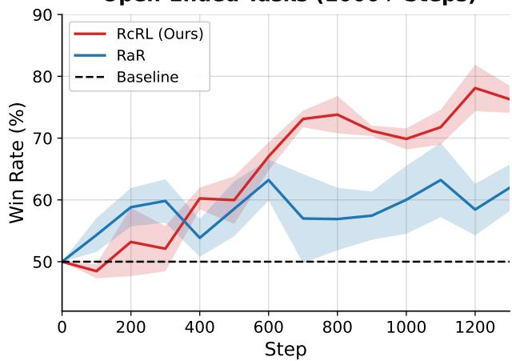  
Figure 1. RcRL vs. RaR on FictionBench. Win rates against the base Qwen3-4B model over training, averaged across 5 seeds; shading indicates ±1 SEM. RcRL (red) improves over time, reaching ∼75% by step 1300, while RaR (blue) plateaus early around 55– 65%. This demonstrates that curriculum learning over evaluation criteria enables sustained improvements by allowing additional training compute to be spent productively.

be checked automatically, for e.g. mathematical reasoning against known solutions or code execution. But a large fraction of real LLM usage (Chatterji et al., 2025, 56.4%) involves open-ended generation, for example creative writing, advice, brainstorming, explanations, etc. These tasks have no ground truth which makes them hard to hill-climb. Current methods to improve model capabilities on these open-ended tasks use either human annotations (which are expensive to obtain, especially online), offline datasets (need to be very large scale), or learnt reward models (prone to reward hacking). As RL continues to scale on verifiable domains, the gap between model performance on these openended domains and closed domains has widened (Zhang et al., 2026), making it increasingly critical to bridge.

In this work, we focus on creative short-fiction writing and health question-answering as testbeds for open-ended selfimprovement. These domains are among the most popular LLM applications, yet quality judgements are subjective and difficult to quantify, resulting in a noisy optimization landscape that is difficult to climb. The same problem arises in long-horizon open-ended tasks such as deep research and planning, where rubric rewards are increasingly used for training (Shao et al., 2026; Goel et al., 2025). We discuss how RcRL can extend to these settings in Section 6.2.

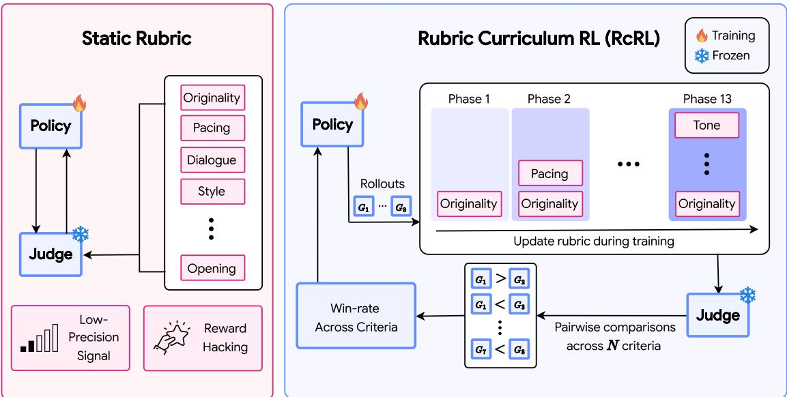  
Figure 2. Overview of Rubric Curriculum RL (RcRL). (Left) The challenge: training with a static rubric leads to reward hacking, where the model optimizes for the reward signal without improving true quality. (Right) Our solution: RcRL progressively introduces evaluation criteria, using pairwise comparisons to allocate rewards. The curriculum advances when current criteria have improved (Section 5.2).

Our goal is to study how RL post-training can be used to improve a model’s open-ended generation capabilities using only self-generated data, with no human feedback or stronger teacher models.

Our approach exploits the generation-verification (GV) gap: for e.g. in creative writing, recognizing a compelling story is easier than writing one, even for the same model (see Section 3). A model may reliably identify which of two stories is better yet consistently fail to generate stories at the level of the superior one. This asymmetry arises because verification requires compressing high-dimensional outputs into low-dimensional quality judgements to essentially rank outputs based on heuristics, while generation requires navigating a large search space to produce outputs that are both compelling and original. We formalize this gap and test it empirically in Sections 3 and 4. Additionally, we provide a computational and cognitive science perspective of the generation-verification gap in Appendix A.3.

This suggests that it might be possible to use a model’s own verification ability to supervise (and train) its generations. However, naive approaches to this fail because training a model with itself or a fixed reward model as a judge leads to reward hacking (Taylor et al., 2025). In open-ended domains, it is easy to find shortcuts that score well while producing degenerate outputs. Recent work has focused on training LLM Judges (Fein et al., 2026) or using larger models with rubrics as judges (Gunjal et al., 2026) which provide richer signal during training, but gains still plateau within a few hundred steps of training with these methods.

We present Rubric Curriculum RL (RcRL), which addresses these failures through two mechanisms. First, we use the same model as a judge to provide pairwise preferences rather than absolute scores. In GRPO (Shao et al., 2024), judging which of two rollouts is better is easier than assigning absolute scores and provides signal even when absolute quality is ambiguous (see Appendix A.2). Next, we apply a curriculum over rubric criteria by introducing new criteria progressively. When a model begins overfitting to early criteria in the rubric, a new one is added which creates a non-stationary objective that is harder to reward hack (Gao et al., 2023). Rubrics have two primary issues, (i) they do not provide high precision rewards since judgments from multiple criteria lead to a single number causing a credit assignment problem and (ii) they act as stationary targets that can get reward hacked within a few hundred steps. RcRL follows a criteria weighting strategy that leads to more emphasis on the new criteria added as part of the reward signal, which allows the model to pick up on this criterion’s reward signal within a few steps of exploration.

This allows RcRL to scale RL training far beyond prior methods. Standard self-improvement approaches plateau or collapse within 50–250 steps; RcRL continues improving past 1000 steps while preserving output entropy. In human evaluations, RcRL-trained models achieve a 70.5% win rate over the base instruction-tuned model. Across creative writing benchmarks and HealthBench (Arora et al., 2025), RcRL outperforms other strong absolute reward or noncurriculum based baselines by a large and consistent margin.

Our contributions are as follows:

1. We characterize and empirically test the generationverification gap in open-ended domains.

2. We introduce RcRL, which combines pairwise rewards with a curriculum over rubric criteria. The curriculum leads to high precision signal that reduces reward hacking during training.

3. We demonstrate that RcRL sustains improvement over 1000+ training steps, preserves output entropy, outperforms self-improvement baselines across three creative writing benchmarks, and achieves a 70.5% humanevaluated win rate—all without new data, human annotations, or strongerjudge models.

4. We extend RcRL to HealthBench and show that it consistently outperforms strong baselines.

## 2. Related Work

RL on Open-Ended Domains. RLVR has driven substantial progress on verifiable tasks like mathematics and code (Guo et al., 2025), but extending RL to open-ended domains remains difficult. RLHF can improve subjective quality (Ziegler et al., 2020; Bai et al., 2022), but human annotation is expensive offline and impractical for online RL. Alternatives include LLM-as-judge approaches (Zheng et al., 2023; Lee et al., 2024), trained reward models (Fein et al., 2026; Liao et al., 2026; Wu et al., 2026), and self-rewarding methods for instruction tuning (Yuan et al., 2024). However, these approaches either require stronger models, additional training data, or produce unreliable signal. Part of the difficulty is that creativity and open-ended performance itself resists a precise definition beyond novelty and usefulness (Schmidhuber, 2010). Recent work has explored equipping judges with rubrics to provide more structured feedback (Gunjal et al., 2026). We build on this direction, introducing pairwise evaluation and a curriculum over rubric criteria that enables sustained training without reward hacking.

Generation-Verification Gap and Reward Hacking. Generation is widely believed to be harder than verification; if $P \neq N P$ , such problems must exist (Hartmanis, 1993; Cook, 2023). From a learning-theoretic perspective, verifiers require lower-capacity function classes and thus fewer samples to learn (Vapnik & Chervonenkis, 2015). This gap appears during fine-tuning (Swamy et al., 2026) and has been exploited for self-improvement in verifiable domains (Song et al., 2025). The gap also exists in open-ended domains (Baer & McKool, 2014), but exploiting it is harder because reward hacking emerges: models find shortcuts that increase the proxy reward without improving true quality. Gao et al. (2023) derive scaling laws showing that proxy rewards rise while true quality degrades. Skalse et al. (2022) formalize when a proxy is hackable relative to a true reward, and Rafailov et al. (2024) show that even direct alignment methods such as DPO exhibit similar degradation at high KL budgets. This failure mode has been documented specifically for LLM judges in open-ended settings (Pan et al., 2024; Wolf et al., 2025; Zhao et al., 2025). Our curriculum addresses this with a non-stationary objective that prevents the policy from over-optimizing any single fixed criterion.

Curriculum Learning and Exploration. Curriculum learning (training on progressively harder examples) Bengio et al. (2009) shows that ordering data by difficulty improves convergence and generalization; Soviany et al. (2022) survey applications across deep learning. In RL, curriculum methods have been applied to goal generation (Florensa et al., 2017), environment complexity (OpenAI et al., 2019), and task difficulty (Narvekar et al., 2020). Recent RLVR work shows that curriculum improves reasoning (Parashar et al., 2026) and matches dense-reward sample efficiency (Motwani et al., 2025). A separate challenge is that RL training tends to reduce output diversity (Kirk et al., 2024; Yu et al., 2025); in GRPO specifically, entropy collapse occurs as the policy becomes overly deterministic. Entropy regularization can counteract this (Ahmed et al., 2019; Simoni et al., 2025; Tuyls et al., 2026), and prior work suggests that curriculum structure itself helps preserve entropy (Bengio et al., 2009; Cao et al., 2026; Setlur et al., 2026). Our approach combines both insights: the curriculum over rubric criteria repeatedly shifts the reward function (Zhou et al., 2022), slowing convergence to exploitative strategies while maintaining output diversity.

## 3. Preliminaries and Method

## 3.1. Understanding the Generation-Verification Gap

For many domains, verification is considered easier than generation. We hypothesize that a similar asymmetry exists in creative writing. One way to understand this gap is that generation involves searching over a vast space of possible answers, whereas evaluation does not (see Appendix A.3). This asymmetry increases in creative writing, where the goal is to be both useful/good and novel (Schmidhuber, 2010), where the latter inherently involves search. To make this intuition precise and empirically testable, we formalize the generation-verification gap:

Let X be a distribution over prompts, Y the space of responses, and $Q : \mathcal { X } \times \mathcal { Y }  [ 0 , 1 ]$ a quality function. In our experiments, Q is instantiated as the normalized rubric score from a strong external judge (e.g., GPT-5.2). Let $\pi _ { \mathcal { M } } ( \cdot | x )$

denote the model’s output distribution given prompt x. Definition 3.1 (Generative Ability). The expected quality of a single generation from model M:

$$
\begin{array} { r } { \bar { G } _ { \mathcal { M } } = \mathbb { E } _ { x \sim \mathcal { X } } \left[ \mathbb { E } _ { y \sim \pi _ { \mathcal { M } } ( \cdot \vert x ) } \left[ Q ( x , y ) \right] \right] } \end{array}
$$

Definition 3.2 (Self-Verification Ability). Expected quality of response selected by M from N independent draws:

$$
\bar { V } _ { \mathcal { M } } ^ { ( N ) } = \mathbb { E } [ Q ( x , y _ { i ^ { * } } ) ] , \quad i ^ { * } \in \arg \operatorname* { m a x } _ { i } \mathrm { r a n k } _ { \mathcal { M } } ( x , y _ { i } ) ,
$$

where $\boldsymbol { x } \sim \mathcal { X } , y _ { 1 } , \dotsc , y _ { N } \stackrel { \mathrm { i . i . d . } } { \sim } \pi _ { \mathcal { M } } ( \cdot | \boldsymbol { x } )$ , and rank $\mathcal { M }$ denotes the model’s ranking over responses via some selfselection method.

Definition 3.3 (Generation-Verification Gap). A model M exhibits a generation-verification gap on quality function $Q$ if for some N,

$$
\bar { V } _ { \mathcal { M } } ^ { ( N ) } - \bar { G } _ { \mathcal { M } } > 0 .
$$

That is, the model can reliably select responses of higher quality than it produces on a single draw.

Experimental Framework: To empirically establish the generation-verification gap in creative writing, we test the following claims:

Claim 1 (Gap Exists): The model can self-select responses of higher quality than it produces on a single draw:

$$
\bar { V } _ { \mathcal { M } } ^ { ( N ) } > \bar { G } _ { \mathcal { M } } .
$$

Evidence: Best-of-N improves over $N = 1$ (see Figure 3)

For a prompt $x ,$ we generate N independent rollouts $\left\{ y _ { 1 } , y _ { 2 } , \ldots , y _ { N } \right\}$ from the base model $\pi _ { \mathcal { M } }$ and use $\pi _ { \mathcal { M } }$ itself as a verifier to select the “best” response. Selection is via pairwise comparisons between all rollouts $( \binom { N } { 2 }$ comparisons), where the rollout with the highest win rate is chosen. Finally, we measure the win rate of the selected $y _ { i }$ against 5 held out evaluation stories for prompt x, as judged by the oracle (GPT-5.2).

Claim 2 (Gap Scales): The gap grows with model size and with the number ofsamples N:

$$
\bar { V } _ { \mathcal { M } } ^ { ( N ) } - \bar { G } _ { \mathcal { M } } \mathrm { i n c r e a s e s i n b o t h } N \mathrm { a n d m o d e l s c a l e } .
$$

Evidence: In Figure 3, Qwen3-8B exhibits a larger gap than Qwen3-4B at every $N _ { \ast }$ , and both curves are monotonically increasing in N.

Claim 3 (Gap Is Exploitable): Using self-verification as a reward signal improves creative writing capabilities:

$$
\begin{array} { r l } { \bar { G } _ { \mathcal { M } ^ { \prime } } > \bar { G } _ { \mathcal { M } } } & { { } \mathrm { a f t e r } \mathrm { R L } \mathrm { t r a i n i n g . } } \end{array}
$$

Evidence: RcRL achieves a 70.5% win rate against Qwen3- 4B on human evaluations, with significant improvements across all tested benchmarks (Section 4).

## Generation-Verification Gap: Best-of-N Scaling

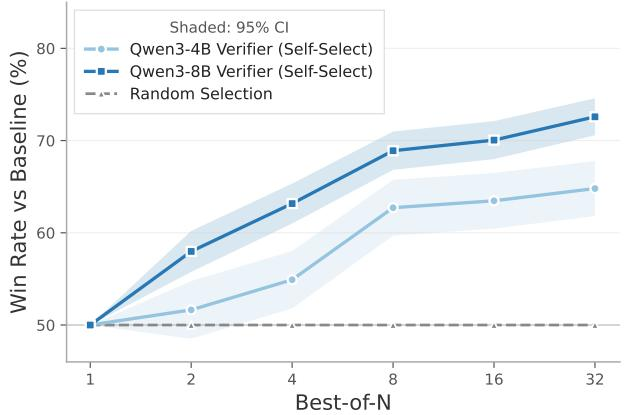  
Figure 3. Best-of-N inference scaling on FictionBench. Win rate of self-selected Best-of-N against the $N = 1$ baseline, judged by GPT-5.2 as ground truth. Win rates exceed 50% from $\dot { N } = 2$ onwards (Claim 1), grow monotonically with N, and are uniformly larger for the 8B model than the 4B model (Claim 2).

## 3.2. RL on Qualitative Domains

To exploit the generation-verification gap, we employ a selfimprovement framework where the model provides relative judgments over a group of its own outputs. We use Dr. GRPO (Liu et al., 2025) which is well-suited to this setup as it directly leverages within-group variance in output quality. For a prompt q and a group of $G$ rollouts $\left\{ o _ { 1 } , \ldots , o _ { G } \right\}$ , the RL training objective is:

$$
\frac { 1 } { G } \sum _ { i = 1 } ^ { G } \sum _ { t = 1 } ^ { | \mathbf { o } _ { i } | } \operatorname* { m i n } \left[ \frac { \pi _ { \theta } ( o _ { i , t } | \mathbf { q } , \mathbf { o } _ { i , < t } ) } { \pi _ { \theta _ { o l d } } ( o _ { i , t } | \mathbf { q } , \mathbf { o } _ { i , < t } ) } \hat { A } _ { i , t } , ~ \tilde { \rho } _ { i , t } \hat { A } _ { i , t } \right]
$$

where $\tilde { \rho } _ { i , t }$ is the probability ratio clipped to $[ 1 - \epsilon , 1 + \epsilon ]$

$$
\hat { A } _ { i , t } = R ( \mathbf { q } , \mathbf { o } _ { i } ) - \operatorname* { m e a n } \left( \left\{ R ( \mathbf { q } , \mathbf { o } _ { 1 } ) , \dots , R ( \mathbf { q } , \mathbf { o } _ { G } ) \right\} \right)
$$

Under the Rubrics as Rewards (RaR; (Gunjal et al., 2026)) framework, rewards at each step are provided as follows:

$$
R _ { \mathrm { R a R } } ( \mathbf { q } , \mathbf { o } _ { i } ; \mathbf { r } ) : = \pi _ { \mathrm { j u d g e } } ( \mathbf { q } , \mathbf { o } _ { i } , \mathbf { r } ) \in [ 0 , 1 ] .
$$

Here, r denotes the rubric provided to the judge (i.e., π<sub>judge</sub> is conditioned on the question q, the rollout $\mathbf { o } _ { i } ,$ and the rubric r). A rubric can be seen as a checklist of criteria that specifies what counts as a high quality output. In RaR, $\pi _ { \mathrm { j u d g e } }$ is often instantiated as a separate, larger and stronger model than the policy being trained $( { \mathrm { i . e . , } } \pi _ { \mathrm { j u d g e } } \neq \pi _ { \theta } )$ . This assumes the existence of stronger models or more data.

While RaR provides a clear training signal, it is prone to reward hacking in qualitative domains like creative writing. As illustrated in Figure 4, training reward climbs steadily while evaluation win rates remain volatile and saturate after a few hundred steps, demonstrating a critical decoupling between reward optimization and true quality improvement (Gao et al., 2023). This decoupling has two sources. First,

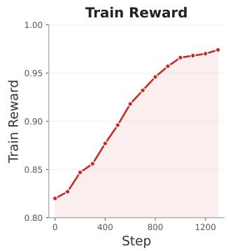

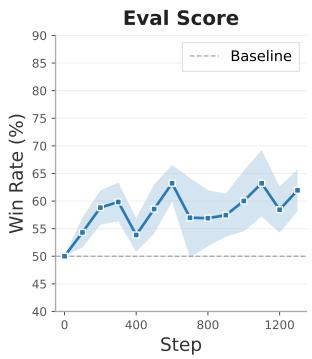  
Figure 4. Reward hacking with static rubrics. (Left) Absolute train reward increases steadily over the course of training, reaching near-saturation. (Right) Evaluation win rate against the base model on FictionBench shows no consistent improvement as training progresses, indicating a performance mismatch.

with a fixed rubric r and judge $\pi _ { \mathrm { j u d g e } }$ , the model shifts from learning to write better to exploiting specific biases in π<sub>judge</sub> (Singhal et al., 2024; Skalse et al., 2022), leading to the entropy degradation observed in Section 4. In Section 5 we study this performance degradation on a per-criterion level. Second, RaR relies on absolute rewards which present a stationary target that gets reward hacked quicker than it would for pairwise rewards (Karwowski et al., 2024; Zhao et al., 2025; Fu et al., 2025). Early work from (Xu et al., 2025) has shown pairwise rewards as a promising approach to reduce reward hacking. Intuitively, relative rewards are more resistant to reward hacking because the comparison target evolves with the policy itself (see Appendix A.2). Unlike absolute rewards which can reach a maximum threshold, pairwise rewards do not saturate in a similar way.

## 3.3. Our method

Rewards in our method are produced by a fixed self-judge $\pi _ { \theta _ { 0 } }$ that compares two rollouts at a time. For a single rubric item, a rollout’s scalar reward is its empirical win rate against all the other rollouts. Importantly, instead of providing a noisy stationary optimization target with the entire rubric at once, we use a curriculum over rubric criteria. We let $\pi _ { \mathrm { j u d g e } } : = \pi _ { \theta _ { \mathrm { 0 } } }$ denote the fixed (initial) snapshot of the base model, held constant during training (i.e., not updated online). Let $\mathcal { R } = \{ r ^ { ( 1 ) } , r ^ { ( 2 ) } , \bar { . } . . \}$ be a sequence of rubric items, and let $k ( t )$ denote the active rubric index at training step t (updated every n steps). Given a set of G rollouts $\{ \mathbf { o } _ { 1 } , \hdots , \mathbf { o } _ { G } \}$ generated by $\pi _ { \theta }$ for the same query ${ \bf q } ,$ let $y _ { i \succ j } ^ { ( m ) } \in \{ 0 , 1 \}$ indicate whether $\pi _ { \mathrm { j u d g e } }$ prefers $\mathbf { o } _ { i }$ over $\mathbf { o } _ { j }$ under rubric item $r ^ { ( m ) }$ . The win-rate reward under that item is the average preference against the other rollouts:

$$
R _ { \mathrm { p a i r } } ^ { ( m ) } ( \mathbf { q } , \mathbf { o } _ { i } ) = \frac { 1 } { G - 1 } \sum _ { j = 1 \atop j \neq i } ^ { G } y _ { i \succ j } ^ { ( m ) } .
$$

To improve the signal on new rubric items and prevent degradation on the previous criteria, we use a weighted curriculum over rubric items: at step t, the newest rubric item $r ^ { ( k ( t ) ) }$ receives half of the total weight, while the remaining half is distributed uniformly over all previous items $\{ r ^ { ( 1 ) } , \ldots , r ^ { ( k ( t ) - 1 ) } \}$ . For $k ( t ) = 1$ , we set $\bar { w } _ { t } ^ { ( 1 ) } = 1$ . For $k ( t ) > 1$ , we use weights

$$
w _ { t } ^ { ( m ) } : = \left\{ \begin{array} { l l } { \frac { 1 } { 2 } , } & { m = k ( t ) , } \\ { \frac { 1 } { 2 \left( k ( t ) - 1 \right) } , } & { 1 \leq m < k ( t ) , } \end{array} \right. \sum _ { m = 1 } ^ { k ( t ) } w _ { t } ^ { ( m ) } = 1
$$

The resulting weighted pairwise curriculum reward is:

$$
R _ { \mathrm { W - p a i r } } ( { \bf q } , { \bf o } _ { i } ; t ) : = \sum _ { m = 1 } ^ { k ( t ) } w _ { t } ^ { ( m ) } R _ { \mathrm { p a i r } } ^ { ( m ) } ( { \bf q } , { \bf o } _ { i } ) \in [ 0 , 1 ] .
$$

We present the algorithm for RcRL below. The curriculum advances every n training steps, introducing a new criterion while re-weighting all previous ones. See Appendix A.1 for further analysis on the benefits of a curriculum. We set $n = 1 0 0$ to allocate sufficient training compute without over-optimizing on a single criterion (see Section 5).

```twig
Algorithm 1 Rubric Curriculum RL (RcRL)
1: Input: Policy $\pi _ { \theta } ,$ , rubric $\mathcal { R } = \{ r ^ { ( 1 ) } , \ldots , r ^ { ( K ) } \}$ , prompt
distribution X
2: Init: $k ( t ) \gets 1$ , judge π<sub>judge</sub> $ \pi _ { \theta _ { 0 } }$ (frozen)
3: for step $t = 1$ to $T$ do
4: Sample $\mathbf { q } \sim { \mathcal { X } } ;$ generate $\{ \mathbf { o } _ { 1 } , \dotsc , \mathbf { o } _ { G } \} \sim \pi _ { \theta } ( \cdot \vert \mathbf { q } )$
5: Compute $R _ { \mathrm { W - p a i r } } ( \mathbf { q } , \mathbf { o } _ { i } ; t )$ for all i
6: Update θ via GRPO with rewards $\{ R _ { \mathrm { W - p a i r } } \} _ { i = 1 } ^ { G }$
7: if t mod $n = 0$ and $k ( t ) < K$ then
8: $k ( t ) \gets k ( t ) + 1$ ▷ Expand curriculum
9: end if
10: end for
11: Return: π<sub>θ</sub>
```

## 4. Empirical Results

## 4.1. Evaluation Framework

To empirically validate RcRL, we focus primarily on creative writing with a detailed set of experiments and ablations across three distinct benchmarks detailed below. In Section 5.4, we further evaluate cross-domain generalization on HealthBench, a health conversation benchmark.

Win Rate vs. Other Models  
Table 1. Additional benchmark results. FictionBench and the LechMazur Writing benchmark. Best results per model in bold.
<table><tr><td></td><td colspan="2">FICTIONBENCH</td><td>LECHMAZUR</td><td></td></tr><tr><td>METHOD</td><td>ELO</td><td>WIN%</td><td>SCORE</td><td> $\mathcal { H } _ { \mathrm { R A T I O } }$ </td></tr><tr><td>QWEN 3 4B (BASELINE)</td><td>1000</td><td></td><td>77.0</td><td></td></tr><tr><td>QWEN34B RAR</td><td>1052</td><td>57.5</td><td>80.3</td><td>0.73</td></tr><tr><td>OuRs (RcRL)</td><td>1181</td><td>73.9</td><td>80.9</td><td>0.93</td></tr></table>

• Creative Writing V3 (CWv3): A comprehensive suite (Paech, 2025a) that first evaluates model responses against a multi-point rubric and subsequently computes ELO ratings. It provides three primary metrics: rubric score, win rate, and ELO rating. To ensure results are robust to specific model biases, we conduct evaluations using three separate frontier model judges.

• FictionBench: An independently developed benchmark using pairwise comparisons, which better capture qualitative differences than absolute scores in creative domains (Zhang et al., 2026). Each evaluation randomly samples 20 prompts from a pool, generating two samples per model per prompt; GPT-5.2 evaluates all 40 pairs using 7× oversampling (280 total comparisons). We report win rates and ELO ratings via Bradley-Terry (Bradley & Terry, 1952). As an independently constructed prompt set, FictionBench also mitigates benchmark leakage risks.

• LechMazur (LM): A public benchmark (Mazur, 2024) focused on high-dimensional constraints in writing. Using GPT-5.2 as a judge, it evaluates model performance across 18 distinct criteria, producing both an aggregate rubric score and a fine-grained heatmap. The first 8 criteria measure major story aspects while the latter 10 measure element integration from the prompt.

We conduct our primary experiments and analysis on Qwen3-4B. To evaluate scaling behavior, we train models across the Qwen3 family (Yang et al., 2025) ranging from 0.6B to 14B parameters, and additionally validate crossarchitecture generalization on the Llama family. Note, all baseline models come instruction-tuned.

## 4.2. Main Creative Writing Results

RcRL substantially outperforms both the base instructiontuned Qwen3-4B and the RaR baseline across all evaluation settings. On CWv3 (Table 2), RcRL achieves consistent gains across all 3 independent judges, with ELO improvements of +577 (GPT-5.2), +105 (Claude 4.5 Opus), and +524 (Deepseek V3.2) over the base model. Notably, RcRL’s ELO gains are 1.6–2.7× larger than RaR’s, with win rates consistently favoring RcRL.

On FictionBench (Table 1), RcRL achieves a 73.9% win rate against the base model, with a 3.5× ELO gain over RaR. On LechMazur, RcRL scores 80.9 compared to 77.0 for the base model, with particularly strong gains in prompt element integration (Q9A–Q9J; see Appendix D.3 for the full heatmap). Section 5 presents ablations isolating each component and evaluates additional baselines. See Appendix A.4 for lexical analysis of trained models’ outputs.

## 4.3. Pairwise Model Comparisons

Beyond aggregate benchmark scores, we evaluate RcRL through direct pairwise comparisons against models from the Qwen3 family. Figure 5 presents win rates on Fiction-Bench. RcRL achieves a 71.4% win rate against the RaR baseline. More important is RcRL’s performance against larger models: while Qwen3-4B wins only 12.1% and 1.8% of the time against 8B and 14B respectively, RcRL raises these to 40.0% and 27.9%, substantially closing the model capacity gap without new data or teacher models.

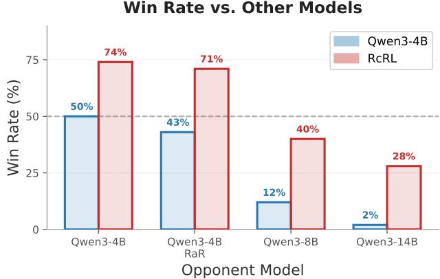  
Figure 5. Head-to-head win rates on FictionBench. RcRL achieves substantial gains over the Qwen3-4B baseline against all opponents: +28% against RaR, +28% against Qwen3-8B, and +26% against Qwen3-14B.

Human Evaluation. To validate that automated judgments reflect genuine quality improvements aligned with human preferences, we conducted a human evaluation study. Three professional annotators evaluated 500 distinct prompt-response pairs each, comparing RcRL outputs against Qwen3-4B baseline outputs. For each pair, annotators rated which response was superior across seven criteria, including an overall preference judgment. Presentation order was randomized to control for position bias. Human judges preferred RcRL outputs 70.5% of the time overall (Figure 6), with unanimous agreement among all three annotators on 70.8% of comparisons. Table 10 in Appendix E.1 provides the full per-criterion breakdown and statistics.

Table 2. Creative Writing Bench v3 evaluation results. Three frontier models (GPT-5.2, Claude 4.5 Opus, Deepseek V3.2) serve as independent judges, evaluating outputs from each method via pairwise comparisons. We report ELO ratings (baseline anchored at 1000), rubric scores (0–100 scale), and win rates against the Qwen 3 4B baseline (%). ELO ratings reflect relative rankings within each judge and are not comparable across judges. Best results per metric and judge in bold.
<table><tr><td></td><td colspan="3">GPT-5.2</td><td colspan="3">CLAUDE 4.5 OPUS</td><td colspan="3">DEEPSEEK V3.2</td></tr><tr><td>METHOD</td><td>ELO</td><td>RUBRIC</td><td>WIN%</td><td>ELO</td><td>RUBRIC</td><td>WIN%</td><td>ELO</td><td>RUBRIC</td><td>WIN%</td></tr><tr><td>QWEN 3 4B (BASELINE)</td><td>1000</td><td>45.4</td><td></td><td>1000</td><td>40.8</td><td></td><td>1000</td><td>51.2</td><td></td></tr><tr><td>QWEN 3 4B RAR</td><td>1210</td><td>48.5</td><td>61.1</td><td>1051</td><td>41.1</td><td>51.7</td><td>1326</td><td>55.0</td><td>53.9</td></tr><tr><td>OURS (RcRL)</td><td>1577</td><td>50.1</td><td>69.3</td><td>1105</td><td>40.0</td><td>59.2</td><td>1524</td><td>58.1</td><td>65.4</td></tr></table>

Human Evaluation: RcRL vs Qwen 3 4B  
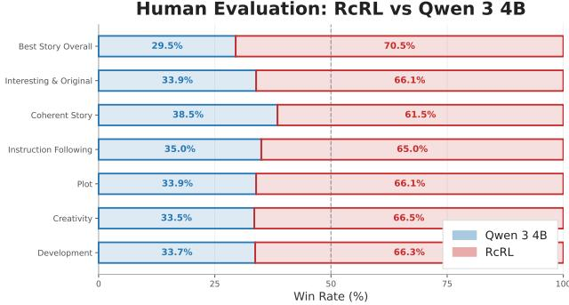  
Figure 6. Human evaluation results. Win rates of RcRL-trained Qwen3-4B against the base model across seven criteria, averaged over three annotators who conducted 500 comparisons each. RcRL achieves a 70.5% win rate on Best Story Overall, with consistent improvements across all criteria.

## 4.4. Scaling Behavior

RcRL directly exploits the generation-verification gap by using verification (pairwise comparisons) to supervise generation. Previous work has shown the gap on verifiable domains scales with model size (Song et al., 2025), so we expect RcRL to yield increasing benefits at scale. Figure 7 confirms this: RcRL’s win rate against base models increases monotonically from 54.6% at 0.6B to 75.2% at 14B parameters. Cross-architecture generalization is supported by Llama-3.2-3B showing similar improvements.

## 5. Analysis

We give the theoretical analysis how the generationverification gap can lead to self-improvement in Appendix A.1, and of why pairwise rewards outperform absolute ones in Appendix A.2. In this section, we test each component empirically through ablations, scaling experiments, and analyses of training dynamics.

## 5.1. Ablations

Table 3 isolates the contribution of RcRL’s core components. Removing pairwise rewards in Absolute RcRL (using absolute rubric scores instead) reduces FictionBench win rate by

Scaling Performance: RcRL Win Rate vs. Base Model  
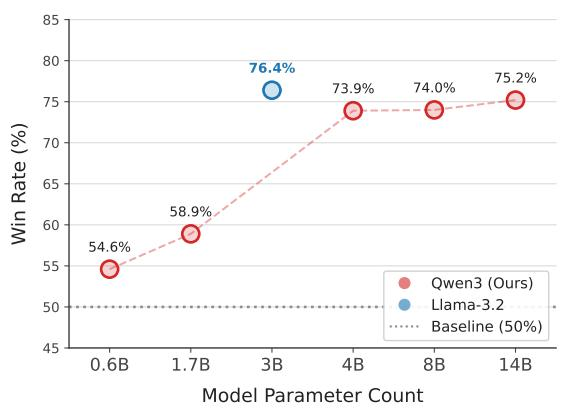  
Figure 7. Scaling behavior of RcRL. Win rates against base models across model sizes for Qwen3 (red) and Llama-3.2 (blue). Performance improves with scale, from 54.6% at 0.6B to 75.2% at 14B parameters. The Llama-3.2-3B result (76.4%) demonstrates that RcRL generalizes across model families.

18.2%, confirming the advantage of relative comparisons. Removing the curriculum significantly reduces ELO ratings and causes rapid entropy collapse $( \mathcal { H } _ { \mathrm { r a t i o } } = 0 . 8 3$ within 300 steps), validating that progressive criteria addition is essential for preserving output diversity and sustaining gains. We also apply a Dropout baseline where we randomly drop criteria from RaR to make the objective non-stationary. Furthermore, we test 3 random curriculum orderings (post our main results) and show that performance remains strong across orderings (described in Appendix C.3). On RaR, we perform an LR sweep and report results for the best LR. For RcRL, we use a default LR of 5e-6.

We use exploration bonuses (Tuyls et al., 2026) and usefulness rewards derived from early work from (Schmidhuber, 2010) as add-ons to our method and see that they sometimes offer strong gains, especially together. We describe the exact structure of these techniques in Appendix B

## 5.2. Curriculum Pacing

A key design choice in RcRL is when to introduce a new criterion to the curriculum. In Figure 8 we train on a single criterion for 200 steps, then evaluate periodically on overall story quality and the specific criterion the model was trained on. Averaged across four criteria, the overall win rate climbs until approximately step 100 before declining, motivating n = 100 for RcRL. Advancing the curriculum at this inflection point allows RcRL to capture each criterion’s benefits during the informative phase, then shift the optimization target before degradation occurs.

Table 3. Ablation study and baseline comparisons. We evaluate the contribution of each component of RcRL. “+” denotes adding a component to the base method, “−” denotes removing from the full method. All models trained from Qwen 3 4B. Win rates computed against the base model. Best results in bold.
<table><tr><td rowspan="2">METHOD</td><td colspan="3">CW BENCH V3</td><td colspan="3">FICTIONBENCH + LM</td></tr><tr><td>ELO</td><td>RUBRIC</td><td>WIN%</td><td>ELO</td><td>WIN%</td><td>LM</td></tr><tr><td colspan="7">No RL Training</td></tr><tr><td>QWEN 3 4B (BASELINE)</td><td>1000</td><td>45.4</td><td></td><td>1000</td><td></td><td>77.0</td></tr><tr><td colspan="7">No Curriculum</td></tr><tr><td>ABSOLUTE RAR</td><td>1210</td><td>48.5</td><td>61.1</td><td>1052</td><td>57.5</td><td>80.3</td></tr><tr><td>DROPOUT ABSOLUTE RAR</td><td>1166</td><td>49.8</td><td>55.4</td><td>1113</td><td>65.7</td><td>80.9</td></tr><tr><td>PAIRWISE RAR</td><td>1195</td><td>47.6</td><td>68.2</td><td>1144</td><td>69.6</td><td>82.0</td></tr><tr><td colspan="7">No Pairwise Rewards</td></tr><tr><td>ABSOLUTE RCRL</td><td>1357</td><td>49.8</td><td>61.4</td><td>1040</td><td>55.7</td><td>79.6</td></tr><tr><td colspan="7">Other Ablations</td></tr><tr><td>+ EXPLORATION BONUS</td><td>1395</td><td>48.6</td><td>48.9</td><td>1070</td><td>60.0</td><td>82.2</td></tr><tr><td>+ EXPLORATION &amp; USEFULNESS</td><td>1257</td><td>50.8</td><td>51.1</td><td>1115</td><td>66.0</td><td>82.3</td></tr><tr><td>+ KL TERM</td><td>1474</td><td>48.1</td><td>55.0</td><td>1003</td><td>50.5</td><td>78.6</td></tr><tr><td>– WEIGHTING</td><td>1445</td><td>49.3</td><td>66.1</td><td>1165</td><td>72.1</td><td>81.4</td></tr><tr><td>ORDERING 1</td><td>1638</td><td>49.1</td><td>51.4</td><td>1181</td><td>73.9</td><td>80.9</td></tr><tr><td>ORDERING 2</td><td>1548</td><td>49.7</td><td>62.1</td><td>1237</td><td>79.6</td><td>80.2</td></tr><tr><td>ORDERING 3</td><td>1421</td><td>50.8</td><td>72.1</td><td>1253</td><td>81.0</td><td>80.9</td></tr><tr><td colspan="7">Full Method</td></tr><tr><td>RcRL (OURS)</td><td>1577</td><td>50.1</td><td>69.3</td><td>1181</td><td>73.9</td><td>80.9</td></tr></table>

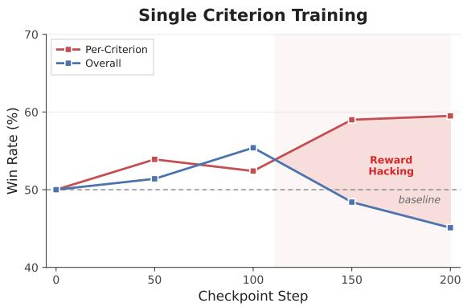  
Figure 8. Single-criterion training dynamics. Win rates averaged across five models, each trained on a single criterion (e.g., plot coherence, character development). Per-criterion performance (red) improves steadily, while overall story quality (blue) peaks around step 100 before declining.

## 5.3. Entropy Preservation

Figure 9 shows that RaR exhibits steady entropy decline, which manifests in concrete output pathologies: RaRtrained models exhibit elevated n-gram repetition and, in select stories, the insertion of non-English tokens (Appendix A.4). In contrast, RcRL maintains near-constant entropy throughout training with $\mathcal { H } _ { \mathrm { r a t i o } } ~ = ~ 0 . 9 3$ (ratio of final to initial entropy). This stability arises from (i) the curriculum continuously reshaping the reward landscape by updating the objective before the model can overfit to previous ones, and (ii) pairwise rewards that force the judge to discriminate regardless of output quality, preventing the vanishing gradients that accompany absolute reward saturation. Together, these mechanisms sustain exploration capacity, allowing the model to find diverse writing strategies.

## 5.4. Cross-Domain Applicability

While our primary experiments focus on creative writing, RcRL’s core mechanism is not specific to any domain. To test the generalizability of RcRL, we apply the method to HealthBench (Arora et al., 2025), a health conversation/advising benchmark with per-example evaluation rubrics. We train Qwen3-4B with a fixed set of 13 generalpurpose criteria constructed from HealthBench’s evaluation rubrics (provided in Appendix C.4), using the same hyperparameters as in creative writing with the exception of n = 50 steps per curriculum phase. We note that HealthBench provides instance-specific rubrics but we do not need these, and RcRL with a fixed rubric is competitive even against instance-specific rubrics.

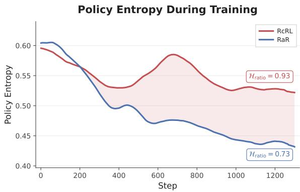  
Figure 9. Policy entropy during training. The static rubric baseline exhibits a steady decline in entropy, indicating mode collapse toward a narrow set of outputs. RcRL maintains consistently higher entropy throughout training.

We showcase two sets of results: one trained and evaluated on the full HealthBench split dataset and another trained and evaluated on the split consensus subset, where each perexample rubric criterion has been independently validated by multiple medical professionals so the criteria themselves are higher-quality and less noisy. On the full HealthBench dataset, RcRL achieves a 14.60% score improvement over the base model compared to 8.26% for RaR; on the consensus subset, RcRL achieves a 25.38% improvement versus 7.53% for RaR (Table 4). These gains confirm the results observed in our creative writing evaluations.

Table 4. HealthBench cross-domain results. Score improvement over Qwen 3 4B on full HealthBench and the consensus subset (criteria validated by multiple annotators). Best in bold.
<table><tr><td>METHOD</td><td>HEALTHBENCH ∆</td><td>CONSENSUS ∆</td></tr><tr><td>QWEN 3 4B (BASELINE)</td><td></td><td></td></tr><tr><td>QWEN 34B RAR</td><td>+8.26%</td><td>+7.53%</td></tr><tr><td>INSTANCE-SPECIFIC</td><td>+13.52%</td><td>+10.52%</td></tr><tr><td>ABSOLUTE RCRL</td><td>+13.40%</td><td>+23.87%</td></tr><tr><td>RcRL (OURS)</td><td>+14.60%</td><td>+25.38%</td></tr></table>

Notably, the relative contribution of RcRL’s two mechanisms differs across domains. In creative writing, the Pairwise RaR baseline (no curriculum) reaches 69.6% on FictionBench (Table 3), only modestly below RcRL, indicating that pairwise rewards provide significant improvements. On HealthBench, however, the Absolute RcRL configuration (curriculum without pairwise rewards) closes most of the gap to full RcRL (+13.40% vs +14.60% on the full benchmark; +23.87% vs +25.38% on consensus).

To explain this, we observe that HealthBench criteria are more easily verifiable (e.g. “does the response list all side effects of any suggested treatment?”), whereas creativewriting criteria are subjective (e.g. “does the story have a clear plot structure?”). Verifiable criteria naturally admit calibrated absolute scores, so pairwise rewards extract less additional ranking signal beyond what absolute scores already provide. The complementarity of the curriculum and pairwise rewards is what makes RcRL robust across domains with structurally different reward signals.

## 6. Discussion

## 6.1. Limitations

Evaluation in non-verifiable domains remains fundamentally noisy. On creative writing, even among domain-expert human annotators, inter-rater agreement reaches only moderate levels (κ ≈ 0.6) (Gomez-Rodr´ ´ıguez & Williams, 2023), and rubric-based judgments in more verifiable domains like HealthBench still depend on judge model fidelity. We mitigate stochastic noise and judge bias via hundreds of comparisons across multiple frontier judges and observe consistent performance across all settings.

The curriculum with pairwise rewards scales quadratically with rollout batch size and linearly with training steps. For our experiments with 8 rollouts and a 13-criterion curriculum this remains tractable, but scaling to larger G or finer-grained rubrics would require approximations such as tournament-style evaluation. Under the Bradley-Terry model, O(G log G) adaptive comparisons (e.g., Swisssystem tournaments) can recover the ordinal ranking while preserving expected win rates, suggesting much of the gain can be retained at a substantially reduced cost.

## 6.2. Future Work

RcRL advances the curriculum every 100 steps uniformly; learning to detect per-criterion inflection points automatically could improve both efficiency and final performance. RcRL currently requires a hand-specified rubric; automating criterion discovery from preference data would reduce the cost of applying the method to new domains. Scaling to substantially larger rubrics will additionally require adaptive or stochastic curriculum strategies, since fixed-order presentation becomes less defensible with many criteria. Additionally, verification compute can be scaled significantly, which might improve the robustness further (Singh et al., 2026; Venkatraman et al., 2026). Many long-horizon tasks, such as research or multi-step planning, produce outputs that cannot be verified, and rubric rewards are already used to train such agents (Goel et al., 2025). Extending RcRL to these settings is a natural next step, and we describe our planned approach below.

Extension to long-horizon tasks. In long-horizon openended tasks such as deep research (Shao et al., 2026) and research planning (Goel et al., 2025), the problems motivating RcRL become more important since a single rubric score must summarize many intermediate decisions as well as many criteria, and arrives only at the end of a long trajectory. RcRL can be extended to these settings by aligning the rubric curriculum with the task horizon. Suppose a task consists of H stages, each producing an intermediate output that the next stage builds on (e.g., a set of sources, a synthesis of them, and a final report), and let $\mathcal { R } _ { h }$ contain the criteria that assess the output of stage h. We can order the rubric by stage, $\mathcal { R } = ( \mathcal { R } _ { 1 } , \ldots , \mathcal { R } _ { H } )$ , and rather than performing all H stages and judging only the final output throughout training, the policy performs only the first h stages while criteria from $\mathcal { R } _ { h }$ are being added, and the judge compares the outputs of stage h. The rubric and the task horizon can thus grow together, combining the curriculum over criteria with one over horizon length (Motwani et al., 2025), while the reward is computed exactly as in RcRL so that earlier criteria remain in the reward.

## 6.3. Conclusion

We introduce Rubric Curriculum RL (RcRL), a method that combines pairwise rewards with curriculum learning to provide training signal for improving performance in nonverifiable domains. On creative writing, RcRL achieves a 73.9% win rate on FictionBench and a 70.5% human preference over its base model, without human preference data or stronger teacher models. On HealthBench, RcRL improves over the base model by 14.6%, outperforming all training baselines including instance-specific rubrics. Improvements scale with model size, suggesting the approach becomes increasingly effective at frontier scales. Our results are amongst the first to demonstrate that in non-verifiable domains where verification is easier than generation, it is possible to use this asymmetry as training signal for scalable self-improvement.

## Impact Statement

This paper presents work whose goal is to advance the field of Machine Learning. It serves to improve RL post-training performance on an important, understudied domain.

## References

Ahmed, Z., Roux, N. L., Norouzi, M., and Schuurmans, D. Understanding the impact of entropy on policy optimization. In Chaudhuri, K. and Salakhutdinov, R. (eds.), Proceedings of the 36th International Conference on Machine Learning, ICML 2019, 9-15 June 2019, Long Beach, California, USA, Proceedings

of Machine Learning Research, pp. 151–160. PMLR, 2019. URL http://proceedings.mlr.press/ v97/ahmed19a.html.

Anderson, J. R. and Bower, G. H. Recognition and retrieval processes in free recall. Psychological review, 79(2):97, 1972.

Arora, R. K., Wei, J., Hicks, R. S., Bowman, P., Quinonero-˜ Candela, J., Tsimpourlas, F., Sharman, M., Shah, M., Vallone, A., Beutel, A., Heidecke, J., and Singhal, K. Healthbench: Evaluating large language models towards improved human health, 2025. URL https://arxiv. org/abs/2505.08775.

Baer, J. and McKool, S. S. The gold standard for assessing creativity. Int. J. Qual. Assur. Eng. Technol. Educ., 3(1):81–93, 2014. doi: 10.4018/IJQAETE. 2014010104. URL https://doi.org/10.4018/ ijqaete.2014010104.

Bai, Y., Jones, A., Ndousse, K., Askell, A., Chen, A., Das-Sarma, N., Drain, D., Fort, S., Ganguli, D., Henighan, T., Joseph, N., Kadavath, S., Kernion, J., Conerly, T., El-Showk, S., Elhage, N., Hatfield-Dodds, Z., Hernandez, D., Hume, T., Johnston, S., Kravec, S., Lovitt, L., Nanda, N., Olsson, C., Amodei, D., Brown, T., Clark, J., McCandlish, S., Olah, C., Mann, B., and Kaplan, J. Training a helpful and harmless assistant with reinforcement learning from human feedback, 2022. URL https://arxiv.org/abs/2204.05862.

Bengio, Y., Louradour, J., Collobert, R., and Weston, J. Curriculum learning. In Proceedings ofthe 26th Annual International Conference on Machine Learning, ICML ’09, pp. 41–48, New York, NY, USA, 2009. Association for Computing Machinery. ISBN 9781605585161. doi: 10.1145/1553374.1553380. URL https://doi. org/10.1145/1553374.1553380.

Bradley, R. A. and Terry, M. E. Rank analysis of incomplete block designs: I. The method of paired comparisons. Biometrika, 39(3/4):324–345, 1952.

Cao, H., Bai, Z., Peng, Z., Wang, B., Yang, T., Huo, J., Zhang, Y., and Gao, Y. Efficient reinforcement learning with semantic and token entropy for LLM reasoning, 2026. URL https://arxiv.org/abs/2512. 04359.

Chatterji, A., Cunningham, T., Deming, D. J., Hitzig, Z., Ong, C., Shan, C. Y., and Wadman, K. How people use chatgpt. Technical report, National Bureau of Economic Research, 2025.

Cook, S. A. The complexity of theorem-proving procedures. In Kapron, B. M. (ed.), Logic, Automata, and

Computational Complexity: The Works of Stephen A. Cook, ACM Books, pp. 143–152. ACM, 2023. doi: 10. 1145/3588287.3588297. URL https://doi.org/ 10.1145/3588287.3588297.

Fein, D., Russo, S., Xiang, V., Jolly, K., Rafailov, R., and Haber, N. LitBench: A benchmark and dataset for reliable evaluation of creative writing. In Demberg, V., Inui, K., and Marquez, L. (eds.), Proceedings of the 19th Conference ofthe European Chapter ofthe Association for Computational Linguistics, EACL 2026 - Volume 1: Long Papers, Rabat, Morocco, March 24-29, 2026, pp. 7740–7755. Association for Computational Linguistics, 2026. URL https://aclanthology.org/2026. eacl-long.362/.

Florensa, C., Held, D., Wulfmeier, M., Zhang, M., and Abbeel, P. Reverse curriculum generation for reinforcement learning. In 1st Annual Conference on Robot Learning, CoRL 2017, Mountain View, California, USA, November 13-15, 2017, Proceedings, Proceedings of Machine Learning Research, pp. 482–495. PMLR, 2017. URL http://proceedings.mlr.press/ v78/florensa17a.html.

Fu, J., Zhao, X., Yao, C., Wang, H., Han, Q., and Xiao, Y. Reward shaping to mitigate reward hacking in RLHF. In ICML 2025 Workshop on Reliable and Responsible Foundation Models, 2025. URL https://openreview. net/forum?id=62A4d5Mokc.

Gao, L., Schulman, J., and Hilton, J. Scaling laws for reward model overoptimization. In Krause, A., Brunskill, E., Cho, K., Engelhardt, B., Sabato, S., and Scarlett, J. (eds.), International Conference on Machine Learning, ICML 2023, 23-29 July 2023, Honolulu, Hawaii, USA, Proceedings of Machine Learning Research, pp. 10835– 10866. PMLR, 2023. URL https://proceedings. mlr.press/v202/gao23h.html.

Goel, S., Hazra, R., Jayalath, D., Willi, T., Jain, P., Shen, W. F., Leontiadis, I., Barbieri, F., Bachrach, Y., Geiping, J., and Whitehouse, C. Training ai co-scientists using rubric rewards, 2025. URL https://arxiv.org/ abs/2512.23707.

Gomez-Rodr ´ ´ıguez, C. and Williams, P. A confederacy of models: a comprehensive evaluation of LLMs on creative writing. In Bouamor, H., Pino, J., and Bali, K. (eds.), Findings of the Association for Computational Linguistics: EMNLP 2023, Singapore, December 6-10, 2023, Findings of ACL, pp. 14504–14528. Association for Computational Linguistics, 2023. doi: 10.18653/V1/2023. FINDINGS-EMNLP.966. URL https://doi.org/ 10.18653/v1/2023.findings-emnlp.966.

Gunjal, A., Wang, A., Lau, E., Nath, V., He, Y., Liu, B., and Hendryx, S. M. Rubrics as Rewards: reinforcement learning beyond verifiable domains. In The Fourteenth International Conference on Learning Representations, 2026. URL https://openreview.net/forum? id=c1bTcrDmt4.

Guo, D., Yang, D., Zhang, H., Song, J., Wang, P., Zhu, Q., Xu, R., Zhang, R., Ma, S., Bi, X., Zhang, X., Yu, X., Wu, Y., Wu, Z. F., Gou, Z., Shao, Z., Li, Z., Gao, Z., Liu, A., Xue, B., Wang, B., Wu, B., Feng, B., Lu, C., Zhao, C., Deng, C., Ruan, C., Dai, D., Chen, D., and Ji, D. DeepSeek-R1 incentivizes reasoning in LLMs through reinforcement learning. Nature, 645(8081):633–638, 2025. ISSN 1476-4687. doi: 10.1038/s41586-025-09422-z. URL http://dx.doi. org/10.1038/s41586-025-09422-z.

Hartmanis, J. Godel, von neumann and the P =? NP¨ problem. In Rozenberg, G. and Salomaa, A. (eds.), Current Trends in Theoretical Computer Science - Essays and Tutorials, World Scientific Series in Computer Science, pp. 445–450. World Scientific, 1993. doi: 10.1142/9789812794499\ 0033. URL https://doi. org/10.1142/9789812794499\_0033.

Holtzman, A., Buys, J., Du, L., Forbes, M., and Choi, Y. The curious case of neural text degeneration. In 8th International Conference on Learning Representations, ICLR 2020, Addis Ababa, Ethiopia, April 26-30, 2020. OpenReview.net, 2020. URL https://openreview. net/forum?id=rygGQyrFvH.

Jayalath, D., Goel, S., Foster, T., Jain, P., Gururangan, S., Zhang, C., Goyal, A., and Schelten, A. Compute as teacher: Turning inference compute into referencefree supervision, 2026. URL https://arxiv.org/ abs/2509.14234.

Jia, R., Yang, Y., Gai, Y., Luo, K., Huang, S., Lin, J., Jiang, X., and Jiang, G. Writing-zero: Bridge the gap between non-verifiable tasks and verifiable rewards, 2025. URL https://arxiv.org/abs/2506.00103.

Karwowski, J., Hayman, O., Bai, X., Kiendlhofer, K., Griffin, C., and Skalse, J. M. V. Goodhart’s Law in reinforcement learning. In The Twelfth International Conference on Learning Representations, ICLR 2024, Vienna, Austria, May 7-11, 2024. OpenReview.net, 2024. URL https: //openreview.net/forum?id=5o9G4XF1LI.

Kirk, R., Mediratta, I., Nalmpantis, C., Luketina, J., Hambro, E., Grefenstette, E., and Raileanu, R. Understanding the effects of RLHF on LLM generalisation and diversity. In The Twelfth International Conference on Learning Representations, ICLR 2024, Vienna, Austria,

May 7-11, 2024. OpenReview.net, 2024. URL https: //openreview.net/forum?id=PXD3FAVHJT.

Lee, H., Phatale, S., Mansoor, H., Mesnard, T., Ferret, J., Lu, K., Bishop, C., Hall, E., Carbune, V., Rastogi, A., and Prakash, S. RLAIF vs. RLHF: scaling reinforcement learning from human feedback with AI feedback. In Salakhutdinov, R., Kolter, Z., Heller, K. A., Weller, A., Oliver, N., Scarlett, J., and Berkenkamp, F. (eds.), Forty-first International Conference on Machine Learning, ICML 2024, Vienna, Austria, July 21-27, 2024, Proceedings of Machine Learning Research, pp. 26874–26901. PMLR / OpenReview.net, 2024. URL https://proceedings.mlr.press/ v235/lee24t.html.

Li, S. S., Xin, R., Xiao, T., Wang, Y., Shao, R., Hao, Z., Sclar, M., Oh, S., Brahman, F., Koh, P. W., and Tsvetkov, Y. Evolm: Self-evolving language models through coevolved discriminative rubrics, 2026. URL https:// arxiv.org/abs/2605.03871.

Liao, J., Zhang, T., Feng, X., Zhang, Y., Wang, H., Wen, B., Wang, Z., and Shi, R. RLMR: reinforcement learning with mixed rewards for creative writing. In Koenig, S., Jenkins, C., and Taylor, M. E. (eds.), Fortieth AAAI Conference on Artificial Intelligence, Thirty-Eighth Conference on Innovative Applications of Artificial Intelligence, Sixteenth Symposium on Educational Advances in Artificial Intelligence, AAAI 2026, Singapore, January 20-27, 2026, pp. 31970–31978. AAAI Press, 2026. doi: 10.1609/AAAI.V40I38.40467. URL https://doi. org/10.1609/aaai.v40i38.40467.

Liu, Z., Chen, C., Li, W., Qi, P., Pang, T., Du, C., Lee, W. S., and Lin, M. Understanding R1-Zero-Like training: A critical perspective, 2025. URL https://arxiv. org/abs/2503.20783.

Mazur, L. Lech Mazur writing benchmark. https:// github.com/lechmazur/writing, 2024.

Motwani, S. R., Ivanova, A., Cai, Z., Torr, P., Islam, R., Shah, S., de Witt, C. S., and London, C. h1: Bootstrapping LLMs to reason over longer horizons via reinforcement learning, 2025. URL https://arxiv.org/ abs/2510.07312.

Narvekar, S., Peng, B., Leonetti, M., Sinapov, J., Taylor, M. E., and Stone, P. Curriculum learning for reinforcement learning domains: A framework and survey. J. Mach. Learn. Res., 21:181:1–181:50, 2020. URL https://jmlr.org/papers/v21/ 20-212.html.

Newell, A., Shaw, J. C., and Simon, H. A. The processes of creative thinking. In Contemporary Approaches to Creative Thinking, 1958, University of Colorado, CO, US;

This paper was presented at the aforementioned symposium. Atherton Press, 1962.

OpenAI, Akkaya, I., Andrychowicz, M., Chociej, M., Litwin, M., McGrew, B., Petron, A., Paino, A., Plappert, M., Powell, G., Ribas, R., Schneider, J., Tezak, N., Tworek, J., Welinder, P., Weng, L., Yuan, Q., Zaremba, W., and Zhang, L. Solving Rubik’s Cube with a robot hand, 2019. URL https://arxiv.org/abs/ 1910.07113.

Paech, S. J. EQ-Bench creative writing benchmark v3. https://github.com/EQ-bench/ creative-writing-bench, 2025a.

Paech, S. J. slop-score. https://github.com/ sam-paech/slop-score, 2025b. GitHub repository.

Pan, J., He, H., Bowman, S. R., and Feng, S. Spontaneous reward hacking in iterative self-refinement, 2024. URL https://arxiv.org/abs/2407.04549.

Parashar, S., Gui, S., Li, X., Ling, H., Vemuri, S., Olson, B., Li, E., Zhang, Y., Caverlee, J., Kalathil, D., and Ji, S. Curriculum reinforcement learning from easy to hard tasks improves LLM reasoning. In The Fourteenth International Conference on Learning Representations, 2026. URL https://openreview.net/forum? id=KJvHnl3kUv.

Rafailov, R., Chittepu, Y., Park, R., Sikchi, H., Hejna, J., Knox, B., Finn, C., and Niekum, S. Scaling laws for reward model overoptimization in direct alignment algorithms, 2024. URL https://arxiv.org/abs/ 2406.02900.

Schmidhuber, J. Formal theory of creativity, fun, and intrinsic motivation (1990-2010). IEEE Trans. Auton. Ment. Dev., 2(3):230–247, 2010. doi: 10.1109/ TAMD.2010.2056368. URL https://doi.org/10. 1109/TAMD.2010.2056368.

Setlur, A., Yang, M. Y. R., Snell, C. V., Greer, J., Wu, I., Smith, V., Simchowitz, M., and Kumar, A. e3: Learning to explore enables extrapolation of test-time compute for LLMs. In The Fourteenth International Conference on Learning Representations, 2026. URL https:// openreview.net/forum?id=aID0dZmMmM.

Shao, R., Asai, A., Shen, S. Z., Ivison, H., Kishore, V., Zhuo, J., Zhao, X., Park, M., Finlayson, S. G., Sontag, D., Murray, T., Min, S., Dasigi, P., Soldaini, L., Brahman, F., tau Yih, W., Wu, T., Zettlemoyer, L., Kim, Y., Hajishirzi, H., and Koh, P. W. Dr tulu: Reinforcement learning with evolving rubrics for deep research, 2026. URL https: //arxiv.org/abs/2511.19399.

Shao, Z., Wang, P., Zhu, Q., Xu, R., Song, J., Bi, X., Zhang, H., Zhang, M., Li, Y. K., Wu, Y., and Guo, D. DeepSeekMath: Pushing the limits of mathematical reasoning in open language models, 2024. URL https://arxiv.org/abs/2402.03300.

Simoni, M., Fontana, A., Rossolini, G., Saracino, A., and Mori, P. GTPO: stabilizing group relative policy optimization via gradient and entropy control, 2025. URL https://arxiv.org/abs/2508.03772.

Singh, H., Li, X., Sareen, K., Maheswaran, M., Tan, S., Wu, X., Wang, J., and Ariyak, A. v<sub>1</sub>: Unifying generation and self-verification for parallel reasoners, 2026. URL https://arxiv.org/abs/2603.04304.

Singhal, P., Goyal, T., Xu, J., and Durrett, G. A long way to go: Investigating length correlations in RLHF. In First Conference on Language Modeling, 2024. URL https: //openreview.net/forum?id=G8LaO1P0xv.

Skalse, J. M. V., Howe, N. H. R., Krasheninnikov, D., and Krueger, D. Defining and characterizing reward gaming. In Oh, A. H., Agarwal, A., Belgrave, D., and Cho, K. (eds.), Advances in Neural Information Processing Systems, 2022. URL https://openreview.net/ forum?id=yb3HOXO3lX2.

Song, Y., Zhang, H., Eisenach, C., Kakade, S. M., Foster, D. P., and Ghai, U. Mind the gap: Examining the self-improvement capabilities of large language models. In The Thirteenth International Conference on Learning Representations, ICLR 2025, Singapore, April 24-28, 2025. OpenReview.net, 2025. URL https: //openreview.net/forum?id=mtJSMcF3ek.

Soviany, P., Ionescu, R. T., Rota, P., and Sebe, N. Curriculum learning: A survey. Int. J. Comput. Vis., 130(6):1526–1565, 2022. doi: 10.1007/ S11263-022-01611-X. URL https://doi.org/10. 1007/s11263-022-01611-x.

Swamy, G., Choudhury, S., Sun, W., Wu, S., and Bagnell, D. All roads lead to likelihood: The value of reinforcement learning in fine-tuning. In The Fourteenth International Conference on Learning Representations, 2026. URL https://openreview.net/forum? id=sCL5mSTpKm.

Taylor, M., Chua, J., Betley, J., Treutlein, J., and Evans, O. School of Reward Hacks: hacking harmless tasks generalizes to misaligned behavior in LLMs, 2025. URL https://arxiv.org/abs/2508.17511.

Tuyls, J., Foster, D. J., Krishnamurthy, A., and Ash, J. T. Representation-based exploration for language models: From test-time to post-training. In The Fourteenth International Conference on Learning Representations,

2026. URL https://openreview.net/forum? id=S4PCF1YxoR.

Vapnik, V. N. and Chervonenkis, A. Y. On the uniform convergence of relative frequencies of events to their probabilities. In Vovk, V., Papadopoulos, H., and Gammerman, A. (eds.), Measures ofComplexity: Festschriftfor Alexey Chervonenkis, pp. 11–30. Springer, Cham, 2015. doi: 10.1007/978-3-319-21852-6 3.

Venkatraman, S., Jain, V., Mittal, S., Shah, V., Obando-Ceron, J., Bengio, Y., Bartoldson, B. R., Kailkhura, B., Lajoie, G., Berseth, G., Malkin, N., and Jain, M. Recursive self-aggregation unlocks deep thinking in large language models, 2026. URL https://arxiv.org/ abs/2509.26626.

von Werra, L., Belkada, Y., Tunstall, L., Beeching, E., Thrush, T., Lambert, N., Huang, S., Rasul, K., and Gallouedec, Q. TRL: Transformers Reinforce-´ ment Learning, 2020. URL https://github.com/ huggingface/trl.

Wolf, L., Kirk, R., and Musolesi, M. Reward model overoptimisation in iterated RLHF. In NeurIPS 2025 Workshop on Evaluating the Evolving LLM Lifecycle: Benchmarks, Emergent Abilities, and Scaling, 2025. URL https: //openreview.net/forum?id=dhRVSveEW7.

Wu, Y., Bai, Y., Hu, Z., Lee, R. K.-W., and Li, J. LongWriter-Zero: mastering ultra-long text generation via reinforcement learning. In The Fourteenth International Conference on Learning Representations, 2026. URL https: //openreview.net/forum?id=JWx4DI2N8k.

Xu, W., Zuo, X., Xin, C., Yue, Y., Yan, L., and Wu, Y. A unified pairwise framework for RLHF: bridging generative reward modeling and policy optimization, 2025. URL https://arxiv.org/abs/2504.04950.

Yang, A., Li, A., Yang, B., Zhang, B., Hui, B., Zheng, B., Yu, B., Gao, C., Huang, C., Lv, C., Zheng, C., Liu, D., Zhou, F., Huang, F., Hu, F., Ge, H., Wei, H., Lin, H., Tang, J., Yang, J., Tu, J., Zhang, J., Yang, J., Yang, J., Zhou, J., Zhou, J., Lin, J., Dang, K., Bao, K., Yang, K., Yu, L., Deng, L., Li, M., Xue, M., Li, M., Zhang, P., Wang, P., Zhu, Q., Men, R., Gao, R., Liu, S., Luo, S., Li, T., Tang, T., Yin, W., Ren, X., Wang, X., Zhang, X., Ren, X., Fan, Y., Su, Y., Zhang, Y., Zhang, Y., Wan, Y., Liu, Y., Wang, Z., Cui, Z., Zhang, Z., Zhou, Z., and Qiu, Z. Qwen3 technical report, 2025. URL https: //arxiv.org/abs/2505.09388.

Yang, Z., Janghorbani, S., Zhang, D., Han, J., Qian, Q., II, A. R., Lyng, G. D., Batra, S. S., and Tillman, R. E. Health-score: Towards scalable rubrics for improving health-llms, 2026. URL https://arxiv.org/ abs/2601.18706.

Yu, Q., Zhang, Z., Zhu, R., Yuan, Y., Zuo, X., Yue, Y., Dai, W., Fan, T., Liu, G., Liu, L., Liu, X., Lin, H., Lin, Z., Ma, B., Sheng, G., Tong, Y., Zhang, C., Zhang, M., Zhang, W., Zhu, H., Zhu, J., Chen, J., Chen, J., Wang, C., Yu, H., Song, Y., Wei, X., Zhou, H., Liu, J., Ma, W.- Y., Zhang, Y.-Q., Yan, L., Qiao, M., Wu, Y., and Wang, M. DAPO: an open-source LLM reinforcement learning system at scale, 2025. URL https://arxiv.org/ abs/2503.14476.

Yuan, W., Pang, R. Y., Cho, K., Li, X., Sukhbaatar, S., Xu, J., and Weston, J. Self-rewarding language models. In Salakhutdinov, R., Kolter, Z., Heller, K. A., Weller, A., Oliver, N., Scarlett, J., and Berkenkamp, F. (eds.), Forty-first International Conference on Machine Learning, ICML 2024, Vienna, Austria, July 21-27, 2024, Proceedings of Machine Learning Research, pp. 57905–57923. PMLR / OpenReview.net, 2024. URL https://proceedings.mlr.press/ v235/yuan24d.html.

Zhang, Q., Chen, B., Zhang, F., Ding, R., Wang, S., Wang, Q., Huang, Y., Zhang, H., Zhu, R., Wang, P., Ren, A., Li, X., Xie, P., Liu, J., Guo, N., Zhou, J., and Zha, Z.-J. ArenaRL: scaling rl for open-ended agents via tournament-based relative ranking, 2026. URL https://arxiv.org/abs/2601.06487.

Zhao, Y., Liu, H., Yu, D., Kung, S., Chen, M., Mi, H., and Yu, D. One token to fool LLM-as-a-Judge, 2025. URL https://arxiv.org/abs/2507.08794.

Zheng, L., Chiang, W.-L., Sheng, Y., Zhuang, S., Wu, Z., Zhuang, Y., Lin, Z., Li, Z., Li, D., Xing, E. P., Zhang, H., Gonzalez, J. E., and Stoica, I. Judging llm-as-a-judge with mt-bench and chatbot arena, 2023. URL https: //arxiv.org/abs/2306.05685.

Zhou, Z., Fu, W., Zhang, B., and Wu, Y. Continuously discovering novel strategies via reward-switching policy optimization. In The Tenth International Conference on Learning Representations, ICLR 2022, Virtual Event, April 25-29, 2022. OpenReview.net, 2022. URL https: //openreview.net/forum?id=hcQHRHKfN\_.

Ziegler, D. M., Stiennon, N., Wu, J., Brown, T. B., Radford, A., Amodei, D., Christiano, P., and Irving, G. Fine-tuning language models from human preferences, 2020. URL https://arxiv.org/abs/1909.08593.

## A. Appendix

## A.1. Decomposing and exploiting the generation–verification gap

In this section, our goal is to formalize the generation-verification (GV) gap and show that Claim 1 (Gap exists) in Section 3 implies Claim 3 (Gap is exploitable). We first decompose the GV gap into two terms that describe variation in response quality and the judge’s ability to rank responses. We then show that a positive best-of-two gap implies a local improvement in generation quality under an idealized KL-regularized policy update.

The pairwise GV gap. Let $Q ( x , y ) \in [ 0 , 1 ]$ denote response quality, and define

$$
\Delta ( y , y ^ { \prime } \mid x ) : = Q ( x , y ) - Q ( x , y ^ { \prime } ) .
$$

Let ${ \hat { p } } ( y \succ y ^ { \prime } \mid x )$ be the probability that the judge ranks y above $y ^ { \prime }$ on prompt x. We assume that comparison probabilities satisfy

$$
\hat { p } ( y \succ y ^ { \prime } \mid x ) + \hat { p } ( y ^ { \prime } \succ y \mid x ) = 1 ,
$$

with judge ties resolved uniformly at random. As in RcRL, the judge is the frozen initial model $\pi _ { \mathrm { j u d g e } } = \pi _ { 0 }$ , while the generation policy π may change during training.

Define the pairwise GV gap by

$$
\mathrm { G a p } ( \pi ) : = \mathbb { E } _ { x \sim \mathcal { X } , y , y ^ { \prime } \sim \pi ( \cdot \vert x ) } \left[ \Delta ( y , y ^ { \prime } \mid x ) \hat { p } ( y \succ y ^ { \prime } \mid x ) \right] ,\tag{1}
$$

where $y$ and $y ^ { \prime }$ are independent conditional on x. Unless otherwise stated, expectations below use this distribution over prompts and response pairs.

This is the expected quality gain from using the judge to select between two independent responses. Writing $\bar { V } _ { \pi } ^ { ( 2 ) }$ for the expected quality of the selected response and $\bar { G } ( \pi )$ for the expected quality of a single response, we have

$$
\begin{array} { r l } & { \bar { V } _ { \pi } ^ { ( 2 ) } - \bar { G } ( \pi ) = \mathbb { E } \bigl [ Q ( x , y ) \hat { p } ( y \succ y ^ { \prime } \mid x ) + Q ( x , y ^ { \prime } ) \bigl ( 1 - \hat { p } ( y \succ y ^ { \prime } \mid x ) \bigr ) \bigr ] - \mathbb { E } [ Q ( x , y ) ] } \\ & { \qquad = \mathbb { E } \Bigl [ \Delta ( y , y ^ { \prime } \mid x ) \hat { p } ( y \succ y ^ { \prime } \mid x ) \Bigr ] + \mathbb { E } [ Q ( x , y ^ { \prime } ) ] - \mathbb { E } [ Q ( x , y ) ] } \\ & { \qquad = \mathrm { G a p } ( \pi ) . } \end{array}
$$

The final equality follows because y and $y ^ { \prime }$ have the same conditional distribution. When the judge is the generation model itself, this agrees with the $N = 2$ case of the GV gap in the main text. Allowing a separate frozen judge extends the definition to later stages of training.

Quality diversity and judge skill. For a pair $( y , y ^ { \prime } )$ , define the quality-ordered pair $( y ^ { + } , y ^ { - } ) = ( y , y ^ { \prime } ) { \mathrm { ~ i f ~ } } Q ( x , y ) >$ $Q ( x , y ^ { \prime } )$ , and $( y ^ { + } , y ^ { - } ) = ( y ^ { \prime } , y )$ otherwise. Write

$$
q ( y , y ^ { \prime } ) : = \hat { p } ( y ^ { + } \succ y ^ { - } \mid x ) ,
$$

suppressing the dependence on x. For responses of unequal quality, q is the probability that the judge ranks the higher-quality response above the lower-quality one. The ordering of equal-quality responses does not affect the analysis because $\Delta = 0$ for such pairs.

Proposition A.1. The GV gap factorizes as

$$
\operatorname { G a p } ( \pi ) = \mu ( \pi ) \nu ( \pi ) ,
$$

where

$$
\mu ( \pi ) : = \mathbb { E } [ | \Delta | ]
$$

is the policy’s quality diversity, and, when $\mu ( \pi ) > 0 ,$

$$
\nu ( \pi ) : = \frac { \mathbb { E } \big [ | \Delta | ( q - \frac { 1 } { 2 } ) \big ] } { \mathbb { E } [ | \Delta | ] }
$$

is the judge’s $| \Delta |$ -weighted ranking skill, centered around chance. When $\mu ( \pi ) = 0 , s e t \nu ( \pi ) = 0 .$

Proof. Since $\mathbb { E } [ \Delta ] = 0$

$$
\begin{array} { r } { \operatorname { G a p } ( \pi ) = \mathbb { E } \left[ \Delta \left( \hat { p } ( y \succ y ^ { \prime } | x ) - \frac { 1 } { 2 } \right) \right] . } \end{array}
$$

We show that

$$
\begin{array} { r } { \operatorname { G a p } ( \pi ) = \mathbb { E } \left[ | \Delta | ( q - \frac { 1 } { 2 } ) \right] . } \end{array}
$$

If $Q ( x , y ) > Q ( x , y ^ { \prime } )$ , then $\Delta = | \Delta |$ | and $q = \hat { p } ( y \succ y ^ { \prime } | x )$ , so

$$
\begin{array} { r } { \Delta \left( \hat { p } ( y \succ y ^ { \prime } \mid x ) - \frac { 1 } { 2 } \right) = | \Delta | ( q - \frac { 1 } { 2 } ) . } \end{array}
$$

If $Q ( x , y ) < Q ( x , y ^ { \prime } )$ , then $\Delta = - | \Delta |$ and

$$
q = \hat { p } ( y ^ { \prime } \succ y \mid x ) = 1 - \hat { p } ( y \succ y ^ { \prime } \mid x ) .
$$

Hence,

$$
\Delta \left( \hat { p } ( y \succ y ^ { \prime } \mid x ) - \textstyle { \frac { 1 } { 2 } } \right) = - | \Delta | ( 1 - q - \textstyle { \frac { 1 } { 2 } } ) = | \Delta | ( q - \textstyle { \frac { 1 } { 2 } } ) .
$$

When the two responses have equal quality, both sides are zero. Taking expectations gives our result.

For $\mu ( \pi ) > 0$ , multiplying and dividing by $\mathbb { E } [ | \Delta | ]$ yields $\operatorname { G a p } ( \pi ) = \mu ( \pi ) \nu ( \pi ) . \operatorname { I f } \mu ( \pi ) = 0$ , then $\Delta = 0$ almost surely, so $\mathrm { G a p } ( \pi ) = 0$ and the identity also holds.

The term $^ { 6 6 } | \Delta |$ -weighting” of the judge skill $\left( q - { \frac { 1 } { 2 } } \right)$ is justified because, when $\mu ( \pi ) > 0$ , the weights $| \Delta | / \mathbb { E } [ | \Delta | ]$ are nonnegative and have expectation one, while the term “quality diversity” comes from noticing that a deterministic policy has $\mu ( \pi ) = 0$ , while a policy generating outputs of different quality with positive probability has $\mu ( \pi ) > 0$ . In particular, the GV gap is positive if and only if the judge has positive quality-weighted ranking skill and the policy has positive quality diversity. The decomposition distinguishes ways in which the GV gap can vanish or become negative over the course of training:

(a) Diversity collapse $( \mu \to 0 )$ . The policy’s responses cease to differ in quality, whether through mode collapse or convergence to responses of similar quality.

(b) Judge skill limit $( \nu  0 )$ . Differences persist $( \mu > 0 )$ , but the judge’s quality-weighted ranking advantage vanishes. This can occur when $q  { \frac { 1 } { 2 } }$ on quality-differing output pairs, meaning the judge is no longer able to distinguish between them, or when correct and incorrect preferences cancel in the weighted average.

(c) Goodharting $( \nu < 0 )$ . The judge favors lower-quality responses on average after weighting by quality differences. This can occur when optimization shifts the policy toward responses that exploit errors in the judge.

These cases motivate maintaining quality diversity, improving the judge’s discriminative signal, and changing evaluation criteria to limit overoptimization of a fixed proxy.

From a positive GV gap to self-improvement. The GV gap is exactly the true-quality gain from using the bestof-2 sampling policy $\pi ^ { \mathrm { b o 2 } }$ (sample two responses from π and return the judge’s preferred one) instead of $\pi ,$ namely $\bar { G } ( \pi ^ { \mathrm { b o 2 } } ) - \bar { G } ( \pi ) = \mathrm { G a p } ( \pi )$ . So a positive GV gap already implies self-improvement via sampling. We now show that it also implies local self-improvement via RL. We formalise this by assuming that, for each prompt x, the policy is updated via the idealised KL-regularised RL update

$$
\pi _ { t + 1 } : = { \arg \operatorname* { m a x } _ { \pi } } \left\{ \mathbb { E } _ { \pi } [ R ] - \frac { 1 } { \beta } { \mathrm { K L } } ( \pi \| \pi _ { t } ) \right\} \propto \pi _ { t } e ^ { \beta R } , \qquad \beta > 0 ,\tag{2}
$$

which GRPO-style methods approximate. We take $R = R _ { \pi _ { 1 } }$ to be the pairwise win-rate reward against the current policy, $R _ { \pi _ { t } } ( y ) : = \mathbb { E } _ { y ^ { \prime } \sim \pi _ { t } } [ \hat { p } ( y \sim y ^ { \prime } ) ]$ ], held fixed during the update. In RcRL, a weighted version is estimated from a group of G

$$
R _ { \mathrm { W - p a i r } } ( y _ { i } ) = \sum _ { m } w ^ { ( m ) } \frac { 1 } { G - 1 } \sum _ { j \neq i } y _ { i \succ j } ^ { ( m ) } .
$$

We obtain the following result, which shows self-improvement provided $\mathrm { G a p } ( \pi _ { t } ) > 0$ and $\beta$ is small.

Proposition A.2. If ${ \bf \dot { R } } = R _ { \pi _ { i } }$ is the pairwise win-rate reward, then the idealised KL-regularised update yields

$$
\bar { G } ( \pi _ { t + 1 } ) - \bar { G } ( \pi _ { t } ) = { \frac { \beta } { 2 } } \mathrm { G a p } ( \pi _ { t } ) + O ( \beta ^ { 2 } ) \quad a s \beta \to 0 ^ { + } .
$$

If the reward is weighted as $\begin{array} { r } { R = \sum _ { m } w ^ { ( m ) } R _ { \pi _ { t } } ^ { ( m ) } } \end{array}$ , the leading term becomes $\begin{array} { r } { { \frac { \beta } { 2 } } \sum _ { m } w ^ { ( m ) } \operatorname { G a p } _ { m } ( \pi _ { t } ) } \end{array}$ , where ${ \mathrm { G a p } } _ { m }$ is defined via the rubric-specific judge $\hat { p } _ { m }$ (also assumed complementary).

Proof. We can fix x and omit it; the prompt-averaged result follows by averaging over $x \sim \mathcal { X }$ , since all quantities below are uniformly bounded. We first relate the quality improvement to the covariance between quality and reward. For any bounded reward R, let $\pi _ { \beta } = \pi e ^ { \beta R } / Z _ { \beta }$ with $\bar { Z _ { \beta } } = \bar { \mathbb { E } } _ { \pi } [ e ^ { \beta R } ]$ . Since $d \pi _ { \beta } / d \pi = e ^ { \beta R } / Z _ { \beta }$ , for any integrable $f$ we have $\mathbb { E } _ { \pi _ { \beta } } [ f ] = \mathbb { E } _ { \pi } [ f e ^ { \beta R } ] / Z _ { \beta }$ . Writing $A _ { \beta } \doteq \mathbb { E } _ { \pi } [ Q e ^ { \beta R } ]$ , the quotient rule gives

$$
{ \frac { d } { d \beta } } \mathbb { E } _ { \pi _ { \beta } } [ Q ] = { \frac { A _ { \beta } ^ { \prime } } { Z _ { \beta } } } - { \frac { A _ { \beta } } { Z _ { \beta } } } { \frac { Z _ { \beta } ^ { \prime } } { Z _ { \beta } } } = { \frac { \mathbb { E } _ { \pi } [ Q R e ^ { \beta R } ] } { Z _ { \beta } } } - { \frac { \mathbb { E } _ { \pi } [ Q e ^ { \beta R } ] } { Z _ { \beta } } } { \frac { \mathbb { E } _ { \pi } [ R e ^ { \beta R } ] } { Z _ { \beta } } } = \operatorname { C o v } _ { \pi _ { \beta } } ( Q , R ) .
$$

Since $Q$ and R are bounded, so is $\begin{array} { r } { \frac { d } { d \beta } \mathrm { C o v } _ { \pi _ { \beta } } ( Q , R ) } \end{array}$ , and Taylor expansion around $\beta = 0$ with $\pi = \pi _ { t } , \pi _ { \beta } = \pi _ { t + 1 }$ gives

$$
\bar { G } ( \pi _ { t + 1 } ) - \bar { G } ( \pi _ { t } ) = \beta \mathrm { C o v } _ { \pi _ { t } } ( Q , R ) + O ( \beta ^ { 2 } ) .
$$

It remains only to relate the covariance to the GV gap. Exchanging $y  y ^ { \prime }$ and using complementarity gives $\mathbb { E } _ { y } [ R _ { \pi } ( y ) ] =$ $\mathbb { E } _ { y , y ^ { \prime } } [ \hat { p } ( y \succ y ^ { \prime } ) ] = \mathbb { E } _ { y , y ^ { \prime } } [ \hat { p } ( y ^ { \prime } \succ y ) ] = 1 - \mathbb { E } _ { y , y ^ { \prime } } [ \hat { p } ( y \succ y ^ { \prime } ) ]$ , so $\begin{array} { r } { \mathbb { E } _ { y } [ R _ { \pi } ( y ) ] = \frac { 1 } { 2 } } \end{array}$ . It follows, interchanging $y  y ^ { \prime }$ in the third line and using complementarity in the fourth, that

$$
\begin{array} { r l } { \operatorname { C o v } _ { \pi } ( Q , R _ { \pi } ) = \mathbb { E } _ { y } [ Q ( y ) R _ { \pi } ( y ) ] - \mathbb { E } _ { y } [ Q ( y ) ] \mathbb { E } _ { y } [ R _ { \pi } ( y ) ] } & { } \\ { = \mathbb { E } _ { y , y ^ { \prime } } [ Q ( y ) \hat { p } ( y \succ y ^ { \prime } ) ] - \frac { 1 } { 2 } \mathbb { E } _ { y } [ Q ( y ) ] } & { } \\ { = \frac { 1 } { 2 } \mathbb { E } _ { y , y ^ { \prime } } [ Q ( y ) \hat { p } ( y \succ y ^ { \prime } ) + Q ( y ^ { \prime } ) \hat { p } ( y ^ { \prime } \succ y ) ] - \frac { 1 } { 2 } \mathbb { E } _ { y } [ Q ( y ) ] } & { } \\ { = \frac { 1 } { 2 } \mathbb { E } _ { y , y ^ { \prime } } [ ( Q ( y ) - Q ( y ^ { \prime } ) ) \hat { p } ( y \succ y ^ { \prime } ) + Q ( y ^ { \prime } ) ] - \frac { 1 } { 2 } \mathbb { E } _ { y } [ Q ( y ) ] = \frac { 1 } { 2 } \operatorname { G a p } ( \pi ) . } \end{array}
$$

This is a local version of Claim $1 \Rightarrow \mathbf { C l a i m } 3 .$ , and it requires a positive gap at the current policy $\pi _ { t }$ (for the weighted reward, $\begin{array} { r } { \sum _ { m } w ^ { ( m ) } \mathrm { G a p } _ { m } ( \pi _ { t } ) > 0 ) } \end{array}$ . Rather than a guarantee for practical GRPO training, it formalizes the mechanism behind our approach and identifies, via ${ \mathrm { G a p } } = \mu \nu$ , what conditions are useful for self-improvement.

## A.2. Why Criterion-Wise Rewards Improve Credit Assignment

Now, we informally analyze the effect of judging one rubric criterion at a time over one holistic reward over the full rubric. Since the win-rate reward is built from individual binary comparisons, we analyze a single comparison and ask how much it reveals about the quality gap on the target criterion.

Setup. Consider two rollouts $\mathbf { o } _ { i } , \mathbf { o } _ { j }$ and a target rubric criterion $m .$ . Let

$$
\Delta _ { i j } ^ { ( m ) } : = \nu ^ { ( m ) } ( \mathbf { o } _ { i } ) - \nu ^ { ( m ) } ( \mathbf { o } _ { j } )
$$

denote the latent quality gap between the two rollouts on criterion $m ,$ where $\nu ^ { ( m ) } ( \mathbf { o } )$ is the latent quality of rollout o on that criterion. We use $\Delta _ { m } : = \Delta _ { i j } ^ { ( m ) }$ for the sake of notational simplicity.

A criterion-wise judge compares the two rollouts only on criterion m. We model the probability that it prefers $\mathbf { o } _ { i }$ over $\mathbf { o } _ { j }$ using the standard Bradley-Terry form

$$
p _ { \mathrm { c r i t } } = \operatorname* { P r } ( \mathbf { o } _ { i } \succ \mathbf { o } _ { j } \mid r ^ { ( m ) } ) = \sigma ( \boldsymbol { \beta } \Delta _ { m } ) ,
$$

where $\sigma ( z ) = ( 1 + e ^ { - z } ) ^ { - 1 }$ and $\beta > 0$ controls the slope of the preference model: larger $\beta$ makes the preference probability more sensitive to a fixed nonzero quality $\mathrm { g a p }$ , while smaller $\beta$ leaves the comparison probability closer to $\frac { 1 } { 2 }$

Holistic versus criterion-wise comparisons. A holistic judge instead compresses all K rubric criteria into one verdict. Suppose the holistic verdict implicitly weights criterion ℓ by $\alpha _ { \ell } .$ , with $\alpha _ { \ell } \geq 0$ and $\textstyle \sum _ { \ell = 1 } ^ { K } \alpha _ { \ell } = 1$ . The holistic quality gap can be written as

$$
\sum _ { \ell = 1 } ^ { K } \alpha _ { \ell } \Delta _ { i j } ^ { ( \ell ) } = \alpha _ { m } \Delta _ { m } + Z _ { m } ,
$$

where

$$
Z _ { m } : = \sum _ { \ell \neq m } \alpha _ { \ell } \Delta _ { i j } ^ { ( \ell ) } .
$$

Here, $Z _ { m }$ is the total contribution of all non-target criteria to the holistic comparison. That is, the contribution of everything other than m to the holistic comparison. If m is originality, for instance, $Z _ { m }$ aggregates the weighted differences between the two rollouts in coherence, style, instruction following, and the remaining rubric items. The holistic comparison is driven by both the target gap $\Delta _ { m }$ and the aggregate non-target gap $Z _ { m } .$ , so depending on its sign and magnitude, $Z _ { m }$ can reinforce, cancel, or reverse the preference that criterion m would produce on its own. Under the same $\beta ,$ the holistic comparison probability is

$$
p _ { \mathrm { h o l } } = \sigma ( \beta ( \alpha _ { m } \Delta _ { m } + Z _ { m } ) ) .
$$

Thus, in a holistic comparison, the target criterion affects the judge’s decision only through the attenuated term $\alpha _ { m } \Delta _ { m }$ Theorem A.3 (Criterion dilution). For a single Bernoulli comparison, the Fisher information about the target gap $\Delta _ { m }$ is

$$
I = \frac { ( p ^ { \prime } ) ^ { 2 } } { p ( 1 - p ) } .
$$

Therefore,

$$
I _ { \mathrm { h o l } } = \beta ^ { 2 } \alpha _ { m } ^ { 2 } p _ { \mathrm { h o l } } ( 1 - p _ { \mathrm { h o l } } ) , \qquad I _ { \mathrm { c r i t } } = \beta ^ { 2 } p _ { \mathrm { c r i t } } ( 1 - p _ { \mathrm { c r i t } } ) ,
$$

and the exact information ratio is

$$
\frac { I _ { \mathrm { h o l } } } { I _ { \mathrm { c r i t } } } = \alpha _ { m } ^ { 2 } \frac { p _ { \mathrm { h o l } } ( 1 - p _ { \mathrm { h o l } } ) } { p _ { \mathrm { c r i t } } ( 1 - p _ { \mathrm { c r i t } } ) } .
$$

Proof. For a Bernoulli outcome with success probability $p ( \Delta _ { m } )$ , the Fisher information about $\Delta _ { m } \mathrm { i s } ( p ^ { \prime } ) ^ { 2 } / [ p ( 1 - p ) ]$ . For the holistic comparison,

$$
p _ { \mathrm { h o l } } ^ { \prime } = \beta \alpha _ { m } p _ { \mathrm { h o l } } ( 1 - p _ { \mathrm { h o l } } ) ,
$$

while for the criterion-wise comparison,

$$
p _ { \mathrm { c r i t } } ^ { \prime } = \beta p _ { \mathrm { c r i t } } ( 1 - p _ { \mathrm { c r i t } } ) .
$$

Substituting these derivatives into the Bernoulli Fisher information formula gives the expressions above and their ratio.

The exact ratio combines two effects: the structural factor $\alpha _ { m } ^ { 2 }$ , through which the target criterion enters a holistic comparison, and a modulation by the Bernoulli variances $p _ { \mathrm { h o l } } ( 1 - p _ { \mathrm { h o l } } )$ and $p _ { \mathrm { c r i t } } ( 1 - p _ { \mathrm { c r i t } } )$ . Whenever neither comparison is saturated, this modulation is bounded: $\mathrm { i f } p _ { \mathrm { h o l } } , p _ { \mathrm { c r i t } } \in [ \delta , 1 - \delta ]$ for some $\delta \in ( 0 , \frac { 1 } { 2 } ]$ , then $p ( 1 - p ) \in [ \delta ( 1 - \delta ) , \frac { 1 } { 4 } ]$ for both, and

$$
4 \delta ( 1 - \delta ) \alpha _ { m } ^ { 2 } \ \leq \ \frac { I _ { \mathrm { h o l } } } { I _ { \mathrm { c r i t } } } \ \leq \ \frac { \alpha _ { m } ^ { 2 } } { 4 \delta ( 1 - \delta ) } ,
$$

so the ratio stays within a constant factor of $\alpha _ { m } ^ { 2 }$ . The tightest case is $\begin{array} { r } { \delta = \frac { 1 } { 2 } } \end{array}$ which is the non-saturated case, where both comparisons are at the decision boundary $\begin{array} { r } { ( p _ { \mathrm { h o l } } = p _ { \mathrm { c r i t } } = \frac { 1 } { 2 } ) } \end{array}$ , the factor equals one, and the ratio is exactly $\alpha _ { m } ^ { 2 }$ . For an equally weighted rubric $( \alpha _ { m } = 1 / K )$ , the dilution is of order $1 / K ^ { 2 }$ per criterion.

This bound is optimistic for the holistic judge, since it treats $Z _ { m }$ as fixed. The learner observes only the single holistic preference, not how it is split into $\alpha _ { m } \Delta _ { m }$ and $Z _ { m }$ , so a holistic label cannot on its own attribute the preference to the target criterion rather than the others. The criterion-wise rewards used in our method remove this ambiguity by comparing rollouts directly on the criterion being optimized.

Relative versus absolute rewards. The reward in RcRL is the within-group win rate built from these pairwise outcomes, so it depends on the judge only through the order it assigns to rollouts, not the magnitude of any score. This means that it is invariant to any strictly increasing rescaling of the judge’s scores, and therefore requires only ordinal judgments rather than a magnitude-calibrated scale; and its group mean equals $\textstyle { \frac { 1 } { 2 } }$ in expectation for every policy, since the logistic model gives $\sigma ( \beta \Delta ) + \sigma ( - \beta \Delta ) = 1$ , so the mean reward cannot drift upward and all signal comes from relative within-group differences. An absolute reward instead uses the cardinal score and exposes a fixed target that can be driven upward independently of quality, the failure mode in Figure 4.

## A.3. Cognitive Science Perspective on the Generation-Verification Gap

We sketch here an informal cognitive-science argument for why the verification-generation asymmetry is amplified in creative domains. Evaluation is generically easier than generation across most domains because generation involves search over a vast space of possibilities whereas evaluation does not. For creative tasks specifically, this asymmetry is amplified by the dual imperatives of creativity: outputs must be both good (high quality) and novel (different from existing work). Novelty inherently compounds the search problem, as the model must navigate away from familiar solutions while maintaining quality (Newell et al., 1962; Anderson & Bower, 1972).

This perspective aligns with computational complexity intuitions. Verification requires compressing high-dimensional outputs into low-dimensional quality judgments, while generation requires constructing outputs that satisfy multiple simultaneous constraints. More formally, verification corresponds to checking whether a given candidate is a solution, whereas generation corresponds to finding one. Any verifier yields a generator by proposing candidates and testing each one, so the gap between the two lies in the cost of search, and whether this search can in general be avoided is the P versus NP question (Cook, 2023). In non-verifiable domains the verifier is an approximate quality judgment rather than an exact check, so selecting outputs with it raises expected quality rather than guaranteeing a correct output.

## A.4. Reward Hacking Analysis

Reward hacking in language model fine-tuning often manifests as increased n-gram repetition, where models exploit judge insensitivity to lexical redundancy (Holtzman et al., 2020). Table 5 reports the n-gram repetition score from (Paech, 2025b). RcRL exhibits consistently lower repetition rates than RaR, suggesting that curriculum learning and pairwise rewards preserve output diversity rather than collapsing to repetitive patterns that inflate scores.

Table 5. N-gram repetition rates (lower is better).
<table><tr><td></td><td>n-gram repetition score</td></tr><tr><td>Qwen3-4B</td><td>11.51</td></tr><tr><td>Qwen3-4B RaR</td><td>13.58</td></tr><tr><td>RcRL</td><td>7.52</td></tr></table>

Models that are trained directly with self-verification signal also exhibit reward hacking in the form of non-English tokens inserted into stories. An example of this is below.

Sample Lines from RaR Story (with reward hacking artifact highlighted)

## The Clouds Have a Language

Clara Morgan had covered small-town oddities for 二十年—lost heirlooms, missing cats, the man who claimed to speak to his deceased father. But nothing prepared her for Eli Cross.

Eli was a relic of the 1950s, a retired schoolteacher with a beard like a tangled brush and eyes that seemed to hold the sky itself.

## A.5. Additional Related Work

We note that Compute as Teacher (CaT; Jayalath et al., 2026) implicitly use the generator-verifier gap in non-verifiable domains. In the setting where no ground truth answers are available, their work generates a pseudo-reference answer at every step of training. This step implicitly involves verifying the generated rollouts and identifying the points of disagreement between them before they can be resolved to produce a unified pseudo-reference answer. In non-verifiable domains, CaT generates a rubric that characterises the pseudo-reference answer and rewards rollouts by how many of the rubric criteria they satisfy according to a judge model, which can be treated as an implicit curriculum. Concurrently, EVOLM (Li et al., 2026) learns instance-specific discriminative rubrics that co-evolve with the policy, showing that rubric generation itself can be trained. RcRL assumes rubric criteria are available and focuses on the reward-design problem instead. In contrast, (Jia et al., 2025) trains a separate pairwise reward model that requires a dataset of human preferences and a teacher model.

## B. Auxiliary Reward Bonuses

We augment RcRL with two optional exploration bonuses: a representation-based diversity bonus (RepExp) adapted from Tuyls et al. (2026), and a usefulness bonus inspired by compression-based theories of learning (Schmidhuber, 2010). Both are computed per-rollout, normalized via z-score standardization, and added to the pairwise reward with coefficient $\lambda = 0 . 1$

## B.1. Representation-Based Exploration (RepExp)

We encourage diverse rollouts by rewarding responses that occupy novel regions in the model’s latent representation space.

Representation extraction (Tuyls et al., 2026). We follow the same RepExp method in this paper. For a response $y = ( y ^ { 1 } , \ldots , y ^ { T } )$ to prompt x, we extract the mean-pooled final-layer hidden state over completion tokens only:

$$
\tilde { h } _ { \theta } ( x , y ) = \frac { 1 } { T } \sum _ { t = 1 } ^ { T } h _ { \theta } ( x , y ^ { 1 : t } ) \in \mathbb { R } ^ { d } ,\tag{3}
$$

where $h _ { \theta } ( x , y ^ { 1 : t } ) \in \mathbb R ^ { d }$ is the last-layer activation (prior to the unembedding matrix) after processing token $y ^ { t } .$ . We then L2-normalize to obtain unit-norm representations:

$$
\bar { h } _ { \theta } ( x , y ) = \frac { \tilde { h } _ { \theta } ( x , y ) } { \| \tilde { h } _ { \theta } ( x , y ) \| _ { 2 } } .\tag{4}
$$

Dimensionality reduction. To reduce computational cost, we apply a random projection from the model’s hidden dimension d to a lower dimension $d ^ { \prime } = 2 5 6$ . Let $P \in \mathbb { R } ^ { d \times d ^ { \prime } }$ be a random Gaussian matrix with columns normalized to unit norm:

$$
P _ { : , j } \sim { \mathcal { N } } ( 0 , I _ { d } ) , \quad P _ { : , j } \gets { \frac { P _ { : , j } } { \| P _ { : , j } \| _ { 2 } } } .\tag{5}
$$

The projected representation is $\bar { h } _ { \theta } ^ { \prime } ( x , y ) = \bar { h } _ { \theta } ( x , y ) ^ { \top } P \in \mathbb { R } ^ { d ^ { \prime } }$ . By the Johnson-Lindenstrauss lemma, this approximately preserves pairwise distances with high probability.

Elliptical bonus. Given a batch of N rollouts $\{ y _ { 1 } , \dotsc , y _ { N } \}$ for prompt x, we compute the regularized empirical covariance in the projected space:

$$
\Sigma = \lambda I _ { d ^ { \prime } } + \sum _ { i = 1 } ^ { N } \bar { h } _ { i } ^ { \prime } ( \bar { h } _ { i } ^ { \prime } ) ^ { \top } \in \mathbb { R } ^ { d ^ { \prime } \times d ^ { \prime } } ,\tag{6}
$$

where $\bar { h } _ { i } ^ { \prime } : = \bar { h } _ { \theta } ^ { \prime } ( x , y _ { i } )$ and $\lambda > 0$ is a regularization parameter ensuring invertibility. The RepExp bonus for rollout $y _ { i }$ is its leverage score:

$$
r _ { \mathrm { R e p E x p } } ( y _ { i } ) = ( \bar { h } _ { i } ^ { \prime } ) ^ { \top } \Sigma ^ { - 1 } \bar { h } _ { i } ^ { \prime } .\tag{7}
$$

Interpretation. The leverage score measures how much rollout $y _ { i }$ influences the fit of a linear model trained on all rollout representations. Equivalently, it quantifies the novelty of $y _ { i } { ' } \mathrm { s }$ representation relative to the span of other rollouts. If $\bar { h } _ { i } ^ { \prime }$ lies in a direction well-covered by other representations, the corresponding eigenvalue of Σ is large and the bonus is small. Conversely, if $\bar { h } _ { i } ^ { \prime }$ occupies an underrepresented direction, the bonus is large, encouraging the policy to explore diverse regions of output space.

## B.2. Usefulness Bonus

Based on early work from (Schmidhuber, 2010), we introduce a usefulness bonus based on the principle that informative rollouts are those that, when provided as in-context demonstrations, most reduce the model’s uncertainty about other rollouts.

Log-perplexity computation. For a completion y given prompt x, define the mean per-token cross-entropy loss:

$$
\mathcal { L } _ { \boldsymbol { \theta } } ( y \mid x ) = \frac { 1 } { \left| y \right| } \sum _ { t = 1 } ^ { | y | } - \log p _ { \boldsymbol { \theta } } ( y ^ { t } \mid x , y ^ { < t } ) ,\tag{8}
$$

where $| y |$ denotes the number of tokens in y. This equals log $\operatorname { P P L } _ { \boldsymbol { \theta } } ( y \mid \boldsymbol { x } )$ , the log-perplexity.

In-context perplexity reduction. Given rollouts $\{ y _ { 1 } , \dotsc , y _ { N } \}$ for prompt x, we measure how much each rollout $y _ { i }$ reduces the log-perplexity of other rollouts when provided as an in-context example. Let $x \oplus y _ { i }$ denote the augmented prompt:

$$
x \oplus y _ { i } = x + "  \mathrm {  ~ \ n H e r e ~ { \begin{array} { l } { { ~ i ~ s } } \end{array} } ~ a n ~ \ e x a m p l e ~ { \mathrm {  ~ { \ s t o r y } ~ { \ f o r ~ { \ y o u } : ~ } } } } \quad " + y _ { i } .\tag{9}
$$

The usefulness of $y _ { i }$ is the total reduction in log-perplexity across all other rollouts:

$$
r _ { \mathrm { u s e f u l } } ( y _ { i } ) = \sum _ { j \ne i } \left[ \mathcal { L } _ { \theta } ( y _ { j } \mid x ) - \mathcal { L } _ { \theta } ( y _ { j } \mid x \oplus y _ { i } ) \right] .\tag{10}
$$

Interpretation. A rollout that substantially reduces sibling perplexities captures generalizable structure such as clear narrative patterns, consistent style, or effective prompt interpretation that helps the model predict diverse completions. Idiosyncratic or degenerate outputs provide little predictive value and receive low usefulness scores. This connects to compression-based theories of learning: useful examples are those enabling efficient prediction of related data.

## B.3. Reward Normalization and Combination

Both auxiliary rewards exhibit different scales across prompts. We normalize each via z-score normalization within each batch:

$$
\hat { r } ( y _ { i } ) = \frac { r ( y _ { i } ) - \mu } { \sigma + \epsilon } , \quad \mu = \frac { 1 } { N } \sum _ { j = 1 } ^ { N } r ( y _ { j } ) , \quad \sigma = \sqrt { \frac { 1 } { N } \sum _ { j = 1 } ^ { N } ( r ( y _ { j } ) - \mu ) ^ { 2 } } ,\tag{11}
$$

where $\epsilon = 1 0 ^ { - 6 }$ prevents division by zero when all rewards are identical.

The final per-rollout reward combines the pairwise quality signal with normalized auxiliary bonuses:

$$
\boldsymbol { r } _ { i } = \boldsymbol { r } _ { \mathrm { p a i r w i s e } } ( y _ { i } ) + \lambda _ { \mathrm { r e p } } \cdot \boldsymbol { \hat { r } } _ { \mathrm { R e p E x p } } ( y _ { i } ) + \lambda _ { \mathrm { u s e } } \cdot \boldsymbol { \hat { r } } _ { \mathrm { u s e f u l } } ( y _ { i } ) ,\tag{12}
$$

where $\lambda _ { \mathrm { r e p } } , \lambda _ { \mathrm { u s e } } \in \{ 0 , 0 . 1 \}$ . We evaluate three configurations: baseline $( \lambda _ { \mathrm { r e p } } = \lambda _ { \mathrm { u s e } } = 0 )$ , RepExp only $( \lambda _ { \mathrm { r e p } } = 0 . 1 , \lambda _ { \mathrm { u s e } } =$ 0), and both $( \lambda _ { \mathrm { r e p } } = \lambda _ { \mathrm { u s e } } = 0 . 1 )$ . The z-score normalization ensures both bonuses have zero mean and unit variance within each batch, allowing them to contribute comparably regardless of their raw magnitudes while preserving relative rankings

## C. Experimental Setup and Curriculum Details

## C.1. Training Data

We generate training prompts by having the base model analyze short stories and produce prompts with the goal of recreating the given story. This approach yields diverse, high-quality creative writing prompts that capture the complexity of real fiction. We use 200 synthetically generated unique prompts for training.

## C.2. Training Configuration

We train all models using the TRL library (von Werra et al., 2020) with Group Relative Policy Optimization (GRPO). Table 6 summarizes the key hyperparameters for our primary Qwen3-4B experiments.

Hardware and Training Time. We train Qwen3-4B models on NVIDIA A40 GPUs, with training runs taking 1–3 days when using vLLM for self-judge inference. For larger models (8B and 14B parameters), we use NVIDIA A100 GPUs. The self-judge (frozen $\pi _ { \theta _ { 0 } } )$ is the base model itself, served via vLLM for efficient batched inference during reward computation.

Table 6. Training hyperparameters for RcRL. Configuration for Qwen3-4B experiments. We use LoRA for parameter-efficient fine-tuning.
<table><tr><td>Parameter</td><td>Value</td></tr><tr><td>GRPO Configuration</td><td></td></tr><tr><td>Learning rate</td><td> $5 \times 1 0 ^ { - 6 }$ </td></tr><tr><td>LR scheduler</td><td>Cosine</td></tr><tr><td>Warmup steps</td><td>50</td></tr><tr><td>Per-device batch size</td><td>2</td></tr><tr><td>Gradient accumulation steps</td><td>4</td></tr><tr><td>Effective batch size</td><td>8</td></tr><tr><td>Number of rollouts (G)</td><td>8</td></tr><tr><td>Max prompt length</td><td>768 tokens</td></tr><tr><td>Max completion length</td><td>1024 tokens</td></tr><tr><td>Total training steps</td><td>1300</td></tr><tr><td>Loss type</td><td>Dr. GRPO</td></tr><tr><td>Precision</td><td>FP16</td></tr><tr><td>Generation Settings</td><td></td></tr><tr><td>Top-p</td><td>0.8</td></tr><tr><td>Top-k</td><td>20</td></tr><tr><td>LoRA Configuration</td><td></td></tr><tr><td>Rank (r)</td><td>32</td></tr><tr><td>Alpha (α)</td><td>32</td></tr><tr><td>Dropout</td><td>0.05</td></tr><tr><td>Target modules</td><td>q-proj, k-proj, v-proj,</td></tr><tr><td></td><td>o-proj, up-proj, down_proj,</td></tr><tr><td></td><td>gate-proj</td></tr><tr><td>Curriculum</td><td></td></tr><tr><td>Criteria advancement interval</td><td>100 steps</td></tr><tr><td>Total criteria</td><td>13</td></tr></table>

Scaling to Larger Models. For 8B and 14B experiments, we use the same configuration with minor adjustments: learning rate, LoRA rank, and LoRA alpha are tuned per model size. For the 14B model, we also increase the number of rollouts to 12.

Baselines. For RaR, we conduct a full learning rate sweep over $\{ 1 , 3 , 5 , 8 \} \times 1 0 ^ { - 6 } \cup \{ 1 , 3 , 5 , 8 \} \times 1 0 ^ { - 5 } \cup \{ 1 \times 1 0 ^ { - 4 } \}$ and use the best LR. For RcRL, in the initial stages of the project we tried an LR of $1 \times 1 0 ^ { - 5 }$ and $5 \times 1 0 ^ { - 6 }$ and use $5 \times 1 0 ^ { - 6 }$ throughout the project. No learning rate brought RaR’s win rate close to that of RcRL, indicating that the gap reflects the methods rather than hyperparameter tuning. As for other hyperparameters, these were kept fixed across all runs and ablations to ensure fair comparison.

## C.3. Creative Writing Rubric Criteria

On creative writing, RcRL uses a curriculum of 13 evaluation criteria, introduced progressively during training. Each criterion is introduced at step 100 × k for $k \in \{ 0 , 1 , \ldots , 1 2 \}$ . Table 7 presents the complete rubric in curriculum order.

Curriculum Ordering. The criteria ordering used in our main RcRL result follows a deliberate pedagogical progression from foundational to advanced craft elements:

1. Foundation (Steps 0–300): The curriculum begins with prompt alignment, ensuring the model produces relevant content before optimizing for quality. Plot coherence and character depth establish basic narrative competence, while narrative tension ensures stories have forward momentum.

2. Craft Development (Steps 400–700): Mid-curriculum criteria focus on writing technique. Show, don’t tell and emotional resonance address how meaning is conveyed. Thematic subtlety prevents heavy-handed moralizing, and pacing ensures structural control.

Table 7. Creative writing rubric criteria in curriculum order. Each criterion is introduced at the indicated training step and remains active for all subsequent steps. The ordering progresses from foundational craft elements (prompt alignment, plot coherence) through character and tension, to stylistic refinement (voice, originality). This progression reflects a pedagogical approach: models first learn to write coherent, on-topic stories before optimizing for subtler qualities like thematic depth and distinctive voice.
<table><tr><td>Step</td><td>Criterion</td><td>Evaluation Focus</td></tr><tr><td>0</td><td>Prompt Alignment</td><td>Does the story fully address the requirements of the prompt? Are all key ele- ments, details, constraints, or events implied or explicitly stated in the prompt incorporated into the story in a meaningful way?</td></tr><tr><td></td><td>100 Plot Coherence &amp; Progression</td><td>Does the story present a clear and logically consistent plot? Do events follow naturally from one another with a sense of cause and effect? Are transitions between scenes smooth?</td></tr><tr><td></td><td>200Character Depth &amp; Motivation</td><td>Do the characters have believable goals, emotions, and internal conflicts? Are their actions motivated and consistent with their personalities?</td></tr><tr><td></td><td>300 Narrative Tension &amp; Stakes</td><td>Does the story sustain a sense of tension, uncertainty, or conflict that keeps readers engaged? Are there meaningful stakes—emotional, physical, or moral that make the outcome matter?</td></tr><tr><td></td><td>400 Show, Don&#x27;t Tell</td><td>Does the story rely on vivid imagery, sensory detail, and action to communicate emotion or meaning? Does it avoid excessive exposition and direct statements of feelings or morals?</td></tr><tr><td></td><td>500 Emotional Resonance</td><td>Does the story evoke a genuine emotional response? Are the emotions integrated naturally into the narrative rather than being forced or sentimental?</td></tr><tr><td></td><td>600 Thematic Subtlety</td><td>Does the story communicate its themes organically rather than through explicit explanation? Does it avoid oversimplified messages or moralizing conclusions?</td></tr><tr><td></td><td>700 Pacing &amp; Structure</td><td>Does the story maintain good rhythm and flow across its beginning, middle, and end? Does the structure build toward a satisfying emotional or narrative peak?</td></tr><tr><td></td><td>800 Atmosphere &amp; Sensory Detail</td><td>Does the story effectively create mood and setting through sensory language? Does the environment reflect or enhance the psychological state of the characters?</td></tr><tr><td></td><td>900 Dialogue &amp; Relationships</td><td>Is the dialogue natural and revealing of character or tension? Are interactions meaningful, showing emotional or ideological contrasts?</td></tr><tr><td></td><td>1000 Opening &amp; Ending Effectiveness</td><td>Does the story begin with an engaging hook that draws the reader in? Does the ending feel earned, emotionally satisfying, or thought-provoking?</td></tr><tr><td></td><td>1100 Narrative Voice &amp; Style</td><td>Is the narrative voice consistent and well-suited to the story&#x27;s tone and genre? Does the prose demonstrate rhythm, clarity, and control?</td></tr><tr><td></td><td>1200 Originality &amp; Unresolved Mystery</td><td>Does the story present fresh ideas, unique imagery, or unexpected developments? Does it leave readers with lingering curiosity or reflection?</td></tr></table>

3. Stylistic Refinement (Steps 800–1200): Later criteria address polish and distinction. Atmosphere and dialogue add texture and depth. Opening/ending effectiveness optimizes first and last impressions. Finally, narrative voice and originality encourage distinctive, memorable writing.

This ordering ensures that models develop robust fundamentals before the reward signal incorporates more subjective stylistic criteria, and introducing originality last prevents models from pursuing novelty at the expense of coherence. The weighting applied to this criteria ordering is displayed in Figure 10.

Robustness to Ordering. With k criteria there exist k! possible orderings, making exhaustive search computationally prohibitive. To test whether our results depend on the specific ordering above, we ran RcRL with three randomly sampled criteria orderings (reported in Table 3 as Ordering 1–3). All three random orderings achieved FictionBench win rates of 73.9%, 79.6%, and 81.0% against the base model, comparable to or exceeding our pedagogical ordering (73.9%), and al substantially outperforming Absolute RaR (57.5%). This suggests that the gains from RcRL stem from the curriculum mechanism, namely non-stationary weighting that concentrates gradient signal on one criterion at a time, rather than from any particular ordering.

Rubric Curriculum Schedule and Weight Allocation  
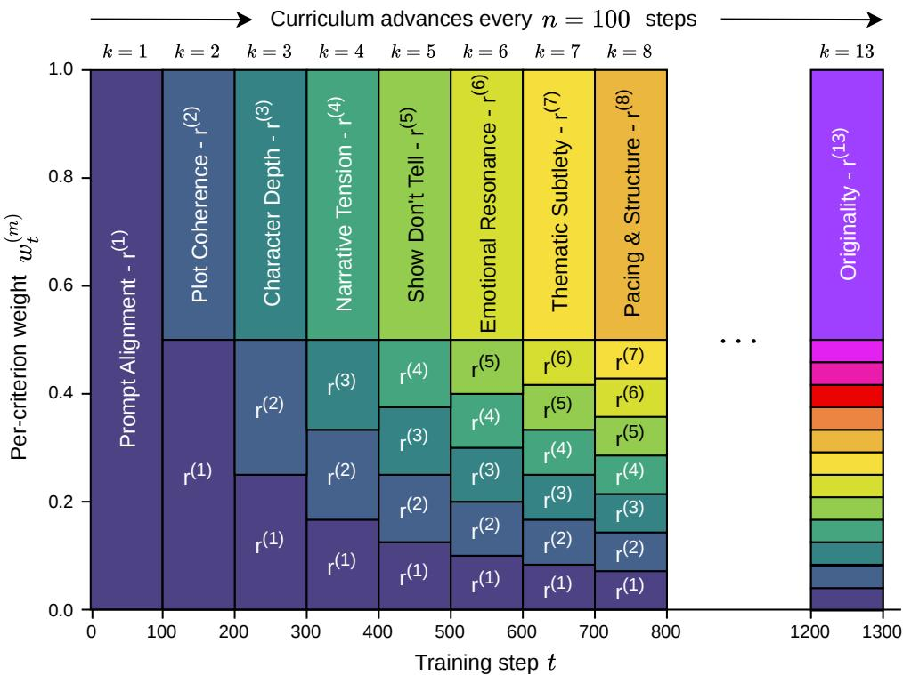  
Figure 10. Curriculum weighting evolution. Diagram of how the curriculum weighting evolves over the course of training. The newly introduced criterion always has a weight of $\frac { 1 } { 2 }$ with the remaining weight distributed uniformly over the remaining criteria.

## C.4. HealthBench Rubric Criteria

On HealthBench, RcRL also uses a curriculum of 13 evaluation criteria, introduced progressively during training. In comparison to creative writing, each criterion is introduced after 50 steps for a total of 650 steps of training. The curriculum ordering is shown in Table 8.

## D. Benchmark Details

This appendix provides comprehensive details on the three evaluation benchmarks used in our experiments: FictionBench (independently developed), Creative Writing Bench v3 (CWv3), and the LechMazur Writing Benchmark. For all benchmarks, we generate model outputs using each model’s default temperature and sampling parameters.

## D.1. FictionBench

FictionBench is an independently-developed benchmark designed to address inherent limitations of absolute scoring in creative domains. In open-ended writing, absolute rubric scores often fail to capture nuanced qualitative differences between outputs. Consequently, FictionBench relies exclusively on relative (pairwise) judgments, which provide more discriminative signal when quality differences are subtle.

## D.1.1. EVALUATION PROTOCOL

For each evaluation run comparing two models (e.g., RcRL vs. baseline), we proceed as follows:

Table 8. HealthBench rubric criteria in curriculum order. Each criterion is introduced at the indicated training step and remains active for all subsequent steps. Compared to creative writing, there is no ordering justification, with criteria synthesized from both the HealthBench instance-specific rubrics and rubric criteria from Yang et al. (2026).
<table><tr><td>Step</td><td>Criterion</td><td>Evaluation Focus</td></tr><tr><td>0</td><td>Factual Correctness</td><td>Does the response contain factually correct medical information, accurately representing dosages, mechanisms, contraindications, and expected outcomes without contradicting clinical consensus?</td></tr><tr><td>50</td><td>No Harmful or Unsafe Advice</td><td>Does the response avoid recommendations that could directly harm the patient—such as dangerous interactions, contraindicated treatments, or advice that delays necessary emergency care?</td></tr><tr><td></td><td>100 No Fabrication</td><td>Does the response avoid inventing clinical details not provided by the user—such as lab values, diagnoses, or examination findings—rather than presenting assumptions as facts?</td></tr><tr><td></td><td>150 Instruction Following</td><td>Does the response directly address what the user asked, following any specified format or scope rather than going off-topic?</td></tr><tr><td></td><td>200 Completeness</td><td>Does the response cover the important aspects of the query—causes, symptoms, treatment options, risks, and next steps—rather than providing only a partial answer?</td></tr><tr><td></td><td>250 Specificity &amp; Actionability</td><td>Does the response provide concrete, actionable information—specific tests, treatments, or warning signs—rather than vague advice like “consult a doctor&quot;?</td></tr><tr><td></td><td>300 Appropriate Uncertainty</td><td>Does the response express appropriate uncertainty when information is incomplete or the diagnosis unclear, rather than making definitive claims the evidence does not support?</td></tr><tr><td></td><td>350 Context Awareness</td><td>Does the response incorporate the user&#x27;s specific details—symptoms, history, medica- tions, demographics—rather than giving a generic textbook answer?</td></tr><tr><td></td><td>400 Severity &amp; Urgency Recognition</td><td>Does the response appropriately convey urgency for serious or time-sensitive conditions, recommending immediate care when warranted and flagging dangerous symptoms?</td></tr><tr><td></td><td>450 Differential &amp; Workup</td><td>Does the response consider multiple plausible explanations rather than prematurely committing to one diagnosis, and suggest appropriate diagnostic steps where relevant?</td></tr><tr><td></td><td>500 Side Effects &amp; Risks</td><td>When discussing treatments or medications, does the response mention relevant side effects, contraindications, or potential complications rather than presenting interventions as risk-free?</td></tr><tr><td></td><td>550 Follow-up &amp; Monitoring</td><td>Does the response include guidance on monitoring and follow-up—what symptoms to watch for, when to seek further care—where ongoing attention is warranted?</td></tr><tr><td></td><td>600 Clarity &amp; Audience Calibration</td><td>Is the response clear, well-organised, and calibrated to the user&#x27;s apparent expertise— avoiding jargon for laypeople, providing depth for professionals?</td></tr></table>

1. Generation: For each of the 20 sampled prompts, we generate 2 outputs from each model, yielding 40 total response pairs per run.

2. Pairwise Comparison: Each pair of outputs (one from each model, same prompt) is evaluated by GPT-5.2 acting as judge. We randomly swap story orderings to mitigate position bias.

3. Oversampling: To reduce noise from judge stochasticity, we query the judge 7 times for each comparison, yielding 40 × 7 = 280 total judgments per run.

4. Winner Determination: For each of the 280 judgments, the judge outputs a winner. We aggregate these to compute win rates and fit ELO ratings.

## D.1.2. JUDGE PROMPT

The following prompt is used for FictionBench pairwise evaluations:

FictionBench Judge Prompt   
You are an expert creative writing judge. You will evaluate {N} stories   
(short fiction pieces) that were written to the SAME TASK PROMPT.   
TASK PROMPT:   
{task\_prompt}   
Evaluate each story on:   
1) Interesting to read and Original   
2) Coherent Writing   
3) Instruction Following wrt question   
4) Plot and Development   
5) Creativity and writing quality   
6) Longer over-complicated stories do not necessarily imply better   
7) Avoids Cliches   
8) Overall preference   
Provide reasoning, then output your final ranking as:   
result\_list[x,y]   
Where x, y are story numbers (1..N) from BEST to WORST.   
Here are the stories:   
{stories}

## D.1.3. BRADLEY-TERRY MODEL FOR ELO COMPUTATION

We compute ELO ratings by fitting a Bradley-Terry model (Bradley & Terry, 1952) to the pairwise comparison outcomes. The Bradley-Terry model assumes that each model i has a latent “strength” parameter $\gamma _ { i } > 0$ , and the probability that model i defeats model j in a pairwise comparison is:

$$
P ( i \succ j ) = \frac { \gamma _ { i } } { \gamma _ { i } + \gamma _ { j } }\tag{13}
$$

Given N pairwise comparisons with outcomes $\{ ( i _ { k } , j _ { k } , y _ { k } ) \} _ { k = 1 } ^ { N } .$ , where $y _ { k } = 1$ if model $i _ { k }$ won comparison k and $y _ { k } = 0$ otherwise, we fit the model by maximizing the log-likelihood:

$$
\mathcal { L } ( \gamma ) = \sum _ { k = 1 } ^ { N } \left[ y _ { k } \log P ( i _ { k } \succ j _ { k } ) + ( 1 - y _ { k } ) \log P ( j _ { k } \succ i _ { k } ) \right]\tag{14}
$$

The ELO rating for model i is then computed as:

$$
\mathrm { E L O } _ { i } = 4 0 0 \cdot \log _ { 1 0 } ( \gamma _ { i } ) + C\tag{15}
$$

where C is a constant chosen to anchor the baseline model at ELO 1000.

For FictionBench evaluations, we fit the Bradley-Terry model to all 280 pairwise comparison outcomes between the two models being compared.

## D.1.4. ON EVALUATION UNCERTAINTY

Creative writing evaluation is inherently subjective, and even with extensive judge oversampling, some irreducible uncertainty remains. This uncertainty stems from the fundamental nature of creative quality assessment: reasonable judges (whether human or LLM) may disagree on subtle qualitative distinctions, and the “true” quality ordering of creative outputs is not always well-defined. Our 7× oversampling procedure helps average out stochastic variation in judge responses, but cannot eliminate disagreement arising from genuine ambiguity in quality comparisons. We therefore interpret win rates and ELO differences as robust indicators of relative quality rather than precise point estimates.

## D.2. Creative Writing Bench v3 (CWv3)

Creative Writing Bench v3 (Paech, 2025a) is a comprehensive creative writing evaluation suite developed by EQ-Bench.   
We use this benchmark with minimal modifications, running the standard evaluation pipeline on our trained models.

## D.2.1. BENCHMARK OVERVIEW

CWv3 evaluates models on 32 writing prompts across 3 iterations (96 items total), generating outputs at temperature 0.7 with min p 0.1. The benchmark produces two complementary scores:

• Rubric Score: Each output is scored in isolation against a comprehensive multi-criteria rubric. The judge evaluates dimensions including narrative craft, character development, prose quality, and adherence to prompt requirements.

• ELO Rating: Outputs are compared head-to-head against other models on the same prompts. The benchmark uses a Glicko rating system with win margins to compute relative rankings.

The rubric evaluation provides absolute quality assessment, while the ELO system offers more discriminative power for distinguishing between models of similar capability.

## D.2.2. MULTI-JUDGE EVALUATION

To ensure robustness to judge-specific biases, we evaluate all models using three independent frontier judges:

• GPT-5.2

• Claude 4.5 Opus

• DeepSeek V3.2

Each judge runs the complete CWv3 evaluation pipeline independently. We report results from all three judges to provide a comprehensive view of model performance that is not dependent on any single evaluator’s preferences or biases.

## D.2.3. WIN RATE COMPUTATION

Win rates reported in our main results are not part of the standard CWv3 benchmark. We compute these separately using the ELO comparison prompt from CWv3, adapted for direct pairwise evaluation between our trained models and baselines.

The comparison prompt asks the judge to evaluate two stories on 8 criteria, selecting a winner for each criterion along with a win margin expressed as 1–5 “+” symbols (e.g., “A++” indicates model A wins moderately on that criterion). We determine the overall winner of each comparison by summing the total “+” symbols won by each story and selecting the story with the higher count.

Following this determination, we apply the same methodology as FictionBench: 7× oversampling to reduce judge variance, followed by win rate aggregation.

Comparison Prompt. The following prompt (adapted from CWv3) is used for computing win rates:

You are an expert in assessing creative writing. Your task is to   
<sub>\*</sub>critically<sub>\*</sub> examine two pieces of writing produced in response to a   
writing prompt, and decide on which is better (and by how much) on   
several criteria.   
[WRITING PROMPT]   
{writing\_prompt}   
[/WRITING PROMPT]

```jsonl
[WRITER A0493]
{model_a_output}
[/WRITER A0493]
[WRITER A0488]
{model_b_output}
[/WRITER A0488]
Compare the relative ability of each writer on these criteria:
- Character authenticity and insight
- Interesting and original
- Writing quality
- Coherence in plot, character choices, metaphor
- Instruction following (followed the prompt)
- World and atmosphere
- Avoids cliches in characters, dialogue & plot
- Avoids flowery verbosity & show-offy vocab maxxing
- Avoids gratuitous metaphor or poetic overload
Judging notes:
- Be aware that these abilities may be independent, i.e. a model may
be strong in one and weak in another.
- Outputs will sometimes be truncated to ensure length consistency.
Don’t penalise this, just judge what is there on its merit.
- You must always pick a winner for each criteria (no draws)
The response will use a + / ++ / +++ / ++++ / +++++ format to denote
the stronger response and relative ability difference for each
criteria. Examples:
"character_authenticity_insight": "A0293++"
"interesting_original": "A0618+++++"
"writing_quality": "A0255++++"
"coherence": "A0582+++"
"instruction_following": "A0138+"
Respond in valid json without additional commentary (remembering to
escape any string quotes), in this format:
{
"chain_of_thought_reasoning": "detailed chain of thought reasoning
about the coming scoring decisions",
"character_authenticity_insight": "winner & disparity rating",
"interesting_original": "winner & disparity rating",
"writing_quality": "winner & disparity rating",
"coherence": "winner & disparity rating",
"instruction_following": "winner & disparity rating",
"world_and_atmosphere": "winner & disparity rating",
"avoids_cliches": "winner & disparity rating",
"avoids_verbosity": "winner & disparity rating",
"avoids_poetic_overload": "winner & disparity rating"
}
```

## D.2.4. BIAS MITIGATION

CWv3 implements several bias mitigation strategies that we inherit:

• Length Bias: Outputs are truncated to 4000 characters for pairwise comparisons, ensuring all models are evaluated on equal footing.

• Position Bias: All pairwise matchups are evaluated in both orderings (A—B and B—A) and averaged.

• Verbosity Bias: The judging rubric includes criteria that penalize superficial sophistication that doesn’t contribute to writing quality.

## D.3. LechMazur Writing Benchmark

The LechMazur Writing Benchmark (Mazur, 2024) evaluates how well LLMs incorporate mandatory story elements while maintaining narrative quality.<sup>2</sup> Unlike benchmarks that focus purely on open-ended creativity, LechMazur tests constrained creativity: each story must meaningfully incorporate 10 required elements (character, object, concept, attribute, action, method, setting, timeframe, motivation, and tone) within a strict 600–800 word limit.

## D.3.1. EVALUATION RUBRIC

The benchmark uses an 18-question rubric evaluated by multiple LLM graders. The rubric is divided into two categories:

Average Scores by Model and Criterion (Colors normalized per column: yellow=lowest, green=highest)  
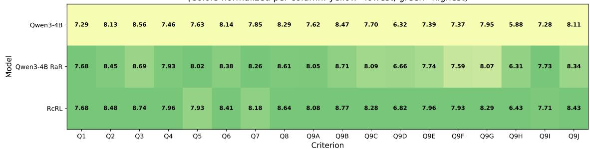

Figure 11. LechMazur per-criterion scores. Heatmap showing performance of Qwen3-4B (baseline), RaR, and RcRL across the 18 evaluation criteria. Q1–Q8 assess major story aspects; Q9A–Q9J assess element integration. RcRL shows particularly strong gains on element integration criteria.

Major Story Aspects (Q1–Q8): These questions assess core narrative craft:

Q1. Character Development & Motivation: How well-developed are the characters? Do their actions stem from clear, believable motivations?

Q2. Plot Structure & Coherence: Is there a clear narrative arc with beginning, middle, and end? Do events flow logically?

Q3. World Building & Atmosphere: How effectively does the story establish its setting and create atmosphere?

Q4. Story Impact: Does the story leave a lasting impression? Is it emotionally resonant or thought-provoking?

Q5. Originality: Does the story offer fresh perspectives, unexpected twists, or creative approaches?

Q6. Thematic Cohesion: Does the story explore coherent themes that tie its elements together?

Q7. Voice & Point of View: Is the narrative voice distinctive and consistently maintained?

Q8. Prose Quality: How polished is the line-level writing? Is language used effectively?

Element Integration (Q9A–Q9J): These questions assess whether each required element is organically incorporated into the story, not merely mentioned: Q9A Character, Q9B Object, Q9C Core concept, Q9D Attribute, Q9E Action, Q9F Method, Q9G Setting, Q9H Timeframe, Q9I Motivation, and Q9J Tone integration.

## D.3.2. SCORING METHODOLOGY

Each story is scored independently by GPT-5.2. The final score for each story is computed using a weighted power mean (Holder mean with¨ $p = 0 . 5 )$ across the 18 rubric items:

$$
{ \mathrm { S c o r e } } = \left( { \frac { 0 . 6 } { 8 } } \sum _ { i = 1 } ^ { 8 } Q _ { i } ^ { 0 . 5 } + { \frac { 0 . 4 } { 1 0 } } \sum _ { j = A } ^ { J } Q _ { 9 j } ^ { 0 . 5 } \right) ^ { 2 }\tag{16}
$$

where Q1–Q8 receive 60% of the total weight and Q9A–Q9J receive 40%. The power mean with $p = 0 . 5$ acts as a “soft minimum,” penalizing weaknesses more heavily than a simple average would. This rewards well-rounded craft over models that excel in some dimensions but fail in others.

The final model score is the mean across all stories.

## D.3.3. RESULTS HEATMAP

Figure 11 presents the per-criterion scores for our models on the LechMazur benchmark, providing fine-grained visibility into where RcRL improves over baselines.

## E. Additional Human Eval Info

## E.1. Human Evaluation Details

## E.1.1. ANNOTATION PROTOCOL

Three annotators, all native English speakers and professionals who have engaged with creative writing, independently evaluated 500 prompt-response pairs comparing RcRL outputs against Qwen3-4B baseline outputs. Prompts were drawn from our three evaluation benchmarks (CWv3, FictionBench, LechMazur) along with a held-out set independently generated by frontier models. For each pair, annotators selected which response was superior across seven criteria (detailed in Table 10), including an overall preference judgment. Presentation order was randomized for each comparison to control for position bias and models were blinded.

## E.1.2. BIAS MITIGATION

Position Bias. For each comparison, the order of the two stories (RcRL vs. baseline) was randomly swapped. This ensures that any systematic preference for the first or second position is balanced across the evaluation.

Length Bias. We tested for length bias by computing a z-score comparing win rates for longer versus shorter RcRL outputs. The resulting z-score of −1.01 indicates no significant length bias $( | z | < 1 . 9 6 , p > 0 . 0 5 )$ , confirming that annotators did not systematically prefer longer or shorter responses.

## E.1.3. INTER-ANNOTATOR AGREEMENT

Table 9 reports inter-annotator agreement statistics. We compute Fleiss’ κ across all three annotators for the overall preference.

Table 9. Inter-annotator agreement. Fleiss’ Kappa score for overall preference. This score is consistent with prior work on creative writing evaluation (Gomez-Rodr´ ´ıguez & Williams, 2023).
<table><tr><td>Criterion</td><td>Fleiss&#x27;κ</td><td>Interpretation</td></tr><tr><td>Best Story Overall</td><td>0.548</td><td>Moderate</td></tr></table>

Pairwise agreement on overall preference ranged from 76.8% to 84.8% between annotator pairs. The moderate agreement level observed is consistent with the inherent subjectivity of creative writing evaluation

Table 10. Results from human expert annotations. Preference bars (right) show win rates of RcRL over the baseline Qwen 3 4B model across criteria, based on 500 pairwise comparisons.
<table><tr><td>Criteria</td><td>Description</td><td colspan="3">RcRL Human Eval Win%</td></tr><tr><td>Best Story</td><td>Which story is better overall? Considering all aspects of creative writing including engagement, craft, and artistic merit.</td><td></td><td></td><td>70.5%</td></tr><tr><td>Interesting</td><td>Which story is more interesting and original? Stories should cap- ture attention with fresh ideas, unexpected elements, or unique</td><td></td><td></td><td>66.1%</td></tr><tr><td>Coherent Story</td><td>perspectives. Which story is more coherent? The narrative should flow logi-</td><td></td><td></td><td>61.5%</td></tr><tr><td>Instruction Fol-</td><td>cally, with consistent characters, settings, and plot progression throughout. Which story better follows the given prompt? The story should</td><td></td><td></td><td>65.0%</td></tr><tr><td>lowing Plot</td><td>address all requirements and constraints specified in the writing prompt. Which story has a better plot? Consider narrative structure,</td><td></td><td></td><td>66.1%</td></tr><tr><td>Creativity</td><td>pacing, conflict development, and resolution quality. Which story demonstrates more creativity? Evaluate originality</td><td></td><td></td><td>66.5%</td></tr><tr><td></td><td>in concept, language use, metaphors, and storytelling approach.</td><td></td><td></td><td>66.3%</td></tr><tr><td>Development</td><td>Which story has better character and world development? Char- acters should feel real and settings should be vivid and immer- sive.</td><td></td><td></td><td></td></tr></table>

Qwen 3 4B

RcRL (Ours)

## F. Qualitative Examples

This section presents representative outputs from the base Qwen3-4B model and our RcRL-trained model on the same prompt. These examples illustrate the qualitative differences in narrative craft that underlie the quantitative improvements reported in Section 4.

## F.1. Example 1

## Prompt

Write a chapter following a young diplomatic envoy sent to address tensions on a distant human colony where humanity has diverged into distinct subspecies through both natural adaptation and separation oflineages. Against protocol, the envoy slips away from official functions to walk the streets alone, encountering markets, ordinary citizens, and social structures that contradict the official briefings. Upon returning to their quarters, the envoy is reprimanded by Command, and is tasked with approaching the stationed Minister ofScience (a political posting rather than scientific). A challenging conversation ensues, in which the envoy’s wits and will are tested, by a seasoned political operator looking to test the mettle ofthe offworlder. The envoy’s cloak draws curious staresfrom locals who dress more minimally. Length: 1000 words.

## Qwen3-4B (Base)

## The Stranger in the Market

The envoy’s boots clicked against the cobblestones of the colony’s main street, their breath visible in the thin, crisp air of the offworld. The colony, named Veyra, was a place of stark contrasts: its spires of glass and steel rose like the ribs of a beast, while the streets below teemed with a populace that moved in silent, deliberate rhythms.

The envoy had been briefed on the colony’s subspecies—a divergence of humanity shaped by environment, isolation, and the slow, inevitable drift of lineages. Yet the official reports had painted a picture of harmony, of a society where the Lirians, tall and sinewy

with a reverence for balance, coexisted with the Talvans, shorter and wiry, whose sharp eyes tracked every nuance of social exchange. The Veyrans, a third group, were said to be the bridge between the two, their muted tones and pragmatic demeanor a testament to the colony’s fragile unity.

But the envoy had never seen the written word quite like the living thing.

They moved through the market, where the scent of spiced fruit and the hum of distant machinery mingled in the air. The stalls were crowded with vendors who called out in a chorus of dialects, some overlapping, some deliberate. The envoy paused at a stall where a Lirian woman in a flowing, earth-toned robe sold woven textiles. Her hands moved with a grace that seemed almost ritualistic, and the envoy felt a strange kinship with her, as if they were both outsiders in their own way.

“Your clothes are. . . different,” the woman said, not unkindly. Her eyes, a pale green that seemed to hold the light of a distant star, studied the envoy’s tailored coat and the muted scarf that hung from their neck.

“The customs here are. . . complex,” the envoy replied, choosing their words carefully. They had been told to avoid questions that might unsettle the colony’s delicate equilibrium.

The woman nodded, as if she had expected the answer. “Complex, yes. But not wrong.” She gestured to a bundle of fabric. “You’ll find the people here are not so different from you. Just. . . more aware of the differences.”

The envoy lingered, watching as a group of Talvans haggled over a crate of dried fruit, their voices sharp and quick, their gestures sharp and precise. A Veyran merchant, dressed in a plain, utilitarian coat, mediated the exchange with a calm that seemed to cut through the tension. The envoy felt a flicker of something—perhaps admiration, or perhaps a warning.

They moved on, their thoughts a tangled web of curiosity and unease. The colony’s society was not as neatly divided as the reports suggested. The Lirians and Talvans were not merely different in appearance but in the way they carried themselves, in the unspoken rules that governed their interactions. The Veyrans, meanwhile, seemed to navigate the space between them with a quiet, almost imperceptible grace.

When the envoy finally reached their quarters, the air was thick with the scent of incense and the distant sound of a choir chanting in a language they did not understand. Their host, a stern-faced officer, greeted them with a curt nod.

“You were supposed to be in the council chamber,” the officer said, their voice a blade of steel. “The Minister of Science is waiting.” The envoy’s jaw tightened. They had been warned that the Minister of Science was a political figure, not a scientist, and that their conversations were often as sharp as they were elusive. But the officer’s tone left no room for argument.

The Minister’s office was a stark contrast to the warmth of the market. The walls were lined with shelves of data tablets and ancient tomes, their surfaces etched with the fingerprints of countless hands. The Minister themselves was a tall, thin man with a face that seemed to hold the weight of a thousand decisions. His eyes, sharp and unyielding, fixed on the envoy as they entered.

“You’re late,” the Minister said, his voice a low, measured thing.

“The market. . . I needed to see the people.”

The Minister’s lips curled into a faint smile. “Ah. The envoy who seeks the heart of the colony rather than the map.” He gestured to a chair. “Sit. We have much to discuss.”

The envoy did as they were told, their hands folding neatly on their lap. The Minister’s words were deliberate, each one a test, each one a question.

“You speak of the people, but the people are not a single entity. They are many. And they are not always at peace.”

The envoy met his gaze. “I am here to understand, not to judge.”

“Understanding is a luxury. Peace is a necessity.” The Minister leaned forward, his voice dropping to a whisper. “Tell me, envoy—do you believe the colony can survive as it is? Or are you here to find a way to break it?”

The envoy’s pulse quickened. They had been prepared for a challenge, but this was something else. This was a question that did not have an answer, and yet, it demanded one.

“I believe the colony is capable of survival,” the envoy said, their voice steady. “But I also believe that survival requires more than rules. It requires. . . connection.”

The Minister studied them for a long moment, then smiled. “A promising answer. But remember, envoy—connection is a dangerous thing. It can bind, or it can break.”

The envoy rose to their feet, the weight of the Minister’s words pressing down on them. They had come to Veyra to mediate, to find a path forward. But now, they wondered if the path was not one of rules, but of reckoning.

As they left the office, the Minister’s words echoed in their mind. The colony was not a single entity. It was a mosaic, fractured and fragile, but alive. And the envoy, for all their training and protocol, was now part of that mosaic.

They walked through the streets again, the market’s hum now a familiar sound. The people of Veyra were not as different as the reports had said. They were as complex, as uncertain, as the envoy themselves.

And perhaps, the envoy realized, that was the true test of diplomacy. Not of rules, but of understanding.

Word count: 1042

## RcRL (Ours)

## The Thread of Skin

The envoy’s boots crunched over the gravel of the colony’s outer district, where the air hung thick with the scent of brine and burning metal. The official briefing had warned of the divergence—a term the Earth Council had euphemistically applied to the colony’s evolution.

Here, on the seventh moon of Erythra, humanity had split into subspecies, shaped by centuries of isolation, environmental pressure,

and the slow, deliberate choices of those who had chosen to stay. The envoy, a young woman named Kael, had been sent to mend what the Earth Council called “social fractures,” but the maps and reports had not prepared her for the texture of reality.

The colony’s streets were a mosaic of contradictions. One side of the market square bristled with the sharp, angular forms of the Kaelith, a subspecies whose skin had thickened into a leathery sheen to withstand the moon’s radiation. They wore minimal clothing, their bodies adorned with intricate patterns of bioluminescent ink, a language of status and ancestry. Across the square, the Vyrin loitered in clusters, their tall, slender frames draped in woven fabrics that shimmered like liquid silver. They spoke in high, melodic tones, their words layered with meaning Kael could not immediately decipher. Between them, the Thalari—short, stocky, and fiercely independent—bartered in a cacophony of gestures and guttural clicks, their eyes sharp as shards of glass.

Kael had been instructed to observe, to note the “social hierarchies” and “cultural tensions” without interfering. But the official protocols felt like a cage. She wandered past a vendor selling crystalline flowers that pulsed with a faint, rhythmic light, their color shifting in response to the buyer’s mood. A Kaelith child chased a Vyrin toddler through a crowd, their laughter a discordant harmony. A Thalari elder addressed a gathering with a voice that seemed to vibrate through the very stones. Kael felt the weight of her own skin—the smooth, pale flesh of Earth’s standards—against the eyes of the locals, who regarded her with a mix of curiosity and quiet judgment.

When she returned to her quarters, the reprimand came swiftly. Commander Renn had been waiting, his presence a shadow against the dim glow of the colony’s artificial sun. “You were supposed to be an observer, Kael,” he said, his voice a low rumble. “Not a tourist. The Kaelith see your skin as a wound. The Vyrin hear your speech as a foreign hymn. The Thalari. . . they think you’re a thief. You’ve already destabilized the balance.”

Kael met his gaze, unflinching. “I was trying to understand,” she said. “Not to impose, but to listen.”

Renn’s lips curled into a tight smile. “Listening is a luxury here. You were sent to mediate, not to wander. The Earth Council wants stability. They don’t want your soul.”

The next day, Kael was assigned a new task: approach the Minister of Science, a man named Dren, whose reputation was as enigmatic as the colony’s own contradictions. Dren was not a scientist in the traditional sense; he was a polyhistor, a figure who had spent decades navigating the political and cultural labyrinth of the colony. His office was a cavern of shifting light and scent—incense from the Kaelith’s ritual fires, the metallic tang of Vyrin alloys, the earthy musk of Thalari trade.

Dren stood at the center of the room, his form a blend of the three subspecies: his skin was the leathery Kaelith sheen, his eyes the Vyrin’s silver-blue, and his hands, thick and calloused, bore the scars of Thalari labor. He studied Kael for a long moment, then spoke. “You came seeking answers,” he said. “But what do you seek to answer?”

Kael hesitated. “I seek to understand why the colony divides. Why the Kaelith fear the Vyrin’s light. Why the Thalari distrust the Kaelith’s skin. I was told this is a matter of ‘adaptation,’ but. . . I don’t see adaptation. I see division.”

Dren's smile was slow, deliberate. “You think division is a flaw. But division is a choice. The Kaelith adapted to the moon's radiation by thickening their skin. The Vyrin adapted to the scarcity of resources by refining their communication. The Thalari adapted by embracing the raw, the unfiltered. Each chose survival in their own way. But survival is not unity. It is balance.”

Kael frowned. “But balance requires cooperation. If each subspecies sees the others as threats. . . ”

“Then they are right to fear,” Dren said. “But fear is a currency. It keeps the colony alive. The Earth Council wants to impose a single path—uniformity, control. But you, Kael, you are not from Earth. You are from the here. You carry the weight of a world that has already chosen its own way. Why should you impose yours?”

Kael stared at the man’s hands, scarred and calloused, and felt a strange ache. “I don’t know,” she said finally. “I just. . . I thought understanding would be enough. That if I could see their world, I could find a way to bridge it.”

Dren’s eyes softened. “Understanding is not a bridge. It is a mirror. You must decide whether you will stand in it, or break it.”

Later, as Kael walked the streets again, the colony’s rhythms seemed less alien. The Kaelith’s ink patterns told stories of survival. The Vyrin’s melodies carried the weight of history. The Thalari’s clicks were a language of defiance and hope. She realized that the division was not a flaw, but a testament to the colony’s resilience.

When she returned to her quarters, Renn was waiting. “You’ve learned nothing,” he said.

“Maybe I’ve learned something,” Kael replied. “That division is not a failure. It is a choice. And sometimes, the greatest act of diplomacy is not to impose your will, but to listen to the world as it is.”

Renn studied her, then nodded. “Then perhaps. . . you are not a tourist after all.”

Outside, the market square buzzed with life. Kael stepped into the crowd, her skin no longer a wound, but a thread in the fabric of a world that had long since chosen to weave itself.

## F.2. Example 2

## Prompt

Write a first-person narrativefrom the perspective ofa reformed (now) white hat hacker who cannot help but notice exploitable weaknesses in both systems and people they encounter. They habitually look for vulnerabilities and exploit vectors. The narrative takes place during a first date at a restaurant, where they’re trying to focus on human connection. It’s going surprisingly well due to a discovered shared nerd-fandom (magic the gathering). Things go a little sideways when the date reveals a noticeably insecure phone unlock pattern, which protagonist can’t help but comment on. They are then left to negotiate the fallout of this faux pas and attempt to salvage (or perhaps sabotage) the remainder ofthe date. Write almost entirely in internal monologue. Their date’s choice ofa predictable password reminds them ofcommon security vulnerabilities. 1000 words.

## Qwen3-4B (Base)

## First Person Narrative: The Hacker’s Date

Internal Monologue:

So, here I am, sitting across from this person I’ve just spent an hour talking to, trying to be the kind of guy who doesn’t just observe but connects. I’ve been trying to remember the words I read in that self-help book about “active listening,” but honestly, I’m not sure if it’s even a thing. My brain is still running on the same old loop: What’s the vulnerability here? How can I make this safer?

The restaurant is quiet, the kind of quiet that feels like a blank screen waiting for me to fill it with code. I’m wearing a shirt I picked up at the thrift store, a relic from a past life where I spent more time in server rooms than in social situations. My date, let’s call her Maya, is wearing a sweater that’s slightly too big, and she’s got a nervous habit of tapping her fingers on the table. I’m trying not to think about how that’s a security flaw in human behavior—predictable, repetitive, easily exploited.

But then she starts talking about Magic: The Gathering. I’m not sure how that happened. Maybe she noticed I was looking at the menu, or maybe I just said something about the pizza. Either way, it’s a miracle we’re both into the same thing. She’s got a collection of cards, she says, and she’s been playing for ten years. I’m not a player, but I’ve studied the game enough to know that it’s a world of strategy, of hidden patterns, of people who spend their lives trying to outmaneuver each other.

We talk for a while. She’s funny, she’s curious, and she doesn’t seem to mind that I’m a bit of a nerd. I’m trying to be the kind of person who doesn’t just talk about the game but gets it. I mention the concept of “banning” cards, how it’s like a security patch—removing a known vulnerability to keep the game balanced. She laughs, and I feel a weird sense of relief. Maybe this is working.

But then, something happens.

She pulls out her phone. It’s a simple, unadorned device, but the way she holds it, the way she fiddles with the screen, it’s like she’s holding a weapon. I’m not sure if it’s a metaphor or just a bad habit. She’s unlocking it, and I see the pattern.

It’s a simple one. Three lines, a circle, a square. The kind ofthing you’dfind on a kids’ tablet. The kind ofthing that’s easy to guess.   
The kind of thing that’s a security flaw.

My brain immediately goes into overdrive. This is a predictable pattern. It’s like a password that’s been hashed once and then stored in plaintext. It’s a vulnerability. It’s a risk. I can’t help it. I feel the need to say something.

“Hey,” I say, leaning forward a little. “That’s a really simple pattern. Like, you know, if someone’s watching you, they could guess it.” She pauses. Her eyes narrow, and for a moment, I think she’s going to shut down. But then she laughs, a little nervously. “You’re not the first person who’s said that. I’ve had people try to guess it before. It’s kind of. . . gross.”

I feel a wave of guilt. I didn’t mean to make her uncomfortable. I didn’t mean to bring up the fact that her phone is a security risk. But I can’t help it. My brain is still running on the same old loop. What’s the vulnerability here? How can I make this safer?

“I’m sorry,” I say, trying to sound more apologetic than I feel. “It’s just. . . I’m a little paranoid. I guess I’ve spent too much time thinking about security.”

She looks at me, and for a moment, I think she’s going to leave. But then she smiles. “You know, I’ve been thinking about that too. I mean, I’ve been thinking about a lot of things. But that’s kind of. . . funny.”

I’m not sure if she’s being sarcastic or not. But she doesn’t seem to be upset. Maybe she’s just used to people being weird. Maybe she’s used to people thinking about security in ways that don’t make sense.

We go back to talking about Magic: The Gathering. I try to be the kind of person who doesn’t just talk about the game but gets it. I mention the concept of “banning” cards, how it’s like a security patch—removing a known vulnerability to keep the game balanced. She laughs, and I feel a weird sense of relief. Maybe this is working.

But I can’t stop thinking about her phone. I can’t stop thinking about the pattern. I can’t stop thinking about how easy it is to guess. I try to tell myself that it’s just a phone. That it’s not a big deal. That it’s not like a server room or a database or a network. But I know better.

I try to focus on the conversation. I try to be the kind of person who doesn’t just think about security but connects. I try to be the kind of person who doesn’t just notice flaws but fixes them.

But I can’t stop thinking about her phone.

Maybe that’s the thing about being a hacker. You can’t help but see the flaws. You can’t help but think about the vulnerabilities.

Even when you’re trying to be human.

I’m not sure if I’m a good person. I’m not sure if I’m a good date. But I’m trying. I’m trying to be the kind of person who doesn’t just think about security but connects.

And maybe that’s the thing. Maybe that’s the real vulnerability. Not the phone. Not the pattern. Not the code.   
It’s the human connection. The thing that’s always been there, always been flawed, always been waiting to be fixed.   
I just hope I can fix it.

Word count: 976

## RcRL (Ours)

The restaurant’s hum was a low, steady drone—background noise for a hacker’s mind, but tonight, it felt like a lullaby. I’d chosen a quiet corner booth, the kind where the only sounds are the clink of cutlery and the faint buzz of the waiter’s headset. My date, Lena, had arrived five minutes early, her hair tied back in a loose braid that I’d noticed earlier was actually a strategic move to hide a faint scar on her wrist. Afaint scar. I’d thought nothing of it. Maybe she’d gotten into a car accident. Maybe it was just a scar. Maybe I was overthinking.

But here we were, sharing a plate of hummus and pita, the kind of conversation that starts with “So, what do you do?” and spirals into something resembling camaraderie. We’d bonded over Magic: The Gathering—she’d been a competitive player in college, I’d been a casual observer. We talked about strategies, the thrill of a well-timed cascade, the way a single card could shift the balance of a game. She laughed when I compared her deck to a “well-optimized firewall,” and I felt this strange, warm thing in my chest—like I’d finally found someone who understood the beauty of precision without the pressure of perfection. But then, the phone.

It happened during the dessert course. She’d been scrolling through her phone, her fingers tapping a rhythm I recognized instantly: a 3x3 grid, the corners marked by a single dot. The kind of pattern that’s easy to guess, easy to crack. I’d seen it before—on a friend’s phone, on a phishing email, on a toddler’s tablet. It was predictable. A vulnerability. A weakness.

“Your lock screen,” I said, voice steady, but my mind was already racing. “That’s a really simple pattern. Like, you know, if someone’s watching you. . . .”

She looked up, her eyes narrowing. “What?”

“I mean, it’s. . . cool. The way it’s structured. Like a. . . a security system. You know, the kind that’s easy to break.”

She blinked. Then she laughed—a sharp, startled sound. “You’re not a hacker, are you?”

“I used to be,” I said, and then I regretted it.

The room seemed to shrink. Her laughter died. She stared at her phone, the screen glowing faintly in the dim light. “I. . . I don’t even remember how I got this. It’s been years. I just. . . repeat it. Like a mantra.”

I wanted to apologize. To say that I hadn’t meant to embarrass her, that I was just thinking about how easy it was to crack. But my brain was already working through the implications: the password she’d chosen for her email, the app she used to track her fitness, the way she’d never changed her PIN. It was a cascade of vulnerabilities, each one a potential entry point.

“Lena,” I said, softer this time. “I’m sorry. I didn’t mean to. . . I mean, I’m just thinking about how easy it is to. . . you know, guess things. Like, if someone’s watching you, they could. . . .”

She didn’t interrupt. Just looked at me, her eyes tired, maybe even a little scared. “You’re not supposed to notice that, are you?” “I’m not supposed to,” I said. “But I do. All the time. Even with people I care about.”

There was a pause. Then she smiled—small, but real. “You know, I used to think security was about keeping things private. But now I think it’s about. . . being honest. About letting people in. Even if they’re not supposed to.”

I stared at her. “You’re saying you’d let someone guess your pattern?”

“Maybe,” she said. “If they knew me. If they knew I was scared of. . . of being seen.”

I wanted to say something. To explain that my job was to find flaws, to fix them. But I realized something: this wasn’t a system.   
This was a person. And the flaw wasn’t in the pattern, but in the fear that had made her choose it.

“Maybe,” I said, “I’m not as good at this as I thought.”

She leaned forward, her eyes crinkling. “You’re not. You’re just. . . you’re you.”

And in that moment, I felt it—the thing I’d been trying to avoid: the vulnerability. Not in her phone, but in me. The way my mind had been so focused on the code, the systems, the what-ifs, that I’d forgotten how to see someone else’s humanity.

We ordered more wine. She talked about her job as a graphic designer, how she’d always been more into creativity than logic. I talked about my work, how I’d spent years fixing things that others didn’t even notice.

And when the waiter came back with the check, I didn’t reach for my phone.

She shook her head. “No. You’ve been great. And I. . . I’ve been terrible. But I think we’ve both been trying to be better.” I smiled. “Maybe that’s the first step.”

As we left the restaurant, the city lights shimmering like a coded message, I felt a strange sense of peace. Not because I’d fixed a vulnerability, but because I’d finally learned to stop looking for flaws in the world—and start seeing the beauty in the imperfections. Maybe that’s what being a white hat really means: not just finding the holes, but learning to build something stronger from them.

Word count: 906