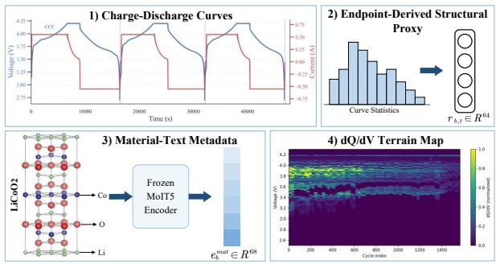
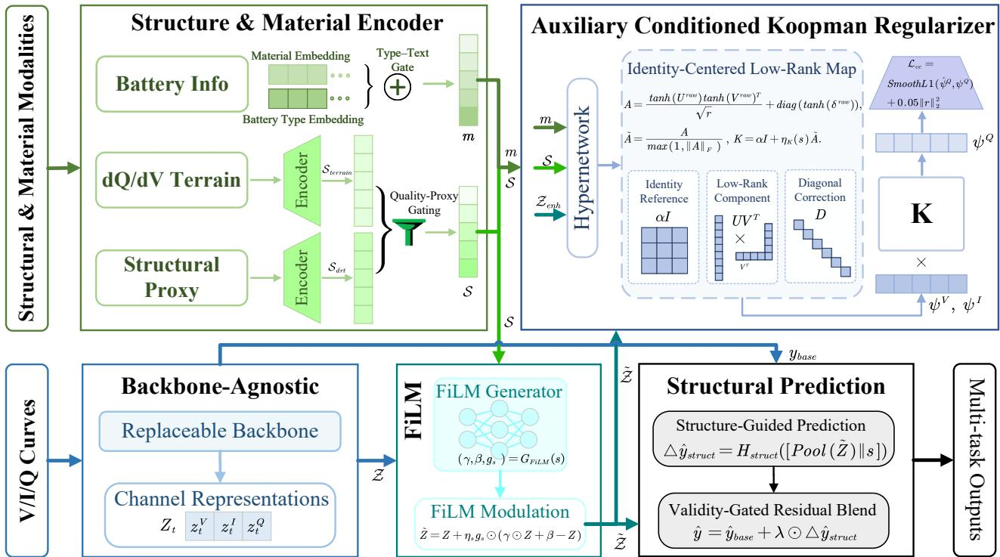
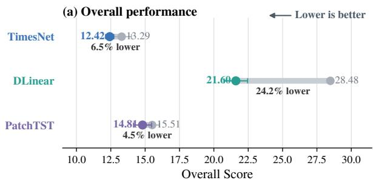
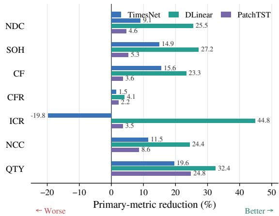
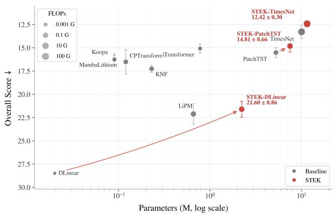

# STEK: Structural-Terrain-Enhanced Koopman-Inspired Cross-Channel Regularization for Retrospective Battery Multi-Target Estimation

Jing Wang1, Shiyuan Piao2, Fugee Tsung2

1University of Science and Technology of China, Hefei, China 2The Hong Kong University of Science and Technology, Hong Kong, China jingwang11@mail.ustc.edu.cn, shiyuan.piao@connect.ust.hk, season@ust.hk

## Abstract

Retrospective battery characterization across heterogeneous cells is challenging because cycling records vary substantially with chemistry, protocol, cell format, capacity, and operating conditions. An endpoint charge–discharge curve captures the local condition of an evaluated cycle, while a cell-level lifecycle terrain summarizes structural evolution across the archived trajectory. We propose STEK, a structural-terrainenhanced framework for retrospective battery multi-target estimation. STEK combines a cell-level lifecycle dQ/dV terrain with an endpoint-derived structural proxy through qualityproxy-conditioned gating. Bounded FiLM and a validity-gated residual head refine the endpoint-curve representation while preserving a curve-based prediction pathway. Battery-type and optional material-text representations further condition an identity-centered low-rank linear map, providing a Koopmaninspired cross-channel consistency objective without modeling temporal dynamics or performing rollout. Under the fixed seven-output MIX-battery protocol, the full retrospective setting improves aggregate performance over endpointonly learned baselines across multiple temporal backbones; this comparison reflects both the additional archived context and the modeling design. Under matched auxiliary inputs, STEK outperforms direct concatenation and quality-unaware FiLM, while descriptor-removal tests show graceful fallback to the endpoint pathway. Deterministic rules remain preferable for directly recoverable capacity summaries. The method targets retrospective archive harmonization rather than online estimation from cycle t alone.

## Introduction

Retrospective cycle-level characterization of heterogeneous batteries from archived cycling records is challenging because cycling curves vary across chemistries, cell formats, nominal capacities, temperatures, and operating protocols. These factors entangle degradation-related information with source-specific variation, limiting the transferability of curve-only representations across battery sources (Li et al. 2024; Lu et al. 2023; Tao et al. 2024).

Deep sequence models learn nonlinear representations directly from voltage, current, and capacity curves. Transformer-based and frequency-aware architectures have improved the modeling of complex and non-stationary signal variation (Wu et al. 2023; Zhou et al. 2022; Li et al. 2025). However, an endpoint curve alone does not summarize structural evolution across an archived cycling trajectory or account for diferences in material context. Incrementalcapacity structure provides a complementary view of degradation, while material descriptors help distinguish cells with diferent recorded chemistries. Existing approaches often omit such information or incorporate it through direct concatenation, which provides limited control when auxiliary descriptors are missing or unreliable.

Koopman-inspired representation learning introduces linear structure in a lifted observable space. Existing methods primarily learn temporal state transitions or support dynamical rollout (Wang et al. 2023; Zhang et al. 2025; Zheng, Bai, and Ding 2025; Shinohara 2025). STEK instead uses an identity-centered, sample-conditioned low-rank linear map to regularize lifted voltage, current, and capacity representations within the same endpoint curve. Their ordering specifies channel roles rather than successive physical states. The resulting cross-channel constraint is used only during training and is not intended to identify battery dynamics, forecast future cycles, or perform dynamical rollout.

We propose STEK, a structural-terrain-enhanced framework for retrospective battery multi-target estimation. For each evaluated endpoint, STEK combines an endpointlocal charge–discharge curve with a cell-level (dQ/dV) lifecycle terrain constructed from the archived trajectory and an endpoint-derived structural proxy. Quality-proxy conditioned fusion and bounded FiLM conservatively modulate the curve representation, while a validity-gated residual head retains the curve-based prediction as a fallback. Battery-type and optional material-text representations (Edwards et al. 2022; Sharma et al. 2025) further condition the Koopman-inspired cross-channel regularizer. Because the lifecycle terrain may include cycles after endpoint t, STEK targets retrospective archive harmonization rather than online or prospective prediction. It is intended for heterogeneous collections in which standardized curves are retained but derived annotations or some target-defining raw fields are missing or inconsistent. When all raw signals required by a target definition are available, direct analytic computation remains preferable. Our contributions are as follows:

• We formulate retrospective battery multi-target estimation by combining endpoint-local charge–discharge curves with archived cell-level lifecycle structure. We develop a conservative enhancement mechanism based on quality-proxy-conditioned fusion, bounded FiLM, and validity-gated residual prediction while preserving an endpoint-curve fallback.

• We introduce a context-conditioned lifted cross-channel regularizer based on an identity-centered low-rank linear map with residual corrections. The design is motivated by Koopman-style linear consistency in a lifted space, but it is used only as a training-time representation constraint and does not identify physical dynamics or require rollout.

• We evaluate STEK on the ten-source MIX-battery benchmark using endpoint-only baselines, matched-input fusion controls, multiple temporal backbones, component ablations, cross-source transfer on three held-out sources, descriptor-availability stress tests, and eficiency analysis. Input-recoverability diagnostics further distinguish deterministic capacity summaries from history-dependent and cross-signal estimation targets.

## Related Work

## Deep Battery Modeling

Battery modeling has advanced from generic sequence fitting to specialized temporal, patch-based, frequency-aware, and state-space architectures (Wu et al. 2021; Nie et al. 2023; Wu et al. 2023; Liu et al. 2024; Zeng et al. 2023; Zhou et al. 2022; Liu et al. 2023; Li et al. 2025; Shi 2024). Foundation models further improve transfer across tasks, chemistries, and operating conditions (Shi et al. 2025; Chan et al. 2026; Li et al. 2025; Tan et al. 2025a). However, most methods rely primarily on endpoint curves and do not explicitly integrate archived lifecycle structure or control the use of auxiliary material information.

## Koopman-Based Representation Learning

Koopman theory describes nonlinear dynamics through linear evolution in a lifted space (Koopman 1931). Neural extensions support distribution shifts, structured recurrence, probabilistic dynamics, and spatiotemporal forecasting (Wang et al. 2023; Zhang et al. 2025; Zheng, Bai, and Ding 2025; Shinohara 2025). In contrast, STEK uses an identity-centered low-rank linear component as a Koopman-inspired consistency constraint across lifted voltage, current, and capacity representations, without interpreting them as temporal states or performing rollout.

## Electrochemical and Multimodal Battery Modeling

Incremental-capacity, diferential-voltage, and impedancerelated descriptors provide complementary degradation information, while physics-informed methods incorporate electrochemical knowledge (Zhu et al. 2026). Molecular and language models further support chemical and material-text representations (Liu et al. 2022; Xia et al. 2023; Zhou et al. 2023; Edwards et al. 2022; Sharma et al. 2025). Unlike direct concatenation (Liang et al. 2021), STEK combines qualityproxy-conditioned fusion, bounded feature modulation, and validity-gated correction while retaining an endpoint-curve pathway.

  
Figure 1: Endpoint and lifecycle inputs used by STEK.

## Method

## Problem Formulation and Overview

Let

$$
\mathcal { X } _ { b } = \{ X _ { b , \tau } \} _ { \tau = 1 } ^ { N _ { b } }
$$

denote the archived trajectory of cell b. At endpoint t, the local input contains resampled voltage, current, and capacity traces:

$$
X _ { b , t } = [ X _ { b , t } ^ { V } ; X _ { b , t } ^ { I } ; X _ { b , t } ^ { Q } ] \in \mathbb { R } ^ { 3 \times L } , \qquad L = 1 0 0 .\tag{1}
$$

The target ${ \bf y } _ { b , t }$ contains cycle-level attributes, some defined using historical references.

STEK also uses a cell-level lifecycle terrain

$$
\begin{array} { r } { \mathbf { T } _ { b } ^ { \mathrm { l i f e } } = f _ { \mathrm { t e r r a i n } } ( \mathcal { X } _ { b } ) , } \end{array}\tag{2}
$$

an endpoint-derived structural proxy $\mathbf { r } _ { b , t }$ , battery type $c _ { b }$ , and an optional material-text representation $e _ { b } ^ { \mathrm { m a t } }$ . Their availability is denoted by

$$
\mathbf { v } _ { b , t } = [ v _ { T , b } , v _ { R , b , t } , v _ { m , b } ] \in \{ 0 , 1 \} ^ { 3 } .
$$

The terrain is shared across endpoints of cell b. This defines a retrospective lifecycle-context setting, not prospective estimation restricted to observations available by endpoint t.

As shown in Figs. 1 and 2, a replaceable backbone extracts one representation per endpoint channel:

$$
Z _ { b , t } = \mathcal { B } _ { \boldsymbol { \theta } } ( X _ { b , t } ) = [ z _ { b , t } ^ { V } , z _ { b , t } ^ { I } , z _ { b , t } ^ { Q } ] \in \mathbb { R } ^ { 3 \times d } .\tag{3}
$$

Structural context modulates $Z _ { b , t }$ and supports residual prediction. Structural and material context also condition a training-only cross-channel regularizer.

## Quality-Proxy Structural Encoding

The lifecycle terrain and endpoint-derived structural proxy are encoded independently:

$$
F _ { T , b } = E _ { T } ( \mathbf { T } _ { b } ^ { \mathrm { l i f e } } ) , \qquad F _ { R , b , t } = E _ { R } ( \mathbf { r } _ { b , t } ) .\tag{4}
$$

The structural proxy summarizes endpoint voltage, current, capacity, their first diferences, and incremental-capacity shape; details are provided in the supplementary material.

  
Figure 2: STEK architecture. Lifecycle context refines endpoint predictions, while structural and material context condition a training-only Koopman-inspired cross-channel regularizer.

Descriptor statistics ξ summarize magnitude, variation, and valid-observation ratio. The quality-proxy gates are

$$
\begin{array} { r l } & { q _ { T , b } = v _ { T , b } \sigma ( Q _ { T } ( [ F _ { T , b } | | \xi _ { T , b } ] ) ) , } \\ & { q _ { R , b , t } = v _ { R , b , t } \sigma ( Q _ { R } ( [ F _ { R , b , t } | | \xi _ { R , b , t } ] ) ) . } \end{array}\tag{5}
$$

The fused structural state is

$$
s _ { b , t } = F _ { s } ( [ q _ { T , b } F _ { T , b } \rvert ] q _ { R , b , t } F _ { R , b , t } \rvert | q _ { T , b } \rvert | q _ { R , b , t } \rvert | v _ { T , b } \rvert | v _ { R , b , t } ] ) .\tag{6}
$$

Availability masks suppress missing inputs, while the learned gates weight available descriptors. The gates are not interpreted as calibrated confidence estimates.

## Material Context Encoding

Material context combines battery type with an optional metadata-derived material-text representation:

$$
\begin{array} { r l } & { e _ { b } ^ { \mathrm { t y p e } } = \mathrm { E m b e d } ( c _ { b } ) , } \\ & { e _ { b } ^ { \mathrm { t e x t } } = P _ { m } ( e _ { b } ^ { \mathrm { m a t } } ) , } \\ & { ~ m _ { b } = e _ { b } ^ { \mathrm { t y p e } } + v _ { m , b } \sigma ( w _ { m } ) \odot \left( e _ { b } ^ { \mathrm { t e x t } } - e _ { b } ^ { \mathrm { t y p e } } \right) . } \end{array}\tag{7}
$$

When material text is unavailable, $m _ { b } = e _ { b } ^ { \mathrm { t y p e } }$ . These representations encode available recorded metadata and may inherit source-level labels; they are not interpreted as verified cell-specific molecular structures. Material context conditions only the training-time regularizer and does not directly enter the prediction head.

## Bounded Structural Modulation

The structural state modulates each channel through bounded residual FiLM:

$$
\begin{array} { r l } & { \gamma _ { b , t } = 1 + \delta _ { \gamma } \operatorname { t a n h } ( G _ { \gamma } ( s _ { b , t } ) ) , } \\ & { \beta _ { b , t } = \delta _ { \beta } \operatorname { t a n h } ( G _ { \beta } ( s _ { b , t } ) ) , } \\ & { a _ { b , t } = \eta _ { s } \sigma ( G _ { s } ( [ s _ { b , t } \| q _ { T , b } \| q _ { R , b , t } \| v _ { T , b } \| v _ { R , b , t } ] ) ) , } \\ & { \tilde { z } _ { b , t } ^ { c } = z _ { b , t } ^ { c } + a _ { b , t } \odot \left[ ( \gamma _ { b , t } - 1 ) \odot z _ { b , t } ^ { c } + \beta _ { b , t } \right] , \quad c \in \{ V , I , Q \} . } \end{array}\tag{8}
$$

Here, $\delta _ { \gamma }$ and $\delta _ { \beta }$ bound the feature-wise scale and shift, while $0 \leq \eta _ { s } \leq 1$ limits the correction. The endpoint-curve representation remains the reference.

## Lifted Cross-Channel Consistency Regularization

Motivated by Koopman-style linear consistency, each modulated channel is mapped into a lifted observable space:

$$
\psi _ { b , t } ^ { c } = \mathcal { E } _ { \mathrm { l i f t } } \big ( \tilde { z } _ { b , t } ^ { c } \big ) , \qquad c \in \{ V , I , Q \} .\tag{9}
$$

The regularizer context is formed by concatenating the material, structural, and pooled curve representations, followed by layer normalization:

$$
c _ { K , b , t } = \mathrm { L N } \Big ( [ m _ { b } | | s _ { b , t } | | \mathrm { P o o l } ( \widetilde { Z } _ { b , t } ) ] \Big ) .\tag{10}
$$

Three projection heads generate the raw low-rank and diagonal components:

$$
\begin{array} { r } { U _ { b , t } ^ { \mathrm { r a w } } = \Phi _ { U } ( c _ { K , b , t } ) , } \\ { V _ { b , t } ^ { \mathrm { r a w } } = \Phi _ { V } ( c _ { K , b , t } ) , } \\ { \delta _ { b , t } ^ { \mathrm { r a w } } = \Phi _ { D } ( c _ { K , b , t } ) . } \end{array}\tag{11}
$$

The bounded perturbation and sample-conditioned update scale are

$$
\begin{array} { r l } & { A _ { b , t } = \frac { \operatorname { t a n h } ( U _ { b , t } ^ { \mathrm { r a w } } ) \operatorname { t a n h } ( V _ { b , t } ^ { \mathrm { r a w } } ) ^ { \top } } { \sqrt { r } } + \operatorname { d i a g } \big ( \operatorname { t a n h } ( \delta _ { b , t } ^ { \mathrm { r a w } } ) \big ) , } \\ & { \widetilde { A } _ { b , t } = \frac { A _ { b , t } } { \operatorname* { m a x } ( 1 , \| A _ { b , t } \| _ { F } ) } , } \\ & { g _ { b , t } = \sigma ( G _ { \eta } ( s _ { b , t } ) ) , } \\ & { \eta _ { K , b , t } = \eta _ { 0 } \left( 0 . 2 5 + 0 . 7 5 g _ { b , t } \right) , } \\ & { K _ { b , t } = \alpha I + \eta _ { K , b , t } \widetilde { A } _ { b , t } . } \end{array}\tag{12}
$$

Here, $U _ { b , t } ^ { \mathrm { r a w } } , V _ { b , t } ^ { \mathrm { r a w } } ~ \in ~ \mathbb { R } ^ { d _ { K } \times r }$ and $\delta _ { b , t } ^ { \mathrm { r a w } } ~ \in ~ \mathbb { R } ^ { d _ { K } }$ . We use $\eta _ { 0 } = 0 . 0 5$ and $\alpha = 0 . 9 0$ , so $\eta _ { K , b , t } \in \left( 0 . 0 1 2 5 , 0 . 0 5 \right)$ ). Since $\| \widetilde { A } _ { b , t } \| _ { 2 } \le 1$ , the construction gives $\| K _ { b , t } \| _ { 2 } < 0 . 9 5$ , limiting amplification without implying physical dynamics or rollout stability.

Using the implementation ordering (V, I, Q), define

$$
\psi _ { b , t } ^ { - } : = \psi _ { b , t } ^ { V } , \qquad \psi _ { b , t } ^ { 0 } : = \psi _ { b , t } ^ { I } , \qquad \psi _ { b , t } ^ { + } : = \psi _ { b , t } ^ { Q } .\tag{13}
$$

These symbols denote channel roles rather than temporal states. The capacity-channel observable is reconstructed as

$$
\begin{array} { r l } & { \epsilon _ { b , t } ^ { K } = \eta _ { r } \operatorname { t a n h } \bigl ( R ( \mathrm { s g } ( \psi _ { b , t } ^ { 0 } ) ) \bigr ) , } \\ & { \widehat { \psi } _ { b , t } ^ { + } = d _ { b , t } K _ { b , t } \psi _ { b , t } ^ { 0 } + m _ { K , b , t } \odot \psi _ { b , t } ^ { - } + \epsilon _ { b , t } ^ { K } . } \end{array}\tag{14}
$$

Here, $\operatorname { s g } ( \cdot )$ denotes stop-gradient. Separate two-layer MLP heads generate $d _ { b , t } \in ( 0 . 9 0 , 1 . 1 0 )$ and $m _ { K , b , t } \in ( 0 , \mathsf { 0 . 0 5 } ) ^ { d _ { K } }$ from $\begin{array} { r } { c _ { K , b , t } , } \end{array}$ and $\eta _ { r } ~ = ~ 0 . 0 5$ . Exact parameterizations are given in the supplementary material. Cross-channel consistency is imposed by

$$
\mathcal { L } _ { \mathrm { c c } } = \mathrm { S m o o t h L 1 } \left( \widehat { \psi } _ { b , t } ^ { + } , \psi _ { b , t } ^ { + } \right) + 0 . 0 5 \left. \epsilon _ { b , t } ^ { K } \right. _ { 2 } ^ { 2 } .\tag{15}
$$

This is a within-curve representation constraint rather than a cycle-transition or dynamical-rollout objective. Accordingly, $K _ { b , t }$ is not interpreted as a shared physical Koopman operator.

## Structural Prediction and Residual Blending

The endpoint prediction and structural residual are

$$
\begin{array} { r l } & { \qquad \hat { \mathbf { y } } _ { b , t } ^ { \mathrm { b a s e } } = H _ { \mathrm { b a s e } } \left( \mathrm { P o o l } ( Z _ { b , t } ) \right) , } \\ & { \qquad \Delta \hat { \mathbf { y } } _ { b , t } ^ { \mathrm { s t r u c t } } = H _ { \mathrm { s t r u c t } } \Bigl ( \bigl [ \mathrm { P o o l } ( \tilde { Z } _ { b , t } ) \bigr | \bigr | s _ { b , t } \bigr ] \Bigr ) . } \end{array}\tag{16}
$$

A bounded gate controls the structural residual:

$$
\begin{array} { r l } & { \lambda _ { b , t } = \lambda _ { \operatorname* { m a x } } \sigma \big ( G _ { \lambda } \big ( [ s _ { b , t } ] \vert q _ { T , b } \vert \vert q _ { R , b , t } \vert \vert v _ { T , b } \vert \vert v _ { R , b , t } \big ) \big ) \big ) , } \\ & { \hat { \mathbf { y } } _ { b , t } = \hat { \mathbf { y } } _ { b , t } ^ { \mathrm { b a s e } } + \lambda _ { b , t } \odot \Delta \hat { \mathbf { y } } _ { b , t } ^ { \mathrm { s t r u c t } } . } \end{array}\tag{17}
$$

The gate uses descriptor-quality proxies and availability indicators, while retaining the endpoint estimate as the reference.

The complete training objective is

$$
\begin{array} { r } { \mathcal { L } = \mathcal { L } _ { \mathrm { t a s k } } + \lambda _ { \mathrm { c c } } \mathcal { L } _ { \mathrm { c c } } . } \end{array}\tag{18}
$$

We set $\lambda _ { \mathrm { c c } } = 0 . 0 5$ . Here, $\mathcal { L } _ { \mathrm { t a s k } }$ is detailed in the supplementary material, and ${ \mathcal { L } } _ { \mathrm { c c } }$ is used only during training.

  
(b) Task-wise gains

  
Figure 3: Generality of STEK across temporal backbones. (a) Overall scores before and after adding STEK. (b) Relative improvement on each output’s primary metric.

## Experiment

## Datasets

MIX-battery (Xing et al. 2013; Devie, Baure, and Dubarry 2018; Ma et al. 2022; Tan et al. 2025b; Severson et al. 2019; Attia et al. 2020; Mohtat et al. 2021; Li et al. 2021; Weng et al. 2021; Cui et al. 2024) contains 511 candidate cells from ten battery-degradation sources. Cell-disjoint training, validation, and test splits contain 326/92/93 candidate cells. Endpoint filtering within each split retains 302/86/84 cells and 1,501/426/414 samples, respectively, for a total of 472 cells and 2,341 samples. All endpoints from a cell remain in the same split. The other 39 cells lack a usable end-oflife record or an eligible endpoint at or beyond cycle 96. Further dataset and eligibility details are provided in the supplementary material.

## Experimental Setup

We evaluate seven predefined cycle-level outputs. NDC and NCC (SOC and CA in the implementation) are normalized capacity summaries directly recoverable from a valid endpoint capacity channel. ICR and QTY are same-cycle engineered quantities, SOH and CFR require historical references, and CF is derived from SOH. Overall is computed as $\begin{array} { r } { \mathrm { O v e r a l l } = \frac { 1 } { 7 } \sum _ { j = 1 } ^ { 7 } \mathrm { M A E } _ { j } / \operatorname* { m a x } ( \sigma _ { j } ^ { \mathrm { t r a i n } } , 1 0 ^ { - 8 } ) } \end{array}$ after restoring predictions to their original units, and is reported on the $\times \mathrm { \bar { 1 0 ^ { 2 } } }$ scale. The seven-output interface is retained for bench-

<table><tr><td>Task</td><td>Metric</td><td>STEK</td><td>MambaLithium</td><td>LiPM</td><td>CPTransformer iTransformer</td><td></td><td>Koopa</td><td>KNF</td></tr><tr><td rowspan="2">NDC</td><td>MAE↓</td><td> ${ \bf 0 . 9 0 \pm 0 . 0 6 }$ </td><td> $1 . 5 5 \pm 0 . 3 2$ </td><td> $2 . 0 7 \pm 0 . 2 2$ </td><td> $1 . 2 6 \pm 0 . 0 3$ </td><td> ${ \bf 1 . 1 6 \pm 0 . 0 7 }$ </td><td> $1 . 2 5 \pm 0 . 1 2$ </td><td> $1 . 3 5 \pm 0 . 0 6$ </td></tr><tr><td> $\mathrm { M a x A E \downarrow }$ </td><td> ${ \bf 7 . 6 5 \pm 1 . 1 5 }$ </td><td> $1 3 . 2 7 \pm 0 . 7 4$ </td><td> $1 6 . 1 6 \pm 8 . 2 6$ </td><td> $1 3 . 6 2 \pm 1 . 4 2$ </td><td> $1 2 . 0 4 \pm 1 . 6 2$ </td><td> $1 0 . 8 5 \pm 3 . 9 8$ </td><td> ${ \bf 9 . 3 4 \pm 0 . 4 9 }$ </td></tr><tr><td rowspan="2">SOH</td><td> $\mathrm { M A E } \downarrow$ </td><td> ${ \bf 0 . 4 0 \pm 0 . 0 3 }$ </td><td>0.56 ± 0.02</td><td>0.65 ± 0.03</td><td> $0 . 6 0 \pm 0 . 0 6$ </td><td>0.55 ± 0.02</td><td> $0 . 6 2 \pm 0 . 0 5$ </td><td>0.63 ± 0.02</td></tr><tr><td> $\mathrm { R M S E } \downarrow$ </td><td> ${ \bf 0 . 9 9 \pm 0 . 0 2 }$ </td><td> $1 . 5 1 \pm 0 . 0 2$ </td><td> ${ \bf 1 . 2 1 \pm 0 . 0 3 }$ </td><td> $1 . 5 0 \pm 0 . 1 2$ </td><td> $1 . 4 6 \pm 0 . 0 7$ </td><td> $1 . 4 4 \pm 0 . 1 4$ </td><td> $1 . 3 3 \pm 0 . 0 4$ </td></tr><tr><td rowspan="2">CF</td><td> $\mathrm { \mathbf { M A E } \downarrow }$ </td><td> ${ \bf 0 . 3 8 \pm 0 . 0 2 }$ </td><td> $0 . 5 7 \pm 0 . 0 2$ </td><td> $0 . 6 5 \pm 0 . 0 6$ </td><td> $0 . 6 0 \pm 0 . 0 6$ </td><td> ${ \bf 0 . 5 5 \pm 0 . 0 3 }$ </td><td> $0 . 6 2 \pm 0 . 0 4$ </td><td> $0 . 6 4 \pm 0 . 0 3$ </td></tr><tr><td> $\mathrm { R M S E } \downarrow$ </td><td> ${ \bf 0 . 9 7 \pm 0 . 0 2 }$ </td><td> $1 . 5 1 \pm 0 . 0 1$ </td><td> ${ \bf 1 . 2 0 \pm 0 . 0 3 }$ </td><td> $1 . 5 0 \pm 0 . 1 2$ </td><td> $1 . 4 7 \pm 0 . 0 8$ </td><td> $1 . 4 4 \pm 0 . 1 3$ </td><td> $1 . 3 4 \pm 0 . 0 3$ </td></tr><tr><td rowspan="2">CFR</td><td> $\mathbf { M A E } \downarrow$ </td><td> ${ \bf 1 . 3 3 \pm 0 . 0 0 }$ </td><td> $1 . 3 5 \pm 0 . 0 3$ </td><td> $1 . 5 0 \pm 0 . 0 1$ </td><td> $1 . 4 9 \pm 0 . 1 1$ </td><td> ${ \bf 1 . 3 3 \pm 0 . 0 1 }$ </td><td> ${ \bf 1 . 3 1 \pm 0 . 0 1 }$ </td><td> $1 . 4 0 \pm 0 . 0 1$ </td></tr><tr><td>RMSE↓</td><td> ${ \bf 3 . 0 0 \pm 0 . 0 5 }$ </td><td> $3 . 0 5 \pm 0 . 0 5$ </td><td> $3 . 1 7 \pm 0 . 0 2$ </td><td> $3 . 3 6 \pm 0 . 2 6$ </td><td> $3 . 0 2 \pm 0 . 0 5$ </td><td> ${ \bf 2 . 9 3 \pm 0 . 0 5 }$ </td><td>3.00 ± 0.02</td></tr><tr><td rowspan="2">ICR</td><td> $\mathbf { M A E } \left( \mathbf { \dot { m } } \Omega \right) \downarrow$ </td><td> ${ \bf 6 . 5 4 \pm 0 . 9 8 }$ </td><td> $1 0 . 4 2 \pm 0 . 3 5$ </td><td> $1 6 . 8 1 \pm 2 . 1 7$ </td><td> ${ \bf 8 . 1 1 \pm 0 . 2 5 }$ </td><td> $9 . 0 0 \pm 0 . 6 4$ </td><td> $1 0 . 7 9 \pm 0 . 9 5$ </td><td> $1 1 . 0 6 \pm 0 . 4 9$ </td></tr><tr><td>RE (%) ↓</td><td> ${ \bf 1 1 . 9 9 \pm 2 . 4 5 }$ </td><td> $2 0 . 4 6 \pm 0 . 4 9$ </td><td> $3 7 . 4 7 \pm 5 . 1 0$ </td><td> $1 9 . 4 8 \pm 1 . 7 9$ </td><td> ${ \bf 1 8 . 8 8 \pm 0 . 6 9 }$ </td><td> $2 8 . 8 2 \pm 7 . 7 4$ </td><td> $2 5 . 8 6 \pm 4 . 7 1$ </td></tr><tr><td rowspan="2">NCC</td><td>MAE↓</td><td> ${ \bf 0 . 8 5 \pm 0 . 0 3 }$ </td><td> $1 . 3 7 \pm 0 . 2 1$ </td><td> $2 . 0 1 \pm 0 . 1 8$ </td><td> $1 . 2 0 \pm 0 . 0 9$ </td><td> ${ \bf 1 . 0 6 \pm 0 . 0 6 }$ </td><td> $1 . 1 7 \pm 0 . 1 0$ </td><td> $1 . 3 5 \pm 0 . 1 5$ </td></tr><tr><td>RMSE↓</td><td> ${ \bf 1 . 3 1 \pm 0 . 0 9 }$ </td><td> $2 . 0 3 \pm 0 . 1 8$ </td><td> $3 . 2 4 \pm 0 . 5 2$ </td><td> $1 . 9 6 \pm 0 . 1 0$ </td><td> $1 . 7 7 \pm 0 . 0 1$ </td><td> ${ \bf 1 . 7 6 \pm 0 . 2 3 }$ </td><td> $2 . 0 8 \pm 0 . 2 8$ </td></tr><tr><td>QTY</td><td> $\mathrm { R Q E } \left( \% \right) \downarrow$ </td><td> ${ \bf 6 . 7 4 \pm 0 . 6 4 }$ </td><td> ${ \bf 1 7 . 2 4 \pm 0 . 5 0 }$ </td><td> $6 6 . 6 7 \pm 1 0 . 2 9$ </td><td> $1 9 . 4 3 \pm 8 . 3 2$ </td><td> $1 7 . 9 1 \pm 1 . 6 7$ </td><td> $2 3 . 2 7 \pm 6 . 1 3$ </td><td> $2 8 . 1 8 \pm 5 . 6 2$ </td></tr><tr><td colspan="2">OVERALL Score ↓</td><td> ${ \bf 1 } 2 . 4 2 \pm { \bf 0 . 3 0 }$ </td><td> $1 6 . 2 4 \pm 0 . 5 9$ </td><td> $2 2 . 1 1 \pm 1 . 1 0$ </td><td> $1 6 . 5 1 \pm 1 . 2 9$ </td><td> ${ \bf 1 5 . 0 8 \pm 0 . 4 7 }$ </td><td> $1 6 . 2 7 \pm 0 . 4 5$ </td><td> $1 7 . 2 6 \pm 0 . 3 8$ </td></tr></table>

Table 1: Performance under the fixed seven-output MIX-battery protocol. STEK uses endpoint curves and archived auxiliary context; the other learned models are endpoint-only. Thus, the table compares complete settings rather than matched-input architectures; Table 3 provides matched-input controls. NDC, SOH, CF, NCC, and Overall are multiplied by $1 0 ^ { 2 } ,$ and CFR by $1 0 ^ { 4 }$ . Deterministic NDC/NCC rules are reported in the supplementary material. Lower values are better.
<table><tr><td rowspan="2"></td><td rowspan="2">Metric</td><td rowspan="2">Full STEK</td><td colspan="3">Reduced Modality Sets</td><td colspan="3">Module Ablations</td></tr><tr><td>Curve+Material  $+ d Q / d V$ </td><td>Curve +Material +struct. Proxy</td><td>Curve</td><td>w/o FiLM</td><td>Head</td><td>w/o Struct. w/o Koopman Reg.</td></tr><tr><td rowspan="2">NDC</td><td>MAE↓</td><td>0.90 ± 0.06</td><td> $0 . 9 4 \pm 0 . 1 0$ </td><td> $1 . 0 0 \pm 0 . 1 7$ </td><td> $1 . 0 1 \pm 0 . 0 2$ </td><td> $1 . 0 6 \pm 0 . 0 3$ </td><td> $0 . 9 4 \pm 0 . 1 0$ </td><td> ${ \bf 0 . 9 4 \pm 0 . 0 7 }$ </td></tr><tr><td>MaxAE↓</td><td>7.65 ± 1.15</td><td> $8 . 8 3 \pm 1 . 1 4$ </td><td> $9 . 2 7 \pm 2 . 0 3$ </td><td> ${ \bf 7 . 7 1 \pm 2 . 7 8 }$ </td><td> $8 . 0 1 \pm 0 . 2 5$ </td><td> $8 . 0 2 \pm 1 . 2 9$ </td><td> $7 . 9 7 \pm 2 . 1 1$ </td></tr><tr><td rowspan="2">SOH</td><td>MAE↓</td><td> ${ \bf 0 . 4 0 \pm 0 . 0 3 }$ </td><td> ${ \bf 0 . 4 0 \pm 0 . 0 3 }$ </td><td> ${ \bf 0 . 4 0 \pm 0 . 0 1 }$ </td><td> ${ \bf 0 . 3 9 \pm 0 . 0 1 }$ </td><td> $0 . 4 4 \pm 0 . 0 4$ </td><td> $0 . 4 4 \pm 0 . 0 4$ </td><td> $0 . 4 0 \pm 0 . 0 4$ </td></tr><tr><td>RMSE↓</td><td> ${ \bf 0 . 9 9 \pm 0 . 0 2 }$ </td><td> ${ \bf 0 . 9 6 \pm 0 . 0 2 }$ </td><td> $1 . 0 6 \pm 0 . 1 2$ </td><td> ${ \bf 0 . 9 6 \pm 0 . 0 6 }$ </td><td> $1 . 0 6 \pm 0 . 0 6$ </td><td> $1 . 0 4 \pm 0 . 0 9$ </td><td> $1 . 0 3 \pm 0 . 1 3$ </td></tr><tr><td rowspan="2">CF</td><td>MAE↓ RMSE↓</td><td> ${ \bf 0 . 3 8 \pm 0 . 0 2 }$ </td><td> ${ \bf 0 . 3 9 \pm 0 . 0 2 }$ </td><td> $0 . 4 0 \pm 0 . 0 1$ </td><td> ${ \bf 0 . 3 9 \pm 0 . 0 2 }$ </td><td> $0 . 4 2 \pm 0 . 0 3$ </td><td> $0 . 4 2 \pm 0 . 0 4$ </td><td> $0 . 4 0 \pm 0 . 0 4$ </td></tr><tr><td></td><td> $0 . 9 7 \pm 0 . 0 2$ </td><td> ${ \bf 0 . 9 4 \pm 0 . 0 4 }$ </td><td> $1 . 0 4 \pm 0 . 1 1$ </td><td> ${ \bf 0 . 9 5 \pm 0 . 0 5 }$ </td><td> $1 . 0 2 \pm 0 . 0 5$ </td><td> $1 . 0 1 \pm 0 . 0 9$ </td><td> $1 . 0 0 \pm 0 . 1 0$ </td></tr><tr><td rowspan="2">CFR</td><td>MAE↓ RMSE↓</td><td> ${ \bf 1 . 3 3 \pm 0 . 0 0 }$ </td><td> ${ \bf 1 . 3 5 \pm 0 . 0 1 }$ </td><td> $1 . 3 5 \pm 0 . 0 3$ </td><td> $1 . 3 7 \pm 0 . 0 2$ </td><td> $1 . 3 5 \pm 0 . 0 2$ </td><td> ${ \bf 1 . 3 3 \pm 0 . 0 5 }$ </td><td> $1 . 3 7 \pm 0 . 0 5$ </td></tr><tr><td></td><td> ${ \bf 3 . 0 0 \pm 0 . 0 5 }$ </td><td> $3 . 0 4 \pm 0 . 0 4$ </td><td> $3 . 0 2 \pm 0 . 1 1$ </td><td> $3 . 0 9 \pm 0 . 0 2$ </td><td> $3 . 0 6 \pm 0 . 0 7$ </td><td> ${ \bf 2 . 9 9 \pm 0 . 1 5 }$ </td><td> $3 . 0 7 \pm 0 . 0 9$ </td></tr><tr><td rowspan="2">ICR</td><td> $\mathbf { M A E } \left( \mathbf { m } \Omega \right) \downarrow$ </td><td> $6 . 5 4 \pm 0 . 9 8$ </td><td> ${ \bf 6 . 2 7 \pm 0 . 2 7 }$ </td><td> $6 . 8 9 \pm 0 . 5 3$ </td><td> $6 . 6 7 \pm 0 . 7 1$ </td><td> $7 . 2 1 \pm 0 . 5 6$ </td><td> $6 . 7 7 \pm 0 . 8 8$ </td><td> ${ \bf 5 . 9 6 \pm 0 . 3 1 }$ </td></tr><tr><td> $\mathrm { R E } \left( \% \right) \downarrow$ </td><td> $1 1 . 9 9 \pm 2 . 4 5$ </td><td> ${ \bf 1 0 . 7 3 \pm 0 . 6 0 }$ </td><td> $1 2 . 7 6 \pm 2 . 3 0$ </td><td> $1 1 . 7 8 \pm 1 . 2 6$ </td><td> $1 2 . 7 5 \pm 2 . 0 6$ </td><td> $1 1 . 6 0 \pm 0 . 4 9$ </td><td> ${ \bf 1 1 . 5 7 \pm 1 . 9 2 }$ </td></tr><tr><td rowspan="2">NCC</td><td>MAE↓</td><td> ${ \bf 0 . 8 5 \pm 0 . 0 3 }$ </td><td> $0 . 9 0 \pm 0 . 0 7$ </td><td> $0 . 9 2 \pm 0 . 0 6$ </td><td> ${ \bf 0 . 8 7 \pm 0 . 0 3 }$ </td><td> $0 . 9 4 \pm 0 . 0 8$ </td><td></td><td> $0 . 9 2 \pm 0 . 0 6$ </td></tr><tr><td>RMSE↓</td><td> ${ \bf 1 . 3 1 \pm 0 . 0 9 }$ </td><td> ${ \bf 1 . 3 8 \pm 0 . 0 9 }$ </td><td> $1 . 4 2 \pm 0 . 0 3$ </td><td> ${ \bf 1 . 3 1 \pm 0 . 0 6 }$ </td><td> $1 . 4 4 \pm 0 . 0 9$ </td><td> $1 . 0 2 \pm 0 . 1 8$   $1 . 4 3 \pm 0 . 1 8$ </td><td> $1 . 4 0 \pm 0 . 1 8$ </td></tr><tr><td rowspan="2">QTY</td><td>RQE (%) ↓</td><td></td><td> $1 0 . 8 1 \pm 1 . 4 7$ </td><td> $1 0 . 1 7 \pm 1 . 4 4$ </td><td></td><td></td><td></td><td></td></tr><tr><td></td><td>6.74 ± 0.64</td><td></td><td></td><td> $7 . 6 9 \pm 0 . 8 9$ </td><td>一  ${ \bf 5 . 9 2 \pm 1 . 5 6 }$ </td><td> $9 . 3 4 \pm 3 . 4 8$ </td><td>9.58 ± 2.64</td></tr><tr><td colspan="2">OVERALL Score ↓</td><td> ${ \bf 1 2 . 4 2 \pm 0 . 3 0 } |$ </td><td>12.69 ± 0.40</td><td> $1 2 . 9 3 \pm 0 . 2 2$ </td><td> $1 2 . 8 3 \pm 0 . 1 5$ </td><td>13.11 ± 0.3813.13 ± 0.54</td><td></td><td> $1 2 . 7 4 \pm 0 . 6 3$ </td></tr></table>

Table 2: Modality and component ablations on MIX-battery. Struct. Proxy denotes the endpoint-derived structural descriptor. $d Q / d V$ denotes the cell-level lifecycle terrain. NDC, SOH, CF, NCC, and Overall are scaled by $1 0 ^ { 2 } .$ , and CFR by $1 0 ^ { 4 } .$ . Lower is better. Best results are shaded and bold; second-best results are bold. Highlighting is determined using the unrounded mean values.

## Overall Performance

mark compatibility rather than treated as seven independent latent states. Label-free rules achieve NDC/NCC MAEs of 0.0276/0.0392 on the $\times 1 0 ^ { 2 }$ scale; further details are provided in the supplementary material.

Endpoint-only baselines share the split, curve inputs, objective, and checkpoint protocol, whereas STEK additionally uses archived lifecycle context. Table 1 therefore compares complete settings, while Table 3 provides matched-input controls. STEK–TimesNet achieves the lowest Overall score, $1 2 . 4 2 \pm 0 . 3 0$ , reducing the endpoint-only iTransformer result by 17.6%. This gain reflects both the additional archived context and the STEK design.

Models are trained for up to 220 epochs with batch size 4, learning rate $5 \times 1 0 ^ { - 5 }$ , dropout 0.2, $d _ { \mathrm { m o d e l } } = 6 4$ , lifted dimension 96, and rank 8. Results are reported over seeds 2024–2026 using validation-based checkpoint selection. Additional implementation details are provided in the supplementary material.

Under matched inputs, STEK reduces Overall by 18.4% over direct concatenation and by 5.2% over FiLM without

<table><tr><td rowspan="2">Task</td><td rowspan="2">Metric</td><td rowspan="2">Full STEK</td><td colspan="2">Fusion Controls</td><td colspan="3">Koopman Controls</td></tr><tr><td>Direct Concat</td><td>FiLM w/o Quality</td><td>Shared K.</td><td>State-Cond. K.</td><td>w/o K. Reg.</td></tr><tr><td rowspan="2">NDC</td><td>MAE↓</td><td> ${ \bf 0 . 9 0 \pm 0 . 0 6 }$ </td><td> $1 . 1 7 \pm 0 . 2 1$ </td><td> $0 . 9 8 \pm 0 . 1 2$ </td><td> ${ \bf 0 . 9 4 \pm 0 . 0 6 }$ </td><td> $0 . 9 4 \pm 0 . 0 9$ </td><td> $0 . 9 4 \pm 0 . 0 7$ </td></tr><tr><td>MaxAE↓</td><td> ${ \bf 7 . 6 5 \pm 1 . 1 5 }$ </td><td> $1 0 . 0 2 \pm 0 . 5 4$ </td><td> $7 . 8 0 \pm 0 . 5 6$ </td><td> $8 . 9 6 \pm 2 . 4 3$ </td><td> ${ \bf 7 . 4 1 \pm 0 . 4 4 }$ </td><td> $7 . 9 7 \pm 2 . 1 1$ </td></tr><tr><td rowspan="2">SOH</td><td>MAE↓</td><td> ${ \bf 0 . 4 0 \pm 0 . 0 3 }$ </td><td> $0 . 4 7 \pm 0 . 0 4$ </td><td> $0 . 4 2 \pm 0 . 0 5$ </td><td> ${ \bf 0 . 3 8 \pm 0 . 0 2 }$ </td><td> ${ \bf 0 . 4 0 \pm 0 . 0 3 }$ </td><td> $0 . 4 0 \pm 0 . 0 4$ </td></tr><tr><td>RMSE↓</td><td> ${ \bf 0 . 9 9 \pm 0 . 0 2 }$ </td><td> $1 . 3 0 \pm 0 . 1 6$ </td><td> ${ \bf 0 . 9 9 \pm 0 . 0 1 }$ </td><td> $0 . 9 9 \pm 0 . 0 3$ </td><td> ${ \bf 0 . 9 7 \pm 0 . 0 6 }$ </td><td> $1 . 0 3 \pm 0 . 1 3$ </td></tr><tr><td rowspan="2">CF</td><td>MAE↓</td><td> ${ \bf 0 . 3 8 \pm 0 . 0 2 }$ </td><td> $0 . 4 8 \pm 0 . 0 4$ </td><td> $0 . 4 2 \pm 0 . 0 3$ </td><td> ${ \bf 0 . 3 8 \pm 0 . 0 2 }$ </td><td> ${ \bf 0 . 4 0 \pm 0 . 0 2 }$ </td><td> $0 . 4 0 \pm 0 . 0 4$ </td></tr><tr><td>RMSE↓</td><td> ${ \bf 0 . 9 7 \pm 0 . 0 2 }$ </td><td> $1 . 2 7 \pm 0 . 1 2$ </td><td> ${ \bf 0 . 9 7 \pm 0 . 0 3 }$ </td><td> $0 . 9 9 \pm 0 . 0 3$ </td><td> ${ \bf 0 . 9 7 \pm 0 . 0 5 }$ </td><td> $1 . 0 0 \pm 0 . 1 0$ </td></tr><tr><td rowspan="2">CFR</td><td>MAE↓</td><td> ${ \bf 1 . 3 3 \pm 0 . 0 0 }$ </td><td> $1 . 4 9 \pm 0 . 0 6$ </td><td> $1 . 3 7 \pm 0 . 0 4$ </td><td> ${ \bf 1 . 3 3 \pm 0 . 0 1 }$ </td><td> $1 . 3 6 \pm 0 . 0 3$ </td><td> $1 . 3 7 \pm 0 . 0 5$ </td></tr><tr><td>RMSE↓</td><td> ${ \bf 3 . 0 0 \pm 0 . 0 5 }$ </td><td> $3 . 2 4 \pm 0 . 0 5$ </td><td> $3 . 0 5 \pm 0 . 0 7$ </td><td> ${ \bf 3 . 0 5 \pm 0 . 0 2 }$ </td><td> $3 . 0 7 \pm 0 . 0 7$ </td><td> $3 . 0 7 \pm 0 . 0 9$ </td></tr><tr><td rowspan="2">ICR</td><td>MAE (mΩ) ↓</td><td> ${ \bf 6 . 5 4 \pm 0 . 9 8 }$ </td><td> $7 . 7 3 \pm 0 . 9 9$ </td><td> $7 . 0 7 \pm 0 . 9 2$ </td><td> $7 . 5 2 \pm 0 . 8 1$ </td><td> $6 . 9 6 \pm 0 . 9 0$ </td><td> ${ \bf 5 . 9 6 \pm 0 . 3 1 }$ </td></tr><tr><td>RE (%) ↓</td><td> ${ \bf 1 1 . 9 9 \pm 2 . 4 5 }$ </td><td> $1 6 . 0 5 \pm 4 . 4 1$ </td><td> $1 3 . 0 4 \pm 3 . 6 1$ </td><td> $1 4 . 8 2 \pm 0 . 7 8$ </td><td> $1 2 . 3 2 \pm 1 . 1 9$ </td><td> ${ \bf 1 1 . 5 7 \pm 1 . 9 2 }$ </td></tr><tr><td rowspan="2">NCC</td><td>MAE↓</td><td> ${ \bf 0 . 8 5 \pm 0 . 0 3 }$ </td><td> $1 . 1 6 \pm 0 . 2 1$ </td><td> $0 . 9 4 \pm 0 . 0 8$ </td><td> $0 . 9 8 \pm 0 . 0 5$ </td><td> ${ \bf 0 . 8 9 \pm 0 . 1 0 }$ </td><td> $0 . 9 2 \pm 0 . 0 6$ </td></tr><tr><td>RMSE↓</td><td> ${ \bf 1 . 3 1 \pm 0 . 0 9 }$ </td><td> $1 . 9 2 \pm 0 . 4 1$ </td><td> $1 . 3 6 \pm 0 . 0 9$ </td><td> $1 . 4 5 \pm 0 . 1 5$ </td><td> ${ \bf 1 . 3 4 \pm 0 . 1 5 }$ </td><td> $1 . 4 0 \pm 0 . 1 8$ </td></tr><tr><td rowspan="2">QTY</td><td>RQE (%) ↓</td><td> ${ \bf 6 . 7 4 \pm 0 . 6 4 }$ </td><td> $1 8 . 8 4 \pm 6 . 4 4$ </td><td> $7 . 3 8 \pm 2 . 4 4$ </td><td> $1 0 . 8 0 \pm 3 . 0 5$ </td><td> ${ \bf 7 . 2 4 \pm 1 . 1 2 }$ </td><td> $9 . 5 8 \pm 2 . 6 4$ </td></tr><tr><td>Score ↓</td><td> ${ \bf 1 } 2 . 4 2 \pm { \bf 0 . 3 0 }$ </td><td> $1 5 . 2 2 \pm 0 . 7 5$ </td><td> $1 3 . 1 0 \pm 0 . 3 9$ </td><td>一 一  $1 2 . 7 1 \pm 0 . 3 4$ </td><td> ${ \bf 1 } 2 . 7 { \bf 1 } \pm { \bf 0 } . 2 { \bf 8 }$ </td><td> $1 2 . 7 4 \pm 0 . 6 3$ </td></tr></table>

Table 3: Fusion and Koopman-inspired controls on MIX-battery. Fusion controls use the same auxiliary inputs as Full STEK. Shared K. uses a shared identity-centered lifted map, whereas State-Cond. K. conditions it on the endpoint representation. Lower values are better for all metrics. NDC, SOH, CF, NCC, and Overall are scaled by $1 0 ^ { 2 } ,$ and CFR by 104. Best results are shaded and bold; second-best results are bold. Highlighting is determined using the unrounded mean values.

  
Figure 4: Performance–eficiency comparison under the fixed MIX-battery seven-output setting. Bubble size represents FLOPs, and lower Overall scores indicate better performance.

able NDC and NCC.

continuous quality weighting. It also achieves the lowest learned-model errors on SOH, CF, ICR, and QTY, and the second-lowest error on CFR, indicating a stronger aggregate trade-of rather than uniform target-wise dominance.

## Ablation Study

## Generality Across Temporal Backbones

Figure 3 shows Overall reductions of 6.5%, 24.2%, and 4.5% for TimesNet, DLinear, and PatchTST, respectively. All seven primary metrics improve for DLinear and PatchTST; for TimesNet, six primary metrics improve while ICR MAE degrades. The gains transfer across the evaluated backbones, although learning remains unnecessary for directly recover-

Table 2 separates modality and module efects. Curve+Material+dQ/dV is the best reduced-modality setting at 12.69, versus 12.42 for the full model. Removing FiLM or the structural head raises Overall to 13.11 and 13.13. Removing cross-channel regularization changes Overall from 12.42 ± 0.30 to 12.74 ± 0.63 while improving ICR, indicating a modest aggregate rather than uniform target-wise benefit.

QTY is the most variable target, with RQE from 5.92% to 10.81%. Because it depends on raw-cycle throughput but the input lacks an explicit time channel, individual diferences are not interpreted further.

## Targeted Design Analysis

Under matched inputs, Table 3 shows that Full STEK reduces Overall from 15.22 for direct concatenation and 13.10 for quality-unaware FiLM to 12.42, improvements of 18.4% and 5.2%. It also lowers mean Overall by 2.3%–2.5% relative to the shared-map, state-conditioned-map, and noregularization variants. Given three seeds and overlapping variability, this is supporting rather than conclusive evidence for the lifted regularizer. The no-regularization variant performs better on ICR, precluding uniform target-wise superiority.

## Retrospective Cross-Source Transfer

In three separate leave-one-source-out experiments, we hold out CALCE, HNEI, or MATR from training, normalization, validation, and model selection. The full setting retains archived context for each test cell. In Table 4, it reduces Overall by 10.2%, 15.6%, and 44.3%, respectively. Gains are not uniform: SOH changes little on HNEI, and ICR degrades on MATR for reasons not isolated here. Archived context improves aggregate retrospective transfer but does not eliminate source-specific failures.

<table><tr><td colspan="2"></td><td colspan="2">CALCE</td><td colspan="2">HNEI</td><td colspan="2">MATR</td></tr><tr><td>Task</td><td>Metric</td><td>Curve</td><td>Full</td><td>Curve</td><td>Full</td><td>Curve</td><td>Full</td></tr><tr><td rowspan="2">NDC</td><td>MAE↓</td><td> $8 . 9 3 \pm 0 . 7 4$ </td><td> ${ \bf 8 . 3 9 \pm 0 . 0 8 }$ </td><td> $2 . 9 3 \pm 2 . 1 7$ </td><td> ${ \bf 1 . 9 0 \pm 0 . 4 3 }$ </td><td> $2 9 . 1 7 \pm 8 . 9 5$ </td><td> ${ \pm } 3 . 5 5 \pm 4 . 6 4$ </td></tr><tr><td>MaxAE↓</td><td> $1 4 . 4 2 \pm 1 . 0 6$ </td><td> ${ \bf 1 4 . 1 9 \pm 0 . 6 1 }$ </td><td> $\mathbf { 7 . 2 5 \pm 0 . 5 1 }$ </td><td> $8 . 6 6 \pm 3 . 6 6$ </td><td> $4 3 . 4 3 \pm 2 . 4 6$ </td><td> ${ \bf 3 5 . 6 7 \pm 2 . 4 7 }$ </td></tr><tr><td rowspan="2">SOH</td><td>MAE↓</td><td> $2 . 3 6 \pm 0 . 7 7$ </td><td> ${ \bf 1 . 8 6 \pm 0 . 4 6 }$ </td><td> ${ \bf 1 . 5 9 \pm 0 . 0 6 }$ </td><td> $1 . 6 0 \pm 0 . 3 7$ </td><td> $4 . 2 3 \pm 0 . 6 2$ </td><td> $\mathbf { 2 . 7 5 \pm 0 . 1 4 }$ </td></tr><tr><td> $\mathrm { R M S E } \downarrow$ </td><td> $3 . 0 7 \pm 0 . 8 3$ </td><td> $\pm { \bf 0 . 7 4 } \pm { \bf 0 . 6 6 }$ </td><td> ${ \bf 1 . 7 2 \pm 0 . 0 8 }$ </td><td> $1 . 7 8 \pm 0 . 3 0$ </td><td> $4 . 5 3 \pm 0 . 5 0$ </td><td> ${ \bf 3 . 2 9 \pm 0 . 1 8 }$ </td></tr><tr><td rowspan="2">CF</td><td> $\mathrm { \mathbf { M A E } \downarrow }$ </td><td> $2 . 3 1 \pm 0 . 7 6$ </td><td> ${ \bf 1 . 8 6 \pm 0 . 3 9 }$ </td><td> $1 . 2 8 \pm 0 . 0 9$ </td><td> ${ \bf 1 . 2 3 \pm 0 . 3 9 }$ </td><td> $4 . 2 7 \pm 0 . 6 7$ </td><td> ${ \bf 2 . 4 4 \pm 0 . 3 5 }$ </td></tr><tr><td>RMSE↓</td><td> $3 . 0 7 \pm 0 . 8 3$ </td><td> $\pm { \bf 0 . 7 4 } \pm { \bf 0 . 6 6 }$ </td><td> ${ \bf 1 . 7 2 \pm 0 . 0 8 }$ </td><td> $1 . 7 8 \pm 0 . 3 0$ </td><td> $4 . 5 3 \pm 0 . 5 0$ </td><td> ${ \bf 3 . 2 9 \pm 0 . 1 8 }$ </td></tr><tr><td rowspan="2">CFR</td><td>MAE↓</td><td> $1 2 . 1 1 \pm 1 . 2 7$ </td><td> ${ \bf 1 1 . 3 7 \pm 0 . 1 9 }$ </td><td> $7 . 9 4 \pm 0 . 4 8$ </td><td> ${ \bf 7 . 1 3 \pm 0 . 7 8 }$ </td><td> $2 . 9 0 \pm 0 . 2 3$ </td><td> $\mathbf { 2 . 1 4 \ : \pm 0 . 3 6 }$ </td></tr><tr><td>RMSE↓</td><td> $1 4 . 5 9 \pm 1 . 4 0$ </td><td> ${ \bf 1 3 . 7 6 \pm 0 . 4 9 }$ </td><td> $9 . 6 4 \pm 0 . 5 1$ </td><td> ${ \bf 8 . 7 8 \pm 0 . 8 6 }$ </td><td> $3 . 1 1 \pm 0 . 1 7$ </td><td> $\mathbf { 2 . 6 0 \ : \pm 0 . 2 8 }$ </td></tr><tr><td rowspan="2">ICR</td><td>MAE (mΩ) ↓</td><td> $1 4 1 . 6 6 \pm 1 5 . 8 4$ </td><td> ${ \bf 1 2 6 . 1 8 \pm 5 . 0 9 }$ </td><td> $4 8 . 1 7 \pm 2 9 . 2 5$ </td><td> ${ \bf 3 1 . 6 7 \pm 1 1 . 3 4 }$ </td><td> ${ \bf 1 5 . 1 2 \pm 7 . 2 0 }$ </td><td> $2 7 . 3 8 \pm 1 6 . 1 8$ </td></tr><tr><td>RE (%)↓</td><td> $7 9 . 1 6 \pm 8 . 9 1$ </td><td> $\mathbf { 7 0 . 4 7 \pm 2 . 8 0 }$ </td><td> $5 1 . 7 0 \pm 3 1 . 4 1$ </td><td> ${ \bf 3 4 . 4 4 \pm 1 0 . 8 8 }$ </td><td> ${ \bf 4 6 . 7 0 \pm 2 2 . 2 9 }$ </td><td> $8 4 . 6 5 \pm 5 0 . 2 4$ </td></tr><tr><td rowspan="2">NCC</td><td>MAE↓</td><td> $6 . 7 0 \pm 0 . 2 2$ </td><td> ${ \bf 6 . 5 8 \pm 0 . 2 0 }$ </td><td> $4 . 3 8 \pm 2 . 2 4$ </td><td> ${ \bf 2 . 1 6 \pm 0 . 2 8 }$ </td><td> $2 8 . 6 6 \pm 9 . 1 4$ </td><td> ${ \bf 1 } 3 . 5 6 \pm { \bf 4 . 0 2 }$ </td></tr><tr><td>RMSE↓</td><td> $7 . 2 5 \pm 0 . 2 6$ </td><td> ${ \bf 7 . 1 2 \pm 0 . 1 2 }$ </td><td> $5 . 1 6 \pm 2 . 1 7$ </td><td> $\mathbf { 2 . 8 0 \pm 0 . 3 6 }$ </td><td> $3 1 . 0 6 \pm 8 . 1 2$ </td><td> ${ \bf 1 6 . 0 2 \pm 4 . 6 0 }$ </td></tr><tr><td>QTY</td><td>RQE (%) ↓</td><td> $1 1 9 . 3 2 \pm 6 9 . 5 0$ </td><td> $\mathbf { 8 2 . 4 4 \pm 3 3 . 1 3 }$ </td><td> $8 9 . 4 2 \pm 7 3 . 5 5$ </td><td> $\mathbf { 5 7 . 6 0 \pm 5 8 . 0 5 }$ </td><td> $1 3 1 0 . 1 3 \pm 2 2 6 . 0 0$ </td><td> $\mathbf { 6 3 6 . 1 5 \pm 3 3 9 . 9 7 }$ </td></tr><tr><td>OVERALL Score ↓</td><td></td><td> $1 1 7 . 3 1 \pm 1 7 . 4 4$ </td><td> $\mathbf { 1 0 5 . 3 3 \pm 3 . 9 0 }$ </td><td> $6 7 . 9 3 \pm 1 2 . 8 8$ </td><td> ${ \pm 7 . 3 6 \pm 8 . 3 3 }$ </td><td> $1 2 6 . 5 0 \pm 2 5 . 1 0$ </td><td> ${ \bf 7 0 . 5 0 \pm 1 2 . 2 3 }$ </td></tr></table>

Table 4: Holdout evaluation results for TimesNet under the curve-only and full retrospective STEK settings. NDC, SOH, CF, NCC, and Overall are scaled by $1 0 ^ { 2 } ,$ , while CFR metrics are scaled by 104. Results are reported as mean ± standard deviation over three random seeds. Lower values are better, and the better result under each dataset is highlighted in bold.
<table><tr><td rowspan="2">Descriptor missing rate</td><td colspan="6">MAE↓</td><td rowspan="2"> $\mathbf { R O E } \left( \mathcal { I } _ { 0 } \right) \downarrow$  QTY</td><td rowspan="2">Overall ↓ Score</td></tr><tr><td>NDC</td><td>SOH</td><td>CF</td><td>CFR</td><td>ICR (mΩ)</td><td>NCC</td></tr><tr><td>0%</td><td> $0 . 9 0 \pm 0 . 0 6$ </td><td> $0 . 4 0 \pm 0 . 0 3$ </td><td> $0 . 3 8 \pm 0 . 0 2$ </td><td> $1 . 3 3 \pm 0 . 0 0$ </td><td> $6 . 5 4 \pm 0 . 9 8$ </td><td> $0 . 8 5 \pm 0 . 0 3$ </td><td> $6 . 7 4 \pm 0 . 6 4$ </td><td> $1 2 . 4 2 \pm 0 . 3 0$ </td></tr><tr><td>25%</td><td> $0 . 9 1 \pm 0 . 0 5$ </td><td> $0 . 4 0 \pm 0 . 0 3$ </td><td> $0 . 3 9 \pm 0 . 0 1$ </td><td> $1 . 3 3 \pm 0 . 0 0$ </td><td> $6 . 8 6 \pm 0 . 9 1$ </td><td> $0 . 8 7 \pm 0 . 0 3$ </td><td> $8 . 1 4 \pm 0 . 9 0$ </td><td> $1 2 . 5 2 \pm 0 . 2 8$ </td></tr><tr><td>50%</td><td> $0 . 9 2 \pm 0 . 0 6$ </td><td> $0 . 4 0 \pm 0 . 0 3$ </td><td> $0 . 3 8 \pm 0 . 0 1$ </td><td> $1 . 3 3 \pm 0 . 0 0$ </td><td> $7 . 0 9 \pm 0 . 9 2$ </td><td> $0 . 8 8 \pm 0 . 0 5$ </td><td> $9 . 1 5 \pm 1 . 2 0$ </td><td> $1 2 . 5 7 \pm 0 . 2 8$ </td></tr><tr><td>75%</td><td> $0 . 9 1 \pm 0 . 0 9$ </td><td> $0 . 4 0 \pm 0 . 0 3$ </td><td> $0 . 3 9 \pm 0 . 0 2$ </td><td> $1 . 3 3 \pm 0 . 0 1$ </td><td> $7 . 3 7 \pm 0 . 9 7$ </td><td> $0 . 8 8 \pm 0 . 0 7$ </td><td> $1 0 . 7 6 \pm 1 . 7 3$ </td><td> $1 2 . 6 5 \pm 0 . 3 1$ </td></tr><tr><td>100%</td><td> $0 . 9 0 \pm 0 . 1 2$ </td><td> $0 . 4 0 \pm 0 . 0 3$ </td><td> $0 . 3 9 \pm 0 . 0 2$ </td><td> $1 . 3 3 \pm 0 . 0 1$ </td><td> $7 . 6 3 \pm 1 . 1 1$ </td><td> $0 . 8 9 \pm 0 . 1 0$ </td><td> $1 2 . 1 5 \pm 2 . 1 3$ </td><td> $1 2 . 7 1 \pm 0 . 3 6$ </td></tr></table>

Table 5: Robustness to cell-level masking of the lifecycle terrain and structural proxy. Intermediate rates use three model seeds and ten masking seeds; 0% and 100% use three deterministic runs. NDC, SOH, CF, NCC, and Overall are scaled by $1 0 ^ { 2 }$ , and CFR by $1 0 ^ { 4 } ;$ ICR and QTY are reported in mΩ and %.

struction and precomputed material-text embeddings. STEK improves Overall across all three backbones at the cost of parameters and FLOPs.

## Robustness to Descriptor Availability

## Conclusion

Table 5 independently masks the lifecycle terrain and endpoint-derived structural proxy at the cell level. Material context is excluded because it does not enter the inference path. With both structural descriptors unavailable, Overall increases from 12.42 to 12.71 (2.3%); changes are concentrated in ICR and QTY. This supports fallback when structural descriptors are absent. This experiment does not evaluate robustness to noisy, corrupted, or misleading descriptors.

## Eficiency Study

Figure 4 compares performance and inference cost. Parameters include the training-only cross-channel branch; FLOPs cover the prediction pass but exclude ofline terrain con-

We presented STEK for retrospective harmonization of cycle-level attributes in heterogeneous battery archives. Because the lifecycle terrain may include cycles after endpoint t, the method is not intended for online or prospective prediction; when complete target-defining raw signals are available, analytic computation remains preferable. Under the fixed benchmark protocol, archived structural context with quality-gated fusion improves aggregate learned-model performance across three temporal backbones. Matched-input controls attribute the larger gains to the fusion pathway, while the training-only lifted regularizer provides a smaller aggregate benefit and does not improve every target. Deterministic rules substantially outperform learned models on NDC and NCC, so the principal learned contribution concerns history-dependent and cross-signal outputs under standardized inputs. Future work will examine incomplete archives, corrupted modalities, and prospective settings.

Attia, P. M.; Grover, A.; Jin, N.; Severson, K. A.; Markov, T. M.; Liao, Y.-H.; Chen, M. H.; Cheong, B.; Perkins, N.; Yang, Z.; et al. 2020. Closed-loop optimization of fastcharging protocols for batteries with machine learning. Nature, 578(7795): 397–402.

Chan, J.; Wang, H.; Pan, H.; Wu, W.; Wang, Z.; Chen, Z.; Pan, E.; Xie, M.; and Xi, L. 2026. Universal Battery Degradation Forecasting Driven by Foundation Model Across Diverse Chemistries and Conditions. arXiv preprint arXiv:2601.00862.

Cui, X.; Kang, S.; Wang, S.; Rose, J.; Lian, H.; Geslin, A.; Torrisi, S.; Bazant, M.; Sun, S.; and Chueh, W. 2024. Datadriven analysis of battery formation reveals the role of electrode utilization in extending cycle life. Joule 8, 3072–3087.

Devie, A.; Baure, G.; and Dubarry, M. 2018. Intrinsic variability in the degradation of a batch of commercial 18650 lithium-ion cells. Energies, 11(5): 1031.

Edwards, C.; Lai, T.; Ros, K.; Honke, G.; Cho, K.; and Ji, H. 2022. Translation between Molecules and Natural Language. In Proceedings of the 2022 Conference on Empirical Methods in Natural Language Processing, 375–413.

Koopman, B. O. 1931. Hamiltonian systems and transformation in Hilbert space. Proceedings of the National Academy ofSciences, 17(5): 315–318.

Li, J.; Yang, Y.; Su, H.; Liu, J.; Chen, Y.; Zhang, J.; and Pan, L. 2025. LiPM: Foundation Model for Lithium-Ion Battery Analysis. In Proceedings ofthe 31st ACM SIGKDD Conference on Knowledge Discovery and Data Mining V. 2, 1412–1423.

Li, T.; Zhou, Z.; Thelen, A.; Howey, D. A.; and Hu, C. 2024. Predicting battery lifetime under varying usage conditions from early aging data. Cell Reports Physical Science, 5(4).

Li, W.; Sengupta, N.; Dechent, P.; Howey, D.; Annaswamy, A.; and Sauer, D. U. 2021. One-shot battery degradation trajectory prediction with deep learning. Journal of Power Sources, 506: 230024.

Liang, P. P.; Lyu, Y.; Fan, X.; Wu, Z.; Cheng, Y.; Wu, J.; Chen, L.; Wu, P.; Lee, M. A.; Zhu, Y.; et al. 2021. Multibench: Multiscale benchmarks for multimodal representation learning. Advances in neural information processing systems, 2021(DB1): 1–20.

Liu, S.; Wang, H.; Liu, W.; Lasenby, J.; Guo, H.; and Tang, J. 2022. Pre-training Molecular Graph Representation with 3D Geometry. In ICLR 2022 Workshop on Geometrical and Topological Representation Learning.

Liu, Y.; Hu, T.; Zhang, H.; Wu, H.; Wang, S.; Ma, L.; and Long, M. 2024. iTransformer: Inverted Transformers Are Efective for Time Series Forecasting. In The Twelfth International Conference on Learning Representations.

Liu, Y.; Li, C.; Wang, J.; and Long, M. 2023. Koopa: Learning non-stationary time series dynamics with koopman predictors. Advances in neural information processing systems, 36: 12271–12290.

Lu, J.; Xiong, R.; Tian, J.; Wang, C.; and Sun, F. 2023. Deep learning to estimate lithium-ion battery state of health

without additional degradation experiments. Nature Communications, 14(1): 2760.

Ma, G.; Xu, S.; Jiang, B.; Cheng, C.; Yang, X.; Shen, Y.; Yang, T.; Huang, Y.; Ding, H.; and Yuan, Y. 2022. Real-time personalized health status prediction of lithium-ion batteries using deep transfer learning. Energy & Environmental Science, 15(10): 4083–4094.

Mohtat, P.; Lee, S.; Siegel, J. B.; and Stefanopoulou, A. G. 2021. Reversible and irreversible expansion of lithium-ion batteries under a wide range of stress factors. Journal of The Electrochemical Society, 168(10): 100520.

Nie, Y.; Nguyen, N. H.; Sinthong, P.; and Kalagnanam, J. 2023. A Time Series is Worth 64 Words: Long-term Forecasting with Transformers. In International Conference on Learning Representations (ICLR).

Severson, K. A.; Attia, P. M.; Jin, N.; Perkins, N.; Jiang, B.; Yang, Z.; Chen, M. H.; Aykol, M.; Herring, P. K.; Fraggedakis, D.; et al. 2019. Data-driven prediction of battery cycle life before capacity degradation. Nature Energy, 4(5): 383–391.

Sharma, V.; Giammona, M. J.; Tek, A.; Zohair, M.; Park, N. H.; Erdmann, T.; Soares, E.; et al. 2025. Foundation Models Enabling Multi-Scale Battery Materials Discovery: From Molecules to Devices. In AIfor Accelerated Materials Design Workshop at NeurIPS.

Shi, X.; Wang, S.; Nie, Y.; Li, D.; Ye, Z.; Wen, Q.; and Jin, M. 2025. Time-MoE: Billion-Scale Time Series Foundation Models with Mixture of Experts. In International Conference on Learning Representations.

Shi, Z. 2024. MambaLithium: Selective state space model for remaining-useful-life, state-of-health, and stateof-charge estimation of lithium-ion batteries. arXiv preprint arXiv:2403.05430.

Shinohara, T. 2025. ViT-Koop: Vision-Transformer-Koopman Operators for Eficient Time-Series Forecasting of Earth-Observation Data. In Proceedings of the IEEE/CVF International Conference on Computer Vision, 2814–2823.

Tan, R.; Hong, W.; Li, J.; Huang, J.; and Zhang, T.-Y. 2025a. Pretrained Battery Transformer (PBT): A battery life prediction foundation model. arXiv preprint arXiv:2512.16334.

Tan, R.; Hong, W.; Tang, J.; Lu, X.; Ma, R.; Zheng, X.; Li, J.; Huang, J.; and Zhang, T.-Y. 2025b. BatteryLife: A comprehensive dataset and benchmark for battery life prediction. In Proceedings of the 31st ACM SIGKDD Conference on Knowledge Discovery and Data Mining V. 2, 5789–5800.

Tao, S.; Ma, R.; Zhao, Z.; Ma, G.; Su, L.; Chang, H.; Chen, Y.; Liu, H.; Liang, Z.; Cao, T.; et al. 2024. Generative learning assisted state-of-health estimation for sustainable battery recycling with random retirement conditions. Nature Communications, 15(1): 10154.

Wang, R.; Dong, Y.; Arik, S. O.; and Yu, R. 2023. Koopman neural operator forecaster for time-series with temporal distributional shifts. In The Eleventh International Conference on Learning Representations.

Weng, A.; Mohtat, P.; Attia, P.; Sulzer, V.; Lee, S.; Less, G.; and Stefanopoulou, A. 2021. Predicting the impact of

formation protocols on battery lifetime immediately after manufacturing. Joule 5, 2971–2992.

Wu, H.; Hu, T.; Liu, Y.; Zhou, H.; Wang, J.; and Long, M. 2023. TimesNet: Temporal 2D-Variation Modeling for General Time Series Analysis. In The Eleventh International Conference on Learning Representations.

Wu, H.; Xu, J.; Wang, J.; and Long, M. 2021. Autoformer: Decomposition transformers with auto-correlation for longterm series forecasting. Advances in neural information processing systems, 34: 22419–22430.

Xia, J.; Zhao, C.; Hu, B.; Gao, Z.; Tan, C.; Liu, Y.; Li, S.; and Li, S. Z. 2023. Mole-bert: Rethinking pre-training graph neural networks for molecules. In The Eleventh International Conference on Learning Representations.

Xing, Y.; Ma, E. W.; Tsui, K.-L.; and Pecht, M. 2013. An ensemble model for predicting the remaining useful performance of lithium-ion batteries. Microelectronics reliability, 53(6): 811–820.

Zeng, A.; Chen, M.; Zhang, L.; and Xu, Q. 2023. Are Transformers Efective for Time Series Forecasting? In Proceedings of the AAAI Conference on Artificial Intelligence, volume 37, 11121–11128.

Zhang, Y.; Ma, L.; Valkanas, A.; Oreshkin, B. N.; and Coates, M. 2025. SKOLR: structured Koopman operator linear RNN for time-series forecasting. arXivpreprint arXiv:2506.14113.

Zheng, R.; Bai, H.; and Ding, W. 2025. KooNPro: A variance-aware Koopman probabilistic model enhanced by neural process for time series forecasting. In The Thirteenth International Conference on Learning Representations.

Zhou, G.; Gao, Z.; Ding, Q.; Zheng, H.; Xu, H.; Wei, Z.; Zhang, L.; and Ke, G. 2023. Uni-mol: A universal 3d molecular representation learning framework. In The eleventh international conference on learning representations.

Zhou, T.; Ma, Z.; Wen, Q.; Wang, X.; Sun, L.; and Jin, R. 2022. Fedformer: Frequency enhanced decomposed transformer for long-term series forecasting. In International conference on machine learning, 27268–27286. PMLR.

Zhu, T.; Wu, G.; Cao, Z.; Wang, R.; Jia, J.; Luo, Y.; and Wen, Y. 2026. Physics-Informed Multi-Task Learning for Battery State of Health Prediction with Uncertainty Quantification. In Proceedings of the AAAI Conference on Artificial Intelligence, volume 40, 1659–1667.

# Supplementary Material for “STEK: Structural-Terrain-Enhanced Koopman-Inspired Cross-Channel Regularization for Retrospective Battery Multi-Target Estimation”

Jing Wang1, Shiyuan Piao2, Fugee Tsung2

1University of Science and Technology of China, Hefei, China 2The Hong Kong University of Science and Technology, Hong Kong, China jingwang11@mail.ustc.edu.cn, shiyuan.piao@connect.ust.hk, season@ust.hk

## Dataset Details

## Dataset Overview

MIX-battery contains 511 candidate cells and 501,754 cycles from ten public sources. It covers Li-ion and Na-ion cells, multiple cathode families and form factors, source-reported nominal capacities from 0.24 to 58.0 Ah, temperatures from $- 5 ^ { \circ } \mathrm { C }$ to $4 { \dot { 5 } } ^ { \circ } \mathrm { C } .$ and diverse cycling protocols. This variation supports retrospective evaluation across heterogeneous chemistries, scales, and operating conditions.

The constituent datasets are CALCE (Xing et al. 2013), HNEI (Devie, Baure, and Dubarry 2018), MATR (Severson et al. 2019; Attia et al. 2020), RWTH (Li et al. 2021), MICH (Weng et al. 2021), MICH\_EXP (Mohtat et al. 2021), HUST (Ma et al. 2022), Stanford (Cui et al. 2024), Naion (Tan et al. 2025), and CALB (Tan et al. 2025). All sources are converted into the same canonical record format before cell splitting and endpoint construction. Table 1 summarizes their source-level characteristics; preprocessing, eligibility, and retrospective lifecycle-context construction are described in the following sections.

## Additional Reproducibility Details

Baseline configurations. All endpoint-only neural baselines use the same resampled cycling-curve input, cell split, seven-output objective, optimizer, training budget, and validation-based checkpoint-selection protocol. They do not use STEK’s archived lifecycle terrain, endpoint-derived structural proxy, or material-text context. STEK and the explicitly marked multimodal fusion control additionally use these auxiliary descriptors.

The common training setting uses 100 resampled points per curve, batch size 4 with 8-step gradient accumulation, learning rate $5 \times 1 0 ^ { - 5 }$ , dropout 0.2, and seeds 2024–2026. A hidden width of 64 is used where compatible, while modelspecific blocks follow their corresponding reference implementations. All models are adapted to the common sevenoutput prediction interface.

$d Q / d V$ lifecycle-terrain construction. For cell $b ,$ an exported lifecycle terrain is constructed from the charge curves in its archived cycling trajectory

$$
\begin{array} { r } { \mathcal { X } _ { b } = \{ X _ { b , \tau } \} _ { \tau = 1 } ^ { N _ { b } } . } \end{array}
$$

The resulting cell-level terrain is shared across the evaluated endpoints of that cell. This construction belongs to the retrospective archived-context setting and is not restricted to cycles available by a particular endpoint t.

For each selected archived cycle, charge capacity $Q$ and voltage V are sorted by voltage and smoothed using a Savitzky–Golay filter with window length 9 and polynomial order 3 when enough points are available. Incremental capacity is then computed as

$$
{ \frac { \mathrm { d } Q } { \mathrm { d } V } } = { \frac { \nabla Q } { \nabla V + \epsilon } } ,
$$

with protection against small voltage steps. Each cycle profile is interpolated onto a per-cell voltage grid of 200 bins spanning the finite voltage range of the selected archived cycles.

Cycle columns are selected using an adaptive stride and subsequently resized to 64 columns. Missing or invalid columns inherit the previous valid column when available and otherwise remain zero. Non-finite values are replaced by zero. Visualization clips values at the 99th percentile of absolute magnitude, whereas the stored model input retains the float32 terrain matrix.

During loading, the terrain is resized to $1 \times 2 0 0 \times 6 4$ when necessary, transformed by log(1 + | · |), normalized by its maximum absolute value, and then sample-normalized and clamped to [−5, 5] by the structural encoder.

If no exported cell-level terrain is available, the loader constructs a tensor-compatible fallback from the endpoint voltage, current, and capacity curve. This fallback contains only endpoint-local information and is not interpreted as an archived lifecycle terrain.

Material-text metadata representation. Material context is stored as a cell-aligned metadata representation. Each cell receives a battery-type embedding and, when available, a 768-dimensional static material-text vector. Metadata are obtained from file-name parsing and available cell- or sourcelevel records for cathode, anode, electrolyte, form factor, nominal capacity, temperature, and C-rate.

Cathode, anode, and electrolyte labels are mapped to predefined material strings. The dictionary includes LFP, LCO, NCM/NCA variants, graphite, zinc, common carbonate solvents, and LiPF6. Multi-material systems are represented as weighted mixtures, with cathode, anode, and electrolyte weights of 0.35, 0.35, and 0.30, respectively. Known mixtures such as LCO+NCM442 are expanded before weighting. Unknown electrolytes use the placeholder Commercial\_Standard or an optional unknownelectrolyte token.

<table><tr><td>Source</td><td>Type</td><td>Format</td><td>Cathode</td><td>Anode</td><td>Cap. (Ah)</td><td>Temp.  $( ^ { \circ } \mathbf { C } )$ </td><td>Cells</td><td>Cycles</td><td>Prot.</td></tr><tr><td>CALCE</td><td>Li-ion</td><td>Prismatic</td><td>LCO</td><td>Graphite</td><td>1.10</td><td>25</td><td>13</td><td>14,299</td><td>2</td></tr><tr><td>HNEI</td><td>Li-ion</td><td>18650</td><td>LCO+NCM442</td><td>Graphite</td><td>2.80</td><td>25</td><td>14</td><td>15,164</td><td>2</td></tr><tr><td>MATR</td><td>Li-ion</td><td>18650</td><td>LFP</td><td>Graphite</td><td>1.10</td><td>30</td><td>169</td><td>140,001</td><td>81</td></tr><tr><td>RWTH</td><td>Li-ion</td><td>18650</td><td>NMC</td><td>Carbon</td><td>3.00</td><td>25</td><td>48</td><td>105,006</td><td>1</td></tr><tr><td>MICH</td><td>Li-ion</td><td>Pouch</td><td>NCM111</td><td>Graphite</td><td>2.36</td><td>25,45</td><td>40</td><td>19,895</td><td>2</td></tr><tr><td>MICH_EXP</td><td>Li-ion</td><td>Pouch</td><td>NCM111</td><td>Graphite</td><td>5.00</td><td>-5,25,45</td><td>18</td><td>6,545</td><td>6</td></tr><tr><td>HUST</td><td>Li-ion</td><td>18650</td><td>LFP</td><td>Graphite</td><td>1.10</td><td>30</td><td>77</td><td>146,120</td><td>77</td></tr><tr><td>Stanford</td><td>Li-ion</td><td>18650</td><td>NMC532</td><td>AG</td><td>0.24</td><td>30</td><td>41</td><td>39,329</td><td>1</td></tr><tr><td>Na-ion</td><td>Na-ion</td><td>18650</td><td>Unknown</td><td>Unknown</td><td>1.00</td><td>25,30</td><td>64</td><td>12,604</td><td>12</td></tr><tr><td>CALB</td><td>Li-ion</td><td>Prismatic</td><td>NMC</td><td>Graphite</td><td>58.0</td><td>0, 25, 35, 45</td><td>27</td><td>2,791</td><td>2</td></tr></table>

Table 1: Source statistics for MIX-battery. Capacity denotes the source-reported nominal capacity, which is retained as a dataset descriptor; harmonized values used for curve normalization are specified in the preprocessing section. AG denotes artificial graphite, and Prot. denotes the number of cycling protocols.

<table><tr><td>Model</td><td>Input</td><td>Width</td><td>Principal adaptation</td></tr><tr><td>TimesNet</td><td>curves</td><td>64</td><td>seven-output prediction head</td></tr><tr><td>DLinear</td><td>curves</td><td>64</td><td>seven-output prediction head</td></tr><tr><td>PatchTST</td><td>curves</td><td>64</td><td>seven-output prediction head</td></tr><tr><td>iTransformer</td><td>curves</td><td>64</td><td>seven-output prediction head</td></tr><tr><td>MambaLithium</td><td>curves</td><td>64</td><td>canonical-curve adaptation</td></tr><tr><td>LiPM</td><td>curves</td><td>64</td><td>canonical-curve adaptation</td></tr><tr><td>CPTransformer</td><td>curves</td><td>64</td><td>common seven-output objective</td></tr><tr><td>Koopa</td><td>curves</td><td>64</td><td>2 blocks; segment length 24</td></tr><tr><td>KNF</td><td>curves</td><td>64</td><td>3 MLP layers; local rank 8</td></tr></table>

Table 2: Principal baseline settings used in the common seven-output comparison. Native architectural components are retained where compatible, while all models use the same prediction interface and evaluation protocol.

MolT5 encodes the resulting strings, and the component embeddings are combined into one static vector per cell. These vectors represent available material-text metadata rather than verified cell-specific molecular structures. When cell-level chemistry is unavailable, some fields inherit source-level metadata and may consequently encode sourcelevel context.

Multimodal concatenation control. The directconcatenation control receives the same auxiliary information as STEK: material-text context, the $d \dot { Q } / d V$ lifecycle terrain, and the 64-dimensional endpoint-derived structural proxy. The temporal encoder is unchanged. The terrain and structural proxy are encoded as $s \in \mathbb { R } ^ { \breve { 6 } 4 }$ , while the battery-type and material-text branch produces $m \in \mathbb { R } ^ { 6 4 }$

This control disables quality-gated FiLM and Koopmaninspired regularization, concatenates $[ s ; m ]$ , projects it to 64 dimensions, and combines it with the temporal representation before the prediction head. It provides a matched-input fusion control, although exact parameter matching is not imposed.

Definitions of fusion and Koopman controls. The FiLM w/o Quality control, more precisely FiLM w/o continuous quality weighting, retains the material, lifecycle-terrain, endpoint-derived structural-proxy, conditioned-Koopman, structural-head, and residual-prediction pathways of Full STEK. It replaces the learned continuous terrain and proxy quality scores with binary availability indicators,

$$
q _ { T , b }  v _ { T , b } , q _ { R , b , t }  v _ { R , b , t } ,\tag{1}
$$

and removes the continuous quality multiplier from the outer physical gate, so that

$$
g _ { \mathrm { p h y } } = g _ { \mathrm { w a r m u p } } \mathbb { I } _ { \mathrm { a v a i l a b l e } } .\tag{2}
$$

Binary missing-modality masking, fallback to the original endpoint representation when structural inputs are unavailable, the internal learned FiLM gate, training warm-up, and the learned validity-gated residual blend remain active. Material context continues to condition only the lifted operator rather than FiLM. The conditioned cross-channel regularizer and its loss weight of 0.05 are unchanged.

The Shared $K .$ control replaces the context-conditioned factors with globally learned parameters

$$
U , V \in \mathbb { R } ^ { d _ { K } \times r } , \qquad \delta \in \mathbb { R } ^ { d _ { K } } .\tag{3}
$$

The operator retains the same bounded near-identity construction,

$$
\begin{array} { l } { { A = \frac { \operatorname { t a n h } ( U ) \operatorname { t a n h } ( V ) ^ { \top } } { \sqrt { r } } + \operatorname { d i a g } ( \operatorname { t a n h } \delta ) , } } \\ { { K = \alpha I + \eta _ { K } \frac { A } { \operatorname* { m a x } ( 1 , \| A \| _ { F } ) } . } } \end{array}\tag{4}
$$

Here, the memory vector $m _ { K } ,$ scalar modulation $d ,$ and sample-independent operator-update scale $\eta _ { K }$ are also globally learned. Material and structural context do not enter K. FiLM, the structural head, the validity-gated residual branch, auxiliary inputs, and loss weights otherwise remain the same as in Full STEK. This control is not exactly parametermatched: the implementation retains inactive hypernetwork parameters while adding the global operator parameters. At $d _ { K } = 9 6$ and $r = 8 ,$ , the directly introduced lifted-operator parameters add 1,729 trainable parameters, and the fullmodel parameter diference is slightly larger because an additional inactive operator instance remains instantiated.

The State-Cond. K. control retains the operator hypernetwork but zeros its material and structural inputs. Its efective context is

$$
c _ { K , b , t } = \mathrm { L N } \Big [ 0 \lVert 0 \rVert \mathrm { P o o l } ( \widetilde { Z } _ { b , t } ) \Big ] .\tag{5}
$$

Consequently, $U _ { b , t } , V _ { b , t } , \delta _ { b , t } , m _ { K , b , t }$ , and $d _ { b , }$ t depend only on the pooled endpoint representation. The structure gate controlling $\eta _ { K }$ receives an all-zero structural vector and therefore reduces to a sample-independent learned constant. The remaining input pathways, FiLM, structural head, validitygated residual branch, losses, and hyperparameters are unchanged. Its parameter count matches the Full conditionedoperator model, although some hypernetwork input connections always receive zero values.

All three controls use the same modalities, lift dimension, rank, split, target objective, loss weights, training budget, seed set, and validation-based checkpoint-selection rule as Full STEK, subject to the parameter-matching caveat for Shared K described above.

## Data Processing and Sample Construction Canonical Records and Cycle Inputs

Each cell is stored as a canonical pickle record containing voltage\_in\_V, current\_in\_A, charge\_ capacity\_in\_Ah, discharge\_capacity\_in\_Ah, and time\_in\_s, expressed in V, A, Ah, Ah, and s, respectively. Unit conversion is completed during canonicalization. Negative capacity entries are marked invalid and back-filled within each cycle.

The loader reads the normalization capacity $Q _ { b } ^ { \mathrm { n o m } }$ from nominal\_capacity\_in\_Ah. For RWTH records, the fixed harmonized metadata used by the benchmark preprocessing pipeline specify $Q _ { b } ^ { \mathrm { n o m } } = 1 . \dot { 8 } 5$ Ah for curve and target normalization, whereas the source-reported 3.0 Ah value in Table 1 is retained only as a dataset descriptor. The canonicalization metadata, rather than the source-level descriptor table, are treated as authoritative for model normalization. This harmonized value is applied before splitting and is not selected or inferred from validation or test performance; the discrepancy therefore reflects benchmark harmonization rather than data-dependent tuning.

Charge and discharge segments are separated using a 0.01C threshold, resampled to 50 points each, and concatenated. The endpoint input is

$$
\overline { { \mathbf { V } } } _ { b , t } = \frac { \mathbf { V } _ { b , t } } { \operatorname* { m a x } _ { k } \ : V _ { b , t , k } } ,\tag{6}
$$

$$
\bar { \mathbf { I } } _ { b , t } = \frac { \mathbf { I } _ { b , t } } { Q _ { b } ^ { \mathrm { n o m } } } ,\tag{7}
$$

$$
\overline { { \mathbf { Q } } } _ { b , t } = \frac { \mathbf { Q } _ { b , t } } { Q _ { b } ^ { \mathrm { n o m } } } ,\tag{8}
$$

$$
\mathbf { X } _ { b , t } = \left[ \overline { { \mathbf { I } } } _ { b , t } \right] \in \mathbb { R } ^ { 3 \times 1 0 0 } .\tag{9}
$$

Thus, $\mathbf { X } _ { b , t }$ contains normalized endpoint voltage, C-rate, and capacity.

Candidate endpoints satisfy

$$
t \in \{ 9 6 , \ldots , \operatorname* { m i n } ( 1 0 0 , \operatorname { E O L } _ { b } - 1 ) \} .\tag{10}
$$

Each example contains one endpoint curve $\mathbf { X } _ { b , t } .$ , and a cell contributes at most five examples. Cycle 96 is the earliest evaluated endpoint, not the number of input cycles.

## Definitions of Prediction Targets

For cycle t of cell b, define

$$
D _ { b , t } = \operatorname* { m a x } _ { k } Q _ { b , t , k } ^ { \mathrm { d i s } } , \qquad C _ { b , t } = \operatorname* { m a x } _ { k } Q _ { b , t , k } ^ { \mathrm { c h g } } .\tag{11}
$$

The five capacity-related outputs are

$$
\mathrm { N D C } _ { b , t } = \frac { D _ { b , t } } { Q _ { b } ^ { \mathrm { n o m } } } ,\tag{12}
$$

$$
\mathrm { S O H } _ { b , t } = \frac { D _ { b , t } } { D _ { b , 1 } } ,\tag{13}
$$

$$
\mathrm { C F } _ { b , t } = 1 - \mathrm { S O H } _ { b , t } ,\tag{14}
$$

$$
\mathrm { C F R } _ { b , t } = \frac { \mathrm { S O H } _ { b , t - 5 } - \mathrm { S O H } _ { b , t } } { 5 } ,\tag{15}
$$

$$
\mathrm { N C C } _ { b , t } = \mathrm { c l i p } \left( \frac { C _ { b , t } } { Q _ { b } ^ { \mathrm { n o m } } } , 0 , 2 \right) .\tag{16}
$$

NDC and NCC correspond to the outputs denoted SOC and CA, respectively, in the implementation and stored checkpoints. NDC is a normalized discharge-capacity ratio rather than instantaneous state of charge, while NCC is normalized charge capacity rather than a direct electrochemical chargeacceptance measurement. Renaming these outputs does not change their labels, training procedure, or evaluation. SOH measures first-cycle capacity retention, CF is its complement, and CFR is its five-cycle backward diference.

NDC and NCC are deterministic summaries of the underlying raw capacity record. Learned-model performance on these two outputs is therefore interpreted as joint curvesummary recovery under resampling, missing segments, and recording heterogeneity rather than as evidence oflatent-state inference.

The DC-resistance proxy ICR is

$$
\mathrm { I C R } _ { b , t } = 1 0 ^ { 3 } \ \mathrm { m e d i a n } \bigg ( \bigg | \frac { \Delta V } { \Delta I } \bigg | \bigg ) .\tag{17}
$$

Diferences are evaluated around current-sign transitions within a ±3-sample window and clipped to [0, 500] mΩ. A robust current-change estimate is used when no transition is valid.

The current-throughput proxy QTY uses

$$
\begin{array} { r } { \Delta \tau _ { b , t , k } = \operatorname* { m a x } ( \tau _ { b , t , k + 1 } - \tau _ { b , t , k } , 0 ) , } \end{array}\tag{18}
$$

$$
A _ { b , t } = \frac { 1 } { 3 6 0 0 } \sum _ { k } | I _ { b , t , k } | \Delta \tau _ { b , t , k } ,\tag{19}
$$

and

$$
\mathrm { Q T Y } _ { b , t } = \mathrm { c l i p } ( A _ { b , t } , 0 , 5 0 ) .\tag{20}
$$

QTY is reported in $\mathrm { A h } ,$ and non-finite values are replaced by zero.

## Deterministic Capacity-Recovery Diagnostic

Because NDC and NCC are deterministic summaries of the endpoint capacity record, we evaluate direct input-derived estimators. Given the normalized charge and discharge segments $\overline { { \mathbf { Q } } } _ { b , t } ^ { \mathrm { c h g } }$ and $\overline { { \mathbf { Q } } } _ { b , t } ^ { \mathrm { d i s } }$ , the segment-maximum rules are

$$
\begin{array} { r l } & { \widehat { \mathrm { N D C } } _ { b , t } ^ { \mathrm { s e g } } = \underset { k } { \operatorname* { m a x } } \overline { { Q } } _ { b , t , k } ^ { \mathrm { d i s } } , } \\ & { \widehat { \mathrm { N C C } } _ { b , t } ^ { \mathrm { s e g } } = \mathrm { c l i p } \left( \underset { k } { \operatorname* { m a x } } \overline { { Q } } _ { b , t , k } ^ { \mathrm { c h g } } , 0 , 2 \right) . } \end{array}\tag{21}
$$

Four test endpoints from one CALB cell contain an identically zero resampled discharge-capacity segment. We therefore also report the following label-free missing-segment safeguard:

$$
\widehat { \mathrm { N D C } } _ { b , t } ^ { \mathrm { f a l l b a c k } } = \left\{ \begin{array} { l l } { \operatorname* { m a x } _ { k } \overline { { Q } } _ { b , t , k } ^ { \mathrm { d i s } } , } & { \operatorname* { m a x } _ { k } \overline { { Q } } _ { b , t , k } ^ { \mathrm { d i s } } > 0 , } \\ { \operatorname* { m a x } _ { k } \overline { { Q } } _ { b , t , k } ^ { \mathrm { c h g } } , } & { \mathrm { o t h e r w i s e } . } \end{array} \right.\tag{22}
$$

The safeguard uses neither target labels nor lifecycle or material context at inference. Because it addresses a missingsegment failure, we report it as an input-recoverability diagnostic rather than as a seven-output model-selection baseline. NCC is unchanged because the corresponding charge segments are available.

<table><tr><td>Method</td><td>NDC MAE</td><td>NDC MaxAE</td><td>NCC MAE</td><td>NCC RMSE</td></tr><tr><td>STEK-TimesNet</td><td>0.9022</td><td>7.6520</td><td>0.8507</td><td>1.3079</td></tr><tr><td>Segment-maximum rule</td><td>1.0121</td><td>102.2336</td><td>0.0392</td><td>0.1384</td></tr><tr><td>Segment maximum + zero-segment fallback</td><td>0.0276</td><td>0.8163</td><td>0.0392</td><td>0.1384</td></tr></table>

Table 3: Input-derived capacity-recovery diagnostic on the MIX-battery test split. All errors are multiplied by $1 0 ^ { 2 }$ . The deterministic rules require neither training nor target-label access. The plain NDC rule is afected by four endpoints with an identically zero resampled discharge segment; over the remaining 410 endpoints, its NDC MAE and MaxAE are 0.0247 and 0.8163, respectively. The STEK values are included for scale, with seed-level uncertainty reported in the main comparison. Rule-based rows apply only to NDC and NCC and therefore do not receive an Overall score.

The deterministic rules substantially outperform the learned model on NDC and NCC once the missing discharge segment is handled. These results confirm that the two quantities are directly recoverable from a valid endpoint capacity channel. Their inclusion preserves compatibility with the fixed seven-output benchmark and tests whether a unified model can reproduce simple capacity summaries alongside more demanding outputs; their errors are not treated as evidence of latent-state inference.

For ICR and QTY, we distinguish two types of analytic reference. A definition-reproduction oracle could use the original voltage, current, and time records to rerun the labelgeneration formulas. Such an oracle verifies label and implementation consistency but is not an input-matched model baseline. In contrast, an input-matched analytic baseline may use only the resampled $\mathbf { X } _ { b , t } .$ . Exact reconstruction is unavailable under this restriction: QTY requires timestamps omitted from $\mathbf { X } _ { b , t }$ , whereas ICR depends on absolute voltage and current scales altered by input normalization. We therefore do

not present definition-reproduction oracle values as competing model results or claim exact input-matched recovery for ICR or QTY.
<table><tr><td>Category</td><td>Outputs</td><td>Required information</td></tr><tr><td>Directly recover- NDC, able</td><td>NCC</td><td>Endpoint capacity chan- nel</td></tr><tr><td>gineered</td><td></td><td>Same-cycle en- ICR, QTY Raw cross-signal or time record</td></tr><tr><td>History- dependent</td><td></td><td>SOH, CFR First or preceding cycles</td></tr><tr><td>Algebraically derived</td><td>CF</td><td>1 - SOH</td></tr></table>

Table 4: Information requirements of the seven benchmark outputs. The categories describe target construction rather than statistical independence.

Task scope. The benchmark evaluates retrospective cyclelevel multi-target estimation. Every setting uses an endpointlocal charge–discharge curve. The terrain-enabled STEK setting additionally uses a cell-level lifecycle terrain constructed from the archived trajectory, whereas endpoint-only baselines do not receive this lifecycle context.

The outputs span directly recoverable curve summaries, same-cycle engineered quantities, history-dependent quantities, and an algebraically derived output, as summarized in Table 4. The principal learning problem concerns the joint estimation of history-dependent and cross-signal quantities, while NDC and NCC serve as recoverability controls within the fixed output interface. CF is retained for compatibility with that interface but is not an independent target because it is exactly 1 − SOH.

## Eligibility and Label Availability

The predefined cell-level splits contain 326, 92, and 93 candidate training, validation, and test cells. Endpoint filtering retains 302, 86, and 84 cells, contributing 1,501, 426, and 414 examples, respectively. The final evaluation therefore uses 472 cells and 2,341 examples. All endpoints from a cell remain in the same split, and all preprocessing statistics and label scalers are fitted exclusively on the 1,501 training examples.

## Construction of the Endpoint-Derived Structural Proxy

The implementation historically refers to this 64-dimensional descriptor as the relaxation proxy. More precisely, it is an endpoint-derived structural summary of voltage, current, capacity, their first diferences, and incremental-capacity shape. It does not estimate a physical relaxation time constant. We therefore refer to it below as the endpoint-derived structural proxy.

Let $\bar { V } _ { b , t } , \bar { I } _ { b , t }$ , and $\bar { Q } _ { b , t }$ denote the valid voltage, current, and capacity sequences of endpoint t. Their first diferences and stabilized incremental-capacity signal are

<table><tr><td>Hyperparameter</td><td>Value</td></tr><tr><td>Optimizer</td><td>AdamW</td></tr><tr><td>Learning rate / weight decay Maximum epochs</td><td> $5 \times 1 0 ^ { - 5 } / 1 0 ^ { - 4 }$  220</td></tr><tr><td>Batch size / accumulation</td><td>4/8</td></tr><tr><td>Dropout Hidden dimension / default layers</td><td>0.2 64 / 2 where applicable</td></tr><tr><td>Resampled points per endpoint</td><td>100</td></tr><tr><td>Random seeds</td><td>2024, 2025, 2026</td></tr></table>

Table 5: Default common training settings. Architecturespecific depths follow Table 2 and the corresponding reference implementations.

$$
\begin{array} { r l } & { \Delta V _ { b , t , j } = \bar { V } _ { b , t , j + 1 } - \bar { V } _ { b , t , j } , } \\ & { \Delta Q _ { b , t , j } = \bar { Q } _ { b , t , j + 1 } - \bar { Q } _ { b , t , j } , } \\ & { \quad g _ { b , t , j } = \mathrm { c l i p } \bigg ( \frac { \Delta Q _ { b , t , j } } { \vert \Delta V _ { b , t , j } \vert + \epsilon _ { g } } , - c _ { g } , c _ { g } \bigg ) , } \end{array}\tag{23}
$$

where $\epsilon _ { g } = 1 0 ^ { - 6 }$ and $c _ { g } = 5 0$

For a sequence $u = ( u _ { 1 } , \ldots , u _ { n } )$ , define

$$
\begin{array} { c } { \phi ( u ) = [ \mu ( u ) , \sigma ( u ) , \operatorname* { m i n } ( u ) , \operatorname* { m a x } ( u ) , } \\ { u _ { 1 } , u _ { n } , \mathrm { r a n g e } ( u ) , \mathrm { r m s } ( u ) ] , } \end{array}\tag{24}
$$

where

$$
\operatorname { r a n g e } ( u ) = \operatorname* { m a x } ( u ) - \operatorname* { m i n } ( u ) , \qquad \operatorname { r m s } ( u ) = \sqrt { \frac { 1 } { n } \sum _ { j = 1 } ^ { n } u _ { j } ^ { 2 } } .\tag{25}
$$

The final descriptor is

$$
\begin{array} { r } { \mathbf { r } _ { b , t } = [ \phi ( \bar { V } _ { b , t } ) \lVert \phi ( \bar { I } _ { b , t } ) \rVert \phi ( \bar { Q } _ { b , t } ) \lVert \phi ( \Delta V _ { b , t } ) } \\ { \lVert \phi ( \Delta Q _ { b , t } ) \rVert \phi ( g _ { b , t } ) \lVert \mathcal { R } _ { 1 6 } ( g _ { b , t } ) ] , } \end{array}\tag{26}
$$

where $\mathcal { R } _ { 1 6 }$ linearly resamples ${ { g } _ { b , t } }$ to 16 points. The six statistical groups contribute $6 \times 8 = 4 8$ features, and the resampled profile contributes 16. All features use only the endpoint curve, and their normalization is fitted using training cells only.

## Training and Evaluation Details

## Implementation Settings

Candidate endpoints are cycles 96–100. Each example contains one endpoint charge–discharge curve resampled to 100 points, while the full STEK setting additionally uses the archived cell-level lifecycle terrain and endpoint-derived structural proxy. Normalization statistics are fitted only on training cells. Validation cells are used for early stopping and checkpoint selection, and test cells are used only for final evaluation.

All methods use the same validation-based checkpointselection rule.

<table><tr><td colspan="2">Component Setting</td></tr><tr><td>Identity coefficient α Base operator-update scale  $\eta _ { 0 }$ </td><td>0.90</td></tr><tr><td>Conditioned update scale  $\eta _ { K , b , t }$  Frobenius perturbation scaling Lifted dimension / rank</td><td>0.05 (0.0125, 0.05)  $\ r _ { A / \operatorname* { m a x } ( 1 , \| A \| _ { F } ) }$ </td></tr><tr><td>Scalar modulation range  $d _ { b , t }$  Mixing coefficient scale Nonlinear residual scale  $\eta _ { r }$  FiLM scale  $\eta _ { s }$ </td><td>96/8 (0.90, 1.10) 0.05 0.05 0.05</td></tr><tr><td>FiLM bounds  $( \delta _ { \gamma } , \delta _ { \beta } )$  Residual-gate  $\mathsf { b o u n d } \lambda _ { \mathrm { m a x } }$  Loss weight  $\lambda _ { \mathrm { c c } }$ </td><td>(0.10, 0.10) 0.16 0.05</td></tr><tr><td> $d Q / d V$  terrain size Endpoint structural-proxy</td><td> $1 \times 2 0 0 \times 6 4$ </td></tr><tr><td></td><td></td></tr><tr><td></td><td></td></tr><tr><td>dimension</td><td></td></tr><tr><td>Material-text encoder</td><td></td></tr><tr><td></td><td>Frozen</td></tr><tr><td></td><td>MolT5-base</td></tr><tr><td>Material-text projection</td><td>768 → 128</td></tr><tr><td>Structural / material dimensions</td><td>128 / 128</td></tr></table>

Table 6: Default full-model STEK settings. The conditioned lifted linear map and its consistency loss form the trainingonly Koopman-inspired regularization branch.

## Prediction and Koopman-Inspired Cross-Channel Regularization

For endpoint t of cell $b ,$ the loader returns $X _ { b , t } \in \mathbb { R } ^ { 3 \times 1 0 0 }$ whose channels are voltage, current, and capacity. The back bone output is

$$
Z _ { b , t } = [ z _ { b , t } ^ { V } , z _ { b , t } ^ { I } , z _ { b , t } ^ { Q } ] \in \mathbb { R } ^ { 3 \times d } .\tag{27}
$$

Structural FiLM modulates these representations, and the residual head provides the inference-time correction

$$
\begin{array} { r } { \hat { { \bf y } } _ { b , t } = \hat { { \bf y } } _ { b , t } ^ { \mathrm { b a s e } } + \lambda _ { b , t } \odot \Delta \hat { { \bf y } } _ { b , t } ^ { \mathrm { s t r u c t } } . } \end{array}\tag{28}
$$

The Koopman-inspired branch supplies only a trainingtime cross-channel constraint. Each modulated channel is lifted as

$$
\psi _ { b , t } ^ { c } = \mathcal { E } _ { \mathrm { l i f t } } \big ( \widetilde { Z } _ { b , t } ^ { c } \big ) , \qquad c \in \{ V , I , Q \} .
$$

The operator context concatenates material, structural, and pooled curve representations and applies layer normalization:

$$
c _ { K , b , t } = \mathrm { L N } \Big ( [ m _ { b } | | s _ { b , t } | | \mathrm { P o o l } ( \tilde { Z } _ { b , t } ) ] \Big ) .\tag{29}
$$

Three operator heads generate raw low-rank factors and a diagonal component. The bounded perturbation and sampleconditioned update are

$$
\begin{array} { r l } & { U _ { b , t } ^ { \mathrm { r a w } } = \Phi _ { U } ( c _ { K , b , t } ) , \quad V _ { b , t } ^ { \mathrm { r a w } } = \Phi _ { V } ( c _ { K , b , t } ) , } \\ & { \delta _ { b , t } ^ { \mathrm { r a w } } = \Phi _ { D } ( c _ { K , b , t } ) , } \\ & { A _ { b , t } = \frac { \operatorname { t a n h } ( U _ { b , t } ^ { \mathrm { r a w } } ) \operatorname { t a n h } ( V _ { b , t } ^ { \mathrm { r a w } } ) ^ { \top } } { \sqrt { r } } } \\ & { \qquad + \operatorname { d i a g } ( \operatorname { t a n h } ( \delta _ { b , t } ^ { \mathrm { r a w } } ) ) , } \\ & { \tilde { A } _ { b , t } = \frac { A _ { b , t } } { \operatorname { m a x } ( 1 , \| A _ { b , t } \| _ { F } ) } , \quad g _ { b , t } = \sigma ( G _ { \eta } ( s _ { b , t } ) ) , } \\ & { \eta _ { K , b , t } = \eta _ { 0 } \left( 0 . 2 5 + 0 . 7 5 g _ { b , t } \right) , } \\ & { K _ { b , t } = \alpha I + \eta _ { K , b , t } \tilde { A } _ { b , t } . } \end{array}\tag{30}
$$

Here, $U _ { b , t } ^ { \mathrm { r a w } } , V _ { b , t } ^ { \mathrm { r a w } } \in \mathbb { R } ^ { d _ { K } \times r } , \delta _ { b , t } ^ { \mathrm { r a w } } \in \mathbb { R } ^ { d _ { K } }$ , and $r \ll d _ { K }$ We use $\eta _ { 0 } = 0 . 0 5$ and $\alpha = 0 . 9 0$ , so $\eta _ { K , b , t } \in ( 0 . 0 1 2 5 , 0 . 0 5 )$ Since $\| \widetilde { A } _ { b , t } \| _ { 2 } \leq 1$ , the default setting gives $\| K _ { b , t } \| _ { 2 } < 0 . 9 5 .$ limiting amplification without implying dynamical stability. Because the map remains sample-conditioned, it is not interpreted as a shared physical Koopman operator.

Using the implementation ordering (V, I, Q), define

$$
\psi _ { b , t } ^ { - } : = \psi _ { b , t } ^ { V } , \qquad \psi _ { b , t } ^ { 0 } : = \psi _ { b , t } ^ { I } , \qquad \psi _ { b , t } ^ { + } : = \psi _ { b , t } ^ { Q } .\tag{31}
$$

These symbols specify channel roles rather than temporal states. Two separate two-layer MLP heads receive the same operator context and produce a scalar modulation and an element-wise mixing coeficient:

$$
\begin{array} { r l r } & { } & { d _ { b , t } = 1 + 0 . 1 0 \operatorname { t a n h } ( H _ { d } ( c _ { K , b , t } ) ) \in ( 0 . 9 0 , 1 . 1 0 ) , } \\ & { } & { m _ { K , b , t } = 0 . 0 5 \sigma ( H _ { m } ( c _ { K , b , t } ) ) \in ( 0 , 0 . 0 5 ) ^ { d _ { K } } , ~ } \\ & { } & { \epsilon _ { b , t } ^ { K } = \eta _ { r } \operatorname { t a n h } \bigl ( R ( \mathrm { s g } ( \psi _ { b , t } ^ { 0 } ) ) \bigr ) , ~ \eta _ { r } = 0 . 0 5 . } \end{array}\tag{32}
$$

The capacity-channel observable is reconstructed as

$$
\widehat { \psi } _ { b , t } ^ { + } = d _ { b , t } K _ { b , t } \psi _ { b , t } ^ { 0 } + m _ { K , b , t } \odot \psi _ { b , t } ^ { - } + \epsilon _ { b , t } ^ { K } .\tag{33}
$$

The heads $H _ { d }$ and $H _ { m }$ are independent of the operator heads that generate the low-rank and diagonal components. The Koopman-inspired cross-channel consistency loss is

$$
\mathcal { L } _ { \mathrm { c c } } = \mathrm { S m o o t h L 1 } \left( \widehat { \psi } _ { b , t } ^ { + } , \psi _ { b , t } ^ { + } \right) + 0 . 0 5 \left. \epsilon _ { b , t } ^ { K } \right. _ { 2 } ^ { 2 } .\tag{34}
$$

The ordered channels are not interpreted as successive physical states, and $K _ { b , t }$ is not treated as a shared physical dynamics operator. The branch instead provides a Koopmaninspired lifted consistency regularizer. At inference, prediction follows only the bounded structural pathway in Eq. (28).

## Label Normalization and Training Objective

Each target is standardized independently using only the 1,501 training examples:

$$
\widetilde { y } _ { n , j } = \frac { y _ { n , j } - \mu _ { j } ^ { \mathrm { t r a i n } } } { \operatorname* { m a x } ( \sigma _ { j } ^ { \mathrm { t r a i n } } , 1 0 ^ { - 8 } ) } .\tag{35}
$$

The fitted values are reported in Table 7 and reused unchanged for validation and test data.

At epoch r, define the standardized error

$$
\varepsilon _ { n , j } = \widehat { \widetilde { y } } _ { n , j } - \widetilde { y } _ { n , j } .
$$

<table><tr><td>Task</td><td> $\mu _ { j } ^ { \mathrm { t r a i n } }$ </td><td> $\sigma _ { j } ^ { \mathrm { t r a i n } }$ </td></tr><tr><td>NDC</td><td>0.9311598</td><td>0.1476210</td></tr><tr><td>SOH</td><td>0.9813603</td><td>0.0279242</td></tr><tr><td>CF</td><td>0.0186397</td><td>0.0279242</td></tr><tr><td>CFR</td><td> $1 . 6 9 8 8 7 9 6 \times 1 0 ^ { - 4 }$ </td><td> $3 . 3 9 6 9 0 9 1 \times 1 0 ^ { - 4 }$ </td></tr><tr><td>ICR</td><td>85.042342</td><td>120.520454</td></tr><tr><td>NCC</td><td>0.9296390</td><td>0.1455620</td></tr><tr><td>QTY</td><td>9.4983524</td><td>17.101401</td></tr></table>

Table 7: Training-label means and standard deviations in original target units. NDC and NCC correspond to the implementation outputs named SOC and CA, respectively.

The hybrid loss for output j is

$$
\begin{array} { r l } & { \ell _ { j } = \frac { { \lambda } _ { j } ( r ) } { \sum _ { n } a _ { n , j } } \sum _ { n } a _ { n , j } \mathcal { H } _ { n , j } , } \\ & { \mathcal { H } _ { n , j } = \alpha _ { r } \varepsilon _ { n , j } ^ { 2 } + ( 1 - \alpha _ { r } ) \operatorname { S m o o t h L } 1 ( \varepsilon _ { n , j } ) , } \end{array}\tag{36}
$$

where $\alpha _ { r }$ follows a cosine schedule from 0.7 to 0.3.

The seven output losses are macro-averaged. Uniform sample weighting is used except for CFR. Specifically, $\lambda _ { j } = 1$ for NDC, SOH, CF, ICR, NCC, and QTY. For CFR, $\lambda _ { \mathrm { C F R } } = 1$ during the first 20% of training and then increases linearly to 1.3. CFR samples additionally receive

$$
a _ { n , \mathrm { C F R } } = 1 + 0 . 3 \frac { \mathrm { c l i p } ( | \widetilde { y } _ { n , \mathrm { C F R } } | , 0 , 3 ) } { 3 } .\tag{37}
$$

The additional standardized-space CFR term is

$$
\mathcal { L } _ { \mathrm { C F R } } = \frac { 1 } { N } \sum _ { n = 1 } ^ { N } \mathrm { S m o o t h L 1 } \left( \widehat { \widetilde { y } } _ { n , \mathrm { C F R } } - \widetilde { y } _ { n , \mathrm { C F R } } \right) .\tag{38}
$$

Let ${ \widehat { y } } _ { n , j }$ denote the prediction mapped back to original target units. Cross-output consistency is imposed in original target units by

$$
\begin{array} { c } { { \displaystyle { \mathcal { L } } _ { \mathrm { c r o s s } } = \frac { 1 } { N } \sum _ { n = 1 } ^ { N } \Bigl [ \mathrm { S m o o t h L 1 } \Bigl ( \widehat { \mathrm { S O H } _ { n } } + \widehat { \mathrm { C F } } _ { n } - 1 \Bigr ) } } \\ { { + \operatorname* { m a x } \Bigl ( 0 , - \widehat { \mathrm { C F R } } _ { n } \Bigr ) \Bigr ] . } } \end{array}\tag{39}
$$

The first term penalizes violations of $\widehat { \mathrm { S O H } _ { n } } + \widehat { \mathrm { C F } _ { n } } = 1$ and the second penalizes negative CFR predictions. The task objective is

$$
\mathcal { L } _ { \mathrm { t a s k } } = \frac { 1 } { 7 } \sum _ { j = 1 } ^ { 7 } \ell _ { j } + 0 . 1 \mathcal { L } _ { \mathrm { C F R } } + 0 . 1 \mathcal { L } _ { \mathrm { c r o s s } } .\tag{40}
$$

The complete objective is

$$
\begin{array} { r } { \mathcal { L } = \mathcal { L } _ { \mathrm { t a s k } } + \lambda _ { \mathrm { c c } } \mathcal { L } _ { \mathrm { c c } } , } \end{array}\tag{41}
$$

with $\lambda _ { \mathrm { c c } } = 0 . 0 5 .$

<table><tr><td>Masking probability p</td><td>Runs</td><td>Realized  $p _ { \mathrm { p r e d } }$ </td><td>Overall</td><td>Overall -CFR</td></tr><tr><td>0.00</td><td>3</td><td>0.000</td><td>0.1242</td><td>0.0796</td></tr><tr><td>0.25</td><td>30</td><td>0.264</td><td>0.1252</td><td>0.0807</td></tr><tr><td>0.50</td><td>30</td><td>0.500</td><td>0.1257</td><td>0.0813</td></tr><tr><td>0.75</td><td>30</td><td>0.748</td><td>0.1265</td><td>0.0821</td></tr><tr><td>1.00</td><td>3</td><td>1.000</td><td>0.1271</td><td>0.0829</td></tr></table>

Table 8: Test-time availability stress test for predictionrelevant structural descriptors. The $d Q / d V$ lifecycle terrain and endpoint-derived structural proxy are independently masked at the cell level with probability $p .$ Realized $p _ { \mathrm { p r e d } }$ is computed over these two prediction-relevant descriptors. Material context is excluded because it is inactive in the inference pathway. Intermediate probabilities use ten mask seeds for each of three model seeds; $p = 0$ and $p = 1$ use one deterministic evaluation per model seed.

## Evaluation Metrics

For predictions $\{ \widehat { y } _ { i } \} _ { i = 1 } ^ { N }$ and targets $\{ y _ { i } \} _ { i = 1 } ^ { N }$ , the standard error metrics are

$$
\mathrm { M A E } = \frac { 1 } { N } \sum _ { i = 1 } ^ { N } | y _ { i } - \widehat { y } _ { i } | ,\tag{42}
$$

$$
\mathrm { M a x A E } = \operatorname* { m a x } _ { i } | y _ { i } - { \widehat { y } } _ { i } | ,\tag{43}
$$

$$
\mathrm { R M S E } = \left[ \frac { 1 } { N } \sum _ { i = 1 } ^ { N } ( y _ { i } - \widehat { y } _ { i } ) ^ { 2 } \right] ^ { 1 / 2 } .\tag{44}
$$

NDC uses MAE and MaxAE; SOH, CF, CFR, and NCC use MAE and RMSE. ICR is additionally evaluated using

$$
\mathrm { R E } ( \% ) = \frac { 1 0 0 } { N } \sum _ { i = 1 } ^ { N } \frac { \left| y _ { i } - \widehat { y } _ { i } \right| } { \left| y _ { i } \right| + \epsilon } ,\tag{45}
$$

and QTY uses

$$
\mathrm { R Q E } ( \% ) = 1 0 0 \frac { \sum _ { i = 1 } ^ { N } \left| y _ { i } - \widehat { y } _ { i } \right| } { \sum _ { i = 1 } ^ { N } \left| y _ { i } \right| + \epsilon } .\tag{46}
$$

Lower values are better for all metrics.

For aggregate reporting, predictions and labels are first returned to their original units, and

$$
\mathrm { N M A E } _ { j } = \frac { \mathrm { M A E } _ { j } } { \operatorname* { m a x } ( \sigma _ { j } ^ { \mathrm { t r a i n } } , 1 0 ^ { - 8 } ) } ,\tag{47}
$$

$$
\mathrm { O v e r a l l } = { \frac { 1 } { 7 } } \sum _ { j = 1 } ^ { 7 } \mathrm { N M A E } _ { j } .\tag{48}
$$

Thus each predefined output has reporting weight $1 / 7 ,$ independent of its unit or sample count. NDC and NCC are directly recoverable, and CF is algebraically determined by SOH. Overall is consequently a benchmark-specific sevenoutput composite rather than an average over seven independent latent states. It is reported for compatibility with the fixed protocol rather than introduced as a post-hoc independent target metric. It is interpreted jointly with the per-output results, the deterministic capacity-recovery diagnostic, and the information groups in Table 4.

Overall−CFR is a six-output sensitivity diagnostic used only in the availability analysis; it is not used for the main model ranking.

## Evaluation Protocol and Additional Results

## Matched Baseline Protocol

Endpoint-only neural baselines share the cell split, endpoint range, curve input, seven-output objective, training budget, and validation-based checkpoint selection. MambaLithium and LiPM are adapted to the canonical endpoint-curve input. These baselines do not receive archived lifecycle or materialtext context.

STEK and the direct-concatenation control receive the same auxiliary descriptors: material-text metadata, the $d Q / d V$ lifecycle terrain, and the endpoint-derived structural proxy. The concatenation control therefore provides a matched-input comparison of fusion strategies, although exact parameter matching is not imposed.

## Availability of Prediction-Relevant Structural Descriptors

The $d Q / d V$ terrain and endpoint-derived structural proxy are masked independently at the cell level without retraining. All endpoint samples from the same cell share the same descriptor mask. The realized missing rate $p _ { \mathrm { p r e d } }$ is computed only over these two descriptors because they are the auxiliary inputs that enter the prediction path. Material context is excluded from $p _ { \mathrm { p r e d } }$ because it conditions only the trainingtime regularizer and is inactive in the inference pathway. Intermediate probabilities use ten mask seeds shared across the three model seeds, whereas $p = 0$ and $p = 1$ require one deterministic evaluation per model seed.

As reported in Table 8, Overall increases from 0.1242 to 0.1271 when both prediction-relevant structural descriptors are unavailable, corresponding to a 2.3% relative increase. The CFR-excluded diagnostic increases from 0.0796 to 0.0829, or 4.1%.

The monotonic aggregate degradation indicates that the structural descriptors provide useful auxiliary information. It does not, by itself, establish that the two descriptors are mutually complementary. The bounded modulation and validitygated residual path retain an endpoint-curve fallback when the descriptors are absent. This experiment evaluates descriptor absence rather than noisy, corrupted, or misleading inputs.

## Leave-One-Source-Out Protocol

The matched TimesNet comparisons separately hold out CALCE, HNEI, and MATR, which cover distinct cathode families, form factors, source sizes, and cycling protocols. Table 9 reports the corresponding evaluable cells and test windows.

All holdout experiments follow the same preprocessing and cell-level separation protocol. Their task-level results are reported in the main paper.

<table><tr><td>Source</td><td>Chemistry / form factor</td><td>Candidate cells</td><td>Effective cells</td><td>Test windows</td></tr><tr><td>CALCE</td><td>Li-ion, LCO/graphite, prismatic</td><td>13</td><td>13</td><td>65</td></tr><tr><td>HNEI</td><td>Li-ion, LCO+NCM442/graphite, 18650</td><td>14</td><td>14</td><td>70</td></tr><tr><td>MATR</td><td>Li-ion, LFP/graphite, 18650</td><td>169</td><td>169</td><td>845</td></tr></table>

Table 9: Held-out sources and evaluable sample counts.
<table><tr><td colspan="2"></td><td colspan="2">TimesNet</td><td colspan="2">DLinear</td><td colspan="2">PatchTST</td></tr><tr><td>Task</td><td>Metric</td><td>+STEK</td><td>Base</td><td>+STEK</td><td>Base</td><td>+STEK</td><td>Base</td></tr><tr><td rowspan="2">NDC</td><td>MAE↓</td><td> ${ \bf 0 . 9 0 \pm 0 . 0 6 }$ </td><td> $0 . 9 9 \pm 0 . 1 5$ </td><td> ${ \bf 1 . 9 0 \pm 0 . 0 9 }$ </td><td> $2 . 5 5 \pm 0 . 0 5$ </td><td> ${ \bf 1 . 0 9 \pm 0 . 0 4 }$ </td><td> $1 . 1 4 \pm 0 . 0 2$ </td></tr><tr><td>MaxAE↓</td><td> ${ \bf 7 . 6 5 \pm 1 . 1 5 }$ </td><td> $7 . 9 8 \pm 1 . 3 8$ </td><td> $\pm 4 . 7 6 \pm 2 . 0 2$ </td><td> $5 6 . 6 9 \pm 0 . 8 3$ </td><td> $7 . 8 3 \pm 0 . 7 8$ </td><td> ${ \bf 7 . 2 7 \pm 1 . 4 4 }$ </td></tr><tr><td rowspan="2">SOH</td><td>MAE↓</td><td> ${ \bf 0 . 4 0 \pm 0 . 0 3 }$ </td><td> $0 . 4 7 \pm 0 . 0 2$ </td><td> $\mathbf { 0 . 7 5 \pm 0 . 0 3 }$ </td><td> $1 . 0 3 \pm 0 . 0 3$ </td><td> $\mathbf { 0 . 5 4 \ : \pm 0 . 0 6 }$ </td><td> $0 . 5 7 \pm 0 . 0 2$ </td></tr><tr><td> $\mathrm { R M S E } \downarrow$ </td><td> ${ \bf 0 . 9 9 \pm 0 . 0 2 }$ </td><td> $1 . 1 2 \pm 0 . 1 0$ </td><td> ${ \bf 1 . 5 2 \pm 0 . 0 6 }$ </td><td> $1 . 7 7 \pm 0 . 0 1$ </td><td> ${ \bf 1 . 1 7 \pm 0 . 0 4 }$ </td><td> $1 . 2 3 \pm 0 . 0 1$ </td></tr><tr><td rowspan="2">CF</td><td>MAE↓</td><td> ${ \bf 0 . 3 8 \pm 0 . 0 2 }$ </td><td> $0 . 4 5 \pm 0 . 0 3$ </td><td> ${ \bf 0 . 7 9 \pm 0 . 0 3 }$ </td><td> $1 . 0 3 \pm 0 . 0 3$ </td><td> ${ \bf 0 . 5 4 \pm 0 . 0 5 }$ </td><td> $0 . 5 6 \pm 0 . 0 2$ </td></tr><tr><td> $\mathrm { R M S E } \downarrow$ </td><td> $\mathbf { 0 . 9 7 \pm 0 . 0 2 }$ </td><td> $1 . 1 0 \pm 0 . 1 1$ </td><td> ${ \bf 1 . 5 5 \pm 0 . 0 4 }$ </td><td> $1 . 7 8 \pm 0 . 0 1$ </td><td> ${ \bf 1 . 1 7 \pm 0 . 0 4 }$ </td><td> $1 . 2 2 \pm 0 . 0 3$ </td></tr><tr><td rowspan="2">CFR</td><td>MAE↓</td><td> ${ \bf 1 . 3 3 \pm 0 . 0 0 }$ </td><td> $1 . 3 5 \pm 0 . 0 1$ </td><td> ${ \bf 1 . 4 2 \pm 0 . 0 2 }$ </td><td> $1 . 4 8 \pm 0 . 0 1$ </td><td> ${ \bf 1 . } 3 2 \pm { \bf 0 . 0 2 }$ </td><td> $1 . 3 5 \pm 0 . 0 3$ </td></tr><tr><td>RMSE↓</td><td> ${ \bf 3 . 0 0 \pm 0 . 0 5 }$ </td><td> $3 . 0 3 \pm 0 . 0 4$ </td><td> ${ \bf 3 . 0 3 \pm 0 . 0 1 }$ </td><td> $3 . 0 9 \pm 0 . 0 1$ </td><td> $\mathbf { 2 . 9 5 \pm 0 . 0 5 }$ </td><td> $3 . 0 0 \pm 0 . 0 4$ </td></tr><tr><td rowspan="2">ICR</td><td>MAE (mΩ) ↓</td><td> $6 . 5 4 \pm 0 . 9 8$ </td><td> ${ \bf 5 . 4 6 \pm 0 . 6 1 }$ </td><td> ${ \bf 1 5 . 9 8 \pm 2 . 2 7 }$ </td><td> $2 8 . 9 6 \pm 0 . 6 5$ </td><td> ${ \bf 8 . 7 0 \pm 0 . 3 5 }$ </td><td> $9 . 0 2 \pm 0 . 7 5$ </td></tr><tr><td>RE (%) ↓</td><td> $1 1 . 9 9 \pm 2 . 4 5$ </td><td> ${ \bf 9 . 0 9 \pm 1 . 4 1 }$ </td><td> ${ \bf 4 8 . 4 4 \pm 6 . 0 8 }$ </td><td> $8 5 . 7 6 \pm 1 . 9 2$ </td><td> ${ \bf 1 4 . 2 6 \pm 0 . 8 1 }$ </td><td> $1 4 . 9 7 \pm 2 . 5 2$ </td></tr><tr><td rowspan="2">NCC</td><td>MAE↓</td><td> ${ \bf 0 . 8 5 \pm 0 . 0 3 }$ </td><td> $0 . 9 6 \pm 0 . 1 1$ </td><td> ${ \bf 1 . 8 9 \pm 0 . 1 0 }$ </td><td> $2 . 5 0 \pm 0 . 0 5$ </td><td> ${ \bf 1 . 0 6 \pm 0 . 1 5 }$ </td><td> $1 . 1 6 \pm 0 . 1 0$ </td></tr><tr><td>RMSE↓</td><td> ${ \bf 1 . 3 1 \pm 0 . 0 9 }$ </td><td> $1 . 4 3 \pm 0 . 1 4$ </td><td> ${ \bf 4 . 8 6 \pm 0 . 2 0 }$ </td><td> $6 . 1 0 \pm 0 . 0 6$ </td><td> ${ \bf 1 . 6 1 \pm 0 . 1 6 }$ </td><td> $1 . 6 6 \pm 0 . 2 1$ </td></tr><tr><td>QTY</td><td>RQE (%) ↓</td><td> ${ \bf 6 . 7 4 \pm 0 . 6 4 }$ </td><td> $8 . 3 8 \pm 2 . 9 4$ </td><td> ${ \bf 5 8 . 2 1 } \pm 2 . { \bf 0 6 }$ </td><td> $8 6 . 1 7 \pm 2 . 4 3$ </td><td> ${ \bf 1 3 . 7 2 \pm 2 . 7 1 }$ </td><td> $1 8 . 2 4 \pm 8 . 0 0$ </td></tr><tr><td>OVERALL</td><td>Score ↓</td><td> ${ \bf 1 } 2 . 4 2 \pm { \bf 0 . 3 0 }$ </td><td> $1 3 . 2 9 \pm 0 . 7 1$ </td><td> ${ \bf 2 1 . 6 0 \pm 0 . 8 6 }$ </td><td> $2 8 . 4 8 \pm 0 . 1 4$ </td><td> ${ \bf 1 4 . 8 1 \pm 0 . 6 6 }$ </td><td> $1 5 . 5 1 \pm 0 . 5 4$ </td></tr></table>

Table 10: Generality of STEK across temporal backbones on MIX-battery. NDC, SOH, CF, NCC, and Overall are multiplied by $1 0 ^ { 2 }$ , while CFR is multiplied by $1 0 ^ { 4 } . \downarrow$ indicates that lower values are better. For each backbone, the better result between the base model and its STEK-enhanced variant is bolded  
increasing model size, inference computation, and memory. For TimesNet, Overall decreases from $1 3 . 2 9 \pm 0 . 7 1$ to $1 2 . 4 2 \pm 0 . 3 0$ , illustrating the resulting accuracy–eficiency trade-of.

## Detailed Results across Temporal Backbones

Table 10 complements Fig. 3 of the main paper with tasklevel results for TimesNet, DLinear, and PatchTST. Each backbone and its STEK-enhanced variant use the same split, training objective, and evaluation protocol.

STEK lowers the fixed-protocol Overall score for all three backbones. The largest reduction is observed for DLinear, while the TimesNet and PatchTST results show that the framework is not tied to one temporal architecture. All seven primary metrics improve for DLinear and PatchTST; for TimesNet, six primary metrics improve while ICR MAE degrades. Secondary metrics are not uniformly improved: STEK also increases the PatchTST NDC MaxAE despite reducing the aggregate score.

## Eficiency Analysis

Table 11 compares model complexity and aggregate performance under the same FP16 inference setting. Parameter counts include the temporal backbone, auxiliary encoders, structural modulation and prediction modules, task heads, and training-only Koopman-inspired branch.

Lifecycle terrains and MolT5 material-text embeddings are constructed ofline and are excluded from the reported inference FLOPs. The frozen MolT5 encoder is also excluded from parameter counts. STEK reduces the fixed-protocol Overall score across all three evaluated backbones while

<table><tr><td>Model</td><td>Params</td><td>FLOPs</td><td>Memory</td><td>Overall↓</td></tr><tr><td>MambaLithium</td><td>0.09</td><td>0.02</td><td>14.93</td><td> $1 6 . 2 4 \pm 0 . 5 9$ </td></tr><tr><td>LiPM</td><td>0.66</td><td>0.12</td><td>13.64</td><td> $2 2 . 1 1 \pm 1 . 1 0$ </td></tr><tr><td>CPTransformer</td><td>0.12</td><td>0.01</td><td>17.63</td><td> $1 6 . 5 1 \pm 1 . 2 9$ </td></tr><tr><td>iTransformer</td><td>0.78</td><td>0.001</td><td>12.70</td><td> $1 5 . 0 8 \pm 0 . 4 7$ </td></tr><tr><td>Koopa</td><td>0.09</td><td>0.001</td><td>12.81</td><td> $1 6 . 2 7 \pm 0 . 4 5$ </td></tr><tr><td>KNF</td><td>0.23</td><td>0.01</td><td>10.64</td><td> $1 7 . 2 6 \pm 0 . 3 8$ </td></tr><tr><td>DLinear</td><td>0.02</td><td>0.0001</td><td>9.68</td><td> $2 8 . 4 8 \pm 0 . 1 4$ </td></tr><tr><td>STEK-DLinear</td><td>2.23</td><td>0.31</td><td>20.71</td><td> $2 1 . 6 0 \pm 0 . 8 6$ </td></tr><tr><td>PatchTST</td><td>5.28</td><td>0.01</td><td>39.72</td><td> $1 5 . 5 1 \pm 0 . 5 4$ </td></tr><tr><td>STEK-PatchTST</td><td>7.53</td><td>0.32</td><td>51.20</td><td> $1 4 . 8 1 \pm 0 . 6 6$ </td></tr><tr><td>TimesNet</td><td>10.06</td><td>93.72</td><td>72.47</td><td> $1 3 . 2 9 \pm 0 . 7 1$ </td></tr><tr><td>STEK-TimesNet</td><td>11.58</td><td>94.02</td><td>77.75</td><td> ${ \bf 1 2 . 4 2 \pm 0 . 3 0 }$ </td></tr></table>

Table 11: Model eficiency under the MIX-battery sevenoutput setting. Parameters, FLOPs, and memory are reported in M, G, and MB, respectively. Parameter counts include all trainable modules, including the training-only Koopman-inspired branch. FLOPs measure one FP16 prediction forward pass and exclude ofline lifecycle-terrain construction, precomputed material-text embeddings, training losses, backward propagation, and optimizer updates. Values are reported as mean ± standard deviation over three seeds.

## References

Attia, P. M.; Grover, A.; Jin, N.; Severson, K. A.; Markov, T. M.; Liao, Y.-H.; Chen, M. H.; Cheong, B.; Perkins, N.; Yang, Z.; et al. 2020. Closed-loop optimization of fastcharging protocols for batteries with machine learning. Nature, 578(7795): 397–402.

Cui, X.; Kang, S.; Wang, S.; Rose, J.; Lian, H.; Geslin, A.; Torrisi, S.; Bazant, M.; Sun, S.; and Chueh, W. 2024. Datadriven analysis of battery formation reveals the role of electrode utilization in extending cycle life. Joule 8, 3072–3087.

Devie, A.; Baure, G.; and Dubarry, M. 2018. Intrinsic variability in the degradation of a batch of commercial 18650 lithium-ion cells. Energies, 11(5): 1031.

Li, W.; Sengupta, N.; Dechent, P.; Howey, D.; Annaswamy, A.; and Sauer, D. U. 2021. One-shot battery degradation trajectory prediction with deep learning. Journal of Power Sources, 506: 230024.

Ma, G.; Xu, S.; Jiang, B.; Cheng, C.; Yang, X.; Shen, Y.; Yang, T.; Huang, Y.; Ding, H.; and Yuan, Y. 2022. Real-time personalized health status prediction of lithium-ion batteries using deep transfer learning. Energy & Environmental Science, 15(10): 4083–4094.

Mohtat, P.; Lee, S.; Siegel, J. B.; and Stefanopoulou, A. G. 2021. Reversible and irreversible expansion of lithium-ion batteries under a wide range of stress factors. Journal ofThe Electrochemical Society, 168(10): 100520.

Severson, K. A.; Attia, P. M.; Jin, N.; Perkins, N.; Jiang, B.; Yang, Z.; Chen, M. H.; Aykol, M.; Herring, P. K.; Fraggedakis, D.; et al. 2019. Data-driven prediction of battery cycle life before capacity degradation. Nature Energy, 4(5): 383–391.

Tan, R.; Hong, W.; Tang, J.; Lu, X.; Ma, R.; Zheng, X.; Li, J.; Huang, J.; and Zhang, T.-Y. 2025. BatteryLife: A comprehensive dataset and benchmark for battery life prediction. In Proceedings of the 31st ACM SIGKDD Conference on Knowledge Discovery and Data Mining V. 2, 5789–5800.

Weng, A.; Mohtat, P.; Attia, P.; Sulzer, V.; Lee, S.; Less, G.; and Stefanopoulou, A. 2021. Predicting the impact of formation protocols on battery lifetime immediately after manufacturing. Joule 5, 2971–2992.

Xing, Y.; Ma, E. W.; Tsui, K.-L.; and Pecht, M. 2013. An ensemble model for predicting the remaining useful performance of lithium-ion batteries. Microelectronics reliability, 53(6): 811–820.