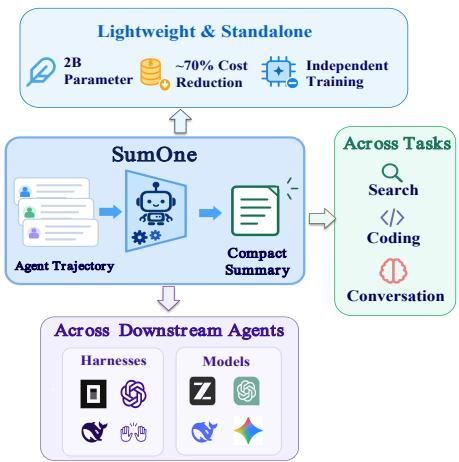
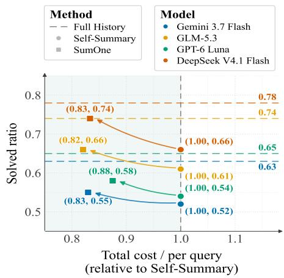
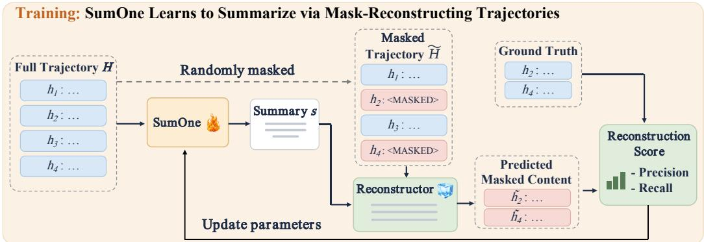
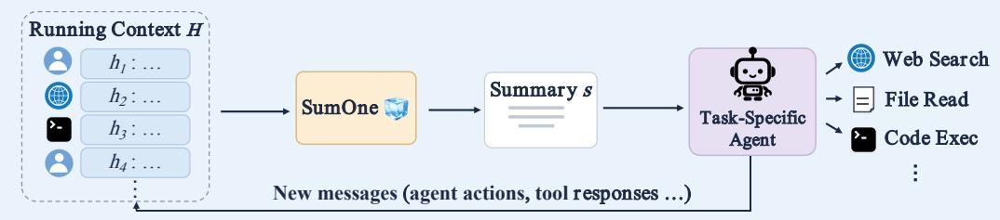

# SUMONE: A SIMPLE AND EFFICIENT SUMMARIZER FOR PLUG-AND-PLAY AGENT MEMORY

Jizhe Zhang Ang Li Chenheng Zhang Yisen Wang†

State Key Lab of General Artificial Intelligence, School of Intelligence Science and Technology, Peking University

## ABSTRACT

Long-horizon language-model agents accumulate increasingly large interaction histories, making context compaction essential for efficient execution. Existing learned compaction methods often rely on downstream task outcomes or solver behavior, coupling training to specific tasks or agents. We introduce SumOne, a standalone summarizer trained to preserve information in agent histories through masked reconstruction. Given a summary of the expired history, a frozen reconstructor recovers randomly masked portions of the original trajectory; reconstruction quality, combined with a length penalty, provides a task-agnostic reward for optimizing the summarizer with GRPO. This yields self-supervision directly from raw trajectories, without reference summaries or downstream task execution. At inference time, only the lightweight summarizer is retained, enabling plug-and-play context compression for otherwise unchanged agents. We conduct a systematic evaluation of SUMONE in long-horizon search and softwareengineering tasks. SumOne reduces estimated inference cost by approximately 78% on DeepSearchQA and 75% on SWE-bench Verified relative to operating with full context, with absolute decreases of 0.04. The same checkpoint also transfers across downstream models and agent harnesses without additional finetuning.

## 1 INTRODUCTION

Large language models are increasingly used to build agents that reason over multiple steps, call tools, and respond to observations from an external environment (Yao et al., 2023; OpenAI, 2025; Anthropic, 2026; Kimi Team et al., 2026). Such agents need access to earlier interactions: a search agent may have to combine evidence found at different steps, while a coding agent may need to recall a user constraint, a previous code change, or the outcome of a failed test. As the task continues, these interactions accumulate into a long trajectory. Passing the entire trajectory to the model increases inference cost and eventually reaches its context limit (Liu et al., 2024; Su et al., 2024). Yet keeping every interaction verbatim is often unnecessary. Tool outputs contain irrelevant details, and the outcome of a completed step may be more useful than its full sequence of actions. The challenge is therefore to reduce the context the agent reads without discarding information it may need later (Hu et al., 2025b).

Existing approaches to agent context management can be roughly organized into three groups. The first uses prompting or simple rules to shorten the context, for example, by discarding older interactions or asking a model to summarize them. Automatic compaction in Codex and Claude Code shows the practical value of this approach (Pathak & Fabbri, 2026; Anthropic). The second group ties memory management to the agent’s task or training process. HiAgent summarizes completed subgoals within the agent workflow; FoldGRPO trains agents to operate with compressed tool responses; (Hu et al., 2025a; Sun et al., 2025). These methods can adapt memory to the decisions an agent must make, but their design or training depends on a particular task workflow or downstream solver. The third group provides more general memory frameworks. A-MEM (Xu et al., 2026), for instance, manages information across context and external storage, with explicit decisions about what to retain and retrieve. Such frameworks offer a broader memory interface, but also require the agent to additionally interact with that interface.

Together, these approaches leave room for a memory mechanism that is agnostic to specific tasks, lightweight to use, while maintaining high information density. We propose to train a dedicated small language model that compresses running context of other agents, only using raw trajectories. However, the central challenge would be the training signal. Given a long agent trajectory and its compressed version, how should one judge its completeness and compactness? In this paper, we use masked reconstruction, a classic training objective in self-supervised learning (Lewis et al., 2020; He et al., 2022), as a proxy to assess what a summary preserves. Given a summary of trajectory segments, we first mask parts of the original trajectory, and adopt a frozen model to predict the complete history. As a result, the overlap between the original trajectory and the prediction provides a training signal derived from the data itself, without external references or downstream task execution.

  
(a) SUMONE is a lightweight, standalone memory (b) SUMONE consistently achieves a better compressor applicable to diverse agents and tasks. performance–cost trade-off than self-summary  
Figure 1: SUMONE is an efficient and scalable memory compressor for long-horizon agents. (a) A single 2B SUMONE, trained solely from raw trajectories, can be plugged into different tasks, downstream models, and agent harnesses without specific adaptation. (b) SUMONE consistently improves over self-summary in both task performance and inference cost, yielding a better performance–cost trade-off. The y-axis shows task success rate (resolved rate) on the SWE-bench Verified (Jimenez et al., 2024a) benchmark, while the x-axis shows total inference cost per query normalized by that of self-summary.

We implement the above procedure as the reward model in a GRPO-style RL training loop Shao et al. (2024), and collect a training dataset of 5k trajectories primarily sampled from web search and coding agents. The resulting model, which we call SUMONE, is a specialized compression model for agentic context with merely 2 billion parameters. As illustrated in Figure 1a, SUMONE undergoes task-independent training on raw trajectories. It specializes in compressing agent trajectories into textual memory on-the-fly, and proves to be effective across a wide range of settings based on ou experiments.

We evaluate SUMONE on long-horizon search and software-engineering tasks, together with agentic memory benchmarks and transfer across downstream agents and harnesses. On DeepSearchQA (Gupta et al., 2026), SUMONE reduces more than 70% cumulative agent input and 77% end-to-end task cost per query compared to evaluating with full context, while causing merely 0.04 drop in F1 score. On SWE-bench Verified (Jimenez et al., 2024a), it achieves a 59% resolved rate versus 63%, while reducing input from 4.1M to 1.09M tokens per task. Compared with agent self-summarization, SUMONE performs better on both benchmarks while using notably less endto-end cost,with Figure 1b highlighting the results for SWE-bench Verified. It also achieves the strongest results among compression methods on LongMemEval-S (Wu et al., 2025a) and transfers across multiple downstream LLMs and agent harnesses without additional fine-tuning.

Our broader aim is to make memory management a capability of a dedicated module that can serve different agents, similar to the role that hippocampus plays in human brains (McClelland et al., 1995). SUMONE addresses one part of this problem: learning to write compact memory from raw interaction histories, with supervision obtained from the data itself. To summarize, the advantages of SUMONE are as follows:

• Self-supervised training. SUMONE learns directly from raw agent trajectories, using masked reconstruction to derive its training signal without human annotations, external reference summaries, or downstream task execution.

• Efficient inference. SUMONE is a lightweight 2B-parameter model specialized for context compression. By replacing inference over an ever-growing, append-only context with a shorter, bounded context maintained by SUMONE, it reduces end-to-end task cost by 70% on the DeepSearch QA and SWE-Bench-Verfied benchmarks, while incurring a modest performance drop of 0.04.

• Plug-and-play deployment. SUMONE is trained independently of any particular task, agent model, or harness. Our empirical study demonstrates its transferability across 3 domains, 5 downstream LLMs including GPT-6 (OpenAI, 2026c), and 4 coding agent harnesses without extra fine-tuning.

## 2 RELATED WORK

We position our paper in the field of agentic memory, and it is especially related to studies trying to compact running context of agents for efficiency. Our core training algorithm involves mask reconstruction, a classic self-supervised learning objective. Therefore, we briefly review the two research areas below.

Agent memory and context compaction. Tool-using agents accumulate long histories of actions and observations (Yao et al., 2023), motivating mechanisms for retaining useful information under limited context budgets. Existing approaches can be broadly grouped into three categories. First, input-level compression reduces context by selecting, removing, or masking parts of the original input, rather than synthesizing a new memory representation, as in prompt compression (Jiang et al., 2023; Pan et al., 2024) and observation masking (Lindenbauer et al., 2025). Second, agent-managed compaction incorporates memory maintenance into the agent workflow, such as subgoal summarization in HiAgent (Hu et al., 2025a) and learned context folding (Sun et al., 2025; Ye et al., 2025). Third, standalone summarization methods compress interaction histories into textual memory for subsequent agent execution. Methods (Wu et al., 2025b; Kang et al., 2025; Zhang et al., 2026) in this category typically tie the learning or evaluation of summaries to downstream task outcomes or solver behavior. SUMONE also adopts a standalone summarizer, but learns it with a task-agnostic reconstruction objective.

Reconstruction as a learning signal. Reconstruction has long provided self-supervision for learning information-preserving representations. Denoising autoencoders (Vincent et al., 2008), masked language modeling (Devlin et al., 2019), sequence denoising (Lewis et al., 2020), and masked autoencoders (He et al., 2022) learn representations by recovering corrupted or missing input. Closer to our setting, MemTrain (Li et al., 2026) uses masked-entity reconstruction and intermediate recall to train an agent to manage its own memory. In contrast, our method trains a separate textual summarizer, while keeping the downstream agent entirely outside the training loop.

## 3 REINFORCING CONTEXT COMPRESSION WITH MASKEDRECONSTRUCTION

We introduce SUMONE, a framework for learning compact agent memories without relying on downstream task execution as supervision. Our key idea is to treat summarization as informationpreserving compression: a good summary should retain information from the expired interaction history that remains useful after the original history is discarded. To train for this property directly, SUMONE generates a summary of the expired history (Section 3.1), masks part of the original history, and asks a frozen reconstructor to recover the missing content from the summary and retained context (Section 3.2). Reconstruction quality is then converted into a reward for optimizing the summarizer with GRPO (Shao et al., 2024) (Section 3.3). At inference time, the reconstruction pipeline is removed, leaving only the lightweight summarizer as a plug-and-play context compression module (Section 3.4).

Deployment: Plug-and-Play Memory Module for Efficient Agent Execution  
  
Figure 2: Overview of SUMONE. The summarizer compresses the expired history into a short summary. A frozen reconstructor then attempts to recover masked parts of the original history conditioned on the summary and retained context, and the reconstruction score (with a length penalty) provides the reward to optimize the summarizer.

## 3.1 FORMULATING THE SUMMARY AGENT

Let H denote the expired interaction history to be compressed, and let C denote the context retained unchanged during the current compaction step, including the system instructions, task specification, existing memory, and recent interactions. Given (C, H), the summarizer $\pi _ { \theta }$ generates a textual summary

$$
S \sim \pi _ { \theta } ( \cdot \mid C , H ) .\tag{1}
$$

The objective is to produce a concise S that preserves information in H. Rather than supervising S with a reference summary or downstream task reward, SUMONE derives its training signal directly from the original history through masked reconstruction.

## 3.2 SUMMARY AS A MUTUAL INFORMATION MAXIMIZER

To measure how much information from H is preserved in S, we mask part of the original history and test whether it can be recovered from the summary. Specifically, we partition H into approximately equal-sized blocks, preferring natural interaction boundaries such as role transitions and tool calls whenever possible. We sample a subset of blocks Ω and replace them with missing-span markers, producing a partially observed history

$$
\begin{array} { r } { \widetilde { H } = \mathrm { M a s k } ( H ; \Omega ) . } \end{array}\tag{2}
$$

A reconstructor D then predicts the masked content conditioned on the summary and the remaining context:

$$
\widehat { H } _ { \Omega } \sim p _ { D } ( \cdot \mid C , \widetilde { H } , S ) .\tag{3}
$$

Intuitively, if S preserves information that becomes unavailable after masking $H _ { \Omega } ,$ , conditioning on S should make the missing content easier to recover. Reconstruction quality therefore provides a functional measure of information retained by the summary.

This view also admits an information-theoretic interpretation. Let $H _ { \bar { \Omega } }$ denote the visible portion of the history. The additional information provided by S about the missing content can be characterized

by

$$
I ( S ; H _ { \Omega } \mid H _ { \bar { \Omega } } , C ) = { \mathcal { H } } ( H _ { \Omega } \mid H _ { \bar { \Omega } } , C ) - { \mathcal { H } } ( H _ { \Omega } \mid S , H _ { \bar { \Omega } } , C ) .\tag{4}
$$

Since the first term does not depend on the summarizer, a summary that better reduces uncertainty about $H _ { \Omega }$ preserves more information beyond the retained context. SUMONE does not estimate this quantity explicitly; reconstruction quality serves as a semantic surrogate.

## 3.3 IMPLEMENTING MASKED RECONSTRUCTION AS A REWARD MODEL IN RL

We optimize the summarizer with GRPO based on reconstruction quality. To this end, we first formulate the reconstruction quality as a scalar reward.

An LLM judge evaluates each reconstructed block against its ground-truth content along two dimensions: precision and recall. Precision measures the fraction of the predicted content that is supported by the ground truth, whereas recall measures the fraction of the ground-truth content that is successfully recovered. Let $r _ { i }$ and $p _ { i }$ denote the two scores for masked block $h _ { i }$ . The overall reconstruction quality is

$$
Q ( S ) = { \frac { 1 } { | \Omega | } } \sum _ { i \in \Omega } ( r _ { i } + p _ { i } ) .\tag{5}
$$

Optimizing reconstruction quality alone may favor overly long summaries that preserve most of the original history. We therefore introduce a length penalty and define the final reward as

$$
R ( S ) = Q ( S ) - \lambda \frac { | S | } { L _ { \operatorname * { m a x } } } ,\tag{6}
$$

where |S| denotes the summary length, $L _ { \mathrm { m a x } }$ is the maximum summary budget, and λ controls the trade-off between information preservation and compression. This objective captures a compression–fidelity trade-off: $Q ( S )$ measures how well information is preserved, while summary length controls the cost of compression.

For each context, we sample $G$ candidate summaries from $\pi _ { \theta }$ and evaluate them using the reconstruction-based reward described above. Following GRPO, we normalize the rewards within each group to obtain a relative advantage for each candidate:

$$
A _ { k } = \frac { R ( S _ { k } ) - \mu _ { R } } { \sigma _ { R } + \epsilon } ,\tag{7}
$$

where $\mu _ { R }$ and $\sigma _ { R }$ denote the mean and standard deviation of the group rewards. The summarizer is then optimized with the standard GRPO objective, while the reconstructor remains frozen.

## 3.4 DEPLOYING SUMONE AS A PLUG-AND-PLAY MODULE

Once training is complete, the learned summarizer can be directly paired with a downstream agent for inference. SUMONE replaces the expired history H with its summary S from Eq. 1, and the agent continues execution using (C, S). The reconstruction and judge pipeline are no longer required at inference time.

## 4 EVALUATING SUMONE

## 4.1 EXPERIMENTAL SETUP

Training. We construct approximately 5K compaction instances at 16K and 32K context lengths, roughly balanced between web-search trajectories from OpenSeeker-v1-Data (Du et al., 2026) and software-engineering trajectories from SWE-smith (Yang et al., 2026). For reconstruction, we partition the expired history into roughly 512-token blocks, preserving natural interaction boundaries where possible, and randomly mask 50% of them. We initialize the SumOne summarizer from Qwen3.5-2B, use a frozen Qwen3.5-9B as the reconstructor, and employ DeepSeek V4.1 Flash to judge content recovery and fabrication. We optimize the summarizer with GRPO for 600 steps using a batch size of $^ { 6 , }$ a group size of 8, and a learning rate of $1 \times 1 0 ^ { - 6 }$ . Additional training details are provided in Appendix 6.1.

Table 1: Main results on DeepSearchQA and SWE-bench Verified. Score denotes task performance, measured by F1 on DeepSearchQA and the resolved rate on SWE-bench Verified. C. Ratio, Input Tok., Sum. Cost, Total Cost, and Comp./Q denote the compression ratio, the number of input tokens consumed by the agent, the summarization cost per query, the total inference cost per query, and the average number of compactions per query, respectively. Costs are reported in USD.
<table><tr><td colspan="7">DeepSearchQA</td></tr><tr><td>Method</td><td>Score ↑</td><td>C. Ratio ↑</td><td>Input Tok. ↓</td><td>Sum. Cost↓</td><td>Total Cost↓</td><td>Comp./Q↓</td></tr><tr><td>Full History</td><td>0.52</td><td></td><td>2.83M</td><td></td><td>$0.170</td><td></td></tr><tr><td>Recent Truncation</td><td>0.16</td><td></td><td>752K</td><td></td><td>$0.047</td><td>1.24</td></tr><tr><td>Self-Summary</td><td>0.44</td><td>91%</td><td>652K</td><td>$0.002</td><td>$0.044</td><td>1.68</td></tr><tr><td>Prompt-2B</td><td>0.29</td><td>92%</td><td>468K</td><td>$0.001</td><td>$0.031</td><td>1.24</td></tr><tr><td>CoMem</td><td>0.32</td><td>88%</td><td>577K</td><td>$0.001</td><td>$0.036</td><td>1.48</td></tr><tr><td>SUMONE (ours)</td><td>0.48</td><td>90%</td><td>591K</td><td>$0.001</td><td>$0.038</td><td>1.57</td></tr><tr><td colspan="7">SWE-bench Verified</td></tr><tr><td>Full History</td><td>0.63</td><td></td><td>4.1M</td><td></td><td>$0.286</td><td></td></tr><tr><td>Recent Truncation</td><td>0.46</td><td></td><td>1.27M</td><td></td><td>$0.097</td><td>2.1</td></tr><tr><td>Self-Summary</td><td>0.56</td><td>74%</td><td>1.05M</td><td>$0.013</td><td>$0.082</td><td>2.7</td></tr><tr><td>Prompt-2B</td><td>0.51</td><td>77%</td><td>0.98M</td><td>$0.001</td><td>$0.073</td><td>2.1</td></tr><tr><td>CoMem</td><td>0.57</td><td>72%</td><td>0.97M</td><td>$0.001</td><td>$0.065</td><td>2.5</td></tr><tr><td>SUMONE (ours)</td><td>0.59</td><td>69%</td><td>1.09M</td><td>$0.001</td><td>$0.071</td><td>2.5</td></tr></table>

Evaluation. Our primary agent benchmarks are DeepSearchQA (Gupta et al., 2026) for web search and SWE-bench Verified (Jimenez et al., 2024b) for software engineering; we additionally use LongMemEval-S for isolated memory evaluation. Unless otherwise specified, we use Qwen3.5- 35B-A3B with OpenCode (Anomaly, 2026) as the downstream agent and harness. Native harness compaction is disabled, and all evaluated methods use a 32K compaction threshold; Full History instead retains the complete trajectory up to the model’s native context limit. To test plug-and-play generalization, we additionally evaluate across DeepSeek V4.1 Flash (DeepSeek-AI, 2026b), GPT-6 Luna (OpenAI, 2026c), GLM-5.3 (Z.ai, 2026), and Gemini 3.7 Flash (Google, 2026), as well as DeepSeek Harness (DeepSeek-AI, 2026a), OpenHands (Wang et al., 2025), and Codex (OpenAI, 2026b).

Baselines and metrics. We compare SUMONE against five context-management baselines. Full History retains the complete interaction history without compression. Recency Truncation (Ubicloud, 2026; OpenAI, 2026a) discards the oldest interactions once the compaction threshold is reached. Self-Summary uses the downstream agent itself to summarize the expired trajectories. Prompt-2B uses Qwen3.5-2B and summarization prompt as prompt as SUMONE, but without any additional training, isolating the effect of our training objective. CoMem (Zhang et al., 2026) is a learned standalone memory model supervised by downstream agent behavior. All compression methods use the same compaction threshold and output budget whenever applicable. We report downstream task performance, cumulative downstream-agent input tokens, inference cost, average compactions per query, and compression ratio:

$$
\mathrm { C R } = 1 - \frac { \sum _ { e } \left| S _ { e } \right| } { \sum _ { e } \left| H _ { e } \right| } ,\tag{8}
$$

where $H _ { e }$ and $S _ { e }$ denote the expired history and its compressed summary at compaction event e.   
Model-specific API prices are provided in Appendix 6.2.

## 4.2 SUMONE SUBSTANTIALLY REDUCES TASK COST WITH MILD PERFORMANCE DROP

SUMONE retains most of the Full History performance at a fraction of the cost. Table 1 reports the main results on DeepSearchQA and SWE-bench Verified, using Qwen3.5-35B-A3B as the downstream agent with OpenCode as the agent harness. On DeepSearchQA, SUMONE achieves 0.48 F1 compared with 0.52 for Full History, while reducing cumulative agent input from 2.83M to 591K tokens and requiring only 22% of the total inference cost of Full History. A similar pattern holds on SWE-bench Verified, where SUMONE reaches a 0.59 resolved rate compared with 0.63 for Full History, while reducing cumulative input from 4.10M to 1.09M tokens and using only 58% of the Full History cost. These results show that SUMONE preserves most of the utility of the full interaction history with a substantially smaller context and cost footprint.

Table 2: Performance with task-specific RL agents.
<table><tr><td>Method</td><td>DSQA↑</td><td>Cost↓</td><td>SWE↑</td><td>Cost↓</td></tr><tr><td>Full His. w/o RL</td><td>0.52</td><td>0.17</td><td>0.63</td><td>0.286</td></tr><tr><td>Self-Sum.</td><td>0.57</td><td>0.052</td><td>0.65</td><td>0.091</td></tr><tr><td>Prompt-2B</td><td>0.41</td><td>0.028</td><td>0.58</td><td>0.083</td></tr><tr><td>CoMem</td><td>0.48</td><td>0.035</td><td>0.60</td><td>0.072</td></tr><tr><td>SUMONE</td><td>0.55</td><td>0.039</td><td>0.68</td><td>0.077</td></tr></table>

Table 3: Cross-harness evaluation with Qwen3.5-35B.
<table><tr><td>Harness</td><td>Full His.</td><td>Self-Sum.</td><td>SUMONE</td></tr><tr><td>OpenCode</td><td>0.52</td><td>0.44</td><td>0.48</td></tr><tr><td>OpenHands</td><td>0.49</td><td>0.39</td><td>0.46</td></tr><tr><td>Codex</td><td>0.55</td><td>0.47</td><td>0.47</td></tr><tr><td>DS Harness</td><td>0.50</td><td>0.41</td><td>0.42</td></tr></table>

Table 4: Isolated memory evaluation on LongMemEval-S. Single, Multi, Temporal, and Update denote single-session retrieval, multi-session reasoning, temporal reasoning, and knowledge-update questions, respectively. Sum. Cost denotes the normalized cost of memory summarization, and C. Ratio denotes compression ration defined in Section 4.1.
<table><tr><td>Method</td><td>Overall ↑</td><td>Single ↑</td><td>Multi ↑</td><td>Temporal ↑</td><td>Update ↑</td><td>Sum. Cost ↓</td><td>C. Ratio ↑</td></tr><tr><td>Oracle</td><td>0.85</td><td>0.94</td><td>0.72</td><td>0.8</td><td>0.93</td><td></td><td></td></tr><tr><td>Full History</td><td>0.77</td><td>0.81</td><td>0.5</td><td>0.8</td><td>0.86</td><td></td><td></td></tr><tr><td>Prompt-2B</td><td>0.43</td><td>0.38</td><td>0.51</td><td>0.38</td><td>0.24</td><td>0.003</td><td>94%</td></tr><tr><td>CoMem</td><td>0.31</td><td>0.41</td><td>0.08</td><td>0.24</td><td>0.61</td><td>0.003</td><td>93%</td></tr><tr><td>SUMONE</td><td>0.47</td><td>0.48</td><td>0.41</td><td>0.36</td><td>0.43</td><td>0.003</td><td>89%</td></tr></table>

SUMONE provides a better performance–cost trade-off than existing summarization approaches. On DeepSearchQA, SUMONE improves over Self-Summary from 0.44 to 0.48 F1 while requiring only 0.04× the summarization cost and 0.86× the total inference cost. On SWE-bench Verified, SUMONE similarly improves the resolved rate from 0.56 to 0.59, using only 0.08× the summarization cost and 0.86× the total inference cost of Self-Summary. SUMONE also consistently outperforms Prompt-2B under comparable compression and achieves stronger overall performance than CoMem across the two tasks. The substantial improvement over Prompt-2B suggests that simply replacing self-summarization with a lightweight standalone model is insufficient; reconstruction-based training enables the summarizer to preserve information that is more useful for subsequent agent execution.

## 4.3 SUMONE EXCELS IN ISOLATED MEMORY EVALUATION

SUMONE preserves more generally accessible information for subsequent retrieval and reasoning. While Section 4.2 evaluates compression through downstream agent performance, here we further decouple memory quality from task execution using LongMemEval-S, which directly evaluates long-term memory capabilities. As shown in Table 4, the overall performance follows Oracle > Full History > SUMONE > Prompt-2B > CoMem. Among compression methods, SUMONE achieves the highest overall score (0.47), outperforming Prompt-2B (0.43) and CoMem (0.31). More importantly, SUMONE exhibits relatively balanced performance across different memory capabilities: while Prompt-2B is stronger on multi-session questions and CoMem performs particularly well on knowledge updates, both degrade substantially on other categories. In contrast, SUMONE maintains competitive performance across single-session retrieval, multi-session reasoning, temporal reasoning, and knowledge updates. This more balanced behavior is consistent with our task-agnostic reconstruction objective, which encourages broad information preservation rather than optimizing memory toward a particular downstream task or capability.

## 4.4 ONE SUMONE FOR VARIOUS DOWNSTREAM MODELS

SUMONE transfers across different downstream models without model-specific retraining. We evaluate the same SUMONE model on SWE-bench Verified with OpenCode as well as DeepSearchQA while varying only the downstream LLM among DeepSeek V4.1 Flash, GPT-

Table 5: Ablation on the training objective. All compressed variants use the same Qwen3.5- 2B initialization and are evaluated under the same compression setting. We report downstream performance on DeepSearchQA and SWE-bench, together with direct memory evaluation on LongMemEval-S. Full History provides an uncompressed reference.
<table><tr><td></td><td colspan="2">Downstream Agent Tasks</td><td colspan="5">LongMemEval-S</td></tr><tr><td>Method</td><td>DSQA↑</td><td>SWE↑</td><td>Overall ↑</td><td>Single ↑</td><td>Multi ↑</td><td>Temp. ↑</td><td>Update ↑</td></tr><tr><td>Full History</td><td>0.52</td><td>0.63</td><td>0.77</td><td>0.81</td><td>0.5</td><td>0.8</td><td>0.86</td></tr><tr><td>Prompt-2B</td><td>0.29</td><td>0.51</td><td>0.43</td><td>0.38</td><td>0.51</td><td>0.38</td><td>0.24</td></tr><tr><td>Summ.-Judge-RL</td><td>0.41</td><td>0.54</td><td>0.36</td><td>0.40</td><td>0.14</td><td>0.31</td><td>0.71</td></tr><tr><td>Recon-RL (ours)</td><td>0.48</td><td>0.59</td><td>0.47</td><td>0.48</td><td>0.41</td><td>0.36</td><td>0.43</td></tr></table>

Table 6: Ablation on mask ratio and length penalty. We report performance on DeepSearchQA (DSQA) and LongMemEval-S (LongMem).
<table><tr><td colspan="3">(a) Mask ratio</td></tr><tr><td>Mask Ratio</td><td>25%</td><td>50% 75%</td></tr><tr><td>DSQA</td><td>0.41</td><td>0.48 0.29</td></tr><tr><td>LongMem</td><td>0.35 0.47</td><td>0.20</td></tr></table>

<table><tr><td colspan="5">(b) Length penalty</td></tr><tr><td>Length Penalty</td><td>0.01</td><td>0.1</td><td>0.2</td><td>0.5</td></tr><tr><td>DSQA</td><td>0.47</td><td>0.48</td><td>0.45</td><td>0.37</td></tr><tr><td>LongMem</td><td>0.41</td><td>0.47</td><td>0.38</td><td>0.30</td></tr></table>

6 Luna, GLM-5.3, and Gemini 3.7 Flash. Table 8 and Table 9 show that across all evaluated models, SUMONE consistently approaches the performance of Full History while outperforming Self-Summary, indicating that the information preserved by SUMONE is not specific to a particular downstream model. At the same time, SUMONE reduces inference cost by offloading context compaction from the downstream agent to a lightweight Qwen3.5-2B summarizer; compared with Self-Summary, this advantage is particularly pronounced for more expensive agent models. These results demonstrate that a single SUMONE checkpoint can serve as a solver-independent memory compressor across heterogeneous LLM backbones.

## 4.5 INTEGRATING SUMONE ACROSS AGENT HARNESSES

SUMONE remains effective across different agent harnesses without harness-specific adaptation. We fix Qwen3.5-35B-A3B as the downstream model and evaluate the same SUMONE checkpoint on DeepsearchQA across OpenCode, DeepSeek Harness, Codex, and OpenHands and the results are shown in Table 3. In each harness, SUMONE consistently approaches the performance of Full History while outperforming Self-Summary, showing that its memory representation is not tied to a particular agent execution framework. SUMONE also maintains comparable compression and lower overall inference cost across harnesses. These results suggest that SUMONE can be integrated into diverse agent systems as a plug-and-play context compressor without modifying or retraining the underlying harness.

## 4.6 DOWNSTREAM RL TRAINING FURTHER IMPROVES PERFORMANCE-COST TRADE-OFF OF SUMONE

SUMONE is naturally compatible with further downstream RL training of the agent, bringing further benefits. Beyond inference-time compaction in Table 1, we integrate SUMONE into task-specific RL training for search and coding agents, using OpenSeeker-v1-Data and SWE-smith, respectively. As shown in Table 2, SUMONE remains competitive across both DeepSearchQA and SWE-bench Verified after task-specific RL. It achieves the best performance on SWE-bench (0.68) and closely matches Self-Summary on DeepSearchQA (0.55 vs. 0.57), while reducing the average inference cost from 0.052 to 0.039. These results suggest that SUMONE is not limited to agent inference, but can also serve as a lightweight and reusable context-compression component during long-horizon agent RL.

## 4.7 PROBING COMPONENTS OF THE SUMONE RECIPE

## 4.7.1 IS RECONSTRUCTION TRAINING NECESSARY?

We compare three variants based on the same Qwen3.5-2B initialization: Prompted 2B, Direct Summary Judge Reward optimized with GRPO, and our Reconstruction Reward. For the RL variants, we keep the training data, optimization budget, and length regularization fixed, changing only the reward signal.

Reconstruction provides a more grounded supervision signal for summary learning. Direct Judge Reward avoids reference targets, but still relies on a global and under-specified judgment of summary quality. In contrast, reconstruction directly tests whether information from the original trajectory can be recovered from the summary. As shown in Table 5, Reconstruction Reward consistently performs best under comparable compression, suggesting that its advantage comes from explicitly supervising information preservation rather than reference imitation or perceived summary quality.

## 4.7.2 WHAT MASK RATIO TO USE

A moderate mask ratio yields better performance. We study the effect of the reconstruction mask ratio in Table 6a. A mask ratio of 50% performs best on both DeepSearchQA and LongMemEval-S, achieving 48% and 7%, respectively. Reducing the mask ratio to 25% weakens the reconstruction objective: since much of the original trajectory remains directly observable, the reconstructor relies less on the summary, resulting in a weaker learning signal for the summarizer. In contrast, increasing the mask ratio to 75% substantially degrades performance, likely because recovering such a large portion of the trajectory becomes overly challenging for the reconstructor and consequently introduces a noisier training signal. These results suggest that masking roughly half of the expired history provides a better balance between reconstruction difficulty and supervision quality.

## 4.7.3 HOW MUCH LENGTH PENALTY TO APPLY

A moderate length penalty balances well between compression and information preservation. We study the effect of the length-penalty coefficient λ in Equation 6, with results reported in Table 6b. A moderate value of $\lambda = 0 . 1$ performs best on both DeepSearchQA and LongMemEval-S. When the penalty is too weak $( \lambda = 0 . 0 1 )$ , the summarizer is insufficiently constrained and tends to produce unnecessarily long summaries, reducing compression efficiency without yielding proportional performance gains. In contrast, stronger penalties (λ = 0.2 or 0.5) encourage overly aggressive compression, causing useful information to be discarded and degrading downstream performance.

## 5 DISCUSSION AND CONCLUSION

While SUMONE demonstrates that masked reconstruction provides an effective task-agnostic signal for learning compact agent memory, several limitations remain. First, our training data are concentrated in web-search and software-engineering trajectories, and broader domains may exhibit different memory requirements. Second, the training signal depends on a frozen reconstructor and an LLM-based reconstruction judge; although neither is needed at inference time, their capabilities may affect the quality of the learned summarizer. For future work, extending the module with adaptive memory management, retrieval, tools, and meta-memory is a promising direction toward a more complete agent memory system.

We introduced SUMONE, a lightweight plug-and-play summarizer for compressing long agent interaction histories. Rather than supervising summaries through downstream task outcomes or reference summaries, SUMONE learns directly from raw trajectories by rewarding summaries that enable masked portions of the original history to be reconstructed, while regularizing summary length. Across long-horizon search, software engineering, and direct memory evaluation, SUMONE substantially reduces context consumption while retaining most of the utility of full interaction histories, and transfers across downstream models and agent harnesses without additional fine-tuning. These results suggest that reconstruction-based self-supervision offers a simple and general route toward reusable memory modules for long-running language-model agents.

## AI USE STATEMENT

In this work, we used generative AI tools only for language editing and polishing of the manuscript. We did not use generative AI tools for research ideation, experimental design, implementation, data analysis, result interpretation, literature review, or the generation of scientific claims. All AIassisted text was carefully reviewed and revised by the authors. We take full responsibility for the final content of this work.

## ETHICS STATEMENT

This work does not involve human subjects, sensitive or personally identifiable data, dataset release, or other issues requiring specific ethical consideration. We do not identify any particular ethical concerns related to the methodology, experiments, or applications presented in this work.

## REPRODUCIBILITY STATEMENT

All datasets and benchmarks used in this work are publicly available. We provide the key methodological details, training setup, evaluation protocols, and implementation settings in the main text and appendices to facilitate reproduction of our results. Additional hyperparameters and experimental details are also documented in the appendix. Upon acceptance, we will release our code and related implementation resources to further support reproducibility.

## REFERENCES

Anomaly. OpenCode: The open source AI coding agent, 2026.

Anthropic. Manage costs effectively.

Anthropic. Claude Opus 5 System Card, 2026.

DeepSeek-AI. DeepSeek Harness, 2026a.

DeepSeek-AI. DeepSeek-V4.1-Flash: Smarter, faster, more efficient, 2026b.

Jacob Devlin, Ming-Wei Chang, Kenton Lee, and Kristina Toutanova. BERT: Pre-training of deep bidirectional transformers for language understanding. In NAACL, 2019.

Yuwen Du, Rui Ye, Shuo Tang, Xinyu Zhu, Yijun Lu, Yuzhu Cai, and Siheng Chen. Openseeker: Democratizing frontier search agents by fully open-sourcing training data. arXiv preprint arXiv:2603.15594, 2026.

Google. Gemini 3.7 Flash, 2026.

Nikita Gupta, Riju Chatterjee, Lukas Haas, Connie Tao, Andrew Wang, Chang Liu, Hidekazu Oiwa, Elena Gribovskaya, Jan Ackermann, John Blitzer, et al. Deepsearchqa: Bridging the comprehensiveness gap for deep research agents. arXiv preprint arXiv:2601.20975, 2026.

Kaiming He, Xinlei Chen, Saining Xie, Yanghao Li, Piotr Dollar, and Ross Girshick. Masked´ autoencoders are scalable vision learners. In CVPR, 2022.

Mengkang Hu, Tianxing Chen, Qiguang Chen, Yao Mu, Wenqi Shao, and Ping Luo. HiAgent: Hierarchical working memory management for solving long-horizon agent tasks with large language model. In ACL, 2025a.

Yuyang Hu, Shichun Liu, Yanwei Yue, Guibin Zhang, Boyang Liu, Fangyi Zhu, Jiahang Lin, Honglin Guo, Shihan Dou, Zhiheng Xi, et al. Memory in the age of ai agents. arXiv preprint arXiv:2512.13564, 2025b.

Huiqiang Jiang, Qianhui Wu, Chin-Yew Lin, Yuqing Yang, and Lili Qiu. LLMLingua: Compressing prompts for accelerated inference of large language models. In EMNLP, 2023.

Carlos E Jimenez, John Yang, Alexander Wettig, Shunyu Yao, Kexin Pei, Ofir Press, and Karthik Narasimhan. Swe-bench: Can language models resolve real-world github issues? In ICLR, 2024a.

Carlos E Jimenez, John Yang, Alexander Wettig, Shunyu Yao, Kexin Pei, Ofir Press, and Karthik Narasimhan. Swe-bench: Can language models resolve real-world github issues? In ICLR, 2024b.

Minki Kang et al. ACON: Optimizing context compression for long-horizon LLM agents. arXiv preprint arXiv:2510.00615, 2025.

Kimi Kimi Team, Tongtong Bai, Yifan Bai, Yiping Bao, Jianfeng Cai, Xinyuan Cai, Peizhou Cao, Yuxuan Cao, Ziwei Chai, Y Charles, et al. Kimi k3: Open frontier intelligence. arXiv preprint arXiv:2607.24653, 2026.

Mike Lewis, Yinhan Liu, Naman Goyal, Marjan Ghazvininejad, Abdelrahman Mohamed, Omer Levy, Veselin Stoyanov, and Luke Zettlemoyer. BART: Denoising sequence-to-sequence pretraining for natural language generation, translation, and comprehension. In ACL, 2020.

Ziheng Li, Xingrun Xing, Haoqing Wang, Zhi-Hong Deng, and Yehui Tang. Memtrain: Selfsupervised context memory training. arXiv preprint arXiv:2606.03197, 2026.

Tobias Lindenbauer, Igor Slinko, Ludwig Felder, Egor Bogomolov, and Yaroslav Zharov. The complexity trap: Simple observation masking is as efficient as llm summarization for agent context management. arXiv preprint arXiv:2508.21433, 2025.

Nelson F Liu, Kevin Lin, John Hewitt, Ashwin Paranjape, Michele Bevilacqua, Fabio Petroni, and Percy Liang. Lost in the middle: How language models use long contexts. Transactions of the association for computational linguistics, 2024.

James L. McClelland, Bruce L. McNaughton, and Randall C. O’Reilly. Why there are complementary learning systems in the hippocampus and neocortex: Insights from the successes and failures of connectionist models of learning and memory. Psychological Review, 1995.

OpenAI. GPT-5 System Card, 2025.

OpenAI. Openai Agents SDK: Models, 2026a.

OpenAI. Codex CLI, 2026b.

OpenAI. GPT-6 Luna, 2026c.

Zhuoshi Pan et al. LLMLingua-2: Data distillation for efficient and faithful task-agnostic prompt compression. In ACL, 2024.

Raj Pathak and Stefano Fabbri. Using goals in codex, 2026.

Zeyu Shao, Peng Wang, Qinkai Zhu, Rui Xu, Jiaxing Song, Ming Zhang, Yuxiao Li, Yuhuai Wu, and Daya Guo. Deepseekmath: Pushing the limits of mathematical reasoning in open language models. arXiv preprint arXiv:2402.03300, 2024.

Jianlin Su, Murtadha Ahmed, Yu Lu, Shengfeng Pan, Wen Bo, and Yunfeng Liu. Roformer: Enhanced transformer with rotary position embedding. Neurocomputing, 2024.

Weiwei Sun et al. Scaling long-horizon LLM agent via context-folding. arXiv preprint arXiv:2510.11967, 2025.

Ubicloud. SWE-Qwen3-14B: A lora fine-tuned SWE agent model based on Qwen3-14B, 2026.

Pascal Vincent, Hugo Larochelle, Yoshua Bengio, and Pierre-Antoine Manzagol. Extracting and composing robust features with denoising autoencoders. In ICML, 2008.

Xingyao Wang et al. OpenHands: An open platform for AI software developers as generalist agents. In ICLR, 2025.

Di Wu, Hongwei Wang, Wenhao Yu, Yuwei Zhang, Kai-Wei Chang, and Dong Yu. Longmemeval: Benchmarking chat assistants on long-term interactive memory. 2025a.

Xixi Wu et al. ReSum: Unlocking long-horizon search intelligence via context summarization. arXiv preprint arXiv:2509.13313, 2025b.

Wujiang Xu, Zujie Liang, Kai Mei, Hang Gao, Juntao Tan, and Yongfeng Zhang. A-mem: Agentic memory for llm agents. NeurIPS, 2026.

John Yang, Kilian Lieret, Carlos Jimenez, Alexander Wettig, Kabir Khandpur, Yanzhe Zhang, Binyuan Hui, Ofir Press, Ludwig Schmidt, and Diyi Yang. Swe-smith: Scaling data for software engineering agents. NeurIPS, 2026.

Shunyu Yao, Jeffrey Zhao, Dian Yu, Nan Du, Izhak Shafran, Karthik Narasimhan, and Yuan Cao. ReAct: Synergizing reasoning and acting in language models. In ICLR, 2023.

Rui Ye et al. AgentFold: Long-horizon web agents with proactive context management. arXiv preprint arXiv:2510.24699, 2025.

Z.ai. GLM-5.3: Frontier coding with emergent cyber capabilities, 2026.

Yuwei Zhang et al. CoMem: Context management with a decoupled long-context model. In ICML, 2026.

## 6 APPENDIX

## 6.1 TRAINING DETAILS

We summarize the training configuration of SUMONE in Table 7. We optimize the summarizer with GRPO for 600 steps using veRL on a single node with eight H20 GPUs.

Table 7: Training configuration and hyperparameters of SUMONE.
<table><tr><td>Hyperparameter</td><td>Value</td></tr><tr><td>Model and System Base model Training framework Hardware Sharding Gradient checkpointing</td><td>Qwen3.5-2B veRL 8 × H20-141G FSDP full shard Yes</td></tr><tr><td>Optimization RL algorithm Critic KL loss Entropy coefficient Learning rate Clip ratio (low) Clip ratio (high) Dual-clip coefficient Training steps</td><td>GRPO None None 0 1 × 10−6 (constant) 0.20 0.28 c = 10.0 600</td></tr><tr><td>Rollout and Sampling Prompts per step Samples per prompt Rollouts per step Rollout temperature Evaluation temperature</td><td>6 8 48 1.0 0</td></tr></table>

## 6.2 API PRICING FOR COST ESTIMATION

To ensure consistent cost estimation across models and experiments, we use the standard API prices listed in Table 10. All prices are reported in USD per one million tokens. For simplicity and reproducibility, we use the listed base prices only and do not account for cache-hit discounts, promotional pricing, batch discounts, or other temporary pricing policies. When a model is not included in this table, we use the publicly available price from its official API provider whenever possible.

Summarization Prompt   
The messages above in <conversation> are older history to summarize.   
Produce a detailed memory entry that will be APPENDED to an   
append-only memory;   
another LLM will use it together with the existing memory and the   
recent turns   
to continue the work.   
Use this EXACT format:   
## Goal   
- (concise)   
## User profile   
## Constraints & Preferences   
## Progress   
## Decisions

Table 8: Cross-model generalization on SWE-bench Verified. We compare Full History, Self-Summary, and SUMONE across different downstream agent models. Score denotes the resolved rate, and Cost denotes the average total inference cost per task in USD.
<table><tr><td></td><td colspan="2">Full History</td><td colspan="2">Self-Summary</td><td colspan="2">SUMONE</td></tr><tr><td>Model</td><td>Score ↑</td><td>Cost↓</td><td>Score ↑</td><td>Cost↓</td><td>Score ↑</td><td>Cost↓</td></tr><tr><td>Gemini 3.7 Flash</td><td>0.63</td><td>$0.82</td><td>0.52</td><td>$0.47</td><td>0.55</td><td>$0.39</td></tr><tr><td>GLM-5.3</td><td>0.74</td><td>$1.36</td><td>0.61</td><td>$0.78</td><td>0.66</td><td>$0.64</td></tr><tr><td>GPT-6 Luna</td><td>0.65</td><td>$0.14</td><td>0.54</td><td>$0.08</td><td>0.58</td><td>$0.07</td></tr><tr><td>DeepSeek V4.1 Flash</td><td>0.78</td><td>$0.42</td><td>0.66</td><td>$0.24</td><td>0.74</td><td>$0.20</td></tr></table>

Table 9: Cross-model generalization on DeepSearchQA. We compare Full History, Self-Summary, and SUMONE across different downstream agent models. Cost denotes the average total inference cost per query in USD.
<table><tr><td rowspan="2">Model</td><td colspan="2">Full History</td><td colspan="2">Self-Summary</td><td colspan="2">SUMONE</td></tr><tr><td>F1↑</td><td>Cost↓</td><td>F1↑</td><td>Cost ↓</td><td>F1↑</td><td>Cost↓</td></tr><tr><td>Gemini 3.7 Flash</td><td>0.54</td><td>$0.58</td><td>0.51</td><td>$0.36</td><td>0.56</td><td>$0.29</td></tr><tr><td>GLM-5.3</td><td>0.42</td><td>$1.14</td><td>0.33</td><td>$0.72</td><td>0.40</td><td>$0.51</td></tr><tr><td>GPT-6 Luna</td><td>0.38</td><td>$0.04</td><td>0.40</td><td>$0.05</td><td>0.46</td><td>$0.04</td></tr><tr><td>DeepSeek V4.1 Flash</td><td>0.74</td><td>$0.38</td><td>0.59</td><td>$0.18</td><td>0.66</td><td>$0.15</td></tr></table>

## Learned facts & SOP   
-   
## Active context   
- ...   
## User ask (for next step)   
## Key assets   
## Risks / open issues   
## Metrics & validation   
## Historical communications / incidents (closed)   
## Open loops   
Write a standalone brief: concrete, readable without the   
conversation. Merge with

Table 10: API prices used for cost estimation. Prices are in USD per one million tokens. We use standard list prices without cache discounts, promotional discounts, or other temporary pricing adjustments.
<table><tr><td>Model</td><td>Provider</td><td>Input</td><td>Output</td></tr><tr><td>GPT-6 Luna</td><td>OpenAI</td><td>$0.20</td><td>$1.20</td></tr><tr><td>DeepSeek V4.1 Flash</td><td>DeepSeek</td><td>$0.15</td><td>$0.60</td></tr><tr><td>Qwen3.5-35B-A3B</td><td>Alibaba Cloud Bailian</td><td>$0.0592</td><td>$0.4739</td></tr><tr><td>Qwen3.5-2B</td><td>DeepInfra via Requesty</td><td>$0.02</td><td>$0.10</td></tr><tr><td>Qwen3.5-4B</td><td>Alibaba Cloud Bailian</td><td>$0.03</td><td>$0.15</td></tr><tr><td>Gemini 3.7 Flash</td><td>Google Gemini API</td><td>$0.75</td><td>$3.75</td></tr><tr><td>GLM-5.3</td><td>Z.AI</td><td>$1.40</td><td>$4.40</td></tr><tr><td>Kimi K3</td><td>Kimi API</td><td>$3.00</td><td>$15.00</td></tr><tr><td>Qwen3.8 Flash</td><td>Alibaba Cloud Bailian</td><td>$0.1185</td><td>$0.3999</td></tr></table>

the existing memory if it exists; keep the memory compact   
(merge/dedup/update).   
Do NOT include the removed segments verbatim. Stay within   
{summary\_budget} tokens.   
Keep each section concise. Preserve exact entity names, dates,   
numbers, URLs, and quoted evidence.

Reconstruction Prompt   
The frozen decoder sees a single user message assembled as follows   
(shared group-prefix first   
for prefix caching; the ground-truth section is \*not\* part of the   
generation prompt --- the   
decoder generates from the prefix up to ‘=== Task ===‘ plus the   
literal ‘[MISSING\_1]:‘, and the   
ground truth is used only for judging):   
  
<system prefix p\_text>   
Initial task:   
<a\_text>   
<memory>   
<previous memory, if any>   
</memory>   
=== Recent turns (complete, verbatim) ===   
<retained recent turns>   
=== Partial older history (segments [MISSING\_1..M] removed) ===   
<older history with masked blocks replaced by [MISSING\_1],   
[MISSING\_2], ... markers>   
=== A summary of the removed history ===   
Another language model compressed the removed segments of the history   
and produced the   
summary below. Use it, together with the visible context, to   
reconstruct the missing segments.   
<candidate summary produced by the compressor>   
=== Task ===   
Reconstruct the missing segments in order.   
[MISSING\_1]:   
  
The decoder continues from ‘[MISSING\_1]:‘ and regenerates all missing   
segments in order. The   
ground-truth section appended for scoring has the form ‘[MISSING\_k]:   
<original masked chunk>‘.