# ServerBench: How can your coding agents design specialized LLM serving systems?

Xinrui Zhong1,∗, Zhiming Wang1,∗, Yongqi Liu1, Zhaohui Wang2, Shanglin Yang1, Zikun Li1, Zhuoming Chen1, Beidi Chen1

1Carnegie Mellon University 2University of Southern California

{xinruizh, zhimingw, yongqil}@andrew.cmu.edu, zwang000@usc.edu, {shangliy, zikunl, zhuominc, beidic}@andrew.cmu.edu

∗Equal contribution.

## ABSTRACT

Large language model (LLM) coding agents develop software through experimentation, ofering an opportunity to design the serving systems supporting their own operation. Efective serving requires coordinating implementation and operating decisions under session dependencies, latency constraints, and correctness requirements. We introduce ServerBench, a benchmark for agentic design of complete, specialized LLM serving systems. Agents experiment against a common objective, dollars per dollar: latency-qualified token value per dollar of GPU cost. Stateful replay preserves session dependencies, and independent verification checks the submitted system. Across 11 coding-agent models and three deployments, Claude Sonnet 5.5 achieves 2.97 dollars per dollar on Gemma E4B, 4.87× the vLLM reference; 22 of 33 runs yield verified systems, and 13 exceed the strongest baseline. Our analysis identifies three findings: high-value designs coordinate capacity improvements with load selection; agents interpret performance feedback through workload-relevant experiments; and reliable delivery requires verification of the execution paths introduced by optimization. Overall, Qwen3.5 9B (2×L40)3×3×3× ServerBench supports systematic study of how agents translate service objectives and feedback into efective, verifieda 3× n a 3×lilili serving systems for given task specifications.Qwen3.5 9B (2×L40)a Qwen3.5 9B (2×L3×eQwen3.5 9B (2×L40)3×e

§ Code github.com/Infini-AI-Lab/Server-Benchn lin se GPT 6.1 Sol: 1.8×2×ba 6.1 Sol: 1.8×lin sel Claude S U Blog infini-ai-lab.github.io/Server-Bench2×as Claude Sonnet 5.5: 2.7GPT 6.1 Sol: 1.8×2×bas GPT 6.1 Sol: 1.8×t b esClaude Sonnet 5.5: 2.7× 2×as GPT 6.1 Sol: 1.8×t b

## 1 Introduction st s s 0××

a b  
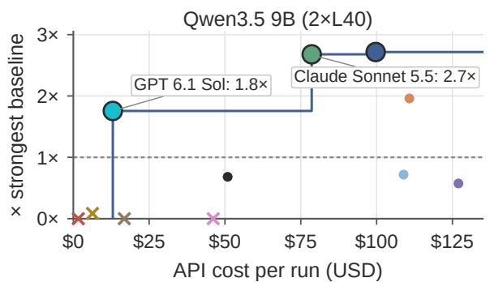

b  
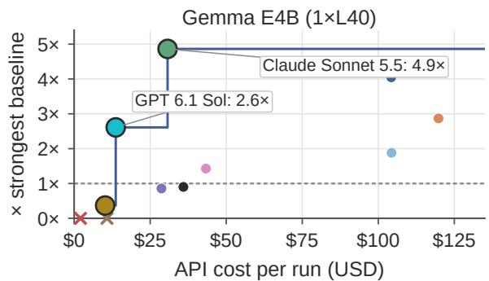  
asClaude Sonnet 5.5 GPT 6 Sol GLM 5.3 Claude Sonnet 5.5 GPT 6 Sol GLM 5.3Claude Sonnet 5.5 GPT 6 Sol GLM 5.3Claude Opus 5 Kimi K3 DeepSeek V4.1 FlashGPT 6 Astra Qwen3.8 MaxClaude Son et 5.5 GPT 6 Sol GLM 5.3Claude Opus 5 Kimi K3 DeepSeeGPT 6 Astra Qwen3.8 MQwen3.8 MaxGPT 6.1 Sol MiMo V2.6 ProClaude Sonnet 5.5 GPT 6 Sol GLM 5.3Claude Opus 5 Kimi K3 DeepSeek V4.1 Flash Pareto frontier strongest baseline (1×) failedPareto frontier strongest baseline (1×) failedPareto frontier strongest baseline (1×) failed

eGPT 6 Astra Qwen3.8 Max GPT 6 Astra Qwen3.8 MaxPareto frontier strongest baseline (1×) failed Pareto frontier strongest baseline (1×) failFigure 1 API cost and serving value relative to the strongest baseline. GPT 6.1 Sol ofers lower-cost gains; Claude reaches higher n Pareto frontier strongest baseline Pareto frontier strongest basPareto frontier strongest baselinevalue. Costs use OpenRouter rates (Table 3).

sLarge language model (LLM) coding agents build on code-generation capabilities (Zheng et al., 2025; Zhou et al., 2026a), 0×using tools and execution feedback to undertake software development and professional workflows (Yang et al., 2024;

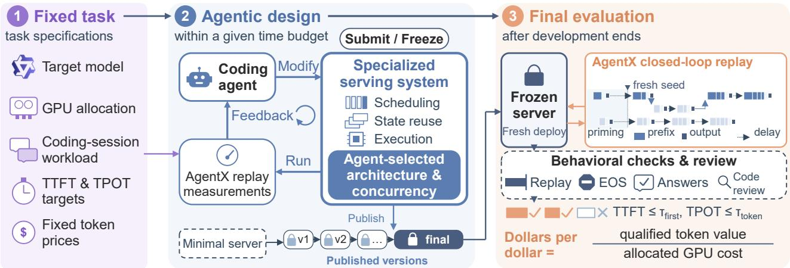  
Figure 2 Agents design the server and choose how many sessions it serves at once for a given model, GPU allocation, and workload. Replay preserves shared context and dependencies between requests; final checks assess model correctness and complete workload execution.

Xiao et al., 2025; Chan et al., 2025; Sun et al., 2026). These workflows depend on LLM serving systems, which run models and handle requests (Kwon et al., 2023; Zheng et al., 2024; Zhou et al., 2026b). This creates an opportunity for coding agents to design these systems. Service providers need correct model execution and timely responses. We therefore ask: how can coding agents design LLM serving systems while satisfying given deployment and service constraints?

Despite rapid progress in agent-driven systems optimization, existing benchmarks evaluate individual kernels, code patches, or servers under preset test conditions (Ouyang et al., 2025; Nangia et al., 2026; Williams et al., 2026; Yeon et al., 2026; Xu et al., 2026), leaving three gaps in evaluating how agents design complete serving systems:

• Oversimplified workloads. Prior benchmarks issue independent requests or fixed prefill, decoding, and throughput scenarios (Yeon et al., 2026; Xu et al., 2026). With uniform request lengths and fixed batches, a static batch serves nearly as well as a production engine, so techniques that real deployments depend on, such as continuous batching and paged attention (Yu et al., 2022; Kwon et al., 2023), bring little benefit. Real applications such as coding agents instead mix short and long requests, extend a shared context over many turns, and fan out into parallel subagents, where prefix reuse, memory management, and prefill–decode interference shape performance (Zheng et al., 2024; Srivatsa et al., 2025; Agrawal et al., 2024; Zhong et al., 2024).

• Speedup-only objectives. Existing benchmarks score speedup or throughput relative to a baseline (Ouyang et al., 2025; Yeon et al., 2026; Xu et al., 2026). Such objectives ignore latency requirements and GPU cost and fix the ofered load, whereas a service provider must decide how much workload to serve while keeping time to first token (TTFT) and time per output token (TPOT) within targets.

• Correctness-only validation. Validation typically checks outputs against a reference implementation or test suite (Ouyang et al., 2025; Williams et al., 2026; Xu et al., 2026). A serving system must additionally meet tail-latency targets on the deployed workload and execute that workload in full, with complete prompts, prescribed output lengths, and consistent streaming. Optimizations such as speculative decoding, state reuse, and custom scheduling introduce execution paths that short or isolated tests rarely exercise.

We introduce ServerBench, a benchmark in which coding agents build a complete LLM serving system for a given model, GPU allocation, and workload, and decide how much workload it serves (Figure 2). Starting from a minimal Transformers server, agents plan experiments and revise their systems within a fixed development budget. ServerBench closes the three gaps with three designs. 1. Workload: real coding-agent trajectories. ServerBench replays recorded coding-agent sessions (SemiAnalysis, 2026a) with their request lengths, multi-turn structure, shared prefixes, parallel subagent branches, and inter-turn delays. Requests wait on the responses they depend on, so serving latency governs how much work completes within the measurement window (Section 3.2). 2. Objective: dollars per dollar. We price the input and output tokens of each completed request at fixed API rates, count only requests that meet both TTFT and TPOT targets, and divide by the GPU cost of the measurement window (Section 3.1). For example, USD 3.65 of qualified token value over USD 0.83 of GPU cost scores 4.40. The objective rewards capacity improvements together with a matching load choice: serving more workload raises gross value only while requests still meet their latency targets. 3. Validation: beyond correctness. Latency targets are the p90 TTFT and TPOT of an SGLang reference with its model-specific configuration, frozen before development (Section 3.1). The submitted system is rebuilt in a fresh deployment and replayed on held-out seeds. Independent checks verify complete prompts, output lengths, streaming consistency, generation fidelity to the checkpoint, and held-out answer accuracy; a post-run review inspects code and recorded actions for prohibited shortcuts (Section 3.4). Only verified systems receive a score.

We evaluate eleven coding-agent models across three model–hardware deployments. Claude Sonnet 5.5 achieves 2.97 dollars per dollar on Gemma E4B, 4.87× the vLLM serving baseline (Section 4.2). Trajectory analysis identifies three findings. High-value designs coordinate capacity and concurrency. Sonnet 5.5 improves its server before raising concurrency, then limits load when additional sessions worsen TPOT (Section 4.3). Interpreting feedback in workload context guides optimization. A random-text probe leads one agent to reject an optimization; workload replies reveal its benefit and lead another to adopt it (Section 4.4). Verification must match the deployed workload. Agents’ short or isolated checks can miss long-context stalls and cross-request crashes; known faults can persist or recur after edits in submitted systems (Section 4.5).

Our contributions are:

• ServerBench, a benchmark for designing complete LLM serving systems to maximize service value per GPU dollar (Section 3.1). Agents design the server and set the number of concurrent application sessions.

• An evaluation protocol that replays coding sessions with shared context and dependent requests, supports experiments designed by agents, and independently verifies the final system (Sections 3.2 to 3.4).

• A study of eleven coding-agent models across three deployments, using controlled comparisons and trajectory analysis to explain successes and failures in system design, experimental judgment, and verification (Sections 4.2 to 4.6).

## 2 Related Work

## 2.1 Inference System Optimization

Orca and vLLM improve request scheduling and memory management (Yu et al., 2022; Kwon et al., 2023). SGLang and Preble exploit prefix reuse (Zheng et al., 2024; Srivatsa et al., 2025), while Sarathi-Serve and DistServe mitigate prefill–decode interference through chunked prefill and prefill–decode disaggregation (Agrawal et al., 2024; Zhong et al., 2024). AlphaEvolve and AI-Driven Research for Systems (ADRS) use evaluator feedback to generate and refine algorithms and system code (Novikov et al., 2025; Cheng et al., 2025). Vortex enables agents to generate and refine sparse-attention algorithms in a programmable serving system (Chen et al., 2026). ServerBench studies whether agents integrate such optimizations into systems under fixed deployment conditions.

## 2.2 Inference-Performance Benchmarks

MLPerf Inference standardizes workloads, quality targets, and deployment scenarios (Reddi et al., 2020). Agent-oriented benchmarks assess correctness and performance: KernelBench tests generated GPU kernels against PyTorch references for correctness and speedup (Ouyang et al., 2025), ISO-Bench compares vLLM and SGLang optimization patches with expert implementations (Nangia et al., 2026), and Φ-Bench spans kernel completion through end-to-end infrastructure optimization (Ding et al., 2026). SWE-Serve tests production features within SGLang (Williams et al., 2026), while InferenceBench evaluates complete servers on prefill, decoding, concurrent throughput, and a balanced scenario using baseline-relative speedup (Yeon et al., 2026). ServerBench extends this line of evaluation to response-dependent, stateful sessions and a latency-qualified revenue-to-cost objective, linking implementation and operating choices to the service delivered by complete systems.

## 3 ServerBench

ServerBench evaluates agentic design through a service objective, stateful workload replay, iterative experimentation, and final verification. Task configurations appear in Appendices A and D.

## 3.1 Task and Service Objective

Each task fixes a model checkpoint, GPU allocation, coding-session workload, and service requirements. Starting from a minimal Transformers server $S _ { 0 } ,$ an agent has a time budget � to develop a serving system. Its submission comprises an implementation $S _ { B }$ and session concurrency $c _ { B } .$ . Agents may redesign execution, batching, memory management, scheduling, and state reuse (Yu et al., 2022; Kwon et al., 2023; Zheng et al., 2024) under the prescribed checkpoint, precision, and inference semantics. Agents prioritize changes to meet the service objective.

Dollars per dollar. The objective, dollars per dollar, measures completed token value meeting both latency targets per dollar of GPU cost. For request �, client-measured input and output counts $x _ { i } ,$ �� give $v _ { i } = ( p _ { \mathrm { i n } } x _ { i } + p _ { \mathrm { o u t } } y _ { i } ) / 1 0 ^ { 6 }$ , with prices in USD per million tokens. Let $q _ { i } = 1$ when its finite TTFT and TPOT meet targets $\tau _ { \mathrm { f i r s t } } , \tau _ { \mathrm { t o k e n } }$ , and zero otherwise. A verified system measured for � seconds after warmup on � GPUs, priced at � dollars per GPU-hour, receives

$$
D ( S _ { B } , c _ { B } ) = \frac { \sum _ { i \in { \mathcal { R } } } q _ { i } v _ { i } } { d r \left( W / 3 6 0 0 \right) } ,\tag{1}
$$

where  contains completed requests. Define gross value $\begin{array} { r } { G = \sum _ { i \in \mathcal { R } } v _ { i } / [ d r \left( W / 3 6 0 0 \right) ] } \end{array}$ and the value-weighted qualified share $f = D / G$ for $G > 0 ;$ thus $D = G f$ . Input value includes cached prefixes at full price once per logical request. For example, USD 3.65 of qualified value over USD 0.83 of GPU cost yields 4.40.

Latency calibration. Before development, we select a reference operating point using SGLang’s model-specific cookbook configuration (Zheng et al., 2024). At the reference operating point, repeated replays yield p90 TTFT $a _ { j }$ and TPOT $b _ { j }$ for seed $j .$ We set $\tau _ { \mathrm { f i r s t } } ~ = ~ \operatorname* { m a x } _ { j } a _ { j }$ and $\tau _ { \mathrm { t o k e n } } ~ = ~ \operatorname* { m a x } _ { j } b _ { j } ,$ , then freeze these request-level targets before agent development. Taking the maxima provides headroom for observed run-to-run variation. Agents choose the concurrency used by their submitted server.

## 3.2 Stateful Workload and Closed-Loop Replay

Coding sessions contain dependent turns, shared context, and parallel subagent branches. Using the AgentX harness (SemiAnalysis, 2026a), we replay response-dependent turns and parallel branches using recorded inter-turn delays, with long global idle periods compressed. Ofered concurrency bounds active top-level sessions, whose branches can issue additional requests. Response times thus afect session progress and the work completed within the measurement window.

Privacy-preserving reconstruction replaces prompt and tool contents while retaining request lengths, shared prefixes, and session topology. Tasks fix reconstructed prompts and output lengths. Shared context supports computation reuse (Zheng et al., 2024; Srivatsa et al., 2025), while retained state and active requests compete for memory. Agents are responsible for translating these workload characteristics into optimizations while preserving model behavior and executing the workload in full.

Growing context enables reuse, while new sessions add prefill work that competes with decoding (Agrawal et al., 2024;   
Zhong et al., 2024). Session progress thus combines prompt processing, generation, and retained state.

## 3.3 Agent Environment and Development Loop

Agents work in an Internet-disabled Harbor sandbox with container or Modal backends (Merrill et al., 2026). They receive a minimal server, read-only model weights, reference configurations, measurement tools, and the published performance procedure. Task instructions require model fidelity and complete workload execution and prohibit evaluation manipulation. Independent correctness-test details are withheld, and trusted evaluation components remain outside the editable serving implementation.

The tools report latency, throughput, and request value. Agents organize their own experiments, diagnose bottlenecks, and revise the implementation (Yang et al., 2024). They budget time for replays, diagnostics, and development. Publishing fixes the implementation and concurrency separately from performance testing; when the allotted time for development expires, the last published version becomes the submission.

Agents choose experiment scale: diagnostics isolate suspected bottlenecks, while complete replays test interacting requests.

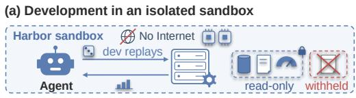  
(b) Final verification and request value

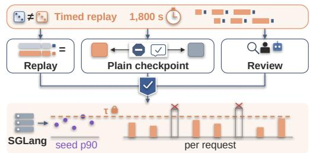  
Figure 3 Stateful replay connects session progress to the agent’s design experiments (a). Final evaluation verifies the published system and measures request value against calibrated latency targets (b).

<table><tr><td>System</td><td colspan="3">Gemma E4B (1×L40)</td><td colspan="3">Qwen3.5 9B (2×L40)</td><td colspan="3">Qwen3.8 27B INT4 (2×L40)</td></tr><tr><td>Best baseline</td><td colspan="3">vLLM $/$ = 0.61, c = 8</td><td colspan="3">SGLang $/$ = 1.62, c = 1</td><td colspan="3">vLLM $/$ = 1.47, c = 1</td></tr><tr><td>Other baseline</td><td colspan="3">SGLang $/$ = 0.16, c = 2</td><td colspan="3">vLLM $/$ = 1.49, c = 1</td><td colspan="3">SGLang $/$ = 1.42, c = 4</td></tr><tr><td></td><td>$/$ @ c</td><td>TTFT</td><td>TPOT</td><td>$/$ @ c</td><td>TTFT</td><td>TPOT</td><td>$/$ @ c</td><td>TTFT</td><td>TPOT</td></tr><tr><td>Claude Opus 5.5</td><td>2.47 @40</td><td>3.01</td><td>118.59</td><td>4.40 @16</td><td>2.25</td><td>28.16</td><td>2.64 @8</td><td>11.44</td><td>46.40</td></tr><tr><td>Claude Sonnet 5.5</td><td>2.97 @32</td><td>2.75</td><td>83.05</td><td>4.34@20</td><td>12.34</td><td>26.76</td><td>2.01 @12</td><td>46.57</td><td>47.35</td></tr><tr><td>GPT 6 Astra</td><td>1.75 @32</td><td>4.77</td><td>94.19</td><td>3.18 @12</td><td>15.62</td><td>21.94</td><td>1.48 @4</td><td>12.96</td><td>42.83</td></tr><tr><td>GPT 6.1 Sol</td><td>1.59 @24</td><td>4.43</td><td>72.45</td><td>2.84@4</td><td>2.71</td><td>23.67</td><td>0.98 @4</td><td>75.66</td><td>43.31</td></tr><tr><td>Claude Opus 5</td><td>1.15 @24</td><td>3.98</td><td>109.12</td><td>1.16 @1</td><td>5.51</td><td>28.09</td><td>0.62 @6</td><td>33.55</td><td>62.97</td></tr><tr><td>GPT 6 Sol</td><td>0.55@5</td><td>3.63</td><td>110.52</td><td>1.11@1</td><td>13.19</td><td>20.45</td><td>0.26 @2</td><td>136.48</td><td>49.53</td></tr><tr><td>Kimi K3</td><td>0.52@6</td><td>8.67</td><td>55.32</td><td>0.93@1</td><td>4.99</td><td>33.12</td><td></td><td>Not passed</td><td></td></tr><tr><td>Qwen3.8-Max-0902</td><td>0.87 @14</td><td>2.61</td><td>59.16</td><td></td><td>Not passed</td><td></td><td></td><td>Not passed</td><td></td></tr><tr><td>MiMo V2.6 Pro</td><td>0.22@10</td><td>43.63</td><td>108.96</td><td></td><td>Not passed</td><td></td><td></td><td>Not passed</td><td></td></tr><tr><td>GLM 5.3</td><td></td><td>Not passed</td><td></td><td></td><td>Not passed</td><td></td><td></td><td>Not passed</td><td></td></tr><tr><td>DeepSeek V4.1 Flash</td><td colspan="3">Not passed</td><td colspan="3">Not passed</td><td colspan="3">Not passed</td></tr></table>

Table 1 Serving performance across three deployments. Entries pair latency-qualified dollars per dollar with ofered session concurrency �; TTFT (s) and TPOT (ms) are p90 latencies. Shading marks the strongest baseline and largest agent value in each deployment.

They decide which observations warrant further tests, which changes to retain, and when to publish. Versioned submissions connect these decisions to the implementation evaluated after development.

## 3.4 System Verification

After development, ServerBench rebuilds the submission in a fresh deployment and replays sessions sampled with seeds disjoint from development. Independent tests and post-run review check the resulting system (Figure 3).

Workload and output verification. Replay checks cover complete prompts, output lengths, streaming consistency, and session progress. Timed replay disables EOS stopping to generate the prescribed output length; separate EOS probes exercise natural stopping. Reference-scored continuations check generation against the checkpoint. Held-out questions compare answer correctness with a plain implementation of the same model, using the task’s accuracy tolerance to screen for substantial regressions and shortcuts that bypass model computation. Fresh deployments also test behavior beyond development state.

Post-run review. A review agent and human inspection examine submitted code and recorded actions for checkpoint fidelity, inference semantics, and workload execution. Review can identify prohibited shortcuts missed by behavioral tests and overturn automated failures when inspection establishes compliance with task requirements. These checks determine score eligibility (Equation (1)).

## 4 Evaluation

## 4.1 Experimental Setup

We evaluate 11 coding-agent models (Table 1): Claude (Anthropic, 2026b,c,d), GPT (OpenAI, 2026b), Kimi (Kimi Team, 2026), GLM (Z.ai, 2026), DeepSeek (DeepSeek-AI, 2026), MiMo (Xiaomi MiMo, 2026), and Qwen (Qwen Team, 2026a) models. All use maximum reasoning efort on Qwen3.5 9B (2×L40), Gemma-4-E4B-it (Gemma E4B; 1×L40), and Qwen3.8 27B INT4 (2×L40). In Harbor, GPT models use Codex (OpenAI, 2026a), and other models use Claude Code (Anthropic, 2026a). Each agent–deployment pair allows one 8 hours development run and a 1,800-second final replay, with at most one rerun for a clearly anomalous failed outcome. We report each pair’s strongest verified final submission across the 33 Table 1 entries; development analysis focuses on 30 runs with server execution records.

Baselines are SGLang v0.5.19 and vLLM v0.28.0 (Zheng et al., 2024; Kwon et al., 2023). SGLang uses each model’s cookbook configuration; reference results average replay seeds at fixed concurrency. Controlled comparisons replay frozen implementations and intermediate versions on common seeds.

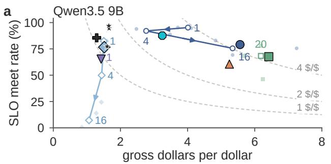

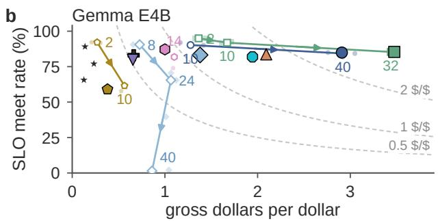  
4B Opus 5.5 GPT 6.1 Sol MOpus 5.5 GPT 6.1 Sol MiMo V2.6Sonnet 5.5 GPT 6 Sol SGLangOpus 5 Kimi K3 final verdictGPT 6 Astra Qwen3.8 Max replay at n (Opus 5.5 GPT 6.1 Sol MiMo V2.6So net 5.5 GPT 6 Sol 6 Sol SGLangKimi K3 final verdictOpus 5.5 GPT 6.1 Sol MiMo V2.6Sonnet 5.5 GPT 6 Sol SGLangOpus 5 Kimi K3 final verdict  
2 14 2 Sonnet 5.5 GPT 6 Sol SGLangSonnet 5.5 GPT 6 Sol SGLangOpus 5 Kimi K3 final verdictGPT 6 Astra Qwen3.8 Max replay at n (arrow: n ↑)Sonnet 5.5 GPT 6 Sol SGLangOpus 5 Kimi K3Kimi K3 final verdictGPT 6 Astra Qwen3.8 Max replay at n (arrow: n ↑)Opus 5.5 GPT 6.1 Sol MiMo V2.6Sonnet 5.5 GPT 6 Sol SGLa gO us 5 Kimi K3 fi al verdictGPT 6 Astra Qwen3.8 Max replay at n (arrow: n ↑)  
at 24 GPT 6 Astra Qwen3.8 Max replay at n (arrow: n ↑)Opus 5 Kimi K3 final verdictGPT 6 Astra Qwen3.8 Max replay at n (arrow: n ↑)Figure 4 Gross value � versus value-weighted SLO meet rate �. Large markers show final evaluations; open markers compare frozen t 2 \$/\$10systems at diferent loads. Arrows indicate increasing concurrency; dashed curves mark equal $D = G f$

## 25O 4.2 End-to-End Results

0STable 1 shows that agents can design verified serving systems with higher value than the strongest reference on 0 1 2 3each deployment. Claude Opus 5.5 leads Qwen3.5 9B and Qwen3.8 27B INT4 with 4.40 and 2.64 dollars per dollar, 2.71× the SGLang reference and 1.80× the vLLM reference, respectively. Claude Sonnet 5.5 achieves 2.97 on Gemma Opus 5.5 GPT 6.1 SolE4B, 4.87× the vLLM reference.

Opus 5 Kimi K3 final verdictPerformance remains uneven across agents. Across 33 runs, 22 yield verified systems and 13 exceed the strongest GPT 6 Astra Qwen3.8 Max replay at n (arrow: n ↑)reference. Six models deliver verified systems on all three deployments, but only three exceed the strongest reference on all three. GPT 6.1 Sol achieves 2.84 on Qwen3.5 9B, while its Qwen3.8 27B INT4 system scores 0.98 against a reference of 1.47. Opus 5 passes verification but trails both Qwen references.

Figure 4 separates gross value from the SLO meet values. In the final replays on Qwen3.5 9B, Sonnet 5.5 produces more gross value than Opus 5.5 (6.42 versus 5.56), but a smaller share qualifies, yielding 4.34 and 4.40. Figure 1 contrasts GPT 6.1 Sol’s lower-cost gains with Claude’s higher serving value. We next analyze agents’ design, feedback, and verification decisions.

## 4.3 High-Value Designs Coordinate Capacity and Concurrency

At fixed GPU cost, additional sessions can increase token value but raise TTFT and TPOT through queueing and contention. Agents must match load to serving capacity. Figure 5 relates recorded concurrency patterns to final economic outcomes; runs that raise and hold load more often exceed the strongest reference. Among runs reaching at least twice the strongest reference, 7 of 17 load decisions improve value on subsequent measurement, compared with 2 of 23 for verified runs below the reference score.

Early end-to-end replay gives agents time to develop capacity while adjusting load. The former group reaches usable replay in a median of 0.90 hours, compared with 2.96 hours for the latter. The optimization inventory and controlled comparisons in Appendix E.4 connect these operating decisions to changes in execution, state management, and scheduling. Higher-value systems tend to combine more serving optimizations, including speculative decoding, host-memory state storage, and latency-aware scheduling. Cross-turn reuse is common to all audited systems.

Controlled comparisons illustrate this distinction. At 16 sessions, Opus 5.5’s v1→v2 Qwen redesign raises value by 1.32– 1.88× on matched seeds. For frozen Gemma systems, Sonnet

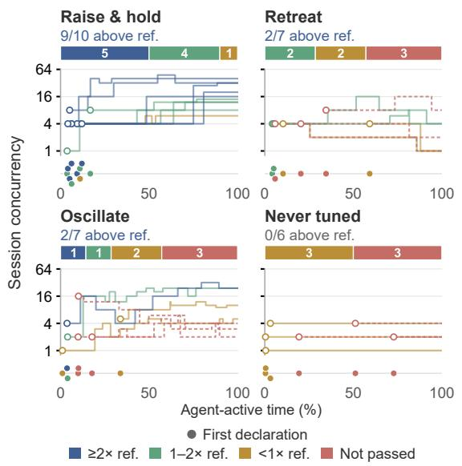  
Figure 5 Recorded concurrency paths and final outcomes. Colors mark value relative to the strongest baseline; labels count runs. Dots below panels mark first load declarations.

5.5 increases value from 1.30 at two sessions to 2.97 at 32. Sonnet 5.5 also holds four Gemma sessions while revising the engine, then increases load together with further implementation changes. The trajectory illustrates capacity development before increasing load. On Qwen, Opus 5 instead lowers concurrency from four to two to one as it refines the implementation. Kimi likewise reduces load to one after identifying long prefills that interfere with decoding. Load reduction relieves contention; capacity improvements support more simultaneous work.

Agents estimate the economic operating point in diferent ways. Opus 5.5 uses a workload simulator to guide Qwen load tests, then retains 16 sessions after a 20-session replay yields more gross value but only 64% qualifying value. Sonnet 5.5 on Gemma compares settings on a fixed seed: 36 sessions produce more gross value but incur more TPOT misses, and it submits 32. These decisions match ofered load to serving capacity within the latency targets.

## 4.4 Using Feedback to Guide Optimization

Agents use performance measurements and diagnostic tests to retain, revise, or abandon changes. Useful feedback requires testing a change under relevant workload conditions. Costly replays and seed variation make diagnostic tests and workload analysis essential within the development budget

Figure 6 connects retained design decisions to the tests supporting them. Among runs reaching at least twice the strongest reference, 49% of retained decisions follow improvements on workload-relevant tests, versus 25% in failed runs; decisions without such tests account for 13% and 40%, respectively. In the other verified groups, 39% remain unconfirmed. These outcomes highlight testing and follow-up when deciding which changes to retain

On Gemma, experimental judgment changes whether agents pursue prompt-lookup speculation. Opus 5 accepts a null result from a synthetic random-text probe and omits the optimization. Opus 5.5 investigates its initial null result using 60 replies from replay, repairs its simulator, and measures 2.09–2.34 accepted tokens per step before adopting speculation. At a fixed assumed draft cost, a corrected, length-matched probe selects a smaller draft from synthetic text than from workload replies (Appendix F). To test the efect of this workload feedback on the agent’s decision, we resume Opus 5 from the same checkpoint for two hours per arm, with or without feedback from its own replay replies Only the feedback arm re-adopts speculation; its server delivers 1.13–1.31× the qualified value on two fresh common seeds. Workload feedback improves the agent’s design decision and its submitted server’s value.

Favorable feedback can also lead agents to retain a configuration that performs poorly under other workload conditions. In one Opus 5.5 run on Qwen3.8 27B INT4, the agent raises concurrency from 10 to 16 and revises scheduling, observing a score increase from 2.20 to 2.99. It recognizes overload and acknowledges that changing seeds complicate comparison, but judges the additional value worth the latency losses. Near the deadline, a scheduling repair remains in warmup, so it returns to the configuration supported by one completed 900-second replay. In the final replay, the same implementation’s qualified share falls from 76.0% to 16.8% and its score to 0.48.

Workload coverage can be checked cheaply. Our CPU scan of the workload generator over 128 additional seeds takes only 7.71 seconds: the development draw lies near the fourth percentile of initial stream availability, while the final draw is near the median. The agent had inspected corpus statistics, yet used an unusually light initial branching condition to validate its final configuration (Appendix E.5).

Null and favorable results both require checking what the test exercises. Inspecting test inputs and profiling workload variation helps agents select representative and demanding conditions for costly replay, supporting decisions to retain, revise, or abandon a design.

## 4.5 Verification Must Match the Deployed Workload

Verification checks the request boundaries and state transitions afected by changes to admission, scheduling, and state reuse, including after subsequent edits. Figure 7 shows sparse coverage at submission time: only 5 of the 33 entries have recorded checks of natural stopping on the submitted system under load or long context.

Admission policies require checking which requests can make progress. On Qwen3.5 9B, Qwen3.8-Max-0902 tightens admission to protect TPOT, then checks a short prompt and a replay completing 11 requests. Its submitted policy leaves a range of permitted prompt lengths unable to enter execution even after other requests finish. Final evaluation stalls on a 315K-token input in this range. The successful short tests leave the new policy’s prompt-length boundaries unchecked.

State reuse requires checking behavior across requests. On Qwen3.8 27B INT4, Kimi’s replay exposes a prefix-cache exception alongside a numerical error. The agent repairs the numerical path and successfully retests an isolated long prompt with a fresh engine. A separate check of the submitted cache succeeds on the first insertion but crashes when the same prefix is inserted again; the exception also recurs in final evaluation. The isolated test misses prefix reuse across requests.

(a) Validation of retained design changes  
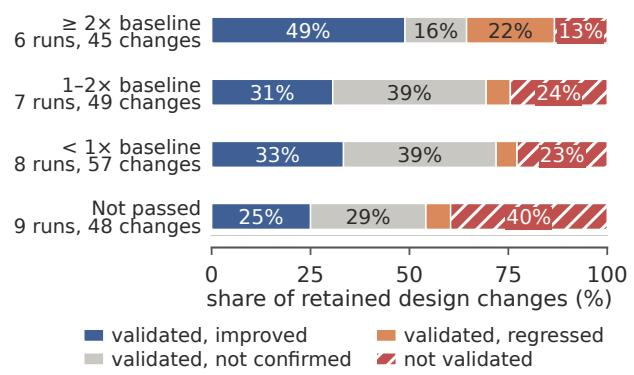

(b) Retained changes in representative runs  
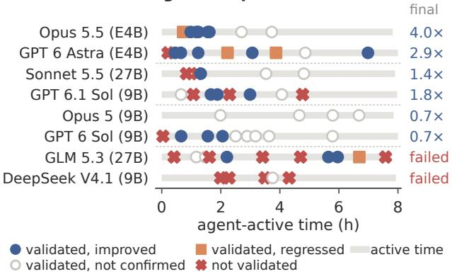  
GPT 6.1 Sol (9B) 1.8×GPT 6 Astra (E4B) 2.9×Opus 5.5 (E4B) 4.0×Opus 5.5 (E4 4 0Figure 6 Retained changes more often show workload-relevant gains in the ≥ 2× group (a); representative trajectories show their Opus 5 (9B) 0.7×GPT 6.1 Sol (9B) 1.8×Sonnet 5.5 (27B) 1.4×GPT 6 Astra (E4 2 9follow-up (b). Groups use final value relative to the strongest baseline.  
GLM 5.3 (27B)GPT 6 Sol (9B)Opus 5 (9B)GPT 6.1 Sol (9

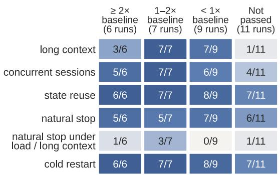

(b) Not-passed runs: first related symptom  
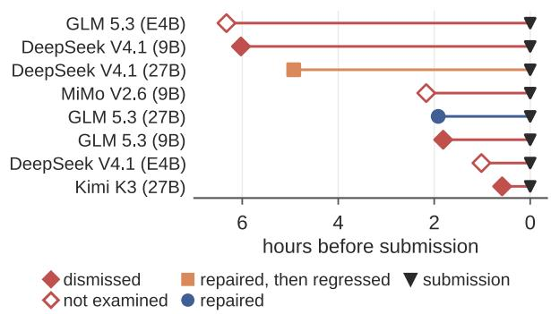  
Figure 7 Workload-relevant checks on submitted implementations (a). Related symptoms precede submission in 8 of 11 not-passed runs (b); markers distinguish responses and recorded submission times.

Opus 5.5 on Gemma explicitly tests the operating conditions made relevant by its design. After adding preemption and cache restoration to coordinate TTFT and TPOT, it reduces cache capacity to force these paths to execute. The stress test exposes invalid outputs from uninitialized cache storage. The defect predates the preemption change. The agent repairs cache access, checks that unused slots filled with NaNs cannot afect valid computation, and reruns forced preemption while comparing resumed outputs with isolated execution. The final system retains these repairs. Reduced-pool replication passes 0/3 tests with the repair reverted and 3/3 after repair.

Reliable delivery requires testing admission boundaries, shared state, and recovery, then rerunning afected checks after repairs.

## 4.6 Design and Workload Ablations

Finding-guided changes improve serving value and correctness (Appendix F). On two fresh common seeds under the final 1,800-second protocol, Opus 5.5’s Qwen v1→v6 redesign at � = 16 raises qualified value by 1.35× and 1.15×. On frozen Gemma at � = 40, workload-selected draft length 7 outperforms synthetic-selected length 3 by 3.0% and 3.9%. For workload-matched verification, Opus 5.5’s Gemma cache repair passes all 3 reduced-pool stress tests (Section 4.5).

Figure 8 fixes implementation, concurrency, and sessions. Across deployments, 300-second windows average 1.42–1.70× the 1,800-second scores, versus 1.04–1.21× at 900 seconds. For Opus 5.5 on Qwen, extending the window from 300 to 1,800 seconds lowers the across-seed coeficient of variation from 0.37 to 0.19, yielding more stable performance estimates. The closer agreement at 900 seconds supports using intermediate replays to guide development. Remaining variation motivates combining these measurements with workload profiling and targeted diagnostics to select configurations and workload conditions for longer replay.

a  
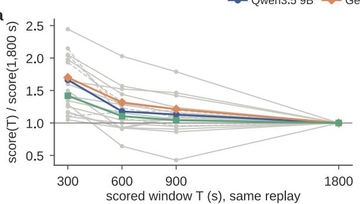

b  
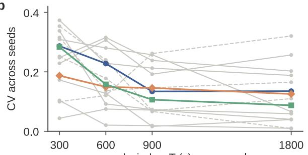  
Figure 8 Short windows yield higher average value (a); sampling sensitivity varies across systems (b). Colored curves average systems within each deployment.

## 5 Conclusion

ServerBench evaluates agentic design of complete, specialized LLM serving systems through an economic service objective, stateful closed-loop replay, and independent verification. Results across three deployments show substantial gains alongside uneven delivery. Trajectory analysis and controlled comparisons highlight three priorities: coordinating capacity improvements with operating load, designing experiments around workload characteristics and variation, and verifying the execution paths introduced by system changes.

## Limitations

Our evaluation covers three model–hardware deployments and one coding-trace source. Development and final draws share a corpus; reconstructed inputs preserve workload structure without reproducing original coding tasks. Closed-loop replay difers from open-loop production demand, limiting generalization to other architectures, accelerators, and arrival patterns.

The comparisons characterize measured artifacts. Correlations, source inspection, and selected trajectories do not establish causal optimization efects or design success rates. Repeated agent runs and replays are needed to separate agent variability from workload variability. Version notes record reported design changes and can omit implementation details. Behavioral tests and code review have finite coverage, and calibration depends on the reference engine. Fixed-price token value measures deployment eficiency, excluding development and other operating costs, rather than realized profit.

## Ethical Considerations

Recorded coding sessions can contain sensitive information, and agent-generated serving code can introduce unsafe behavior. ServerBench replaces original session content during workload reconstruction and executes generated code in isolated environments with restricted network access. Any release of traces or agent trajectories should be reviewed for sensitive information and comply with source licenses. Post-run code and action review supports the identification of unauthorized behavior. Controlled GPU allocations and experiment resource reporting support responsible use. These controls reduce exposure but do not establish that arbitrary generated code is safe.

## Acknowledgements

This work was partially supported by Google Research Award, Google ML & System Junior Faculty Award, Amazon Research Award, Fireworks AI, Intel, Li Auto, Mofett AI, Daytona, and CMU CyLab Seed funding. This material is also based upon work supported by the National Science Foundation under Grant Nos. CCF-2504353 and CCF-2247014, and by IARPA. Any opinions, findings, conclusions or recommendations expressed are those of the authors and do not necessarily reflect the views of the National Science Foundation.

## References

Amey Agrawal, Nitin Kedia, Ashish Panwar, Jayashree Mohan, Nipun Kwatra, Bhargav Gulavani, Alexey Tumanov, and Ramachandran Ramjee. Taming throughput-latency tradeof in LLM inference with Sarathi-Serve. In 18th USENIX symposium on operating systems design and implementation (OSDI 24), pages 117–134, 2024.

Anthropic. Claude Code, 2026a. https://github.com/anthropics/claude-code. Software repository. Accessed October 12, 2026.

Anthropic. Introducing Claude Opus 5, 2026b. https://www.anthropic.com/news/claude-opus-5.

Anthropic. Introducing Claude Opus 5.5, 2026c. https://www.anthropic.com/claude-opus-5-5.

Anthropic. Introducing Claude Sonnet 5.5, 2026d. https://www.anthropic.com/claude-sonnet-5-5.

Jun Shern Chan, Neil Chowdhury, Oliver Jafe, James Aung, Dane Sherburn, Evan Mays, Giulio Starace, Kevin Liu, Leon Maksin, Tejal Patwardhan, et al. MLE-bench: Evaluating machine learning agents on machine learning engineering. In International Conference on Learning Representations, volume 2025, pages 50466–50494, 2025.

Zhuoming Chen, Xinrui Zhong, Qilong Feng, Ranajoy Sadhukhan, Yang Zhou, Michael Qizhe Shieh, Zhihao Jia, and Beidi Chen. Vortex: Eficient and programmable sparse attention serving for AI agents. arXiv preprint arXiv:2606.06453, 2026.

Audrey Cheng, Shu Liu, Melissa Pan, Zhifei Li, Bowen Wang, Alex Krentsel, Tian Xia, Mert Cemri, Jongseok Park, Shuo Yang, et al. Barbarians at the gate: How ai is upending systems research. arXiv preprint arXiv:2510.06189, 2025.

DeepSeek-AI. DeepSeek-V4.1-Flash: Pushing the limits of KV cache compression. arXiv preprint arXiv:2609.19969, 2026. https: //arxiv.org/abs/2609.19969.

Leilei Ding, Shumin Wang, Yuting Huang, Fanqi Wan, Yinmin Zhang, Qi Han, Yiming Xu, Feiyuan Zhang, Xiaomeng Chu, Guoliang You, et al. �-bench: Can large language models engineer the infrastructure that powers them? arXiv preprint arXiv:2609.10226, 2026.

Google. Gemma-4-E4B-it, 2026. https://huggingface.co/google/gemma-4-E4B-it. Model card.

Kimi Team. Kimi K3: Open frontier intelligence. arXiv preprint arXiv:2607.24653, 2026. https://arxiv.org/abs/2607.24653.

Woosuk Kwon, Zhuohan Li, Siyuan Zhuang, Ying Sheng, Lianmin Zheng, Cody Hao Yu, Joseph Gonzalez, Hao Zhang, and Ion Stoica Eficient memory management for large language model serving with PagedAttention. In Proceedings ofthe 29th symposium on operating systems principles, pages 611–626, 2023.

Mike Merrill, Alexander Shaw, Nicholas Carlini, Boxuan Li, Harsh Raj, Ivan Bercovich, Lin Shi, Jeong Shin, Thomas Walshe, E Kelly Buchanan, et al. Terminal-Bench: Benchmarking agents on hard, realistic tasks in command line interfaces. In International Conference on Learning Representations, volume 2026, pages 40903–40986, 2026.

Ayush Nangia, Shikhar Mishra, Aman Gokrani, and Paras Chopra. ISO-Bench: Can coding agents optimize real-world inference workloads? arXiv preprint arXiv:2602.19594, 2026.

Alexander Novikov, Ngân Vu, Marvin Eisenberger, Emilien Dupont, Po-Sen Huang, Adam Zsolt Wagner, Sergey Shirobokov, Borislav˜ Kozlovskii, Francisco JR Ruiz, Abbas Mehrabian, et al. Alphaevolve: A coding agent for scientific and algorithmic discovery. arXiv preprint arXiv:2506.13131, 2025.

OpenAI. Codex, 2026a. https://github.com/openai/codex. Software repository. Accessed October 12, 2026.

OpenAI. Using GPT-6, 2026b. https://developers.openai.com/api/docs/guides/latest-model. API documentation. Accessed October 11, 2026.

Anne Ouyang, Simon Guo, Simran Arora, Alex L Zhang, William Hu, Christopher Ré, and Azalia Mirhoseini. KernelBench: Can LLMs write eficient GPU kernels? arXiv preprint arXiv:2502.10517, 2025.

Qwen Team. Qwen3.8-Max-0902, 2026a. https://www.qwencloud.com/models/qwen3.8-max-0902. Oficial model page. Accessed October 11, 2026.

Qwen Team. Qwen3.5-9B, 2026b. https://huggingface.co/Qwen/Qwen3.5-9B. Model card.

Red Hat AI. Qwen3.8-27B-INT4, 2026. https://huggingface.co/RedHatAI/Qwen3.8-27B-INT4. Model card.

Vijay Janapa Reddi, Christine Cheng, David Kanter, Peter Mattson, Guenther Schmuelling, Carole-Jean Wu, Brian Anderson, Maximilien Breughe, Mark Charlebois, William Chou, et al. MLPerfinference benchmark. In 2020 ACM/IEEE 47th Annual International Symposium on Computer Architecture (ISCA), pages 446–459. IEEE, 2020.

SemiAnalysis. AgentX Harness. https://github.com/SemiAnalysisAI/agentx-harness, 2026a. Open-source software.

SemiAnalysis. AgentX methodology and datasets, 2026b. https://inferencex.semianalysis.com/agentx. Dataset and methodology. Accessed October 12, 2026.

Vikranth Srivatsa, Zijian He, Reyna Abhyankar, Dongming Li, and Yiying Zhang. Preble: Eficient distributed prompt scheduling for LLM serving. In International conference on learning representations, volume 2025, pages 37057–37082, 2025.

Yiyou Sun, Xinyang Han, Weichen Zhang, Yuanbo Pang, Tianyu Wang, Yuhan Cao, Yixiao Huang, Chris Duroiu, Haoyun Zhang, Jefrey Lin, et al. Agents’ last exam. arXiv preprint arXiv:2606.05405, 2026. https://arxiv.org/abs/2606.05405.

Jennifer Williams, Dave Farris, Jef Farris, and Jiantao Jiao. SWE-Serve: Benchmarking agentic engineering for production inference serving. arXiv preprint arXiv:2609.26777, 2026.

Yijia Xiao, Runhui Wang, Luyang Kong, Davor Golac, and Wei Wang. CSR-Bench: Benchmarking LLM agents in deployment of computer science research repositories. In Proceedings ofthe 2025 Conference ofthe Nations ofthe Americas Chapter ofthe Association for Computational Linguistics: Human Language Technologies (Volume 1: Long Papers), pages 12705–12723, 2025.

Xiaomi MiMo. MiMo-V2.6-Pro, 2026. https://mimo.mi.com/models/en-US/mimo-v2.6-pro. Oficial model page. Accessed October 11, 2026.

Zhen Xu, Jingyu Liu, Zongze Li, Tahseen Rabbani, and Ce Zhang. SEIS: Self-evolving inference systems. arXiv preprint arXiv:2610.04646, 2026.

John Yang, Carlos Jimenez, Alexander Wettig, Kilian Lieret, Shunyu Yao, Karthik Narasimhan, and Ofir Press. SWE-agent: Agentcomputer interfaces enable automated software engineering. Advances in Neural Information Processing Systems, 37:50528–50652, 2024.

Jehyeok Yeon, Ben Rank, and Maksym Andriushchenko. InferenceBench: A benchmark for open-ended LLM inference optimization by AI agents. arXiv preprint arXiv:2607.20468, 2026.

Gyeong-In Yu, Joo Seong Jeong, Geon-Woo Kim, Soojeong Kim, and Byung-Gon Chun. Orca: A distributed serving system for Transformer-based generative models. In 16th USENIX symposium on operating systems design and implementation (OSDI 22), pages 521–538, 2022.

Z.ai. GLM-5.3, 2026. https://docs.z.ai/guides/llm/glm-5.3. Developer documentation. Accessed October 11, 2026.

Lianmin Zheng, Liangsheng Yin, Zhiqiang Xie, Chuyue Sun, Jef Huang, Cody H Yu, Shiyi Cao, Christos Kozyrakis, Ion Stoica, Joseph E Gonzalez, et al. SGLang: Eficient execution of structured language model programs. Advances in neural information processing systems, 37:62557–62583, 2024.

Zihan Zheng, Zerui Cheng, Zeyu Shen, Shang Zhou, Kaiyuan Liu, Hansen He, Dongruixuan Li, Stanley Wei, Hangyi Hao, Jianzhu Yao, Peiyao Sheng, Zixuan Wang, Wenhao Chai, Aleksandra Korolova, Peter Henderson, Sanjeev Arora, Pramod Viswanath, Jingbo Shang, and Saining Xie. LiveCodeBench Pro: How do olympiad medalists judge LLMs in competitive programming? In Advances in Neural Information Processing Systems, volume 38, 2025. https://proceedings.neurips.cc/paper\_files/paper/2025/hash/971 2b78386cebdc3db7f1a48c2d20edb-Abstract-Datasets\_and\_Benchmarks\_Track.html.

Yinmin Zhong, Shengyu Liu, Junda Chen, Jianbo Hu, Yibo Zhu, Xuanzhe Liu, Xin Jin, and Hao Zhang. DistServe: Disaggregating prefill and decoding for goodput-optimized large language model serving. In 18th USENIX symposium on operating systems design and implementation (OSDI 24), pages 193–210, 2024.

Shang Zhou, Zihan Zheng, Kaiyuan Liu, Zeyu Shen, Zerui Cheng, Zexing Chen, Hansen He, Jianzhu Yao, Huanzhi Mao, Qiuyang Mang, Tianfu Fu, Beichen Li, Dongruixuan Li, Wenhao Chai, Zhuang Liu, Aleksandra Korolova, Peter Henderson, Natasha Jaques, Pramod Viswanath, Saining Xie, and Jingbo Shang. AutoCode: LLMs as problem setters for competitive programming. In International Conference on Learning Representations, 2026a. https://proceedings.iclr.cc/paper\_files/paper/2026/hash/1bd78da0966968 409e65b5e0b5dbb57e-Abstract-Conference.html.

Tianbao Zhou, Yi Wang, Yu Zhou, Zirui Liu, Zhiming Wang, Yebo Peng, Yongfu Wang, Yi Zhang, Jinrun Yin, Kemeng Tian, Fangcheng Fu, Tongxuan Liu, Tao Peng, Tong Yang, Bin Cui, Xupeng Miao, and Ke Zhang. Janus: Multi-LLM serving at production scale. In Proceedings ofthe ACM SIGOPS 32nd Symposium on Operating Systems Principles, 2026b. doi: 10.1145/3830418.3843867.

## Appendix

## A Task Calibration and Accounting

Table 2 summarizes the frozen deployment settings.

We calibrate SGLang and vLLM by selecting the concurrency that maximizes gross dollars per dollar. Using 5 independent random seeds, we set each latency target to the largest per-replay p90 to decide the SLO standard, and use the mean p90 TTFT, TPOT and dollars per dollar as the baseline. These targets are frozen before agent development and applied to individual requests; agents choose their own operating concurrency. Changes to the model, hardware, workload, or inference policy require recalibration under the revised deployment conditions.

Reference results average 5 independent replay seeds at the operating points in Table 2.

Scores use the measured window duration and allocated GPU cost. Cached input is valued at the full input-token price and counted once per logical request. Value is computed from client-side token counts. Completed requests contribute to the numerator of Equation (1) when both latency measurements are finite and meet their respective targets.

## B Replay and Reproducibility Record

The replay uses SemiAnalysis’s AgentX (SemiAnalysis, 2026b) semianalysisai/cc-traces-weka-062126 coding sessions, with the corpus revision fixed by the task. It samples session progress under a closed-loop load. Development and final evaluation use disjoint seed sets drawn from the same source corpus.

Workload reconstruction and eligibility. Deterministic reconstruction replaces original prompt and tool contents while preserving request lengths, shared prefixes, and session topology. Replay uses recorded end-to-start delays and session dependencies, including parallel subagent branches. When no requests are in flight, global idle gaps are capped at 10 seconds by moving all pending timed events earlier by the same amount, preserving their relative spacing, order, and dependency constraints. Context eligibility is fixed before development; where necessary, whole traces are filtered to preserve dependencies without allowing candidates to truncate prompts. State reuse must preserve all required states, including recurrent state where applicable.

Development and deployment. The Transformers starter uses a global request lock and has no cross-request prefix cache. Agents may change scheduling, batching, memory management, kernels, parallel execution, and state reuse Reference configurations support comparison without prescribing the candidate architecture. Harbor supports container or Modal backends; evaluation components remain outside the editable server. Full development tests launch frozen snapshots, while lightweight checks support shorter experiments. Publishing a version and measuring its performance are separate operations. Portability checks test compatibility with the deployment interface. After the final workload replay, protocol and output tests run while the server remains active. Final evaluation uses the frozen submission after the development budget ends.

Reproduction record. Reproduction requires the efective checkpoint and inference configuration, task and corpus revisions, environment snapshot, agent model identifier and scafold, development budget, submitted artifact, chosen concurrency, and replay seeds. Immutable version records connect intermediate measurements to code; final results are associated with the submitted artifact. The record separates construction runs from repeated replays of each frozen system.

## C Output Verification Settings

The answer test samples 20 held-out questions and permits an absolute accuracy decrease of at most 0.1 relative to a plain implementation of the same checkpoint. For � questions and $k _ { \mathrm { r e f } }$ correct reference answers, the candidate must satisfy

$$
k _ { \mathrm { c a n d } } \geq \operatorname* { m a x } \{ 0 , k _ { \mathrm { r e f } } - \lfloor 0 . 1 n \rfloor \} .\tag{2}
$$

The host runs this test on the frozen submission after development.

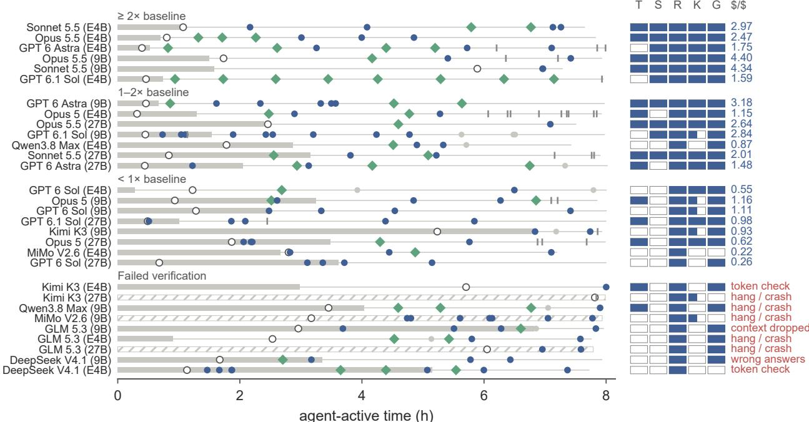  
before first usable end-to-end replay first version implementation change load change only both neither mechanism enabled  
Figure 9 Development trajectories connect published implementation changes to the optimizations identified in submitted systems. Filled cells mark latency-aware scheduling (T), speculative decoding (S), cross-turn reuse (R), host-memory state storage (K), and CUDA graphs (G); half-filled K cells indicate recurrent-state storage only. Groups use value relative to each deployment’s strongest reference; outcomes show dollars per dollar or the failed check

Replay checks compare native token identifiers with streamed text and client accounting, and use context probes to test required extended-context behavior. Candidates may not count malformed responses as completed work. These checks assess faithful workload execution and token accounting.

Natural stopping is tested with end-of-sequence termination enabled. The replay requests fixed output lengths, but tokens must still arise from the checkpoint’s computation. Suspicious continuations, including repeated tokens and continuations after an end-of-sequence token, are examined using reference scoring. Up to 16 suspect continuations are sampled, with a maximum per-token log-probability regret tolerance of 4.0 under teacher forcing. Timed replay disables end-of-sequence stopping to obtain prescribed output lengths, but fabricated padding is prohibited. Continuations produced by the prescribed model, including repetition, are permitted.

## D Integrity Review and Agent Configuration

The task prompt fixes model semantics and prohibits reducing work through truncation, approximate computation, precision reduction, answer retrieval, or model substitution. It also prohibits identifying evaluation probes to alter behavior, manipulating token or timing records, and modifying trusted evaluation components. Computed-state reuse that preserves the specified semantics is admissible.

The prompt announces post-run review of code and recorded actions by a separate agent. The review examines the submitted implementation, version changes, commands, and measurement records. Automated checks record reported model identifiers, network destinations, and commands indicating potential undeclared model use. These records support code inspection alongside the final execution checks. Human review complements these automated assessments when evaluating suspected correctness failures and prohibited shortcuts. Only maximum-reasoning-efort configurations appear in the main comparison; full execution identifiers belong in the campaign reproducibility record.

<table><tr><td>Parameter Checkpoint source</td><td>Qwen3.5 9B (Qwen Team, 2026b)</td><td>Gemma E4B (Google, 2026)</td><td>Qwen3.8 27B INT4 (Red Hat AI, 2026)</td></tr><tr><td>GPU allocation</td><td>2×L40</td><td>1×L40</td><td>2×L40</td></tr><tr><td>Context limit (tokens)</td><td>1,048,576</td><td>131,072</td><td>1,048,576</td></tr><tr><td>Input price (USD / million tokens)</td><td>0.1044</td><td>0.0200</td><td>0.0898</td></tr><tr><td>Output price (USD / million tokens)</td><td>0.1855</td><td>0.1000</td><td>2.6570</td></tr><tr><td>TTFT target (s)</td><td>4.10028</td><td>2.52693</td><td>10.2988</td></tr><tr><td>TPOT target (ms)</td><td>23.4974</td><td>121.7057</td><td>48.3769</td></tr><tr><td>GPU cost (USD / GPU-hour)</td><td>0.82</td><td>0.82</td><td>0.82</td></tr><tr><td>SGLang reference concurrency</td><td>1</td><td>2</td><td>4</td></tr><tr><td>vLLM reference concurrency</td><td>1</td><td>8</td><td>1</td></tr></table>

Table 2 Deployment parameters, service targets, and reference operating points.

## E Development Analysis and Controlled Comparisons

Figure labels. Figure labels shorten Qwen3.8-Max-0902, DeepSeek V4.1 Flash, and MiMo V2.6 Pro to Qwen3.8 Max, DeepSeek V4.1, and MiMo V2.6.

Development resources. Agent token consumption sums uncached input, cache reads, cache writes, and output, including reasoning, across a run’s continuation segments. API cost estimates characterize development expenditure; serving costs are accounted for by allocated GPU time.

## E.1 Agent API Costs

Table 3 reprices recorded token usage at OpenRouter’s advertised standard rates, retrieved on October 13, 2026.1 We sum uncached input, cache reads, cache writes, and output, including reasoning tokens once. Cache writes use the listed 5-minute rate, or the ordinary input rate when no separate write price is listed. GPT prompts remain below the 272K-token pricing threshold. The estimates cover token and cache-operation charges.

<table><tr><td>Agent</td><td>Qwen 9B</td><td>Gemma E4B</td></tr><tr><td>Claude Opus 5.5</td><td>99.69</td><td>104.25</td></tr><tr><td>Claude Sonnet 5.5</td><td>78.60</td><td>30.72</td></tr><tr><td>GPT 6 Astra</td><td>110.81</td><td>119.79</td></tr><tr><td>GPT 6.1 Sol</td><td>13.01</td><td>13.67</td></tr><tr><td>Claude Opus 5</td><td>108.90</td><td>104.37</td></tr><tr><td>GPT 6 Sol</td><td>50.88</td><td>35.93</td></tr><tr><td>Kimi K3</td><td>126.98</td><td>28.71</td></tr><tr><td>Qwen3.8-Max-0902</td><td>46.13</td><td>43.33</td></tr><tr><td>MiMo V2.6 Pro</td><td>6.32</td><td>10.19</td></tr><tr><td>GLM 5.3</td><td>16.80</td><td>10.79</td></tr><tr><td>DeepSeek V4.1 Flash</td><td>1.64</td><td>2.07</td></tr></table>

Table 3 Agent API cost estimates (USD) at OpenRouter rates for Figure 1.

## E.2 Design Changes and Decision Measurements    Retreat: 4 of 7 verified RetreaGRetrea 4

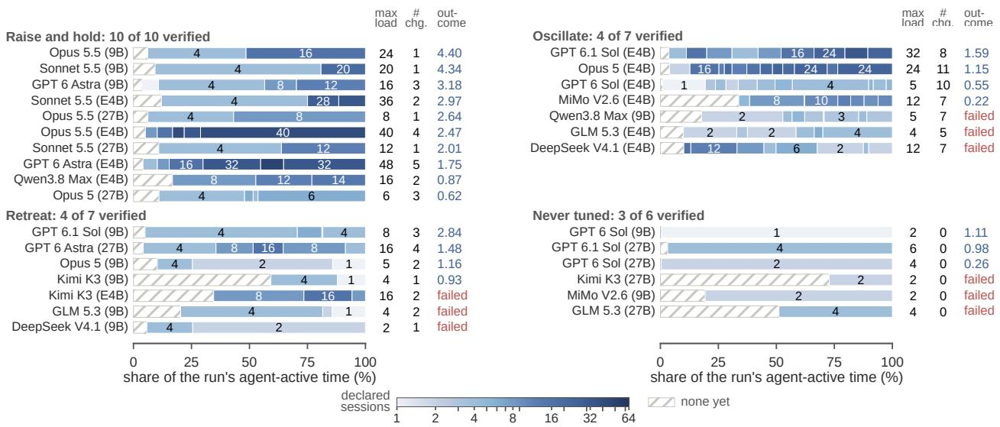  
Figure 10 Individual concurrency trajectories underlying Figure 5. Rows show declared concurrency, the maximum tested load, the GPT 6.1 Sol (27B) 4number of changes, and the final outcome.

The reconstruction connects published versions to their imple-GLM 5.3 (27B) 4 4 0 failedmentation, declared concurrency, measurements, and recorded agent actions. Figure 9 distinguishes implementation changes, share of the run's agent-active time (%)load-only changes, coordinated changes, and publications sessions changing neither. The first usable end-to-end measurement requires a non-mock, agent-owned server, replay fidelity, and positive measured value. Implementation inspection records mechanisms enabled on the served path, including scheduling, speculation, cross-turn reuse, host-memory state storage, and CUDA graphs. These inventories show that highervalue systems tend to combine a broader set of serving optimizations, particularly speculative decoding, latency-aware scheduling, and host-memory state storage. Cross-turn reuse is present across all audited systems, while CUDA graphs are also widespread. Decision-episode labels record the triggering signal, hypothesis, workload relevance, comparability, action, follow-up, and support from the recorded comparison. The

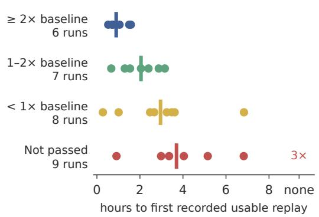  
Figure 11 Higher-value runs establish end-to-end replay earlier, leaving more time for system development. Three failed runs never reach a usable replay.

labeling scheme distinguishes supported, partially supported, unsupported, and untestable conclusions using the decision’s tests and follow-up. Episodes cover tested hypotheses, rollback, retention, and load selection; load changes are linked to their preceding signals. Declared concurrency and the largest experimentally tested load are recorded separately, and trajectories use agent-active time.

Figure 10 gives the individual trajectories summarized in Figure 5.

Across the 30 plotted trajectories, runs achieving at least twice the strongest reference value reach a usable end-to-end replay in a median of 0.90 hours, compared with 2.05 hours for runs between one and two times the reference and 2.96 hours for verified runs below it (Figure 11). A usable replay executes the workload and yields positive latency-qualified value. Earlier measurement leaves more of the development budget for subsequent design and testing.

## E.3 Verification Coverage and Continued Applicability

Verification annotation distinguishes long-context tests, concurrent requests, state reuse, natural stopping, stopping under load or extended contexts, and cold restarts. Coverage records executed checks and their applicability after

<table><tr><td>Versions</td><td>Matched-seed value ratios</td></tr><tr><td>Opus 5.5 / Qwen 9B, c = 16</td><td></td></tr><tr><td>v1 → v2</td><td>1.88, 1.32</td></tr><tr><td>Opus 5 / Qwen 9B, c = 2</td><td></td></tr><tr><td>v3 → v4</td><td>1.90, 1.67, 1.44</td></tr><tr><td>Sonnet 5.5 / Gemma E4B, c = 32</td><td></td></tr><tr><td>v3 → v4</td><td>1.24, 1.02, 1.05</td></tr></table>

Table 4 Selected qualified-value gains from successive versions at fixed concurrency. Each value corresponds to a scoreable matchedseed pair.

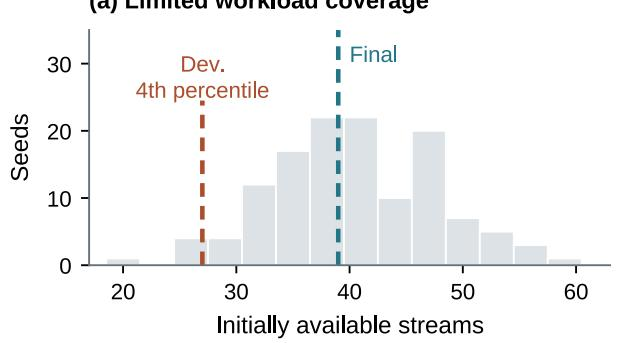

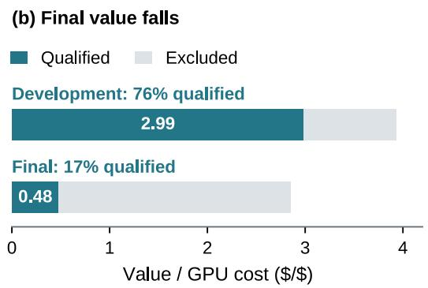  
Figure 12 Workload coverage and latency-qualified value in an Opus 5.5 27B development trajectory. (a) Initially available streams across 128 additional workload seeds, with development and final draws marked. (b) Qualified and excluded token value for the same system at 16 sessions under the development and final replays.

subsequent edits. The classification distinguishes checks on the submitted tree, earlier checks followed by relevant edits, and absent coverage.

The failure reconstruction links observed symptoms, agent responses, repairs, and later regressions, including symptoms dismissed or left unexamined and faults recurring after repair.

Post-run review applies the task’s prescribed precision and inference semantics to all submitted systems.

Figure 7 records natural-stopping checks under load or long context for 5 of 33 entries, and prior related symptoms for 8 of the 11 not-passed entries.

## E.4 Controlled Design and Load Comparisons

Frozen systems are replayed on three common seeds selected before the comparison. Primary matched-system comparisons include Opus 5.5 and Opus 5 on Qwen, Sonnet 5.5 and MiMo on Gemma, and each deployment’s SGLang reference. Additional comparisons include Gemma Opus 5.5, Opus 5, and Qwen3.8-Max-0902. Replays retain the task’s workload, targets, and accounting. Repeated replays quantify workload variation for each frozen system.

Table 4 reports fixed-load version comparisons with qualified-value gains across their matched seeds. Each pair measures the complete set of implementation changes between those versions.

Load comparisons vary concurrency while retaining the implementation and common seeds. Sonnet and MiMo on Gemma use 2, 10, and 32 sessions; Sonnet’s mean qualified value increases from 1.30 to 2.97. Additional curves compare Gemma Opus 5 at 8, 24, and 40 sessions, Gemma Opus 5.5 at 10 and 40, and the two Qwen Opus systems at one, four, and 16. Warmup completion is recorded separately from scored replay. Figure 4 plots these load comparisons alongside final-evaluation measurements.

<table><tr><td>Comparison</td><td>Seed</td><td>D before</td><td>D after</td><td>D ratio</td><td>G ratio</td><td>f ratio</td></tr><tr><td rowspan="2">Capacity</td><td>D</td><td>3.533</td><td>4.761</td><td>1.348</td><td>1.110</td><td>1.214</td></tr><tr><td>E</td><td>4.294</td><td>4.960</td><td>1.155</td><td>1.074</td><td>1.076</td></tr><tr><td rowspan="2">Draft length</td><td>D</td><td>2.240</td><td>2.308</td><td>1.030</td><td>1.030</td><td>1.000</td></tr><tr><td>E</td><td>2.450</td><td>2.544</td><td>1.039</td><td>1.029</td><td>1.009</td></tr><tr><td rowspan="2">Replay feedback</td><td>F</td><td>0.786</td><td>0.888</td><td>1.129</td><td>1.112</td><td>1.015</td></tr><tr><td>G</td><td>0.878</td><td>1.148</td><td>1.308</td><td>1.243</td><td>1.052</td></tr></table>

Table 5 Selected serving improvements from finding-guided changes on fresh common seeds. Capacity compares Qwen v1 to v6 at � = 16; draft length compares Gemma � = 3 to � = 7 at � = 40; replay feedback compares two resumed Opus 5 Gemma servers. Ratios are after/before; all arms pass verification.

## E.5 Observation Windows and Workload Sampling

Figure 8 rescores prefixes of the same replay, holding implementation, concurrency, and sampled sessions fixed. It shows deployment-level mean window ratios in panel (a) and across-seed coeficients of variation in panel (b).

We profile initial stream availability across 128 workload seeds. For the 16-session Opus 5.5 27B run, the development draw lies near the fourth percentile and the final draw near the median (Figure 12). Initial availability measures the independent streams ready to advance when replay begins.

The development replay qualifies 76.0% of token value and scores 2.99 dollars per dollar. Under the final draw, the qualified share falls to 16.8% and the score to 0.48. Profiling the session distribution therefore helps interpret the favorable development result and identify workload conditions that warrant further testing.

For the current window curves, each seed’s prefix score is normalized by its 1,800-second score; system-level seed medians are then averaged within each deployment. Panel (b) averages system-level across-seed coeficients of variation. The 27B agent submissions each contribute one recorded replay to panel (a); only its two multi-seed references contribute to panel (b). Deployment summaries weight each system equally.

## F Finding-Guided Comparisons

We report serving improvements and verification checks from interventions suggested by the three findings on agent-built servers. Table 5 lists the serving improvements. Each pair uses fresh common replay seeds, the same deployment, and the 1,800-second final replay followed by independent correctness checks in both arms. All reported serving arms pass verification. Ratios compare qualified value �, gross value �, and qualified share $f = D / G$ . Verification repairs are assessed by targeted correctness tests.

## F.1 Capacity at Fixed Load

Opus 5.5’s Qwen3.5 9B v1 and v6 run on 2×L40 at � = 16. The v1→v6 bundle improves qualified value on both confirmation seeds, by 1.35× and 1.15×. Gross value rises by 1.11× and 1.07×, while qualified share rises by 1.21× and 1.08×: the gain combines greater throughput and fewer latency losses. The v1→v6 redesign extends the earlier fixed-load v1→v2 comparison in Table 4.

## F.2 Workload Feedback and Design Decisions

The corrected prompt-lookup simulator matches prompt and continuation lengths in a crossed comparison of real and synthetic text over 131 requests. At draft length � = 7, pooled emitted tokens per step are 2.635 for real prompts and replies, 1.744 for synthetic prompts with real replies, 1.246 for real prompts with synthetic replies, and 1.244 for fully synthetic text. Emitted tokens include accepted draft tokens plus one verification token. With an assumed incremental draft-cost parameter $\alpha = 0 . 0 1$ , workload replies select � = 7, whereas fully synthetic text selects $K = 3 .$ The pooled draft-length selection holds over $\alpha \approx \ 0 . 0 0 4 – 0 . 0 4 7$

Serving tests change only � on Opus 5.5’s Gemma v7 at � = 40. The workload-selected � = 7 increases qualified value by 3.0% and 3.9% on the two fresh seeds, mainly through gross value.

To test feedback’s efect on agent behavior, we resume Opus 5’s Gemma v2 checkpoint. Two continuations use the same model, task, checkpoint, and two-hour budget, with development-only workload data. The feedback arm receives its own 205 development-replay replies and their prompt-lookup measurements, then re-adopts speculation. Its submitted server raises qualified value by 1.13× and 1.31× on fresh common seeds F and G.

## F.3 Verification and Repair

Opus 5.5’s Gemma cache repair masks invalid cache loads, initializes cache pools, and uses NaN-safe argmax. The full repair passes the 420-page concurrent check (1/1), all three 330-page checks exercising preemption and recovery (3/3), and the 330-page check with preemption disabled (1/1). The submitted v7 also passes all three targeted checks (3/3). Masking invalid cache loads and zeroing cache pools each passes its targeted attempt; the full repair passes all three repetitions. These checks verify correct outputs while exercising the server’s cache management and recovery paths.