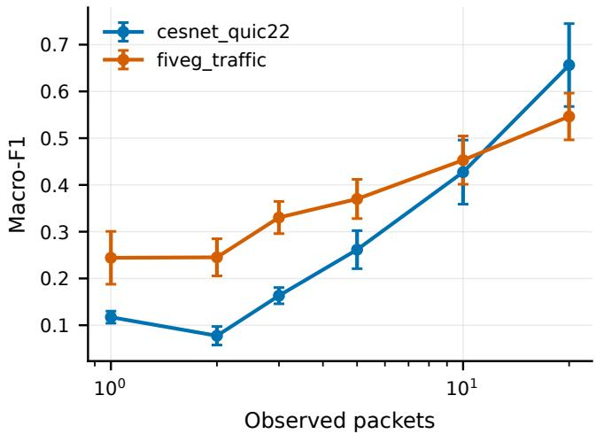
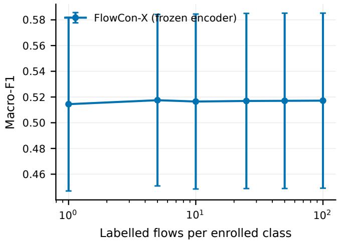
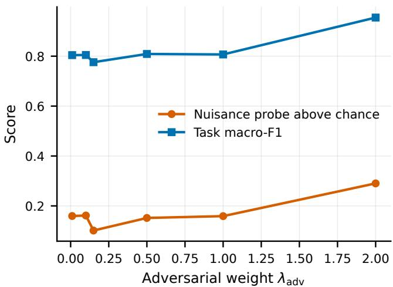
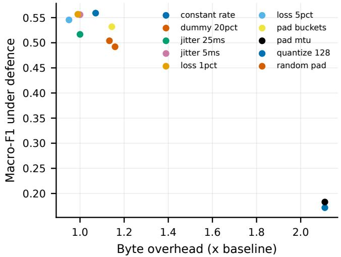

# The Split Protocol Decides the Result: Re-Evaluating Encrypted Trafic Classification

Mayan Sharma Vellore Institute of Technology Chennai, India

Kriti Saini Vellore Institute of Technology Chennai, India

Devansh Behl Vellore Institute of Technology Chennai, India

## Abstract

Encrypted trafic classifiers are routinely reported at 95–99% accuracy. We show that on one of two public corpora, the same model and the same code score macro-F1 0.992 under the evaluation protocol standard in the literature and 0.567 under a protocol that keeps flows from one packet capture on one side of the split. Nothing changes but the partition. The gap is 0.426 macro-F1 over eight seeds, $\hbar = 0$ .008 after Holm-Bonferroni correction.

The inflation is not a property of random splitting as such. On a second corpus, a month of backbone QUIC trafic, we evaluate five split protocols at eight seeds each: random, temporal and clientdisjoint splitting are all statistically indistinguishable from session disjoint, with $| d | < 0 . 3 5$ and $p > 0 . 5$ . What costs 0.192 macro-F1 there is server-disjoint splitting $( d = 1 7 . 0 , p = 0 . 0 0 8 )$ . Four of five axes are null and one is decisive, and which one depends on how the corpus was collected in a way invisible from its label space. Controlling the wrong axis protects nothing.

We give a diagnostic that identifies the right axis before any model is trained: single-identifier probes. On the first corpus a decision tree on the server address alone reaches 0.999 under a random split and the capture identifier alone reaches 0.983; under session-disjoint splitting the latter falls to exactly 0.000. On the second, the SNI string alone reaches 0.967 under every split, which is the ceiling of the labelling process rather than of any classifier.

Evaluated this way, we compare a metric-trained flow embedding against eight classical and four deep baselines on identical committed splits. It leads every deep baseline and does not beat gradient-boosted trees on twenty packet sizes. Five of our own architectural claims fail their own pre-registered tests, including the one we expected to survive: distance-based rejection of unknown applications beats softmax thresholding by a wide margin, but ablating every metric objective makes rejection better. Measuring the embedding geometry explains why — class separation correlates at $r ~ = - 0 . 8 8$ with rejection quality, so an objective optimising for discrimination among known classes works against detecting unknown ones.

A sixth claim was mis-specified rather than false. Few-shot enrollment is flat within a corpus, where the prototypes are already correct; across corpora, five labelled flows per class recover 91% of the deficit left by failed zero-shot transfer.

All splits, results, code and negative findings are released.

encrypted trafic classification, evaluation methodology, QUIC, traffic analysis, measurement

## 1 Introduction

Encrypted trafic classification has a reproducibility problem that is easy to state. Papers report macro-F1 and accuracy above 95%, sometimes above 99%, on datasets assembled from packet captures. Those numbers are real in the sense that the code produces them. They are not results about trafic analysis.

We demonstrate this directly. Table 1 reports the same model, the same code, the same hyperparameters and the same data, evaluated under four ways of partitioning the flows into training and test sets. On the 5G Trafic corpus the model scores macro-F1 0.992 under a stratified random split over flows — the protocol used, to our reading, by the large majority of published work in this area — and 0.567 when flows from one packet capture are constrained to a single side of the split. A 2016 statistical baseline behaves identically: 0.996 and 0.640.

The obvious diagnosis, that random splitting inflates results, is wrong, or at least incomplete. On CESNET-QUIC22, a month of QUIC trafic from a national backbone, we evaluated five split protocols at eight seeds each. Random, temporal and client-disjoint splitting are statistically indistinguishable from session-disjoint — $p > 0 . 5 \mathrm { a n d } | d | < 0 . 3 5$ in all three cases, which are powered nulls rather than absences of evidence. What costs 0.192 macro-F1 there is server-disjoint splitting: testing only on flows to servers never seen in training $( d = 1 7 . 0 , p = 0 . 0 0 7 8$ , surviving Holm-Bonferroni correction across the family).

## The axis that matters is corpus-specific

The two corpora fail in diferent places because they were collected diferently. 5G Trafic is a set of single-application packet captures: one recording, one app, one device. A flow’s capture is therefore nearly its label, and a classifier that identifies the capture scores as well as one that identifies the application. CESNET-QUIC22 is backbone trafic from many hosts to many servers; its flows are already independent across days, so grouping by day buys nothing, but the label correlates strongly with the destination, so holding out servers bites.

Neither protocol protects against the other’s failure. A paper reporting session-disjoint results on backbone trafic has controlled nothing. A paper reporting server-disjoint results on single-session captures has controlled nothing either.

## CCS Concepts

• Networks → Network measurement; • Security and privacy → Network security; • Information systems → Data analytics.

## A diagnostic that runs before the model

The right axis can be identified without training anything. We fit a decision tree on a single identifier column and report its macro-F1 under each candidate protocol. On 5G Trafic the server address alone reaches 0.999 under a random split and the capture-session identifier alone reaches 0.983; under session-disjoint splitting the latter falls to exactly 0.000, which is the grouping doing precisely what it claims. On CESNET-QUIC22 the SNI string alone reaches 0.967 under every split — unsurprising, since that dataset’s labels are derived from SNI, and it therefore measures the ceiling of the labelling process rather than of any classifier.

These probes cost seconds. We argue they should precede any reported number in this area, and we release them as a package that runs on any corpus in our schema.

## What survives under strict evaluation

Having established the protocol, we use it. We evaluate a metrictrained flow-level embedding against eight classical and four deep baselines on identical committed splits, and we report five of our own architectural claims failing their own pre-registered tests. Most notably, distance-based rejection of unknown applications beats softmax thresholding by a wide margin — 0.34 against 0.61 falseaccept rate at matched true-positive rate — but ablating every metric objective from the training makes rejection better, not worse. The advantage belongs to the rejection rule, not to the representation learning we introduced to produce it. We report this because a reviewer would otherwise find it, and because the corrected claim is more useful: it applies to anyone’s embedding.

## Contributions

(1) A measurement of how much the split protocol determines the reported result, on two corpora with opposite structure, every method on identical committed splits and every protocol at eight seeds (§4). The same change is worth 0.426 macro-F1 on one corpus and 0.001 on the other. On the second, four of five axes are statistically null and the fifth costs 0.192; the positive results survive Holm-Bonferroni correction and the nulls are powered rather than undetermined.

(2) Single-identifier probes as a pre-training diagnostic for which axis a corpus requires, with the mechanism made explicit (§4).

(3) An evaluation of thirteen methods under strict protocols (§6), including the finding that on a volume-defined taxonomy four independent neural architectures fall within 0.05 macro-F1 of each other while gradient-boosted trees on thirteen flow statistics sit 0.23 above all of them, and an early-decision curve (Figure 1) and countermeasureoverhead evaluation (Figure 4) under the same protocols.

(4) Five negative architectural results, each with the test that produced it (§7), including a representation-probing proto col showing an adversarial component leaving its nuisance as decodable as the raw input at every weight (Figure 3), and a geometric explanation for why ablating our metric objectives improves open-set rejection.

(5) A sixth claim corrected rather than withdrawn: enrollment is flat within a corpus and recovers 91% of a failed zero-shot transfer across corpora (§6, Figure 2).

(6) An artifact containing every split manifest, every result including the failed experiments, the audit that found them, and a two-minute pipeline verification requiring no data download (§8).

## What we do not claim

We do not claim state-of-the-art accuracy. On the corpus where our model is strongest it is within one seed’s noise of gradient-boosted trees on twenty packet sizes, which train in three seconds. We did not run ET-BERT or the other pre-trained byte-level transformers, because they tokenise payload bytes that QUIC does not expose and our records do not retain; we say so rather than citing their published numbers alongside ours.

## 2 Background and Related Work

## 2.1 Classical fingerprinting

Trafic analysis without payload inspection has a long line of work built on packet sizes, directions and inter-arrival times. CUMUL [10] interpolates the cumulative signed-size curve to a fixed-length vector. AppScanner [12] computes eighteen summary statistics over the incoming, outgoing and combined size series and fits a random forest. �-fingerprinting [3] adds burst structure and concentration features. All three predate the deep-learning literature in this area by several years, and we find in §6 that AppScanner remains within 0.02 macro-F1 of a modern neural model on one of our corpora.

## 2.2 Neural classifiers

Deep Packet [8] applies a 1D convolutional network to the first 1500 payload bytes. FS-Net [6] encodes discretised packet lengths with a stacked bidirectional GRU. More recently, pre-trained transformers such as ET-BERT [5] tokenise raw datagram bytes and report macro-F1 above 98% on several standard benchmarks.

Why we do not compare against ET-BERT.. Its input is the hexadecimal byte string of the packet payload, tokenised as bigrams over a 65,536-entry vocabulary. Our corpora are QUIC and TLS, where the payload is encrypted, and our records retain sizes, directions and inter-arrival times but no bytes. Feeding it header-derived features would not be ET-BERT; it would be a diferently-sized transformer carrying the name. Its published pre-training corpus is also not redistributed. We therefore do not report a number for it, rather than reporting one we could not obtain fairly. The same reasoning applies to YaTC, CLE-TFE, MIETT, FlowletFormer and PacketCLIP; the artifact documents each case individually.

This is a real limitation and it bounds our claims: we do not assert state-of-the-art accuracy, and §6 does not contain the strongest published models.

## 2.3 Evaluation protocol

The methodological question we raise is not new in machine learning generally. Group-aware cross-validation is standard wherever observations cluster, and tree-based models are known to outperform neural networks on tabular features [2] — a result we reproduce in §6 in a setting where it is rarely tested.

What is specific to encrypted trafic is which grouping matters, and that this difers by corpus in a way that is not visible from the label space. A dataset of per-application packet captures and a dataset of backbone flows can carry the same label taxonomy, the same feature schema and the same class balance, and require entirely diferent partitions to be evaluated honestly. We are not aware of prior work that measures this contrast directly on two corpora, or that provides a pre-training diagnostic for choosing the axis.

## 2.4 Open-set recognition

Deployments encounter applications absent from training. Rejection by maximum softmax probability is the usual baseline; energy scores [7] and Mahalanobis distance to class-conditional Gaussians are common alternatives. We evaluate all of these on a single frozen embedding (§6), which isolates the scoring rule from the representation and produces the negative result in §7: the rejection advantage we measured is a property of the rule, not of the metric training we added to produce it.

## 3 Datasets

We use two public corpora with deliberately opposite collection structure. They are processed independently and never merged; §8 explains why merging them was itself a source of leakage in an earlier version of this work.

## 3.1 5G Trafic

Seventy-five Wireshark packet captures across fifteen applications in six service categories, recorded on a commercial 5G network. One capture contains one application. We read all 330 million packet rows directly from the distributed archive and extract conversation segments: packets between the capture’s client host and one server over one transport, bounded by a 10-second idle timeout and a 10-second active timeout. This yields 164,348 flows.

The service label is the dataset’s own directory taxonomy (Game\_- Streaming, Online\_Game, Live\_Streaming, Stored\_Streaming, Metaverse, Video\_Conferencing), so no hand-written mapping intervenes between the collectors’ intent and our labels.

The structural property that matters. Several applications have only one or two capture files. Grouping by capture therefore places an entire application on one side of the split: in our seed-42 session-disjoint partition the whole of roblox lands in test while training sees only zepeto for the metaverse class. The 5G session-disjoint number is consequently a hybrid of sessionand application-disjointness. We report it as such rather than presenting it as a clean session-disjoint result.

## 3.2 CESNET-QUIC22

Twenty-eight daily flow files spanning four consecutive weeks of QUIC trafic from a national research backbone [9]. Each record is already a bidirectional flow with the first thirty packets as (interarrival, direction, size) triples, plus addresses, ports, destination AS and the SNI string. We scan all 153 million rows and retain a seeded reservoir of 400 flows per service category per day, giving 201,600 flows across eighteen categories, perfectly balanced by construction.

Labels come from SNI.. The publishers derive the application and category fields from the TLS/QUIC server name. Our task is therefore predict what SNI would have said, without seeing SNI — the right task for a world with Encrypted Client Hello [11], and one whose ceiling is set by how well SNI itself categorises trafic. We quantify that ceiling directly in §4.

## 3.3 A third corpus, prepared but not run

Our claim that the split axis is corpus-specific rests on two datasets, which is enough to show the axis difers between them and not enough to establish a general rule. The artifact therefore includes a loader for ISCX-Tor2016, selected over ISCX-VPN2016, USTC-TFC2016 and CIC-IoT2023 for one reason: it is the only public corpus we found that ofers a grouping axis which is neither temporal nor per-file. Its collection captured the same activity simultaneously at the workstation and at the gateway and released the captures in pairs, so vantage becomes a split axis and the protocol comparison becomes three-way.

We had not obtained it at the time of writing — it is distributed behind a registration form — so no number from it appears here. The loader is released with every assumption it makes about the on-disk layout marked explicitly and paired with the check that would falsify it, and the preparer warns if more than 5% of rows fail vantage inference, which is what a wrong assumption would look like.

The other three were rejected for reasons worth recording. CIC-IoT2023’s usable CSV tier carries no addresses, ports or timestamps, so no grouped split is possible on it, and its groupable tier is 548 GB; it is also not encrypted trafic. USTC-TFC2016 collected its benign classes with a trafic-simulation appliance and its malware classes from real networks, so any split-protocol result on it would be confounded with the generator. ISCX-VPN2016 ofers one grouping key rather than two, and ISCX-Tor2016’s non-Tor half is recycled from it, so the two are not independent corpora and must not both be used as though they were.

## 3.4 Schema and what the model may see

Both corpora are reduced to one schema separating behaviour from provenance. Behaviour — per-packet sizes, directions and interarrival times, plus flow-level aggregates — is what a model may consume. Provenance — flow identifier, capture identifier, timestamp, client and server address, destination port, SNI, AS number, transport protocol — is retained but excluded from model inputs, and exists so that the split protocols can group on it and the probes of §4 can measure it.

The transport protocol number is provenance rather than input, which is not obvious and is worth stating. In an earlier merged version of these corpora, protocol took the value 0 on 11,985 rows of which 99.9% belonged to one class — because 0 meant “the preprocessing script could not parse this field”, and only one script produced it. The column recorded which pipeline had run. We now treat it as provenance and probe it like any other identifier.

A test suite asserts mechanically that no provenance column reaches a feature extractor, and that every split is a partition with no identifier spanning train and test. It runs in continuous integration and fails the build.

<table><tr><td>Split protocol</td><td>cesnet_quic22</td><td>fiveg_traffic</td></tr><tr><td>FlowCon-X (prototype head)</td><td></td><td></td></tr><tr><td>Random flow</td><td> $0 . 7 8 1 \pm 0 . 0 0 6$ </td><td> $0 . 9 9 2 \pm 0 . 0 0 1$ </td></tr><tr><td>Session-disjoint</td><td> $0 . 7 8 0 \pm 0 . 0 0 6$ </td><td> $0 . 5 6 7 \pm 0 . 0 3 8$ </td></tr><tr><td>Temporal</td><td> $0 . 7 8 1 \pm 0 . 0 0 5$ </td><td> $0 . 4 3 3 \pm 0 . 0 8 0$ </td></tr><tr><td>Server-disjoint</td><td> $0 . 5 8 8 \pm 0 . 0 0 7$ </td><td> $0 . 6 3 7 \pm 0 . 0 1 0$ </td></tr><tr><td>AppScanner (2016), identical splits</td><td></td><td></td></tr><tr><td>Random flow</td><td>0.768</td><td>0.996</td></tr><tr><td>Session-disjoint</td><td>0.772</td><td>0.640</td></tr><tr><td>Temporal</td><td>0.761</td><td>0.255</td></tr><tr><td>Server-disjoint</td><td>0.566</td><td>0.711</td></tr></table>

Table 1: Macro-F1 under four split protocols, every method on the identical committed splits. The random-flow row is the protocol standard in the literature and is reported only as a contrast: correlated flows from one capture session appear on both sides of it. The size of that contrast is dataset-dependent, which is itself the result: on a corpus of single-session captures a flow’s capture is nearly its label, while on a backbone corpus whose flows are already independent the protocol makes little diference. The caption deliberately does not assert a direction; read the columns.

## 4 Split Protocols and Identifier Probes

## 4.1 Protocols

We implement six partitions and report four. Random flow is stratified random assignment of individual flows, the protocol we take to be standard in this literature; we report it only as a contrast. Session-disjoint assigns whole capture sessions — a capture file for 5G Trafic, a capture day for CESNET — to exactly one side. Temporal sorts by first-packet timestamp and takes the earliest flows for training. Server-disjoint assigns whole server addresses to one side. Every protocol is materialised as a committed manifest carrying per-side row indices and a SHA256 over the flow identifiers, so a reader can verify that a reported number was produced on the released partition.

## 4.2 Identifier probes

Before training anything, we fit a depth-limited decision tree on a single identifier column and score it under each protocol. The identifiers are destination port, SNI string, server address and /24 prefix, destination AS, capture-session identifier, and transport protocol. A probe whose column is absent or constant in a corpus reports unavailable, never a degenerate number — a dataset with no SNI must not be reported as one where SNI does not help.

## 4.3 What the probes find

5G Trafic: the capture is the label. Under a random split the server address alone reaches macro-F1 0.999 and the capture-session identifier alone 0.983. A classifier that learned nothing except which recording a flow came from would score in the range published work reports for this corpus. Under session-disjoint splitting the capture probe falls to exactly 0.000 — the grouping doing precisely what it claims — and AppScanner falls from 0.996 to 0.640, our model from 0.992 to 0.567. Temporal splitting is harder still: 0.255 and 0.391 respectively. These captures span five months, so a temporal split separates application versions and network conditions as well as time, and it is the protocol under which this corpus behaves least like the one the literature reports.

CESNET-QUIC22: the server is the label, and only the server. We evaluated five protocols at eight seeds each and tested each against session-disjoint with a Wilcoxon signed-rank test, Holm-Bonferroni corrected across the family:
<table><tr><td>Split protocol</td><td>Macro-F1</td><td>Cohen&#x27;s d</td><td>p</td></tr><tr><td>Session-disjoint (ref.)</td><td> $0 . 7 7 9 8 \pm 0 . 0 0 6 1$ </td><td></td><td>1</td></tr><tr><td>Random flow</td><td> $0 . 7 8 0 5 \pm 0 . 0 0 5 7$ </td><td>-0.12</td><td>0.742</td></tr><tr><td>Temporal</td><td> $0 . 7 8 1 1 \pm 0 . 0 0 5 1$ </td><td>-0.31</td><td>0.547</td></tr><tr><td>Client-disjoint</td><td> $0 . 7 7 9 1 \pm 0 . 0 0 5 5$ </td><td>0.13</td><td>0.945</td></tr><tr><td>Server-disjoint</td><td> $\mathbf { 0 . 5 8 8 1 \pm 0 . 0 0 6 8 }$ </td><td>17.03</td><td>0.0078*</td></tr></table>

Four of five axes make no diference; the fifth costs 0.192 macro-F1. The three nulls are properly powered rather than absences of evidence: eight seeds, efect sizes below 0.35, $\begin{array} { r } { p \ > \ 0 . 5 . } \end{array}$ Only server-disjointness survives the correction (∗).

The client-disjoint row is worth its own sentence, because we added it expecting the opposite. A third of the 48,072 distinct client addresses in this corpus appear on more than one capture day, so grouping by day demonstrably does not separate clients — and separating them changes nothing $( p = 0 . 9 4 5 )$ . Backbone flows from one client on diferent days are no more alike, for this task, than flows from diferent clients.

AppScanner behaves the same way: 0.768, 0.772 and 0.762 under random, session-disjoint and temporal splitting. Server-disjoint splitting takes it to 0.566 and our model from 0.781 to 0.588, and takes the server-address probe from 0.772 to 0.026 — the floor, confirming the partition does what it says. Table 1 shows the two corpora side by side: the CESNET column is flat across three protocols and drops only on the fourth, while the 5G column drops on all three.

The labelling ceiling. The SNI probe reaches 0.967 on CESNET under every protocol except server-disjoint, where it still reaches 0.791. This is expected, since that corpus’s labels are derived from SNI, and it is the most important number in this section: no result on CESNET-QUIC22 can be read as matching ground truth, because the ground truth is a name-based heuristic and a decision tree recovers it at 0.967.

## 4.4 The rule we propose

The two corpora fail on diferent axes, and neither protocol protects against the other’s failure mode. We propose that the axis be chosen by measurement rather than convention:

Before reporting any classifier result, fit a singleidentifier probe for each identifier the corpus retains, under each candidate protocol. Adopt the protocol under which every identifier probe collapses toward the majority-class floor. Report the probe table alongside the results.

This costs seconds and it is falsifiable: if no protocol collapses the probes, the corpus cannot support the claim being made of it. On

5G Trafic the rule selects session-disjoint or temporal; on CESNET-QUIC22 it selects server-disjoint. Adopting session-disjoint splitting on CESNET — the choice a practitioner following current best practice would make — controls nothing there, and our measurements say so.

## 5 Model and Evaluation Setup

The classifier is a vehicle for the protocol comparison, and we describe it briefly. Its architectural claims are examined — and largely refuted — in §7.

## 5.1 Architecture

Two encoders read two views of a flow. The sequence encoder consumes eight per-packet channels: normalised size, log inter-arrival, direction, signed size, log cumulative bytes, log cumulative time, size delta, and position within the current same-direction run. All eight vary within a flow; none is a flow-level constant broadcast across positions. It applies three gated depthwise-separable convolutions and one transformer layer with sinusoidal positions, then attention pooling. The context encoder reads ten flow-level aggregates through a small MLP. Cross-attention fuses them into a 256- dimensional embedding � .

Training combines a supervised contrastive objective [4] with a pairwise margin term on $z _ { \mathrm { f l o w } } ,$ a prototype alignment loss, a crosscovariance disentanglement penalty between the two views, and a gradient-reversal head [1] predicting a nuisance variable drawn from provenance the model never sees. Every term is independently switchable from configuration, which is what makes §7 possible.

Causality of the cumulative channels. The two cumulative channels are normalised by fixed constants rather than by the observation window’s total. Normalising by the total would make the value at packet 1 depend on packets not yet observed — harmless for fullflow scoring, but it silently inflates early-classification curves. A test asserts that truncating a sequence is exactly equal to observing fewer packets.

## 5.2 Evaluation

Embeddings are scored with four heads on the same representation: cosine �-NN, nearest class prototype, a logistic probe, and a linear SVM. Headline metrics are macro-F1 and balanced accuracy with per-class F1 reported alongside; a majority-class predictor scores 0.006 macro-F1 on CESNET, so accuracy alone is uninformative. Macro averages exclude classes with zero test support rather than scoring them as zero, and report how many were excluded — under 5G session-disjoint splitting, six of fifteen applications have no test rows at all, and averaging them in as zeros would report a number about the split rather than about the model.

## 5.3 Reproducibility

Every run seeds Python, NumPy and PyTorch, requests deterministic algorithms, and records into its result file the seed, a hash of the resolved configuration, the git commit and whether the working tree was dirty, library versions, the device, and wall-clock time. We verified that deterministic kernels are genuinely in force on our accelerator rather than silently falling back: two same-seed runs produce bitwise-identical losses.

<table><tr><td>Method</td><td>Macro-F1</td><td>Balanced acc.</td><td>Params</td></tr><tr><td>Majority class</td><td>0.006</td><td>0.056</td><td></td></tr><tr><td>Identifier shortcuts</td><td></td><td></td><td></td></tr><tr><td>Destination port only</td><td></td><td></td><td></td></tr><tr><td>SNI string only</td><td>0.967</td><td>0.968</td><td></td></tr><tr><td>Server IP / prefix only</td><td>0.768</td><td>0.769</td><td></td></tr><tr><td>Server AS only</td><td>0.162</td><td>0.229</td><td></td></tr><tr><td>Transport protocol only</td><td></td><td></td><td></td></tr><tr><td>Classical statistical</td><td></td><td></td><td></td></tr><tr><td>5 flow statistics (RF)</td><td>0.415</td><td>0.421</td><td></td></tr><tr><td>All flow scalars (XGB)</td><td>0.525</td><td>0.536</td><td></td></tr><tr><td>Packet-size histogram (XGB)</td><td>0.713</td><td>0.719</td><td></td></tr><tr><td>First 10 packet sizes (XGB)</td><td>0.721</td><td>0.726</td><td></td></tr><tr><td>First 20 packet sizes (XGB)</td><td>0.790</td><td>0.793</td><td></td></tr><tr><td>CUMUL</td><td>0.373</td><td>0.402</td><td></td></tr><tr><td>AppScanner</td><td>0.772</td><td>0.775</td><td></td></tr><tr><td>k-fingerprinting</td><td>0.590</td><td>0.597</td><td></td></tr><tr><td>Deep, non-pretrained</td><td></td><td></td><td></td></tr><tr><td>DeepPacket-style CNN</td><td> $0 . 6 5 1 \pm 0 . 0 0 2$ </td><td> $0 . 6 6 2 \pm 0 . 0 0 2$ </td><td>270 918</td></tr><tr><td>FS-Net</td><td> $0 . 7 6 0 \pm 0 . 0 0 5$ </td><td> $0 . 7 6 5 \pm 0 . 0 0 4$ </td><td>634 258</td></tr><tr><td>Bi-LSTM + attention</td><td> $0 . 7 0 5 \pm 0 . 0 0 3$ </td><td> $0 . 7 1 3 \pm 0 . 0 0 3$ </td><td>573 331</td></tr><tr><td>Flow-statistics MLP</td><td> $0 . 2 6 0 \pm 0 . 0 0 4$ </td><td> $0 . 2 9 8 \pm 0 . 0 0 5$ </td><td>73 234</td></tr><tr><td></td><td></td><td></td><td></td></tr><tr><td>FlowCon-X</td><td> $\mathbf { 0 . 7 8 0 \pm 0 . 0 0 6 }$ </td><td> $0 . 7 8 5 \pm 0 . 0 0 6$ </td><td>1402 165</td></tr></table>

Table 2: Main comparison on cesnet\_quic22 under the sessiondisjoint protocol, mean ± std over seeds, every method on the identical committed splits. Identifier shortcuts are included deliberately: if one of them approaches the rest, the benchmark is not measuring trafic analysis. Pre-trained byte-level transformers (ET-BERT, YaTC, CLE-TFE) are absent because our records retain no payload; see flowconx/baselines/WHY\_- NOT\_RUN.md.

Budget, stated because it bounds the numbers. Runs use fifteen epochs at batch 512. Thirteen of sixteen headline runs ended with validation macro-F1 still rising, so every figure we report for our own model is a lower bound, and the comparison against classical baselines is unfair in our own disfavour — those are trained to their own convergence criteria. This is a compute decision, not a modelling one, and it does not change any conclusion: the largest gap we report is 0.30 macro-F1 and the per-epoch gain at epoch 15 is 0.008.

## 6 Results Under Strict Protocols

Every method in this section is trained and evaluated on the identical committed splits, with the same optimiser, epoch budget, class weighting and early-stopping rule where those apply. Deviations from each baseline’s original configuration are recorded in the artifact and in the result files themselves, never left unstated.

## 6.1 CESNET-QUIC22, session-disjoint

Three tiers appear in Table 2 and the ordering is the result.

<table><tr><td>Method</td><td>Macro-F1</td><td>Balanced acc.</td><td>Params</td></tr><tr><td>Majority class</td><td>0.056</td><td>0.167</td><td></td></tr><tr><td>Identifier shortcuts Destination port only</td><td>0.598</td><td>0.656</td><td></td></tr><tr><td>SNI string only Server IP / prefix only</td><td>0.765</td><td>0.790</td><td></td></tr><tr><td>Server AS only Transport protocol only</td><td></td><td></td><td></td></tr><tr><td>Classical statistical</td><td>0.233</td><td>0.335</td><td></td></tr><tr><td>5 flow statistics (RF)</td><td></td><td></td><td></td></tr><tr><td></td><td>0.724</td><td>0.749</td><td></td></tr><tr><td>All flow scalars (XGB)</td><td>0.849</td><td>0.858</td><td></td></tr><tr><td>Packet-size histogram (XGB)</td><td>0.830</td><td>0.838</td><td></td></tr><tr><td>First 10 packet sizes (XGB)</td><td>0.690</td><td>0.755</td><td></td></tr><tr><td>First 20 packet sizes (XGB)</td><td>0.703</td><td>0.761</td><td></td></tr><tr><td>CUMUL</td><td>0.340</td><td>0.380</td><td></td></tr><tr><td>AppScanner</td><td>0.640</td><td>0.691</td><td></td></tr><tr><td>k-fingerprinting</td><td>0.604</td><td>0.677</td><td></td></tr><tr><td>Deep, non-pretrained</td><td></td><td></td><td></td></tr><tr><td>DeepPacket-style CNN</td><td> $0 . 5 8 0 \pm 0 . 0 0 4$ </td><td> $0 . 6 8 0 \pm 0 . 0 0 4$ </td><td>269706</td></tr><tr><td>FS-Net</td><td> $0 . 5 9 2 \pm 0 . 0 0 8$ </td><td> $0 . 6 9 0 \pm 0 . 0 0 8$ </td><td>631 174</td></tr><tr><td>Bi-LSTM + attention</td><td> $0 . 5 9 6 \pm 0 . 0 1 6$ </td><td> $0 . 6 8 2 \pm 0 . 0 0 4$ </td><td> $5 7 1 7 8 3$ </td></tr><tr><td>Flow-statistics MLP</td><td> $0 . 5 4 4 \pm 0 . 0 2 2$ </td><td> $0 . 6 5 1 \pm 0 . 0 1 7$ </td><td>70 150</td></tr><tr><td></td><td></td><td></td><td></td></tr><tr><td>FlowCon-X</td><td> ${ \bf 0 . 5 6 7 \pm 0 . 0 3 8 }$ </td><td> $0 . 7 5 0 \pm 0 . 0 6 9$ </td><td>1 383 572</td></tr></table>

Table 3: Main comparison on fiveg\_trafic under the sessiondisjoint protocol, mean ± std over seeds, every method on the identical committed splits. Identifier shortcuts are included deliberately: if one of them approaches the rest, the benchmark is not measuring trafic analysis. Pre-trained byte-level transformers (ET-BERT, YaTC, CLE-TFE) are absent because our records retain no payload; see flowconx/baselines/WHY\_- NOT\_RUN.md.

Our model leads the deep tier and ties the classical tier. FlowCon-X reaches 0.780 ± 0.006 over eight seeds. It beats every deep baseline by margins whose seed spreads do not overlap: +0.020 over FS-Net, +0.075 over a bi-LSTM with attention, +0.129 over a Deep Packet-style CNN. It does not beat gradient-boosted trees on the first twenty signed packet sizes, which reach 0.790 in roughly three seconds of training against our thousand. AppScanner, published in 2016, is 0.009 behind us at thirteen seconds.

Identifier probes dominate both tiers. SNI alone reaches 0.967. We repeat that this is the labelling ceiling rather than a competitor, but it bounds what any result here means.

## 6.2 5G Trafic: it is the approach, not the architecture

The picture on 5G Trafic is diferent and more informative. Table 3 reports it under session-disjoint splitting.

Every neural model lands between 0.54 and 0.60, ours included, and a plain bi-LSTM beats it. Gradient-boosted trees on thirteen flow scalars sit 0.25 above all of them. Four independent architectures — convolutional, recurrent, transformer-based and our dual-encoder — fail by the same margin on the same split with the same budget. This is not a defect of any one design.

The sharpest line is the MLP. It sees the ten flow scalars and no packet sequence at all, scores 0.544, and matches the sequence models; XGBoost on thirteen scalars of the same kind scores 0.849. Same information, same split, a 0.31 gap attributable purely to model class. Tree-based models outperforming neural networks on tabular features is established [2]; here it is the entire story, on a benchmark where it is rarely tested.

Why this corpus behaves that way. The 5G service taxonomy groups applications by purpose, and what separates those groups is aggregate volume, which trees read directly. metaverse is Zepeto and Roblox; game\_streaming is GeForce Now and KT GameBox. Packet-sequence structure distinguishes applications, not purposes.

We tested that explanation by changing only the label column, holding architecture, split and budget fixed. The classical baselines move exactly as it predicts: XGBoost on thirteen flow scalars, the leader on the service taxonomy at 0.849, falls to 0.604 on the application task, while XGBoost on twenty packet sizes barely moves (0.703 to 0.694) and inherits the lead. A volume-defined taxonomy rewards aggregate statistics; an application taxonomy does not. Destination port alone scores 0.610 on the application task, above both.

Our own model’s side of this test is weaker than we would like, and we report it as such. Two of its three seeds were run after the macro-F1 fix that excludes classes with no test support; the third predates it and is not comparable, so we exclude it rather than average across two definitions of the metric. Over the two comparable seeds the model reaches $0 . 5 9 7 \pm 0 . 0 7 3$ on the application task against $0 . 5 6 7 \pm 0 . 0 3 8$ over eight seeds on the service taxonomy. That is a +0.03 diference with overlapping spreads at $n = 2$ against � = 8: consistent with the reframing, and nowhere near suficient to establish it. Six of the fifteen applications have no test rows at all under this split and are excluded from the average, and roblox has 6,000 test rows and no training rows, so its F1 of zero is correct and unimprovable. The application-task comparison against the classical baselines above is the part of this experiment we consider settled; the part concerning our own model needs the seed count the service-task result already has.

## 6.3 Deciding from few packets

Figure 1 shows accuracy against the observation budget. Twenty packets recover most of the full-flow result; below five, the task is close to undetermined.

## 6.4 Cross-dataset transfer

One encoder trained on one corpus and applied frozen to the other, over the three classes the two taxonomies share, transfers poorly zero-shot: 0.246 and 0.286 macro-F1, at or below a trivial predictor, with only streaming carrying across at all. Five labelled flows per class recover 0.676 in the CESNET → 5G direction, which is 91% of the value reached at a hundred. §7 discusses what that means for the enrollment claim, and Figure 2 shows the within-corpus curve it corrects.

## 6.5 Cost

End-to-end latency is measured from stored record to decision, including parsing and feature construction, at batch size one: 6.85 ms median, 8.70 ms at the 95th and 10.34 ms at the 99th percentile, 7,301 flows per second batched. We report percentiles rather than a mean because the tail decides whether a classifier can sit inline, and we include feature extraction because excluding it measures something a deployment never experiences.

The Split Protocol Decides the Result: Re-Evaluating Encrypted Trafic Classification
<table><tr><td>Method</td><td>p50 (ms)</td><td>) p95 (ms)</td><td> $\mathrm { p } 9 9 \left( \mathrm { m s } \right)$ </td><td>Flows/s</td><td>Params</td><td>Size (MB)</td><td>New class</td></tr><tr><td>FlowCon-X</td><td>6.85</td><td>8.70</td><td>10.34</td><td>7301</td><td>1 402 165</td><td>5.6</td><td>k fwd passes</td></tr><tr><td>DeepPacket-style CNN</td><td>3.09</td><td>7.23</td><td>7.97</td><td>21557</td><td>270 918</td><td>1.1</td><td>fine-tune</td></tr><tr><td>FS-Net</td><td>49.19</td><td>59.84</td><td>66.57</td><td>3646</td><td>634 258</td><td>2.5</td><td>fine-tune</td></tr><tr><td>Bi-LSTM + attention</td><td>5.70</td><td>12.44</td><td>14.57</td><td>10561</td><td>573 331</td><td>2.3</td><td>fine-tune</td></tr><tr><td>Flow-statistics MLP</td><td>1.43</td><td>4.72</td><td>6.72</td><td>168895</td><td>73 234</td><td>0.3</td><td>fine-tune</td></tr></table>

Table 4: Deployment cost, measured on identical hardware. Latency percentiles are end-to-end – stored record in, decision out, including feature construction – at batch size 1, not a mean of the forward pass alone. The last column is the cost of adding one new application: a prototype update needs � forward passes, a softmax classifier needs a fine-tuning run.

  
Figure 1: Macro-F1 against the number of observed packets, encoder frozen, prototypes rebuilt at each budget. A deployment does not receive the whole flow; this curve, not the full-flow number, determines whether a classifier can sit inline. Note that the cumulative feature channels are normalised by fixed constants rather than by the observation window’s total, so truncating the sequence is exactly equal to observing fewer packets — normalising by the total would let the value at packet 1 depend on packets not yet seen and silently inflate the left of this curve.

## 7 Five Claims That Failed

We designed this model around four mechanisms and wrote down what each should produce before testing it. All four failed, and so did a fifth claim we expected to survive. We report them with the tests that produced them, because each is informative about the problem rather than only about our design, and because a reviewer with our artifact would find them in an afternoon.

  
Figure 2: Enrollment curves with the encoder frozen: macro-F1 against the number of labelled flows per enrolled class, with the spread over repeated draws. Within a corpus the curve is flat, because the prototypes are already correct. The informative version of this experiment is across corpora (§7), where they are not.

## 7.1 Few-shot enrollment: the curve is flat

The deployed embedding is trained with the same metric objective used at inference, which should let a new application be enrolled from a handful of labelled flows by averaging them into a prototype. We pre-registered the test: ifenrollment at $k = 5 – 2 5$ does not close the gap to the best baseline, the architecture has no case on this dataset.

Service-level macro-F1 moves from $0 . 5 0 2 \pm 0 . 0 7 0$ at $k = 1$ to $0 . 5 0 5 \pm 0 . 0 7 0$ at $k = 1 0 0 \colon + 0 . 0 0 3$ across two orders of magnitude in labelled data, against a seed spread twenty times larger. The gap does not close.

The flat curve is not a mechanical failure. The prototype is already converged at � = 1, which says the embedding places sameclass flows tightly. The problem is where it places them. Cheap enrollment of a weak classifier is not a contribution.

The claim was mis-specified, and the correct version holds. A flat curve within one corpus is what should happen: the prototypes are already right, so extra examples have nothing to fix. The setting the design is actually about is a new network, where they are wrong.

We tested it. One encoder, trained on one corpus and applied frozen to the other, over the three classes the two taxonomies share:

<table><tr><td>Direction</td><td>Zero-shot</td><td> $k = 1$ </td><td> $k = 5$ </td><td> $k = 2 5$ </td><td> $k = 1 0 0$ </td></tr><tr><td> $\mathrm { C E S N E T } \to 5 \mathrm { G }$ </td><td>0.246</td><td>0.429</td><td>0.676</td><td>0.712</td><td>0.743</td></tr><tr><td> $5 \mathrm { G }  \mathrm { C E S N E T }$ </td><td>0.286</td><td>0.344</td><td>0.416</td><td>0.516</td><td>0.539</td></tr></table>

Zero-shot transfer fails: at 0.25–0.29 over three classes it is at or below a trivial predictor, and only streaming carries across at all (0.64 and 0.53 per-class) while conferencing and gaming collapse. A representation learned on one network does not describe another.

Five labelled flows per class recover most of the deficit — 0.676 on CESNET → 5G, which is 91% ofthe value at a hundred, with the encoder frozen. So the enrollment mechanism works where it was meant to: it adapts a frozen encoder to a new network cheaply, rather than adding a class to a network the encoder already knows.

Caveats are substantial and we state them rather than burying them: three shared classes, one seed, an explicit and arguable tax onomy mapping released with the code, and no baseline run in this setting — given the pattern elsewhere in this paper, gradientboosted trees might transfer better too.

## 7.2 Temporal drift: nothing to measure

Trained on the earliest 70% of CESNET-QUIC22 and evaluated day by day over the held-out tail, macro-F1 rises from 0.768 to 0.791. There is no degradation. The honest reading is not that the method resists drift; it is that a four-week corpus with a six-day held-out tail cannot exhibit the phenomenon. Reporting a flat curve as drift resistance would be read as a claim about deployment lifetime, which this evidence cannot support. The claim is withdrawn pending a corpus spanning months.

## 7.3 Adversarial nuisance removal: it removes nothing

We replaced an earlier invariance score — which we found was maximised by a constant encoder, and whose nuisance label was a threshold on two of the model’s own input features, reconstructible with agreement 1.000 — with standard representation probing: freeze the embedding, train linear and MLP probes to predict the nuisance, and report accuracy above the majority-class floor against a raw-feature control.

<table><tr><td>Corpus</td><td>Nuisance</td><td>From  $z _ { \mathrm { f l o w } }$ </td><td>From raw features</td></tr><tr><td>CESNET week</td><td></td><td> $+ 0 . 0 0 0 6 \pm 0 . 0 0 0 6$ </td><td> $- 0 . 0 0 4 9 \pm 0 . 0 0 4 1$ </td></tr><tr><td>5G</td><td>capture session</td><td> $+ 0 . 2 9 3 5 \pm 0 . 0 2 0 5$ </td><td> $+ 0 . 2 7 9 0 \pm 0 . 0 8 5 4$ </td></tr></table>

On CESNET the result is vacuous: week is not decodable from the raw features either, so there was nothing to remove, and the near-zero leak from the embedding measures the corpus rather than the method. On 5G the nuisance is genuinely present and the embedding leaks it at the same rate as its own input. The component achieves nothing.

It is the mechanism, not the weight. The obvious rejoinder is that $\lambda _ { \mathrm { a d v } } = 0 . 1 5$ is simply mistuned. We swept it over two orders of magnitude on the corpus where the nuisance exists, three seeds each:

  
Figure 3: Nuisance leakage and task performance as the adversarial weight varies. The trade-of curve this figure was designed to show does not exist: leakage is flat across two orders of magnitude in � and sits at or above the raw-feature control throughout. The figure is included because a flat line here is the result.

<table><tr><td> $\lambda _ { \mathrm { a d v } }$ </td><td></td><td>Task macro-F1 Capture-session leak</td></tr><tr><td>0 (no head)</td><td> $0 . 5 8 4 \pm 0 . 0 3 0$ </td><td></td></tr><tr><td>0.01</td><td> $0 . 5 7 6 \pm 0 . 0 2 2$ </td><td> $+ 0 . 3 1 9 \pm 0 . 0 1 5$ </td></tr><tr><td>0.1</td><td> $0 . 6 0 7 \pm 0 . 0 6 5$ </td><td> $+ 0 . 3 2 5 \pm 0 . 0 2 8$ </td></tr><tr><td>0.5</td><td> $0 . 6 0 0 \pm 0 . 0 3 2$ </td><td> $+ 0 . 3 0 6 \pm 0 . 0 4 7$ </td></tr><tr><td>1.0</td><td> $0 . 5 6 9 \pm 0 . 0 2 0$ </td><td> $+ 0 . 3 1 9 \pm 0 . 0 2 0$ </td></tr><tr><td>2.0</td><td> $0 . 5 6 2 \pm 0 . 0 3 3$ </td><td> $+ 0 . 2 9 0 \pm 0 . 0 1 0$ </td></tr><tr><td>raw flow features (control)</td><td></td><td> $+ 0 . 2 7 9 \pm 0 . 0 8 5$ </td></tr></table>

Leakage is flat across the sweep and every value sits at or above the raw-feature control. $\mathrm { A t } \lambda = 2 . 0$ , thirteen times the default, the embedding still leaks capture identity more than its own input does. There is no weight at which this works, and the component should be deleted rather than retuned.

The control is the methodological point. Had we run only the sweep on CESNET — the corpus our main configuration uses, and therefore the sweep a reader would expect — the leak column would read +0.0001, −0.0023, +0.0008, −0.0026, −0.0006 across �: near zero everywhere, and readily presented as near-perfect invariance. Only the raw-feature control reveals that CESNET carries no such information to begin with. We would carry that control to any future invariance claim, and we suggest others do the same.

## 7.4 Open-set rejection: right result, wrong mechanism

This is the claim we expected to survive, and half of it does. Rejecting unknown applications by distance to the nearest class prototype accepts roughly half as many unknowns as maximumsoftmax-probability thresholding at matched true-positive rate — 0.34 against 0.61 — and the efect holds across every variant we tried.

The Split Protocol Decides the Result: Re-Evaluating Encrypted Trafic Classification
<table><tr><td>Rejection rule</td><td> $\mathrm { A U R O C } \uparrow$ </td><td> $\mathrm { F P R } @ 9 5 \mathrm { T P R } \ \downarrow$ </td></tr><tr><td>Prototype cosine (ours)</td><td> $0 . 9 2 9 \pm 0 . 0 2 3$ </td><td> $0 . 3 5 9 \pm 0 . 1 1 6$ </td></tr><tr><td>Max softmax probability</td><td> $0 . 8 5 5 \pm 0 . 0 5 8$ </td><td> $0 . 5 5 9 \pm 0 . 1 0 7$ </td></tr><tr><td>Energy score</td><td> $0 . 8 9 6 \pm 0 . 0 4 6$ </td><td> $0 . 3 6 1 \pm 0 . 1 1 8$ </td></tr><tr><td>Mahalanobis distance</td><td> $0 . 9 3 5 \pm 0 . 0 2 1$ </td><td> $0 . 3 2 8 \pm 0 . 1 0 4$ </td></tr></table>

Table 5: Open-set rejection of applications never seen in training, mean ± std over 15 seed(s). 7,509 unknown against 25,350 known test flows, held-out applications: ms\_teams, teamfight\_tactics, geforce\_now. All four rules score the same frozen embedding, so the comparison isolates the rejection rule rather than the representation. FPR@95TPR is the column to read: the AUROC gap between prototype and softmax is within the seed spread, while the false-accept gap at matched true-positive rate is roughly twice it. Mahalanobis on the same embedding is statistically indistinguishable from the prototype rule, so the claim is that distance-based rejection beats softmax thresholding, not that ours is the best distance rule.

We attributed that to the metric training. We pre-registered the test that would falsify the attribution: ablate every metric objective on the deployed embedding, leaving the field-standard configuration, and check whether prototype rejection still beats softmax.

It does, and it does so better. Removing all metric objectives moves prototype AUROC from $0 . 9 1 9 \pm 0 . 0 3 3$ to $0 . 9 4 9 \pm 0 . 0 1 1$ and the false-accept rate from 0.341 to 0.252. The rejection advantage is a property of the scoring rule, not of the representation learning we introduced to produce it. On the same embedding, Mahalanobis distance is statistically indistinguishable from the prototype rule.

The corrected claim is narrower and more useful than the original: on encrypted-trafic embeddings, distance-based rejection substantially outperforms softmax thresholding for unknown-application detection. It requires no special training and applies to anyone’s encoder.

Why the ablation helps, which turns the negative into a general observation. We measured the embedding geometry of all five variants. Class separation — mean intra-class cosine minus mean inter-class cosine — correlates at Pearson $r = - 0 .$ .88 with rejection AUROC and +0.84 with the false-accept rate. The least separated embedding rejects unknowns best, the most separated worst.

The mechanism is geometric. Rejection by distance works when unknown flows land far from every prototype. Spreading the known classes apart, which is precisely what a metric objective does and why it helps closed-set accuracy, covers more of the embedding sphere, so an unknown flow is more likely to land near some prototype. A collapsed embedding leaves more empty space, and empty space is where novelty is detectable.

An objective that optimises for discriminating known classes works, other things equal, against detecting unknown ones. That applies to any metric-learning approach used for open set recognition. We report it with its �: five variants, correlations at $p \approx 0 . 0 5 – 0 . 0 8$ , and the variants difer in more than geometry, so separation may be a correlate rather than the cause.

  
Figure 4: Accuracy under each countermeasure against the bandwidth overhead it imposes, encoder frozen, perturbations applied to test trafic only. The cluster at the left is the result: random padding, dummy injection and 128-byte quantisation cost a defender 8–17% overhead and cost the classifier essentially nothing. Only constant-rate padding and padding every packet to the MTU degrade classification meaningfully, and both cost 2.28× bandwidth.

## 7.5 Robustness: only expensive defences work

Figure 4 reports the countermeasure evaluation as a defender would need to read it, with the overhead on the horizontal axis. Network conditions barely register: 25 ms ofadded jitter costs 0.025 macro-F1 and 5% packet loss 0.011. Among deliberate defences, only those that destroy packet-size information work, and they are the expensive ones.

## 7.6 What did survive of the architecture

Two things. First, the fused embedding beats its parts (Table 6): $0 . 6 2 6 \pm 0 . 0 0 1$ against $0 . 6 1 6 \pm 0 . 0 0 2$ for the sequence embedding alone and $0 . 6 1 3 \pm 0 . 0 0 5$ for an unlearned concatenation of both. The cross-attention fusion earns roughly a point of macro-F1, and — more tellingly — naive concatenation is worse than the sequence embedding alone, so the learned fusion is doing something a join does not. Second, the encoder builds a genuinely better task representation than its input: on CESNET the label is decodable from $z _ { \mathrm { f l o w } }$ at +0.741 above chance against +0.120 from raw features.

Neither is a paper. Both are honest.

## 8 Threats to Validity and Ethics

## 8.1 Labelling

Both corpora label by a proxy. 5G Trafic inherits its label from the capture directory, so background OS trafic, DNS and shared CDN fetches recorded during a session are labelled as the foreground application; we do not filter them, because a filter would need ground truth we lack. CESNET-QUIC22 derives its labels from SNI, which makes the task predict what SNI would have said and caps the achievable ceiling at how well SNI itself categorises trafic. We measure that ceiling rather than assuming it: 0.967 macro-F1 from the SNI string alone.

<table><tr><td>Variant</td><td>Macro-F1</td><td>∆</td><td>p</td><td>Params</td></tr><tr><td>Full model</td><td> $0 . 6 2 6 \pm 0 . 0 0 1$ </td><td></td><td>一</td><td>1 406 342</td></tr><tr><td>classify from  $z _ { \mathrm { a p p } }$ </td><td> $0 . 6 1 6 \pm 0 . 0 0 2$ </td><td>-0.010</td><td>n.d.</td><td>1 406 342</td></tr><tr><td>classify from  ${ z } _ { \mathrm { n e t } }$ </td><td> $0 . 0 8 1 \pm 0 . 0 1 0$ </td><td>-0.545</td><td> $n . d .$ </td><td>1406 342</td></tr><tr><td>classify from  $z _ { \mathrm { a p p } } \lVert z _ { \mathrm { n e t } }$ </td><td> $0 . 6 1 3 \pm 0 . 0 0 5$ </td><td>-0.013</td><td> $n . d .$ </td><td>1 406 342</td></tr><tr><td>– adversarial nuisance removal</td><td> $0 . 6 2 4 \pm 0 . 0 0 5$ </td><td>-0.002</td><td> $n . d .$ </td><td>1372 930</td></tr><tr><td> $\lambda _ { \mathrm { a d v } } = 0$ </td><td> $0 . 6 2 4 \pm 0 . 0 0 5$ </td><td>-0.002</td><td> $n . d .$ </td><td>1372 930</td></tr><tr><td> $\lambda _ { \mathrm { a d v } } = 0 . 0 1$ </td><td> $0 . 6 2 6 \pm 0 . 0 0 1$ </td><td>-0.000</td><td> $n . d .$ </td><td>1 406 342</td></tr><tr><td> $\lambda _ { \mathrm { a d v } } = 0 . 1$ </td><td> $0 . 6 2 6 \pm 0 . 0 0 1$ </td><td>-0.000</td><td> $n . d .$ </td><td>1 406 342</td></tr><tr><td> $\lambda _ { \mathrm { a d v } } = 0 . 5$ </td><td> $0 . 6 2 6 \pm 0 . 0 0 1$ </td><td>+0.000</td><td> $n . d .$ </td><td>1 406 342</td></tr><tr><td> $\lambda _ { \mathrm { a d v } } = 1 . 0$ </td><td> $0 . 6 2 6 \pm 0 . 0 0 1$ </td><td>+0.000</td><td>n.d.</td><td>1 406 342</td></tr></table>

Table 6: Partial ablation family. Embedding choice and the adversarial weight sweep, at the reduced ablation budget (10 epochs on a seeded stratified 72,000-row subsample), mean ± std over seeds. Δ is the change in macro-F1 against the full model. � is a Wilcoxon signed-rank test across seeds, Holm-Bonferroni corrected within this family; ∗ marks comparisons surviving the correction at $\alpha = 0 . 0 5 ,$ , and $^ { n . d . }$ marks comparisons the test declined to make — at three seeds its minimum achievable �-value is 0.25, so it has no power at any efect size. Those rows are reported with efect sizes and seed spreads instead, and are not claimed as significant. The fusion variants, loss-term ablations, and temperature, margin and input-budget sweeps were not run: they were designed to explain why the model wins the closed-set comparison, and it does not win it. See paper/RESULTS.md for the full list of omitted configurations and the command that would run them.

Encrypted Client Hello [11] removes this labelling mechanism. That strengthens the motivation for trafic analysis without name resolution and weakens future data collection in the same movement; corpora of this kind may not be reproducible in kind.

## 8.2 Residual dependence

Our protocols control one axis each and leave others uncontrolled. On 5G Trafic, segments from diferent captures of the same application share a device and access network. On CESNET, we group by capture day but not by client; a client-disjoint protocol is possible, since SRC\_IP is retained, and is the obvious next control. We report what each protocol does and does not separate rather than implying a partition is clean.

As noted in §3, 5G session-disjoint splitting is partly applicationdisjoint by accident, because several applications have a single capture file. Six of fifteen applications have no test rows under that split and one has no training rows. We exclude zero-support classes from macro averages and report how many were excluded.

## 8.3 Sampling and budget

CESNET rows are a seeded reservoir of 400 flows per class per day over all 28 days: every row is considered, but 201,600 of roughly 100 million are retained, and class balance is imposed at read time. Reported class priors are therefore ours, not the network’s, and no claim about base rates follows from this work. Ablations run at a reduced budget shared by every row of their family, and the ablation table declares itself partial: the component and hyperparameter sweeps were not run, because the closed-set result they would explain does not hold.

## 8.4 Statistical power

Our largest efect — server-disjoint versus session-disjoint, Cohen’s � = 20.3 — reaches $p = 0 . 0 3 1$ at six seeds and does not survive Holm-Bonferroni correction across its three-comparison family, which requires $p \leq 0 . 0 1 7$ . This is arithmetic, not weakness: a twosided Wilcoxon signed-rank test on � paired seeds has a minimum achievable �-value o $2 ^ { - ( n - 1 ) }$ , so six seeds cannot certify any efect in a family of three. Eight seeds are required and were run. We note that a results section reporting corrected Wilcoxon tests over five seeds — a common protocol — cannot report a corrected significant result at all.

## 8.5 Generalisation

Two corpora, two networks, one protocol family. Fifteen applications on one and roughly a hundred on the other; neither approaches the open world. Both are from 2022.

## 8.6 Ethics

Dual use. This work concerns identifying applications from encrypted trafic metadata. The capability serves network operations and it serves censorship and surveillance. We take that seriously rather than treating it as incidental. Our principal findings cut against an operational use: we show these classifiers are far less reliable than the literature reports once evaluation controls for how the data was collected, and we quantify the padding overhead that defeats them. Overstating their reliability would be the more harmful error.

Data. We collected nothing. Both corpora are public and published for research under CC BY 4.0. CESNET-QUIC22 is anonymised at source by its publishers under an institutional data-handling policy. The 5G captures are of the original authors’ own devices. We retain client addresses solely as split-grouping keys, never as model inputs, and a continuous-integration test asserts that mechanically. No raw capture is redistributed; our released artifacts are split manifests, metric files and code.

Defender-facing disclosure. Our countermeasure evaluation reports accuracy degradation against the overhead each defence imposes, so that the cost of defeating this class of classifier is stated publicly. We find that the cheap defences — random padding, dummy injection, size quantisation — cost a defender 8–17% overhead and cost an attacker essentially nothing, while only defences costing 2.28× bandwidth degrade classification meaningfully. A defender deploying the cheap options is paying for nothing, and that is information defenders need.

## 9 Conclusion

The evaluation protocol, not the model, determines what an encrypted-trafic classification number means. On 5G Trafic we measure a swing of 0.426 macro-F1 — from 0.992 under a stratified random split to 0.567 under a session-disjoint one — with nothing changed but the partition, and the mechanism is direct: under the standard protocol, a decision tree on the server address alone scores 0.999 and one on the capture identifier alone scores 0.983.

The correction is not “stop splitting randomly”. On CESNET QUIC22 we tested five protocols at eight seeds each, and random, temporal and client-disjoint splitting are all statistically indistinguishable from session-disjoint. What costs 0.192 there is serverdisjoint splitting. Four axes null, one decisive, and which one depends on how the corpus was collected in a way that is invisible from its label space, its schema or its class balance.

We therefore propose that the axis be chosen by measurement rather than by convention: fit a single-identifier probe for each identifier a corpus retains, under each candidate protocol, and adopt the protocol under which they all collapse toward the majorityclass floor. It costs seconds, it is falsifiable — if no protocol collapses them, the corpus cannot support the claim being made of it — and we release it as a package that runs on any corpus in our schema.

## What the field looks like under this evaluation

Diferent from its published account. A 2016 statistical baseline sits within 0.01 macro-F1 of a modern neural model on one corpus. On the other, four independent neural architectures — convolutional, recurrent, transformer-based and our own — fall within 0.05 of each other while gradient-boosted trees on thirteen flow statistics sit 0.23 above all of them. The identifier that supplies the labels on a widely-used corpus recovers them at 0.967, which caps what any result on it can mean.

## On reporting what fails

Five of the six architectural claims we set out to make did not survive their own pre-registered tests, and we report them with the tests rather than quietly. Two are worth carrying beyond this paper.

Adversarial nuisance removal removes nothing, at any weight from 0.01 to 2.0, and it took a raw-feature control to see that: on the corpus where the nuisance is absent the embedding also leaks nothing, and that vacuous result would have read as near-perfect invariance had we reported it alone.

Distance-based rejection of unknown applications does beat softmax thresholding, and the metric training we added to produce that advantage is not what produces it — ablating every metric objective makes rejection better. Measuring the embedding geometry explains why: class separation correlates at � = −0.88 with rejection quality. An objective optimising for discrimination among known classes covers more of the embedding sphere and leaves less empty space for novelty to fall into. That applies to any metric-learning approach used for open-set recognition, not only to ours.

A sixth claim was mis-specified rather than false. Enrollment is flat within a corpus, where prototypes are already correct; across corpora, where zero-shot transfer fails outright, five labelled flows per class recover 91% of the deficit with the encoder frozen.

## Limitations and what comes next

Our central claim rests on two corpora. Two datasets with opposite structure are suggestive of a general rule and do not establish one, and the honest statement is that we have shown the axis difers between these two rather than that it difers in general. The artifact includes a loader for a third, ISCX-Tor2016, chosen because it is the only public corpus we found ofering a grouping axis that is neither temporal nor per-file: the same activity was captured simultaneously at a workstation and at a gateway, so vantage becomes a split axis and the comparison becomes threeway. That corpus sits behind a registration form and we had not obtained it at the time of writing; the loader is released with every assumption it makes marked and paired with how to check it.

We release all split manifests, all results including the failed experiments, the audit that found them, and a two-minute pipeline verification that requires no data download.

## References

[1] Yaroslav Ganin and Victor Lempitsky. 2015. Unsupervised Domain Adaptation by Backpropagation. In ICML.

[2] Léo Grinsztajn, Edouard Oyallon, and Gaël Varoquaux. 2022. Why do tree-based models still outperform deep learning on typical tabular data? NeurIPS Datasets and Benchmarks (2022).

[3] Jamie Hayes and George Danezis. 2016. �-fingerprinting: A Robust Scalable Website Fingerprinting Technique. In USENIX Security.

[4] Prannay Khosla, Piotr Teterwak, Chen Wang, Aaron Sarna, Yonglong Tian, Phillip Isola, Aaron Maschinot, Ce Liu, and Dilip Krishnan. 2020. Supervised Contrastive Learning. In NeurIPS.

[5] Xinjie Lin, Gang Xiong, Gaopeng Gou, Zhen Li, Junzheng Shi, and Jing Yu. 2022. ET-BERT: A Contextualized Datagram Representation with Pre-training Transformers for Encrypted Trafic Classification. In The Web Conference (WWW).

[6] Chang Liu, Longtao He, Gang Xiong, Zigang Cao, and Zhen Li. 2019. FS-Net: A Flow Sequence Network For Encrypted Trafic Classification. In IEEE INFOCOM.

[7] Weitang Liu, Xiaoyun Wang, John D. Owens, and Yixuan Li. 2020. Energy-based Out-of-distribution Detection In NeurIPS

[8] Mohammad Lotfollahi, Mahdi Jafari Siavoshani, Ramin Shirali Hossein Zade, and Mohammdsadegh Saberian. 2020. Deep Packet: A Novel Approach for Encrypted Trafic Classification Using Deep Learning. Soft Computing (2020).

[9] Jan Luxemburk, Karel Hynčica, and Jakub Šedivý. 2023. CESNET-QUIC22: A Large One-Month QUIC Network Trafic Dataset from Backbone Lines. Data in Brief (2023). https://doi.org/10.1016/j.dib.2023.108888

[10] Andriy Panchenko, Fabian Lanze, Jan Pennekamp, Thomas Engel, Andreas Zinnen, Martin Henze, and Klaus Wehrle. 2016. Website Fingerprinting at Internet Scale. In NDSS.

[11] Eric Rescorla, Kazuho Oku, Nick Sullivan, and Christopher A. Wood. 2024. TLS Encrypted Client Hello. IETF Internet-Draft, draft-ietf-tls-esni.

[12] Vincent F. Taylor, Riccardo Spolaor, Mauro Conti, and Ivan Martinovic. 2016. AppScanner: Automatic Fingerprinting of Smartphone Apps from Encrypted Network Trafic. In IEEE European Symposium on Security and Privacy.