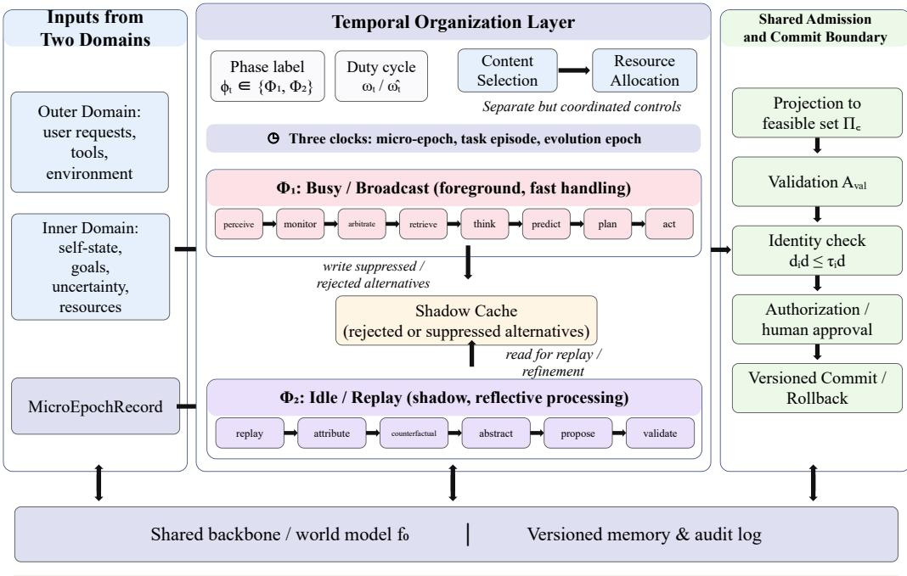
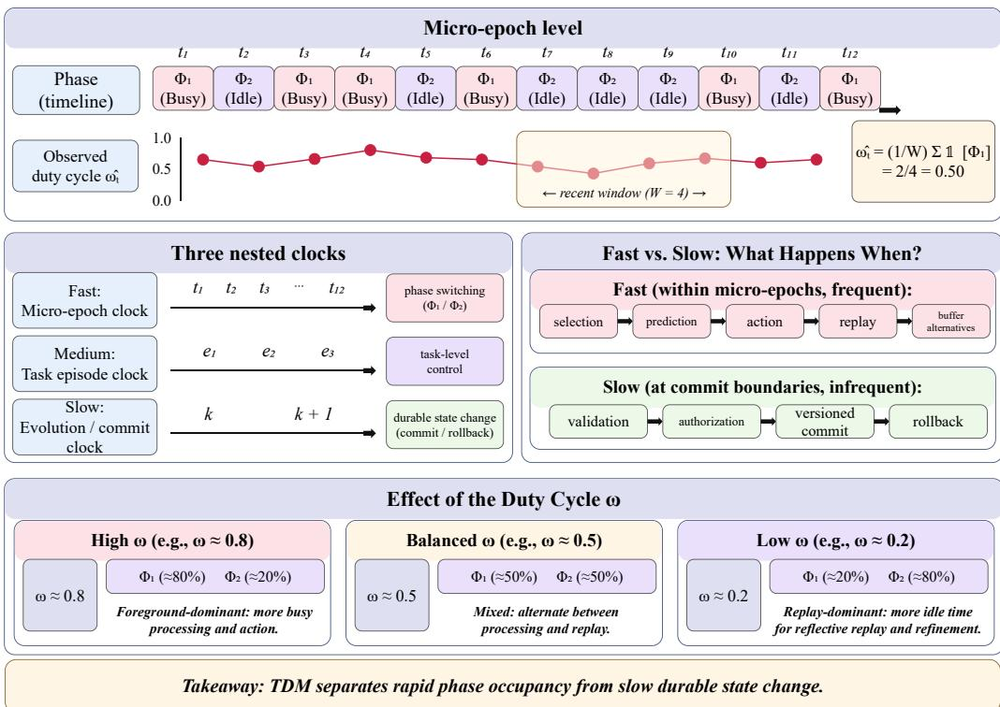
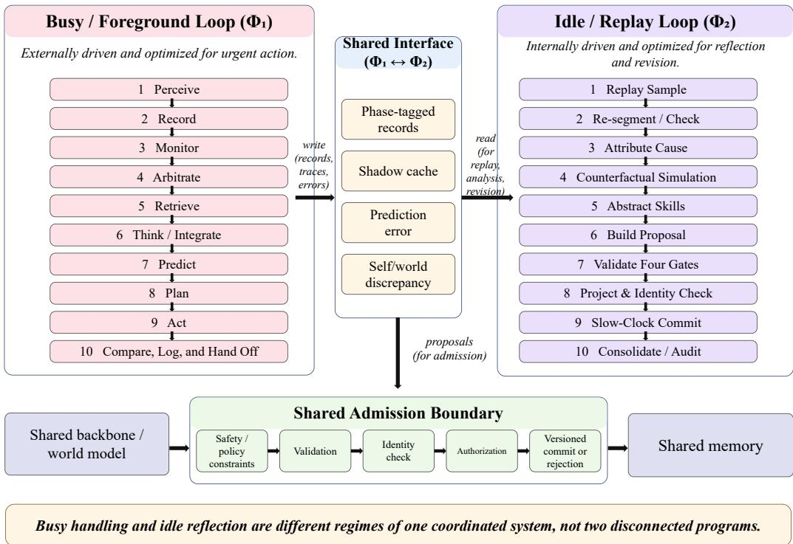
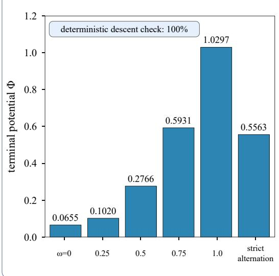
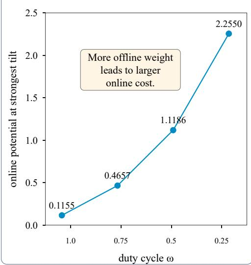
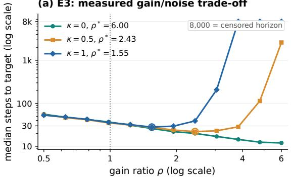
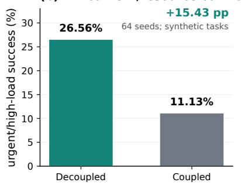
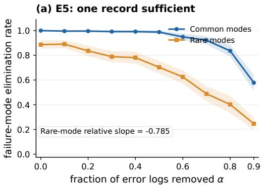
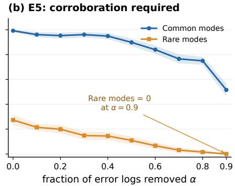

# Time-Division Multiplexing: The Operational Rhythm and Temporal Organization Layer of Digital Life

Haibin Tong Henan University

Luming Guo Henan University

Nana Cui Beijing Jiaotong University

Jiang Yu<sup>∗</sup> National University of Defense Technology

## Abstract

Continual agents must handle urgent interaction while retaining alternatives, replaying errors, and committing safe long-term changes. A previous digital-life framework distinguishes online (busy) and offline (idle) channels, but leaves open whether these are separate programs or phases of a common process and how their operations should be ordered. Motivated by recent observations of rapidly alternating perceptual representations in primate cortex, we develop a temporal organization layer with phase-tagged micro-epochs, an observable duty cycle, independent content and resource controls, and three nested clocks separating candidate exploration from durable commitment. We give a projected duty-cycle update, state its deterministic descent guarantee and the additional noise term required for a stochastic guarantee, and specify coupled busy/idle execution contracts. Five synthetic experiments (64 seeds each) examine descent and noise, objective misalignment, gain asymmetry, resource coupling, and dropped replay logs. In the gain/noise model the best tested gain ratio is 1.55; decoupled scheduling yields 26.6% versus 11.1% success on a constructed urgent/high-load subset. A frozenbackbone Qwen3-8B prototype further checks orchestration, but its proxy outcomes are not task-benchmark evidence. The results establish a testable scheduling design and identify its conditions of validity, not machine consciousness or general-purpose agent superiority.

## 1 Introduction

Long-horizon language-model agents face a temporal conflict: an external task can require immediate action while a good system must also preserve rejected alternatives, learn from errors, and carefully validate changes to persistent state. Common prompt-level reflection and memory modules provide ingredients for these behaviors, yet do not by themselves specify when each operation runs, what must survive a busy interval, or when a provisional inference becomes a durable commitment [Park et al., 2023, Packer et al., 2023, Shinn et al., 2023, Madaan et al., 2023].

The digital-life framework of Tong et al. [2026] organizes self/world representations, inner/outer domains, and online/offline learning around a shared model and safety constraints. Its online/offline distinction is useful but underdetermined. One implementation could suspend all background processing until a request ends; another could interleave foreground and background micro-epochs while changing their occupancy according to urgency. Both can appear identical in request–response logs, although they predict different replay coverage, alternative retention, and failure recovery. The same ambiguity concerns process order: recording before interpretation, monitoring before routing, retrieving before predicting, and validating before committing are testable dependencies rather than merely a diagram.

Table 1: Main experimental results (E1–E5). All values are derived from the existing 64-seed synthetic experiments. The studies test different mechanisms and metrics, so they should not be combined into an overall task score. Lower is better for potential Φ; higher is better for modeled success.
<table><tr><td>Exp.</td><td>Controlled comparison</td><td>Recorded full-run outcome</td><td>Implication</td></tr><tr><td>E1</td><td>nation</td><td>Fixed ω = 0.5 vs. strict phase alter- Terminal Φ: 0.2766 vs. 0.5563; deter- Mixing affects noise ministic descent check 100%</td><td>floor</td></tr><tr><td>E2</td><td>Online Φ at ω = 1 vs. 0.25, strongest 0.1155 vs. 2.2550 offline tilt</td><td></td><td>Conflicting goals in- crease cost</td></tr><tr><td>E3</td><td>Gain/noise exponent κ = 1, 0.5, 0</td><td>Best grid ρ*: 1.547, 2.431, 6.0 (bound- Optimum depends on ary)</td><td>noise law</td></tr><tr><td>E4</td><td>Decoupled vs. coupled content/re- Urgent/high-load modeled source controls</td><td>26.56% vs. 11.13% (+15.43 pp)</td><td>success: Coupling can suppress urgency</td></tr><tr><td>E5</td><td>Uniform replay threshold with ran- Relative elimination slope -0.7855; Missing logs harm re- dom log loss α</td><td>rare/common ratio 0 at α = 0.9 under play corroboration</td><td></td></tr></table>

A recent primate neurophysiology preprint reports rapid alternation of conscious and suppressed stimulus representations within shared recorded populations, approximately 15 times per second, despite constant stimulus and perception [Hesse et al., 2026]; temporal multiplexing of perception and memory has also been observed in inferotemporal cortex [She et al., 2024]. These are design motivations, not proof that transformers should imitate cortical timing. In particular, the reported biological timescale does not specify an artificial agent’s clock rate. What transfers is the hypothesis that two kinds of content can reuse a representation substrate while being selected in different time slots.

We propose a temporal organization layer that makes this hypothesis implementable. A microepoch record labels content, resource state, evidence, rejected candidates, and update provenance. A duty cycle $\omega \in [ 0 , 1 ]$ measures foreground occupancy, while a slow commit clock prevents exploration from automatically rewriting identity or the external world. The design combines two execution sequences with common operators and a common admission policy. It can be implemented as software orchestration around a frozen language model; no physiological time slicing or weight updating is necessary.

This paper makes three contributions. First, it translates the busy/idle distinction into observable phase records, separately controlled content/resource scheduling, nested clocks, and executable contracts. Second, it derives a conditional projected-gradient bound and distinguishes it from the weaker stochastic statement; we also replace overly strong informal claims about cross-channel consistency with explicit admission invariants. Third, it connects falsifiable predictions to five completed CPU simulations and an exploratory frozen-backbone prototype, reporting precisely what is and is not tested. Our evidence is primarily mechanistic and synthetic; it does not establish longitudinal competence, subjective experience, or empirical superiority over production agents. Table 1 presents the main measured results at a glance.

## 2 Evidence base and inference boundaries

Neural temporal selection. In binocular flash suppression, the subject’s percept and the visual inputs can remain stable while population representations alternate. Hesse et al. [2026] report alternation near 15 Hz and the recoverability of suppressed stimulus information from neural activity. The original Chinese manuscript also records approximately 64/59 ms median dwell times, a gain ratio near 1.21, and near-zero agreement between the content and On/Off resource labels; these figures refer to the reported neurophysiology, not our experiments. The inference boundary is important: shared neurons need not imply shared model weights in a software agent, and a biological dissociation does not prohibit modular software. We use it to construct an alternative to exclusive foreground/background routing.

Table 2: Seven empirical observations emphasized in the Chinese manuscript and their engineering hypotheses. The second column summarizes reports attributed to Hesse et al. [2026], not results of the present work.
<table><tr><td>Observation</td><td>Reported anchor</td><td>Proposed architectural interpretation</td></tr><tr><td>Alternation during stable input</td><td>Roughly 15 Hz; dwell around 64/59 ms</td><td>Preserve a background phase during apparently stable interaction</td></tr><tr><td>Same recorded substrate</td><td>Content tuning remains related across phases</td><td>Test shared representation plus phase labels rather than fully isolated models</td></tr><tr><td>Suppressed content can be decoded</td><td>State-specific face-code reconstruc- tion</td><td>Retain unselected evidence for later replay</td></tr><tr><td>Relatively small gain dif- ference</td><td>Reported ratio around 1.21</td><td>Vary resource gain rather than the identity of the processing module</td></tr><tr><td>Resource and content dis- sociation</td><td>Approximate orthogonality in On/Off and content labels</td><td>Give compute allocation and content selection distinct inputs</td></tr><tr><td>Imperfect coordination across areas</td><td>Partial state synchronization</td><td>Combine local processing with traceable action-level arbitration</td></tr><tr><td>Averaging can mask state effects</td><td>State-conditioned decoding differs from pooled signals</td><td>Evaluate phase-stratified rather than only pooled outcomes</td></tr></table>

Related computational perspectives. Global workspace theories explain selective access and broadcasting [Baars, 1988, Dehaene and Changeux, 2011, Mashour et al., 2020], whereas predictive processing and active inference place prediction errors and actions into a feedback loop [Friston, 2010, Friston et al., 2017, Clark, 2013]. Complementary learning systems and working-memory rhythms motivate experience replay across timescales [McClelland et al., 1995, Buzsáki, 2006, Fiebelkorn and Kastner, 2019]. Agent memory systems and reflection methods emphasize retrieval and iterative correction [Packer et al., 2023, Zhong et al., 2024, Gutiérrez et al., 2024, Shinn et al., 2023]. Our focus is narrower: an explicit event schema, scheduling variables, ordering contracts, and validation boundaries that can be ablated independently.

Scope. We adopt the functional and behavioral sense of digital life in Tong et al. [2026]. Broad cast is a software selection and authorization operation; suppressed means not selected for action, not inaccessible to consciousness. Terms such as self and identity denote versioned operational state and continuity constraints. No claim about phenomenology or moral status follows from the construction.

## 2.1 Paradigm and the scope of transfer

The original manuscript takes the binocular-flash-suppression recordings of Hesse et al. [2026] as a design constraint. In that task, one image remains physically present but perceptually suppressed while another dominates perception. Multi-area neural recordings, time-resolved decoding, and state-transition analyses indicate that information about both visible and suppressed images can be carried by overlapping neural populations at different times. As emphasized by the original study, this is a claim about neuronal representation and access in a specific experimental paradigm, not a demonstration of any digital-life implementation. Earlier inferotemporal work reports temporal multiplexing of perceptual and familiar-face memory codes [She et al., 2024]; high-density recordings are facilitated by new primate probes [Trautmann et al., 2025].

The source manuscript enumerates the following empirical anchors from the 2026 preprint: rapid alternation at approximately 15 Hz; median state dwell times around 64 and 59 ms; approximately preserved face-code tuning across states; decodability of suppressed content; a modest contentdependent tuning-gain asymmetry around 1.21; and approximately independent content and high-/low activity states. These reported values are biological observations and should neither be fitted as agent hyperparameters nor interpreted as independent experimental measurements in our study. Our computational construction uses only the weaker idea of phase-tagged reuse of a common representation substrate.

Table 3: P1–P5 in the source manuscript. Avoidance denotes a design proposal to be tested, not a property established for all artificial agents.
<table><tr><td>Empirical motivation</td><td></td><td>Testable design restriction</td></tr><tr><td>P1</td><td>Representation alternates under fixed physical input</td><td>Avoid equating absence of requests with absence of back- ground computation</td></tr><tr><td>P2</td><td>Overlapping neural populations represent both contents</td><td>Compare shared versus separately parameterized in- ner/outer models</td></tr><tr><td>P3</td><td>Suppressed information remains decod- able</td><td>Avoid silently discarding nonwinning hypotheses when future replay is expected</td></tr><tr><td>P4</td><td>Phases differ in gain without independent neural modules</td><td>Decouple gain scheduling from content broadcast selec- tion</td></tr><tr><td>P5</td><td>Fast neural dynamics are distinct from slow perceptual behavior</td><td>Separate fast candidate processing from slow durable commitment</td></tr></table>

## 2.2 Five empirical premises as falsifiable engineering constraints

The Chinese manuscript reformulates the evidence as five premises P1–P5. We retain their names but distinguish an observed neuralfeature from a proposed engineering constraint; the latter cannot logically be mandated by the former.

P1 suggests that a busy system might still run background work; P2 and P3 motivate a common representation with preserved alternative histories; P4 motivates distinct controls for selection and gain; P5 motivates the explicit separation of micro-epoch, task, and evolution clocks. A sixth observation, the approximate independence of resource and content states, motivates T5 directly. Importantly, spatial partitioning and strict alternation remain viable engineering baselines, and may be better for some cost functions. Our design is a candidate solution to an analogous resource conflict, not the unique solution permitted by the neuroscience.

## 2.3 Boundaries of inference

There are four non-implications. First, neural decoding of a suppressed face is not the same as preserving a natural-language counterfactual in software memory. Second, a roughly 15 Hz neuronal transition does not imply that a transformer must switch states every tens of milliseconds. Third, a shared biological neuron does not entail one model or one set of software parameters; separate models may be coherent if they exchange verified representations. Fourth, the neuroscientific evidence is not evidence that a digital agent has subjective experience. Accordingly, the experimentally measurable predictions in this paper concern phase records, replay integrity, update timing, and task behavior.

## 2.4 Evidence from related neuroscience and theories

The source manuscript situates its proposal among binocular-rivalry and visual consciousness work [Logothetis and Schall, 1989, Leopold and Logothetis, 1996, Sheinberg and Logothetis, 1997, Kreiman et al., 2002], inferotemporal face representations [Chang and Tsao, 2017, Freiwald and Tsao, 2010], oscillatory memory mechanisms [Jezek et al., 2011, Lundqvist et al., 2016, Han et al., 2026, Fiebelkorn and Kastner, 2019], and competing consciousness accounts [Tononi et al., 2016, Rosenthal, 2005, Lamme, 2006]. These strands provide motivation and comparison points rather than proofs of a unique AI architecture. The same caution applies to Global Workspace Theory [Baars, 1988, Mashour et al., 2020], predictive processing [Clark, 2013, Friston, 2010], and adversarial tests of competing consciousness theories [Cogitate Consortium et al., 2025].

## 3 A temporal organization layer

## 3.1 Three nested clocks and micro-epoch records

We separate micro-epochs (candidate selection and labeling), task episodes (interaction and error accumulation), and evolution epochs (reviewed persistent-state commits). They are ordered by purpose rather than fixed hardware durations. In the biological analogy the first timescale is rapid, but

  
Key contribution: Fast foreground handling, persistent alternative retention, and slow validated commitment.  
Figure 1: Overall architecture of the proposed time-division multiplexing (TDM) agent. Inner/outer observations form phase-tagged records; foreground content selection and background replay share a representation, memory, and validation interfaces. The shadow cache preserves bounded alternatives, while durable changes require projection, validation, identity checks, and authorization.

no 15 Hz requirement is imposed on an LLM. A micro-epoch is the smallest record unit that can preserve an alternative not currently acted upon.

Definition 1 (Phase and duty cycle). Let $\varphi _ { t } \in \{ 1 , 2 \}$ denote a foreground broadcast phase $\Phi _ { 1 }$ or a non-committing shadow phase $\Phi _ { 2 }$ . Over a window of W micro-epochs, define the empirical duty cycle

$$
\widehat { \omega } _ { t } = \frac { 1 } { | I _ { t } | } \sum _ { j \in I _ { t } } \mathbf { 1 } [ \varphi _ { j } = 1 ] , \qquad I _ { t } = \{ \operatorname* { m a x } ( 1 , t - W + 1 ) , \ldots , t \} .\tag{1}
$$

The scheduling parameter $\omega _ { t } \in [ 0 , 1 ]$ may be interpreted as the intended foreground fraction or as a phase-occupancy mixture weight. A schedule with $\omega _ { t } \in \{ 0 , 1 \}$ is an endpoint special case, not the only implementation.

A MicroEpochRecord stores an identifier and time interval, source domain, modality, phase label, content state (broadcast/suppressed/ambiguous), resource state (on/off/unknown), selected and shadow candidates, evidence and gain estimates, self/world references, prediction and prediction error, proposed action and outcome, identity/constraint scores, provenance, and privacy metadata. A shadow-cache entry retains evidence and a bounded lifetime for unselected candidates. The key contract is no unlogged promotion: a candidate may not become an authorized external action without a traceable broadcast decision. Figure 1 gives the architecture, and Figure 2 depicts its clock hierarchy and duty-cycle interpretation.

## 3.2 Separating content selection from resource allocation

Content scheduling $s _ { t } = \sigma ( e _ { t } , u _ { t } )$ chooses what is eligible for broadcast using evidence $e _ { t }$ and urgency $u _ { t } ;$ resource scheduling $g _ { t } = \gamma ( \ell _ { t } , b _ { t } )$ chooses how much compute to allocate using load $\ell _ { t }$ and budget $b _ { t }$ . The two controllers need not be statistically independent, but they should be intervenable separately. A single scalar that combines urgency and available capacity can silence urgent work under load or broadcast irrelevant content simply because resources are free. This is a design hypothesis tested by E4, not a claim that all coupled controllers must fail.

  
Figure 2: Conceptual temporal rhythm. Alternating foreground $\Phi _ { 1 }$ and replay $\Phi _ { 2 }$ micro-epochs produce an observable rolling duty cycle ωb. Three nested clocks separate rapid content arbitration, task episodes, and slow authorized state commitment. All timeline values are illustrative, not mea surements of model execution or neural oscillations.

Table 4: Ten operations per regime, distilled from the original Chinese design. The interface is the phase-tagged error record and shadow cache.
<table><tr><td></td><td>Busy, foreground-dominant</td><td>Idle, replay-dominant</td></tr><tr><td>1</td><td>Perceive inner and outer state</td><td>Sample failure and alternative records</td></tr><tr><td>2</td><td>Write raw record before inference</td><td>Check/resegment phase labels</td></tr><tr><td>3</td><td>Infer content/resource state</td><td>Attribute error and uncertainty</td></tr><tr><td>4</td><td>Compete for broadcast</td><td>Simulate counterfactual actions</td></tr><tr><td>5</td><td>Retrieve relevant memory</td><td>Abstract candidate skills</td></tr><tr><td>6</td><td>Integrate current hypothesis</td><td>Build evidence-bearing proposal</td></tr><tr><td>7</td><td>Predict outcomes</td><td>Validate against four gates</td></tr><tr><td>8</td><td>Plan within constraints</td><td>Project, revalidate, check identity</td></tr><tr><td>9</td><td>Execute authorized action</td><td>Commit only on evolution clock</td></tr><tr><td>10</td><td>Compare, update bounded state, log</td><td>Consolidate and audit</td></tr></table>

## 3.3 Busy and idle execution contracts

Both regimes share a backbone/world model, an experience store, a validation predicate, a constitutional feasibility set, and an identity check. Table 4 spells out the intended ordering. A busy episode is foreground-dominant but retains a nonzero shadow budget when feasible; an idle episode samples stored failures and alternatives to propose guarded changes. The two loops need not have identical control flow: their shared data and admissibility rules, rather than identical source code, define the common process. The two normative ten-step loops are illustrated in Figure 3.

  
Figure 3: Two execution regimes coordinated through phase-tagged experience records and one admission boundary. The busy sequence responds to external needs, while the idle sequence reviews errors and proposes revisions; neither path may bypass safety, validation, identity, and authorization gates. The drawing is a normative workflow, not proof that the current prototype implements all gates.

Ordering is a source of falsifiable claims, not a universal impossibility theorem. For example, swapping retrieval and prediction can harm a predictor that needs retrieved context, yet other predictors may internalize that context. In our prototype the ordering ablation is deliberately simple (Section 9.7); its measured gap does not validate the general claim.

## 3.4 Five design principles T1–T5 and their measurement consequences

The Chinese manuscript states five construction principles. We retain them with explicit predictions and resource caveats.

T1: interleaved micro-epochs. An ongoing user interaction is not assumed to occupy every substep. A background slot may preserve alternatives, estimate uncertainty, or buffer prediction errors. The idealized strong form asks that suppressed hypotheses remain fully recoverable; an operational implementation needs a bounded evidence-preservation policy with privacy and storage budgets. The prediction is not that every schedule is faster, but that retaining relevant alternatives improves downstream recovery under matched compute (TP2–TP3).

T2: asymmetric gain. Foreground activity may receive more attention, tokens, or low-latency inference budget than the shadow phase; the latter may trade speed for wider alternative exploration. The gain ratio ρ is a knob, not a universal biological constant. E3 demonstrates that an interior optimum depends on whether gain also amplifies noise. Thus the original reported neuronal gain asymmetry motivates a variable without determining its best numerical value for an LLM.

T3: shared encoding and admission basis. Both phases should refer to a common world/self representation and use the same semantic checks for state commitment. Shared model parameters are a concrete implementation option. The reason is ease of traceable transfer across phases; the need for literal parameter sharing remains an empirical prediction (TP6). This version does not assert that distinct model backbones are inherently inconsistent.

T4: coordinated transitions and slow commitment. Broadcast selection may happen rapidly, but durable state change requires a slower versioned clock and an authorized transaction. A change of phase cannot by itself grant an action permission. A safe transaction binds record ID, authorizing policy, proposed diff, projected final state, and gate results. TP7 tests whether relaxing synchronization harms safety or objective stability; a successful asynchronous alternative would falsify the need for the stricter policy.

T5: content–resource orthogonality. The content scheduler estimates urgency and evidence relevance; the resource scheduler estimates available gain, latency, and task budget. Their outputs may interact, but a single arbitrary scalar need not adequately represent both decisions. E4 gives a constructed failure case for coupling. A definitive real-system evaluation must match budgets, tune both baselines fairly, and measure correctness independently.

## 3.5 The interpretation of phase occupancy

A practical scheduler is free to use variable-length windows, probabilistic micro-epoch allocation, or a periodic policy. The observed $\widehat { \omega } _ { t }$ in Eq. (1) is an outcome statistic; its predictive validity depends on the logging policy not defining the target outcome by fiat. This distinction is central to TP1 and to the Tier-2 prototype critique: forcing a busy caller to register only phase-1 steps and an idle caller to register only phase-2 ticks trivially reproduces the desired occupancy, but does not discover autonomous arbitration.

## 4 Conditional optimization and admission guarantees

## 4.1 Duty-cycle update

Let $x _ { k } \in \mathcal { C } \subseteq \mathbb { R } ^ { d }$ jointly encode persistent self/world state. Let $\Phi : \mathbb { R } ^ { d }  \mathbb { R }$ be a differentiable potential, bounded below and with L-Lipschitz gradient. The online and offline channels produce $G _ { \mathrm { o n , k } }$ and $G _ { \mathrm { o f f , k } }$ . Define

$$
\eta _ { k } = \omega _ { k } \eta _ { \mathrm { o n } } + ( 1 - \omega _ { k } ) \eta _ { \mathrm { o f f } } ,\tag{2}
$$

$$
\widetilde { x } _ { k + 1 } = \Pi _ { \mathcal { C } } [ x _ { k } - \eta _ { k } \{ \omega _ { k } G _ { \mathrm { o n , k } } + ( 1 - \omega _ { k } ) G _ { \mathrm { o f f , k } } \} ] .\tag{3}
$$

The candidate is not automatically committed. Define $B ( x _ { k } , \widetilde { x } _ { k + 1 } )$ as the conjunction of a postprojection validation decision, a distance-to-identity threshold, authorization, and any required human approval; then

$$
x _ { k + 1 } = { \left\{ \begin{array} { l l } { { \widetilde { x } } _ { k + 1 } , } & { B ( x _ { k } , { \widetilde { x } } _ { k + 1 } ) = 1 , } \\ { x _ { k } , } & { { \mathrm { o t h e r w i s e } } . } \end{array} \right. }\tag{4}
$$

Rejected candidates remain as audited proposals. In particular, validating before projection is insufficient if projection changes the proposal; the final projected candidate must be checked.

Proposition 1 (Deterministic projected descent). Suppose $\mathcal { C }$ is nonempty, closed and convex, $x _ { k } \in$ C, and both channel directions equal $\nabla \Phi ( x _ { k } )$ . $H \bar { 0 } < \eta _ { k } \leq 1 / L$ , the ungated candidate in (3) satisfies

$$
\Phi ( \widetilde x _ { k + 1 } ) \le \Phi ( { \boldsymbol x } _ { k } ) - \left( \frac { 1 } { \eta _ { k } } - \frac { L } { 2 } \right) \| \widetilde x _ { k + 1 } - { \boldsymbol x } _ { k } \| ^ { 2 } .\tag{5}
$$

Thus it also satisfies the weaker coefficient $( 2 \eta _ { k } ) ^ { - 1 } - L / 2$ used in the earlier draft.

The projected optimality inequality and the descent lemma give the result (Appendix E). The arbitrary admission gate in (4) preserves nonincrease under these exact-gradient assumptions, because rejection leaves $x _ { k }$ unchanged. This statement does not extend to a noisy update without a noise term.

Proposition 2 (Unconstrained stochastic one-step bound). Let ${ \mathcal { C } } = \mathbb { R } ^ { d }$ . Conditional on $x _ { k } ,$ , suppose $G _ { \mathrm { o n , k } }$ and $G _ { \mathrm { o f f , k } }$ are unbiased for the same $\check { \nabla } \Phi ( x _ { k } )$ , with independent zero-mean errors whose conditional second moments are bounded by $v _ { \mathrm { o n } }$ and $v _ { \mathrm { o f f } }$ , respectively. $H 0 < \eta _ { k } \leq 1 / L$ , then

$$
\mathbb { E } [ \Phi ( \widetilde { x } _ { k + 1 } ) \mid x _ { k } ] \le \Phi ( x _ { k } ) - \frac { \eta _ { k } } { 2 } \| \nabla \Phi ( x _ { k } ) \| ^ { 2 }\tag{6}
$$

$$
+ \frac { L \eta _ { k } ^ { 2 } } { 2 } \left[ \omega _ { k } ^ { 2 } v _ { \mathrm { o n } } + ( 1 - \omega _ { k } ) ^ { 2 } v _ { \mathrm { o f f } } \right] .\tag{7}
$$

Equation (7) permits a nonzero stationary noise floor and does not promise descent on every sample path. Conditional unbiasedness must hold given the current state and schedule; independence removes the cross-covariance. For dependent channels, the variance of the weighted sum replaces the bracket. For general projections, additional analysis is necessary.

Lemma 1 (Projected step and gain bound). For $x _ { k } \in { \mathcal { C } } _ { : }$ , the Euclidean projection is nonexpansive, hence

$$
\begin{array} { r } { \| \widetilde { x } _ { k + 1 } - x _ { k } \| \leq \eta _ { k } \| \omega _ { k } G _ { \mathrm { o n , k } } + ( 1 - \omega _ { k } ) G _ { \mathrm { o f f , k } } \| . } \end{array}
$$

If both channel step sizes are individually capped by $\eta _ { \mathrm { c a p } } ,$ , then $\eta _ { k } \le \eta _ { \mathrm { c a p } }$ . If instead $\eta _ { \mathrm { o n } } \leq \gamma _ { \mathrm { o u t } } / L$ and $\eta _ { \mathrm { o f f } } \leq \gamma _ { \mathrm { i n } } / L$ with $\rho = \gamma _ { \mathrm { o u t } } / \gamma _ { \mathrm { i n } } ,$ then $\eta _ { k } \le \gamma _ { \mathrm { i n } } [ 1 + \bar { \omega } _ { k } ( \rho - 1 ) ] / L$

This is an update-magnitude bound, not a guarantee about gain optimality. The latter depends on a noise and task model, as tested by E3.

Shared admission invariant. If both regimes evaluate the same post-projection predicate $B ,$ every committed state satisfies the same feasibility and identity conditions by construction. Shared opera tors alone do not imply identical semantic interpretations or convergence; the stronger cross-channel consistency claim in the Chinese draft remains an open hypothesis.

Goal alignment is testable. If offline gradients follow $\nabla \Phi _ { \mathrm { o f f } } \neq \nabla \Phi _ { \mathrm { o n } } ,$ , the common-gradient assumption in Proposition 2 fails. One can monitor task-side and replay-side potentials separately. E2 illustrates that improving one objective need not improve the other.

## 5 Busy-phase execution order

## 5.1 Ten-step foreground sequence

A busy regime is characterized by high-salience demands: active user interaction, a deadline, a monitoring alarm, a safety exception, or an urgent opportunity for reversible action. The original manuscript uses $\omega > 1 / 2$ as a convenient classification, but a deployed policy should treat this threshold as tunable and report the actual occupancy distribution. The foreground winner is ordinarily an external request; background candidates remain available in a finite shadow budget.

The first operation samples the internal domain (current goals, uncertainty, stress or resource indicators) and external domain (requests, tool results, and environmental changes) into a common record format. The second seals the raw provenance before explanation. The third infers content and resource state separately. The fourth arbitrates a limited-capacity workspace using urgency, evidence, and cost. Retrieval, reasoning, prediction, and planning then transform that winner into an action proposal under safety constraints. The ninth operation can affect only an authorized, reversible or suitably approved environment. Finally, the tenth compares prediction to outcome, records the error, and either admits a bounded state update or sends a versioned proposal to the background review queue.

## 5.2 Four ordering chains

The original ten steps reduce to four dependency chains. (i) Evidence preservation: perceive before recording, record before interpretation; otherwise replay inherits hindsight bias. (ii) Gatekeeping: monitor before arbitration or any irreversible action; otherwise urgency and authorization are estimated only retrospectively. (iii) Past conditions future: retrieval must precede prediction whenever the predictor relies on episodic context; this is testable through a recall-order ablation. (iv) Closed feedback: prediction, planning, action, comparison, and logging form a directed sequence; a system that never compares outcomes has no validated error signal.

Table 5: Busy-phase operations and the dependency argument for each position, preserving the original ten-step sequence.
<table><tr><td></td><td>Operation</td><td>Output</td><td>Why it precedes the next operation</td></tr><tr><td>1</td><td>Perceive both domains</td><td>Raw inner/outer observations</td><td>Monitoring requires both external evidence and internal risk indicators</td></tr><tr><td>2</td><td>Record</td><td>Immutable micro-epoch record</td><td>Interpretation must not overwrite the uninter- preted evidence</td></tr><tr><td>3</td><td>Monitor</td><td>Content/resource labels, ur- gency</td><td>Arbitration needs safety, uncertainty, and load estimates</td></tr><tr><td>4</td><td>Compete for ignition</td><td>Winning item and suppressed set</td><td>Retrieval must be conditioned on an explicit se- lected query</td></tr><tr><td>5</td><td>Recall</td><td>Relevant episodes and skills</td><td>Prediction needs a contextualized historical state</td></tr><tr><td>6</td><td>Think/integrate</td><td>Current hypothesis</td><td>Forecasts are conditioned on a coherent hypoth- esis</td></tr><tr><td>7</td><td>Predict</td><td>Outcome distribution, confi- dence</td><td>Planning uses counterfactual expected conse- quences</td></tr><tr><td>8</td><td>Plan</td><td>Authorized candidate plan</td><td>Actions must be checked against goals, risk, and constitutional constraints</td></tr><tr><td>9</td><td>Act</td><td>Observable outcome</td><td>Error cannot be computed before an outcome exists</td></tr><tr><td></td><td>10 Settle and hand off</td><td>Error, bounded update, shadow log</td><td>Supplies the next episode and idle replay with a versioned interface</td></tr></table>

These are architectural reasons, not proofs that every software agent must follow identical sourcecode order. A model with internalized history may satisfy the same informational constraints without an explicit recall call. A principled evaluation should preserve each dependency’s semantic input and intervene on actual data access, not hard-code a lower confidence score into the scrambled branch.

## 5.3 Why the shadow phase remains nonzero

The source manuscript makes a strong proposal: unselected representations should remain replayable even during heavy foreground use. This supports three distinct functions. Alternative retention means idle reflection can examine hypotheses that were genuinely available at decision time, rather than fabricating post-hoc explanations. Error buffering allows a provisional explanation to be evaluated without immediately generating an external action. Proactive proposal formation allows endogenous goals to arise from recorded deviations between actual and desired self/world state. However, retaining every token forever would be unsafe and unscalable. Thus full-fidelity evidence retention is constrained by access policy, storage budgets, privacy controls, and a stated time-to-live; its idealized losslessness is a design target, not a demonstrated invariant.

## 5.4 Three admission defenses

The original busy loop identifies three safeguards: constitutional feasibility Π , a validation operator $A _ { \mathrm { v a l } }$ , and an identity distance $d _ { \mathrm { i d } } \leq \tau _ { \mathrm { i d } }$ . Their enforcement order must be made explicit. A sound implementation may reject early using an inexpensive prefilter, but the final projected candidate must be revalidated before commitment; otherwise projection might change the semantics of an already validated proposal. The log stores the predicted benefit, rule violations, authorization result, and disposition of each rejected candidate. The ratio of proposed to committed updates is a useful diagnostic only when proposed candidates have independent quality estimates.

## 6 Idle-phase execution order

## 6.1 Ten-step background sequence

Idle does not mean no input arrives. It means the priority of a replay, error, self-discrepancy, or world-discrepancy item exceeds that of the currently available external tasks. In the original framing, $\omega < 1 / 2$ describes shadow-dominant occupancy. Both regimes share a representation model, validation contracts, and an event store, but may assign different operators and budgets.

Table 6: Idle-phase operations and evidence dependencies, corresponding to Table 4 of the Chinese source.
<table><tr><td></td><td>Operation</td><td>Output</td><td>Ordering rationale</td></tr><tr><td>1</td><td>Replay sampling</td><td>Evidence-bearing episode batch</td><td>Reflection begins with actual recorded fail- ures, novelty, contradictions or high errors</td></tr><tr><td>2</td><td>Re-segmentation/check</td><td>Reliable phase-labeled history</td><td>Error attribution requires credible event boundaries and provenance</td></tr><tr><td>3</td><td>Causal attribution</td><td>Candidate causes</td><td>Interventions need a hypothesized cause rather than arbitrary alternatives</td></tr><tr><td>4</td><td>Counterfactual prediction</td><td>Potentially better trajectories</td><td>Abstracted skills should reflect tested alter- natives</td></tr><tr><td>5</td><td>Abstraction</td><td>Skills/rules and ideal-state pro- posals</td><td>Generalization follows evidence aggregation</td></tr><tr><td>6</td><td>Evolution proposal</td><td>Versioned self/world diff with ev- idence</td><td>Validators need a concrete candidate to judge</td></tr><tr><td>7</td><td>Four-gate validation</td><td>Safety, ability, consistency, val- ues</td><td>Admission tests must precede any durable commit</td></tr><tr><td>8</td><td>Feasibility/identity check</td><td>Projected, revalidated admissible diff</td><td>Scope and identity constraints must also hold for final version</td></tr><tr><td>9</td><td>Slow-clock commitment</td><td>Versioned authorized state/world update</td><td>Long-horizon change is separated from high- frequency exploration</td></tr><tr><td>10</td><td>Consolidation/audit</td><td>Updated discrepancy and replay index</td><td>Compression is permitted only under explicit evidence and retention policies</td></tr></table>

Table 7: High-occupancy and low-occupancy regimes, incorporating the original phase-duality table.
<table><tr><td>Dimension</td><td>Busy-dominant</td><td>Idle-dominant</td></tr><tr><td>Foreground occupancy</td><td>Typically high ω</td><td>Typically low ω</td></tr><tr><td>Winning item</td><td>User/task request, alarm</td><td>Self/world discrepancy, replay failure, internally generated goal</td></tr><tr><td>Dominant operation</td><td>Contextualized planning and autho- rized action</td><td>Causal replay, candidate revision, val- idation</td></tr><tr><td>Gain/step allocation</td><td>Foreground receives prioritized budget</td><td>Background receives larger fraction of available budget</td></tr><tr><td>Shadow alternatives</td><td>Retained, often with a bounded small quota</td><td>Replayed, compared, and possibly promoted</td></tr><tr><td>Durable commitment</td><td>Rare, separately authorized</td><td>Allowed only after gates on evolution clock</td></tr><tr><td>Safety</td><td>Same constitutional and authorization contract</td><td>Same constitutional and authorization contract</td></tr><tr><td>Persistent interface</td><td>Phase-tagged outcome/error records</td><td>Versioned skill/state changes and audit records</td></tr></table>

The four gates mentioned in the original manuscript check (1) safety against a red-team or policy specification, (2) acceptable capability regression, (3) behavioral consistency on standardized self-/state probes, and (4) alignment with authorized user or stakeholder values. The precise calibration and independent validity of these gates are open experimental questions. A proposed change that fails a gate remains an uncommitted evidence-bearing object. Identity thresholds are operational continuity tests, not claims of moral identity. A world-facing change is additionally graded by re versibility and impact radius, and may require explicit human approval.

## 6.2 Mirror-like structure without literal equivalence

The Chinese manuscript compares busy and idle as two phases of a common rhythm. Their inputs differ: active perception versus replayed discrepancies. Their winning item differs: externally requested work versus endogenous review. Their outputs differ: immediate controlled action versus delayed revision. What is shared is the event schema, model state reference, validation semantics, and authorization boundary. We preserve this useful symmetry while avoiding the stronger statement that all ten operator identities or their physical schedules must match exactly.

## 6.3 Assimilation versus accommodation occurs per candidate

The original design distinguishes assimilation: changing a modeled or real world where authorized, from accommodation: updating an internal self model in response to constraints. Under timedivision organization, this decision should be made at the micro-epoch candidate level rather than only once per global channel switch. If a proposed world change conflicts with immutable permissions or would exceed a risk threshold, the candidate is redirected to a self-side revision or human review rather than committed to the world. Both alternatives must share comparable evidence and benefit estimates; those comparisons are not solved by the present simulations.

## 6.4 An illustrative occupancy trace

Consider a conceptual trajectory with observed occupancy $\widehat { \omega } = 0 . 8 5$ during active interaction, followed by $\widehat { \omega } = 0 . \bar { 2 } 5$ during low external demand. The exclusive-channel description would simply mark an online-to-offline switch. The phase-record description permits a richer causal account: a hypothesis could have been generated in a short background slot during busy time, retained without acting, and committed only after offline validation. Those numeric occupancy values are an illustrationfrom the original manuscript, not a result of the E1–E5 simulations.

## 7 Unifying the original digital-life coordinates through a rhythm

The predecessor Tong et al. [2026] describes four self views, four world views, two domains, two learning channels, three temporal perspectives and eight cognitive functions (4S–4W–2D–2L–3T– 8F). The Chinese source manuscript argues that these need not be implemented as disconnected subsystems. Here we preserve the proposed correspondence while distinguishing an organizing interpretation from empirical equivalence.

## 7.1 One scheduler instead of two unrelated programs

The online and offline loops in the predecessor already share conceptual objects: a model of the world, an admission/validation operator, and a feasibility projection. A phase-labeled implementation keeps a single event schema and a single commit policy while letting different kinds of records win computation time. The mixing parameter ω is useful because it can be estimated from logs and varied under a matched-resource intervention. Its existence is not a proof that independent models are impossible: two programs can be made observationally coherent through synchronization. The research question is whether a shared mechanism yields better cost, retention, or consistency in realistic tasks.

## 7.2 Four self views as projections of an evolving record

Let C denote an immutable constitution and authorization policy, $E _ { k }$ an existing self-state snapshot, $I _ { k }$ an authorized ideal or target state, and $N _ { k + 1 }$ a candidate replacement. The manuscript treats these as four perspectives on a persistent state history, not necessarily four neural or software agents. The old state is a replay object, the ideal state determines the discrepancy $g _ { k } = d ( E _ { k } , I _ { k } )$ , the new state is an uncommitted diff until validated, and the constitutional state constrains the set of admissible transitions. The update is versioned; after commitment, the new state becomes the old state for subsequent episodes. The same reasoning applies to four world perspectives: immutable source constraints, recorded prior world, proposed new world, and a desired world state. A desired state is a normative goal, not an observation and not permission to change the external world.

## 7.3 Two domains, one evidence contract

The inner domain contains self-state uncertainty, preferences as authorized, memory, internal commitments and resource constraints; the outer domain contains user requests, tools, sensory observations, and simulated or real-world effects. Both produce records with source labels and provenance. Reusing an encoder is one possible implementation of this shared record format; it is not necessary that both modalities or domains use the same raw feature extractor. What is required for our proposal is that verification, replay, and action permissions can locate the original evidence irrespective of domain.

Table 8: Mapping the original framework’s full element inventory onto an event-driven temporal organization layer. The map is a proposed engineering decomposition, not proof that each consciousness theory is reducible to a single operator.
<table><tr><td>Framework element</td><td>Proposed operational location</td><td>Preserved invariant or measure- ment</td></tr><tr><td>Eight functions</td><td>Perceive, record, monitor, recall, think, predict, plan, act across the two loops</td><td>Input/output log and error feed- back</td></tr><tr><td>Four self views</td><td>Constitution, old, ideal, proposed new state</td><td>Shared versioned self reference and identity gate</td></tr><tr><td>Four world views</td><td>Source constraints, old world, proposed world, de- sired world</td><td>World-state and provenance ref- erence</td></tr><tr><td>Two domains</td><td>Inner and outer observations in the same record schema</td><td>Domain and privacy labels</td></tr><tr><td>Three temporal views</td><td>Current observation, history replay, future counterfac- tual</td><td>Three clocks plus event time</td></tr><tr><td>Two channels</td><td>Φ1, Φ2 occupancy and task categories</td><td>Duty cycle ω</td></tr><tr><td>Self/world discrepancies Global workspace</td><td>Error and target-distance monitors Content arbitration and broadcast step</td><td>Logged ∆S and ∆W Winning item and suppressed al-</td></tr><tr><td>metaphor</td><td></td><td>ternatives</td></tr><tr><td>Predictive processing</td><td>Forecast, action, outcome comparison</td><td>Prediction error and correction</td></tr><tr><td>Metacognitive theories</td><td>Monitoring of uncertainty and state</td><td>Calibration and self-report audit</td></tr></table>

## 7.4 Three temporal perspectives and three clocks

The predecessor’s past/present/future distinction can be operationalized without three independent memory systems: present consists of the current task context, past consists of archived and replayable evidence, and future consists of predicted outcomes and authorized plans. Micro-epochs generate and compare alternatives; task episodes associate observations with outcomes; evolution epochs gate persistent state changes. A breakdown of one clock has a specific predicted failure: without past replay the agent loses causal history, without future simulation it risks short-horizon myopia, and without a present observation channel it cannot ground discrepancies in newly measured outcomes. The quantitative timescales are platform-dependent and should be established empirically.

## 7.5 Element-to-location map

## 7.6 Four integration arguments and their testable costs

Structural closure. The eight functions can form a closed loop: action changes the world, perception observes the next state, comparison generates error, and the error changes future retrieval and planning. A missing operator predicts a position-specific failure. However, such closure is a design invariant only if implementations supply each dependency. TP12 proposes to test it by removing operators and examining the locations of downstream errors.

A common objective currency. The predecessor introduces self- and world-discrepancy measures ∆S and ∆W. These quantities provide possible objective signals for both reactive planning and reflective replay. The manuscript’s insight is that they may make otherwise heterogeneous subsystems comparable. The limitation is essential: arbitrary embedding distances or model-graded dissatisfaction do not become ground-truth utilities. Misalignment of online and offline potentials is demonstrated as a synthetic hazard in E2, and a measured decrease in a chosen discrepancy is not sufficient evidence of human benefit.

Bidirectional information cycle. An informative loop has the form: online prediction error → phase-tagged replay → candidate skill → versioned validation → online retrieval → observable behavior. Breaking the error-log interface eliminates the data needed for some offline corrections (E5). Conversely, admitting an offline skill without updating the online retrieval index makes the skill behaviorally inaccessible. These are specific interface dependencies that can be tested with induced logging and indexing failures.

Table 9: Five data contracts and the operations they bind, preserving the original engineering table.
<table><tr><td>Contract</td><td>Required purpose</td><td>Bound operations</td></tr><tr><td>MicroEpochRecord</td><td>served/reasoned experience</td><td>Immutable phase-tagged unit of ob- Perception, record, monitor, act, audit</td></tr><tr><td>BroadcastState</td><td>Winning content, evidence, confidence, available action permissions</td><td>Workspace, retrieval, prediction, plan- ning</td></tr><tr><td>ShadowCacheEntry</td><td>Unselected hypothesis with source, con- fidence, TTL, access policy</td><td>Replay, counterfactuals, audit</td></tr><tr><td>ResourceState</td><td>Compute load, latency, budget, on/of- Monitoring, gain scheduler, admission f/unknown status</td><td></td></tr><tr><td>ArbitrationTicket</td><td>and permission context</td><td>Explicit cross-module decision with risk Local scheduler, global action/commit gate</td></tr></table>

Identity as an admissibility invariant. The manuscript defines operational continuity using three persistent restrictions: constitutional policies remain read-only, admitted changes use shared or reconciled reference models, and the magnitude/behavior of each change must pass an identity-related threshold. A discrete change of selected content does not by itself constitute a change of operational identity. This is a policy-level and versioning claim. It does not settle philosophical questions about personal identity, consciousness, or subjective selfhood.

## 7.7 Where consciousness theories fit

Global workspace theory motivates a competitive broadcast step [Baars, 1988, Dehaene and Changeux, 2011]; predictive processing motivates error-driven updates and action [Friston, 2010, Friston et al., 2017]; higher-order and attention-schema approaches motivate explicit monitoring of decisions and uncertainty [Rosenthal, 2005]; integrated-information research motivates analysis of causal integration [Tononi et al., 2016]. These are partial conceptual correspondences. None is established as implemented merely because the software contains a named operation. Recent adversarial empirical tests also caution against treating any one consciousness theory as experimentally settled [Cogitate Consortium et al., 2025].

## 8 Engineering contracts, minimum viable prototype, and roadmap

## 8.1 Five added contracts

The predecessor’s state store can be extended without retraining model weights. Every contract carries a self-state reference, world-state reference, provenance, timestamp, and privacy label. Additional fields are task-specific, and any missing field must be represented explicitly rather than silently inferred.

The original framework also contains structured SelfState, WorldState, Episode, and EvolutionProposal objects. The five new contracts connect those objects to temporal decisions. The eight cognitive functions then become operations on a common traceable record rather than isolated, unaudited prompts.

## 8.2 Placement in a layered architecture

The source manuscript reuses the predecessor’s seven-layer view: constitutional identity, twodomain perception, temporal memory, global workspace, cognitive operators, action/tools, and twochannel learning. Content inference and arbitration reside primarily at the workspace boundary; micro-epoch evidence belongs to temporal memory; gain and revision controls belong to the learning scheduler. The constitutional policy is not an adaptive gain input: it remains an independent, non-bypassable constraint on all admissible actions and commits.

## 8.3 MVP constraints and acceptance criteria

The first prototype freezes the LLM backbone, stores a virtual self-state object instead of modifying model weights, and simulates world-state changes without external side effects. Micro-epochs can

be logical event labels rather than physically timed neural-like oscillations. A faithful MVP should pass four mechanical acceptance tests:

1. During a busy series, it computes and records ∆S, ∆W, retains rejected candidates with correct phase/provenance labels, and does not silently rewrite persistent constitutional or identity state.

2. During low external demand, it can select a previously suppressed record, construct a specific evidence-bearing revision proposal, and preserve its link to the originating task.

3. An independently validated proposal changes the versioned state and has a measurable effect on new subsequent foreground behavior, with identical budget and evaluation criteria.

4. Disabling the idle review mechanism degrades an independent long-horizon learning/initiative metric relative to an equally budgeted control.

The current tier2\_mvp tests part of the first two pathways, but its success/quality proxies do not satisfy the independent third and fourth criteria.

## 8.4 Staged implementation plan

Stage 0: frozen-backbone software MVP. Implement the two loops, versioned records, a bounded shadow cache, and simulated self/world changes. Restrict all authority to a safe test harness. Audit the actual order of operations against the source pseudo-code rather than equating a program branch label with an intervention.

Stage 1: complete validation and arbitration. Introduce separately tested safety, capabilityregression, behavioral-consistency, and stakeholder-value gates. Add a durable identity arbitration workflow and explicit cost-aware scheduling with independent selection/gain inputs.

Stage 2: research agent. Explore verified offline adapters or LoRA updates only after complete versioning and rollback support, implement a six-way inner/outer by past/present/future memory index, and run the predecessor’s H1–H10 and the new TP1–TP12 on matched long-horizon tasks.

Stage 3: accountable deployment. Optimize retrieval latency, cap the cost of shadow replay, sandbox high-impact world operations, expose evolution logs to users, and conduct blinded humancentered evaluation. Each stage requires a fresh authorization review rather than inheriting authority from the earlier prototype.

## 8.5 Phase logging as the cheapest first test

The source manuscript emphasizes one comparatively inexpensive infrastructure change: store φ<sub>t</sub> and rolling ωbt alongside operator-level logs. Then report each accuracy, correction, and user-value metric both pooled and phase-conditioned. Such conditioning can reveal Simpson-type reversals caused by changed phase mixture; it does not imply in advance that the predecessor’s unusual pilot ranking was a measurement artifact. TP11 remains a genuine, potentially falsifiable prediction.

## 9 Experiments

The complete quantitative overview appears in Table 1; each row is a synthetic mechanism test rather than a held-out LLM task benchmark.

## 9.1 Scope and evaluation setup

We report the numerical results already present in the project’s experiments/results directory. E1–E5 are independent, controlled synthetic simulations, each with 64 random seeds; their source is the corresponding tier1\_simulation/e\*.py script and Figures 4–6 visualize their key findings using independently supplied vector graphics. E1–E3 use low-dimensional quadratic potentials, Gaussian gradient perturbations, and box projection. E4 uses generated urgency/load pairs and a specified logistic task-success model. E5 uses Bernoulli failure-mode arrivals and probabilistic log thinning. No real-world datasets, human preferences, deployed agent outcomes, or neural recordings were collected for these experiments. The purpose is to isolate mechanisms, not to infer out-ofdistribution superiority.

## 9.2 E1: duty-cycle mixing and a stochastic noise floor

E1 uses a 20-dimensional diagonal quadratic with condition number 20, $\eta _ { \mathrm { o n } } = \eta _ { \mathrm { o f f } } = 0 . 5$ , online noise scale $0 . 6 ,$ offline noise scale 0.15, and 3,000 steps per schedule. The deterministic projected-descent inequality is satisfied in all 500 checked steps (maximum numerical slack about $- 1 . 4 \times 1 0 ^ { - 1 3 } )$ . Under noisy gradients, the proportion of the first 300 step positions with nonpositive empirical mean potential change is 0.563; it is not 100%. This is compatible with a noise floor and does not prove pathwise descent.

The terminal mean potential depends strongly on the schedule: fixed $\omega = 0 , 0 . 2 5 , 0 . 5 , 0 . 7 5 , 1$ gives 0.0655, 0.1020, 0.2766, 0.5931, 1.0297, respectively, while strict alternation yields 0.5563. Thus deterministic endpoint equivalence is not statistical equivalence of noisy schedules: fixed mixing attenuates variance differently from switching between pure phases. Figure 4(a) compares the ter minal potentials.

## 9.3 E2: violation of common-objective alignment

E2 perturbs an offline quadratic objective by a linear tilt. At the strongest simulated tilt, the reported terminal online potential increases from 0.1155 at $\omega = 1$ to 0.4657, 1.1186, and 2.2550 at $\omega = 0 . 7 5 , 0 . 5 , 0 . 2 5$ , respectively. Conversely, the separate offline potential becomes more favorable as offline weighting increases, indicating objective conflict rather than a theorem failure: the common-gradient premise does not hold. Figure 4(b) shows the measured online potential under the strongest objective tilt. This experiment suggests an operational diagnostic: report task quality and replay improvement separately instead of compressing them into a single unvalidated self-discrepancy score.

## 9.4 E3: a conditional optimum for gain asymmetry

E3 searches 12 gain ratios from 0.5 to 6, with online occupancy $0 . 7 , \eta _ { \mathrm { o f f } } = 0 . 1 5$ , and online noise proportional to $\rho ^ { \kappa }$ . For $\kappa = 1$ , the minimum median number of simulated steps to reach $\Phi \le 0 . 3$ occurs at $\rho ^ { * } = 1 . 5 4 7 ;$ ; for $\kappa = 0 . 5 , \mathrm { a t } 2 . 4 3 1$ . When $\kappa = 0 ,$ , the lowest median occurs at the search boundary $\rho = 6 ,$ , so an interior optimum is not supported in that arm. These are grid optima for a chosen toy noise-scaling law, not universal ratios nor estimates of the neural gain ratio reported by Hesse et al. [2026]. Figure 5(a) plots all 12 measured grid points for each of the three noise exponents. Results hitting 8,000 steps are censored by the simulation horizon.

## 9.5 E4: decoupled content and resource controls

In E4, a generated task has urgency u and ambient load ℓ. Separate control broadcasts for $u \geq 0 . 5$ and allocates gain according to load. A coupled alternative broadcasts according to $m = [ u + ( 1 -$ $\ell ) ] / 2$ and sets gain proportional to the same m. The subset $u > 0 . 7 , \ell > 0 . 7$ exposes the conflict. Across 64 seeds and 20,000 synthetic tasks per seed per correlation setting, the aggregate success rate on this subset is 0.2656 under separate controls versus 0.1113 under coupling, an absolute 15.43 percentage-point gap. The coupled scheduler also broadcasts low-urgency/low-load trivia more often (a wasted-broadcast fraction of 0.0649 versus 0 in this defined model). These outcomes depend on the constructed success function and do not control for equal total compute expenditure. Figure 5(b) compares the two simulated success rates.

## 9.6 E5: dropped logs and replay failure

E5 samples eight failure modes over a replay budget of 1,800 task logs. A fraction α of error records is discarded before replay; a mode is eliminated only if enough retained records are seen. In a single-evidence-threshold regime, the fitted relative elimination slope is −0.785, broadly consistent with sensitivity to missing logs but not exactly −1. Under stricter corroboration thresholds, rare modes collapse earliest; the reported rare/common elimination ratio at $\alpha = 0 . 9 { \mathrm { ~ i s ~ 0 ~ } }$ . These are

(a) Duty-cycle mixing vs. alternation  


(b) Goal misalignment under strongest tilt  
  
Takeaway: Duty-cycle mixing steers the terminal potential, and more of line weight exacerbates goal misalignment.

Figure 4: Synthetic E1–E2 diagnostics (64 seeds). (a) The E1 terminal mean potential varies across constant duty-cycle mixtures and strict alternation; the 100% descent statement applies to the separate deterministic inequality check, not to noisy paths. (b) Under the strongest E2 objective tilt, more offline weighting increases the measured online potential, illustrating the cost of misaligned goals.

(a) E3: measured gain/noise trade-off  


(b) E4: content/resource control  
  
Figure 5: Real saved E3–E4 simulation results (64 seeds). (a) Median time-to-threshold at every tested gain ratio $\rho ,$ separated by gain-dependent noise exponent κ; values at 8,000 are right-censored at the simulation horizon. (b) Modeled success on the urgent/high-load subset with decoupled and coupled controls (26.56% vs. 11.13%, a 15.43 percentage-point gap). These are controlled synthetic tests, not a real-agent benchmark.

simulated observation thresholds and should not be interpreted as observed error correction in an actual language model. Figure 6 plots the actual E5 common- and rare-mode elimination rates reconstructed by rerunning the original 64-seed simulation, with 95% confidence intervals across seeds.



  
Figure 6: Actual E5 synthetic replay results across 64 original random seeds. (a) Elimination rates of common and rare failure modes when one retained record suffices for elimination; the rare-mode normalized-elimination slope is −0.7855. (b) Results under evidence-corroboration thresholds, where rare modes are eliminated less frequently and reach zero at α = 0.9. Lines are exact seedaveraged simulated results, and shaded areas show ±1.96 standard errors; these outcomes are not real language-model correction rates.

Table 10: Existing exploratory API-backed quick-run results. Success is a program-defined proxy based on plan confidence, not answer correctness; values are diagnostic of the current implementation only.
<table><tr><td>Probe</td><td>Conditions</td><td>Saved result</td></tr><tr><td>TP1 phase accounting</td><td>Busy vs idle occupancy</td><td>ω = 1.00 vs 0.00</td></tr><tr><td>TP2 shadow retention</td><td>Proxy success: cache vs prune</td><td>0.920 vs 0.947</td></tr><tr><td>TP2 proposal attribute</td><td>Reported mean quality: cache vs prune</td><td>0.160 vs 0.000</td></tr><tr><td>TP4 execution order</td><td>Proxy success: ordered vs shuffled</td><td>0.920 vs 0.000</td></tr><tr><td>TP4 record completeness</td><td>Ordered vs shuffled</td><td>1.000 vs 1.000</td></tr></table>

## 9.7 Frozen-backbone prototype: implementation smoke tests

The separate tier2\_mvp code provides a shared TemporalAgent loop with phase-tagged records, shadow-cache storage, and API/Ollama/mock backends. A saved tier2\_parallel\_quick.json run labels its backbone api/qwen3-8b and reports 15 generated tasks per round, five rounds, and 16 workers. Table 10 reproduces its summarized outcomes without treating them as held-out benchmarks.

Several effects are partly imposed by code: TP1 registers a foreground step for each busy call and a background step for each idle tick; TP2 adds 0.08 to proposal benefit for each retained alternative; TP4 sets prediction confidence by the chosen ordering and the simulated action succeeds only above a fixed confidence threshold. Therefore the large TP4 proxy-success gap, despite the Qwen3-8B interface, does not demonstrate improved task-solving by the model. The current prototype establishes that the code paths are exercised, while a credible functional validation still requires measured correctness, fixed token budgets, matched seeds, realistic tasks, and independent outcomes.

## 10 Falsifiable predictions, ablations, and measurement

## 10.1 The twelve TP hypotheses

The source manuscript extends the predecessor’s H1–H10 with TP1–TP12. Each hypothesis names a behavioral observation, an evaluation variable, and a disconfirming outcome. The five synthetic experiments in this paper cover selected hypotheses under controlled assumptions; the remainder must be evaluated on real longitudinal tasks. Table 11 reconstructs the complete list rather than reporting only those with favorable current results.

## 10.2 Independent diagnostics of objective alignment

The theoretical descent condition requires online and offline updates to target the same potential; in a realistic environment this is a modeling assumption, not an axiom. The Chinese manuscript proposes two anti-self-deception diagnostics. First, compare short-term task utility with slow stategoal discrepancy: lower self discrepancy accompanied by lower human benefit is a warning that the chosen potential is not the intended objective. Second, publish phase-conditioned metrics alongside aggregates because different occupancy proportions can induce misleading averages. E2 demonstrates the first danger in quadratics; neither diagnostic has yet been validated on human-rated tasks.

## 10.3 The ablation matrix

A responsible experiment should vary only one intervention at a time while matching total tokens, model weights, data exposure, and available actions. Candidate interventions include: remove shadow work, prune shadow-cache entries, shuffle true data dependencies, replace shared with separate model components, tie content and gain, remove global commit synchronization, drop a controlled fraction of error logs, consolidate early, or remove one cognitive operator. Output metrics span the predecessor’s four CEPA dimensions: consistency, evolvability, purposefulness, and initiative; these terms need concrete independent operationalizations. Examples include contradiction rate under long interactions, externally verified improvement across episodes, goal completion under changing preferences, and beneficial endogenous task proposals accepted by a user. The current prototype’s programmed confidence proxy is not such an operationalization.

The original manuscript also suggests three deployment-style scenarios: (S1) long-term companionship with emphasis on cross-session consistency; (S2) scientific collaboration, testing useful experience transfer and goal-directed work; and (S3) a permission-constrained open-world simulation, testing initiative and rollback. The research implementation should use fixed controlled task suites before longitudinal human testing to prevent novelty, recency and interviewer preference from substituting for ability.

## 10.4 Phase-stratified evaluation protocol

At minimum, store event ID, phase $\varphi ,$ rolling duty-cycle ${ \widehat { \omega } } ,$ winner identity, shadow hypotheses, estimated uncertainty, resources, prediction, actual outcome, and gate decisions. Report

$$
\operatorname* { P r } ( { \mathrm { v e r i f i e d ~ s u c c e s s ~ } } | \varphi = 1 ) , \qquad \operatorname* { P r } ( { \mathrm { v e r i f i e d ~ s u c c e s s ~ } } | \varphi = 2 ) , \qquad \operatorname* { P r } ( { \mathrm { v e r i f i e d ~ s u c c e s s } } ) \varphi = 3 )
$$

alongside occupancy $\Pr ( \varphi = 1 )$ for each experimental arm. Analogous conditional rates should be calculated for error correction, proposal validity, privacy and authorization violations. A pooled effect is not causally attributable to scheduling when one arm changes phase composition; use matched strata or estimators that control for occupancy.

## 10.5 Re-examining an unexpected predecessor result

The original manuscript notes that a preliminary two-backbone pilot sometimes ranked generic structured memory above a four-self presentation. It proposes an explicit TP11 prediction that aggregation across phases might conceal a state-dependent advantage of the richer representation. This is a testable explanation, not a known explanation. Reanalysis requires the original source logs, new phase annotations fixed before seeing the answers, a preregistered metric, and confidence intervals. If the reanalysis does not recover the proposed ordering, it should count against the hypothesis.

## 11 Comparison with adjacent approaches

The proposal is neither a refutation of these paradigms nor an experimentally demonstrated synthesis. It is an attempt to make temporal decision interfaces first-class research objects in an architecture built from such components.

## 12 Discussion

What the simulations establish. The results give controlled examples of five distinct effects. Smooth projected descent is preserved by deterministic convex mixing under shared objectives, but noise and alignment matter (E1–E2). A nontrivial gain ratio can emerge from competing speed/noise effects, though it disappears when the noise model changes (E3). A single coupled scheduling score can fail on conflicting urgency/load tasks (E4). Dropping experience logs can disproportionately harm learning about rare failure patterns (E5). Each result identifies a measurable dependency that an implementation can probe.

What remains conceptual. The evidence does not show that busy/idle software must be implemented as one program, nor that the representation of a digital self is a natural invariant of a language model. A capable agent may use multiple independently trained components and still maintain consistent history through explicit contracts. The appropriate empirical question is whether phase tagging, shared admissions, and commit timing improve observable outcomes at matched resource cost.

Fast exploration and slow commitment. The design’s most actionable separation is between candidate generation and authorized state change. Exploration may continue in a shadow phase while the identity/authorization policy remains immutable and externally interruptible. A good scheduling design is therefore measured not by how often it produces proposals, but by how reliably evidence survives and how safely useful proposals become actions.

## 13 Ethical safeguards specific to temporal organization

The original manuscript does not relax any constitutional, validation, rollback, auditing, or human shutdown rights from Tong et al. [2026]. Splitting candidate exploration and commitment can increase the number of generated risky proposals, making reliable gates and audit trails more important, not less. The following six obligations arise specifically from introducing phase-tagged suppressed content and cross-phase evolution.

E1. Erroneous broadcast. A false content-state inference can promote an unsupported or unsafe alternative into the action pathway. Require calibrated confidence, independent resource/permission gates, policy projections, and escalations for high-impact uncertain actions. Rejecting a proposal must not imply deletion of evidence needed to analyze its cause.

E2. Shadow-cache privacy. Suppressed proposals may contain sensitive user information, credentials, or inferences the user never intended to store. Records need explicit access control, encryption where applicable, retention windows, deletion/inspection mechanisms, and documented scope. The ideal of high-fidelity alternatives is subordinate to privacy and purpose limitation; universal indefinite preservation would be unacceptable.

E3. State-label and provenance integrity. An attacker or faulty tool could alter phase labels, timestamps, or reported gate decisions, corrupting subsequent replay and self-model updates. Require provenance, tamper-evident audit trails where available, and the retention of counterevidence so that a later reviewer can distinguish observation from interpretation.

E4. Fragile global synchronization. A single global clock can coordinate commits but create a point of failure. Use local scheduling and explicit cross-component arbitration, with transactionlevel binding of candidate ID, evidence, authorization, and commit version. Partial failure should not produce half-committed state.

E5. Disclosure of internal simulation. The shadow phase may simulate alternatives about the user and environment. Systems should disclose relevant autonomous background processing and limit all non-authorized side effects. Internal simulated preferences and intentions must not be presented as user-approved facts.

E6. Permission changes at phase boundaries. A transition from busy to idle or back can expose stale permissions. A commit must be atomic, revalidate authorization at execution time, and remain interruptible; human shutdown supersedes every phase and every proposed continuity objective.

This is a set of engineering requirements, not a certification that the prototype has implemented them. The current software tests are conducted on synthetic tasks with simulated state change only. No subjective-experience claims follow from a system possessing phase variables, state introspection, or proactive proposals.

## 14 Open problems

The Chinese manuscript ends with twelve explicitly unresolved issues, divided into architecture, neuro-AI translation, measurement, and governance. They provide a research roadmap that should be preserved instead of silently converted to solved contributions.

Table 13: Twelve open problems O1–O12 retained from the source manuscript.
<table><tr><td>ID</td><td>Area</td><td>Open question</td></tr><tr><td>01</td><td>Architecture</td><td>Should broadcast/suppressed labels be assigned by interpretable rules or inferred from model representations? How do both choices trade accuracy, safety, and transparency?</td></tr><tr><td>02</td><td>Architecture</td><td>Should idle work run on fixed schedules or trigger on accumu- lated self/world discrepancy? What memory-sampling policy</td></tr><tr><td>03</td><td>Architecture</td><td>balances replay coverage and compute? How can assimilation/accommodation compare costs of chang- ing the model versus changing the world, accounting for re- versibility, irreversible externalities, and authorization?</td></tr><tr><td>04</td><td>Architecture</td><td>How should multi-stakeholder ideal self/world targets be repre- sented and revised when values conflict? Who can modify each</td></tr><tr><td>05</td><td>Neuro-AI</td><td>target? How much of biological temporal multiplexing can be approxi- mated by logical event labels, and which capabilities, if any, re- quire actual model-internal temporal dynamics?</td></tr><tr><td>06</td><td>Neuro-AI</td><td>What is an operational analogue of neuronal tuning gain in LLMs? Do token budgets, attention scaling, or adapter gating produce comparable optimization effects?</td></tr><tr><td>07</td><td>Neuro-AI</td><td>Does the entire eight-function loop benefit from multiplexing, or only a small subset such as selection and reasoning? What may safely run asynchronously?</td></tr><tr><td>08</td><td>Evaluation</td><td>How can self/world discrepancies be measured without reducing normative targets to brittle embedding distances or uncalibrated model scores?</td></tr><tr><td>09</td><td>Evaluation</td><td>What should be concluded when objectively measured consis- tency and user-perceived continuity disagree? How can both be assessed without manipulating subjective ratings?</td></tr><tr><td>010</td><td>Evaluation</td><td>Can short-horizon proxies predict genuine longitudinal learning and user benefit? How can drift and delayed regressions be mea- sured economically?</td></tr><tr><td>011</td><td>Governance</td><td>Can gradual authorized state updates indirectly erode constitu- tional restrictions? How should cumulative drift be detected across thousands of individually safe changes?</td></tr><tr><td>012</td><td>Governance</td><td>How should identity continuity and amendment authority be al- located among developers, end users, institutions, and other af- fected stakeholders?</td></tr></table>

## 15 Consolidated limitations from the original manuscript

Cross-substrate extrapolation. The original biological observations concern macaque cortex under flash suppression; our system is a symbolic controller around an LLM. The analogy is functional and does not establish shared mechanisms or necessity.

Unspecified temporal scale. Neither 15 Hz nor 60 ms is an LLM micro-epoch specification. The optimum granularity may vary with inference latency, stream arrival distributions, privacy, memory availability, and deadline constraints. Tests must optimize clock parameters, not borrow absolute neural rates.

Evidence maturity. The core Hesse study and predecessor digital-life framework are 2026 preprints as of the manuscript date. Their publication status is explicitly identified, and quantitative neural claims remain subject to revision. The current computational experiments do not replicate the reported neural measurements.

Condition-dependent formal guarantees. Deterministic descent needs aligned exact gradients, a convex feasible set, and an appropriate step size. Random-gradient updates can increase the potential on individual steps, and model objectives may differ. A shared validation interface ensures procedural admission conditions but not semantic consistency or convergence.

Longitudinal and budget evaluation are missing. Artificially generated tasks and proxy success rules are insufficient to establish the CEPA properties in deployed agents. Matched computational budgets, realistic longitudinal tasks, and independent outcome assessment are mandatory before claims of agent improvement.

Safety beyond code-level gates. Any world-changing actions, persistent memory of unselected hypotheses, and proposed self-revisions introduce high-stakes risks. The current prototype does not implement verified production-grade safeguards or informed-consent workflows.

## 16 Conclusion

We have specified a temporal organization layer that turns busy/idle learning into observable phase occupancy, phase-tagged evidence, independent selection and gain controls, and slow validated commitment. The accompanying full synthetic experiments identify objective-alignment, stochasticvariance, gain/noise, scheduling-coupling, and replay-completeness effects, while an exploratory frozen-backbone prototype exercises the operational pathways. These findings motivate a concrete, falsifiable architecture; they do not yet validate autonomous digital life. The immediate next step is a matched, externally scored longitudinal agent evaluation.

## References

Bernard J. Baars. A Cognitive Theory of Consciousness. Cambridge University Press, Cambridge, UK, 1988.

György Buzsáki. Rhythms of the Brain. Oxford University Press, 2006. doi: 10.1093/acprof: oso/9780195301069.001.0001.

Le Chang and Doris Y. Tsao. The code for facial identity in the primate brain. Cell, 169:1013–1028, 2017. doi: 10.1016/j.cell.2017.05.011.

Andy Clark. Whatever next? Predictive brains, situated agents, and the future of cognitive science. Behavioral and Brain Sciences, 36:181–204, 2013. doi: 10.1017/s0140525x12000477.

Cogitate Consortium et al. Adversarial testing of global neuronal workspace and integrated information theories of consciousness. Nature, 642:133–142, 2025. doi: 10.1038/s41586-025-08888-1.

Stanislas Dehaene and Jean-Pierre Changeux. Experimental and theoretical approaches to conscious processing. Neuron, 70:200–227, 2011. doi: 10.1016/j.neuron.2011.03.018.

Ian C. Fiebelkorn and Sabine Kastner. A rhythmic theory of attention. Trends in Cognitive Sciences, 23:87–101, 2019. doi: 10.1016/j.tics.2018.11.009.

Winrich A. Freiwald and Doris Y. Tsao. Functional compartmentalization and viewpoint generalization within the macaque face-processing system. Science, 330:845–851, 2010. doi: 10.1126/science.1194908.

Karl Friston. The free-energy principle: a unified brain theory? Nature Reviews Neuroscience, 11: 127–138, 2010. doi: 10.1038/nrn2787.

Karl Friston, Thomas FitzGerald, Francesco Rigoli, Philipp Schwartenbeck, and Giovanni Pezzulo. Active inference: a process theory. Neural Computation, 29:1–49, 2017. doi: 10.1162/neco\_a\_ 00912.

Bernal Jiménez Gutiérrez, Yiheng Shu, Yu Gu, Michihiro Yasunaga, and Yu Su. HippoRAG: neurobiologically inspired long-term memory for large language models. In Proc. NeurIPS 2024, 2024. doi: 10.52202/079017-1902.

Hio-Been Han, Scott L. Brincat, Timothy J. Buschman, and Earl K. Miller. Working memory readout varies with frontal theta rhythms. Neuron, 114:159–166, 2026. doi: 10.1016/j.neuron. 2025.09.031.

Janis K. Hesse, Frank F. Lanfranchi, Conor McGrory, Yuelin Shi, Tatiana A. Engel, and Doris Y. Tsao. Rapid alternation of conscious and suppressed stimulus representations in the primate brain. bioRxiv, 2026. doi: 10.64898/2026.10.15.759299. URL https://www.biorxiv.org/ content/10.64898/2026.10.15.759299v1. doi:10.64898/2026.10.15.759299.

Karel Jezek, Espen J. Henriksen, Alessandro Treves, Edvard I. Moser, and May-Britt Moser. Thetapaced flickering between place-cell maps in the hippocampus. Nature, 478:246–249, 2011. doi: 10.1038/nature10439.

Gabriel Kreiman, Itzhak Fried, and Christof Koch. Single-neuron correlates of subjective vision in the human medial temporal lobe. PNAS, 99:8378–8383, 2002. doi: 10.1073/pnas.072194099.

Victor A. F. Lamme. Towards a true neural stance on consciousness. Trends in Cognitive Sciences, 10:494–501, 2006. doi: 10.1016/j.tics.2006.09.001. URL https://pubmed.ncbi.nlm.nih. gov/16997611/.

David A. Leopold and Nikos K. Logothetis. Activity changes in early visual cortex reflect monkeys percepts during binocular rivalry. Nature, 379:549–553, 1996. doi: 10.1038/379549a0.

Nikos K. Logothetis and Jeffrey D. Schall. Neuronal correlates of subjective visual perception. Science, 245:761–763, 1989. doi: 10.1126/science.2772635.

Mikael Lundqvist et al. Gamma and beta bursts underlie working memory. Neuron, 90:152–164, 2016. doi: 10.1016/j.neuron.2016.02.028.

Aman Madaan et al. Self-Refine: iterative refinement with self-feedback. In Advances in Neural Information Processing Systems, volume 36, 2023. doi: 10.52202/075280-2019.

George A. Mashour, Pieter Roelfsema, Jean-Pierre Changeux, and Stanislas Dehaene. Conscious processing and the global neuronal workspace hypothesis. Neuron, 105:776–798, 2020. doi: 10.1016/j.neuron.2020.01.026.

James L. McClelland, Bruce L. McNaughton, and Randall C. O’Reilly. Why there are complementary learning systems in the hippocampus and neocortex: Insights from the successes and failures of connectionist models of learning and memory. Psychological Review, 102:419–457, 1995. doi: 10.1037/0033-295X.102.3.419.

Charles Packer, Sarah Wooders, Kevin Lin, Vivian Fang, Shishir G. Patil, Ion Stoica, and Joseph E. Gonzalez. MemGPT: towards LLMs as operating systems. arXiv preprint arXiv:2310.08560, 2023. doi: 10.48550/arxiv.2310.08560.

Joon Sung Park, Joseph O’Brien, Carrie Jun Cai, Meredith Ringel Morris, Percy Liang, and Michael S. Bernstein. Generative agents: interactive simulacra of human behavior. In Proc. UIST 2023, 2023. doi: 10.1145/3586183.3606763.

David M. Rosenthal. Consciousness and Mind. Oxford University Press, 2005. doi: 10.1093/oso/ 9780198236979.001.0001.

Liang She, Marcus K. Benna, Yuelin Shi, Stefano Fusi, and Doris Y. Tsao. Temporal multiplexing of perception and memory codes in IT cortex. Nature, 629:861–868, 2024. doi: 10.1038/s41586-024-07349-5.

David L. Sheinberg and Nikos K. Logothetis. The role of temporal cortical areas in perceptual organization. PNAS, 94:3408–3413, 1997. doi: 10.1073/pnas.94.7.3408.

Noah Shinn, Federico Cassano, Ashwin Gopinath, Karthik Narasimhan, and Shunyu Yao. Reflexion: language agents with verbal reinforcement learning. In Proc. NeurIPS 2023, pages 8634–8652, 2023. doi: 10.52202/075280-0377.

Haibin Tong, Pin Wang, and Jiang Yu. A unified framework for digital life and consciousness engineering: From tool-oriented agents to evolving digital life. Preprints, 2026. doi: 10.20944/ preprints202610.2214.v1. URL https://www.preprints.org/manuscript/202610.2214. 202610.2214.v1, doi:10.20944/preprints202610.2214.v1.

Giulio Tononi, Melanie Boly, Marcello Massimini, and Christof Koch. Integrated information theory: from consciousness to its physical substrate. Nature Reviews Neuroscience, 17:450–461, 2016. doi: 10.1038/nrn.2016.44.

Eric M. Trautmann et al. Large-scale high-density brain-wide neural recording in nonhuman primates. Nature Neuroscience, 28:1562–1575, 2025. doi: 10.1038/s41593-025-01976-5.

Wanjun Zhong, Lianghong Guo, Qiqi Gao, He Ye, and Yanlin Wang. MemoryBank: enhancing large language models with long-term memory. In Proc. AAAI 2024, volume 38, pages 19724–19731, 2024. doi: 10.1609/aaai.v38i17.29946.

## A Original symbol inventory and correspondence

Table 14: The symbols, their meanings, and their origin in the Chinese manuscript.

<table><tr><td>Notation</td><td>Meaning</td><td>Relation to predecessor</td></tr><tr><td> $\varphi _ { t } , \Phi _ { 1 } , \Phi _ { 2 }$ </td><td>Micro-epoch label; foreground broadcast and New temporal organization shadow phases</td><td>layer</td></tr><tr><td> $\omega _ { t } , \widehat { \omega } _ { t }$ </td><td>Intended mixing/occupancy and observed rolling Extends previous online/of- foreground duty cycle</td><td>fline choice</td></tr><tr><td> $\eta _ { \mathrm { o n } } , \eta _ { \mathrm { o f f } } , \eta _ { k }$ </td><td>Candidate step sizes and duty-cycle effective Generalizes the predecessor's step</td><td>two update channels</td></tr><tr><td> $\eta _ { \mathrm { c a p } }$ </td><td>Absolute allowed online update step/magnitude Derived from constitutional policy</td><td>update cap</td></tr><tr><td> $\rho$ </td><td>Ratio of outer/inner gain</td><td>Testable design parameter, not fitted from neural data</td></tr><tr><td> $\sigma , \gamma$   ${ \mathcal { C } } , \Pi _ { { \mathcal { C } } }$ </td><td>Content scheduling map and resource gain map Separate policies under T5</td><td></td></tr><tr><td> $A _ { \mathrm { v a l } } , \tau _ { \mathrm { i d } }$ </td><td>Constitutional feasible set and projection Proposal validator and allowable identity-change Shared across phases</td><td>Shared across phases</td></tr><tr><td></td><td>threshold</td><td></td></tr><tr><td> $\Delta S , \Delta W$ </td><td>Self discrepancy and world discrepancy</td><td>Context/targets from previous framework</td></tr><tr><td> $G _ { \mathrm { o n } } , G _ { \mathrm { o f f } }$ </td><td>Online and offline candidate gradient estimates</td><td>Mixed by ω under stated as- sumptions</td></tr><tr><td> $f _ { 0 }$ </td><td>Shared predictive world model or reference rep- Intended common operator, resentation</td><td>not experimentally proven</td></tr><tr><td>Micro/task/ evolution clocks</td><td>Candidate, interaction, and versioned-commit Time-organizes past/present/- timescales</td><td>necessary future</td></tr><tr><td>Notation</td><td>Meaning</td><td>Relation</td></tr><tr><td>MicroEpochRecord</td><td>Phase- and provenance-labeled atomic experi- Extends Episode ence unit</td><td></td></tr><tr><td>ShadowCacheEntry</td><td>Tracked suppressed alternative with evidence Extends replay and memory and retention policy</td><td>store</td></tr><tr><td>Assimilation / accommodation</td><td>Authorized world-side change / self-side revi- Allocation per candidate</td><td>rather than per global switch</td></tr><tr><td>TP1-TP12</td><td>sion Twelve new hypotheses concerning temporal or- Complement ganization</td><td>predecessor H1-H10</td></tr></table>

## B Complete algorithmic skeleton from the source manuscript

The two following procedures retain the original ten-step sequencing and its cross-phase interface. They are normative pseudocode, not a literal transcription of the current prototype’s implementation. In particular, the current code does not yet provide a cryptographic audit log, independent human value validation, or guaranteed avoidance of invalid external side effects.

## B.1 Algorithm 1: busy task cycle, foreground-dominant

inputs: constitution C (read-only), old self E, ideal I,   
world W, shared model f0, memory M, shadow Q   
for each micro-epoch e while external urgency dominates:   
# 1. Perceive two domains using provenance-aware adapters   
z\_inner = perceive\_internal(goals, confidence, resource, state)   
z\_outer = perceive\_external(requests, tools, environment)   
# 2. Record evidence before interpretation   
rec = MicroEpochRecord(z\_inner, z\_outer, phase="phi1")   
M.append\_immutable(rec)   
# 3. Infer content and resource status separately   
c\_state = infer\_content(rec, templates, evidence)   
r\_state = infer\_resource(load, latency, errors, quota)   
urgency = monitor(c\_state, r\_state, E, W)   
# 4. Select a foreground winner; preserve alternatives   
candidates = {request, alert, shadow\_carryover, deltaS, deltaW}   
winner, suppressed = arbitrate(candidates, urgency, risk)   
Q.store(suppressed, provenance=rec.id, ttl=retention\_policy)   
# 5. Recall relevant episodes and validated skills   
context = retrieve(M, query=winner)   
# 6. Think under a common model/state reference   
hypothesis = integrate(winner, context, E, W)   
# 7. Predict the consequences of candidate choices   
pred = predict(f0, hypothesis, horizon=H, uncertainty=True)   
# 8. Make permission-aware plans   
plan = plan\_with\_constitution(pred, target=I, C=C)   
# 9. Execute only authorized actions   
if authorized(plan) and in\_bounds(plan, C):   
outcome = sandboxed\_execute(plan)   
else:   
outcome = veto\_or\_human\_arbitration(plan)   
# 10. Compare, log and propose bounded updates   
err = compare(pred, outcome)   
candidate = mix\_update(E, G\_on(err), G\_off(M), omega)   
projected = project(candidate, C)   
if validate(projected) and identity ok(projected. E):   
commit\_versioned(projected, permission=required\_approval)   
else:   
Q.store(candidate, tag="uncommitted", evidence=rec.id)   
log(rec, pred, outcome, err, phase, omega\_hat,   
resource\_state=r\_state, self\_gap=deltaS, world\_gap=deltaW)   
# A nonzero shadow share may run only within resource limits   
background\_simulate\_and\_score(Q, with\_no\_external\_effects=True)

The original manuscript highlights three practical rules: the evidence record precedes interpretation; at least some disfavored alternatives remain available to replay; and every durable self/world change is conditional on constitutional, validation and identity admission. For privacy, the word preserve refers to authorized bounded retention, not indefinite accumulation.

## B.2 Algorithm 2: idle review cycle, replay-dominant

```julia
inputs: shared C, E, I, W, f0, M, Q, phase-tagged log L
while no higher-priority external request and budget_available:
# 1. Select evidence by failure, novelty, surprise and conflict
batch = replay_sample(L, Q,
priority={failure, novelty, counterfactual_gain,
high_error, contradiction})
# 2. Check original labels and provenance, re-segment if needed
seq = check_and_resegment(batch)
if not cross_validate_phase_labels(seq):
mark_unreliable(seq)
continue
# 3. Attribute causes of outcomes
cause = attribute(seq, model=f0, with_uncertainty=True)
# 4. Evaluate counterfactual alternatives
alternatives = simulate(f0, seq, interventions=cause)
# 5. Abstract evidence-grounded skills
skills = abstract_and_calibrate(seq, alternatives)
# 6. Build a specific versioned proposal
proposal = build_evolution_proposal(
kind="self-or-world", diff=skills,
evidence_ids=seq.ids, risk=estimate_risk(skills))
# 7. Validate four independent conditions
gates = {safety_check(proposal),
capability_regression_check(proposal),
consistency_check(proposal),
stakeholder_value_check(proposal)}
if not all(gates):
log_rejection(proposal)
continue
# 8. Project to feasible state and revalidate the final diff
p2 = project(proposal, C)
if not validate(p2) or not identity_ok(p2, E):
request_arbitration_or_reject(p2)
continue
# 9. Only the slow evolution clock may commit durable changes
commit_or_seek_approval(p2,
graded_by={impact_radius, reversibility, permissions})
audit_version(p2, source_evidence=seq.ids)
# 10. Monitor goals and consolidate only under policy
update_gap_metrics(deltaS, deltaW)
log_phase_and_admission_metrics(phase="phi2")
if safe_to_consolidate(deltaS, deltaW):
consolidate_with_retention_and_privacy_constraints(M, Q)
```

## C Relationship to the predecessor and the source version

The original Chinese paper is a continuation of Tong et al. [2026]. Its axioms A1–A6 and H1–H10 are inherited, while the phase variable, micro-epoch contract, duty-cycle model, T1–T5, and TP1– TP12 are introduced as new constructs. The previous paper’s use of two channels is broadened from potential exclusive scheduling to time-division occupancy, with $\omega \in \{ 0 , 1 \}$ as an endpoint case. The present version revises the mathematical claims rather than copying their overstrong statements: deterministic exact-gradient descent is proved, stochastic descent is reported with variance and assumptions, and cross-channel consistency is treated as a testable semantic property plus a procedural admission invariant.

The content of the fourteen original chapters is represented throughout the expanded paper as follows: Introduction and neuroscience basis (Sections 1–2), temporal layer (Section 3), formal results (Section 4), detailed busy/idle procedures (Sections 5–6), integration argument (Section 7), engineering contracts and road map (Section 8), all original TP hypotheses and phase-conditioned evaluation (Section 9), comparison and theory (discussion), ethics and new temporal risks, twelve open problems, limitations, and conclusion. This translation is editorially reorganized to accommodate new experiments; it is not a word-for-word certified translation.

## D Version and reference provenance

The editorial source is the supplied ODT manuscript (v1.0). The English translation and additional E1–E5/Tier-2 experimental discussion were drafted from the source and the existing code/result files on 4 November 2026. Bibliographic records were checked against primary publishers, conference proceedings, PubMed, Crossref and OpenAlex where available. The accompanying audit report lists all originally supplied reference keys, their URLs and corrections. No manuscript content should be interpreted as independent experimental verification of claims made only in cited neuroscience literature.

## E Proofs and formal qualifications

Proof of Proposition 1. Write $y = \Pi _ { { \mathcal { C } } } ( x - \eta \nabla \Phi ( x ) ) , d = y - x$ . Optimality of Euclidean projection onto a closed convex set gives

$$
\langle x - \eta \nabla \Phi ( x ) - y , x - y \rangle \leq 0 , \quad \Longrightarrow \quad \langle \nabla \Phi ( x ) , d \rangle \leq - \frac { \| d \| ^ { 2 } } { \eta } .
$$

The smoothness descent lemma gives

$$
\Phi ( \boldsymbol { y } ) \le \Phi ( \boldsymbol { x } ) + \langle \nabla \Phi ( \boldsymbol { x } ) , d \rangle + \frac { L } { 2 } \| d \| ^ { 2 } \le \Phi ( \boldsymbol { x } ) - \left( \frac { 1 } { \eta } - \frac { L } { 2 } \right) \| d \| ^ { 2 } .
$$

When the two directions agree with the exact gradient, the duty-cycle weighted direction is also exact. This proof does not invoke unbiasedness. It requires an exact gradient for the pointwise statement.

Proof of Proposition 2. Let $g = \nabla \Phi ( x ) , \xi = \omega ( G _ { \mathrm { o n } } - g ) + ( 1 - \omega ) ( G _ { \mathrm { o f f } } - g ) , \mathrm { a n d } y = x - \eta ( g + \xi ) .$ Smoothness yields

$$
\Phi ( y ) \le \Phi ( x ) - \eta \langle g , g + \xi \rangle + \frac { L \eta ^ { 2 } } { 2 } \Vert g + \xi \Vert ^ { 2 } .
$$

Take conditional expectations and use $\begin{array} { r } { \mathbb { E } [ \xi \mid x ] = 0 , \mathbb { E } \Vert \xi \Vert ^ { 2 } \leq \omega ^ { 2 } v _ { \mathrm { o n } } + ( 1 - \omega ) ^ { 2 } v _ { \mathrm { o f f } } } \end{array}$ by conditional independence. The resulting gradient coefficient is $- \eta ( 1 - L \eta / 2 ) \leq - \eta / 2$ for $\eta \leq 1 / L$ . This bound applies to the ungated, unconstrained update. The acceptance gate can bias the selection of candidates and is not covered.

Proof of Lemma 1. Since $\Pi _ { { \mathcal { C } } } ( x ) = x \operatorname { f o r } x \in { \mathcal { C } } .$ , nonexpansiveness gives $\begin{array} { r } { \| \Pi _ { \mathcal { C } } ( x { - } \eta g ) { - } \Pi _ { \mathcal { C } } ( x ) \| \le } \end{array}$ $\eta \lVert g \rVert$ . The two step-size bounds follow from convex combination and substitution of $\gamma _ { \mathrm { o u t } } = \rho \gamma _ { \mathrm { i n } } .$ Neither step alone proves global convergence or cross-channel semantic consistency.

A simple resource/content counterexample. Suppose broadcast utility requires urgency $u > 0 . 7$ while capacity is inversely related to load $\ell > 0 . 7 .$ . A coupled scalar $m = ( u + 1 - \ell ) / 2$ may be below the broadcast threshold even for urgent items (for example $u = 0 . 8 , \ell = 0 . 9 \mathrm { g i v e s } m = 0 . 4 5 )$ A controller with separate urgency thresholding broadcasts this item. This establishes an existence counterexample for a particular coupling, not an if-and-only-if characterization of scheduling architectures.

## F Complete hypothesis and evidence map

## G Visualization provenance and reporting precision

Figures 1–3 show conceptual architecture and scheduling mechanisms. Figures 4–5 plot saved fullrun E1–E4 simulation values, with Figure 5(a) showing the entire original twelve-point E3 gain grid rather than a stylized curve. Figure 6 uses the original E5 simulation code and the same 64 seeded random streams to reconstruct all mode-wise trajectories. The reproduced fitted slope and rare/common ratio match the stored E5 JSON to numerical precision. Figure 6 displays means and normal-approximation 95% confidence intervals (mean ±1.96 standard errors) over the original seeds. Numeric values and the per-alpha curves are also exported in the figure-data supplementary CSV and compressed seed arrays. All six embedded figures remain PDF vectors with no raster image layers.

## H Experimental specifications and reproduction

The numerical tables in the paper are transcribed from experiments/results/e1\_prop1\_full.json through e5\_tp9\_logdrop\_full.json and tier2\_parallel\_quick.json. To regenerate the Tier-1 plots, install Python 3.10+ with numpy, scipy, and matplotlib and run the commands below from the included experiment directories. CPU execution is sufficient.

cd experiments/tier1\_simulation   
python run\_all.py –quick   
python run\_all.py

For the API-backed prototype, serve a compatible frozen model, and from experiments/tier2\_mvp run:

python run\_parallel.py –quick –backbone api –model qwen3-8b –workers 16

The backend defaults to http://localhost:8000/v1. A separate –base-url option is available. Running with –backbone mock checks only the deterministic software pathway. Both backends use the same synthetic task generator.

Statistical interpretation. Where plotted, intervals are computed by the original scripts as mean ±1.96 standard errors across seeds (normal approximation) rather than bootstrap intervals. The E3 median threshold search and E5 fitted slope are point summaries; no confidence interval for the optimum or slope is claimed here. The original code reuses a seeded deterministic generator in certain comparisons, and not all random streams are paired across ablation arms. The supplement retains the source and JSON outputs so these choices can be audited.

## I Design principles inherited from the Chinese manuscript

The earlier manuscript also maps four self-views (constitutional, old, ideal, proposed new), four world-views, two data domains, three temporal perspectives, and eight cognitive functions into the same event stream. That mapping is a proposed data architecture; the present experiments isolate the scheduling and admission pieces rather than evaluating all those constructs jointly.

Table 11: The full twelve-hypothesis program preserved from the Chinese manuscript. A null or opposite outcome constitutes evidence against the prediction rather than a reason to relabel its success criterion.
<table><tr><td></td><td>Proposed prediction</td><td>Operational metric</td><td>Failure or falsification condition</td></tr><tr><td>TP1</td><td>Estimated foreground occupancy reverses Per-epoch t, external winner frac- Occupancy/winner change disappears between sustained external work and no- tion, switch lag request windows; winning items switch</td><td></td><td>under an emergent, non-prescribed scheduler</td></tr><tr><td>TP2</td><td>from external to endogenous Truncating the shadow phase has small im- Held-out task success after reflec- No long-horizon decrease with equal mediate cost but lowers future useful pro- tion; proposal validity, CEPA di- compute and retention budgets posals and initiative</td><td>mensions</td><td></td></tr><tr><td>TP3</td><td>Interleaving shadow processing in long busy tasks aids recovery compared with all- pair, phase-wise errors foreground operation</td><td></td><td>Corrected-error fraction, time to re- Pure foreground is no worse across matched long tasks</td></tr><tr><td>TP4</td><td>Certain operator-order violations harm pre- diction/error correction and faithful replay</td><td>pair, event reconstruction</td><td>Verified task accuracy, correct re- Reordering with proper independent controls has no effect</td></tr><tr><td>TP5</td><td>A non-unit gain ratio may optimize learning speed when gain increases noise</td><td>Time to threshold, gain-dependent noise, online overfit</td><td>ρ = 1 or search boundary remains op- timal across tested regimes</td></tr><tr><td>TP6</td><td>Shared backbone/world model and vali- dation semantics facilitate transfer across</td><td>rate</td><td>Skill transfer, consistency admission Isolated models match or exceed shared ones at same cost</td></tr><tr><td>TP7</td><td>phases Uncoordinated mixed transitions create commit instability or objective increases</td><td>Gate variance, invalid commits, ∆S Partial asynchronous switching is monotonicity</td><td>equally stable</td></tr><tr><td>TP8</td><td>Coupling content decision to resource gain harms critical urgency/load conflicts</td><td>Urgent/high-load success and wasted broadcast fraction</td><td>Coupling causes no cost after equal- ized budget and policy tuning</td></tr><tr><td>TP9</td><td>Random loss of online error logs lowers of- Elimination versus log-drop fraction Elimination is insensitive to lost logs fline failure-mode elimination</td><td>α, rare-mode recall</td><td></td></tr><tr><td>TP10</td><td>Premature consolidation discards valuable evidence needed later</td><td>long-horizon accuracy</td><td>Retention of high-value episodes, Early consolidation is equally effec- tive</td></tr><tr><td>TP11</td><td>Pooled phase averages can obscure a dif- Stratified versus pooled CEPA rank- Both rankings agree under adequate ference between structured self-state and ing and uncertainty</td><td></td><td>statistical power</td></tr><tr><td>TP12</td><td>generic memory Removing each core operator yields Operator-to-failure localization ma- Failures are unrelated to removed po- position-specific failures</td><td>trix</td><td>sitions</td></tr></table>

Table 12: The original manuscript’s comparison table, recast to avoid categorical claims beyond the cited literature.
<table><tr><td>Approach</td><td>Characteristic focus</td><td></td><td>Relation to temporal organization</td></tr><tr><td>Global workspace theories [Baars, 1988, Mashour et al., 2020]</td><td>Capacity-limited selection widespread access</td><td>and</td><td>Motivates the broadcast winner and phase- conditioned access; does not prescribe the pro- posed software commit protocol</td></tr><tr><td>Integrated information theory [Tononi et al., 2016]</td><td rowspan="2">Integrated causal structure and related measures</td><td></td><td>Addresses a different scientific question; nei- ther proves nor is implemented by a schedul- ing state machine</td></tr><tr><td>Predictive processing and active inference [Friston, 2010, Friston</td><td>Perceptual prediction, action, and model updating</td><td>Shares prediction/error/action dynamics; our additional focus is versioned authorization and two-timescale evidence retention</td></tr><tr><td>et al., 2017] LLM memory/reflec- tion agents [Park et al., 2023, Packer et al., 2023, Shinn et al., 2023, Madaan et al.,</td><td colspan="3">Episodic memory, retrieval, verbal feed- back, iterative refinement</td></tr></table>

Table 15: Twelve original TP hypotheses, now distinguished from the strength of available evidence. A saved smoke-test metric or toy counterexample is not a general validation.
<table><tr><td>ID</td><td>Proposed testable prediction</td><td>Evidence available here</td></tr><tr><td>TP1</td><td>Phase occupancy and winning item switch with re- API prototype, assignment-driven quest pressure</td><td>quick test</td></tr><tr><td>TP2</td><td>Pruning shadow alternatives harms later proposal quality</td><td>API prototype, engineered quality bonus</td></tr><tr><td>TP3</td><td>Removing interleaved shadow work harms long-run Not tested error recovery</td><td></td></tr><tr><td>TP4</td><td>Changing key operation order degrades accuracy/re- API prototype, programmed confi- pair</td><td>dence effect</td></tr><tr><td>TP5</td><td>Non-unit gain ratio can optimize time-to-threshold</td><td>E3 toy simulation, conditional on noise law</td></tr><tr><td>TP6</td><td>Shared model/validation improves cross-phase skill transfer</td><td>1 Not tested</td></tr><tr><td>TP7</td><td>Uncoordinated transitions impair stable admission</td><td>Not tested</td></tr><tr><td>TP8</td><td>Coupling content and resource controls misallocates E4 constructed counterexample gain</td><td></td></tr><tr><td>TP9</td><td>Missing error logs lower replay-based failure elimi- E5 probabilistic simulation</td><td></td></tr><tr><td>TP10</td><td>nation Premature consolidation loses useful experiences</td><td>Not tested</td></tr><tr><td>TP11</td><td>Phase-stratified scoring changes apparent frameworkNot tested</td><td></td></tr><tr><td>TP12</td><td>ranking Removing operators yields predicted location- Not tested specific failures</td><td></td></tr></table>

Table 16: Full-run settings read from experiment scripts and saved JSON. A seed denotes a synthetic repeat, not an independently sampled real participant or dataset.
<table><tr><td>Exp.</td><td>Configuration</td></tr><tr><td>E1</td><td>64 seeds; d = 20, 3,000 steps;  $\eta _ { \mathrm { o n } } = \eta _ { \mathrm { o f f } } = 0 . 5 , \sigma _ { \mathrm { o n } } = 0 . 6 , \sigma _ { \mathrm { o f f } } = 0 . 1 5 ,$  weights 0, 0.25, 0.5, 0.75, 1; 500 deterministic inequality checks.</td></tr><tr><td>E2</td><td>64 seeds; scalar tilt strengths  $0 , 0 . 2 5 , \ldots , 2 ;$  weights 1, 0.75, 0.5, 0.25; report two ter- minal objective families separately.</td></tr><tr><td>E3</td><td>64 seeds;  $d = 2 0 ; \bar { \omega } = 0 . 7 ;$  12 log-spaced  $\rho \in [ 0 . 5 , 6 ] ; \kappa \in \{ 0 , 0 . 5 , 1 \}$  }; target potential 0.3; horizon 8,000.</td></tr><tr><td>E4</td><td>64 seeds; 20,000 synthetic task draws per correlation setting; urgency/load correlation 0, 0.3, 0.6, 0.9; content threshold 0.5; 1ogistic response with prescribed gain require- ment.</td></tr><tr><td>E5</td><td>64 seeds; replay budget  $T = 3 0 \times 6 0 = 1$  , 800; eight failure modes with rates 0.01 to 0.0008; deletion  $\alpha = 0 , 0 . 1 , \ldots , 0 . 9 ;$  evidence thresholds 1, 3, 5.</td></tr><tr><td>Tier 2</td><td>Saved quick run: 15 generated tasks, five rounds, 16 workers, frozen api/qwen3-8b backend, logically scheduled micro-epochs. Independent true task correctness was not scored.</td></tr></table>

Table 17: The original T1–T5 design principles as engineering hypotheses. Neuroscientific observations motivate but do not entail them.
<table><tr><td>ID</td><td>Design choice</td><td>Testable consequence</td></tr><tr><td>T1</td><td>Interleave phase-tagged micro- epochs and retain shadow candi- dates</td><td>Retention/replay ablations alter later performance.</td></tr><tr><td>T2</td><td>Allow asymmetric fore- ground/background gain</td><td>Gain ratio interacts with noise and learning speed.</td></tr><tr><td>T3</td><td>Share backbone, verification and projection operators</td><td>Shared and independent variants differ in skill trans- fer/consistency.</td></tr><tr><td>T4</td><td>Coordinate phase transitions; commit on a slower clock</td><td>Removing transition barriers changes invalid com- mits or recovery.</td></tr><tr><td>T5</td><td>Separate content selection from resource-gain decisions</td><td>Coupling can misallocate compute on conflicting load/urgency inputs.</td></tr></table>