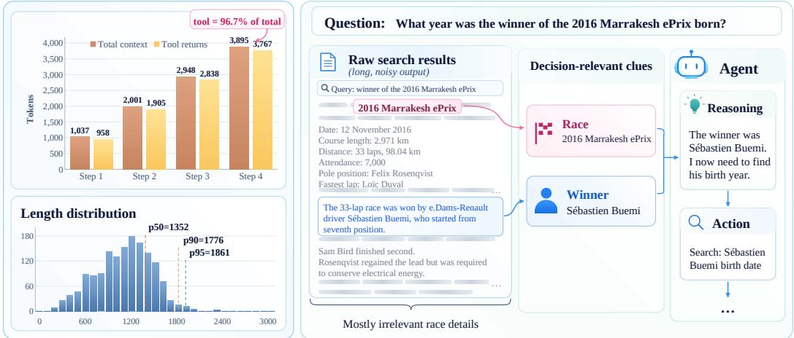
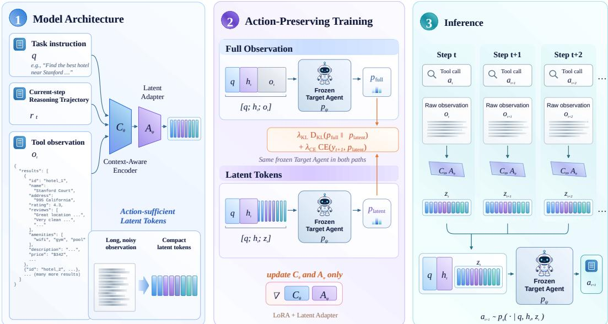
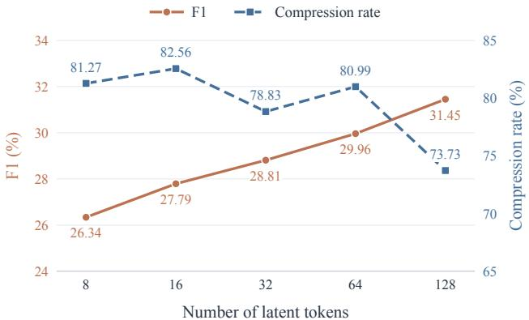
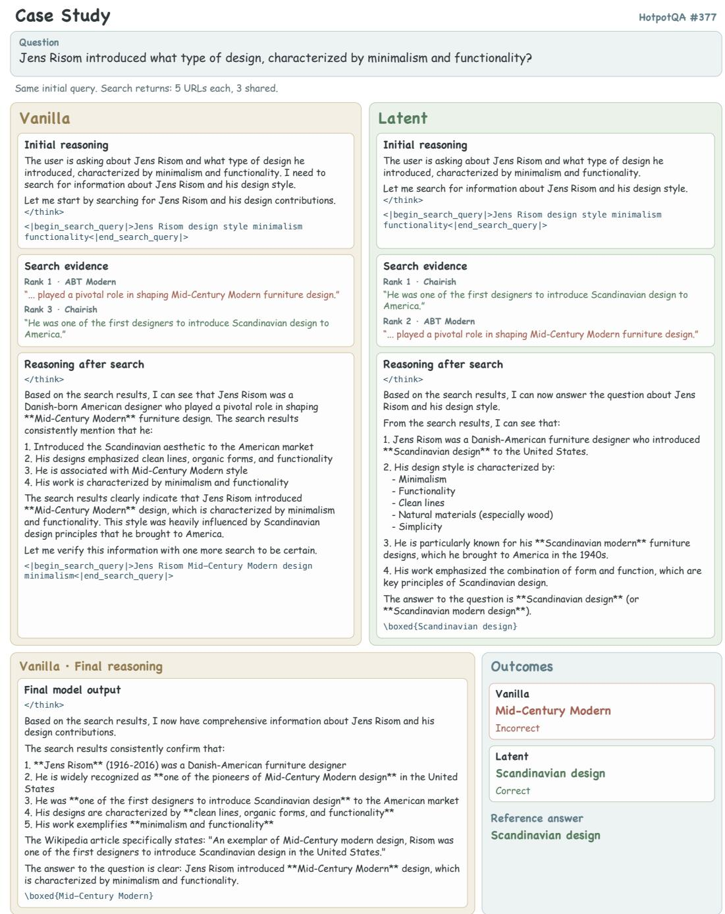
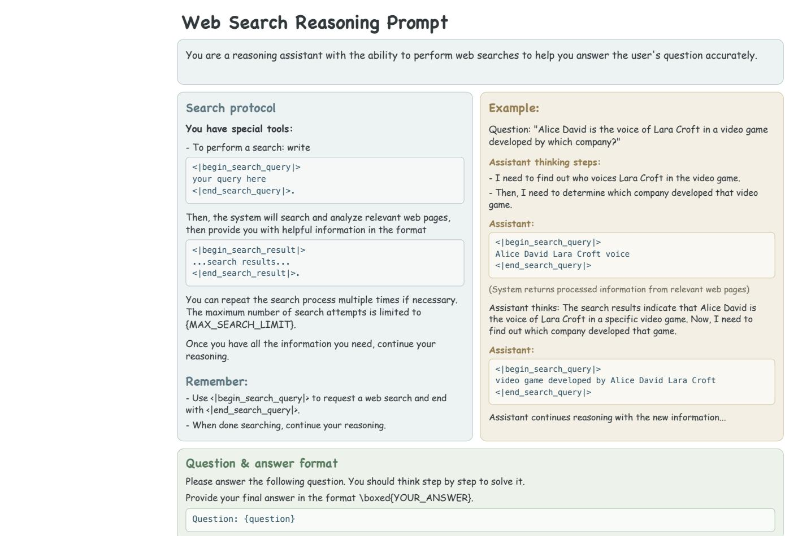

# Tools Need Not Speak in Text: Latent Context Compression for Agents

Yuetong Liu1, Zhehao Zhou1, Yitong Zhang1, Haorui Chen1, Jia Li1,† 1Tsinghua AI Agent Group, Tsinghua University

## Abstract

Large language model (LLM) agents typically append raw tool outputs to their context. Over multi-step interactions, long and noisy observations incur substantial context overhead and dilute the agent’s attention to task-relevant information. Existing token pruning and summarization methods remain constrained by discrete text representations, limiting the achievable compression ratios.

In this work, we challenge the prevailing assumption that agents must consume tool observations as explicit text tokens. To this end, we propose Coca-Cola, a continuous latent context compression model for LLM agents. Coca-Cola compresses tool observations into latent tokens and embeds them into the input embedding space of the agent. We further introduce Action-Preserving Training, which aligns the agent’s next-action distributions under full and compressed observations. This trains the compression model to learn action-suficient latent tokens that retain decision-critical information. Experiments with web-search agents on four QA benchmarks and two model families show that Coca-Cola reduces the agent’s token consumption by 70.01%–89.24% and end-to-end runtime by 24.45%–55.97%, while consistently improving task performance. These results suggest that Coca-Cola ofers a promising approach for context compression in agents. Our code is available at https://github.com/THU-Agent/Coca-cola.

Date: November 5, 2026 First author: 23371522@buaa.edu.cn Corresponding author: † jia\_li@mail.tsinghua.edu.cn

## 1 Introduction

Large language model (LLM) agents increasingly use external tools to acquire information and solve multi-step tasks Yang et al. (2024); Hong et al. (2025); Wang et al. (2023), with web search as a representative example Schick et al. (2023); Li et al. (2025a); He et al. (2024); Li et al. (2026). Under the widely adopted ReAct Yao et al. (2022) paradigm, an agent first reasons over the task and its current context to select a tool call, then adds the returned observation to its context to take the next action. For example, after querying a search engine, a web-search agent appends the returned search results to its context and uses them to decide whether to perform another search or provide a final answer Li et al. (2025a).

However, appending raw tool observations leads to rapid context growth over successive reasoning steps, introducing two drawbacks. First, increased computational overhead. As shown in Figure 1 (left), tool observations account for a large and growing share of the context, reaching 96.7% at Step 4 and leading to substantially higher token usage and computational cost Xiao et al. (2026); Jiang et al. (2023). Second, degraded task performance. In Figure 1 (right), identifying the name Sébastien Buemi sufices to guide the next search for his birth year, while extensive race details are irrelevant to this decision. Such redundant content consumes context and can distract the model from key evidence, impairing reasoning quality Liu et al. (2024); Levy et al. (2024); Shi et al. (2023).

A natural solution is to compress the agent’s context. Existing methods mainly use token pruning or text summarization. Token pruning uses a model to identify and remove less informative tokens Li et al. (2023); Jiang et al. (2023); Pan et al. (2024); Jiang et al. (2024). Text summarization uses an auxiliary LLM to condense tool outputs or interaction histories into shorter summaries Wang et al. (2026); Xu et al. (2023). However, such text-level compression has a fundamental flaw: because the compressed result remains a discrete token sequence that must stay semantically coherent, its achievable compression ratio is inherently limited.

  
Figure 1 Tool observation redundancy in LLM agents. Left: Tool returns increasingly dominate the agent context, accounting for 96.7% of total tokens by Step 4, while individual observations exhibit substantial length. Right: A representative web-search example illustrating that only a few fragments of a lengthy tool output are relevant to the agent’s next decision.

A closer look at tool–agent interactions raises a fundamental question: must tool outputs be expressed in textual tokens? Since these outputs primarily support an agent’s subsequent reasoning and actions, tool–agent interaction need not rely on explicit textual tokens. This observation motivates us to reconsider how tool information is represented. Compared with discrete text tokens, continuous latent tokens (i.e., high-dimensional vectors in the embedding space) ofer a more flexible alternative. These latent tokens can encode rich information compactly under a limited token budget, while their diferentiability enables direct optimization for downstream objectives. Recent studies Yu et al. (2026); Chen et al. (2026b) have explored latent tokens in reasoning Hao et al. (2024); Cheng & Van Durme (2024); Xu et al. (2025); Deng et al. (2023); Anonymous (2026), agents’ communication Ye et al. (2026); Zou et al. (2025); Du et al. (2026); Jin et al. (2026), and memory Zhang et al. (2025a; 2026); Wang et al. (2024); Zhang et al. (2025b). Together, these studies suggest that models can directly process and exchange information through latent tokens, opening up new possibilities for information transfer between tools and agents.

Motivated by this analysis, we propose Coca-Cola (Context Compression via Continuous Latent Tokens), a latent context compression model for LLM agents. Conditioned on the task instruction and the agent’s current-step reasoning trajectory, Coca-Colacompresses long, noisy tool observations into a few latent tokens that retain information critical to subsequent decisions. These latent tokens are mapped into the agent’s input embedding space, enabling it to use the compressed information for further reasoning and actions.

Although latent tokens enable eficient information compression, applying them to compress tool observations for agents introduces two key challenges. The first is to make compressed representations efectively usable by the agent. The second is to preserve decision-critical information under a limited representation budget. To address the first challenge, we design a context-aware encoder with a latent adapter that maps compressed representations into the target agent’s input embedding space. This allows the agent to directly use these latent tokens for subsequent reasoning and actions. For the second challenge, we propose an action-preserving training method. Specifically, we align the agent’s next-action distributions under full and compressed tool observations. This trains the compression model to minimize its impact on the agent’s next-action behavior, thereby preserving action-critical information.

We evaluate Coca-Cola across two model configurations and four web-search QA benchmarks. Compared to uncompressed agents, Coca-Cola reduces total token consumption by 70.01%–89.24% and end-to-end runtime by 24.45%–55.97%, demonstrating substantial eficiency gains. Despite aggressive compression, Coca-Cola consistently outperforms the uncompressed agent in both EM and F1, and achieves the best EM and F1 among all methods in six of the eight model–dataset settings.

Our contributions are threefold:

• To our knowledge, we are the first to recognize that tools need not convey information through explicit tokens and to compress tool outputs into latent tokens.

• We propose Coca-Cola, a latent context compression model trained to preserve action-critical information.

• Experiments on web-search agents demonstrate that Coca-Cola substantially improves eficiency while consistently improving task performance.

## 2 Related Work

## 2.1 LLM-Based Agents

LLM-based agents typically follow the ReAct paradigm Yao et al. (2022), alternating between reasoning and tool use to accomplish multi-step tasks. Formally, given a task instruction $q ,$ an agent parameterized by $\psi$ generates a reasoning step $r _ { t }$ and issues a tool call $a _ { t }$ at step �, receiving a tool observation $o _ { t } .$ . Let $h _ { t } = ( r _ { 1 } , a _ { 1 } , o _ { 1 } , \ldots , r _ { t } , a _ { t } )$ denote the trajectory prefix before receiving $o _ { t } ,$ comprising previous reasoning steps, tool calls, and observations. The agent appends $o _ { t }$ to its context and continues reasoning to select the next tool call or produce a final answer:

$$
a _ { t + 1 } \sim p _ { \psi } ( \cdot \mid q , h _ { t } , o _ { t } ) .\tag{1}
$$

As tool interactions proceed, the agent accumulates previous reasoning steps, tool calls, and their observations in its context. Without compression or truncation, the context length after the �-th tool call can be approximated as

$$
K _ { t } \approx | \boldsymbol { q } | + \sum _ { i = 1 } ^ { t } \left( \left| \boldsymbol { r } _ { i } \right| + \left| \boldsymbol { a } _ { i } \right| + \left| \boldsymbol { o } _ { i } \right| \right) .\tag{2}
$$

where | ⋅ | denotes the token count and $K _ { t }$ is the total context length, excluding fixed prompt and formatting overhead. Since tool calls often return lengthy search results and document snippets, tool observations accumulate over successive interactions and can eventually dominate the agent’s context, incurring substantial context overhead.

## 2.2 Textual Compression for Tool-Augmented Agents

To reduce the context overhead of tool interactions, existing methods primarily rely on token pruning and text summarization Wang et al. (2026); Xiao et al. (2026); Chen et al. (2026a); Shi et al. (2025). Formally, given the tool observation $o _ { t }$ at step �, text-based compression methods transform it into a shorter sequence of discrete tokens using a compression function $g _ { \eta } \colon$

$$
\hat { o } _ { t } = g _ { \eta } ( q , h _ { t } , o _ { t } ) \in \mathcal { V } ^ { \ell _ { t } } , \quad \ell _ { t } < | o _ { t } | ,\tag{3}
$$

where  denotes the vocabulary, $\ell _ { t }$ is the compressed sequence length. The agent then replaces the original observation $o _ { t }$ with its compressed counterpart $\hat { o } _ { t }$ to select the next action:

$$
a _ { t + 1 } \sim p _ { \psi } ( \cdot \mid q , h _ { t } , \hat { o } _ { t } ) .\tag{4}
$$

Token-pruning methods selectively remove less informative tokens. LLMLingua estimates token informativeness using language models (Jiang et al., 2023), while LLMLingua-2 formulates compression as a token classification task (Pan et al., 2024). LongLLMLingua further improves the density of task-relevant information in long-context prompts (Jiang et al., 2024).

Text summarization instead employs auxiliary language models to condense tool outputs or interaction histories into shorter natural-language summaries. RECOMP generates query-relevant summaries of retrieved documents (Xu et al., 2023), while Search-o1 extracts useful information from search results through its Reason-in-Documents module (Li et al., 2025a; Jin et al., 2025). For long-horizon agents, ACON jointly compresses tool observations and interaction histories, refining compression instructions based on agent failures (Kang et al., 2025).

Despite their diferent strategies, these methods retain information in the form of discrete text tokens. In contrast, Coca-Cola compresses tool observations into continuous latent representations, moving beyond text-based compression.

## 2.3 Latent Tokens for Agents

In recent years, continuous latent tokens have been explored for reasoning, communication, and memory in large language agents. For latent reasoning, Coconut (Hao et al., 2024), CCoT (Cheng & Van Durme, 2024), and SoftCoT (Xu et al., 2025) explore reasoning in continuous latent spaces, reducing reliance on explicit natural-language reasoning processes. For agent communication, KVComm (Ye et al., 2026) and LatentMAS (Zou et al., 2025) investigate information exchange between agents through hidden states or KV caches. For memory, MemGen (Zhang et al., 2025a) and NextMem (Zhang et al., 2026) explore storing and utilizing historical information through continuous latent tokens. These studies demonstrate that latent tokens can support both internal information processing and inter-model communication, ofering new possibilities beyond traditional text-based interactions.

Another line of research employs latent tokens to compress long textual contexts Rau et al. (2024); Cheng et al. (2024); Li et al. (2025b); Chevalier et al. (2023); Mu et al. (2023); Ge et al. (2023). Gist Tokens (Mu et al., 2023) learns special compression tokens to encode long prompts into compact representations; AutoCompressor (Chevalier et al., 2023) compresses long texts into continuous summary vectors; and 500xCompressor (Li et al., 2025b) explores context compression at extremely high compression ratios. Among these approaches, ICAE (Ge et al., 2023), which is closely related to our work, employs an autoencoder-based architecture to compress long texts into a small number of continuous vectors and trains a language model to utilize these latent tokens for downstream tasks.

However, existing latent context compression methods primarily focus on preserving or reconstructing the original textual information. In contrast, Coca-Cola directly optimizes for the agent’s subsequent decisions, preserving decision-critical information while discarding redundant content.

## 3 Method

## 3.1 Overview

As shown in Figure 2, we propose Coca-Cola, a continuous latent context compression model for LLM agents. Unlike traditional text-based compression methods, Coca-Cola compresses lengthy tool observations into a small number of latent tokens to reduce the context overhead of tool interactions. We first theoretically analyze the information capacity of latent tokens, providing theoretical motivation for compressing tool observations into continuous vectors (Section 3.2).

Specifically, after each tool call, Coca-Cola takes the task instruction, the agent’s current-step reasoning trajectory, and the tool observation as input. A lightweight encoder processes these inputs, while a latent adapter maps the resulting latent tokens into the target agent’s input embedding space (Section 3.3). To preserve decision-critical information under a limited representation budget, we further introduce Action-Preserving Training, which trains the compressor by aligning the agent’s next-action distributions under full and compressed observations(Section 3.4). During inference, the trained compressor replaces raw tool observations with latent tokens after each tool call, allowing the agent to perform multi-step interactions with a more compact context (Section 3.5).

## 3.2 Theoretical Analysis

We analyze the potential advantage of latent tokens through their finite-precision codebook capacity. Here, capacity is defined as the logarithm of the number of distinguishable codewords, with the context shared by the encoder and the agent held fixed.

  
Figure 2 Overview of Coca-Cola. Left: The latent tool bottleneck encodes raw tool observations into compact continuous latent representations, conditioned on the task instruction and current reasoning state. Middle: Action-preserving distillation aligns the next-action distributions of a full-observation teacher and a latent-conditioned student, updating only the compressor while keeping the agent backbone frozen. Right: During inference, raw tool observations are replaced by latent representations after each tool call, enabling eficient multi-step agent interactions.

For a model with vocabulary size ||, each text token is selected from || symbols. A sequence of � tokens therefore admits at most ||� distinct sequences, giving a maximum codebook capacity of

$$
\begin{array} { r } { C _ { \mathrm { t e x t } } ( n ) = n \log _ { 2 } | \mathcal { V } | . } \end{array}\tag{5}
$$

A latent token can instead encode information jointly across multiple numerical coordinates within a single input position. Assume each �-dimensional latent token has $d _ { \mathrm { e f f } } \leq d$ efective coordinates, each admitting � distinguishable values at finite precision, and that all coordinate combinations across representations are realizable. Under these assumptions, � representations have a codebook capacity of

$$
C _ { \mathrm { l a t e n t } } ( m ) = m d _ { \mathrm { e f f } } \log _ { 2 } B .\tag{6}
$$

Thus, when $d _ { \mathrm { e f f } }$ log2 $B > \log _ { 2 } | \mathcal { V } |$ , continuous latent representations can provide a larger codebook capacity under the same input-position budget, $\mathbf { \vec { \mathbf { \rho } } } _ { \mathrm { i } . \mathbf { \vec { e } } _ { \cdot } , m } = n$ . This potential comes from joint encoding across multiple coordinates, whereas each text position remains restricted to a symbol from a fixed vocabulary. This analysis motivates continuous compression of tool observations from a capacity perspective; the information usable in practice still depends on the compressor’s encoding ability and the agent’s ability to use the representations.

## 3.3 Model Architecture

Building on the above theoretical analysis, we propose Coca-Cola, a continuous latent context compression model for LLM agents. Coca-Cola encodes tool observations into a small number of latent tokens and maps them into the target agent’s input embedding space. To make these latent tokens directly usable by the agent, we design a compression model consisting of a context-aware encoder and a latent adapter, as illustrated in Figure 2 (left).

Context-Aware Encoder. Our analysis of tool-use trajectories shows that a tool observation is not only relevant to the observation itself, but also depends on the task instruction and the agent’s current reasoning state. To this end, we employ a small language model $C _ { \theta }$ as the context-aware encoder, which jointly encodes the task instruction, current-step reasoning trajectory, and tool observation. Specifically, given the task instruction $q ,$ current-step reasoning trajectory prefix $r _ { t } ,$ and tool observation $o _ { t }$ , the model produces context-conditioned hidden states:

$$
H _ { t } = C _ { \theta } ( q , r _ { t } , o _ { t } ) .\tag{7}
$$

Latent Adapter. Since the context-aware encoder and the target agent operate in diferent representation spaces, the encoded hidden states cannot be directly consumed by the agent. To bridge this gap, we introduce a latent adapter $A _ { \phi }$ that transforms the hidden states into a fixed number of latent tokens and maps them into the target agent’s input embedding space:

$$
z _ { t } = A _ { \phi } ( H _ { t } ) \in \mathbb { R } ^ { m \times d } ,\tag{8}
$$

where � is the number of latent tokens and � is the target agent’s input embedding dimension. The resulting latent tokens are then directly inserted into the agent’s input embedding sequence, delimited by special boundary markers:

$$
X _ { t } = \left[ E _ { \psi } ( q , h _ { t } ) ; E _ { \psi } ( \langle \mathrm { l a t e n t \_ o b s } \rangle ) ; z _ { t } ; E _ { \psi } ( \langle / \mathrm { l a t e n t \_ o b s } \rangle ) \right] .\tag{9}
$$

Here, $E _ { \psi }$ denotes the target agent’s input embedding function. This design provides a continuous interface between tool observations and the target agent.

## 3.4 Action-Preserving Training

Although latent tokens can encode tool observations compactly, preserving decision-critical information under a limited representation budget remains challenging. To address this challenge, we design a training method that aligns the agent’s next-action distributions under full and compressed observations, encouraging the compression model to retain information critical to next-action selection.

Specifically, given the task instruction $q ,$ trajectory prefix $h _ { t } ,$ , and tool observation $o _ { t } ,$ , we feed the full observation $o _ { t }$ and its compressed latent tokens $z _ { t }$ separately into the same frozen target agent. The resulting next-action distributions are defined as

$$
\begin{array} { r } { p _ { \mathrm { f u l l } } = p _ { \psi } ( \cdot \mid q , h _ { t } , o _ { t } ) , } \\ { p _ { \mathrm { l a t e n t } } = p _ { \psi } ( \cdot \mid q , h _ { t } , z _ { t } ) . } \end{array}\tag{10}
$$

Our goal is to align these distributions, minimizing the impact of compression on the agent’s subsequent decisions.

To this end, we jointly optimize an action-distribution alignment loss and an action-level supervision loss:

$$
\begin{array} { r } { \mathcal { L } = \lambda _ { \mathrm { K L } } D _ { \mathrm { K L } } ( p _ { \mathrm { f u l l } } \parallel p _ { \mathrm { l a t e n t } } ) + \lambda _ { \mathrm { C E } } \mathrm { C E } ( y _ { t + 1 } , p _ { \mathrm { l a t e n t } } ) , } \end{array}\tag{11}
$$

where $y _ { t + 1 }$ denotes the next-action token recorded in the collected trajectory, and $\lambda _ { \mathrm { K L } }$ and $\lambda _ { \mathrm { C E } }$ control the respective loss weights. The KL divergence aligns the action distributions under full and compressed observations, while the cross-entropy loss further supervises the predictions using recorded actions. Together, these objectives encourage the compression model to prioritize information relevant to subsequent decisions.

Since latent tokens are continuous and diferentiable, gradients can propagate through the frozen target agent to optimize the compression model:

$$
\nabla _ { \boldsymbol { \theta } , \boldsymbol { \phi } } \mathcal { L } = \left( \frac { \partial z _ { t } } { \partial ( \boldsymbol { \theta } , \boldsymbol { \phi } ) } \right) ^ { \top } \nabla _ { z _ { t } } \mathcal { L } .\tag{12}
$$

During training, we keep the target agent frozen and update only the LoRA parameters of the context-aware encoder and the parameters of the latent adapter. By directly aligning the agent’s action distributions under full and compressed observations, Coca-Cola learns action-suficient latent tokens without reconstructing the original tool observations.

## 3.5 Inference

At inference, Coca-Cola replaces each raw tool observation with latent tokens. Given the task instruction $q ,$ current-step trajectory prefix $r _ { t } ,$ and tool observation $o _ { t } ,$ the trained compression model produces

$$
z _ { t } = A _ { \phi } ( C _ { \theta } ( q , r _ { t } , o _ { t } ) ) .\tag{13}
$$

The agent then conditions on $z _ { t } ,$ rather than the raw observation, to generate its next action:

$$
a _ { t + 1 } \sim p _ { \psi } ( \cdot \mid q , h _ { t } , z _ { t } ) .\tag{14}
$$

For multi-step tool use, Coca-Cola repeats this process after every tool call. By replacing tool outputs with a small number of latent tokens, Coca-Cola reduces context growth while retaining information needed for subsequent decisions.

Table 1 Eficiency comparison across four web-search QA datasets using Qwen3.5-35B-A3B and Qwen3.5-4B. Best results are in bold. Blue annotations under Coca-Cola indicate reductions (%) relative to Vanilla in token usage and runtime.
<table><tr><td></td><td colspan="5">NQ</td><td colspan="5">TriviaQA</td></tr><tr><td></td><td>Vanilla</td><td>LongLLM Lingua</td><td>LLM Summary</td><td>ICAE</td><td>Coca-Cola</td><td>Vanilla</td><td>LongLLM Lingua</td><td>LLM Summary</td><td>ICAE</td><td>Coca-Cola</td></tr><tr><td>Itoken ↓</td><td>14362.12</td><td>8607.04</td><td>6099.83</td><td>5926.23</td><td>1766.53 ↓87.7%</td><td>10022.93</td><td>5445.57</td><td>3791.53</td><td>3038.35</td><td>1413.12 ↓85.9% 349.36</td></tr><tr><td> $O _ { \mathrm { t o k e n } } \downarrow$ </td><td>992.69</td><td>1232.61</td><td>1080.51</td><td>665.57</td><td>417.69 ↓57.9%</td><td>779.34</td><td>1048.02</td><td>679.36</td><td>535.42</td><td>↓55.2%</td></tr><tr><td>Comp_rate ↑</td><td></td><td>35.92%</td><td>53.24%</td><td>57.07%</td><td>85.78%</td><td>一</td><td>39.89%</td><td>58.61%</td><td>66.92%</td><td>83.68%</td></tr><tr><td>Time (s)↓</td><td>96.19</td><td>109.48</td><td>121.02</td><td>87.06</td><td>64.64 ↓32.8%</td><td>73.30</td><td>86.91</td><td>91.67</td><td>64.89</td><td>55.38 ↓24.4%</td></tr><tr><td></td><td colspan="5">2Wiki</td><td colspan="5">HotpotQA</td></tr><tr><td></td><td>Vanilla</td><td>LongLLM Lingua</td><td>LLM Summary</td><td>ICAE</td><td>Coca-Cola</td><td>Vanilla</td><td>LongLLM Lingua</td><td>LLM Summary</td><td>ICAE</td><td>Coca-Cola</td></tr><tr><td>Itoken ↓</td><td>37427.21</td><td>21110.06</td><td>10011.31</td><td>12268.64</td><td>10744.51 ↓71.3% 932.57</td><td>42723.75</td><td>21241.95</td><td>8088.21</td><td>15763.53</td><td>9429.04 ↓77.9% 831.43</td></tr><tr><td>Otoken↓</td><td>1510.37</td><td>1488.63</td><td>1163.11</td><td>1080.53</td><td>↓38.3%</td><td>1560.28</td><td>1596.04</td><td>1253.70</td><td>1035.63</td><td>↓46.7%</td></tr><tr><td>Comp_rate ↑</td><td>1</td><td>41.96%</td><td>71.30%</td><td>65.72%</td><td>70.01% 119.91</td><td>一</td><td>48.43%</td><td>78.90%</td><td>62.06%</td><td>76.83%</td></tr><tr><td>Time (s)↓</td><td>164.99</td><td>137.22</td><td>175.97</td><td>142.18</td><td>↓27.3%</td><td>161.39</td><td>145.83</td><td>160.24</td><td>139.04</td><td>120.88 ↓25.1%</td></tr></table>

Table 2 Eficiency comparison across four web-search QA datasets using GLM-4.7-Flash and GLM-Z1-9B. Best results are in bold. Blue annotations under Coca-Cola indicate reductions (%) relative to Vanilla in token usage and runtime.
<table><tr><td></td><td colspan="5">NQ</td><td colspan="5">TriviaQA</td></tr><tr><td></td><td>Vanilla</td><td>LongLLM Lingua</td><td>LLM Summary</td><td>ICAE</td><td>Coca-Cola</td><td>Vanilla</td><td>LongLLM Lingua</td><td>LLM Summary</td><td>ICAE</td><td>Coca-Cola</td></tr><tr><td>Itoken ↓</td><td>17388.56</td><td>5779.61</td><td>3903.19</td><td>5068.65</td><td>4265.42 ↓75.5%</td><td>11176.91</td><td>4689.20</td><td>2842.51</td><td>3510.28</td><td>2595.00 ↓76.8%</td></tr><tr><td> $O _ { \mathrm { t o k e n } } \downarrow$ </td><td>887.74</td><td>797.81</td><td>734.77</td><td>805.93</td><td>536.37 ↓39.6%</td><td>738.96</td><td>688.27</td><td>634.84</td><td>617.94</td><td>413.28 ↓44.1%</td></tr><tr><td>Comp_rate ↑</td><td>一</td><td>64.01%</td><td>74.62%</td><td>67.86%</td><td>73.73%</td><td>一</td><td>54.87%</td><td>70.82%</td><td>65.36%</td><td>74.75%</td></tr><tr><td>Time (s) ↓</td><td>89.29</td><td>91.06</td><td>106.47</td><td>83.63</td><td>42.17 ↓52.8%</td><td>91.36</td><td>89.93</td><td></td><td></td><td>41.97 ↓54.1%</td></tr><tr><td></td><td></td><td></td><td>2Wiki</td><td></td><td></td><td></td><td></td><td>128.36 HotpotQA</td><td>72.33</td><td></td></tr><tr><td></td><td>Vanilla</td><td>LongLLM</td><td>LLM</td><td>ICAE</td><td>Coca-Cola</td><td>Vanilla</td><td>LongLLM</td><td>LLM</td><td>ICAE</td><td>Coca-Cola</td></tr><tr><td></td><td></td><td>Lingua</td><td>Summary</td><td></td><td>3003.38</td><td></td><td>Lingua</td><td>Summary</td><td></td><td>4041.03</td></tr><tr><td>Itoken ↓</td><td>31693.47</td><td>11934.39</td><td>5113.19</td><td>7677.77</td><td>↓90.5%</td><td>28781.88</td><td>6059.07</td><td>4690.11</td><td>4029.96</td><td>↓86.0%</td></tr><tr><td></td><td></td><td></td><td></td><td></td><td>511.07</td><td></td><td></td><td></td><td></td><td>609.95</td></tr><tr><td>Otoken↓</td><td>976.35</td><td>672.11</td><td>895.04</td><td>777.21</td><td>↓47.7%</td><td>834.04</td><td>826.07</td><td>747.77</td><td>707.66</td><td>↓26.9%</td></tr><tr><td></td><td></td><td></td><td></td><td></td><td></td><td></td><td></td><td></td><td></td><td></td></tr><tr><td>Comp_rate ↑</td><td>一</td><td>61.41%</td><td>81.61%</td><td>74.12%</td><td>89.24%</td><td>一</td><td>76.75%</td><td>81.64%</td><td>84.00%</td><td>84.30%</td></tr><tr><td></td><td></td><td></td><td></td><td></td><td></td><td></td><td></td><td></td><td></td><td></td></tr><tr><td></td><td></td><td></td><td></td><td></td><td>46.83</td><td></td><td></td><td></td><td></td><td>49.37</td></tr><tr><td></td><td></td><td></td><td></td><td></td><td></td><td></td><td></td><td></td><td></td><td></td></tr><tr><td></td><td></td><td></td><td></td><td></td><td></td><td></td><td></td><td></td><td></td><td></td></tr><tr><td></td><td></td><td></td><td></td><td></td><td></td><td></td><td></td><td></td><td></td><td></td></tr><tr><td></td><td></td><td></td><td></td><td></td><td></td><td></td><td></td><td></td><td></td><td></td></tr><tr><td></td><td></td><td></td><td></td><td></td><td></td><td></td><td></td><td></td><td></td><td></td></tr><tr><td></td><td></td><td></td><td></td><td></td><td></td><td></td><td></td><td></td><td></td><td></td></tr><tr><td></td><td></td><td></td><td></td><td></td><td></td><td></td><td></td><td></td><td></td><td></td></tr><tr><td></td><td></td><td></td><td></td><td></td><td></td><td></td><td></td><td></td><td></td><td></td></tr><tr><td></td><td></td><td></td><td></td><td></td><td></td><td></td><td></td><td>101.61</td><td></td><td></td></tr><tr><td></td><td></td><td></td><td></td><td></td><td></td><td></td><td></td><td></td><td></td><td></td></tr><tr><td></td><td></td><td></td><td>153.25</td><td>89.21</td><td></td><td></td><td>102.54</td><td></td><td>99.58</td><td>↓41.6%</td></tr><tr><td></td><td>106.37</td><td></td><td></td><td></td><td></td><td>84.55</td><td></td><td></td><td></td><td></td></tr><tr><td></td><td></td><td>109.93</td><td></td><td></td><td></td><td></td><td></td><td></td><td></td><td></td></tr><tr><td>Time (s) ↓</td><td></td><td></td><td></td><td></td><td>↓56.0%</td><td></td><td></td><td></td><td></td><td></td></tr><tr><td></td><td></td><td></td><td></td><td></td><td></td><td></td><td></td><td></td><td></td><td></td></tr><tr><td></td><td></td><td></td><td></td><td></td><td></td><td></td><td></td><td></td><td></td><td></td></tr><tr><td></td><td></td><td></td><td></td><td></td><td></td><td></td><td></td><td></td><td></td><td></td></tr><tr><td></td><td></td><td></td><td></td><td></td><td></td><td></td><td></td><td></td><td></td><td></td></tr><tr><td></td><td></td><td></td><td></td><td></td><td></td><td></td><td></td><td></td><td></td><td></td></tr><tr><td></td><td></td><td></td><td></td><td></td><td></td><td></td><td></td><td></td><td></td><td></td></tr><tr><td></td><td></td><td></td><td></td><td></td><td></td><td></td><td></td><td></td><td></td><td></td></tr><tr><td></td><td></td><td></td><td></td><td></td><td></td><td></td><td></td><td></td><td></td><td></td></tr><tr><td></td><td></td><td></td><td></td><td></td></table>

## 4 Experimental Setup

## 4.1 Research Questions

We systematically evaluate Coca-Cola to address the following four research questions:

Table 3 Web search performance comparison. Best results within each model setting are in bold. Arrows in the Coca-Cola rows indicate relative changes (%) over the Vanilla Model for each metric.
<table><tr><td rowspan="3">Method</td><td colspan="4">Single-hop QA</td><td colspan="4">Multi-hop QA</td></tr><tr><td colspan="2">NQ</td><td colspan="2">TriviaQA</td><td colspan="2">2Wiki</td><td colspan="2">HotpotQA</td></tr><tr><td>EM</td><td>F1</td><td>EM</td><td>F1</td><td>EM</td><td>F1</td><td>EM</td><td>F1</td></tr><tr><td colspan="9">Qwen3.5-35B-A3B &amp; Qwen3.5-4B</td></tr><tr><td>Vanilla Model</td><td>23.67</td><td>33.17</td><td>56.10</td><td>62.87</td><td>17.30</td><td>26.94</td><td>11.00</td><td>16.41</td></tr><tr><td>LongLLMLingua</td><td>19.00</td><td>25.81</td><td>44.30</td><td>48.69</td><td>21.30</td><td>34.25</td><td>11.90</td><td>19.75</td></tr><tr><td>LLMSummary</td><td>24.65</td><td>32.35</td><td>54.70</td><td>61.38</td><td>21.06</td><td>31.77</td><td>23.10</td><td>29.60</td></tr><tr><td>ICAE</td><td>24.38</td><td>35.20</td><td>61.80</td><td>69.27</td><td>13.72</td><td>16.91</td><td>23.71</td><td>31.21</td></tr><tr><td>Coca-Cola</td><td>24.78</td><td>37.33</td><td>59.20</td><td>67.07</td><td>24.00</td><td>32.34</td><td>25.70</td><td>33.75</td></tr><tr><td></td><td>↑4.69%</td><td>↑12.54%</td><td>↑5.53%</td><td>↑6.68%</td><td>↑38.73%</td><td>↑20.04%</td><td>↑133.64%</td><td>↑105.67%</td></tr><tr><td colspan="9">GLM-4.7-Flash &amp; GLM-Z1-9B</td></tr><tr><td>Vanilla Model</td><td>21.50</td><td>26.08</td><td>41.50</td><td>44.57</td><td>26.50</td><td>31.29</td><td>20.50</td><td>25.89</td></tr><tr><td>LongLLMLingua</td><td>17.00</td><td>21.16</td><td>39.50</td><td>42.41</td><td>20.50</td><td>24.91</td><td>19.50</td><td>23.00</td></tr><tr><td>LLMSummary</td><td>16.00</td><td>21.05</td><td>46.00</td><td>49.29</td><td>22.50</td><td>25.61</td><td>13.50</td><td>17.60</td></tr><tr><td>ICAE</td><td>17.00</td><td>20.82</td><td>38.00</td><td>40.94</td><td>18.50</td><td>20.75</td><td>16.50</td><td>20.13</td></tr><tr><td>Coca-Cola</td><td>23.50</td><td>31.45</td><td>51.50</td><td>59.41</td><td>28.00</td><td>36.20</td><td>23.50</td><td>30.76</td></tr><tr><td></td><td>↑9.30%</td><td>↑20.59%</td><td>↑24.10%</td><td>↑33.30%</td><td>↑5.66%</td><td>↑15.69%</td><td>↑14.63%</td><td>↑18.81%</td></tr></table>

RQ1 (Eficiency): How much computational overhead can Coca-Cola reduce in terms of token consumption and execution time?

We measure token consumption, compression rates, and end-to-end runtime across diferent model configurations and benchmarks.

RQ2 (Task Performance): Can Coca-Cola preserve or improve agent task performance while reducing context overhead?

We compare EM and F1 scores against uncompressed agents and existing compression methods to assess the impact of compression on task performance.

RQ3 (Ablation Study): What factors afect the performance of Coca-Cola?

We investigate how the number of latent tokens and diferent contextual inputs afect compression efectiveness and task performance.

RQ4 (Case Study): How does Coca-Cola support agent decision-making through latent tokens?

We present a representative case study to illustrate how latent tokens preserve decision-critical information and guide subsequent actions.

## 4.2 Agent Setting and Model Configurations

We evaluate Coca-Cola in a web-search agent setting, as web search is one of the most common tool-use scenarios for LLM agents Li et al. (2025a); Jin et al. (2025), and its returned results are typically lengthy and highly redundant (Figure 1), making it a natural testbed for observation compression. Notably, Coca-Cola involves no search-specific design: the compressor conditions only on the task instruction, the current reasoning trajectory, and the raw tool observation, and can thus be applied to other tools without architectural modification.

To evaluate Coca-Cola across diferent model configurations, we use two model pairs: Qwen3.5-35B-A3B with Qwen3.5-4B Qwen Team (2026), and GLM-4.7-Flash with GLM-Z1-9B GLM Team et al. (2025); Team GLM et al. (2024).

## 4.3 Baselines

We compare Coca-Cola against four representative approaches:

Vanilla Model. An uncompressed agent that directly appends raw tool observations to its context.

LongLLMLingua. A token-pruning method that compresses context by selectively removing less informative tokens Jiang et al. (2024).

LLMSummary. A text summarization approach that uses an auxiliary language model to summarize tool observations into shorter natural-language text Li et al. (2025a).

ICAE. ICAE Ge et al. (2023) learns continuous latent tokens through text reconstruction. Since ICAE was not originally designed for agent tool observations, we adapt its training objective to our setting. Specifically, we use the same compression architecture as Coca-Cola but replace the action-preserving training objective with a text-reconstruction objective, training the model to recover the original tool observations from compressed latent tokens.

## 4.4 Benchmarks

We evaluate on four open-domain question answering benchmarks: Natural Questions (NQ) Kwiatkowski et al. (2019), TriviaQA Joshi et al. (2017), 2WikiMultiHopQA (2Wiki) Ho et al. (2020), and HotpotQA Yang et al. (2018).

NQ and TriviaQA primarily assess the agent’s ability to retrieve and utilize factual evidence, while 2Wiki and HotpotQA require multi-hop reasoning across multiple pieces of evidence. Together, these benchmarks evaluate whether latent compression preserves critical information under varying reasoning complexity.

## 4.5 Evaluation Metrics

We evaluate each method in terms of task performance and system eficiency.

Task Performance. We report Exact Match (EM) and token-level F1 scores on the final answers to measure answer correctness.

System Eficiency. We measure the average input tokens $I _ { \mathrm { t o k e n } } .$ , output tokens $O _ { \mathrm { t o k e n } } ,$ , compression ratio Comp\_rate, and end-to-end execution time Time.

The compression ratio is defined as

$$
\mathrm { C o m p \_ r a t e } = 1 - \frac { I _ { \mathrm { t o k e n } } ^ { \mathrm { l a t e n t } } + O _ { \mathrm { t o k e n } } ^ { \mathrm { l a t e n t } } } { I _ { \mathrm { t o k e n } } ^ { \mathrm { r a w } } + O _ { \mathrm { t o k e n } } ^ { \mathrm { r a w } } } ,\tag{15}
$$

where the superscripts latent and raw denote the compressed and uncompressed settings, respectively.

## 5 Experimental Results

## 5.1 RQ1: How much computational overhead can Coca-Cola reduce?

In this RQ, we evaluate the eficiency gains of Coca-Cola in terms of token consumption and endto-end execution time across diferent model configurations and QA benchmarks. The results are presented in Tables 1 and 2.

Coca-Cola substantially reduces tool-context overhead. Compared with the Vanilla Model, which directly incorporates full tool observations into the agent’s context, Coca-Cola consistently reduces both input and output token consumption across all evaluated datasets. For instance, on NQ with the Qwen models, the average number of input tokens decreases from 14,362.12 to 1,766.53, representing an 87.70% reduction. Similarly, on 2Wiki with the GLM models, input token consumption drops from 31,693.47 to 3,003.38, corresponding to a 90.52% reduction. These results demonstrate that replacing noisy tool observations with compact latent tokens efectively mitigates context growth while reducing subsequent generation overhead.

Coca-Cola achieves high compression rates across all settings. Coca-Cola reduces total token consumption by 70.01%–89.24% and achieves the highest compression rate in five of the eight model–dataset settings. Compared with ICAE, which shares the same architecture but uses a reconstruction objective, Coca-Cola achieves a higher compression rate in all eight settings; for example, on 2Wiki with the GLM models, it reaches 89.24% versus 74.12% for ICAE. LLMSummary attains slightly higher compression rates in the remaining three settings, but with lower EM and F1 than Coca-Cola in all three; for instance, on NQ with the GLM models, its EM is only 16.00%, compared with 23.50% for Coca-Cola (Table 3).

  
Figure 3 Efect of the number of latent tokens � on NQ (GLM-4.7-Flash & GLM-Z1-9B). F1 improves steadily as the latent budget increases.

Coca-Cola translates token savings into tangible improvements in inference eficiency. Across all four datasets and both model configurations, Coca-Cola consistently achieves the lowest average execution time. With the Qwen models, runtime decreases by 24.45%–32.80%; for example, on NQ it drops from 96.19 to 64.64 seconds, a 32.80% reduction. The gains are even larger with the GLM models, where runtime decreases by 41.61%–55.97%; for example, on 2Wiki it drops from 106.37 to 46.83 seconds, a 55.97% reduction. These findings demonstrate that the benefits of Coca-Cola extend beyond token-level compression, translating into practical improvements in inference latency and computational cost.

## 5.2 RQ2: Can Coca-Cola improve agent task performance while reducing tool-token overhead?

In this RQ, we evaluate whether Coca-Cola can preserve or improve agent performance while reducing tool-context overhead, using Exact Match (EM) and F1. The results are presented in Table 3.

High compression rates do not compromise task performance, but can even lead to improvements. Compared with the Vanilla Model, Coca-Cola consistently achieves higher EM and F1 across all evaluated settings. On TriviaQA with Qwen, Coca-Cola improves F1 from 62.87% to 67.07% while achieving an 83.68% compression rate. Similarly, on 2Wiki with GLM, F1 increases from 31.29% to 36.20% at an 89.24% compression rate. These results suggest that filtering redundant and irrelevant tool information may alleviate attention dilution caused by lengthy contexts, allowing agents to focus more efectively on task-relevant evidence.

Coca-Cola outperforms existing compression methods in most settings. Coca-Cola achieves the highest score in 13 of the 16 dataset–metric pairs, and the highest EM and F1 simultaneously in six of the eight model–dataset combinations, including all four with the GLM models. For example, on TriviaQA with GLM, Coca-Cola achieves an F1 of 59.41%, surpassing the strongest baseline, LLMSummary (49.29%). Similarly, on HotpotQA with Qwen, Coca-Cola achieves an F1 of 33.75%, compared with 31.21% for the strongest baseline, ICAE. The only exceptions occur with the Qwen models, where ICAE achieves higher EM and F1 on TriviaQA and LongLLMLingua achieves a higher F1 on 2Wiki; however, these baselines compress tool observations considerably less than Coca-Cola (66.92% vs. 83.68% and 41.96% vs. 70.01%, respectively). Unlike text-based or generic latent compression, Coca-Cola prioritizes decision-relevant information, even under high compression rates.

## 5.3 RQ3: What factors afect the performance of Coca-Cola?

The number of latent tokens. On NQ with the GLM models, we vary the number of latent tokens � ∈ {8, 16, 32, 64, 128} and train a separate compressor for each setting (Figure 3). F1 increases steadily from 26.34% to 31.45% as � grows, while the compression rate stays between 78.83% and 82.56% for $m \leq 6 4$ and drops to 73.73% at $m = 1 2 8$ . We adopt $m = 1 2 8$ as the default, as it ofers the best trade-of between eficiency and task performance across datasets in our preliminary experiments.

Table 4 Context-component ablation on NQ (GLM-4.7-Flash & GLM-Z1-9B, $m = 1 2 8 )$
<table><tr><td>Method</td><td>EM (%) Compression rate (%)</td><td></td></tr><tr><td colspan="2">NQ</td><td></td></tr><tr><td>Full</td><td>23.50</td><td>73.73</td></tr><tr><td>w/o Reasoning State</td><td>21.45</td><td>80.43</td></tr><tr><td>w/o Task Goal</td><td>20.02</td><td>78.38</td></tr><tr><td>Observation-only</td><td>18.34</td><td>79.94</td></tr></table>

Diferent contextual inputs. To assess the contribution of the conditioning signals, we train four variants with � = 128: Full $\left( q , r _ { t } , o _ { t } \right)$ , w/o Reasoning State $( q , o _ { t } )$ , w/o Task Goal $\left( \boldsymbol { r } _ { t } , \boldsymbol { o } _ { t } \right)$ , and Observation-only $\left( o _ { t } \right)$ , where the task goal text is also removed from $r _ { t }$ when excluded (Table 4). Both signals contribute: removing the reasoning state, the task goal, and both reduces EM by 2.05, 3.48, and 5.16 points, respectively. This confirms that decision-critical information cannot be fully determined from the observation alone. Removing the reasoning state causes a smaller drop, likely because on single-hop NQ the agent’s current sub-goal largely coincides with the original question. Although the ablated variants achieve higher compression rates (78.38%–80.43%), they do so at the cost of EM. Notably, even the Observation-only variant outperforms all compression baselines on NQ with the GLM models in both EM (18.34% vs. at most 17.00%) and compression rate (79.94% vs. at most 74.62%), including ICAE, which shares the same architecture but uses a reconstruction objective. This highlights the benefit of action-preserving training.

## 5.4 RQ4: How does Coca-Cola support agent decision-making through latent tokens?

Figure 4 presents a representative case from HotpotQA. The search results contain both information linkingJens Risom to Mid-Century Modern design and key evidence that he introduced Scandinavian design to America. The Vanilla Model fails to distinguish between these two pieces of information and produces an incorrect answer even after an additional search. In contrast, Coca-Cola identifies the evidence directly relevant to the question and arrives at the correct answer with fewer searches and lower context overhead.

## 6 Conclusion

In this paper, we introduce Coca-Cola, a continuous latent context compression model for compacting noisy tool observations in LLM agents. Unlike conventional token pruning and summarization methods, Coca-Cola encodes tool outputs into a small number of task-conditioned latent tokens that are directly injected into the agent. Through our action-preserving training, we learn a compression model that preserves decision-critical information rather than reconstructing the original observations. Experiments on web-search tasks demonstrate that Coca-Cola substantially reduces context overhead while consistently improving task performance.

More fundamentally, we challenge a prevailing assumption in LLM agents: interaction between tools and agents need not rely on explicit text tokens. Instead, tools only need to convey information suficient for subsequent decisions through compact, latent tokens. This perspective opens a promising direction for building more eficient and scalable long-horizon agents.

## References

Anonymous. Learning when to think aloud in latent reasoning. In Submitted to ACL Rolling Review - October 2026, 2026. URL https://openreview.net/forum?id=cidlIx7Vr2. under review.

  
Figure 4 Case study on HotpotQA #377 comparing the Vanilla Model and Coca-Cola.

Haorui Chen, Yuancheng Zhu, Yitong Zhang, and Jia Li. Coact: Action-preserving observation compression for coding agents. arXiv preprint arXiv:2607.02911, 2026a.

Siyi Chen, Xiaoyan Zhang, Meng Wu, Jonathan Tremblay, Valts Blukis, Stan Birchfield, Rene Vidal, Alvaro Velasquez, Sijia Liu, and Qing Qu. See what i see, know what i think: Dense latent communication across heterogeneous agents. arXiv preprint arXiv:2606.13594, 2026b.

Jefrey Cheng and Benjamin Van Durme. Compressed chain of thought: Eficient reasoning through dense representations. arXiv preprint arXiv:2412.13171, 2024.

Xin Cheng, Xun Wang, Xingxing Zhang, Tao Ge, Si-Qing Chen, Furu Wei, Huishuai Zhang, and Dongyan Zhao. xrag: Extreme context compression for retrieval-augmented generation with one token. Advances in Neural Information Processing Systems, 37:109487–109516, 2024.

Alexis Chevalier, Alexander Wettig, Anirudh Ajith, and Danqi Chen. Adapting language models to compress contexts. In Proceedings of the 2023 Conference on Empirical Methods in Natural Language Processing, pp. 3829–3846, 2023.

Yuntian Deng, Kiran Prasad, Roland Fernandez, Paul Smolensky, Vishrav Chaudhary, and Stuart Shieber. Implicit chain of thought reasoning via knowledge distillation. arXiv preprint arXiv:2311.01460, 2023.

Zhuoyun Du, Runze Wang, Huiyu Bai, Zouying Cao, Xiaoyong Zhu, Yu Cheng, Bo Zheng, Wei Chen, and Haochao Ying. Enabling agents to communicate entirely in latent space. In Proceedings of the 64th Annual Meeting of the Association for Computational Linguistics (Volume 1: Long Papers), pp. 27106–27129, 2026.

Tao Ge, Jing Hu, Lei Wang, Xun Wang, Si-Qing Chen, and Furu Wei. In-context autoencoder for context compression in a large language model. arXiv preprint arXiv:2307.06945, 2023.

GLM Team et al. GLM-4.5: Agentic, reasoning, and coding (ARC) foundation models, 2025. URL https://arxiv.org/abs/2508.06471.

Shibo Hao, Sainbayar Sukhbaatar, DiJia Su, Xian Li, Zhiting Hu, Jason Weston, and Yuandong Tian. Training large language models to reason in a continuous latent space. arXiv preprint arXiv:2412.06769, 2024.

Hongliang He, Wenlin Yao, Kaixin Ma, Wenhao Yu, Yong Dai, Hongming Zhang, Zhenzhong Lan, and Dong Yu. Webvoyager: Building an end-to-end web agent with large multimodal models. In Proceedings of the 62nd Annual Meeting of the Association for Computational Linguistics (Volume 1: Long Papers), pp. 6864–6890, 2024.

Xanh Ho, Anh-Khoa Duong Nguyen, Saku Sugawara, and Akiko Aizawa. Constructing a multi-hop qa dataset for comprehensive evaluation of reasoning steps. In Proceedings of the 28th International Conference on Computational Linguistics, pp. 6609–6625, 2020.

Sirui Hong, Yizhang Lin, Bang Liu, Bangbang Liu, Binhao Wu, Ceyao Zhang, Danyang Li, Jiaqi Chen, Jiayi Zhang, Jinlin Wang, et al. Data interpreter: An llm agent for data science. In Findings of the association for computational linguistics: ACL 2025, pp. 19796–19821, 2025.

Huiqiang Jiang, Qianhui Wu, Chin-Yew Lin, Yuqing Yang, and Lili Qiu. Llmlingua: Compressing prompts for accelerated inference of large language models. In Proceedings of the 2023 conference on empirical methods in natural language processing, pp. 13358–13376, 2023.

Huiqiang Jiang, Qianhui Wu, Xufang Luo, Dongsheng Li, Chin-Yew Lin, Yuqing Yang, and Lili Qiu. Longllmlingua: Accelerating and enhancing llms in long context scenarios via prompt compression. In Proceedings ofthe 62nd Annual Meeting ofthe Association for Computational Linguistics (Volume 1: Long Papers), pp. 1658–1677, 2024.

Bowen Jin, Hansi Zeng, Zhenrui Yue, Jinsung Yoon, Sercan Arik, Dong Wang, Hamed Zamani, and Jiawei Han. Search-r1: Training llms to reason and leverage search engines with reinforcement learning. arXiv preprint arXiv:2503.09516, 2025.

Haibo Jin, Peng Kuang, Ye Yu, Xiaopeng Yuan, and Haohan Wang. Agent primitives: Reusable latent building blocks for multi-agent systems. arXiv preprint arXiv:2602.03695, 2026.

Mandar Joshi, Eunsol Choi, Daniel S Weld, and Luke Zettlemoyer. Triviaqa: A large scale distantly supervised challenge dataset for reading comprehension. In Proceedings of the 55th Annual Meeting ofthe Association for Computational Linguistics (Volume 1: Long Papers), pp. 1601–1611, 2017.

Minki Kang, Wei-Ning Chen, Dongge Han, Huseyin A Inan, Lukas Wutschitz, Yanzhi Chen, Robert Sim, and Saravan Rajmohan. Acon: Optimizing context compression for long-horizon llm agents. arXiv preprint arXiv:2510.00615, 2025.

Tom Kwiatkowski, Jennimaria Palomaki, Olivia Redfield, Michael Collins, Ankur Parikh, Chris Alberti, Danielle Epstein, Illia Polosukhin, Jacob Devlin, Kenton Lee, et al. Natural questions: a benchmark for question answering research. Transactions of the Association for Computational Linguistics, 7:453–466, 2019.

Mosh Levy, Alon Jacoby, and Yoav Goldberg. Same task, more tokens: the impact of input length on the reasoning performance of large language models. In Proceedings ofthe 62nd Annual Meeting of the Association for Computational Linguistics (Volume 1: Long Papers), pp. 15339–15353, 2024.

Xiaoxi Li, Guanting Dong, Jiajie Jin, Yuyao Zhang, Yujia Zhou, Yutao Zhu, Peitian Zhang, and Zhicheng Dou. Search-o1: Agentic search-enhanced large reasoning models. In Proceedings of the 2025 Conference on Empirical Methods in Natural Language Processing, pp. 5420–5438, 2025a.

Xiaoxi Li, Jiajie Jin, Guanting Dong, Hongjin Qian, Yongkang Wu, Ji-Rong Wen, Yutao Zhu, and Zhicheng Dou. Webthinker: Empowering large reasoning models with deep research capability. Advances in Neural Information Processing Systems, 38:120091–120131, 2026.

Yucheng Li, Bo Dong, Frank Guerin, and Chenghua Lin. Compressing context to enhance inference eficiency of large language models. In Proceedings ofthe 2023 conference on empirical methods in natural language processing, pp. 6342–6353, 2023.

Zongqian Li, Yixuan Su, and Nigel Collier. 500xcompressor: Generalized prompt compression for large language models. In Proceedings of the 63rd Annual Meeting of the Association for Computational Linguistics (Volume 1: Long Papers), pp. 25081–25091, 2025b.

Nelson F Liu, Kevin Lin, John Hewitt, Ashwin Paranjape, Michele Bevilacqua, Fabio Petroni, and Percy Liang. Lost in the middle: How language models use long contexts. Transactions of the association for computational linguistics, 12:157–173, 2024.

Jesse Mu, Xiang Li, and Noah Goodman. Learning to compress prompts with gist tokens. Advances in Neural Information Processing Systems, 36:19327–19352, 2023.

Zhuoshi Pan, Qianhui Wu, Huiqiang Jiang, Menglin Xia, Xufang Luo, Jue Zhang, Qingwei Lin, Victor Rühle, Yuqing Yang, Chin-Yew Lin, et al. Llmlingua-2: Data distillation for eficient and faithful task-agnostic prompt compression. In Findings ofthe Association for Computational Linguistics: ACL 2024, pp. 963–981, 2024.

Qwen Team. Qwen3.5: Towards native multimodal agents, February 2026. URL https://qwen.ai/ blog?id=qwen3.5.

David Rau, Shuai Wang, Hervé Déjean, and Stéphane Clinchant. Context embeddings for eficient answer generation in rag. arXiv preprint arXiv:2407.09252, 2024.

Timo Schick, Jane Dwivedi-Yu, Roberto Dessì, Roberta Raileanu, Maria Lomeli, Eric Hambro, Luke Zettlemoyer, Nicola Cancedda, and Thomas Scialom. Toolformer: Language models can teach themselves to use tools. In Advances in Neural Information Processing Systems, 2023.

Freda Shi, Xinyun Chen, Kanishka Misra, Nathan Scales, David Dohan, Ed H Chi, Nathanael Schärli, and Denny Zhou. Large language models can be easily distracted by irrelevant context. In International conference on machine learning, pp. 31210–31227. PMLR, 2023.

Yuling Shi, Yichun Qian, Hongyu Zhang, Beijun Shen, and Xiaodong Gu. Longcodezip: Compress long context for code language models. arXiv preprint arXiv:2510.00446, 2025.

Team GLM et al. ChatGLM: A family of large language models from GLM-130B to GLM-4 All Tools, 2024. URL https://arxiv.org/abs/2406.12793.

Guanzhi Wang, Yuqi Xie, Yunfan Jiang, Ajay Mandlekar, Chaowei Xiao, Yuke Zhu, Linxi Fan, and Anima Anandkumar. Voyager: An open-ended embodied agent with large language models. arXiv preprint arXiv:2305.16291, 2023.

Yu Wang, Yifan Gao, Xiusi Chen, Haoming Jiang, Shiyang Li, Jingfeng Yang, Qingyu Yin, Zheng Li, Xian Li, Bing Yin, et al. Memoryllm: Towards self-updatable large language models. arXiv preprint arXiv:2402.04624, 2024.

Yuhang Wang, Yuling Shi, Mo Yang, Rongrui Zhang, Shilin He, Heng Lian, Yuting Chen, Siyu Ye, Kai Cai, and Xiaodong Gu. Swe-pruner: Self-adaptive context pruning for coding agents. arXiv preprint arXiv:2601.16746, 2026.

Yuan-An Xiao, Pengfei Gao, Chao Peng, and Yingfei Xiong. Reducing cost of llm agents with trajectory reduction. Proceedings ofthe ACM on Software Engineering, 3, 2026.

Fangyuan Xu, Weijia Shi, and Eunsol Choi. Recomp: Improving retrieval-augmented lms with compression and selective augmentation. arXiv preprint arXiv:2310.04408, 2023.

Yige Xu, Xu Guo, Zhiwei Zeng, and Chunyan Miao. Softcot: Soft chain-of-thought for eficient reasoning with llms. In Proceedings ofthe 63rd Annual Meeting ofthe Association for Computational Linguistics (Volume 1: Long Papers), pp. 23336–23351, 2025.

John Yang, Carlos Jimenez, Alexander Wettig, Kilian Lieret, Shunyu Yao, Karthik Narasimhan, and Ofir Press. Swe-agent: Agent-computer interfaces enable automated software engineering. Advances in Neural Information Processing Systems, 37:50528–50652, 2024.

Zhilin Yang, Peng Qi, Saizheng Zhang, Yoshua Bengio, William Cohen, Ruslan Salakhutdinov, and Christopher D Manning. Hotpotqa: A dataset for diverse, explainable multi-hop question answering. In Proceedings of the 2018 conference on empirical methods in natural language processing, pp. 2369–2380, 2018.

Shunyu Yao, Jefrey Zhao, Dian Yu, Nan Du, Izhak Shafran, Karthik Narasimhan, and Yuan Cao. React: Synergizing reasoning and acting in language models. arXiv preprint arXiv:2210.03629, 2022.

Hancheng Ye, Zhengqi Gao, Mingyuan Ma, Qinsi Wang, Yuzhe Fu, Ming-Yu Chung, Yueqian Lin, Zhijian Liu, Jianyi Zhang, Danyang Zhuo, et al. Kvcomm: Online cross-context kv-cache communication for eficient llm-based multi-agent systems. Advances in Neural Information Processing Systems, 38:17882–17928, 2026.

Xinlei Yu, Zhangquan Chen, Yongbo He, Tianyu Fu, Guanting Dong, Cheng Yang, Chengming Xu, Yue Ma, Xiaobin Hu, Zhe Cao, et al. The latent space: Foundation, evolution, mechanism, ability, and outlook. arXiv preprint arXiv:2604.02029, 2026.

Guibin Zhang, Muxin Fu, and Shuicheng Yan. Memgen: Weaving generative latent memory for self-evolving agents. arXiv preprint arXiv:2509.24704, 2025a.

Guibin Zhang, Fanci Meng, Guancheng Wan, Zherui Li, Kun Wang, Zhenfei Yin, Lei Bai, and Shuicheng Yan. Latentevolve: Self-evolving test-time scaling in latent space. arXiv preprint arXiv:2509.24771, 2025b.

Zeyu Zhang, Rui Li, Xiaoyan Zhao, Yang Zhang, Wenjie Wang, Xu Chen, and Tat-Seng Chua. Nextmem: Towards latent factual memory for llm-based agents. arXiv preprint arXiv:2603.15634, 2026.

Jiaru Zou, Ruizhong Qiu, Gaotang Li, Xiyuan Yang, Katherine Tieu, Pan Lu, Ke Shen, Hanghang Tong, Yejin Choi, Jingrui He, et al. Latent collaboration in multi-agent systems. arXiv preprint arXiv:2511.20639, 2025.

## Appendix

## A Implementation Details

## A.1 Training Configuration

We construct the compression dataset from 4,188 distinct tasks, containing 4,363 tool observation– action pairs. We reserve 10% of the pairs for validation, yielding 3,927 training pairs and 436 validation pairs.

The target agent remains frozen throughout training. We update only the LoRA parameters of the context-aware model and the parameters of the latent adapter. The LoRA rank, scaling factor, and dropout rate are set to 16, 32, and 0.05, respectively.

We use paged 8-bit AdamW as the optimizer, with initial learning rates of $1 . 5 \times 1 0 ^ { - 4 }$ for both the LoRA parameters and the latent adapter. The learning rate decays linearly to $5 \times 1 0 ^ { - 5 }$ . The weight decay is set to 0. The loss weights $\bar { \lambda } _ { \mathrm { K L } }$ and $\lambda _ { \mathrm { C E } }$ are set to 0.3 and 1.0, respectively. The KL loss weight is warmed up over the first 20% of training steps.

## A.2 Inference Configuration

During inference, each tool observation is compressed into 128 continuous latent tokens and directly injected into the target agent’s input embedding sequence.

For web search, we retrieve up to 5 results per tool call and allow a maximum of 5 tool calls per task.

## A.3 Hardware and Software

All experiments are conducted on 4 NVIDIA A100-SXM4 GPUs, each with 80 GB of memory.

Training. For Coca-Cola, the frozen target agent is distributed across 3 GPUs, while the contextaware encoder and the latent adapter are placed on the remaining GPU.

Inference. All inference results, including the runtimes reported in Tables 1 and 2, are obtained with the target agent running on a single GPU in all settings. Where an additional GPU is used, it hosts only the compression model.

## B Web Search Agent Prompt

Figure 5 presents the prompt used to guide the agent in web-search-based question answering. The prompt specifies the search tool interface, the maximum number of search attempts, and the required final-answer format. It also provides an example of multi-step search to illustrate how the agent can iteratively retrieve information and reason over search results.

  
Figure 5 Web-search reasoning prompt used in our experiments.