# Unsupervised Neural Operators for Rotating Relativistic Stars: High-Fidelity Equation of State Inference and Pulsar Spin Evolution at Scale

Anarya Ray 1, 2, ∗

1Center for Interdisciplinary Exploration and Research in Astrophysics (CIERA),

Northwestern University, 1800 Sherman Ave, Evanston, IL 60201, USA

2NSF-Simons AI Institute for the Sky (SkAI), 172 E. Chestnut Street, Chicago, IL 60611, USA (Dated: November 5, 2026)

Observed populations of rotating neutron stars (NSs) with millisecond-order periods are powerful probes of fundamental physics. Mass-radius measurements inform poorly constrained properties of degenerate nuclear matter, whereas high-fidelity population synthesis connects unknowns in NS formation and binary evolution to large radio-timing surveys. However, repeated structure calculations are prohibitive due to the computational cost of solving the highly coupled partial diferential equations of axisymmetric general relativistic hydrostatic equilibrium that govern rotating NS interiors. Non-rotating calculations or approximate rotational corrections can bias equation of state inference and limit the fidelity of population synthesis in tracing the evolutionary history of progenitors and propagating equation of state uncertainties. In this Letter, we develop physics-informed neural operators that can solve the axisymmetric problem with high accuracy and negligible computational cost. Our solvers are trained in a fully unsupervised setting, with the training objective informed solely by the partial diferential equations, and achieve a 103 speed-up with negligible accuracy loss. These solvers enable scalable EoS inference that self-consistently accounts for rotation and repeated stellar-structure calculations during binary evolution, making spin predictions that account for rotational structure and EoS uncertainties computationally accessible to population synthesis.

Introduction — Neutron stars (NSs) are natural laboratories for dense matter physics [1]. Observable structural properties are governed by general relativistic hydrostatic equilibrium, with the NSs’ self-gravity sup ported by neutron degeneracy pressure [1]. The equation of state (EoS: $p = p ( \epsilon ) ,$ ), a functional relationship between energy density (ϵ) and degeneracy pressure (p), determines unique solutions which predict universal massradius relationships, with theoretical models subject to uncertainties in the treatments of low-energy strong nuclear interactions [1, 2]. Mass-radius measurements from astronomical observations therefore facilitate crucial empirical probes of low-energy nuclear theory beyond the reach of terrestrial experiments [2–6]. The universality of the underlying EoS enables increasingly precise constraints from a growing number of independent observations across multiple observational probes [6–16]. The same stellar structure also governs the response of NSs to accretion, connecting dense matter physics to the spin evolution [17–22] and observable population properties [23–28] of rotating NSs in binaries.

Traditional electromagnetic (EM) probes—X-ray timing, burst spectroscopy, and thermal emission from quiescent low-mass X-ray binaries, often combined with radio timing—yield independent mass-radius measurements [3, 29], often susceptible to systematic biases [30]. More recent gravitational-wave (GW) and multimessen ger observations of NS-containing compact binary mergers provide a cleaner complementary probe [31–34], enabling joint empirical EoS constraints [6, 9, 35–37]. Complementarily, the masses, spins, and orbital properties of radio pulsar populations probe NS formation and binary evolution through comparisons with population synthesis [27, 28, 38–42].

Both investigations necessitate repeated structure calculations, solving the diferential equations of hydrostatic equilibrium for a given pressure-density table to obtain a mass-radius relationship. Constraining theoretical models from mass-radius observations relies on Bayesian hierarchical inference [8, 9, 33, 43], with Monte Carlo sampling requiring multiple solver calls to obtain empirical credible intervals in the pressure-density plane from independent EoS-agnostic measurements across multi-probe datasets [12, 13, 43]. Similarly, EoS-dependent stellar structure afects accretion-driven spin-up [17, 18, 22], a key process connecting binary evolution to observable millisecond pulsar (MSP) populations [23, 24, 27]. Tracing this spin evolution throughout mass transfer requires repeated structure calculations along each evolutionary trajectory [19–21], multiplying the cost of synthesizing populations and propagating EoS uncertainties. Scalable solvers are hence crucial for both EoS inference and population synthesis of accreting NSs.

The scalability of numerical solvers depends on the complexity of the diferential equations. In the spherical (Tolman–Oppenheimer–Volkof, TOV) limit, these reduce to an ODE with fast solvers and inverse methods available [44–46]. However, observed millisecond rotation periods motivates axisymmetric equilibrium descriptions [3, 29], involving five coupled equations, including three elliptic PDEs, whose costlier solvers can render Monte Carlo EoS exploration and repeated calculations across synthetic populations computationally prohibitive [47, 48]. Resorting to the TOV limit or finiteorder rotational corrections [49, 50] may introduce systematic biases exceeding future measurement uncertainties [51].

In this Letter, we propose accurate and scalable solvers based on physics-informed neural operators [52– 54], present EoS analyses that self-consistently account for rotation, and investigate the efects of rotational structure on pulsar spin evolution in binary systems. Complementing tabulated equilibria and supervised surrogates [19, 21, 55, 56], our solvers learn continuous (mesh-free) stellar profiles from physics alone, retaining explicit dependence on the $p ( \epsilon )$ representation of the EoS with a one-time training across the EoS prior. We show that our solvers are three orders of magnitude faster than numerical implementations with negligible loss in accuracy and mitigate substantial EoS inference biases that arise from neglecting rotation or using second-order corrections [49, 50]. The same framework enables repeated stellar-structure calculations during binary evolution, making spin predictions that account for rotational structure and EoS uncertainties computationally accessible to population synthesis. Below, we present our novel methodology and analysis, preceded by a brief introduction to rotating relativistic stars, and conclude thereafter with a discus sion on relevance, impact, and ongoing investigations.

Uniformly Rotating Relativistic Stars — Rotating NSs are governed by the axisymmetric equations of general Relativistic Hydrostatic Equilibrium, which can be solved given the functional relationship between neutron degeneracy pressure and energy density to uniquely determine the stellar profile for any chosen central density and angular speed [48]. Under axisymmetry and uniform rotation, the relevant components of the metric and energy-momentum tensors can be expressed as [48, 57]:

$$
\begin{array} { l } { { d s ^ { 2 } = - e ^ { \gamma + \rho } d t ^ { 2 } + e ^ { 2 \alpha } ( d r ^ { 2 } + r ^ { 2 } d \theta ^ { 2 } ) } } \\ { { \qquad + e ^ { \gamma - \rho } r ^ { 2 } \sin ^ { 2 } \theta ( d \phi - \omega d t ) ^ { 2 } , } } \\ { { T ^ { \mu \nu } = ( \epsilon + p ) u ^ { \mu } u ^ { \nu } + p g ^ { \mu \nu } , } } \\ { { u ^ { \mu } = \displaystyle \frac { e ^ { - ( \gamma + \rho ) / 2 } } { \sqrt { 1 - v ^ { 2 } } } ( 1 , 0 , 0 , \Omega ) , } } \\ { { \qquad v = ( \Omega - \omega ) r \sin \theta e ^ { - \rho } . } } \end{array}\tag{1}
$$

The Einstein field equations (which imply local energymomentum conservation through the contracted Bianchi identity) then reduce to 5 coupled PDEs which can be solved given boundary conditions (central density, rotation speed, and asymptotic flatness) and an EoS [48, 57]. The functional forms of the PDEs are provided in the supplemental material (Eqs. (17), (18), (19)). The solutions can have integral representations delineated as follows.

Define the log-enthalpy H and coordinate equatorial

radius $r _ { e }$ by [58, 59]:

$$
H ( r , \theta ) = H ( p ( r , \theta ) ) = \int _ { 0 } ^ { p ( r , \theta ) } \frac { d p ^ { \prime } } { \epsilon ( p ^ { \prime } ) + p ^ { \prime } } , H ( r _ { e } , \pi / 2 ) = 0 .\tag{2}
$$

The three metric potentials $u \in \{ \rho , \gamma , \omega \}$ have Greenfunction representations on angular bases $Y _ { u , n } \ [ 4 7 , \ 5 7 .$ 58]:

$$
\begin{array} { l } { \displaystyle \bar { u } ( s , \mu ) = A _ { u } ( s , \mu ) \sum _ { n } { Y _ { u , n } ( \mu ) } } \\ { \displaystyle } \\ { \displaystyle \qquad \times \int _ { 0 } ^ { 1 } \int _ { 0 } ^ { 1 } K _ { u , n } ( s , s ^ { \prime } , \mu ^ { \prime } ) S _ { u } ( s ^ { \prime } , \mu ^ { \prime } ) d s ^ { \prime } d \mu ^ { \prime } , } \end{array}\tag{3}
$$

where $s = r / ( r + r _ { e } ) , \mu = \cos \theta ,$ and $Y _ { u , n } , A _ { u } , K _ { u , n } ,$ and $S _ { u }$ are the corresponding metric spherical harmonics, prefactors, Green kernels, and nonlinear sources [58, 59] (see supplemental material, Eqs. (25), (27), (29), (24)). The fourth potential α and the quantities of interest (mass M and equatorial radius $R _ { e } )$ are obtained from [48, 57, 58]

$$
\begin{array} { l } { \displaystyle \alpha ( { r } , \mu ) = \frac { \gamma ( r , 1 ) - \rho ( r , 1 ) } { 2 } - \int _ { \mu } ^ { 1 } { S _ { \alpha } ( r , \mu ^ { \prime } ) d \mu ^ { \prime } } , } \\ { \displaystyle M = \int _ { \mathcal { V } } \left( - T _ { \quad t } ^ { t } + \sum _ { i = r , \theta , \phi } T _ { \quad i } ^ { i } \right) \sqrt { - g } d r d \theta d \phi , } \\ { \displaystyle R _ { e } = \frac { 1 } { 2 \pi } \int _ { 0 } ^ { 2 \pi } \sqrt { g _ { \phi \phi } ( r _ { e } , \pi / 2 ) } d \phi = r _ { e } e ^ { ( \gamma _ { e } - \rho _ { e } ) / 2 } . } \end{array}\tag{4}
$$

Here $S _ { \alpha }$ is the right-hand side of the first-order equation $\partial _ { \mu } \alpha = S _ { \alpha }$ (defined in the supplemental material, Eq. (33)), V is the stellar interior, and $\scriptstyle { \sqrt { - g } } \ =$ $e ^ { 2 \alpha + \gamma } r ^ { 2 } \sin \theta \ [ 4 8 , 5 7 ]$ . Evaluating the matter-dependent sources and stress–energy tensor requires EoS interpolation to obtain $\epsilon ( H )$ and $p ( H )$ from the hydrostationary enthalpy profile [58, 59]. Note that the prefactors and source terms in Eq. (3) as functions of $( r , \mu )$ are dependent on the functional forms of the solutions $\rho ( r , \mu ) , \gamma ( r , \mu ) , \omega ( r , \mu ) , \alpha ( r , \mu ) , \Omega$ (see supplemental material, Eq. (24)).

Numerical solvers (such as the RNS code) start with a guess for $( \gamma , \rho , \omega )$ , determine $r _ { e } , \Omega$ , and the matter profiles, compute α, and evaluate the Green-function integrals [47, 59]. The relaxed updates $\mathbf { \sigma } _ { 1 }  \mathbf { \sigma } \mathbf { c } _ { \mathbf { f } } \bar { \mathbf { u } } + ( \mathbf { 1 } - \mathbf { c } _ { \mathbf { f } } ) \mathbf { u }$ are repeated until $r _ { e }$ converges, after which M, J, and $R _ { e }$ are evaluated [59]. Further details such as PDE and Green’s function expressions are provided as supplemental material, and the numerical solutions (obtained using the RNS code) are visualized in FIG. 1. However, the relaxed update formalism leads to computationally costly numerical solvers, which renders unbiased Monte Carlo EoS inference from uncertain $M - R _ { e } - \Omega$ observations and high-fidelity spin evolution during mass transfer computationally prohibitive.

Physics-Informed Neural Operators — For accelerating PDE solutions, we propose using physics-informed neural operators (PINOs) [52, 53], which are universal approximators of a wide class of PDE solutions [62]. We use the DeepONet architecture [62] to model an operator that maps the EoS functional relationship (on a density grid) into metric-potential profiles (on a radius and latitude space):

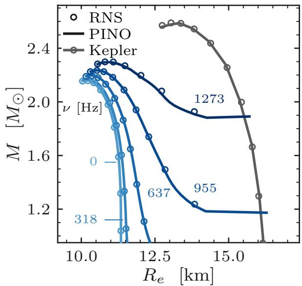

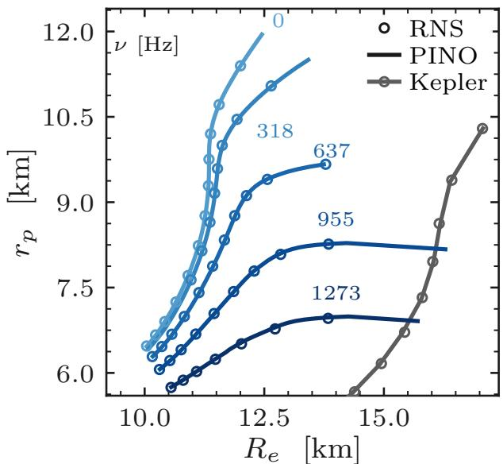  
FIG. 1. Demonstrating solver accuracy relative to RNS. In the ${ \it l e f t }$ panel, we show NS mass, and in the right panel, polar radius, both as functions of equatorial radius and angular speed for the APR4 EPP [60, 61] EoS model. The “Kepler” limit denotes the angular speed above which the NS starts to lose mass at the equator due to insuficient centripetal acceleration.

$$
\begin{array} { r l r } {  { ( \hat { \gamma } / r _ { e } ^ { 2 } ) } } \\ & { } & { ( \hat { \rho } / r _ { e } ^ { 2 } ) = \vec { d } ( s , q ) \odot [ \vec { c } + \vec { a } \odot \sum _ { k = 1 } ^ { K } \vec { b } _ { k } ( \vec { z } ) \operatorname { t a n h } t _ { k } ( s , \mu ^ { 2 } ) ] , } \\ & { } & { \vec { d } ( s , q ) = ( 1 - s , 1 - s , ( 1 - s ) ^ { 3 } \chi ( q ) ) ^ { \top } . } \end{array}\tag{5}
$$

Here $q ~ = ~ r _ { p } / r _ { e }$ , the branch $\vec { b }$ and trunk t are Multi-Layered Perceptrons [MLPs, 63] with $k$ denoting the kth output of the MLPs, and the branch input is

$$
\vec { z } = \left( \{ \epsilon _ { j } / \epsilon _ { c } \} _ { j = 1 } ^ { N _ { \mathrm { g r i d } } ^ { \varepsilon } } , \{ p _ { j } / \epsilon _ { c } \} _ { j = 1 } ^ { N _ { \mathrm { g r i d } } ^ { \varepsilon } } , h _ { c } , q \right) ,
$$

where $( \epsilon _ { j } , p _ { j } = p \varepsilon ( \epsilon ) _ { j } )$ are samples of the input EoS E. The branch network produces $\vec { b } _ { k } \in \mathbb { R } ^ { 3 }$ for each k, the trunk network produces $t _ { k } .$ and $\vec { a } , \vec { c } \in \mathbb { R } ^ { 3 }$ are additional trainable scales and ofsets (in addition to those of the MLPs); ⊙ denotes componentwise multiplication. We set $\chi ( q ) = 1$ by default, or $\chi ( q ) = \sqrt { \operatorname* { m a x } ( 1 - q , 0 ) }$ when enforcing the nonrotating limit.

Note that the DeepONet output replaces the relaxed update loop of RNS, leading to mass-radius evaluations per EoS pressure-density curve that are faster by several orders of magnitude. To predict physical solutions, we train the DeepONet’s learnable parameters in a fully unsupervised setting by minimizing a physics-only loss function. Using the DeepONet output, we construct source terms and Green’s functions of Eq. (3) and obtain ¯γ, $\bar { \rho } , \bar { \omega } \gets \hat { \gamma } , \hat { \rho } , \hat { \omega }$ . Then, the residuals

$$
r _ { \gamma } = \frac { \left. ( \bar { \gamma } - \hat { \gamma } ) ^ { 2 } \right. } { \frac { 1 } { 2 } \left. \hat { \gamma } ^ { 2 } \right. + \frac { 1 } { 2 } \left. \bar { \gamma } ^ { 2 } \right. + \epsilon } ,\tag{6}
$$

$$
r _ { \rho } = \frac { \left. ( \bar { \rho } - \hat { \rho } ) ^ { 2 } \right. } { \frac { 1 } { 2 } \left. \hat { \rho } ^ { 2 } \right. + \frac { 1 } { 2 } \left. \bar { \rho } ^ { 2 } \right. + \epsilon } ,\tag{7}
$$

$$
r _ { \omega } = \frac { \left. ( \bar { \omega } - \hat { \omega } ) ^ { 2 } \right. } { \frac { 1 } { 2 } \langle \hat { \omega } ^ { 2 } \rangle + \frac { 1 } { 2 } \langle \bar { \omega } ^ { 2 } \rangle + 1 0 ^ { - 2 } \hat { \Omega } ^ { 2 } + \epsilon _ { \omega } } ,\tag{8}
$$

$$
\epsilon = 1 0 ^ { - 4 } , \epsilon _ { \omega } = 1 0 ^ { - 6 } ,\tag{9}
$$

are used to compute the loss function:

$$
\mathcal { L } _ { \mathrm { r e s } } = \frac { 1 } { N _ { \mathrm { s a n e } } } \sum _ { i \in \mathrm { s a n e } } \Big ( r _ { \gamma } ^ { ( i ) } + r _ { \rho } ^ { ( i ) } + w _ { \omega } r _ { \omega } ^ { ( i ) } \Big ) , \qquad w _ { \omega } = 1 ,
$$

where

(10)

$$
\langle q \rangle \equiv \frac { 1 } { N _ { g r i d } ^ { s } N _ { g r i d } ^ { \mu } } \sum _ { j = 1 } ^ { N _ { g r i d } ^ { s } N _ { g r i d } ^ { \mu } } q ( s _ { j } , \mu _ { m } ) .\tag{11}
$$

At vanishing loss, the PINO output is a fixed point of the integral representation of the PDEs. By minimizing this loss function using the Adam op timizer [64], a cosine restart scheduler [65] with amplitude decay, and early stopping [66] on a validation loss plateau, we find optimal model parameters $( \vec { a } _ { k } , \vec { b _ { k } }$ ， and the weights and biases of the MLP). We note that, once trained, the DeepONet outputs are continuous functions of $r , \theta$ that can be evaluated at locations not restricted to the grid used in training [62, 67]. Our training data comprises 40000 stars, each with its own EoS generated from the spectral parametrization [68] with physically meaningful priors (that enforce causality of the sound speed and thermodynamic stability, [31]) and a central density randomly selected over the allowed range (denser than a white dwarf, rarer than the central density corresponding to the maximum mass) and a rotation speed randomly selected between the static and mass-shedding limits of said EoS. Further details about training, hyperparameter tuning, and the exact expressions of the branch and trunk MLPs are provided in the supplemental material (Algorithm 1, Eqs. (40) - (44)).

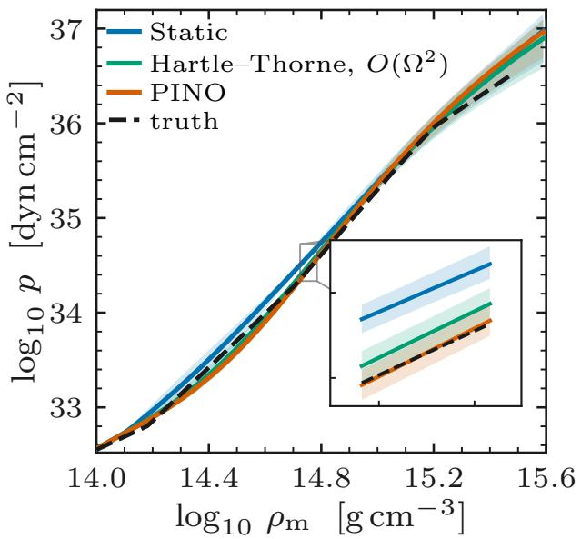

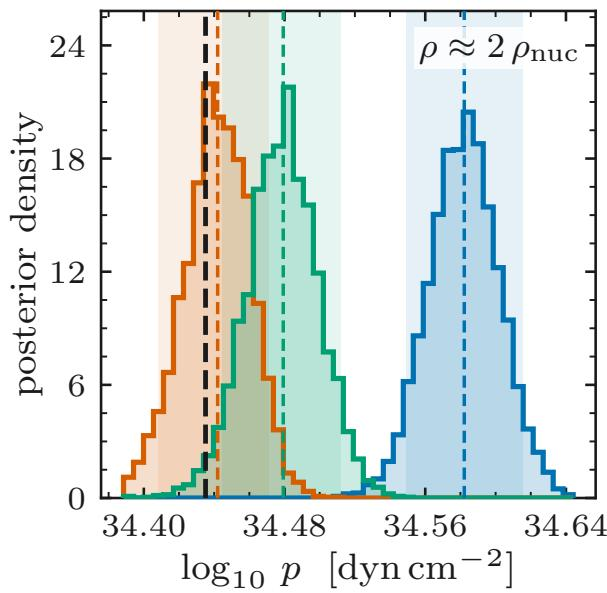  
FIG. 2. Simulation-Recovery: EoS pressure vs. mass density $\left( \rho _ { m } \right)$ posteriors for the entire range of densities (left) and at a fixed density (twice the nuclear saturation density, right). Ignoring rotation (or using second-order corrections) excludes the ground truth in favour of stifer EoSs at more than 90% confidence in several regions where ours does not.

TABLE I. Relative errors, evaluation times, and speed-ups.
<table><tr><td>Solver</td><td>|∆M| [%]</td><td> $\overline { { \vert \Delta R \vert \ \left[ \% \right] } }$ </td><td colspan="2">Time</td><td>Speed-up</td></tr><tr><td></td><td></td><td></td><td></td><td>PINO Reference</td><td></td></tr><tr><td>Rotating</td><td> $\overline { { 0 . 1 4 _ { - 0 . 0 9 } ^ { + 0 . 2 9 } } }$ </td><td> $\overline { { 0 . 0 3 _ { - 0 . 0 2 } ^ { + 0 . 2 6 } } }$ </td><td>35 ms</td><td>45s</td><td>1283×</td></tr><tr><td>Static</td><td> $0 . 1 0 _ { - 0 . 0 5 } ^ { + 0 . 5 5 }$ </td><td> $0 . 0 5 _ { - 0 . 0 4 } ^ { + 0 . 3 5 }$ </td><td>15ms</td><td>102 ms</td><td> $\mathbf { 7 } \times$ </td></tr></table>

Once trained, the solver can accurately predict $M - R _ { e }$ curves given any EoS table (that is in distribution relative to the training set) and rotation period with a severalorders-of-magnitude speed-up, as demonstrated in FIG. 1 and Table I. We further provide a much simpler PINO for the TOV equations is as part of our framework which is presented in the supplemental material (Algorithm 2); it achieves a significant speed-up relative to numerical solvers, though smaller than in the axisymmetric case. While tabulated equilibria and supervised surrogates rely on numerical stellar models [19, 21, 55, 56], our PINOs are trained once across the EoS prior without solution labels, mapping p(ϵ) and stellar parameters to continuous (mesh-free) stellar profiles evalu able on arbitrary coordinate grids.

Bayesian Hierarchical EoS Inference from Spin-massradius Observations — With our trained solvers, we can rapidly explore EoS models given data from multiple independent NS observations that facilitate spin and uncertain mass-radius measurements [9, 12, 69, 70]. The likelihood of an EoS model (E) given independent and identically distributed observations is therefore [32–35, 37, 71– 73]:

$$
\mathcal { L } ( \mathcal { E } ; \vec { d } , \vec { \Omega } ) \propto \prod _ { i = 1 } ^ { N } \int _ { { \cal M } = \hat { f } ( R _ { e } , \Omega _ { i } ) } d R _ { e } \frac { p ( R _ { e } , { \cal M } | d _ { i } ) } { \pi _ { i } ( R _ { e } | { \cal M } ) } ,\tag{12}
$$

where $p ( R _ { e } , M | d _ { i } )$ is the posterior distribution of masses and equatorial radii for the ith observation (obtained using kernel density estimation from publicly released samples) and $\pi _ { i }$ is the corresponding EoS-agnostic prior on the equatorial radius used during posterior estimation.

Our fast solvers facilitate empirical constraints on the pressure-density plane using parametrized EoS models and sampling the posterior distribution of the EoS parameters obtained with physically motivated priors:

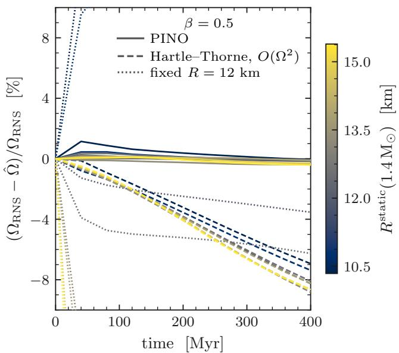  
FIG. 3. Impact of rotation-informed structure on accretiondriven spin-up for a toy mass-transfer model that assumes $\beta =$ 0.5, $\dot { M } _ { t r } \stackrel { - } { = } 1 \bar { 0 } ^ { - 9 } \mathrm { M } _ { \odot } \mathrm { y r } ^ { - 1 }$ . Three treatments of structure calculations (fixed radius [27], second-order Hartle-Thorne [22], and PINO) coupled with accretion evolution are compared against the full RNS [47] coupled evolution. PINO provides the smallest relative error at negligible computational cost.

$$
p ( \vec { \gamma } | \vec { d } , \vec { \Omega } ) \propto \pi ( \vec { \gamma } ) \mathcal { L } ( \mathcal { E } _ { \vec { \gamma } } ; \vec { d } , \vec { \Omega } ) ,\tag{13}
$$

using Markov chain Monte Carlo (MCMC).

To benchmark the performance of our solvers in mitigating EoS inference biases in a controlled setting, we perform an injection-recovery analysis (FIG. 2) using simulated mass-radius and spin measurements for ten NSs. We generate 30 injected configurations using independent RNS solutions for the APR4 EPP [60, 61] EoS, with spins drawn uniformly between 300 and 1000 Hz and masses drawn from a truncated Galactic double-Gaussian distribution [74]. We model the mass-radius measurements as uncorrelated Gaussians centered on the injected values, with 5% fractional uncertainties in both mass and radius, adopting an optimistic scenario motivated by the anticipated sample size and measurement precision of future probes [75]. The supplemental material describes both datasets (Table II) and also presents the EoS analysis of real events (FIG. 5). We note here that numerical solvers render MCMC intractable, necessitating the use of PINO solvers for EoS inference that achieves the same fidelity.

Impact on Binary Evolution — On a population level, the accuracy and scalability of NS structure solvers impact several investigations in addition to EoS inference from mass-radius-spin measurements. In particular, NS structural response during accretion is expected to sub stantially afect the observable population properties of MSPs in binary systems [18–24]. Accretion-driven spinup during mass transfer is a key evolutionary channel that connects unknown population properties at the zeroage main sequence and NS birth to the observed ensembles in radio surveys [27, 28, 38, 39, 41, 42]. Modeling these channels is crucial for constraining binary evolution and natal distributions from large survey datasets [40– $^ { 4 2 } ] ;$ existing treatments range from fixed-radius prescriptions and approximate structural corrections to precomputed fully relativistic rotating-star equilibria [19, 21– 24, 26].

While tracking the EoS-informed radius in the spherical limit can substantially alter spin-up [22] and hence the observed population of spun-up MSPs relative to treatments that fix the radius throughout mass transfer, ignoring the efects of rotation or relying on approximate rotational corrections introduces additional biases that can accumulate over time. Precomputed fully relativistic equilibria, while accurate, are costly to extend across a broad EoS prior, requiring dense grids.

For example, rotating structure can afect the spin-up prescriptions such as that in Ref. [27]:

$$
\begin{array} { r } { \left( \begin{array} { c } { \dot { M } _ { b } } \\ { \dot { J } } \\ { \dot { B } } \end{array} \right) = \left( \epsilon \dot { M } _ { b } \left( \sqrt { \frac { G M R _ { A } } { 2 } } - \frac { \Omega R _ { A } ^ { 2 } } { 4 } \right) - \frac { 8 \pi B ^ { 2 } R _ { \mathrm { e q } } ^ { 6 } \Omega ^ { 3 } \sin ^ { 2 } \alpha } { 3 \mu _ { 0 } c ^ { 3 } } \right) , } \\ { - \frac { \dot { M } _ { b } } { \kappa } ( B - B _ { \mathrm { m i n } } ) \qquad } \\ { \left( M , M _ { b } , R _ { \mathrm { e q } } , \Omega , I \right) = S _ { \mathrm { E o s } } ( \varepsilon _ { c } , J ; \vec { \gamma } ) , } \end{array}\tag{14}
$$

where $M _ { b }$ is the baryonic mass, J is the stellar angular momentum, B is the equatorial surface dipole magneticfield strength, $R _ { \mathrm { e q } }$ is the equatorial radius, and I is the moment of inertia; $\dot { M } _ { \mathrm { t r } }$ is the mass-transfer rate, $\beta$ is the accreted mass fraction, ϵ is the angular-momentum transfer eficiency, $R _ { A }$ is the Alfv´en radius, and α is the magnetic inclination angle. The function $S _ { \mathrm { E o S } }$ is the stellar-structure solver (compared between PINO, static/TOV, and Hartle-Thorne (O(Ω2) corrections to static solutions [49, 50])). Ideally, β(t) and $\dot { M } _ { t r } ( t )$ are supplied by detailed binary evolution calculations with an adopted accretion prescription [76–78].

We demonstrate in FIG. 3 that biases induced by fixed or approximate structure response accumulate over time in the predicted accretion-driven spin-up with a toy mass-transfer model that assumes $\beta = 0 . 5 , \dot { M } _ { t r } = 1 0 ^ { - 9 } \mathrm { M _ { \odot } y r ^ { - 1 } \ [ 2 0 }$ , 79]. Repeated RNS solutions, even for a fixed EoS, can take hours per star, which is prohibitive for population synthesis, and marginalizing EoS uncertainties over any prior or an independent posterior is intractable; our PINO solvers are necessary for high-fidelity spin predictions of observable MSP populations.

Conclusion — In this work, we developed PINO solvers for axisymmetric general relativistic hydrostatic equilibrium, which achieve comparable accuracy to numerical solvers while being $\sim 1 0 ^ { 3 } \times$ faster. Our solvers, trained once across the EoS prior solely by a physicsinformed loss function, provide mesh-free stellar profiles with explicit p(ϵ) dependence, complementing tabulated equilibria and supervised surrogates [19, 21, 55, 56] and facilitating EoS inference and accretion-driven spin evolution modeling at scale with self-consistent rotation. They enable higher-fidelity em pirical constraints on phenomenological EoS parameterizations and pulsar spin predictions during mass transfer, relative to static treatments and second-order rotational corrections.

While rotation-induced changes in MCMC constraints are modest relative to current measurement uncertainty, future observations will facilitate stronger constraints, with rotation-induced biases likely becoming non-negligible. In particular, the approved eXTP mission is expected to furnish tens of new observations of both rotation- and accretion-powered MSPs, providing highly precise radius measurements (within 5–10%) for a wide range of spins [75], with proposed missions [80– 82] promising expanded datasets. Alongside these advances, scalable structure calculations will enable population synthesis to self-consistently connect accretiondriven spin evolution to pulsar populations characterized by current (FAST and MeerKAT [83, 84]) and upcoming (SKA [85]) large radio-timing surveys. Looking forward, our framework presents a significant step towards scaling high-fidelity probes of degenerate nuclear matter and binary evolution to large datasets of rotating NS observations.

Future Work — Extending the PINOs to diferential rotation and magnetic fields will substantially broaden their scope; constraints on parametrized interior current [86, 87] and angular momentum distributions [88] can become computationally tractable. Magnetic equilibria linking interior currents to exterior fields and stellar deformations will enable constraints on parametrized magnetic configurations from magnetar X-ray spectra and polarization with emission modeling, and from continuous GWs if the magnetic deformation is misaligned with the spin [86–90]. Diferentially rotating equilibria would support modeling of merger-remnant collapse thresholds and, coupled with finite-temperature and oscillation-mode treatments, the interpretation of postmerger GWs anticipated with next-generation detectors [88, 91, 92].

Parallel investigations with the current solvers include ongoing eforts to incorporate GW measurements [6, 9, 12] and marginalize over population-informed priors [12, 34, 73]. We aim to expand the training set with non-parametric pressure-density priors [9, 13] and hybrid models allowing quark-matter phase transitions [13], and plan end-to-end simulation-recovery studies to explore systematics. Finally, ongoing eforts to incorporate the stellar-structure response to accretion [19, 21, 22] into detailed binary evolution frameworks such as POSYDON [76– 78] will achieve high-fidelity modeling of spin evolution during mass transfer, connecting initial stellar distributions, NS properties at birth, binary evolution physics, and dense-matter properties to observations [24, 27, 41, 42].

Code Availability and Software — The code developed to implement the solvers and all associated analyses will be made publicly available at https://github.com/ AnaryaRay1/pinoTOV upon acceptance and, in the meantime, upon reasonable request. It relies on the numpy [93], scipy [94], pytorch [95], and matplotlib [96] libraries. We have used the LALSimulation library [? , https: //git.ligo.org/lscsoft/lalsuite] to generate EoS tables and provide the static (ToV) benchmark, the RNS library [47, https://github.com/cgca/rns.git] as the numerical solver benchmark, and the QLIMR library [97, https://gitlab.com/nsf-muses/ns-qlimr/qlimr] for the Hartle-Thorne [49, 50] benchmark.

Acknowledgement — We thank Ish Gupta, Phillip Srivastava, Seth Gosage, and Jolien Creighton for useful discussions and suggestions. This work was supported by the National Science Foundation (NSF) award PHY-2207945. We are grateful for the computational resources provided by the LIGO laboratory and supported by National Science Foundation Grants PHY-0757058 and PHY-0823459. We gratefully acknowledge the support of the NSF-Simons AI-Institute for the Sky (SkAI) via grants NSF AST-2421845 and Simons Foundation MPS-AI-00010513.

Disclaimer — We acknowledge the use of Large Language Models (LLMs) in this work, specifically Anthropic’s Claude (Fable-5.1) for debugging code, strategizing optimal implementations, and improving scalability, and OpenAI’s ChatGPT (Astra 6.1) for generating plotting code, polishing text, reviewing literature, and generating Overleaf commands. LLMs were not used for any other aspect of this manuscript. The author claims sole responsibility for idea conception, the manuscript text, and all associated code, results, and claims. Every line of LLM-generated code and text, every citation, and every Overleaf command has been checked for correct ness and potential plagiarism by the author to the best of their knowledge.

\* anarya.ray@northwestern.edu

[1] J. M. Lattimer and M. Prakash, Neutron star observations: Prognosis for equation of state constraints, Physics Reports 442, 109 (2007).

[2] K. Hebeler, J. M. Lattimer, C. J. Pethick, and A. Schwenk, Equation of state and neutron star properties constrained by nuclear physics and observation, The Astrophysical Journal 773, 11 (2013).

[3] F. Ozel and P. Freire, Masses, radii, and the equation ¨ of state of neutron stars, Annual Review of Astronomy and Astrophysics 54, 401 (2016).

[4] F. Ozel, D. Psaltis, T. G¨uver, G. Baym, C. Heinke,¨ and S. Guillot, The dense matter equation of state from neutron star radius and mass measurements, The Astrophysical Journal 820, 28 (2016).

[5] R. Essick, I. Tews, P. Landry, S. Reddy, and D. E. Holz, Direct astrophysical tests of chiral efective field theory at supranuclear densities, Physical Review C 102, 055803 (2020), arXiv:2004.07744 [astro-ph.HE].

[6] T. Dietrich, M. W. Coughlin, P. T. H. Pang, M. Bulla, J. Heinzel, L. Issa, I. Tews, and S. Antier, Multimessenger constraints on the neutron-star equation of state and the hubble constant, Science 370, 1450 (2020).

[7] M. Fasano, T. Abdelsalhin, A. Maselli, and V. Ferrari, Constraining the neutron star equation of state using multiband independent measurements of radii and tidal deformabilities, Physical Review Letters 123, 141101 (2019), arXiv:1902.05078 [astro-ph.HE].

[8] M. C. Miller, C. Chirenti, and F. K. Lamb, Constraining the equation of state of high-density cold matter using nuclear and astronomical measurements, The Astrophysical Journal 888, 12 (2020), arXiv:1904.08907 [astro-ph.HE].

[9] P. Landry, R. Essick, and K. Chatziioannou, Nonparametric constraints on neutron star matter with existing and upcoming gravitational wave and pulsar observations, Physical Review D 101, 123007 (2020).

[10] G. Raaijmakers, S. K. Greif, T. E. Riley, T. Hinderer, K. Hebeler, A. Schwenk, A. L. Watts, S. Nissanke, S. Guillot, J. M. Lattimer, and R. M. Ludlam, Constraining the dense matter equation of state with joint analysis of NICER and LIGO/Virgo measurements, The Astrophysical Journal Letters 893, L21 (2020), arXiv:1912.11031 [astro-ph.HE].

[11] C. D. Capano, I. Tews, S. M. Brown, B. Margalit, S. De, S. Kumar, D. A. Brown, B. Krishnan, and S. Reddy, Stringent constraints on neutron-star radii from multimessenger observations and nuclear theory, Nature Astronomy 4, 625 (2020), arXiv:1908.10352 [astro-ph.HE].

[12] G. Raaijmakers, S. K. Greif, K. Hebeler, T. Hinderer, S. Nissanke, A. Schwenk, T. E. Riley, A. L. Watts, J. M. Lattimer, and W. C. G. Ho, Constraints on the dense matter equation of state and neutron star properties from NICER’s mass–radius estimate of PSR J0740+6620 and multimessenger observations, The Astrophysical Journal Letters 918, L29 (2021).

[13] I. Legred, K. Chatziioannou, R. Essick, S. Han, and P. Landry, Impact of the PSR J0740+6620 radius constraint on the properties of high-density matter, Physical Review D 104, 063003 (2021), arXiv:2106.05313 [astro-ph.HE].

[14] B. Biswas, Bayesian model selection of neutron star equations of state using multi-messenger observations, The Astrophysical Journal 10.3847/1538-4357/ac447b (2022), arXiv:2106.02644 [astro-ph.HE].

[15] S. Huth, P. T. H. Pang, I. Tews, T. Dietrich, A. Le F\`evre, A. Schwenk, W. Trautmann, K. Agarwal, M. Bulla, M. W. Coughlin, and C. Van Den Broeck, Constraining neutron-star matter with microscopic and macroscopic collisions, Nature 606, 276 (2022), arXiv:2107.06229 [nucl-th].

[16] P. T. H. Pang, T. Dietrich, M. W. Coughlin, M. Bulla, I. Tews, et al., An updated nuclear-physics and multimessenger astrophysics framework for binary neutron star mergers, Nature Communications 14, 8352 (2023), arXiv:2205.08513 [astro-ph.HE].

[17] G. B. Cook, S. L. Shapiro, and S. A. Teukolsky, Recycling pulsars to millisecond periods in general relativity, The Astrophysical Journal Letters 423, L117 (1994).

[18] L. Burderi, A. Possenti, M. Colpi, T. Di Salvo, and N. D’Amico, Neutron stars with submillisecond periods: A population of high-mass objects?, The Astrophysical Journal 519, 285 (1999), arXiv:astro-ph/9904331.

[19] G. Lavagetto, L. Burderi, F. D’Antona, T. Di Salvo, R. Iaria, and N. R. Robba, The diferent fates of a low-mass x-ray binary—i. conservative mass transfer, Monthly Notices of the Royal Astronomical Society 348, 73 (2004), arXiv:astro-ph/0310463.

[20] M. Bejger, M. Fortin, P. Haensel, and J. L. Zdunik, Implications of the measured parameters of PSR J1903+0327 for its progenitor neutron star, Astronomy & Astrophysics 536, A87 (2011), arXiv:1106.2432 [astro-ph.SR].

[21] M. Fortin, M. Bejger, P. Haensel, and J. L. Zdunik, Progenitor neutron stars of the lightest and heaviest millisecond pulsars, Astronomy & Astrophysics 586, A109 (2016), arXiv:1409.1120 [astro-ph.SR].

[22] A. M. Holgado, H. O. Silva, P. M. Ricker, and N. Yunes, The role of strong gravity and the nuclear equation of state on neutron-star common-envelope accretion, Astrophys. J. Lett. 910, L22 (2021), arXiv:2101.08267 [astro-ph.HE].

[23] A. Possenti, M. Colpi, N. D’Amico, and L. Burderi, Population synthesis of millisecond and submillisecond pulsars, The Astrophysical Journal Letters 497, L97 (1998), arXiv:astro-ph/9802257.

[24] A. Possenti, M. Colpi, U. Geppert, L. Burderi, and N. D’Amico, Recycling neutron stars to ultrashort periods: A statistical analysis of their evolution in the µ– P plane, The Astrophysical Journal Supplement Series 125, 463 (1999), arXiv:astro-ph/9907231.

[25] F. Gittins and N. Andersson, Population synthesis of accreting neutron stars emitting gravitational waves, Monthly Notices of the Royal Astronomical Society 488, 99 (2019), arXiv:1811.00550 [astro-ph.HE].

[26] D. Chattopadhyay, S. Stevenson, J. R. Hurley, M. Bailes, and F. Broekgaarden, Modelling neutron star–black hole binaries: Future pulsar surveys and gravitational wave detectors, Monthly Notices of the Royal Astronomical Society 504, 3682 (2021), arXiv:2011.13503 [astro-ph.HE].

[27] D. Chattopadhyay, K. A. Rocha, S. Gossage, V. Kalogera, K. El-Badry, and A. Tchekhovskoy, Modeling the future of gaia neutron star–mainsequence binaries: From eccentric orbits to millisecond pulsar–white dwarfs, Astrophys. J. 1000, 190 (2026), arXiv:2510.16201 [astro-ph.SR].

[28] M. Sautron, J. P´etri, D. Mitra, A. Dupuy-Junet, and M.-E. Pietrin, Born to be recycled: A comprehensive population synthesis of the galactic millisecond pulsars, Astronomy & Astrophysics 707, A257 (2026), arXiv:2510.15661 [astro-ph.HE].

[29] T. E. Riley, A. L. Watts, S. Bogdanov, P. S. Ray, R. M. Ludlam, S. Guillot, Z. Arzoumanian, C. L. Baker, A. V. Bilous, D. Chakrabarty, K. C. Gendreau, A. K. Harding,

W. C. G. Ho, J. M. Lattimer, S. M. Morsink, and T. E. Strohmayer, A NICER view of PSR J0030+0451: Millisecond pulsar parameter estimation, The Astrophysical Journal Letters 887, L21 (2019).

[30] M. C. Miller and F. K. Lamb, Observational constraints on neutron star masses and radii, The European Physical Journal A 52, 63 (2016).

[31] B. P. Abbott et al. (LIGO Scientific Collaboration and Virgo Collaboration), GW170817: Measurements of neutron star radii and equation of state, Physical Review Letters 121, 161101 (2018).

[32] S. Ghosh, X. Liu, J. Creighton, I. Maga˜na Hernandez, W. Kastaun, and G. Pratten, Rapid model comparison of equations of state from gravitational wave observation of binary neutron star coalescences, Physical Review D 104, 083003 (2021).

[33] A. Ray, M. Camilo, J. Creighton, S. Ghosh, and S. Morisaki, Rapid hierarchical inference of neutron star equation of state from multiple gravitational wave observations of binary neutron star coalescences, Physical Review D 107, 043035 (2023).

[34] J. Golomb and C. Talbot, Hierarchical inference of binary neutron star mass distribution and equation of state with gravitational waves, The Astrophysical Journal 926, 79 (2022).

[35] K. J. Wagner, R. O’Shaughnessy, A. Yelikar, N. Manning, D. Fernando, J. Lange, V. Tiwari, A. Fernando, and D. Williams, Narrowing RIFT: Focused simulationbased-inference for interpreting exceptional GW sources (2025), arXiv:2505.11655 [astro-ph.IM].

[36] A. Vilkha, A. Yelikar, R. O’Shaughnessy, and J. Read, Inference on neutron star parameters and the nuclear equation of state with RIFT, using prior EOS information (2024), arXiv:2407.15753 [gr-qc].

[37] R. O’Shaughnessy and Z. Zhu, Adaptive proposals for nonparametric equation-of-state inference with RIFT: Iterative gaussian-process refinement in a compressed sequence representation (2026), arXiv:2610.07424 [astro-ph.HE].

[38] P. D. Kiel, J. R. Hurley, M. Bailes, and J. R. Murray, Populating the galaxy with pulsars—i. stellar and binary evolution, Monthly Notices of the Royal Astronomical Society 388, 393 (2008), arXiv:0805.0059 [astro-ph].

[39] S. Os lowski, T. Bulik, D. Gondek-Rosi´nska, and K. Belczy´nski, Population synthesis of double neutron stars, Monthly Notices of the Royal Astronomical Society 413, 461 (2011).

[40] A. Vigna-G´omez, C. J. Neijssel, S. Stevenson, J. W. Barrett, K. Belczynski, S. Justham, S. E. de Mink, B. M¨uller, P. Podsiadlowski, M. Renzo, D. Sz´ecsi, and I. Mandel, On the formation history of galactic double neutron stars, Monthly Notices of the Royal Astronomical Society 481, 4009 (2018), arXiv:1805.07974 [astroph.SR].

[41] D. Chattopadhyay, S. Stevenson, J. R. Hurley, L. J. Rossi, and C. Flynn, Modelling double neutron stars: Radio and gravitational waves, Monthly Notices of the Royal Astronomical Society 494, 1587 (2020), arXiv:1912.02415 [astro-ph.HE].

[42] C. Sgalletta, G. Iorio, M. Mapelli, M. C. Artale, L. Boco, D. Chattopadhyay, A. Lapi, A. Possenti, S. Rinaldi, and M. Spera, Binary neutron star populations in the milky way, Monthly Notices of the Royal Astronomical Society 526, 2210 (2023), arXiv:2305.04955 [astro-

ph.HE].

[43] T. E. Riley, G. Raaijmakers, and A. L. Watts, On parametrized cold dense matter equation-of-state inference, Monthly Notices of the Royal Astronomical Society 478, 1093 (2018).

[44] R. C. Tolman, Static solutions of Einstein’s field equations for spheres of fluid, Physical Review 55, 364 (1939).

[45] J. R. Oppenheimer and G. M. Volkof, On massive neutron cores, Physical Review 55, 374 (1939).

[46] L. Lindblom, Determining the nuclear equation of state from neutron-star masses and radii, The Astrophysical Journal 398, 569 (1992).

[47] N. Stergioulas and J. L. Friedman, Comparing models of rapidly rotating relativistic stars constructed by two numerical methods, The Astrophysical Journal 444, 306 (1995), arXiv:astro-ph/9411032.

[48] E. Gourgoulhon, An introduction to the theory of rotating relativistic stars (2010), arXiv:1003.5015 [gr-qc].

[49] J. B. Hartle, Slowly rotating relativistic stars. i. equations of structure, The Astrophysical Journal 150, 1005 (1967).

[50] J. B. Hartle and K. S. Thorne, Slowly rotating relativistic stars. ii. models for neutron stars and supermassive stars, The Astrophysical Journal 153, 807 (1968).

[51] M. Baub¨ock, F. Ozel, D. Psaltis, and S. M. Morsink, ¨ Rotational corrections to neutron-star radius measurements from thermal spectra, The Astrophysical Journal 799, 22 (2015).

[52] S. Wang, H. Wang, and P. Perdikaris, Learning the solution operator of parametric partial diferential equations with physics-informed DeepONets, Science Advances 7, eabi8605 (2021).

[53] Z. Li, H. Zheng, N. Kovachki, D. Jin, H. Chen, B. Liu, K. Azizzadenesheli, and A. Anandkumar, Physicsinformed neural operator for learning partial diferential equations (2021), arXiv:2111.03794 [cs.LG].

[54] G. Bezerra, V. Dexheimer, and R. Negreiros, Neutron star equation of state via physics informed neural network (2026), arXiv:2605.31198 [astro-ph.HE].

[55] W. Liu, L. Wang, and Z. Zhu, Reconstruction of fastrotating neutron star observables with the neural network (2026), arXiv:2604.05428 [astro-ph.HE].

[56] G. Papigkiotis, G. Vardakas, A. Likas, and N. Stergioulas, Universal description of a neutron star’s surface and its key global properties: A machine learning approach for nonrotating and rapidly rotating stellar models, Physical Review D 111, 083056 (2025), arXiv:2501.18544 [astro-ph.HE].

[57] H. Komatsu, Y. Eriguchi, and I. Hachisu, Rapidly rotating general relativistic stars—i. numerical method and its application to uniformly rotating polytropes, Monthly Notices of the Royal Astronomical Society 237, 355 (1989).

[58] G. B. Cook, S. L. Shapiro, and S. A. Teukolsky, Rapidly rotating polytropes in general relativity, The Astrophysical Journal 422, 227 (1994).

[59] N. Stergioulas, Users manual for RNS, Documentation distributed with the RNS code, accessed 18 October 2026.

[60] A. Akmal, V. R. Pandharipande, and D. G. Ravenhall, Equation of state of nucleon matter and neutron star structure, Physical Review C 58, 1804 (1998).

[61] J. S. Read, B. D. Lackey, B. J. Owen, and J. L. Friedman, Constraints on a phenomenologically parametrized neutron-star equation of state, Physical Review D 79, 124032 (2009).

[62] L. Lu, P. Jin, G. Pang, Z. Zhang, and G. E. Karniadakis, Learning nonlinear operators via DeepONet based on the universal approximation theorem of operators, Nature Machine Intelligence 3, 218 (2021).

[63] I. Goodfellow, Y. Bengio, and A. Courville, Deep Learning (MIT Press, 2016).

[64] D. P. Kingma and J. Ba, Adam: A method for stochastic optimization, in International Conference on Learning Representations (2015) arXiv:1412.6980 [cs.LG].

[65] I. Loshchilov and F. Hutter, SGDR: Stochastic gradient descent with warm restarts, in International Conference on Learning Representations (2017) arXiv:1608.03983 [cs.LG].

[66] L. Prechelt, Automatic early stopping using cross validation: Quantifying the criteria, Neural Networks 11, 761 (1998).

[67] N. Kovachki, Z. Li, B. Liu, K. Azizzadenesheli, K. Bhattacharya, A. Stuart, and A. Anandkumar, Neural operator: Learning maps between function spaces with applications to PDEs, Journal of Machine Learning Research 24, 1 (2023).

[68] L. Lindblom, Spectral representations of neutron-star equations of state, Physical Review D 82, 103011 (2010).

[69] P. Landry and R. Essick, Nonparametric inference of the neutron star equation of state from gravitational wave observations, Physical Review D 99, 084049 (2019).

[70] R. Essick, P. Landry, and D. E. Holz, Nonparametric inference of neutron star composition, equation of state, and maximum mass with GW170817, Physical Review D 101, 063007 (2020).

[71] B. D. Lackey and L. Wade, Reconstructing the neutronstar equation of state with gravitational-wave detectors from a realistic population of inspiralling binary neutron stars, Physical Review D 91, 043002 (2015).

[72] J. Lange, R. O’Shaughnessy, and M. Rizzo, Rapid and accurate parameter inference for coalescing, precessing compact binaries (2018), arXiv:1805.10457 [gr-qc].

[73] D. Wysocki, R. O’Shaughnessy, L. Wade, and J. Lange, Inferring the neutron star equation of state simultaneously with the population of merging neutron stars (2020), arXiv:2001.01747 [gr-qc].

[74] J. Alsing, H. O. Silva, and E. Berti, Evidence for a maximum mass cut-of in the neutron star mass distribution and constraints on the equation of state, Monthly Notices of the Royal Astronomical Society 478, 1377 (2018), arXiv:1709.07889 [astro-ph.HE].

[75] A. Li, A. L. Watts, G. Zhang, et al., Dense matter in neutron stars with eXTP, Science China Physics, Mechanics & Astronomy 68, 119503 (2025), arXiv:2506.08104 [astro-ph.HE].

[76] T. Fragos et al., POSYDON: A general-purpose population synthesis code with detailed binary-evolution simulations, The Astrophysical Journal Supplement Series 264, 45 (2023), arXiv:2202.05892.

[77] J. J. Andrews et al., POSYDON version 2: Population synthesis with detailed binary-evolution simulations across a cosmological range of metallicities, The Astrophysical Journal Supplement Series 281, 3 (2025), arXiv:2411.02376.

[78] A. Chattaraj, J. J. Andrews, S. S. Bavera, M. Briel, D. Chattopadhyay, T. Fragos, S. Gossage, V. Kalogera, K. Kovlakas, M. U. Kruckow, C. Liotine, K. A. Rocha, P. M. Srivastava, M. Sun, E. Teng, Z. Xing, and E. Zapartas, Forming double neutron stars using detailed binary evolution models with POSYDON: Comparison to the galactic systems, The Astrophysical Journal 997, 52 (2026), arXiv:2508.00186 [astro-ph.SR].

[79] A. Kar, P. Ojha, and S. Bhattacharyya, Long-term evolution of spin and other properties of neutron star lowmass X-ray binaries: implications for millisecond X-ray pulsars, Monthly Notices of the Royal Astronomical So ciety 535, 344 (2024), arXiv:2410.08173 [astro-ph.HE].

[80] M. Cruise, M. Guainazzi, J. Aird, et al., The NewAthena mission concept in the context of the next decade of X-ray astronomy, Nature Astronomy 9, 36 (2025), arXiv:2501.03100 [astro-ph.IM].

[81] Colibr\`ı Collaboration, X-Ray Bursts, https://www. colibri-telescope.ca/science/x-ray-bursts/, accessed 2026-10-19.

[82] P. S. Ray, P. W. A. Roming, A. Argan, et al., Spectroscopic time-resolving observatory for broadband energy X-rays: mission overview, Journal of Astronomical Telescopes, Instruments, and Systems 10, 042504 (2024), arXiv:2410.08342 [astro-ph.IM].

[83] J. L. Han et al., The FAST galactic plane pulsar snapshot survey: I. project design and pulsar discoveries, Research in Astronomy and Astrophysics 21, 107 (2021), arXiv:2105.08460.

[84] M. Bailes et al., The MeerKAT telescope as a pulsar facility: System verification and early science results from MeerTime, Publications of the Astronomical Society of Australia 37, e028 (2020).

[85] E. F. Keane et al., A cosmic census of radio pulsars with the SKA, in Advancing Astrophysics with the Square Kilometre Array, Proceedings of Science, Vol. AASKA14 (2015) p. 040, arXiv:1501.00056.

[86] A. G. Pili, N. Bucciantini, and L. Del Zanna, General relativistic neutron stars with twisted magnetosphere, Monthly Notices of the Royal Astronomical Society 447, 2821 (2015).

[87] A. G. Pili, N. Bucciantini, and L. Del Zanna, General relativistic models for rotating magnetized neutron stars in conformally flat space–time, Monthly Notices of the Royal Astronomical Society 470, 2469 (2017).

[88] K. Ury¯u, A. Tsokaros, L. Baiotti, F. Galeazzi, K. Taniguchi, and S. Yoshida, Modeling diferential rotations of compact stars in equilibriums, Physical Review D 96, 103011 (2017).

[89] R. Taverna, R. Turolla, F. Muleri, J. Heyl, S. Zane, et al., Polarized x-rays from a magnetar, Science 378, 646 (2022).

[90] J. Frieben and L. Rezzolla, Equilibrium models of relativistic stars with a toroidal magnetic field, Monthly Notices of the Royal Astronomical Society 427, 3406 (2012).

[91] A. Bauswein and N. Stergioulas, Semi-analytic derivation of the threshold mass for prompt collapse in binary neutron-star mergers, Monthly Notices of the Royal Astronomical Society 471, 4956 (2017).

[92] M. Breschi, R. Gamba, G. Carullo, S. Borhanian, and S. Bernuzzi, Kilohertz gravitational waves from binary neutron star mergers. II. inference of postmerger signals with the Einstein Telescope, Physical Review D 112,

124001 (2025).

[93] C. R. Harris et al., Array programming with NumPy, Nature 585, 357 (2020).

[94] P. Virtanen et al., SciPy 1.0: Fundamental algorithms for scientific computing in Python, Nature Methods 17, 261 (2020).

[95] A. Paszke et al., PyTorch: An imperative style, highperformance deep learning library, in Advances in Neural Information Processing Systems, Vol. 32 (2019) arXiv:1912.01703 [cs.LG].

[96] J. D. Hunter, Matplotlib: A 2d graphics environment, Computing in Science & Engineering 9, 90 (2007).

[97] C. A. Conde Ocazionez, H. Tan, and N. Yunes, QLIMR module (2024).

[98] A. W. Steiner, J. M. Lattimer, and E. F. Brown, The neutron star mass–radius relation and the equation of state of dense matter, The Astrophysical Journal Letters 765, L5 (2013).

[99] Y. Kini et al., Impact of accretion assumptions on pulse profile modelling of superburst oscillations in 4U 1636- 536, Monthly Notices of the Royal Astronomical Society 541, 46 (2025).

[100] D. K. Galloway et al., Constraining neutron-star properties with ensembles of thermonuclear bursts: Application to SRGA J144459.2-604207 (2026), arXiv:2608.21196 [astro-ph.HE].

[101] T. Salmi et al., The radius of the high-mass pulsar PSR J0740+6620 with 3.6 yr of NICER data, The Astrophysical Journal 974, 294 (2024).

[102] M. C. Miller et al., The radius of the neutron star PSR J0614-3329 from NICER data (2026), arXiv:2609.00965 [astro-ph.HE].

[103] T. Salmi et al., A NICER view of PSR J1231-1411: A complex case, The Astrophysical Journal 976, 58 (2024).

[104] D. Choudhury et al., A NICER view of the nearest and brightest millisecond pulsar: PSR J0437-4715, The Astrophysical Journal Letters 971, L20 (2024).

[105] T. G¨uver, F. Ozel, A. Cabrera-Lavers, and P. Wrob-¨ lewski, The distance, mass, and radius of the neutron star in 4U 1608-52, The Astrophysical Journal 712, 964 (2010).

[106] F. Ozel, A. Gould, and T. G¨uver, The mass and radius¨ of the neutron star in the bulge low-mass x-ray binary KS 1731-260, The Astrophysical Journal 748, 5 (2012).

[107] T. G¨uver and F. Ozel, The mass and the radius of the¨ neutron star in the transient low-mass x-ray binary SAX J1748.9-2021, The Astrophysical Journal Letters 765, L1 (2013).

[108] R. W. Romani, D. Kandel, A. V. Filippenko, T. G. Brink, and W. Zheng, PSR J0952-0607: The fastest and heaviest known galactic neutron star, The Astrophysical Journal Letters 934, L17 (2022), arXiv:2207.05124 [astro-ph.HE].

[109] C. G. Bassa, Z. Pleunis, J. W. T. Hessels, E. C. Ferrara, R. P. Breton, N. V. Gusinskaia, V. I. Kondratiev, S. Sanidas, L. Nieder, C. J. Clark, T. Li, A. S. van Amesfoort, T. H. Burnett, F. Camilo, P. F. Michelson, S. M. Ransom, P. S. Ray, and K. Wood, LOFAR discovery of the fastest-spinning millisecond pulsar in the galactic field, The Astrophysical Journal Letters 846, L20 (2017), arXiv:1709.01453 [astro-ph.HE].

[110] M. Gabler, P. Cerd´a-Dur´an, N. Stergioulas, J. A. Font,

and E. M¨uller, Constraining properties of high-density matter in neutron stars with magneto-elastic oscillations, Monthly Notices of the Royal Astronomical Society 476, 4199 (2018).

[111] A. Endrizzi, R. Ciolfi, B. Giacomazzo, W. Kastaun, and T. Kawamura, General relativistic magnetohydrodynamic simulations of binary neutron star mergers with the APR4 equation of state, Classical and Quantum Gravity 33, 164001 (2016), arXiv:1604.03445 [astroph.HE].

## Supplementl Material

Here we provide additional details and results for our framework and analysis.

PDEs and Green’s functions.

PDEs and Green’s functions. We use geometrized units, $G = c = 1$ , and the metric, perfect-fluid stress– energy tensor, log-enthalpy, and coordinate equatorial radius defined in the main text, which we repeat here for the sake of continuity:

$$
\begin{array} { l } { { d s ^ { 2 } = - e ^ { \gamma + \rho } d t ^ { 2 } + e ^ { 2 \alpha } ( d r ^ { 2 } + r ^ { 2 } d \theta ^ { 2 } ) } } \\ { { \qquad + e ^ { \gamma - \rho } r ^ { 2 } \sin ^ { 2 } \theta ( d \phi - \omega d t ) ^ { 2 } , } } \\ { { T ^ { \mu \nu } = ( \epsilon + p ) u ^ { \mu } u ^ { \nu } + p g ^ { \mu \nu } , } } \\ { { u ^ { \mu } = \displaystyle \frac { e ^ { - ( \gamma + \rho ) / 2 } } { \sqrt { 1 - v ^ { 2 } } } ( 1 , 0 , 0 , \Omega ) , } } \\ { { \qquad v = ( \Omega - \omega ) r \sin \theta e ^ { - \rho } . } } \end{array}\tag{15}
$$

$$
\begin{array} { c } { { H ( r , \theta ) = H ( p ( r , \theta ) ) = \displaystyle \int _ { 0 } ^ { p ( r , \theta ) } \displaystyle \frac { d p ^ { \prime } } { \epsilon ( p ^ { \prime } ) + p ^ { \prime } } , } } \\ { { H ( r _ { e } , \pi / 2 ) = 0 . } } \end{array}\tag{16}
$$

The potentials $\gamma , \rho , \alpha , \omega$ in Eq. (15) are physical metric functions; in particular, $\rho$ is not the matter density. Define

$$
\begin{array} { l l } { \nu = \displaystyle \frac { \gamma + \rho } { 2 } , } & { Q = \displaystyle \frac { \epsilon + p } { 1 - v ^ { 2 } } , } \\ { v = ( \Omega - \omega ) r \sin \theta e ^ { - \rho } , } & { W = r ^ { 2 } \sin ^ { 2 } \theta e ^ { - 2 \rho } ( \partial \omega ) ^ { 2 } . } \end{array}\tag{17}
$$

Here ϵ and p are the fluid-frame energy density and pressure, and Ω is the uniform angular velocity relative to infinity.

The equilibrium equations can be written as [48]

$$
\begin{array} { c } { { \Delta _ { 3 } \nu = 4 \pi e ^ { 2 \alpha } [ Q ( 1 + v ^ { 2 } ) + 2 p ] + \textstyle { \frac { 1 } { 2 } } W - \partial \nu \partial \gamma , } } \\ { { \mathcal D _ { 4 } e ^ { \gamma } = 1 6 \pi e ^ { 2 \alpha + \gamma } p , } } \\ { { \mathcal D _ { 5 } \omega = - 1 6 \pi e ^ { 2 \alpha } Q ( \Omega - \omega ) + \partial \omega \partial ( 4 \nu - 3 \gamma ) , } } \\ { { \Delta _ { 2 } ( \alpha + \nu ) = 8 \pi e ^ { 2 \alpha } ( p + Q v ^ { 2 } ) + \textstyle { \frac { 3 } { 4 } } W - ( \partial \nu ) ^ { 2 } , } } \\ { { { \frac { \partial _ { i } p } { \epsilon + p } = - \partial _ { i } \bigl [ \nu + \textstyle { \frac { 1 } { 2 } } \ln ( 1 - v ^ { 2 } ) \bigr ] , } } } \end{array}\tag{18}
$$

closed by $\epsilon = \epsilon ( p )$ and $\Omega = \mathrm { c o n s t }$ . The fifth equation is a first-order hydrostationary equation, with $i \in \{ r , \theta \}$

The diferential operators are

$$
\begin{array} { r l } & { \displaystyle \Delta _ { 2 } = \partial _ { r } ^ { 2 } + \frac { 1 } { r } \partial _ { r } + \frac { 1 } { r ^ { 2 } } \partial _ { \theta } ^ { 2 } , } \\ & { \displaystyle \Delta _ { 3 } = \partial _ { r } ^ { 2 } + \frac { 2 } { r } \partial _ { r } + \frac { 1 } { r ^ { 2 } } ( \partial _ { \theta } ^ { 2 } + \cot \theta \partial _ { \theta } ) , } \\ & { \displaystyle \mathcal { T } = \frac { 1 } { r } \partial _ { r } + \frac { \cot \theta } { r ^ { 2 } } \partial _ { \theta } , } \\ & { \displaystyle \mathcal { D } _ { d } = \Delta _ { 3 } + ( d - 3 ) \mathcal { T } , } \\ & { \displaystyle \partial f \partial g = f , r g _ { r } + \frac { 1 } { r ^ { 2 } } f , \theta g , \theta , \qquad ( \partial f ) ^ { 2 } = \partial f \partial f . } \end{array}\tag{19}
$$

We use $\mathcal { D } _ { 3 } = \Delta _ { 3 }$ below.

Matter and surface conditions. Integration of the hydrostationary equation gives [48, 58]

$$
\begin{array} { c } { { H ( r , \theta ) = C - \nu ( r , \theta ) - \frac 1 2 \ln ( 1 - v ^ { 2 } ) , } } \\ { { C = H _ { c } + \nu _ { c } = \nu _ { p } . } } \end{array}\tag{20}
$$

The subscripts $c , p ,$ e denote the centre, polar surface, and equatorial surface. The coordinate surface radii obey, consistently with Eq. (16),

$$
H ( r _ { p } , 0 ) = 0 , \qquad H ( r _ { e } , \pi / 2 ) = 0 .\tag{21}
$$

The stellar interior V is the connected matter region containing the centre. Within V, EoS interpolation supplies $\epsilon ( H )$ and $p ( H )$ ; outside it, $\epsilon = p = 0$ . The Bernoulli expression continued outside the star need not represent a physical fluid enthalpy.

At the centre and pole $v = 0$ , while the equatorial surface condition yields

$$
\begin{array} { c } { { 2 H _ { c } = ( \gamma + \rho ) _ { p } - ( \gamma + \rho ) _ { c } , } } \\ { { \Omega = \omega _ { e } + \displaystyle \frac { e ^ { \rho _ { e } } } { r _ { e } } \sqrt { 1 - e ^ { 2 ( \nu _ { p } - \nu _ { e } ) } } . } } \end{array}\tag{22}
$$

The positive root selects the corresponding orientation of rotation. These are equilibrium relations: the coordinate radius $r _ { e }$ is determined jointly with the fields and the surface, rather than independently by the centre–pole relation.

Elliptic equations used for the Green map. The first three field equations can be rearranged into the KEH form [57, 58]

$$
\begin{array} { r } { \mathcal { D } _ { 3 } ( \rho e ^ { \gamma / 2 } ) = S _ { \rho } , } \\ { \mathcal { D } _ { 4 } ( \gamma e ^ { \gamma / 2 } ) = S _ { \gamma } , } \\ { \mathcal { D } _ { 5 } ( \omega e ^ { \gamma / 2 - \rho } ) = S _ { \omega } . } \end{array}\tag{23}
$$

With the operator conventions above, the sources are

$$
\begin{array} { r l } & { S _ { \rho } = e ^ { \gamma / 2 } \Big \{ 8 \pi e ^ { 2 \alpha } Q ( 1 + v ^ { 2 } ) + W + T \gamma } \\ & { \qquad + \rho \left[ 8 \pi e ^ { 2 \alpha } p - \frac { 1 } { 2 } T \gamma - \frac { 1 } { 4 } ( \partial \gamma ) ^ { 2 } \right] \Big \} , } \\ & { S _ { \gamma } = e ^ { \gamma / 2 } \left[ 1 6 \pi e ^ { 2 \alpha } p ( 1 + \gamma / 2 ) - \frac { \gamma } { 4 } ( \partial \gamma ) ^ { 2 } \right] , } \\ & { S _ { \omega } = e ^ { \gamma / 2 - \rho } \Big \{ - 1 6 \pi e ^ { 2 \alpha } Q \Omega } \\ & { \qquad + \omega \left[ 8 \pi e ^ { 2 \alpha } ( \epsilon + 2 p ) - W + \left( \partial \rho \right) ^ { 2 } - \frac { 1 } { 4 } ( \partial \gamma ) ^ { 2 } \right. } \\ & { \qquad \quad \left. - 2 T \rho - \frac { 1 } { 2 } T \gamma \right] \Big \} . } \end{array}\tag{24}
$$

All quantities on these right-hand sides are evaluated from the input fields and their associated matter profiles.

Angular bases, prefactors, and kernels. Assuming equatorial reflection symmetry, let

$$
\begin{array} { c } { { d _ { \rho } = 3 , \qquad d _ { \gamma } = 4 , \qquad d _ { \omega } = 5 , } } \\ { { \displaystyle Y _ { u , n } ( \mu ) = C _ { 2 n } ^ { ( d _ { u } - 2 ) / 2 } ( \mu ) , \qquad n = 0 , 1 , \ldots , } } \\ { { w _ { d } ( \mu ) = ( 1 - \mu ^ { 2 } ) ^ { ( d - 3 ) / 2 } , } } \\ { { \displaystyle N _ { d , n } = \int _ { 0 } ^ { 1 } w _ { d } ( \mu ) [ C _ { 2 n } ^ { ( d - 2 ) / 2 } ( \mu ) ] ^ { 2 } d \mu . } } \end{array}\tag{25}
$$

Here $C _ { \ell } ^ { \lambda }$ is a Gegenbauer polynomial. Explicitly,

$$
\begin{array} { r l r } {  { Y _ { \rho , n } ( \mu ) = P _ { 2 n } ( \mu ) , } } \\ & { } & \\ & { } & { Y _ { \gamma , n } ( \cos \theta ) = \frac { \sin [ ( 2 n + 1 ) \theta ] } { \sin \theta } , } \\ & { } & \\ & { } & { Y _ { \omega , n } ( \mu ) = \frac { d P _ { 2 n + 1 } ( \mu ) } { d \mu } , } \\ & { } & { N _ { 3 , n } = \frac { 1 } { 4 n + 1 } , \quad \quad N _ { 4 , n } = \frac { \pi } { 4 } , } \\ & { } & \\ & { } & { N _ { 5 , n } = \frac { ( 2 n + 1 ) ( 2 n + 2 ) } { 4 n + 3 } . } \end{array}\tag{26}
$$

Values at the axis are understood by continuity.

The metric prefactors in Eq. (30) are

$$
A _ { \rho } = A _ { \gamma } = e ^ { - \gamma / 2 } , \qquad A _ { \omega } = e ^ { \rho - \gamma / 2 } .\tag{27}
$$

The minus sign from inversion of the elliptic operators is included in the kernels below.

Define

$$
\begin{array} { c c } { \displaystyle r ( s ) = \frac { r _ { e } s } { 1 - s } , } & { \displaystyle \frac { d r ^ { \prime } } { d s ^ { \prime } } = \frac { r _ { e } } { ( 1 - s ^ { \prime } ) ^ { 2 } } , } \\ { \displaystyle r _ { < } = \operatorname* { m i n } \{ r ( s ) , r ( s ^ { \prime } ) \} , } & { \displaystyle r _ { > } = \operatorname* { m a x } \{ r ( s ) , r ( s ^ { \prime } ) \} . } \end{array}\tag{28}
$$

Then the kernels corresponding to the physicalcoordinate sources defined above are

$$
\begin{array} { r l } { \displaystyle K _ { u , n } ( s , s ^ { \prime } , \mu ^ { \prime } ) = } & { - \frac { w _ { d _ { u } } ( \mu ^ { \prime } ) Y _ { u , n } ( \mu ^ { \prime } ) } { ( 4 n + d _ { u } - 2 ) N _ { d _ { u , n } } } } \\ { \displaystyle \times \frac { r _ { < } ^ { 2 n } } { r _ { > } ^ { 2 n + d _ { u } - 2 } } \left[ r ( s ^ { \prime } ) \right] ^ { d _ { u } - 1 } \frac { r _ { e } } { ( 1 - s ^ { \prime } ) ^ { 2 } } . } \end{array}\tag{29}
$$

Thus

$$
\begin{array} { l } { { \displaystyle \bar { u } ( s , \mu ) = A _ { u } ( s , \mu ) \sum _ { n = 0 } ^ { \infty } Y _ { u , n } ( \mu ) } } \\ { { \displaystyle ~ \times \int _ { 0 } ^ { 1 } \int _ { 0 } ^ { 1 } K _ { u , n } ( s , s ^ { \prime } , \mu ^ { \prime } ) S _ { u } ( s ^ { \prime } , \mu ^ { \prime } ) d s ^ { \prime } d \mu ^ { \prime } . } } \end{array}\tag{30}
$$

Here $S _ { u } ( s ^ { \prime } , \mu ^ { \prime } )$ means the physical-coordinate source evaluated at $r ^ { \prime } = r _ { e } s ^ { \prime } / ( 1 - s ^ { \prime } )$ and $\theta ^ { \prime } = \operatorname { a r c c o s } \mu ^ { \prime }$ . The powers of $r ^ { \prime }$ and the compactification Jacobian are already included in $K _ { u , n }$ and must not be included a second time in $S _ { u }$ . This is a normalization of the usual KEH expansions [47, 57, 58].

These kernels impose regularity at the centre and decay at infinity. The integration covers the entire spatial domain, since the nonlinear gravitational sources need not vanish outside the matter. Numerical implementations truncate the angular sum and discretize the integrals.

First-order equation for α. RNS obtains α from a first-order combination of the Einstein equations rather than separately inverting the elliptic equation for $\alpha + \nu$ [57, 59]. For a compact expression, define

$$
\begin{array} { c } { { D = r \partial _ { r } = s ( 1 - s ) \partial _ { s } , \qquad m = 1 - \mu ^ { 2 } , } } \\ { { { } } } \\ { { a = 1 + D \gamma , \qquad b = - \mu + m \gamma , \mu , } } \\ { { { } } } \\ { { B = m a ^ { 2 } + b ^ { 2 } . } } \end{array}\tag{31}
$$

The symbol m here is only an angular abbreviation, not a mass. Introduce

$$
\begin{array} { c } { { F = \frac 1 2 \big [ D ^ { 2 } \gamma + ( D \gamma ) ^ { 2 } - m \gamma , \mu _ { \mu } + 2 \mu \gamma , \mu - b \gamma , \big ] } } \\ { { + ( D \nu ) ^ { 2 } - m \nu _ { , \mu } ^ { 2 } } } \\ { { - \frac 1 4 m r ^ { 2 } e ^ { - 2 \rho } \big [ ( D \omega ) ^ { 2 } - m \omega _ { , \mu } ^ { 2 } \big ] , } } \\ { { G = - m \big [ 2 ( D \nu ) \nu , \mu + D ( \gamma , \mu ) + ( D \gamma ) \gamma , \mu \big ] } } \\ { { + \mu D \gamma + \frac 1 2 m ^ { 2 } r ^ { 2 } e ^ { - 2 \rho } ( D \omega ) \omega , \mu . } } \end{array}\tag{32}
$$

Then

$$
S _ { \alpha } = - \nu _ { , \mu } - \frac { b F + a G } { B } , \qquad \partial _ { \mu } \alpha = S _ { \alpha } .\tag{33}
$$

Axis regularity fixes the integration constant:

$$
\begin{array} { l } { \displaystyle \alpha ( r , 1 ) = \frac { \gamma ( r , 1 ) - \rho ( r , 1 ) } { 2 } , } \\ { \displaystyle \alpha ( r , \mu ) = \frac { \gamma ( r , 1 ) - \rho ( r , 1 ) } { 2 } - \int _ { \mu } ^ { 1 } { S _ { \alpha } ( r , \mu ^ { \prime } ) d \mu ^ { \prime } } . } \end{array}\tag{34}
$$

At the centre, the expression is interpreted through its regular limit. For spherical configurations, $S _ { \alpha } = 0$ and $\alpha = ( \gamma - \rho ) / 2$ . The converged equilibrium also satisfies the elliptic equation for $\alpha + \nu$ given above.

Self-consistency and observables. The bar in ¯u denotes an integral-equation output, not a rescaling or an independent physical potential. A self-consistent solution obeys $\bar { u } \ = \ u$ , the hydrostationary equation, the

EoS, and the surface conditions. RNS approaches this solution through relaxed updates, whereas a physicsinformed model can enforce the same conditions through residuals.

For completeness, the main-text mass integrand is

$$
\begin{array} { r l } { \displaystyle - T _ { \ t } ^ { t } + \sum _ { i = r , \theta , \phi } T _ { \ i } ^ { i } = Q ( 1 + v ^ { 2 } ) + 2 p } & { } \\ { + 2 \omega r \sin \theta e ^ { - \rho } Q v , } \end{array}\tag{35}
$$

and

$$
\sqrt { - g } = e ^ { 2 \alpha + \gamma } r ^ { 2 } \sin \theta , \qquad R _ { e } = r _ { e } e ^ { ( \gamma _ { e } - \rho _ { e } ) / 2 } .\tag{36}
$$

Here $r _ { e }$ is the coordinate equatorial surface radius defined in Eq. (16), while $R _ { e }$ is its circumferential radius. All observables are evaluated from the self-consistent physical fields [48].

DeepONet Architecture, Algorithm and Training — The architecture, training, and tuning of our DeepOnet solver is summarized as follows.

Architecture. We use the DeepONet architecture defined in the main text, which we repeat here for the sake of continuity:

$$
\begin{array} { r l r } {  { ( \hat { \gamma } / r _ { e } ^ { 2 } ) } } \\ & { } & { ( \vec { \rho } / r _ { e } ^ { 2 } ) = \vec { d } ( s , q ) \odot [ \vec { c } + \vec { a } \odot \sum _ { k = 1 } ^ { K } \vec { b } _ { k } ( \vec { z } ) \operatorname { t a n h } t _ { k } ( s , \mu ^ { 2 } ) ] , } \\ & { } & { \vec { d } ( s , q ) = ( 1 - s , 1 - s , ( 1 - s ) ^ { 3 } \chi ( q ) ) ^ { \top } . } \end{array}\tag{37}
$$

Here $q = r _ { p } / r _ { e } ,$ , and the branch and trunk are multilayer perceptrons [MLPs, 63]. The branch input is

$$
\vec { z } = \left( \{ \epsilon _ { j } / \epsilon _ { c } \} _ { j = 1 } ^ { N _ { \mathrm { g r i d } } ^ { \varepsilon } } , \{ p _ { j } / \epsilon _ { c } \} _ { j = 1 } ^ { N _ { \mathrm { g r i d } } ^ { \varepsilon } } , h _ { c } , q \right) ,\tag{38}
$$

where $( \epsilon _ { j } , p _ { j } = p \varepsilon ( \epsilon _ { j } ) )$ are samples of the input EoS $\mathcal { E } ,$ $\epsilon _ { c }$ is the central energy density, and $h _ { c } = H _ { c }$ denotes the central log-enthalpy. The branch network produces $\vec { b } _ { k } \in \mathbb { R } ^ { 3 }$ for each k, the trunk network produces $t _ { k }$ , and $\vec { a } , \vec { c } \in \mathbb { R } ^ { 3 }$ are additional trainable scales and ofsets; ⊙ denotes componentwise multiplication. We set

$$
\chi ( q ) = { \left\{ \begin{array} { l l } { 1 , } & { { \mathrm { b y ~ d e f a u l t } } , } \\ { { \sqrt { \operatorname* { m a x } ( 1 - q , 0 ) } } , } & { { \mathrm { t o ~ e n f o r c e ~ v a n i s h i n g ~ f r a m e ~ d r a g g i n g ~ a t ~ } } q } \end{array} \right. }\tag{39}
$$

MLP functional forms. The branch and trunk use the same MLP construction with independent parameters. For either network $\eta \in \{ \mathrm { b , t } \}$ , let $w _ { \eta }$ be its hidden width and $L _ { \eta }$ the number of hidden-to-hidden afine layers. The input projection and activation are

$$
\vec { h } _ { \eta } ^ { ( 0 ) } ( \vec { x } ) = \operatorname { t a n h } \Bigl ( W _ { \eta } ^ { ( 0 ) } \vec { x } + \vec { \beta } _ { \eta } ^ { ( 0 ) } \Bigr ) .\tag{40}
$$

The remaining hidden layers are

$$
\begin{array} { r l } & { \vec { g } _ { \eta } ^ { ( \ell ) } = \operatorname { t a n h } \left( W _ { \eta } ^ { ( \ell ) } \vec { h } _ { \eta } ^ { ( \ell - 1 ) } + \vec { \beta } _ { \eta } ^ { ( \ell ) } \right) , } \\ & { \vec { h } _ { \eta } ^ { ( \ell ) } = \left\{ \begin{array} { l l } { \vec { h } _ { \eta } ^ { ( \ell - 1 ) } + \vec { g } _ { \eta } ^ { ( \ell ) } , } & { \ell \mathrm { ~ o d d } , } \\ { \vec { g } _ { \eta } ^ { ( \ell ) } , } & { \ell \mathrm { ~ e v e n } , } \end{array} \right. } \\ & { \ell = 1 , \dots , L _ { \eta } . } \end{array}\tag{41}
$$

All activations act componentwise. This implements the skip connections in no.py: an identity connection is added at each odd-indexed hidden-to-hidden layer. The output layer is afine:

$$
\mathrm { M L P } _ { \eta } ( \vec { x } ) = W _ { \eta } ^ { \mathrm { o u t } } \vec { h } _ { \eta } ^ { ( L _ { \eta } ) } ( \vec { x } ) + \vec { \beta } _ { \eta } ^ { \mathrm { o u t } } .\tag{42}
$$

Thus the code argument Nlayers counts the hidden-tohidden layers, in addition to the initial input projection; there are $L _ { \eta } + 1$ activated layers and one afine output layer.

The input and output dimensions are

$$
\begin{array} { r l r } & { d _ { \mathrm { b } } ^ { \mathrm { i n } } = 2 N _ { \mathrm { g r i d } } ^ { \varepsilon } + 2 , } & { d _ { \mathrm { b } } ^ { \mathrm { o u t } } = 3 K , } \\ & { d _ { \mathrm { t } } ^ { \mathrm { i n } } = 2 , } & { d _ { \mathrm { t } } ^ { \mathrm { o u t } } = K . } \end{array}\tag{43}
$$

Accordingly, the parameter dimensions are

$$
\begin{array} { r l } & { W _ { \eta } ^ { ( 0 ) } \in \mathbb { R } ^ { w _ { \eta } \times d _ { \eta } ^ { \mathrm { i n } } } , \quad \quad \vec { \beta } _ { \eta } ^ { ( 0 ) } \in \mathbb { R } ^ { w _ { \eta } } , } \\ & { W _ { \eta } ^ { ( \ell ) } \in \mathbb { R } ^ { w _ { \eta } \times w _ { \eta } } , \quad \quad \vec { \beta } _ { \eta } ^ { ( \ell ) } \in \mathbb { R } ^ { w _ { \eta } } , } \\ & { W _ { \eta } ^ { \mathrm { o u t } } \in \mathbb { R } ^ { d _ { \eta } ^ { \mathrm { o u t } } \times w _ { \eta } } , \quad \vec { \beta } _ { \eta } ^ { \mathrm { o u t } } \in \mathbb { R } ^ { d _ { \eta } ^ { \mathrm { o u t } } } . } \end{array}\tag{44}
$$

Branch coeficients and trunk features. Write the branch output as three consecutive blocks:

$$
\begin{array} { r l } & { \mathrm { M L P } _ { \mathrm { b } } ( \vec { z } ) = \big ( b _ { \gamma , 1 } ( \vec { z } ) , \dotsc , b _ { \gamma , K } ( \vec { z } ) , } \\ & { \qquad b _ { \rho , 1 } ( \vec { z } ) , \dotsc , b _ { \rho , K } ( \vec { z } ) , } \\ & { \qquad b _ { \omega , 1 } ( \vec { z } ) , \dotsc , b _ { \omega , K } ( \vec { z } ) \big ) ^ { \top } . } \end{array}\tag{45}
$$

The coeficient vectors in Eq. (37) are therefore

$$
\vec { b } _ { k } ( \vec { z } ) = \left( \begin{array} { l } { b _ { \gamma , k } ( \vec { z } ) } \\ { b _ { \rho , k } ( \vec { z } ) } \\ { b _ { \omega , k } ( \vec { z } ) } \end{array} \right) , \qquad k = 1 , \dots , K .\tag{46}
$$

The trunk output is

$$
\mathrm { M L P } _ { \mathrm { t } } { \binom { s } { \mu ^ { 2 } } } = \binom { t _ { 1 } ( s , \mu ^ { 2 } ) } { \qquad \vdots \qquad } .\tag{47}
$$

An additional tanh is applied to this afine output before contraction with the branch coeficients:

$$
\tau _ { k } ( s , \mu ) = \operatorname { t a n h } t _ { k } ( s , \mu ^ { 2 } ) .\tag{48}
$$

The same K trunk features are shared by the three potentials, while their branch coeficients, scales, and ofsets are distinct.

Architectural constraints. The dependence on $\mu ^ { 2 }$ enforces equatorial reflection symmetry:

$$
\hat { u } ( s , - \mu ) = \hat { u } ( s , \mu ) , \qquad u \in \{ \gamma , \rho , \omega \} .\tag{49}
$$

Since $1 - s = r _ { e } / ( r + r _ { e } )$ , the radial prefactors in Eq. (37) enforce

$$
\hat { \gamma } , \hat { \rho } = O ( r ^ { - 1 } ) , \qquad \hat { \omega } = O ( r ^ { - 3 } ) , \qquad r \to \infty ,\tag{50}
$$

for fixed stellar inputs and finite network parameters. When the second choice in Eq. (39) is used, $\hat { \omega } = 0$ at $q = 1$

Training: Data and method We generate 40,000 stellar configurations by sampling spectral EoSs subject to causality and stability constraints, together with central energy densities and axis ratios. Given any architecture choice, we find optimal model parameters $( \vec { a } _ { k } , \vec { b } _ { k }$ , and the weights and biases of the MLP) by minimizing the loss function using the Adam optimizer [64], a cosine restart scheduler [65] with amplitude decay, and early stopping [66] on a validation loss plateau. We use an 80:20 training-validation split. We loop over architecture choices to select the solver with the lowest loss on a separately generated test set. The full workflow is summarized in Algorithm 1, and loss evolution for the best architecture is visualized in FIG. 4.

Spherical Solvers — In geometrized units $( G = c = 1 )$ spherical stellar equilibrium is governed by the Tolman– Oppenheimer–Volkof equations [44, 45],

$$
\frac { d p } { d r } = - \frac { ( \varepsilon + p ) ( m + 4 \pi r ^ { 3 } p ) } { r ( r - 2 m ) } , \qquad \frac { d m } { d r } = 4 \pi r ^ { 2 } \varepsilon ,\tag{51}
$$

closed by the barotropic EoS,

$$
\varepsilon = \varepsilon ( p ) .\tag{52}
$$

Here $m ( r )$ is the enclosed gravitational mass, with $m ( 0 ) = 0$ and $p ( R ) = 0$ . Following the enthalpy formulation [46], we introduce $\begin{array} { r } { h ( p ) = \bar { \int _ { 0 } ^ { p } } d p ^ { \prime } / [ \varepsilon ( p ^ { \prime } ) + p ^ { \prime } ] } \end{array}$ and $x = h / h _ { c }$ , placing the surface at $x = 0$ and the centre at $x = 1$ . We rescale each star using its central energy density: $\tilde { \varepsilon } = \varepsilon / \varepsilon _ { c } , \tilde { p } = p / \varepsilon _ { c } , \tilde { r } = r \sqrt { \varepsilon _ { c } } ,$ and $\tilde { m } = m \sqrt { \varepsilon _ { c } } .$

The stellar solution is reconstructed from a single positive field $g ( x ) = - d \tilde { r } ^ { 2 } /$ /dx through

$$
\begin{array} { l } { { \displaystyle { \tilde { r } } ^ { 2 } ( x ) = \int _ { x } ^ { 1 } g ( u ) d u , } } \\ { { \displaystyle { \tilde { m } ( x ) = - \frac { 4 \pi } { 3 } \int _ { x } ^ { 1 } \tilde { \varepsilon } ( u ) \frac { d \tilde { r } ^ { 3 } ( u ) } { d u } d u } . } } \end{array}\tag{53}
$$

This representation enforces $\tilde { r } ( 1 ) = \tilde { m } ( 1 ) = 0$ and monotonicity of radius and enclosed mass. Numerically, both integrals use cumulative trapezoidal quadrature, with the mass integral evaluated in $\tilde { r } ^ { 3 }$ to integrate constantdensity shells exactly.

Algorithm 1 Physics-Informed DeepONet Training for Uniformly Rotating Axisymmetric Solutions   
Require: $\mathcal { D } = \{ ( \mathcal { E } _ { i } , \epsilon _ { c , i } , q _ { i } ) \} _ { i = 1 } ^ { 4 0 0 0 0 } \mathrm { { : } }$ : EoS curves, central energy densities, and axis ratios   
Require: $\mathcal { D } _ { \mathrm { t r a i n } } , \mathcal { D } _ { \mathrm { v a l } } \colon$ training and validation subsets of $\mathcal { D }$   
Require: : candidate DeepONet architectures   
Require: $( \mathrm { A D A M } , \eta _ { 0 } , \beta _ { 1 } , \beta _ { 2 } ) \colon$ optimizer and associated parameters   
Require: CosineScheduler: cosine restarts with amplitude decay   
Require: $\mathcal { X } = \{ ( s _ { j } , \mu _ { j } ) \} _ { j = 1 } ^ { N _ { \mathrm { g r i d } } }$ : collocation grid   
Require: $\mathcal { L } _ { \mathrm { p h y s i c s } } \mathrm { : }$ main-text residual loss   
Require: $\dot { N _ { \mathrm { e p o c h } } } , P \colon$ maximum epochs and early-stopping patience   
Ensure: Trained DeepONet⋆   
1: $L _ { \mathrm { v a l } } ^ { \star }  + \infty$   
2: for $A \in { \mathcal { A } }$ do   
3: Initialize DeepONe $; _ { A }$ with parameters Θ   
4: Initialize Adam and cosine scheduler   
5: $L _ { A , \mathrm { b e s t } }  + \infty ; n _ { \mathrm { p l a t e a u } }  0$   
6: for $e = 1$ to $N _ { \mathrm { e p o c h } }$ do   
7: for minibatch $B \subset \mathcal { D } _ { \mathrm { t r a i n } }$ do   
8: $L \gets \mathrm { P H Y S I C S L O s s } ( \Theta , B , \mathcal { X } )$   
9: $\Theta \gets \mathrm { A D A M S T E P } ( \Theta , \nabla \Theta L , \eta , \beta _ { 1 } , \beta _ { 2 } )$   
10: Update η using CosineScheduler   
11: end for   
12: $L _ { \mathrm { v a l } }  \mathrm { P H Y S I C S L O s s } ( \Theta , \mathcal { D } _ { \mathrm { v a l } } , \chi )$   
13: if $L _ { \mathrm { v a l } } < L _ { A , \mathrm { b e s t } }$ then   
14: LA,best $ L _ { \mathrm { v a l } } ;$ nplateau $ 0$   
15: else   
16: nplateau nplateau + 1   
17: end if   
18: if $L _ { \mathrm { v a l } } < L _ { \mathrm { v a l } } ^ { \star }$ then   
19: $L _ { \mathrm { v a l } } ^ { \star }  L _ { \mathrm { v a l } }$   
20: DeepONet⋆ $ \mathrm { C o P Y } \{$ (DeepONet , Θ)   
21: end if   
22: if $n _ { \mathrm { p l a t e a u } } \geq P$ then   
23: break   
24: end if   
25: end for   
26: end for   
27: return DeepONet⋆   
28: function PhysicsLoss(Θ, , )   
29: for $( \mathcal { E } _ { i } , \epsilon _ { c , i } , q _ { i } ) \in B$ do   
30: Construct $h _ { c , i }$ and branch input $\vec { z _ { i } }$   
31: Evaluate DeepONet $^ { A , \Theta }$ on   
32: Determine $r _ { e } , \Omega , H , \epsilon , p , \alpha$ from the predicted fields and $\mathcal { E } _ { i }$   
33: Evaluate $S _ { u } , A _ { u } , K _ { u , n }$ for $u \in \{ \rho , \gamma , \omega \}$   
34: Compute ¯u using Eq. (30)   
35: $\ell _ { i } \gets \mathcal { L } _ { \mathrm { p h y s i c s } }$ evaluated from the predictions and integral-equation outputs   
36: end for   
37: return $| \boldsymbol { B } | ^ { - 1 } \sum _ { i \in B } \ell _ { i }$   
38: end function

Our DeepONet parametrizes the positive field as

$$
\hat { g } _ { \pmb \theta } ( x ; \mathbf { a } ) = 0 . 2 \ \mathrm { s o f t p l u s } \left[ \sum _ { k = 1 } ^ { K } w _ { k } b _ { k } ( \mathbf { a } ) t _ { k } ( x ) \right] + 1 0 ^ { - 8 } ,\tag{54}
$$

where $b _ { k }$ and $t _ { k }$ are branch and trunk outputs, respectively, and $w _ { k }$ are trainable weights of the bias-free output layer. The trunk receives x, while the branch receives

$$
\mathbf { a } = \left( \{ \tilde { \varepsilon } ( x _ { i } ) \} _ { i = 0 } ^ { N - 1 } , \{ \tilde { p } ( x _ { i } ) \} _ { i = 0 } ^ { N - 1 } , h _ { c } \right) , \qquad x _ { i } = \frac { i } { N - 1 } .\tag{55}
$$

Training minimizes the TOV residual evaluated on the reconstructed fields. In these coordinates, the required field and its regular central limit are

$$
\begin{array} { r } { \mathcal { G } ( x ) = \frac { 2 h _ { c } \tilde { r } ^ { 2 } \left( \tilde { r } - 2 \tilde { m } \right) } { \tilde { m } + 4 \pi \tilde { r } ^ { 3 } \tilde { p } } , } \\ { g _ { c } = \frac { 3 h _ { c } } { { 2 \pi \left[ 1 + 3 \tilde { p } \left( 1 \right) \right] } } . } \end{array}\tag{56}
$$

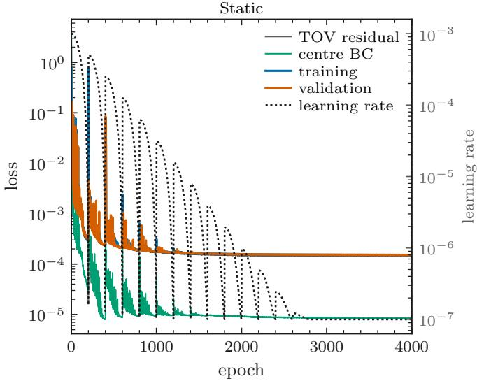

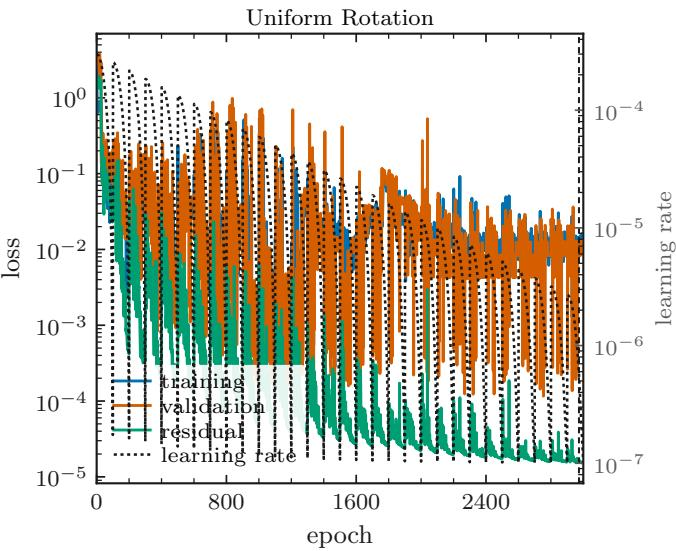  
FIG. 4. Loss and learning rate evolution during training for the Spherically symmetric (left) and uniformly rotating (right) solvers.

The loss is

$$
\begin{array} { l } { \displaystyle \mathcal { L } _ { \mathrm { s p h } } = \left. \frac { 1 } { N - 1 } \sum _ { i = 0 } ^ { N - 2 } \left[ \frac { \hat { g } _ { \boldsymbol { \theta } } ( x _ { i } ) - \mathcal { G } ( x _ { i } ) } { \mathrm { s g } ( | \mathcal { G } ( x _ { i } ) | + 0 . 1 g _ { c } ) } \right] ^ { 2 } \right. } \\ { \displaystyle \left. \qquad + \left[ \frac { \hat { g } _ { \boldsymbol { \theta } } ( 1 ) - g _ { c } } { g _ { c } } \right] ^ { 2 } \right. , } \end{array}\tag{57}
$$

where $\langle \cdot \rangle$ denotes an average over training stars and $\mathrm { s g }$ stops gradient propagation through the normalization. The first term includes the surface and excludes the cen tre, where the analytic regularity condition supplies the second term. No additional boundary penalties or labeled stellar solutions are required. The observables follow directly as $R = \widetilde { r } ( 0 ) / \sqrt { \varepsilon _ { c } }$ and $M = \tilde { m } ( 0 ) / \sqrt { \varepsilon _ { c } }$ . The training workflow is summarized in Algorithm 2 and the loss-evolution is visualized in FIG. 4.

Data and Additional Analysis Results We combine ten independent mass-radius measurements spanning rotation-powered and accreting MSPs. NICER pulse-profile measurements comprise PSRs J0030+0451, J0740+6620, J0437−4715, J0614−3329, and J1231−1411 [29, 101–104]. Accreting sources include photospheric-radius-expansion burst measurements of 4U 1608−52, KS 1731−260, and SAX J1748.9−2021 [4, 98, 105–107], superburst pulse-profile measurements of 4U 1636−536 [99], and burst-ensemble modeling of SRGA J144459.2−604207 [100]. We account for the source-specific radius priors while retaining independent radio-timing mass constraints, and additionally incorporate the mass measurement of PSR J0952−0607 as a constraint on the maximum supported mass at its observed spin [108, 109]. For simulated observations, we generate thirty APR4 EPP [60, 61] stars with spin frequencies drawn uniformly between 300 and 1000 Hz and masses drawn from the Galactic double-Gaussian distribution [74], truncated to the available stable mass range at each spin; their equatorial radii are computed independently of our neural solvers by interpolating RNS equilibrium sequences [47]. The mass-radius-spin measurements for each observation are summarized in Table II. Each simulated measurement comprises 4000 samples from an uncorrelated bivariate Gaussian centered on the injected mass and radius, with $\sigma _ { M } = 0 . 0 5 M$ and $\sigma _ { R } = 0 . 0 5 R _ { \mathrm { e } } ,$ truncated at $M > 0 . 2 M _ { \odot }$ and $R _ { \mathrm { e } } > 3 \mathrm { k m }$ . The sample size and fractional uncertainties represent an optimistic scenario motivated by eXTP forecasts [75].

TABLE II. Real observational dataset. Masses and equatorial radii are posterior medians with equal-tailed 90% credible intervals, using sample weights where supplied. Spin frequencies are treated as fixed inputs. PSR J0952 0607 contributes only to the maximum-mass constraint; its quoted mass uncertainty is retained as supplied and is not converted to a 90% interval.
<table><tr><td>Source</td><td>M [MO]</td><td></td><td> $\overline { { R _ { \mathrm { e q } } \left[ \mathrm { k m } \right] } }$ </td><td>ν [Hz]</td></tr><tr><td>PSR J0030+0451</td><td>1.289+0.288 3 +0.1133</td><td></td><td>12.57+2.24 2.00</td><td>205.53</td></tr><tr><td>PSR J0740+6620</td><td>2.073 -0.113</td><td></td><td>12.49+2.20 -1.34</td><td>346.53</td></tr><tr><td>PSR J0437-4715</td><td>1.418 +0:057 -0.058</td><td></td><td> $1 1 . 3 6 _ { - 0 . 9 9 } ^ { + 1 . 6 2 }$ </td><td>173.69</td></tr><tr><td>PSR J0614-3329</td><td>1.436+0.118 -0.116</td><td></td><td>11.16+2.8 -1.95</td><td>317.59</td></tr><tr><td>PSR J1231-1411</td><td>1.060 +0:112 -0.054</td><td></td><td> $1 3 . 5 2 _ { - 0 . 9 0 } ^ { + 0 . 4 3 }$ </td><td>271.45</td></tr><tr><td>4U 1608-52</td><td>1.885 +0.502 -0.470</td><td>9.81+4.430</td><td>4.37</td><td>620.00</td></tr><tr><td>KS 1731-260</td><td>1.601 +0.596 -0.654</td><td>9.16</td><td>+3.75 3.85</td><td>524.00</td></tr><tr><td>SAX J1748.9-2021</td><td>1.664+0.45 -0.484</td><td>10.20+3.80</td><td>-4.90</td><td>442.40</td></tr><tr><td>4U 1636-536</td><td>1.775+0.322 -0.368</td><td> $1 5 . 0 7 _ { - 2 . 0 4 } ^ { + 0 . 8 4 }$ </td><td></td><td>581.91</td></tr><tr><td>SRGA J144459.2-604207</td><td> $1 . 9 1 7 _ { - 0 . 6 3 6 } ^ { + 0 . 5 3 2 }$ </td><td> $1 1 . 7 8 _ { - 2 . 5 0 } ^ { + 3 . 6 2 }$ </td><td></td><td>447.87</td></tr><tr><td>PSR J0952-0607</td><td> $2 . 3 5 \pm 0 . 1 7$ </td><td></td><td></td><td>707.3</td></tr></table>

We now present additional results from the analyses summarized in the main text. In FIG. 5, we show the pressure-density posterior and posterior predictive masses and polar radii for the analysis with real events. In FIG. 6, we show the fractional deviation of the posterior predictive masses from the static and uniformly rotating analyses relative to the ground truth for the simulated events.

Algorithm 2 Physics-Informed DeepONet Training for Spherical Solutions   
Require: $\mathcal { D } = \{ ( \mathcal { E } _ { i } , \epsilon _ { c , i } , q _ { i } ) \} _ { i = 1 } ^ { 4 0 0 0 0 } \mathrm { : }$ EoS curves, central energy densities, and axis ratios   
Require: $\mathcal { D } _ { \mathrm { t r a i n } } , \mathcal { D } _ { \mathrm { v a l } } \colon$ training and validation subsets of $\mathcal { D }$   
Require: : candidate DeepONet architectures   
Require: $( \mathrm { A D A M } , \eta _ { 0 } , \beta _ { 1 } , \beta _ { 2 } ) \colon$ optimizer and associated parameters   
Require: CosineScheduler: cosine restarts with amplitude decay   
Require: $\mathcal { X } = \{ ( s _ { j } , \mu _ { j } ) \} _ { j = 1 } ^ { N _ { \mathrm { g r i d } } }$ : collocation grid   
Require: $\mathcal { L } _ { \mathrm { p h y s i c s } } \mathrm { : }$ main-text residual loss   
Require: $\dot { N _ { \mathrm { e p o c h } } } , P \colon$ maximum epochs and early-stopping patience   
Ensure: Trained DeepONet⋆   
1: $L _ { \mathrm { v a l } } ^ { \star }  + \infty$   
2: for $A \in { \mathcal { A } }$ do   
3: Initialize DeepONe $; _ { A }$ with parameters Θ   
4: Initialize Adam and cosine scheduler   
5: $L _ { A , \mathrm { b e s t } }  + \infty ; n _ { \mathrm { p l a t e a u } }  0$   
6: for $e = 1$ to $N _ { \mathrm { e p o c h } }$ do   
7: for minibatch $B \subset \mathcal { D } _ { \mathrm { t r a i n } }$ do   
8: $L \gets \mathrm { P H Y S I C S L O s s } ( \Theta , B , \mathcal { X } )$   
9: $\Theta \gets \mathrm { A D A M S T E P } ( \Theta , \nabla \Theta L , \eta , \beta _ { 1 } , \beta _ { 2 } )$   
10: Update η using CosineScheduler   
11: end for   
12: $L _ { \mathrm { v a l } }  \mathrm { P H Y S I C S L O s s } ( \Theta , \mathcal { D } _ { \mathrm { v a l } } , \chi )$   
13: if $L _ { \mathrm { v a l } } < L _ { A , \mathrm { b e s t } }$ then   
14: $L _ { A , \mathrm { b e s t } }  L _ { \mathrm { v a l } } ; n _ { \mathrm { p l a t e a u } }  0$   
15: else   
16: $n _ { \mathrm { p l a t e a u } }  n _ { \mathrm { p l a t e a u } } + 1$   
17: end if   
18: if $L _ { \mathrm { v a l } } < L _ { \mathrm { v a l } } ^ { \star }$ then   
19: $L _ { \mathrm { v a l } } ^ { \star }  L _ { \mathrm { v a l } }$   
20: DeepONet⋆ $ \mathrm { C o P Y }$ (DeepONetA, Θ)   
21: end if   
22: if $n _ { \mathrm { p l a t e a u } } \geq P$ then   
23: break   
24: end if   
25: end for   
26: end for   
27: return DeepONet⋆   
28: function PhysicsLoss(Θ, , )   
29: for $( \mathcal { E } _ { i } , \epsilon _ { c , i } , q _ { i } ) \in B$ do   
30: Construct $h _ { c , i }$ and branch input $\vec { z _ { i } }$   
31: Evaluate DeepONet $^ { A , \Theta }$ on   
32: Determine $r _ { e } , \Omega , H , \tilde { \epsilon } , p , \alpha$ from the predicted fields and $\mathcal { E } _ { i }$   
33: Evaluate $S _ { u } , A _ { u } , K _ { u , n }$ for $u \in \{ \rho , \gamma , \omega \}$   
34: Compute ¯u using Eq. (30)   
35: $\ell _ { i } \gets \mathcal { L } _ { \mathrm { p h y s i c s } }$ evaluated from the predictions and integral-equation outputs   
36: end for   
37: return $| \boldsymbol { B } | ^ { - 1 } \sum _ { i \in B } \ell _ { i }$   
38: end function

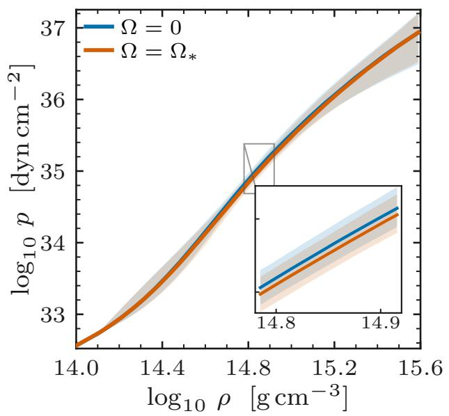

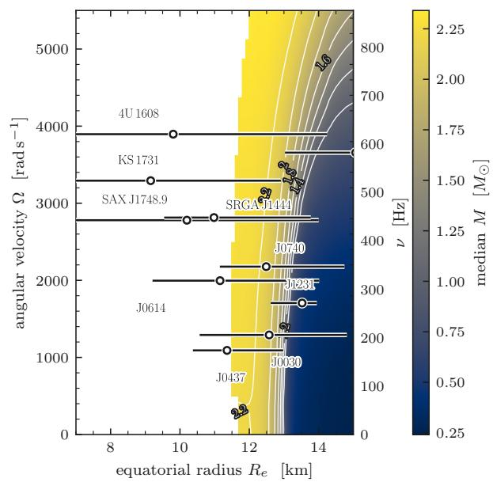

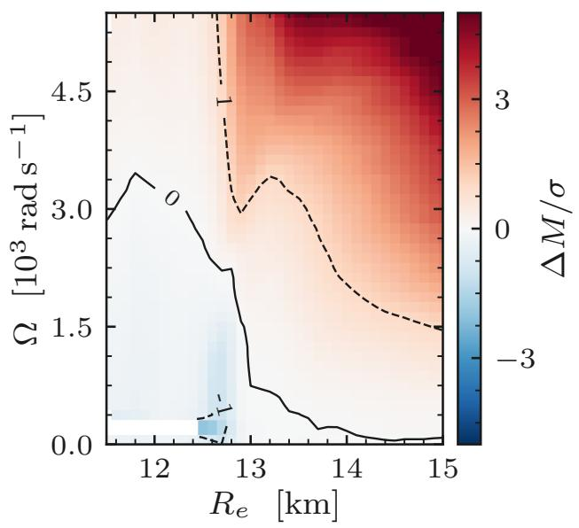

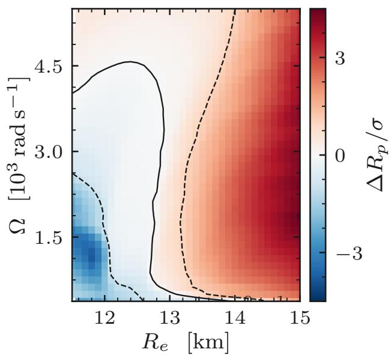  
FIG. 5. Analysis of real data with rotaing and static solvers yield posterior credible intervals in the pressure-density plane $( t o p$ $l e f t )$ and posterior predictive values of mass as a function of radius and and angular speed $\left( t o p \right)$ . Deviations between posterior predictive values of mass (bottom $l e f t )$ and polar radius (bottom $r i g h t )$ )as a function of equatorial radius and angular speed between the rotation-informed and the static runs are also shown. It can be seen that incorporating rotation increases support for softer EoS models and larger values of polar radii for high equatorial radius (much more modestly than the simulated dataset given the much larger measurement uncertainties).

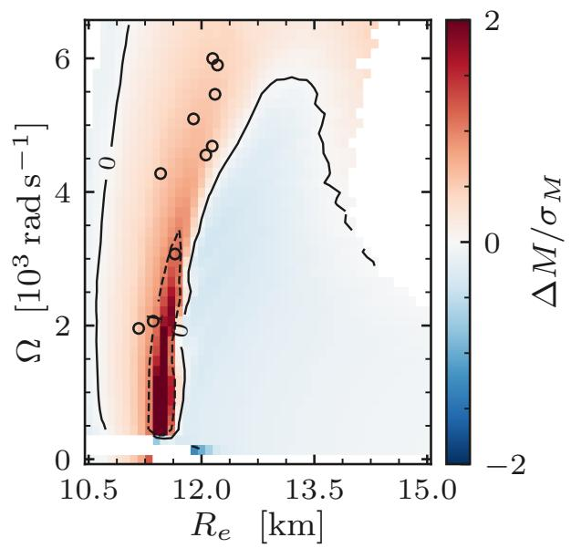

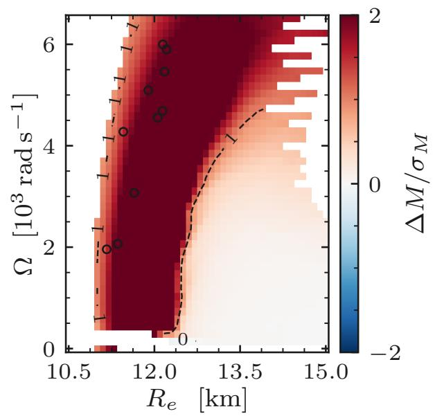

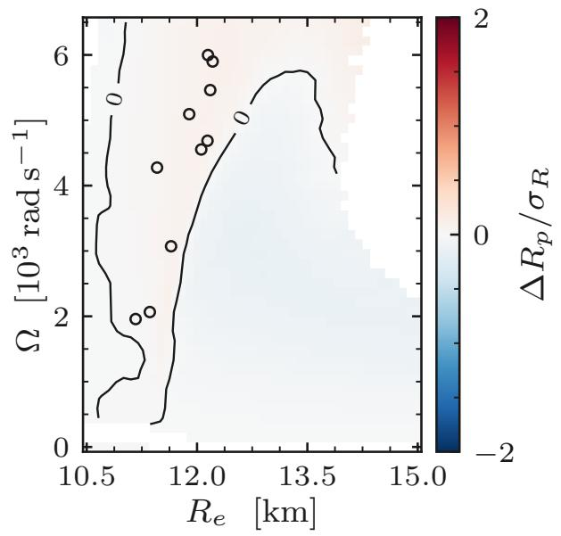

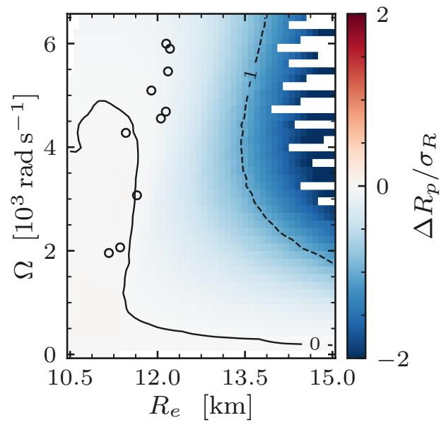  
FIG. 6. The PPD mass (top) and polar-radius (bottom) deviations from ground truth versus $( \Omega , R _ { e } )$ for our (center) and approximate (right) solvers, all using simulated mass-radius measurements.