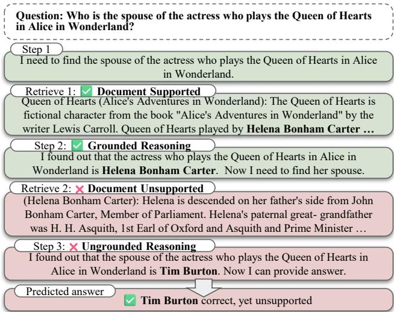
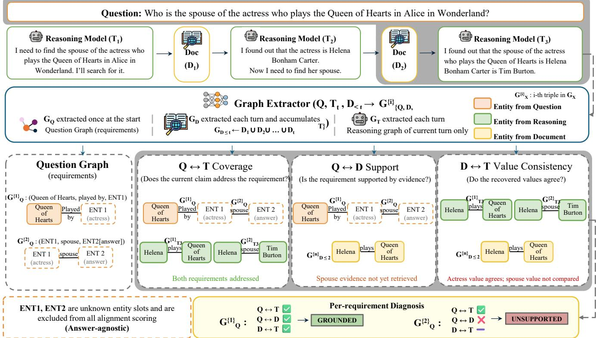

# Where Search Agents Go Of the Rails: Graph-Grounded Step-Level Verification

Hyeseo Jeon∗1, Seonho Yoo∗2, Jay-Yoon Lee†1

1Seoul National University

2Korea University

{doupari,lee.jayyoon}@snu.ac.kr, leoyoo2004@korea.ac.kr

## Abstract

Search-augmented reasoning systems sufer from unsupported intermediate claims and evidence-use failures, even when yielding correct final answers. Reliable step-level auditing requires evaluating three distinct axes: whether the evidence D covers the question Q (Q ↔ D), whether the reasoning T addresses the question (Q ↔ T), and whether the reasoning is factually grounded in the evidence (D ↔ T). However, Existing methods typically assess either the intrinsic validity of rea- soning steps or their support against a given evidence context, without jointly diagnosing question requirements, temporally available evidence, and reasoning claims over an evolving search trajectory. Although these verifiers often achieve high precision when predicting an error, they exhibit substantially lower recall and thus leave many erroneous trajectories undetected. This is particularly problematic for step-level auditing, where a missed error can propagate to subsequent retrieval and reasoning.

We introduce GraphRail, a generative-judge-free frame-work that decomposes each question into structured require- ment triples and represents retrieved evidence and reason- ing claims in the same claim form across the Q–D–T relations. GraphRail diagnoses missing or unused evidence, un- resolved requirements, and grounded, unsupported, or con- flicting claims without using a gold answer or asking another LLM to generate a verification judgment. Across three multihop QA benchmarks and three search-augmented reasoning frameworks, GraphRail achieves the strongest Recall, F , F scores in all evaluated ofline settings, substantially outper- forming the generative verifier baselines in recall. Beyond ofline auditing, the same diagnoses can be converted into structural feedback that improves online reasoning in several settings. These results demonstrate that restricting LLMs to structured extraction and verifying with explicit cross-graph comparisons provides an efective and traceable alternative to open-ended generative judgment.

## Introduction

Search-augmented reasoning systems repeatedly alternate between reasoning and retrieval before producing a final an- swer. Frameworks such as Search-R1 (2025) and ReSearch (2026) allow large language models (LLMs) to generate search queries, inspect retrieved documents, and continue reasoning over multiple turns. At any turn, the trajectory may be in one of following states: the required evidence may not yet have been retrieved, the evidence may be available but unused in reasoning, or the model may have asserted an unsupported claim. These states call for diferent interven- tions—additional retrieval, reconsideration of the available evidence, or revision of the unsupported claim—yet cur- rent systems rarely distinguish among them. Evaluation of these states is obscured b final-answer metrics such as Ex- act Match and F1. Such metrics indicate whether an answer matches a reference, but not whether the evolving reasoning remains relevant to the question and supported by the re- trieved context. Furthermore, a correct final answer may still be reached through an ungrounded shortcut such as Figure 1. Since an early unsupported claim can influence subsequent searches and conclusions, step-level verification is therefore important for auditing whether a trajectory remains aligned with the question requirements and grounded in the evidence available at each step.

  
Figure 1: An unsupported intermediate claim can influence subsequent retrieval and reasoning. Final-answer evaluation alone does not reveal when the trajectory loses evidence.

Thus, reliable step-level verification requires jointly con-sidering three components: the question, the retrieved docu- ments, and the model’s reasoning. We represent these compo- nents as Q, D, and T respectively, and verify three relations: $Q  D , Q  T$ , and $T  D$ . The $Q  \dot { D }$ relation checks whether the retrieved documents contain the evidence re- quired by the question. The $Q  T$ relation checks whether the reasoning addresses that requirement. The $T  D$ relation checks whether the claims made in the reasoning are supported by the retrieved evidence.

  
Figure 2: Overview of GraphRail. Question requirements, retrieved evidence, and reasoning claims are compared through the three complementary Q–D–T graph relations, enabling answer-agnostic diagnosis of evidence support, reasoning coverage, and value consistency without relying on an LLM-as-a-judge.

To the best of our knowled e, existin methods verif only part of this structure by focusing on step-level reason- ing, evidence grounding, or collapsing the three components into a single generative judgment. To address these limitations, we introduce GraphRail, a requirement-centered and temporally grounded auditing graph framework for step-level verification. GraphRail converts the question, retrieved docu- ments, and reasoning statements into structured triple graphs. The question graph encodes the information required by the query, leaving answer entities as unknown entities; the doc- ument graph extracts facts in the retrieved evidence; and the reasoning graph extracts claims by the model. GraphRail then applies an explicit coarse-to-fine alignment procedure across the three $\bar { Q } { - } D { - } T$ relations. For each question re- quirement, GraphRail combines the three pairwise signals into an actionable diagnosis: evidence may be Missing or Unused, an unresolved requirement may remain Open, and a concrete claim may be Grounded, Unsupported, or in

Conflict with retrieved evidence. This alignment proce- dure is answer-independent: unknown answer slots are ex- cluded from alignment, and no reference answer is used to select or verify a candidate. The same diagnosis supports both ofline and online use. Ofline auditing localizes where completed trajectories lose evidentiary support, while online verification provides structural feedback before the agent’s next reasoning step.

Most importantly, GraphRail does not use LLM as ajudge. The role of the LLM in GraphRail is restricted to con- strained graph extraction. It is not asked to decide whether another model is correct or to generate an open-ended verifi- cation judgment. This design confines model uncertainty to a bounded information-extraction stage and makes the sub- sequent diagnosis traceable to explicit cross-graph compar- isons. As a result, GraphRail provides verification diagnosis without introducing a second generative reasoning loop or relying on the verifier’s parametric knowledge.

## Our main contributions are as follows:

• We formulate verification of evolving search trajecto-ries as a requirement-centered diagnosis over question requirements, temporally available evidence, and current reasoning claims, separating missing or unused evidence from grounded, unsupported, and conflicting claims.

• We propose GraphRail, a gold-answer-free verification framework that confines the LLM for structured graph extraction and performs diagnosis through explicit cross- graph alignment. It can verify existing search-augmented reasoning models without modifying their parameters or architecture.

• We present a failure-mode analysis across three multi-hop question-answering benchmarks and evaluate GraphRail as both an ofline trajectory auditor and an online source of targeted structural feedback.

## Related Works

Process and Evidence Verification. Process verification evaluates intermediate reasoning rather than only final out- puts. Foundational process reward models, developed and evaluated largely on mathematical reasoning, assign correct- ness scores to individual solution steps for verification or training (Lightman et al. 2024; Wang et al. 2024). Process-reward-guided search uses such signals to select promis- ing reasoning trajectories (Zhang et al. 2024), while graphbased verifiers model dependencies among steps or alterna- tive reasoning paths (Cao 2024; Fang et al. 2026). Socratic-PRMBench (2025) further evaluates whether process verifiers detect errors across systematic reasoning patterns. Com- plementary work examines whether a final prediction actu- ally depends on the stated reasoning chain (Paul et al. 2024). These approaches primarily evaluate the internal correctness, structure, or causal use of reasoning, rather than whether a search agent’s verbal claims are supported by the evidence available when they are produced.

Evidence-grounding methods instead connect generated content to external sources. Prior work evaluates citation support at the answer level (Gao et al. 2023), introduces self-reflection over retrieved evidence at the generation-segment level (Asai et al. 2024), or penalizes unsupported reasoning steps against a provided evidence set (Gui et al. 2026). Graphbased approaches also verify complex claims through multi- hop evidence (Jeon and Lee 2025) or interleave knowledge-graph retrieval with stepwise verification and plan revision (Zhao et al. 2026). While these works establish increasingly fine-grained grounding, they generally verify a step, seg- ment, or claim against a given evidence context. GraphRail instead audits an evolving search trajectory by jointly com-paring question requirements, temporally available retrieved evidence, and current reasoning claims. Its Q–D–T diag-nosis distinguishes missing or unused evidence from open, grounded, unsupported, and conflicting reasoning rather than reducing verification to a single correctness or support judgment.

Search-Process Control and External Feedback. Prior studies show that intrinsic self-correction can be unreli- able or even degrade reasoning performance (Valmeekam, Marquez, and Kambhampati 2023; Stechly, Marquez, and Kambhampati 2023; Huang et al. 2024). External-feedback methods therefore use verbal reflection, iterative refinement, tool-assisted critique, or process rewards to revise model outputs and reasoning paths (Shinn et al. 2023; Madaan et al. 2023; Gou et al. 2024; Zhang et al. 2024). Searchspecific methods further learn when to stop retrieval (Park, Cho, and Lee 2025), supervise and refine intermediate search queries (Wen, Dong, and Dou 2026), or provide hop- aware benchmarks for diagnosing retrieval–reasoning fail- ures (You, Yu, and Zhang 2026). These approaches primarily target correction, policy control, or benchmark-specific anal- ysis. GraphRail instead converts explicit Q–D–T diagnoses into predefined feedback templates, enabling online inter- vention without retraining the underlying agent or asking another LLM to generate an open-ended critique.

<table><tr><td></td><td>Hotpot</td><td>2Wiki</td><td>Musique</td></tr><tr><td>No Error</td><td>45.2</td><td>17.4</td><td>6.2</td></tr><tr><td colspan="4">Error Cases</td></tr><tr><td>Incorrect Reasoning</td><td></td><td></td><td></td></tr><tr><td>Given gold document</td><td>6.8</td><td>7.0</td><td>9.4</td></tr><tr><td>Given irrelevant document</td><td>14.8</td><td>38.4</td><td>33.8</td></tr><tr><td>Given no evidence</td><td>13.0</td><td>14.8</td><td>21.6</td></tr><tr><td>Search Query Failure</td><td>3.0</td><td>12.6</td><td>10.6</td></tr><tr><td>Hop Decomposition Failure</td><td>5.0</td><td>1.8</td><td>10.0</td></tr><tr><td>Decoding Failure</td><td>3.0</td><td>2.4</td><td>1.8</td></tr><tr><td>Others</td><td>9.2</td><td>5.6</td><td>6.6</td></tr><tr><td>Accuracy (EM)</td><td>56.2</td><td>38.8</td><td>11.2</td></tr><tr><td>Average Model Steps</td><td>2.57</td><td>3.53</td><td>3.58</td></tr></table>

Table 1: Reasoning analysis for all samples. Most step-level errors arise from document hallucinations and become more frequent as average model steps increase.
<table><tr><td></td><td>Hotpot</td><td>2Wiki</td><td>Musique</td></tr><tr><td>No Error</td><td>80.4</td><td>44.9</td><td>56.3</td></tr><tr><td colspan="4">Error Cases</td></tr><tr><td>Incorrect Reasoning</td><td></td><td></td><td></td></tr><tr><td>Given gold document</td><td>2.5</td><td>3.6</td><td>0.0</td></tr><tr><td>Given irrelevant document</td><td>4.3</td><td>29.9</td><td>9.1</td></tr><tr><td>Given no evidence</td><td>11.3</td><td>21.6</td><td>31.0</td></tr><tr><td>Search Query Failure</td><td>0.4</td><td>0.0</td><td>0.0</td></tr><tr><td>Hop Decomposition Failure</td><td>0.7</td><td>0.0</td><td>3.6</td></tr><tr><td>Decoding Failure</td><td>0.4</td><td>0.0</td><td>0.0</td></tr></table>

Table 2: Step-level reasoning analysis among samples with correct final answers. EM does not imply grounded reasoning

## Failure Mode Analysis

We analyze step-level reasoning failures across HotpotQA (2018), 2WikiMultihopQA (2020), and MuSiQue (2022) using Search-R1 (2025) with a BM25 retriever. With hu-man evaluation of 500 samples per dataset guided by LLM- generated pseudo-labels, we group trajectories into six highlevel categories. No Error denotes valid, evidence-grounded reasoning. Incorrect Reasoning is subdivided by the evidence source: given gold document covers insuficient reasoning while containing gold document; given retrieved document captures misattribution from the retrieved document; and given no evidence covers unsupported answers from fabricated claims (hallucination). Search Query Failure denotes repeated failed queries. Hop Decomposition Failure includes wrong multihop question decomposition errors. Decoding Failure captures degenerate outputs. Others covers trajecto-ries that are close to correct but fail during answer extraction.

<table><tr><td rowspan="2"></td><td rowspan="2"></td><td rowspan="2"></td><td colspan="4">HotpotQA</td><td colspan="4">2WikiMultihopQA</td><td colspan="4">MuSiQue</td></tr><tr><td>P</td><td>R</td><td> $F _ { 1 }$ </td><td> $F _ { 6 }$ </td><td>P</td><td>R</td><td> $F _ { 1 }$ </td><td> $F _ { 6 }$ </td><td>P</td><td>R</td><td> $F _ { 1 }$ </td><td> $F _ { 6 }$ </td></tr><tr><td rowspan="6">Search-R1</td><td rowspan="3">Ours</td><td>0.5B</td><td>56.0 58.1</td><td>90.1</td><td>69.1 72.4</td><td>88.6</td><td>86.3</td><td>90.1</td><td>88.2</td><td>90.0</td><td>94.4</td><td>97.2</td><td>95.8</td><td>97.1</td></tr><tr><td>4B 7B</td><td>57.7</td><td>96.0</td><td></td><td>94.3</td><td>87.4</td><td>90.8</td><td>89.1</td><td>90.7</td><td>94.3</td><td>98.5</td><td>96.4</td><td>98.4</td></tr><tr><td></td><td></td><td>95.3</td><td>71.9</td><td>93.7</td><td>87.1</td><td>90.1</td><td>88.6</td><td>90.0</td><td>94.6</td><td>96.8</td><td>95.7</td><td>96.7</td></tr><tr><td>Self-RAG</td><td>7B</td><td>66.5</td><td>60.9</td><td>63.6</td><td>61.0</td><td>87.4</td><td>78.9</td><td>82.9</td><td>79.1</td><td>95.6</td><td>87</td><td>91.1</td><td>87.2</td></tr><tr><td>IBM-Granite</td><td>8B</td><td>73.9</td><td>63.1</td><td>68.1</td><td>63.4</td><td>92.3</td><td>86.7</td><td>89.4</td><td>86.8</td><td>97.1</td><td>79.7</td><td>87.5</td><td>80.1</td></tr><tr><td>GPT-4.1-mini</td><td></td><td>82.8</td><td>56.2</td><td>67.0</td><td>56.7</td><td>97.0</td><td>62.2</td><td>75.8</td><td>62.8</td><td>98.0</td><td>61.2</td><td>75.3</td><td>61.8</td></tr><tr><td rowspan="6">ReSearch</td><td rowspan="3">Ours</td><td>0.5B</td><td>48.4</td><td>85.4</td><td>61.8</td><td>83.7</td><td>80.8</td><td>87.4</td><td>84.0</td><td>87.2</td><td>87.1</td><td>93.3</td><td>90.1</td><td>93.1</td></tr><tr><td>4B</td><td>48.9</td><td>87.1</td><td>62.7</td><td>85.3</td><td>80.5</td><td>86.8</td><td>83.6</td><td>86.6</td><td>87.6</td><td>95.6</td><td>91.4</td><td>95.4</td></tr><tr><td>7B</td><td>49.4</td><td>88.0</td><td>63.3</td><td>86.2</td><td>82.1</td><td>88.7</td><td>85.3</td><td>88.5</td><td>87.8</td><td>94.7</td><td>91.1</td><td>94.5</td></tr><tr><td rowspan="3">Self-RAG IBM-Granite</td><td>7B</td><td>53.2</td><td>74.7</td><td>61.7</td><td>73.9</td><td>78.0</td><td>84.7</td><td>81.2</td><td>84.5</td><td>89</td><td>89.4</td><td>89.2</td><td>89.4</td></tr><tr><td>8B</td><td>61.9</td><td>57.9</td><td>59.8</td><td>58.0</td><td>88.1</td><td>77.7</td><td>82.6</td><td>77.9</td><td>89.7</td><td>76.5</td><td>82.6</td><td>76.8</td></tr><tr><td>GPT-4.1-mini</td><td>80.4</td><td>31.8</td><td>45.6</td><td>32.3</td><td>92.0</td><td>46.2</td><td>61.5</td><td>46.8</td><td>95.6</td><td>44.9</td><td>61.1</td><td>45.6</td></tr><tr><td rowspan="6">ReAct</td><td rowspan="3">Ours</td><td>0.5B</td><td>63.6</td><td>87.7</td><td>73.7</td><td>86.8</td><td>81.1</td><td>85.6</td><td>83.3</td><td>85.5</td><td>96.4</td><td>94.8</td><td>95.6</td><td>94.8</td></tr><tr><td>4B</td><td>65.0</td><td>93.4</td><td>76.6</td><td>92.3</td><td>81.9</td><td>89.1</td><td>85.3</td><td>88.9</td><td>96.4</td><td>94.6</td><td>95.5</td><td>94.6</td></tr><tr><td>7B</td><td>65.6</td><td>92.8</td><td>76.8</td><td>91.8</td><td>81.6</td><td>86.6</td><td>84.0</td><td>86.5</td><td>96.5</td><td>96.7</td><td>96.6</td><td>96.7</td></tr><tr><td>Self-RAG</td><td>7B</td><td>62.8</td><td>47.8</td><td>54.3</td><td>48.1</td><td>77.2</td><td>65.1</td><td>70.6</td><td>65.4</td><td>96.3</td><td>69.6</td><td>80.8</td><td>70.1</td></tr><tr><td>IBM-Granite</td><td>8B</td><td>65.6</td><td>46.2</td><td>54.2</td><td>46.6</td><td>80.8</td><td>63.0</td><td>70.8</td><td>63.4</td><td>97.7</td><td>60.5</td><td>74.7</td><td>61.1</td></tr><tr><td>GPT-4.1-mini</td><td></td><td>85.2</td><td>38.1</td><td>52.6</td><td>38.7</td><td>91.3</td><td>45.1</td><td>60.3</td><td>45.7</td><td>99.6</td><td>47.0</td><td>63.8</td><td>47.7</td></tr></table>

Table 3: Ofline GraphRail verification performance across search-augmented reasoning frameworks. P, R, $F _ { 1 } { \mathrm { . } }$ , and $F _ { 6 }$ denote precision, recall, $\bar { F _ { \beta } } \overset { - } { ( \beta = 1 , 6 ) }$ where higher beta considers Recall with higher weight. respectively; GraphRail uses diferent model sizes of graph extractors: Qwen2.5-0.5B-Instruct, Qwen3-4B-Instruct-2507, and Qwen2.5-7B-Instruct, denoted as 0.5B, 4B, and 7B. We compare against generative evaluators conditioned on the evidence available before reasoning step t $( Q , D _ { < t } , T _ { t } )$

Tables 1 and 2 show that process-level errors arise from multiple sources. As reasoning requires more steps, error- free trajectories become rarer, while incorrect reasoning and query failures become more frequent. Even correct final an- swers can contain flawed intermediate reasoning, indicating that final-answer evaluation alone is insuficient.

This motivates verifying each reasoning step with respect to three relations: question, retrieved evidence, and model’s reasoning. The question–document relation checks evidence coverage, the question–reasoning relation checks whether the reasoning follows the intended requirements, and the reasoning–document relation checks whether the reasoning is grounded in evidence. Since each relation diagnoses dif- ferent failures, reliable step-level verification must consider three pairwise relations.

## Method

We first introduce the graph representation used to encode the question, evidence, and reasoning. We then describe the three components of the verification framework: (1) cross-graph alignment, (2) joint requirement diagnosis, and (3) auxiliary claim grounding. Finally, we explain how this framework is applied to ofline and online verification.

## GraphRail

Graph Representation. GraphRail represents the question, retrieved evidence, and current reasoning step as triple graphs $G _ { Q } , G _ { D }$ , and $G _ { T _ { t } }$ . We use $G _ { D < t }$ and $G _ { D \leq t }$ to de- note the evidence available before and after retrieval at turn t. Each graph consists of triples ${ \boldsymbol { \tau } } = ( h , r , o )$ , where $h , r ,$ and o denote the head entity, relation, and object entity respectively, separated by [SEP] token in sentence. Unknown answer entities in the question are represented by placehold- ers $\mathrm { E N T } _ { k } ,$ so alignment is performed only over the known fields of each question requirement. The question graph is constructed once, the document graph accumulates evidence across turns, and the reasoning graph is constructed at each step.

Verification Framework. GraphRail performs require-ment centered verification across the question, document, and reasoning graphs. For each question requirement $q _ { i } ~ \in$ $G _ { Q }$ , the question–document (Q–D) relation checks whether relevant evidence has been retrieved, while the question– reasoning (Q–T) relation checks whether the current rea-soning addresses the requirement. When the aligned docu- ment and reasoning triples provide concrete values for the same unknown slot, the reasoning–document (D–T) relation checks whether those values agree. GraphRail combines these signals into one of six diagnostic states: Conflict, Unsupported, Grounded, Unused, Open, and Missing, as summarized in Table 4.

Cross-Graph Alignment. GraphRail uses a shared alignment operator for the Q–D and Q–T relations to robustly match evidence and reasoning. Given a question require- ment $q _ { i } \in G _ { Q }$ and a candidate graph $G _ { C } \in \{ G _ { D } , G _ { T _ { t } } \}$ , the operator identifies the candidate triple that best matches the known fields of $q _ { i } .$ . Unknown fields in $q _ { i }$ are excluded from alignment.

<table><tr><td>State</td><td colspan="2">Q-D Q-T</td><td>D-T</td><td>Additional Condition</td><td>Interpretation</td></tr><tr><td>CONFLICT</td><td>Yes</td><td></td><td></td><td>Yes Disagree Both aligned triples provide different concrete The reasoning contradicts the avail- values for the same unknown slot.</td><td>able evidence.</td></tr><tr><td>UNSUPPORTED</td><td>No</td><td>Yes</td><td></td><td>The reasoning provides a concrete value, but The reasoning introduces an unsup- no supporting document value is available.ported claim.</td><td></td></tr><tr><td>GROUNDED</td><td></td><td></td><td></td><td>Yes Yes Agree / – No value conflict is detected; fully specified re- The requirement is covered by both ev- quirements do not require unknown-slot com- idence and reasoning.</td><td></td></tr><tr><td>UNUSED</td><td></td><td>Yes No</td><td></td><td>parison. Supporting evidence is available, but the rea- Relevant evidence has been retrieved</td><td></td></tr><tr><td>OPEN</td><td></td><td>No Yes</td><td></td><td>soning does not address the requirement. The reasoning addresses the requirement with- The requirement remains unresolved.</td><td>but remains unused.</td></tr><tr><td>MISSING</td><td></td><td>No No</td><td></td><td>out asserting a concrete unsupported value. Neither supporting evidence nor aligned rea- The requirement is not covered by the soning is available.</td><td>current trajectory.</td></tr></table>

Table 4: Top-down requirement-level diagnosis based on $Q { - } D$ support, $Q { - } T$ coverage, and $D { - } T$ value consistency. $Q { - } D$ and $Q { - } T$ indicate whether a question requirement is aligned with a supporting document triple and a reasoning claim, respectively, while $D { - } T$ compares the concrete values recovered for the same unknown slot. $^ { 6 6 } - ^ { 5 9 }$ indicates that $D \bar { - } \bar { T }$ comparison is not applicable. Because some conditions overlap, the states are evaluated from top to bottom, and the first applicable state is selected.

GraphRail first linearizes each triple and retrieves the top- K candidates with the highest semantic similarity to the question requirement. The shortlisted candidates are then compared at the field level. Let $q _ { i } = ( h _ { i } , r _ { i } , o _ { i } )$ and $c =$ $\left( h _ { c } , r _ { c } , o _ { c } \right)$ . To consider reversed subject–object orientations introduced during graph extraction, each known entity field is compared with both entity positions in $c ,$ while relations are compared directly:

$$
\begin{array} { l l } { s _ { h } ( q _ { i } , c ) = \operatorname* { m a x } \{ \sin ( h _ { i } , h _ { c } ) , \sin ( h _ { i } , o _ { c } ) \} } \\ { s _ { o } ( q _ { i } , c ) = \operatorname* { m a x } \{ \sin ( o _ { i } , o _ { c } ) , \sin ( o _ { i } , h _ { c } ) \} } \\ { s _ { r } ( q _ { i } , c ) = \sin ( r _ { i } , r _ { c } ) } \end{array}\tag{1}
$$

Entity fields are compared across both positions to handle reversed head–object order, while relation fields are com-pared directly to preserve predicate consistency. Let $\mathcal { F } ( q _ { i } , c )$ denote the fields that are known in $q _ { i }$ and available for com- parison with c. GraphRail scores a candidate by its weakest evaluated field. Among the top- $K$ candidates, it selects the highest-scoring candidate:

$$
\begin{array} { l } { { A ( q _ { i } , c ) = \underset { f \in \mathcal { F } ( q _ { i } , c ) } { \operatorname* { m i n } } s _ { f } ( q _ { i } , c ) } } \\ { { c _ { i } ^ { * } = \underset { c \in \mathcal { C } _ { K } ( q _ { i } ; \mathcal { G } _ { C } ) } { \operatorname { a r g m a x } A ( q _ { i } , c ) } } } \end{array}\tag{2}
$$

The alignment is accepted when $A ( q _ { i } , c _ { i } ^ { * } ) \geq \theta$ . Using the minimum field score requires every known field to match suficiently well, preventing one strong field from masking a mismatch in another. When an accepted candidate fills an uninstantiated placeholder, the recovered value is propagated to other requirements sharing that placeholder and treated as known in their alignment. Thus, only uninstantiated place- holders are excluded, and a value recovered by the current match does not afect its alignment score. This separates requirement matching from answer-value comparison.

Joint Requirement Diagnosis GraphRail combines $Q { - } D$ support, $\bar { Q } - T$ coverage, and $D { - } T$ value consistency to di- agnose each question requirement. For a requirement with an unknown slot, usable document support must provide a concrete value for that slot.

The six states in Table 4 are evaluated in top-down priority order. As some conditions overlap, the first applicable state is selected. $\mathrm { ~ A ~ } D { - } T$ value mismatch is labeled Conflict, while a concrete value recovered through $Q { - } T$ without cor- responding $Q { - } D$ support is labeled Unsupported. If neither condition applies, the remaining states distinguish whether the requirement is covered by the document graph, the rea- soning graph, both, or neither.

The $D { - } T$ comparison applies only when the requirement contains an unknown answer slot and both aligned triples provide concrete values for that slot. Fully specified require- ments are diagnosed using $Q { - } D$ support and $Q { - } T$ coverage.

Auxiliary Claim Grounding In addition to requirement-centered diagnosis, GraphRail applies an auxiliary ground- ing check to additional concrete claims introduced during reasoning. Each eligible claim is compared with the available document graph using the same semantic retrieval and field- level matching components as cross-graph alignment. For conflict detection, structural compatibility and value agree- ment are evaluated separately: candidate document triples are first matched using the shared entity and relation fields, after which their concrete values are compared. The claim is checked against the evidence available at the correspond- ing auditing stage: $G _ { D < t }$ ofline and $G _ { D \leq t }$ online. Eligi- ble claims must be fully instantiated and explicitly asserted; triples containing unknown fields or merely restating the question are excluded. A claim is labeled Unsupported when no compatible document evidence supports the as- serted value, and Conflict when structurally compatible evidence provides a diferent concrete value. This auxiliary check extends grounding verification to additional interme- diate assertions.

Ofline GraphRail Verification GraphRail audits a completed trajectory using only the evidence available at the time each reasoning step was generated. At turn t, claims in $G _ { T _ { t } }$ are grounded against $G _ { D < t }$ , which contains only evi- dence retrieved before that reasoning step. Newly retrieved document triples are added for subsequent turns, but later evidence cannot retrospectively support an earlier claim.

The ofline audit consists of two stages. First, a per-turn grounding audit detects Unsupported and Conflict claims as the trajectory unfolds. Second, after the final turn, a requirement-level coverage audit identifies Unused require- ments, for which supporting evidence was retrieved but not used in reasoning, and Missing requirements, for which the required evidence was never retrieved. A trajectory is marked as erroneous if any turn contains an Unsupported or Con- flict claim, or if the final coverage audit contains a Missing requirement. Unused is retained as a diagnostic state but is not treated as a case-level error because the relevant evidence is already available.

Online GraphRail Verification In the online setting, GraphRail evaluates each reasoning step against the evidence accumulated through the current turn, $G _ { D \leq t }$ , and returns the resulting diagnosis before the agent takes its next action. Unlike ofline auditing, this setting uses newly retrieved evi- dence immediately to guide subsequent reasoning.

Each diagnostic state is mapped to a predefined feedback template: Missing and Open indicate that additional evi- dence is needed, Unused indicates that retrieved evidence should be incorporated into the reasoning, and Unsupported and Conflict indicate that a concrete claim should be re- considered. Grounded requires no corrective feedback. The selected template is appended to the input containing the next retrieved document, providing verification steering guidance without directly generating or overriding the model’s subse- quent search and reasoning actions.

## Experiments

## Experimental Setup

Graph Extractor. We fine-tune separate question, doc-ument, and reasoning extractors as LoRA adapters over a shared base model. We evaluate Qwen2.5-0.5B-Instruct, Qwen3-4B-Instruct-2507, and Qwen2.5-7B-Instruct. The document extractor outputs factual triples from retrieved pas- sages, the question extractor produces requirement triples with ENT placeholders, and the reasoning extractor extracts claims asserted in each reasoning step.

To construct supervision, we first collect Search-R1 tra- jectories and prompt Qwen2.5-7B-Instruct separately for the question, document, and reasoning extraction tasks. The re- sulting task-specific graphs are used as supervision for train- ing the corresponding extractors. For each extraction task, we build 4,500 instances from HotpotQA (1,000), 2WikiMultihopQA (1,500), and MuSiQue (2,000). We then fine-tune the extractors for three epochs with LoRA $( r = 1 6 , \alpha = 3 2 .$ dropout = 0.1), using a learning rate of $1 0 ^ { - 4 }$ on a single NVIDIA RTX PRO 6000 GPU.

<table><tr><td rowspan="2" colspan="2"></td><td colspan="2">Hotpot</td><td>2Wiki</td><td>MuSiQue</td></tr><tr><td>EM F1</td><td>EM</td><td>F1 EM</td><td>F1</td></tr><tr><td rowspan="2">Search-R1</td><td>Vanilla –</td><td></td><td>56.6 63.0 38.8 0.5B 57.4 63.5 46.2</td><td>42.3</td><td>11.2 17.4 49.3 13.4 20.0</td></tr><tr><td>Ours</td><td>4B 7B</td><td>57.4 63.9 57.8 63.8 46.4</td><td>45.8</td><td>48.8 14.6 20.5 49.4 13.6 19.7</td></tr><tr><td rowspan="2">ReSearch</td><td>Vanilla –</td><td></td><td>56.4 64.0 49.452.019.4 28.0</td><td></td><td></td></tr><tr><td>Ours</td><td>4B 7B</td><td>0.5B 58.0 64.8 53.6 55.7 19.6 28.0 59.6 66.8 53.6 55.8 17.6 26.2 55.6 63.9 53.0 55.4 19.4 27.7</td><td></td><td></td></tr><tr><td rowspan="2">ReAct</td><td>Vanilla</td><td></td><td>42.0 47.9 42.8 45.2</td><td></td><td>7.613.0</td></tr><tr><td>Ours</td><td>4B 7B</td><td>0.5B 40.2 46.1 41.4 44.1 39.0 46.0 39.8 43.1 10.0 14.3</td><td></td><td>9.2 14.2 40.4 46.5 41.0 43.6 11.0 14.8</td></tr></table>

Table 5: Online GraphRail results across search-augmented reasoning frameworks. Without directly overriding in the model’s reasoning process, structural feedback can improve EM/F1.

Verification. GraphRail embeds triples with BGE-largeen-v1.5, retains the top K = 3 candidates, and accepts alignments with a field-level score of at least θ = 0.60.

Evaluation Data. We audit Search-R1, ReSearch, and Re-Act on HotpotQA, 2WikiMultihopQA, and MuSiQue using 500 vanilla trajectories per framework–dataset pair. All systems use BM25 retrieval over the Wikipedia-2018 dump. Since these benchmarks do not provide trajectory-level error labels, we manually annotate the evaluated trajectories to construct human reference labels for ofline verification. Search-R1 trajectories are additionally categorized by failure type for the failure-mode analysis.

## Results

Ofline GraphRail Verification Table 3 evaluates trajectory level error detection against human reference labels. Recall is particularly important for ofline verification be- cause a missed error allows an unsupported, conflicting, or incomplete trajectory to remain undetected. Following (Song and Lee 2026), we note that multi-hop QA is particularly sen-sitive to missing required evidence and that recall-weighted $F _ { \beta }$ better reflects answerability than precision alone. Be- cause missed trajectory errors can remain undetected and afect subsequent reasoning, we report $F _ { 6 }$ to place greater emphasis on recall while still penalizing false positives.

GraphRail achieves the highest $F _ { 6 }$ across all framework– dataset pairs, driven by consistently strong recall. The im- provement is especially pronounced on MuSiQue, where GraphRail maintains recall above 93 across all evaluated frameworks and extractor sizes. Notably, even the 0.5B ex- tractor outperforms the larger generative verifier baselines $F _ { 6 }$ across all settings. This result supports GraphRail’s design of restricting the learned model to structured graph extraction and performing verification through explicit align- ment and diagnosis rules. Increasing the extractor size to 4B generally provides the strongest overall results, while the 7B extractor yields no consistent additional improvement. No- tably, even the 0.5B extractor exceeds all generative verifier baselines in $F _ { 6 }$ across the nine evaluation settings, showing that strong verification does not require a large generative judge.

<table><tr><td>Method</td><td>Hotpot</td><td>2Wiki</td><td>MuSiQue</td><td>Decode Tokens</td></tr><tr><td>Ours (0.5B)</td><td>1.18s</td><td>1.28s</td><td>1.19s</td><td>1,503</td></tr><tr><td>Ours (4B)</td><td>3.11s</td><td>3.43s</td><td>3.17s</td><td>1,531</td></tr><tr><td>Ours (7B)</td><td>4.13s</td><td>4.59s</td><td>4.18s</td><td>1,532</td></tr><tr><td>Self-RAG (7B)</td><td>0.26s</td><td>0.35s</td><td>0.33s</td><td>163</td></tr><tr><td>IBM-Granite (8B)</td><td>0.17s</td><td>0.20s</td><td>0.21s</td><td>3</td></tr><tr><td>GPT-4.1-mini</td><td>2.28s</td><td>2.83s</td><td>3.14s</td><td>53</td></tr></table>

Table 6: Average sample ofline latency and decode tokens.
<table><tr><td rowspan=1 colspan=1>Method             Precision     Recall     F6-Score</td></tr><tr><td rowspan=1 colspan=1>Temperature = 1.0</td></tr><tr><td rowspan=1 colspan=1>Ours (0.5B)        $7 9 . 1 \left( \pm 0 . 3 \right) 9 3 . 4 \left( \pm 0 . 8 \right) 9 2 . 8 \left( \pm 0 . 8 \right)$ Ours (4B)          $7 9 . 1 \left( \pm 0 . 2 \right) 9 4 . 0 \left( \pm 0 . 4 \right) 9 3 . 4 \left( \pm 0 . 4 \right)$ Ours (7B)          $7 9 . 8 \ : ( \pm 0 . 3 ) \ : 9 3 . 9 \ : ( \pm 0 . 4 ) \ : 9 3 . 3 \ : ( \pm 0 . 4 )$ </td></tr><tr><td rowspan=1 colspan=1>Self-RAG (7B)     $8 3 . 9 \left( \pm 1 . 4 \right) 7 1 . 3 \left( \pm 8 . 1 \right) 7 1 . 6 \left( \pm 7 . 9 \right)$ IBM-Granite (8B) 88.4 (± 1.1) 75.7 (± 3.3) 75.4 (± 3.6)</td></tr><tr><td rowspan=1 colspan=1>Temperature = 0.5</td></tr><tr><td rowspan=1 colspan=1>Ours (0.5B)        $7 9 . 1 \left( \pm 0 . 4 \right) 9 2 . 7 \left( \pm 0 . 5 \right) 9 2 . 2 \left( \pm 0 . 5 \right)$ Ours (4B)          $7 9 . 4 \left( \pm \mathbf { 0 . 1 } \right) 9 4 . 4 \left( \pm \mathbf { 0 . 2 } \right) 9 3 . 8 \left( \pm \mathbf { 0 . 2 } \right)$ Ours (7B)          $8 0 . 0 \left( \pm 0 . 2 \right) 9 3 . 7 \left( \pm 0 . 4 \right) 9 3 . 1 \left( \pm 0 . 4 \right)$ </td></tr><tr><td rowspan=1 colspan=1>Self-RAG (7B)   83.7 (± 0.7) 73.4 (± 3.9) 73.7 (± 3.8)IBM-Granite (8B) 87.6 (± 1.9) 76.2 (± 1.6) 76.4 (± 1.5)</td></tr></table>

Table 7: Uncertainty robustness of ofline GraphRail verifi- cation in Search-R1, averaged over three datasets. Each entry reports mean ± standard deviation over five seeds. By using LLMs only as graph extractors, GraphRail consistently ex- hibits the lowest variance, indicating robustness.

Online GraphRail Feedback Table 5 shows that GraphRail feedback consistently improves Search-R1 and benefits ReSearch on HotpotQA and 2WikiMultihopQA. For Search-R1 on 2WikiMultihopQA, EM increases from 38.8 to 46.4 and F1 from 42.3 to 49.4. ReAct, in contrast, im- proves only on MuSiQue and declines on HotpotQA and 2WikiMultihopQA. This diference can be explained by how each framework exposes and updates its intermediate state. Search-R1 and ReSearch generate factual assertions and sub- sequent plans within a continuous <think> span followed by a free-form <search> query, allowing feedback to re-vise both within a single generation. ReAct instead sepa- rates an undelimited Observation: from a constrained Action: search[...] slot, causing feedback to blend with retrieved evidence and requiring its translation into the action format. This interface overhead limits the benefit of feedback when there is less room for correction.

Ofline Latency Table 6 reports warmed-up end-to-end latency per trajectory. For all methods, latency is averaged per sample with a single active client per server. For GraphRail, question, document, and reasoning graph extraction calls are issued concurrently through the same vLLM server, and the reported latency includes the subsequent verification stage.

The higher latency relative to the local verifier baselines mainly reflects the decoding workload. GraphRail generates approximately 1,500 structured output tokens per trajectory, whereas Self-RAG, IBM-Granite, and GPT-4.1-mini gener- ate 163, 3, and 53 tokens, respectively. Thus, GraphRail con- structs explicit question, document, and reasoning graphs rather than producing only a short verification output. Nev- ertheless, the 0.5B variant requires only about 1.2 seconds per sample and already outperforms all evaluated baselines in ofline $F _ { 6 } ,$ providing a performance–latency balance.

Ofline Uncertainty Robustness Table 7 evaluates the stability of ofline verification under stochastic decoding at tem- peratures 0.5 and 1.0 over five random seeds. Across all ex- tractor sizes, GraphRail exhibits consistently low variance in precision, recall, and $F _ { 2 }$ . In particular, its $F _ { 2 }$ standard devi- ation remains at or below 0.6, while the generative verifier baselines show larger fluctuations, especially in recall.

GraphRail also maintains similar mean performance across the two temperatures. For example, the 4B extractor achieves an $F _ { 2 }$ of 89.8±0.3 at temperature 1.0 and 90.2±0.1 at temperature 0.5. This suggests that stochastic variation in the extracted triples has limited impact on the final trajectorylevel diagnosis. Since the LLM is used to produce structured graphs rather than an open-ended verification judgment, the subsequent deterministic alignment and diagnosis stages can yield stable decisions across decoding settings.

## Conclusion

We presented GraphRail, a graph-grounded framework that verifies search-augmented reasoning through explicit align- ment among question requirements, retrieved evidence, and reasoning claims. By combining the Q–D, Q–T, and D–T relations, GraphRail distinguishes missing or unused evi- dence from grounded, unsupported, and conflicting reason- ing without using a generative judge or gold answer.

GraphRail achieves strong recall and $F _ { 6 }$ for ofline tra- jectory auditing, remains stable under stochastic graph extraction, and provides useful online feedback for reasoning frameworks that expose explicit intermediate claims and plans. These findings suggest that confining the LLM to graph extraction and performing verification through de- terministic cross-graph comparisons ofers a traceable and efective alternative to open-ended generative verification.

## References

Asai, A.; Wu, Z.; Wang, Y.; Sil, A.; and Hajishirzi, H. 2024. Self-rag: Learning to retrieve, generate, and critique through self-reflection. In International conference on learning representations, volume 2024, 9112–9141.

Cao, L. 2024. Graphreason: Enhancing reasoning capabil- ities of large language models through a graph-based veri- fication approach. In Proceedings of the 2nd Workshop on Natural Language Reasoning and Structured Explanations (@ ACL 2024), 1–12.

Chen, M.; Sun, L.; Li, T.; Sun, H.; Zhu, C.; Wang, H.; Pan, J.; Zhang, W.; Chen, H.; Yang, F.; et al. 2026. Learning to reason with search for llms via reinforcement learning. Advances in Neural Information Processing Systems, 38: 85287–85307.

Fang, J.; Zhang, B.; Wang, C.; Wan, J.; and Xu, Z. 2026. Graph of verification: Structured verification of llm reason- ing with directed acyclic graphs. In Proceedings ofthe AAAI Conference on Artificial Intelligence, volume 40, 30665– 30672.

Gao, T.; Yen, H.; Yu, J.; and Chen, D. 2023. Enabling large language models to generate text with citations. In Proceedings ofthe 2023 Conference on Empirical Methods in Natural Language Processing, 6465–6488.

Gou, Z.; Shao, Z.; Gong, Y.; Yang, Y.; Duan, N.; Chen, W.; et al. 2024. Critic: Large language models can self-correct with tool-interactive critiquing. In International Conference on Learning Representations, volume 2024, 57734–57811.

Gui, R.; Li, Y.; Qu, X.; Liu, Z.; Cheng, Y.; and Cheng, Y. 2026. Faithrl: Learning to reason faithfully through step-level faithfulness maximization. ArXiv e-prints, arXiv–2602.

Ho, X.; Nguyen, A.-K. D.; Sugawara, S.; and Aizawa, A. 2020. Constructing a multi-hop qa dataset for comprehen- sive evaluation of reasoning steps. In Proceedings of the 28th International Conference on Computational Linguistics 6609–6625.

Huang, J.; Chen, X.; Mishra, S.; Zheng, H. S.; Yu, A.; Song, X.; and Zhou, D. 2024. Large language models cannot self- correct reasoning yet. In International conference on learning representations, volume 2024, 32808–32824.

Jeon, H.; and Lee, J.-Y. 2025. GraphCheck: Multipath Fact- Checking with Entity-Relationship Graphs. arXiv preprint arXiv:2502.20785.

Jin, B.; Zeng, H.; Yue, Z.; Yoon, J.; Arik, S.; Wang, D.; Zamani, H.; and Han, J. 2025. Search-r1: Training llms to reason and leverage search engines with reinforcement learning. arXiv preprint arXiv:2503.09516.

Li, X.; Yu, H.; Zhang, X.; Huang, Z.; He, S.; Liu, K.; Zhao, J.; Huang, F.; and Li, Y. 2025. Socratic-prmbench: Bench- marking process reward models with systematic reasoning patterns. arXiv preprint arXiv:2505.23474.

Lightman, H.; Kosaraju, V.; Burda, Y.; Edwards, H.; Baker, B.; Lee, T.; Leike, J.; Schulman, J.; Sutskever, I.; and Cobbe, K. 2024. Let’s verify step by step. In International Conference on Learning Representations, volume 2024, 39578– 39601.

Madaan, A.; Tandon, N.; Gupta, P.; Hallinan, S.; Gao, L.; Wiegrefe, S.; Alon, U.; Dziri, N.; Prabhumoye, S.; Yang, Y.; et al. 2023. Self-refine: Iterative refinement with self- feedback. Advances in neural information processing systems, 36: 46534–46594.

Park, J.; Cho, S.; and Lee, J.-Y. 2025. Stop-RAG: Value- Based Retrieval Control for Iterative RAG. arXiv preprint arXiv:2510.14337.

Paul, D.; West, R.; Bosselut, A.; and Faltings, B. 2024. Mak- ing reasoning matter: Measuring and improving faithfulness of chain-of-thought reasoning. In Findings ofthe Association for Computational Linguistics: EMNLP 2024, 15012–15032.

Shinn, N.; Cassano, F.; Gopinath, A.; Narasimhan, K.; and Yao, S. 2023. Reflexion: Language agents with verbal re- inforcement learning. Advances in neural information processing systems, 36: 8634–8652.

Song, M.; and Lee, J.-Y. 2026. Retrieving a Set, Not In- dependent Passages: Set-Level Compatibility Learning for Eficient Set Exploration. arXiv preprint arXiv:2607.05712.

Stechly, K.; Marquez, M.; and Kambhampati, S. 2023. Gpt-4 doesn’t know it’s wrong: An analysis of iterative prompting for reasoning problems. arXiv preprint arXiv:2310.12397.

Trivedi, H.; Balasubramanian, N.; Khot, T.; and Sabharwal, A. 2022. MuSiQue: Multihop Questions via Single-hop Question Composition. Transactions of the Association for Computational Linguistics, 10: 539–554.

Valmeekam, K.; Marquez, M.; and Kambhampati, S. 2023. Can large language models really improve by self-critiquing their own plans? arXiv preprint arXiv:2310.08118.

Wang, P.; Li, L.; Shao, Z.; Xu, R.; Dai, D.; Li, Y.; Chen, D.; Wu, Y.; and Sui, Z. 2024. Math-shepherd: Verify and reinforce llms step-by-step without human annotations. In Proceedings of the 62nd Annual Meeting of the Association for Computational Linguistics (Volume 1: Long Papers), 9426–9439.

Wen, T.; Dong, G.; and Dou, Z. 2026. SmartSearch: Process Reward-Guided Query Refinement for Search Agents. arXiv preprint arXiv:2601.04888.

Yang, Z.; Qi, P.; Zhang, S.; Bengio, Y.; Cohen, W.; Salakhutdinov, R.; and Manning, C. D. 2018. HotpotQA: A dataset for diverse, explainable multi-hop question answering. In Proceedings ofthe 2018 conference on empirical methods in natural language processing, 2369–2380.

You, Q.; Yu, W.; and Zhang, W. 2026. AgenticRAG-Tracer: A Hop-Aware Benchmark for Diagnosing Multi- Step Retrieval Reasoning in Agentic RAG. arXiv preprint arXiv:2602.19127.

Zhang, D.; Zhoubian, S.; Hu, Z.; Yue, Y.; Dong, Y.; and Tang, J. 2024. Rest-mcts\*: Llm self-training via process reward guided tree search. Advances in Neural Information Processing Systems, 37: 64735–64772.

Zhao, W.; Wang, J.; Zhang, Y.; Li, S.; Deng, C.; Wang, J.; and Chen, L. 2026. VoG: Enhancing LLM Reasoning through Stepwise Verification on Knowledge Graphs. In The Fourteenth International Conference on Learning Representations.