# Zero-Shot Coordination among LLM Agents

Adrian Hayler∗, Shashank Reddy Chirra∗, Andrei Lupu, Johannes Forkel, Bidipta Sarkar, Siheng Feng, Jakob Foerster BOLD, University of Oxford

## Abstract

We study zero-shot coordination (ZSC), where independently developed agents must coordinate at test time. While ZSC has been well studied in the RL literature, far less is known about the performance of LLM agents despite their increasing deployment in such settings. Existing work on LLM coordination often relies on specialised scaffolding that independently developed agents are unlikely to share in practice. Moreover, evaluations on complex environments (e.g., Hanabi) make it difficult to pinpoint the sources of coordination failure. In contrast, we focus on simple, general-purpose scaffolds in minimal environments designed to isolate specific coordination challenges. Our results show that even in these controlled settings, frontier LLM agents struggle to coordinate, largely due to limited understanding of the coordination problem and weak reasoning about their partner’s beliefs. While LLMs introduce semantic information as an additional axis for coordination, they nonetheless fail to exploit this structure effectively. Towards this, we propose Coordination-friendly definitions (CFDs) as a principled approach for enabling robust coordination among LLM agents. Finally, we show that CFDs can be discovered automatically, removing the need for manual engineering. Code is available at https://github.com/ahayler/zsc-llm-agents.

## 1 Introduction

Rapid advances in AI have led to the deployment of autonomous agents in environments that require robust coordination with humans and other independently developed agents [9, 29, 41, 24]. While humans often readily coordinate with unseen partners by reasoning about their behaviour, referred to as theory of mind (ToM) [47], autonomous agents struggle to do the same [36, 12]. A classic realworld example is that of autonomous driving, where vehicles developed independently by companies such as Waymo, Tesla, and Wayve must coordinate during on-road interactions [29].

With the rapid growth in large language models (LLMs) capabilities, LLM agents are increasingly deployed in real-world applications that require coordination with other independently developed agents. For example, in AI-assisted coding software such as Cursor, agents powered by different LLM providers are used together to collaboratively generate code [33]. Similar settings also arise in robotics [28, 32, 53] and autonomous driving [27], where LLM agents generate policies as code that must coordinate with independently developed partners at deployment.

This problem is formally known as Zero-shot coordination (ZSC) [24], where agents are trained independently and evaluated together at test time without prior communication or re-training. Although ZSC prohibits agents from sharing policies, it permits prior agreement on a game-agnostic learning rule used during training. The central objective of ZSC is therefore to identify learning rules that encode general coordination principles applicable across a wide range of settings, while avoiding common failure modes. For example, the other-play [24] learning rule ensures that the policy is equivariant with respect to the symmetries of the environment.

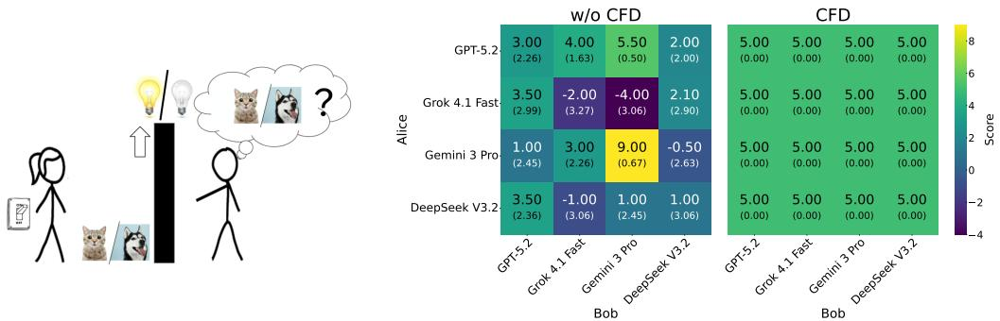  
Figure 1: Cat & Dog coordination game. (Left). Alice observes an animal (cat/dog). She can either bail and end the game for a joint reward of 1, remove the wall for a cost of 5, or use the light bulb to signal for free. Bob either observes the state of the light bulb or the animal if the wall is removed. He can guess the animal (+10/-10) or bail for a reward of 0.5. (Right) XP of text agents in the variable LLM setting with and without CFD. Each cell contains the average score of 10 episodes. Adding the CFD leads the agents to consistently pick the safe fallback for a guaranteed reward of +5.

ZSC literature has predominantly focused on traditional deep reinforcement learning (RL) training pipelines [24, 23, 40]. More recently, however, the emergence of LLMs has given rise to a new class of autonomous agents [41, 42, 43] that differ substantially from this paradigm. Rather than requiring a large number of environment interactions [14], LLM agents can coordinate zero-shot from a textual description of the environment via in-context learning (ICL), without any task-specific training. These textual descriptions expose an additional axis for coordination through the semantics of the environment, a signal that has proven difficult for traditional RL agents to exploit [37]. As illustrated in Figure 5, agents can use semantic cues (e.g., the “red arrow”) to coordinate their actions.

We present the first systematic study of LLM agents in the ZSC setting, beginning with a formalisation of two of the most common scaffolds: text agents and code agents. We then introduce a suite of simplified cooperative environments, inspired by prior work [13, 23, 35, 25], each designed to isolate a specific coordination challenge. We augment these environments with text descriptions to support interaction with LLM agents. Together, these environments cover a broad range of challenges an agent is likely to encounter in the real world. Consequently, we posit that strong performance on thi suite is necessary but not sufficient for robust real-world coordination.

We find that both classes of agents struggle to coordinate reliably in these simplified environments, driven in part by a weak understanding of the underlying coordination challenge and weak ToM abilities. Next, we find that agents have a strong bias toward leveraging environment semantics for coordination. This can yield improvements over traditional RL agents that struggle to exploit such cues; however, semantics also introduce coordination strategies that compete with existing ones, and agents that fail to consistently arbitrate between the two see degraded coordination. Overall, our results highlight the need for a new perspective on coordination with LLM agents.

Finally, inspired by the ZSC principle of a shared learning rule among coordinating entities, we introduce the notion of a Coordination-friendly definition $( C F D )$ , a natural language specification of general coordination principles shared across agents. This mirrors analogous approaches in other domains, such as AI safety, where high-level rules are codified as a “constitution” to promote adherence to common safety standards [5, 26]. We show that incorporating a CFD improves coordination for both text and code agents across a range of environments, and that meta-learned principles within the CFD can outperform hand-crafted ones. Taken together, these results position CFD as a principled mechanism for enhancing coordination in LLM agents and a promising direction for future research.

## 2 Background and Notation

Dec-POMDPs We focus on fully cooperative settings which can be represented via the Decentralised Partially Observable Markov Decision Process (Dec-POMDP) framework [8, 46]. A Dec-POMDP M consists of M agents, each assigned a role $r \in \mathcal { R } = [ M ]$ , a state space S, action space A, per-agent observation spaces $\mathcal { O } _ { i } ,$ transition function $\mathcal { T } : \mathcal { S } \times \mathcal { A } \stackrel { \cdot } { \to } \bar { \Delta } ( \mathcal { S } )$ , discount factor $\gamma \in [ 0 , 1 ]$ and horizon $H \in \mathbb { N }$ , which represents the maximum length of an episode. Agents share a common re ward function $R : { \mathcal { S } } \times { \mathcal { A } }  \Delta ( \mathbb { R } )$ . Each agent observes the environment via its observation function $Z _ { i } : S \to \Delta \left( \mathcal { O } _ { i } \right)$ . The action space can be written as a product $\mathcal { A } = A _ { 1 } \times \cdot \cdot \cdot \times A _ { M }$ , where $A _ { i }$ corresponds to agent i’s action space. A (joint) policy π is an M-tuple of local policies $\pi _ { i } : \mathcal { H } _ { i } \to \Delta ( A _ { i } )$ where $\mathcal { H } _ { i }$ is the space of possible action-observation histories (AOHs) of player i, each of the form $\tau _ { t } ^ { i } = \{ o _ { 0 } ^ { i } , a _ { 0 } ^ { i } , \ldots , a _ { t - 1 } ^ { i } , o _ { t } ^ { i } \}$ . The joint return is defined as $J ( \pi ) = \mathbb { E } _ { \pi } [ \sum _ { t = 0 } ^ { H } \gamma ^ { t } R _ { t } ]$ . We assume access to natural language descriptions $\mathcal { D } = ( \mathcal { D } _ { \mathcal { M } } , \mathcal { D } _ { \mathcal { R } } , \{ \mathcal { D } _ { \mathcal { H } _ { i } } \} _ { i \in [ M ] } )$ of the Dec-POMDP. $\mathcal { D } _ { \mathcal { M } } \in \Sigma ^ { * }$ is a description of the Dec-POMDP, with $\Sigma ^ { * }$ denoting all strings over a suitable finite alphabet $\Sigma$ $\mathcal { D } _ { \mathcal { H } _ { i } } : \mathcal { H } _ { i } \mathbf { \bar { \Lambda } } \to \Sigma ^ { * }$ and $\mathcal { D } _ { \mathcal { R } } : \mathcal { R }  \Sigma ^ { * }$ are injective functions, describing each $\mathrm { \ A O H \ } \tau _ { i }$ and role r in natural language. We use the term role as a synonym for player index; the distinction is purely terminological and reflects how player identity is communicated to LLM agents via $\mathcal { D } _ { \mathcal { R } }$

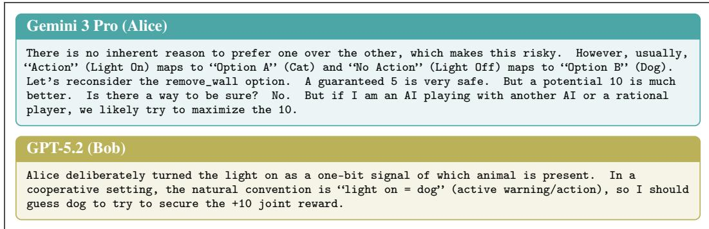  
Figure 2: Reasoning traces from a failed coordination in the Cat and Dog environment. Gemini 3 Pro and GPT-5.2 independently arrive at incompatible strategies.

We define an LLM agent as a system that leverages an LLM and in-context learning (ICL) to generate a local or joint policy $\pi$ for a Dec-POMDP. Crucially, ICL does not involve a separate training phase with gradient-based parameter updates; instead, all the “learning” occurs through conditioning on the prompt during the model’s forward pass. We consider two classes of LLM agents as illustrated in Figure 15: text agents and code agents. Text agents are assigned to a role $r \in \mathcal { R }$ take as input $( \bar { D } _ { \bar { \mathcal { M } } } , \bar { D } _ { \mathcal { R } } ( r ) , \bar { D } _ { \mathcal { H } _ { i } } ( \bar { \tau _ { i } } ) )$ ) and return an action $a _ { t } ^ { i }$ , whereas code agents take as input $\mathcal { D } _ { \mathcal { M } }$ and return a joint policy π as executable code. Since a joint policy specifies the behaviour of all players simultaneously, code agents require no role assignment via $\mathcal { D } _ { \mathcal { R } } \vdots$ the roles, together with their observations and actions, are already specified in $\mathcal { D } _ { \mathcal { M } }$ . A worked example of D for Cat & Dog is given in Appendix D.2. Hence, code agents induce a distribution over joint policies. In contrast, text agents do not produce an explicit joint policy; instead, they act on an implicit local policy $\pi ^ { r }$ assigned to their role. As a result, their behaviour is harder to interpret or modify, and prompting an LLM for each action makes them slower and more expensive to evaluate.

Zero-shot Coordination The standard approach for training fully cooperative multi-agent RL systems is self-play (SP) [50, 54], wherein agents are trained alongside the same counterparts they will encounter at test time. In contrast, the ZSC setting [24] assumes that independently trained policies are paired together at test time without prior communication or adaptation, a setting known as cross-play (XP). To enable coordination, entities are willing to coordinate on (part of) a Dec-POMDP-agnostic learning rule for training their agents. Examples of ZSC learning rules make use of known game symmetries [24] or explicitly control for how agents reason about their partner [23].

## 3 Problem Formulation

Consider a Dec-POMDP with two LLM agents i and $j ,$ and write $\boldsymbol { \pi } _ { i } ^ { r }$ for the local policy of agent i assigned role $r \in \{ 1 , 2 \}$ . Code agents independently generate joint policies $\pi _ { i } , \pi _ { j }$ , with the SP score given as $\mathbb { E } _ { \pi _ { i } } [ J ( \pi _ { i } ) ]$ and $\mathbb { E } _ { \pi _ { j } } \big [ J ( \bar { \pi } _ { j } ) \big ]$ . Their XP score is defined as

$$
\begin{array} { r } { J ( i , j ) = \frac { 1 } { 2 } \mathbb { E } _ { ( \pi _ { i } , \pi _ { j } ) } \bigl [ J ( \pi _ { i } ^ { 1 } , \pi _ { j } ^ { 2 } ) + J ( \pi _ { j } ^ { 1 } , \pi _ { i } ^ { 2 } ) \bigr ] } \end{array}\tag{1}
$$

Equation 1 also applies for text agents where assigning agent i to role r induces the local policy $\boldsymbol { \pi } _ { i } ^ { r }$ We consider three evaluation variants. Self-play (SP) pairs a text agent with itself; for code agents, it is the score of the generated joint policy. The fixed LLM setting $\mathrm { ( \bar { X P } _ { s e e d } ) }$ applies only to code agents, which induce a distribution over joint policies: two policies are sampled independently from the same agent and evaluated under XP, measuring compatibility within a single distribution. The variable LLM setting $( \mathrm { X P _ { L L M } } )$ , applicable to both code and text agents, instead pairs two distinct LLM agents under XP. A schematic of the evaluation regimes is provided in Figure 16 in the Appendix.

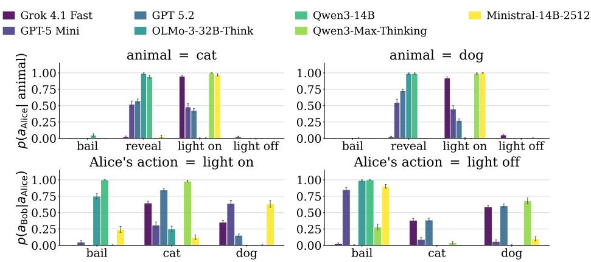  
Figure 3: Local policies induced by text agents on Cat & Dog. Most agents induce degenerate signalling policies; e.g, Qwen3-Max-Thinking and Ministral-14B-2512 turn the light on regardless of the observed animal. Qwen3-14B and OLMo-3-32B-Think induce the ZSC-optimal policy.

We treat a single ICL generation as the analogue of a training run in tabula-rasa RL. For code agents, one generated joint policy therefore corresponds to one self-play training run, and pairing independently generated joint policies mirrors standard XP evaluation [24]. For text agents, which only induce local policies, the distinction is less clear-cut. We refer to pairing two instances of the same LLM with the same prompt (but different roles) as SP, reflecting that providers may optimise models to work well with instances of themselves, e.g., as subagents within a shared harness. As we show in Figure 4, even such local policies are not guaranteed to be mutually compatible.

## 4 ZSC performance of LLM agents

It is natural to ask whether LLM agents coordinate effectively out of the box, rendering further study unnecessary. Towards this, we conduct experiments across nine diverse coordination problems. Many of these are adapted from the ZSC literature, including Cat & Dog [23], Tiny Hanabi [13] and a variant of the lever game [23, 55]. Our choice of environments is motivated by two reasons: (a) each environment isolates a core coordination capability under ZSC evaluation in simplified settings, enabling a clean assessment of whether LLM agents exhibit the targeted behaviour; and (b) collectively, they span a diverse set of challenges that arise in real-world coordination. These include, for example, selecting a safe fallback in the absence of shared conventions, forming conventions at test time, and achieving coordinated symmetry breaking. A detailed description of the environments and the challenges they capture is provided in Appendix D. We emphasise that strong performance across these environments constitutes a necessary but not sufficient condition for effective realworld coordination. For instance, the narrow tunnel environment isolates the problem of tie-breaking, an issue that has been observed in deployed autonomous driving systems such as Waymo [12]. If LLM agents are used to generate navigation policies for autonomous vehicles [27], failures in this environment would likely translate to analogous failures in the real world.

To ensure a fair evaluation, we include an explanation of the XP evaluation framework used, as well as provide explicit instructions to the agents to optimise their policies for high XP scores. The prompt templates used for both types of agents are reported in Appendix G.3. While we evaluate agents across all environments, we conduct a detailed analysis on the Cat and Dog toy environment [23] and a simplified variant of Hanabi [6], a widely used coordination benchmark. As we show later, coordination failure modes observed in Cat and Dog persist in the more complex game of Hanabi as well. In Cat & Dog, as shown in Figure 1, there exist two incompatible conventions (light on ⇒ cat and light on ⇒ dog), both of which achieve the maximum reward of 10. However, without any prior communication, the (ZSC-optimal) strategy is to remove the wall, yielding a reward of 5. For code agents, we employ SOTA reasoning models, namely Grok 4.1 Fast, GPT-5.2, Gemini 3 Pro, Claude

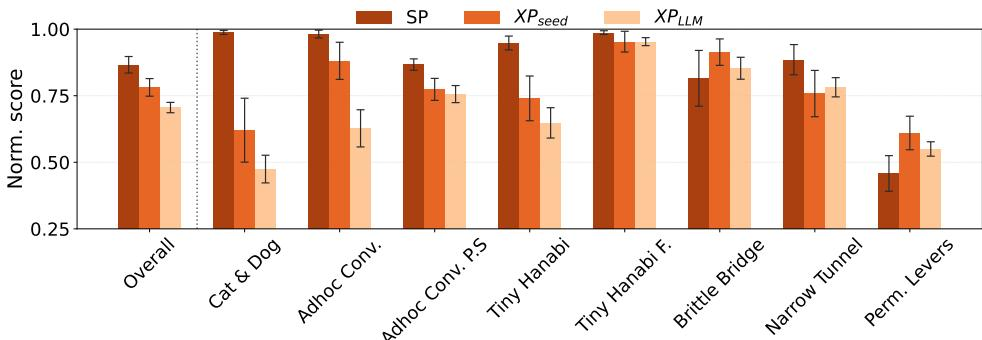  
Figure 4: SP and XP scores of code agents, aggregated across LLMs. Code agents exhibit a clear SP-XP gap, indicating that independently generated policies use incompatible strategies.

Opus 4.5 and DeepSeek V3.2. Due to cost reasons, we evaluate text agents in the SP setting across all games using GPT-5.2 and Grok 4.1 Fast, and restrict the variable LLM setting to Cat & Dog.

Text agents As shown in Figure 1, text agents coordinate poorly in Cat and Dog, resulting in XP scores well below the safe guaranteed reward of 5 obtained by removing the wall. We find that Gemini 3 Pro consistently adopts the convention light on ⇒ cat, enabling it to coordinate with itself. Since this convention is arbitrary, it leads to poor coordination with other agents. An example failure case is shown in Figure 2, which records the reasoning traces from an episode between Gemini 3 Pro and GPT 5.2. When acting as Alice, the Gemini agent recognises that any coordination convention is arbitrary, yet nevertheless selects one to avoid the −5 penalty and subsequently rationalises this choice as “natural”. In contrast, when acting as Bob, the GPT agent independently rationalises the opposite convention to be “natural”; importantly, it does not consider bailing as an option.

Next, we estimate the empirical local policies of text agents by repeatedly prompting them 100 times from a fixed game state, as illustrated in Figure 3. As Alice, we observe that Grok, Ministral, and Qwen3-Max consistently turn the light on regardless of the observed animal, yielding a degenerate signalling policy. GPT models exhibit similar behaviour, though with lower probability, opting to reveal in the remaining cases. We observe similarly degenerate behaviour as Bob. Ministral tends to bail when the light is off but guesses “dog” with high probability when the light is on, whereas Qwen3-Max guesses “cat” when the light is on and “dog” otherwise. Overall, their behaviour is largely arbitrary and degenerate. Surprisingly, smaller models such as Qwen3-14B and OLMo-32B-Think recover the optimal ZSC policy: revealing as Alice and bailing when observing a signal as Bob, despite being weaker than frontier models like Grok-4.1-Fast, GPT-5.2, and Qwen3-Max-Thinking at mainstream tasks such as Math and Coding. Notably, Qwen3-Max-Thinking (∼1T parameters) performs significantly worse than its smaller counterpart, Qwen3-14B. We observe a similar pattern for smaller models such as Grok 4.1 Fast and GPT-5 mini (see Table 3 in the Appendix), where increased reasoning effort correlates with lower coordination performance due to more frequent hallucinations of a shared convention. However, the relationship is mixed: for frontier models such as Claude Opus 5 and Grok 4.5, higher reasoning effort increases the reveal rate, whereas the newer GPT-5.6 Sol reveals far less often than GPT-5.2 (Appendix F.6). Greater model capability or reasoning effort therefore does not reliably translate into stronger ZSC.

Next, we examine how semantics, specifically, textual descriptions of the environment, affect the agents’ local policies. To this end, we consider two reformulations of the Cat & Dog game. First, we rename the signalling actions from “light on/off” to “red/blue light.” Second, we translate the entire environment description D into German. The latter reflects settings where coordinating agents may access the same environment (e.g., a website) in different languages. Note that the payoffs in each of these cases is unchanged. We find that semantics can significantly influence the agents’ local policies as shown in Figure 18 (Top-Right and Bottom-Left) in the Appendix. For instance, GPT models become more grounded, choosing to reveal with higher probability when we relabel the actions to red light and blue light. In contrast, Qwen3-14B and OLMo-3-32B exhibit a reduced tendency to reveal, with Qwen3-14B increasingly opting to bail as Alice-an effect that is further amplified under the German relabeling. Meanwhile, Grok, Ministral, and GPT-5-Mini continue to exhibit degenerate policies across these modified environments. These results indicate that the models are unable to robustly reason about the game and are arbitrarily influenced by semantics.

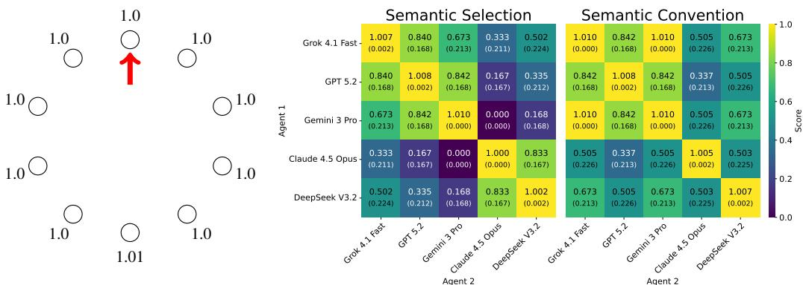  
Figure 5: (Left) Semantic Selection game. Agents could either coordinate on the semantic focal point (top) or Dec-POMDP-based focal point (bottom). (Right) XP scores of code agents on both games. The SP-XP gap reveals that agents inconsistently choose between the two strategies.

As discussed in Section 1, successful coordination requires theory of mind (ToM) [47], since agents must reason about which conventions, if any, their partners are likely to adopt. In the absence of an established convention, a well-calibrated agent should maintain uncertainty over how its partner will interpret a signal [23]; selecting the ambiguous signal anyway reflects a failure of this reasoning. We note, however, that failures in Cat & Dog do not by themselves causally separate weak ToM from a failure to recognise that no shared convention exists, and we view both as contributing factors. We observed that the agents are strongly averse to incurring the penalty for revealing, which pushes them to adopt an arbitrary signalling convention (also seen in Figure 2). Moreover, agents rationalise their chosen convention as the unique "natural" convention, something that the Gemini agent exploits for successful coordination (Figure 1). We test whether this is a general strategy that other agents can also exploit. For this, we add the following instruction to the prompt: "You are playing a cooperative game with an identical instance of yourself. The same language model is used for both players, but each instance is assigned a different role in the game." If the model has a consistent notion of what it considers a "natural" convention, it should be able to coordinate on that convention and thereby achieve the maximum reward. That said, as shown in Figure 18 (Bottom-Right) in the Appendix, agents are unable to exhibit such capabilities. Instead, coordination performance deteriorates. For example, GPT-5.2, which initially revealed in about 75% of cases, now adopts a degenerate policy of always turning the light on, as Alice, revealing in only about 5% of cases. Similarly, Qwen3-14B and OLMo-32B-Think reduce their reveal rates to around 50% when observing a dog, down from over 95%. As Bob, they also shift toward guessing the animal more frequently, rather than bailing as they did previously. These results suggest that agents behave as though a consistent internal notion of a “natural” convention exists; however, in practice, no such consistency is observed. Finally, we find that coordination failures in text agents are not limited to the Cat & Dog environment. As summarised in (Table 1 in the Appendix), Grok 4.1 Fast and GPT 5.2 exhibit high failure rates in 7/9 tasks. Since these simplified environments are designed to isolate coordination failure modes, we examine whether the same failure modes persist in more complex settings. This helps validate our claim that strong performance in simplified environments is necessary but not sufficient for real-world coordination. We evaluate text agents on a 3x3 variant of Hanabi [6], of which Cat & Dog serves as an abstraction. The game mechanics are described in Appendix D in the Appendix, and results are shown in Figure 20 in the Appendix. We find that most failures stem from mismatched assumptions of shared conventions, closely mirroring our findings in Cat & Dog. For instance, a predominant failure mode arises when the clue receiver assumes the “Good Touch Principle” (i.e., that all hinted cards will be played), while the clue giver does not (Figure 32 in the Appendix).

Code agents We evaluate the SP and XP performance of code agents both in the fixed LLM $( \mathrm { S P } , \mathrm { X P _ { s e e d } ^ { - } } )$ and variable LLM setting $( \mathrm { X P _ { L L M } } )$ and report the aggregated results in Figure 4, providing detailed results in Appendix F.3. Similar to text agents, code agents although aware of the safe reveal strategy are averse to the penalty associated with revealing. Adding to this we observe a strong bias toward adopting conventions based on semantics, primarily via lexicographical ordering. Yet, the agents frequently fail to agree on the ordering itself. For instance, assumptions such as cat<dog and on<off make mappings like cat → light on a common choice. However, many agents instead interpret light off/on as a binary signal, equating it with 0/1, which yields light off=cat resulting in coordination failure. More broadly, lexicographical ordering is a brittle ZSC coordination rule. For example, if agents use textual descriptions from different languages (as discussed in Figure 4), the ordering may invert. For example, Hund (dog) precedes Katze (cat) in German.

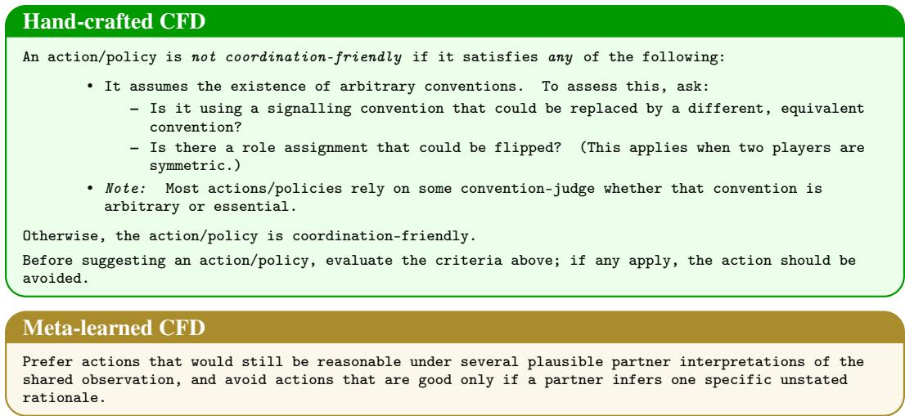  
Figure 6: Hand-crafted and Meta-learned CFDs.

Similar coordination failures are observed across the remaining environments. This stems from code agents generating joint policies that achieve high self-play returns but coordinate poorly with other independently generated policies. Across both fixed and variable LLM settings, we observe a significant gap relative to SP returns (see Figure 4). Qualitative analysis (Appendix H) further indicates that these policies are brittle and sheds light on the dominant failure modes across environments. Although the evaluation settings of code and text agents are not directly comparable, we qualitatively find that code agents are markedly more likely to resort to such brittle policies, while text agents exhibit more robust reasoning. Overall, our experiments demonstrate that both sets of agents perform poorly across the evaluated environments. This finding is particularly important in light of recent work deploying both text and code agents in real-world ZSC settings [32, 53, 27].

## 5 Semantics and Coordination

LLM agents rely on textual descriptions of the Dec-POMDP to access the environment, thereby introducing semantics as an additional axis for coordination. Semantics have important implications for coordination, enabling agents to leverage semantic relationships between observations and actions that have been difficult for traditional RL methods to exploit [37]. Moreover, semantics introduce new coordination strategies that compete with those grounded in the structure of the Dec-POMDP. As discussed in the previous section, LLM agents exhibit a strong bias toward leveraging semantic features for coordination; here, we investigate this more systematically, using environments specifically designed to isolate the role of semantics in coordination.

Exploiting semantics for coordination Code agents achieve near-perfect XP returns on Tiny Hanabi Fixed, despite its close similarity to the Cat & Dog setting, which features a safe fallback and two symmetric but incompatible Nash equilibria. Inspection of the reasoning traces reveals that agents independently converge on a unique convention induced by the lexicographic mapping (A 7→ 1, C 7→ 2) (see Figure 34 in the Appendix). Traditional ZSC algorithms, which cannot exploit such semantic structure, instead default to the safe fallback and incur lower rewards [13, 23].

To further probe this ability, we evaluate text and code agents on the Hint–Guess game [37] (Appendix D), a task where success requires exploiting semantic relationships between observations and actions and where agents can coordinate through human-like reasoning patterns such as mutual exclusivity [38] and implicature [17] (Figure 14 in the Appendix). Text agents perform strongly in this environment (Figure 20 in the Appendix), matching the human baselines reported in [37] and adopting the same coordination strategies as human players (Table 8 in the Appendix); however, they occasionally suffer coordination failures that are unlikely to arise in human play (Figure 41 in the Appendix). Code agents, in contrast, perform poorly (Figure 20 in the Appendix): rather than grounding coordination in semantic features, they fall back on arbitrary conventions such as lexicographic sorting or positional indexing (Figure 43 in the Appendix), and none of the resulting policies successfully leverage mutual exclusivity or implicature. This is consistent with our findings in Figure 4, where code agents perform worse than text agents across the range of coordination tasks.

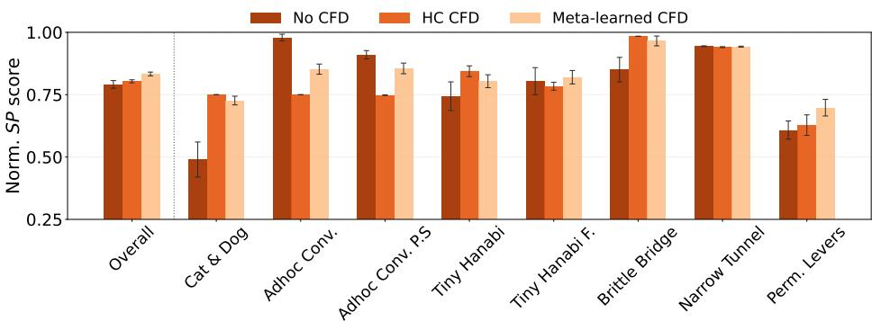  
Figure 7: Self-play performance of Grok 4.1 Fast as text agent. Incorporating the meta-learned CFD outperforms the hand-crafted CFD, which in turn improves over the baseline.

Semantics introduce competing strategies Conversely, code agents achieve lower XP scores in the Tiny Hanabi environment, despite the presence of a unique optimal strategy (A 7→ 2, C 7→ 1). Analysis of the reasoning traces reveals that semantics introduce an additional coordination strategy based on lexicographic ordering, as discussed above, albeit with a lower joint return. The resulting competition between these strategies degrades XP performance, whereas traditional ZSC algorithms, which do not exploit such semantic structure, are not affected [13].

To further investigate this competition, we introduce the Semantic Selection Game (Figure 5) and the Semantic Convention Game (Appendix D). Broadly, agents must choose between two competing and incompatible coordination strategies: coordinating on the uniquely SP-optimal joint policy, or coordinating based on the semantic relationship between the observations and actions. For example, as shown in Figure 5, agents can either coordinate by selecting the lever with reward 1.01 or by choosing the lever marked with a “big red arrow”. Figure 5 demonstrates that the LLM agents fail to resolve this competition consistently, resulting in low XP scores. We find that Gemini 3 Pro is the only model that reliably selects the SP-optimal policy across all games. In contrast, the other LLM agents alternate between the two competing strategies. We find that Claude Opus 4.5 is particularly biased toward semantic alignment, selecting the semantic-aligned joint policy in all six runs of the semantic selection and in three out of six runs of the semantic convention game.

Avoiding local optima Direct reasoning about the environment allows LLM agents to identify optimal strategies that are difficult for traditional RL methods to discover through Monte Carlo rollouts, which are often prone to local minima. As shown in Appendix F.4, LLM agents reliably discover self-explaining deviations in the trampoline–tiger coordination challenge [25], while widely used MARL algorithms such as MAPPO [59] and QMIX [49] fail to uncover these solutions.

## 6 Coordination Friendly Definitions

The results in Figure 4 and Section 5 show that LLM agents fail even in simple settings, highlighting the need to adapt LLM agents for zero-shot coordination. Towards this, we propose a simple approach inspired by the core principle underlying ZSC algorithms. Prior work [24] motivates the idea of a ZSC learning rule as follows: “suppose that multiple independent AI designers will construct agents that have to interact in various but ex-ante unknown Dec-POMDPs without being able to coordinate beforehand, what learning rule should these designers agree on?” In the context of LLM agents, we introduce the analogous notion of a coordination-friendly definition (CFD). A CFD comprises a set of textual instructions that encode general coordination principles used to guide agent behaviour. We assume that independent developers can agree on a shared CFD to facilitate coordination among their agents. Given the diversity of scaffolds, including the text and code agents described in Section 2, we emphasise that CFDs should remain simple to ensure compatibility across implementations.

The CFD must influence the behaviour of the LLM agent, for example, by shaping the induced local policies of text agents or the joint policy generation process of code agents. In this work, we focus on the most straightforward application: incorporating the CFD directly into the prompt. We also briefly explore a specialised scaffold for code agents that introduces a policy critic to modify or reject generated joint policies based on compliance with the CFD. More advanced approaches, such as reinforcement learning from human feedback (RLHF) [52, 4] based on CFD compliance (similar to [5]), remain a promising direction for future work but are beyond the scope of this work.

Hand-crafted CFD We experiment with a simple hand-crafted CFD as shown in Figure 6, which is based on preventing arbitrary conventions and role assignments [24, 55]. As shown in Figure 1 and Table 1, Table 6 and Table 7, the CFD improves the performance of both agents in the Cat & Dog environment, where agents now consistently choose to remove the wall. We find that the CFD has a stronger effect on text agents and smaller models, reducing the coordination failure rate in 6/9 environments for Grok 4.1 Fast and 5/9 for GPT-5.2 (Table 1 in the Appendix). That said, the CFD can be too restrictive in some cases. In the ad-hoc conventions environments, the CFD biases the agents toward the safe fallback, preventing them from forming conventions at test time.

The effect of the CFD is less pronounced for code agents, where it fails to reduce the SP-XP gap beyond the Cat & Dog and the Semantic Selection Game environments. We attribute this to the generally weaker coordination abilities of code agents, as documented in Figure 4 and Section 5. Further examination of execution traces revealed that, while code agents adjust their generated policies in response to the CFD, these policies rarely account for edge cases, leading to coordination failures. Taken together, these results show that conditioning LLM agents on general coordination principles via a CFD is a simple and effective method for improving coordination.

Automatic discovery of CFDs The hand-crafted CFD is only an initial attempt and, as noted above, does not apply to all coordination challenges. Rather than refining it by hand, we explore whether CFDs can be discovered automatically via meta-learning (“learning to learn”) [56, 22, 7], which has been shown to outperform human design choices.

To this end, we implement a meta-learning loop to autonomously discover CFDs using LLM-driven evolution. Our method is loosely based on GEPA [2], which employs Pareto-based candidate selection to improve sample efficiency in the evolutionary process. We combine this with other optimizations which increase the diversity of proposals in the evolutionary process and reduce the cost of “metastep”. We provide further implementation details in Appendix G.1. We meta-train the CFD on Cat & Dog and Brittle Bridge using Grok-4.1-Fast as the code agent, $\mathrm { X P _ { s e e d } }$ as the measure of fitness and GPT 5.4 as the meta-optimisation agent. We additionally modify the code agent scaffold by introducing a policy critic that refines generated joint policies based on compliance with the CFD, while leaving the code generation process itself unconditioned on the CFD to preserve diversity. Empirically, this leads to more diverse solutions and reduced variance in the $\mathrm { X P _ { s e e d } }$ score of generated policies. Further implementation details regarding the policy critic are provided in Appendix G.2.

The discovered CFD is roughly two-thirds shorter than the hand-crafted variant (Figure 6) and generalises beyond its training conditions. Although meta-training only uses Grok 4.1 Fast as a code agent (direct meta-training with text agents would have raised token cost and runtime by two orders of magnitude), the discovered CFD also improves Grok 4.1 Fast operating as a text agent (Figure 7). We further observe modest ${ \mathrm { X P } } _ { \mathrm { L L M } }$ gains across other models (GPT 5.2, Claude 4.5, Gemini 3 Pro) and the generic code-agent scaffold (Figure 23), even though meta-training optimised $\mathrm { X P _ { s e e d } }$ in the critic-based scaffold; we do not, however, observe $\mathrm { X P _ { s e e d } }$ gains across LLM types (Figure 22). Overall, CFDs can be efficiently meta-learned with inexpensive scaffolds while generalising to more capable agents for which direct optimisation would be infeasible.

## 7 Conclusion and Future Work

We study the ZSC performance of LLM agents across a range of coordination tasks under the commonly used text and code scaffolds, and find that they consistently fail to coordinate effectively, even in simplified environments. Although the two scaffolds are not directly comparable, we qualitatively observe that code agents are more prone to brittle, arbitrary conventions than text agents, an observation worth noting given their increasing deployment in real-world settings [32, 28, 27]. We identify several factors that contribute to these failures: a limited understanding of the coordination problem, a failure to recognise that no shared convention has been established, and weak Theory ofmind (ToM) reasoning about how a partner will interpret one’s actions. Our experiments do not causally isolate these factors from one another; rather, they jointly characterise the observed failures. We additionally find that LLM agents are biased toward exploiting semantic representations of the environment, which can both aid and impede coordination. Next, we introduce Coordination-friendly definition (CFD), a simple and general mechanism for improving coordination that can be readily integrated into existing agent scaffolds, and show that CFDs can be automatically discovered through meta-learning, reducing the need for manual design.

Limitations Both the hand-crafted and meta-learned CFDs remain relatively simple and do not apply to every coordination challenge. For the meta-learned CFD, we attribute this in part to the limited number of meta-training environments, in line with prior meta-learning work showing that broader task distributions yield more robust generalisation [45, 44, 16]; the hand-crafted CFD, being designed manually, would similarly benefit from refinement on a wider range of coordination settings. In particular, CFDs can lead agents to under-coordinate: in the ad-hoc conventions environments, agents repeatedly choose the safe fallback instead of forming a convention at test time. This failure mode is not unique to our approach. Off-belief learning (OBL) [23], for instance, would behave similarly, since it reinterprets the interaction history as though the partner had followed a random policy and therefore discards any ad-hoc convention formed during the interaction. Avoiding undercoordination while retaining robustness remains an open problem in ZSC. Nevertheless, we view under-coordination as preferable to the prevailing failure mode of over-coordination, in which agents rely on brittle, arbitrary conventions that lead to catastrophic coordination failures. Finally, due to cost, our variable-LLM evaluation of text agents is less extensive than that of code agents and concentrates on Cat & Dog, Hint-Guess, and the 3×3 Hanabi variant.

Future work Alternative integration mechanisms beyond prompting, such as RLHF-based CFD compliance [5], are discussed in Section 6. In addition, principles from traditional ZSC algorithms [23, 24] may be adapted in conjunction with LLM-RL methods such as GRPO [19] to improve coordination in LLM agents. We find a mixed relationship between reasoning capacity and ZSC performance (Appendix F.6): more capable models or higher reasoning effort do not reliably yield better coordination, and understanding when they do is an important open question. Beyond our minimal environments, LLM agents should be evaluated in more complex settings such as Overcooked [15], where agents can adapt to their partner within an episode. Two related settings fall outside the standard ZSC framework but capture important real-world challenges: adaptation to a partner across repeated episodes, and coordination given a small number of demonstrations of successful coordination (e.g., autonomous vehicles learning from human drivers); our few-shot baseline (Appendix F.7) is a first step in this direction. Finally, our analysis focuses on textual descriptions; extending it to Vision–Language Models (VLMs), which can leverage visual cues for coordination, is a natural direction for future work.

## Acknowledgments and Disclosure of Funding

Shashank Reddy is partially supported by the Cooperative AI PhD Fellowship from the Cooperative AI Foundation. Bidipta Sarkar is supported by the Clarendon Fund Scholarship in partnership with a Department of Engineering Science Studentship for his Oxford DPhil. Andrei Lupu was partially funded by a Fonds de recherche du Québec doctoral training scholarship. Jakob N. Foerster is partially funded and Johannes Forkel is funded by the UKRI grant EP/Y028481/1 (originally selected for funding by the ERC). The authors thank Darius Muglich, Antonio León Villares, and Michael Beukman for their thoughtful feedback on the manuscript.

## References

[1] Saaket Agashe, Yue Fan, Anthony Reyna, and Xin Eric Wang. LLM-coordination: Evaluating and analyzing multi-agent coordination abilities in large language models. In Findings of the Associationfor Computational Linguistics: NAACL 2025. Association for Computational Linguistics, April 2025.

[2] Lakshya A Agrawal, Shangyin Tan, Dilara Soylu, Noah Ziems, Rishi Khare, Krista Opsahl-Ong, Arnav Singhvi, Herumb Shandilya, Michael J Ryan, Meng Jiang, Christopher Potts, Koushik Sen, Alex Dimakis, Ion Stoica, Dan Klein, Matei Zaharia, and Omar Khattab. GEPA: Reflective prompt evolution can outperform reinforcement learning. In The Fourteenth International Conference on Learning Representations, 2026.

[3] Eltayeb Ahmed, Uljad Berdica, Martha Elliott, Danijela Horak, and Jakob N. Foerster. Intent factored generation: Unleashing the diversity in your language model. arXiv preprint arXiv:2506.09659, 2025.

[4] Yuntao Bai, Andy Jones, Kamal Ndousse, Amanda Askell, Anna Chen, Nova DasSarma, Dawn Drain, Stanislav Fort, Deep Ganguli, Tom Henighan, Nicholas Joseph, Saurav Kadavath, Jackson Kernion, Tom Conerly, Sheer El-Showk, Nelson Elhage, Zac Hatfield-Dodds, Danny Hernandez, Tristan Hume, Scott Johnston, Shauna Kravec, Liane Lovitt, Neel Nanda, Catherine Olsson, Dario Amodei, Tom Brown, Jack Clark, Sam McCandlish, Chris Olah, Ben Mann, and Jared Kaplan. Training a helpful and harmless assistant with reinforcement learning from human feedback. arXiv preprint arXiv:2204.05862, 2022.

[5] Yuntao Bai, Saurav Kadavath, Sandipan Kundu, Amanda Askell, Jackson Kernion, Andy Jones, Anna Chen, Anna Goldie, Azalia Mirhoseini, Cameron McKinnon, Carol Chen, Catherine Olsson, Christopher Olah, Danny Hernandez, Dawn Drain, Deep Ganguli, Dustin Li, Eli Tran-Johnson, Ethan Perez, Jamie Kerr, Jared Mueller, Jeffrey Ladish, Joshua Landau, Kamal Ndousse, Kamile Lukosuite, Liane Lovitt, Michael Sellitto, Nelson Elhage, Nicholas Schiefer, Noemi Mercado, Nova DasSarma, Robert Lasenby, Robin Larson, Sam Ringer, Scott Johnston, Shauna Kravec, Sheer El Showk, Stanislav Fort, Tamera Lanham, Timothy Telleen-Lawton, Tom Conerly, Tom Henighan, Tristan Hume, Samuel R. Bowman, Zac Hatfield-Dodds, Ben Mann, Dario Amodei, Nicholas Joseph, Sam McCandlish, Tom Brown, and Jared Kaplan. Constitutional AI: Harmlessness from AI feedback. arXiv preprint arXiv:2212.08073, 2022.

[6] Nolan Bard, Jakob N. Foerster, Sarath Chandar, Neil Burch, Marc Lanctot, H. Francis Song, Emilio Parisotto, Vincent Dumoulin, Subhodeep Moitra, Edward Hughes, Iain Dunning, Shibl Mourad, Hugo Larochelle, Marc G. Bellemare, and Michael Bowling. The Hanabi challenge: A new frontier for AI research. Artif. Intell., 280(C), March 2020.

[7] Jacob Beck, Risto Vuorio, Evan Zheran Liu, Zheng Xiong, Luisa Zintgraf, Chelsea Finn, and Shimon Whiteson. A tutorial on meta-reinforcement learning. Foundations and Trends in Machine Learning, 18(2–3):224–384, 2025.

[8] Daniel S. Bernstein, Robert Givan, Neil Immerman, and Shlomo Zilberstein. The complexity of decentralized control of Markov decision processes. Mathematics of Operations Research, 27(4):819–840, November 2002.

[9] Allan Dafoe, Edward Hughes, Yoram Bachrach, Tantum Collins, Kevin R. McKee, Joel Z. Leibo, Kate Larson, and Thore Graepel. Open problems in cooperative AI. arXiv preprint arXiv:2012.08630, 2020.

[10] Tim R. Davidson, Adam Fourney, Saleema Amershi, Robert West, Eric Horvitz, and Ece Kamar. The collaboration gap: Exploration and benchmarking of open-world agentic cooperation. In Conference on Language Modeling (COLM), 2026.

[11] Chrisantha Fernando, Dylan Banarse, Henryk Michalewski, Simon Osindero, and Tim Rocktäschel. Promptbreeder: self-referential self-improvement via prompt evolution. In Proceedings ofthe 41st International Conference on Machine Learning, ICML’24. JMLR.org, 2024.

[12] Jakob Foerster. Two Waymo cars fail to coordinate with each other. Video post on X (formerly Twitter), https://x.com/j\_foerst/status/1811676036418937208, July 2024.

[13] Jakob N. Foerster, H. Francis Song, Edward Hughes, Neil Burch, Iain Dunning, Shimon Whiteson, Matthew M. Botvinick, and Michael H. Bowling. Bayesian action decoder for deep multi-agent reinforcement learning. In Proceedings ofthe 36th International Conference on Machine Learning, volume 97 of Proceedings of Machine Learning Research, pages 1942–1951. PMLR, 2019.

[14] Johannes Forkel, Constantin Ruhdorfer, Michael Beukman, Andreas Bulling, and Jakob Foerster. High entropy leads to symmetry-equivariant policies in Dec-POMDPs. arXiv preprint arXiv:2511.22581, 2025.

[15] Tobias Gessler, Tin Dizdarevic, Ani Calinescu, Benjamin Ellis, Andrei Lupu, and Jakob Nicolaus Foerster. OvercookedV2: Rethinking Overcooked for zero-shot coordination. In The Thirteenth International Conference on Learning Representations, 2025.

[16] Alexander D. Goldie, Zilin Wang, Adrian Hayler, Deepak Nathani, Edan Toledo, Ken Thampiratwong, Aleksandra Kalisz, Michael Beukman, Alistair Letcher, Shashank Reddy Chirra, Clarisse Wibault, Theo Wolf, Charles O’Neill, Uljad Berdica, Nicholas Roberts, Saeed Rahmani, Roberta Raileanu, Shimon Whiteson, and Jakob N. Foerster. Procedural generation of algorithm discovery tasks in machine learning. In Proceedings of the 43rd International Conference on Machine Learning, volume 306 of Proceedings of Machine Learning Research, pages 35600–35715. PMLR, 2026.

[17] H. P. Grice. Logic and conversation. In P. Cole and J. Morgan, editors, Syntax and Semantics, pages 41–58. Academic Press, New York, 1975.

[18] David Gringras. Safety under scaffolding: How evaluation conditions shape measured safety. arXiv preprint arXiv:2603.10044, 2026.

[19] Daya Guo, Dejian Yang, Haowei Zhang, et al. DeepSeek-R1 incentivizes reasoning in LLMs through reinforcement learning. Nature, 645:633–638, 2025.

[20] Xudong Guo, Kaixuan Huang, Jiale Liu, Wenhui Fan, Natália Vélez, Qingyun Wu, Huazheng Wang, Thomas L. Griffiths, and Mengdi Wang. Embodied LLM agents learn to cooperate in organized teams. IEEE Transactions on Computational Social Systems, 13(2):2514–2530, 2026.

[21] Horace He and Thinking Machines Lab. Defeating nondeterminism in LLM inference. Thinking Machines Lab: Connectionism, 2025. https://thinkingmachines.ai/blog/ defeating-nondeterminism-in-llm-inference/.

[22] Timothy M. Hospedales, Antreas Antoniou, Paul Micaelli, and Amos J. Storkey. Meta-learning in neural networks: A survey. IEEE Transactions on Pattern Analysis and Machine Intelligence, 44(9):5149–5169, 2022.

[23] Hengyuan Hu, Adam Lerer, Brandon Cui, Luis Pineda, Noam Brown, and Jakob Foerster. Off-belief learning. In Proceedings of the 38th International Conference on Machine Learning, volume 139 of Proceedings ofMachine Learning Research, pages 4369–4379. PMLR, 2021.

[24] Hengyuan Hu, Adam Lerer, Alexander Peysakhovich, and Jakob Nicolaus Foerster. “Other-Play” for zero-shot coordination. In Proceedings of the 37th International Conference on Machine Learning, PMLR 119, Online, 2020.

[25] Hengyuan Hu, Samuel Sokota, David J Wu, Anton Bakhtin, Andrei Lupu, Brandon Cui, and Jakob Nicolaus Foerster. Self-explaining deviations for coordination. In Advances in Neural Information Processing Systems, 2022.

[26] Saffron Huang, Divya Siddarth, Liane Lovitt, Thomas I. Liao, Esin Durmus, Alex Tamkin, and Deep Ganguli. Collective constitutional AI: Aligning a language model with public input. In The 2024 ACM Conference on Fairness, Accountability, and Transparency, FAccT ’24, page 1395–1417. ACM, June 2024.

[27] Shu Ishida, Gianluca Corrado, George Fedoseev, Hudson Yeo, Lloyd Russell, Jamie Shotton, Joao F. Henriques, and Anthony Hu. LangProp: A code optimization framework using language models applied to driving. arXiv preprint arXiv:2401.10314, 2024.

[28] W. Ji, H. Chen, M. Chen, et al. GenSwarm: Scalable multi-robot code-policy generation and deployment via language models. npj Robotics, 4:5, 2026.

[29] Chris Kirkham, Norihiko Shirouzu, and Rachael Levy. How Tesla and Waymo’s radically different robotaxi approaches will shape the industry. Reuters, August 2025.

[30] Matthew Le, Y-Lan Boureau, and Maximilian Nickel. Revisiting the evaluation of theory of mind through question answering. In Proceedings of the 2019 Conference on Empirical Methods in Natural Language Processing and the 9th International Joint Conference on Natural Language Processing (EMNLP-IJCNLP). Association for Computational Linguistics, November 2019.

[31] Huao Li, Yu Chong, Simon Stepputtis, Joseph Campbell, Dana Hughes, Charles Lewis, and Katia Sycara. Theory of mind for multi-agent collaboration via large language models. In Houda Bouamor, Juan Pino, and Kalika Bali, editors, Proceedings ofthe 2023 Conference on Empirical Methods in Natural Language Processing, pages 180–192, Singapore, December 2023. Association for Computational Linguistics.

[32] Jacky Liang, Wenlong Huang, Fei Xia, Peng Xu, Karol Hausman, Brian Ichter, Pete Florence, and Andy Zeng. Code as policies: Language model programs for embodied control. In 2023 IEEE International Conference on Robotics and Automation (ICRA), pages 9493–9500, 2023.

[33] Wilson Lin. Scaling long-running autonomous coding. Cursor blog, https://cursor.com/ blog/scaling-agents, January 2026.

[34] Jijia Liu, Chao Yu, Jiaxuan Gao, Yuqing Xie, Qingmin Liao, Yi Wu, and Yu Wang. LLMpowered hierarchical language agent for real-time human-AI coordination. In Proceedings of the 23rd International Conference on Autonomous Agents and Multiagent Systems (AAMAS), pages 1219–1228, 2024.

[35] Andrei Lupu, Brandon Cui, Hengyuan Hu, and Jakob Foerster. Trajectory diversity for zero-shot coordination. In Proceedings ofthe 38th International Conference on Machine Learning. PMLR, 18–24 Jul 2021.

[36] Andrei Lupu, Timon Willi, and Jakob Foerster. The Decrypto benchmark for multi-agent reasoning and theory of mind. In Proceedings of the 43rd International Conference on Machine Learning, volume 306 of Proceedings of Machine Learning Research, pages 83284–83323. PMLR, 2026.

[37] Mingwei Ma, Jizhou Liu, Samuel Sokota, Max Kleiman-Weiner, and Jakob Foerster. Learning intuitive policies using action features. In Proceedings ofthe 40th International Conference on Machine Learning, ICML’23. JMLR.org, 2023.

[38] Ellen M Markman and Gwyn F Wachtel. Children’s use of mutual exclusivity to constrain the meanings of words. Cognitive Psychology, 20(2):121–157, 1988.

[39] Mariana Meireles, Rupali Bhati, Niklas Lauffer, and Cameron Allen. The influence of scaffolds on coordination scaling laws in LLM agents. In First Workshop on Multi-Turn Interactions in Large Language Models, 2025.

[40] Darius Muglich, Johannes Forkel, Elise van der Pol, and Jakob Nicolaus Foerster. Expected return symmetries. In The Thirteenth International Conference on Learning Representations, 2025.

[41] Magnus Müller and Gregor Žunic. Browser Use: Enable AI to control your browser. ˇ https: //github.com/browser-use/browser-use, 2024.

[42] Liangbo Ning, Ziran Liang, Zhuohang Jiang, Haohao Qu, Yujuan Ding, Wenqi Fan, Xiao-yong Wei, Shanru Lin, Hui Liu, Philip S. Yu, and Qing Li. A survey of WebAgents: Towards next-generation AI agents for web automation with large foundation models. In Proceedings of the 31st ACM SIGKDD Conference on Knowledge Discovery and Data Mining V.2, KDD ’25. Association for Computing Machinery, 2025.

[43] Alexander Novikov, Ngân Vu, Marvin Eisenberger, Emilien Dupont, Po-Sen Huang, Adam Zsolt˜ Wagner, Sergey Shirobokov, Borislav Kozlovskii, Francisco J. R. Ruiz, Abbas Mehrabian, M. Pawan Kumar, Abigail See, Swarat Chaudhuri, George Holland, Alex Davies, Sebastian Nowozin, Pushmeet Kohli, and Matej Balog. AlphaEvolve: A coding agent for scientific and algorithmic discovery. arXiv preprint arXiv:2506.13131, 2025.

[44] Junhyuk Oh, Gregory Farquhar, Iurii Kemaev, Dan A. Calian, Matteo Hessel, Luisa Zintgraf, Satinder Singh, Hado van Hasselt, and David Silver. Discovering state-of-the-art reinforcement learning algorithms. Nature, 648(8093):312–319, 2025.

[45] Junhyuk Oh, Matteo Hessel, Wojciech M. Czarnecki, Zhongwen Xu, Hado van Hasselt, Satinder Singh, and David Silver. Discovering reinforcement learning algorithms. In Proceedings ofthe 34th International Conference on Neural Information Processing Systems, NIPS ’20, Red Hook, NY, USA, 2020. Curran Associates Inc.

[46] Frans A. Oliehoek and Christopher Amato. A Concise Introduction to Decentralized POMDPs. SpringerBriefs in Intelligent Systems. Springer, 2016.

[47] David Premack and Guy Woodruff. Does the chimpanzee have a theory of mind? Behavioral and Brain Sciences, 1(4):515–526, 1978.

[48] Mahesh Ramesh, Kaousheik Jayakumar, Aswinkumar Ramkumar, Pavan Thodima, Aniket Rege, and Emmanouil-Vasileios Vlatakis-Gkaragkounis. Sparks of cooperative reasoning: LLMs as strategic Hanabi agents. In Proceedings of the 43rd International Conference on Machine Learning, volume 306 of Proceedings of Machine Learning Research, pages 103567–103641. PMLR, 2026.

[49] Tabish Rashid, Mikayel Samvelyan, Christian Schroeder de Witt, Gregory Farquhar, Jakob Foerster, and Shimon Whiteson. QMIX: Monotonic value function factorisation for deep multi-agent reinforcement learning. In International Conference on Machine Learning (ICML), 2018.

[50] A. L. Samuel. Some studies in machine learning using the game of checkers. IBM Journal of Research and Development, 3(3):210–229, 1959.

[51] Melanie Sclar, Jane Dwivedi-Yu, Maryam Fazel-Zarandi, Yulia Tsvetkov, Yonatan Bisk, Yejin Choi, and Asli Celikyilmaz. Explore theory of mind: program-guided adversarial data generation for theory of mind reasoning. In The Thirteenth International Conference on Learning Representations, 2025.

[52] Nisan Stiennon, Long Ouyang, Jeff Wu, Daniel M. Ziegler, Ryan Lowe, Chelsea Voss, Alec Radford, Dario Amodei, and Paul Christiano. Learning to summarize from human feedback. In Proceedings ofthe 34th International Conference on Neural Information Processing Systems, NIPS ’20. Curran Associates Inc., 2020.

[53] Andrew Szot, Max Schwarzer, Harsh Agrawal, Bogdan Mazoure, Rin Metcalf, Walter Talbott, Natalie Mackraz, R Devon Hjelm, and Alexander T Toshev. Large language models as generalizable policies for embodied tasks. In The Twelfth International Conference on Learning Representations, 2024.

[54] Gerald Tesauro. TD-Gammon, a self-teaching backgammon program, achieves master-level play. Neural Computation, 6(2):215–219, 1994.

[55] Johannes Treutlein, Michael Dennis, Caspar Oesterheld, and Jakob Foerster. A new formalism, method and open issues for zero-shot coordination. In Proceedings ofthe 38th International Conference on Machine Learning, PMLR 139, 2021.

[56] Joaquin Vanschoren. Meta-learning. In Frank Hutter, Lars Kotthoff, and Joaquin Vanschoren, editors, Automated Machine Learning: Methods, Systems, Challenges, pages 35–61. Springer, 2019.

[57] Wei Wang, Dan Zhang, Tao Feng, Boyan Wang, and Jie Tang. BattleAgentBench: A benchmark for evaluating cooperation and competition capabilities of language models in multi-agent systems. arXiv preprint arXiv:2408.15971, 2024.

[58] Yuzhuang Xu, Shuo Wang, Peng Li, Fuwen Luo, Xiaolong Wang, Weidong Liu, and Yang Liu. Exploring large language models for communication games: An empirical study on Werewolf. arXiv preprint arXiv:2309.04658, 2024.

[59] Chao Yu, Akash Velu, Eugene Vinitsky, Jiaxuan Gao, Yu Wang, Alexandre Bayen, and Yi Wu. The surprising effectiveness of PPO in cooperative multi-agent games. In Proceedings ofthe 36th International Conference on Neural Information Processing Systems, NIPS ’22, Red Hook, NY, USA, 2022. Curran Associates Inc.

[60] Ceyao Zhang, Kaijie Yang, Siyi Hu, Zihao Wang, Guanghe Li, Yihang Sun, Cheng Zhang, Zhaowei Zhang, Anji Liu, Song-Chun Zhu, Xiaojun Chang, Junge Zhang, Feng Yin, Yitao Liang, and Yaodong Yang. ProAgent: Building proactive cooperative agents with large language models. In Proceedings of the Thirty-Eighth AAAI Conference on Artificial Intelligence and Thirty-Sixth Conference on Innovative Applications ofArtificial Intelligence and Fourteenth Symposium on Educational Advances in Artificial Intelligence, AAAI’24/IAAI’24/EAAI’24. AAAI Press, 2024.

[61] Hongxin Zhang, Weihua Du, Jiaming Shan, Qinhong Zhou, Yilun Du, Joshua B. Tenenbaum, Tianmin Shu, and Chuang Gan. Building cooperative embodied agents modularly with large language models. In The Twelfth International Conference on Learning Representations, 2024.

[62] Wenqi Zhang, Ke Tang, Hai Wu, Mengna Wang, Yongliang Shen, Guiyang Hou, Zeqi Tan, Peng Li, Yueting Zhuang, and Weiming Lu. Agent-Pro: Learning to evolve via policy-level reflection and optimization. In Lun-Wei Ku, Andre Martins, and Vivek Srikumar, editors, Proceedings of the 62nd Annual Meeting of the Association for Computational Linguistics (Volume 1: Long Papers), pages 5348–5375, Bangkok, Thailand, August 2024. Association for Computational Linguistics.

## Appendix

Table of Contents   
A Related Work 16   
B Broader Impact Statement 17   
C Licenses for Existing Assets 17   
D Environments 17   
D.1 Navigation games . . . 17   
D.2 Convention games . . . 18   
D.3 Simultaneous selection games . . 21   
D.4 Semantic games . . 22   
E Schematic diagram of LLM agents 23   
F Additional details 23   
F.1 Coordination Failure Rate . . . 23   
F.2 Text Agents with CFD . . 24   
F.3 Code Agents with CFD . . 24   
F.4 Trampoline Tiger Game. . . . 25   
F.5 Local Policies of Text Agents. . . . 26   
F.6 Reasoning Effort . . . 28   
F.7 Few-Shot Demonstrations . . 29   
F.8 Hanabi 3x3 variant . . . 29   
F.9 Hint-Guess Implicatures . . 29   
F.10 Automatic discovery of CFDs . . 30   
G Implementation details 34   
G.1 Meta-Learning Loop . . . 34   
G.2 Policy Critic . . 37   
G.3 Prompts . . . 38   
G.4 Experimental Resources . . 38   
H Reasoning Traces 45

## A Related Work

Prior work has evaluated LLM agents across a variety of multi-agent settings, including embodied interaction [31, 61, 20], theory of mind (ToM) [36, 30, 51], and games [62, 58, 57]. Closest to our setting, work on fully cooperative tasks has largely focused on spatial reasoning environments such as Overcooked [34, 60] and mazes [10], often relying on specialised scaffolds to achieve performance competitive with traditional RL methods. However, in the zero-shot coordination (ZSC) setting, independently developed agents are unlikely to share identical model-scaffold pairings, an implicit assumption in much of prior work, with [10, 36] being notable exceptions. Moreover, the choice of the scaffold can substantially influence performance [39], making it difficult to disentangle inherent model capabilities from scaffold-induced effects, a challenge that has been noted in other domains [18].

In contrast, a key advantage of using simplified environments, as in this work, is that they make failure modes explicit and easier to diagnose. In complex benchmarks such as Hanabi [6], the core challenge is to communicate private information indirectly through actions and signals, which requires a combination of abilities, including theory of mind, convention formation, and long-horizon planning based on past interactions that can span dozens of timesteps. As a result, diagnosing coordination failures is challenging, as they may stem from deficiencies in any of the required abilities. Even among human players, post-game analysis involves reconstructing beliefs at each timestep of the game to identify where coordination broke down; doing so with LLM agents is even more challenging, given the difficulty of interpreting the reasons behind their actions. [1] attempt to address this by querying models at fixed game states with limited success. More recently, [48] benchmark LLM agents in

Hanabi and report XP scores between different LLMs that improve with model strength. Their strongest agents average around 15 points, but rely on scaffolding with programmatic deductions and do not assign a score of zero to games that end after all life tokens are lost, which is the convention in prior ZSC work [6]. Even so, these agents remain well below experienced human players (20+) and state-of-the-art ZSC methods (24+) [14], consistent with our findings. More broadly, complex environments require capabilities beyond coordination, for instance, strong planning in Hanabi or adequate state coverage in Overcooked [15], making it difficult to explicitly test for coordination abilities.

## B Broader Impact Statement

This work studies coordination among independently developed LLM agents in a zero-shot setting, characterising both their strengths and failure modes. Although insights into multi-agent coordination are dual-use in principle, our focus on fully cooperative simplified environments substantially limits the risk of misuse, and the proposed CFDs serve as an alignment-oriented mechanism for safer, more transparent coordination among independently developed agents.

## C Licenses for Existing Assets

Environments. The figures used to illustrate the Cat & Dog [23], Tiny Hanabi [13], Hint– Guess [37], Trampoline–Tiger [25] and Matrix Game [35] environments are reproduced from the corresponding arXiv submissions, which are released under the CC BY 4.0 license. We reimplement each of these environments from scratch based on the descriptions in the original papers.

LLMs accessed via API. Grok 4.1 Fast and Grok 4.5 (xAI); GPT-5.2, GPT-5 Mini, GPT-5.4, and GPT-5.6 Sol (OpenAI); Gemini 3 Pro and Gemini 3.1 Pro (Google); Claude Opus 4.5, Claude Opus 5, Claude Sonnet 4.6, and Claude Haiku 4.5 (Anthropic); DeepSeek V3.2 (DeepSeek); Qwen3-Max-Thinking (Alibaba); and Ministral-14B-2512 (Mistral) are accessed through OpenRouter and used in accordance with OpenRouter’s terms of service and the underlying providers’ usage policies.

Open-weight LLMs. The token-level probability experiments use Qwen3-14B, OLMo-3-32B-Think, and Ministral-14B locally, all released under the Apache 2.0 license by their respective authors.

## D Environments

## D.1 Navigation games

We design a set of navigation challenges intended to capture the kinds of coordination challenges that arise in robotics and autonomous driving. A real-world example, documented in this video [12], shows two Waymo vehicles hesitating at a narrow passage, each attempting to yield to the other. While such cautious behaviour is highly effective when interacting with proactive human drivers, it results in deadlock when both autonomous agents act symmetrically. More generally, navigation games highlight a central coordination problem: two symmetric players must “break symmetry” by adopting distinct, complementary roles in order to progress.

Narrow Tunnel formalises the coordination challenge illustrated in the above example. The environment consists of a tunnel, laid out left to right, with two agents positioned at opposite ends, tasked with exchanging positions in as few turns as possible. The setting is turn-based, with agents selecting actions simultaneously from the action set {LEFT, RIGHT, STAY}. The tunnel is composed of two types of tiles: wide tiles, which can accommodate both agents simultaneously, and narrow tiles, which can host at most a single agent.

Collision rules restrict movement into narrow tiles. Specifically, (i) if two agents attempt to swap positions within a single turn and at least one of them occupies a narrow tile, the swap is blocked, and no movement occurs; (ii) if both agents attempt to enter the same narrow tile simultaneously, neither move is executed. Given these restrictions, at narrow points in the tunnel, agents must assume asymmetric roles to successfully traverse it (leader and follower). To incentivise minimising the number of turns, agents incur a per-step joint penalty of −1 until both agents have successfully exchanged positions.

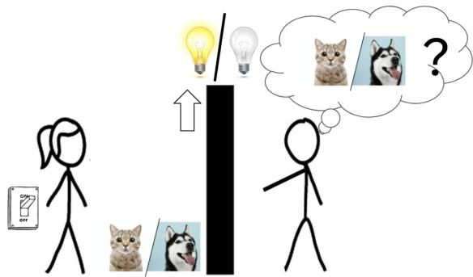  
Figure 8: An illustration of the Cat & Dog game taken from [23].

The environment is designed to support any custom layout via a simple hyperparameter at initialisation. The default layout, shown below, mimics the coordination challenge illustrated in the previously shown video:2

## [start\_left, wide, narrow, wide, start\_right]

Brittle Bridge is inspired by cooperative platformer video games in which successful progression requires players to adopt complementary roles, such as one agent acting while the other temporarily waits. Although the assignment of such leader–follower roles is arbitrary, it is essential for successful task completion. Two agents are initially located on the same side of a bridge of length n. Their joint objective is to traverse the bridge such that both agents reach the opposite side in the minimal number of turns. The environment is turn-based, with agents selecting actions simultaneously from the set {forward, backward, stay}. No collision constraints are imposed, so multiple agents may occupy the same tile at any given time. The coordination challenge stems from the bridge’s fragility. If both agents remain on the bridge, regardless of their exact positions, for more than a fixed number of consecutive turns, given by the parameter bridge\_break\_threshold (typically set to 1), the bridge collapses. When this happens, the episode ends and both agents receive a large negative reward of −1000. Importantly, the timer associated with the fragility constraint resets whenever at least one agent steps off the bridge. Consequently, when bridge\_break\_threshold equals 1, one agent may safely cross the bridge in its entirety while the other agent alternates between entering the first bridge tile and retreating to land, thereby preventing collapse. For our experiments, we fix n to 5 and the bridge\_break\_threshold to 1. To incentivise minimising the number of turns, agents incur a per-step joint penalty of −1 until both agents have crossed the bridge.

## D.2 Convention games

Convention games typically assign players fixed asymmetric roles and proceed sequentially. The coordination challenge arises from partial observability: the first player has access to some information that must be conveyed to the second player, who then makes a guess. To achieve a high reward, the players must establish a convention that maps possible signals to possible guesses.

Cat & Dog is a two-player, fully cooperative coordination game introduced by [23]. The setup is straightforward: two players, Alice and Bob, are initially separated by a wall. At the beginning of the game, Alice privately observes a randomly chosen animal, either a cat or a dog, on her side of the wall. She must then select one of the following actions:

• Turn on a light bulb on Bob’s side of the wall at no cost,

• Leave the light bulb off (the default; explicitly available as an action) at no cost,

Turn 1 — Alice   
\$ Game History \$   
You are Alice. $( \mathcal { D } _ { \mathcal { R } } )$ On your side of the wall, there is a cat.   
(DH)   
\$ Legal Actions \$   
bail, remove\_wall, turn\_on\_light, do\_nothing   
Response:   
REASONING: ...   
ACTION JSON: {"action": "remove\_wall"}   
Outcome: The wall is removed. Immediate joint reward: −5.

Game Description DM — Cat & Dog (shared by both players)   
You are playing a game of cat and dog with one other player. One of you is Alice and the other is Bob. Alice is separated from Bob by a   
wall. The goal of the game is maximize your (joint) reward. On Alice’s side of the wall, there is either a cat or a dog. Additionally, there is   
a light switch on Alice’s side of the wall, which she can turn on to illuminate a bulb on Bob’s side of the wall.   
Alice goes first and can do exactly one of the following:   
– bail for a (joint) reward of 1 (this ends the game immediately)   
– remove the wall for a (joint) reward of −5   
– turn on the light bulb (no reward)   
– do nothing, i.e. the light bulb stays off (no reward)   
If Alice didn’t bail, it is Bob’s turn. Bob observes the light status and the animal on Alice’s side of the wall, if the wall was removed by   
Alice. Bob can do exactly one of the following:   
– bail for a (joint) reward of 0.5   
– or guess the animal, i.e. either cat or dog   
– if Bob guesses correctly, he receives a (joint) reward of 10   
– if Bob guesses incorrectly, he receives a (joint) reward of −10   
The players cannot communicate with each other except the options presented above (i.e. light status and removing the wall)

Turn 2 — Bob   
\$ Game History \$   
You are Bob. $( \mathcal { D } _ { \mathcal { R } } )$ The light bulb on your side of the wall is off.   
Furthermore, the wall has been removed. You can see a cat on   
the other side of the wall. $( \mathcal { D } _ { \mathcal { H } } )$   
\$ Legal Actions \$   
bail, guess\_dog, guess\_cat   
Response:   
REASONING: ...   
ACTION JSON: {"action": "guess\_cat"}   
Outcome: Bob’s guess is correct. Immediate joint reward: 10.  
Figure 9: Worked example of the natural language descriptions $\mathcal { D } = ( \mathcal { D } _ { \mathcal { M } } , \mathcal { D } _ { \mathcal { R } } , \{ \mathcal { D } _ { \mathcal { H } _ { i } } \} )$ for Cat & Dog with text agents. Both players receive the same game description $\mathcal { D } _ { \mathcal { M } }$ (top). Each text agent additionally receives its role $\bar { \mathcal { D } _ { \mathcal { R } } ( r ) }$ and a description of its action-observation history $\mathcal { D } _ { \mathcal { H } _ { i } } ( \tau _ { i } )$ which together fill the Game History field of the text-agent prompt template (Figure 24). The game description is taken verbatim from our implementation. In this episode, Alice plays the ZSC-optimal action of removing the wall, and the players obtain a total joint reward o ${ \mathfrak { f } } - 5 { \overset { - } { + } } 1 { \overset { - } { 0 } } = 5$ . Code agents receive only $\mathcal { D } _ { \mathcal { M } }$ and generate a joint policy for both roles.

• Remove the wall at a cost of −5,

• Bail, yielding a joint reward of 1, terminating the game immediately.

Subsequently, it is Bob’s turn. He observes the state of the light bulb and, if Alice has removed the wall, also observes the animal. Bob then chooses one of the following actions:

• Guess the correct animal (Cat or Dog). If his guess is correct, both players receive a joint reward of 10; otherwise, they incur a joint penalty of −10. In expectation, a random guess yields a reward of 0.

• Bail, yielding a smaller but guaranteed reward of 0.5.

The term Cat & Dog refers specifically to the one-shot version of the game. The iterated version is examined in the following section. Since there are two equivalent but arbitrary signalling conventions (either light\_on → Cat or light\_on → Dog), independent agents without prior communication cannot coordinate on a convention within a single round. Therefore, removing the wall is considered “optimal” in the ZSC setting.

Worked example of D. Figure 9 illustrates the natural language descriptions introduced in Appendix 2 for a single episode of Cat & Dog. The game description $\mathcal { D } _ { \mathcal { M } }$ is shared by both players and specifies the roles, actions, and rewards. A text agent is additionally told which role it plays via $\mathcal { D } _ { \mathcal { R } }$ and what it has observed so far via $\mathcal { D } _ { \mathcal { H } _ { i } } ;$ for example, Bob’s history description reports the status of the light and, since Alice removed the wall, the animal. A code agent only receives ${ \mathcal { D } } _ { { \mathcal { M } } } .$ , since it generates a joint policy that specifies the behaviour of both Alice and Bob.

Ad-Hoc Conventions. Inspired by [15], we introduce games that require protocol formation at test time. Ad-Hoc Conventions is an iterated version of Cat & Dog. In contrast to the one-shot version discussed in the previous section, iteration enables the formation of conventions that can lead to guaranteed high payoffs in later rounds. We replace the animals with generic levers that can be assigned labels (in our case {blue, red}) and the lightbulb is replaced by labelled signals (in our case {square, circle}). Removing the wall is now represented by revealing the current correct lever. While we do not make further use of it in our experiments, we support an arbitrary number of signals and levers to increase the difficulty of the game. Additionally, the lever labels, signal labels, and the number of rounds can be specified as a hyperparameter. In our experiments, we play ten rounds per Ad-Hoc Conventions game.

Ad-Hoc Conventions with permuted signals. We also introduce a harder variant of Ad-Hoc Conventions, called Ad-Hoc Conventions with permuted signals (A.C.P.S.). Here we distinguish between buttons and signals, each with its own set of labels (apple, banana and square, circle in our case). The only change per round is that, instead of directly revealing a signal, Alice can now press one of the buttons (or choose reveal or bail), which then displays a signal to Bob. The connection between buttons and signals is given by a random bijection unknown to both players. Importantly, Alice does not see the resulting signal, and Bob does not see the pressed button. Without prior communication, it is therefore impossible to recover the exact bijection between signals and levers. Note that the button to signal mapping is fixed within the episode. As a result, the game cannot be solved through a simple lexicographical order strategy: Alice cannot know which button will trigger which signal for Bob. Nevertheless, in both the permuted and non-permuted versions, the players retain a simple fallback strategy, continuously revealing (i.e. removing the wall), which guarantees a reward of 5 per round, for a total “safe” return of 50 across the 10 rounds we typically consider in our experiments.

Tiny Hanabi is a toy-game introduced in [13]. It consists of two players, who are each dealt a random card at the start of the game. The final joint reward depends on both the players’ cards and their actions throughout the game. The second player observes the first player’s actions before picking his action, which allows the first player’s action to be interpreted as a signal. We show the payoff matrix of Tiny Hanabi in Figure 10. Due to the asymmetry of the payoff matrix, the original version of Tiny Hanabi has a unique SP optimal policy, yielding a joint reward of 10. This policy is given by the first player picking action A if he has card 2 and C otherwise, with the second player responding accordingly. To see why it is unique, note that a joint reward of 10 requires that neither player ever plays B, and that the second player conditions on the first player’s action, since no column of the payoff matrices consists entirely of 10s. The first player must therefore play different actions for the two cards. If the first player instead plays C with card 2 while the second player holds card 1, the joint reward is 0 regardless of the second player’s response. Hence, the first player must map card 2 to A and card 1 to C. In Tiny Hanabi Fixed, the second player could respond to this case with C and still obtain a reward of 10, which gives rise to two symmetric SP-optimal policies.

To create a version of Tiny Hanabi with a coordination challenge, we symmetrize the payoff matrix, also shown in Figure 10. As in the previous convention games, there is a safe fallback option, which does not require any conventions: Playing B as the first player leads to a reward of 8 as long as the second player responds rationally. Hence Tiny Hanabi Fixed is similar to Cat & Dog wherein there exists two symmetrical conventions with identical payoffs and a safe fallback option.

Hanabi In the standard game of Hanabi, each colour has a deck of 10 cards: three 1s, two 2s, two 3s, two 4s, and one 5, for a total of 50 cards across 5 colours. The game is fully cooperative and features 5 ranks and 5 colours, with each card defined by a rank–colour pair. Players share a limited pool of 3 life tokens and 8 hint tokens. At the start, each player is dealt 5 cards; crucially, players cannot see their own hands but can observe those of their teammates. The objective is to build “fireworks” by stacking cards of each colour in increasing rank order. On each turn, a player may either play a card, discard a card, or provide a hint to another player. Hints can specify either a rank or a colour, indicating all cards of that type in the recipient’s hand, and each hint consumes one token. An incorrect play—i.e., one that cannot be placed on the fireworks—costs a life token. Discarding a card restores a hint token, up to the maximum. After playing or discarding, the player draws a new card from the deck, maintaining a constant hand size while cards remain. Players receive +1 for each correctly played card, and the game ends with a score of 0 if all life tokens are lost.

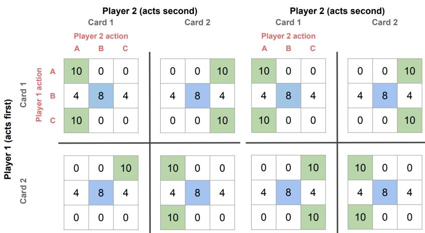  
Figure 10: Payoff matrices for Tiny Hanabi adapted from [13]. On the left side, we show the matrix from the original paper, and on the right side, the matrix of our version with a coordination challenge.

In this work, we consider a simplified 3×3 variant with 3 colours and 3 ranks, where each colour has three 1s, two 2s, and one 3, for a total maximum score of 9. The game includes a single life token and a limit of 3 hint tokens. The central challenge of Hanabi arises from the limited and costly communication channel provided by hints. Effective play therefore requires agents to use hints efficiently, often relying on implicit conventions to convey information about hidden states to their partners.

## D.3 Simultaneous selection games

In simultaneous selection games, symmetric players have to coordinate on one of many similar, often symmetric, choices to achieve a high joint reward. We study both one-shot versions of these games (Matrix Game) and iterated versions (Permuted Levers).

Permuted levers Lever Games are common in ZSC literature [24, 55]. For our purposes, we focus on iterated versions of lever games with n levers all with identical payoff. In each round, both players simultaneously chose one of the levers. If players manage to pick the same lever, they receive a joint reward of 1. To prevent arbitrary focal points introduced by numbering the levers (which is needed for the LLM agents to interact with the environment), we introduce a further complication inspired by the other-play objective [23]: Each player observes and acts on the levers through a random permutation of the lever numbers, which stays fixed across the rounds of the game. While players are aware of the fact, they do not know their own or others’ permutations.

Both the number of levers k and the number of rounds n are hyperparameters, which can be set at initialisation. For our experiments, we fix k = 5 and n = 10.

Matrix game Our version of the Matrix Game was introduced by [35]. In this game, two players simultaneously choose a row/column and receive the reward in the selected cell. The matrix used to play this game is shown in Figure 11. For humans, there is an easy-to-identify focal point given by the first column and first/second row, which can be exploited. Our version of the matrix game uses a 11 × 11 matrix extending the diagonal pattern by 1. This yields another possible focal point at the middle of the diagonal pattern (see also Figure 39). Matrix game differs from the other coordination challenges presented in this section in that there is no salient policy that could be considered “ZSCoptimal”. Successful coordination in the matrix game largely depends on players forming the same arbitrary conventions to form a focal point in the matrix, exactly the inverse of what ZSC is trying to achieve. Therefore, we have chosen to exclude Matrix game from the main experiments of the paper, but report results for completeness in Appendix F.2 and Appendix F.3.

<table><tr><td rowspan=1 colspan=1>1</td><td rowspan=1 colspan=1>0</td><td rowspan=1 colspan=1>0</td><td rowspan=1 colspan=1>0</td><td rowspan=1 colspan=1>0</td><td rowspan=1 colspan=1>0</td><td rowspan=1 colspan=1>0</td><td rowspan=1 colspan=1>0</td><td rowspan=1 colspan=1>0</td><td rowspan=1 colspan=1>0</td></tr><tr><td rowspan=1 colspan=1>1</td><td rowspan=1 colspan=1>0</td><td rowspan=1 colspan=1>0</td><td rowspan=1 colspan=1>0</td><td rowspan=1 colspan=1>0</td><td rowspan=1 colspan=1>0</td><td rowspan=1 colspan=1>0</td><td rowspan=1 colspan=1>0</td><td rowspan=1 colspan=1>0</td><td rowspan=1 colspan=1>0</td></tr><tr><td rowspan=1 colspan=1>0</td><td rowspan=1 colspan=1>0</td><td rowspan=1 colspan=1>1</td><td rowspan=1 colspan=1>0.02</td><td rowspan=1 colspan=1>0</td><td rowspan=1 colspan=1>0</td><td rowspan=1 colspan=1>0</td><td rowspan=1 colspan=1>0</td><td rowspan=1 colspan=1>0</td><td rowspan=1 colspan=1>0</td></tr><tr><td rowspan=1 colspan=1>0</td><td rowspan=1 colspan=1>0</td><td rowspan=1 colspan=1>0.02</td><td rowspan=1 colspan=1>1</td><td rowspan=1 colspan=1>0.02</td><td rowspan=1 colspan=1>0</td><td rowspan=1 colspan=1>0</td><td rowspan=1 colspan=1>0</td><td rowspan=1 colspan=1>0</td><td rowspan=1 colspan=1>0</td></tr><tr><td rowspan=1 colspan=1>0</td><td rowspan=1 colspan=1>0</td><td rowspan=1 colspan=1>0</td><td rowspan=1 colspan=1>0.02</td><td rowspan=1 colspan=1>1</td><td rowspan=1 colspan=1>0.02</td><td rowspan=1 colspan=1>0</td><td rowspan=1 colspan=1>0</td><td rowspan=1 colspan=1>0</td><td rowspan=1 colspan=1>0</td></tr><tr><td rowspan=1 colspan=1>0</td><td rowspan=1 colspan=1>0</td><td rowspan=1 colspan=1>0</td><td rowspan=1 colspan=1>0</td><td rowspan=1 colspan=1>0.02</td><td rowspan=1 colspan=1>1</td><td rowspan=1 colspan=1>0.02</td><td rowspan=1 colspan=1>0</td><td rowspan=1 colspan=1>0</td><td rowspan=1 colspan=1>0</td></tr><tr><td rowspan=1 colspan=1>0</td><td rowspan=1 colspan=1>0</td><td rowspan=1 colspan=1>0</td><td rowspan=1 colspan=1>0</td><td rowspan=1 colspan=1>0</td><td rowspan=1 colspan=1>0.02</td><td rowspan=1 colspan=1>1</td><td rowspan=1 colspan=1>0.02</td><td rowspan=1 colspan=1>0</td><td rowspan=1 colspan=1>0</td></tr><tr><td rowspan=1 colspan=1>0</td><td rowspan=1 colspan=1>0</td><td rowspan=1 colspan=1>0</td><td rowspan=1 colspan=1>0</td><td rowspan=1 colspan=1>0</td><td rowspan=1 colspan=1>0</td><td rowspan=1 colspan=1>0.02</td><td rowspan=1 colspan=1>1</td><td rowspan=1 colspan=1>0.02</td><td rowspan=1 colspan=1>0</td></tr><tr><td rowspan=1 colspan=1>0</td><td rowspan=1 colspan=1>0</td><td rowspan=1 colspan=1>0</td><td rowspan=1 colspan=1>0</td><td rowspan=1 colspan=1>0</td><td rowspan=1 colspan=1>0</td><td rowspan=1 colspan=1>0</td><td rowspan=1 colspan=1>0.02</td><td rowspan=1 colspan=1>1</td><td rowspan=1 colspan=1>0.02</td></tr><tr><td rowspan=1 colspan=1>0</td><td rowspan=1 colspan=1>0</td><td rowspan=1 colspan=1>0</td><td rowspan=1 colspan=1>0</td><td rowspan=1 colspan=1>0</td><td rowspan=1 colspan=1>0</td><td rowspan=1 colspan=1>0</td><td rowspan=1 colspan=1>0</td><td rowspan=1 colspan=1>0.02</td><td rowspan=1 colspan=1>1</td></tr></table>

Figure 11: Payoff matrices for the Matrix Game adapted from [35]. Players simultaneously pick a row and column, respectively, and receive the reward at the selected cell.

<table><tr><td rowspan=1 colspan=1>1</td><td rowspan=1 colspan=1>0</td><td rowspan=1 colspan=1>1.01</td><td rowspan=1 colspan=1>0</td></tr><tr><td rowspan=1 colspan=1>1.01</td><td rowspan=1 colspan=1>1</td><td rowspan=1 colspan=1>0</td><td rowspan=1 colspan=1>0</td></tr><tr><td rowspan=1 colspan=1>0</td><td rowspan=1 colspan=1>0</td><td rowspan=1 colspan=1>1</td><td rowspan=1 colspan=1>1.01</td></tr><tr><td rowspan=1 colspan=1>0</td><td rowspan=1 colspan=1>1.01</td><td rowspan=1 colspan=1>0</td><td rowspan=1 colspan=1>1</td></tr></table>

Figure 12: Semantic Convention Game. Alice and Bob chose a row and column in the matrix sequentially. Additionally, only Alice is informed of the currently active column, which is chosen at random. Only if the agents end up selecting a cell in the active column do they receive the reward in that cell. Agents must choose between the lexicographical mapping convention (green) and the SP-optimal mapping convention (blue).

## D.4 Semantic games

Semantic selection and convention games demonstrate that the addition of semantics can create coordination challenges in games that previously did not exhibit them, as they have a unique SP optimal policy. In particular, the semantic games presented in this paper, the semantic selection game (Figure 5) and the semantic convention game (Figure 12), force players to choose between two mutually incompatible meta-strategies: either playing the SP optimal strategy or following a strategy that is aligned with the game semantics. Figure 4 has demonstrated that LLM agents often struggle to consistently interpret semantics and fail to properly reason about these difficulties. Semantic games, on the other hand, show that even when the semantic interpretation is clear across agents, semantic can still hinder the coordination abilities of agents, just by the fact that they introduce another possible meta-strategy.

Figure 5 demonstrates that LLM agents are generally not able to consistently choose among these competing meta-strategies, leading to coordination failures. Interestingly, even though the CFD does not specify how to decide among the competing meta-strategies, it does lead agents to consistently opt for the SP optimal policy in the semantic selection game. In the semantic convention game, the CFD does not yield significant improvement in the agents’ coordination as shown in Figure 13 (Left).

Hint-Guess The hint-guess game was introduced in [37] to study whether agents can exploit shared semantic structure between actions and observations for zero-shot coordination. The game involves two players, a hinter and a guesser, each dealt a hand of N cards, where every card is described by two discrete features. One card from the guesser’s hand is secretly designated the target, and its identity is revealed only to the hinter. The hinter must select a card from their own hand to show the guesser; the guesser then picks which card in their hand corresponds to the target. Both players receive a reward of 1 if the guess is correct and 0 otherwise. The environment is visualised in Figure 14. Interestingly, implicatures [38, 17] represent sophisticated patterns of human reasoning, making them a compelling test of whether LLM agents can exhibit similar capabilities. As shown in Table 8, text agents consistently exhibit human-like reasoning and, notably, demonstrate the ability to coordinate via implicatures.

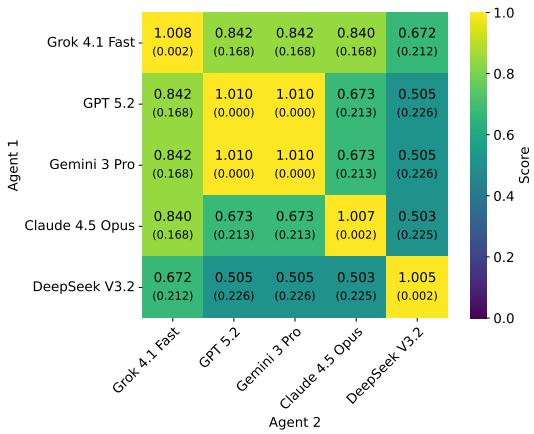

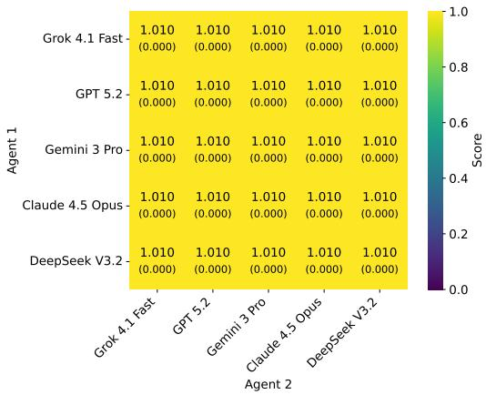  
Figure 13: XP scores of code agents in the semantic games using the hand-crafted CFD. (Left) Semantic convention game. (Right) Semantic selection game. Scores are averaged across six i.i.d. XP matrices; where each cell contained the mean return over 100 episodes.

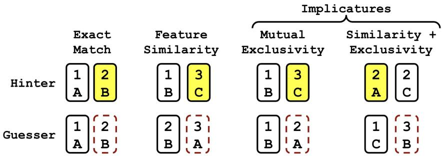  
Figure 14: Example hint-guess scenarios, adapted from Figure 2 of [37]. Each panel shows a distinct coordination challenge: exact feature match, partial feature similarity, mutual exclusivity, and a combination of the latter two, which represents implicatures [38, 17]. The card outlined in red is the target; the card highlighted in yellow is the human-compatible hint choice. The two rightmost scenarios require reasoning about implicature, where the intuitive hint shares no direct feature with the target.

## E Schematic diagram of LLM agents

We present a schematic diagram of the two agents scaffolds in Figure 15 and the different evaluation schemes in Figure 16.

## F Additional details

## F.1 Coordination Failure Rate

In addition to reporting joint rewards, we measure the coordination failure rate, which captures the frequency of catastrophic coordination failures arising from paired local policies. For example, in Tiny Hanabi, a grounded joint policy that consistently reaches (B, B) achieves a guaranteed reward of 8. In contrast, we observe paired policies that attain the maximum reward of 10 in 80% of episodes but receive a reward of 0 in the remaining 20%, resulting in the same XP score. Despite the same average score, the grounded policy is clearly more robust. To capture this, we report coordination failure rates. An episode is classified as a failure if the agents’ joint reward is at or below the threshold specified in Table 2.

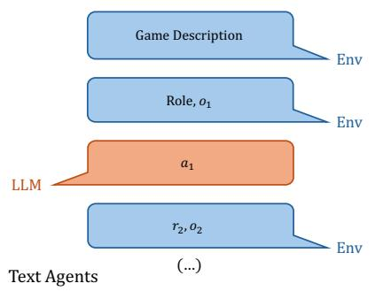

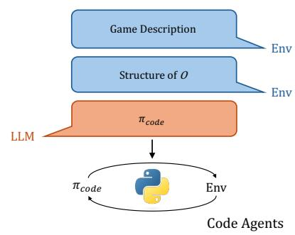  
Figure 15: Illustration of text and code agents. While text agents only act out the local policy associated with their assigned roles, each code agent produces a joint policy in Python code. Code agents receive additional information on the structure of the observation space.

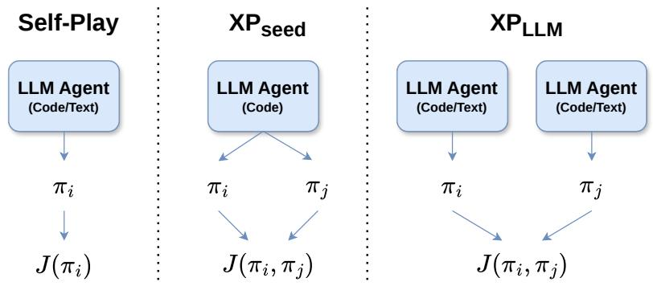  
Figure 16: Illustration of the evaluation protocols for text and code agents. Note that $\mathrm { X P _ { s e e d } }$ is defined only for code agents, as they generate joint policies, whereas text agents induce only local policies. While text agents induce a joint policy which can be obtained by varying the role assignment (see Figure 15), they tend to significantly underperform code agents in self-play as the implicit policies are often not self-compatible (see Figure 18).

## F.2 Text Agents with CFD

We report the SP scores of the text agents with and without the hand-crafted CFD in the fixed LLM setting for Grok 4.1 Fast and GPT-5.2 in Table 1. We find that the agents exhibit high coordination failure rates and low SP scores across multiple environments, indicating poor coordination. Introducing the hand-crafted CFD improves coordination in several environments, with a larger effect on Grok 4.1 Fast than on GPT-5.2. However, as discussed in Appendix F.3, the CFD can be overly restrictive. This is also evident in Brittle Bridge, where agents enter a deadlock, each waiting for the other to step onto the bridge to avoid collapse.

## F.3 Code Agents with CFD

We report the SP and XP scores of the code agents under both thefixed LLM setting (denoted $\mathrm { X P _ { s e e d } } )$ and the variable LLM setting (denoted $\mathrm { X P } _ { \mathrm { L L M } } )$ in Table 6. The scores are calculated as follows. First, we generate six independent cross-play matrices, with each LLM contributing one joint policy to each matrix. Every joint-policy pairing is evaluated over 100 episodes. We then average scores across the six XP matrices to obtain a single $( N _ { \mathrm { L L M } } \times N _ { \mathrm { L L M } } )$ matrix. For SP, we report the mean and standard error over the diagonal entries. For variable-LLM ${ \mathrm { X P } } _ { \mathrm { L L M } } .$ we compute the mean and standard error over the off-diagonal entries in each LLM′s corresponding row and column. For fixed-LLM $\mathrm { X P } _ { \mathrm { s e e d } } .$ we pair joint policies produced by the same LLM across different XP matrices into disjoint pairs (e.g., (1, 2), $( 3 , 4 ) , \ldots ) $ , evaluate each pair jointly, and report the resulting mean and standard error. We do the same when reporting the coordination failure rates in Table 7.

Table 1: SP performance comparison of text agents (mean ± SEM) across environments, evaluated with and without the CFD. Results are shown for Grok 4.1 Fast and GPT-5.2. The coordination failure rate captures the frequency of catastrophic coordination breakdowns. Given the simplicity of these environments, we require coordination failure rates to be near zero in order to consider coordination robust. We report the mean and standard error over 100 episodes for single-turn games and 50 episodes for multi-turn games. We find that, with the exception of Narrow Tunnel and Permuted Levers, both Grok 4.1 Fast and GPT-5.2 exhibit high coordination failure rates.
<table><tr><td rowspan="2"></td><td rowspan="2"></td><td colspan="2">w/o CFD</td><td colspan="2">w/CFD</td></tr><tr><td>SP Score</td><td>Coord. failure rate</td><td>SP Score</td><td>Coord. failure rate</td></tr><tr><td rowspan="2">Cat and Dog</td><td>Grok 4.1 Fast</td><td> $- 0 . 7 5 { \scriptstyle \pm 0 . 9 9 }$ </td><td> $0 . 5 3 { \scriptstyle \pm 0 . 0 5 }$ </td><td> $5 . 0 0 { \scriptstyle \pm 0 . 0 0 }$ </td><td> $0 . 0 0 { \scriptstyle \pm 0 . 0 0 }$ </td></tr><tr><td>GPT 5.2</td><td> $4 . 5 0 { \scriptstyle \pm 0 . 4 9 }$ </td><td> $0 . 0 9 \pm 0 . 0 3$ </td><td> $5 . 0 0 { \scriptstyle \pm 0 . 0 0 }$ </td><td> $0 . 0 0 { \scriptstyle \pm 0 . 0 0 }$ </td></tr><tr><td rowspan="2">Ad Hoc Conv.</td><td>Grok 4.1 Fast</td><td> $9 5 . 8 0 \pm 2 . 6 5$ </td><td> $0 . 0 4 \pm 0 . 0 3$ </td><td> $5 0 . 0 0 { \scriptstyle \pm 0 . 0 0 }$ </td><td> $0 . 0 0 { \scriptstyle \pm 0 . 0 0 }$ </td></tr><tr><td>GPT 5.2</td><td> $8 2 . 7 1 \pm 4 . 0 1$ </td><td> $0 . 1 6 \pm 0 . 0 5$ </td><td> $5 0 . 0 0 { \scriptstyle \pm 0 . 0 0 }$ </td><td> $0 . 0 0 { \scriptstyle \pm 0 . 0 0 }$ </td></tr><tr><td rowspan="2">Ad Hoc Conv. PS</td><td>Grok 4.1 Fast</td><td> $8 2 . 0 1 \pm 3 . 3 0$ </td><td> $0 . 0 8 \pm 0 . 0 4$ </td><td> $4 9 . 6 4 \pm 0 . 2 8$ </td><td> $0 . 0 4 \pm 0 . 0 3$ </td></tr><tr><td>GPT-5.2</td><td> $7 6 . 9 5 \pm 3 . 8 1$ </td><td> $0 . 1 4 \pm 0 . 0 5$ </td><td> $4 9 . 9 1 \pm 0 . 0 9$ </td><td>0.02±0.02</td></tr><tr><td rowspan="2">Tiny Hanabi</td><td>Grok 4.1 Fast</td><td> $7 . 3 8 \pm 0 . 4 1$ </td><td> $0 . 2 3 { \scriptstyle \pm 0 . 0 4 }$ </td><td> $8 . 2 2 \pm 0 . 2 1$ </td><td> $0 . 0 5 { \scriptstyle \pm 0 . 0 2 }$ </td></tr><tr><td>GPT-5.2</td><td> $8 . 9 2 \pm 0 . 3 0$ </td><td>0.10±0.03</td><td> $7 . 6 4 \pm 0 . 3 7$ </td><td>0.18±0.04</td></tr><tr><td rowspan="2">Tiny Hanabi Fixed</td><td>Grok 4.1 Fast</td><td> $7 . 8 0 \pm 0 . 4 0$ </td><td> $0 . 2 1 \pm 0 . 0 4$ </td><td> $7 . 7 8 \pm 0 . 1 4$ </td><td> $0 . 0 3 { \scriptstyle \pm 0 . 0 2 }$ </td></tr><tr><td>GPT-5.2</td><td> $7 . 8 8 \pm 0 . 4 0$ </td><td> $0 . 2 0 { \scriptstyle \pm 0 . 0 4 }$ </td><td> $7 . 2 0 \pm 0 . 2 9$ </td><td>0.13±0.03</td></tr><tr><td rowspan="2">Brittle Bridge</td><td>Grok 4.1 Fast</td><td> $- 1 4 9 . 6 9 \pm 4 8 . 5$ </td><td> $0 . 1 4 { \scriptstyle \pm 0 . 0 5 }$ </td><td> $- 1 5 . 8 6 \pm 0 . 4 9$ </td><td> $0 . 3 0 { \scriptstyle \pm 0 . 0 6 }$ </td></tr><tr><td>GPT-5.2</td><td> $- 1 3 . 0 0 { \pm } 0 . 4 8$ </td><td> $0 . 1 0 { \scriptstyle \pm 0 . 0 4 }$ </td><td> $- 1 3 . 7 2 { \scriptstyle \pm 0 . 5 0 }$ </td><td>0.10±0.04</td></tr><tr><td rowspan="2">Narrow Tunnel</td><td>Grok 4.1 Fast</td><td> $- 5 . 5 8 { \scriptstyle \pm 0 . 1 7 }$ </td><td> $0 . 0 0 { \scriptstyle \pm 0 . 0 0 }$ </td><td> $- 5 . 9 4 \pm 0 . 1 9$ </td><td> $0 . 0 0 { \scriptstyle \pm 0 . 0 0 }$ </td></tr><tr><td>GPT-5.2</td><td> $- 8 . 9 2 { \scriptstyle \pm 0 . 4 8 }$ </td><td> $0 . 0 2 { \scriptstyle \pm 0 . 0 2 }$ </td><td> $- 8 . 3 8 \pm 0 . 4 5$ </td><td> $0 . 0 2 { \scriptstyle \pm 0 . 0 2 }$ </td></tr><tr><td rowspan="2">Matrix Game</td><td>Grok 4.1 Fast</td><td> $0 . 6 2 \pm 0 . 0 5$ </td><td> $0 . 3 4 \pm 0 . 0 5$ </td><td> $0 . 9 7 \pm 0 . 0 2$ </td><td> $0 . 0 3 { \scriptstyle \pm 0 . 0 2 }$ </td></tr><tr><td>GPT-5.2</td><td> $0 . 7 8 { \scriptstyle \pm 0 . 0 4 }$ </td><td> $0 . 2 2 \pm 0 . 0 4$ </td><td> $0 . 8 4 \pm 0 . 0 4$ </td><td> $0 . 1 6 { \pm } 0 . 0 4$ </td></tr><tr><td rowspan="2"></td><td>Grok 4.1 Fast</td><td> $6 . 0 8 \pm 0 . 3 6$ </td><td> $0 . 0 2 { \scriptstyle \pm 0 . 0 2 }$ </td><td> $6 . 2 8 \pm 0 . 4 1$ </td><td></td></tr><tr><td>GPT-5.2</td><td> $7 . 2 4 \pm 0 . 3 8$ </td><td> $0 . 0 2 { \scriptstyle \pm 0 . 0 2 }$ </td><td> $6 . 8 8 \pm 0 . 3 9$ </td><td> $0 . 0 2 { \scriptstyle \pm 0 . 0 2 }$   $0 . 0 2 { \scriptstyle \pm 0 . 0 2 }$ </td></tr></table>

Table 2: Thresholds used to define coordination failures for each environment. An episode counts as a failure if its joint reward is at or below the threshold.
<table><tr><td>Environment</td><td>Threshold</td></tr><tr><td>Permuted Levers</td><td>0.0</td></tr><tr><td>Cat and Dog</td><td>0.0</td></tr><tr><td>Brittle Bridge</td><td>-20.0</td></tr><tr><td>Narrow Tunnel</td><td>-20.0</td></tr><tr><td>Ad-hoc Conventions</td><td>49.5</td></tr><tr><td>Ad-hoc Conventions (Permuted Signals)</td><td>49.5</td></tr><tr><td>Tiny Hanabi Fixed</td><td>0.0</td></tr><tr><td>Tiny Hanabi</td><td>0.0</td></tr><tr><td>Matrix Game</td><td>0.0</td></tr></table>

We observe a substantial SP–XP gap across most environments, and in some cases $( \mathrm { e . g . }$ , Brittle Bridge), agents fail to generate even high-performing self-play policies, indicating a limited understanding of the underlying coordination challenge. Introducing the hand-crafted CFDs yields only modest gains, improving performance primarily in Cat & Dog and the semantic selection game.

## F.4 Trampoline Tiger Game

The tiger trampoline game, shown in Figure 17a, is a coordination game introduced in [25] to illustrate the concept of self-explaining deviations (SED). A self-explaining deviation is an action by a teammate in a fully cooperative setting that, at first, appears to hurt the team’s performance.

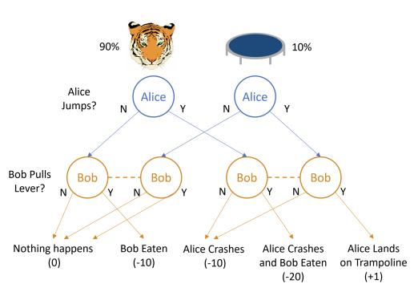  
(a) An illustration of the trampoline tiger environment [25]. Alice observes whether Bob’s lever would deploy a tiger or a trampoline and then chooses whether to jump. Bob observes only Alice’s action and subsequently decides whether to pull the lever. Dotted lines between Bob’s decision nodes indicate information sets that Bob cannot distinguish.

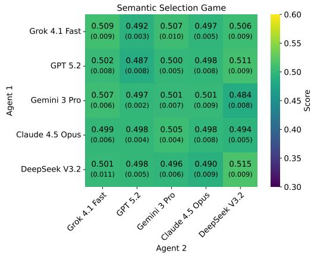  
(b) XP scores of code agents in the trampoline tiger game [25]. Scores are averaged across six different XP matrices; each cell reports the mean return over 100 episodes. For our experiments, we use $p _ { \mathrm { t i g e r } } = 0 . 5$ for equal coverage of tiger and non-tiger states. The LLM agents are not aware of $p _ { \mathrm { { t i g e r } } }$  
Figure 17: The trampoline tiger environment.

But if players act under the belief that their teammates’ actions are rational, those actions can signal hidden information to them, ultimately aiding the team. In the trampoline tiger game, Bob controls a lever that can release a hidden object: either a tiger or a trampoline. Alice stands above and can observe the hidden state, but cannot communicate further with Bob. She has the option to jump, which yields only a small positive joint reward if the hidden state is the trampoline and Bob pulls the lever. Bob can observe whether Alice jumps before pulling the lever. If Alice acts rationally, she will only decide to jump if the hidden state is a trampoline, thereby signalling it to Bob. Notably, never jumping and never pulling the lever is a pure Nash equilibrium. Therefore, algorithms that independently learn Alice’s and Bob’s policies risk getting stuck in this local maximum. (author?) [25] showed that popular MARL algorithms like MAPPO [59] and QMIX [49] converge to this Nash Equilibrium in most cases. LLM agents naturally consider bilateral deviations of Alice’s and Bob’s actions by directly reasoning about the environment dynamics. As shown in Figure 17b, this allows a variety of LLM agents to determine the optimal policy in this game.

## F.5 Local Policies of Text Agents

Since text agents interact with the environment by producing actions sequentially, rather than explicitly specifying joint policies as code, their decision-making is less interpretable. To better understand their behaviour, we empirically estimate their induced local policies.

We estimate the local policies $p _ { \mathrm { a l i c e } } ( \cdot \mid \mathrm { a n i m a l } )$ and $p _ { \mathrm { b o b } } ( \cdot \mid a _ { \mathrm { a l i c e } } )$ by fixing the environment state and repeatedly prompting the agent 100 times as shown in Figure 18. Next, we study how these local policies change under variations in the game’s semantics $\mathcal { D }$ . To this end, we consider three variants: (1) replacing the binary light-bulb signal (“on/off”) with a colour choice (“red/blue”), (2) translating the natural-language descriptions into German, (3) the agent is informed that it is being evaluated against an identical instance of itself.

Note that the agent is given complete information about the Dec-POMDP structure, including the payoffs. Consequently, the natural-language description of the MDP should not affect the induced local policy as long as the underlying Dec-POMDP structure is preserved, with the exception of the final setting, in which the agent has the option to use a convention to maximise reward. Despite this, we observe substantial differences in the induced local policies across semantic variants, as shown in Figure 18. In particular, the SP variant leads to a drastic reduction in XP scores, as discussed in Figure 4.

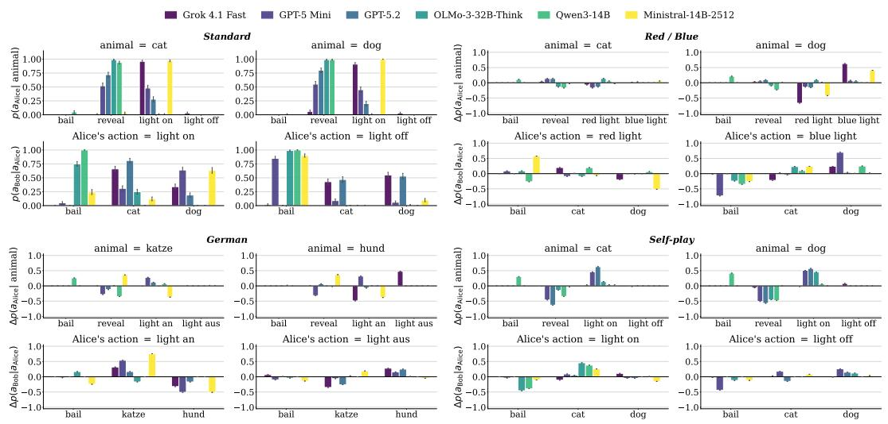  
Figure 18: Local policies of text agents in Cat & Dog and its variants. The top-left plot shows action probabilities for the standard Cat & Dog environment; each conditional distribution p(· | c) is estimated from 100 samples obtained by repeatedly prompting the model from a fixed game state. The remaining plots show the delta, i.e., the change in action probabilities relative to the standard condition, when the environment semantics are varied (changed action labels, German translation, self-play).

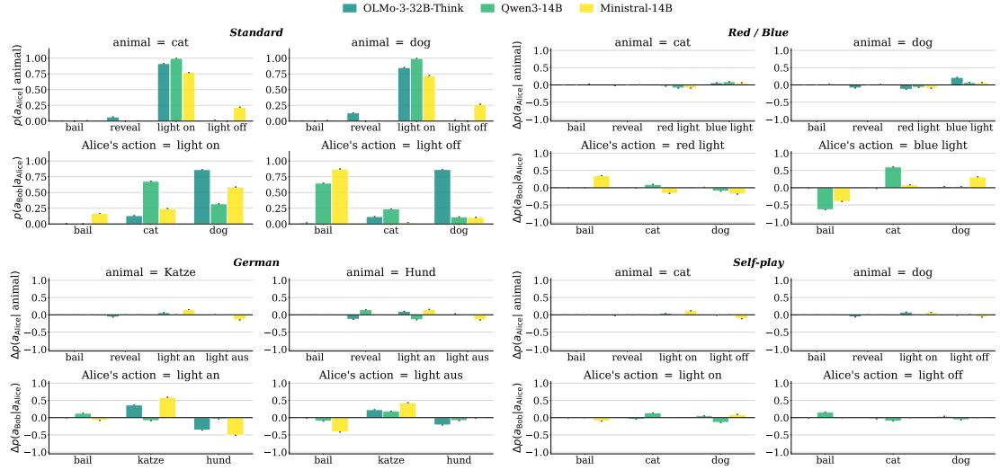  
Figure 19: Token-probability local policies of text agents in Cat & Dog and its variants. The top-left plot shows action probabilities for the standard Cat & Dog environment, computed from token-level log-probabilities rather than sampling. The remaining plots show the delta, i.e., the change in action probabilities relative to the standard condition, when the environment semantics are varied (changed action labels, German translation, self-play).

Table 3: XP scores of text agents under varying levels of reasoning effort on Cat & Dog. We evaluate GPT-5 mini and Grok 4.1 Fast under varying levels of reasoning effort, as well as with and without the use of our CFD. XP scores are reported as mean ± standard error over 100 games.
<table><tr><td rowspan="2">Model Reasoning effort</td><td rowspan="2"></td><td colspan="2">Mean return</td></tr><tr><td>w/o CFD</td><td>w/CFD</td></tr><tr><td rowspan="3">GPT-5 mini</td><td>Low</td><td>3.23 ±0.56</td><td>4.47 ±0.14</td></tr><tr><td>Medium</td><td>0.97 ±0.81</td><td>4.88 ±0.07</td></tr><tr><td>High</td><td>0.86 ±0.91</td><td>4.92 ±0.06</td></tr><tr><td rowspan="3">Grok 4.1 Fast</td><td>Low</td><td>1.20 ±0.98</td><td> $5 . 0 0 \pm 0 . 0 0$ </td></tr><tr><td>Medium</td><td> $- 0 . 7 5 \pm 0 . 9 9$ </td><td> $5 . 0 0 \pm 0 . 0 0$ </td></tr><tr><td>High</td><td> $0 . 4 1 \pm 0 . 9 9$ </td><td> $5 . 0 0 \pm 0 . 0 0$ </td></tr></table>

Table 4: Action frequencies of frontier text agents as Alice in Cat & Dog under varying reasoning effort. We report how often Alice bails, reveals the animal by removing the wall (the ZSC-optimal action), or uses the light as a signal. As in Figure 3, frequencies are estimated by repeatedly prompting each agent 100 times from a fixed game state. Values are reported as mean ± standard error. Higher reasoning effort increases the reveal rate for all three models, most strongly for Claude Opus 5.
<table><tr><td>Model</td><td>Reasoning effort</td><td>Bail</td><td>Reveal</td><td>Signal</td></tr><tr><td rowspan="3">GPT-5.6 Sol</td><td>Low</td><td>0.00±0.00</td><td>0.06±0.02</td><td>0.94±0.02</td></tr><tr><td>Medium</td><td>0.00±0.00</td><td>0.06±0.02</td><td>0.95±0.02</td></tr><tr><td>High</td><td>0.00±0.00</td><td>0.11±0.02</td><td>0.89±0.02</td></tr><tr><td rowspan="3">Claude Opus 5</td><td>Low</td><td>0.00±0.00</td><td>0.00±0.00</td><td>1.00±0.00</td></tr><tr><td>Medium</td><td>0.00±0.00</td><td>0.13±0.02</td><td>0.87±0.02</td></tr><tr><td>High</td><td>0.00±0.00</td><td>0.74±0.03</td><td>0.26±0.03</td></tr><tr><td rowspan="3">Grok 4.5</td><td>Low</td><td>0.00±0.00</td><td>0.26±0.03</td><td>0.75±0.03</td></tr><tr><td>Medium</td><td>0.00±0.00</td><td>0.46±0.04</td><td>0.54±0.04</td></tr><tr><td>High</td><td>0.00±0.00</td><td>0.49±0.04</td><td>0.51±0.04</td></tr></table>

We also probe whether model internals, specifically token-level action probabilities and chain-ofthought reasoning tokens, are consistent with the empirical local policies and the explicit reasoning outputs elicited before each action. We focus on open-weight models that expose these internals: OLMo-3-32B-Think, Qwen3-14B, and Ministral-14B.

To estimate token-level action probabilities, we compute the log-probability of each legal action completion under a fixed prompt and normalise across legal actions using a softmax. This requires disabling chain-of-thought reasoning, since reasoning tokens precede the action token and would otherwise confound the estimate. We find that disabling reasoning substantially degrades policy quality: models such as OLMo-3-32B-Think and Qwen3-14B, which exhibit strong empirical local policies when reasoning is enabled, produce markedly worse token-level policies in this setting (Figure 19), an effect we attribute to the removal of the reasoning step.

When reasoning is re-enabled, the generated chain-of-thought tokens closely match the content of the explicit reasoning outputs, indicating that the reasoning is faithful to the model’s decision process. This supports the validity of our reasoning-based analysis for closed-weight models such as GPT-5.2, for which token-level internals are inaccessible.

## F.6 Reasoning Effort

As noted earlier, coordination requires reasoning about a partner’s behaviour (ToM). In formal reasoning tasks, increasing reasoning effort, i.e the budget of reasoning tokens available, often yields substantial performance gains. We therefore examine how varying reasoning effort affects the performance of text agents, as reported in Table 3. Surprisingly, for the smaller models (Grok 4.1 Fast and GPT-5 Mini), reasoning effort is negatively correlated with XP score. Further analysis shows that higher reasoning effort increases the likelihood that these models hallucinate a shared convention and assume that their partner will adopt the same convention. That said, we find that the hand-crafted CFD facilitates robust coordination even under increased reasoning effort.

Table 5: XP scores of text agents in Cat & Dog without a CFD, with few-shot demonstrations, and with the hand-crafted CFD. Rows denote the LLM playing Alice and columns the LLM playing Bob. The few-shot prompts contain the environment description and a hand-crafted rollout of the ZSC-optimal strategy for Ad-Hoc Conventions, Tiny Hanabi Fixed, and Brittle Bridge. Scores are mean ± standard error over 5 games per cell. The safe fallback of removing the wall yields a score of 5.
<table><tr><td>Alice / Bob</td><td>Grok 4.5</td><td>Gemini 3.1 Pro</td><td>DeepSeek V3.2</td><td>GPT-5.2</td></tr><tr><td colspan="5">No CFD</td></tr><tr><td>Grok 4.5</td><td> $0 . 0 0 \pm 4 . 1 8$ </td><td> $4 . 0 0 \pm 3 . 6 7$ </td><td> $6 . 0 0 \pm 1 . 0 0$ </td><td> $3 . 0 0 \pm 3 . 3 9$ </td></tr><tr><td>Gemini 3.1 Pro</td><td> $5 . 0 0 { \scriptstyle \pm 0 . 0 0 }$ </td><td> $5 . 0 0 { \scriptstyle \pm 0 . 0 0 }$ </td><td> $5 . 0 0 { \scriptstyle \pm 0 . 0 0 }$ </td><td> $5 . 0 0 { \scriptstyle \pm 0 . 0 0 }$ </td></tr><tr><td>DeepSeek V3.2</td><td> $- 1 . 0 0 \pm 3 . 6 7$ </td><td> $3 . 0 0 \pm 3 . 3 9$ </td><td> $7 . 0 0 \pm 1 . 2 2$ </td><td> $- 1 . 0 0 \pm 3 . 6 7$ </td></tr><tr><td>GPT-5.2</td><td> $5 . 0 0 { \scriptstyle \pm 0 . 0 0 }$ </td><td> $2 . 0 0 \pm 3 . 0 0$ </td><td> $- 1 . 0 0 \pm 3 . 6 7$ </td><td> $6 . 0 0 \pm 1 . 0 0$ </td></tr><tr><td colspan="5">Few-shot demonstrations</td></tr><tr><td>Grok 4.5</td><td> $5 . 0 0 { \scriptstyle \pm 0 . 0 0 }$ </td><td> $- 1 . 0 0 \pm 3 . 6 7$ </td><td> $5 . 0 0 { \scriptstyle \pm 0 . 0 0 }$ </td><td> $5 . 0 0 { \scriptstyle \pm 0 . 0 0 }$ </td></tr><tr><td>Gemini 3.1 Pro</td><td> $5 . 0 0 { \scriptstyle \pm 0 . 0 0 }$ </td><td> $5 . 0 0 { \scriptstyle \pm 0 . 0 0 }$ </td><td> $5 . 0 0 { \scriptstyle \pm 0 . 0 0 }$ </td><td> $5 . 0 0 { \scriptstyle \pm 0 . 0 0 }$ </td></tr><tr><td>DeepSeek V3.2</td><td> $7 . 0 0 \pm 1 . 2 2$ </td><td> $7 . 0 0 \pm 1 . 2 2$ </td><td> $- 1 . 0 0 \pm 3 . 6 7$ </td><td> $6 . 0 0 \pm 1 . 0 0$ </td></tr><tr><td>GPT-5.2</td><td> $2 . 0 0 \pm 3 . 0 0$ </td><td> $6 . 0 0 \pm 1 . 0 0$ </td><td> $6 . 0 0 \pm 1 . 0 0$ </td><td> $2 . 0 0 \pm 3 . 0 0$ </td></tr><tr><td colspan="5">Hand-crafted CFD</td></tr><tr><td>Grok 4.5</td><td> $5 . 0 0 { \scriptstyle \pm 0 . 0 0 }$ </td><td> $5 . 0 0 { \scriptstyle \pm 0 . 0 0 }$ </td><td> $5 . 0 0 { \scriptstyle \pm 0 . 0 0 }$ </td><td> $5 . 0 0 { \scriptstyle \pm 0 . 0 0 }$ </td></tr><tr><td>Gemini 3.1 Pro</td><td> $5 . 0 0 { \scriptstyle \pm 0 . 0 0 }$ </td><td> $5 . 0 0 { \scriptstyle \pm 0 . 0 0 }$ </td><td> $5 . 0 0 { \scriptstyle \pm 0 . 0 0 }$ </td><td> $5 . 0 0 { \scriptstyle \pm 0 . 0 0 }$ </td></tr><tr><td> $\mathrm { D e e p S e e k } \mathrm { V } 3 . 2$ </td><td> $5 . 0 0 { \scriptstyle \pm 0 . 0 0 }$ </td><td> $5 . 0 0 { \scriptstyle \pm 0 . 0 0 }$ </td><td> $5 . 0 0 { \scriptstyle \pm 0 . 0 0 }$ </td><td> $5 . 0 0 { \scriptstyle \pm 0 . 0 0 }$ </td></tr><tr><td>GPT-5.2</td><td> $5 . 0 0 { \scriptstyle \pm 0 . 0 0 }$ </td><td> $5 . 0 0 { \scriptstyle \pm 0 . 0 0 }$ </td><td> $5 . 0 0 { \scriptstyle \pm 0 . 0 0 }$ </td><td> $5 . 0 0 { \scriptstyle \pm 0 . 0 0 }$ </td></tr></table>

We additionally evaluate frontier models (GPT-5.6 Sol, Claude Opus 5, and Grok 4.5) as text agents in Cat & Dog (Table 4). In contrast to the smaller models, increasing reasoning effort improves the reveal rate for all three, most strongly for Claude Opus 5 (from 0% to 74%). At the same time, we observe degradation within model families: Qwen3-Max-Thinking performs worse than Qwen3-14B, and GPT-5.6 Sol reveals far less often than GPT-5.2 (Table 4 and Figure 3), despite being positioned as a substantial advance in overall capability. Taken together, these results suggest a mixed relationship between reasoning capacity and ZSC performance: more capable models or higher reasoning effort do not reliably translate into stronger zero-shot coordination.

## F.7 Few-Shot Demonstrations

A simple alternative to CFDs is to provide agents with in-context demonstrations of successful coordination. Whereas a CFD states the principles underlying successful coordination explicitly, an agent learning from demonstrations must first infer these principles implicitly before transferring them to an unseen environment. To compare the two, we rerun the Cat & Dog XP experiment from Figure 1 with prompts augmented by examples of successful coordination from three other environments. For each, we include the environment description and a hand-crafted rollout of the ZSC-optimal strategy: establishing and maintaining a stable convention across rounds in Ad-Hoc Conventions; selecting the safe fallback $( B , B )$ in Tiny Hanabi Fixed, whose payoff structure closely resembles Cat & Dog; and avoiding bridge collapse by retreating when both players enter the bridge, while establishing an ad-hoc leader–follower convention, in Brittle Bridge. As Grok 4.1 Fast had been deprecated by the time of this experiment, we replace it with Grok 4.5 and regenerate the full XP matrices for all three settings. As shown in Table 5, only the CFD enables reliable coordination across all pairs of agents. While the small sample size makes it difficult to determine whether few-shot demonstrations provide any marginal benefit, they perform substantially worse than the CFD.

## F.8 Hanabi 3x3 variant

From Figure 21, we observe that smaller models perform worse on Hanabi 3×3, and that neither CFD leads to score improvements for text agents.

## F.9 Hint-Guess Implicatures

We evaluate whether text agents can match human actions, which requires human-like reasoning patterns such as implicatures [38, 17]. To this end, we pair each LLM (Grok-4.1-Fast, Gemini-3.1-Pro,

Table 6: SP and XP scores of code agents across environments, under fixed $\mathbf { ( X P _ { s e e d } ) }$ and variable $( \mathbf { X P _ { L L M } } )$ LLM settings, with and without CFD. Agents tested: GPT-5.2, Grok 4.1 Fast, Claude Opus 4.5, Gemini 3 Pro, and Deepseek V3.2 Terminus.
<table><tr><td></td><td></td><td colspan="3">w/o CFD</td><td colspan="3">w/ CFD</td></tr><tr><td>Env</td><td>LLM</td><td>SP</td><td> $\mathrm { X P _ { s e e d } }$ </td><td> $\mathrm { X P } _ { \mathrm { L L M } }$ </td><td>SP</td><td> $\mathrm { X P _ { s e e d } }$ </td><td>XPLLM</td></tr><tr><td rowspan="6">C.D.</td><td>Grok</td><td> $1 0 . 0 0 { \scriptstyle \pm 0 . 0 0 }$ </td><td> $3 . 3 3 \pm 5 . 4 4$ </td><td> $0 . 6 8 \pm 1 . 7 5$ </td><td>6.67±0.96</td><td> $3 . 5 0 \pm 0 . 6 1$ </td><td>3.94±0.37</td></tr><tr><td>GPT</td><td> $9 . 5 8 \pm 0 . 3 8$ </td><td>9.54±0.37</td><td> $- 3 . 0 3 \pm 1 . 8 8$ </td><td>5.00±0.00</td><td> $5 . 0 0 \pm 0 . 0 0$ </td><td>4.50±0.38</td></tr><tr><td>Gemini</td><td> $1 0 . 0 0 { \scriptstyle \pm 0 . 0 0 }$ </td><td>10.00±0.00</td><td> $- 1 . 6 3 \pm 2 . 0 5$ </td><td>5.00±0.00</td><td>5.00±0.00</td><td>4.72±0.18</td></tr><tr><td>Claude</td><td> $9 . 1 7 \pm 0 . 7 6$ </td><td> $- 7 . 5 0 { \pm } 2 . 0 4$ </td><td> $1 . 2 0 \pm 0 . 5 5$ </td><td>5.00±0.00</td><td> $5 . 0 0 \pm 0 . 0 0$ </td><td>4.72±0.18</td></tr><tr><td>DeepSeek</td><td>10.00±0.00</td><td> $- 3 . 3 3 \pm 5 . 4 4$ </td><td> $0 . 2 6 \pm 0 . 8 6$ </td><td>5.83±0.76</td><td>4.25±0.61</td><td>4.44±0.18</td></tr><tr><td>Mean</td><td>9.75±0.15</td><td>2.41±2.40</td><td>−0.51±1.04</td><td>5.50±0.30</td><td>4.55±0.23</td><td>4.46±0.19</td></tr><tr><td rowspan="7">A.C.</td><td>Grok</td><td>100.00±0.00</td><td>100.00±0.00</td><td>9.64±28.74</td><td> $5 4 . 1 2 \pm 3 . 7 6$ </td><td> $4 6 . 1 8 \pm 3 . 1 2$ </td><td>39.53±3.53</td></tr><tr><td>GPT</td><td>83.33±9.62</td><td>83.33±6.80</td><td>62.20±9.21</td><td>58.33±7.61</td><td>42.50±6.12</td><td>38.55±3.36</td></tr><tr><td>Gemini</td><td>100.00±0.00</td><td>100.00±0.00</td><td> $- 5 . 9 2 \pm 2 3 . 5 5$ </td><td>63.50±7.79</td><td> $3 5 . 0 0 \pm 6 . 1 2$ </td><td> $4 2 . 9 8 \pm 4 . 4 1$ </td></tr><tr><td>Claude DeepSeek</td><td>100.00±0.00 98.33±0.96</td><td> $3 3 . 3 3 \pm 5 4 . 4 3$ </td><td> $2 3 . 6 5 \pm 1 6 . 3 6$ </td><td> $7 5 . 0 0 \pm 1 0 . 2 1$ </td><td> $5 9 . 1 7 \pm 1 7 . 4 9$ </td><td> $3 6 . 1 5 \pm 7 . 0 7$ </td></tr><tr><td></td><td></td><td> $6 4 . 2 7 \pm 2 8 . 1 6$ </td><td> $3 7 . 9 0 \pm 1 8 . 9 5$ </td><td>64.66±11.10</td><td> $1 8 . 2 3 \pm 1 3 . 0 2$ </td><td>23.92±4.08</td></tr><tr><td>Mean</td><td> $9 6 . 3 3 \pm 2 . 9 2$ </td><td> $7 6 . 1 9 \pm 1 3 . 9 4$ </td><td> $2 5 . 4 9 \pm 1 3 . 9 6$ </td><td> $6 3 . 1 2 \pm 3 . 1 5$ </td><td> $4 0 . 2 2 \pm 5 . 8 8$ </td><td> $3 6 . 2 3 \pm 3 . 3 1$ </td></tr><tr><td>Grok</td><td> $6 9 . 7 3 \pm 1 5 . 0 5$ </td><td> $3 6 . 1 3 \pm 3 . 1 6$ </td><td> $3 6 . 0 5 \pm 7 . 4 7$ </td><td> $8 4 . 1 2 \pm 2 . 8 7$ </td><td> $1 9 . 3 3 \pm 9 . 8 5$ </td><td>29.52±6.05</td></tr><tr><td rowspan="6">A.C.P.S.</td><td>GPT</td><td> $7 2 . 5 9 \pm 7 . 3 3$ </td><td>59.19±11.77</td><td>64.24±8.79</td><td>57.44±6.67</td><td>57.87±3.42</td><td>46.69±4.13</td></tr><tr><td>Gemini</td><td> $9 0 . 5 0 { \scriptstyle \pm 0 . 0 0 }$ </td><td> $9 0 . 5 0 { \scriptstyle \pm 0 . 0 0 }$ </td><td> $6 5 . 4 3 \pm 9 . 0 6$ </td><td>90.73±0.16</td><td>90.17±0.15</td><td>58.62±7.08</td></tr><tr><td>Claude</td><td> $7 3 . 0 8 \pm 1 5 . 1 7$ </td><td> $7 9 . 0 5 \pm 9 . 4 1$ </td><td> $5 9 . 4 2 \pm 1 0 . 3 9$ </td><td> $5 6 . 0 5 \pm 1 9 . 3 5$ </td><td>38.35±1.86</td><td>47.85±7.97</td></tr><tr><td>DeepSeek</td><td>61.08±13.91</td><td>8.90±4.12</td><td>30.89±7.40</td><td>38.02±9.49</td><td>−8.14±9.84</td><td>35.99±6.39</td></tr><tr><td>Mean</td><td> $7 3 . 4 0 \pm 4 . 2 8$ </td><td> $5 4 . 7 6 \pm 8 . 2 5$ </td><td> $5 1 . 2 1 \pm 6 . 4 1$ </td><td> $6 5 . 2 7 \pm 8 . 7 0$ </td><td>39.51±9.10</td><td>43.73±4.66</td></tr><tr><td>Grok</td><td></td><td></td><td></td><td></td><td></td><td></td></tr><tr><td rowspan="6">T. H.</td><td>GPT</td><td> $1 0 . 0 0 { \scriptstyle \pm 0 . 0 0 }$  9.67±0.30</td><td>10.00±0.00  $8 . 7 2 \pm 1 . 0 5$ </td><td> $7 . 3 5 \pm 1 . 0 0$   $7 . 2 7 \pm 0 . 8 3$ </td><td>9.53±0.31 9.67±0.30</td><td>8.56±1.18</td><td>7.08±0.46 6.70±0.92</td></tr><tr><td>Gemini</td><td> $1 0 . 0 0 { \scriptstyle \pm 0 . 0 0 }$ </td><td> $1 0 . 0 0 { \scriptstyle \pm 0 . 0 0 }$ </td><td> $7 . 3 2 \pm 0 . 9 9$ </td><td>10.00±0.00</td><td> $8 . 9 5 \pm 0 . 8 6$   $1 0 . 0 0 { \scriptstyle \pm 0 . 0 0 }$ </td><td>7.18±0.85</td></tr><tr><td>Claude</td><td> $9 . 3 2 \pm 0 . 3 1$ </td><td> $2 . 6 4 \pm 0 . 5 6$ </td><td> $6 . 0 3 \pm 0 . 4 1$ </td><td> $9 . 0 0 \pm 0 . 3 3$ </td><td> $4 . 0 1 \pm 0 . 9 5$ </td><td>6.08±0.49</td></tr><tr><td>DeepSeek</td><td> $8 . 4 2 \pm 0 . 3 3$ </td><td> $5 . 6 3 \pm 1 . 5 3$ </td><td> $4 . 4 1 \pm 0 . 6 6$ </td><td>7.80±0.62</td><td> $6 . 8 7 \pm 0 . 9 3$ </td><td>5.70±0.85</td></tr><tr><td>Mean</td><td>9.48±0.26</td><td>7.40±0.84</td><td> $6 . 4 8 \pm 0 . 5 7$ </td><td>9.20±0.34</td><td>7.68±0.67</td><td>6.55±0.49</td></tr><tr><td></td><td></td><td></td><td></td><td></td><td></td><td></td></tr><tr><td rowspan="6">T.H.F</td><td>Grok</td><td> $1 0 . 0 0 { \scriptstyle \pm 0 . 0 0 }$ </td><td>10.00±0.00</td><td>9.71±0.19</td><td>9.67±0.30</td><td> $8 . 0 0 \pm 1 . 6 3$ </td><td>7.05±0.91</td></tr><tr><td>GPT</td><td>9.67±0.30  $1 0 . 0 0 { \scriptstyle \pm 0 . 0 0 }$ </td><td>9.67±0.27 10.00±0.00</td><td>9.58±0.22 9.71±0.19</td><td>8.67±0.38</td><td> $5 . 3 3 \pm 1 . 0 9$ </td><td>6.57±0.53</td></tr><tr><td>Gemini Claude</td><td>10.00±0.00</td><td>10.00±0.00</td><td>9.71±0.19</td><td>8.00±0.00 9.67±0.30</td><td> $8 . 0 0 \pm 0 . 0 0$   $8 . 0 0 \pm 1 . 6 3$ </td><td>8.42±0.28 7.36±0.89</td></tr><tr><td>DeepSeek</td><td>9.67±0.30</td><td>8.00±1.63</td><td>8.96±0.25</td><td>8.00±0.00</td><td> $8 . 0 0 \pm 0 . 0 0$ </td><td>6.10±0.87</td></tr><tr><td>Mean</td><td>9.87±0.07</td><td></td><td></td><td></td><td></td><td></td></tr><tr><td></td><td></td><td>9.53±0.39</td><td>9.53±0.15</td><td>8.80±0.33</td><td>7.47±0.58</td><td>7.10±0.50</td></tr><tr><td rowspan="7">B.B</td><td>Grok</td><td>−9.00±0.00</td><td> $- 9 . 0 0 { \pm } 0 . 0 0$ </td><td>-172.53±72.54</td><td>−14.99±4.88</td><td> $- 2 8 . 4 0 \pm 1 5 . 1 0$ </td><td>-123.77±57.98</td></tr><tr><td>GPT</td><td>−12.84±0.40 −10.00±0.00</td><td>-12.76±0.33</td><td>-24.48±5.35</td><td>-13.29±0.70</td><td> $- 1 2 . 2 3 { \pm } 0 . 1 1$ </td><td>−16.68±1.67</td></tr><tr><td>Gemini Claude</td><td>-292.74±102.20</td><td>−10.00±0.00</td><td> $- 1 2 0 . 7 0 { \scriptstyle \pm 6 9 . 3 6 }$ </td><td>-12.49±0.09</td><td> $- 1 2 . 5 1 \pm 0 . 0 7$ </td><td>−17.44±2.11</td></tr><tr><td>DeepSeek</td><td>-598.45±180.85</td><td>−11.91±0.09</td><td> $- 1 4 6 . 6 9 \pm 3 6 . 1 9$  -269.83±76.67</td><td> $- 1 9 7 . 7 8 \pm 5 5 . 2 1$ </td><td> $- 1 2 7 . 0 5 \pm 3 1 . 5 2$ </td><td>-122.91±50.84</td></tr><tr><td></td><td></td><td> $- 3 8 8 . 0 2 \pm 1 5 3 . 5 5$ </td><td></td><td> $- 8 6 7 . 5 0 \pm 1 2 1 . 8 7$ </td><td> $- 6 7 1 . 0 0 \pm 2 6 9 . 4 4$ </td><td>-186.36±68.69</td></tr><tr><td>Mean</td><td>−184.61±104.65</td><td> $- 8 6 . 3 4 \pm 4 9 . 6 0$ </td><td> $- 1 4 6 . 8 5 \pm 4 1 . 2 0$ </td><td> $- 2 2 1 . 2 1 \pm 1 4 7 . 9 9$ </td><td> $- 1 7 0 . 2 4 \pm 8 5 . 1 7$ </td><td>-93.43±32.78</td></tr><tr><td>Grok</td><td>-5.17±0.15</td><td> $- 5 . 1 7 \pm 0 . 1 4$ </td><td> $- 1 7 . 0 6 \pm 5 . 4 0$ </td><td> $- 5 . 0 0 { \pm } 0 . 0 0$ </td><td></td><td></td></tr><tr><td rowspan="7">N.T</td><td>GPT</td><td>-5.33±0.30</td><td>−5.67±0.27</td><td> $- 1 3 . 3 3 \pm 3 . 9 6$ </td><td>-5.72±0.34</td><td> $- 3 6 . 6 7 \pm 2 5 . 8 6$   $- 6 . 0 3 \pm 0 . 0 8$ </td><td>-19.36±6.98 −7.88±1.82</td></tr><tr><td>Gemini</td><td>-5.00±0.00</td><td> $- 5 . 0 0 \pm 0 . 0 0$ </td><td> $- 1 7 . 0 0 { \pm } 5 . 4 0$ </td><td> $- 5 . 9 2 \pm 0 . 0 3$ </td><td> $- 5 . 9 6 \pm 0 . 0 4$ </td><td>-6.03±0.02</td></tr><tr><td>Claude</td><td>−5.00±0.00</td><td> $- 6 8 . 3 3 \pm 2 5 . 8 6$ </td><td>-34.83±3.29</td><td> $- 5 . 0 0 { \pm } 0 . 0 0$ </td><td> $- 6 8 . 3 3 \pm 2 5 . 8 6$ </td><td>−29.19±7.25</td></tr><tr><td>DeepSeek</td><td>-36.83±18.24</td><td> $- 3 6 . 8 3 \pm 1 2 . 7 9$ </td><td> $- 2 6 . 9 4 \pm 6 . 2 0$ </td><td> $- 2 0 . 8 3 \pm 1 4 . 4 5$ </td><td> $- 2 0 . 8 3 \pm 1 2 . 9 3$ </td><td>−17.31±5.99</td></tr><tr><td>Mean</td><td>−11.47±5.67</td><td> $- 2 4 . 2 0 \pm 8 . 7 0$ </td><td> $- 2 1 . 8 3 \pm 3 . 6 1$ </td><td> $- 8 . 4 9 \pm 2 . 7 6$ </td><td> $- 2 7 . 5 7 \pm 9 . 8 2$ </td><td> $- 1 5 . 9 6 \pm 3 . 8 4$ </td></tr><tr><td>Grok</td><td>1.00±0.00</td><td> $1 . 0 0 { \scriptstyle \pm 0 . 0 0 }$ </td><td> $0 . 9 6 \pm 0 . 0 3$ </td><td> $1 . 0 0 { \scriptstyle \pm 0 . 0 0 }$ </td><td> $1 . 0 0 \pm 0 . 0 0$ </td><td></td></tr><tr><td></td><td> $1 . 0 0 { \scriptstyle \pm 0 . 0 0 }$ </td><td>1.00±0.00</td><td> $0 . 9 6 \pm 0 . 0 3$ </td><td>1.00±0.00</td><td> $1 . 0 0 \pm 0 . 0 0$ </td><td>0.83±0.10 0.83±0.10</td></tr><tr><td rowspan="6">M.G</td><td>GPT Gemini</td><td>1.00±0.00</td><td>1.00±0.00</td><td> $0 . 9 6 \pm 0 . 0 3$ </td><td>1.00±0.00</td><td> $1 . 0 0 \pm 0 . 0 0$ </td><td>0.83±0.10</td></tr><tr><td>Claude</td><td>1.00±0.00</td><td>1.00±0.00</td><td> $0 . 9 6 \pm 0 . 0 3$ </td><td>1.00±0.00</td><td> $1 . 0 0 \pm 0 . 0 0$ </td><td>0.83±0.10</td></tr><tr><td>DeepSeek</td><td>1.00±0.00</td><td>0.67±0.27</td><td> $0 . 8 3 \pm 0 . 0 0$ </td><td>1.00±0.00</td><td> $0 . 0 1 \pm 0 . 0 1$ </td><td>0.33±0.00</td></tr><tr><td></td><td></td><td>0.93±0.06</td><td>0.93±0.02</td><td>1.00±0.00</td><td>0.80±0.10</td><td>0.73±0.07</td></tr><tr><td>Mean Grok</td><td>1.00±0.00</td></table>

GPT-5.4, and Claude-Sonnet-4.6) with every other model, sampling each game type in Figure 14 three times per pairing. The results, reported in Table 8, show that LLM agents are able to align with human-like reasoning, achieving performance comparable to state-of-the-art methods [37] (Table 2).

## F.10 Automatic discovery of CFDs

We report the cross-LLM and scaffold generalization scores of the meta-learned CFD in Figure 22 and Figure 23.

Table 7: SP and XP failure rates of code agents across environments, under fixed- and variable-LLM settings, with and without CFD. Agents tested: GPT-5.2, Grok 4.1 Fast, Claude Opus 4.5, Gemini 3 Pro, and Deepseek V3.2 Terminus.
<table><tr><td></td><td></td><td colspan="3">w/o CFD</td><td colspan="3">w/ CFD</td></tr><tr><td>Env</td><td>LLM</td><td>SP</td><td> $\mathrm { X P _ { s e e d } }$ </td><td>XPLLM</td><td>SP</td><td> $\mathrm { X P _ { s e c d } }$ </td><td>XPLLM</td></tr><tr><td rowspan="7">C.D.</td><td>Grok</td><td>0.00±0.00</td><td>0.33±0.27</td><td>0.46±0.09</td><td>0.00±0.00</td><td>0.33±0.27</td><td>0.02±0.02</td></tr><tr><td>GPT</td><td>0.00±0.00</td><td>0.00±0.00</td><td>0.63±0.10 0.57±0.10</td><td>0.00±0.00</td><td>0.00±0.00 0.00±0.00</td><td>0.02±0.02</td></tr><tr><td>Gemini</td><td>0.00±0.00</td><td>0.00±0.00</td><td></td><td>0.00±0.00</td><td></td><td>0.00±0.00</td></tr><tr><td>Claude</td><td>0.00±0.00</td><td>0.83±0.14</td><td>0.42±0.03</td><td>0.00±0.00</td><td>0.83±0.14</td><td>0.00±0.00</td></tr><tr><td>DeepSeek</td><td>0.00±0.00</td><td>0.67±0.27</td><td>0.48±0.05</td><td>0.00±0.00</td><td>0.67±0.27</td><td>0.00±0.00</td></tr><tr><td>Mean</td><td>0.00±0.00</td><td>0.37±0.12</td><td>0.51±0.05</td><td>0.00±0.00</td><td>0.37±0.12</td><td>0.01±0.01</td></tr><tr><td></td><td></td><td></td><td></td><td></td><td></td><td></td></tr><tr><td rowspan="7">A.C.</td><td>Grok GPT</td><td>0.00±0.00 0.00±0.00</td><td>0.00±0.00 0.00±0.00</td><td>0.46±0.14 0.16±0.04</td><td>0.00±0.00 0.00±0.00</td><td>0.00±0.00 0.00±0.00</td><td>0.29±0.07 0.29±0.07</td></tr><tr><td>Gemini</td><td>0.00±0.00</td><td>0.00±0.00</td><td>0.54±0.13</td><td>0.00±0.00</td><td>0.00±0.00</td><td>0.26±0.05</td></tr><tr><td>Claude</td><td>0.00±0.00</td><td>0.33±0.27</td><td>0.39±0.09</td><td>0.00±0.00</td><td>0.33±0.27</td><td>0.33±0.08</td></tr><tr><td>DeepSeek</td><td>0.00±0.00</td><td>0.33±0.27</td><td>0.39±0.11</td><td>0.14±0.13</td><td>0.33±0.27</td><td>0.52±0.04</td></tr><tr><td>Mean</td><td>0.00±0.00</td><td>0.13±0.09</td><td>0.39±0.07</td><td>0.03±0.03</td><td>0.13±0.09</td><td>0.34±0.05</td></tr><tr><td></td><td>0.16±0.14</td><td></td><td></td><td></td><td></td><td></td></tr><tr><td></td><td></td><td>0.60±0.05</td><td>0.42±0.05</td><td>0.00±0.00</td><td>0.55±0.06</td><td>0.47±0.07 0.36±0.06</td></tr><tr><td rowspan="7">A.C.P.S.</td><td>Grok GPT</td><td>0.08±0.08</td><td>0.28±0.17</td><td>0.20±0.09</td><td>0.12±0.11</td><td>0.28±0.17</td><td>0.23±0.08</td></tr><tr><td>Gemini</td><td>0.00±0.00</td><td>0.00±0.00</td><td>0.17±0.07 0.19±0.07</td><td>0.00±0.00</td><td>0.00±0.00 0.09±0.07</td><td>0.30±0.07</td></tr><tr><td>Claude DeepSeek</td><td>0.08±0.08 0.12±0.07</td><td>0.08±0.07 0.62±0.06</td><td>0.43±0.07</td><td>0.14±0.08 0.33±0.12</td><td>0.65±0.04</td><td>0.45±0.08</td></tr><tr><td></td><td></td><td></td><td></td><td></td><td></td><td></td></tr><tr><td>Mean</td><td>0.09±0.02</td><td>0.32±0.08</td><td>0.28±0.05</td><td>0.12±0.05</td><td>0.31±0.08</td><td>0.36±0.05</td></tr><tr><td>Grok</td><td>0.00±0.00</td><td>0.00±0.00</td><td>0.24±0.10</td><td>0.00±0.00</td><td>0.00±0.00</td><td>0.23±0.05</td></tr><tr><td>Gemini</td><td>0.00±0.00</td><td>0.08±0.06</td><td>0.23±0.08</td><td>0.00±0.00</td><td>0.07±0.06</td><td>0.27±0.09</td></tr><tr><td rowspan="7">T.H.</td><td>GPT</td><td>0.00±0.00</td><td>0.00±0.00</td><td>0.24±0.10</td><td>0.00±0.00</td><td>0.00±0.00</td><td>0.25±0.09</td></tr><tr><td>Claude</td><td>0.00±0.00</td><td>0.66±0.06</td><td>0.34±0.05</td><td>0.00±0.00</td><td>0.65±0.06 0.34±0.19</td><td>0.31±0.06 0.33±0.10</td></tr><tr><td>DeepSeek</td><td>0.05±0.04</td><td>0.36±0.18</td><td>0.50±0.08</td><td>0.07±0.07</td><td></td><td></td></tr><tr><td>Mean</td><td>0.01±0.01</td><td>0.22±0.08</td><td>0.31±0.06</td><td>0.01±0.01</td><td>0.21±0.08</td><td>0.28±0.05</td></tr><tr><td></td><td>0.00±0.00</td><td>0.00±0.00</td><td>0.02±0.02</td><td>0.00±0.00</td><td>0.00±0.00</td><td></td></tr><tr><td>Grok GPT</td><td>0.00±0.00</td><td>0.00±0.00</td><td>0.02±0.02</td><td>0.00±0.00</td><td>0.00±0.00</td><td>0.18±0.10 0.21±0.07</td></tr><tr><td>Gemini</td><td>0.00±0.00</td><td>0.00±0.00</td><td>0.02±0.02</td><td>0.00±0.00</td><td>0.00±0.00</td><td>0.00±0.00</td></tr><tr><td rowspan="7">T.H.F</td><td>Claude</td><td>0.00±0.00</td><td>0.00±0.00 0.17±0.14</td><td>0.02±0.02 0.08±0.03</td><td>0.00±0.00 0.00±0.00</td><td>0.00±0.00 0.17±0.14</td><td>0.18±0.10 0.23±0.11</td></tr><tr><td>DeepSeek</td><td>0.00±0.00</td><td></td><td></td><td></td><td></td><td></td></tr><tr><td>Mean</td><td>0.00±0.00</td><td>0.03±0.03</td><td>0.03±0.01</td><td>0.00±0.00</td><td>0.03±0.03</td><td>0.16±0.06</td></tr><tr><td>Grok</td><td>0.00±0.00</td><td>0.00±0.00</td><td>0.19±0.08</td><td>0.01±0.01</td><td>0.00±0.00</td><td>0.15±0.05</td></tr><tr><td>GPT</td><td>0.01±0.00</td><td>0.01±0.01</td><td>0.08±0.03</td><td>0.04±0.02</td><td>0.02±0.02</td><td>0.04±0.01</td></tr><tr><td>Gemini</td><td>0.00±0.00</td><td>0.00±0.00</td><td>0.13±0.07</td><td>0.02±0.00</td><td>0.00±0.00</td><td>0.04±0.01</td></tr><tr><td>Claude DeepSeek</td><td>0.62±0.14</td><td>0.00±0.00</td><td>0.18±0.03</td><td>0.31±0.14</td><td>0.00±0.00</td><td>0.16±0.06 0.20±0.08</td></tr><tr><td rowspan="7"></td><td></td><td>0.58±0.18</td><td>0.49±0.24</td><td>0.34±0.06</td><td>1.00±0.00</td><td>0.50±0.24</td><td></td></tr><tr><td>Mean</td><td>0.24±0.13</td><td>0.10±0.07</td><td>0.18±0.04</td><td>0.28±0.17</td><td>0.10±0.07</td><td>0.12±0.03</td></tr><tr><td>Grok</td><td>0.00±0.00</td><td>0.00±0.00</td><td>0.12±0.06</td><td>0.00±0.00</td><td>0.00±0.00</td><td>0.15±0.07</td></tr><tr><td>GPT</td><td>0.00±0.00</td><td>0.00±0.00</td><td>0.08±0.04</td><td>0.00±0.00</td><td>0.00±0.00</td><td>0.02±0.02</td></tr><tr><td>Gemini</td><td>0.00±0.00</td><td>0.00±0.00</td><td>0.12±0.06</td><td>0.00±0.00</td><td>0.00±0.00</td><td>0.00±0.00</td></tr><tr><td>Claude DeepSeek</td><td>0.00±0.00</td><td>0.67±0.27</td><td>0.31±0.04 0.23±0.07</td><td>0.00±0.00 0.17±0.15</td><td>0.67±0.27 0.33±0.14</td><td>0.25±0.08 0.13±0.06</td></tr><tr><td>Mean</td><td>0.33±0.19</td><td>0.33±0.14</td><td></td><td></td><td></td><td></td></tr><tr><td rowspan="10">M.G</td><td></td><td>0.07±0.06</td><td>0.20±0.09</td><td>0.17±0.04</td><td>0.03±0.03</td><td>0.20±0.09</td><td>0.11±0.04</td></tr><tr><td>Grok</td><td>0.00±0.00</td><td>0.00±0.00</td><td>0.04±0.03</td><td>0.00±0.00</td><td>0.00±0.00</td><td>0.17±0.10</td></tr><tr><td>GPT</td><td>0.00±0.00</td><td>0.00±0.00</td><td>0.04±0.03</td><td>0.00±0.00</td><td>0.00±0.00</td><td>0.17±0.10</td></tr><tr><td>Gemini</td><td>0.00±0.00</td><td>0.00±0.00</td><td>0.04±0.03</td><td>0.00±0.00</td><td>0.00±0.00</td><td>0.17±0.10</td></tr><tr><td>Claude DeepSeek</td><td>0.00±0.00</td><td>0.00±0.00</td><td>0.04±0.03</td><td>0.00±0.00 0.00±0.00</td><td>0.00±0.00 0.33±0.27</td><td>0.17±0.10 0.67±0.00</td></tr><tr><td>Mean</td><td>0.00±0.00</td><td>0.33±0.27</td><td>0.17±0.00</td><td></td><td></td><td></td></tr><tr><td>Grok</td><td>0.00±0.00</td><td>0.07±0.06</td><td>0.07±0.02</td><td>0.00±0.00</td><td>0.07±0.06</td><td>0.27±0.07</td></tr><tr><td>GPT Gemini</td><td>0.20±0.07 0.30±0.15</td><td>0.02±0.01 0.02±0.01</td><td>0.15±0.02 0.11±0.03</td><td>0.31±0.05 0.07±0.03</td><td>0.02±0.02 0.01±0.01</td></table>

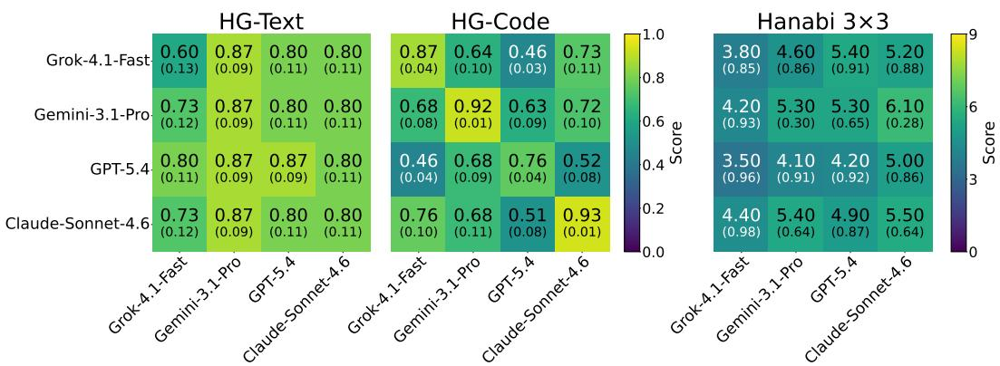  
Figure 20: XP matrices of LLM text and code agents. (Left and Middle) XP matrix in the Hint-Guess game; text agents coordinate well, whereas code agents do not. Human players score 0.75 on average [37]. (Right) XP matrix of text agents on the 3×3 Hanabi variant; text agents fall well short of the 7.7 achieved by IPPO with high entropy regularization [14]. For text agents, each cell reports the mean and s.e.m. over 10 episodes; for code agents, each cell is averaged over 100 episodes across 6 independent XP matrices.

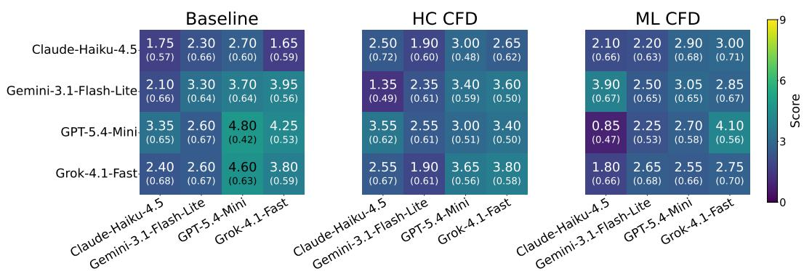  
Figure 21: Hanabi 3×3 results of text agents with and without a CFD. We find that the LLM agents achieve low scores in all 3 cases.

Table 8: Hint-Guess Implicatures: Human-compatible hint rate and win rate (%) by scenario. Scenarios correspond exactly to those in Figure 14. Each cell shows Human % / Win % (n=12 games per hinter–scenario cell). Exact: target card available in hinter’s hand. Similarity (S): feature similarity required, no exact match. Exclusivity (E): mutual exclusivity (Gricean implicature) required. S+E: combined similarity + exclusivity scenario. All models give the human-compatible hint perfectly on Exact, Sim, and Excl; failures concentrate in the S+E condition.
<table><tr><td>Hinter</td><td>Exact Match</td><td>Similarity (S)</td><td>Exclusivity (E)</td><td>S+E</td></tr><tr><td>Claude Sonnet 4.6</td><td>100 / 100</td><td>100 / 100</td><td>100 / 100</td><td>100 / 100</td></tr><tr><td>Gemini 3.1 Pro</td><td>100 / 100</td><td>100 / 100</td><td>100 / 100</td><td>100 /  92</td></tr><tr><td>GPT-5.4</td><td>100 / 100</td><td>100 / 100</td><td>100 / 100</td><td>100 / 100</td></tr><tr><td>Grok 4.1 Fast</td><td>100 / 100</td><td>100 / 100</td><td>100 / 100</td><td>75 /  75</td></tr><tr><td>All</td><td>100 / 100</td><td>100 / 100</td><td>100 / 100</td><td>94 /  92</td></tr></table>

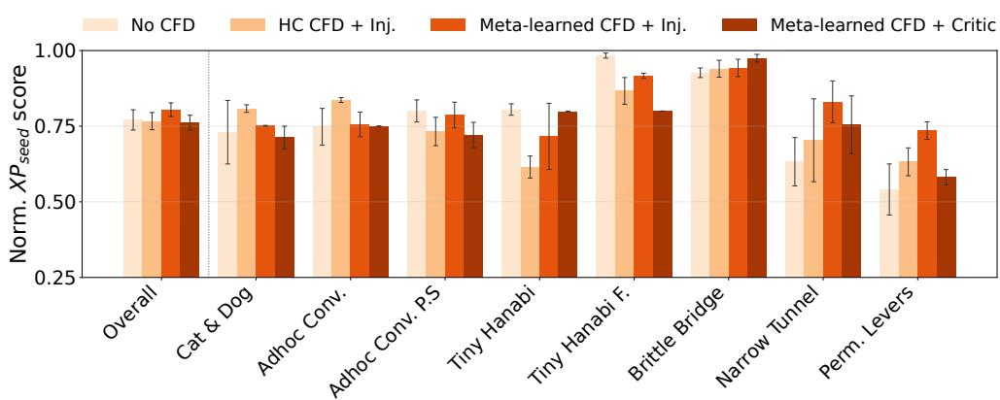  
Figure 22: $\mathbf { X P _ { s e e d } }$ scores of code agents aggregated across different LLM types and scaffolds. Results are shown for Grok 4.1 Fast, GPT-5.2, Gemini 3 Pro, and Opus 4.5. Since the CFD was meta-trained with Grok 4.1 Fast on Cat & Dog and Brittle Bridge, Grok 4.1 Fast is excluded from these two environments in all conditions, including the overall score. Scores are min–max normalised per environment using fixed reward ranges, and error bars denote the standard error over seed pairs.

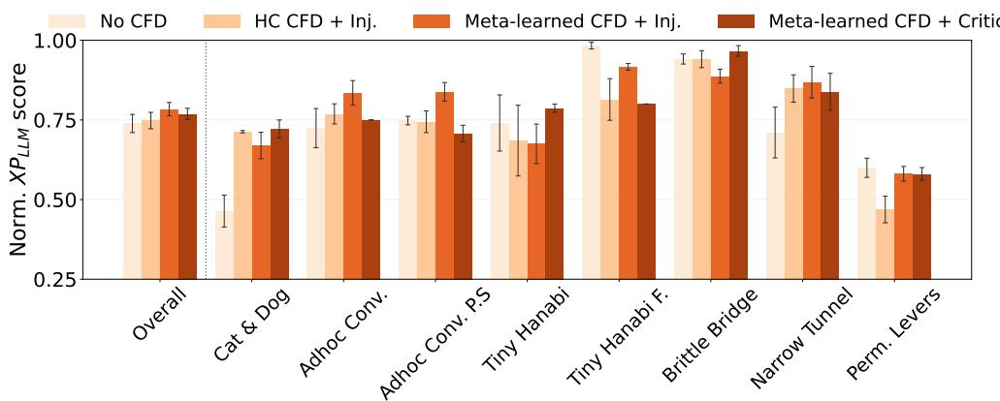  
Figure 23: $\bf { X P _ { L L M } }$ scores of code agents aggregated across different LLM types and scaffolds. Results are shown for Grok 4.1 Fast, GPT-5.2, Gemini 3 Pro, and Opus 4.5.

## G Implementation details

## G.1 Meta-Learning Loop

We outline the algorithm used in our pareto-evolution meta-learning loop in Algorithms 1, 2, and 3. The algorithm is roughly based on GEPA [2], implementing both pareto-based candidate selection and the cheap pre-filtering of new CFDs. Still, there are notable differences to GEPA. In particular, GEPA cannot be applied directly to the ZSC setting as the number of environments is generally far smaller than the number of “tasks” assumed in GEPA. Compared to GEPA, we therefore compute the actual pareto frontier in Algorithm 2 across our meta-train set, without any previous task-wise elite filtering. We also adopt a caching mechanism for the set of initial policies used in each scoring step. This significantly reduces the costs of running the meta-loop. Additionally, by using the same set of initial policies when comparing CFDs, we significantly reduce the variance in XP-scores (as we eliminate the source of variance from the initial generation step), which generally leads to a more stable meta-loop.

At last, the meta-loop differs in the used mutation operators. Similar to GEPA, we tried to include environment feedback into the mutation operators used in the meta-loop, both through direct or obfuscated conditioning on observed coordination failures. In general, we found that the inclusion of such operators unhelpful, often leading to either overfitting or low-quality uni-modal proposals. Instead, we found that ensuring the creation of diverse proposals in the mutation operators was of key importance to the success of the meta-loop. To facilitate such proposals, we apply the following modifications: Mutation operators generally prompt an LLM for a specific kind of modification of the CFD instead of leaving the modification to the LLM. This is similar to the mutation prompts used in PromptBreeder [11]. In our case, the LLM is prompted to either add, remove, reformulate, or freely modify a bullet point in the CFD. Orthogonal to this, we found that prompting an LLM for a set of diverse proposals and then sampling the final proposal uniformly at random from this set can significantly increase diversity, as it allows us to sample proposals from the long tail, which would normally not make it into the LLM’s first response. These two axes yield a total of eight mutation operators. We also add the re-initialization of CFDs as an additional mutation operator.

Hyperparameter choices. We outline in this paragraph the hyperparameter choices used in Algorithm 3 to obtain the CFD described in Appendix 6. The distribution over the mutation operators ν assigns each a sample weight of 1, except the re-initialization operator, which receives a weight of 2. To increase the diversity of proposals and generated policies, the meta-optimisation agent and the code agents generating policies during meta-training use a temperature of 1.0, while the policy critic uses a temperature of 0. The remaining hyperparameter choices are outlined in Table 9.

<table><tr><td>Symbol</td><td>Value</td><td>Quick explanation</td></tr><tr><td>E</td><td>{CATANDDOG, BRITTLEBRIDGE}</td><td>Meta-train coordination environments</td></tr><tr><td>K</td><td>5</td><td>Number of seed CFDs sampled at initialisation</td></tr><tr><td>Tevo</td><td>20</td><td>Outer-loop evolution steps</td></tr><tr><td>nc</td><td>10</td><td>Size of the XP-matrix in the cheap single-env gate</td></tr><tr><td>nf</td><td>15</td><td>Size of the XP-matrix in the full all-envs evaluation</td></tr><tr><td>L</td><td>3</td><td>Max retries to draw a non-duplicate CFD</td></tr><tr><td>Tcrit</td><td>4</td><td>Critic iteration budget per starting policy</td></tr></table>

Table 9: Inputs to Algorithm 3 used in our experiments.

Algorithm 1 SCORE: evaluate a CFD on one environment via $n \times n$ cross-play   
Require: CFD $c ;$ Dec-POMDP M with natural-text descriptions $( \mathcal { D } _ { \mathcal { M } } , \mathcal { O } _ { \mathcal { M } } , \mathcal { A } _ { \mathcal { M } } )$ of the game,   
observations, and actions; preset starting policies $\Pi = ( \pi _ { 0 } ^ { ( 1 ) } , \ldots , \pi _ { 0 } ^ { ( n ) } )$ , one per seed; critic   
iteration budget $T _ { \mathrm { c r i t } }$   
Ensure: mean off-diagonal cross-play score $\sigma \in \mathbb { R }$   
1: procedure SCORE(c, $\mathcal { M } , \Pi , \bar { T _ { \mathrm { c r i t } } } )$   
2: $n \gets | \Pi |$   
3: for $i = \dot { 1 }$ to n do   
4: $( \pi ^ { ( i ) } , \cdot ) \gets \mathrm { R E F I N E } ( \pi _ { 0 } ^ { ( i ) } , \mathcal { M } , c , T _ { \mathrm { c r i t } } )$ ▷ see Algorithm 5   
5: end for   
6: $X \in \mathbb { R } ^ { n \times n }$ with $X [ i , j ] = \mathbb { E } [ J ( \pi ^ { ( i ) } , \pi ^ { ( j ) } ) ]$ ▷ cross-play return matrix   
7: return $\frac { 1 } { n ^ { 2 } - n } \sum _ { i \neq j } X [ i , j ]$   
8: end procedure

Algorithm 2 PARETOFRONTIER: non-dominated subset of a candidate set   
Definition (Pareto dominance). Given candidates $c , c ^ { \prime }$ with per-environment scores $\sigma _ { c } , \sigma _ { c ^ { \prime } } \in$   
$\mathbb { R } ^ { | \varepsilon | } , c ^ { \prime }$ dominates c iff $\sigma _ { c ^ { \prime } } ( { \mathcal { M } } ) \geq \sigma _ { c } ( { \mathcal { M } } )$ for all $\mathcal { M } \in \mathcal { E }$ and $\sigma _ { c ^ { \prime } } ( { \mathcal { M } } ) > \sigma _ { c } ( { \mathcal { M } } )$ for at least one   
$\mathcal { M } \in \mathcal { E } .$   
Require: candidate set $P ;$ environment set $\mathcal { E }$   
Ensure: non-dominated subset $F \subseteq P$   
1: procedure PARETOFRONTIER $( P , \mathcal { E } )$   
2: $F \gets \emptyset$   
3: for $c \in P$ do   
4: if no $c ^ { \prime } \in P \setminus \{ c \}$ dominates c then   
5: $F  F \cup \{ c \}$   
6: end if   
7: end for   
8: return $F$   
9: end procedure

Algorithm 3 PARETOEVOLUTION: meta-learning over CFDs across environments   
Require: environment set $\mathcal { E }$ (Dec-POMDPs); seed population size $K ;$ evolution steps $T _ { \mathrm { e v o } } ;$ cheap  
eval seeds $n _ { c } ;$ full-eval seeds $n _ { f }$ ; mutation operator distribution $\nu ;$ max mutation retries $L ;$ critic   
iteration budget $T _ { \mathrm { c r i t } }$   
Ensure: selected CFD $c ^ { \star }$   
1: procedure PARETOEVOLUTION $( \mathcal { E } , K , T _ { \mathrm { e v o } } , n _ { c } , n _ { f } , \nu , L , T _ { \mathrm { c r i t } } )$   
Phase 1: Initialization.   
2: pre-sample fixed starting policies $\hat { \Pi } _ { \mathcal { M } }$ for each $\mathcal { M } \in \mathcal { E }$ ▷ $| { \hat { \Pi } } _ { { \mathcal { M } } } | = n _ { f }$ (one per seed)   
3: sample $\bar { K }$ diverse seed CFDs $\{ c _ { 1 } , \ldots , c _ { K } \}$   
4: $P  \emptyset$   
5: for $c \in \{ c _ { 1 } , \ldots , c _ { K } \}$ do   
6: $\sigma _ { c } ( \mathcal { M } ) \gets \mathrm { S c o R E } ( c , \mathcal { M } , \hat { \Pi } _ { \mathcal { M } } , T _ { \mathrm { c r i t } } )$ for all $\mathcal { M } \in \mathcal { E }$   
7: $P  P \cup \{ c \}$   
8: end for   
9: $P _ { \mathrm { a l i v e } }  P$ ▷ all seeds initially alive   
Phase 2: Evolution.   
10: for $t = 1$ to $T _ { \mathrm { e v o } }$ do   
11: $F  \mathrm { P A }$ RETOFRONTIER $( P _ { \mathrm { a l i v e } } , \mathcal { E } )$   
12: $c _ { p } \gets$ uniform sample from $F$ ▷ parent   
Mutation with duplicate retry:   
13: $c _ { x } \gets \mathtt { n i l }$   
14: for $\ell = 1$ to L do   
15: $m \sim \nu ; c  m ( c _ { p } )$   
16: $\mathbf { i f } c \notin$ {CFDs in ${ \dot { P } }  \dot { \} }$ then   
17: $c _ { x }  c$   
18: break   
19: end if   
20: end for   
21: if $c _ { x } = \mathtt { n i l }$ then   
22: continue ▷ no novel child after L tries   
23: end if   
Cheap gate: samefresh starting policiesfor child and parent.   
24: M ← uniform sample from E   
25: Π˜ ← fresh sample of $n _ { c }$ starting policies for $\mathcal { M }$   
26: if $\mathrm { S C O R E } ( c _ { x } , \mathcal { M } , \tilde { \Pi } , T _ { \mathrm { c r i t } } ) \leq \mathrm { S C O R E } ( c _ { p } , \mathcal { M } , \tilde { \Pi } , T _ { \mathrm { c r i t } } )$ then   
27: continue ▷ discard child   
28: end if   
Full evaluation on all environments:   
29: $\sigma _ { c _ { x } } ( \mathcal { M } ) \gets \mathrm { S c o R E } ( c _ { x } , \mathcal { M } , \hat { \Pi } _ { \mathcal { M } } , T _ { \mathrm { c r i t } } )$ for all $\mathcal { M } \in \mathcal { E }$   
Frontier admission:   
30: $F ^ { \prime } \gets$ PARETOFRONTIER $( P _ { \mathrm { a l i v e } } \cup \{ c _ { x } \} , \mathcal { E } )$   
31: if $c _ { x } \in F ^ { \prime }$ then   
32: $\mathsf { \bar { P } } \gets P \cup \{ c _ { x } \}$   
33: $P _ { \mathrm { a l i v e } }  \dot { F ^ { \prime } }$ ▷ dominated candidates removed   
34: end if   
35: end for   
Phase 3: Final Selection.   
From the finalfrontier, return the candidate with the highest mean score after per-environment   
min–max normalisation. This balances performance across environments without privileging   
those with larger absolute score ranges.   
36: F⋆ ← PARETOFRONTIER $( P _ { \mathrm { a l i v e } } , \mathcal { E } )$   
37: for $\mathcal { M } \in \mathcal { E }$ do   
38: $\begin{array} { r } { l o _ { \mathcal { M } }  \operatorname* { m i n } _ { c \in F ^ { \star } } \sigma _ { c } ( \mathcal { M } ) ; \quad h i _ { \mathcal { M } }  \operatorname* { m a x } _ { c \in F ^ { \star } } \sigma _ { c } ( \mathcal { M } ) } \end{array}$   
39: end for   
40: return arg $\operatorname* { m a x } _ { c \in F ^ { \star } } \frac { 1 } { | \mathcal { E } | } \sum _ { \mathcal { M } \in \mathcal { E } } \frac { \sigma _ { c } ( \mathcal { M } ) - l o _ { \mathcal { M } } } { h i _ { \mathcal { M } } - l o _ { \mathcal { M } } }$   
41: end procedure

## G.2 Policy Critic

We outline in Algorithm 4 and Algorithm 5 how the policy critic can be used to iteratively refine starting policies $\pi _ { 0 } .$ . Starting policies are generated using the code-agent generation process as outlined in Figure 15, but without conditioning on any CFD. We provide the prompt used for the policy critic in Figure 26. Separating generation from verfication can increase diversity [3], as well as reduce the occurrence of false positives in the policy creation pipeline.

Algorithm 4 CRITICSTEP: single critic pass over a policy   
Require: candidate policy $\pi ;$ Dec-POMDP M with natural-text descriptions $( \mathcal { D } _ { \mathcal { M } } , \mathcal { O } _ { \mathcal { M } } , \mathcal { A } _ { \mathcal { M } } )$ of   
the game, observations, and actions; coordination-friendly definition $c ;$ critic language model   
LLM   
Ensure: verdict $c f \in$ {true, false}; revised policy $\pi ^ { \prime }$ (with $\pi ^ { \prime } = \pi$ when $c f = \mathrm { t r u e } )$   
1: procedure CRITICSTEP(π, M, c)   
2: $p $ BUILDCRITICPROMPT $( \pi , M , c )$   
3: resp $ \mathrm { L L M } ( p ,$ temperature $= 0 )$   
4: parse resp as JSON with fields coordination\_friendly, modified\_policy   
5: if resp.coordination\_friendly then   
6: $\pi ^ { \bar { \prime } }  \pi$   
7: else   
8: π′ ← PARSE(resp.modified\_policy)   
9: end if   
10: return (resp.coordination\_friendly, $\pi ^ { \prime } )$   
11: end procedure

Algorithm 5 REFINE: iterative policy refinement via the critic

Require: starting policy $\pi _ { 0 } ;$ Dec-POMDP M; coordination-friendly definition $c ;$ iteration budget $T$   
Ensure: final policy $\pi ^ { \star } ;$ flag approved indicating whether $\pi ^ { \star }$ was confirmed coordination-friendly   
1: procedure $\mathsf { R E F I N E } ( \pi _ { 0 } , \mathcal { M } , c , T )$   
2: π ← π0   
3: for $t = 1$ 1 to T do   
4: $( c f , \pi ^ { \prime } ) \gets \mathrm { C R I T I C S T E P } ( \pi , \mathcal { M } , c )$   
5: if cf then   
6: return (π, true)   
7: end if   
8: $\pi  \pi ^ { \prime }$ ▷ adopt the proposed revision   
9: end for   
10: return $( \pi ,$ false) ▷ budget exhausted; return last revision   
11: end procedure

## G.3 Prompts

The prompt template for text agents is shown in Figure 24, for code agents in Figure 25, and for the policy critic in Figure 26. To ensure consistent policies and reasonable actions, we use a temperature of 0 for text and code agents unless otherwise specified. We note that even at these settings, most frontier models are non-deterministic [21].

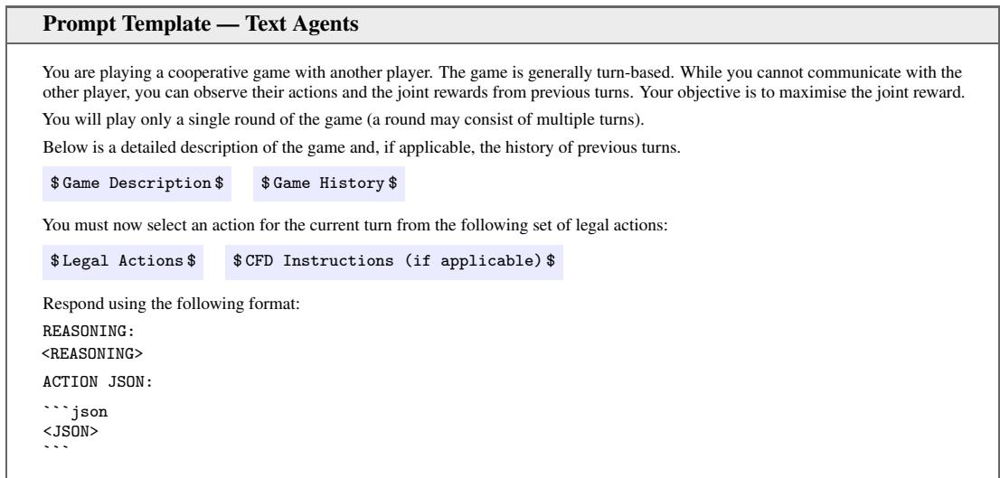  
Figure 24: Template of the prompt used for text agents. Blue-shaded fields are filled in at runtime.

The prompt templates used by the mutation operators in our meta-learning loop are shown in Figure 27, Figure 28, Figure 29, Figure 30, and Figure 31. All mutation prompts begin with the shared background block in Figure 27. The four unary\_\* operators (add, remove, reformulate, atomic) share the template in Figure 28; the thinking-style block from Figure 29 specifies which atomic edit the LLM is asked to perform. The four diverse\_\* operators reuse the same thinkingstyle blocks but ask for $n _ { \mathrm { p r o p o s a l s } }$ diverse candidates per call (Figure 30); we then sample one proposal uniformly at random. The reinit operator generates fresh single-bullet CFDs from scratch using the seed template in Figure 31.

## G.4 Experimental Resources

Running all experiments reported in this paper incurred approximately \$1,000 in API costs across the evaluated LLM agents. The token-level probability experiments (Appendix F.5) for the open-weight models were run locally on a single H100 GPU.

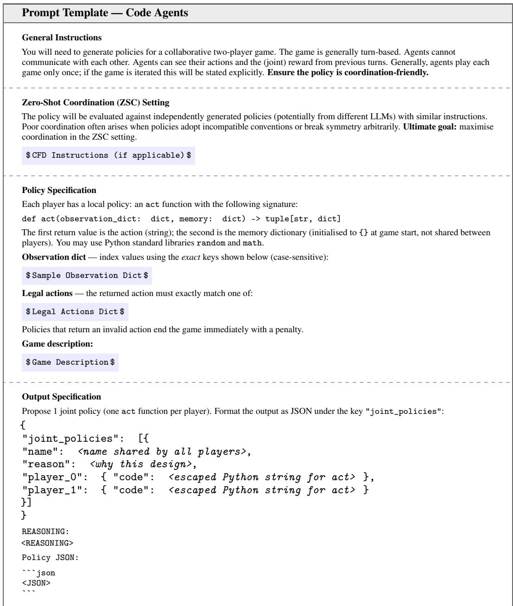  
Figure 25: Template of the prompt used for code agents. Blue-shaded fields are filled in at runtime.

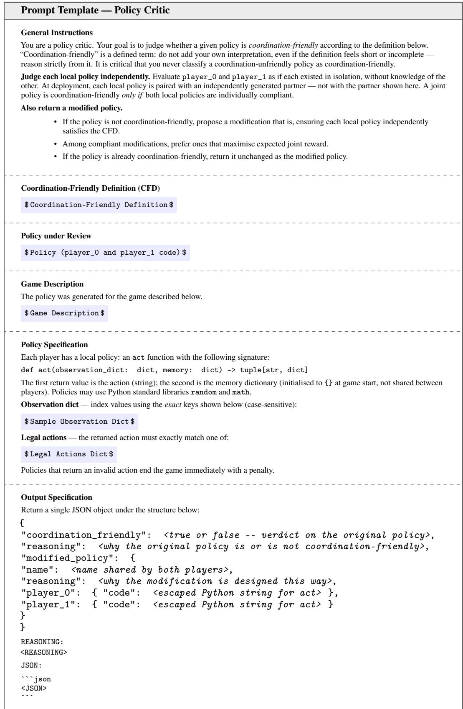  
Figure 26: Template of the prompt used for the policy critic. Blue-shaded fields are filled in at runtime.

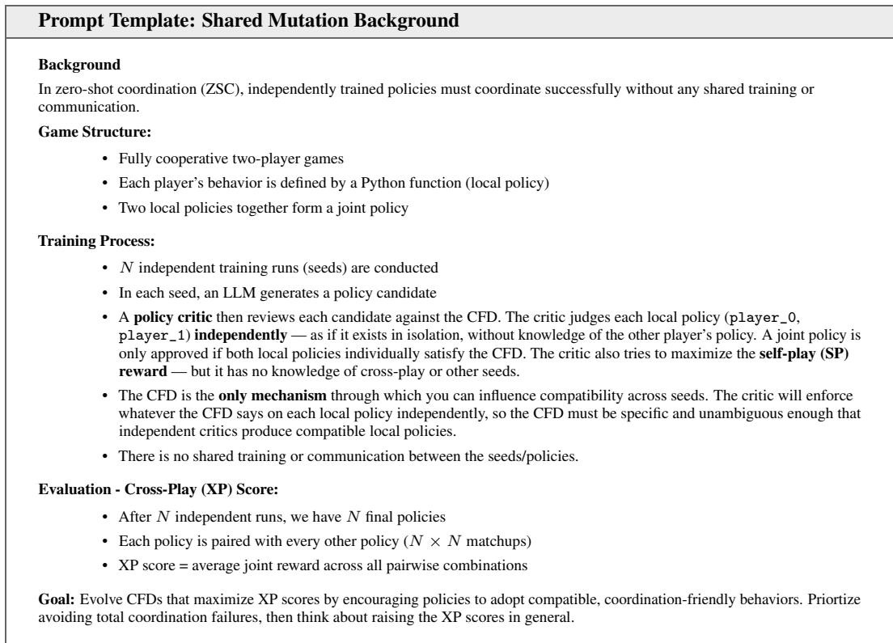  
Figure 27: Shared background block prepended to every mutation prompt.

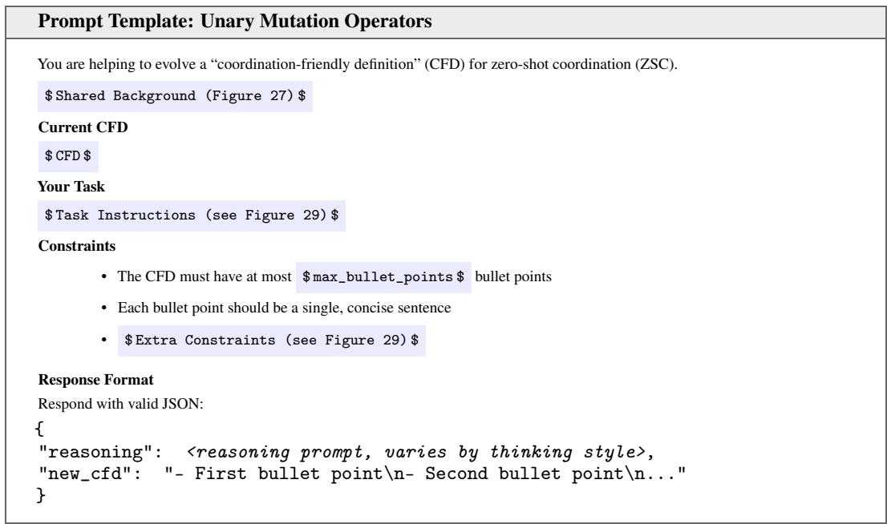  
Figure 28: Combined template for the four unary\_\* mutation operators (unary\_add, unary\_remove, unary\_reformulate, unary\_atomic). The thinking-style blocks substituted into the Task Instructions, Extra Constraints, and Reasoning Prompt placeholders are listed in Figure 29.

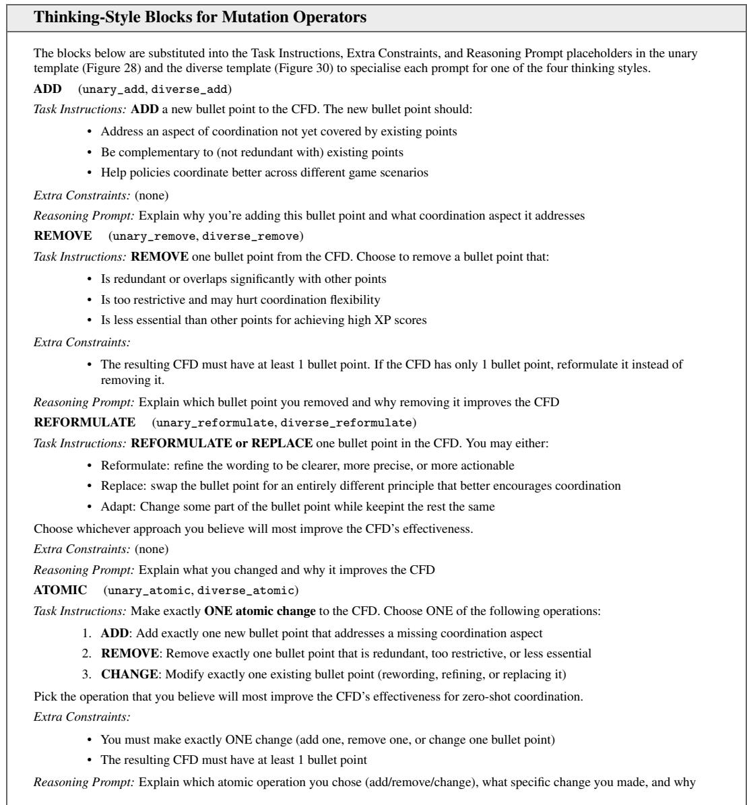  
Figure 29: Thinking-style blocks substituted into the unary (Figure 28) and diverse (Figure 30) mutation prompt templates.

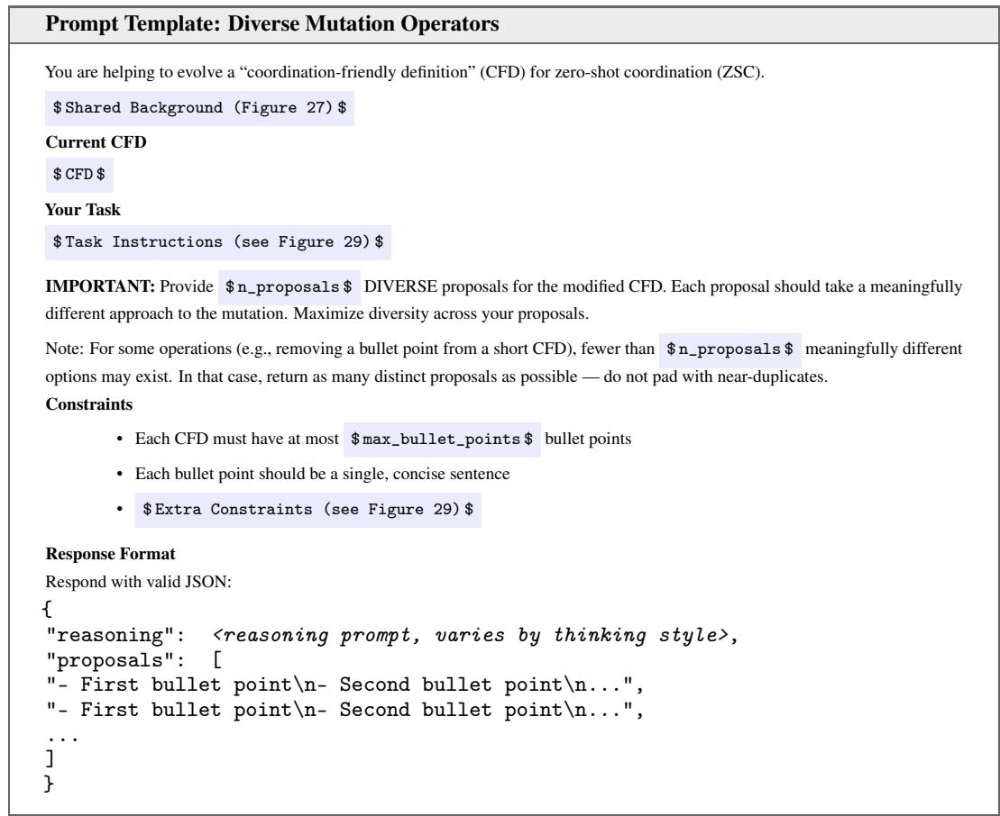  
Figure 30: Combined template for the four diverse\_\* mutation operators (diverse\_add, diverse\_remove, diverse\_reformulate, diverse\_atomic). The differences from the unary template (Figure 28) are that the prompt asks for $n _ { \mathrm { p r o p o s a l s } }$ diverse candidates and that the singleton new\_cfd field is replaced with a proposals list. After parsing, we sample one proposal uniformly at random as the child CFD. Thinking-style blocks (Figure 29) are reused unchanged.

Prompt Template: Reinitialization Operator (reinit)   
You are helping to create diverse “coordination-friendly definitions” (CFDs) for zero-shot coordination (ZSC).   
\$ Shared Background (Figure 27) \$   
Your Task   
Generate \$ n \$ DIVERSE seed CFDs. Each CFD should:   
• Be a single bullet point (one concise sentence)   
• Encourage coordination in a unique way   
• Be simple and general enough to apply to various multi-agent games   
• NOT overlap significantly with other CFDs you generate   
Constraints   
• Generate exactly \$ n \$ CFDs   
• Each CFD is a single bullet point (one sentence)   
• Maximize diversity across the CFDs   
Response Format   
Respond with valid JSON:   
{   
"reasoning": <Explain your strategy for creating diverse CFDs>,   
"cfds": [   
"- First CFD",   
"- Second CFD",   
]   
}  
Figure 31: Template used by the reinit operator. The operator calls this prompt with n candidates per invocation and samples one uniformly at random as the child CFD. The same template is also used to create the initial seed population at the start of the meta-learning loop.

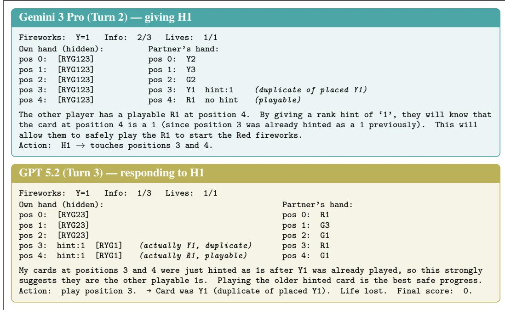  
Figure 32: Coordination failure between Gemini 3 Pro and GPT 5.2 in Hanabi 3×3 due to mismatched assumptions about the “Good Touch” principle (i.e, all clued cards will be played in the future), a convention widely adopted by human Hanabi players. Gemini provides a rank-1 hint to signal a newly drawn R1 at position 4, but the hint also re-touches an already-played duplicate Y1 at position 3, violating the “Good Touch” principle. GPT, assuming that a cooperative partner “would not hint cards that are already played,” infers that both touched cards must be playable 1s and plays the older hinted card (the Y1 duplicate), costing the team its only life. This failure is compounded by an implicit convention, playing the oldest hinted card, that was not mutually established; had the clue giver anticipated this assumption, they would have avoided giving the hint.

## H Reasoning Traces

This section contains reasoning traces of various LLM agents across the environments studied in this paper, illustrating both successful coordination and common failure modes.

GPT 5.2   
To maximize zero-shot coordination, use an (essentially forced) perfect-signaling convention: when   
player\_0 has Card 2, they must play "A" to enable a payoff-10 outcome regardless of player\_1’s card   
(since Case 3 only allows 10 via (A,C)). When player\_0 has Card 1, they can safely play "C" because   
it still allows payoff-10 outcomes for both possible player\_1 cards ((C,A) in Case 1 and (C,C) in   
Case 2). Player\_1 then best-responds deterministically based on (player\_0\_action, own card) to   
always reach payoff 10. Additionally, if player\_1 ever observes "B", responding with "B" is a   
robust fallback since (B,B)=8 in all cases.   
Opus 4.5   
Looking at this game, I need to analyze the payoff structure and find a coordination-friendly   
strategy.   
Analysis:   
Key observations from the payoff tables:   
1. (B, B) always gives 8 regardless of cards – this is a “safe” play   
2. 10-point payoffs exist but require knowing which case we’re in   
3. Player 0 can signal their card through their action choice, enabling Player 1 to know the   
exact case   
Signaling strategy:   
• If Player 0 plays A → signals Card 1   
• If Player 0 plays B → signals Card 2   
Player 1’s optimal responses:   
• When P0 plays A (P0 has Card 1):   
– P1 Card 1 (Case 1): Play A → 10   
– P1 Card 2 (Case 2): Play C → 10   
• When P0 plays B (P0 has Card 2):   
– P1 Card 1 (Case 3): Play B → 8 (best available)   
– P1 Card 2 (Case 4): Play B → 8 (best available)   
Expected value: (10 + 10 + 8 + 8)/4 = 9   
This is better than always playing (B, B), which gives 8, and the convention “A for 1, B for 2” is   
natural and coordination-friendly.   
REASONING:   
The optimal ZSC strategy uses Player 0’s action to signal their card. Using “A” for Card 1 and “B”   
for Card 2 is a natural, memorable convention. Player 1 can then deduce the exact game case and   
respond optimally. When P0 has Card 1 (plays A), P1 can always achieve 10 points. When P0 has Card   
2 (plays B), P1’s best option is B, giving 8 points. This yields an expected value of 9.  
Figure 33: Reasoning traces of GPT 5.2 and Opus 4.5 agents in Tiny Hanabi. GPT 5.2 chooses a joint policy based on SP optimality wheres Opus picks a joint policy based on lexicographical ordering.

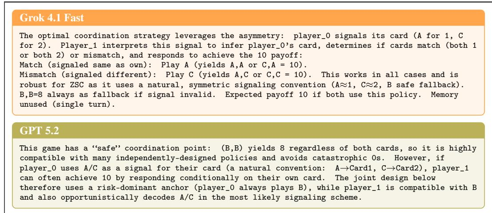  
Figure 34: Reasoning traces of Grok 4.1 Fast and GPT 5.2 as code agents in Tiny Hanabi Fixed. Both agents independently converge on the lexicographic mapping $( \mathrm { A } \approx 1 , \mathrm { C } \approx 2 ) $ : Grok uses it as an active signalling convention, while GPT uses it to decode the partner’s signal. This shared semantic bias enables agents to coordinate via a convention rather than defaulting to the safe fallback.

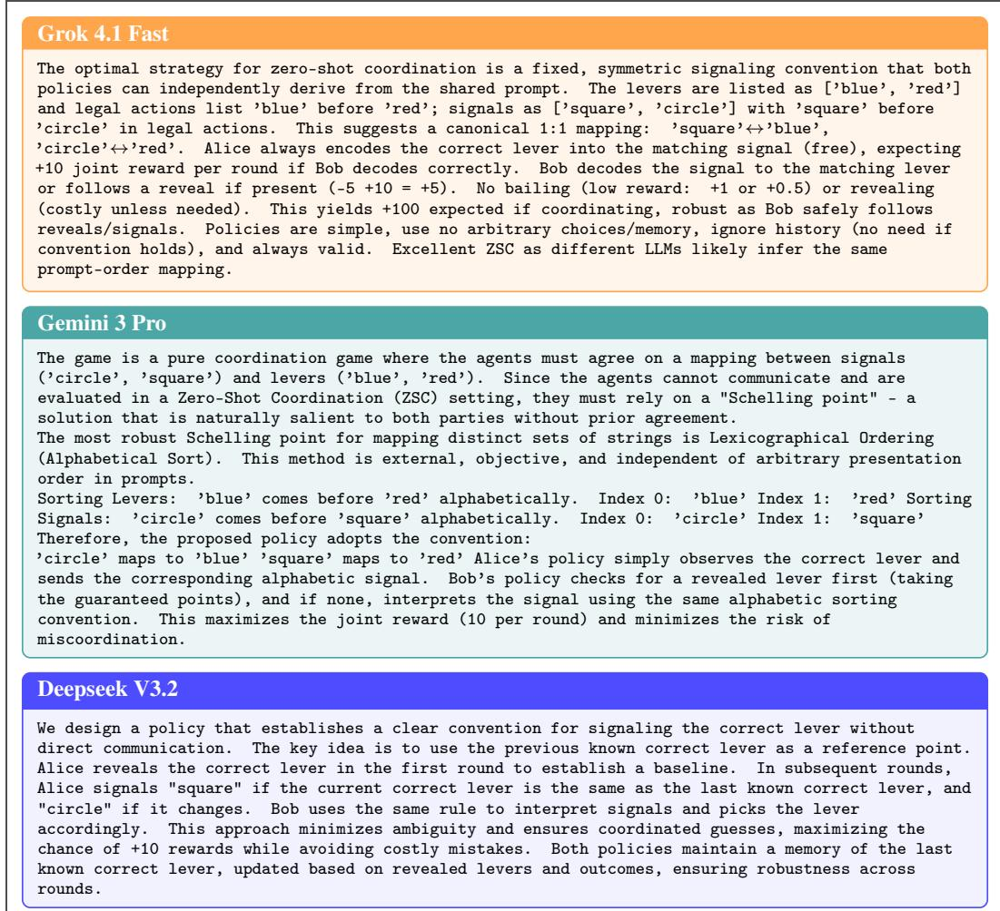  
Figure 35: Reasoning traces of Grok 4.1 Fast, Gemini 3 Pro and Deepseek V3.2 when generating the most common observed strategies in Adhoc conventions. Note that the three strategies are mutually incompatible.

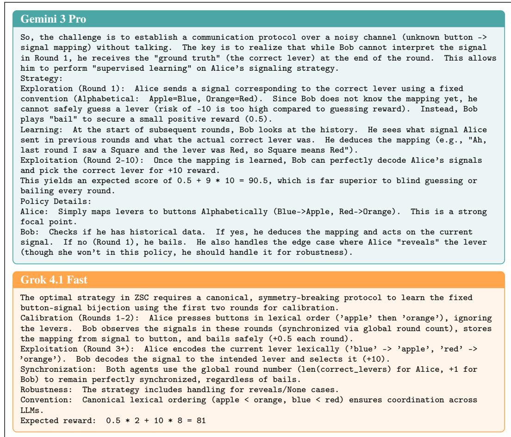  
Figure 36: Reasoning Traces of Gemini 3 Pro and Grok 4.1 Fast in Ad-hoc conventions permuted signals. Although both models converge on a scheme where Alice remains fixed and Bob adapts, they adopt different calibration strategies for Bob, rendering them incompatible.

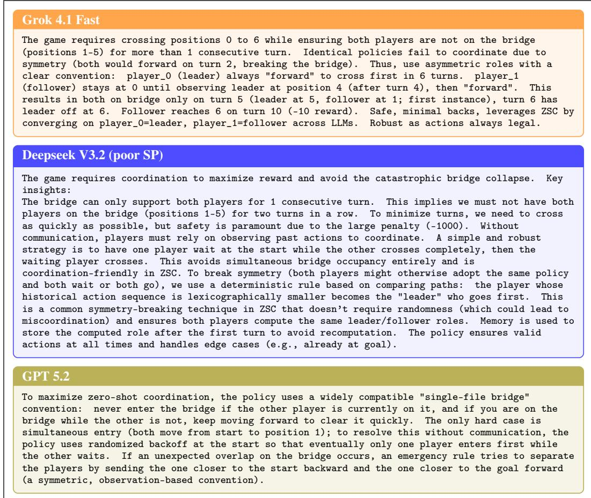  
Figure 37: Reasoning Traces of Grok 4.1 Fast, Deepseek V3.2 and GPT 5.2 in Brittle Bridge. DeepSeek produces a complex role-assignment strategy that performs poorly even in self-play. In contrast, Grok 4.1 Fast and GPT 5.2 each learn role-assignment strategies that are mutually incompatible.

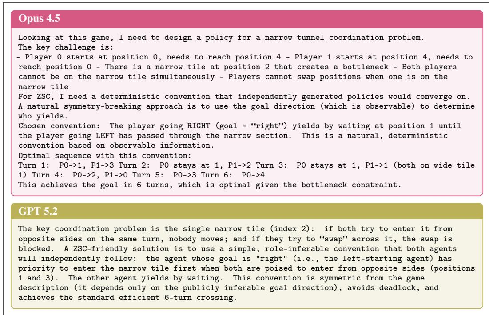  
Figure 38: Reasoning Traces of Opus 4.5 and GPT 5.2 in Narrow Tunnel. These traces illustrate the two most common yet incompatible role-assignment strategies: “left goes first” versus “right goes first.”

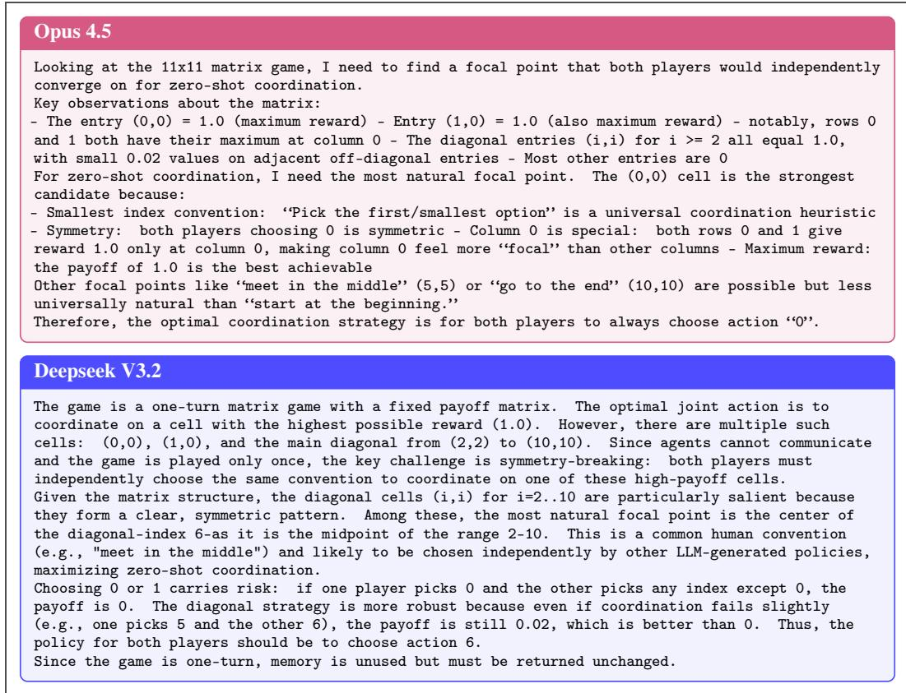  
Figure 39: Reasoning Traces of Opus 4.5 and Deepseek V3.2 in Matrix Game. Opus 4.5 successfully identify different focal points from the payoff matrix.

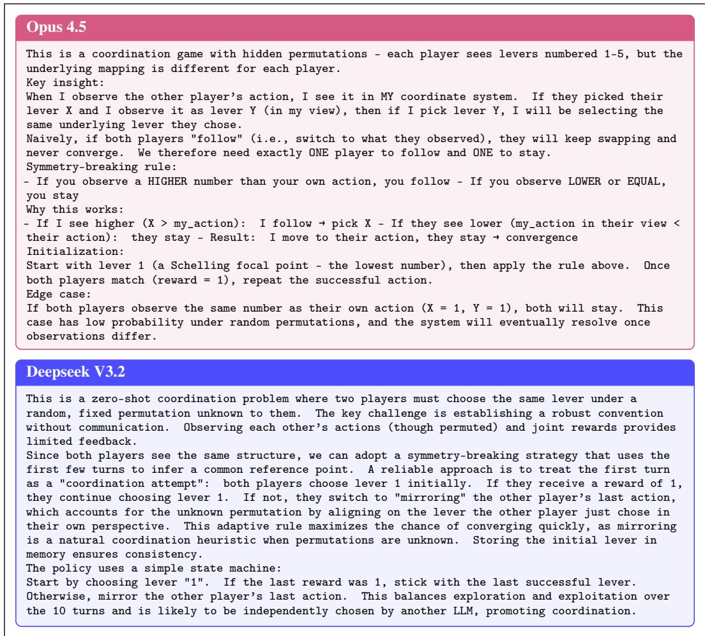  
Figure 40: Reasoning Traces of Opus 4.5 and Deepseek V3.2 in Permuted Levers. Opus 4.5 achieves a low self-play score but exhibits strong cross-play performance when paired with DeepSeek V3.2.

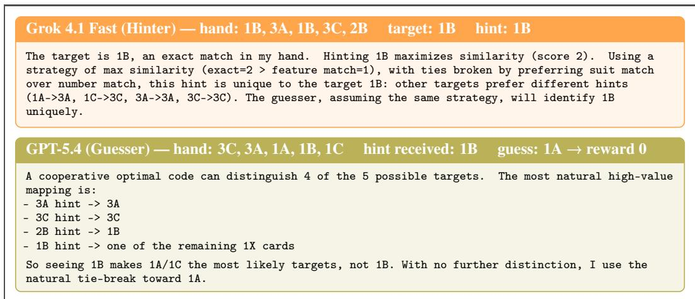  
Figure 41: Convention mismatch in Hint-Guess. The hinter gives the trivially correct exact-match hint 1B for target 1B. The guesser, however, applies an over-engineered bijective code in which 1B is re-mapped to a residual slot (1A).

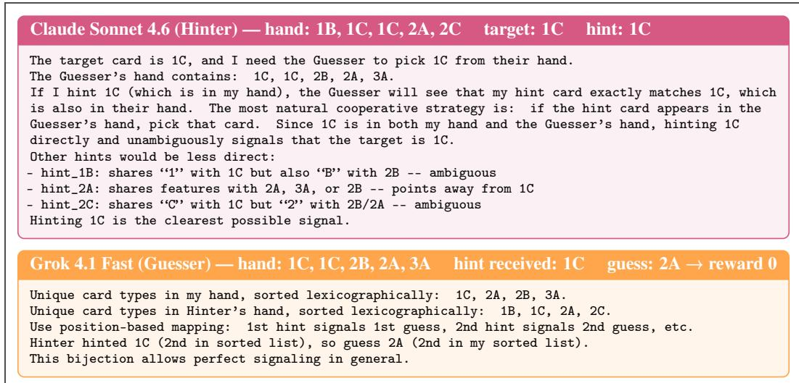  
Figure 42: Convention mismatch in Hint-Guess. The hinter uses a simple exact-match strategy: hint 1C because 1C is in both hands. The guesser ignores the direct exact-match signal and instead applies a lexicographic position-based bijection, mapping the 2nd hint in the sorted hinter hand (1C) to the 2nd card in the sorted guesser hand (2A).

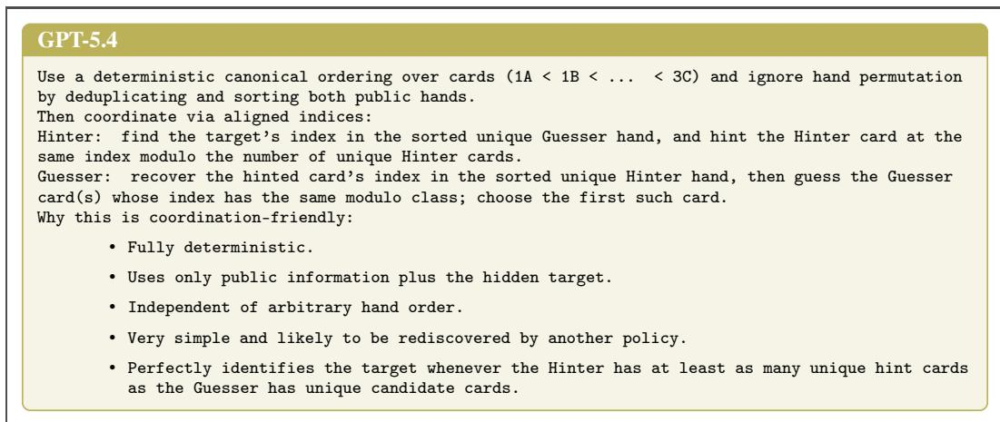  
Figure 43: Reasoning trace of GPT-5.4 as a code agent in Hint Guess. The policy sorts both hands canonically $( 1 \mathrm { A } < 1 \bar { \mathrm { B } } < . . . < 3 \mathrm { C } )$ , deduplicates, and coordinates by mapping target indices modulo the number of unique hinter cards. Although internally consistent, the convention is essentially arbitrary — another code agent is unlikely to independently arrive at the same convention, hence cross-play coordination breaks down.

## NeurIPS Paper Checklist

The checklist is designed to encourage best practices for responsible machine learning research, addressing issues of reproducibility, transparency, research ethics, and societal impact. Do not remove the checklist: The papers not including the checklist will be desk rejected. The checklist should follow the references and follow the (optional) supplemental material. The checklist does NOT count towards the page limit.

Please read the checklist guidelines carefully for information on how to answer these questions. For each question in the checklist:

• You should answer [Yes], [No], or [N/A].

• [N/A] means either that the question is Not Applicable for that particular paper or the relevant information is Not Available.

• Please provide a short (1–2 sentence) justification right after your answer (even for [N/A]).

The checklist answers are an integral part of your paper submission. They are visible to the reviewers, area chairs, senior area chairs, and ethics reviewers. You will also be asked to include it (after eventual revisions) with the final version of your paper, and its final version will be published with the paper.

The reviewers of your paper will be asked to use the checklist as one of the factors in their evaluation. While [Yes] is generally preferable to [No], it is perfectly acceptable to answer [No] provided a proper justification is given (e.g., error bars are not reported because it would be too computationally expensive” or “we were unable to find the license for the dataset we used”). In general, answering [No] or [N/A] is not grounds for rejection. While the questions are phrased in a binary way, we acknowledge that the true answer is often more nuanced, so please just use your best judgment and write a justification to elaborate. All supporting evidence can appear either in the main paper or the supplemental material, provided in appendix. If you answer [Yes] to a question, in the justification please point to the section(s) where related material for the question can be found.

IMPORTANT, please:

• Delete this instruction block, but keep the section heading “NeurIPS Paper Checklist",

• Keep the checklist subsection headings, questions/answers and guidelines below.

• Do not modify the questions and only use the provided macros for your answers.

## 1. Claims

Question: Do the main claims made in the abstract and introduction accurately reflect the paper’s contributions and scope?

Answer: [Yes]

Justification: Empirical claims are supported by experiments in Figure 4, Appendix 5, and Appendix 6, with additional results in Appendix F.3. Non-empirical claims, such as the relation to prior work, are addressed in Appendix A; out-of-scope items and limitations are discussed in Appendix 7.

Guidelines:

• The answer [N/A] means that the abstract and introduction do not include the claims made in the paper.

• The abstract and/or introduction should clearly state the claims made, including the contributions made in the paper and important assumptions and limitations. A [No] or [N/A] answer to this question will not be perceived well by the reviewers.

• The claims made should match theoretical and experimental results, and reflect how much the results can be expected to generalize to other settings.

• It is fine to include aspirational goals as motivation as long as it is clear that these goals are not attained by the paper.

## 2. Limitations

Question: Does the paper discuss the limitations of the work performed by the authors?

Answer: [Yes]

Justification: We discuss limitations in Appendix 7.

## Guidelines:

• The answer [N/A] means that the paper has no limitation while the answer [No] means that the paper has limitations, but those are not discussed in the paper.

• The authors are encouraged to create a separate “Limitations” section in their paper.

• The paper should point out any strong assumptions and how robust the results are to violations of these assumptions (e.g., independence assumptions, noiseless settings, model well-specification, asymptotic approximations only holding locally). The authors should reflect on how these assumptions might be violated in practice and what the implications would be.

• The authors should reflect on the scope of the claims made, e.g., if the approach was only tested on a few datasets or with a few runs. In general, empirical results often depend on implicit assumptions, which should be articulated.

• The authors should reflect on the factors that influence the performance of the approach. For example, a facial recognition algorithm may perform poorly when image resolution is low or images are taken in low lighting. Or a speech-to-text system might not be used reliably to provide closed captions for online lectures because it fails to handle technical jargon.

• The authors should discuss the computational efficiency of the proposed algorithms and how they scale with dataset size.

• If applicable, the authors should discuss possible limitations of their approach to address problems of privacy and fairness.

• While the authors might fear that complete honesty about limitations might be used by reviewers as grounds for rejection, a worse outcome might be that reviewers discover limitations that aren’t acknowledged in the paper. The authors should use their best judgment and recognize that individual actions in favor of transparency play an important role in developing norms that preserve the integrity of the community. Reviewers will be specifically instructed to not penalize honesty concerning limitations.

## 3. Theory assumptions and proofs

Question: For each theoretical result, does the paper provide the full set of assumptions and a complete (and correct) proof?

Answer: [N/A]

Justification: The paper does not contain any theoretical results.

Guidelines:

• The answer [N/A] means that the paper does not include theoretical results.

• All the theorems, formulas, and proofs in the paper should be numbered and crossreferenced.

• All assumptions should be clearly stated or referenced in the statement of any theorems.

• The proofs can either appear in the main paper or the supplemental material, but if they appear in the supplemental material, the authors are encouraged to provide a short proof sketch to provide intuition.

• Inversely, any informal proof provided in the core of the paper should be complemented by formal proofs provided in appendix or supplemental material.

• Theorems and Lemmas that the proof relies upon should be properly referenced.

## 4. Experimental result reproducibility

Question: Does the paper fully disclose all the information needed to reproduce the main experimental results of the paper to the extent that it affects the main claims and/or conclusions of the paper (regardless of whether the code and data are provided or not)?

Answer: [Yes]

Justification: Environments are described in Appendix D, prompts are given in Appendix G.3, and the remaining implementation details required to reproduce our results are provided in Appendix G.

## Guidelines:

• The answer [N/A] means that the paper does not include experiments.

• If the paper includes experiments, a [No] answer to this question will not be perceived well by the reviewers: Making the paper reproducible is important, regardless of whether the code and data are provided or not.

• If the contribution is a dataset and/or model, the authors should describe the steps taken to make their results reproducible or verifiable.

• Depending on the contribution, reproducibility can be accomplished in various ways. For example, if the contribution is a novel architecture, describing the architecture fully might suffice, or if the contribution is a specific model and empirical evaluation, it may be necessary to either make it possible for others to replicate the model with the same dataset, or provide access to the model. In general. releasing code and data is often one good way to accomplish this, but reproducibility can also be provided via detailed instructions for how to replicate the results, access to a hosted model (e.g., in the case of a large language model), releasing of a model checkpoint, or other means that are appropriate to the research performed.

• While NeurIPS does not require releasing code, the conference does require all submissions to provide some reasonable avenue for reproducibility, which may depend on the nature of the contribution. For example

(a) If the contribution is primarily a new algorithm, the paper should make it clear how to reproduce that algorithm.

(b) If the contribution is primarily a new model architecture, the paper should describe the architecture clearly and fully.

(c) If the contribution is a new model (e.g., a large language model), then there should either be a way to access this model for reproducing the results or a way to reproduce the model (e.g., with an open-source dataset or instructions for how to construct the dataset).

(d) We recognize that reproducibility may be tricky in some cases, in which case authors are welcome to describe the particular way they provide for reproducibility. In the case of closed-source models, it may be that access to the model is limited in some way (e.g., to registered users), but it should be possible for other researchers to have some path to reproducing or verifying the results.

## 5. Open access to data and code

Question: Does the paper provide open access to the data and code, with sufficient instructions to faithfully reproduce the main experimental results, as described in supplemental material?

Answer: [Yes]

Justification: Anonymised code with run instructions to reproduce all experiments is available at https://anonymous.4open.science/r/zsc\_llm-EAE1/README.md.

Guidelines:

• The answer [N/A] means that paper does not include experiments requiring code.

• Please see the NeurIPS code and data submission guidelines (https://neurips.cc/ public/guides/CodeSubmissionPolicy) for more details.

• While we encourage the release of code and data, we understand that this might not be possible, so [No] is an acceptable answer. Papers cannot be rejected simply for not including code, unless this is central to the contribution (e.g., for a new open-source benchmark).

• The instructions should contain the exact command and environment needed to run to reproduce the results. See the NeurIPS code and data submission guidelines (https: //neurips.cc/public/guides/CodeSubmissionPolicy) for more details.

• The authors should provide instructions on data access and preparation, including how to access the raw data, preprocessed data, intermediate data, and generated data, etc.

• The authors should provide scripts to reproduce all experimental results for the new proposed method and baselines. If only a subset of experiments are reproducible, they should state which ones are omitted from the script and why.

• At submission time, to preserve anonymity, the authors should release anonymized versions (if applicable).

• Providing as much information as possible in supplemental material (appended to the paper) is recommended, but including URLs to data and code is permitted.

## 6. Experimental setting/details

Question: Does the paper specify all the training and test details (e.g., data splits, hyperparameters, how they were chosen, type of optimizer) necessary to understand the results?

Answer: [Yes]

Justification: Experimental settings and hyperparameters are described in Figure 4, and full implementation details for the meta-learning optimisation are provided in Appendix G.

Guidelines:

• The answer [N/A] means that the paper does not include experiments.

• The experimental setting should be presented in the core of the paper to a level of detail that is necessary to appreciate the results and make sense of them.

• The full details can be provided either with the code, in appendix, or as supplemental material.

## 7. Experiment statistical significance

Question: Does the paper report error bars suitably and correctly defined or other appropriate information about the statistical significance of the experiments?

Answer: [Yes]

Justification: We report the mean and standard error over multiple random seeds for all results; the protocol used to compute these statistics is detailed in Appendix F.3.

Guidelines:

• The answer [N/A] means that the paper does not include experiments.

• The authors should answer [Yes] if the results are accompanied by error bars, confidence intervals, or statistical significance tests, at least for the experiments that support the main claims of the paper.

• The factors of variability that the error bars are capturing should be clearly stated (for example, train/test split, initialization, random drawing of some parameter, or overall run with given experimental conditions).

• The method for calculating the error bars should be explained (closed form formula, call to a library function, bootstrap, etc.)

• The assumptions made should be given (e.g., Normally distributed errors).

• It should be clear whether the error bar is the standard deviation or the standard error of the mean.

• It is OK to report 1-sigma error bars, but one should state it. The authors should preferably report a 2-sigma error bar than state that they have a 96% CI, if the hypothesis of Normality of errors is not verified.

• For asymmetric distributions, the authors should be careful not to show in tables or figures symmetric error bars that would yield results that are out of range (e.g., negative error rates).

• If error bars are reported in tables or plots, the authors should explain in the text how they were calculated and reference the corresponding figures or tables in the text.

## 8. Experiments compute resources

Question: For each experiment, does the paper provide sufficient information on the computer resources (type of compute workers, memory, time of execution) needed to reproduce the experiments?

Answer: [Yes]

Justification: API costs and the GPU used for the token-level probability experiments are reported in Appendix G.4.

Guidelines:

• The answer [N/A] means that the paper does not include experiments.

• The paper should indicate the type of compute workers CPU or GPU, internal cluster, or cloud provider, including relevant memory and storage.

• The paper should provide the amount of compute required for each of the individual experimental runs as well as estimate the total compute.

• The paper should disclose whether the full research project required more compute than the experiments reported in the paper (e.g., preliminary or failed experiments that didn’t make it into the paper).

## 9. Code of ethics

Question: Does the research conducted in the paper conform, in every respect, with the NeurIPS Code of Ethics https://neurips.cc/public/EthicsGuidelines?

Answer: [Yes]

Justification: The research conforms to the NeurIPS Code of Ethics.

Guidelines:

• The answer [N/A] means that the authors have not reviewed the NeurIPS Code of Ethics.

• If the authors answer [No], they should explain the special circumstances that require a deviation from the Code of Ethics.

• The authors should make sure to preserve anonymity (e.g., if there is a special consideration due to laws or regulations in their jurisdiction).

## 10. Broader impacts

Question: Does the paper discuss both potential positive societal impacts and negative societal impacts of the work performed?

Answer: [Yes]

Justification: Broader impacts are discussed in Appendix B.

Guidelines:

• The answer [N/A] means that there is no societal impact of the work performed.

• If the authors answer [N/A] or [No], they should explain why their work has no societal impact or why the paper does not address societal impact.

• Examples of negative societal impacts include potential malicious or unintended uses (e.g., disinformation, generating fake profiles, surveillance), fairness considerations (e.g., deployment of technologies that could make decisions that unfairly impact specific groups), privacy considerations, and security considerations.

• The conference expects that many papers will be foundational research and not tied to particular applications, let alone deployments. However, if there is a direct path to any negative applications, the authors should point it out. For example, it is legitimate to point out that an improvement in the quality of generative models could be used to generate Deepfakes for disinformation. On the other hand, it is not needed to point out that a generic algorithm for optimizing neural networks could enable people to train models that generate Deepfakes faster.

• The authors should consider possible harms that could arise when the technology is being used as intended and functioning correctly, harms that could arise when the technology is being used as intended but gives incorrect results, and harms following from (intentional or unintentional) misuse of the technology.

• If there are negative societal impacts, the authors could also discuss possible mitigation strategies (e.g., gated release of models, providing defenses in addition to attacks, mechanisms for monitoring misuse, mechanisms to monitor how a system learns from feedback over time, improving the efficiency and accessibility of ML).

## 11. Safeguards

Question: Does the paper describe safeguards that have been put in place for responsible release of data or models that have a high risk for misuse (e.g., pre-trained language models, image generators, or scraped datasets)?

## Answer: [N/A]

Justification: This paper poses no such risks.

Guidelines:

• The answer [N/A] means that the paper poses no such risks.

• Released models that have a high risk for misuse or dual-use should be released with necessary safeguards to allow for controlled use of the model, for example by requiring that users adhere to usage guidelines or restrictions to access the model or implementing safety filters.

• Datasets that have been scraped from the Internet could pose safety risks. The authors should describe how they avoided releasing unsafe images.

• We recognize that providing effective safeguards is challenging, and many papers do not require this, but we encourage authors to take this into account and make a best faith effort.

## 12. Licenses for existing assets

Question: Are the creators or original owners of assets (e.g., code, data, models), used in the paper, properly credited and are the license and terms of use explicitly mentioned and properly respected?

Answer: [Yes]

Justification: Licenses for the figures and environments reused from prior work are listed in Appendix C.

Guidelines:

• The answer [N/A] means that the paper does not use existing assets.

• The authors should cite the original paper that produced the code package or dataset.

• The authors should state which version of the asset is used and, if possible, include a URL.

• The name of the license (e.g., CC-BY 4.0) should be included for each asset.

• For scraped data from a particular source (e.g., website), the copyright and terms of service of that source should be provided.

• If assets are released, the license, copyright information, and terms of use in the package should be provided. For popular datasets, paperswithcode.com/datasets has curated licenses for some datasets. Their licensing guide can help determine the license of a dataset.

• For existing datasets that are re-packaged, both the original license and the license of the derived asset (if it has changed) should be provided.

• If this information is not available online, the authors are encouraged to reach out to the asset’s creators.

## 13. New assets

Question: Are new assets introduced in the paper well documented and is the documentation provided alongside the assets?

Answer: [Yes]

Justification: We introduce seven new coordination environments (Narrow Tunnel, Brittle Bridge, Ad-Hoc Conventions, Ad-Hoc Conventions with Permuted Signals, Permuted Levers, Semantic Selection Game, and Semantic Convention Game), all provided with documentation in the anonymised code repository (https://anonymous.4open.science/r/ zsc\_llm-EAE1/README.md). The same repository also includes our re-implementations of the reused environments (Cat & Dog, Tiny Hanabi, Hanabi 3×3, Matrix Game, Hint–Guess, and Trampoline–Tiger), each augmented with natural-language descriptions for interaction with LLM agents.

Guidelines:

• The answer [N/A] means that the paper does not release new assets.

• Researchers should communicate the details of the dataset/code/model as part of their submissions via structured templates. This includes details about training, license, limitations, etc.

• The paper should discuss whether and how consent was obtained from people whose asset is used.

• At submission time, remember to anonymize your assets (if applicable). You can either create an anonymized URL or include an anonymized zip file.

## 14. Crowdsourcing and research with human subjects

Question: For crowdsourcing experiments and research with human subjects, does the paper include the full text of instructions given to participants and screenshots, if applicable, as well as details about compensation (if any)?

Answer: [N/A]

Justification: The paper does not involve crowdsourcing or human subjects.

Guidelines:

• The answer [N/A] means that the paper does not involve crowdsourcing nor research with human subjects.

• Including this information in the supplemental material is fine, but if the main contribution of the paper involves human subjects, then as much detail as possible should be included in the main paper.

• According to the NeurIPS Code of Ethics, workers involved in data collection, curation, or other labor should be paid at least the minimum wage in the country of the data collector.

## 15. Institutional review board (IRB) approvals or equivalent for research with human subjects

Question: Does the paper describe potential risks incurred by study participants, whether such risks were disclosed to the subjects, and whether Institutional Review Board (IRB) approvals (or an equivalent approval/review based on the requirements of your country or institution) were obtained?

Answer: [N/A]

Justification: The paper does not involve human subjects.

Guidelines:

• The answer [N/A] means that the paper does not involve crowdsourcing nor research with human subjects.

• Depending on the country in which research is conducted, IRB approval (or equivalent) may be required for any human subjects research. If you obtained IRB approval, you should clearly state this in the paper.

• We recognize that the procedures for this may vary significantly between institutions and locations, and we expect authors to adhere to the NeurIPS Code of Ethics and the guidelines for their institution.

• For initial submissions, do not include any information that would break anonymity (if applicable), such as the institution conducting the review.

## 16. Declaration of LLM usage

Question: Does the paper describe the usage of LLMs if it is an important, original, or non-standard component of the core methods in this research? Note that if the LLM is used only for writing, editing, or formatting purposes and does not impact the core methodology, scientific rigor, or originality of the research, declaration is not required.

## Answer: [Yes]

Justification: LLMs are central to this work in two ways: (i) they are the subject of study, evaluated in the sections ZSC performance ofLLM agents, Semantics and Coordination, and Coordination Friendly Definitions; and (ii) an LLM (GPT-5.4) serves as the metaoptimisation agent in the GEPA-based loop that discovers CFDs (Coordination Friendly Definitions, with implementation details in Appendix G). The full list of LLMs accessed in this work and their licenses is provided in Appendix C.

Guidelines:

• The answer [N/A] means that the core method development in this research does not involve LLMs as any important, original, or non-standard components.

• Please refer to our LLM policy in the NeurIPS handbook for what should or should not be described.