# PharmAgents2: Towards Autonomous End-to-End Drug Discovery

AIPher Technology Institute for AI Industry Research (AIR), Tsinghua University

## Abstract

Drug discovery is a complex scientific process that demands continuous decision-making across a vast research space. Making high-quality scientific decisions and exploring this space efectively are two central challenges in this process. To address these challenges, we introduce PharmAgents2, an autonomous system for end-to-end drug discovery. To support high-quality scientific decisions, we propose Paper2Skill, a framework that extracts transferable scientific decision knowledge from publicly available sources. Together with expert-developed skills, this knowledge forms the foundation of PharmAgents2’s decision-making capabilities. To enable organized exploration across a broad research space, we develop a Self-Scaling Discovery framework that scales exploration through parallel agents inheriting research context and decision-making capabilities, spanning diverse research spaces, including those of targets, scientific hypotheses, and discovery strategies. We further introduce PharmAgents-Bench v0.1, which evaluates autonomous discovery at two complementary levels: the quality of individual scientific decisions and the ability to carry a research task through to completion. It includes 121 questions across nine decision scenarios and three end-to-end discovery tasks assessed using expert-defined process rubrics. PharmAgents2 outperforms the evaluated baselines in most decision categories and achieves the highest process scores on all three end-to-end tasks. Across three real-world research scenarios, PharmAgents2 autonomously generated discoveries through end-to-end workflows, with key findings subsequently validated in human-executed experiments. For inhibitor discovery against the important antibacterial target LpxH, it autonomously hypothesized a previously unreported allosteric site and screened compounds against this proposed site, identifying a novel inhibitor scafold with experimentally confirmed inhibitory activity and binding. For selective inhibitor discovery against JAK1, a therapeutic target in inflammatory and autoimmune diseases, it autonomously investigated potential strategies, prioritized a covalent inhibition strategy, and nominated compounds with experimentally demonstrated activity. For target exploration starting from a known bioactive molecule, Self-Scaling Discovery enabled systematic exploration across the proteome and identified a new binding target, with the interaction subsequently confirmed experimentally. PharmAgents2 thus represents a prototype of a virtual pharmaceutical company, marking a step toward autonomous end-to-end drug discovery.

## 1 Introduction

Drug discovery is central to addressing unmet medical needs and improving human health. In recent years, AI has been reshaping this field, with the potential to fundamentally transform how new therapeutics are discovered. A growing range of specialized models has enabled advances and improved eficiency across individual research tasks, exemplified by AlphaFold in protein structure prediction [1], RFdifusion in de novo protein design [2], and PocketXMol in structure-based molecular design [3]. These advances strengthen individual components of drug discovery, but their contribution to the overall process depends on efective coordination across interdependent research stages. Organizing and advancing this process continues to rely on human direction and judgment. Extending these capabilities from individual tasks to autonomous research across the full discovery process remains a central challenge.

Recent advances in AI agents have opened a new avenue for autonomously conducting complex scientific research. This direction has motivated a growing body of work in scientific discovery and biomedicine. Co-Scientist generates and iteratively refines novel scientific hypotheses [4]. Biomni provides a general-purpose biomedical agent that automates diverse research tasks, reducing the burden of repetitive and fragmented re search workflows [5]. The Virtual Biotech coordinates specialist agents to integrate evidence across disciplines and provide analysis and decision support for therapeutic development [6]. While these systems automate research tasks and support scientific decisions, a gap remains between these capabilities and autonomous end-to-end drug discovery, from an initial research objective to the delivery of molecular candidates ready for experimental testing.

We view drug discovery as a continuous process of scientific decision making across a vast space of targets, mechanisms, molecules, and research strategies. Each decision shapes the evidence gathered and the options available at subsequent stages, so a poorly supported choice can divert an entire investigation. Advancing a research direction in depth therefore depends on maintaining decision quality throughout the process. This requires an agent to assess the available evidence, determine appropriate next steps, and revise its approach as results emerge, even when experimental feedback is delayed or incomplete. At the same time, a carefully pursued direction covers only a small part of the possible discovery space. Research breadth is therefore equally necessary: alternative hypotheses must be investigated and compared to identify promising directions that an early commitment might otherwise leave unexplored. Because each investigation can require substantial literature analysis and scientific computation, achieving this breadth calls for the capacit to extend research efort across many directions.

To address these challenges, we introduce PharmAgents2, an autonomous system for end-to-end drug discov ery (Figure 1). To support high-quality scientific decisions, we develop a knowledge-enhanced decision system built around a scientific decision knowledge base. This knowledge base brings together skills distilled from human expert experience and skills derived from scientific publications through Paper2Skill, a framework we develop to transform published research into transferable decision knowledge. Paper2Skill synthesizes methodologically related studies, capturing the connections between research objectives, methodological choices, and the conditions under which those choices are appropriate. The resulting skills provide reusable guidance that enables the agent to select suitable methods and adapt research procedures to the scientific problem at hand. A supporting computational platform, AIPherDD, enables the execution of scientific models and tools [7–10], providing task-specific evidence that the system evaluates using its decision knowledge to determine how the investigation should proceed. To enable scientific exploration across a broad research space, we develop Self-Scaling Discovery, a framework for organizing and scaling autonomous scientific investigations. The framework structures the research space into focused questions and coordinates parallel agents to investigate them within a shared research objective. Each agent inherits the relevant research context, allowing it to pursue a focused investigation while retaining its connection to the broader discovery task. Findings across investigations are brought together to update the research space, refine priorities, and guide subsequent rounds of exploration. This organization enables systematic exploration across diverse targets, mechanisms, and discovery strategies while maintaining a coherent research direction as the scale of investigation grows. Together, these capabilities enable PharmAgents2 to advance research from an initial discovery objective to experimentally testable candidate delivery through informed scientific decisions and systematic exploration.

Recent benchmarks evaluate biomedical agents from several perspectives: BiomniBench-DA assesses the quality of biomedical analyses using expert-designed rubrics [11], DrugDiscoveryBench measures computational task accuracy in early-stage drug discovery [12], and SMDD-Bench evaluates small-molecule design capabilities [13]. However, these evaluations leave open whether an agent can autonomously carry a drug discovery objective through to experimentally testable candidate delivery. To address this gap, we introduce PharmAgents-Bench v0.1, which evaluates scientific decision quality and end-to-end research execution at two complementary levels. The first track assesses scientific decisions through 121 questions across nine drug discovery scenarios, with reference outcomes grounded in published evidence. The second evaluates autonomous research and candidate delivery through three tasks derived from real drug discovery projects, using expertdefined criteria to assess the quality of the research process. These benchmark results demonstrate that, compared with the evaluated baselines, PharmAgents2 makes higher-quality scientific decisions and conducts end-to-end investigations that more closely align with expert-defined expectations.

We validate PharmAgents2’s autonomous drug discovery capabilities in three real-world research scenarios. Starting from research objectives, PharmAgents2 autonomously conducts the investigations and delivers multiple key findings, which are subsequently validated in human-executed wet-lab experiments. To discover novel inhibitor scafolds for the antibacterial target LpxH [14–17], PharmAgents2 hypothesized a previously unreported allosteric site and developed a screening strategy targeting this proposed site. This investigation yielded AIPher-L1, representing a novel inhibitor scafold, with subsequent experiments confirming its in hibitory activity against LpxH and its binding to the target. Further functional assays provided preliminary support for the proposed allosteric mechanism. To discover selective inhibitors of JAK1, a therapeutic target in inflammatory and autoimmune diseases, PharmAgents2 prioritized a covalent inhibition strategy [18–21], investigated potential binding sites, and nominated candidate compounds for experimental testing. Subsequent cellular assays identified AIPher-J1, which exhibited inhibitory activity comparable to the positive controls in two cytokine-signaling pathways at 10 �M, alongside three additional compounds showing greater than 50% inhibition in both pathways. To identify additional targets of the known bioactive molecule AIPher X, Self-Scaling Discovery organized systematic investigations across a reference space of 2,607 proteins and identified a previously unrecognized binding target. Subsequent SPR experiments confirmed binding between AIPher-X and its top-ranked target, with a dissociation constant of 4.64 �M. Together, these studies demonstrate PharmAgents2’s ability to translate research objectives into experimentally supported discoveries through autonomous end-to-end investigations.

PharmAgents2 thus represents a prototype of a virtual pharmaceutical company. Through continuous scientific decision making across a broad research space, it autonomously advances drug discovery from an initial research objective to molecular candidates ready for experimental testing. This work points toward a new paradigm of pharmaceutical innovation in which autonomous AI systems expand the scale and scope of scientific discovery.

## 2 PharmAgents2

PharmAgents2 conducts autonomous drug discovery from a research objective, project requirements, and available starting information. The agent develops a research strategy, gathers evidence through literature investigation and scientific computation, and revises its plan as findings accumulate. Scientific decisions are guided by expert-authored skills and knowledge acquired from publications through Paper2Skill. Self-Scaling Discovery extends this process across alternative hypotheses through parallel investigations that inherit the agent’s research context and decision capabilities. AIPherDD provides access to the scientific models and tools used in these investigations. Before delivery, an independent reviewer agent examines the investigation and its supporting evidence, returning feedback for revision when needed. The system delivers candidate lists alongside research reports documenting its analyses, supporting evidence, and recommendations for experimental follow-up.

## 2.1 Knowledge-Guided Scientific Decision Making

PharmAgents2 supports scientific decision making by integrating task-specific evidence with reusable decision knowledge. Evidence from literature, data, and scientific computations establishes what is known about the

Autonomous end­to­end drug discoveryA  
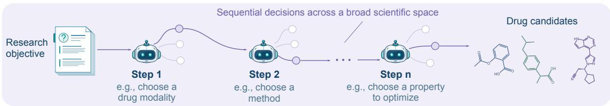

B Knowledge­enhanced decision­making  
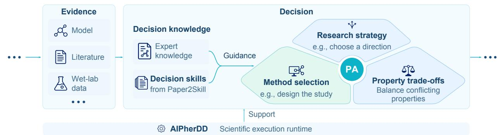

C Large­scale exploration  
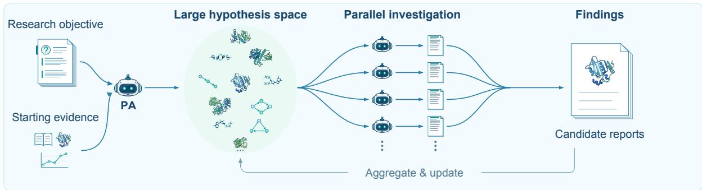

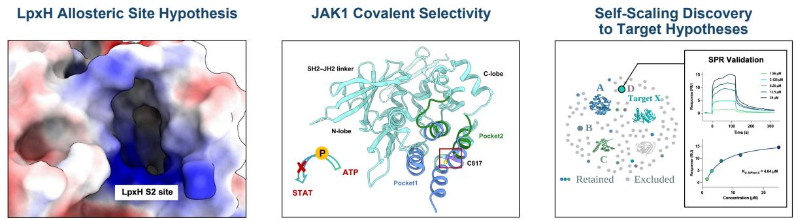

Figure 1 Autonomous end-to-end drug discovery with PharmAgents2. A, We view drug discovery as a continuous decision-making process across a broad scientific space, guided by a research objective and directed toward candidate delivery. B, Depth: the decision system brings together task-specific evidence and knowledge from experts and Paper2Skill to determine what to investigate next, select appropriate methods, and weigh competing molecular properties against project requirements. Computational findings inform subsequent decisions, allowing the system to revise its research strategy as evidence accumulates. AIPherDD provides the scientific models and tools that support this execution.

(continued on next page)

Figure 1 (continued) C, Breadth: Self-Scaling Discovery organizes the hypothesis space into research directions and forks parallel agents that share the research context and decision capabilities. Each agent investigates an alternative hypothesis or strategy, while findings across branches are integrated to compare possibilities and guide further exploration. This process enables the system to pursue multiple plausible directions and adjust their priority as the investigation develops. D, Autonomous investigations followed by human-executed wet-lab validation. PharmAgents2 hypothesized a previously unreported allosteric site in LpxH and screened candidate inhibitors, pursued a covalent strategy toward selective JAK1 inhibition and nominated candidate compounds, and performed large-scale secondary-target identification for a bioactive molecule.

current research problem. Decision knowledge guides the agent in assessing research strategies, choosing appropriate methods, interpreting results, and determining what to investigate next. These decisions can initiate further evidence gathering or lead to revisions of the research strategy as the investigation progresses.

The decision knowledge is organized as a library combining expert-authored skills with skills acquired from scientific publications through Paper2Skill. Relevant skills are retrieved during both planning and execution, providing methodological guidance for the questions encountered at each stage. The agent applies this guidance in the context of the current objective and observations, adapting its choices to the conditions of the investigation.

Paper2Skill acquires reusable decision knowledge by synthesizing groups of papers that share a methodological workflow (Figure 2A). It considers both the research needs addressed by the studies and the methods they used, preserving the connection between methodological choices and their scientific context. The resulting skills describe shared research procedures, relationships between steps, and conditional alternatives. This representation allows the agent to identify applicable methods and adapt the research path when a new task difers from the studies from which the knowledge was acquired.

We further refine the extracted knowledge through perplexity (PPL)-guided knowledge completion. A fixed language model measures how well the research context and synthesized skill support prediction of methodological passages from the construction papers. Passages with high residual prediction loss identify material for closer inspection. The synthesis model revisits these passages in their source context and supplements the skill with supported conditions and methodological relationships that were incompletely expressed. The completion process preserves the initial skill and adds guidance grounded in the source studies.

We evaluate the extracted knowledge across ten topics through conditional PPL, paired assessments of research plans, and answer-quality scores (Figure 2B). Directly synthesized skills lower PPL on both construction and held-out papers, and PPL-guided completion yields further reductions. To assess how skill guidance improves research planning, we compare plans generated without skills with those generated using directly synthesized (Direct) or refined (Refined) skills as references. In paired LLM evaluations, Direct-guided plans are preferred over no-skill plans in 87.9% of comparisons, while Refined-guided plans are preferred over Directguided plans in 65.0%. We further assess whether skill guidance helps the system address the methodological requirements of specific research tasks. For the same tasks, we compare responses generated without skills and with Direct or Refined skills as references. Each response is evaluated against paper-specific binary cri teria, with its score reflecting the percentage of requirements satisfied. The mean percentage of requirements satisfied increases from 51.9% without skills to 73.0% with Direct skills and 74.5% with Refined skills.

A selected drug-repurposing example illustrates how this guidance afects specific scientific choices (Figure 3). In planning the investigation of AZD3355 for NASH-associated fibrosis, skill-guided refinement makes the primary disease contrast and drug-profile selection rule more explicit, and distinguishes prevention from treatment of established fibrosis in the proposed validation experiments. These changes illustrate how reusable methodological knowledge can help an agent formulate a research plan with clearer connections between the scientific objective, analytical choices, and experimental design.

## 2.2 Self-Scaling Discovery

Self-Scaling Discovery enables PharmAgents2 to investigate a broad space of hypotheses from a single research question. Given an objective and starting evidence, the agent builds a set of candidates, investigates them in parallel, and decides what to pursue next.

Answer quality (%)

A  
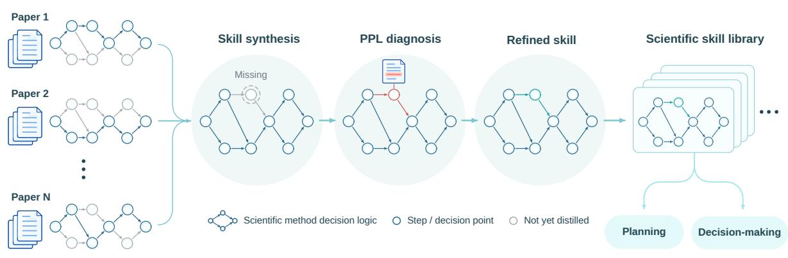

B  
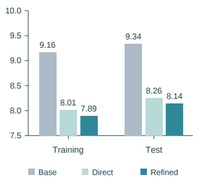

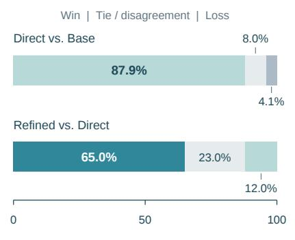

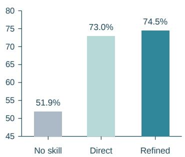  
Figure 2 Paper2Skill: skill acquisition and evaluation. A, Paper2Skill synthesizes reusable scientific decision knowledge from papers that share a methodological workflow. Each paper contributes research steps, decision points, and the conditions linking them; these are combined into a skill that captures shared procedures and alternative research paths. Nodes and connecting arrows schematically represent this methodological decision logic, with gray nodes indi cating knowledge not yet captured in the synthesized skill. For refinement, a fixed language model evaluates how well the research context and skill support prediction of methodological passages from the source papers. Passages with high residual prediction loss are flagged for closer inspection, guiding the synthesis model to revisit the source context and supplement omitted conditions or methodological relationships. The refined skills are collected into a scientific skill library to support planning and decision-making. B, Evaluation across ten topics. Direct and Refined denote initial distillation and perplexity (PPL)-guided refinement, respectively. Left: mean PPL on training and test passages, with lower values indicating better prediction. Center: paired planning preferences (800 cases per comparison). From left to right, segments show wins, ties or order disagreements, and losses for the first-named method. Wins and losses require agreement in both presentation orders. Right: answer quality, measured as the percentage of paper-specific binary criteria satisfied. PPL and answer-quality scores use equal topic weights.

Much of research is shaped by the cost of investigating an idea. Reading the relevant literature, running analyses and working through conflicting evidence all take time. Scientists use experience and intuition to choose a few promising hypotheses early, often before they have enough evidence to assess the alternatives. With cheaper and more capable AI, research can instead begin with a much larger hypothesis space and use investigation itself to decide where to focus, so that directions once set aside for lack of time receive serious consideration.

In a target discovery problem, for example, the agent can start with a broad collection of proteins and investigate how each might explain an observed efect. An initial pass establishes what is known about the candidates. Subsequent rounds follow the evidence, examining promising mechanisms in detail or using computation to resolve an open question. A finding about one candidate can prompt a new question about another. The agent brings these findings together, updates the candidate space and decides how to organize

## Example: skill-guided decisions in drug repurposing

Research task. Assess whether AZD3355 (lesogaberan), a previously evaluated GABA-B receptor agonist, could be repurposed to limit or reverse fibrosis and disease progression in non-alcoholic steatohepatitis (NASH).

## A Skill evolution: from a shared workflow to conditional guidance

## INITIAL SKILL

Define the disease contrast; construct signed expression signatures; match perturbation profiles to the relevant biological context; prioritize candidates; validate in increasingly relevant models.

Keep distinct disease stages separate. Include controls for nonspecific toxicity and define advancement criteria.

## REFINED SKILL: ADDED GUIDANCE

With multiple drug profiles, prespecify selection or summarize consistency across contexts rather than choosing the strongest score.

Check that validation models represent the queried biology. Combine orthogonal phenotypes with confirmation of the predicted expression change before advancement.

## B Research decisions: more explicit choices at three key steps

## ANSWER WITH INITIAL SKILL

## Research contrast

“The primary contrast is human NASH liver versus non-NASH control liver”

“NASH with advanced fibrosis (F3–F4) versus mild/no fibrosis (F0–F2).”

## Drug-profile selection

“extract profiles from liver-relevant cell lines and multiple time points/doses.”

## Treatment timing

## ANSWER WITH REFINED SKILL

## Research contrast

“Primary contrast. Human liver biopsy NASH with advanced fibrosis (F3–F4) versus NASH with no/mild fibrosis (F0–F1).”

“Use a validated diet-induced or diet-plus-chemical NASH fibrosis model that reproduces fibrosis and metabolic disease.”

“This isolates fibrosis/progression biology more directly than a broad NASH-vs-healthy contrast.”

## Drug-profile selection

“Do not simply select the strongest-scoring profile; prespecify a selection rule or summarize consistency across cell types, doses, and times.”

## Treatment timing

“Design prevention and reversal arms: start AZD3355 before fibrosis or after established fibrosis.”

## C More explicit decisions for treatment-focused validation

The refined answer prioritizes the fibrosis contrast, specifies how drug profiles are selected, and separates prevention from treatment of established disease.

<table><tr><td>Condition</td><td>Mean answer score ↑</td><td>Reference-methodology PPL↓</td></tr><tr><td>No skill</td><td>73.3%</td><td>10.521</td></tr><tr><td>Initial skill</td><td>80.0%</td><td>10.008</td></tr><tr><td>Refined skill</td><td>93.3%</td><td>9.987</td></tr></table>

Figure 3 Skill-guided research planning for AZD3355 in NASH-associated fibrosis. A, Adapted excerpts illustrating the initial workflow guidance and conditional rules added during skill refinement. B, Example comparisons of answers before and after skill refinement. C, Comparison of no-skill, initial-skill, and refined-skill conditions. Mean answer score is the percentage of five task-specific evaluation criteria satisfied, averaged across three complete answers per condition. PPL is calculated on the reference methodology extracted from the source paper [22], conditioned on the research task and the corresponding skill when provided.

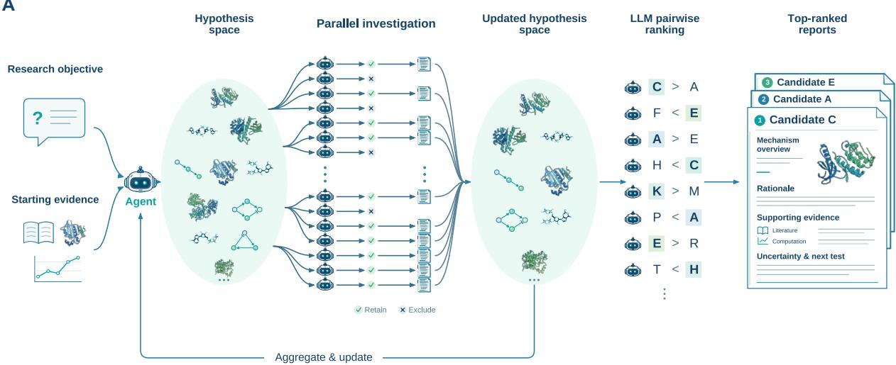

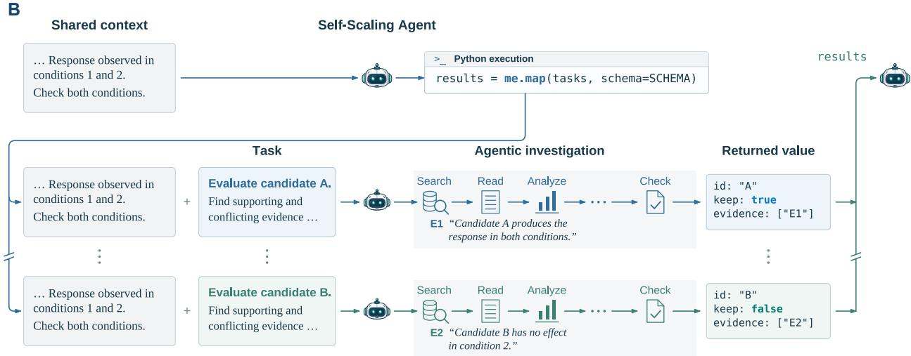  
Figure 4 Self-Scaling Discovery: hypothesis-space exploration and Self-Scaling Agent execution. A, Given a research objective and starting evidence, PharmAgents2 investigates hypotheses in parallel, retains supported candi dates, updates the hypothesis space, and compares candidate reports through pairwise ranking. Top-ranked reports summarize mechanisms, rationale, supporting evidence, and questions for follow-up. B, The Self-Scaling Agent scales itself across candidates, shown here by calling itself from code it writes and executes. Each instance inherits the caller’s full research context, receives an individual task, and conducts a sequence of research actions.

the next round. Once the investigation has narrowed the space, the agent compares the remaining candidates pairwise and ranks them for experimental follow-up (Figure 4A).

Carrying this process across thousands of candidates exceeds what a single agent can handle. Subagents extend its reach, but they receive the judgment accumulated during an investigation only through their prompts, and an inadequate prompt can bias their assessments. The Self-Scaling Agent instead extends its own understanding of the problem and its research capabilities across thousands of tasks, producing results that can be compared and combined directly (Figure 4B). Its dedicated tools build this judgment and these capabilities into their operation; a tool that ranks candidates, for example, assesses them as the agent currently would, and its assessments become better informed as the investigation proceeds. From the code it writes, the agent can also call itself, extending its judgment and capabilities in more flexible ways.

In the study described in Section 4.4, Self-Scaling Discovery started from a single mechanistic question, investigated a space of 2,607 proteins and ranked the 452 candidates that remained through 1,808 pairwise comparisons; the top-ranked target was subsequently confirmed by SPR to bind the molecule. When intelligence is no longer scarce, Self-Scaling Discovery can make systematic exploration of the hypothesis space the starting point for scientific discovery.

## 3 PharmAgents-Bench v0.1

PharmAgents-Bench v0.1 evaluates autonomous drug discovery at two complementary levels: the quality of individual scientific decisions and the ability to organize a complete investigation supporting candidate delivery. The verifiable decision-making track examines bounded research questions with reference outcomes derived from published evidence. The end-to-end process evaluation track assesses how a system develops and executes a research strategy and justifies its proposed candidates.

## 3.1 Verifiable Decision Making

Advancing a drug discovery project requires sound scientific decisions about how to interpret evidence and what to pursue next. We therefore designed the verifiable decision-making track to assess whether a system can make appropriate decisions at individual research decision points, given the project’s objective and constraints. The track comprises 121 questions across nine drug discovery scenarios. Each question presents a specific research situation and requires an explicit decision or assessment that can be checked against reference evidence from published papers and patents. Table 1 summarizes the decision scenarios and their evaluation metrics.

Table 1 Drug discovery decision scenarios and evaluation metrics.
<table><tr><td>Task</td><td>Decision scenario</td><td>Evaluation metric</td></tr><tr><td>Binding-site assessment</td><td>Locate a binding pocket to guide structure-based ligand design.</td><td>Residue accuracy</td></tr><tr><td>Target hypothesis prioritization</td><td>Prioritize target hypotheses for a compound with an unexplained phenotype.</td><td>Known-target hit@50</td></tr><tr><td>Molecular edit prioritization</td><td>Choose where and how to modify a parent structure during optimization.</td><td>Top-1 accuracy</td></tr><tr><td>Development candidate selection</td><td>Compare candidate molecules as a whole and select one to advance into development.</td><td>Selection accuracy</td></tr><tr><td>Molecular optimization outcome prediction</td><td>Anticipate property trade-offs during optimization Property-direction score toward a development candidate.</td><td></td></tr><tr><td>Experimental affinity ranking</td><td>Prioritize candidates for testing by expected affinity.</td><td>Pairwise ordering accuracy</td></tr><tr><td>Agonist/antagonist assessment</td><td>Assess whether candidates produce the desired receptor response under specified conditions.</td><td>Composite assessment score</td></tr><tr><td>literature</td><td>Experimental evidence assessment: Assess whether published studies directly tested a Known-anchor hit@10 compound in the specified disease context.</td><td></td></tr><tr><td>Experimental evidence assessment: Assess whether patent disclosures report direct patents</td><td>tests of a compound in the specified disease context.</td><td>Known-anchor hit@10</td></tr></table>

A development-candidate-selection task illustrates this decision setting by asking the system to choose among four closely related BRAF(V600E) inhibitors for oral treatment of solid tumours with brain metastases. Given the molecular structures and requirements for brain penetration, high unbound brain exposure, and low eflux, the system must select one candidate and justify its choice using permitted computational analyses, without literature or external information retrieval. The reference is Mol-A, corresponding to the reported development candidate PF-07284890, whose identity is withheld from the task input. In the recorded runs, PA combines structural analysis with ADMET predictions and selects Mol-A, matching the reference, whereas

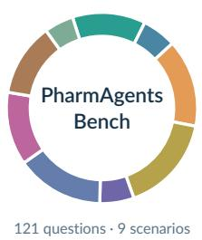

b  
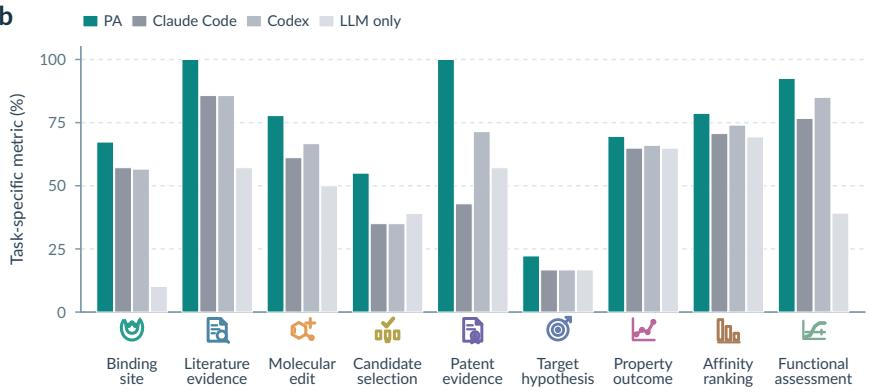

c  
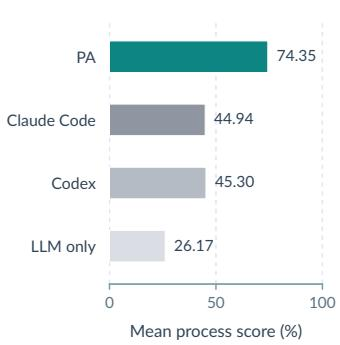  
Figure 5 PharmAgents-Bench evaluates scientific decision-making and end-to-end research execution. a, Dis tribution of 121 questions across nine drug discovery decision scenarios, spanning evidence assessment, hypothesis prioritization, and molecular design and selection. b, Performance of PharmAgents2 (PA), Claude Code, Codex, and the standalone language model (LLM only), all using DeepSeek V4.1 Flash as the base model. Results are expressed as percentages using the task-specific metrics defined in Table 1. c, Research-process quality across three end-to-end drug discovery tasks. An independent judge LLM evaluates recorded research activities, computational artifacts, and final reports against expert-defined criteria covering research strategy, method selection, computational investigation, evidence interpretation, and candidate nomination. Scores are averaged over three repeated runs per system and task, normalized to percentages, and then averaged with equal weight across the three tasks.

Claude Code and Codex emphasize molecular descriptors and select Mol-B. The case illustrates how systems use diferent evidence to prioritize candidates under the same project requirements.

We compare PharmAgents2 with Claude Code, Codex, and a standalone language model across the nine decision-making task categories, using DeepSeek as the base model in the reported configurations. Comparisons reflect each system’s configured access to prompts, scientific tools, and decision skills. PharmAgents2 outperforms the baseline systems in this evaluation (Figure 5b), with gains in evidence assessment, bindingsite assessment, molecular edit prioritization, and afinity ranking.

## 3.2 End-to-End Process Evaluation

The end-to-end delivery track evaluates whether a system can organize a complete scientific investigation to support candidate delivery. It comprises three tasks drawn from internal discovery projects: NK2R peptide agonist design, JAK1 inhibitor discovery, and LpxH small-molecule design. Each task specifies a discovery objective and project requirements, asking the system to develop a research strategy and deliver candidate molecules with supporting research reports.

Computational benchmarks cannot establish the experimental quality of the delivered candidates, and scores from computational oracles are not equivalent to the quality of the final discovery outcome. The research process nevertheless admits scientifically grounded distinctions in quality: strategies can address project requirements more completely, methods can better fit the scientific questions, and conclusions can have stronger evidential support.

## Example: selecting a BRAF candidate for brain metastases

Agent-visible input. Four BRAF(V600E) candidates rendered from the original SMILES.

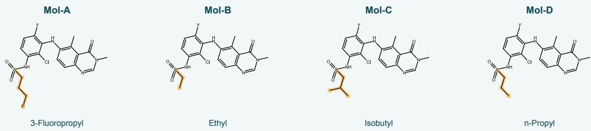

Project background: “The indication is BRAF-mutant solid tumours / brain metastases. Oral; brain penetration is mandatory, requiring a high Kp,uu and low eflux.”

Decision: Select one clinical candidate. Summarize tools used and results; end with Final Choice: Mol-X.   
The original task prohibits papers and external information retrieval.

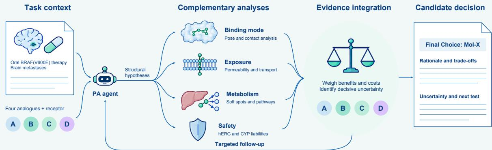

Figure 6 Adaptive assessment in the BRAF development-candidate-selection task. The executed workflow integrates binding, exposure, metabolism, and safety evidence to guide targeted follow-up and candidate selection. Recorded final choices and supporting rationales for PA and the baseline systems are summarized below.

## Observed outputs on the original question

<table><tr><td>System</td><td>Recorded final output</td><td>Reference agreement</td></tr><tr><td>PharmAgents2</td><td>Final Choice: Mol-A</td><td>Match</td></tr><tr><td>Claude Code</td><td>Final Choice:</td><td>Different choice</td></tr><tr><td>Codex</td><td>Final Choice: Mol-B</td><td>Different choice</td></tr></table>

PA’s stated rationale: BBB and metabolic predictions favoured A over D, with brain exposure still uncertain. Baseline rationales: Both favoured B’s lower molecular weight, cLogP, and rotatable-bond count.

Held-out reference: Mol-A (PF-07284890). This source identity was not included in the agent input.

Experts in medicinal chemistry and biology define task-specific scoring rubrics covering research strategy, method selection, computational investigation, evidence interpretation, and candidate nomination. These criteria accommodate diferent valid approaches while assessing how well an investigation addresses the project requirements and supports its conclusions. PharmAgents2 and the baseline systems conduct their investigations autonomously, and a judge LLM independently evaluates their research processes and final reports against these criteria. PharmAgents2 outperforms the baseline systems in this evaluation (Figure 5c), indicating closer alignment with the criteria defined by human experts.

## 4 Results: Wet-Lab Hypotheses Validation

## 4.1 Overview

Following the benchmark evaluation, we examine the deliverables of autonomous research in three drug discovery studies and the experimental evidence supporting them. Researchers provided discovery objectives and relevant starting information. PharmAgents2 autonomously formulated research strategies, organized and executed computational investigations, and delivered candidate lists with supporting research reports.

In the LpxH and JAK1 studies, researchers purchased and tested the nominated compounds. These experiments identified AIPher-L1, supported by enzyme inhibition and biophysical binding assays, and AIPher-J1, which showed activity in two cytokine-signaling assays. A third study applied Self-Scaling Discovery to secondary-target exploration for the anonymized molecule AIPher-X and delivered a ranked list of candidate targets. Target X ranked first, and subsequent SPR experiments supported binding. Together, the studies connect autonomous research to candidate delivery and experimental evidence, as summarized in Table 2.

Table 2 Overview of autonomous research, candidate delivery, and experimental evidence.
<table><tr><td>Case</td><td>Discovery narrative</td></tr><tr><td>LpxH</td><td>Allosteric Site Exploration and 63 candidates purchased and tested; AlPher-L1 identi- Functional Assessment → Agent- fied with supporting evidence from enzyme inhibition Designed Discovery Plan → Candi- and biophysical binding assays. Binding site identifica- tion is ongoing, with preliminary evidence supporting the</td></tr><tr><td>JAK1 Known Covalent Site → Binding- Pocket Exploration → Candidate</td><td>proposed mechanism. 34 candidates purchased and tested; AlPher-J1 exhibited inhibitory activity comparable to that of the positive con- trol. Three additional compounds achieved greater than</td></tr><tr><td>Secondary-target discovery</td><td>50% inhibition in both functional pathways. Secondary-Target Hypothesis → Par- Exploration across 2,607 proteins produced 452 candi- allel Target Exploration → Ranked date dossiers and three target nominations, with Target Target List and Research Reports X ranked first. Subsequent SPR experiments support</td></tr></table>

## 4.2 LpxH: Autonomous Research Planning and Hit Discovery

The LpxH case (Figure 7a) examines how PharmAgents2 translates an open-ended antibacterial discovery objective into a research direction, a computational plan, and an experimental handof. The scientific motivation was the limited diversity of established LpxH inhibitor scafolds and binding modes. Published inhibitor development has largely centered on two chemotypes: sulfonylpiperazine derivatives originating from AZ1 [15] and the acetylpiperazine series identified by Zhang et al. through virtual screening in 2026 [17]. Both retain a central piperazine ring and primarily occupy the established L-shaped pocket associated with substrate recognition. This concentration within related chemical and structural space motivated the exploration of distinct scafolds and alternative modes of inhibition, with the aim of broadening antibacterial discovery opportunities and potentially addressing resistance.

Against this background, human researchers specified LpxH as the target and the discovery of candidate inhibitors with novel scafolds as the objective. They left the binding pocket, proposed mechanism, and screening protocol open to investigation. PharmAgents2 integrated literature, known ligand structures, chemical-space information, the LpxH structure, and computational pocket analysis to define a discovery strategy. The analysis identified Site 1 as the established L-shaped pocket targeted by inhibitors that compete with the substrate, and Site 2 as an alternative, potentially allosteric pocket. PharmAgents2 prioritized Site 2, directing the search beyond the binding region explored by established inhibitor classes.

Selection of Site 2 raised a further question: how might ligand binding at this location afect LpxH function? PharmAgents2 examined functional, structural, and protein-interface evidence in relation to the selected pocket and formulated three working hypotheses: (i) ligand-induced changes in helix conformation could perturb the geometry of the $\mathrm { M n ^ { 2 + } }$ -dependent catalytic center [14]; (ii) binding at a putative dimer interface [16] could disrupt intersubunit interactions and interfere with dimer formation; or (iii) the ligand could act as a molecular glue, stabilizing a nonproductive dimer conformation and thereby impairing enzyme function. These three putative allosteric mechanisms acting outside the substrate-binding pocket provided a rationale for pursuing Site 2 through candidate screening and assessment, while its precise location and functional efects remain to be validated.

The allosteric site hypothesis did not determine a fixed screening pipeline. The next research decision was how to make it actionable when no known ligands or activity measurements for the proposed pocket were available as a task-specific reference. According to the project account, PharmAgents2 first planned a GenPack step to prioritize pseudo-ligands and select their corresponding pockets for DrugCLIP virtual screening. It then selected the TargetMol in-stock library (100,000+ compounds) from the platform’s available resources and organized a candidate-discovery strategy. DrugCLIP supported broad retrieval against the selected pocket, and DrugLens supported further afinity ranking; further physicochemical analysis, molecular docking, pose and interaction interpretation addressed complementary uncertainties raised by the evolving candidate set. In this organization, intermediate outputs were inputs to the next decision—which candidates required additional analysis, which form of evidence was needed, and how candidate priorities should be updated—rather than independent scores in a predetermined sequence.

During execution, PharmAgents2 repeatedly integrated the available evidence for each candidate. Broad retrieval and ranking identified molecules that merited closer examination; predicted poses and interactions helped assess the structural plausibility of their proposed binding modes; and physicochemical properties informed their priority for testing, particularly the balance between lipophilicity and hydrophilicity, which could influence penetration across the Gram-negative bacterial outer membrane and thereby antibacterial activity. The system used this combined assessment to advance, deprioritize, or further analyze candidates and to determine when the evidence was suficient for experimental nomination. The resulting parallel deliverables were a list of 63 candidate molecules and an accompanying research report recording the investigation, rationale, supporting evidence, and remaining uncertainty. The nominated molecules, rather than the report itself, then proceeded to human-executed testing.

Human researchers purchased and tested 63 candidates, identifying AIPher-L1 (Figure 7b), a small molecule with a molecular weight of 282 Da, with supporting evidence from enzyme inhibition and biophysical binding assays. AIPher-L1 inhibited KpLpxH with an $\mathrm { I C } _ { 5 0 }$ of 8.38 $\mu \mathrm { M }$ and exhibited binding afinities of 1.40 $\mu \mathrm { M }$ by SPR and 0.87 �M by MST. Its inhibitory activity remained basically unchanged across the tested substrate concentrations, providing preliminary evidence consistent with the proposed allosteric mechanism. These findings support continued investigation of the three working hypotheses described above, while the binding site and specific mechanism remain to be established. AIPher-L1 also exhibited low structural similarity to the published LpxH inhibitors included in the comparison, suggesting a distinct scafold for further exploration. MICs of 32 $\mu \mathrm { g / m L }$ against eflux pump deficient (∆TolC) K. pneumoniae and E. coli strains provided preliminary evidence of antibacterial activity under these conditions.

The case connects site exploration and functional investigation to research planning, integrated candidate assessment, and experimental handof. The computational plan is itself an agent-produced research output, with the candidate list and report providing the final deliverables. Human-executed experiments support the delivered hit. The discovery objective of scafold novelty and the proposed site mechanism require their own evidence; this system-level account does not isolate the contribution of a particular skill or computational tool.

## 4.3 JAK1: Selectivity-Guided Candidate Delivery for a Known Target

The second case focused on selective JAK1 inhibition as a strategy to suppress cytokine signaling implicated in inflammatory and autoimmune diseases while sparing other JAK isoforms, particularly JAK2, whose inhibition can disrupt hematopoiesis. This approach ofers the potential to preserve anti-inflammatory eficacy while reducing adverse efects associated with broader JAK inhibition. During its literature review, PharmAgents2 found that established approaches to JAK1 selectivity, particularly those exploiting interactions with loop regions around the ATP pocket, had been extensively explored. To pursue a distinct discovery strategy, the system therefore investigated covalent targeting of cysteine residues as an alternative route to JAK1 selectivity.

In reviewing the literature against the discovery objective outlined above, PharmAgents2 identified three key findings that informed its research strategy. First, Kavanagh et al. demonstrated that covalent engagement of Cys817 in the JAK1 pseudokinase domain by VVD-118313 selectively inhibited JAK1 transphosphorylation and cytokine signaling, with chemical proteomic profiling and C817A mutagenesis supporting its site of action. Although these compounds also engaged the corresponding cysteine in TYK2, they largely spared TYK2 signaling [19]. Second, structural analysis by Caveney et al. proposed that VVD-118313 binding at Cys817 perturbs the linker between the pseudokinase (PK) and tyrosine kinase (TK) domains, destabilizing the arrangement required for productive transactivation within the JAK dimer and thereby impairing transphosphorylation and downstream signaling [20]. Third, a subsequent study showed that natamycin covalently engaged JAK1 Cys988 outside the ATP pocket and suppressed cellular JAK1 signaling in a Cys988- dependent manner without inhibiting recombinant JAK1 catalytic activity [21]. Together, these findings provided PharmAgents2 with an experimental and structural rationale for exploring covalent inhibition of JAK1.

PharmAgents2 further identified Cys817 as a promising starting point because its covalent engagement and functional consequences had been systematically characterized, providing a coherent experimental foundation for further discovery. At the same time, reported pharmacokinetic limitations of existing ligands highlighted opportunities for optimization, including metabolic stability. PharmAgents2 therefore proposed exploring alternative scafolds for covalent targeting of Cys817, with JAK1 selectivity and properties relevant to further development as discovery objectives. This assessment led to an open-ended research question: could new chemical scafolds support covalent engagement of JAK1 Cys817 while ofering opportunities to improve selective functional inhibition and metabolic stability? The resulting task specified a known target residue while leaving the covalent warhead, scafold, surrounding binding pocket, and candidate selection strategy open to investigation.

Considering Cys817 lies in a relatively open region of the JAK1 JH2 pseudokinase domain, PharmAgents2 first investigated neighboring cavities to identify pockets suitable for candidate screening. This analysis identified two candidate pockets around Cys817. GenPack was applied to each pocket, and the resulting pseudo-ligands were prioritized according to their predicted poses, spatial compatibility, and proximity to Cys817, with particular attention to geometries potentially compatible with covalent bond formation. The selected pocket representations were then used for DrugCLIP virtual screening of the TargetMol in-stock covalent compound library (3500+). In parallel, PharmAgents2 analyzed patents related to VVD-118313, summarized the reported structure–activity relationships, and consolidated these insights into a reusable Skill to guide candidate assessment. DrugLens provided further ranking by predicted afinity, followed by filtering based on physicochemical properties and predicted ADME characteristics, with emphasis on metabolic stability, bioavailability, and half-life. Covalent docking and comparative analysis of poses and protein–ligand interactions informed the final selection of 34 compounds for purchase and experimental testing.

Human researchers purchased and tested the 34 candidates in two functional assays measuring IFN-�-induced STAT1 phosphorylation and IL-6-induced STAT3 phosphorylation in CD3+ cells. At 10 �M, AIPher-J1 exhibited inhibitory activity comparable to that of the positive controls, BMS-986165 and Tofacitinib, while three additional compounds achieved greater than 50% inhibition in both pathways (Figure 7c). Prompted by its activity in both functional assays, further investigation revealed that AIPher-J1 had previously been studied in an oncology context. The present findings extend its functional characterization to cytokine responses in immune cells, revealing a signaling phenotype beyond those examined in its previous studies.

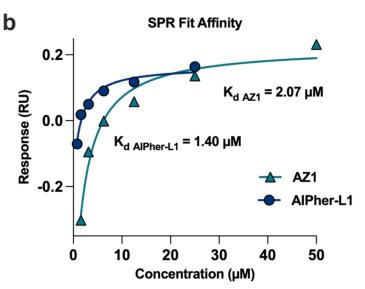

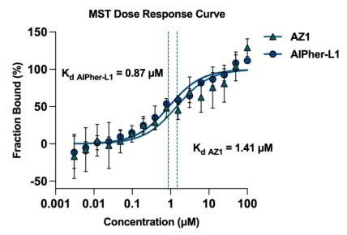

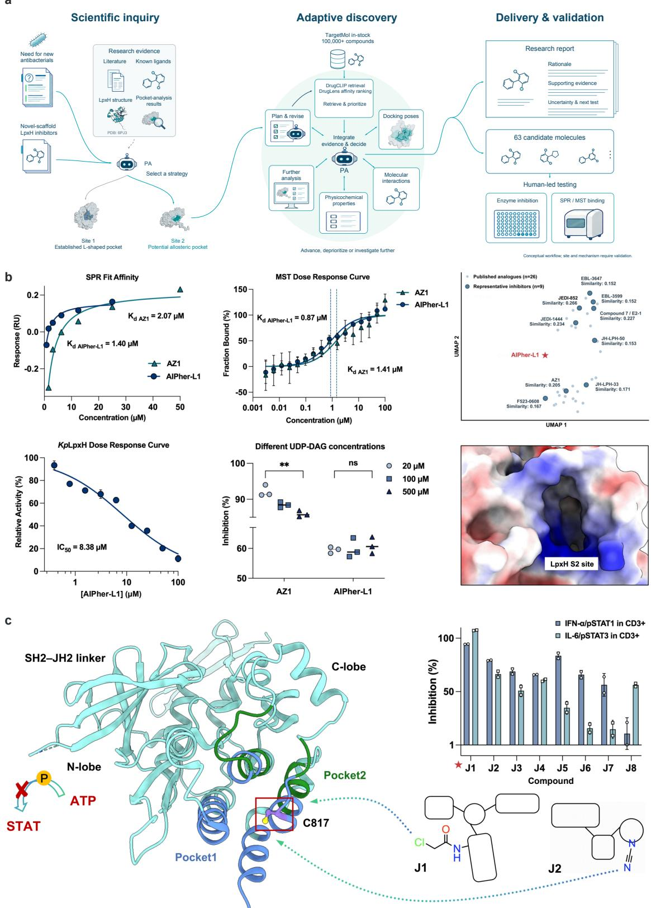

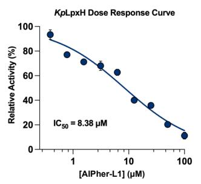

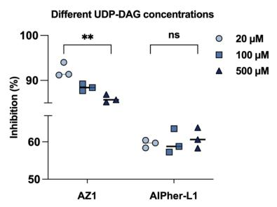

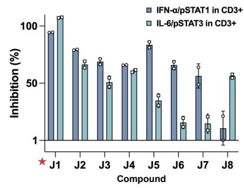  
Figure 7 Autonomous research planning and candidate discovery for LpxH and JAK1. a, Conceptual reconstruction of the LpxH investigation.

(continued on next page)

Figure 7 (continued) Literature, known ligands, structural information, and pocket analysis inform selection of the potentially allosteric Site 2 over the established Site 1 pocket. An agent-designed plan uses DrugCLIP for retrieval from the TargetMol in-stock library and DrugLens for afinity ranking. Integrated assessment of physicochemical properties, docking poses, and molecular interactions guides follow-up and candidate prioritization. The system delivers 63 candidate molecules and a parallel research report; human researchers test the molecules. The proposed site and mechanisms remain to be validated. b, Experimental characterization of AIPher-L1 for LpxH, including SPR and MST binding measurements, concentration-dependent inhibition of KpLpxH, and inhibition at diferent substrate concentrations. Chemical-space analysis illustrates its structural distinction from published LpxH inhibitors, while the surface representation highlights the proposed Site 2 pocket. c, Structural rationale for covalent targeting of JAK1 Cys817, showing two candidate pockets and warhead schematic structures of representative compounds AIPher-J1 and AIPher-J2. Functional assays assess candidate inhibition of IFN-�/pSTAT1 and IL-6/pSTAT3 signaling in CD3+ cells at 10 �M. AIPher-J1 is highlighted for its inhibitory activity comparable to that of the positive controls BMS-986165 and Tofacitinib in both assays.

PharmAgents2 autonomously identified two candidate druggable pockets around Cys817 and used them to guide screening, yielding molecules with novel scafolds and covalent warheads that expand the chemical space for investigating potential JAK1 covalent inhibitors. Further experiments are underway to validate JAK1 selectivity and the proposed binding modes.

## 4.4 Self-Scaling Discovery: From a Known Molecule to Candidate Secondary Targets

A molecule with established biological activity can still have aspects of its mechanism left unexplained. Researchers supplied the experimental background of AIPher-X, an anonymized molecule: it binds a known primary target with high afinity, but inhibition of that target is susceptible to resistance, whereas AIPher-X itself shows a low propensity for resistance. They proposed that an additional target could help explain this diference and asked Self-Scaling Discovery to investigate candidate secondary targets. Starting from this background and hypothesis, Self-Scaling Discovery organized large-scale parallel exploration across a reference space of 2,607 proteins and produced a ranked list of candidate targets (Figure 8).

The agent first combined protein annotations with the research background to formulate a specific reason for investigating each candidate. Screening assessed whether perturbing the protein could afect biological processes relevant to the molecule’s activity, without requiring prior evidence that the molecule binds the protein. This initial assessment advanced 1,719 candidates to literature investigation. It turned a protein catalogue into a hypothesis space with concrete research questions, opening the search to potential explanations beyond the known primary target.

Self-Scaling Discovery then investigated the candidates in parallel, tracing functional, genetic perturbation, and pharmacological evidence to primary sources. Each branch examined why its candidate merited investigation, what existing experiments supported, and which findings weakened the initial hypothesis. Sourcebacked findings refined or replaced the starting annotations, and this assessment retained 452 candidates for computational investigation of their potential interactions with AIPher-X.

Computational investigations held the molecule fixed while examining diferent candidate targets. Each branch organized analyses suited to its candidate, examining potential binding regions, molecular interactions, and consistency with the available functional evidence. The branch interpreted how these findings afected the target hypothesis. Literature and computational findings were integrated into 452 complete candidate dossiers, each recording a proposed mode of action, the principal evidence, conflicting findings, and experiments that could resolve the remaining questions.

All 452 dossiers entered comparative assessment. Across eight rounds, 1,808 pairwise comparisons evaluated their explanatory value, evidential support, and value for experimental testing. The resulting ranked list nominated three targets for further investigation, with Target X ranked first. The nominations were accompanied by reports explaining the selection and specifying the questions to test.

After PharmAgents2 completed the investigation and delivered the ranked target list, researchers conducted wet-lab validation of the top-ranked target. SPR measurements showed binding between AIPher-X and Target X with a reported $K _ { \mathrm { d } } = 4 . 6 4 \mu \mathrm { M }$

Annotated proteome

Retained Excluded

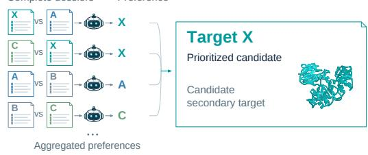

## Investigation outline

I’ll start with the full proteome and screen for candidate secondary targets of AIPher-X.

1 screen Relevance screening

That leaves a much smaller set of candidates. Their annotations suggest a link. I’ll check the original studies to see which of these hypotheses actually hold up.

2 me.map Candidate investigations

Some candidates aren’t supported by the original studies. I’ll set them aside and investigate AIPher-X computationally across the remaining targets, with a separate branch for each one.

3 me.map Computational investigations

The analyses are back. I’ll have each branch reconcile its evidence and open questions in a complete candidate dossier.

4 me.map Candidate assessment & reporting

I now have a full dossier for each candidate. I’ll compare them in pairs to prioritize targets for experimental testing.

5 rank\_tournament Dossier comparison

Target X ranks first. I’ll nominate it as a candidate secondary target of AIPher-X.

## Follow-up wet-lab validation

AIPher-X–Target X binding

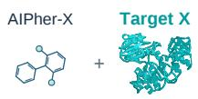  
Surface plasmon resonance

## Expanded investigations

## Proteome screening

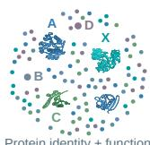

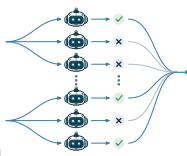

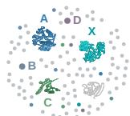

## Primary-source review

Candidate Read & verify

Hypothesis support

·A目

Supports

·x

Supports

·c

Partial support

·B

Mixed evidence

·D—日

## Computational assessment

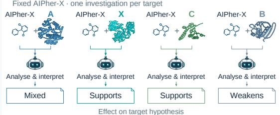

## Pairwise prioritization

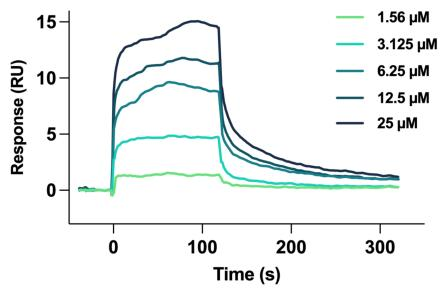

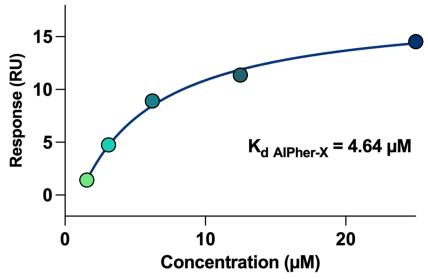  
Figure 8 Self-Scaling Discovery–guided secondary-target investigation for AIPher-X. The schematic investigation outline on the left depicts five bulk tool calls that screened a reference proteome, investigated primary literature, conducted parallel computational assessments, prepared complete candidate dossiers, and ranked candidates through pairwise comparison. Expanded views on the right illustrate selected calls and how their findings inform candidate retention and prioritization. Complete dossiers integrated literature and computational evidence before entering the ranking stage. The investigation ranked Target X first. After PharmAgents2 completed the investigation, researchers performed wet-lab validation. The bottom row presents the resulting SPR sensorgrams and a concentration–response fit supporting AIPher-X binding to Target X, with a reported $K _ { \mathrm { d } }$ of 4.64 �M. The molecular structure shown for AIPher-X is for illustrative purposes only. Protein structures are substitute illustrations.

This case illustrates how Self-Scaling Discovery connects broad hypothesis exploration to concrete research deliverables. Parallel investigations developed and assessed alternative target hypotheses, while comparative assessment consolidated their findings into a ranked target list and supporting reports. The completed investigation turned an open mechanistic question into prioritized targets for further study, with subsequent wet-lab experiments supporting binding to the top-ranked candidate.

## 5 Conclusion

We formulate autonomous drug discovery as a continuous scientific decision-making process across a broad research space and develop PharmAgents2 to advance this process from research objectives to candidate delivery. Knowledge-enhanced decision making and organized large-scale exploration provide the two complementary capabilities underlying this approach. Benchmark evaluations demonstrate improved scientific decision quality and stronger execution of end-to-end investigations, while real-world studies yield new findings subsequently supported by experimental validation. These results establish a practical route for AI agents to organize and advance drug discovery, providing a prototype of a virtual pharmaceutical company.

A key next step is to use feedback from computational investigations and experimental validation to train and optimize the system. Successful and unsuccessful research outcomes can provide learning signals for improving scientific reasoning, refining decision knowledge, and guiding exploration. Connecting this feedback to agent training and skill refinement would allow experience gained within individual projects to strengthen capabilities across subsequent investigations. Such a continuous learning cycle ofers a path toward virtual pharmaceutical companies that accumulate scientific knowledge and improve their research capabilities through experience, expanding the scale and scope of autonomous drug discovery.

## Contributors

## Conceptualization

Yanyan Lan.

## Project leads

Haichuan Tan (thc23@mails.tsinghua.edu.cn) Bowen Gao (billgao0111@gmail.com).

## Core contributors

Tao Huang, Jiaxin Tan, Xin Hong, Baoguo Yao, and Yifei Wang.

## Contributors

Zhichao Deng, Hanji Du, Dapeng Jiang, Yiheng Li, Weiwei Ma, Xin Ma, Yuqi Shi, Zixiang Wang, Kelin Wu, Tianxiang Wu, Wenxuan Xie, Jie Zang, Huiyu Zhang, Mojia Zhang, and Yuying Zhang.

\*Last-Name in Alphabetical Order

## Supervisors

Yanyan Lan (lanyanyan@tsinghua.edu.cn), Ya-Qin Zhang, and Wei-Ying Ma.

## References

[1] Jumper, J. et al. Highly accurate protein structure prediction with AlphaFold. Nature 596, 583–589 (2021).

[2] Watson, J. L. et al. De novo design of protein structure and function with RFdifusion. Nature 620, 1089–1100 (2023).

[3] Peng, X. et al. Unified modeling of 3D molecular generation via atomic interactions with PocketXMol. Cell 189, 1904–1922.e28 (2026).

[4] Gottweis, J. et al. Accelerating scientific discovery with Co-Scientist. Nature 655, 487–496 (2026).

[5] Huang, K. et al. Autonomous biomedical research with an artificial intelligence agent. Science 393, eadz4351 (2026).

[6] Zhang, H. G., Eckmann, P., Miao, J., Mahon, A. B. & Zou, J. The Virtual Biotech: A multi-agent AI framework for therapeutic discovery and development. Science 394, eaeg6779 (2026).

[7] Gao, B. et al. DrugCLIP: Contrastive protein-molecule representation learning for virtual screening. In Adv. Neural Inf. Process. Syst., vol. 36 (2023).

[8] Fu, L., Shi, S., Yi, J. et al. ADMETlab 3.0: an updated comprehensive online ADMET prediction platform enhanced with broader coverage, improved performance, API functionality and decision support. Nucleic Acids Res. 52, W422–W431 (2024).

[9] Swanson, K. et al. ADMET-AI: a machine learning ADMET platform for evaluation of large-scale chemical libraries. Bioinformatics 40, btae416 (2024).

[10] Jia, Y. et al. Deep contrastive learning enables genome-wide virtual screening. Science 391, eads9530 (2026).

[11] Qu, Y. et al. BiomniBench: Process-level evaluation of LLM agents for real-world biomedical research. bioRxiv (2026). Preprint.

[12] Akyürek, A. F. et al. DrugDiscoveryBench: Can coding agents assist early-stage drug discovery? Tech. Rep., Scale AI and Phylo (2026).

[13] Han, K. et al. SMDD-Bench: Can LLMs solve real-world small molecule drug design tasks? arXiv preprint arXiv:2605.21740 (2026).

[14] Young, H. E., Donohue, M. P., Smirnova, T. I., Smirnov, A. I. & Zhou, P. The UDP-diacylglucosamine pyrophosphohydrolase LpxH in lipid A biosynthesis utilizes Mn2+ cluster for catalysis. J. Biol. Chem. 288, 26987–27001 (2013).

[15] Cho, J. et al. Structural basis of the UDP-diacylglucosamine pyrophosphohydrolase LpxH inhibition by sulfonyl piperazine antibiotics. Proc. Natl Acad. Sci. USA 117, 4109–4116 (2020).

[16] Huseby, D. L. et al. Antibiotic class with potent in vivo activity targeting lipopolysaccharide synthesis in gramnegative bacteria. Proc. Natl Acad. Sci. USA 121, e2317274121 (2024).

[17] Zhang, G. et al. Structure-based discovery of a new LpxH-targeted chemotype with activity against Klebsiella pneumoniae. J. Med. Chem. 69, 6691–6705 (2026).

[18] Vazquez, M. L. et al. Identification of N-{cis-3-[Methyl(7H-pyrrolo[2,3-d]pyrimidin-4-yl)amino]cyclobutyl} propane-1-sulfonamide (PF-04965842): A selective JAK1 clinical candidate for the treatment of autoimmune diseases. J. Med. Chem. 61, 1130–1152 (2018).

[19] Kavanagh, M. E. et al. Selective inhibitors of JAK1 targeting an isoform-restricted allosteric cysteine. Nat. Chem. Biol. 18, 1388–1398 (2022).

[20] Caveney, N. A. et al. Structural basis of Janus kinase trans-activation. Cell Rep. 42, 112201 (2023).

[21] Tian, C. et al. Proteome-wide ligandability maps of drugs with diverse cysteine-reactive chemotypes. Nat. Commun. 16, 4863 (2025).

[22] Bhattacharya, D. et al. Repositioning of a novel GABA-B receptor agonist, AZD3355 (Lesogaberan), for the treatment of non-alcoholic steatohepatitis. Sci. Rep. 11, 20827 (2021).