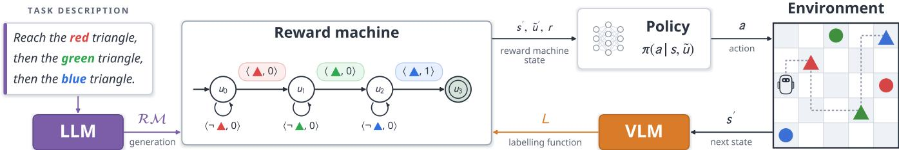
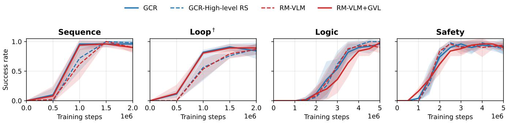
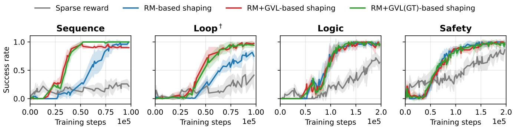
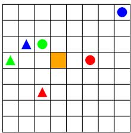
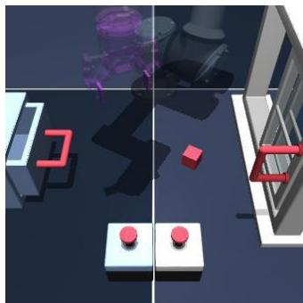
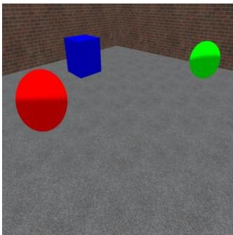
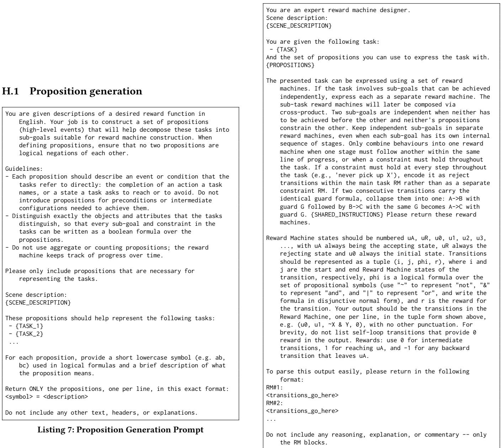

# RM-VLM: From Natural-Language Task Descriptions to Vision-Grounded Reward Machines

Roko Parac Imperial College London London, United Kingdom roko.parac18@imperial.ac.uk

Leo Ardon Imperial College London London, United Kingdom leo.ardon19@imperial.ac.uk

Christos Ziakas Imperial College London London, United Kingdom c.ziakas24@imperial.ac.uk

Alessandra Russo Imperial College London London, United Kingdom a.russo@imperial.ac.uk

## Abstract

Reward machines (RMs) have been proposed as a reward formulation in reinforcement learning (RL) to capture non-Markovian tasks where credit assignment depends on history. By representing reward functions as automata, RMs expose the task’s temporal structure and allow such rewards to be handled within a Mar- kovian framework. However, they assume a labelling function, a proposition-grounding oracle for observations, which must be manually engineered for each environment, limiting their wider applicability. In this work, we address this limitation by proposing RM-VLM, a novel approach in which a large language model (LLM) generates an RM from a natural-language task description, and a vision-language model (VLM) acts as the labelling function, ground ing the RM’s propositions over image-based observations during RM-guided policy learning. A VLM-based value function estimator is used to assess the agent’s progress towards each RM transition and derive a dense reward signal. We evaluate RM-VLM on three domains covering non-Markovian grid-world navigation, robotic manipulation, and 3D object collection. Our experimental results show that RM-VLM consistently achieves higher task success rates than existing VLM-based reward methods across all tested domains.

## Keywords

reinforcement learning, reward machines, vision-language models

## 1 Introduction

Many reinforcement learning [RL; 47] tasks require an agent to remember what it has done. An object may be worth collecting only after a prerequisite has been met; an action may be rewarding only at a particular stage of a task. In these settings, reward depends on the history of states and actions, rather than on the current obser- vation alone. Such non-Markovian rewards make credit assignment depend on history, and remain dificult to specify and learn with standard RL methods.

Reward machines [RMs; 48] ofer a structured way to address this challenge. An RM represents a task as an automaton whose states compactly summarise task history and whose transitions capture progress through sub-goals. By augmenting the agent’s state with the RM state, an RM makes the history relevant to re-ward explicit and can provide intermediate rewards as the task unfolds. Applying RMs, however, typically requires two forms of manual engineering: specifying the automaton and constructing a labelling function that maps observations to the atomic propositions governing its transitions. Labelling functions often rely on access to the environment’s internal state, which may be unavailable in image-based or real-world settings.

Existing methods address parts of this problem, but retain sig- nificant dependencies. ARM-FM [7] uses foundation models but implements the labelling function from the environment’s source code. Ground-Compose-Reinforce [GCR; 27] learns a labelling function from trajectories, but requires manual labels. Methods such as ISA [13], FORM [3], and Prob-IRM [37] can learn RM structures from executions, yet assume that a labelling function is already available. The challenge is therefore to obtain both the task struc- ture and its grounding in observations without relying on either extensive manual labelling or privileged access to the environment.

Vision-language models (VLMs) provide a potential source of visual reward supervision [4, 30, 31, 43]. Directly using them to score non-Markovian tasks is dificult, however, because the signif- icance of an observation depends on what preceded it. Moreover, VLM predictions over image sequences can be biased by temporal position: an observation may receive a higher score because it ap- pears later in a sequence, rather than because the agent has made meaningful progress [30]. This suggests a complementary division of labour: an RM can track progress through the task, while a VLM can identify what is happening in each image.

We introduce RM-VLM, an approach that combines these capabilities for RM-guided policy learning from image-based observations. Given a natural-language task description, a large language model (LLM) generates an RM together with the atomic propositions that label its transitions. A VLM then grounds these propositions in observations, acting as the labelling function. The RM retains the history needed to interpret each observation, so the VLM can assess individual images without having to infer task progress from an ordered sequence. Visual grounding is imperfect: an incorrect proposition label can cause an incorrect RM transition and degrade policy learning [35]. RM-VLM therefore maintains an RM state belief, a probability distribution over the agent’s possible positions in the automaton, rather than committing to a single RM state. It defines reward through changes in expected accumulated RM re- ward under this belief. To supplement the rewards associated with RM transitions, we further extend RM-VLM with Generative Value Learning (GVL), which estimates progress towards the next transition and provides a dense learning signal. The resulting reward can be used with standard RL algorithms, both ofline, reusing a single image dataset across tasks, and online, via a classifier distilled from the VLM labels.

We evaluate RM-VLM on three domains spanning non-Markovian grid-world navigation, robotic manipulation, and partially observable 3D object collection. Across these domains, RM-VLM consistently achieves higher task success rates than strong VLM-based reward baselines.

This paper makes the following contributions:

(1) Reward machines from natural language. A novel method for deriving RMs from natural-language task descriptions together with the atomic propositions for labelling RM tran-sitions.

(2) VLMs as labelling functions. Support for RM-guided pol icy learning from images, using a VLM to ground atomic propositions in image observations, both in the ofline setting, where a single VLM-labelled image dataset is reused across tasks, and in the online setting, through a classifier distilled from the VLM labels.

(3) Robustness to imperfect grounding. An RM state belief mechanism for arbitrary RM structures that defines a re- ward function based on changes in expected accumulated rewards over RM states, to limit the impact of incorrect grounding of RM transition labels.

(4) Dense rewards between RM transitions. A GVL-based zero-shot estimate of progress towards the next RM transition, as a dense learning signal that supplements the RM sparse reward and accelerates policy learning without changing final performance.

## 2 Preliminaries

This section reviews the key concepts of reinforcement learning and reward machines. We use the following notation throughout the paper: for a set $ { \boldsymbol { X } } , \Delta (  { \boldsymbol { X } } )$ denotes the probability simplex over $\chi$ and $\bar { \cdot } _ { 2 } \chi$ its power set.

## 2.1 Reinforcement learning

Typically, a reinforcement learning process is formulated as a Markov Decision Process (MDP) $\boldsymbol { \mathcal { M } } = \langle S , \mathcal { A } , p , { r } , \gamma , \mu \rangle$ , where $s$ is a set of states, A is a set of actions, $p : S \times \mathcal { A }  \Delta ( S )$ is a transition probability function, $r : S \times \mathcal { A } \times S $ R is a reward func- tion, $\gamma \in \left[ 0 , 1 \right)$ is the discount factor, and $\mu \in \Delta ( S )$ is the initial state distribution. At time �, the agent in state $s _ { t } ~ \in ~ S$ takes ac- tion $a _ { t } \in \mathcal { A } ,$ , moves to $s _ { t + 1 } \sim p ( \cdot \mid s _ { t } , a _ { t } )$ and receives a reward $r _ { t } = r ( s _ { t } , a _ { t } , s _ { t + 1 } )$ . The goal of RL is to learn a policy � that maximises the expected discounted return $\begin{array} { r } { \mathbb { E } \big [ \sum _ { t = 0 } ^ { \infty } \gamma ^ { t } r _ { t } \big ] } \end{array}$ . The value function $\begin{array} { r } { V ^ { \pi } ( s ) = \mathbb { E } _ { \pi } \big [ \sum _ { t = 0 } ^ { \infty } \gamma ^ { t } r _ { t } \ | \ s _ { 0 } = s \big ] } \end{array}$ is the expected return from state � under �. In online RL, the policy is learned from interaction with the environment, and in ofline RL [25], from a fixed dataset D of trajectories, without any interaction. Sparse rewards make it more challenging for RL algorithms to learn a policy. To accelerate the learning, one can supplement the sparse reward with potential-based shaping [34], which adds $\gamma \Phi ( s _ { t } ) - \Phi ( s _ { t - 1 } )$ to each reward for a potential function Φ $: S  \mathbb { R }$ , while leaving the optimal policy unchanged.

## 2.2 Reward machines

Reward machines [RM; 48, 49] represent reward functions as finitestate machines that encode expressive, interpretable specifications of temporal task structure and use the RM states as external memory for non-Markovian tasks. RM transitions are labelled by subsets of $\mathcal { P } _ { \mathrm { : } }$ , a set of atomic propositions abstracting the environment state space S. A labelling function $\mathcal { L } : \mathcal { S }  2 ^ { \mathcal { P } }$ maps each environment state to the set of propositions that hold in it, with $| 2 ^ { \mathcal { P } } | \ll | S |$ . An RM is formally defined as follows.

Definition 1 (Reward machine). A Reward Machine (RM) is a tuple $\mathcal { R M } = \langle U , \mathcal { P } , \delta _ { u } , \delta _ { r } , u _ { 0 } , u _ { A } , u _ { R } \rangle$ , where � is a finite set of states, P is a finite set of atomic propositions, $\delta _ { u } : U \times 2 ^ { \mathcal { P } } \to U$ is the statetransition function, $\delta _ { r } : U \times U  \mathbb { R }$ is the reward-transition function such that $\delta _ { r } ( u , u ^ { ' } )$ is the reward for transitioning from state � $t o u ^ { ' }$ $u _ { 0 } \in U$ is the initial state, and $u _ { A } , u _ { R } \in U$ are optional accepting and rejecting states.

We write each transition as an edge $\langle u , u ^ { \prime } , \varphi , r \rangle$ , where $\varphi$ is a propositional formula over $\mathcal { P }$ and $r = \delta _ { r } ( u , u ^ { \prime } )$

During interaction with the environment, the agent tracks its current RM state alongside its environment state. Formally, a label trace $\lambda = \langle L _ { 0 } , \ldots , L _ { n } \rangle$ induces a unique traversal $\mathcal { R } M ( \lambda ) =$ $\left. u _ { 0 } , \ldots , u _ { n + 1 } \right.$ , where $u _ { i + 1 } = \delta _ { u } \big ( u _ { i } , L _ { i } \big )$ and reward $\delta _ { r } \big ( u _ { i } , u _ { i + 1 } \big )$ is received at step �, and the episode ends when the traversal reaches $u _ { A }$ or ��. RM states summarise task history, which makes rewards that are non-Markovian over S Markovian over $s \times U$ . We can thus learn a policy $\pi ( \boldsymbol { a } \mid s , u )$ over pairs of environment and RM states, with rewards given by the RM [49].

## 3 Methodology

We now describe RM-VLM, our approach for solving non-Markovian tasks from natural language descriptions and images without ac-cess to the environment’s internal state. RM-VLM addresses three challenges: the automated generation of RM automata from natu- ral language task descriptions, with transitions labelled by atomic propositions, the grounding of proposition labels in images, and the induction of a reward mechanism that provides dense feedback and remains robust to imperfect grounding. We first formalise the problem (Section 3.1) and describe how an LLM generates an RM from a natural-language task description and a VLM grounds its transition label propositions in images (Section 3.2). We then ex-plain how to estimate the RM state under label noise (Section 3.3) and complement this estimate with a dense reward signal to guide the RM-based policy learning (Section 3.4).

## 3.1 Problem formulation

We consider the case where an agent does not have access to the RM of a task, its propositions, or the labelling function. We assume a given dataset $\mathcal { D } = \{ \tau _ { j } \} _ { j = 1 } ^ { M }$ of � trajectories $\tau _ { j } = \langle s _ { 0 } , a _ { 0 } , . . . , s _ { T } \rangle$ collected by a behaviour policy in the environment without rewards or labels. Environment states are observed as images, and tasks are given as natural-language descriptions $T _ { i } ~ \in { \mathcal { T } }$ . Given a naturallanguage task description $T _ { i } ,$ an RM-VLM reward machine is a tuple RM whose atomic propositions in $\mathcal { P }$ are associated with the task description $T _ { i \cdot }$ . The propositions and the state transition function of RM are generated by an LLM from the task description augmented with a natural-language description of the environment and its physical constraints as described in Section 3.2. The agent tracks its current state, by grounding the label propositions of the RM transitions in the image-based environment state, using the (noisy) labelling function $\tilde { \mathcal { L } } : \mathcal { I } \to 2 ^ { \mathcal { P } }$ , where I is the space of image observations, which returns the propositions predicted to hold in the image of an environment state. Figure 1 presents an overview of our RM-VLM approach. An LLM first generates a set of propositions $\mathcal { P }$ from the natural-language task descriptions, then generates an RM for each � using these propositions. At each step, a VLM acts as a noisy labelling function ${ \tilde { \mathcal { L } } } ,$ predicting which propositions are true in the image-based environment state. These labels are used to compute the RM’s state belief and the reward, guiding the agent to learn a policy that maximises the expected return.

## 3.2 VLM-grounded reward machines from language

RM-VLM uses a large language model (LLM) to generate the com ponents of an RM that provides an automaton representation of a natural-language task description. Specifically, given a set $\{ T _ { i } \} _ { i = 1 } ^ { N }$ of task descriptions, an LLM is prompted to generate the set $\mathcal { P }$ of propositions shared across all tasks. Then, for each task $T _ { i }$ an associated $\mathcal { R } { M } _ { i }$ is generated over the alphabet $\mathcal { P } .$ . This is done by prompting the LLM to decompose each $T _ { i }$ into a set of inde- pendent sub-task RMs, which are then combined together into a single RM� [33]. We evaluate the reliability of proposition and RM generation in Section 4.2. Given that generating RMs requires only a few calls, a high-quality LLM can be used for this step.

To ground the propositions, we query a VLM for each episode in $\mathcal { D }$ and each proposition $p \in { \mathcal { P } }$ to identify the timesteps at which $\boldsymbol { p }$ holds, producing a labelled dataset $\mathcal { D } _ { \mathrm { p r o p } }$ . Since its predictions can be wrong, we treat the VLM as a noisy labelling function $\tilde { \mathcal { L } }$ (Section 3.1).

We describe how ${ \mathcal { D } } _ { \mathrm { p r o p } }$ is used for ofline and online policy learning in Section 3.4, and include the prompts used for proposition extraction and RM generation in Appendix H.

## 3.3 Reward machine state belief

In RM-based reinforcement learning, the environment state is typ- ically augmented with the current RM state (Section 2.2). When proposition labels are provided by a perfect labelling function, the current RM state can be tracked deterministically (Section 2.2). With VLM-derived (noisy) labels, however, deterministic state tracking can cause significant degradation in policy performance [35]. To make tracking robust, we replace the deterministic state tracking with an RM state belief, a probability distribution over RM states updated online at each timestep [26, 37]. Prior schemes such as Independent BeliefUpdating (IBU) [26] re-weight transitions by the predicted labels alone. We additionally exploit two sources of struc- ture. First, given the environment’s physical constraints, described in natural language (Listing 11), the generated RMs encode causal preconditions between propositions, even when they are not explic itly required by the task. For instance, if a drawer must be unlocked before it can be opened, a false positive on “drawer open” cannot trigger a premature transition to the accepting state. Second, a state-dependent prior over true proposition labels couples independently predicted propositions by encoding structural co-occurrence constraints between them. For example, if every object has both a colour and a shape, the prior can encode that a shape proposition never holds without a colour proposition, reducing the impact of isolated misdetections. We formalise the belief update below with the help of a transition–emission matrix.

Definition 2 (Transition–emission matrix). Let ${ \tilde { L } } \subseteq { \mathcal { P } }$ be a label predicted by a noisy labelling function, $L \subseteq \mathcal { S }$ be a label that truly holds, and �, �′ $\in { U }$ a pair of RM states. The transition– emission matrix $C \in \mathbb { R } ^ { | U | \times | U | \times 2 ^ { | \mathcal { P } | } }$ is defined as the joint probability oftransitioning from state � to �′ and observing the noisy label �˜:

$$
C [ u , u ^ { \prime } , \tilde { L } ] = \sum _ { L \in 2 ^ { \mathcal { P } } } P ( L \mid u ) \cdot \mathbf { 1 } \big [ \delta _ { u } ( u , L ) = u ^ { \prime } \big ] \cdot P ( \tilde { L } \mid L ) ,\tag{1}
$$

where $P ( L \mid u )$ is the state-dependent label prior and $P ( \tilde { L } \mid L )$ is the probability of observing a noisy label given the ground-truth label, which factorises as $\begin{array} { r } { P ( \tilde { L } \mid L ) = \prod _ { \scriptstyle \mathscr { p } \in \mathcal { P } } P ( \tilde { L } _ { \pmb { \mathscr { p } } } \mid L _ { \pmb { \mathscr { p } } } ) } \end{array}$ with

$$
\begin{array} { r } { P ( \tilde { L } _ { \hat { p } } = 1 \mid L _ { \hat { p } } ) = L _ { \hat { p } } \mathrm { T P R } _ { \hat { p } } + ( 1 - L _ { \hat { p } } ) \mathrm { F P R } _ { \hat { p } } , } \end{array}\tag{2}
$$

where ${ \tilde { L } } _ { p }$ (resp. $L _ { p } )$ refers to proposition � in $\tilde { L }$ (resp. in $L ) , P ( \tilde { L } _ { ☉ } = 0 \mid$ $L _ { \hat { P } } ) = 1 - P ( \tilde { L } _ { \hat { P } } = 1 \mid L _ { \hat { P } } )$ , and $\mathrm { T P R } _ { \mathfrak { p } }$ and $\mathrm { F P R } _ { p }$ are the true and false positive rates of the noisy labelling function for proposition �.

In practice, we estimate $\mathrm { T P R } _ { p }$ and $\mathrm { F P R } _ { p }$ by comparing the pre- dicted labels with ground-truth labels on a set of trajectories from $\mathcal { D } .$ . We also generate the prior $P ( L \mid u )$ with the LLM from the environment description and the generated RM (see Appendix B).

Definition 3 (RM state belief). The RM state belief $\tilde { u } _ { t } \in \Delta ( U )$ is a probability distribution over RM states at timestep �, defined as:

$$
\begin{array} { r } { \hat { \tilde { u } } _ { t } [ u ^ { \prime } ] = \left\{ \begin{array} { l l } { 1 [ u ^ { \prime } = u _ { 0 } ] } & { i f t = 0 , } \\ { \sum _ { u } \tilde { u } _ { t - 1 } [ u ] \cdot C [ u , u ^ { \prime } , \tilde { L } _ { t - 1 } ] } & { i f t > 0 , } \end{array} \right. } \end{array}\tag{3}
$$

$$
\tilde { u } _ { t } = \frac { \hat { \tilde { u } } _ { t } } { \sum _ { u ^ { \prime } } \hat { \tilde { u } } _ { t } \big [ u ^ { \prime } \big ] } ,
$$

where $u _ { 0 }$ is the initial RM state, $\tilde { L } _ { t - 1 }$ is the noisy label ofthe image for the environment state $s _ { t - 1 }$ , and � is the transition–emission matrix.

An illustrative example is given in Appendix D.

## 3.4 Reward and policy learning

We present a novel way of computing RM rewards based on the notion ofexpected accumulated reward. First, let $\begin{array} { r } { G _ { t } = \sum _ { k = 1 } ^ { t } \delta _ { r } ( u _ { k - 1 } , u _ { k } ) } \end{array}$ denote the ground-truth reward the RM has emitted up to time �. Also, let $\alpha _ { t } [ u ] = \mathbb { E } \big [ G _ { t } \ | \ u _ { t } = u , \tilde { L } _ { 0 : t - 1 } \big ]$ be its expectation given the observed label history. We initialise $\alpha _ { 0 } = 0$ and recursively compute � for each RM state $u ^ { \prime }$ as:

$$
\alpha _ { t } [ u ^ { \prime } ] = \frac { \sum _ { u } \tilde { u } _ { t - 1 } [ u ] C [ u , u ^ { \prime } , \tilde { L } _ { t - 1 } ] \left( \alpha _ { t - 1 } [ u ] + \delta _ { r } ( u , u ^ { \prime } ) \right) } { \sum _ { u } \tilde { u } _ { t - 1 } [ u ] C [ u , u ^ { \prime } , \tilde { L } _ { t - 1 } ] } ,\tag{4}
$$

where � is the transition-emission matrix of RM. The task reward $\delta _ { r } ( \tilde { u } _ { t - 1 } , \tilde { u } _ { t } )$ at time � is defined as:

$$
\delta _ { r } ( \tilde { u } _ { t - 1 } , \tilde { u } _ { t } ) = ( \tilde { u } _ { t } ) ^ { \top } \alpha _ { t } - ( \tilde { u } _ { t - 1 } ) ^ { \top } \alpha _ { t - 1 } .\tag{5}
$$

  
Figure 1: The reinforcement learning loop considered in this work. An LLM compiles the language command into reward machines over atomic propositions, and a VLM grounds those propositions in image observations to drive RM transitions. The reward obtained from the LLM-generated RM is used to supervise policy learning.

This task reward reduces exactly to the RM reward when the RM state belief is one-hot (Appendix C).

We augment the task reward with a dense reward signal term $r _ { t } ^ { \mathrm { d e n s e } }$ , which builds upon two existing shaping schemes: rewarding progress across RM transitions [6] and towards them [27]. Both are potential-based shaping terms (Section 2.1) built from a value function over RM states. We first compute the value of each RM state by value iteration over the RM automaton alone:

$$
\boldsymbol { v } _ { \mathcal { R M } } ( \boldsymbol { u } ) = \operatorname* { m a x } _ { \left. \boldsymbol { u } , \boldsymbol { u } ^ { \prime } , \boldsymbol { \varphi } , \boldsymbol { r } \right. } \gamma _ { \mathcal { R M } } \big ( \boldsymbol { r } + \boldsymbol { v } _ { \mathcal { R M } } ( \boldsymbol { u } ^ { \prime } ) \big ) ,\tag{6}
$$

where the maximum is taken over all outgoing transitions $\left. u , u ^ { \prime } , \varphi , r \right.$ of�, terminal states are fixed to $\begin{array} { r } { { v _ { \mathcal { R M } } } ( u ) = 0 , } \end{array}$ , and $\gamma _ { \mathcal { R M } }$ is a discount factor over RM transitions. As the value iteration algorithm considers RM transitions to be the singular actions, it should be run with $\gamma _ { \mathcal { R M } } < \gamma$ as it takes many low-level steps to achieve a transition. We then extend this value function to include also the environment states $( \hat { V } _ { \mathcal { R M } } : S { \times } U \to \mathbb { R } )$ , thus estimating how close the agent is to triggering an RM transition. This estimation is computed as follows. GVL [30] is used to zero-shot estimate the value of reaching each atomic proposition $\hat { V } _ { p } ( s )$ and its negation $\hat { V } _ { \lnot p } ( s )$ (Appendix H.5). These estimates are composed according to the logical structure of �, as in Li et al. [27]:

$$
\hat { V } _ { \varphi _ { 1 } \wedge \varphi _ { 2 } } ( s ) = \operatorname* { m i n } \big ( \hat { V } _ { \varphi _ { 1 } } ( s ) , \hat { V } _ { \varphi _ { 2 } } ( s ) \big ) ,\tag{7}
$$

$$
\hat { V } _ { \varphi _ { 1 } \vee \varphi _ { 2 } } ( s ) = \operatorname* { m a x } \bigl ( \hat { V } _ { \varphi _ { 1 } } ( s ) , \hat { V } _ { \varphi _ { 2 } } ( s ) \bigr ) .\tag{8}
$$

By design, $\hat { V } _ { \varphi } ( s ) \in [ 0 , 1 ]$ for any formula �, as it is the value of reaching a state that satisfies � under a sparse reward of 1. The full value estimate $\hat { V } _ { \mathcal { R M } } ( s , u )$ , RM-VLM+GVL is given by combining $\hat { V } _ { \varphi } ( s )$ with the RM state values $\boldsymbol { v } _ { \mathcal { R M } } ( \boldsymbol { u } )$ and $\boldsymbol { v } _ { \mathcal { R } \mathcal { M } } ( \boldsymbol { u } ^ { \prime } )$ as follows:

$$
\begin{array} { r l r } & { } & { \hat { V } _ { \mathcal { R M } } ( s , u ) = \underset { \langle u , u ^ { \prime } , \varphi , r \rangle } { \operatorname* { m a x } } \left[ \left( 1 - \hat { V } _ { \varphi } ( s ) \right) \cdot v _ { \mathcal { R M } } ( u ) \right. } \\ & { } & { \qquad \left. + \hat { V } _ { \varphi } ( s ) \cdot \left( r + \gamma \cdot v _ { \mathcal { R M } } ( u ^ { \prime } ) \right) \right] . } \end{array}\tag{9}
$$

Finally, $\hat { V } _ { \mathcal R M }$ is applied to the RM state belief by taking the expectation under the belief:

$$
\hat { V } _ { \mathcal R M } ( s , \tilde { u } ) = \sum _ { u \in U } \tilde { u } [ u ] \hat { V } _ { \mathcal R M } ( s , u ) .\tag{10}
$$

The dense reward signal term is then given by:

$$
r _ { t } ^ { \mathrm { d e n s e } } = \gamma \hat { V } _ { \mathcal { R M } } ( s _ { t } , \tilde { u } _ { t } ) - \hat { V } _ { \mathcal { R M } } ( s _ { t - 1 } , \tilde { u } _ { t - 1 } ) .\tag{11}
$$

The total reward used for policy learning is given by the value $r _ { t } = \delta _ { r } ( \tilde { u } _ { t - 1 } , \tilde { u } _ { t } ) + r _ { t } ^ { \mathrm { d e n s e } }$

Policy learning. The tasks we consider can have non-Markovian rewards. We therefore augment the environment state with the RM state belief from Definition 3 and use $r _ { t }$ as the reward signal.

We consider both ofline and online RL settings. In the ofline setting, the RM state beliefs and rewards can be computed from labelled ofline trajectories without further environment interaction. We use the same dataset to learn policies for diferent tasks by augmenting it with diferent self-generated rewards. In the online setting, since querying the VLM at every step is too costly, we distil the VLM labels into a neural network classifier trained to label states, and use it during online RL.

## 4 Experiments

To evaluate the efectiveness ofour methods, we design experiments around three research questions:

RQ1 — Efectiveness. Can RM-VLM solve non-Markovian tasks without a pre-engineered labelling function and task- specific RM?

RQ2 — Grounding decomposition with RMs. Does decomposing a task into an RM yield better reward and faster learning than using the VLM directly?

RQ3 — Robustness to grounding noise. How do VLM labelling errors impact policy learning?

We describe the experimental setup in Section 4.1, evaluate the LLM-based generation of RM in Section 4.2, present the ofline RL results in Section 4.3 and the online RL results in Section 4.4, and present an ablation study of our design choices in Section 4.5.

## 4.1 Experimental setup

We evaluate RM-VLM on three diferent domains: GeoGrid [27], OGBench-Scene [38], and MiniWorld-Pickup [9]. GeoGrid is an 8 × 8 grid world where the agent visits specified objects among three triangles and three circles coloured red, green, or blue, moving along four cardinal directions. Its simple visual setting provides a clean setting for evaluating the generated reward. OGBench-Scene is a continuous-control robotic manipulation domain that requires the agent to complete manipulation tasks involving a drawer, a window, two lock buttons, and a cube. Its rendered robot scenes are substantially harder for the VLM to label than GeoGrid’s sym- bolic grids, so it tests robustness of RM-VLM to inaccurate VLM labels and long-horizon control from images. MiniWorld-Pickup is a goal-oriented 3D environment requiring the agent to collect specified objects among three balls and three boxes coloured red, green, or blue. Its first-person 3D observations test performance under partial observability. Table 1 lists the RM tasks we consider in each of these domains, requiring diferent reward structures: fixed sequence of sub-goals, repeated objectives, ordering constraints between sub-goals, and safety constraints. For each task, policy learning uses expert-written reference propositions, RMs and la bel priors. Section 4.2 shows the LLM generation of these from the task descriptions, whereas further details including VLM la- belling accuracies, and descriptions of ofline datasets are included in Appendix A.

Table 1: Compositional language tasks evaluated in each environment.
<table><tr><td>Env</td><td>Task</td><td>Language command</td></tr><tr><td rowspan="4">GeoGrid</td><td>Sequence</td><td>Go to a red triangle, then a green triangle, then a blue triangle.</td></tr><tr><td>Loop</td><td>Repeatedly go to a red triangle, then a green triangle, then a blue triangle.</td></tr><tr><td>Logic</td><td>Go to all six objects, but always go to red objects before blue objects, and blue objects before</td></tr><tr><td>Safety</td><td>green objects. Go to a red object, then a blue object, then a green object, but always avoid triangles.</td></tr><tr><td rowspan="4">OGBench-Scene</td><td>Open</td><td>Open both the drawer and the window.</td></tr><tr><td>Close+Lock</td><td>Close the open drawer and window, then re-engage both locks.</td></tr><tr><td>Cube-in-Drawer</td><td>Place the cube into the drawer.</td></tr><tr><td>Cube+Window</td><td>Place the cube into the drawer and open the window.</td></tr><tr><td rowspan="4">MiniWorld-Pickup</td><td>Sequence Logic</td><td>Pick up the red box, then the green box, then the blue box. Pick up all six objects, but always pick up red objects before blue objects, and blue objects</td></tr><tr><td></td><td>before green objects.</td></tr><tr><td>Safety</td><td>Pick up the red ball, then the blue ball, then the green ball, but never pick up a box.</td></tr><tr><td>Alternation</td><td>Pick up a ball, then a box, then another ball, in that order.</td></tr></table>

Baselines. For ofline RL, we compare RM-VLM against three baselines that do not use reward machines. Behaviour Cloning (BC) [41] imitates the behaviour policy used to collect the dataset. Generative Value Learning (GVL) [30] uses a VLM to estimate task progress from shufled frames and uses this estimate as a re- ward. VLM Success Detection (VLM-SD) [4] uses a VLM to judge whether the task has been completed and assigns a sparse success reward. Both VLM baselines receive the full language command from Table 1 as task description (prompts in Appendix H), whereas our methods query the VLM only about individual sub-goals. Since the baselines have no RM state to track sub-goal completion, they use a recurrent policy on GeoGrid and MiniWorld-Pickup, where completed sub-goals are not visible in the observation. In the online RL setting, we compare against Ground-Compose-Reinforce (GCR) [27], which uses reward machines but assumes that ${ \mathcal { D } } _ { \mathrm { p r o p } }$ is labelled by an oracle, therefore tracking RM state deterministically. GCR-High-level RS provides reward on transitions between RM states, whereas GCR also rewards progress towards the next RM transition, estimated by ofline RL learned value functions on ${ \mathcal { D } } _ { \mathrm { p r o p } } .$

We use Gemma-4-31B [16] as both LLM and VLM. In the ofline setting, we train policies with Implicit Q-Learning [IQL; 21] and, on OGBench-Scene, also with Flow Q-Learning [FQL; 39], specific for continuous action spaces. In the online setting, we use Proximal Policy Optimization [PPO; 44]. RM-VLM trains a feed-forward policy on image observations extended with RM state belief. We report two variants: RM-VLM, which uses the task reward and RM-based shaping, and RM-VLM+GVL, which additionally uses the GVL progress estimate (Section 3.4). Full training details are given in Appendix F.

## 4.2 Evaluating Proposition and RM generation

Errors in the generation of propositions or RMs would afect policy learning (RQ1). We therefore evaluate each step against the reference propositions, RMs and label priors, over 10 runs per task. Firstly, the LLM generates the propositions from all task descrip- tions of an environment; results show that in every run, the LLM captures all reference propositions the tasks require. The LLM then generates an RM over the generated propositions. Results show that the generated RM is trace-equivalent to the reference RM in 114/120 runs. The remaining failures are malformed RMs. Given the reference propositions instead, it does so in every run (120/120), in line with prior work [7, 27]. Given the reference RMs, the generated label prior matches the reference prior in 119/120 runs, and the remaining error comes from the LLM’s failure to follow the defined structure. We report the full results in Appendix B.

## 4.3 Compositional-task evaluation

Table 2 re orts task success of RM-VLM and our baselines with IQL on GeoGrid, OGBench-Scene, and MiniWorld-Pickup. In line with Jackson et al. [20], we select the best performing checkpoint online with a fixed budget and report its performance on separate held-out episodes (Appendix F).

Overall, RM-VLM solves the tasks efectively across the three domains (RQ1). It reaches perfect or near-perfect success rate on all GeoGrid tasks, and solves three of four OGBench-Scene tasks with success rate above 0.65. RM-VLM outperforms all non-RM baselines on every task across the three environments (RQ2), suggesting that grounding atomic propositions and composing them with an RM is more efective than asking the VLM to judge full-task progress or success directly. Finally, incorporating GVL does not have a substantial impact on the final performance of the agent. Repeating the OGBench-Scene evaluation with FQL (Appendix E) shows that the gains are not specific to IQL.

Table 2: Task success rates with IQL [21] (mean ± std over 5 seeds). Values within 95% of the best per row in bold.
<table><tr><td>Env</td><td>Task</td><td>BC</td><td>GVL</td><td>VLM-SD</td><td>RM-VLM</td><td>RM-VLM+GVL</td></tr><tr><td rowspan="4">GeoGrid</td><td>Sequence</td><td> $0 . 2 2 \pm 0 . 0 1$ </td><td> $0 . 3 1 \pm 0 . 0 9$ </td><td> $0 . 1 4 \pm 0 . 0 2$ </td><td> ${ \bf 1 . 0 0 \pm 0 . 0 0 }$ </td><td> $1 . 0 0 \pm 0 . 0 0$ </td></tr><tr><td>Loop†</td><td> $0 . 3 4 \pm 0 . 0 1$ </td><td> $0 . 2 1 \pm 0 . 0 6$ </td><td> $0 . 0 9 \pm 0 . 0 2$ </td><td> ${ \bf 1 . 0 0 \pm 0 . 0 0 }$ </td><td> $1 . 0 0 \pm 0 . 0 0$ </td></tr><tr><td>Logic</td><td> $0 . 0 0 \pm 0 . 0 0$ </td><td> $0 . 0 0 \pm 0 . 0 1$ </td><td> $0 . 0 0 \pm 0 . 0 0$ </td><td> $\mathbf { 0 . 9 8 \pm 0 . 0 1 }$ </td><td> $\mathbf { 0 . 9 7 \pm 0 . 0 1 }$ </td></tr><tr><td>Safety</td><td> $0 . 1 0 \pm 0 . 0 1$ </td><td> $0 . 0 9 \pm 0 . 0 3$ </td><td> $0 . 1 5 \pm 0 . 0 2$ </td><td> $\mathbf { 0 . 9 5 \pm 0 . 0 1 }$ </td><td> $\mathbf { 0 . 9 5 \pm 0 . 0 1 }$ </td></tr><tr><td rowspan="4">OGBench-Scene</td><td>Open</td><td> $0 . 6 0 \pm 0 . 0 5$ </td><td> $0 . 6 3 \pm 0 . 1 5$ </td><td> $0 . 7 3 \pm 0 . 1 5$ </td><td> $\mathbf { 0 . 9 8 \pm 0 . 0 2 }$ </td><td> $\mathbf { 0 . 9 7 \pm 0 . 0 3 }$ </td></tr><tr><td>Close+Lock</td><td> $0 . 0 9 \pm 0 . 0 3$ </td><td> $0 . 1 0 \pm 0 . 0 4$ </td><td> $0 . 0 9 \pm 0 . 0 7$ </td><td> $0 . 5 3 \pm 0 . 1 8$ </td><td> ${ \bf 0 . 5 8 \pm 0 . 2 0 }$ </td></tr><tr><td>Cube-in-Drawer</td><td> $0 . 0 4 \pm 0 . 0 2$ </td><td> $0 . 0 6 \pm 0 . 0 4$ </td><td> $0 . 0 2 \pm 0 . 0 3$ </td><td> ${ \bf 0 . 8 7 \pm 0 . 1 0 }$ </td><td> $0 . 8 0 \pm 0 . 1 0$ </td></tr><tr><td>Cube+Window</td><td> $0 . 0 1 \pm 0 . 0 1$ </td><td> $0 . 0 2 \pm 0 . 0 2$ </td><td> $0 . 0 0 \pm 0 . 0 0$ </td><td> ${ \bf 0 . 7 3 \pm 0 . 0 4 }$ </td><td> $0 . 6 5 \pm 0 . 1 1$ </td></tr><tr><td rowspan="4">MiniWorld-Pickup</td><td>Sequence</td><td> $0 . 1 5 \pm 0 . 0 3$ </td><td> $0 . 2 1 \pm 0 . 0 4$ </td><td> $0 . 2 0 \pm 0 . 0 6$ </td><td> $\mathbf { 0 . 7 4 \pm 0 . 0 8 }$ </td><td> $0 . 6 7 \pm 0 . 0 5$ </td></tr><tr><td>Logic</td><td> $0 . 2 5 \pm 0 . 0 5$ </td><td> $0 . 1 5 \pm 0 . 0 3$ </td><td> $0 . 2 5 \pm 0 . 0 2$ </td><td> $\mathbf { 0 . 7 4 \pm 0 . 0 7 }$ </td><td> $\mathbf { 0 . 7 2 \pm 0 . 0 6 }$ </td></tr><tr><td>Safety</td><td> $0 . 1 6 \pm 0 . 0 2$ </td><td> $0 . 1 8 \pm 0 . 0 4$ </td><td> $0 . 1 8 \pm 0 . 0 2$ </td><td> ${ \bf 0 . 5 6 \pm 0 . 0 3 }$ </td><td> $0 . 5 0 \pm 0 . 0 5$ </td></tr><tr><td>Alternation</td><td> $0 . 3 7 \pm 0 . 0 4$ </td><td> $0 . 3 8 \pm 0 . 0 6$ </td><td> $0 . 4 4 \pm 0 . 0 6$ </td><td> ${ \bf 0 . 9 3 \pm 0 . 0 2 }$ </td><td> $\mathbf { 0 . 9 3 \pm 0 . 0 3 }$ </td></tr></table>

†Completed cycles per episode, normalised by the ground-truth oracle’s cycle count.

## 4.4 Online RL on GeoGrid

In the online setting, we train PPO [44] from scratch on GeoGrid with RM-VLM and RM-VLM+GVL, and compare them against GCR-High-level RS and GCR. All four methods distil a proposition classifier from the same fixed dataset and use it as the labelling function during policy training. The GCR variants distil it from ground-truth labels, and GCR additionally learns its value functions with ofline RL on the same dataset. Our variants distil it from VLM labels, and RM-VLM+GVL additionally distils its progress model from GVL predictions.

Figure 2 shows that RM-VLM matches GCR-High-level RS and RM-VLM+GVL matches GCR on every task, showing that replacing ground-truth labels and learned value functions with VLM outputs incurs no loss in final performance on GeoGrid.

## 4.5 Ablations

We present ablation study on RM state tracking, reward signal and label quality, and analyse why RM-based decomposition helps.

4.5.1 RM state belief and labelling errors. To analyse the efect of RM-state tracking under VLM labels, Table 3 compares three variants:

• Naive: update the RM state directly from VLM labels, treating them as correct [26].

• Independent BeliefUpdating (IBU): maintain a belief over RM states using the predicted labels, as in Li et al. [26] and Prob-IRM [37], but without state-dependent structural prior.

• Belief : use the full belief update, including the RM structure and structural prior.

As an upper bound, it also reports an Oracle variant of RM-VLM that uses the same RM and reward construction but replaces VLM labels with ground-truth proposition labels, which measures the cost of imperfect VLM grounding.

Table 3: Belief ablation: mean ± standard deviation of task success over 5 seeds. Impact of labelling errors: RM-VLM with VLM labels vs. ground-truth labels (Oracle). Values within 95% of the best per row in bold.
<table><tr><td>Task</td><td>Naive</td><td>IBU</td><td>Belief</td><td>Oracle</td></tr><tr><td>GeoGrid</td><td></td><td></td><td></td><td></td></tr><tr><td>Sequence</td><td> ${ \bf 1 . 0 0 \pm 0 . 0 1 }$ </td><td> ${ \bf 1 . 0 0 \pm 0 . 0 0 }$ </td><td> ${ \bf 1 . 0 0 \pm 0 . 0 0 }$ </td><td> $1 . 0 0 \pm 0 . 0 0$ </td></tr><tr><td>Loop†</td><td> ${ \bf 1 . 0 0 \pm 0 . 0 0 }$ </td><td> $\mathbf { 0 . 9 8 \pm 0 . 0 1 }$ </td><td> ${ \bf 1 . 0 0 \pm 0 . 0 0 }$ </td><td> $1 . 0 0 \pm 0 . 0 0$ </td></tr><tr><td>Logic</td><td> $\mathbf { 0 . 9 9 \pm 0 . 0 0 }$ </td><td> $\mathbf { 0 . 9 7 \pm 0 . 0 2 }$ </td><td> $\mathbf { 0 . 9 8 \pm 0 . 0 1 }$ </td><td> $\mathbf { 0 . 9 9 \pm 0 . 0 1 }$ </td></tr><tr><td>Safety</td><td> $\mathbf { 0 . 9 5 \pm 0 . 0 1 }$ </td><td> $\mathbf { 0 . 9 5 \pm 0 . 0 0 }$ </td><td> $\mathbf { 0 . 9 5 \pm 0 . 0 1 }$ </td><td> $\mathbf { 0 . 9 5 \pm 0 . 0 1 }$ </td></tr><tr><td>OGBench-Scene</td><td></td><td></td><td></td><td></td></tr><tr><td>Open</td><td> $0 . 5 9 \pm 0 . 0 5$ </td><td> $0 . 4 9 \pm 0 . 1 7$ </td><td> $\mathbf { 0 . 9 8 \pm 0 . 0 2 }$ </td><td> $\mathbf { 0 . 9 8 \pm 0 . 0 1 }$ </td></tr><tr><td>Close+Lock</td><td> $0 . 1 6 \pm 0 . 0 8$ </td><td> $0 . 1 3 \pm 0 . 0 3$ </td><td> $0 . 5 3 \pm 0 . 1 8$ </td><td> $\mathbf { 0 . 9 7 \pm 0 . 0 2 }$ </td></tr><tr><td>Cube-in-Drawer</td><td> $\mathbf { 0 . 8 4 \pm 0 . 0 2 }$ </td><td> $\mathbf { 0 . 8 4 \pm 0 . 0 4 }$ </td><td> $\mathbf { 0 . 8 7 \pm 0 . 1 0 }$ </td><td> $\mathbf { 0 . 8 6 \pm 0 . 0 6 }$ </td></tr><tr><td>Cube+Window</td><td> $0 . 5 3 \pm 0 . 1 2$ </td><td> $0 . 4 4 \pm 0 . 0 6$ </td><td> $\mathbf { 0 . 7 3 \pm 0 . 0 4 }$ </td><td> $\mathbf { 0 . 7 2 \pm 0 . 0 8 }$ </td></tr><tr><td>MiniWorld-Pickup</td><td></td><td></td><td></td><td></td></tr><tr><td>Sequence</td><td> $\mathbf { 0 . 7 7 \pm 0 . 0 6 }$ </td><td> $\mathbf { 0 . 7 7 \pm 0 . 0 4 }$ </td><td> $\mathbf { 0 . 7 4 \pm 0 . 0 8 }$ </td><td> $\mathbf { 0 . 7 5 \pm 0 . 0 3 }$ </td></tr><tr><td>Logic</td><td> $\mathbf { 0 . 7 1 \pm 0 . 0 3 }$ </td><td> $\mathbf { 0 . 7 3 \pm 0 . 0 3 }$ </td><td> $\mathbf { 0 . 7 4 \pm 0 . 0 7 }$ </td><td> ${ \bf 0 . 7 4 \pm 0 . 0 5 }$ </td></tr><tr><td>Safety</td><td> ${ \bf 0 . 5 5 \pm 0 . 0 4 }$ </td><td> $0 . 5 3 \pm 0 . 0 4$ </td><td> ${ \bf 0 . 5 6 \pm 0 . 0 3 }$ </td><td> $\mathbf { 0 . 5 8 \pm 0 . 0 7 }$ </td></tr><tr><td>Alternation</td><td> $\mathbf { 0 . 9 3 \pm 0 . 0 2 }$ </td><td> $\mathbf { 0 . 9 3 \pm 0 . 0 2 }$ </td><td> $\mathbf { 0 . 9 3 \pm 0 . 0 2 }$ </td><td> $\mathbf { 0 . 9 3 \pm 0 . 0 2 }$ </td></tr></table>

†Normalised by the Oracle’s cycle count.

The three approaches, unsurprisingly, achieve similar success rates in GeoGrid and MiniWorld-Pickup where the labels are reliable. However, in OGBench-Scene, the Belief shows its benefit, outperforming the other two variants in three out of four tasks and matching them on Cube-in-Drawer. Under synthetic label noise on GeoGrid (Appendix G), Belief also degrades most gracefully, retaining 0.79 and 0.85 success on Logic and Safety at a 2% flip rate where Naive drops to 0.55 and 0.70. On GeoGrid and MiniWorld-Pickup, VLM labels are accurate enough that Belief matches the Oracle on every task. On OGBench-Scene, it matches the Oracle on every task except Close+Lock (0.53 vs. 0.97), the only task that requires detecting a closed drawer and window, which the VLM labels least reliably (RQ3).

4.5.2 Reward signal. We next ablate the components of the RMbased reward on GeoGrid, where VLM proposition labels are highly accurate. We compare four variants:

  
Figure 2: Online RL on GeoGrid. Ground-truth success rate during PPO training (mean ± std over 5 seeds).

• sparse reward: use only the sparse reward from the RM transition function � .

• RM-based shaping: adds RM-based shaping obtained by value iteration described in Equation (6).

• RM+GVL-based shaping: additionally predicts progress to-wards reaching proposition with GVL, combining its predictions into a value estimate described in Equation (9).

• RM+GVL(GT)-based shaping: same as above but replacing the GVL-progress prediction with the ground truth one.

Figure 3 shows the resulting convergence curves.

RM-based shaping improves convergence over the sparse reward, showing that RM structure can provide useful dense guidance. RM+GVL-based shaping can further accelerate learning at early stages when the progress signal is accurate, but the additional VLM noise it introduces can hurt final performance, as seen on Sequence (RQ3). On Logic and Safety, we do not see the same benefits. The issue arises because the use of min [27, Appendix A.4] overestimates progress towards the next transition, which in turn can occasionally generate a misleading reward signal.

4.5.3 Why does RM-based decomposition help? GeoGrid, despite being a simple environment, poses significant challenges to GVL (RQ2). Focusing on value function estimation, we examine two capabilities that RMs provide, task decomposition and memory. We design tasks such that only these capabilities are individually eval- uated. We compare the value function used by the RM-VLM+GVL densification term (Section 3.4) against the one produced by GVL, measuring Value-Order Correlation (VOC) [30], the rank correlation between the predicted values and the timestep order along an optimal trajectory, for simple GeoGrid tasks.

Task decomposition. A VLM answering a disjunctive query must jointly reason about all alternatives simultaneously, which could degrade progress estimation. We compare GVL with a disjunctive prompt against decomposing the task into atomic sub-goal queries and taking their per-frame maximum, following fuzzy-logic disjunction [59]. For the disjunctive task “reach a red object OR a triangle”, we collect 200 optimal episodes (100 per sub-goal) and compute progress with both approaches. Table 4 reports the results.

Per-atom queries perform on par with the disjunctive prompt, so decomposing the query does not lose accuracy. The RM decomposes tasks into such atomic queries by construction (Section 3.4).

Table 4: VOC of GVL under conditions that isolate task decomposition and memory. Higher is better; a perfect value estimator achieves +1.0.
<table><tr><td>Condition</td><td>VOC (mean ± SE)</td></tr><tr><td>Decomposition (“reach red OR triangle&quot;)</td><td></td></tr><tr><td>Disjunctive prompt Per-atom queries (max)</td><td> $+ 0 . 9 3 1 \pm 0 . 0 1 0$   $+ 0 . 9 4 4 \pm 0 . 0 1 0$ </td></tr><tr><td>Memory (“reach triangle, then circle&quot;)</td><td></td></tr><tr><td>Standard env</td><td>+0.541 ± 0.028</td></tr><tr><td>Yellow-marker env</td><td> $+ 0 . 8 7 8 \pm 0 . 0 0 6$ </td></tr><tr><td>VLM sub-goal split</td><td> $+ 0 . 9 8 6 \pm 0 . 0 0 2$ </td></tr></table>

Memory. Sequential tasks require tracking sub-goal completion across time, but GVL presents frames in random order, so the VLM must rely solely on the observation to infer this history. We com- pare GVL against two alternatives on the task “reach a triangle, then reach a circle”. The first applies GVL on a modified environment that renders visited objects in yellow, encoding completion history directly into the observation. The second uses VLM proposition labels to detect the sub-goal boundary and applies GVL indepen- dently on each segment. We collect 200 optimal episodes and com- pute progress with each approach. The yellow-marker environment achieves a 62% relative improvement over GVL via an environmentlevel memory cue, while the VLM sub-goal split achieves 82% by explicitly tracking sub-goal completion. The yellow-marker fix re- quires a modified environment unavailable at test time; the RM’s belief filter (Section 3.3) provides this memory without environment modifications.

## 5 Related Work

VLM/LLM-based reward specification. VLMs can judge task success zero-shot [12], which has motivated their use as a source of reward for RL. Early work defined rewards from the similarity between vision-language embeddings of the observation and the goal [4, 43, 45], whereas later work defines them from pairwise preferences over image pairs [54], fine-tunes a VLM into a dense reward model [23], supplies memory through test-time adaptation [61], or tracks sub-goal completion with a Bayesian filter [60]. GVL [30] uses a VLM as an in-context value learner that provides dense per-timestep rewards. Venkataraman et al. [52] label a dataset for ofline RL with a reward model trained on VLM preferences, whereas we derive rewards from reward machines whose proposi- tions are labelled zero-shot by a pretrained VLM. Rather than using VLM outputs directly, a complementary approach generates reward code with LLMs, as dense reward functions over the environment state [32, 56], as reward machines with executable labelling functions [7], or as sub-goals with executable reward functions [53]. Alternatively, Hung et al. [18], Wang et al. [55] combine LLM-based task decomposition with learned grounding modules. RM-VLM uses an LLM to decompose a task into sub-task reward machines, a VLM to ground their atomic propositions, and RM states to provide memory for reward prediction.

  
Figure 3: GeoGrid convergence curves for the reward-signal variants (mean ± std over 5 seeds).

Formal languages for RL. Formal languages such as LTL [40], whose specifications can be compiled into reward machines [6], have been widely adopted in RL for specifying temporally extended, non-Markovian reward functions. A growing body of work trains policies that generalise zero-shot to unseen temporal logic formulas [1, 10, 15, 19, 22, 24, 28, 42, 51, 57], whereas our approach requires ofline RL for each new task but does not assume a ground- truth labelling function. The methods above assume a perfect la- belling function; a separate line of work relaxes this assumption. Ground-Compose-Reinforce [27] assumes a hand-designed set of propositions and learns the labelling function from manually la- belled trajectories, treating its predictions as correct when tracking the RM state. We instead ground LLM-derived propositions with a pre-trained VLM and track a belief over RM states to absorb the resulting label noise. Like RM-VLM, Yang et al. [58] construct an automaton with an LLM and evaluate its propositions from images with an open-vocabulary detector, but use the automaton directly as a controller instead of learning a policy. Li et al. [26] and Parac et al. [37] mitigate the problem of noisy labelling functions by maintaining a belief over RM states, a formulation we directly build upon, but either consider only a simplified � structure [37] or do not specify how reward is assigned under an uncertain RM state [26], while Umili et al. [50] handle noise by representing the RM as a probabilistic finite automaton. Concurrently, Pannacci et al. [36] extend the approach of Umili et al. [50] to arbitrary LTL tasks, achieving zero-shot task composition on simple 2D environments. Like Sun and Wu [46], we combine reward machines with ofline RL, but where they filter transitions to curate a cleaner dataset, we train on the full dataset with noisy VLM labels. Gu et al. [17] shape rewards for ofline RL with an LLM-generated subgoal order, but the LLM directly provides a mapping from low-dimensional states to subgoals, without using an automaton or accounting for errors in this mapping.

From natural language to formal specifications. LLMs can translate natural-language instructions into temporal logic [5, 8, 11, 29] and reward machines [2, 7, 27]. These methods translate one specification at a time, over propositions given in advance or, for Castanyer et al. [7], chosen per task. We instead derive the propositions jointly from all task descriptions, so that they are shared across tasks.

## 6 Conclusion

We have presented RM-VLM, a method for solving compositional tasks, including non-Markovian tasks, without a manually engi-neered labelling function. It uses an LLM to translate a natural- language task into an RM, a VLM to ground its atomic propositions in image observations, and a belief over RM states to mitigate labelling errors, all without fine-tuning the VLM. Across three difer- ent domains, RM-VLM is shown to outperform VLM-based rewards that judge the full task, demonstrating that composing grounded propositions with an RM is more efective than querying the VLM about the task directly.

Limitations. VLM labelling accuracy varies significantly across propositions, and the method works best when propositions correspond to visually unambiguous states. The RM state belief requires the VLM’s per-proposition true- and false-positive rates, which we estimate from a small set of labelled trajectories. Finally, RM expressiveness is limited to regular-language tasks and cannot capture properties such as counting.

Future work. In future work, we aim to extend the RM-VLM approach to hierarchical reward machines [14], which are efective in solving longer-horizon tasks. We plan also to learn a single policy that generalises across task specifications, considering ideas from instruction following with temporal logic [19, 51].

## References

[1] Alessandro Abate, Giuseppe De Giacomo, Mathias Jackermeier, Jan Kretínský, Maximilian Prokop, and Christoph Weinhuber. 2026. Semantically labelled

automata for multi-task reinforcement learning with LTL instructions. arXiv preprint arXiv:2602.06746 (2026).

[2] Shayan Meshkat Alsadat, Jean-Raphaël Gaglione, Daniel Neider, Ufuk Topcu, and Zhe Xu. 2025. Using Large Language Models to Automate and Expedite Reinforcement Learning with Reward Machine. In 2025 American Control Conference, ACC 2025, Denver, CO, USA, July 8-10, 2025. IEEE, 206–211. doi:10.23919/ACC63710.2025.11107701

[3] Leo Ardon, Daniel Furelos-Blanco, Roko Parac, and Alessandra Russo. 2024. FORM: Learning expressive and transferable first-order logic reward machines. arXiv preprint arXiv:2501.00364 (2024).

[4] Kate Baumli, Satinder Baveja, Feryal Behbahani, Harris Chan, Gheorghe Comanici, Sebastian Flennerhag, Maxime Gazeau, Kristian Holsheimer, Dan Horgan, Michael Laskin, et al. 2023. Vision-language models as a source of rewards. arXiv preprint arXiv:2312.09187 (2023).

[5] Amir Bayat, Necmiye Ozay, Alessandro Abate, and Raphael M Jungers. 2026. Endto-End Abstraction-Based Control with LLM-Enhanced NL-to-LTL Translation. arXiv preprint arXiv:2606.30163 (2026).

[6] Alberto Camacho, Rodrigo Toro Icarte, Toryn Q Klassen, Richard Anthony Valen zano, and Sheila A McIlraith. 2019. LTL and beyond: Formal languages for reward function specification in reinforcement learning.. In IJCAI, Vol. 19. 6065–6073.

[7] Roger Creus Castanyer, Faisal Mohamed, Pablo Samuel Castro, Cyrus Neary, and Glen Berseth. 2025. ARM-FM: Automated Reward Machines via Foundation Mod els for Compositional Reinforcement Learning. arXiv preprint arXiv:2510.14176 (2025).

[8] Yongchao Chen, Rujul Gandhi, Yang Zhang, and Chuchu Fan. 2023. NL2TL: Transforming Natural Languages to Temporal Logics using Large Language Models. In Proceedings ofthe 2023 Conference on Empirical Methods in Natural Language Processing, EMNLP 2023, Singapore, December 6-10, 2023, Houda Bouamor, Juan Pino, and Kalika Bali (Eds.). Association for Computational Linguistics, 15880–15903. doi:10.18653/V1/2023.EMNLP-MAIN.985

[9] Maxime Chevalier-Boisvert, Bolun Dai, Mark Towers, Rodrigo Perez-Vicente, Lucas Willems, Salem Lahlou, Suman Pal, Pablo Samuel Castro, and J K Terry. 2023. Minigrid & miniworld: Modular & customizable reinforcement learning environments for goal-oriented tasks. Advances in Neural Information Processing Systems 36 (2023), 73383–73394.

[10] Jacques Cloete, Mathias Jackermeier, Ioannis Havoutis, and Alessandro Abate. 2026. PlatoLTL: Learning to generalize across symbols in LTL instructions for multi-task RL. arXiv preprint arXiv:2601.22891 (2026).

[11] Matthias Cosler, Christopher Hahn, Daniel Mendoza, Frederik Schmitt, and Caroline Trippel. 2023. nl2spec: Interactively Translating Unstructured Natural Language to Temporal Logics with Large Language Models. In Computer Aided Verification - 35th International Conference, CAV 2023, Paris, France, July 17- 22, 2023, Proceedings, Part II (Lecture Notes in Computer Science, Vol. 13965), Constantin Enea and Akash Lal (Eds.). Springer, 383–396. doi:10.1007/978-3-031- 37703-7\_18

[12] Yuqing Du, Ksenia Konyushkova, Misha Denil, Akhil Raju, Jessica Landon, Felix Hill, Nando De Freitas, and Serkan Cabi. 2023. Vision-language models as success detectors. arXiv preprint arXiv:2303.07280 (2023).

[13] Daniel Furelos-Blanco, Mark Law, Anders Jonsson, Krysia Broda, and Alessandra Russo. 2021. Induction and exploitation of subgoal automata for reinforcement learning. Journal ofArtificial Intelligence Research 70 (2021), 1031–1116.

[14] Daniel Furelos-Blanco, Mark Law, Anders Jonsson, Krysia Broda, and Alessandra Russo. 2023. Hierarchies of Reward Machines. In International Conference on Machine Learning (ICML).

[15] Daniel Furelos-Blanco, Charles Pert, Frederik Kelbel, Alex F. Spies, Alessandra Russo, and Michael Dennis. 2026. Beyond Fixed Tasks: Unsupervised Environ ment Design for Task-Level Pairs. In Fortieth AAAIConference on Artificial Intelligence, Thirty-Eighth Conference on Innovative Applications ofArtificial Intelligence, Sixteenth Symposium on Educational Advances in Artificial Intelligence, AAAI 2026, Singapore, January 20-27, 2026, Sven Koeni , Chad Jenkins, and Matthew E. Ta lor (Eds.). AAAI Press, 21145–21153. doi:10.1609/AAAI.V40I25.39258

[16] Gemma Team. 2026. Gemma 4 Technical Report. arXiv:2607.02770 [cs.CL] https://arxiv.org/abs/2607.02770

[17] Chengyang Gu, Yuxin Pan, Hui Xiong, and Yize Chen. 2026. STO-RL: Ofline RL Under Sparse Rewards via LLM-Guided Subgoal Temporal Order. In Proceedings ofthe 25th International Conference on Autonomous Agents and Multiagent Systems, AAMAS 2026, Paphos, Cyprus, May 25-29, 2026, Viviana Mascardi, John Thangarajah, Chris Amato, and Louise A. Dennis (Eds.). ACM, 2317–2326. doi:10.65109/EHJQ3648

[18] Kuo-Han Hung, Pang-Chi Lo, Jia-Fong Yeh, Han-Yuan Hsu, Yi-Ting Chen, and Winston H Hsu. 2024. VICtoR: Learning hierarchical vision-instruction corre- lation rewards for long-horizon manipulation. arXiv preprint arXiv:2405.16545 (2024).

[19] Mathias Jackermeier and Alessandro Abate. 2025. DeepLTL: Learning to eficiently satisfy complex LTL specifications for multi-task RL. In International Conference on Learning Representations (ICLR).

[20] Matthew Jackson, Uljad Berdica, Jarek Liesen, Shimon Whiteson, and Jakob Foerster. 2025. A clean slate for ofline reinforcement learning. Advances in

Neural Information Processing Systems 38 (2025), 161052–161083.

[21] Ilya Kostrikov, Ashvin Nair, and Sergey Levine. 2021. Ofline reinforcement learning with implicit q-learning. arXiv preprint arXiv:2110.06169 (2021).

[22] Yen-Ling Kuo, Boris Katz, and Andrei Barbu. 2020. Encoding formulas as deep networks: Reinforcement learning for zero-shot execution of LTL formulas. In 2020 IEEE/RSJ International Conference on Intelligent Robots and Systems (IROS). IEEE, 5604–5610.

[23] Tony Lee, Andrew Wagenmaker, Karl Pertsch, Percy Liang, Sergey Levine, and Chelsea Finn. 2026. RoboReward: General-Purpose Vision-Language Reward Models for Robotics. arXiv preprint arXiv:2601.00675 (2026)

[24] Borja G. León, Murray Shanahan, and Francesco Belardinelli. 2022. In a Nutshell, the Human Asked for This: Latent Goals for Following Temporal Specifications. In The Tenth International Conference on Learning Representations, ICLR 2022, Virtual Event, April 25-29, 2022. OpenReview.net. https://openreview.net/forum? id=rUwm9wCjURV

[25] Sergey Levine, Aviral Kumar, George Tucker, and Justin Fu. 2020. Ofline reinforcement learning: Tutorial, review, and perspectives on open problems. arXiv preprint arXiv:2005.01643 (2020).

[26] Andrew C Li, Zizhao Chen, Toryn Q Klassen, Pashootan Vaezipoor, Rodrigo T Icarte, and Sheila A McIlraith. 2024. Reward machines for deep RL in noisy and uncertain environments. Advances in Neural Information Processing Systems 37 (2024), 110341–110368.

[27] Andrew C Li, Toryn Q Klassen, Andrew Wang, Parand A Alamdari, and Sheila A McIlraith. 2025. Ground-Compose-Reinforce: Grounding Language in Agentic Behaviours usin Limited Data. arXiv preprint arXiv:2507.10741 (2025).

[28] Jason Xinyu Liu, Ankit Shah, Eric Rosen, Mingxi Jia, George Konidaris, and Stefanie Tellex. 2024. Skill transfer for temporal task specification. In 2024 IEEE International Conference on Robotics and Automation (ICRA). IEEE, 2535–2541.

[29] Jason Xin u Liu, Zi i Yan , Ifrah Idrees, Sam Lian , Benjamin Schornstein, Stefanie Tellex, and Ankit Shah. 2023. Grounding Complex Natural Language Commands for Tem oral Tasks in Unseen Environments. In Conference on Robot Learning, CoRL 2023, 6-9 November 2023, Atlanta, GA, USA (Proceedings of Machine Learning Research, Vol. 229), Jie Tan, Marc Toussaint, and Kourosh Darvish (Eds.). PMLR, 1084–1110. https://proceedings.mlr.press/v229/liu23d.html

[30] Yecheng Jason Ma, Joey Hejna, Chuyuan Fu, Dhruv Shah, Jacky Liang, Zhuo Xu, Sean Kirmani, Peng Xu, Danny Driess, Ted Xiao, et al. 2024. Vision language models are in-context value learners. In The Thirteenth International Conference on Learning Representations.

[31] Yecheng Jason Ma, Vikash Kumar, Amy Zhang, Osbert Bastani, and Dinesh Jayaraman. 2023. Liv: Language-image representations and rewards for robotic control. In International Conference on Machine Learning. PMLR, 23301–23320.

[32] Yecheng Jason Ma, William Liang, Guanzhi Wang, De-An Huang, Osbert Bastani, Dinesh Jayaraman, Yuke Zhu, Linxi Fan, and Anima Anandkumar. 2024. Eureka: Human-Level Reward Design via Coding Large Language Models. In The Twelfth International Conference on Learning Representations, ICLR 2024, Vienna, Austria, May 7-11, 2024. OpenReview.net. https://openreview.net/forum?id=IEduRUO55F

[33] Cyrus Neary, Zhe Xu, Bo Wu, and Ufuk Topcu. 2020. Reward machines for cooperative multi-agent reinforcement learning. arXiv preprint arXiv:2007.01962 (2020).

[34] Andrew Y Ng, Daishi Harada, and Stuart Russell. 1999. Policy invariance under reward transformations: Theory and application to reward shaping. In Icml, Vol. 99. Citeseer, 278–287.

[35] Lorenzo Nodari. 2023. Adversarial attacks to reward machine-based reinforcement learning. arXiv preprint arXiv:2311.09014 (2023).

[36] Matteo Pannacci, Andrea Fanti, Elena Umili, and Roberto Capobianco. 2026. Grounding LTL Tasks in Sub-Symbolic RL Environments for Zero-Shot General ization. arXiv preprint arXiv:2602.09761 (2026).

[37] Roko Parac, Lorenzo Nodari, Leo Ardon, Daniel Furelos-Blanco, Federico Cerutti, and Alessandra Russo. 2024. Learnin robust reward machines from nois labels. arXiv preprint arXiv:2408.14871 (2024).

[38] Seohong Park, Kevin Frans, Benjamin Eysenbach, and Sergey Levine. 2024. Og- bench: Benchmarking ofline goal-conditioned rl. arXiv preprint arXiv:2410.20092 (2024).

[39] Seohong Park, Qiyang Li, and Sergey Levine. 2025. Flow Q-Learning. In Proceedings ofthe 42nd International Conference on Machine Learning (Proceedings ofMachine Learning Research, Vol. 267), Aarti Singh, Maryam Fazel, Daniel Hsu, Simon Lacoste-Julien, Felix Berkenkamp, Tegan Maharaj, Kiri Wagstaf, and Jerry Zhu (Eds.). PMLR, 48104–48127. htt s:// roceedin s.mlr. ress/v267/ ark25f.html

[40] Amir Pnueli. 1977. The Temporal Logic of Programs. In 18th Annual Symposium on Foundations ofComputer Science. IEEE, 46–57.

[41] Dean A Pomerleau. 1988. Alvinn: An autonomous land vehicle in a neural network. Advances in neural information processing systems 1 (1988).

[42] Wenjie Qiu, Wensen Mao, and He Zhu. 2023. Instructing goal-conditioned reinforcement learning agents with temporal logic objectives. Advances in Neural Information Processing Systems 36 (2023), 39147–39175.

[43] Juan Rocamonde, Victoriano Montesinos, Elvis Nava, Ethan Perez, and David Lindner. 2023. Vision-language models are zero-shot reward models for rein forcement learning. arXiv preprint arXiv:2310.12921 (2023)

[44] John Schulman, Filip Wolski, Prafulla Dhariwal, Alec Radford, and Oleg Klimov. 2017. Proximal policy optimization algorithms. arXiv preprint arXiv:1707.06347 (2017).

[45] Sumedh Sontakke, Jesse Zhang, Sébastien M. R. Arnold, Karl Pertsch, Erdem Biyik, Dorsa Sadigh, Chelsea Finn, and Laurent Itti. 2023. RoboCLIP: One Demonstration is Enough to Learn Robot Policies. In Advances in Neural Information Processing Systems 36: Annual Conference on Neural Information Processing Systems 2023, NeurIPS 2023, New Orleans, LA, USA, December 10 - 16, 2023, Alice Oh, Tristan Naumann, Amir Globerson, Kate Saenko, Moritz Hardt and Sergey Levine (Eds.). http://papers.nips.cc/paper\_files/paper/2023/hash ae54ce310476218f26dd48c1626d5187-Abstract-Conference.htm

[46] Haoyuan Sun and Feng Wu. 2023. Less is more: Refining datasets for ofline reinforcement learning with reward machines. In Proceedings ofthe 2023 International Conference on Autonomous Agents and Multiagent Systems. 1239–1247.

[47] Richard S Sutton, Andrew G Barto, et al. 1998. Reinforcement learning: An introduction. Vol. 1. MIT press Cambridge.

[48] Rodrigo Toro Icarte, Toryn Q. Klassen, Richard Anthony Valenzano, and Sheila A. McIlraith. 2018. Using Reward Machines for High-Level Task Specification and Decomposition in Reinforcement Learning. In International Conference on Machine Learning (ICML). 2112–2121.

[49] Rodrigo Toro Icarte, Toryn Q. Klassen, Richard Anthony Valenzano, and Sheila A. McIlraith. 2022. Reward Machines: Exploiting Reward Function Structure in Reinforcement Learning. Journal ofArtificial Intelligence Research 73 (2022), 173–208.

[50] Elena Umili, Francesco Argenziano, Aymeric Barbin, and Roberto Capobianco. 2023. Visual Reward Machines. In Proceedings of the 17th International Workshop on Neural-Symbolic Learning and Reasoning, La Certosa di Pontignano, Siena, Italy, July 3-5, 2023 (CEUR Workshop Proceedings), Artur S. d’Avila Garcez, Tarek R. Besold, Marco Gori, and Ernesto Jiménez-Ruiz (Eds.). CEUR-WS.or , 255–267. https://ceur-ws.org/Vol-3432/paper23.pdf

[51] Pashootan Vaezipoor, Andrew C Li, Rodrigo A Toro Icarte, and Sheila A Mcilraith. 2021. Ltl2action: Generalizing ltl instructions for multi-task rl. In International Conference on Machine Learning. PMLR, 10497–10508.

[52] Sreyas Venkataraman, Yufei Wang, Ziyu Wang, Navin Sriram Ravie, Zackory Erickson, and David Held. 2025. Real-World Ofline Reinforcement Learning from Vision Language Model Feedback. In IEEE/RSJ International Conference on Intelligent Robots and Systems, IROS 2025, Hangzhou, China, October 19-25, 2025. IEEE, 13452–13459. doi:10.1109/IROS60139.2025.11246918

[53] David Venuto, Sami Nur Islam, Martin Klissarov, Doina Precup, Sherry Yang, and Ankit Anand. 2024. Code as reward: Empowering reinforcement learning with vlms. arXiv preprint arXiv:2402.04764 (2024).

[54] Yufei Wang, Zhanyi Sun, Jesse Zhang, Zhou Xian, Erdem Biyik, David Held, and Zackory Erickson. 2024. Rl-vlm-f: Reinforcement learning from vision language foundation model feedback. arXiv preprint arXiv:2402.03681 (2024).

[55] Yanwei Wang, Tsun-Hsuan Wang, Jiayuan Mao, Michael Hagenow, and Julie Shah. 2024. Grounding language plans in demonstrations through counterfactua perturbations. arXiv preprint arXiv:2403.17124 (2024).

[56] Tianbao Xie, Siheng Zhao, Chen Henry Wu, Yitao Liu, Qian Luo, Victor Zhong, Yanchao Yang, and Tao Yu. 2024. Text2Reward: Reward Shaping with Language Models for Reinforcement Learning. In The Twelfth International Conference on Learning Representations, ICLR 2024, Vienna, Austria, May 7-11, 2024. OpenRe-view.net. https://openreview.net/forum?id=tUM39YTRxH

[57] Beyazit Yalcinkaya, Niklas Laufer, Marcell Vazquez-Chanlatte, and Sanjit A Seshia. 2024. Compositional automata embeddings for goal-conditioned rein forcement learning. Advances in Neural Information Processing Systems 37 (2024), 72933–72963.

[58] Yunhao Yang, Cyrus Neary, and Ufuk Topcu. 2024. Multimodal Pretrained Models for Verifiable Sequential Decision-Making: Planning, Grounding, and Perception. In Proceedings ofthe 23rd International Conference on Autonomous Agents and Multiagent Systems, AAMAS 2024, Auckland, New Zealand, May 6-10, 2024, Mehdi Dastani, Jaime Simão Sichman, Natasha Alechina, and Virginia Dignum (Eds.). International Foundation for Autonomous Agents and Multiagent Systems / ACM, 2011–2019. doi:10.5555/3635637.3663065

[59] Lotfi A Zadeh. 1965. Fuzzy sets. Information and control 8, 3 (1965), 338–353.

[60] Yinuo Zhao, Jiale Yuan, Zhiyuan Xu, Xiaoshuai Hao, Xinyi Zhang, Kun Wu, Zhengping Che, Chi Harold Liu, and Jian Tang. 2025. Training-Free Generation of Temporally Consistent Rewards from VLMs. In IEEE/CVF International Conference on Computer Vision, ICCV 2025, Honolulu, HI, USA, October 19-25, 2025. IEEE, 8133–8143. doi:10.1109/ICCV51701.2025.00762

[61] Christos Ziakas and Alessandra Russo. 2025. VITA: Zero-Shot Value Functions via Test-Time Adaptation of Vision-Language Models. arXiv preprint arXiv:2506.10085 (2025).

## A Environment Descriptions

## A.1 GeoGrid

GeoGrid is an 8 × 8 grid world with six objects, a circle and a triangle in each of red, green and blue. At the start of each episode, the objects are placed according to one of 10 fixed layouts and the agent starts in a random empty cell. The agent moves in the four cardinal directions. Figure 4 shows one of the layouts.

  
Figure 4: GeoGrid with one of the fixed layouts, as shown to the VLM. The orange cell is the agent.

Propositions. The ground-truth set of propositions is given below. Several propositions can hold at once, e.g. r and c when the agent stands on the red circle.
<table><tr><td>Proposition Meaning</td><td></td></tr><tr><td>r</td><td>Agent stands on a red object (any shape)</td></tr><tr><td>g</td><td>Agent stands on a green object (any shape)</td></tr><tr><td>b</td><td>Agent stands on a blue object (any shape)</td></tr><tr><td>C</td><td>Agent stands on a circle (any colour)</td></tr><tr><td>t</td><td>Agent stands on a triangle (any colour)</td></tr></table>

Ofline dataset. We collected 1,000 episodes (46,890 transitions) of 336 × 336 images, which we use both for ofline RL and for training the distilled label classifier. Each episode follows one of the task RMs, chosen uniformly at random. With probability 0.7, the behaviour policy takes a step along the shortest obstacle-free path to the closest object that advances the RM, and otherwise it acts randomly.

VLM labelling. We label every frame (stride 1) with Gemma-4- 31B-it, asking about one proposition at a time with the prompt in Listing 13. Each query includes two reference frames, one where the proposition holds and one where it does not. Every prompt is prefixed with the same scene description (Listing 1), and Listing 2 lists the proposition questions.

Scene: An 8x8 grid world rendered as a top-down image.   
- The grid has black grid lines on a white background.   
- Exactly one cell is highlighted solid ORANGE -- this is the   
agent's position.   
- Some cells contain objects: a coloured shape drawn centred in   
the cell.   
- Shapes are CIRCLE or TRIANGLE.   
- Colours are RED, GREEN, or BLUE.   
- There are up to six objects per layout -- one for each (colour,   
shape) pair.   
- Cells that contain neither the agent nor an object are plain   
white.

Table 5: Per-proposition label accuracy (%) on GeoGrid. VLM: Gemma-4-31B-it labels. Distilled: the CNN distilled from them, used at evaluation. % Positive is the proportion of frames where each proposition holds, and Overall is microaveraged over propositions.
<table><tr><td></td><td>r</td><td>g</td><td>b</td><td>c</td><td>t</td><td>Overall</td></tr><tr><td>% Positive</td><td>5.5</td><td>5.1</td><td>5.1</td><td>4.3</td><td>11.4</td><td>6.3</td></tr><tr><td>VLM</td><td></td><td></td><td></td><td></td><td></td><td></td></tr><tr><td>Accuracy</td><td>99.6</td><td>99.7</td><td>99.7</td><td>99.4</td><td>99.5</td><td>99.6</td></tr><tr><td>Precision</td><td>94.0</td><td>95.1</td><td>94.7</td><td>88.5</td><td>96.7</td><td>94.5</td></tr><tr><td>Recall</td><td>98.9</td><td>98.7</td><td>99.1</td><td>98.7</td><td>98.8</td><td>98.9</td></tr><tr><td>Distilled</td><td></td><td></td><td></td><td></td><td></td><td></td></tr><tr><td>Accuracy</td><td>100.0</td><td>100.0</td><td>100.0</td><td>100.0</td><td>100.0</td><td>100.0</td></tr><tr><td>Precision</td><td>100.0</td><td>99.8</td><td>100.0</td><td>100.0</td><td>100.0</td><td>100.0</td></tr><tr><td>Recall</td><td>100.0</td><td>100.0</td><td>100.0</td><td>100.0</td><td>100.0</td><td>100.0</td></tr></table>

The agent is 'on' an object when the orange highlight occupies the same cell as that object (the coloured shape is drawn on top of the orange background).

## Listing 1: GeoGrid scene description

r: Is the orange agent cell currently on a RED object (i.e. a red   
circle or red triangle drawn on top of the orange cell)?   
c: Is the orange agent cell currently on a CIRCLE (of any colour   
-- red, green, or blue)?  
Listing 2: GeoGrid proposition questions (g and b are analogous to r, and t to c)

We distil these labels into a CNN that predicts the propositions from the frame resized to 84 × 84, which is the classifier used at evaluation. Table 5 reports the accuracy of both the VLM and the distilled labels.

## A.2 OGBench-Scene

OGBench-Scene [38] is a robotic manipulation environment. It contains a drawer, a window, two lock buttons and a solid red cube. Its visualisation can be seen in Figure 5.

  
Figure 5: OGBench-Scene as shown to the VLM (336 × 336 frame, robot arm drawn transparent). Red handles and buttons indicate that the drawer and window are locked.

Propositions. The ground-truth set of propositions is given below.
<table><tr><td>Proposition</td><td>Meaning</td></tr><tr><td>du</td><td>Drawer is unlocked (its handle is not red; tog- gled by the left button)</td></tr><tr><td>wu</td><td>Window is unlocked (its handle is not red; tog-</td></tr><tr><td>do</td><td>gled by the right button) Drawer is open</td></tr><tr><td>WO</td><td>Window is fully open</td></tr><tr><td>ci</td><td>Cube is inside the drawer</td></tr></table>

Ofline dataset. We use OGBench’s visual-scene-play dataset (1,000 trajectories, 106 transitions). We re-rendered its images at 336 × 336 from the stored simulator states.

VLM labelling. We label the frames with Gemma-4-31B-it in the same way as in GeoGrid, except that the VLM sees every 10th frame and we interpolate the labels in between. Every prompt is prefixed with the same scene description (Listing 3).

Scene layout:   
- LEFT side: a drawer (white box with a sliding front panel).   
- RIGHT side: a window (a sliding panel in a frame).   
- BOTTOM CENTER: two lock buttons on pedestals. The LEFT button   
corresponds to the drawer lock; the RIGHT button corresponds   
to the window lock. A button is RED when the corresponding   
object is LOCKED, and WHITE/GREY when it is UNLOCKED.   
- The window also has a handle bar on its frame that turns RED   
when locked.   
- A solid RED cube is somewhere in the scene -- on the floor or   
inside the drawer. If the cube is not visible, it is inside   
the drawer. - When the drawer is CLOSED, the front panel and   
handle sit flush against the box.   
- When the drawer is OPEN, the panel is displaced to one side,   
revealing a gap and the interior cavity.   
- When the window is CLOSED, the handle bar sits at the top of   
the window frame, far from the buttons.   
- When the window is OPEN, the handle has slid down so the handle   
bar is near the buttons.   
- A transparent robot arm with a purple gripper which performs   
the manipulation.

## Listing 3: OGBench-Scene scene description

Listing 4 lists the proposition questions.  
du: Is the drawer unlocked? (The drawer is locked if its handle   
is red; it is unlocked if the handle is not red. The drawer   
gets unlocked/locked by pressing the left button on the   
table.)   
do: Is the drawer open?   
wo: Is the window fully open? (A partially open window does not   
count -- the window must be fully open with the handle slid   
all the way down near the buttons.)   
ci: Is the cube inside the drawer?  
Listing 4: OGBench-Scene proposition questions (wu is analogous to du)

We distil these labels into a CNN that predicts the propositions from the frame resized to 64 × 64, which is the classifier used at evaluation. Table 6 reports the accuracy of both the VLM and the distilled labels.

## A.3 MiniWorld-Pickup

MiniWorld [9] is a library of configurable, egocentric and partially observable 3D environments. MiniWorld-Pickup, which we build with it, contains a walled room with six objects (red box, red ball, blue box, blue ball, green box, green ball), placed according to one of 10 fixed layouts. The agent can turn left or right, move forward or backward, or pick up an object in front of it. The objects are consumed on pickup and no longer appear in the environment. Figure 6 shows the agent’s view.

Table 6: Per-proposition label accuracy (%) on OGBench-Scene. VLM: Gemma-4-31B-it labels. Distilled: the CNN distilled from them, used at evaluation. % Positive is the proportion of frames where each proposition holds, and Overall is micro-averaged over propositions.
<table><tr><td></td><td>du</td><td>wu</td><td>do</td><td>wo</td><td>ci</td><td>Overall</td></tr><tr><td>% Positive</td><td>51.8</td><td>54.5</td><td>31.9</td><td>36.1</td><td>17.0</td><td>38.3</td></tr><tr><td>VLM</td><td></td><td></td><td></td><td></td><td></td><td></td></tr><tr><td>Accuracy</td><td>98.3</td><td>97.0</td><td>74.6</td><td>59.0</td><td>99.3</td><td>85.7</td></tr><tr><td>Precision</td><td>98.7</td><td>98.4</td><td>56.3</td><td>42.8</td><td>97.8</td><td>78.9</td></tr><tr><td>Recall</td><td>98.0</td><td>96.2</td><td>90.1</td><td>40.3</td><td>98.4</td><td>85.3</td></tr><tr><td>Distilled</td><td></td><td></td><td></td><td></td><td></td><td></td></tr><tr><td>Accuracy</td><td>98.9</td><td>98.3</td><td>81.7</td><td>58.3</td><td>99.2</td><td>87.3</td></tr><tr><td>Precision</td><td>99.5</td><td>99.1</td><td>64.2</td><td>41.4</td><td>97.2</td><td>81.5</td></tr><tr><td>Recall</td><td>98.2</td><td>97.7</td><td>96.5</td><td>37.6</td><td>98.0</td><td>86.3</td></tr></table>

  
Figure 6: MiniWorld-Pickup from the agent’s egocentric view, as shown to the VLM (336 × 336 frame).

Propositions. Unlike in the other two environments, the propositions here are pickup events rather than properties of the state. A proposition is true only on the step where the agent picks up a matching object. Several can be true at once, e.g. picking up a red box makes both r and x true.

<table><tr><td>Proposition</td><td>Meaning</td></tr><tr><td>r</td><td>A red object (box or ball) was just picked up</td></tr><tr><td>g</td><td>A green object (box or ball) was just picked up</td></tr><tr><td>b</td><td>A blue object (box or ball) was just picked up</td></tr><tr><td>X</td><td>A box (any colour) was just picked up</td></tr><tr><td>0</td><td>A ball (any colour) was just picked up</td></tr></table>

Ofline dataset. For ofline RL and for training the distilled event detector, we collected a multi-task dataset with 5,000 episodes (728,355 transitions) where the state is a 336 × 336 egocentric image, with a horizon of 800 steps. Each episode follows one of the task RMs, with the sequence, safety, logic and alternation tasks drawn in a 1:2:2:2 ratio. With probability 0.9, the behaviour policy walks to the closest object that advances the RM without rejecting and picks it up, and otherwise it acts randomly.

VLMlabelling. We label the episodes with Gemma-4-31B-it. Eight episodes do not fit in its 262,144-token context, so we leave them unlabelled and keep 4,992 of the 5,000. Every prompt is prefixed with the same scene description:

Scene: A first-person (egocentric) view inside a single 3D room   
with brick walls and an asphalt floor. Scattered on the floor   
are coloured objects: BOXES (cubes) and BALLS (spheres), in   
RED, GREEN, and BLUE. The camera is tilted slightly downward.   
An object is 'close and centered in front' when it is large   
and near the bottom-centre of the view (the agent is right up   
against it). Objects that have been picked up are removed   
from the room.  
Listing 5: MiniWorld-Pickup scene description

Since the propositions are pickup events, we ask the VLM when each object disappears. As in the other environments, we query each object separately, giving six queries per episode. Each query shows every frame of the episode (stride 1), numbered by its original index, followed by the disappearance question for that object (Listing 6 shows it for the red box).

At which frame does the red box disappear from the environment?   
The red box can disappear AT MOST ONCE in the episode: the   
agent consumes it by walking right up to it and picking it   
up. The disappearance looks like this: in one frame the red   
box is large and centred directly in front of the agent, and   
in the next frame it is gone while the camera has NOT moved.   
IMPORTANT: the red box merely being out of view (because the   
agent looked or walked away) is NOT disappearance -- only   
count it if it vanishes while the view stays still.   
Conversely, if the agent walks right up to the red box until   
it is large in the centre of the view, and the object is then   
never visible again in ANY later frame, that IS a consumption   
-- do not miss these. Answer with the frame index of the   
FIRST frame in which the red box has vanished, or -1 if it   
never disappears.

## Listing 6: MiniWorld-Pickup object disappearance question (red box)

Each reported disappearance frame is snapped to the nearest pickup action within ±4 frames to pin the exact transition, yielding per-proposition pickup events on {r,g,b,x,o}.

We then distil these events into a small CNN that detects pickups from two consecutive 64 × 64 frames. We apply this detector only at frames where the agent takes the pickup action. The detector labels the evaluation episodes, and it also provides the labels for ofline RL. To track the RM state we use the belief, setting each propo-sition’s noise to the detector’s measured true- and false-positive rates. Table 7 reports the accuracy of both the VLM and the distilled labels.

## B Proposition, Reward-Machine and Label Prior Generation

We evaluate the generation steps of Sections 3.2 and 3.3 with Gemma-4-31B-it on the tasks in Table 1, over 10 runs per task, using the recommended sampling settings (temperature 1.0, top-� 0.95, top-� 64) [16]. The prompts for the three steps are given in Listings 7, 8 and 12. Every prompt includes the environment’s scene description and possibly its physical constraints (Listing 11).

Table 7: Per-proposition label accuracy (%) on MiniWorld-Pickup. VLM: Gemma-4-31B-it labels. Distilled: the pickup detector distilled from them, used at evaluation. % Positive is the proportion of frames where each proposition holds, and Overall is micro-averaged over propositions. Positives are rare, so precision and recall are more informative than accuracy.
<table><tr><td></td><td>r</td><td>g</td><td>b</td><td>X</td><td>0</td><td>Overall</td></tr><tr><td>% Positive</td><td>0.9</td><td>0.8</td><td>0.8</td><td>1.1</td><td>1.4</td><td>1.0</td></tr><tr><td>VLM</td><td></td><td></td><td></td><td></td><td></td><td></td></tr><tr><td>Accuracy</td><td>100.0</td><td>100.0</td><td>100.0</td><td>100.0</td><td>99.9</td><td>100.0</td></tr><tr><td>Precision</td><td>99.2</td><td>99.6</td><td>99.7</td><td>99.1</td><td>98.3</td><td>99.0</td></tr><tr><td>Recall</td><td>98.3</td><td>96.8</td><td>95.8</td><td>96.4</td><td>97.4</td><td>97.0</td></tr><tr><td>Distilled</td><td></td><td></td><td></td><td></td><td></td><td></td></tr><tr><td>Accuracy</td><td>100.0</td><td>100.0</td><td>100.0</td><td>100.0</td><td>100.0</td><td>100.0</td></tr><tr><td>Precision</td><td>99.6</td><td>99.2</td><td>99.7</td><td>98.8</td><td>98.7</td><td>99.1</td></tr><tr><td>Recall</td><td>99.0</td><td>98.9</td><td>98.8</td><td>98.4</td><td>98.9</td><td>98.8</td></tr></table>

Proposition generation. The LLM generates one set of propositions from all task descriptions of an environment (Listing 7). Generated propositions can difer from the reference ones in naming or factorisation, e.g. on GeoGrid the LLM generates six object propositions instead of three colours and two shapes. To compare them, the same LLM at temperature 0 writes each generated proposition as a Boolean formula over the reference propositions. Across runs and environments, the generated propositions can express all reference propositions the tasks require. In addition, all but one of the 173 generated propositions appear in at least one of the RMs later generated with them.

RM generation. We additionally use the LLM to generate the RM for each task given the propositions (Listing 8). We test two prompting strategies: decomposed, where the LLM produces one RM per sub-task, and monolithic, where the LLM produces a sin-gle RM for the full task. Each generated RM is compared with the expert-written reference RM. Two RMs are equivalent if they have the same set of minimal accepting label sequences up to length � = 15, and for the cyclic Loop task we compare the sequences that complete one cycle. For this check, decomposed RMs are com- posed via cross-product [33], and for generated propositions, the reference label sequences are translated into the generated alpha- bet using the formulas above. Given the reference propositions, the decomposed strategy produces an equivalent RM in every run, while the monolithic strategy fails on OGBench-Scene tasks that have multiple valid orderings as well as occasionally on MiniWorld- Pickup (Table 8). Over the generated propositions, the decomposed strate does so in 114/120 runs, and the failures are malformed RMs, such as non-deterministic ones.

Label prior generation. For each reference RM, the LLM generates the label prior � (� | �) of the RM state belief (Listing 12), from the same environment description and physical constraints as RM generation. It first classifies each proposition as lasting or momentary. A lasting proposition holds until something changes it, and a momentary one holds only at the step its event happens. The LLM also gives each proposition’s value at the start of the episode. For each RM state � and lasting proposition ${ \boldsymbol { \mathit { p } } } ,$ it then an- swers two questions: whether $\boldsymbol { p }$ is true when the RM reaches �, and whether a single action can change � at the next step. A momentary proposition is false and can change in every state. We map each pair of answers to the probability $P ( L _ { p } { = } 1 \mid u )$ that $\mathcal { P }$ is true in �, namely 1 (true, cannot change), $1 - \epsilon$ (true, can change), � (false, can change) or 0 (false, cannot change), so a change that triggers an RM transition never has zero probability. Finally, the LLM lists the combinations of momentary propositions that can hold at a single step. The prior � (� | �) is proportional to $\textstyle \prod _ { p } P ( L _ { p } \mid u )$ over the label sets whose momentary part is listed, and 0 other- wise. The � value is considered a hyperparameter, but by setting it to $\epsilon = 0 . 0 0 5$ on OGBench-Scene and $\epsilon = 0 . 1 1 6$ on GeoGrid and MiniWorld-Pickup, we can recover the expert-written reference. In fact, the LLM-generated prior matches the expert-written one in $1 1 9 / 1 2 0$ runs, with the only error coming from a GeoGrid Logic run whose response does not follow the required format.

Table 8: RM generation accuracy: fraction of runs producing a trace-equivalent RM (10 runs per cell, Gemma-4-31B-it). Decomposed and Monolithic use the reference propositions; Gen. props generates the propositions first and uses the decomposed prompt.
<table><tr><td>Env</td><td>Task</td><td></td><td>Decomposed Monolithic Gen. props</td><td></td></tr><tr><td rowspan="4">GeoGrid</td><td>Sequence</td><td>10/10</td><td>10/10</td><td>10/10</td></tr><tr><td>Loop</td><td>10/10</td><td>10/10</td><td>10/10</td></tr><tr><td>Logic</td><td>10/10</td><td>10/10</td><td>10/10</td></tr><tr><td>Safety</td><td>10/10</td><td>10/10</td><td>10/10</td></tr><tr><td rowspan="4">OGBench- Scene</td><td>Open</td><td>10/10</td><td>0/10</td><td>8/10</td></tr><tr><td>Close+Lock</td><td>10/10</td><td>0/10</td><td>10/10</td></tr><tr><td>Cube-in-Drawer</td><td>10/10</td><td>10/10</td><td>10/10</td></tr><tr><td>Cube+Window</td><td>10/10</td><td>0/10</td><td>10/10</td></tr><tr><td rowspan="4">Pickup</td><td>Sequence</td><td>10/10</td><td>10/10</td><td>10/10</td></tr><tr><td>MiniWorld- Logic</td><td>10/10</td><td>8/10</td><td>7/10</td></tr><tr><td>Safety</td><td>10/10</td><td>9/10</td><td>10/10</td></tr><tr><td>Alternation</td><td>10/10</td><td>10/10</td><td>9/10</td></tr></table>

## C Reduction of Belief Reward to RM Reward

Proposition 1. Ifthe RM state belief $\widetilde { \boldsymbol { u } } _ { t }$ is one-hot for all � (i.e. $\tilde { u } _ { t } \big [ u _ { t } ^ { * } \big ] = 1$ for some $u _ { t } ^ { * } \in U ) ,$ then the task reward (Equation (5)) reduces to the standard RM transition reward:

$$
\delta _ { r } ( \tilde { u } _ { t - 1 } , \tilde { u } _ { t } ) = \delta _ { r } ( u _ { t - 1 } ^ { * } , u _ { t } ^ { * } ) .
$$

Proof. Since $\tilde { u } _ { t } .$ −1 is one-hot at $u _ { t - 1 } ^ { * } ,$ , the numerator and denom- inator of Equation (4) retain only the $u = u _ { t - 1 } ^ { * }$ term. Evaluating at

$$
u ^ { \prime } = u _ { t } ^ { \ast } \colon
$$

$$
\begin{array} { r l } & { \alpha _ { t } [ u _ { t } ^ { * } ] = \frac { C [ u _ { t - 1 } ^ { * } , u _ { t } ^ { * } , \tilde { L } _ { t - 1 } ] \left( \alpha _ { t - 1 } [ u _ { t - 1 } ^ { * } ] + \delta _ { r } ( u _ { t - 1 } ^ { * } , u _ { t } ^ { * } ) \right) } { C [ u _ { t - 1 } ^ { * } , u _ { t } ^ { * } , \tilde { L } _ { t - 1 } ] } } \\ & { \qquad = \alpha _ { t - 1 } [ u _ { t - 1 } ^ { * } ] + \delta _ { r } ( u _ { t - 1 } ^ { * } , u _ { t } ^ { * } ) . } \end{array}
$$

Substituting into Equation (5) with one-hot beliefs:

$$
\begin{array} { r l } & { \delta _ { r } ( \tilde { u } _ { t - 1 } , \tilde { u } _ { t } ) = ( \tilde { u } _ { t } ) ^ { \top } \alpha _ { t } - ( \tilde { u } _ { t - 1 } ) ^ { \top } \alpha _ { t - 1 } } \\ & { \qquad = \alpha _ { t } [ u _ { t } ^ { * } ] - \alpha _ { t - 1 } [ u _ { t - 1 } ^ { * } ] } \\ & { \qquad = \delta _ { r } ( u _ { t - 1 } ^ { * } , u _ { t } ^ { * } ) . } \end{array}
$$

## D RM State Belief: Worked Example

Example 1 (Correlated propositions absorb VLM errors). Consider a “reach red” RM on GeoGrid (Appendix A) with the full proposition set $\mathcal { P } = \{ { \sf R } , { \sf C } , { \sf B } , { \sf O } , \Delta \}$ . The prior $P ( L \mid u _ { 0 } )$ encodes that each object has both a colour and a shape:

$$
\begin{array} { c } { P ( \emptyset \mid u _ { 0 } ) = \frac { 5 8 } { 6 4 } , } \\ { P ( \{ \mathrm { R } , \bigcirc \} \mid u _ { 0 } ) = P ( \{ \mathrm { R } , \bigtriangleup \} \mid u _ { 0 } ) = P ( \{ \mathrm { G } , \bigcirc \} \mid u _ { 0 } ) } \\ { = P ( \{ \mathrm { G } , \bigtriangleup \} \mid u _ { 0 } ) = P ( \{ \mathrm { B } , \bigcirc \} \mid u _ { 0 } ) = P ( \{ \mathrm { B } , \bigtriangleup \} \mid u _ { 0 } ) = \frac { 1 } { 6 4 } , } \end{array}
$$

with $P ( L \mid u _ { 0 } ) = 0$ for all other �. In particular, R alone is structurally impossible. Suppose that the per-proposition classifier rates are $\mathrm { T P R } _ { \mathscr P } = 0 . 9$ and $\mathrm { F P R } _ { p } = 0 . 0 5$ for all ${ \boldsymbol { \mathit { p } } } ,$ and the VLM predicts $\tilde { \cal L } _ { 0 } = \{ { \sf R } \}$ . In this case, the VLM incorrectly predicts R as true but correctly predicts all other propositions as false. If deterministic tracking were used, this false positive would immediately trigger a transition to the accepting state. With the RM state belief update, we compute $\hat { \tilde { u } } _ { 1 }$ via Equation (3):

$$
\begin{array} { r l } & { C [ u _ { 0 } , u _ { 0 } , \{ \mathsf { R } \} ] = \underbrace { \frac { 5 8 } { 6 4 } \cdot 0 . 0 5 \cdot 0 . 9 5 ^ { 4 } } _ { L = \emptyset } } \\ & { \qquad + \underbrace { \frac { 1 } { 1 6 } \cdot 0 . 0 5 \cdot 0 . 1 ^ { 2 } \cdot 0 . 9 5 ^ { 2 } } _ { L \in \{ \{ \mathsf { G } , \mathsf { O } \} , \{ \mathsf { G } , \mathsf { A } \} \} } \approx 0 . 0 3 7 , } \end{array}
$$

$$
\begin{array} { r l } & { C [ u _ { 0 } , u _ { A } , \{ \mathsf { R } \} ] = \underbrace { \frac { 1 } { 6 4 } \cdot 0 . 9 \cdot 0 . 1 \cdot 0 . 9 5 ^ { 3 } } _ { L = \{ \mathsf { R } , \odot \} } } \\ & { \qquad + \underbrace { \frac { 1 } { 6 4 } \cdot 0 . 9 \cdot 0 . 1 \cdot 0 . 9 5 ^ { 3 } } _ { L = \{ \mathsf { R } , \triangle \} } \approx 0 . 0 0 2 . } \end{array}
$$

After normalisation, $\tilde { u } _ { 1 } \left[ u _ { 0 } \right] \ \approx \ 0 . 9 4 .$ Despite the erroneous prediction, the belief is still mostly concentrated on the initial state. In contrast, if the VLM predicts $\tilde { L } _ { 0 } = \{ \mathsf { R } , \bigcirc \}$ , which is consistent with

Table 9: OGBench-Scene task success rates with FQL [39] (mean ± std over 5 seeds). Values within 95% of the best per row in bold.
<table><tr><td>Task</td><td>BC</td><td>GVL</td><td>VLM-SD</td><td>RM-VLM</td><td>RM-VLM+GVL</td></tr><tr><td>Open</td><td> $0 . 6 0 \pm 0 . 0 5$ </td><td> $0 . 7 3 \pm 0 . 1 2$ </td><td> $0 . 3 2 \pm 0 . 1 2$ </td><td> $\mathbf { 0 . 9 9 \pm 0 . 0 1 }$ </td><td> $\mathbf { 0 . 9 7 \pm 0 . 0 2 }$ </td></tr><tr><td>Close+Lock</td><td> $0 . 0 9 \pm 0 . 0 3$ </td><td> $0 . 1 3 \pm 0 . 0 8$ </td><td> $0 . 1 0 \pm 0 . 0 4$ </td><td> $\mathbf { 0 . 9 2 \pm 0 . 0 4 }$ </td><td> $\mathbf { 0 . 9 3 \pm 0 . 0 6 }$ </td></tr><tr><td>Cube-in-Drawer</td><td> $0 . 0 4 \pm 0 . 0 2$ </td><td> $0 . 0 4 \pm 0 . 0 4$ </td><td> $0 . 0 2 \pm 0 . 0 2$ </td><td> $\mathbf { 0 . 6 1 \pm 0 . 0 6 }$ </td><td> $0 . 5 6 \pm 0 . 0 8$ </td></tr><tr><td>Cube+Window</td><td> $0 . 0 1 \pm 0 . 0 1$ </td><td> $0 . 0 2 \pm 0 . 0 1$ </td><td> $0 . 0 3 \pm 0 . 0 2$ </td><td> $0 . 4 7 \pm 0 . 0 7$ </td><td> ${ \bf 0 . 5 1 \pm 0 . 0 9 }$ </td></tr></table>

the prior, the balance shifts:

$$
\begin{array} { r l } & { C [ u _ { 0 } , u _ { 0 } , \{ \mathrm { R } , \bigcirc \} ] = \underbrace { \frac { 5 \mathrm { \bf ~ s } } { 6 4 } \cdot 0 . 0 5 ^ { 2 } \cdot 0 . 9 5 ^ { 3 } } _ { L = \emptyset } } \\ &  \qquad + \underbrace { 2 \cdot \frac { 1 } { 6 4 } \cdot 0 . 0 5 \cdot 0 . 1 \cdot 0 . 9 \cdot 0 . 9 5 ^ { 2 } } _ { L \in \{ \{ \mathrm { G } , \bigcirc \} \} , \{ \mathrm { B } , \bigcirc \} \} } \\ & { \qquad + \underbrace { 2 \cdot \frac { 1 } { 6 4 } \cdot 0 . 0 5 ^ { 2 } \cdot 0 . 1 ^ { 2 } \cdot 0 . 9 5 } _ { L \in \{ \{ \mathrm { G } , \Delta \} , \{ \mathrm { G } , \Delta \} \} } \approx 0 . 0 0 2 , } \end{array}
$$

$$
\begin{array} { r l } & { C \left[ u _ { 0 } , u _ { A } , \left\{ \mathrm { R , O } \right\} \right] = \underbrace { \frac { 1 } { 6 4 } \cdot 0 . 9 ^ { 2 } \cdot 0 . 9 5 ^ { 3 } } _ { L = \left\{ \mathrm { R , O } \right\} } } \\ & { \qquad + \underbrace { \frac { 1 } { 6 4 } \cdot 0 . 9 \cdot 0 . 0 5 \cdot 0 . 1 \cdot 0 . 9 5 ^ { 2 } } _ { L = \left\{ \mathrm { R , \Delta a } \right\} } } \\ & { \qquad \approx 0 . 0 1 1 . } \end{array}
$$

After normalisation, $\tilde { u } _ { 1 } [ u _ { A } ] \approx 0 . 8 4 .$ As the observation is consistent with the prior, the belief shifts towards the accepting state.

## E Choice of Ofline RL Algorithm

To test whether the benefits of RM-VLM are tied to IQL, we repeat the OGBench-Scene evaluation with FQL (Table 9). RM-VLM again outperforms the non-RM baselines on all OGBench-Scene tasks, showing that the gains are not specific to IQL. Adding dense VLM progress within transitions (RM-VLM+GVL) performs on par with or slightly above RM-VLM alone on three of four tasks and slightly below it on Cube-in-Drawer. FQL solves Close+Lock (0.92) from the same VLM-based reward on which IQL reaches 0.53, indicating that it is more robust to the labelling errors that limit IQL on this task (Table 3). Conversely, FQL performs worse than IQL on the two cube tasks.

## F Training Details and Hyperparameters

We list the hyperparameters used for ofline RL with IQL [21] in Table 10. Table 11 lists the hyperparameters of the FQL results on OGBench-Scene (Table 9) and of the online PPO results on GeoGrid (Section 4.4).

Evaluation. For each run, we select the checkpoint with the best training-time evaluation and report its success on 200 held-out episodes whose seeds are disjoint from those used for selection. Training-time evaluation runs every $5 \times 1 0 ^ { 4 }$ steps on GeoGrid (10 episodes, one per layout), every $2 \times 1 0 ^ { 4 }$ steps on OGBench-Scene (50 episodes) and every $1 0 ^ { 5 }$ steps on MiniWorld-Pickup (50 episodes).

When doing the RM state belief ablation (Table 3), the Naive and IBU variants use the un-augmented RMs on OGBench-Scene, as the extra RM states (e.g. unlocked) exist only to support the statedependent structural prior. On GeoGrid and MiniWorld-Pickup all methods use the same RM.

Compute. We used a cluster on NVIDIA H200 GPUs. A single ofline run costs about 2.5 GPU-hours on GeoGrid, 4 on OGBench-Scene with IQL and 3 with FQL, and 8.5 on MiniWorld-Pickup; an online PPO run on GeoGrid costs about 3. Labelling with Gemma-4- 31B-it, served by SGLang in FP8, costs about 70 GPU-hours for the propositions and 70 for the GVL progress estimates on OGBench-Scene, 125 and 120 respectively on MiniWorld-Pickup, and roughly 30 each on GeoGrid, which was labelled on a GH200 GPU.

## G Controlled Label Noise on GeoGrid

The VLM labels on GeoGrid are nearly perfect (Table 5), so all RM tracking variants in Table 3 perform equally well. We therefore inject synthetic noise into the ground-truth labels of the GeoGrid Logic and Safety tasks and train the three variants of Section 4.5 on them. Each proposition label in the dataset is flipped independently with probability $\epsilon \in \{ 0 , 0 . 0 0 5 , 0 . 0 2 , 0 . 0 5 \}$ . At evaluation, the labels fed to the policy’s RM tracking are flipped at the same rate, while success is judged on the true RM state. Under Naive tracking, these rates corrupt the RM state in 15%, 46% and 75% of the Logic episodes and 11%, 37% and 64% of the Safety episodes. We follow the setting of the GeoGrid runs in Table 2, only setting the $\mathrm { T P R } _ { p } = 1 - \epsilon$ and $\mathrm { F P R } _ { p } = \epsilon ( 0 . 9 9$ and 0.005 at $\epsilon = 0 )$ . For evaluation, we report success on 200 held-out episodes, with the best checkpoint by 20 evaluations of 10 episodes.

Table 12 reports the results. Belief degrades most gracefully on both tasks, and its gap to Naive widens with the noise, from +0.07 to +0.36 on Logic and from +0.08 to +0.37 on Safety. IBU collapses on Logic from $\epsilon = 0 . 0 2 ,$ , as its flat prior spreads the belief over RM states, so the structural prior accounts for the remaining gain. We also evaluate the impact of inaccurately specifying the TPR and FPR used by Belief, assuming half or twice the true flip rate on GeoGrid Logic (Table 13). Halving the rate does not reduce success, and doubling it costs only 0.02 at $\epsilon = 0 . 0 2 . \mathrm { A t } \epsilon = 0 . 0 5$ , however, the doubled rate makes the belief too difuse to learn from.

Table 10: Ofline RL (IQL) hyperparameters for the main results. All methods within an environment share these values, except that the GeoGrid and MiniWorld-Pickup baselines use a CNN-GRU encoder.
<table><tr><td>Hyperparameter</td><td>GeoGrid</td><td>OGBench-Scene</td><td>MiniWorld-Pickup</td></tr><tr><td>Training steps</td><td>10⁶</td><td>10⁶</td><td> $7 \times 1 0 ^ { 5 }$ </td></tr><tr><td>Batch size</td><td>256</td><td>256</td><td>256</td></tr><tr><td>Optimiser</td><td> $\operatorname { A d a m }$ </td><td>Adam</td><td>Adam</td></tr><tr><td>Learning rate</td><td> $3 \times 1 0 ^ { - 4 }$ </td><td> $3 \times 1 0 ^ { - 4 }$ </td><td> $3 \times 1 0 ^ { - 4 }$ </td></tr><tr><td>Discount γ</td><td>0.99</td><td>0.99</td><td>0.99</td></tr><tr><td>IQL expectile</td><td>0.7</td><td>0.85</td><td>0.6</td></tr><tr><td>Advantage-weighting temperature</td><td>3.0</td><td>10.0</td><td>3.0</td></tr><tr><td>Max advantage weight</td><td>100</td><td>100</td><td>100</td></tr><tr><td>Target-network EMA rate</td><td>0.005</td><td>0.005</td><td>0.005</td></tr><tr><td>Observation / encoder</td><td>84×84 image, CNN</td><td>64×64 image (3-frame stack), CNN</td><td>64×64 image (3-frame stack), CNN</td></tr><tr><td>Baseline encoder</td><td>CNN-GRU (512)</td><td>CNN (as above)</td><td>CNN-GRU (512)</td></tr><tr><td>Reward scaler</td><td>return-based (×10³)</td><td>none</td><td>return-based (×10³)</td></tr><tr><td>RM value-iteration discount γRM</td><td>0.9</td><td>0.9</td><td>0.9</td></tr></table>

Table 12: Task success on GeoGrid under synthetic label noise (mean ± std over 5 seeds). � is the probability of flipping each proposition label. Values within 95% of the best per row in bold.

Table 11: Hyperparameters of the FQL results on OGBench-Scene (Table 9) and of the online PPO results on GeoGrid (Section 4.4).
<table><tr><td>Hyperparameter</td><td>Value</td></tr><tr><td>FQL, OGBench-Scene</td><td></td></tr><tr><td>Training steps</td><td>10⁶</td></tr><tr><td>Batch size</td><td>256</td></tr><tr><td>Learning rate</td><td> $3 \times 1 0 ^ { - 4 }$ </td></tr><tr><td>Discount γ</td><td>0.99</td></tr><tr><td>Target-network EMA rate</td><td>0.005</td></tr><tr><td>BC coefficient α</td><td>3</td></tr><tr><td>Flow steps</td><td>10</td></tr><tr><td>Target Q aggregation</td><td>mean</td></tr><tr><td>Q-loss normalisation</td><td>yes</td></tr><tr><td>Reward scale</td><td>100</td></tr><tr><td>Actor / critic MLP</td><td>4 × 512</td></tr><tr><td>Observation / encoder</td><td>64×64, 3-frame stack, CNN</td></tr><tr><td>Evaluation interval / episodes</td><td> $2 \times 1 0 ^ { 4 } ~ / ~ 5 0$ </td></tr><tr><td>PPO, online GeoGrid</td><td></td></tr><tr><td>Environment steps</td><td> $1 0 ^ { 7 }$ </td></tr><tr><td>Parallel environments</td><td>32</td></tr><tr><td>Rollout length (per env.)</td><td>2048</td></tr><tr><td>Minibatch size</td><td>8192</td></tr><tr><td>Epochs per update</td><td>10</td></tr><tr><td>Learning rate</td><td> $3 \times 1 0 ^ { - 4 }$ </td></tr><tr><td>Discount γ</td><td>0.99</td></tr><tr><td>GAE λ</td><td>0.95</td></tr><tr><td>Clip range</td><td>0.2</td></tr><tr><td>Entropy coefficient</td><td>0.05</td></tr><tr><td>Value-loss coefficient</td><td>0.5</td></tr><tr><td></td><td></td></tr><tr><td>Max gradient norm</td><td>0.5</td></tr><tr><td>Observation / encoder</td><td>84×84, CNN</td></tr><tr><td>RM value-iteration discount γRM</td><td>0.9</td></tr></table>

<table><tr><td>e</td><td>Naive</td><td>IBU</td><td>Belief</td></tr><tr><td> $L o g i c$ </td><td></td><td></td><td></td></tr><tr><td>0</td><td> ${ \bf 0 . 9 8 \pm 0 . 0 2 }$ </td><td> $0 . 9 1 \pm 0 . 0 5$ </td><td> $\mathbf { 0 . 9 9 \pm 0 . 0 0 }$ </td></tr><tr><td>0.005</td><td> $0 . 8 4 \pm 0 . 0 1$ </td><td> $0 . 7 4 \pm 0 . 0 6$ </td><td> $\mathbf { 0 . 9 1 \pm 0 . 0 4 }$ </td></tr><tr><td>0.02</td><td> $0 . 5 5 \pm 0 . 0 2$ </td><td> $0 . 0 0 \pm 0 . 0 0$ </td><td> ${ \bf 0 . 7 9 \pm 0 . 0 2 }$ </td></tr><tr><td>0.05</td><td> $0 . 1 6 \pm 0 . 0 2$ </td><td> $0 . 0 0 \pm 0 . 0 0$ </td><td> ${ \bf 0 . 5 2 \pm 0 . 0 2 }$ </td></tr><tr><td>Safety</td><td></td><td></td><td></td></tr><tr><td>0</td><td> $\mathbf { 0 . 9 5 \pm 0 . 0 1 }$ </td><td> $\mathbf { 0 . 9 6 \pm 0 . 0 1 }$ </td><td> $\mathbf { 0 . 9 4 \pm 0 . 0 2 }$ </td></tr><tr><td>0.005</td><td> $0 . 8 2 \pm 0 . 0 2$ </td><td> $0 . 8 0 \pm 0 . 0 2$ </td><td> ${ \bf 0 . 9 0 \pm 0 . 0 2 }$ </td></tr><tr><td>0.02</td><td> $0 . 7 0 \pm 0 . 0 3$ </td><td> $0 . 7 5 \pm 0 . 0 2$ </td><td> $\mathbf { 0 . 8 5 \pm 0 . 0 1 }$ </td></tr><tr><td>0.05</td><td> $0 . 4 2 \pm 0 . 0 3$ </td><td> $0 . 5 9 \pm 0 . 0 2$ </td><td> ${ \bf 0 . 7 9 \pm 0 . 0 3 }$ </td></tr></table>

Table 13: Belief on GeoGrid Logic with a misspecified noise model (mean ± std over 5 seeds). The assumed flip rate is 0.5×, 1× or 2× the true rate �.

<table><tr><td>€</td><td>Assumed 0.5× Assumed 1× Assumed 2×</td><td></td><td></td></tr><tr><td>0.02</td><td> ${ \bf 0 . 7 9 \pm 0 . 0 2 }$ </td><td> ${ \bf 0 . 7 9 \pm 0 . 0 2 }$ </td><td> $\mathbf { 0 . 7 7 \pm 0 . 0 2 }$ </td></tr><tr><td>0.05</td><td> $\mathbf { 0 . 5 4 \pm 0 . 0 5 }$ </td><td> ${ \bf 0 . 5 2 \pm 0 . 0 2 }$ </td><td> $0 . 0 0 \pm 0 . 0 0$ </td></tr></table>

## H Prompts

This appendix collects the prompts used throughout our pipeline.

## H.2 Reward machine generation

The decomposed prompt is shown below. {SCENE\_DESCRIPTION} is the environment description followed by its physical constraints (Listing 11), and {PROPOSITIONS} is the reference or the generated proposition set.

  
Listing 8: Reward Machine Generation Prompt (decomposed)

{SHARED\_INSTRUCTIONS} is the following text, used by both the decomposed and the monolithic prompt:

- The valid observations are: nothing (empty cell), or exactly   
one colour-shape pair from {r&c, r&t, g&c, g&t, b&c, b&t}. A   
guard using only a colour (e.g., 'r') matches two distinct   
objects; use the conjunction (e.g., 'r&c' or 'r&t') when   
those objects must be tracked separately.

Assume the initial state requires the maximum number of steps to complete the task -- no sub-goal is already satisfied. If a precondition is already satisfied at runtime, the RM will simply skip that transition immediately. Decompose each task into the maximum number of meaningful intermediate states that track progress. Do not add shortcut transitions that skip intermediate states. When the task has a necessary logical precondition, please include it in the reward machine even if it is not directly described by the task description. When the environment states that one condition must hold before another can be achieved, give that precondition its own transition, reached before the transition it enables. Guard each backward transition with only the negation of the condition that established the state it leaves. If the environment describes a condition as a lasting state that can later become false again, include backward transitions from every state where that condition was established -- not just from the accepting state. Do not add backward transitions for conditions the environment describes as momentary or as one-off events. When multiple propositions together identify a single entity, use their conjunction in guards to distinguish individual entities. A guard mentioning only one property creates non-determinism if the omitted property matters for tracking progress. Transition guards from the same state must be mutually exclusive -- no valuation should satisfy more than one guard. For repeating or cyclic tasks, do not use an accepting state (uA). Instead, cycle back to the initial state and give +1 reward for completing each cycle. The cyclic RM should contain only the transitions needed for one cycle; do not add reject states unless the task description explicitly mentions something to avoid.

## Listing 9: Shared RM design instructions

The monolithic prompt is identical except that the paragraph describing the decomposition is replaced by the following, and it asks for a single RM#1 block:

Express this task as a single reward machine. If the task   
involves sub-goals that can be achieved independently, the RM   
must handle all valid orderings of those sub-goals   
internally. Two sub-goals are independent when neither has to   
be achieved before the other and neither's propositions   
constrain the other. If a constraint must hold at every step   
throughout the task (e.g., 'never pick up X'), encode it as   
reject transitions within the RM. If two consecutive   
transitions carry the identical guard formula, collapse them   
into one: A->B with guard G followed by B->C with the same G   
becomes A->C with guard G. {SHARED\_INSTRUCTIONS} Please   
return this reward machine.

## Listing 10: Reward Machine Generation Prompt (monolithic): difering paragraph

OGBench-Scene:   
Physical constraints:   
- The drawer/window must be unlocked before it can be opened or   
closed.   
- The lock only freezes the handle, so it can be engaged or   
released whether the drawer/window is open or closed. Locking   
it while open leaves it open until it is unlocked again.   
- The cube can only be put inside the drawer while the drawer is   
open, but once it is inside it stays inside even if the   
drawer is later closed.   
- Locked/unlocked, open/closed and the cube's location are   
lasting states, and each can change back later: an opened   
drawer can be closed again, and a released lock can be   
re-engaged.   
GeoGrid:   
Physical constraints:  
Listing 11: Physical constraints appended to the scene description

- The agent occupies a single cell, so it is on at most one object at a time: no two colours, and no two shapes, can hold in the same step.

- Every object has exactly one colour and exactly one shape, so a colour never holds without a shape and a shape never holds without a colour.

## MiniWorld-Pickup:

## Physical constraints:

- Every object has exactly one colour and is either a box or a   
ball, so a colour never holds without a box or ball and a box   
or ball never holds without a colour.

- There is exactly one box and one ball of each colour (6 objects   
total). After picking up one colour-kind pair (e.g., r&x),   
the only remaining object of that colour is the other kind   
(e.g., r&o), so the same conjunction cannot occur twice.

- The valid observations are: nothing (no pickup), or exactly one   
colour-kind pair from {r&x, r&o, g&x, g&o, b&x, b&o}. A guard   
using only a colour (e.g., 'r') matches two distinct objects;   
use the conjunction (e.g., 'r&x' or 'r&o') when those objects   
must be tracked separately.

- Since each pickup is instantaneous, a task is complete the   
moment the last required pickup occurs -- the pickup event   
itself should trigger the transition to uA.

- Since pickups are irreversible, when the task specifies a strict ordering, add reject transitions at each state for every pickup that is not the next expected one.

## H.3 Label prior generation

The prompt receives the same scene description and physical constraints as RM generation (Listing 11). The JSON template at the end is generated from the states and propositions of the given RMs.

You are an expert in reward machines and in tracking which reward   
machine (RM) state an agent is in from noisy observations.   
{SCENE\_DESCRIPTION}   
Task:   
- {TASK}   
Propositions:   
{PROPOSITIONS}   
The task has been decomposed into the following reward machines,   
which run in parallel, one per sub-goal. Each transition is   
(from\_state, to\_state, formula, reward); u0 is the initial   
state, uA the accepting state, and self-loops with 0 reward   
are omitted.   
{REWARD\_MACHINES}

Each RM tracks these propositions:   
{RM\_PROPOSITIONS}   
We need to know, for every RM state u and every proposition p   
used by that RM, what holds at the time steps when that RM is   
in state u.   
First classify every proposition as LASTING or MOMENTARY:   
- LASTING: it describes a condition of the world that, once it   
holds, keeps holding until something changes it.   
- MOMENTARY: it describes an event that holds only at the single   
time step at which the event happens.   
A MOMENTARY proposition holds only at the step at which its event   
happens, which is the step that triggers the RM transition,   
so in every RM state u its value is FALSE and its   
next\_step\_change is YES. Answer the questions below in full   
for the LASTING propositions.   
Then give, for every proposition, its value (TRUE or FALSE) at   
the start of the episode, in the situation the task describes   
(where the task says nothing, assume no sub-goal is already   
satisfied). Use it for the initial state u0 and for every   
state the RM can be in before that proposition has changed.   
Answer two separate questions for each pair of an RM state u and   
a proposition p:   
- value: Is p true at the moment the RM reaches u, either at the   
start of the episode or through a transition into u? Answer   
TRUE or FALSE.   
next\_step\_change: While the RM is in u, can a single action of   
the agent change the value of p at the next time step? Answer   
YES if this is possible in at least one situation the RM can   
be in while in u, even if the change would move the RM to   
another state. Answer NO if, in every such situation,   
changing p would first require another proposition to change   
in a way that moves the RM out of u, or if the physical   
constraints forbid changing p at all.   
Reason from the physical constraints and from how the RM can   
reach u: consider every path into u, including the initial   
state and backward transitions.   
In addition, at each time step the labelling function returns the   
set of propositions that are true. For each RM, list every   
combination of that RM's MOMENTARY propositions that can   
occur at a single time step, and no others. Write each   
combination as its true propositions joined by '&' (e.g.   
a&b), and the combination in which none of them is true as   
"empty". LASTING propositions are not part of this list   
(their values in each state are given by your answers above);   
write ["empty"] for an RM without MOMENTARY propositions.   
Check each combination against the physical constraints: a   
combination is possible unless a constraint rules it out.   
Output a single JSON object inside a \`\`\`json code block with   
exactly this structure, replacing each "..." type with   
LASTING or MOMENTARY, each "..." value with TRUE or FALSE,   
each "..." next\_step\_change with YES or NO, each "..." reason   
with one short sentence, and each label\_sets list with the   
label sets:   
{JSON\_TEMPLATE}   
Output nothing after the code block.  
Listing 12: Label Prior Generation Prompt

## H.4 Proposition labelling

The labelling prompt takes a numbered list of propositions, each given by its key and its question. In our experiments each query contains a single proposition. Each proposition comes with one reference frame where it is true and one where it is false.

For each frame, determine whether each of the following   
propositions is true (1) or false (0):   
{PROPOSITION\_LIST}   
For every proposition, first write a brief analysis of the visual   
evidence before providing the binary value.   
Output a single JSON object whose keys are frame indices (as   
strings) and whose values are objects mapping proposition   
keys to 0 or 1.   
Example format: {"0": {"<prop>": 0 or 1}, "1": {"<prop>": 0 or   
1}, ...}   
Before the episode frames, here are reference examples for each   
proposition -- one frame where the proposition is TRUE and   
one where it is FALSE. Use these to anchor what the positive   
and negative states look like in this environment; the actual   
per-frame judgements below may still be either value.   
Reference: [<prop>] = 1 (TRUE)   
[IMAGE]   
Reference: [<prop>] = 0 (FALSE)   
[IMAGE]   
Now the episode frames:   
You are given {N} frames from a robot manipulation episode in   
temporal order.   
Frame 0:   
[IMAGE]   
Frame 1:   
[IMAGE]  
Listing 13: Proposition Labelling Prompt

## H.5 Progress estimation (GVL)

The following prompts are used for VLM-based progress estimation. The GVL baseline asks for whole-task progress, and RM-VLM+GVL asks for progress toward each proposition (Table 2 and Section 4.5.2). For OGBench-Scene, RM-VLM+GVL also queries GVL for the progress toward each negated proposition, using a frame where the proposition holds as the 0% reference. In Ge- oGrid and MiniWorld-Pickup, $\hat { V } _ { \lnot p } ( s ) = 1 - \hat { \ell } _ { p } ( s )$ is read from the grounding labels. For MiniWorld-Pickup, {TASK\_DESCRIPTION} is the scene description (Listing 5) followed by a TASK: line holding the task or proposition, and an image of the empty room is the 0% reference frame. Since a pickup requires first reaching the object, the per-proposition goal of RM-VLM+GVL is a matching object being close and centred, e.g. for r “A red object (box or ball) is close and centered in front of the agent”.

You are an expert roboticist tasked to predict task completion   
percentages for frames of a robot for the task of   
'{TASK\_DESCRIPTION}'.   
The task completion percentages are between 0 and 100, where 100   
corresponds to full task completion.   
Note that the following frames are in random order, so please pay   
attention to the individual frames when reasoning about task   
completion percentage.   
[FRAMES]   
Now, for the task of '{TASK\_DESCRIPTION}', output the task   
completion percentage for the following frames that are   
presented in random order. For each frame, format your   
response as follows: Frame {i}:   
Frame Description: {description}, Task Completion Percentage:   
{percentage}%

Listing 14: Progress Estimation Prompt (GVL)

## H.6 Success detection (VLM-SD)

The VLM-SD baseline asks for the first frame at which the whole task is completed. {TASK\_DESCRIPTION} is the scene description followed by the task’s language command. In MiniWorld-Pickup, the episode is shown at stride 8.

You are an expert at analyzing robot manipulation trajectories.   
{TASK\_DESCRIPTION}   
This task requires observing the sequence of frames to determine   
its completion.   
Carefully reason whether the complete task has been completed at   
each frame.   
You are given {N} frames from a robot manipulation episode in   
temporal order. For each frame, analyze whether ALL sub-goals   
of the task have been achieved.

Output a single JSON object:   
{"first\_success\_frame": <int>}   
where the value is the 0-based frame index of the FIRST frame   
where the task is fully completed. If the task is never   
completed in the episode, return:   
{"first\_success\_frame": -1}   
Frame 0:   
[IMAGE]   
Frame 1:   
[IMAGE]  
Listing 15: Success Detection Prompt (VLM-SD)

## I Use of AI-Assisted Technologies

The authors used Claude models (Anthropic) through Claude Code as an interactive assistant for writing and refactoring experiment code, including figure-generation scripts, launching and monitoring runs, aggregating results, drafting and editing text, and writing the Matplotlib code used to render Figure 1. All methods, experiments, claims and final text were designed, decided and verified by the authors, who take full responsibility for the content.