# Same Behavior, Different Mechanism: What Finite Experiments Can Certify About Integrated Information

Linqian Wu1,2 Diaoxuan He3

1 University of Waterloo, Waterloo, Ontario, Canada 2 Perimeter Institute for Theoretical Physics, Waterloo, Ontario, Canada 3 University of Debrecen, Debrecen, Hungary

Correspondence: lwu1@perimeterinstitute.ca

## Abstract

Interpretability, AI auditing and assessments of machine consciousness increasingly rest on mechanism-level quantities: functionals of a system’s causal transition law that describe how it computes, not what it outputs. Experiments see that law only through finite, partial and noisy interventions. We ask when such a quantity is identifiable from an experiment’s access, continuous in the mechanism and certifiable from finite data, and answer exactly for a deliberately demanding case—the integrated information � of integrated information theory—in stochastic networks of four and five units with known ground truth. Behavior can be silent: a recurrent and a feed-forward network with identical input–output laws at their response delay carry 0.28 and 0 bits, yet internal recordings separate them within 4–53 trials. Partial access can be just as blind: in our examples, units left out of a one-step recording impose precision floors of 0.30–1.02 bits that no sample size lowers, and in all-but-self parity networks, recordings of any length see several hidden units only through the product of their fidelities—a symmetry that one intervention broke in exact checks. The measure has sharp edges: because � selects a partition, and the cause and efect it specifies, by one criterion and reports another, infinitesimal changes of mechanism that cross an edge change it by 25–100% at 99% of the edges we found in random networks, and about 1% of surrogate models that fit interventional data almost perfectly misreport it by more than 20%. One-sided claims survive: the same data certify a lower bound on both sides of an edge, and we prove � > 1.004 bits throughout a 64-dimensional region of mechanisms and certify it from about $1 0 ^ { 7 }$ controlled transitions with false-certificate probability at most �. Measurability is thus a design question with computable answers.

## 1 Introduction

Two networks can compute exactly the same function and still difer in how they compute it. For a growing set of questions about AI systems—which algorithm a network implements, whether a hidden mechanism lies behind benign behavior, whether a system could be conscious and would then deserve moral consideration (Butlin et al., 2023; Chalmers, 2023; Long et al., 2024; Anthropic, 2025)—that diference is the whole point. For consciousness, behavioral evidence is also compromised: what systems say about themselves is hard to interpret (Perez and Long, 2023), and a system trained on human-generated text reproduces the outward signs of consciousness whether or not anything lies behind them—the gaming problem (Birch, 2024). Serious assessments therefore look past behavior to how a system computes: its architecture, its internal causal organization and its dynamics (Butlin et al., 2026; Findlay et al., 2024).

Integrated information theory (IIT) takes this step most radically. It identifies consciousness with a system’s intrinsic cause–efect power and quantifies it by a single number, system integrated

φ > 1.004 bits over a 64-D region

A Same behavior, different mechanism

E ③ φ has cliffs

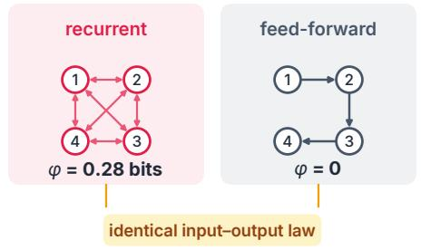

B Measuring a mechanism from finite interventions

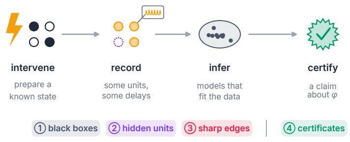  
C ① Behavior is blind

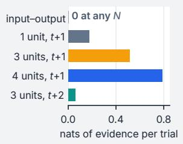  
white-box: 20:1 in 4–53 trials

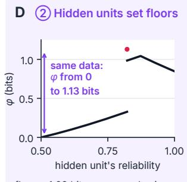

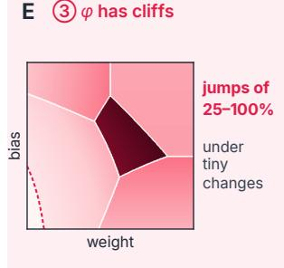  
F ④ Robust claims certify

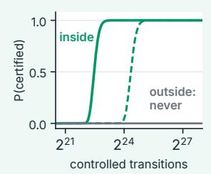  
Figure 1. Three barriers and one way through. (A) A recurrent network and a feed-forward chain with identical input–output laws at their response delay difer in integrated information . (B) An experiment prepares known states, records some units after some delay, infers the mechanisms compatible with the data and reports a claim about �. Three barriers limit what any such experiment can establish; robust claims can still be certified. (C) Input–output data carry no evidence about the diference in A at any number of trials, whereas recording internal units yields evidence at every trial (expected evidence between the two fully specified systems; Section 3). (D) When one unit is hidden from a one-step recording, every point on the curve and the red dot (the exact four-way tie; � from 0 to 1.13 bits) is compatible with the same recordings, so a valid 95% interval must contain each of these values with probability at least 0.95 and has expected width of at least $0 . 9 \times 1 . 1 2 9 = 1 . 0 1 6$ bits, whatever the sample size (Section 4). (E) Over a two-dimensional slice through one weight and one bias of a random mixed-sign network (darker: larger �; same slice as Figure 4B), � forms a mosaic of tiles separated by clifs (white: partition switches; dashed: a switch of the specified states). An arbitrarily small change of mechanism that crosses a clif changes � by 25–100% at 99% of the edges we found, and a surrogate trained near an edge misreported � by a factor of 2.5–2.7 for about a thousand gradient steps (Section 5). (F) Exact probability of certifying $\varphi > 1 . 0 0 4$ bits with simultaneous Clopper–Pearson intervals, against the number of controlled transitions, for sources at the center (solid) and halfway to the boundary (dashed) of the proved region (green), and for a source one cell outside it (grey; boundary sources are likewise never certified). False certificates have probability at most � (Section 7).

information �, computed from the system’s full transition law (Tononi et al., 2016; Albantakis et al., 2023). On IIT, two systems that compute the same input–output function can difer in �: a recurrent network can be integrated while its feed-forward unfolding is not, and a computer that perfectly simulates a brain need not share its consciousness (Tononi and Koch, 2015; Findlay et al., 2024). Critics reply that a property that behavior cannot reveal cannot be tested (Doerig et al., 2019), and whether IIT is science at all has become a public controversy (IIT-Concerned et al., 2023, 2025).

Beneath the debate lies a question that can be posed precisely, and that matters well beyond consciousness. Machine learning increasingly judges models by how they compute—whether a network implements a hypothesized algorithm (Geiger et al., 2025; Conmy et al., 2023), whether mechanistic explanations are identifiable at all (Méloux et al., 2025; Sutter et al., 2025), whether audits can rule out hidden mechanisms (Casper et al., 2024; Hubinger et al., 2024; Marks et al.,

2025)—yet it lacks a measurement theory that says when an experiment determines a mechanismlevel quantity, how precisely, and with what guarantee. Any such quantity is a functional �(�) of a causal transition law � that experiments see only through a design: what is prepared, what is recorded and when, where one intervenes, and through which instrument. Three checks decide what a finite experiment can establish about it:

Identifiable? Does the design’s data distribution pin � down, or do mechanisms with diferent values of � produce the same data?

Continuous? Does � change continuously with the mechanism, so that a small error about � means a small error about �?

Certifiable? Which one-sided claims about � survive the uncertainty that remains, and with what error rate?

Integrated information is a deliberately demanding test case: it is not determined by behavior, it depends on every unit and every connection, and it is defined by selecting one quantity and reporting another. Its barriers transfer in two ways. Behavioral equivalence and hidden units depend only on what an experiment records, so their logic applies to any mechanism-level property, with magnitudes that depend on the property; sharp edges arise from how the measure is defined, so they threaten any metric that selects by one criterion and reports another. We do not ask whether integrated information is consciousness; we ask whether any experiment could tell us its value.

We study the question where it can be answered without approximation: in small stochastic networks of four and five binary units, in which � and every other quantity can be computed exhaustively, so that every inference can be checked against the ground truth (Section 2). An experimenter prepares known states by intervention, records some units after some delay through a noisy sensor, infers the mechanisms compatible with the data, and reports a claim about � (Figure 1B). Three barriers emerge, and one way through.

• Black boxes (Section 3). A recurrent and a feed-forward network have identical input–output laws at their response delay, yet � is 0.28 bits for one and 0 for the other. Input–output data carry no evidence about the diference at any sample size, while recording a single internal unit raises the expected log-likelihood ratio between the two fully specified candidates to ln 20 (odds of 20:1) after about 17 trials. The gaming problem does not need a gamer: behavior can be exactly silent about mechanism without any training to deceive.

• Hidden units (Section 4). Partially opening the box is not enough. When one unit is left out of a one-step recording, mechanisms with very diferent � produce identical data, which imposes floors on precision that no sample size lowers: in our examples, 0.30–0.34 bits when no two units share a reliability, and 1.02 bits—84% of the largest value a four-unit system can take—at an exact tie. In all-but-self parity networks with several hidden units, the entire recorded trajectory from a known initial state depends only on the product of their fidelities: no observation of any length separates configurations with equal products, along which � varies by a third away from exact ties (by two-thirds including them), but in exact checks with two hidden units a single intervention does.

• Sharp edges (Section 5). Because � selects a partition, and the cause and efect it specifies, by one criterion and reports another, it is discontinuous on hypersurfaces of parameter space, with partition-switch jumps fixed by combinatorics and state-switch jumps typically to or from zero. Across 400 random networks we found 849 such edges; 99% change � by 25–100% of its value, and 26–44% of random paths from a state meet one within unit parameter distance. Near an edge no estimator is uniformly reliable, and surrogate models that predict interventions almost perfectly can still misreport $\varphi$ by more than 20% (about 1% of fits at $2 ^ { 1 8 }$ transitions, against at most 0.2% for $\varphi _ { \mathrm { r a w } } )$

Table 1. Three barriers and one way through. What fails, why, and what works, for inferring a mechanismlevel quantity from finite interventions.
<table><tr><td></td><td>Cause</td><td>What does not help</td><td>What helps</td></tr><tr><td>Black boxes</td><td>behaviorally equivalent mechanisms differ in φ</td><td>more input-output trials (zero evidence)</td><td>recording internal units: expected log-likelihood ratio ln 20 (20:1) in 4–53 trials (two specified candidates)</td></tr><tr><td>Hidden units</td><td>marginalization; in all-but-self parity networks, only the product of hidden fidelities reaches the</td><td>more trials; with several hidden units, longer recordings of the same units</td><td>recording more units; later readouts; interventions on hidden units</td></tr><tr><td>Sharp edges</td><td>recordings the measure selects by one criterion and reports another</td><td>point estimates; plug-in values from well-fitting models</td><td>warranted structural knowledge; reporting the lower envelope</td></tr><tr><td>Certificates</td><td>a theorem over a region of mechanisms, or a lower envelope</td><td></td><td>one-sided claims: confidence set inside the region, false certificates  $\leq \alpha$ </td></tr></table>

• Certificates (Section 7). Near an edge, “what is $\varphi ? ^ { \dag }$ has no uniformly good answer, but $^ { \mathfrak { s } } \mathrm { i } \mathfrak { s }$ � at least $c ? ^ { \mathfrak { n } }$ does. At an edge, the data on which point estimates err by 0.80 bits certify $\varphi > 0 . 3 1$ bits on both of its sides. Away from edges, we prove that $\varphi > 1 . 0 0 4$ bits throughout a 64-dimensional region of mechanisms and certify membership of a source at the region’s center from about 7.5 million controlled transitions (28 million halfway to its boundary), with false-certificate probability at most � uniformly over mechanisms.

Calibration, inference and model checking then determine how much of the attainable evidence an experiment actually delivers; the design most precise under an assumed model can be the least able to detect that the model is wrong (Section 6). Together these results turn the measurability of mechanism-level properties into a design question with computable answers: before collecting any data, one can compute whether an experiment separates the mechanisms at stake, how much uncertainty it must leave, whether the measure is stable over that uncertainty, and which robust claims it can certify (Table 1).

For machine learning the lessons are concrete. Open weights remove the black-box barrier but not the other two: hidden units return whenever the grain a claim is about difers from what is logged, and any metric that selects an object by one score and reports another score of it can jump under arbitrarily small changes of the model—so a surrogate that fits the data almost perfectly is not thereby a good measurement.

## 2 Measuring a mechanism: the setting

Systems as causal models. We study networks of � binary units that update synchronously and, given the previous global state, independently—the standard stochastic recurrent network, the parallel-update kinetic Ising model, and the usual discrete-time abstraction of spiking circuits all fit

this description. A mechanism is a transition law

$$
K _ { \theta } ( y \mid x ) = \prod _ { i = 1 } ^ { n } K _ { \theta , i } ( y _ { i } \mid x ) , \qquad x , y \in \{ 0 , 1 \} ^ { n } ,\tag{1}
$$

indexed by parameters $\theta$ (for example the weights and biases of logistic units, $\begin{array} { r } { K _ { \theta , i } ( 1 \mid x ) = \sigma ( \sum _ { j } w _ { j i } x _ { j } + } \end{array}$ $b _ { i } ) )$ . We work with networks of four and five units, small enough that every quantity below can be computed exactly, so every inference can be checked against the ground truth—the same strategy that made toy models a workhorse of mechanistic interpretability (Elhage et al., 2022).

The target: integrated information $\varphi .$ . Informally, $\varphi$ asks how much of a system’s power to constrain its own past and next states is destroyed by the least damaging way of cutting it into parts. It is zero when some part can be disconnected without loss—as in a feed-forward chain, whose first unit receives no inputs—and positive when every cut destroys something. IIT 4.0 makes this precise (Albantakis et al., 2023). At a current state $x ,$ the recipe implemented in the reference software PyPhi (Mayner et al., 2018) has three steps (Section $\mathrm { A } )$ :

1. Specify the past state $\boldsymbol { \mathfrak { z } } ^ { * }$ and next state $y ^ { * }$ that the current state $x$ constrains most strongly—its cause and its efect, scored by intrinsic information.

2. For every directed cut � that severs connections between parts of the system (150 cuts for four units), compute the loss $L _ { c }$ of cause–efect power at $( z ^ { * } , y ^ { * } )$ and the number $e _ { c }$ of severed connections.

3. Select the cut with the smallest loss per severed connection and report its raw loss, capped by the intrinsic information � of the specified cause and efect:

$$
c ^ { * } = \arg \operatorname* { m i n } _ { c } \frac { L _ { c } } { e _ { c } } , \qquad \varphi = \operatorname* { m i n } \{ I , \ L _ { c ^ { * } } \} .\tag{2}
$$

Ties in Equation (2) are broken toward the larger raw loss (the PyPhi default). We also track $\varphi _ { \mathrm { r a w } } = \operatorname* { m i n } \{ I , \operatorname* { m i n } _ { c } L _ { c } \}$ , which selects and reports the same quantity. It is not part of the theory; it isolates the efect of the selection rule. For a four-unit system $\varphi$ can never exceed $B _ { 4 } = 1 . 2 1$ bits. Following IIT’s own examples, we treat the network’s units as the causal substrate; whether a simulation inherits the integration of what it simulates is a separate question (Findlay et al., 2024).

One family has a closed form. In the four-unit parity network, each unit fires when an odd number of the other three are active, and computes this parity correctly with reliability $p _ { i } \in \left[ 1 / 2 , 1 \right]$ ; we also use its fidelity $a _ { i } = 2 p _ { i } - 1$ , which is 0 for a unit that ignores its inputs and 1 for a perfect one. Enumerating all cuts gives (Section A.1)

$$
\begin{array} { r } { \varphi ( p ) = \operatorname* { m i n } \bigr \{ r q \log _ { 2 } ( 2 m ) , q \log _ { 2 } ( 1 6 q ) , - \log _ { 2 } q \bigr \} , \qquad q = \prod _ { i } p _ { i } , m = \operatorname* { m i n } _ { i } p _ { i } , } \end{array}\tag{3}
$$

where � is the number of units attaining the minimum; $\varphi _ { \mathrm { r a w } }$ is the same expression with $r = 1$ . Our exact implementation of the general recipe reproduces every value of Equation (3) to $1 0 ^ { - 1 5 }$ and, to nine decimals, seven reference values from our earlier exact-rational implementation (Section $\mathrm { A } . 2 )$

Measurement designs. An experimenter cannot read $K _ { \theta }$ . A design $\mathcal { D }$ specifies (i) which states are prepared by intervention, (ii) which units are recorded, (iii) at which delays, and (iv) a sensor model; we use a sensor that flips all recorded bits of a trial together with probability $\eta < 1 / 2 ,$ , estimated from calibration trials. We call the mechanism that actually generates the data the source. Each design induces a data distribution $P _ { \boldsymbol { \theta } , \mathcal { D } }$ . Any confidence set � that contains $\theta$ with probability $1 - \alpha$ yields the interval

$$
{ \biggl [ } \operatorname* { i n f } _ { \theta ^ { \prime } \in C } \varphi ( \theta ^ { \prime } ) , \ \operatorname* { s u p } _ { \theta ^ { \prime } \in C } \varphi ( \theta ^ { \prime } ) { \biggr ] } ,\tag{4}
$$

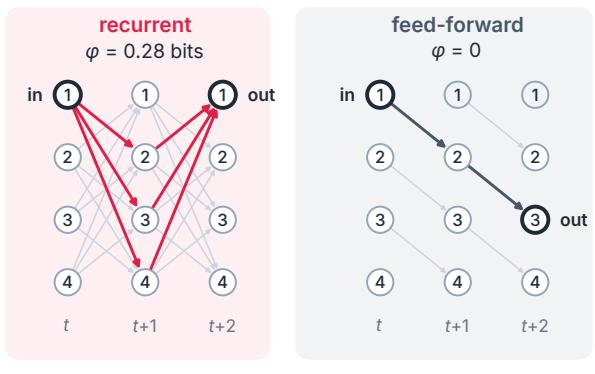

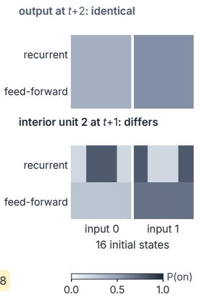

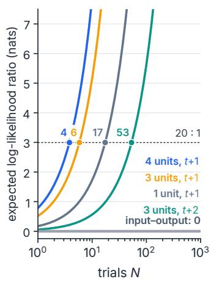  
identical input–output law from all 16 initial states: P(out = in) = 0.578  
Figure 2. Same function, diferent mechanism. (A) The recurrent parity network $( \varphi = 0 . 2 8 \mathrm { b i t s } )$ and the feed-forward chain $\left( \varphi = 0 \right)$ unrolled over two updates. Highlighted arrows (red in the recurrent network, dark in the chain) trace how the input (unit 1 at �) reaches the output: through every other unit in the recurrent network, along a single path in the chain. (B) Exact probability that a unit is on, from each of the 16 initial states, grouped by the input bit. Top: the output (unit 1 of the recurrent network, unit 3 of the chain) at �+2 coincides in the two systems. Bottom: interior unit 2 at �+1 difers. (C) Expected log-likelihood ratio (nats) in favor of the recurrent network, when it is the true system, as trials accumulate, for four internal recordings (sensor error 0.10; both systems known; balanced interventions). Markers show where the expected log-likelihood ratio reaches ln 20 (odds of 20:1), labeled with the number of trials. Input–output data give zero evidence at any number of trials.

which covers the true � with at least the same probability, since $\theta \in C$ implies that $\varphi ( \theta )$ lies in the interval. Everything that follows asks when such intervals can be short—and when, for a given design, no sample size or estimator can make them so.

## 3 Black boxes: when behavior is blind to integration

The sharpest version of the problem is a pair of systems that compute the same function.

Proposition 1 (Same function, different �). Let R be the recurrent parity network with reliabilities $( 0 . 7 8 , 0 . 8 0 , 0 . 8 3 , 0 . 8 5 )$ , so that $\begin{array} { r } { A = \prod _ { i } ( 2 p _ { i } - 1 ) = 0 . 1 5 5 2 3 2 } \end{array}$ , and let F be a feed-forward chain in which unit 1 is a fair coin and each later unit copies its predecessor with reliability $( 1 + { \sqrt { A } } ) / 2 \approx 0 . 6 9 7 .$ Taking the input to be unit 1 at time � and the output to be unit 1 of R (unit 3 of F) at time $t + 2 ,$ the two systems have identical input–output laws from every one of the 16 initial states, yet, at every current state, $\varphi ( \mathcal { R } ) = 0 . 2 8$ bits and $\varphi ( { \mathcal { F } } ) = 0$

The proof is a one-line spin calculation (Section B.1): in both systems the output equals the input multiplied by an independent ±1 variable with mean �, so the output equals the input with probability $( 1 + A ) / 2 = 0 . 5 7 8$ whatever the initial state (Figure 2A,B; largest numerical diference $2 \times 1 0 ^ { - 1 6 } )$ . Integration difers because the chain has a cut that loses nothing: severing the inputs of its first unit changes no transition probability. The construction is the unfolding argument of consciousness science (Doerig et al., 2019) made exact and minimal, in the spirit of earlier examples of dynamically equivalent systems with diferent causal composition (Albantakis and Tononi, 2019). Section B.1 shows that for every recurrent network and every horizon, some acyclic feed-forward network with $\varphi = 0$ reproduces its input–output law at that horizon, so no test that sees only inputs and outputs at that delay, and must remain valid for networks of unknown size, can certify that $\varphi > 0$

White-box access breaks the tie quickly (Figure 2C). With both models known and a sensor error of 0.10, recording one interior unit (unit 2) one step after the intervention yields 0.17 nats of expected evidence per trial, so the expected log-likelihood ratio reaches ln 20 (odds of 20:1) after about 17 trials; three units need about 6 trials and all four about 4. Reading three units two steps later is slower (about 53 trials), because a second round of update noise washes out much of the diference. Input–output data yield exactly zero evidence at any number of trials.

Takeaway. Behavior can be blind to integration. Whether an implementation-dependent property is measurable depends on which internal variables an experiment touches, and the divergence between the candidate mechanisms’ data distributions gives the number of trials each choice needs.

## 4 Hidden units: what observation cannot resolve

White-box access is rarely complete. In brains, and in any audit with partial instrumentation, many units go unrecorded; we call them hidden. We next ask what partial access can and cannot establish.

Partial access can hide � at any sample size. Take two versions of the parity network with recorded reliabilities (0.78, 0.80, 0.83) that difer only in the reliability of unit 4 (0.85 versus 0.55), so that � drops from 0.282 to 0.039 bits. Consider three designs (Figure 3A): record units 1–3 one step after the intervention (baseline), additionally record unit 4, or read units 1–3 one step later. Under a common budget that pays for interventions, updates, recorded bits, an extra channel and calibration (Section C.1), we built 95% intervals for Δ� from 256 simulated paired datasets per design and budget. The baseline never resolved the sign of Δ�: its intervals spanned about ±1.2 bits and barely narrowed with four times the budget (Figure 3B). Recording the fourth unit resolved the sign in every dataset; the later readout did so only at the larger budget. Every interval covered the truth, and none supported the wrong sign (Table 5).

The mechanism is marginalization. Because units update independently given the previous state, summing out an unrecorded unit removes its parameters from the recorded law (Section B.2): the two conditions produce identical one-step recordings. Their two-step recordings difer by a total variation of only 0.053 (versus 0.267 when the fourth unit is recorded), because the hidden unit’s influence reaches the recorded units only after it has propagated once. What an experiment records matters more than how long it records.

Proposition 2 (Identification floor; cf. Imbens and Manski, 2004). If two mechanisms induce the same data distribution under every action of a (possibly adaptive) design and their values of � difer by �, then every interval procedure with coverage 1 − � under both has expected width at least (1 − 2�)�, at every sample size.

The proposition converts indistinguishability into a number (Section B.3). For the baseline design with all three recorded reliabilities at 421/512, the hidden reliability can lie anywhere between 1/2 (where $\varphi = 0 )$ and 421/512 (where $\varphi = 1 . 1 3$ bits), all producing the same one-step recordings (Figure 3C). The floor is then 1.02 bits, 84% of the largest value any four-unit system can take. That value sits on an exact four-way tie and depends on the tie rule (Section 5). With only the hidden unit of the tie the floor is 0.94 bits, but this value also rests on a tie, among the three recorded units, and falls to 0.36 bits if ties are broken toward the smaller raw loss. For the two sets of distinct recorded reliabilities in Figure 3D, (0.78, 0.80, 0.83) and (0.80, 0.82, 0.84), the floor is 0.30 and 0.34 bits, which no tie rule afects; for the first set it rises to 0.47 bits if the hidden unit may tie with unit 1 at 0.78. No interval procedure with 95% coverage can have smaller expected width, at any sample size.

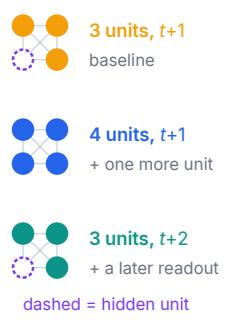

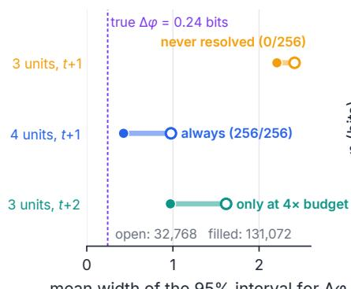

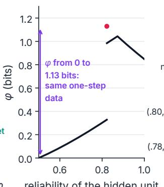

$$
\Delta \varphi
$$

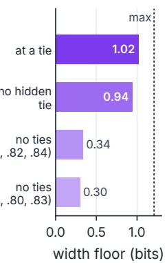

## E Data fix only $a _ { 4 } a _ { 5 }$

F Watching never separates a, b G …but φ varies  
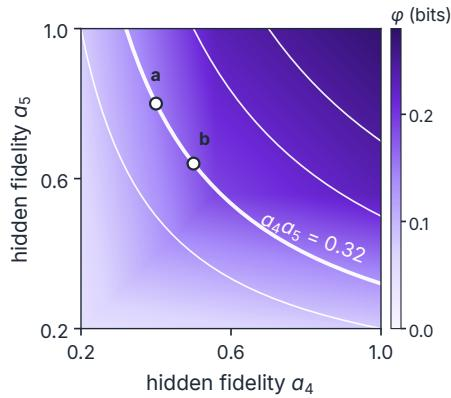

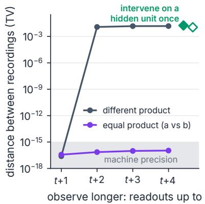

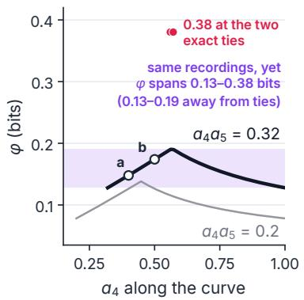  
Figure 3. Hidden units: floors and symmetries. (A) Three designs record the four-unit parity network after the same intervention; the dashed unit is never recorded. (B) Mean width of 95% intervals for $\Delta \varphi$ between two conditions that difer only in the hidden unit (256 paired datasets per design and budget), and how often the sign of $\Delta \varphi$ was resolved. Open and filled markers: budgets of 32,768 and 131,072 per condition; dashed line: the true $\Delta \varphi = 0 . 2 4$ bits, for scale. (C) With recorded reliabilities fixed at 421/512, every hidden reliability on the horizontal axis gives the same one-step recording of units $^ { 1 - 3 , }$ so every value of $\varphi$ on the curve and at the red dot (the exact four-way tie), from 0 to 1.13 bits, is compatible with the data. A valid 95% interval must contain each of these values with probability at least 0.95, which gives the floor in D. (D) Lower bounds on the expected width of any 95% interval (Proposition 2) for recorded reliabilities $4 2 1 / 5 1 2 ,$ , with and without the exact four-way tie, and for two sets of distinct recorded reliabilities; no number of trials lowers them. Dashed line: $B _ { 4 } = 1 . 2 1$ bits, the largest possible $\varphi$ for four units. (E) $\varphi$ (all-zero state) of $\mathbf { a }$ five-unit network with recorded reliabilities $( 0 . 7 8 , 0 . 8 0 , 0 . 8 3 )$ over the fidelities $a _ { 4 } , a _ { 5 }$ of its two hidden units. Observation reveals only the product $a _ { 4 } a _ { 5 }$ (white curves: $a _ { 4 } a _ { 5 } = 0 . 2 , 0 . 3 2$ (thick; through configurations a and b), 0.5 and 0.7; Theorem 3). (F) Total-variation distance between the recorded trajectories of a and b (equal product) and of a pair with a diferent product, as the recording is extended. Equal-product trajectories are identical by Theorem 3; the residual $1 0 ^ { - 1 6 }$ is floating-point round-of. Setting one hidden unit once (diamonds: unit 4 filled, unit 5 open) separates a from b. (G) � along curves of constant product. The shaded band is the tie-free spread of $\varphi$ along $a _ { 4 } a _ { 5 } = 0 . 3 2 ;$ at the two exact ties on that curve, where a hidden fidelity equals that of recorded unit 1, $\varphi = 0 . 3 8 0$ bits (red dots).

Observation reveals products; intervention reveals parts. A later readout recovered a single hidden unit because two-step moments identify the product of all fidelities, from which the hidden one follows by division (Section B.2). In all-but-self parity networks with several hidden units, this route closes for good.

Theorem 3 (Product symmetry). In an all-but-selfparity network with state-independent reliabilities, startedfrom a known state, the joint law of the recorded units at any set of readout times depends on the fidelities of the hidden units only through their product. A common sensor error on the recorded bits does not change this.

The proof shows that the product of the hidden spins evolves as a single hidden variable that, together with the recorded units, forms a closed Markov chain (Section B.4). Configurations with equal products are therefore indistinguishable by any observational protocol, however long. We computed what this leaves open about � in a five-unit network with two hidden units (Figure 3E–G). Along the curve $a _ { 4 } a _ { 5 } = 0 . 3 2$ of equal products, recorded trajectories agree to machine precision at every horizon, while $\varphi$ varies from 0.128 to 0.190 bits away from exact ties—a third of its value— and reaches 0.380 bits at the two points where a hidden fidelity equals 0.56, that of recorded unit 1. No observation can remove this spread. In exact checks, a single intervention breaks the symmetry: setting one hidden unit once and reading the recorded units one step later separates the two configurations (total variation 0.018, or 0.011 when the other hidden unit is set). This is the ladder of causation (Pearl, 2009) inside a neural network: watching cannot do what one intervention does.

Takeaway. Partial access imposes floors on precision that are properties of the design, not of the sample size. In all-but-self parity networks with several hidden units, no recording of the same units, however long, separates configurations with equal products of hidden fidelities; in exact checks with two hidden units, recording either one, or setting either one once, does.

## 5 Sharp edges: when the measure itself is unstable

Even with full access, a third barrier remains, and it lies in the mathematics of the measure rather than in the data.

Select one thing, report another. Equation (2) selects a cut by its loss per severed connection but reports its raw loss. Whenever two cuts with diferent numbers of severed connections exchange the role of minimizer, the reported value jumps, unless the cap binds on both sides. In the parity network this happens at a symmetric mechanism: with all four reliabilities equal to 421/512, IIT 4.0’s tie rule selects the cut that severs all four weakest units and $\varphi = 1 . 1 2 9$ bits; lower any one reliability by an arbitrarily small amount and that unit alone is weakest, giving $\varphi  0 . 3 2 8$ bits—a 71% drop for an infinitesimal change in mechanism (Figure 4A). The full cause–efect structure of IIT changes by only 0.02% over the same perturbation and the selected system stays the same: the scalar and the structure answer diferent questions. This example sits exactly on a tie, so its size depends on the tie rule: with ties broken toward the smaller raw loss, $\varphi = \varphi _ { \mathrm { r a w } }$ throughout the parity family. The edges we turn to next are not artifacts of symmetric ties among units: on each side a single cut is the unique minimizer, so their existence and size do not depend on the tie rule, which only sets the value on the switching surface itself.

Proposition 4 (Selection switches create quantized jumps). Suppose that near a hypersurface in parameter space the specified cause and efect states are unique, cut � uniquely minimizes $L _ { c } / e _ { c }$ on one side and cut � on the other, $e _ { a } < e _ { b } ,$ the two tie on the surface with $L _ { b } > 0 _ { \scriptscriptstyle \perp }$ , and $I \geq L _ { b }$ there. Then � jumps across the surface from $L _ { a }$ to $L _ { b } = ( e _ { b } / e _ { a } ) L _ { a ; }$ relative to the larger side, the jump is $1 - e _ { a } / e _ { b }$

A A tie creates an edge  
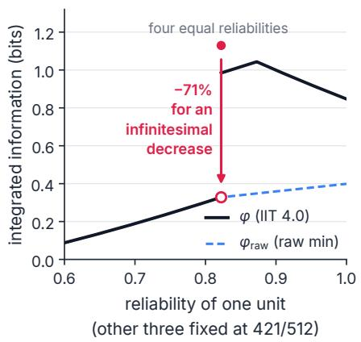

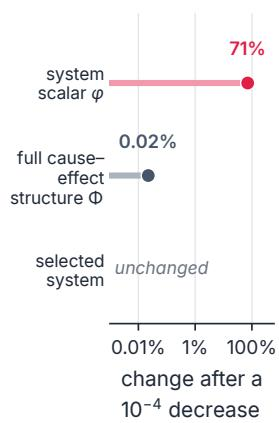  
B In a random network, φ is a mosaic  
slice through one weight and one bias of a random mixed-sign network (dot = the network)

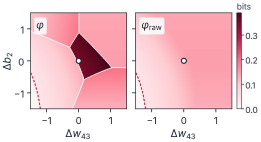

C Jump sizes are quantized by edge counts: $\boldsymbol { \mathrm { 1 } } - \boldsymbol { e _ { a } } / e _ { b }$  
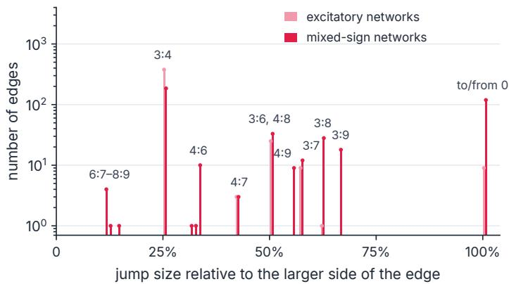

D Edges are often close  
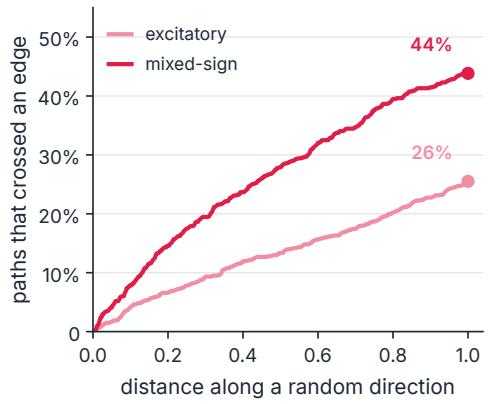  
Figure 4. Sharp edges are common. (A) (solid) and $\varphi _ { \mathrm { r a w } }$ (dashed) of the parity network as one unit’s reliability varies with the other three at $4 2 1 / 5 1 2 ;$ left of the tie the two coincide. At the four-way tie $\varphi = 1 . 1 3$ bits (filled dot); an arbitrarily small decrease gives 0.33 bits (open dot, the one-sided limit), and larger decreases give less. Right: over the same $1 0 ^ { - 4 }$ perturbation the full cause–efect structure (Φ, summed over all its distinctions and relations) changes by 0.02% and the selected system not at all. (B) � and $\varphi _ { \mathrm { r a w } }$ over a two-dimensional slice through one weight and one bias of a random mixed-sign network (dot: the network). White lines mark discontinuities from partition selection, where the selected cut changes its number of severed connections; the dashed line marks a switch of the specified states, across which $\varphi$ and $\varphi _ { \mathrm { r a w } }$ both jump to zero. (C) Sizes of 849 discontinuities found on $^ { 1 , 9 7 6 }$ random parameter paths through the 988 states with $\varphi > 0$ of 317 random networks, relative to the larger side, for excitatory (light) and mixed-sign (dark) networks side by side. Partition switches sit exactly at $1 - e _ { a } / e _ { b }$ for the edge counts of the competing cuts (Proposition 4); jumps to or from zero come from switches of the specified states. Two edges lie of this lattice: a 4:9 switch at which the cap binds (32.6%) and a simultaneous state and 3:3 partition switch (31.5%). (D) Fraction of random paths (two per state with $\varphi > 0 )$ that cross an edge within a given parameter distance of the state.

The proof is short: uniqueness of the specified states makes $L _ { a } , L _ { b }$ and � continuous at the surface, where $L _ { a } / e _ { a } = L _ { b } / e _ { b }$ , so the two one-sided limits difer by the factor $\boldsymbol { e } _ { a } / e _ { b }$ (Section B.5). Generically such switching sets have codimension one, so edges are not a curiosity of symmetric networks. We measured how common they are in 400 random stochastic logistic networks with excitatory or mixed-sign weights, scanning random directions through their 20-dimensional parameter spaces from every state with $\varphi > 0$ and confirming every discontinuity by bisection to $1 0 ^ { - 1 5 }$ . Two-dimensional slices show $\varphi$ as a mosaic of smooth tiles separated by clifs, whereas $\varphi _ { \mathrm { r a w } }$ has no partition clifs on the same slice and jumps only along one curve where the specified state switches (Figure 4B). Across 1,976 scans through 988 states of 317 networks (83 mixed-sign networks have $\varphi = 0$ at every state) we found 849 edges. Their sizes are quantized as the proposition predicts (Figure 4C): every partition-switch edge at which the cap did not bind (719 of 720) sits exactly at $1 - e _ { a } / e _ { b }$ . Two-thirds of all edges are 25% jumps from 3:4 switches; most other partition-switch edges sit at 50% (3:6 and 4:8), 57% (3:7), 63% (3:8) or 67% (3:9), and only six, from $6 { : } 7$ to 8:9 switches, are smaller than 25%. A second family of edges, created when the specified cause or efect state switches, takes $\varphi$ to or from zero in 128 of its 129 edges (15% of all edges). In all, 99% of edges change � by at least a quarter of its value. Along a random direction, 26% (excitatory) and 44% (mixed-sign) of random paths through states with $\varphi > 0$ meet an edge within unit parameter distance (Figure 4D). Five-unit networks (60 per family), with 1,061 cuts to choose from, show the same picture: 73 and 76 edges, 97–99% of them at least a quarter of $\varphi _ { \mathrm { { : } } }$ , met within unit distance along 33% and 48% of random paths (Table 11). Every edge we found in $\varphi$ that $\varphi _ { \mathrm { r a w } }$ did not share came from partition selection; the 129 edges (15%; 28% in mixed-sign networks) common to both came from a second select-then-report step, the choice of specified cause and efect states.

Proposition 5 (One-sided limit; adapted from Donoho, 1988). Let Θ be a model class on which the law of the data under the design varies continuously in total variation, and let $\varphi _ { * }$ be the lower semicontinuous envelope of � on Θ. At every $\theta \in \Theta ,$ , any lower confidence bound � with coverage $1 - \alpha$ uniformly over Θ satisfies Pr� $\{ L > \varphi _ { * } ( \theta ) \} \leq \alpha$ . In the parityfamily withfourfree reliabilities, $\varphi _ { * } = \varphi _ { \mathrm { r a w } } ;$ if the reliabilities are known to be equal, $\varphi _ { * } = \varphi$

The proposition (Section B.5; see also Hirano and Porter, 2012) makes the edge statistically precise. Within the family of four free reliabilities, no uniformly valid lower bound can exceed $\varphi _ { \mathrm { r a w } }$ at a tie with probability above $\alpha ,$ so the high value there cannot be certified by any method that does not assume the tie; and under every design, any interval with uniform 95% coverage over that family has expected width at least 0.72 bits at the equal-reliability source. A two-point argument quantifies the finite-sample cost: for the equal-reliability source and the same source with one reliability lowered by 15/4096, with all four reliabilities free, any estimator seeking 0.2-bit accuracy from 1,000 complete transitions fails with probability at least 0.42 under one of them. Even the numerical comparison tolerance of $1 0 ^ { - 1 3 }$ used in software creates its own edge, between two laws that would take more than $9 . 6 6 \times 1 0 ^ { 2 3 }$ transitions to tell apart.

A good fit is not a good measurement. Near an edge, what finite data support depends on what is assumed (Figure 5A). At the exactly symmetric source with 65,536 transitions, fitting four free reliabilities gave a mean absolute error of 0.80 bits, while assuming one shared reliability gave 0.0045 bits; lower one reliability by $1 0 ^ { - 4 }$ and the advantage reverses (0.0043 versus 0.80 bits). The structural assumption, not the data, picks the branch.

Modern practice would fit a model and read of its integration. We tested this directly (Figure 5B– D): for 200 random networks we fitted stochastic logistic networks of the correct form by maximum likelihood to interventional data and reported the plug-in $\hat { \varphi }$ . Fits improve smoothly with data, yet the probability of an error above 20% decays slowly, because once ordinary estimation error is small it is dominated by the probability that the estimate lands across an edge. With $2 ^ { 1 8 }$ transitions and a predictive divergence of $4 \times 1 0 ^ { - 5 }$ nats per transition, about 1% of fits still misreported $\varphi$ by more than 20%, against at most $0 . 2 \%$ for $\varphi _ { \mathrm { r a w } }$ (Table 10; protocol in Section C.5). For a target chosen to lie within 0.03 of an edge, the model’s $\varphi$ jumped along a single gradient-ascent trajectory to 2.5–2.7 times its true value and stayed there for about a thousand steps while its predictive divergence fell eightfold.

A Assumptions decide  
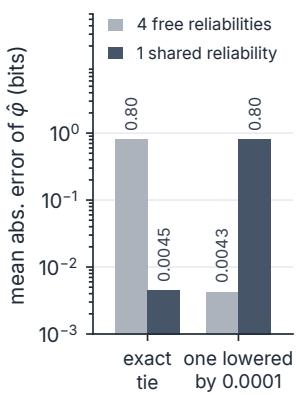

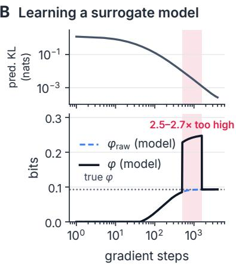

C Good fit, wrong value  
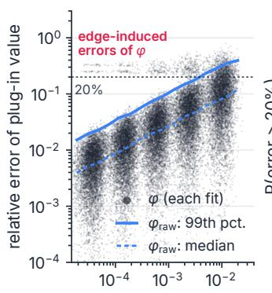

D Errors persist  
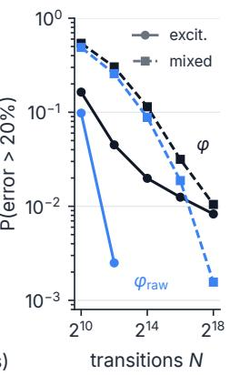  
Figure 5. A good fit is not a good measurement. (A) Mean absolute error of $\varphi$ estimated from 65,536 complete transitions of the parity network, assuming four free reliabilities or one shared reliability, when all four are equal (left) and when one is lowered by $1 0 ^ { - 4 }$ (right); 256 datasets each. (B) Full-batch maximumlikelihood training of a surrogate network on $2 ^ { 1 6 }$ interventional transitions from a mixed-sign target chosen to lie within 0.03 of an edge. Top: predictive divergence from the target. Bottom: $\varphi$ (solid) and $\varphi _ { \mathrm { r a w } }$ (dashed) of the surrogate and the true $\varphi$ (dotted); the shaded window marks where the surrogate’s $\varphi$ is 2.5–2.7 times the true value. (C) Relative error of the plug-in values against the fit’s predictive divergence, for 100 random excitatory networks, five sample sizes and 64 fits each. Dots: plug-in $\varphi$ of each fit; lines: median and 99th percentile of the relative error of the plug-in $\varphi _ { \mathrm { r a w } }$ . (D) Probability of a relative error above 20% against the number of transitions, for $\varphi$ (dark) and $\varphi _ { \mathrm { r a w } }$ (blue) in excitatory (solid, circles) and mixed-sign (dashed, squares) networks; zero failures among $6 { , } 4 0 0$ fits are not drawn on the log scale.

Takeaway. When a measure selects by one criterion and reports another, it jumps wherever the selection switches between candidates whose reported values difer. For $\varphi ,$ jumps from partition switches are fixed by edge counts, switches of the specified states add jumps almost always to or from zero, and both are common in random networks. Near an edge no estimator is uniformly reliable and predictive accuracy does not imply measurement accuracy; without structural assumptions, no uniformly valid lower confidence bound can exceed the lower envelope with probability above �. The problem lies in the definition of the measure, not in the data, and its edges can be mapped before any data are collected.

## 6 From attainable to delivered evidence

Black boxes, hidden units and sharp edges limit what any experiment can establish. Three practical choices—calibration, inference and model checking—decide how much of the attainable evidence a real experiment delivers (Figure 6).

Calibration. Sensor error enters every recorded frequency, so uncertainty about it propagates to $\varphi$ . With 32,768 recording trials and 128 calibration trials, ignoring sensor error covered the true $\varphi$ in 12% of datasets and plugging in the estimated error as if exact in 35%, against a nominal 95%. Propagating calibration uncertainty restored full coverage, at the price of intervals 14 times wider than an oracle that knew the error; eight times more calibration narrowed them by a quarter (Section C.3).

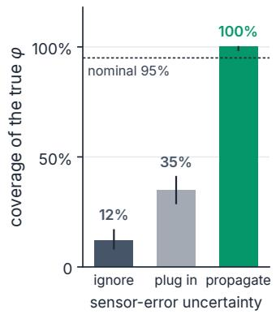

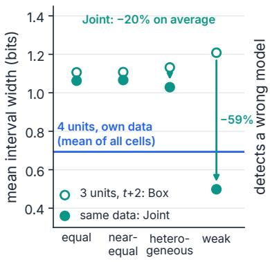

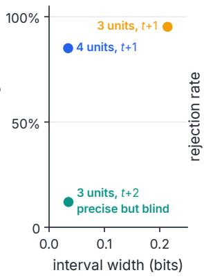

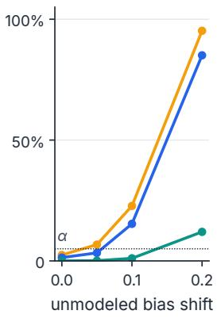  
Figure 6. From attainable to delivered evidence. (A) Coverage of the true (heterogeneous source, sensor error 0.10, $^ { 3 2 , 7 6 8 }$ recording and 128 calibration trials) when sensor error is ignored, plugged in as an estimate, or propagated jointly with recording uncertainty. Bars show coverage (31, 89 and 256 of 256 datasets), whiskers are exact 95% binomial intervals, and the dashed line is the nominal 95%. (B) Mean interval width on identical two-step data with the Box and Joint procedures for four sources (216 cells, 55,296 datasets); blue line: four recorded units on their own data, averaged over all 216 cells (all sources pooled). (C) Mean interval width under a correct model (finest grid) against the rate of rejecting a wrong model (coarse grid; a recorded unit’s bias shifted by 0.20), for eight random logistic networks (Bias family, hidden bias 0.25, budget 131,072). (D) Rejection rate against the size of the unmodeled shift (colors as in $\mathrm { C } ) ;$ the dotted line is the bound $\alpha = 0 . 0 5$ on rejecting a correct model.

Access versus inference. Under a shared budget, access bought precision: at the heterogeneous source and the largest budget, four recorded units reached a mean width of 0.38 bits, the later readout 0.80, and the baseline 1.09. A sharper inference procedure that bounds � over the joint compatible region narrowed intervals by 20% on identical data (59% at weak reliabilities), but four recorded units remained better on average (0.69 versus 0.91 bits over the 216 cells; Section C.2, Table 6). Inference extracts what the data contain; only access changes what they contain.

Model checking. In eight random logistic networks with an unknown hidden bias (73,728 datasets; Section C.4, Table 7), the later-readout design was as precise as recording the fourth unit (mean width 0.035 versus 0.034 bits at the largest budget and finest parameter grid), yet when a recorded unit’s bias was shifted by 0.20 outside the model, it rejected the wrong model in only 12% of datasets, against 95% and 85% for the one-step designs. In 4.6% of all dataset–state evaluations the wrong model survived and its interval missed the truth, against 0.2% with four recorded units and none with three at one step. The design that is best under the assumed model can be the worst at detecting that the model is wrong.

Takeaway. Report calibration-aware intervals, choose designs for access before inference, and evaluate every design twice: for precision under the model and for power against plausible violations of it.

## 7 Certificates: what finite data can establish

Sharp edges and hidden units suggest a change of target: instead of estimating � at a point, certify a one-sided statement that holds throughout the mechanisms the data cannot rule out.

A Certify by containment B The rule, to scale  
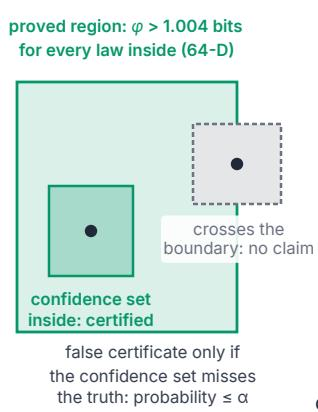

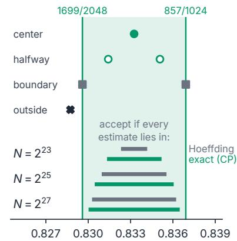  
C Exact power D Proof terms

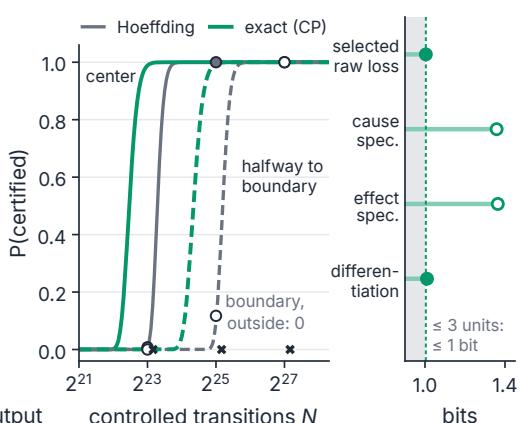  
Figure 7. One-sided claims can be certified. (A) A theorem guarantees $\varphi > 1 . 0 0 4$ bits for every law in a 64-dimensional region. If a simultaneous confidence set lies inside the region, the claim is certified; if it crosses the boundary, no claim is made. (B) The region and the rule drawn to scale for one of the 64 probabilities: four test sources (top) and the ranges that every estimate must fall in for certification, with Hoefding (grey) and exact Clopper–Pearson (green) intervals. (C) Exact probability of certification against the number of controlled transitions for the center (solid) and halfway (dashed) sources, with exact Clopper–Pearson (green) and Hoefding (grey) intervals. Circles: Monte Carlo simulations with the Hoefding rule (256 datasets each; filled, center; open, halfway); crosses: boundary and outside sources, never certified (0/256). (D) The four uniform lower bounds in the proof: selected raw loss, cause and efect specification, and diferentiation $\left( - \log _ { 2 } \right.$ of the largest specified probability). The smallest sets the certified value (filled: the two bounds within 0.01 bits of it). No candidate of at most three units can exceed one bit (grey).

At an edge. Proposition 5 says which one-sided claims remain possible, and they are available. Because $\varphi \geq \varphi _ { \mathrm { r a w } }$ everywhere, any valid lower confidence bound on $\varphi _ { \mathrm { r a w } }$ certifies � from below; in the parity family $\varphi _ { \mathrm { r a w } }$ is continuous, so such bounds stay valid across the edge. At the exactly symmetric parity source with 65,536 complete transitions, simultaneous Clopper–Pearson bounds on the four reliabilities certified $\varphi > 0 . 3 1$ bits in all 256 simulated datasets, and they remained valid on the other side of the edge, where one reliability is lower by $1 0 ^ { - 4 } ;$ on the same data the plug-in estimate erred by 0.80 bits at the tie (Section C.5, Table 9). Near an edge, “what is $\varphi ? ^ { \dag }$ has no uniformly good answer, but “is $\varphi$ at least $c ? ^ { \mathfrak { n } }$ does.

Throughout a region. Away from edges, a theorem can raise the certified value.

Theorem 6 (A robust region of high integration). In the four-unit parity network with input masks (6, 12, 15, 7) (Section B.6), let each of the 64 state-dependent probabilities $p _ { i } ( x )$ that unit � outputs the parity of its inputs correctly vary independently in $[ 1 6 9 9 / 2 0 4 8 , 8 5 7 / 1 0 2 4 ] \approx [ 0 . 8 3 0 , 0 . 8 3 7 ]$ . For every such transition law and every current state, $\varphi > 1 . 0 0 4 2 6 1$ bits.

The proof fixes the specified states and the set of cuts that can win (only two, which sever the same number of connections), bounds the cap from below, and encloses every logarithm by rational series, so the inequality is exact (Section B.6). Because the region has width in all 64 directions—each probability may vary by about 0.007—high integration here holds for a whole family of implementations, not a single law. The family is narrow, which is why certifying membership takes millions of controlled transitions.

A theorem becomes evidence through a simple rule: certify $\varphi > 1 . 0 0 4$ bits if a simultaneous 95% confidence set for the 64 probabilities lies inside the region (Figure 7A). A false certificate requires the confidence set to miss the true law, so its probability is at most 5% by construction (Lemma B.8). The guarantee is uniform: it holds for every true mechanism, including those arbitrarily close to the boundary. With exact Clopper–Pearson intervals, a source at the center of the region is certified with probability 0.95 after 7.5 million controlled transitions, and a source halfway to the boundary after 28 million; conservative Hoefding intervals need 1.7 times more (Figure $^ { 7 \mathrm { B } , \mathrm { C } ; }$ Table 8). Monte Carlo runs with the Hoefding rule match its exact power: the center source was certified in 2 of 256 datasets at $2 ^ { 2 3 }$ transitions and in all 256 at $2 ^ { 2 5 }$ , and the halfway source in all 256 at $2 ^ { 2 7 }$ . Sources on the boundary or one cell outside were never certified, and their exact certification probability stays below $1 0 ^ { - 6 }$ : the rule abstains in a margin around the boundary, including on it, where the theorem still holds. These budgets are the price of a uniform guarantee, and in silico they amount to cheap forward passes. The certified value is set by the weakest of four uniform bounds in the proof (Figure 7D).

Takeaway. Robust claims can be certified from finite interventions with error control that holds uniformly over mechanisms, however close they sit to an edge or to the boundary of the region. The theorem supplies the content; the confidence level supplies the evidential strength—the same logic as certified robustness for neural networks.

## 8 Related work

Assessing consciousness in AI. Proposals for assessing machine consciousness derive indicator properties from scientific theories (Butlin et al., 2023, 2026), weigh the evidence for and against consciousness in large language models (Chalmers, 2023), and argue that the possibility of AI welfare warrants preparation now (Long et al., 2024). Because behavioral markers and self-reports can be gamed by systems trained on human data (Birch, 2024; Perez and Long, 2023), these proposals emphasize architecture and mechanism (Aru et al., 2023). IIT-based analyses go furthest, arguing that the same behavior can be realized by systems with and without intrinsic causal integration (Tononi and Koch, 2015; Findlay et al., 2024); biological naturalism ties consciousness to properties of living substrates (Seth, 2025). Our results supply a measurement theory for one such approach: which claims about � finite experiments can establish, and with how much evidence.

Measuring and testing integrated information. Exact � follows IIT 3.0 and 4.0 (Oizumi et al., 2014; Albantakis et al., 2023; Marshall et al., 2023; Mayner et al., 2026). The reference software is PyPhi (Mayner et al., 2018); we reimplement its recipe, including its default tie rule, in vectorized form (Section A). Practical integration measures for time series trade fidelity to the theory for computability (Barrett and Seth, 2011; Oizumi et al., 2016; Tegmark, 2016; Mediano et al., 2019); integration-like quantities have been tracked in evolving artificial agents (Edlund et al., 2011; Albantakis et al., 2014) and in deep networks and language models (Marrow et al., 2020; Proca et al., 2024; Li, 2025). The non-uniqueness of IIT’s selections and the mathematical structure of the theory have been analyzed before (Krohn and Ostwald, 2017; Moon, 2019; Kleiner and Tull, 2021; Hanson and Walker, 2023); we make their statistical consequences exact. Perturbational approaches probe causal organization in the brain (Massimini et al., 2005; Casali et al., 2013; Leung et al., 2021), and adversarial collaborations confront IIT with neural data (Cogitate Consortium et al., 2025). The unfolding argument (Doerig et al., 2019), its replies (Kleiner, 2020; Tsuchiya et al., 2020) and the debate on falsifiability (Kleiner and Hoel, 2021; IIT-Concerned et al., 2025) concern whether behavior can test causal-structure theories; our same-function pair makes that premise exact and shows which further measurements decide.

Identifiability of mechanisms. Mechanistic interpretability asks whether networks implement hypothesized algorithms, typically through interventions such as activation patching and causal abstraction (Geiger et al., 2021, 2025; Conmy et al., 2023; Zhang and Nanda, 2024; Heimersheim and Nanda, 2024). Explanations can be non-identifiable (Méloux et al., 2025), causal abstraction can be too permissive without constraints on the map (Sutter et al., 2025), and observational probes or patching can mislead (Belinkov, 2022; Makelov et al., 2024). In causal inference, interventions identify what observation cannot (Pearl, 2009; Peters et al., 2017), and the number and design of experiments needed with latent variables have been studied (Eberhardt et al., 2005; Kocaoglu et al., 2017). The product symmetry is an exact instance in a recurrent network, with a computable cost in the target quantity. In neuroscience, subsampling and unobserved units bias inferences about network properties (Levina and Priesemann, 2017; Das and Fiete, 2020).

Black-box audits and hidden mechanisms. Behavioral audits cannot certify how a model computes (Casper et al., 2024): planted mechanisms can be undetectable from input–output access (Goldwasser et al., 2022), deceptive behavior can persist through safety training (Hubinger et al., 2024; Greenblatt et al., 2024), and in an auditing game for hidden objectives the only team that failed had neither model weights nor training data (Marks et al., 2025). Our black-box result is the measurement-theoretic counterpart for a quantity of scientific interest, and our floors quantify what partial white-box access buys.

Statistical limits and certification. Functionals that are discontinuous or nondiferentiable in the underlying law admit no uniformly consistent estimators and only one-sided inference (Donoho, 1988; Dufour, 1997; Hirano and Porter, 2012; Bertanha and Moreira, 2020), and two-point arguments bound what any estimator can achieve (Yu, 1997; Tsybakov, 2009); partially identified parameters call for intervals over identified sets (Manski, 2003; Imbens and Manski, 2004). Measurement artifacts can also create apparent discontinuities in machine-learning metrics (Schaefer et al., 2023); here the discontinuity is real and belongs to the measure. Certifying properties throughout a region, rather than estimating them at a point, is the logic of neural-network verification and certified robustness (Katz et al., 2017; Wong and Kolter, 2018; Zhang et al., 2018; Gowal et al., 2019; Cohen et al., 2019). Our certificates combine an interval-arithmetic theorem (Moore et al., 2009) with simultaneous confidence sets (Clopper and Pearson, 1934; Hoefding, 1963), in the spirit of hypothesis-testing approaches to risk control (Angelopoulos et al., 2025); sharper sequential constructions (Waudby-Smith and Ramdas, 2024) would lower the required sample sizes further.

## 9 Discussion

Testability is a property of experimental design. The same-function pair shows what makes implementation-dependent claims empirical. Behavior at the response delay cannot separate the two systems, but a single internal recording can. Every equivalence we constructed is tied to a delay, a set of terminals or a recording; in each case another recording, readout time or intervention separates the systems. The unfolding argument therefore shows that behavior alone cannot decide between implementations, not that implementations cannot be told apart.

Two kinds of uncertainty, two kinds of remedy. Uncertainty about � has two sources that call for diferent responses. Incomplete observation leaves mechanisms indistinguishable; it is fixed by access—more units, later readouts and, when several units are hidden, interventions. Sharp edges belong to the measure; they are fixed by warranted structural knowledge, by reporting what can be certified (the lower envelope, or a robust region), and ultimately by measure design. The scalar, the full cause–efect structure and the selected system responded very diferently to the same perturbation, so empirical claims should name which of them they establish.

Implications for AI. Claims that an AI system is, or is not, a candidate for consciousness on causalstructure grounds are claims about its mechanism, and our results say what evidence they require:

access to the declared units at the declared grain, interventions wherever units are hidden, and robust rather than pointwise statements. The same logic applies to architectural indicators such as recurrence or a global workspace, which behavior cannot reveal either. For brains, partial access is a constraint; for neural networks, it is a design choice—up to the grain a theory declares, which for IIT is the physical substrate rather than the logged activations (Findlay et al., 2024). Complete access does not remove the third barrier: a value computed at a point near an edge stays fragile—a comparison tolerance of $1 0 ^ { - 1 3 }$ already creates an edge that would take more than $9 . 6 6 \times 1 0 ^ { 2 3 }$ transitions to resolve—and a stochastic or physical substrate still has to be identified from data. Nor is the barrier specific to IIT. A circuit whose size or faithfulness is reported after it has been chosen by a thresholded or penalized score (Conmy et al., 2023) is a select-then-report metric, and it jumps wherever the selection switches between candidates with diferent reported values. Such metrics should be mapped for edges before they are estimated.

A design-first workflow. The results combine into a workflow that can be simulated under candidate models before an experiment begins. (i) Declare the system, its grain, its time scale and the claim. (ii) Check separability: compute the divergence between the data distributions that the claim distinguishes under the planned design. (iii) Compute the identification floor over mechanisms the design cannot separate. (iv) Check stability: locate the selection edges of the measure near the plausible mechanisms. (v) Design calibration and inference to reach the required confidence, propagating calibration uncertainty. (vi) Test model adequacy and its power against plausible violations. (vii) Where possible, certify robust claims by containment.

Limitations and outlook. Exact analysis requires small networks with declared units, known wiring, controlled interventions and simple sensor errors. Exact � is also expensive: the number of directed cuts grows from 150 at four units to 1,061 at five and super-exponentially beyond, so for systems of realistic size, floors, edge maps and certificates must be computed on coarse-grained models or tractable proxies, and whether the barriers keep their size there is open. Certification is costly even at four units (7.5 million controlled transitions at the center of the proved region and 28 million halfway to its boundary), and the parity-network magnitudes at ties depend on the tie rule (Sections 4 and 5). Each assumption opens a direction: networks with many hidden units, inferred connectivity, channel-specific errors, continuous time, competing causal grains (Marshall et al., 2026), inference of full cause–efect structures, and trained artificial systems. The tools carry over directly: divergences between candidate data laws, identification floors over observational equivalence classes, edge maps of the measure, and certificates over robust regions.

## 10 Conclusion

Whether a mechanism-level property can be measured is not settled by how much data an experiment collects. It is settled by what the experiment touches, by the mathematics of the measure, and by whether the claim is robust to what remains unknown. For integrated information we have made each of these exact: behavior can carry no evidence at all, hidden units set floors that only access and intervention lower, the measure has clifs, most of them quantized, across which no estimator is uniformly reliable, and one-sided claims can nonetheless be certified from finite interventions. Behavior underdetermines mechanism; partial observation can leave it unidentified; targeted access and certificates establish what finite data can. These are questions that can be answered before an experiment is run—for brains and for machines.

Code availability. Code for the exact computation of �, for the exact analyses and computational experiments (same-function pair, identification floors, edge scans and slices, product symmetry, surrogate fits, one-sided certificates and certification power) and for all figures is provided as ancillary files with this article. Results of the simulation studies of Sections C.1 to C.4, of the structuralassumption comparison in Figure 5A, of the cause–efect-structure and system-selection comparison in Figure 4A and of the Monte Carlo certification runs enter the scripts as tabulated values; the bounds in Figure 7D are evaluated from the closed-form expressions of Section B.6, whose exact rational verification is part of the proof. Figures were made with Matplotlib (Hunter, 2007) at final print size.

## References

Larissa Albantakis and Giulio Tononi. Causal composition: Structural diferences among dynamically equivalent systems. Entropy, 21(10):989, 2019. doi: 10.3390/e21100989.

Larissa Albantakis, Arend Hintze, Christof Koch, Christoph Adami, and Giulio Tononi. Evolution of integrated causal structures in animats exposed to environments of increasing complexity. PLoS Computational Biology, 10(12):e1003966, 2014. doi: 10.1371/journal.pcbi.1003966.

Larissa Albantakis, Leonardo Barbosa, Graham Findlay, Matteo Grasso, Andrew M. Haun, William Marshall, William G. P. Mayner, Alireza Zaeemzadeh, et al. Integrated information theory (IIT) 4.0: Formulating the properties of phenomenal existence in physical terms. PLoS Computational Biology, 19(10):e1011465, 2023. doi: 10.1371/journal.pcbi.1011465.

Anastasios N. Angelopoulos, Stephen Bates, Emmanuel J. Candès, Michael I. Jordan, and Lihua Lei. Learn then test: Calibrating predictive algorithms to achieve risk control. The Annals ofApplied Statistics, 19(2), 2025. doi: 10.1214/24-AOAS1998.

Anthropic. Exploring model welfare. Anthropic research blog, 2025. URL https://www.anthropic.com/ research/exploring-model-welfare.

Jaan Aru, Matthew E. Larkum, and James M. Shine. The feasibility of artificial consciousness through the lens of neuroscience. Trends in Neurosciences, 46(12):1008–1017, 2023. doi: 10.1016/j.tins.2023.09.009.

Adam B. Barrett and Anil K. Seth. Practical measures of integrated information for time-series data. PLoS Computational Biology, 7(1):e1001052, 2011. doi: 10.1371/journal.pcbi.1001052.

Yonatan Belinkov. Probing classifiers: Promises, shortcomings, and advances. Computational Linguistics, 48 (1):207–219, 2022. doi: 10.1162/coli\_a\_00422.

Marinho Bertanha and Marcelo J. Moreira. Impossible inference in econometrics: Theory and applications. Journal of Econometrics, 218(2):247–270, 2020.

Jonathan Birch. The Edge of Sentience: Risk and Precaution in Humans, Other Animals, and AI. Oxford University Press, 2024. doi: 10.1093/9780191966729.001.0001.

Patrick Butlin, Robert Long, Eric Elmoznino, Yoshua Bengio, Jonathan Birch, Axel Constant, George Deane, Stephen M. Fleming, et al. Consciousness in artificial intelligence: Insights from the science of consciousness. arXiv preprint arXiv:2308.08708, 2023.

Patrick Butlin, Robert Long, Tim Bayne, Yoshua Bengio, Jonathan Birch, David Chalmers, Axel Constant, George Deane, et al. Identifying indicators of consciousness in AI systems. Trends in Cognitive Sciences, 30 (6):488–501, 2026. doi: 10.1016/j.tics.2025.10.011.

Adenauer G. Casali, Olivia Gosseries, Mario Rosanova, Mélanie Boly, Simone Sarasso, Karina R. Casali, Silvia Casarotto, Marie-Aurélie Bruno, et al. A theoretically based index of consciousness independent of sensory processing and behavior. Science Translational Medicine, 5(198):198ra105, 2013.

Stephen Casper, Carson Ezell, Charlotte Siegmann, Noam Kolt, Taylor Lynn Curtis, Benjamin Bucknall, Andreas Haupt, Kevin Wei, et al. Black-box access is insuficient for rigorous AI audits. In Proceedings of the 2024 ACM Conference on Fairness, Accountability, and Transparency (FAccT ’24), pages 2254–2272. ACM, 2024. doi: 10.1145/3630106.3659037.

David J. Chalmers. Could a large language model be conscious? Boston Review, 2023. URL https://arxiv. org/abs/2303.07103.

C. J. Clopper and E. S. Pearson. The use of confidence or fiducial limits illustrated in the case of the binomial. Biometrika, 26(4):404–413, 1934.

Cogitate Consortium, Oscar Ferrante, Urszula Gorska-Klimowska, et al. Adversarial testing of global neuronal workspace and integrated information theories of consciousness. Nature, 642:133–142, 2025.

Jeremy Cohen, Elan Rosenfeld, and J. Zico Kolter. Certified adversarial robustness via randomized smoothing. In Proceedings of the 36th International Conference on Machine Learning (ICML), volume 97, pages 1310–1320. PMLR, 2019.

Arthur Conmy, Augustine Mavor-Parker, Aengus Lynch, Stefan Heimersheim, and Adrià Garriga-Alonso. Towards automated circuit discovery for mechanistic interpretability. In Advances in Neural Information Processing Systems, volume 36, pages 16318–16352. Curran Associates, Inc., 2023. doi: 10.52202/075280-0719.

Abhranil Das and Ila R. Fiete. Systematic errors in connectivity inferred from activity in strongly recurrent networks. Nature Neuroscience, 23:1286–1296, 2020.

Adrien Doerig, Aaron Schurger, Kathryn Hess, and Michael H. Herzog. The unfolding argument: Why IIT and other causal structure theories cannot explain consciousness. Consciousness and Cognition, 72:49–59, 2019. doi: 10.1016/j.concog.2019.04.002.

David L. Donoho. One-sided inference about functionals of a density. The Annals ofStatistics, 16(4):1390–1420, 1988.

Jean-Marie Dufour. Some impossibility theorems in econometrics with applications to structural and dynamic models. Econometrica, 65(6):1365–1387, 1997. doi: 10.2307/2171740.

Frederick Eberhardt, Clark Glymour, and Richard Scheines. On the number of experiments suficient and in the worst case necessary to identify all causal relations among N variables. In Proceedings of the Twenty-First Conference on Uncertainty in Artificial Intelligence (UAI), pages 178–184, 2005.

Jefrey A. Edlund, Nicolas Chaumont, Arend Hintze, Christof Koch, Giulio Tononi, and Christoph Adami. Integrated information increases with fitness in the evolution of animats. PLoS Computational Biology, 7 (10):e1002236, 2011. doi: 10.1371/journal.pcbi.1002236.

Nelson Elhage, Tristan Hume, Catherine Olsson, Nicholas Schiefer, Tom Henighan, Shauna Kravec, Zac Hatfield-Dodds, Robert Lasenby, et al. Toy models of superposition. Transformer Circuits Thread, 2022. URL https://transformer-circuits.pub/2022/toy\_model/index.html.

Graham Findlay, William Marshall, Larissa Albantakis, Isaac David, William G. P. Mayner, Christof Koch, and Giulio Tononi. Dissociating artificial intelligence from artificial consciousness. arXiv preprint arXiv:2412.04571, 2024.

Atticus Geiger, Hanson Lu, Thomas Icard, and Christopher Potts. Causal abstractions of neural networks. In Advances in Neural Information Processing Systems, volume 34, pages 9574–9586. Curran Associates, Inc., 2021.

Atticus Geiger, Duligur Ibeling, Amir Zur, Maheep Chaudhary, Sonakshi Chauhan, Jing Huang, Aryaman Arora, Zhengxuan Wu, et al. Causal abstraction: A theoretical foundation for mechanistic interpretability. Journal of Machine Learning Research, 26(83):1–64, 2025. URL https://jmlr.org/papers/v26/23-0058.html.

Shafi Goldwasser, Michael P. Kim, Vinod Vaikuntanathan, and Or Zamir. Planting undetectable backdoors in machine learning models. In 2022 IEEE 63rd Annual Symposium on Foundations of Computer Science (FOCS), pages 931–942. IEEE, 2022. doi: 10.1109/FOCS54457.2022.00092.

Sven Gowal, Krishnamurthy Dvijotham, Robert Stanforth, Rudy Bunel, Chongli Qin, Jonathan Uesato, Relja Arandjelovic, Timothy Mann, and Pushmeet Kohli. Scalable verified training for provably robust image classification. In Proceedings of the IEEE/CVF International Conference on Computer Vision (ICCV), 2019. doi: 10.1109/ICCV.2019.00494.

Ryan Greenblatt, Carson Denison, Benjamin Wright, Fabien Roger, Monte MacDiarmid, Sam Marks, Johannes Treutlein, Tim Belonax, et al. Alignment faking in large language models. arXiv preprint arXiv:2412.14093, 2024.

Jake R. Hanson and Sara I. Walker. On the non-uniqueness problem in integrated information theory. Neuroscience of Consciousness, 2023(1):niad014, 2023.

Stefan Heimersheim and Neel Nanda. How to use and interpret activation patching. arXiv preprint arXiv:2404.15255, 2024.

Keisuke Hirano and Jack R. Porter. Impossibility results for nondiferentiable functionals. Econometrica, 80(4): 1769–1790, 2012.

Wassily Hoefding. Probability inequalities for sums of bounded random variables. Journal of the American Statistical Association, 58(301):13–30, 1963.

Evan Hubinger, Carson Denison, Jesse Mu, Mike Lambert, Meg Tong, Monte MacDiarmid, Tamera Lanham, Daniel M. Ziegler, et al. Sleeper agents: Training deceptive LLMs that persist through safety training. arXiv preprint arXiv:2401.05566, 2024.

John D. Hunter. Matplotlib: A 2D graphics environment. Computing in Science & Engineering, 9(3):90–95, 2007. doi: 10.1109/MCSE.2007.55.

IIT-Concerned, Stephen M. Fleming, Chris D. Frith, Mel Goodale, Hakwan Lau, Joseph E. LeDoux, Alan L. F. Lee, Matthias Michel, et al. The integrated information theory of consciousness as pseudoscience. PsyArXiv preprint, 2023.

IIT-Concerned, Derek H. Arnold, Mark G. Baxter, Tristan A. Bekinschtein, et al. What makes a theory of consciousness unscientific? Nature Neuroscience, 28(4):689–693, 2025. doi: 10.1038/s41593-025-01881-x.

Guido W. Imbens and Charles F. Manski. Confidence intervals for partially identified parameters. Econometrica, 72(6):1845–1857, 2004. doi: 10.1111/j.1468-0262.2004.00555.x.

Guy Katz, Clark Barrett, David L. Dill, Kyle Julian, and Mykel J. Kochenderfer. Reluplex: An eficient SMT solver for verifying deep neural networks. In Computer Aided Verification (CAV 2017), volume 10426, pages 97–117. Springer, 2017. doi: 10.1007/978-3-319-63387-9\_5.

Johannes Kleiner. Brain states matter. A reply to the unfolding argument. Consciousness and Cognition, 85: 102981, 2020.

Johannes Kleiner and Erik Hoel. Falsification and consciousness. Neuroscience of Consciousness, 2021(1): niab001, 2021. doi: 10.1093/nc/niab001.

Johannes Kleiner and Sean Tull. The mathematical structure of integrated information theory. Frontiers in Applied Mathematics and Statistics, 6:602973, 2021. doi: 10.3389/fams.2020.602973.

Murat Kocaoglu, Karthikeyan Shanmugam, and Elias Bareinboim. Experimental design for learning causal graphs with latent variables. In Advances in Neural Information Processing Systems, volume 30. Curran Associates, Inc., 2017. URL https://proceedings.neurips.cc/paper\_files/paper/2017/file/ 291d43c696d8c3704cdbe0a72ade5f6c-Paper.pdf.

Stephan Krohn and Dirk Ostwald. Computing integrated information. Neuroscience of Consciousness, 2017(1): nix017, 2017.

Angus Leung, Dror Cohen, Bruno van Swinderen, and Naotsugu Tsuchiya. Integrated information structure collapses with anesthetic loss of conscious arousal in Drosophila melanogaster. PLOS Computational Biology, 17(2):e1008722, 2021. doi: 10.1371/journal.pcbi.1008722.

Anna Levina and Viola Priesemann. Subsampling scaling. Nature Communications, 8:15140, 2017.

Jingkai Li. Can “consciousness” be observed from large language model (LLM) internal states? Dissecting LLM representations obtained from Theory of Mind test with Integrated Information Theory and Span Representation analysis. Natural Language Processing Journal, 12:100163, 2025. doi: 10.1016/j.nlp.2025. 100163.

Robert Long, Jef Sebo, Patrick Butlin, Kathleen Finlinson, Kyle Fish, Jacqueline Harding, Jacob Pfau, Toni Sims, Jonathan Birch, and David Chalmers. Taking AI welfare seriously. arXiv preprint arXiv:2411.00986, 2024.

Aleksandar Makelov, Georg Lange, Atticus Geiger, and Neel Nanda. Is this the subspace you are looking for? an interpretability illusion for subspace activation patching. In The Twelfth International Conference on Learning Representations (ICLR), 2024. URL https://openreview.net/forum?id=Ebt7JgMHv1.

Charles F. Manski. Partial Identification of Probability Distributions. Springer, 2003. doi: 10.1007/b97478.

Samuel Marks, Johannes Treutlein, Trenton Bricken, Jack Lindsey, Jonathan Marcus, Siddharth Mishra-Sharma, Daniel Ziegler, Emmanuel Ameisen, et al. Auditing language models for hidden objectives. arXiv preprint arXiv:2503.10965, 2025.

Scythia Marrow, Eric J. Michaud, and Erik Hoel. Examining the causal structures of deep neural networks using information theory. Entropy, 22(12):1429, 2020. doi: 10.3390/e22121429.

William Marshall, Matteo Grasso, William G. P. Mayner, Alireza Zaeemzadeh, Leonardo S. Barbosa, Erick

Chastain, Graham Findlay, Shuntaro Sasai, Larissa Albantakis, and Giulio Tononi. System integrated information. Entropy, 25(2):334, 2023. doi: 10.3390/e25020334.

William Marshall, Graham Findlay, Larissa Albantakis, and Giulio Tononi. Intrinsic units: identifying a system’s causal grain. Neuroscience of Consciousness, 2026(1):niag013, 2026. doi: 10.1093/nc/niag013.

Marcello Massimini, Fabio Ferrarelli, Reto Huber, Steve K. Esser, Harpreet Singh, and Giulio Tononi. Breakdown of cortical efective connectivity during sleep. Science, 309(5744):2228–2232, 2005.

William G. P. Mayner, William Marshall, Larissa Albantakis, Graham Findlay, Robert Marchman, and Giulio Tononi. PyPhi: A toolbox for integrated information theory. PLoS Computational Biology, 14(7):e1006343, 2018. doi: 10.1371/journal.pcbi.1006343.

William G. P. Mayner, William Marshall, and Giulio Tononi. Intrinsic cause–efect power: The tradeof between diferentiation and specification. Entropy, 28(4):410, 2026. doi: 10.3390/e28040410.

Pedro A. M. Mediano, Anil K. Seth, and Adam B. Barrett. Measuring integrated information: Comparison of candidate measures in theory and simulation. Entropy, 21(1):17, 2019.

Maxime Méloux, Silviu Maniu, François Portet, and Maxime Peyrard. Everything, everywhere, all at once: Is mechanistic interpretability identifiable? In The Thirteenth International Conference on Learning Representations (ICLR), 2025. URL https://openreview.net/forum?id=5IWJBStfU7.

Kyumin Moon. Exclusion and underdetermined qualia. Entropy, 21(4):405, 2019. doi: 10.3390/e21040405.

Ramon E. Moore, R. Baker Kearfott, and Michael J. Cloud. Introduction to Interval Analysis. Society for Industrial and Applied Mathematics (SIAM), 2009. doi: 10.1137/1.9780898717716.

Masafumi Oizumi, Larissa Albantakis, and Giulio Tononi. From the phenomenology to the mechanisms of consciousness: Integrated information theory 3.0. PLoS Computational Biology, 10(5):e1003588, 2014. doi: 10.1371/journal.pcbi.1003588.

Masafumi Oizumi, Shun-ichi Amari, Toru Yanagawa, Naotaka Fujii, and Naotsugu Tsuchiya. Measuring integrated information from the decoding perspective. PLoS Computational Biology, 12(1):e1004654, 2016.

Judea Pearl. Causality: Models, Reasoning, and Inference. Cambridge University Press, 2 edition, 2009. doi: 10.1017/CBO9780511803161.

Ethan Perez and Robert Long. Towards evaluating AI systems for moral status using self-reports. arXiv preprint arXiv:2311.08576, 2023.

Jonas Peters, Dominik Janzing, and Bernhard Schölkopf. Elements of Causal Inference: Foundations and Learning Algorithms. MIT Press, 2017.

Alexandra M. Proca, Fernando E. Rosas, Andrea I. Luppi, Daniel Bor, Matthew Crosby, and Pedro A. M. Mediano. Synergistic information supports modality integration and flexible learning in neural networks solving multiple tasks. PLOS Computational Biology, 20(6):e1012178, 2024. doi: 10.1371/journal.pcbi.1012178.

Rylan Schaefer, Brando Miranda, and Sanmi Koyejo. Are emergent abilities of large language models a mirage? In Advances in Neural Information Processing Systems (NeurIPS), volume 36, pages 55565–55581. Curran Associates, Inc., 2023. doi: 10.52202/075280-2425.

Anil K. Seth. Conscious artificial intelligence and biological naturalism. Behavioral and Brain Sciences, 49: e315, 2025. doi: 10.1017/S0140525X25000032.

Denis Sutter, Julian Minder, Thomas Hofmann, and Tiago Pimentel. The non-linear representation dilemma: Is causal abstraction enough for mechanistic interpretability? In Advances in Neural Information Processing Systems (NeurIPS 2025), 2025. URL https://openreview.net/forum?id=ZYXTLo7kCi.

Max Tegmark. Improved measures of integrated information. PLOS Computational Biology, 12(11):e1005123, 2016. doi: 10.1371/journal.pcbi.1005123.

Giulio Tononi and Christof Koch. Consciousness: here, there and everywhere? Philosophical Transactions of the Royal Society B: Biological Sciences, 370(1668):20140167, 2015. doi: 10.1098/rstb.2014.0167.

Giulio Tononi, Melanie Boly, Marcello Massimini, and Christof Koch. Integrated information theory: from consciousness to its physical substrate. Nature Reviews Neuroscience, 17(7):450–461, 2016.

Naotsugu Tsuchiya, Thomas Andrillon, and Andrew Haun. A reply to “the unfolding argument”: Beyond functionalism/behaviorism and towards a science of causal structure theories of consciousness. Consciousness and Cognition, 79:102877, 2020.

Alexandre B. Tsybakov. Introduction to Nonparametric Estimation. Springer, 2009. doi: 10.1007/b13794.

Ian Waudby-Smith and Aaditya Ramdas. Estimating means of bounded random variables by betting. Journal of the Royal Statistical Society Series B: Statistical Methodology, 86(1):1–27, 2024. doi: 10.1093/jrsssb/qkad009.

Eric Wong and J. Zico Kolter. Provable defenses against adversarial examples via the convex outer adversarial polytope. In Proceedings of the 35th International Conference on Machine Learning (ICML), volume 80, pages 5286–5295. PMLR, 2018.

Bin Yu. Assouad, Fano, and Le Cam. In Festschrift for Lucien Le Cam, pages 423–435. Springer, 1997.

Fred Zhang and Neel Nanda. Towards best practices of activation patching in language models: Metrics and methods. In International Conference on Learning Representations (ICLR), pages 1651–1678, 2024. URL https://proceedings.iclr.cc/paper\_files/paper/2024/hash/ 06a52a54c8ee03cd86771136bc91eb1f-Abstract-Conference.html.

Huan Zhang, Tsui-Wei Weng, Pin-Yu Chen, Cho-Jui Hsieh, and Luca Daniel. Eficient neural network robustness certification with general activation functions. In Advances in Neural Information Processing Systems (NeurIPS), volume 31. Curran Associates, Inc., 2018.

## A The target: system integrated information

States, cuts and repertoires. States are integers $0 , \ldots , 2 ^ { n } - 1$ whose bit � − 1 is the state of unit �. The current state � is declared before any analysis, and past states receive a uniform interventional prior. Conditional on a past state, units update independently, so $\begin{array} { r } { K ( y \mid x ) = \prod _ { i } K _ { i } ( y _ { i } \mid x ) } \end{array}$ . For every partition of the units into $k \geq 2$ parts, each part is assigned one of three directions—sever all connections into $\mathbf { i t } ,$ out of $\mathbf { i t } ,$ or both—and the union of these directed cuts defines a cut matrix � with $C _ { j i } = 1$ when past unit � is replaced by noise as an input to unit �. Removing duplicates leaves 22 cuts for three units, 150 for four and 1,061 for five. The edge count $e _ { C }$ is the number of entries equal to one, including severed connections that happen to be irrelevant to a unit’s function. Under a cut, each unit’s firing probability is averaged over uniform assignments to its severed inputs (causal marginalization), and the unit factors are multiplied afterwards to give $K _ { C }$

Specification, loss and cap. Let $\begin{array} { r } { E ( y ) = K ( y \mid x ) , U ( y ) = 2 ^ { - n } \sum _ { z } K ( y \mid z ) , H ( z ) = K ( x \mid z ) } \end{array}$ and $\begin{array} { r } { B ( z ) = H ( z ) / \sum _ { w } H ( w ) } \end{array}$ . The specified efect $y ^ { * }$ maximizes $E ( y ) \log _ { 2 } \{ E ( y ) / U ( y ) \}$ and the specified cause $\boldsymbol { \mathfrak { z } } ^ { * }$ maximizes $B ( z ) \log _ { 2 } \{ 2 ^ { n } B ( z ) \}$ }. The raw efect loss of a cut is $E ( y ^ { * } )$ log $\{ K ( y ^ { * } \mid x ) / K _ { C } ( y ^ { * } \mid x ) \}$ and the raw cause loss is $B ( z ^ { * } ) \log _ { 2 } \{ K ( x \mid z ^ { * } ) / K _ { C } ( x \mid z ^ { * } ) \}$ , keeping the uncut cause background. Their nonnegative minimum is $L _ { C }$ . The intrinsic cap � is the minimum of the efect specification, the cause specification, $- \log _ { 2 } E ( y ^ { * } )$ and $- \log _ { 2 } B ( z ^ { * } )$ (Mayner et al., 2026).

Selection and reporting. Table 2 lists the rules compared in this paper. The target � follows IIT 4.0 (Albantakis et al., 2023) and the documented PyPhi default (Mayner et al., 2018): the cut minimizing $L _ { C } / e _ { C }$ is selected; exact ties go to the larger raw loss, then to a fixed cut order; the reported value is min $\{ I , L _ { \mathrm { s e l e c t e d } } \}$ . Applying the cap before selection would define a diferent object. We consider the declared system only and do not search over candidate subsystems or grains (Marshall et al., 2026). In the version of Mayner et al. (2026) that we consulted, the displayed partition-selection equation is written with a maximum while the adjacent text describes a minimum; we follow the text and the PyPhi default. A normalized-maximum variant changes the values but not the select-then-report structure that creates edges.

## A.1 Closed form for the parity network

In the first parity network each unit computes the parity of the other three (input masks 14, 13, 11, 7) and is correct with probability $p _ { i } \in [ 1 / 2 , 1 ]$ , independent of the past state; the closed form holds on this whole range and gives $\varphi = 0$ when some $p _ { i } = 1 / 2$ . The map is linear and invertible, so the output prior is uniform and the correct output and its unique inverse cause both have probability $q = \prod _ { i } p _ { i }$ . Under a cut, unit � becomes a fair coin exactly when one of its parity inputs is severed, and the remaining parity rows stay independent. If $A ( C )$ is the set of afected units, the cause and efect losses both equal $\begin{array} { r } { L _ { C } = q \sum _ { i \in A ( C ) } { \log _ { 2 } ( 2 p _ { i } ) } } \end{array}$ . Each afected unit has at most three severed inputs, so $L _ { C } / e _ { C } \geq q \log _ { 2 } ( 2 m ) / 3$ with $m = { \mathrm { m i n } } _ { i } p _ { i } .$ , with equality exactly for cuts that sever all three inputs of afected units that attain �. The larger-raw tie rule selects the cut afecting all � weakest units, so the selected raw loss is $r q \log _ { 2 } ( 2 m )$ . The cap is min $\{ q \log _ { 2 } ( 1 6 q ) , - \log _ { 2 } q \}$ , which gives Equation (3). At $p _ { i } = 4 2 1 / 5 1 2$ all four units are weakest and the cap binds (1.1292943 bits); a perturbation that makes one unit uniquely weakest gives the limit � $\log _ { 2 } ( 2 p ) = 0 . 3 2 8 0 7 8 1$ bits. Selecting by raw loss always chooses a single weakest unit, which gives $\varphi _ { \mathrm { r a w } }$

Table 2. Selection and reporting rules. All rows share the transition law, the allowed cuts and the cap.
<table><tr><td>Quantity</td><td>Partition selection</td><td>Role</td></tr><tr><td>φ (target)</td><td>ties to the larger raw loss</td><td>minimum loss per severed connection; IIT 4.0 system integrated information</td></tr><tr><td>φraw</td><td>minimum raw loss</td><td>comparison, not part of the theory; con- tinuous in the parity family, jumps only where the specified states switch</td></tr><tr><td> $\varphi _ { \tau }$  Φ</td><td> $1 0 ^ { - 1 3 }$  as φ, with comparison tolerance</td><td>values saved by software sum over the full cause-effect structure (all distinctions and relations)</td></tr></table>

## A.2 Validation of the implementation

We implemented the general recipe for arbitrary small networks (four and five units in this paper), vectorized over batches of mechanisms. It reproduces Equation (3) to within $3 \times 1 0 ^ { - 1 6 }$ on 20,000 random parity laws, all seven reference values from an earlier exact-rational implementation (Table 3), $\varphi = 0$ for the feed-forward chain at every state, and the bound of Theorem 6 on 8,000 random and corner laws of the proved region at all 16 states (smallest value found 1.0197 bits).

Table 3. Reference values of $\varphi$ in the first parity network (all states). � is the decrease of one reliability from 421/512.
<table><tr><td>Case</td><td> $\varphi$  (this work)</td><td> $\varphi$  (earlier implementation)</td><td> $\varphi _ { \mathrm { r a w } }$ </td></tr><tr><td> $\delta = 0$ </td><td>1.129294308</td><td>1.129294308</td><td>0.328078083</td></tr><tr><td> $\delta = 2 ^ { - 2 4 }$ </td><td>0.328078011</td><td>0.328078011</td><td>0.328078011</td></tr><tr><td> $\delta = 2 ^ { - 1 6 }$ </td><td>0.328059756</td><td>0.328059756</td><td>0.328059756</td></tr><tr><td> $\delta = 1 5 / 4 0 9 6$ </td><td>0.323686219</td><td>0.323686219</td><td>0.323686219</td></tr><tr><td> $\delta = 1 / 3 2$ </td><td>0.291027385</td><td>0.291027385</td><td>0.291027385</td></tr><tr><td>(0.78, 0.80, 0.83, 0.85)</td><td>0.282429091</td><td>0.282429091</td><td>0.282429091</td></tr><tr><td>(0.56, 0.62, 0.68, 0.74)</td><td>0.028565034</td><td>0.028565034</td><td>0.028565034</td></tr></table>

## B Proofs

## B.1 Same function, different integration

Write each unit as a spin $S _ { i } = ( - 1 ) ^ { x _ { i } }$ and number the units $1 , \ldots , 4$ . In the parity network $S _ { i } ( t + 1 ) =$ $\begin{array} { r } { Z _ { i } ( t + 1 ) \prod _ { j \neq i } S _ { j } ( t ) } \end{array}$ with independent noise spins of mean $a _ { i } = 2 p _ { i } - 1$ . Expanding twice,

$$
S _ { 1 } ( 2 ) = Z _ { 1 } ( 2 ) \prod _ { j \neq 1 } Z _ { j } ( 1 ) \cdot S _ { 1 } ( 0 ) ^ { 3 } \prod _ { k \neq 1 } S _ { k } ( 0 ) ^ { 2 } = Z _ { 1 } ( 2 ) \prod _ { j \neq 1 } Z _ { j } ( 1 ) S _ { 1 } ( 0 ) ,
$$

because unit 1’s initial spin enters all three of its inputs’ updates and every other initial spin enters twice. The output is the input times an independent spin of mean $\begin{array} { r } { A = \prod _ { i } a _ { i } = 0 . 1 5 5 2 3 2 } \end{array}$ , whatever the other initial states. In the chain, $S _ { 3 } ( 2 ) = Z _ { 3 } ( 2 ) Z _ { 2 } ( 1 ) S _ { 1 } ( 0 )$ with link fidelities ${ \sqrt { A } } = 0 . 3 9 4$ (copying reliability $( 1 + \sqrt { A } ) / 2 \approx 0 . 6 9 7 )$ , so the output is again the input times an independent spin of mean �. Hence the two input–output laws coincide from every initial state; the output equals the input with probability $( 1 + A ) / 2 = 0 . 5 7 7 6 1 6$ . In the chain, the cut that severs every connection into unit 1 leaves � unchanged, so its loss is zero and $\varphi = 0$ for any capping rule. The equivalence is specific to this delay: comparing unit 1 of the parity network with unit � + 1 of the chain after � updates gives largest total-variation distances $0 . 4 7 7 \ ( d = 1 )$ and 0.074 (� = 3).

Proposition B.7 (Unfolding). For every network � of theform Equation (1) on � units and every horizon �, there is an acyclic feed-forward network on $n ( T + 1 )$ units whose law of (layer-� units at time �) given (layer-0 units at time 0) equals the law of $( S ( T ) \mid S ( 0 ) )$ ) under $K ,$ and whose integrated information is zero at every state.

Proof. Let layer-0 units be fair coins with no inputs, whose state at time 0 is set by the intervention, and let unit � of layer $t \geq 1$ update from layer � − 1 with $K _ { i }$ . Because � is a product kernel, layer � at time � has law �(· | layer � − 1 at time � − 1), and induction down to layer 0 at time 0 reproduces the �-step law. A layer-0 unit has no inputs, so the cut severing all connections into it leaves the transition law unchanged; its loss is zero and $\varphi = 0$ □

## B.2 Marginalization and two-step moments

For a product kernel, observing coordinates � gives $\begin{array} { r } { Q ( y _ { O } \mid x ) = \prod _ { i \in O } K _ { i } ( y _ { i } \mid x ) \colon } \end{array}$ ; summing an unobserved factor over its output gives one, so its parameters vanish from every one-step design. For the all-but-self parity network started from all spins +1, expanding a product over a recorded subset � at time two shows that each first-step noise spin $Z _ { j } ( 1 )$ appears $| U | - \mathbf { 1 } \{ j \in U \}$ times; even powers equal one, so

$$
\begin{array} { r } { \mathbb { E } \Big [ \prod _ { i \in U } S _ { i } ( 2 ) \Big ] = \left\{ \prod _ { i \in U } a _ { i } ^ { 2 } , \quad | U | \mathrm { ~ e v e n } , \right. } \\ { \prod _ { i = 1 } ^ { n } a _ { i } , \quad | U | \mathrm { ~ o d d } , } \end{array}
$$

for a network of any size. A common sensor spin of mean 1−2� preserves even moments and multiplies odd moments by $1 - 2 \eta$ . Pair moments $u _ { i j } = a _ { i } ^ { 2 } a _ { j } ^ { 2 }$ identify each recorded fidelity, $a _ { i } = ( u _ { i j } u _ { i k } / u _ { j k } ) ^ { 1 / 4 }$ and a calibrated odd moment identifies $\textstyle \prod _ { i } a _ { i } ,$ from which one hidden fidelity follows by division. Lowering the hidden unit’s reliability by 1/32 from $4 2 1 / 5 1 2$ leaves every one-step word probability unchanged; after two steps it moves only the words 000 and 111, in which all recorded units agree, by ∓0.0080 at sensor error 0.02 (∓0.0067 at $\eta = 0 . 1 0 )$

## B.3 The identification floor

Let $P _ { \theta } ^ { a }$ be the observation law after action �, and let the policy choose actions from the transcript and independent randomization. If $P _ { \theta } ^ { a } = P _ { \theta ^ { \prime } } ^ { a }$ for every allowed action, then by induction over steps the transcript laws coincide at every finite horizon. Let an interval � cover $\varphi ( \theta )$ and $\varphi ( \theta ^ { \prime } )$ each with probability at least $1 - \alpha$ . Under the common transcript law, the union bound gives $\operatorname* { P r } \{ \varphi ( \theta ) , \varphi ( \theta ^ { \prime } ) \in I \} \geq 1 - 2 \alpha$ , on which event $\vert I \vert \ge \vert \varphi ( \theta ) - \varphi ( \theta ^ { \prime } ) \vert ;$ hence $\mathbb { E } | I | \geq ( 1 - 2 \alpha ) D$ . For the baseline design, � is the range of $\varphi$ over the hidden reliability $p _ { 4 } \in \left[ 1 / 2 , 1 \right]$ . With recorded reliabilities $4 2 1 / 5 1 2$ , the exact four-way tie gives $0 . 9 \times 1 . 1 2 9 3 = 1 . 0 1 6$ bits. On a grid of 200,001 values that excludes it, the floor is 0.940 bits (maximum 1.0441 at $p _ { 4 } = 0 . 8 7 2 3$ , where the three recorded units remain tied); if ties are broken toward the smaller raw loss, $\varphi = \varphi _ { \mathrm { r a w . } }$ , whose maximum 0.399 bits at $p _ { 4 } = 1$ gives a floor of 0.359 bits. With no ties, it is 0.299 bits for recorded reliabilities (0.78, 0.80, 0.83) and 0.336 bits for (0.80, 0.82, 0.84); for (0.78, 0.80, 0.83) the exact tie at $p _ { 4 } = 0 . 7 8$ raises it to 0.467 bits.

## B.4 The product symmetry

Let � be the recorded units and � the $k \geq 1$ hidden units, $\begin{array} { r } { W ( t ) = \prod _ { h \in H } S _ { h } ( t ) } \end{array}$ and $\begin{array} { r } { P _ { R } \mathopen { } \mathclose \bgroup \left( t \aftergroup \egroup \right) = \prod _ { j \in R } S _ { j } \mathopen { } \mathclose \bgroup \left( t \aftergroup \egroup \right) } \end{array}$ For a recorded unit $\begin{array} { r } { i , S _ { i } ( t + 1 ) = Z _ { i } ( t + 1 ) \prod _ { j \in R , j \neq i } S _ { j } ( t ) \cdot W ( t ) } \end{array}$ , so hidden spins enter recorded updates only through �. For a hidden unit, $S _ { h } ( t + 1 ) = Z _ { h } ( t + 1 ) P _ { R } ( t ) W ( t ) S _ { h } ( t )$ ; multiplying over $H _ { \ast }$

$$
\begin{array} { r } { W ( t + 1 ) = \Big ( \prod _ { h \in { H } } Z _ { h } ( t + 1 ) \Big ) P _ { R } ( t ) ^ { k } W ( t ) ^ { k + 1 } , } \end{array}
$$

which equals $\prod _ { h } Z _ { h } ( t + 1 ) W ( t )$ for even � and $\prod _ { h } Z _ { h } ( t + 1 ) P _ { R } ( t )$ for odd �. Thus $( S _ { R } ( t ) , W ( t ) )$ is a Markov chain driven by the recorded noise and by the single spin $\begin{array} { r } { \prod _ { h } Z _ { h } ( t + 1 ) } \end{array}$ , whose law is fixed by its mean $\prod _ { h } a _ { h }$ . The initial $W ( 0 )$ is known, so the law of every recorded trajectory depends on the hidden fidelities only through their product. A common sensor flip is independent of the network and of the hidden fidelities and complements all recorded bits of a trial together, so the observed law is a fixed mixture of transformed recorded laws and likewise depends on the hidden fidelities only through their product. Setting a hidden unit by intervention makes � at that time no longer a function of the chain, which is why a single intervention can break the symmetry; we verify that it does for two hidden units by exact enumeration. Exact enumeration also confirms the theorem: with recorded reliabilities (0.78, 0.80, 0.83) and hidden fidelity pairs (0.40, 0.80) and (0.50, 0.64), recorded trajectories over horizons one to four difer by at most $1 . 1 \times 1 0 ^ { - 1 6 }$ in total variation, whereas a pair with a diferent product difers by up to 0.015; setting hidden unit 4 or 5 at the first step and reading the second gives 0.018 and 0.011. With recorded reliabilities 421/512 the corresponding values are $1 . 4 \times 1 0 ^ { - 1 6 } , 0 . 0 1 6 , 0 . 0 2 1$ and 0.013, and an equal-product triple among six units likewise agrees to $1 0 ^ { - 1 6 }$

## B.5 Edges, envelopes and two-point bounds

Proof of Proposition 4. On one side of the switching surface the selected cut is � and $\varphi = \mathrm { m i n } \{ I , L _ { a } \} ;$ on the other it is � and $\varphi \ = \ \mathrm { m i n } \{ I , L _ { b } \}$ . Uniqueness of the specified states makes $L _ { a } , ~ L _ { b }$ and � continuous at the surface, so the one-sided limits are their values there. At the surface $L _ { a } / e _ { a } = L _ { b } / e _ { b } ,$ so $L _ { a } = ( e _ { a } / e _ { b } ) L _ { b } < L _ { b } \leq I ,$ and the one-sided limits are $L _ { a }$ and $L _ { b } ;$ ; they difer by $( 1 - e _ { a } / e _ { b } ) L _ { b }$ . If the cap binds on both sides there is no jump, and if it binds only on the side of $b$ the jump is smaller than $1 - e _ { a } / e _ { b }$ ; the one exception among the 720 partition-switch edges of our four-unit scans is such a case (4:9, 32.6% instead of 55.6%). The same reasoning shows that every select-then-report step can create jumps, including the choice of specified cause and efect states; those jumps are not quantized, and in our random networks 128 of 129 took $\varphi$ to or from zero.

Proof of Proposition 5. Define $\begin{array} { r } { \varphi _ { * } ( \theta ) = \operatorname* { l i m } _ { \epsilon  0 } \operatorname* { i n f } \{ \varphi ( \theta ^ { \prime } ) : \theta ^ { \prime } \in \Theta , \ \lVert \theta ^ { \prime } - \theta \rVert < \epsilon \} ; } \end{array}$ it lies below $\varphi ,$ is lower semicontinuous on Θ and is the largest such function. Let � have coverage ${ 1 - \alpha }$ uniformly over Θ. For $t > \varphi _ { * } ( \theta )$ choose $\theta _ { k } \in \Theta , \theta _ { k } \to \theta$ , with $\varphi ( \theta _ { k } ) < t ;$ then $\operatorname* { P r } _ { \theta _ { k } } ( L > t ) \le \operatorname* { P r } _ { \theta _ { k } } \{ L > \varphi ( \theta _ { k } ) \} \le \alpha _ { 1 }$ , and continuity of the data law in total variation transfers the bound to �. Letting $t \downarrow \varphi _ { * } ( \theta )$ gives $\operatorname* { P r } _ { \theta } \{ L >$ $\varphi _ { * } ( \theta ) \} \leq \alpha$ (cf. Donoho, 1988). In the parity family with four free reliabilities, $\varphi _ { \mathrm { r a w } }$ is continuous, lies below $\varphi _ { . }$ , and equals $\varphi$ on the dense set of laws with a unique weakest unit, so $\varphi _ { \ast } = \varphi _ { \mathrm { r a w } }$ . If the reliabilities are known to be equal, $\varphi$ is continuous on that one-dimensional class $( r = 4$ throughout) and $\varphi _ { * } = \varphi$ . At the equal-reliability source, an interval that also covers � must contain $[ \varphi _ { \mathrm { r a w } } , \varphi ]$ with probability at least $1 - 2 \alpha$ , giving expected width at least $0 . 9 \times ( 1 . 1 2 9 3 - 0 . 3 2 8 1 ) = 0 . 7 2 1$ bits under every design.

Two-point bound. For two laws whose targets difer by more than 2�, any estimator with error below � under both would solve the testing problem, whose error sum is at least $1 - \mathrm { T V }$ . With � transitions and per-row divergence at most $d ,$ , the chain rule and Pinsker’s inequality give max� $\mathrm { P r } _ { j } \{ | \hat { \varphi } - \varphi _ { j } | \ge$ $\delta \} \geq \{ 1 - \operatorname* { m i n } ( 1 , \sqrt { N d / 2 } ) \} / 2 \ \mathrm { ( Y u , 1 9 9 7 ) }$ . For the equal-reliability source and the same source with one reliability lowered by $1 5 / 4 0 9 6$ $( d = 4 . 5 4 \times 1 0 ^ { - 5 }$ nats), $N = 1 { , } 0 0 0$ gives failure probability at least 0.42. For the two laws separated only by the software tolerance, rational enclosures give $d \approx 1 . 6 8 \times 1 0 ^ { - 2 4 }$ nats, so 0.2-bit accuracy with failure probability 0.05 requires more than $9 . 6 6 \times 1 0 ^ { 2 3 }$ transitions.

## B.6 The robust region and certification by containment

The second parity network has input masks (6, 12, 15, 7): unit � reads the units whose bits are set in its mask, so unit 1 reads units 2 and 3, unit 2 reads units 3 and 4, unit 3 reads all four units and unit 4 reads units 1–3. Its map from past states to correct next states is again invertible. Each unit outputs the parity of its inputs correctly with a probability $p _ { i } ( x )$ that may depend on the past state $x ;$ these 64 probabilities lie in [�, �] with $l = 1 6 9 9 / 2 0 4 8 , u = 8 5 7 / 1 0 2 4$ and $w = u - l$ . Summing Bayes factors over the bijective output words bounds the correct output’s probability in $[ l ^ { 4 } , u ^ { 4 } ]$ and its inverse cause’s posterior in $[ c _ { - } , c _ { + } ]$ with $c _ { - } = l ^ { 4 } / \{ l ^ { 4 } + ( 1 + w ) ^ { 4 } - u ^ { 4 } \}$ and $c _ { + } = u ^ { 4 } / \{ u ^ { 4 } + ( 1 - w ) ^ { 4 } - l ^ { 4 } \}$ . For each cut, let � count units whose parity loses a relevant input and � units whose severed inputs are all irrelevant; with $A = \log _ { 2 } \{ 2 l / ( 1 + w ) \} , B = \log _ { 2 } \{ 2 u / ( 1 - w ) \}$ } and $U = \log _ { 2 } ( u / l )$ , normalized losses lie between $( r A - \nu U ) / e$ and $( r B + \nu U ) / e$ after factoring out the specified probability. Checking all 150 cut signatures leaves exactly two possible minimizers, with incoming masks (8, 13, 11, 7) and (14, 1, 11, 7), both with $( r , \nu , e ) = ( 3 , 1 , 1 0 )$ ; every other cut’s lower bound exceeds the larger candidate’s upper bound by more than 0.0125 in these factored units, or 0.0058 bits per severed connection after multiplication by the smallest specified probability $P _ { - }$ . The scalar then has four uniform lower bounds—selected raw loss $P _ { - } ( 3 A - U )$ , cause specification $c _ { - } \log _ { 2 } ( 1 6 c _ { - } )$ , efect specification $l ^ { 4 } \log _ { 2 } \{ 1 6 l ^ { 4 } / ( 1 + w ) ^ { 4 } \}$ and diferentiation $- \log _ { 2 } P _ { + }$ , with $P _ { \pm }$ the extreme specified probabilities—equal to 1.0042614, 1.3581242, 1.3639901 and 1.0099379 bits, all above 1.004261431503 as exact rational inequalities. Competing output words have probability at most $u ^ { 3 } ( 1 - l )$ , which keeps the specified states unique. All logarithms are enclosed by the series ln $\begin{array} { r } { t = 2 \sum _ { k \geq 0 } z ^ { 2 k + 1 } / ( 2 k + 1 ) , z = ( t - 1 ) / ( t + 1 ) } \end{array}$ , truncated after 512 terms with an explicit tail bound. Finally, an �-bit cause posterior with specified probability � has cause cap at most min $\{ 2 ^ { - t } ( m - t ) , t \}$ with $t = - \log _ { 2 } \upsilon _ { \perp }$ , maximized at $B _ { m }$ with $B _ { m } ( 1 + 2 ^ { B _ { m } } ) = m ;$ since $B _ { 3 } = 1$ no candidate of at most three units can exceed one bit.

Lemma B.8 (Certification by containment). Let B be a fixed region with � > � on ${ \mathcal { B } } ,$ and let $C _ { N }$ be a confidence set with coverage at least $1 - \alpha .$ . The rule “certify $\varphi > c i f C _ { N } \subseteq \mathcal { B } ^ { \prime \prime }$ issues a false certificate with probability at most �.

Proof. A false certificate requires $C _ { N } \subseteq \mathcal { B }$ while the true law has $\varphi \leq c$ and so lies outside ${ \mathcal { B } } ,$ , hence outside $C _ { N }$ □

## C Experimental protocols

## C.1 Recording designs, budgets and intervals

Three designs record the first parity network after a known intervention (Table 4). An intervention and each update cost one unit, each recorded bit costs $c \in \{ 0 . 2 5 , 1 , 4 \}$ , a calibration trial costs $1 + c ,$ and installing an extra channel costs 512. A total budget � ∈ {8192, 32768, 131072} is split between calibration (a fraction $f \in \{ 0 . 0 5 , 0 . 2 5 , 0 . 5 \}$ of what remains after installation) and recording, so that $M = \lfloor f ( B - s ) / ( 1 + c ) \rfloor$ calibration and $N = \lfloor ( B - s - M ( 1 + c ) ) / ( 1 + t + k c ) \rfloor$ recording trials are run, where $s = 5 1 2$ for the four-unit design and 0 otherwise, $t \in \{ 1 , 2 \}$ is the readout delay and � the number of recorded units. Four sources (equal reliabilities 421/512; one lowered by 15/4096; heterogeneous (0.78, 0.80, 0.83, 0.85); weak (0.56, 0.62, 0.68, 0.74)), two sensor errors (0.02, 0.10) and all allocations give 648 cells with 256 datasets each (165,888 datasets). Unless stated otherwise, results use $\eta = 0 . 1 0 , c = 1 , f = 0 . 2 5$

Table 4. Recording designs in the first parity network.
<table><tr><td>Design</td><td>Recorded</td><td>Cost per trial Installation</td><td></td></tr><tr><td>3 units, t+1</td><td>units 1-3, one update after the intervention</td><td> $2 + 3 c$ </td><td>0</td></tr><tr><td>4 units, t+1</td><td>all four units, one update after</td><td> $2 + 4 c$ </td><td>512</td></tr><tr><td>3 units, t+2</td><td>units 1–3, two updates after</td><td> $3 + 3 c$ </td><td>0</td></tr></table>

Exact 99% Clopper–Pearson intervals (Clopper and Pearson, 1934) for the recorded frequencies and the calibration rate are combined by a union bound into a simultaneous 95% confidence set and transported through Equation (3) with conservative analytic enclosures. For one-step data the observed error frequency of unit � is $\eta + \left( 1 - 2 \eta \right) ( 1 - p _ { i } )$ , which is inverted to bound $p _ { i } ;$ an unrecorded unit retains $p _ { i } \in [ 1 / 2 , 1 ]$ . Empty compatible sets count as coverage failures and receive the full scale as width. For directional contrasts, independent 97.5% intervals for conditions A and B give the 95% interval $\left[ L _ { A } - U _ { B } , U _ { A } - L _ { B } \right]$ for $\Delta \varphi ;$ the conditions share recorded reliabilities (0.78, 0.80, 0.83) and $\eta = 0 . 1 0$ and difer only in the hidden unit (0.85 versus 0.55), with 256 paired datasets per design and per-condition budget (32,768 or 131,072).

## C.2 Two-step inference: Moment, Box and Joint

Three recorded endpoints after two steps have suficient statistics in five groups of words, with probabilities $g _ { 0 } = ( 1 + s ) / 8 + \nu / 2 , g _ { 7 } = ( 1 + s ) / 8 - \nu / 2$ and three pair terms, where $s = u _ { 1 2 } + u _ { 1 3 } + u _ { 2 3 }$ and $\nu = \left( 1 - 2 \eta \right) \prod _ { i } a _ { i }$ . Moment inverts one single-unit and three pair moments to a box of reliabilities. Box uses all five suficient counts and projects the probability region onto a box by exact linearfractional optimization. Joint uses the same constraints but bounds $\varphi$ over their joint compatible region, enumerating the 15 strata of possible weakest-unit ties and bisecting surviving boxes to depth eight. On all 55,296 saved two-step datasets, mean widths over 216 cells were 1.11 (Moment), 1.14 (Box) and 0.91 bits (Joint), with minimum cell coverage 247/256 for Joint; most of the gain came at weak reliabilities (59% narrower there, 4–9% elsewhere). A depth-sensitivity analysis on a fixed subset shows the remaining outer-to-inner gap shrinking between depths 6 and 12 from 0.39–0.43 to 0.09–0.10 bits at the equal, near-equal and heterogeneous sources, and from 0.18 to below 0.001 bits at the weak source.

## C.3 Calibration experiment

The estimator knows only the wiring and that $p _ { i } \in [ 1 / 2 , 1 ]$ . Sensor inversions with probability 0.02 or 0.10 are common to all recorded channels of a trial; in a block condition one inversion persists for 32 trials. Each of 96 cells has 256 datasets, with $N \in \{ 5 1 2 , 4 0 9 6 , 3 2 7 6 8 \}$ recording and $M \in \{ 1 2 8 , 1 0 2 4 \}$ calibration trials. “Ignore” sets $\eta = 0 ;$ “plug-in” replaces $\eta$ by its point estimate; “calibration-aware” bounds � jointly with the recording frequencies; “known” uses the true $\eta$ and is an oracle. With block-correlated errors, treating trials as independent lowered coverage to as little as 212/256; block-aware bounds restored it.

## C.4 Logistic networks and model checks

Eight four-unit stochastic logistic networks were drawn with of-diagonal weights uniform on [0.45, 1.45], self-weights uniform on [−0.30, −0.05] and biases equal to minus half the incoming weight sum plus a uniform ofset on [−0.25, 0.25]; probabilities are rounded to multiples of $2 ^ { - 1 6 }$

Weights and biases are known except for the bias � of the hidden unit. Balanced interventions visit all 16 states, and � is evaluated at four states fixed in advance. Two continuous model families are compared: Bias, with $d \in [ - 1 . 5 , 1 . 5 ]$ and $\eta \in [ 0 . 0 1 , 0 . 2 0 ]$ , and Bias+history, which adds a hidden self-history term $h \in \left[ - 0 . 2 5 , 0 . 2 5 \right]$ . A model is rejected when no parameter value is compatible with all simultaneous constraints, which has probability at most 0.05 for a correct model. Scenarios include in-model truths, a hidden self-history shift and shifts of a recorded unit’s bias by 0.05, 0.10 and 0.20; 576 cells have 128 datasets each (73,728 datasets). At the largest budget and finest grid, mean widths were 0.21, 0.034 and 0.035 bits for the three designs. Equal-trial controls reproduce the detection ordering (90%, 85% and 12% at shift 0.20), and grid-resolution analyses show that the ranking between four units and the later readout depends on budget and grid. In a separate comparison on four other logistic networks (hidden bias 0.25, budget 32,768), a finite catalog of 21 laws (seven hidden biases, three sensor errors; mixture-likelihood confidence set) covered the out-of-catalog truth with four recorded units in only 60% of evaluations, against 99% for the continuous Bias family.

## C.5 Edge prevalence, product symmetry, certification power and surrogate fits

Edge prevalence (Figure 4). Two families of 200 random four-unit logistic networks: excitatory, drawn as in Section C.4 without rounding; and mixed-sign, with weights $N ( 0 , 2 . 5 ^ { 2 } )$ and biases equal to minus half the input sum plus $N ( 0 , 0 . 2 5 ^ { 2 } )$ . For every state with $\varphi > 0$ (631 states of 200 excitatory and 357 states of 117 mixed-sign networks; the other 83 mixed-sign networks have $\varphi = 0$ at every state) we drew two random unit directions in the 20-dimensional parameter space and evaluated � and $\varphi _ { \mathrm { r a w } }$ on 2,001 points of [−1, 1]; every step larger than $1 0 ^ { - 3 }$ bits and ten times the median step was bisected 45 times and kept if the jump persisted. Edge counts and specified states on each side were recorded to test Proposition 4. Five-unit networks (30 parameters, 1,061 cuts): 60 per family drawn the same way, one random direction per state with $\varphi > 0$ (143 states of 60 excitatory and 116 states of 37 mixed-sign networks), 1,001 points on [−1, 1], same bisection rule (Table 11). The slices in Figure 4B vary one weight $\left( w _ { 4 3 } \right)$ and one bias $\left( b _ { 2 } \right)$ of a mixed-sign network on a $4 2 0 \times 4 2 0$ grid.

Product symmetry and $\varphi$ (Figure 3E–G). All-but-self parity networks of five units with recorded reliabilities (0.78, 0.80, 0.83) and hidden fidelities $( a _ { 4 } , a _ { 5 } )$ . Recorded trajectory laws were computed exactly by forward recursion over all recorded histories. � was computed at the all-zero state on a $2 4 0 \times 2 4 0$ grid ofset to avoid exact ties, along equal-product curves (601 points each, also avoiding ties), and separately at the two exact ties on the curve $a _ { 4 } a _ { 5 } = 0 . 3 2 , ( a _ { 4 } , a _ { 5 } ) = ( 0 . 5 6 , 0 . 3 2 / 0 . 5 6 )$ and its mirror image, where $\varphi = 0 . 3 8 0$ bits.

One-sided certificates at an edge. At the parity source with all four reliabilities equal to 421/512, and at the source with one reliability lowered by $1 0 ^ { - 4 }$ , we drew � complete transitions (256 datasets per cell), formed simultaneous Clopper–Pearson intervals $[ l _ { i } , h _ { i } ]$ for the four reliabilities at level 1−0.05/4 each, and reported $L = \operatorname* { m i n } \{ q _ { l } \log _ { 2 } ( 2 m _ { l } ) , q _ { l } \log _ { 2 } ( 1 6 q _ { l } ) , - \log _ { 2 } q _ { h } \}$ with $\begin{array} { r } { q _ { l } = \prod _ { i } l _ { i } , q _ { h } = \prod _ { i } h _ { i } } \end{array}$ and $m _ { l } = \operatorname* { m i n } _ { i } l _ { i }$ . Since $\varphi _ { \mathrm { r a w } }$ increases in � and � through its first two terms and decreases through the third, $L \leq \varphi _ { \mathrm { r a w } } \leq \varphi$ whenever the intervals cover, so $\varphi > L$ is a valid certificate on both sides of the edge (Table 9).

Certification power (Figure 7). For each confidence construction (Hoefding, Chernof–KL and Clopper–Pearson, each at familywise $\alpha = 0 . 0 5$ by a union bound over 64 cells), the acceptance range of counts in each cell was found by bisection, and the certification probability is the exact product of 64 binomial probabilities. The exact Hoefding power agrees with the Monte Carlo rates of Table 8 (0.008349 at the center with $2 ^ { 2 3 }$ transitions, observed 2/256; 0.096025 halfway with $2 ^ { 2 5 }$ , observed 30/256).

Learned surrogates (Figure 5). For 100 random networks per family whose largest state value exceeds 0.02 bits, we drew $N \in \{ 2 ^ { 1 0 } , 2 ^ { 1 2 } , 2 ^ { 1 4 } , 2 ^ { 1 6 } , 2 ^ { 1 8 } \}$ complete transitions under balanced interventions, 64 times each, fitted four logistic regressions (one per unit) by Newton’s method, and computed the plug-in $\hat { \varphi }$ and $\hat { \varphi } _ { \mathrm { r a w } }$ at the target state, together with the predictive divergence $\mathbb { E } _ { x } \operatorname { K L } ( K _ { \theta } ( \cdot \mid x ) \parallel K _ { \hat { \theta } } ( \cdot \mid x ) )$ . The trajectory in Figure 5B runs full-batch gradient ascent on the loglikelihood from zero initialization for a mixed-sign target selected for having an edge within distance 0.03.

## D Additional results

Table 5. Directional contrasts between two conditions that difer only in the hidden unit (recorded reliabilities (0.78, 0.80, 0.83); $\Delta \varphi = 0 . 2 4 3 3$ bits; 256 paired datasets per row; budgets are per condition). Every interval covered the true diference and none supported the wrong sign.
<table><tr><td>Budget</td><td>Design</td><td>Sign resolved</td><td>Unresolved</td><td>Mean width of ∆φ interval (bits)</td></tr><tr><td>32,768</td><td>3 units, t+1</td><td>0</td><td>256</td><td>2.41</td></tr><tr><td>32,768</td><td>4 units, t+1</td><td>256</td><td>0</td><td>0.98</td></tr><tr><td>32,768</td><td>3 units, t+2</td><td>0</td><td>256</td><td>1.62</td></tr><tr><td>131,072</td><td>3 units, t+1</td><td>0</td><td>256</td><td>2.21</td></tr><tr><td>131,072</td><td>4 units, t+1</td><td>256</td><td>0</td><td>0.43</td></tr><tr><td>131,072</td><td>3 units, t+2</td><td>256</td><td>0</td><td>0.97</td></tr></table>

Table 6. Two-step inference on identical data (55,296 datasets, 216 equally weighted cells). Left: overall. Right: Joint by source, and its change relative to Box.
<table><tr><td>Procedure</td><td>Mean width (bits)</td><td>Min. cell coverage Source</td><td></td><td>Joint (bits)</td><td>Joint – Box</td></tr><tr><td>Moment</td><td>1.112</td><td>248/256</td><td>equal</td><td>1.063</td><td>-0.044</td></tr><tr><td>Box</td><td>1.138</td><td>256/256</td><td>near-equal</td><td>1.066</td><td>-0.041</td></tr><tr><td>Joint</td><td>0.914</td><td>247/256</td><td>heterogeneous</td><td>1.029</td><td>-0.103</td></tr><tr><td>4 units, t+1 (own data)</td><td>0.693</td><td>255/256</td><td>weak</td><td>0.498</td><td>-0.710</td></tr></table>

Table 7. Eight random logistic networks, hidden bias 0.25, budget 131,072 (Bias family). Widths and coverage at the finest grid; rejection rates for unmodeled shifts of a recorded unit’s bias at the coarse grid (equal-cost designs).
<table><tr><td>Design</td><td>Mean width (bits)</td><td>Coverage</td><td>Reject, shift 0.05</td><td>Reject, 0.10</td><td>Reject, 0.20</td></tr><tr><td>3 units, t+1</td><td>0.214</td><td>0.976</td><td>0.067</td><td>0.228</td><td>0.952</td></tr><tr><td>4 units, t+1</td><td>0.034</td><td>0.986</td><td>0.033</td><td>0.153</td><td>0.851</td></tr><tr><td>3 units, t+2</td><td>0.035</td><td>0.993</td><td>0.001</td><td>0.011</td><td>0.120</td></tr></table>

Table 8. Certification of $\varphi > 1 . 0 0 4$ bits. Left: Monte Carlo results with the Hoefding rule (256 datasets per cell); every one of the 3,072 confidence sets contained its true law. All four test sources have � > 1.004 at every state, so these runs measure power and conservativeness; false certificates are bounded by � (Lemma B.8). Right: transitions needed for 95% certification probability under three exact confidence constructions.
<table><tr><td>Source</td><td> $N = 2 ^ { 2 3 }$ </td><td> $2 ^ { 2 5 }$ </td><td> $2 ^ { 2 7 }$ </td></tr><tr><td>center</td><td>2/256</td><td>256/256</td><td>256/256</td></tr><tr><td>halfway</td><td>0/256</td><td>30/256</td><td>256/256</td></tr><tr><td>boundary</td><td>0/256</td><td>0/256</td><td>0/256</td></tr><tr><td>one cell outside</td><td>0/256</td><td>0/256</td><td>0/256</td></tr></table>

<table><tr><td>Confidence set</td><td>center</td><td>halfway</td></tr><tr><td>Hoeffding</td><td>12.5M</td><td>47.6M</td></tr><tr><td>Chernoff-KL</td><td>8.9M</td><td>33.6M</td></tr><tr><td>Clopper-Pearson</td><td>7.5M</td><td>28.2M</td></tr></table>

Table 9. One-sided certificates at the edge of the parity network (256 datasets per row). The certified lower bound is valid in every dataset on both sides of the edge, while the plug-in estimate with four free reliabilities fails at the tie.
<table><tr><td>Source</td><td>true φ</td><td>N</td><td>mean bound</td><td>smallest bound</td><td>bound valid</td><td>plug-in MAE</td></tr><tr><td>four equal reliabilities</td><td>1.129</td><td> $2 ^ { 1 2 }$ </td><td>0.288</td><td>0.265</td><td>256/256</td><td>0.798</td></tr><tr><td></td><td></td><td> $2 ^ { 1 6 }$ </td><td>0.318</td><td>0.312</td><td>256/256</td><td>0.801</td></tr><tr><td></td><td></td><td> $2 ^ { 2 0 }$ </td><td>0.326</td><td>0.324</td><td>256/256</td><td>0.802</td></tr><tr><td>one lowered by  $1 0 ^ { - 4 }$ </td><td>0.328</td><td> $2 ^ { 1 2 }$ </td><td>0.287</td><td>0.266</td><td>256/256</td><td>0.015</td></tr><tr><td></td><td></td><td> $2 ^ { 1 6 }$ </td><td>0.318</td><td>0.313</td><td>256/256</td><td>0.004</td></tr><tr><td></td><td></td><td> $2 ^ { 2 0 }$ </td><td>0.325</td><td>0.324</td><td>256/256</td><td>0.002</td></tr></table>

Table 10. Learned surrogate models: median predictive divergence of the fitted model (nearly identical in the two families) and probability that the plug-in value errs by more than 20% (100 random networks per family, 64 fits per network and sample size).
<table><tr><td rowspan="2">N</td><td rowspan="2">median KL (nats)</td><td colspan="2">Excitatory</td><td colspan="2">Mixed-sign</td></tr><tr><td>φ</td><td>φraw</td><td>φ</td><td>φraw</td></tr><tr><td> $2 ^ { 1 0 }$ </td><td> $9 . 5 \times 1 0 ^ { - 3 }$ </td><td>0.164</td><td>0.098</td><td>0.541</td><td>0.489</td></tr><tr><td> $2 ^ { 1 2 }$ </td><td> $2 . 4 \times 1 0 ^ { - 3 }$ </td><td>0.045</td><td>0.003</td><td>0.303</td><td>0.257</td></tr><tr><td> $2 ^ { 1 4 }$ </td><td> $5 . 9 \times 1 0 ^ { - 4 }$ </td><td>0.020</td><td>0</td><td>0.114</td><td>0.088</td></tr><tr><td> $2 ^ { 1 6 }$ </td><td> $1 . 5 \times 1 0 ^ { - 4 }$ </td><td>0.013</td><td>0</td><td>0.032</td><td>0.019</td></tr><tr><td> $2 ^ { 1 8 }$ </td><td> $3 . 7 \times 1 0 ^ { - 5 }$ </td><td>0.008</td><td>0</td><td>0.010</td><td>0.002</td></tr></table>

Table 11. Edges in random four- and five-unit logistic networks. Each scan follows one random direction through a state with $\varphi > 0$ over a parameter distance of one on either side (two directions per state for four units, one for five); every discontinuity is confirmed by bisection. Networks: those with at least one state with $\varphi > 0 ;$ , of the number drawn. Jumps are relative to the larger side.
<table><tr><td>Units</td><td>Family</td><td>Networks</td><td>Scans</td><td>Edges</td><td>Edge within distance 1</td><td>Median jump</td><td>Jumps ≥ 25%</td></tr><tr><td>4</td><td>excitatory</td><td>200/200</td><td>1,262</td><td>424</td><td>26%</td><td>25%</td><td>100%</td></tr><tr><td>4</td><td>mixed-sign</td><td>117/200</td><td>714</td><td>425</td><td>44%</td><td>50%</td><td>99%</td></tr><tr><td>5</td><td>excitatory</td><td>60/60</td><td>143</td><td>73</td><td>33%</td><td>33%</td><td>99%</td></tr><tr><td>5</td><td>mixed-sign</td><td>37/60</td><td>116</td><td>76</td><td>48%</td><td>45%</td><td>97%</td></tr></table>