# Scaling Neural Motor Decoding via Decoupled Behavioral Pretraining

Divyansha Lachi University of Pennsylvania Philadelphia, PA, USA div11@upenn.edu

Shivashriganesh P. Mahato   
University of Pennsylvania Philadelphia, PA, USA smahato@upenn.edu

Alexandre Andre University of Pennsylvania Philadelphia, PA, USA aandre1@upenn.edu

Vinam Arora University of Pennsylvania Philadelphia, PA, USA vinam@upenn.edu

Eva L. Dyer University of Pennsylvania Philadelphia, PA, USA dyer1@upenn.edu

## Abstract

Recent neural decoding approaches achieve strong performance by training on large collections of paired neural-behavioral recordings, but such datasets are expensive, invasive, and difficult to scale. In contrast, behavioral data is abundant and easy to collect, raising the question of whether neural decoding can benefit from decoupling behavioral and neural representation learning. We introduce BEEMO, a flexible multi-session framework that enables training with arbitrary mixtures of paired neural-behavioral recordings and unpaired behavioral data. A behavior decoder learns movement dynamics directly from behavioral trajectories, while neural activity is incorporated through cross-attention layers when available, allowing behavioral and neural supervision to scale independently. Across multiple intracortical motor datasets and tasks in nonhuman primates, we show that incorporating unpaired behavioral data improves decoding performance, particularly when transferring to new tasks, and that adding even a small amount of behavioral data from the target task further improves transfer. By decoupling neural and behavioral data, we unlock a new dimension for scaling: unpaired behavioral data, which is substantially cheaper and easier to collect than paired neural recordings, can be used directly to improve decoding performance. We further show that behavioronly pretraining, without any neural pretraining, achieves performance comparable to models pretrained on substantially larger neural datasets. Together, our results suggest that scaling behavioral data offers a practical and cost-effective path toward neural decoding models that generalize across subjects and tasks. Code is available at https://github.com/nerdslab/beemo.

## 1 Introduction

Recent work has shown that training on large, diverse neural datasets can improve decoding performance and enable transfer across animals and conditions [1–4]. However, state-of-the-art neural decoders such as POYO [1] and POSSM [5] are still trained in a tightly coupled manner using datasets containing paired neural activity and behavior. As a result, scaling is achieved primarily by incorporating larger collections of jointly recorded neural-behavioral data [1, 5], where neural representations and behavioral dynamics are learned simultaneously from aligned recordings.

This contrasts sharply with trends in modern multimodal foundation models, where scaling is achieved through decoupled pretraining on asymmetric and unpaired data sources. In vision-language and speech-language models, language models are pretrained independently on massive text corpora, while visual or speech encoders are trained separately and later aligned through conditioning mechanisms or cross-modal objectives [6–10]. These decoupled strategies allow each modality to scale according to its own data availability rather than requiring all modalities to be jointly observed at all times.

Neural decoding faces a similar asymmetry. Behavioral data exists at dramatically larger scales than paired neural-behavioral recordings. Across neuroscience, ethology, robotics, and wearable sensing, movement trajectories and behavioral sequences can now be collected continuously and cheaply across diverse conditions [11, 12]. In many experimental settings, behavioral characterization precedes neural recording by months or years [13, 14], producing far larger corpora of behavior than aligned recordings. Yet despite this abundance, most decoding approaches still treat behavior primarily as a supervised target associated with a neural recording, rather than as a modality that can itself be pretrained and scaled independently.

There are strong reasons to expect that decoupling behavioral and neural representation learning can be effective. Motor behavior exhibits rich autonomous temporal structure, where future trajectories are highly constrained by past movement. Classical dynamical-system approaches, including Kalman filtering and latent-state models, explicitly model behavior as an evolving dynamical process and used neural activity primarily to condition or update latent behavioral trajectories [15–17].

For example, Kalman-filter-based decoders combine a transition model, which captures the expected temporal evolution of behavior, with an observation model that relates neural population activity to behavioral state. This separation allows the decoder to leverage behavioral dynamics while using neural activity to refine or disambiguate the predicted trajectory. These approaches demonstrate that accurate decoding can benefit from explicitly modeling the temporal structure of behavior rather than treating each behavioral output as an independent prediction.

Motivated by these observations, we introduce BEEMO, a flexible multi-session framework that decouples behavioral and neural representation learning. BEEMO consists of a neural encoder that compresses spike activity into latent neural tokens and a behavior decoder trained to model movement dynamics directly from behavioral trajectories. A behavior-forecasting objective enables the decoder to learn biomechanical regularities and long-range temporal structure independently of neural recordings, while neural embeddings are incorporated through cross-attention layers that condition the behavior model when available. During training, the behavior decoder can be optimized using both paired neural-behavioral recordings and purely behavioral trajectories, allowing behavioral structure to scale independently from neural data availability.

We evaluate BEEMO across multiple intracortical motor decoding tasks in nonhuman primates [18– 21], using two popular neural encoders, POYO [1] and NDT [22], as backbone neural encoders. First, we show that incorporating unpaired behavioral data substantially improves decoding performance, matching the performance of base architectures while using 3× less paired data. Second, we show that behavioral pretraining alone can substitute for substantially larger amounts of neural training data, reducing dependence on jointly recorded datasets. Third, we show that behavioral and neural representations provide complementary sources of information, and that combining both leads to improved prediction of future movements. Taken together, these findings motivate a shift from tightly coupled decoding pipelines toward modular architectures that independently scale behavior and neural representation learning.

## Our main contributions include:

• We propose BEEMO, a modular framework for neural decoding that decouples behavioral and neural representation learning, enabling behavioral pretraining independently of neural recordings through a conditioning-based architecture.

• We show that incorporating unpaired behavioral data improves decoding performance across tasks and animals, with BEEMO matching baselines trained on all available paired data using 3× fewer paired neural recording sessions. We further show that incorporating task-aligned behavioral data provides additional gains, improving transfer to the target task.

• We show that behavior-only pretraining, without any neural pretraining data, outperforms singlesession supervised baselines and is competitive with models pretrained on large neural-behavior datasets.

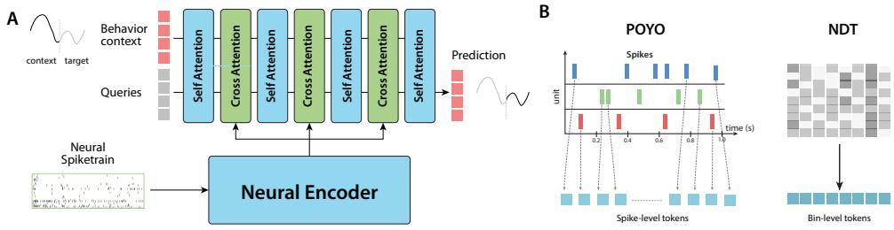  
Figure 1: Overview of BEEMO: (A) Architecture: Behavioral context and query tokens pass through alternating selfattention and cross-attention layers. The behavioral and neural components are decoupled: the behavior decoder operates independently on unpaired behavioral data, and neural latents are incorporated via cross-attention when available. (B) Neural Encoders: POYO (left) represents neural activity as spike-level tokens, where each spike is embedded with its timing and unit identity. NDT\* (right) represents neural activity as bin-level tokens, aggregating spikes into fixed time bins across units.

## 2 Method

A central challenge in neural decoding is the limited availability of paired neural and behavioral recordings. In contrast, collecting behavioral data is significantly more scalable, as it does not rely on invasive hardware. We leverage this data asymmetry by designing a framework capable of learning from both isolated behavioral trajectories and paired neural-behavioral trajectories. This is enabled by a modular architecture whose behavioral and neural components can be trained independently or jointly, depending on data availability.

Our approach is grounded in two key observations:

• Behavioral priors: Motor behavior exhibits strong temporal autocorrelation, making past observations highly predictive of future states. A behavior-forecasting objective exploits this structure, to capture movement dynamics and biomechanical regularities from behavioral data.

• Neural conditioning: Neural activity conditions the behavioral decoder, providing the neuralspecific control signal that resolves ambiguity in the decoded trajectory [23, 24] beyond what behavioral context alone can determine.

## 2.1 Problem Setup

We consider trajectories of neural activity and behavioral measurements observed over time, where the model takes either or both modalities as input context and predicts behavior as output.

Neural data: Spike-sorted neural recordings are represented as sets of time-stamped spike events across a population of neurons. Each observation is a collection of $N _ { s }$ tuples $\{ ( t _ { i } , n _ { i } ) \} _ { i = 1 } ^ { N _ { s } }$ , where $t _ { i }$ denotes the spike timestamp and $n _ { i }$ indexes neuron identity. The number of neurons and their identities may vary across sessions, with no cross-session neuron alignment assumed.

Behavioral data: Behavior is represented as a multivariate time series $\{ b _ { t } \} _ { t = 1 } ^ { T }$ , where $b _ { t } \in \mathbb { R } ^ { d _ { b } }$ denotes behavioral variables (e.g., kinematics, cursor position, or force) at time t. Across training regimes, past observations serve as context, future timesteps serve as prediction targets, or both.

Evaluation protocol: At test time, consistent with standard neural decoding benchmarks [25, 26], the model receives neural activity over a context window $[ 0 , T _ { \mathrm { c t x } } ]$ and predicts the corresponding behavior over the same window, with no behavioral context provided as input.

## 2.2 Architecture

BEEMO is composed of two main components: a neural encoder that compresses spike population activity into a compact set of latent tokens, and a behavior decoder that predicts behavior at target timesteps from available input context. The two components interact via cross-attention, where the behavior decoder optionally conditions on the neural latents. Formally:

$$
\hat { y } _ { t } = \mathrm { B E E M O } \left( H _ { \mathrm { c t x } } ; H _ { \mathrm { n e u r a l } } \right) ,\tag{1}
$$

where $H _ { \mathrm { c t x } }$ denotes behavioral context tokens, $H _ { \mathrm { n e u r a l } }$ denotes neural latent tokens, and either input is optional but at least one must be present. This modularity enables the asymmetric training strategy in Section 2.3.

Neural encoder. The neural encoder maps spike population activity over a context window $[ 0 , T _ { \mathrm { c t x } } ]$ to a fixed set of M latent tokens:

$$
H _ { \mathrm { n e u r a l } } = { \mathrm { N e u r a l E n c o d e r } } { \big ( } \{ ( t _ { i } , n _ { i } ) \} _ { t _ { i } \in [ 0 , T _ { \mathrm { c u } } ] } { \big ) } \in \mathbb { R } ^ { M \times d } .\tag{2}
$$

Any encoder that maps neural data to a fixed-size token set can serve in this role [2, 5, 27]. In this work, we consider two neural encoders that differ primarily in their tokenization scheme. We refer the reader to Appendix A.1 for further details.

• POYO [1]: operates on raw spike times. Each spike $( t _ { i } , n _ { i } )$ is represented by a learnable neuron identity embedding with spike timing encoded via RoPE [28] (see Appendix A.2 for details). Because the number of spikes is variable, POYO uses cross-attention as its first layer, attending from a fixed set of M learnable latent tokens over the spike token embeddings $S ~ \in \mathbb { R } ^ { N _ { s } \times \breve { d } }$ followed by L layers of self-attention to produce $H _ { \mathrm { n e u r a l } } \in \mathbf { \mathbb { R } } ^ { M \times d }$

$N D T ^ { * } \ [ 2 2 { \cal J } { : }$ is a supervised modified variant of the Neural Data Transformer that operates on binned spike counts, producing a fixed-size sequence of $T _ { b }$ bin tokens $\boldsymbol { X } \in \mathbb { R } ^ { T _ { b } \times d }$ via a learned unit-weighted aggregation scheme (see Appendix A.1 for details). Since the input is already a fixed-size sequence, all layers use self-attention. Our modified variant incorporates unit stitching [2, 3] and RoPE [28], and uses a cross-attention decoder following [1]. We denote this model as $\mathrm { N D T ^ { * } }$ to distinguish it from the original.

Behavior decoder. The behavior decoder operates on two sets of tokens: context tokens derived from past behavioral observations, and prediction tokens at target timesteps whose values are to be predicted. Past behavioral observations $\{ b _ { \tau } \} _ { \tau < t }$ are linearly projected into the model dimension to give context tokens $H _ { \mathrm { c t x } } ~ \in ~ \mathbb { R } ^ { C \times d }$ Prediction tokens $H _ { \mathrm { p r e d } } \ \in \ \mathbb { R } ^ { Q \times d }$ are initialized from a learned session embedding at each target timestep. Both sets are augmented with rotary position encodings [28] and concatenated into a single sequence of $N = C + \breve { Q }$ tokens:

$$
\begin{array} { r } { H _ { \mathrm { b e h a v } } ^ { ( 0 ) } = \left[ H _ { \mathrm { c t x } } , \ H _ { \mathrm { p r e d } } \right] \in \mathbb { R } ^ { N \times d } . } \end{array}\tag{3}
$$

This sequence is processed through K transformer blocks. Within each block, self-attention operates over all behavioral tokens, followed by cross-attention where the behavioral tokens serve as queries and the neural latents $H _ { \mathrm { n e u r a l } }$ serve as keys and values:

$$
\hat { H } ^ { ( k ) } = \mathrm { S e l f A t t n } \Big ( H _ { \mathrm { b e h a v } } ^ { ( k ) } \Big ) , H _ { \mathrm { b e h a v } } ^ { ( k + 1 ) } = \mathrm { C r o s s A t t n } \Big ( \hat { H } ^ { ( k ) } , H _ { \mathrm { n e u r a l } } \Big )\tag{4}
$$

The cross-attention step is skipped when no neural data is present. After K blocks, a final self-attention layer is applied over all tokens, after which the prediction tokens are extracted and passed through a linear readout head to produce $\hat { y } _ { t } \in \mathbb { R } ^ { d _ { b } }$

## 2.3 Training

The modular design of BEEMO enables a flexible training strategy that exploits the data asymmetry described above. All three training regimes, behavior-only, joint, and neural-only (via behavior dropout, described below), share the same regression loss: $\begin{array} { r } { \mathcal { L } ~ = ~ \sum _ { t } \left\| \hat { y } _ { t } - y _ { t } \right\| _ { 2 } ^ { 2 } } \end{array}$ , where $\hat { y } _ { t }$ is the predicted behavior and $y _ { t }$ is the ground truth.

Asymmetric training. Depending on the available input context, the model operates in different modes: when only behavioral data is present, the cross-attention step is skipped; when spike data is available, the behavior decoder additionally conditions on the neural latents via cross-attention. This allows a batch to contain a mix of behavior-only and paired sessions, enabling large behavioral datasets to be combined with limited paired recordings within a single training run, with no changes to the loss or architecture.

Behavior dropout. Following prior work and established evaluation protocols, no behavioral context is provided at test time, and the model must rely solely on neural data to reconstruct behavior. Since BEEMO can condition on both neural and behavioral context, this introduces a train-test distribution shift. Without any intervention, the decoder would always have access to behavioral context during training but none at evaluation. To ensure the model can decode from neural activity alone at evaluation, we apply behavior dropout during training. With probability $p _ { \mathrm { d r o p } } .$ , the behavioral context tokens are masked out for paired sessions, forcing the decoder to rely solely on the neural latents and session embeddings to reconstruct behavior. We evaluate the effectiveness of behavior dropout by ablating it in Section 3.7.

## 3 Results

We evaluate BEEMO across three settings. First, we limit neural data and examine whether behavioral pretraining can compensate, reducing reliance on large neural recording datasets. Second, we investigate whether the composition of the behavioral pretraining set matters, and whether incorporating task-matched behavioral data improves transfer. Finally, we remove neural pretraining entirely and evaluate how well a behavior-only pretrained model performs when fine-tuned for neural decoding.

## 3.1 Experimental setup

We evaluate on multiple datasets spanning three tasks: center-out reaching (CO) [18, 19], randomtarget reaching (RT) [18], and isometric wrist (IW) [20, 29], covering a range of behavioral complexity (see Appendix C for full dataset details). Evaluation is performed on held-out animals not seen during pretraining, and performance is reported using $R ^ { 2 }$ . Following the evaluation protocol used in [1, 30], for each session, we concatenate predictions and ground-truth values across all held-out test trials and compute a single session-level $R ^ { \hat { 2 } }$ . We then report the unweighted mean across sessions, so that each session contributes equally regardless of the number or duration of its test trials. Unlike prior work, we use a causal train/test split and do not apply trial-based loss weighting, which we believe better reflects realistic deployment settings. As a result, our results are not directly comparable to previously reported numbers, even on the same datasets. All baselines were tuned via extensive hyperparameter search; implementation details and search spaces are provided in Appendix B and Appendix D.

We compare against two categories of baselines: (i) single-session fully supervised models (Linear, MLP, GRU, POYO-SS, NDT\*-SS) trained on paired neural and behavioral data from a single session, and (ii) multi-session supervised models (POYO, NDT\*) trained jointly across sessions.1 We additionally compare against classical Kalman-filter decoders and POYO with post hoc Kalman smoothing in Appendix E.2. The single-session models are highly sensitive to session-specific hyperparameters and therefore undergo extensive tuning independently for each held-out session, making them strong but computationally expensive baselines.2 Our primary comparisons are therefore against the corresponding multi-session backbones. Since BEEMO is modular, we evaluate it with both POYO and NDT\* backbones, denoted BEEMO-POYO and BEEMO-NDT\* respectively. In each case, the only difference from the corresponding multi-session model is access to unpaired behavioral data during pretraining. We additionally ablate BEEMO under different training regimes in Section 3.5 and with varying amounts of neural data in Section 3.3.

Finetuning protocol. All pretrained models were finetuned using a gradual unfreezing strategy. We first train only newly initialized session-specific parameters (unit embeddings and session embeddings) while keeping the pretrained backbone frozen. After a fixed number of epochs, we unfreeze the backbone and continue training all parameters jointly. (Refer to Appendix B for details.)

## 3.2 Leveraging unpaired behavioral data to improve motor decoding

A central challenge in scaling neural decoders is the high cost of obtaining paired neural recordings. We show that performance can be improved by incorporating additional unpaired behavioral data. We compare NDT\* and POYO base models against our BEEMO variants, which utilize ∼6.5 hours of additional behavior during pretraining. When trained on the CO task, the BEEMO models improve performance in both within-task evaluation on CO and cross-task transfer to RT and IW. As shown in Table 1, both BEEMO-POYO and BEEMO-NDT\* outperform their respective multi-session backbones on all tasks, with significant gains in cross-task transfer. BEEMO-POYO significantly improves over POYO on RT (paired $\Delta \bar { R ^ { 2 } } = + 0 . 0 1 1 2 )$ and IW (+0.0124), while BEEMO-NDT\* significantly improves over NDT\* on RT (+0.0134). The paired improvement for BEEMO-NDT\* on IW is smaller and not significant (+0.0035), which we examine further in Section 3.4. Improvements on the CO task are relatively modest for both models, likely because performance on this withintask evaluation is already near saturation. Session-wise statistics and exact p-values are reported in

Table 1: Asymmetric training results. All multi-session models are pretrained on center-out (CO) reaching data and evaluated on within-task (CO) and cross-task (RT, Isometric Wrist) transfer. BEEMO variants incorporate ∼6.5 hours of additional unpaired behavioral data during pretraining, while base models use paired neural-behavioral data only. Performance is reported as mean ± SEM over three seeds. Paired ∆ reports the mean paired difference in $R ^ { 2 }$ between each BEEMO variant and its matched backbone across held-out sessions. Bold indicates a significant improvement $( p < 0 . 0 5$ , two-sided paired t-test). Session-wise mean $\pm \ : \mathrm { S D }$ and exact p-values are reported in Table A7.
<table><tr><td rowspan="2">Method</td><td>Within-Task</td><td colspan="2">Cross-Task</td></tr><tr><td>CO</td><td>RT</td><td>Isometric Wrist</td></tr><tr><td>Single-Session</td><td></td><td></td><td></td></tr><tr><td>Linear</td><td> $0 . 6 8 1 6 \pm 0 . 0 0 1 1$ </td><td> $0 . 6 1 4 6 \pm 0 . 0 0 0 3$ </td><td> $0 . 5 8 2 6 \pm 0 . 0 0 0 6$ </td></tr><tr><td>MLP</td><td> $0 . 8 9 9 5 \pm 0 . 0 0 1 4$ </td><td> $0 . 7 4 7 7 \pm 0 . 0 0 1 4$ </td><td> $0 . 7 3 9 2 \pm 0 . 0 0 3 5$ </td></tr><tr><td>GRU</td><td> $0 . 9 1 0 0 \pm 0 . 0 0 1 5$ </td><td> $0 . 7 8 3 9 \pm 0 . 0 0 1 6$ </td><td> $0 . 7 8 8 8 \pm 0 . 0 0 1 1$ </td></tr><tr><td>POYO-SS</td><td> $0 . 8 4 3 8 \pm 0 . 0 0 3 0$ </td><td> $0 . 7 2 1 9 \pm 0 . 0 1 0 1$ </td><td> $0 . 6 9 6 7 \pm 0 . 0 0 6 3$ </td></tr><tr><td>NDT*-SS</td><td> $0 . 8 8 2 7 \pm 0 . 0 0 0 2$ </td><td> $0 . 7 6 9 3 \pm 0 . 0 0 0 7$ </td><td> $0 . 7 7 4 9 \pm 0 . 0 0 1 2$ </td></tr><tr><td>Multi-Session (NDT*)</td><td></td><td></td><td></td></tr><tr><td>NDT*</td><td> $0 . 9 0 1 0 \pm 0 . 0 0 3 2$ </td><td> $0 . 7 6 0 0 \pm 0 . 0 0 6 2$ </td><td> $0 . 7 7 6 7 \pm 0 . 0 0 1 7$ </td></tr><tr><td>BEEMO-NDT*</td><td> $0 . 9 0 2 7 \pm 0 . 0 0 1 6$ </td><td> $0 . 7 7 3 4 \pm 0 . 0 0 1 8$ </td><td> $0 . 7 8 0 2 \pm 0 . 0 0 0 1$ </td></tr><tr><td>Paired ∆</td><td> $+ 0 . 0 0 1 7$ </td><td> $\mathbf { + 0 . 0 1 3 4 }$ </td><td> $+ 0 . 0 0 3 5$ </td></tr><tr><td>Multi-Session (POYO)</td><td></td><td></td><td></td></tr><tr><td>POYO</td><td> $0 . 8 9 7 3 \pm 0 . 0 0 1 3$ </td><td> $0 . 7 4 9 8 \pm 0 . 0 0 1 5$ </td><td> $0 . 7 2 3 7 \pm 0 . 0 0 1 8$ </td></tr><tr><td>BEEMO-POYO</td><td> $0 . 9 0 3 1 \pm 0 . 0 0 0 3$ </td><td> $0 . 7 6 0 9 \pm 0 . 0 0 1 4$ </td><td> $0 . 7 3 6 1 \pm 0 . 0 0 2 0$ </td></tr><tr><td>Paired ∆</td><td> $+ 0 . 0 0 5 8$ </td><td> ${ \bf + 0 . 0 1 1 2 }$ </td><td> $\mathbf { + 0 . 0 1 2 4 }$ </td></tr></table>

Appendix E.1. Since BEEMO and the base models share the same underlying architecture, these gains are attributable to the use of unpaired behavioral data during pretraining rather than any architectural advantage. We further confirm this in Section 3.7, where replacing $\mathrm { P O Y O ^ { \circ } s }$ decoder with BEEMO’s deeper decoder, without access to additional unpaired behavioral data, does not improve performance.

## 3.3 Scaling analysis

We investigate how BEEMO scales with the amount of available neural data. We fix the behavioral pretraining budget for BEEMO to all available CO behavioral data, vary the number of neural sessions, and evaluate cross-task transfer to RT and IW (Figure 2). The base performance at each operating point is set by the underlying POYO and $\mathrm { N D T ^ { * } }$ backbones, and since the behavioral data is held fixed throughout, any gain over these baselines reflects how well the cross-attention interface learns to exploit the pretrained behavioral representations as a function of neural data. Interestingly, the two neural encoders exhibit qualitatively different scaling behavior. BEEMO-NDT\* benefits increasingly from additional neural sessions, with the gap over the $\mathrm { N D T ^ { * } }$ backbone widening as more paired data becomes available, suggesting that its cross-attention layers continue to improve as they are exposed to more neural supervision. BEEMO-POYO, by contrast, maintains a roughly constant offset over the POYO backbone across all session counts, and does not scale with additional neural data, suggesting the cross-attention interface is unable to further leverage the pretrained behavioral representations as more sessions become available. We believe these differences arise from the distinct tokenization schemes of the two encoders, though a thorough investigation is left for future work. Despite this difference in scaling behavior, both BEEMO-NDT\* and BEEMO-POYO improve over their respective backbones at every neural data budget. Notably, BEEMO matches the full-data performance of both POYO and NDT\* backbones using as few as 32 neural sessions (∼7 hours of paired data), roughly 3× less neural data than the full budget of 105 sessions (∼22.5 hours). This demonstrates that unpaired behavioral pretraining can effectively substitute for a substantial portion of expensive neural recordings, significantly reducing the data requirements for strong decoding

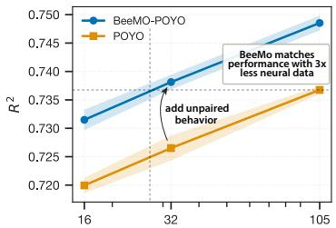

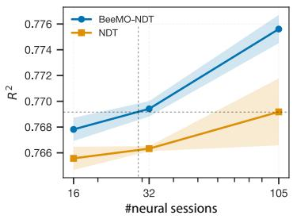  
Figure 2: Scaling Analysis: Average cross-task decoding performance $( R ^ { 2 }$ averaged across RT and IW tasks) as a function of the number of paired neural sessions used during pretraining (models pretrained on CO). Top: BEEMO-POYO versus POYO. Bottom: BEEMO-NDT\* versus NDT\*. BEEMO outperforms both POYO and NDT\* at matched neural data budgets by leveraging unpaired behavioral data during pretraining. Notably, BEEMO matches the performance of POYO and $\mathrm { N D T ^ { * } }$ using approximately 3× less neural data. Shaded regions denote SEM over three seeds.

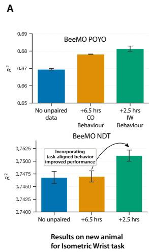

B  
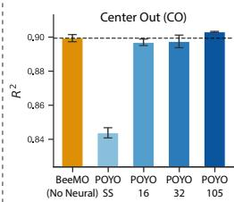

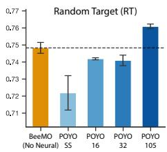

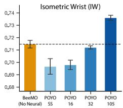

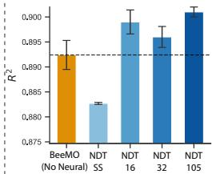

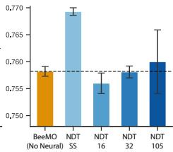

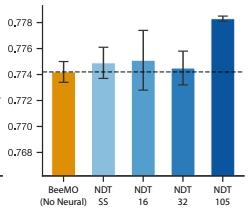  
		    
Figure 3: Behavioral pretraining improves neural decoding. Error bars denote SEM over three seeds. (A) Task-specific behavioral data: Adding task-matched behavioral data (IW) to the pretraining corpus consistently improves downstream decoding performance on the IW task on a new animal for both BEEMO-POYO and BEEMO-NDT\*. (B) Behavior-only pretraining: Decoding performance across three tasks (CO, RT, IW) for single-session models and multi-session neuralpretrained models, compared against BEEMO with no neural pretraining (behavior-only).

## 3.4 Effect of incorporating task-specific behavioral data

Having established that unpaired behavioral data improves decoding performance, we next ask whether the composition of that pretraining corpus matters. We hypothesize that behavioral data drawn from the target task distribution carries more signal for downstream transfer than equivalent data from another task which might have different patterns and dynamics. To test this, we augment the pretraining corpus with 2.5 hours of additional IW-task behavioral data from [20] and evaluate transfer on 7 sessions from a held-out animal. As shown in Figure 3A, task-matched behavioral pretraining consistently improves downstream decoding for both BEEMO-POYO and BEEMO-NDT\* (green versus orange), yielding gains of approximately 0.015 and 0.0035 (R2), respectively. This effect is particularly pronounced for BEEMO-NDT\*, where adding 6 hours of CO behavioral data produces no significant improvement on IW task, whereas adding only 2.5 hours of IW behavioral data leads to a substantial performance boost. This suggests that the benefits of behavioral pretraining depend not only on the quantity of behavioral data, but also on its composition and alignment with the downstream task distribution. More broadly, these results indicate that task-specific behavioral data can be collected independently of neural recordings and leveraged during pretraining to improve neural decoding performance. We observe a similar benefit from adding task-specific behavioral data on RT in Appendix E.3.

## 3.5 Behavior-only pretraining

The asymmetric training results raise a natural follow-up question: howfar can behavioral data alone take us in the absence ofneural pretraining? To study this, we pretrain a behavior decoder on largescale behavioral data without access to neural recordings, and then fine-tune randomly initialized neural encoder and cross-attention layers using paired neural-behavioral data from the target session only. As shown in Figure 3B, behavior-pretrained representations provide a strong inductive bias for neural decoding. Behavior-only BEEMO-POYO consistently outperforms its single-session baseline despite using the same amount of paired neural data, suggesting that behavioral pretraining alone can meaningfully improve decoding. For BEEMO-NDT\*, even joint neural-behavioral pretraining struggles to outperform the single-session NDT\* baseline across most tasks3. However, in CO task both joint and behavior-only BEEMO-NDT\* show significant improvements over the single-session baseline, mirroring the pattern observed for POYO. Remarkably, behavior-only BEEMO-POYO matches and sometimes exceeds POYO pretrained on 32 sessions of joint neural-behavioral data (7 hours of CO neural recordings), despite using no neural pretraining data at all. In general behavioronly BEEMO get competitive performance without access to any neural pretraining. These findings suggest that a substantial portion of the gains commonly attributed to neural pretraining can instead emerge from behavior-only pretraining, offering a more scalable path for neural decoding.

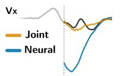

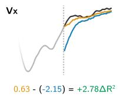

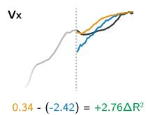

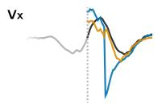

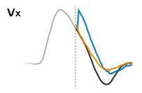

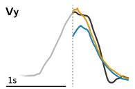

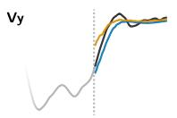

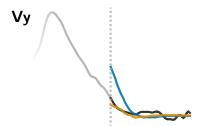

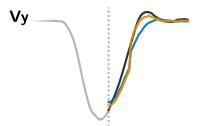

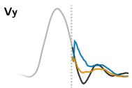  
Figure 4: Behavioral context improves neural decoding. Predicted velocity trajectories $( v _ { x } , v _ { y } )$ under neural-only (blue) and joint neural-behavior (orange) context, vs. ground truth (black), across 1 sec decoding windows sorted by $\Delta R ^ { 2 }$ (largest to smallest improvement). Additional trajectory examples are provided in Figure A2 in the Appendix.

## 3.6 How much does providing past behavior improve decoding?

Behavior exhibits strong temporal continuity, motivating the question of whether past behavioral context can improve decoding beyond neural activity alone. To study this, we compare neural-only decoding with joint neural-behavior decoding. As shown in Figure 4, neural-only context captures the general timing and direction of movements but often produces jerky and poorly scaled trajectories, leading to large amplitude and smoothness errors. This effect is particularly pronounced near the beginning of the decoding window, where the model has little preceding neural context. As the window progresses, more neural history becomes available and neural-only predictions improve, eventually approaching the joint model.

In contrast, past behavioral context (preceding 1 sec) immediately grounds the prediction in the current behavioral state, producing substantially smoother and more coherent trajectories with improved amplitude calibration and more accurate trajectory initialization. Predicted onsets align more closely with the target signal from the start of the decoding window, suggesting that behavioral context provides a strong dynamical prior over plausible kinematic trajectories.

## 3.7 Ablations

To isolate the contribution of our asymmetric training strategy from the minor architectural modifications introduced in BEEMO, we conduct two targeted ablations.

Table 2: Ablation study: Values are reported as mean ± SEM across three seeds.

Behavior dropout. At test time, no behavioral context is provided, making behavior dropout critical for BEEMO to perform well under standard evaluation protocols. We verify this by training BEEMO without behavior dropout and find that performance drops significantly for both variants, with BEEMO-POYO and BEEMO-NDT\* degrading by roughly 6–9% $R ^ { 2 }$ across tasks (Table 2). Notably, these degraded models fall below even their respective base model performances, with BEEMO-POYO and

<table><tr><td rowspan="2">Model Variant</td><td colspan="2">Cross-Task</td></tr><tr><td>RT</td><td>IW</td></tr><tr><td>BEEMO-POYO</td><td> $0 . 7 6 0 9 \pm \mathrm { 0 . 0 0 1 4 }$ </td><td> $0 . 7 3 6 1 \pm \mathrm { 0 . 0 0 2 0 }$ </td></tr><tr><td>w/o dropout</td><td> $0 . 6 9 2 5 \pm \mathbf { 0 . 0 1 3 3 }$ </td><td> $0 . 6 8 9 8 { \scriptstyle \pm 0 . 0 0 3 5 }$ </td></tr><tr><td>w/o unpaired</td><td> $0 . 7 4 7 6 \pm \mathrm { 0 . 0 0 1 2 }$ </td><td> $0 . 6 8 4 9 \pm \mathbf { 0 . 0 0 1 7 }$ </td></tr><tr><td>BEEMO-NDT*</td><td> $0 . 7 7 3 4 \pm \mathrm { 0 . 0 0 1 8 }$ </td><td> $0 . 7 8 0 2 \pm \mathrm { { 0 . 0 0 0 1 } }$ </td></tr><tr><td>w/o dropout</td><td> $0 . 7 1 0 1 \pm \mathrm { 0 . 0 0 8 3 }$ </td><td> $0 . 7 2 6 6 \pm \mathbf { 0 . 0 0 1 9 }$ </td></tr><tr><td>w/o unpaired</td><td> $0 . 7 6 8 3 \pm \mathrm { 0 . 0 0 3 0 }$ </td><td> $0 . 7 7 5 7 \pm \mathbf { 0 . 0 0 1 1 }$ </td></tr></table>

BEEMO-NDT\* dropping by 0.0573 and 0.0499 $R ^ { 2 }$ below POYO and $\mathrm { N D T ^ { * } }$ on RT respectively (Refer Table 2 and 1). This confirms that without behavior dropout, the additional unpaired behavioral data not only fails to help but actively hurts performance due to the distribution shift between train and test.

Decoder capacity. BEEMO uses a deeper behavior decoder than the base neural encoders, consisting of alternating self-attention and cross-attention layers, compared to the single cross-attention decoder used in both POYO and NDT\*. This difference in capacity could in principle account for some of the observed performance gains. To disentangle decoder capacity from the effect of unpaired behavioral data, we replace the default decoder in both POYO and NDT\* with BEEMO’s alternating self-attention and cross-attention decoder while keeping the original training regime with no access to unpaired behavioral data. As shown in Table 2, this model does not recover BEEMO’s performance and in fact leads to a slight degradation relative to the base models, most notably for the POYO variant which drops by 0.0388 $\mathbf { \bar { \boldsymbol { R } } ^ { 2 } }$ on IW, likely due to the increased model capacity without a corresponding increase in training data. This demonstrates that the performance gains of BEEMO stem from the additional unpaired data rather than the increased decoder capacity.

## 4 Related Work

Neural decoding and its applications. Neural decoding aims to recover behavior, sensory variables, or cognitive states from neural activity [31, 32]. This has implications in both our understanding of where different signals or information is processed and how, and also in brain computer interfaces for assisting users in different tasks by leveraging their brain activity.

Classical methods for the neural decoding of movement ranged from population-vector and linear estimators to Wiener filters and probabilistic state-space models, including Kalman and pointprocess filters [15, 33–36]. Early nonlinear extensions used artificial and recurrent neural networks [37, 38], while more recent work has adopted increasingly flexible machine-learning architectures [32, 39]. More recent methods seek representations that generalize across recording sessions or subjects by learning shared neural dynamics [23, 40, 41], using distribution or contrastive alignment [42–46], or through pretraining on large collections of neural recordings [3, 22, 47–49]. Despite differing architectures, these approaches generally build decoders through paired neural-behavioral observations and do not leverage unpaired behavioral data for pretraining.

Behavioral dynamics as a prior for neural decoding. Using temporal structure in behavior to constrain neural decoding has a long history, particularly in motor brain–computer interfaces. Kalman decoders combine a neural observation model with an explicit state-space model of behavioral dynamics, producing trajectories that are consistent both with the observed neural activity and with assumptions such as smooth, approximately linear evolution of position and velocity [15]. This framework has been extended in a number of ways including the use of switching dynamics [50] and feedback-intention recalibration [51]. These methods demonstrate the value of a behavioral prior, but typically specify a low-dimensional dynamical model for a particular task and output space.

Behavioral structure has also been exploited at the distributional level to align neural activity across days or animals [42, 44, 52, 53]. Such approaches can be effective when the sessions are collected during closely matched tasks, such as stereotyped center-out reaches or maze tasks, but depend heavily on correspondence between the behavioral distributions being aligned. BEEMO instead learns behavioral dynamics directly from diverse, unpaired trajectories and uses paired recordings only to map neural activity into the learned behavioral space. This replaces a fixed task-specific dynamical prior with a reusable, data-driven representation of behavior.

Self-supervised representation learning for behavior. One line of work seeks to discover recurring structure in behavior: MoSeq [54] and B-SOiD [55] segment continuous behavior into discrete motifs, while SKIL [56] models behavior as continuous compositions of reusable motor primitives. Complementary approaches learn continuous behavioral representations, using generative or reconstruction-based objectives in BehaveNet [57] and VAME [58], and self-supervised objectives in BAMS [59] and BEAST [60]. These studies demonstrate that unlabeled behavioral data contain rich temporal structure that can support downstream analysis, but do not link behavior to neural recordings.

Non-neural pretrained models as decoding priors. Related BCI approaches use models trained on abundant non-neural data to constrain decoding from scarce paired recordings. Speech BCIs incorporate language models to rerank or correct decoded sequences [61–63], or map neural activity into representations learned by pretrained audio and speech models [64, 65]. Similarly, visual decoding methods map fMRI activity into the latent or conditioning spaces of pretrained image models such as Stable Diffusion and CLIP [66, 67]. BEEMO follows the broader principle of separating large-scale non-neural learning from neural decoding. Rather than using an existing linguistic or perceptual model as an output prior, however, it learns the behavioral representation itself from unpaired movement data and then aligns neural activity to that space.

## 5 Conclusion

In this paper, we introduced BEEMO, a modular pretraining framework that leverages unpaired behavioral data to improve neural decoding across diverse tasks and animals. Its modular design allows any neural encoder to benefit from behavioral pretraining without architectural modifications. Across multiple datasets and decoding tasks, we show that behavioral pretraining provides a strong inductive bias for neural decoding and that unpaired behavioral data can partially substitute for expensive paired recordings. BEEMO matches cross-task performance of fully trained neural decoders using 3x less neural data and more unpaired behavior data, enabling competitive performance with substantially fewer neural sessions.

A central property of BEEMO is the decoupling of behavioral and neural representation learning. The behavior decoder is pretrained independently and interfaces with neural encoders through a fixed-size latent bottleneck, allowing improvements in neural encoders to transfer directly without retraining the behavior model. This design enables flexible integration with different encoder architectures and isolates the contribution of behavioral pretraining from architectural changes. In our experiments, BEEMO improves over matched POYO and NDT baselines despite using the same underlying neural encoder, indicating that the gains arise from behavioral pretraining rather than encoder capacity.

More broadly, our results indicate that substantial components of decoding performance can be learned independently of neural recordings: a decoder pretrained entirely on behavior achieves performance comparable to models pretrained on substantially larger neural datasets after limited finetuning. This asymmetry mirrors neuroscience itself, where behavioral characterization often precedes large-scale neural recording by months or years, resulting in far larger corpora of behavioral observations than paired neural-behavioral datasets. As neural encoders continue to improve in cross-subject generalization [27], behavior-pretrained decoders provide a complementary path toward more transferable neural decoding systems.

Limitations and future work. Our study primarily considers motor decoding, where behavioral targets exhibit strong temporal structure. An important next step is to test whether the benefits of behavioral pretraining extend to broader settings, including recent benchmarks spanning brain-wide and multi-region recordings [26]. In addition, BEEMO requires an observable temporal target or meaningful behavioral proxy, and therefore does not directly apply to cognitive states without such measurements. Our experiments are also largely based on structured, task-driven datasets. Extending BEEMO to unconstrained, freely moving behavior may require richer behavioral representations that capture more heterogeneous and hierarchical structure. BEEMO also incurs greater training cost than simple post hoc dynamics models such as Kalman smoothing, although these models are less flexible across tasks and datasets with different behavioral dynamics or sampling rates (Appendix E.2). More broadly, we view BEEMO as an initial demonstration of how large-scale behavioral pretraining can support neural decoding. Recent work has explored learning general-purpose representations of behavior from large unlabeled datasets [59, 68, 69], and our results suggest that such representations can provide useful priors for decoding even in the absence of paired neural data. Looking forward, we expect the utility of behavioral pretraining to increase as both behavioral foundation models and transferable neural encoders continue to improve.

## Acknowledgments and Disclosure of Funding

We thank Konrad Körding, Mehdi Azabou and Keertika Saroj for insightful discussions and feedback on this manuscript. This project was supported by NSF CAREER Award RI:2146072, NIH grant 1RF1MH140429, as well as generous gifts from the CIFAR Learning in Machines & Brains Program. This work would not have been possible without the computing resources provided by the Penn Advanced Research Computing Center (PARCC) at the University of Pennsylvania. This work also used resources available through the National Research Platform (NRP) [70] at the University of California, San Diego. NRP has been developed, and is supported in part, by funding from National Science Foundation, from awards 1730158, 1540112, 1541349, 1826967, 2112167, 2100237, and 2120019, as well as additional funding from community partners.

## References

[1] Mehdi Azabou, Vinam Arora, Venkataramana Ganesh, Ximeng Mao, Santosh Nachimuthu, Michael Mendelson, Blake Richards, Matthew Perich, Guillaume Lajoie, and Eva Dyer. A unified, scalable framework for neural population decoding. Advances in Neural Information Processing Systems, 36, 2024.

[2] Joel Ye, Jennifer Collinger, Leila Wehbe, and Robert Gaunt. Neural data transformer 2: multicontext pretraining for neural spiking activity. Advances in Neural Information Processing Systems, 36, 2024.

[3] Yizi Zhang, Yanchen Wang, Donato M Jiménez-Benetó, Zixuan Wang, Mehdi Azabou, Blake Richards, Renee Tung, Olivier Winter, Eva Dyer, Liam Paninski, et al. Towards a" universal translator" for neural dynamics at single-cell, single-spike resolution. Advances in Neural Information Processing Systems, 37:80495–80521, 2024.

[4] Ian Jarratt Knight, Vinam Arora, Mehdi Azabou, Zihao Chen, and Eva L Dyer. Unified pretraining on mixed optophysiology and electrophysiology data across brain regions. In NeurIPS 2025 Workshop on Foundation Modelsfor the Brain and Body, 2025.

[5] Avery Hee-Woon Ryoo, Nanda H Krishna, Ximeng Mao, Mehdi Azabou, Eva L Dyer, Matthew G Perich, and Guillaume Lajoie. Generalizable, real-time neural decoding with hybrid state-space models. Advances in Neural Information Processing Systems, 38:51764–51791, 2026.

[6] Alec Radford, Jong Wook Kim, Chris Hallacy, Aditya Ramesh, Gabriel Goh, Sandhini Agarwal, Girish Sastry, Amanda Askell, Pamela Mishkin, Jack Clark, et al. Learning transferable visual models from natural language supervision. In International conference on machine learning, pages 8748–8763. PmLR, 2021.

[7] Jean-Baptiste Alayrac, Jeff Donahue, Pauline Luc, Antoine Miech, Iain Barr, Yana Hasson, Karel Lenc, Arthur Mensch, Katherine Millican, Malcolm Reynolds, et al. Flamingo: a visual language model for few-shot learning. Advances in neural information processing systems, 35: 23716–23736, 2022.

[8] Junnan Li, Dongxu Li, Silvio Savarese, and Steven Hoi. Blip-2: Bootstrapping language-image pre-training with frozen image encoders and large language models. In International conference on machine learning, pages 19730–19742. PMLR, 2023.

[9] Alexei Baevski, Yuhao Zhou, Abdelrahman Mohamed, and Michael Auli. wav2vec 2.0: A framework for self-supervised learning of speech representations. Advances in neural information processing systems, 33:12449–12460, 2020.

[10] Alec Radford, Jong Wook Kim, Tao Xu, Greg Brockman, Christine McLeavey, and Ilya Sutskever. Robust speech recognition via large-scale weak supervision. In International conference on machine learning, pages 28492–28518. PMLR, 2023.

[11] Alexander Mathis, Pranav Mamidanna, Kevin M Cury, Taiga Abe, Venkatesh N Murthy, Mackenzie Weygandt Mathis, and Matthias Bethge. Deeplabcut: markerless pose estimation of user-defined body parts with deep learning. Nature neuroscience, 21(9):1281–1289, 2018.

[12] Talmo D Pereira, Nathaniel Tabris, Arie Matsliah, David M Turner, Junyu Li, Shruthi Ravindranath, Eleni S Papadoyannis, Edna Normand, David S Deutsch, Z Yan Wang, et al. Sleap: A deep learning system for multi-animal pose tracking. Nature methods, 19(4):486–495, 2022.

[13] Markus Meister. Learning, fast and slow. Current opinion in neurobiology, 75:102555, 2022.

[14] Lukas T Oesch, Michael B Ryan, and Anne K Churchland. From innate to instructed: A new look at perceptual decision-making. Current Opinion in Neurobiology, 86:102871, 2024.

[15] Wei Wu, M Black, Yun Gao, M Serruya, A Shaikhouni, J Donoghue, and Elie Bienenstock. Neural decoding of cursor motion using a kalman filter. Advances in neural information processing systems, 15, 2002.

[16] Krishna V Shenoy, Maneesh Sahani, and Mark M Churchland. Cortical control of arm movements: a dynamical systems perspective. Annual review of neuroscience, 36(1):337–359, 2013.

[17] Byron M Yu, Caleb Kemere, Gopal Santhanam, Afsheen Afshar, Stephen I Ryu, Teresa H Meng, Maneesh Sahani, and Krishna V Shenoy. Mixture of trajectory models for neural decoding of goal-directed movements. Journal ofneurophysiology, 97(5):3763–3780, 2007.

[18] Matthew G. Perich, Lee E. Miller, Mehdi Azabou, and Eva L. Dyer. Long-term recordings of motor and premotor cortical spiking activity during reaching in monkeys. DANDI Archive, Dandiset 000688, version 0.250122.1735, 2025. URL https://dandiarchive.org/dandiset/ 000688/0.250122.1735.

[19] Matthew G. Perich, Juan A. Gallego, and Lee E. Miller. A neural population mechanism for rapid learning. Neuron, 100(4):964–976, 2018. doi: 10.1016/j.neuron.2018.09.030.

[20] Xuan Ma, Fabio Rizzoglio, Kevin L Bodkin, Eric Perreault, Lee E Miller, and Ann Kennedy. Using adversarial networks to extend brain computer interface decoding accuracy over time. elife, 12:e84296, 2023.

[21] Cecilia Gallego-Carracedo, Matthew G Perich, Raeed H Chowdhury, Lee E Miller, and Juan Álvaro Gallego. Local field potentials reflect cortical population dynamics in a region-specific and frequency-dependent manner. Elife, 11:e73155, 2022.

[22] Joel Ye and Chethan Pandarinath. Representation learning for neural population activity with neural data transformers. arXiv preprint arXiv:2108.01210, 2021.

[23] Chethan Pandarinath, Daniel J O’Shea, Jasmine Collins, Rafal Jozefowicz, Sergey D Stavisky, Jonathan C Kao, Eric M Trautmann, Matthew T Kaufman, Stephen I Ryu, Leigh R Hochberg, et al. Inferring single-trial neural population dynamics using sequential auto-encoders. Nature methods, 15(10):805–815, 2018.

[24] Mark M Churchland, John P Cunningham, Matthew T Kaufman, Justin D Foster, Paul Nuyujukian, Stephen I Ryu, and Krishna V Shenoy. Neural population dynamics during reaching. Nature, 487(7405):51–56, 2012.

[25] Felix Pei, Joel Ye, David Zoltowski, Anqi Wu, Raeed H Chowdhury, Hansem Sohn, Joseph E O’Doherty, Krishna V Shenoy, Matthew T Kaufman, Mark Churchland, et al. Neural latents benchmark’21: evaluating latent variable models of neural population activity. arXiv preprint arXiv:2109.04463, 2021.

[26] Alexandre Andre, Shivashriganesh P Mahato, Vinam Arora, Keshav Balaji, Divyansha Lachi, Nanda H Krishna, Jingyun Xiao, Yizi Zhang, Ximeng Mao, Wenrui Ma, et al. Brainwidebench: Benchmarking large-scale pretraining and across-animal transfer in multi-region neural recordings. arXiv preprint arXiv:2609.22064, 2026.

[27] Vinam Arora, Divyansha Lachi, Ian Jarratt Knight, Mehdi Azabou, Blake Aaron Richards, Cole Lincoln Hurwitz, Josh Siegle, and Eva L Dyer. Know thyself by knowing others: Learning neuron identity from population context. In The Thirty-ninth Annual Conference on Neural Information Processing Systems.

[28] Jianlin Su, Murtadha Ahmed, Yu Lu, Shengfeng Pan, Wen Bo, and Yunfeng Liu. Roformer: Enhanced transformer with rotary position embedding. Neurocomputing, 568:127063, 2024.

[29] Xuan Ma, Fabio Rizzoglio, Stephanie Thacker, Christian Ethier, Matthew Perich, and Lee Miller. Data from: Using adversarial networks to extend brain computer interface decoding accuracy over time. Dryad, 2023.

[30] Joel Ye, Jennifer Collinger, Leila Wehbe, and Robert Gaunt. Neural data transformer 2: Multi-context pretraining for neural spiking activity. In Advances in Neural Information Processing Systems, volume 36, 2023. doi: 10.52202/ 075280-3523. URL https://proceedings.neurips.cc/paper\_files/paper/2023/ hash/fe51de4e7baf52e743b679e3bdba7905-Abstract-Conference.html.

[31] Liam Paninski, Jonathan Pillow, and Jeremy Lewi. Statistical models for neural encoding, decoding, and optimal stimulus design. Progress in brain research, 165:493–507, 2007.

[32] Joshua I Glaser, Ari S Benjamin, Raeed H Chowdhury, Matthew G Perich, Lee E Miller, and Konrad P Kording. Machine learning for neural decoding. eneuro, 7(4), 2020.

[33] Apostolos P Georgopoulos, Andrew B Schwartz, and Ronald E Kettner. Neuronal population coding of movement direction. Science, 233(4771):1416–1419, 1986.

[34] Emery N Brown, Loren M Frank, Dengda Tang, Michael C Quirk, and Matthew A Wilson. A statistical paradigm for neural spike train decoding applied to position prediction from ensemble firing patterns of rat hippocampal place cells. The Journal ofNeuroscience, 18(18):7411–7425, 1998.

[35] Uri T Eden, Loren M Frank, Riccardo Barbieri, Victor Solo, and Emery N Brown. Dynamic analysis of neural encoding by point process adaptive filtering. Neural computation, 16(5): 971–998, 2004.

[36] Jayant E Kulkarni and Liam Paninski. State-space decoding of goal-directed movements. IEEE Signal Processing Magazine, 25(1):78–86, 2008.

[37] Johan Wessberg, Christopher R Stambaugh, Jerald D Kralik, Pamela D Beck, Mark Laubach, John K Chapin, Jung Kim, S James Biggs, Mandayam A Srinivasan, and Miguel AL Nicolelis. Real-time prediction of hand trajectory by ensembles of cortical neurons in primates. Nature, 408(6810):361–365, 2000.

[38] Justin C Sanchez, Deniz Erdogmus, Miguel AL Nicolelis, Johan Wessberg, and Jose C Principe. Interpreting spatial and temporal neural activity through a recurrent neural network brainmachine interface. IEEE Transactions on Neural Systems and Rehabilitation Engineering, 13 (2):213–219, 2005.

[39] Jesse A Livezey and Joshua I Glaser. Deep learning approaches for neural decoding across architectures and recording modalities. Briefings in bioinformatics, 22(2):1577–1591, 2021.

[40] Omid G Sani, Bijan Pesaran, and Maryam M Shanechi. Dissociative and prioritized modeling of behaviorally relevant neural dynamics using recurrent neural networks. Nature neuroscience, 27(10):2033–2045, 2024.

[41] Ayesha Vermani, Josue Nassar, Hyungju Jeon, Matthew Dowling, and Il Memming Park. Meta-dynamical state space models for integrative neural data analysis. arXiv preprint arXiv:2410.05454, 2024.

[42] John Lee, Max Dabagia, Eva Dyer, and Christopher Rozell. Hierarchical optimal transport for multimodal distribution alignment. Advances in neural information processing systems, 32, 2019.

[43] Ran Liu, Mehdi Azabou, Max Dabagia, Chi-Heng Lin, Mohammad Gheshlaghi Azar, Keith Hengen, Michal Valko, and Eva Dyer. Drop, swap, and generate: A self-supervised approach for generating neural activity. Advances in neural information processing systems, 34:10587–10599, 2021.

[44] Steffen Schneider, Jin Hwa Lee, and Mackenzie Weygandt Mathis. Learnable latent embeddings for joint behavioural and neural analysis. Nature, 617(7960):360–368, 2023.

[45] Brianna M Karpowicz, Yahia H Ali, Lahiru N Wimalasena, Andrew R Sedler, Mohammad Reza Keshtkaran, Kevin Bodkin, Xuan Ma, Daniel B Rubin, Ziv M Williams, Sydney S Cash, et al. Stabilizing brain-computer interfaces through alignment of latent dynamics. Nature Communications, 16(1):4662, 2025.

[46] Yizi Zhang, Hanrui Lyu, Cole Hurwitz, Shuqi Wang, Charles Findling, Felix Hubert, Alexandre Pouget, International Brain Laboratory, Erdem Varol, and Liam Paninski. Exploiting correlations across trials and behavioral sessions to improve neural decoding. bioRxiv, 2024.

[47] Mehdi Azabou, Vinam Arora, Venkataramana Ganesh, Ximeng Mao, Santosh Nachimuthu, Michael Mendelson, Blake Richards, Matthew Perich, Guillaume Lajoie, and Eva Dyer. A unified, scalable framework for neural population decoding. In Advances in Neural Information Processing Systems, volume 36, 2023. URL https://proceedings.neurips.cc/paper\_files/paper/2023/hash/ 8ca113d122584f12a6727341aaf58887-Abstract-Conference.html.

[48] Yizi Zhang, Yanchen Wang, Mehdi Azabou, Alexandre Andre, Zixuan Wang, Hanrui Lyu, Eva L Dyer, Liam Paninski, Cole Lincoln Hurwitz, et al. Neural encoding and decoding at scale. In Forty-second International Conference on Machine Learning, 2025.

[49] Mehdi Azabou, Krystal Pan, Vinam Arora, Ian Knight, Eva Dyer, and Blake A Richards. Multisession, multi-task neural decoding from distinct cell-types and brain regions. In International Conference on Learning Representations, volume 2025, pages 59654–59677, 2025.

[50] Wei Wu, Michael J Black, David Mumford, Yun Gao, Elie Bienenstock, and John P Donoghue. Modeling and decoding motor cortical activity using a switching kalman filter. IEEE transactions on biomedical engineering, 51(6):933–942, 2004.

[51] Vikash Gilja, Paul Nuyujukian, Cindy A Chestek, John P Cunningham, Byron M Yu, Joline M Fan, Mark M Churchland, Matthew T Kaufman, Jonathan C Kao, Stephen I Ryu, et al. A high-performance neural prosthesis enabled by control algorithm design. Nature neuroscience, 15(12):1752–1757, 2012.

[52] Eva L Dyer, Mohammad Gheshlaghi Azar, Matthew G Perich, Hugo L Fernandes, Stephanie Naufel, Lee E Miller, and Konrad P Körding. A cryptography-based approach for movement decoding. Nature biomedical engineering, 1(12):967–976, 2017.

[53] Brianna M Karpowicz, Joel Ye, Chaofei Fan, Pablo Tostado-Marcos, Fabio Rizzoglio, Clay Washington, Thiago Scodeler, Diogo de Lucena, Samuel R Nason-Tomaszewski, Matthew J Mender, et al. Few-shot algorithms for consistent neural decoding (falcon) benchmark. bioRxiv, pages 2024–09, 2024.

[54] Alexander B Wiltschko, Matthew J Johnson, Giuliano Iurilli, Ralph E Peterson, Jesse M Katon, Stan L Pashkovski, Victoria E Abraira, Ryan P Adams, and Sandeep Robert Datta. Mapping sub-second structure in mouse behavior. Neuron, 88(6):1121–1135, 2015.

[55] Alexander I Hsu and Eric A Yttri. B-soid, an open-source unsupervised algorithm for identification and fast prediction of behaviors. Nature communications, 12(1):5188, 2021.

[56] Jiyi Wang, Jingyang Ke, Bo Dai, and Anqi Wu. Learning task-agnostic motifs to capture the continuous nature of animal behavior. arXiv preprint arXiv:2506.15190, 2025.

[57] Eleanor Batty, Matthew Whiteway, Shreya Saxena, Dan Biderman, Taiga Abe, Simon Musall, Winthrop Gillis, Jeffrey Markowitz, Anne Churchland, John P Cunningham, et al. Behavenet: nonlinear embedding and bayesian neural decoding of behavioral videos. Advances in neural information processing systems, 32, 2019.

[58] Kevin Luxem, Petra Mocellin, Falko Fuhrmann, Johannes Kürsch, Stephanie R Miller, Jorge J Palop, Stefan Remy, and Pavol Bauer. Identifying behavioral structure from deep variational embeddings of animal motion. Communications Biology, 5(1):1267, 2022.

[59] Mehdi Azabou, Michael Mendelson, Nauman Ahad, Maks Sorokin, Shantanu Thakoor, Carolina Urzay, and Eva Dyer. Relax, it doesn’t matter how you get there: A new self-supervised approach for multi-timescale behavior analysis. Advances in Neural Information Processing Systems, 36: 28491–28509, 2023.

[60] Yanchen Wang, Han Yu, Ari Blau, Yizi Zhang, Liam Paninski, Cole Hurwitz, Matthew R Whiteway, et al. Animal behavioral analysis and neural encoding with transformer-based self-supervised pretraining. In International Conference on Learning Representations, volume 2026, pages 117536–117570, 2026.

[61] Sean L. Metzger, Jessie R. Liu, David A. Moses, Maximilian E. Dougherty, Margaret P. Seaton, Kaylo T. Littlejohn, Josh Chartier, Gopala K. Anumanchipalli, Adelyn Tu-Chan, Karunesh Ganguly, and Edward F. Chang. Generalizable spelling using a speech neuroprosthesis in an individual with severe limb and vocal paralysis. Nature Communications, 13(1):6510, 2022. doi: 10.1038/s41467-022-33611-3. URL https://doi.org/10.1038/s41467-022-33611-3.

[62] Francis R Willett, Erin M Kunz, Chaofei Fan, Donald T Avansino, Guy H Wilson, Eun Young Choi, Foram Kamdar, Matthew F Glasser, Leigh R Hochberg, Shaul Druckmann, et al. A high-performance speech neuroprosthesis. Nature, 620(7976):1031–1036, 2023.

[63] Francis R Willett, Jingyuan Li, Trung Le, Chaofei Fan, Mingfei Chen, Eli Shlizerman, Yue Chen, Xin Zheng, Tatsuo S Okubo, Tyler Benster, et al. Brain-to-text benchmark’24: Lessons learned. arXiv preprint arXiv:2412.17227, 2024.

[64] Alexandre Défossez, Charlotte Caucheteux, Jérémy Rapin, Ori Kabeli, and Jean-Rémi King. Decoding speech perception from non-invasive brain recordings. Nature Machine Intelligence, 5:1097–1107, 2023. doi: 10.1038/s42256-023-00714-5. URL https://doi.org/10.1038/ s42256-023-00714-5.

[65] Yizi Zhang, Linyang He, Chaofei Fan, Tingkai Liu, Han Yu, Trung Le, Jingyuan Li, Scott Linderman, Lea Duncker, Francis R. Willett, Nima Mesgarani, and Liam Paninski. A crossspecies neural foundation model for end-to-end speech decoding. In International Conference on Learning Representations (ICLR), 2026. URL https://openreview.net/forum?id= Lp1noMpMUG.

[66] Yu Takagi and Shinji Nishimoto. High-resolution image reconstruction with latent diffusion models from human brain activity. In Proceedings of the IEEE/CVF Conference on Computer Vision and Pattern Recognition (CVPR), pages 14453–14463, June 2023. URL https://openaccess.thecvf.com/content/CVPR2023/html/Takagi\_ High-Resolution\_Image\_Reconstruction\_With\_Latent\_Diffusion\_Models\_From\_ Human\_Brain\_CVPR\_2023\_paper.html.

[67] Furkan Ozcelik and Rufin VanRullen. Natural scene reconstruction from fMRI signals using generative latent diffusion. Scientific Reports, 13:15666, 2023. doi: 10.1038/s41598-023-42891-8. URL https://doi.org/10.1038/s41598-023-42891-8.

[68] Jennifer J Sun, Hao Zhou, Long Zhao, Liangzhe Yuan, Bryan Seybold, David Hendon, Florian Schroff, David A Ross, Hartwig Adam, Bo Hu, et al. Video foundation models for animal behavior analysis. bioRxiv, pages 2024–07, 2024.

[69] Shaokai Ye, Anastasiia Filippova, Jessy Lauer, Steffen Schneider, Maxime Vidal, Tian Qiu, Alexander Mathis, and Mackenzie Weygandt Mathis. Superanimal pretrained pose estimation models for behavioral analysis. Nature communications, 15(1):5165, 2024.

[70] Derek Weitzel, Ashton Graves, Sam Albin, Huijun Zhu, Frank Wuerthwein, Mahidhar Tatineni, Dmitry Mishin, Elham Khoda, Mohammad Sada, Larry Smarr, Thomas DeFanti, and John Graham. The national research platform: Stretched, multi-tenant, scientific kubernetes cluster. In Practice and Experience in Advanced Research Computing 2025: The Power of Collaboration, PEARC ’25, New York, NY, USA, 2025. Association for Computing Machinery. ISBN 9798400713989. doi: 10.1145/3708035.3736060. URL https: //doi.org/10.1145/3708035.3736060.

[71] Cecilia Gallego-Carracedo, Matthew G. Perich, Raeed H. Chowdhury, Lee E. Miller, and Juan Álvaro Gallego. Local field potentials reflect cortical population dynamics in a regionspecific and frequency-dependent manner. Dryad, 2022.

[72] James Bergstra, Rémi Bardenet, Yoshua Bengio, and Balázs Kégl. Algorithms for hyperparameter optimization. Advances in neural information processing systems, 24, 2011.

[73] Takuya Akiba, Shotaro Sano, Toshihiko Yanase, Takeru Ohta, and Masanori Koyama. Optuna: A next-generation hyperparameter optimization framework. In Proceedings ofthe 25th ACM SIGKDD international conference on knowledge discovery & data mining, pages 2623–2631, 2019.

[74] Lukasz Kaiser, Aidan N Gomez, Noam Shazeer, Ashish Vaswani, Niki Parmar, Llion Jones, and Jakob Uszkoreit. One model to learn them all. arXiv preprint arXiv:1706.05137, 2017.

[75] Scott Reed, Konrad Zolna, Emilio Parisotto, Sergio Gomez Colmenarejo, Alexander Novikov, Gabriel Barth-Maron, Mai Gimenez, Yury Sulsky, Jackie Kay, Jost Tobias Springenberg, et al. A generalist agent. arXiv preprint arXiv:2205.06175, 2022.

[76] Divyansha Lachi, Mehdi Azabou, Vinam Arora, and Eva Dyer. Graphfm: A generalist graph transformer that learns transferable representations across diverse domains. arXiv preprint arXiv:2407.11907, 2024.

[77] Noah Hollmann, Samuel Müller, Lennart Purucker, Arjun Krishnakumar, Max Körfer, Shi Bin Hoo, Robin Tibor Schirrmeister, and Frank Hutter. Accurate predictions on small data with a tabular foundation model. Nature, 637(8045):319–326, 2025.

## Appendix

## A Additional Model Details

## A.1 Neural Encoder Details

We consider two neural encoder architectures: POYO [1], which operates on individual spike events, and NDT, which operates on binned spike counts. For a fair comparison, we adapt the original NDT architecture by incorporating learnable unit embeddings with unit stitching [2, 3] and rotary position encodings (RoPE) [28], neither of which was present in the original NDT. We refer to this modified architecture as NDT\*. Below, we describe the tokenization and encoding schemes for each architecture, followed by the shared decoding mechanism.

## A.1.1 POYO

Spike tokenization. We adopt the tokenization scheme from POYO [1], where each spike is represented using two pieces of information: the identity of the neural unit it came from, and the timestamp at which it occurred. The former corresponds to a learnable unit embedding for each neuron, while the latter is encoded with rotary position encodings (RoPE) [28], which allows tokens to be processed based on their relative timing rather than absolute timestamps. Formally, a spike from neural unit i at time $t _ { \mathrm { s p i k e } }$ is represented as a d-dimensional token:

$$
\mathbf { x } = ( \mathrm { U n i t E m b } ( i ) , t _ { \mathrm { s p i k e } } ) ,\tag{5}
$$

where UnitEmb : $\mathbb { Z } \to \mathbb { R } ^ { d }$ is the unit embedding map. A time chunk with $N _ { s }$ spikes produces $N _ { s }$ spike tokens, yielding $S \in \mathbb { R } ^ { N _ { s } \times d }$ . We use the term neural unit rather than neuron, as spikes may be assigned at varying levels of specificity depending on the dataset.

Latent encoder. POYO maintains a set of M learnable latent tokens $H _ { \mathrm { n e u r a l } } ^ { ( 0 ) } \in \mathbb { R } ^ { M \times d }$ , independent of the input spike sequence. These latents are first updated via cross-attention over the spike token embeddings S:

$$
H _ { \mathrm { n e u r a l } } ^ { ( 0 ) }  H _ { \mathrm { n e u r a l } } ^ { ( 0 ) } + \mathrm { C r o s s A t t n } \Big ( H _ { \mathrm { n e u r a l } } ^ { ( 0 ) } , S \Big ) ,\tag{6}
$$

and then processed through L layers of self-attention:

$$
\begin{array} { r } { H _ { \mathrm { n e u r a l } } ^ { ( l + 1 ) } = H _ { \mathrm { n e u r a l } } ^ { ( l ) } + \mathrm { S e l f A t t n } \Big ( H _ { \mathrm { n e u r a l } } ^ { ( l ) } \Big ) , \quad l = 0 , \dots , L - 1 , } \end{array}\tag{7}
$$

producing the final neural representation $H _ { \mathrm { n e u r a l } } \ = \ H _ { \mathrm { n e u r a l } } ^ { ( L ) } \ \in \ \mathbb { R } ^ { M \times d }$ . The fixed-size output is independent of spike count and neuron identity, making it compatible with any downstream decoder.

## A.1.2 NDT\*

Bin tokenization with unit stiching $\mathrm { N D T ^ { * } }$ operates on binned spike counts rather than raw spike times. Neural activity is divided into $T _ { b }$ fixed-size time bins of width $\Delta t$ . For each bin $t ,$ a bin token is formed by aggregating the contributions of all recorded units via a weighted sum of learnable unit embeddings:

$$
\mathbf { x } _ { t } = \sum _ { n = 1 } ^ { N } b _ { t , n } \cdot \mathrm { U n i t E m b } ( n ) \in \mathbb { R } ^ { d } ,\tag{8}
$$

where $b _ { t , n }$ is the spike count for unit n in bin t. This produces a fixed-size sequence $X \in \mathbb { R } ^ { T _ { b } \times d }$ , to which RoPE is applied using the bin center timestamps. To handle varying neuron identities across sessions, we adopt the unit stitching approach of [2, 3], which maps units from unseen sessions into the learned unit embedding space.

Latent encoder. Since the input X is already a fixed-size sequence, NDT\* processes it through L layers of self-attention:

$$
\begin{array} { r } { H _ { \mathrm { n e u r a l } } ^ { ( l + 1 ) } = H _ { \mathrm { n e u r a l } } ^ { ( l ) } + \mathrm { S e l f A t t n } \Big ( H _ { \mathrm { n e u r a l } } ^ { ( l ) } \Big ) , \quad l = 0 , \dots , L - 1 , } \end{array}\tag{9}
$$

with $H _ { \mathrm { n e u r a l } } ^ { ( 0 ) } = X$ , producing the final representation $H _ { \mathrm { n e u r a l } } = H _ { \mathrm { n e u r a l } } ^ { ( L ) } \in \mathbb { R } ^ { T _ { b } \times d }$ . Unlike POYO, no cross-attention is required as the token count is fixed by the binning scheme, with $M = T _ { b }$

Cross-attention decoder. The decoder predicts behavior at target timestamps by attending over the neural latent tokens $H _ { \mathrm { n e u r a l } } \in \mathbb { R } ^ { M \times d }$ . For each target timestep t, a query token is formed from a learnable session embedding modulated by the target timestamp:

$$
\mathbf { q } _ { t } = \mathrm { S e s s i o n E m b } ( s , t ) \in \mathbb { R } ^ { d } ,\tag{10}
$$

where s indexes the current session. The query tokens $Q \in \mathbb { R } ^ { T _ { \mathrm { o u t } } \times d }$ then attend over the neural latents via cross-attention:

$$
H _ { \mathrm { d e c } } = \mathrm { C r o s s A t t n } ( Q , H _ { \mathrm { n e u r a l } } ) \in \mathbb { R } ^ { T _ { \mathrm { o u t } } \times d } ,\tag{11}
$$

and a linear projection maps each output token to the predicted behavioral variable:

$$
\hat { y } _ { t } = W _ { \mathrm { o u t } } H _ { \mathrm { d e c } , t } \in \mathbb { R } ^ { d _ { b } } .\tag{12}
$$

This design is shared across both POYO and $\mathrm { N D T ^ { * } }$ , as the fixed-size latent output of both encoders is compatible with the same decoder architecture.

## A.2 Rotary position encodings and value rotation.

RoPE is applied across all attention layers by incorporating a rotation matrix $R ( t ) \in \mathbb { R } ^ { d \times d }$ into the attention mechanism, replacing the standard attention score with:

$$
a _ { i j } = \mathrm { s o f t m a x } \big ( ( R ( t _ { i } ) \mathbf { q } _ { i } ) ^ { \top } ( R ( t _ { j } ) \mathbf { k } _ { j } ) \big ) ,\tag{13}
$$

which depends only on the relative timing $t _ { j } - t _ { i }$ between tokens, since $R ( t _ { i } ) ^ { \top } R ( t _ { j } ) = R ( t _ { j } - t _ { i } )$ In addition to the standard RoPE formulation, POYO applies rotation to the value vectors as well, explicitly encoding relative timing information in the attention output:

$$
{ \bf z } _ { j } \gets { \bf z } _ { j } + R ( - t _ { j } ) \sum _ { i } a _ { i j } R ( t _ { i } ) { \bf v } _ { i } ,\tag{14}
$$

where $R ( t _ { i } )$ is first applied to each value before the weighted sum, and $R ( - t _ { j } )$ is applied to the output. This captures relative timing information in the output of each attention block, which is not possible with attention scores alone.

## B Training Details

Architecture. All models use an embedding dimension of $d = 1 2 8$ with 8 attention heads and a feed-forward multiplier of 4, with attention dropout of 0.2 and linear dropout of 0.4. The context window is fixed to 1s. For POYO, the neural encoder uses 8 transformer layers with 32 latent tokens per timestep spaced at 0.125s intervals, giving $M = 2 5 6$ latent tokens in total. For $\mathrm { N D T ^ { * } }$ , the neural encoder uses 8 transformer layers with a bin size of 20ms, giving $T _ { b } = 5 0$ bin tokens. The behavior decoder is shared across both encoder variants and consists of 4 alternating self-attention and cross-attention layers.

Optimization. All models are trained using AdamW with a base learning rate of $5 \times 1 0 ^ { - 5 }$ scaled linearly with batch size following the linear scaling rule, giving an effective learning rate of $5 \times 1 0 ^ { - 5 } \times \dot { 2 5 6 }$ . Weight decay is set to $\overline { { 1 0 } } ^ { - 2 }$ . Models are trained with a linear warmup followed by cosine decay learning rate schedule for 100 epochs with a batch size of 256 in bfloat16 precision.

Data augmentation. During training, we apply unit dropout to the neural population, sampling between 30 and 300 units per batch with a mode of 100 units, following a triangular distribution with peak weight of 4. For BEEMO we additionally apply behavior dropout (Section 2.3), randomly masking behavioral inputs for samples where paired neural activity is present, with a dropout probability of 0.5.

Finetuning. We finetune all pretrained models using gradual unfreezing. For the first 20 epochs, only the newly initialized session-specific parameters (unit embeddings and session embeddings) are trained while the pretrained backbone remains frozen. The backbone is then unfrozen and all parameters are trained jointly, with early stopping patience of 50 epochs, up to a maximum of 300 epochs total.

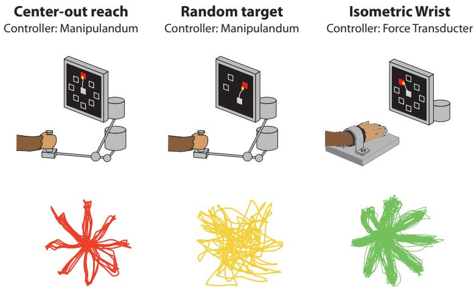  
Figure A1: Motor tasks and representative behavioral trajectories. Center-out reaching (CO) and random-target reaching (RT) are performed with a planar manipulandum; isometric wrist (IW) uses a force transducer with no arm movement.

Hardware. All models are trained on 2 NVIDIA RTX B200 GPUs. Finetuning was done on 1 NVIDIA RTX 5090 GPUs.

Runtime Pretraining BEEMO and the corresponding base architectures requires approximately 1-3 hours, depending on the amount of pretraining data used. Fine-tuning a pretrained model across all evaluation sessions requires an additional ∼2 hours.

## C Dataset Details

For all datasets, we adopt a causal trial-based split. In the standard setting, we use the first 60% of trials for training, the following 20% for validation, and the final 20% for testing, preserving temporal ordering to prevent data leakage. Prior work such as POYO [1] uses trial structure to apply differential loss weighting across task epochs (e.g., hold, reach, and return periods), which can improve performance but relies on privileged information that is not always available in practice. We remove this assumption and apply uniform loss weighting across all timepoints, which we believe better reflects a realistic deployment setting.

Center-out reaching (Figure A1, left). We use recordings from [18, 19] and [21, 71], in which a non-human primate performs reaches to targets arranged radially around a central start position. The decoded behavioral variable is hand velocity in 2D Cartesian coordinates.

Random-target reaching (Figure A1, middle). We use recordings from [18], in which the animal reaches to targets placed at randomized locations. This task demands more varied motor planning than center-out reaching, as targets are not constrained to fixed directions.

Isometric wrist (Figure A1, right). We use recordings from [20, 29], in which the animal controls a cursor by exerting torque at the wrist with no arm movement. The decoded behavioral variable is cursor velocity in 2D.

## C.1 Evaluation Sessions

All evaluations are performed on held-out animals not seen during pretraining. For center-out reaching and random-target reaching, we use 6 sessions each from monkey T from [18]. For the isometric wrist task, we use the last 4 sessions from monkey J and the last 7 sessions from monkey S from [20].

## C.2 Pretraining Sessions

All center-out sessions from [18], [21], and [20] not held out for evaluation were included in the base pretraining set. Neural spiking data was drawn exclusively from [18] and [20], comprising 105 sessions used for neural pretraining. As [21] provides only preprocessed binned spike counts rather than the raw spikes required by POYO’s neural tokenization pipeline, only behavioral signals from this source were used. The first 15 isometric wrist sessions from monkey J of [20] are additionally used as behavioral pretraining data in the ablation study of Section 3.4.

## D Hyperparameter Tuning

In this section we detail the hyperparameter search configurations for all baseline models. All models are tuned on individual sessions and tasks using the Tree-structured Parzen Estimator (TPE) algorithm [72] implemented in Optuna [73], with 100 trials per model. For each trial, models are optimized using AdamW with a linear warmup followed by cosine decay learning rate schedule.

## D.1 Linear

We implement a linear baseline on binned spikes. The model accepts the full 1s input context, bins spike trains at a fixed bin size, and maps directly to the decoding target via a linear readout. We detail the tuning parameters for linear decoding baseline in Table A1.

Table A1: Hyperparameter search space for the linear baseline, tuned for 100 trials.
<table><tr><td>Hyperparameter</td><td>Search Space</td><td>Sampling</td></tr><tr><td>Model</td><td></td><td></td></tr><tr><td>Bin size (ms)</td><td>{1, 5, 10, 20, 40}</td><td>Categorical</td></tr><tr><td>Training</td><td></td><td></td></tr><tr><td>Number of epochs</td><td>{100, 300, 500}</td><td>Categorical</td></tr><tr><td>Batch size Weight decay</td><td>[16, 128]  $[ 1 0 ^ { - 6 } , 1 \dot { 0 } ^ { - 1 } ]$ </td><td>Discrete  $\mathrm { ( l o g _ { 2 } ) }$ </td></tr><tr><td></td><td></td><td>Loguniform</td></tr><tr><td>Base learning rate</td><td> $[ 1 0 ^ { - 5 } , 1 0 ^ { - 2 } ]$ </td><td>Loguniform</td></tr></table>

## D.2 Multi-Layer Perceptron (MLP)

We parameterize our MLP baseline based on network depth and the width of the first hidden layer. Successive hidden layers project inputs down by a factor of 2, followed by a final readout layer. In initial experiments we found this was a reasonable design choice to balance performance enabled by expressivity of the search space with combinatorial complexity (e.g., an alternative is to allow Optuna to select a width for every layer, but the search space becomes much larger). Like the linear baseline, the MLP accepts the full context window at once and bins at a fixed bin size. We detail the tuning parameters for the MLP decoding baseline in Table A2.

## D.3 Gated Recurrent Unit (GRU)

The GRU baseline operates on a binned raster, projecting spike counts at each timestep into a fixed hidden dimension via a linear layer before processing the sequence through a multi-layer GRU. The context window is processed in strides determined by the bin size, rather than ingested all at once, reflecting the sequential nature of the recurrent architecture. Note that dropout is disabled within the GRU when depth is 1, as it is only meaningful across stacked recurrent layers. We include bidirectionality as a tunable hyperparameter: when enabled, separate forward and backward passes are concatenated, allowing the model to exploit future context symmetrically with the past. Adaptive average pooling is applied over the temporal dimension before the final linear readout to support both sequence- and frame-level tasks. The upper bound on hidden dimension is reduced from 512 to 256 at a bin size of 1 ms to satisfy memory constraints, and the learning rate upper bound is reduced to

Table A2: Hyperparameter search space for the MLP baseline, tuned for 100 trials.
<table><tr><td>Hyperparameter</td><td>Search Space</td><td>Sampling</td></tr><tr><td>Model</td><td></td><td></td></tr><tr><td>Bin size (ms)</td><td>{5, 10, 20, 40}</td><td>Categorical</td></tr><tr><td>Depth</td><td>{1, 2, 3}</td><td>Categorical</td></tr><tr><td>Hidden dim</td><td>[32, 512]</td><td>Discrete  $\mathrm { ( l o g _ { 2 } ) }$ </td></tr><tr><td>Dropout</td><td>{0.0, 0.2, 0.4, 0.6}</td><td>Categorical</td></tr><tr><td>Batch norm</td><td>{True, False}</td><td>Categorical</td></tr><tr><td>Training</td><td></td><td></td></tr><tr><td>Number of epochs</td><td>{100, 300, 500}</td><td>Categorical</td></tr><tr><td>Batch size</td><td>[16, 128]</td><td>Discrete  $\mathrm { ( l o g _ { 2 } ) }$ </td></tr><tr><td>Weight decay</td><td> $[ 1 0 ^ { - 6 } , \dot { 1 0 } ^ { - 1 } ]$ </td><td>Loguniform</td></tr><tr><td>Base learning rate</td><td> $[ 1 0 ^ { - 5 } , 1 0 ^ { - 2 } ]$ </td><td>Loguniform</td></tr></table>

$1 0 ^ { - 3 }$ on the licking rate task to mitigate training instability. We detail the tuning parameters for GRU decoding baseline in Table A3.

Table A3: Hyperparameter search space for the GRU baseline, tuned for 100 trials.
<table><tr><td>Hyperparameter</td><td>Search Space</td><td>Sampling</td></tr><tr><td>Model</td><td></td><td></td></tr><tr><td>Bin size (ms)</td><td>{1, 5, 10, 20, 40}</td><td>Categorical</td></tr><tr><td>Depth</td><td>{1, 2, 3}</td><td>Categorical</td></tr><tr><td>Hidden dim</td><td>[32, 512]</td><td>Discrete  $\mathrm { ( l o g _ { 2 } ) }$ </td></tr><tr><td>Dropout</td><td>{0.0, 0.2, 0.4, 0.6}</td><td>Categorical</td></tr><tr><td>Bidirectional</td><td>{True, False}</td><td>Categorical</td></tr><tr><td>Training</td><td></td><td></td></tr><tr><td>Number of epochs</td><td>{100, 300, 500}</td><td>Categorical</td></tr><tr><td>Batch size</td><td>[16, 128]†</td><td>Discrete  $\mathrm { ( l o g _ { 2 } ) }$ </td></tr><tr><td>Weight decay</td><td> $[ 1 0 ^ { - 6 } , \dot { 1 0 } ^ { - 1 } ]$ </td><td>Loguniform</td></tr><tr><td>Base learning rate</td><td> $[ 1 0 ^ { - 5 } , 1 0 ^ { - 2 } ]$ </td><td>Loguniform</td></tr></table>

† Batch size and hidden dim are restricted to [16, 64] and [32, 256] respectively when bin size is 1ms.

## D.4 POYO

POYO operates directly on spike events without binning, using the spike tokenization described in Appendix A.1. We detail the tuning parameters for POYO-SS baseline in Table A4.

## D.5 NDT\*

NDT\* operates on binned spike counts using the bin tokenization described in Appendix A.1. We detail the tuning parameters for NDT\*-SS baseline in Table A5.

## D.6 Computational cost of single-session tuning

The single-session baselines require a separate hyperparameter search for every held-out session. We use a 100-trial Optuna search for each of the 23 evaluation sessions, resulting in 2,300 training runs per model. In contrast, BEEMO and the multi-session backbones use a fixed hyperparameter configuration across sessions and require only a single fine-tuning run for each new session. Table A6 compares the resulting computational cost.

Table A4: Hyperparameter search space for the POYO baseline, tuned for 100 trials.
<table><tr><td>Hyperparameter</td><td>Search Space</td><td>Sampling</td></tr><tr><td>Model</td><td></td><td></td></tr><tr><td>Embedding dim</td><td>{64, 96, 128, 192, 256}</td><td>Categorical</td></tr><tr><td>Number of heads</td><td>{1, 2, 4, 8}</td><td>Discrete  $\mathrm { ( l o g _ { 2 } ) }$ </td></tr><tr><td>Depth</td><td> $\{ 0 , 1 , \ldots , 8 \}$ </td><td>Discrete</td></tr><tr><td>Dropout</td><td>[0.0, 0.9]</td><td>Discrete (step 0.1)</td></tr><tr><td>Training</td><td></td><td></td></tr><tr><td>Number of epochs</td><td>[100, 1000]</td><td>Discrete (step 100)</td></tr><tr><td>Batch size</td><td>[8, 128]</td><td>Discrete  $\mathrm { ( l o g _ { 2 } ) }$ </td></tr><tr><td>Weight decay</td><td> $[ 1 0 ^ { - 3 } , 1 0 ^ { - 1 } ]$ </td><td>Discrete  $( \log _ { 1 0 } )$ </td></tr><tr><td>Base learning rate</td><td> $[ 1 0 ^ { - 5 } , 1 0 ^ { - 2 } ]$ </td><td>Loguniform</td></tr></table>

Table A5: Hyperparameter search space for the $\mathrm { N D T ^ { * } }$ baseline, tuned for 100 trials.
<table><tr><td>Hyperparameter</td><td>Search Space</td><td>Sampling</td></tr><tr><td>Model</td><td></td><td></td></tr><tr><td>Embedding dim</td><td>{64, 96, 128, 192, 256}</td><td>Categorical</td></tr><tr><td>Number of heads</td><td>{1, 2, 4, 8}</td><td>Discrete  $\mathrm { ( l o g _ { 2 } ) }$ </td></tr><tr><td>Depth</td><td>{0, 1, . . . , 8}</td><td>Discrete</td></tr><tr><td>Dropout</td><td>[0.0, 0.9]</td><td>Discrete (step 0.1)</td></tr><tr><td>Bin size</td><td>{1, 5, 10, 20, 40} ms</td><td>Categorical</td></tr><tr><td>Training</td><td></td><td></td></tr><tr><td>Number of epochs</td><td>[100, 1000]</td><td>Discrete (step 100)</td></tr><tr><td>Batch size</td><td>[8, 128]</td><td>Discrete  $\mathrm { ( l o g _ { 2 } ) }$ </td></tr><tr><td>Weight decay</td><td> $[ 1 0 ^ { - 3 } , 1 0 ^ { - 1 } ]$ </td><td>Discrete  $( \log _ { 1 0 } )$ </td></tr><tr><td>Base learning rate</td><td> $[ 1 0 ^ { - 5 } , 1 0 ^ { - 2 } ]$ </td><td>Loguniform</td></tr></table>

Across the five single-session baselines, the session-specific searches require approximately 9,200 GPU-hours in total, with individual models requiring roughly 900–2,300 GPU-hours. By comparison, fine-tuning a pretrained model takes about $1 0 \pm 1 4$ minutes per session on a single GPU (median ≈ 8 minutes), or approximately 4 GPU-hours across all 23 evaluation sessions. The pretraining cost is incurred once and can then be shared across target sessions, whereas the tuning cost of the single-session baselines must be repeated for each new session.

Amortized cost. While the comparison between single-session and pretrained models is not the focus of this work, it is important for interpreting the results in the context of prior neural decoding studies. In our experiments, each single-session baseline is extensively tuned for every held-out recording, allowing even relatively simple models to achieve strong performance. Earlier neural decoding studies may not have used the same amount of hyperparameter tuning for every target session [1, 5], which may partly explain why our single-session baselines are stronger than those previously reported and can, in some cases, outperform pretrained models that were previously shown to improve over session-specific models. Recent benchmarks have similarly highlighted the strength of carefully tuned single-session models [26].

This is consistent with a broader motivation for pretrained and generalist models [74–77]. The benefit of such models is not necessarily to outperform a separately optimized specialist on every target dataset, but to provide strong performance with limited target-specific tuning. In our setting, the pretrained models use a fixed hyperparameter configuration across sessions and require only a short fine-tuning stage. The upfront cost of pretraining can therefore be amortized across sessions, animals, and tasks, avoiding the need to repeat an expensive hyperparameter search for each new recording.

Table A6: Estimated computational cost. For single-session baselines, run times are reported as mean ± SD across tuning runs, with the median in parentheses, and total GPU-hours are estimated over all 2,300 runs. For pretrained models, we report the one-time pretraining cost and the cost of fine-tuning across the 23 evaluation sessions.
<table><tr><td>Stage</td><td>Runs</td><td>GPU-time / run</td><td>Total GPU-hours</td></tr><tr><td colspan="4">Single-session tuning (per model)</td></tr><tr><td>Linear</td><td>2,300</td><td> $5 9 . 9 \pm 1 0 2 . 7 \operatorname* { m i n } \left( 2 2 . 3 \right)$ </td><td>~2,300</td></tr><tr><td>MLP</td><td>2,300</td><td> $5 3 . 7 \pm 1 2 2 . 5 \operatorname* { m i n } \left( 2 0 . 8 \right)$ </td><td>~2,100</td></tr><tr><td>GRU</td><td>2,300</td><td> $4 6 . 8 \pm 8 0 . 9 \operatorname* { m i n } \left( 1 6 . 9 \right)$ </td><td>~1,800</td></tr><tr><td>POYO-SS</td><td>2,300</td><td> $5 5 . 8 \pm 1 4 2 . 4 \operatorname* { m i n } \left( 1 7 . 0 \right)$ </td><td>~2,100</td></tr><tr><td>NDT*-SS</td><td>2,300</td><td> $2 3 . 6 \pm 1 9 . 2 \operatorname* { m i n } \left( 1 9 . 0 \right)$ </td><td>~900</td></tr><tr><td>Total</td><td>11,500</td><td></td><td>~9,200</td></tr><tr><td colspan="4">Pretrained models (BEEMO and multi-session backbones)</td></tr><tr><td>Pretraining (one-time)</td><td>1</td><td>~12 h</td><td>~12</td></tr><tr><td>Fine-tuning</td><td>23</td><td>~10 min</td><td>~4</td></tr><tr><td>Total</td><td>24</td><td></td><td>~16</td></tr></table>

## E Additional Results

## E.1 Session-wise statistical analysis

Table A7: Session-wise paired comparisons of BEEMO and matched backbones. Values report mean $R ^ { 2 } \pm$ standard deviation across held-out sessions (each session averaged over three seeds). Paired t-tests (two-sided) compare each BEEMO variant with its matched multi-session backbone and were conducted separately for each task (n = 6 for CO and RT, n = 11 for IW). Significant results $( p < 0 . 0 5 )$ are bolded.
<table><tr><td>Backbone</td><td>Task</td><td>BEEMO</td><td>Baseline</td><td>Paired  $\Delta R ^ { 2 }$ </td><td>Paired t-test (p)</td></tr><tr><td rowspan="3">NDT*</td><td>CO</td><td> $0 . 9 0 2 7 \pm 0 . 0 1 3 8$ </td><td> $0 . 9 0 1 0 \pm 0 . 0 1 7 5$ </td><td> $+ 0 . 0 0 1 7$ </td><td>0.4240</td></tr><tr><td>RT</td><td> $0 . 7 7 3 4 \pm 0 . 0 7 1 6$ </td><td> $0 . 7 6 0 0 \pm 0 . 0 7 8 9$ </td><td>+0.0134</td><td>0.0123</td></tr><tr><td>IW</td><td> $0 . 7 8 0 2 \pm 0 . 0 4 6 0$ </td><td> $0 . 7 7 6 7 \pm 0 . 0 4 3 5$ </td><td>+0.0035</td><td>0.1920</td></tr><tr><td rowspan="4">POYO</td><td>CO</td><td> $0 . 9 0 3 1 \pm 0 . 0 1 7 8$ </td><td> $0 . 8 9 7 3 \pm 0 . 0 1 8 5$ </td><td> $+ 0 . 0 0 5 8$ </td><td>0.1875</td></tr><tr><td>RT</td><td> $0 . 7 6 0 9 \pm 0 . 0 7 2 6$ </td><td> $0 . 7 4 9 8 \pm 0 . 0 7 4 2$ </td><td> ${ \bf + 0 . 0 1 1 2 }$ </td><td>0.0001</td></tr><tr><td>IW</td><td> $0 . 7 3 6 1 \pm 0 . 0 6 4 4$ </td><td> $0 . 7 2 3 7 \pm 0 . 0 6 8 0$ </td><td> $\mathbf { + 0 . 0 1 2 4 }$ </td><td>0.0089</td></tr><tr><td></td><td></td><td></td><td></td><td></td></tr></table>

Table 1 reports mean performance ± standard error over three training seeds. This captures variability across training runs, but does not reflect how performance varies across held-out recording sessions. We therefore also report the corresponding session-wise statistics in Table A7. For each session, we compute $R ^ { 2 }$ over all test trials and average across the three seeds. We then compare each BEEMO variant with its matched multi-session backbone using a two-sided paired t-test across sessions, separately for each task $( n = 6$ for CO and RT, and $n = 1 1$ for IW).

Table A7 reports mean $R ^ { 2 } \pm$ standard deviation across sessions together with the mean paired difference and exact p-value. The session-wise standard deviation captures variation across recording sessions, whereas the standard error in Table 1 captures variability across training runs. BEEMO-POYO significantly improves over POYO on RT $( p = 0 . 0 0 0 1 )$ and IW $( p = 0 . 0 0 8 9 )$ , and BEEMO-$\mathrm { N D T ^ { * } }$ significantly improves over NDT\* on RT $( p = 0 . 0 1 2 3 )$ . The improvements on CO are not significant for either backbone $( p = 0 . 1 8 7 5$ for POYO and $p = 0 . 4 2 4 0$ for NDT\*), where within-task performance is already high. The improvement of BEEMO-NDT\* on IW is also not significant $( p = 0 . 1 9 2 0 )$ , consistent with the weaker transfer to IW discussed in Section 3.4.

## E.2 Comparison with Kalman-based decoders

We further compare BEEMO against Kalman-based decoders that explicitly model behavioral dynamics. We consider three baselines. First, we fit a standalone Kalman-filter decoder separately for each session (Kalman Filter SS). Second, we apply a session-specific Kalman smoother to POYO’s predictions as a post hoc temporal regularizer (POYO + Kalman Smoother SS). Third, we fit a single Kalman smoother using behavioral trajectories pooled across the CO pretraining sessions and apply it to POYO predictions on both CO and RT (POYO + Kalman Smoother MS).

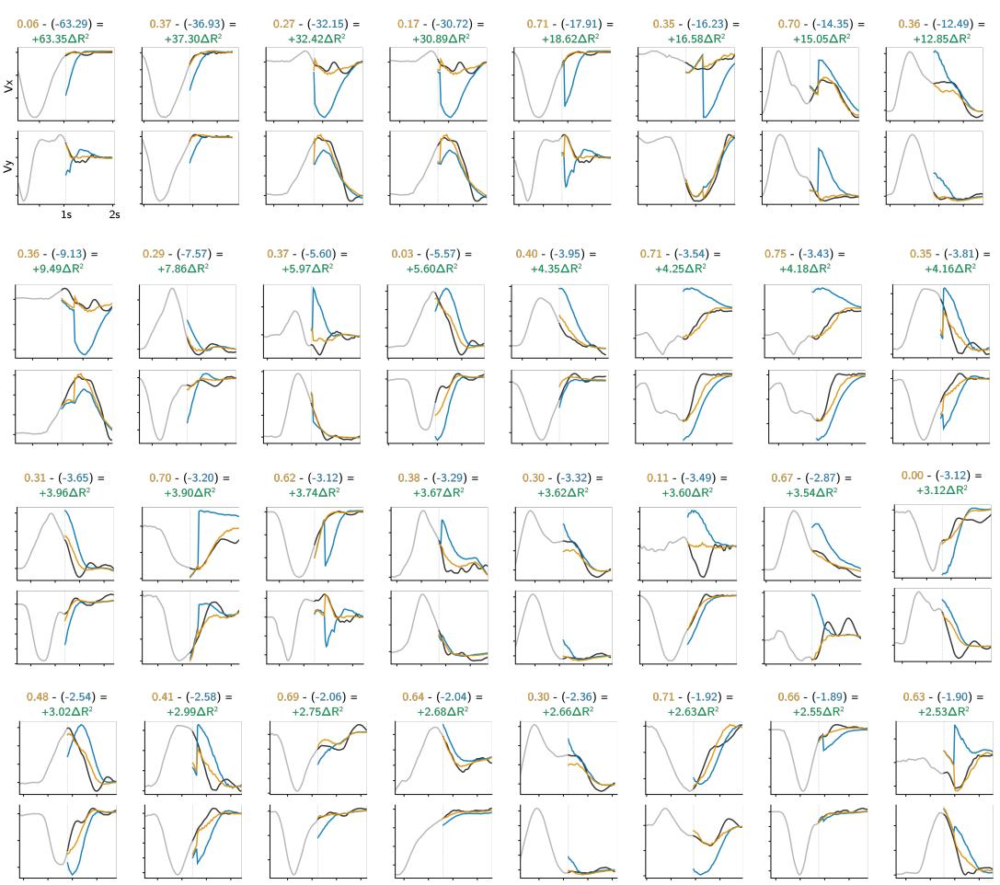  
Figure A2: Behavioral context improves neural decoding. Predicted velocity trajectories $( v _ { x } , v _ { y } )$ under neural-only (blue) and joint neural-behavior (orange) context, vs. ground truth (black), across 1 sec decoding windows sorted by $\Delta R ^ { \dot { 2 } }$ (largest to smallest improvement). The gray trace shows the preceding behavioral context provided to the joint model. $R ^ { 2 }$ values are reported as $R _ { \mathrm { i o i n t } } ^ { 2 } - R _ { \mathrm { n e u r a l } } ^ { 2 } = \Delta R ^ { 2 }$ . Behavioral context consistently produces smoother, better-calibrated trajectories, with the largest gains occurring when neural-only decoding fails to constrain trajectory amplitude and timing

Table A8: Kalman-based baselines. Models pretrained on CO and evaluated on CO and RT. Values are reported as mean ± SEM across three seeds.
<table><tr><td>Method</td><td>CO</td><td>RT</td></tr><tr><td> ${ \mathrm { K a l m a n } } { \mathrm { F i l t e r } } \left( { \mathrm { S S } } \right)$ </td><td> $0 . 4 0 0 0 \pm 0 . 0 3 8 1$ </td><td> $0 . 4 0 6 6 \pm 0 . 0 3 9 9$ </td></tr><tr><td>POYO + Kalman Smoother (SS)</td><td> $0 . 8 9 8 2 \pm 0 . 0 0 6 2$ </td><td> $0 . 7 5 1 5 \pm 0 . 0 0 1 8$ </td></tr><tr><td>POYO + Kalman Smoother (MS)</td><td> $0 . 9 0 0 4 \pm 0 . 0 0 1 5$ </td><td> $0 . 7 5 0 8 \pm 0 . 0 0 1 7$ </td></tr><tr><td> $\mathrm { P O Y O }$ </td><td> $0 . 8 9 7 3 \pm 0 . 0 0 1 3$ </td><td> $0 . 7 4 9 8 \pm 0 . 0 0 1 5$ </td></tr><tr><td> $\mathbf { B E E M O - P O Y O }$ </td><td> $0 . 9 0 3 1 \pm 0 . 0 0 0 3$ </td><td> $0 . 7 6 0 9 \pm 0 . 0 0 1 4$ </td></tr></table>

As shown in Table A8, the standalone Kalman decoder performs substantially worse than the learned neural decoders. Applying Kalman smoothing to POYO gives a small improvement over POYO in both the session-specific and pooled settings, indicating that an explicit dynamics prior can be beneficial. However, BEEMO-POYO achieves the best performance on both CO and RT. The pooled Kalman smoother provides a smaller improvement on RT than the session-specific smoother, likely because its dynamics are learned only from CO behavioral trajectories and then transferred to RT without access to RT behavior.

We report Kalman results only on CO and RT, which come from the same dataset and therefore share the same behavioral sampling rate. IW is sampled differently, so the same Kalman dynamics model cannot be applied directly and would need to be refit. In contrast, BEEMO can incorporate behavioral data across sessions and tasks with different sampling rates without requiring a separate task-specific dynamics model.

## E.3 Task-specific behavioral data on RT

To test whether the benefit of task-matched behavioral pretraining observed on IW (Section 3.4) extends to RT, we repeat the experiment using BEEMO-POYO. Starting from a model pretrained without unpaired behavioral data, we first add 6.5 hours of unpaired CO behavioral data and then an additional 2 hours of unpaired RT behavioral data. As shown in Table A9, CO behavioral data improves RT decoding, and adding task-matched RT behavioral data provides a further gain, consistent with the trend observed on IW.

Table A9: Task-specific behavioral data on RT. BEEMO-POYO evaluated on held-out RT sessions with increasing amounts of unpaired behavioral data during pretraining (single seed).
<table><tr><td>Unpaired behavioral data</td><td>RT</td></tr><tr><td>None</td><td>0.7511</td></tr><tr><td> $+ 6 . 5 \mathrm { h } \mathrm { C O }$ </td><td>0.7637</td></tr><tr><td> $+ 6 . 5 \mathrm { h } \mathrm { C O } + 2 \mathrm { h } \mathrm { R T }$ </td><td>0.7705</td></tr></table>

## E.4 Ablation results for CO task

Table A10 extends the ablation results from Section 3.7 to include within-task evaluation on the CO task in addition to the cross-task results reported in Section 3.7. The trends observed in the Section 3.7 hold consistently across all tasks: removing behavior dropout leads to significant performance degradation below even the base model baselines, and replacing the decoder with BEEMO’s deeper architecture without access to unpaired behavioral data does not recover BEEMO’s performance. Together, these results confirm that the gains from BEEMO are attributable to the asymmetric training strategy rather than architectural differences.

Table A10: Ablation study: Values are reported as mean ± SEM across three seeds.
<table><tr><td rowspan="2">Model Variant</td><td>Within-Task</td><td colspan="2">Cross-Task</td></tr><tr><td>CO</td><td>RT</td><td>IW</td></tr><tr><td>BEEMO-POYO</td><td> $0 . 9 0 3 1 \pm 0 . 0 0 0 3$ </td><td> $0 . 7 6 0 9 \pm 0 . 0 0 1 4$ </td><td> $0 . 7 3 6 1 \pm 0 . 0 0 2 0$ </td></tr><tr><td>w/o dropout</td><td> $0 . 8 1 7 9 \pm 0 . 0 0 3 5$ </td><td> $0 . 6 9 2 5 \pm 0 . 0 1 3 3$ </td><td> $0 . 6 8 9 8 \pm 0 . 0 0 3 5$ </td></tr><tr><td>w/o unpaired</td><td> $0 . 8 9 9 2 \pm 0 . 0 0 1 2$ </td><td> $0 . 7 4 7 6 \pm 0 . 0 0 1 2$ </td><td> $0 . 6 8 4 9 \pm 0 . 0 0 1 7$ </td></tr><tr><td>BEEMO-NDT</td><td> $0 . 9 0 2 7 \pm 0 . 0 0 1 6$ </td><td> $0 . 7 7 3 4 \pm 0 . 0 0 1 8$ </td><td> $0 . 7 8 0 2 \pm 0 . 0 0 0 1$ </td></tr><tr><td>w/o dropout</td><td> $0 . 8 1 1 0 \pm 0 . 0 0 6 2$ </td><td> $0 . 7 1 0 1 \pm 0 . 0 0 8 3$ </td><td> $0 . 7 2 6 6 \pm 0 . 0 0 1 9$ </td></tr><tr><td>w/o unpaired</td><td> $0 . 9 0 1 8 \pm 0 . 0 0 0 9$ </td><td> $0 . 7 6 8 3 \pm 0 . 0 0 3 0$ </td><td> $0 . 7 7 5 7 \pm 0 . 0 0 1 1$ </td></tr></table>

## E.5 Additional Trajectory Examples

Figure A2 extends the trajectory visualizations from Section 3, showing additional 1-second decoding windows sorted by $\Delta R ^ { 2 }$ (largest to smallest improvement from joint over neural-only decoding). The gray trace shows the preceding behavioral context provided to the joint model. Consistent with Section 3.6, behavioral context produces smoother and better-calibrated trajectories across a broad range of decoding windows, with the largest gains occurring when neural-only decoding fails to constrain trajectory amplitude and timing.