# Signals, Evidence, and Context: User Scrutiny in Real-World LLM Conversations

AHANA BISWAS, School of Computing and Information, University of Pittsburgh, USA

YU-RU LIN, School of Computing and Information, University of Pittsburgh, USA

Large language models (LLMs) often present synthesized answers without making their supporting evidence easy to inspect. We study how features of these answers relate to users’ subsequent accepting, checking, and challenging in 489,283 assistant–user response pairs from ShareChat and WildChat. Broad attribution language appears in 31.9% of qualifying responses, compared with explicit URLs in 1.33%, revealing a gap between claims of grounding and preserved inspectable support. Attribution, uncertainty, and other response cues generally accompany both checking and challenging; only uncertainty shows a small statistically distinguishable pooled association favoring checking. Within Technical Help, uncertainty favors checking relative to challenging; refusals and reasoning traces favor challenging in Seeking Information. Scrutiny is concentrated in some conversations, while its apparent turn-to-turn persistence becomes much smaller when conversation-level diferences and response ordering are examined separately. These result suggest that supporting verification requires attention to what evidence can be inspected, which question a user is trying to resolve, and the history of the interaction.

CCS Concepts: • Human-centered computing → Empirical studies in HCI; • Information systems → Users and interactive retrieval; • Social and professional topics → Socio-technical systems.

Additional Key Words and Phrases: human–AI interaction, large language models, verification, reliance, transparency, information seeking

## 1 Introduction

An answer from a large language model (LLM) can invoke an oficial report or expert judgment without showing the evidence behind its claims. The consequences of relying on apparent authority are evident in Mata v. Avianca, where attorneys submitted fictitious judicial authorities generated by an AI system and were sanctioned by a federal court [1]. That case involved fabricated sources. In everyday information seeking, a cited source can be genuine yet dificult for a user to identify or inspect.

LLM interfaces complicate familiar credibility judgments. Conventional web search exposes documents that a user can compare, while a conversational assistant often presents a synthesized answer before exposing its sources. In everyday conversations, users may ask for evidence, dispute a response, or simply move on. How those choices relate to the evidence and cues in an assistant’s answer remains poorly understood.

Consider an assistant answering an application-deadline question: “According to the agency’s oficial notice, applica- tions close Friday.” Invoking an “oficial notice” is a verification signifier, language suggesting authority without exposing the notice. A link to the relevant notice would be material verification support, while ofering to locate it or allowing the user to ask for it provides a verification pathway. Uncertainty or confidence language communicates the assistant’s epistemic stance. A user might ask “Where does it say that?” (checking), reply “The notice says Monday” (challenging), or proceed (accepting). This is an illustration, not a corpus quotation. We call the configuration of supports, signifiers, epistemic cues, and available actions the verification environment. Checking and challenging together constitute scrutiny, an observable act whose correctness is not established by the transcript.

A signifier can suggest that outside evidence exists, a link creates an opportunity to inspect it, and a request for confirmation can return the user to the same system that generated the claim. These diferences matter across tasks: uncertainty may invite a diagnostic question in technical troubleshooting, while an unhelpful refusal may prompt disagreement during information seeking. Epistemic vigilance and information-foraging research suggests that checking depends on its value, cost, and stakes [2, 3, 4].

We analyze 489,283 assistant–user response pairs from ShareChat and WildChat [5, 6, 7]. RQ1 asks what verification-related features appear in these recorded responses and whether grounding language is accompanied by inspectable material. RQ2 examines how those features relate to accepting, checking, and challenging at the next user turn. RQ3 studies associations within tasks and corpora, since the same cue may be encountered in diferent activities and the two collections have diferent model mixes, collection pathways, and preserved source fields. RQ4 asks whether scrutiny is concentrated in particular conversations or additionally recurs because of the order of exchanges. Together, the questions trace how information is presented, how users visibly respond, and how those responses are distributed across longer interactions.

We connect response-level evidence and cues to observable user behavior across repeated exchanges. This empirical account informs evaluations of whether an assistant makes claims inspectable and whether subsequent requests for evidence or corrections remain unresolved.

## 2 Related Work and Conceptual Framework

## 2.1 Credibility judgments when an interface speaks for its sources

Web credibility research locates judgments in the interaction of source identity, content, presentation, and task. Rieh distinguishes anticipatory decisions about what to consult from evaluation during use [8]. Hilligoss and Rieh describe credibility assessment across an information-seeking encounter [9]; Metzger and Flanagin show why users rely on heuristics when source evaluation is costly [10, 11]. The MAIN model links technological afordances to those heuristics [12], while lateral reading recommends leaving the focal page to examine independent evidence [13].

Conversational synthesis blurs the boundary between source and summary. The same assistant may generate a claim, name its purported authority, and describe the evidence supporting it. Work on attribution and generative search documents citations that are present without reliable claim-level support [14, 15, 16]; qualitative research on answer engines identifies a similar gap between cited responses and verifiability [17]. A source marker and evidence that supports the associated claim remain distinct objects of evaluation.

## 2.2 Trust, reliance, and observable checking

Human-factors research distinguishes trust, an attitude toward an agent under uncertainty, from reliance, a behavioral choice [18]. Trust can be dispositional, situational, or learned [19], and construct reviews warn against substituting observed dependence for trustworthiness [20]. Appropriate reliance additionally depends on the accuracy of the advice and the task the user faces [21, 22]. Conversational records document what users say next, while leaving their private beliefs and subsequent decisions largely unobserved.

Controlled studies establish that presentation can alter human responses to AI advice. Explanations can increase reliance without im rovin com lementar decision erformance [23]. Co nitive forcin ma curb overreliance at the cost of efort [24], and the value of explanations depends on that efort [25]. For LLMs, uncertainty language can change reliance [26]; source access may help identify incorrect answers [27], but citations can also increase trust when support is weak [28]. Those ex eriments establish cue efects under controlled conditions, while observational conversations show the mixed environments in which users encounter them.

## 2.3 Verification afordances, signifiers, and epistemic communication

Afordances are possibilities for action supported by an environment, whereas signifiers communicate an apparent opportunity or status [29, 30, 31]. In the running example, “According to the agency’s oficial notice, applications close Friday” is a signifier; a linked agency notice is material support; “Shall I check the notice?” suggests a pathway. Uncertainty, confidence, disclaimers, and refusals communicate an epistemic stance or boundary. Linguistic markers of hedging are communicative practices, distinct from calibration [32, 33].

Question-driven transparency research emphasizes the user’s immediate information need [34, 35]. Recent studies observe whether conversational tools prompt source inspection and how people move between chat and search [36, 37]. In each case, what an interface makes inspectable matters as much as how credibly the answer is presented.

## 2.4 Epistemic vigilance, costs, and temporal interaction

Epistemic vigilance concerns selective assessment of communicators and claims [2]. Information foraging models evidence seeking as a choice weighed against time and efort [3]; work on AI-assisted metacognition similarly documents the efort of deciding what to delegate and monitor [4]. The utility of another check will difer for familiar, consequential, or dificult-to-verify tasks.

Large conversation collections capture such heterogeneity across models and interaction histories [5, 6, 38]. Yet similar outcomes across turns may arise from stable properties of a conversation or from responses to earlier scrutiny. Dynamic-panel research documents the bias of short fixed-efects panels [39, 40], making it important to distinguish recurrence between conversations from ordering within them.

Research gap. Controlled experiments establish efects of individual cues, and evidence audits assess generated citations; neither shows how multiple verification-related features appear together in deployed conversation records or how they relate to checking and challenging across tasks and turns.

## 3 Data and Methods

## 3.1 Corpora, analysis unit, and selection

ShareChat contains publicly shared conversations from ChatGPT, Gemini, Grok, Perplexity, and Claude (April 2023– October 2025) [5]. We analyze English exchanges from the first four platforms; Claude’s export is incompatible with our common feature extraction. WildChat-4.8M contains opt-in ChatGPT conversations [6, 7]. We retain U.S.-English interactions through July 31, 2025. Collection mechanisms, models, and preserved interface fields difer. Supplementary Section A details sampling and conversation lengths.

Our unit ofanalysis is an assistant–user response pair: an assistant answer joined to the immediately following user message in the same conversation. Unanswered assistant turns are excluded. Of 489,308 candidate pairs, 489,283 receive valid outcome labels, spanning 98,007 conversations. A pair is qualifying when a user replies to a checkable assistant claim or recommendation. Qualifying replies are labeled accepting, checking, or challenging; all others are not qualifying. We define scrutiny as checking or challenging: requesting support for, or disputing, an answer. The scrutiny rate is their share of qualifying pairs; it does not measure successful verification

There are 368,644 qualifying pairs (75.3% oflabeled pairs): 250,523 from ShareChat and 118,121 from WildChat (Table 1). Behavioral analyses are conditional on an engaged qualifying exchange; they do not model initial engagement. Mean length counts pairs, not messages. Overall RQ1 rates and RQ2–RQ4 use qualifying pairs, while platform prevalence uses all labeled pairs. Source-preservation audits use platform-specific fields and denominators. Supplementary Sections A and C document these sample distinctions.

Table 1. Behavioral analysis sample. Mean length counts observed assistant–user response pairs per conversation. Scrutiny is the percentage of qualifying pairs labeled checking or challenging. Platform-level means and medians appear in Supplementary Section A.
<table><tr><td>Corpus</td><td>Pairs</td><td>Convs.</td><td>Mean</td><td>Qualifying</td><td>Scrutiny</td></tr><tr><td>ShareChat</td><td>311,591</td><td>44,847</td><td>6.9</td><td>250,523</td><td>30.3%</td></tr><tr><td>WildChat</td><td>177,692</td><td>53,160</td><td>3.3</td><td>118,121</td><td>25.2%</td></tr><tr><td>Total</td><td>489,283</td><td>98,007</td><td>5.0</td><td>368,644</td><td>28.7%</td></tr></table>

## 3.2 Operationalizing a response-level verification environment

The verification environment comprises evidence-related material, language, and possible user actions surrounding an assistant response. Its components have diferent functions. Material verification supports are potential objects of inspection, such as explicit URLs, formatted hyperlinks, and source objects retained in platform metadata. A link permits potential inspection but does not establish claim-level support. Verification signifiers are words that suggest evidentiary grounding or invoke authority, such as references to “research” or “experts,” even when no identifiable source is provided. Such language can appear without inspectable evidence

Epistemic communication cues express how the assistant presents its knowledge and limits. These include uncertainty, confidence, disclaimers, refusals, and exported process-like text; they do not establish correctness. Verification pathways are opportunities for the user to seek more support or contest a response, such as following a link, asking the assistant to confirm a claim, or ofering a correction. An assistant’s verification prompt suggests a pathway; the next user message reveals conversational checking or challenging. The exports do not record source clicks or independent browsing. The first three describe responses; pathways describe possible and observed actions. We keep these roles separate, consistent with work on measurement validity [41], and do not combine them into a single transparency score. Supplementary Section C details platform-specific source fields, and Section E gives the complete feature definitions.

## 3.3 Measuring the response and subsequent user action

Assistant-side indicators. We code eleven binary response features, recording their presence in text or preserved fields. Three measure potential evidence access: an explicit URL (a written web address), a markdown link (hyperlinked text encoded in the response), and inspectable evidence (either kind of link or a preserved platform source object). Five capture epistemic communication: uncertainty cues (hedges or limits on certainty), confidence cues (strong assertions of certainty), disclaimers (conditions or limitations on the response), refusals (declining to answer a request), and reasoning traces ( rocess-like text retained in a model-s ecific thinkin or anal sis field). Ex orted reasonin text does not reveal internal computation. Two indicators capture signifiers: broad attribution language invokes research, reports, experts, or another outside authority; an evidence signifier presents an assertion as documented or supported without necessarily naming an inspectable source. The final feature, verification-prompt language, marks assistant suggestions to check evidence or seek confirmation. These measures do not test factual accuracy or citation quality (Supplementary Section E).

URLs, markdown links, source objects, and retained reasoning fields are identified structurally; the other features use pre-specified lexicons, meaning sets of text patterns matched against responses. We developed the lexicons through literature-derived candidate patterns followed by inspection and revision of matches in both corpora, freezing them before outcome modeling. The development records do not specify the number of examples inspected per feature or the number of pilot judges; we therefore report only the documented final audit design (Supplementary Sections E and F). A separate, narrower citation-like attribution detector is used only for the audit of source preservation; it is not an additional regression feature (Supplementary Sections C and E). The indicators overlap: any explicit URL also counts as inspectable evidence, so the high � = 0.957 reflects a partly definitional subset relationship; 91.6% of inspectable-evidence cases include a URL. A proposed broad evidentiary-language detector was removed because it nearly duplicated attribution (� = 0.995). We fit one focal feature per model using common controls. These associations include naturally co-occurring cues (Supplementary Section C).

Next-turn outcomes. The immediately following user message receives one of four mutually exclusive labels. Checking means requesting evidence, an explanation of the grounds for a claim, or confirmation of its accuracy without supplying a competing answer (for example, “What is your source?” or “Are you sure?”). Challenging means contesting the answer, asserting an error, or proposing a specific correction or alternative. Accepting means proceeding with the answer without a visible check or challenge; it does not require an explicit statement of agreement. Not qualifying includes exchanges without an engaged checkable claim, unrelated replies, or acknowledgments too ambiguous to interpret. For mixed acts, challenging takes precedence over checking, then accepting. Scrutiny combines the checking and challenging labels. Labels identify visible acts, not private trust or successful verification. Observed checking is assistant-directed; external verification may appear as challenging or accepting, depending on the next reply. Supplementary Section F provides decision boundaries and examples.

Automated classification and controls. We assign next-turn outcomes with Qwen3-30B-A3B, using the assistant answer, subsequent user message, and recent conversational context, under a frozen prompt, structured output schema, and deterministic decoding. The context limits, truncation flags, and recorded configuration are in Supplementary Section A. We separately classify the conversation’s first user message for topic (the subject of the initial request) and intent (whether the request is Asking, Doing, or Expressing), using Qwen3-235B-A22B-Instruct-2507 and the taxonomy of Chatterji et al. [42]. The seven topics are Writing, Practical Guidance, Seeking Information, Technical Help, Multimedia, Self-Expression, and Other/Unknown. These fixed opening-turn controls precede the outcome bu can miss later topic drift. Further classifier details appear in Supplementary Sections A and F.

Manual validation. We assessed whether the classifier’s assigned categories matched the codebook through a blinded positive-case audit by one human coder. Of 200 classifier-positive cases per qualifying outcome, estimated precision was 0.89 for checking and 0.92 for challenging (Supplementary Section F). These figures measure agreement with one reviewer’s decisions among model positives. They do not establish whether independent humans consistently separate the categories: no double-coded sample or human–human agreement estimate is available. Nor does positive-case sampling identify recall or the full confusion matrix. The codebook’s competing-assertion rule makes the conceptual boundary explicit, while reproducibility of human application remains an open measurement-validity question.

## 3.4 Statistical design and estimation

We address the four research questions with complementary analyses: descriptive prevalence and source-field audits (RQ1), pooled multinomial models of next-turn behavior (RQ2), task- and corpus-stratified models with held-out prediction (RQ3), and conversation-level clustering and sequence analyses (RQ4). The four RQs are introduced in Section 1; here we specify the estimators and comparison families.

Manuscript submitted to ACM

All behavioral models use qualifying assistant–user response pairs, with accepting as the reference category where relevant. We index pairs by � and conversations by �, and distinguish this qualifying sample from the larger samples used for descriptive platform and source-field analyses (Section 3.1 and Supplementary Section A).

RQ1: Feature prevalence, co-occurrence, and preserved sources. For each binary assistant-response feature $f ,$ let $X _ { i c f } = 1$ when it is detected in pair � of conversation �. We calculate its prevalence in the qualifying sample Q as

$$
\widehat { \boldsymbol { p } } _ { f } = \frac { 1 } { N _ { Q } } \sum _ { ( i , c ) \in Q } X _ { i c f } , \qquad \widehat { \boldsymbol { p } } _ { f s } = \frac { 1 } { N _ { s } } \sum _ { ( i , c ) \in \mathcal { P } _ { s } } X _ { i c f } ,\tag{1}
$$

where $N _ { Q } = 3 6 8 , 6 4 4$ and $\mathcal { P } _ { s }$ contains labeled pairs from platform or corpus �. The platform-specific denominator $N _ { s }$ therefore comes from the larger joined-pair sample, not the qualifying sample. We report feature counts alongside percentages to make these populations explicit. Binary-feature overlap is measured with the $\phi$ correlation, including the partly definitional URL/inspectable-evidence nesting (Supplementary Sections C and E).

The Perplexity source-preservation audit uses assistant turns from the language-filtered ShareChat release, a diferent denominator from the paired behavioral sample. Let $A _ { i }$ indicate narrow citation-like attribution, and let $B _ { i }$ indicate an explicit URL, markdown link, or populated preserved source object (source or source\_bar). We estimate

$$
{ \widehat { m } } _ { \mathrm { P e r p l e x i t y } } = { \frac { \sum _ { i } A _ { i } { ( 1 - B _ { i } ) } } { \sum _ { i } A _ { i } } } ,\tag{2}
$$

which is the share of citation-like turns without a source in the released record. For lexicon-detected attribution, we also calculate $\widehat { p } _ { \mathrm { a t t r } } \times \mathrm { p r e c i s i o n }$ under illustrative precision values. This sensitivity check estimates the share of detected true positives; without recall it cannot recover the population prevalence of attribution. Source-field definitions, the overlap matrix, and the positive-case audit are in Supplementary Sections C, E, and F.

RQ2: Pooled associations with checking and challenging. Let $Y _ { i c } \in$ {accept, check, challenge} denote the next-turn outcome. For each of the eleven retained response features, we fit a separate multinomial logistic model with accepting as the reference:

$$
\log \left[ \frac { \operatorname* { P r } ( Y _ { i c } = j ) } { \operatorname* { P r } ( Y _ { i c } = \operatorname { a c c e p t } ) } \right] = \alpha _ { j } + \beta _ { j f } X _ { i c f } + \gamma _ { j } ^ { \top } \mathbf Z _ { i c } , ~ j \in \{ \mathrm { c h e c k , c h a l l e n g e } \} .\tag{3}
$$

The common control vector $\mathbf { Z } _ { i c }$ contains seven-category topic and three-category intent from the first user turn, turn-position bins $( 1 , 2 , 3 , 4 \mathrm { - } 5 , 6 \mathrm { - } 1 0 , 1 1 + )$ , log(1 + assistant-response word count), model/system fixed efects (with sparse versions grouped), and indicators for truncated context, assistant answer, and user reply. Conversation-clustered covariance estimates account for repeated pairs from the same conversation. Estimating one focal feature at a time avoids simultaneous adjustment for indicators that substantially overlap; $\beta _ { j f }$ describes the feature as it occurs with other cues in observed responses.

We report exp $( \beta _ { j f } )$ as a relative risk ratio (RRR): the multiplicative change in $\operatorname* { P r } ( Y = j ) / \operatorname* { P r } ( Y = \operatorname { a c c e p t } )$ associated with the feature, holding the controls fixed. RRR > 1 indicates a higher relative probability of � versus acceptance. We report conversation-clustered 95% confidence intervals. To establish whether a feature distinguishes checking from challenging, we directly test

$$
\begin{array} { r } { \begin{array} { r l } & { \Delta _ { f } = \beta _ { \mathrm { c h e c k } , f } - \beta _ { \mathrm { c h a l l e n g e } , f } , } \\ & { \widehat { \mathrm { V a r } } ( \widehat { \Delta } _ { f } ) = \widehat { \mathrm { V a r } } ( \widehat { \beta } _ { \mathrm { c h e c k } , f } ) + \widehat { \mathrm { V a r } } ( \widehat { \beta } _ { \mathrm { c h a l l e n g e } , f } ) - 2 \widehat { \mathrm { C o v } } ( \widehat { \beta } _ { \mathrm { c h e c k } , f } , \widehat { \beta } _ { \mathrm { c h a l l e n g e } , f } ) . } \end{array} } \end{array}\tag{4}
$$

The Wald statistic $W _ { f } = \widehat { \Delta } _ { f } ^ { 2 } / \widehat { \mathrm { V a r } } ( \widehat { \Delta } _ { f } )$ is compared with a $\chi _ { 1 } ^ { 2 }$ distribution. The ratio exp $\Delta _ { f } ) = \mathrm { R R R } _ { \mathrm { c h e c k } , f } / \mathrm { R R R } _ { \mathrm { c h a l l e n g e } , f }$ exceeds one when the association leans toward checking and falls below one when it leans toward challenging. We apply Benjamini–Hochberg false-discovery-rate (FDR) correction to the nine stable pooled direct contrasts [43]. Sparse URL and inspectable-evidence cells produce unstable checking estimates under fine model-version fixed efects; these direct contrasts are marked non-estimable (NE). Supplementary Section B reports a coarser platform-fixed-efect sensitivity analysis.

RQ3: Associations across tasks and corpora. We repeat the multinomial specification separately within seven openingtopic groups and the two corpora, using six prespecified features: URL, inspectable evidence, uncertainty, reasoning trace, disclaimer, and refusal. Within each stratum �, we refit Equation 3 with stratum-specific coeficients and controls that vary within $g$ (for example, opening-topic indicators are omitted within a single topic). Conversation-clustered inference and the covariance-aware contrast remain the same:

$$
\Delta _ { f g } = \beta _ { \mathrm { c h e c k } , f g } - \beta _ { \mathrm { c h a l l e n g e } , f g } .\tag{5}
$$

These are within-stratum tests; significance in one stratum and non-significance in another do not constitute a test of an interaction between strata.

The seven topic groups and two corpora yield $9 \times 6 = 5 4$ planned direct contrasts and $9 \times 6 \times 2 = 1 0 8$ component coeficients (each outcome versus acceptance). The six Multimedia direct contrasts are non-estimable; among the remaining 48, 32 meet the primary numerical-stability criterion, two yield finite but unstable test statistics, and 14 are non-estimable. We apply BH-FDR to the 108 planned component coeficients and, separately, to the 32 stable direct contrasts. Our main substantive claims use the more conservative 48-test non-Multimedia family, which retains the two finite-but-unstable �-values and assigns $\mathcal { P } = 1$ to 14 non-estimable cases; the 32-test correction is reported as a secondary sensitivity analysis. Supplementary Section G provides the complete testing-family table, estimates, stability flags, and corrected values

For predictive comparison, five conversation-grouped folds evaluate six predictor blocks spanning response features, opening topic/intent/turn position, model/system, length, and truncation. We report macro one-versus-rest AUC, multiclass log los $- N _ { \mathrm { t e s t } } ^ { - 1 } \sum _ { i } \log \widehat { \mathrm { P r } } ( Y _ { i } )$ , and foldwise SDs. Supplementary Section H specifies the blocks and full results.

RQ4: Between-conversation clustering and sequential recurrence. For the �-th qualifying pair in conversation $c ,$ define scrutiny as $S _ { c t } = \mathbf { 1 } \{ Y _ { c t } \ \in$ {check, challenge}}; accepting is coded zero. We first decompose scrutiny into conversation-and pair-level components,

$$
S _ { c t } = \alpha + u _ { c } + \varepsilon _ { c t } , \qquad \mathrm { I C C } = \frac { \sigma _ { u } ^ { 2 } } { \sigma _ { u } ^ { 2 } + \sigma _ { \varepsilon } ^ { 2 } } ,\tag{6}
$$

where $u _ { c }$ is the conversation component. The intraclass correlation (ICC) measures the share of variation attributable to diferences between conversations. The reported adjusted ICC applies covariate residualization using opening topic, intent, position, model/system, length, and truncation, followed by a between/within-conversation variance

decomposition. Conversation identifiers are not part of that covariate adjustment: removing conversation fixed efects would remove the between-conversation component the ICC is intended to describe.

We next examine whether scrutiny recurs after a previous qualifying exchange. For pairs with a preceding qualifying pair in the same conversation, we estimate pooled and conversation-fixed-efect linear probability models:

$$
\begin{array} { r l } & { S _ { c t } = \alpha + \rho S _ { c , t - 1 } + \gamma ^ { \top } \mathbf Z _ { c t } + \varepsilon _ { c t } , } \\ & { } \\ & { S _ { c t } = \alpha _ { c } + \rho _ { \mathrm { F E } } S _ { c , t - 1 } + \gamma ^ { \top } \mathbf Z _ { c t } + \varepsilon _ { c t } . } \end{array}\tag{7}
$$

The lag coeficient is a conditional percentage-point association with scrutiny at the next qualifying exchange. The pooled model combines between- and within-conversation diferences. In the fixed-efects specification, $\alpha _ { c }$ absorbs opening topic and intent as well as any model/system identifier constant within that conversation; within-conversation predictors such as turn position, response length, and changing truncation flags remain identifiable. The lag advances between successive qualifying pairs, even when nonqualifying exchanges occur between them. Short panels can bias dynamic fixed-efects estimates [39], so we compare samples with at least five, eight, and ten qualifying pairs. For the five-pair sample, a split-panel jackknife subtracts the mean half-panel FE estimate from twice the full-panel FE estimate [40]; conversation-bootstrap intervals describe uncertainty. Since short halves may be unstable, this is a sensitivity analysis (Supplementary Section D).

We separately study strictly adjacent response pairs, now retaining all four labels, including not qualifying. For previous label � and next label $b ,$ the empirical transition probability is

$$
{ \widehat { T } } _ { a b } = { \frac { n ( a  b ) } { \sum _ { k } n ( a  k ) } } .\tag{8}
$$

Same-type excess repetition is measured as $E _ { \mathrm { c h e c k } } = \widehat { T } _ { \mathrm { c h e c k , c h e c k } } - \widehat { T } _ { \mathrm { a c c e p t , c h e c k } }$ and $E _ { \mathrm { c h a l l e n g e } } ~ = ~ { \widehat { T } } _ { \mathrm { c h a l l e n g e , c h a l l e n g e } } ~ -$ $\widehat { T } _ { \mathrm { a c c e p t , c h a l l e n g e } }$ . Whole-conversation bootstrap resamples quantify uncertainty in their diference. Within-conversation shufles preserve each conversation’s four-outcome composition while randomizing order; comparing observed � with the reported shufle benchmark describes repetition beyond the conversation’s outcome mix. The supplied summary records a benchmark, not the full permutation distribution, so we do not report a formal permutation �-value. We also compare the longest consecutive scrutiny run with its within-conversation permutation distribution.

Finally, among conversations with at least five qualifying pairs, we calculate each conversation’s scrutiny rate, $\begin{array} { r } { \overline { { S } } _ { c } = T _ { c } ^ { - 1 } \sum _ { t = 1 } ^ { T _ { c } } S _ { c t } } \end{array}$ , and designate the highest decile as scrutiny-heavy. We report its unadjusted prevalence by opening topic, intent, and corpus and examine scrutiny across normalized conversation position. The strict-adjacency transitions and ualif in - air la models answer diferent se uence uestions and use diferent denominators. Transition counts, bootstrap and permutation benchmarks, streaks, and position diagnostics appear in Supplementary Sections D and I.

## 4 Results

## 4.1 RQ1: Grounding language outnumbers preserved inspectable support

In the released records, linguistic claims of evidentiary grounding are much more common than inspectable material. Among 368,644 qualifying response pairs, broad attribution is detected in 117,715 (31.9%), compared with 4,889 explicit URLs (1.33%) and 5,372 responses with any inspectable-evidence indicator (1.46%; Figure 1A). The attribution-to-URL ratio is about 24:1. Broad attribution and explicit URLs are almost uncorrelated $\begin{array} { r } { ( \phi = 0 . 0 3 ; } \end{array}$ Supplementary Section C). Mentioning an authority and exposing a source are empirically distinct features in these records.

Manuscript submitted to ACM

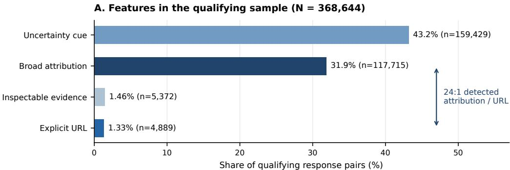

B. Platform-specific features in joined response pairs (%)
<table><tr><td rowspan=1 colspan=1>URL</td><td rowspan=1 colspan=1>0.6</td><td rowspan=1 colspan=1>0.3</td><td rowspan=1 colspan=1>0.9</td><td rowspan=1 colspan=1>0.5</td><td rowspan=1 colspan=1>2.5</td></tr><tr><td rowspan=1 colspan=1>Markdown link</td><td rowspan=1 colspan=1>0.2</td><td rowspan=1 colspan=1>&lt;0.1</td><td rowspan=1 colspan=1>0.2</td><td rowspan=1 colspan=1>&lt;0.1</td><td rowspan=1 colspan=1>0.5</td></tr><tr><td rowspan=1 colspan=1>Inspectable evidence</td><td rowspan=1 colspan=1>0.7</td><td rowspan=1 colspan=1>0.3</td><td rowspan=1 colspan=1>1.1</td><td rowspan=1 colspan=1>0.5</td><td rowspan=1 colspan=1>2.6</td></tr><tr><td rowspan=1 colspan=1>Broad attribution</td><td rowspan=1 colspan=1>31</td><td rowspan=1 colspan=1>28</td><td rowspan=1 colspan=1>47</td><td rowspan=1 colspan=1>41</td><td rowspan=1 colspan=1>28</td></tr><tr><td rowspan=1 colspan=1>Evidence signifier</td><td rowspan=1 colspan=1>0.4</td><td rowspan=1 colspan=1>0.7</td><td rowspan=1 colspan=1>3.7</td><td rowspan=1 colspan=1>1.7</td><td rowspan=1 colspan=1>0.1</td></tr><tr><td rowspan=1 colspan=1>Uncertainty cue</td><td rowspan=1 colspan=1>44</td><td rowspan=1 colspan=1>45</td><td rowspan=1 colspan=1>62</td><td rowspan=1 colspan=1>43</td><td rowspan=1 colspan=1>35</td></tr><tr><td rowspan=1 colspan=1>Confidence cue</td><td rowspan=1 colspan=1>18</td><td rowspan=1 colspan=1>18</td><td rowspan=1 colspan=1>14</td><td rowspan=1 colspan=1>7.7</td><td rowspan=1 colspan=1>15</td></tr><tr><td rowspan=2 colspan=1>DisclaimerRefusal</td><td rowspan=1 colspan=1>0.9</td><td rowspan=1 colspan=1>1.8</td><td rowspan=1 colspan=1>1.2</td><td rowspan=1 colspan=1>0.6</td><td rowspan=1 colspan=1>2.5</td></tr><tr><td rowspan=1 colspan=1>0.5</td><td rowspan=1 colspan=1>3.1</td><td rowspan=1 colspan=1>0.2</td><td rowspan=1 colspan=1>2.4</td><td rowspan=1 colspan=1>1</td></tr><tr><td rowspan=1 colspan=1>Reasoning trace</td><td rowspan=1 colspan=1>17</td><td rowspan=1 colspan=1>14</td><td rowspan=1 colspan=1>19</td><td rowspan=1 colspan=1>7.7</td><td rowspan=1 colspan=1>13</td></tr><tr><td rowspan=1 colspan=1>Verification prompt</td><td rowspan=1 colspan=1>9</td><td rowspan=1 colspan=1>4.8</td><td rowspan=1 colspan=1>18</td><td rowspan=1 colspan=1>7.8</td><td rowspan=1 colspan=1>8.8</td></tr><tr><td rowspan=1 colspan=6>ChatGPT         Gemini           Grok         Perplexity        WildChat</td></tr></table>

Fig. 1. RQ1: Response features across samples and platforms. (A) Detected feature prevalence among qualifying response pairs (� = 368,644). The observed atribution-to-URL ratio is approximately 24:1; an illustrative sensitivity calculation accounting for atribution-detector precision yields approximately 10:1–20:1. (B) Platform-specific prevalence among all joined response pairs, with percentages shown in each cell. The denominators difer between panels. The measures describe features preserved in the released records and do not assess whether individual claims are adequately supported.

The attribution detector’s estimated precision is 0.67 in a small positive-case audit. Applied to detected positives, that estimate yields a share near 21.4% and a ratio near 16:1 relative to URLs; the illustrative precision range 0.43–0.85 gives roughly 10:1–20:1. These are estimates of detected true positives under assumed precision, with unknown recall (Supplementary Sections E and F)

In Perplexity’s available records, citation-like attribution occurs in 10.3% of assistant turns, and 39.8% of those turns have no preserved URL or source object (4.1% of all turns). This quantifies missing source material in the released records (Supplementary Sections A and C). Platform profiles also difer: Grok shows 47% attribution and 62% uncertainty, while explicit URL rates are 0.5% for Perplexity and 2.5% for WildChat (Figure 1B; Supplementary Sections C and I). In the released records, language invoking authority is largely separate from material that can be inspected. A trans-parency measure that treats the two as equivalent would reward how convincingly an answer sounds sourced, even where little evidence is provided to examine.

## 4.2 RQ2: Response features accompany both checking and challenging

A request for evidence and a direct objection represent diferent next-turn actions. The pooled models nevertheless associate broad attribution, evidence signifiers, disclaimers, refusals, and verification prompts with both outcomes relative to acceptance (Figure 2). The distinction becomes visible only when checking and challenging are analyzed separately.

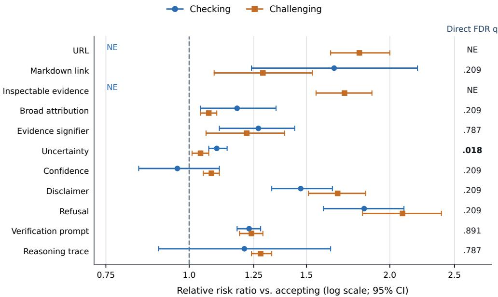  
Fig. 2. RQ2: Pooled associations between response features and subsequent user behavior. Relative risk ratios for checking (blue) and challenging (orange), each compared with accepting, with conversation-clustered 95% confidence intervals. All models use the common control set. NE indicates a coeficient that could not be stably estimated under the fine model-version specification. The right column reports FDR-adjusted values from covariance-aware direct checking-versus-challenging Wald tests. The direct contrast cannot be determined by visually comparing the separate confidence intervals.

Uncertainty is the only feature with a statistically distinguishable pooled checking-versus-challenging association after nine-test correction. Its RRRs relative to acceptance are 1.10 (95% CI [1.07, 1.14]) for checking and 1.04 ([1.01, 1.07]) for challenging. The direct ratio is 1.06 ([1.02, 1.10], � = 0.018): a 6% ratio diference, modest in magnitude. Verification prompts show similar RRRs (1.23 and 1.24), while partial refusals accompany checking (1.83) and challenging (2.09).

Platform-fixed-efect models show positive associations for URLs (1.73 checking; 1.86 challenging) and inspectable evidence (1.66; 1.77). Sparse features are less precise: markdown links yield a check/challenge ratio of 1.28 ([0.95, 1.73]; 1,133 positive pairs), and refusals 0.88 ([0.73, 1.04]; 2,159 pairs); verification prompts have a tighter interval (0.95–1.05). The intervals remain compatible with meaningful diferences for sparse features (Supplementary Section B, pooled estimates, feature counts, and platform-fixed-efect sensitivity)

Checking and challenging are diferent responses to an answer, even when they follow similar cues. Expressions of uncertainty show a slight tendency toward checking, but the broader pattern is that the wording of an answer gives limited insight into whether a user will ask for support or dispute a claim. Keeping the two actions separate reveals that distinction.

## 4.3 RQ3: Scrutiny associations vary across tasks and corpora

Manuscript submitted to ACM

A. Focal-feature coefficients across tasks and corpora (RRR) Checking vs. accepting Challenging vs. accepting  
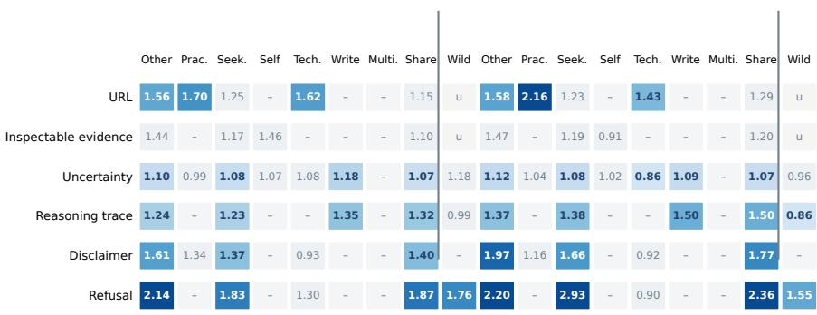

B. Direct checking-versus-challenging contrasts  
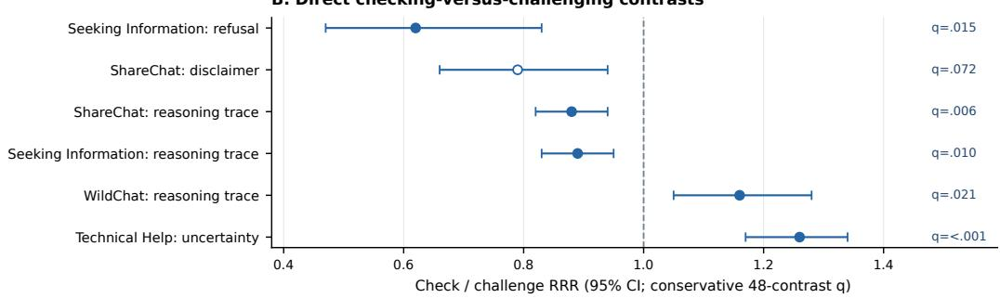  
Fig. 3. RQ3: Context-specific coeficients and direct contrasts. (A) RRRs for checking and challenging versus accepting (108 planned tests). Columns: Other, Practical, Seeking, Self-Expression, Technical, Writing, Multimedia, ShareChat, WildChat. Bold blue: BH-FDR significant; gray: nonsignificant; dash: non-estimable; �: unstable. (B) Direct check/challenge ratios (95% CIs); below one favors challenging, above one favors checking. Five filled points survive the conservative 48-test BH correction. Within-stratum significance does not test diferences between strata.

The direct associations vary by task (Figure 3). In Technical Help, uncertainty has a checking/accepting RRR of 1.08 and a challenging/accepting RRR of 0.86; its direct check/challenge ratio is 1.26 (95% CI [1.17, 1.34], conservative $q < 0 . 0 0 1 )$ In Seeking Information, refusals accompany checking (1.83) and, more strongly, challenging (2.93), yielding a direct ratio of 0.62 ([0.47, 0.83], � = 0.015). Reasoning traces in Seeking Information likewise lean toward challenging (0.89, [0.83, 0.95], � = 0.010). Task context clarifies which form of scrutiny accompanies these cues.

The reasoning-trace contrast reverses direction between collections: ShareChat favors challenging relative to checking (ratio 0.88, 95% CI [0.82, 0.94], conservative $q = 0 . 0 0 6 )$ , whereas WildChat favors checking (1.16, [1.05, 1.28], � = 0.021). Export formats, user populations, and model mix difer across the collections. Five direct contrasts pass the conservative 48-test correction. The ShareChat disclaimer contrast passes only the secondary 32-test family (ratio 0.79, � = 0.048; conservative $q = 0 . 0 7 2 )$ . Full contrasts and component estimates appear in Supplementary Section G.

Task context also provides more predictive information than response features alone: conversation-grouped macro AUC is 0.592 (SD 0.005) for opening topic, intent, and position, versus 0.551 (0.004) for response features (Supplementary Section H, predictive-comparison table).

The relationship between a response cue and the user’s next action depends on the setting. Uncertainty accompanies checking more strongly in technical exchanges, while refusals and reasoning traces are associated with diferent forms of scrutiny in other contexts. The contrasting reasoning-trace patterns across the corpora also show why one overall estimate can conceal important diferences in everyday use.

## 4.4 RQ4: Conversation diferences account for much of the observed recurrence of scrutiny

The cross-sectional contrasts leave another question: do skeptical replies repeat because of the order of turns, or because certain conversations contain more scrutiny overall? The sequence analyses separate these two patterns.

Checking and challenging are unevenly distributed. The overall scrutiny rate is 28.7% of qualifying pairs, yet the highest decile among 18,847 conversations with at least five qualifying exchanges begins at a conversation-level rate of 70.63% (1,885 conversations; Supplementary Section D). The raw ICC is 0.207 (95% CI [0.201, 0.214]), and the covariate-adjusted ICC is 0.184 ([0.178, 0.190]). High-scrutiny conversations are also more frequent in Technical Help (14.0%) and Seeking Information (12.4%) than Writing (5.2%; Figure 4A). A pooled turn-level average therefore conceals pronounced variation across conversations.

Scrutiny at the preceding qualifying exchange has a +25.5-percentage-point association with scrutiny in the pooled lag model (95% CI [24.9, 26.1]). The all-panel conversation-fixed-efect estimate is −2.9 points ([−3.5, −2.3]), and the estimate among conversations with at least five qualifying exchanges is near zero. Estimates become +2.7 ([2.1, 3.3]) at eight or more turns and +3.9 ([3.3, 4.6]) at ten or more; a split-panel jackknife in the five-turn sample gives +7.6 (bootstrap CI [5.7, 8.7]), subject to very short half-panels (Figure 5; Supplementary Section D). The pooled estimate largely reflects diferences across conversations.

Strictly adjacent-turn transitions provide an ordering benchmark (Figure 4B). Checking repeats 13.6 percentage points more often after checking than after accepting, and challenging repeats 24.6 points more often after challenging than after accepting. Composition-preserving shufles produce respective excesses of 10.8 and 18.3 points. The remaining order-associated excess is approximately 2.8 points for checking and 6.3 for challenging, about one-fifth and one-quarter of their observed excesses. Additional sequence diagnostics appear in Supplementary Sections D and I.

Repeated checking and challenging are concentrated in particular conversations, while the sequence of turns adds a smaller share of the observed repetition. Looking only at individual turns conceals exchanges in which asking for evidence or disputing an answer becomes a recurring part of the interaction.

## 5 Discussion

## 5.1 Credibility signals and evidence accountability

The distinction between claiming evidentiary support and making evidence available matters for accountability. An answer that refers to an oficial report sounds grounded, but the user faces a diferent situation when the report is identified and can be examined. Our findings show how easily these two properties diverge in recorded LLM responses. A transparency measure that gives credit for either one rewards the appearance of support as readily as the availability of a source.

For platform teams and independent auditors, the consequence is straightforward: claims of authority and preserved sources should be assessed separately. Otherwise, a system could improve its reported transparency simply by invoking research or experts more often. Researchers should also distinguish the presence of a source from the quality of the

A. Scrutiny-heavy conversations by opening topic

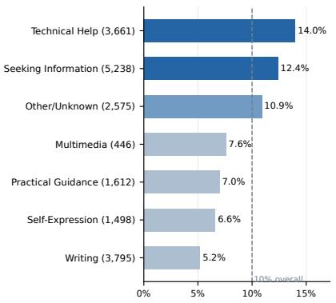

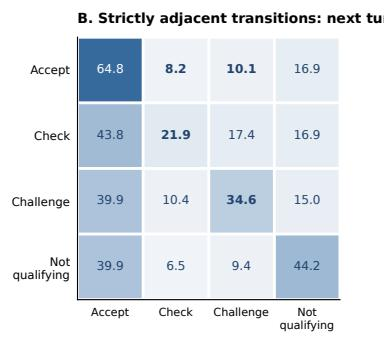

Fig. 4. RQ4: Concentration of scrutiny and adjacent-turn behavior. (A) Percentage of scrutiny-heavy conversations by opening topic among conversations with at least five qualifying exchanges. Parentheses show eligible conversation counts; the dashed 10% line represents the top-decile benchmark by construction. Topic diferences are unadjusted. (B) Row percentages for strictly adjacent next-turn outcomes, retaining accepting, checking, challenging, and not-qualifying labels.  
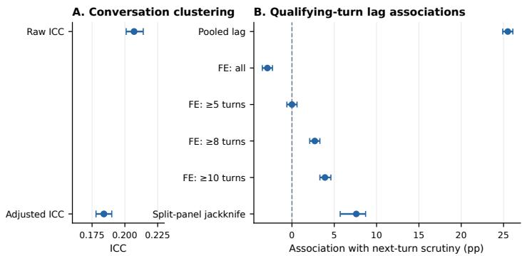  
Fig. 5. RQ4: Pooled and within-conversation sequential associations. Lag estimates are shown as percentage-point associations between scrutiny at successive qualifying exchanges. Conversation fixed efects separate within-conversation associations from stable diferences across conversations. Longer-panel restrictions and the split-panel jackknife assess sensitivity to dynamic-panel bias. The raw and adjusted ICCs are 0.207 and 0.184, respectively.

support it provides. Checking whether a cited document supports a particular claim is a valuable next layer of evidence auditing, built on a clear account of what material was available in the first place.

## 5.2 Checking and challenging reveal diferent verification needs

When users question an assistant, the kind of question matters. Asking for the basis of a claim puts the burden on the assistant to identify supporting evidence. Ofering a correction puts the accuracy of the claim itself in dispute. In the observed conversations, similar response cues accompany both actions, yet checking and challenging show distinct patterns of repetition. Combining them into a single measure of skepticism loses information about what the user is asking the system to address.

This distinction suggests a more useful way to assess follow-up behavior. Evidence requests call for traceable support connected to the claim. Challenges call for engagement with the proposed correction and a reconsideration of the answer. Product evaluations could assess these exchanges separately, examining whether the subsequent assistant response addresses the user’s actual objection. Researchers can use the distinction to compare ways of supporting verification without treating a reduction in follow-up questions as suficient evidence that a user’s concern was resolved.

## 5.3 Task and corpus context shape the interpretation of cues

The significance of an epistemic cue depends partly on what the user is trying to accomplish. In technical exchanges, uncertainty often accompanies a request to check or clarify an answer. In information-seeking exchanges, refusals and reasoning text are more closely associated with challenges. The diferent reasoning-trace patterns across ShareChat and WildChat reinforce that cue–response relationships emerge within particular mixtures of tasks, systems, and recorded interface features.

A cue that appears helpful in a controlled study of one task may have a diferent relationship with user behavior elsewhere. Evaluations of citations, uncertainty, or explanations should therefore examine the tasks in which those features appear and the actions users take afterward. For practitioners, the user’s expressed request ofers more specific guidance than a blanket assumption about the efect of a hedge or explanation. For researchers, reporting results by meaningful context makes the scope of a finding clearer and supports comparisons across datasets with diferent collection procedures.

## 5.4 Conversation-level scrutiny and disaggregated evaluation

An average scrutiny rate obscures how diferently conversations unfold. Some exchanges involve repeated requests for evidence or corrections, while others move forward with little visible questioning. The sequence analyses show that much of this concentration is associated with diferences between conversations. Turn ordering contributes additional repetition, but it is a smaller part of the pattern. Verification is therefore worth examining as a feature of an interaction, alongside the response to any individual answer.

For researchers and platform evaluators, this points to a more informative unit of assessment. Conversation-level reports can show where requests for evidence or disputes recur, and whether these episodes are concentrated in a subset of interactions. An evaluation can then examine how the assistant responds to those repeated concerns, including whether it provides the requested source or engages a correction. This approach brings persistent verification burdens into view that are easily lost in averages over individual turns.

## 6 Limitations and Scope of Inference

ShareChat consists of publicly shared conversations and WildChat of opt-in interactions; their populations, model mixes, and preserved fields difer. Platform comparisons therefore describe the released records. Behavioral estimates concern checkable assistant responses followed by an engaged user reply. The accepting label captures proceeding without visible scrutiny, including cases where users may have checked outside the conversation.

Measurement validation currently includes one coder’s blinded review of classifier-positive cases: precision is 0.89 for checking and 0.92 for challenging. Human agreement and recall remain unmeasured; the small lexicon audit limits attribution-rate precision. Topic labels reflect the opening turn. Sequential results distinguish conversation-level clustering, within-conversation lag associations, and order-preserving composition benchmarks; short-panel corrections merit cautious interpretation.

## 7 Conclusion

Manuscript submitted to ACM

Across two large collections of LLM conversations, language invoking authority is far more common than preserved inspectable evidence and is almost uncorrelated with explicit URLs. Checking and challenging have diferent observable patterns, while scrutiny varies markedly across conversations. These results establish a measurement distinction central to AI accountability: evidence accessibility, users’ expressed scrutiny, and its distribution across an interaction should be evaluated on their own terms. A transparency score that treats an authority phrase as equivalent to an inspectable source conflates diferent properties of the information environment.

## Generative AI Usage Statement

Generative AI tools were used to assist with manuscript writing and editing and with modifications to analysis code. All analyses were designed, conducted, checked, and interpreted by the authors, who take responsibility for the reported results and final manuscript.

## Ethical Considerations

The data were released for research and are analyzed in aggregate. We do not attempt re-identification, build individual vulnerability profiles, or reproduce potentially identifying conversation text. Examples used in dissemination should be screened and paraphrased. More broadly, verification features can distribute work unevenly: an interface that requires constant checking burdens users, while one that only signals grounding may create false reassurance. These potential consequences require direct user-centered evaluation before design recommendations are treated as established remedies.

## References

[1] United States District Court for the Southern District of New York. Mata v. Avianca, Inc.: Opinion and Order on Sanctions. No. 22-cv-1461 (PKC), Document 54. June 22, 2023. url: https://law.justia.com/cases/federal/districtcourts/new-york/nysdce/1%3A2022cv01461/575368/54/.

[2] Dan Sperber, Fabrice Clément, Christophe Heintz, Olivier Mascaro, Hugo Mercier, Gloria Origgi, and Deirdre Wilson. “Epistemic Vigilance”. In: Mind & Language 25.4 (2010), pp. 359–393. doi: 10.1111/j.1468-0017.2010.01394. x.

[3] Peter Pirolli and Stuart Card. “Information Foraging”. In: Psychological Review 106.4 (1999), pp. 643–675. doi: 10.1037/0033-295X.106.4.643.

[4] Lev Tankelevitch, Viktor Kewenig, Auste Simkute, Ava Elizabeth Scott, Advait Sarkar, Abigail Sellen, and Sean Rintel. “The Metacognitive Demands and Opportunities of Generative AI”. In: Proceedings of the 2024 CHI Conference on Human Factors in Computing Systems. 2024. doi: 10.1145/3613904.3642902.

[5] Yueru Yan, Tuc Nguyen, Bo Su, Melissa Liefers, and Thai Le. “ShareChat: A Dataset of Chatbot Conversations in the Wild”. In: arXiv preprint arXiv:2512.17843 (2025).

[6] Wenting Zhao, Xiang Ren, Jack Hessel, Claire Cardie, Yejin Choi, and Yuntian Deng. “WildChat: 1M ChatGPT Interaction Logs in the Wild”. In: International Conference on Learning Representations. 2024.

[7] Allen Institute for AI. WildChat-4.8M Dataset Card. Hugging Face Datasets. 2025 dataset card; accessed August 5, 2026.

[8] Soo Young Rieh. “Judgment of Information Quality and Cognitive Authority in the Web”. In: Journal of the American Society for Information Science and Technology 53.2 (2002), pp. 145–161. doi: 10.1002/asi.10017.

[9] Brian Hilligoss and Soo Young Rieh. “Developing a Unifying Framework of Credibility Assessment: Construct, Heuristics, and Interaction in Context”. In: Information Processing & Management 44.4 (2008), pp. 1467–1484. doi: 10.1016/j.ipm.2007.10.001.

[10] Miriam J. Metzger. “Making Sense of Credibility on the Web: Models for Evaluating Online Information and Recommendations for Future Research”. In: Journal of the American Society for Information Science and Technology 58.13 (2007), pp. 2078–2091. doi: 10.1002/asi.20672.

[11] Miriam J. Metzger and Andrew J. Flanagin. “Credibility and Trust of Information in Online Environments: The Use of Cognitive Heuristics”. In: Journal of Pragmatics 59 (2013), pp. 210–220. doi: 10.1016/j.pragma.2013.07.012.

[12] S. Shyam Sundar. “The MAIN Model: A Heuristic Approach to Understanding Technology Efects on Credibility”. In: Digital Media, Youth, and Credibility. Ed. by Miriam J. Metzger and Andrew J. Flanagin. MIT Press, 2008, pp. 73–100.

[13] Sam Wineburg and Sarah McGrew. “Lateral Reading and the Nature of Expertise: Reading Less and Learning More When Evaluating Digital Information”. In: Teachers College Record 121.11 (2019). doi: 10.1177/016146811912101102.

[14] Nelson F. Liu, Tianyi Zhang, and Percy Liang. “Evaluating Verifiability in Generative Search Engines”. In: Findings of the Association for Computational Linguistics: EMNLP 2023. 2023, pp. 7001–7025. doi: 10.18653/v1/2023.findingsemnlp.467.

[15] Tianyu Gao, Howard Yen, Jiatong Yu, and Danqi Chen. “Enabling Large Language Models to Generate Text with Citations”. In: Proceedings of the 2023 Conference on Empirical Methods in Natural Language Processing. 2023, pp. 6465–6488. doi: 10.18653/v1/2023.emnlp-main.398.

[16] Hannah Rashkin, Vitaly Nikolaev, Matthew Lamm, Lora Aroyo, Michael Collins, Dipanjan Das, Slav Petrov, Gaurav Singh Tomar, Iulia Turc, and David Reitter. “Measuring Attribution in Natural Language Generation Models”. In: Computational Linguistics 49.4 (2023), pp. 777–840. doi: 10.1162/coli\_a\_00486.

[17] Pranav Narayanan Venkit, Philippe Laban, Yilun Zhou, Yixin Mao, and Chien-Sheng Wu. “Search Engines in the AI Era: A Qualitative Understanding to the False Promise of Factual and Verifiable Source-Cited Responses in LLM-based Search”. In: Proceedings of the 2025 ACM Conference on Fairness, Accountability, and Transparency (FAccT ’25). Association for Computing Machinery, 2025, pp. 1325–1340. doi: 10.1145/3715275.3732089.

[18] John D. Lee and Katrina A. See. “Trust in Automation: Designing for Appropriate Reliance”. In: Human Factors 46.1 (2004), pp. 50–80. doi: 10.1518/hfes.46.1.50\_30392.

[19] Kevin A. Hof and Masooda Bashir. “Trust in Automation: Integrating Empirical Evidence on Factors that Influence Trust”. In: Human Factors 57.3 (2015), pp. 407–434. doi: 10.1177/0018720814547570.

[20] Spencer C. Kohn, Ewart J. de Visser, Eva Wiese, Yi-Ching Lee, and Tyler H. Shaw. “Measurement of Trust in Automation: A Narrative Review and Reference Guide”. In: Frontiers in Psychology 12 (2021), p. 604977. doi: 10.3389/fpsyg.2021.604977.

[21] Max Schemmer, Niklas Kühl, Carina Benz, Andrea Bartos, and Gerhard Satzger. “Appropriate Reliance on AI Advice: Conceptualization and the Efect of Explanations”. In: Proceedings of the 28th International Conference on Intelligent User Interfaces. 2023, pp. 410–422. doi: 10.1145/3581641.3584066.

[22] Ziyang Guo, Yifan Wu, Jason Hartline, and Jessica Hullman. “A Decision Theoretic Framework for Measuring AI Reliance”. In: Proceedings of the 2024 ACM Conference on Fairness, Accountability, and Transparency. 2024. doi: 10.1145/3630106.3658901.

[23] Gagan Bansal, Tongshuang Wu, Joyce Zhou, Raymond Fok, Besmira Nushi, Ece Kamar, Marco Tulio Ribeiro, and Daniel Weld. “Does the Whole Exceed Its Parts? The Efect of AI Explanations on Complementary Team Manuscript submitted to ACM

Performance”. In: Proceedings of the 2021 CHI Conference on Human Factors in Computing Systems. 2021. doi: 10.1145/3411764.3445717.

[24] Zana Buçinca, Maja Barbara Malaya, and Krzysztof Z. Gajos. “To Trust or to Think: Cognitive Forcing Functions Can Reduce Overreliance on AI in AI-Assisted Decision-Making”. In: Proceedings of the ACM on Human-Computer Interaction 5.CSCW1 (2021). Article 188, pp. 1–21. doi: 10.1145/3449287.

[25] Helena Vasconcelos, Matthew Jörke, Madeleine Grunde-McLaughlin, Tobias Gerstenberg, Michael S. Bernstein, and Ranjay Krishna. “Explanations Can Reduce Overreliance on AI Systems During Decision-Making”. In: Proceedings ofthe ACM on Human-Computer Interaction 7.CSCW1 (2023), pp. 1–38. doi: 10.1145/3579605.

[26] Sunnie S. Y. Kim, Q. Vera Liao, Mihaela Vorvoreanu, Stephanie Ballard, and Jennifer Wortman Vaughan. ““I’m Not Sure, But...”: Examining the Impact of Large Language Models’ Uncertainty Expression on User Reliance and Trust”. In: Proceedings of the 2024 ACM Conference on Fairness, Accountability, and Transparency. 2024, pp. 822–835. doi: 10.1145/3630106.3658941.

[27] Sunnie S. Y. Kim, Jennifer Wortman Vaughan, Q. Vera Liao, Tania Lombrozo, and Olga Russakovsky. “Fostering Appropriate Reliance on Large Language Models: The Role of Explanations, Sources, and Inconsistencies”. In: Proceedings ofthe 2025 CHI Conference on Human Factors in Computing Systems. 2025. doi: 10.1145/3706598. 3714020.

[28] Yifan Ding, Matthew Facciani, Ellen Joyce, Amrit Poudel, Sanmitra Bhattacharya, Balaji Veeramani, Sal Aguiñaga, and Tim Weninger. “Citations and Trust in LLM Generated Responses”. In: Proceedings ofthe AAAI Conference on Artificial Intelligence. Vol. 39. 22. 2025, pp. 23787–23795. doi: 10.1609/aaai.v39i22.34550.

[29] James J. Gibson. The Ecological Approach to Visual Perception. Houghton Miflin, 1979.

[30] Donald A. Norman. The Design of Everyday Things: Revised and Expanded Edition. Basic Books, 2013.

[31] Ian Hutchby. “Technologies, Texts and Afordances”. In: Sociology 35.2 (2001), pp. 441–456. doi: 10 . 1177 / S0038038501000219

[32] Ken Hyland. Hedging in Scientific Research Articles. Amsterdam: John Benjamins, 1998.

[33] Sabrina J. Mielke, Arthur Szlam, Emily Dinan, and Y-Lan Boureau. “Reducing Conversational Agents’ Overconfidence Through Linguistic Calibration”. In: Transactions ofthe Association for Computational Linguistics 10 (2022), pp. 857–872. doi: 10.1162/tacl\_a\_00494.

[34] Q. Vera Liao, Miloš Pribić, Jaesik Han, Sarah Miller, and Daby Sow. “Question-Driven Design Process for Explainable AI User Experiences”. In: arXiv preprint arXiv:2104.03483 (2021).

[35] Q. Vera Liao and Jennifer Wortman Vaughan. “AI Transparency in the Age of LLMs: A Human-Centered Research Roadmap”. In: Harvard Data Science Review (2024). Special Issue 5. doi: 10.1162/99608f92.8036d03b.

[36] Mengqi Liao and S. Shyam Sundar. “Chat but Verify: Combating Misinformation in Conversational Generative AI with Verification Afordance”. In: Journal of Computer-Mediated Communication 31.3 (2026), zmag012. doi: 10.1093/jcmc/zmag012.

[37] Kerstin Mayerhofer, Rob Capra, and David Elsweiler. “Blending Queries and Conversations: Understanding Trust, Verification, and System Choice in Search and Chat Interactions”. In: Proceedings of the 2025 ACM SIGIR Conference on Human Information Interaction and Retrieval (CHIIR). ACM, 2025, pp. 168–178. doi: 10.1145/3698204.3716454.

[38] Niloofar Mireshghallah, Maria Antoniak, Yash More, Yejin Choi, and Golnoosh Farnadi. “Trust No Bot: Discovering Personal Disclosures in Human-LLM Conversations in the Wild”. In: Proceedings of the Conference on Language Modeling (COLM). arXiv:2407.11438. 2024.

[39] Stephen Nickell. “Biases in Dynamic Models with Fixed Efects”. In: Econometrica 49.6 (1981), pp. 1417–1426. doi: 10.2307/1911408.

[40] Geert Dhaene and Koen Jochmans. “Split-panel Jackknife Estimation of Fixed-efect Models”. In: The Review of Economic Studies 82.3 (2015), pp. 991–1030. doi: 10.1093/restud/rdv007.

[41] Abigail Z. Jacobs and Hanna Wallach. “Measurement and Fairness”. In: Proceedings of the 2021 ACM Conference on Fairness, Accountability, and Transparency. ACM, 2021, pp. 375–385. doi: 10.1145/3442188.3445901.

[42] Aaron Chatterji, Tom Cunningham, David J. Deming, Zoë Hitzig, Christopher Ong, Carl Y. Shan, and Kevin Wadman. How People Use ChatGPT. Working Paper 34255. National Bureau of Economic Research, 2025. doi: 10.3386/w34255

[43] Yoav Benjamini and Yosef Hochberg. “Controlling the False Discovery Rate: A Practical and Powerful Approach to Multiple Testing”. In: Journal of the Royal Statistical Society: Series B (Methodological) 57.1 (1995), pp. 289–300. doi: 10.1111/j.2517-6161.1995.tb02031.x.

## A Corpus construction, sample flow, and conversation lengths

## A.1 Source releases and analytic restrictions

The analysis combines two releases with diferent inclusion mechanisms. ShareChat consists of publicly shared conversations collected across ChatGPT, Gemini, Grok, Perplexity, and Claude from April 2023 to October 2025 [5]. The language-filtered ShareChat release used for the platform-schema inspection was downloaded on August 1, 2026 and contains 129,584 conversations: 94,086 from ChatGPT, 14,612 from Perplexity, 13,149 from Grok, 6,826 from Gemini, and 911 from Claude. The shared response-pair analysis uses the first four platforms, retains English-language exchanges with an assistant response followed immediately by a user message, and excludes Claude from the common extraction because of schema incompatibility. These full-release conversation counts are not the denominators of the response-pai or behavioral models

WildChat-4.8M consists of opt-in ChatGPT interactions [6, 7]. We use its public release through July 31, 2025, restricting conversations to U.S.-English interactions with the required assistant-to-user adjacency. The geography restriction applies only to WildChat. Corpus contrasts consequently combine diferences in collection mechanisms, geography, model versions, and the preserved response representation.

## A.2 Response-pair construction and qualifying gate

Our analytic unit is an assistant response joined to the immediately next user message. Conversation length in the following tables counts these observed pairs, not every user or assistant message. For example, an assistant response without a subsequent user message cannot form a pair. There are 489,308 candidate pairs; 25 failed to receive a valid structured outcome label, leaving 489,283 labeled pairs from 98,007 conversations. Requiring a checkable claim or recommendation and a reply that engages it yields 368,644 qualifying pairs. A reply may be accepting, checking, or challenging only within that qualifying sample; otherwise it is labeled not qualifying. Scrutiny is checking or challenging among qualifying pairs.

How to read the qualifying and scrutiny rates. The qualifying rate uses all successfully labeled response pairs as its denominator. The scrutiny rate uses only qualifying pairs: its numerator is the count of checking plus challenging labels, and its denominator is the count of accepting, checking, and challenging labels combined. Neither rate measures

Table 2. Construction of the response-pair sample. Qualifying and scrutiny percentages use corpus-specific labeled pairs and qualifying pairs, respectively. Means divide labeled pairs by conversations with an observed pair; they do not represent total messages per conversation.
<table><tr><td>Corpus</td><td>Labeled pairs</td><td></td><td>Conversations Mean pairs/conv.</td><td></td><td>Qualifying Qualifying (%) Scrutiny (%)</td><td></td></tr><tr><td>ShareChat</td><td>311,591</td><td>44,847</td><td>6.9</td><td>250,523</td><td>80.4</td><td>30.3</td></tr><tr><td>WildChat</td><td>177,692</td><td>53,160</td><td>3.3</td><td>118,121</td><td>66.5</td><td>25.2</td></tr><tr><td>Total</td><td>489,283</td><td>98,007</td><td>5.0</td><td>368,644</td><td>75.3</td><td>28.7</td></tr></table>

externally completed fact-checking. A qualifying reply can proceed with an answer (accepting) even if the user privately verified it; the transcript cannot distinguish that case from proceeding without external checking.

## A.3 Conversation-length distribution across platforms

Conversation length is heterogeneous even within ShareChat. Table 3 reproduces the platform-level means and medians summarized in the proposal-defense sample-comparison chart. A mean is calculated over analyzed conversations belonging to the named platform, using observed response pairs; medians count the same unit. The medians show why a single overall average can obscure diferences across products: Perplexity has a median of one observed pair, while the ShareChat ChatGPT, Gemini, and Grok groups each have a median of three. The exported summary does not provide platform-specific length quantiles, so we do not infer longer-tail percentiles. The original multi-panel sample comparison is retained in Figure 7.

Table 3. Observed assistant–user response pairs per conversation by platform, in the analyzed paired data. The platform means are rounded to one decimal and medians to whole pairs, as reported in the defense summary. These numbers are not derived from the full ShareChat release counts.
<table><tr><td>Corpus</td><td>Platform</td><td>Mean</td><td>Median</td></tr><tr><td>ShareChat</td><td>ChatGPT</td><td>7.5</td><td>3</td></tr><tr><td>ShareChat</td><td>Gemini</td><td>11.2</td><td>3</td></tr><tr><td>ShareChat</td><td>Grok</td><td>6.2</td><td>3</td></tr><tr><td>ShareChat</td><td>Perplexity</td><td>1.6</td><td>1</td></tr><tr><td>WildChat</td><td>ChatGPT interactions</td><td>3.3</td><td>2</td></tr></table>

## A.4 Labeling inputs, time ordering, and scope of the source-field audit

The outcome labeler uses Qwen3-30B-A3B with a fixed codebook and structured JSON output. The proposal’s archived configuration specifies local Ollama serving of a Q4\_K\_M-quantized checkpoint, thinking mode disabled, temperature zero, top-� = 0.1, an 8,192-token context window, and a 160-token maximum generation; the deployment record did not preserve the Ollama build identifier or specify a random seed. Each labeling call receives recent conversational context (capped at 2,500 characters), the focal assistant answer (5,000 characters), and the following user reply (4,000 characters). Context, assistant-answer, and user-reply truncation are recorded separately. The first user message of each conversation is labeled for topic and intent with Qwen3-235B-A22B-Instruct-2507, and those labels are carried forward unchanged to that conversation’s later pairs. Topic and intent thus describe the opening task and cannot absorb information from a later outcome, but can miss topic changes across turns.

The platform-specific source inspection uses the full language-filtered ShareChat release, and describes preserved export fields; the response-feature and outcome analyses use the smaller paired sample. Grok exports links and source, while Perplexity exports source and source\_bar. ChatGPT and Gemini do not provide directly analogous export fields in the inspected release. Source-field availability is not equivalent to a source being present on every turn or displayed in the live interface. Further source-field and feature-overlap diagnostics appear in Supplementary Section C.

## B Pooled outcomes and sensitivity analyses

Table 4 reports the full pooled checking-versus-accepting and challenging-versus-accepting estimates and direct Wald contrasts, formerly shown in the main paper. Main Figure 2 displays the same component associations and corrected direct contrasts. Non-estimable (NE) primary link coeficients were not used in direct contrasts. The platform-fixed-efect sensitivity below reports the link-based coeficients under coarser controls.

Table 4. Pooled multinomial models on the qualifying sample (moved from the main paper). Entries are relative risk ratios (RRRs) with 95% confidence intervals. The � column reports BH-FDR correction across the nine stable direct checking-versus-challenging contrasts.
<table><tr><td>Feature</td><td>Check/accept</td><td>Challenge/accept</td><td>Check/challenge</td><td>q</td></tr><tr><td>URL</td><td>NE</td><td>1.80 [1.63, 2.00]</td><td>NE</td><td></td></tr><tr><td>Markdown link</td><td>1.65 [1.24, 2.20]</td><td>1.29 [1.09, 1.53]</td><td>1.28 [0.95, 1.73]</td><td>0.209</td></tr><tr><td>Inspectable evidence</td><td>NE</td><td>1.71 [1.55, 1.88]</td><td>NE</td><td></td></tr><tr><td>Broad attribution</td><td>1.18 [1.04, 1.35]</td><td>1.07 [1.04, 1.10]</td><td>1.11 [0.97, 1.26]</td><td>0.209</td></tr><tr><td>Evidence signifier</td><td>1.27 [1.11, 1.44]</td><td>1.22 [1.06, 1.39]</td><td>1.04 [0.88, 1.23]</td><td>0.787</td></tr><tr><td>Uncertainty</td><td>1.10 [1.07, 1.14]</td><td>1.04 [1.01, 1.07]</td><td>1.06 [1.02, 1.10]</td><td>0.018</td></tr><tr><td>Confidence</td><td>0.96 [0.84, 1.11]</td><td>1.08 [1.05, 1.11]</td><td>0.89 [0.77, 1.03]</td><td>0.209</td></tr><tr><td>Disclaimer</td><td>1.47 [1.33, 1.64]</td><td>1.67 [1.51, 1.84]</td><td>0.89 [0.78, 1.00]</td><td>0.209</td></tr><tr><td>Refusal</td><td>1.83 [1.59, 2.10]</td><td>2.09 [1.82, 2.39]</td><td>0.88 [0.73, 1.04]</td><td>0.209</td></tr><tr><td>Verification prompt</td><td>1.23 [1.18, 1.28]</td><td>1.24 [1.19, 1.29]</td><td>1.00 [0.95, 1.05]</td><td>0.891</td></tr><tr><td>Reasoning trace</td><td>1.21 [0.90, 1.63]</td><td>1.28 [1.24, 1.33]</td><td>0.94 [0.70, 1.27]</td><td>0.787</td></tr></table>

Table 5. Observed qualifying-pair counts for selected feature-positive indicators used to interpret sparse direct contrasts. Other counts are not reported in the supplied summary exports.
<table><tr><td>Feature</td><td>Detected qualifying pairs</td></tr><tr><td>URL</td><td>4,889</td></tr><tr><td>Inspectable evidence</td><td>5,372</td></tr><tr><td>Broad attribution</td><td>117,715</td></tr><tr><td>Markdown link</td><td>1,133</td></tr><tr><td>Refusal</td><td>2,159</td></tr><tr><td>Uncertainty</td><td>159,429</td></tr></table>

Table 6. Sensitivity to coarser platform fixed efects for sparse link-based indicators.
<table><tr><td>Feature</td><td>Checking RRR [95% CI]</td><td>Challenging RRR [95% CI]</td></tr><tr><td>URL</td><td>1.73 [1.51, 1.99]</td><td>1.86 [1.68, 2.07]</td></tr><tr><td>Inspectable evidence</td><td>1.66 [1.47, 1.87]</td><td>1.77 [1.60, 1.95]</td></tr></table>

## C Preserved source fields and feature overlap

The platform-level prevalence heatmap is Figure 2B in the main manuscript; this section reports export-field availability and feature overlap.

The source-release counts and platform-specific metadata fields are reported in Supplementary Section A. Perplexity retains source and source\_bar, and Grok retains links and source; ChatGPT and Gemini do not preserve directly Manuscript submitted to ACM

equivalent objects in the inspected export. These are schema descriptions; the diference cannot be interpreted as evidence that two products never displayed citations. In Perplexity, narrow citation-like attribution appears in 10.3% of assistant turns, and 39.8% of flagged turns lack a preserved source. A separate flagged-positive human audit of the derived variable gives precision around 0.95.

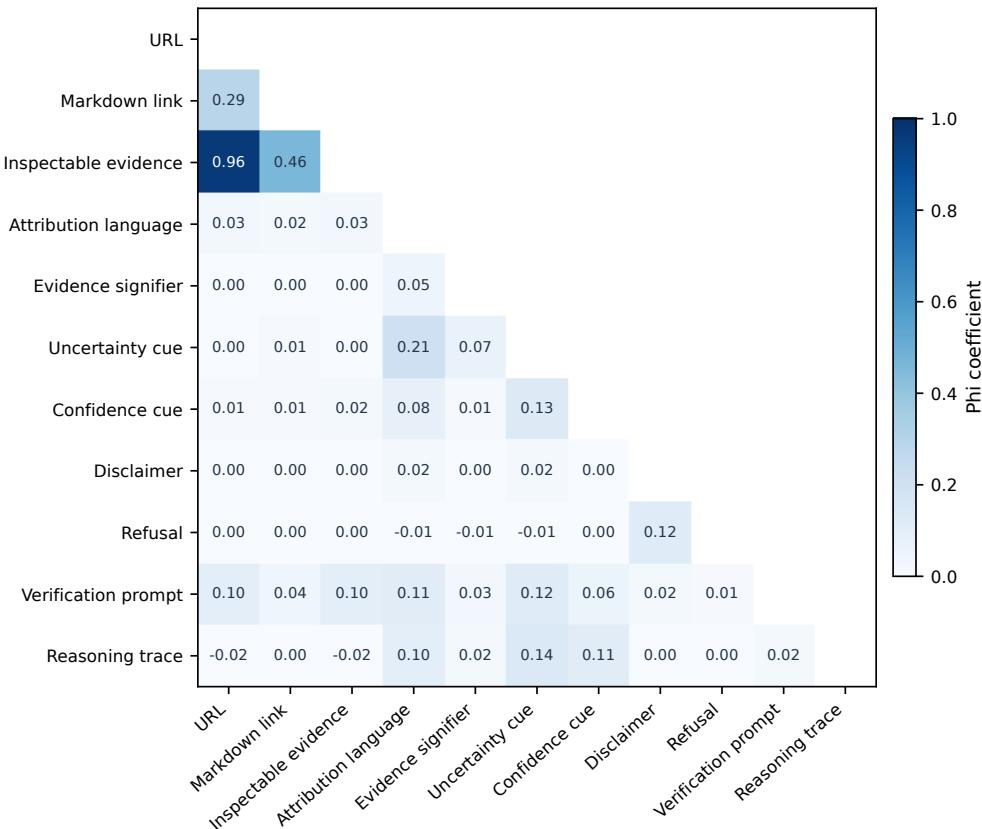  
Fig. 6. Pairwise $\phi$ between the 11 retained response features. URL and inspectable evidence are strongly nested.

Interpreting preserved sources and signifiers. An explicit URL is a web address in the released answer; a markdown link encodes linked text; a preserved source object is stored in a platform-specific export field. The composite inspectableevidence variable records the presence of at least one of these objects, not its accessibility or claim-level support. Broad attribution and evidence signifiers are text-pattern measures, so a response can refer to research without exposing a source. The narrower citation-like attribution flag is used for the source-preservation audit and should not be confused with broad attribution prevalence. Across the two datasets, these distinctions concern what the exported transcript preserve, not what every user necessarily saw on screen.

## D Extended sequential analyses

The supplementary sequence diagnostics use strictly adjacent turn transitions and within-conversation shufles, whereas the fixed-efect lag analysis advances between consecutive qualifying exchanges and may skip intervening nonqualifying replies. The two designs cannot be substituted for each other. The reported shufle figures are composition-preserving benchmarks; a full distribution ofpermutation diferences was not retained in the provided summary, and no permutation significance test is claimed for these excesses. The split-panel jackknife is a sensitivity analysis: conversations close to the five-qualifying-pair threshold contribute only two or three observations per half-panel, limiting small-sample precision. Descriptive estimates for scrutiny-heavy conversations are restricted to conversations with at least five qualifying exchanges.

Split-panel jackknife specification. For a lag coeficient estimated in a full qualifying panel and in its two time-ordered halves, the re orted bias-corrected estimate is

$$
\widehat { \rho } _ { \mathrm { S P J } } = 2 \widehat { \rho } _ { \mathrm { F E , f u l l } } - \frac { \widehat { \rho } _ { \mathrm { F E , f i r s t } } + \widehat { \rho } _ { \mathrm { F E , s e c o n d } } } { 2 } .\tag{9}
$$

The bootstrap resamples conversations, but cannot eliminate the instability of half-panels near the minimum five-pair threshold.

Table 7. Strictly adjacent turn transitions, row percentages; all four outcomes retained.
<table><tr><td>Previous turn</td><td>Accept</td><td>Check</td><td>Challenge</td><td>Not qualifying</td></tr><tr><td>Accept</td><td>64.8</td><td>8.2</td><td>10.1</td><td>16.9</td></tr><tr><td>Check</td><td>43.8</td><td>21.9</td><td>17.4</td><td>16.9</td></tr><tr><td>Challenge</td><td>39.9</td><td>10.4</td><td>34.6</td><td>15.0</td></tr><tr><td>Not qualifying</td><td>39.9</td><td>6.5</td><td>9.4</td><td>44.2</td></tr></table>

Table 8. Same-type repetition: excess over transition from accepting, with within-conversation shufle benchmarks (percentage points).
<table><tr><td>Transition</td><td>Observed excess</td><td></td><td>Shuffled excess Extra ordered repetition</td></tr><tr><td>Check → check</td><td>13.64</td><td>10.8</td><td>≈ 2.8</td></tr><tr><td>Challenge → challenge</td><td>24.56</td><td>18.3</td><td>≈6.3</td></tr></table>

Across 2,000 whole-conversation bootstrap resamples, the diference between the two observed excesses is 10.92 percentage points (95% CI [10.1, 11.8]). In the 18,847 conversations with at least five qualifying exchanges, the top-decile scrutiny share threshold is 70.63% (1,885 conversations). The scrutiny-heavy fraction is 14.0% in Technical Help, 12.4% in Seeking Information, and 5.2% in Writing, without task adjustment. The mean longest consecutive scrutiny streak is 2.05 turns, compared with 1.88 under within-conversation permutation; 2.1% of eligible conversations exceed their own 95th-percentile permutation benchmark. This suggests that most conversations do not show extraordinary extended scrutiny bursts relative to their own scrutiny counts.

## E Complete response-feature codebook

Indicators are defined at the response level. Structural extraction indicates what the released artifact preserves. Linguistic measures detect surface expressions, not whether the model was calibrated or factually correct.

Development and scope of the detector families. The response-feature lexicons were constructed in two stages. The first drew candidate expressions from research on hedging, modality, epistemic stance, evidential language, refusals, and Manuscript submitted to ACM

explanation. The second inspected matches in ShareChat and WildChat and refined expressions that gave predictable false positives. A bare instance of “think,” for example, was removed as an uncertainty marker because it often describes an action or introduces an opinion without expressing doubt. First-person expressions of uncertainty were distinguished during development from proposition-level uncertainty, although the pooled response-feature models use their broader parent indicator. Referrals to a professional or outside source were distinguished from disclaimers, which describe limits or conditions on the answer. All lexicons were frozen before the reported outcome models, and the human validation set was inspected after that freeze. The retained documentation does not provide the exact matching-corpus size, the number of pilot examples reviewed for each feature, or the number of people involved in iterative pattern refinement. We therefore do not assign numerical development-sample sizes; the separately documented final positive-case human audit is described in Supplementary Section F.

Broad attribution, citation-like attribution, and preserved sources. Broad attribution records language invoking research, experts, reports, or other external authority even when the assistant gives no identifiable source. Narrow citation-like attribution is a stricter pattern family intended for auditing whether an apparent source reference is accompanied by preserved support. The latter is not a twelfth primary regression feature. The source-preservation diagnostic flags narrow citation-like attribution with no URL, markdown link, or corresponding preserved platform source object. Perplexity’s source and source\_bar fields, and Grok’s links and source fields, are inspected where available; the common cross-corpus measures cannot assume identical export schemas. Citation-like language without a preserved source is a statement about the exported record and does not prove that a source was absent from the original user interface. The platform audit and feature-overlap matrix appear in Supplementary Section C.

Binary response-level measurement and dependence. A detector is positive if a relevant expression or structure is found anywhere in the response or its preserved fields. This unit facilitates comparison across conversation corpora but cannot evaluate whether every claim is supported, whether a linked page is accessible, or whether its contents are reliable. The inspectable-evidence indicator is a union of potentially inspectable material, so explicit URLs and formatted links are nested within it. The strongest overlap among the retained measures is URL with inspectable evidence (� = 0.957). A proposed broader evidentiary-language feature had near-perfect overlap with attribution (� = 0.995) and was removed. To avoid treating highly overlapping cues as separable controlled exposures, the inferential models use a single focal response feature with a common adjustment set.

Illustrative coding examples. The following are conceptual illustrations of the coding categories, not quotations from analyzed conversations or a complete listing ofthe lexicon patterns. “Research suggests” illustrates broad attribution; “the evidence shows” illustrates an evidence signifier; “may be” illustrates uncertainty; “I am certain” illustrates confidence. A caution that an answer has limitations illustrates a disclaimer, a declined request illustrates refusal, and a suggestion to consult a primary source illustrates verification-prompt language. An assistant may exhibit multiple features in one response. A source URL or markdown link is a separate structural indicator, and exported thinking-field text is counted as a reasoning trace only when such a field is preserved. The codebook does not verify whether any cited source actually supports the response

Table 9. Detailed operationalization of Study 1 response features.
<table><tr><td rowspan=1 colspan=4>Role                 Feature                 Operational meaning              Interpretive caveat</td></tr><tr><td rowspan=4 colspan=4>Material verification URL                     Explicit retrievable URL in the assis- A link can be present with-support                                         tant response.                        out supporting the focalclaim.Material verification Markdown link          Link encoded in markdown struc- A formatting signal; not asupport                                         ture.                                 quality judgment.Material verification Inspectable evidence     Composite indicator for response- Shared transcripts maysupport                                          level link or preserved source mate- omit platform-native pan-rial that can potentially be opened els.or inspected.Verification signifierAttribution language    Language invoking studies, re- Attribution can appear</td></tr><tr><td rowspan=2 colspan=1></td></tr><tr><td rowspan=1 colspan=1></td></tr><tr><td rowspan=1 colspan=1>Verification signifier</td></tr><tr><td rowspan=3 colspan=1></td><td rowspan=8 colspan=3>search, reports, experts, or other without retrievable sup-port.Wording that presents a claim as ev- Signals evidentiary statuswithout necessarily expos-ing evidence.Language marking uncertainty, Surface expression doesqualification, or limited confidence. not establish calibration.Strong commitment, certainty, or Surface confidence does</td></tr><tr><td rowspan=1 colspan=2></td></tr><tr><td rowspan=1 colspan=1>Evidence signifier</td><td rowspan=1 colspan=1>Wording that presents a claim as ev-</td></tr><tr><td rowspan=3 colspan=1>Epistemic communi- Uncertainty</td><td rowspan=1 colspan=1></td><td rowspan=1 colspan=1>idenced or documented.</td></tr><tr><td rowspan=1 colspan=1></td><td rowspan=1 colspan=1></td></tr><tr><td rowspan=1 colspan=1>Uncertainty</td><td rowspan=1 colspan=1>Language marking uncertainty,</td></tr><tr><td rowspan=1 colspan=1>cation cue</td><td rowspan=1 colspan=1></td><td rowspan=1 colspan=1>qualification, or limited confidence.</td></tr><tr><td rowspan=1 colspan=1>Epistemic communi- Confidence</td><td rowspan=1 colspan=1>Confidence</td><td rowspan=1 colspan=1>Strong commitment, certainty, or</td></tr><tr><td rowspan=1 colspan=1>cation cue</td><td rowspan=1 colspan=1></td><td rowspan=1 colspan=1>authoritative phrasing.</td><td rowspan=1 colspan=1>not establish correctness.</td></tr><tr><td rowspan=1 colspan=1>Epistemic communi- D</td><td rowspan=1 colspan=1>isclaimer</td><td rowspan=1 colspan=1>Statement about scope, limitations, C</td><td rowspan=4 colspan=1>an be informative or boil-rplate.</td></tr><tr><td rowspan=1 colspan=1>cation cue</td><td rowspan=1 colspan=1></td><td rowspan=2 colspan=1>caution, or conditions on the an- eswer.</td></tr><tr><td rowspan=2 colspan=1>Epistemic communi-</td><td rowspan=1 colspan=1></td></tr><tr><td rowspan=3 colspan=4>Epistemic communi- Refusal                  Assistant declines to provide the re- Refusals may coexist withquested content or answer.Verification pathway Prompt language        Language that suggests checking, A suggested path may stillconsulting a source, or seeking ex- impose substantial effort.ternal confirmation.Epistemic communi- Reasoning trace          Preserved thinking, analysis, or pro- Process text does not pro-cation cue                                       cess text in the shared transcript.vide external evidence.</td></tr><tr><td rowspan=1 colspan=1>cation cue</td><td rowspan=1 colspan=1></td><td rowspan=1 colspan=1>alternatives or referrals.</td></tr><tr><td rowspan=1 colspan=1>Prompt language</td></tr></table>

## F Human precision audits and classification stability

Distinct measurement-validity questions. The four-way outcome codebook defines an observable speech act at the next user turn. Its content/construct validity depends on whether requesting confirmation and asserting an error correspond to the intended theoretical categories; the precedence rule resolves messages that combine both acts. Its human coding reliability would require independent annotators applying that rule to the same cases, followed by an agreement statistic and adjudication. No such double-coded sample is documented, so human–human reliability remains unestimated. The classifier precision below answers a narrower question: how often one blinded coder judged a label Manuscript submitted to ACM

correct among messages to which the model assigned that label. Without model-negative sampling, recall and the complete checking-versus-challenging confusion matrix also remain unestimated. The audit documents useful classifier accuracy against one human interpretation, while independent replication of the coding boundary remains a priority for future validation.

The final audits were conducted after freezing the production outcome codebook and response-feature lexicons, with model labels hidden from a single human coder. Sampling was conditional on the model’s positive category assignment. The results are estimates of class-specific precision; they do not identify recall, F1, or population-level accuracy. The validation exercises are distinct from the earlier iterative pilot cases that informed codebook development

Definition and denominator ofscrutiny. We use scrutiny throughout the manuscript for the union of checking and challenging. Among qualifying assistant–user response pairs, its prevalence is $( N _ { \mathrm { c h e c k i n g } } + N _ { \mathrm { c h a l l e n g i n g } } ) / ( N _ { \mathrm { a c c e p t i n g } } +$ $N _ { \mathrm { c h e c k i n g } } + N _ { \mathrm { c h a l l e n g i n g } } )$ . “Not qualifying” is excluded from that denominator. This outcome records whether a user visibly requested confirmation or disputed an answer, not whether the user independently verified the information, was correct, or trusted the assistant. The four labels are mutually exclusive under the precedence rules below.

Boundary rules for the next-turn labels. The outcome codebook first asks whether the preceding assistant turn makes a checkable claim or recommendation and whether the next user message engages it. Without that condition, the pair is not qualifying. A request for the grounds or validity of a statement, such as “What source supports this?” or “Are you sure?”, is checking when the user does not advance a competing answer. A reply that asserts an error, supplies a correction, or proposes a concrete alternative is challenging, regardless of whether the user’s correction is ultimately right. Requests for a procedural explanation can be accepting if they build on the answer without questioning its validity. Mere acknowledgment is not necessarily accepting: context-free responses such as a bare “ok” or “no” can be too ambiguous to classify. Where a user both requests sources and asserts a correction, challenging takes precedence. These rules identify visible conversational moves; they do not infer tone, private trust, or successful verification beyond the chat.

Audit interpretation. Outcome-audit examples were sampled conditional on the label produced by the frozen classifier: 100 positives in each of the three qualifying classes from each corpus, with 50 additional not-qualifying cases. The positive-case design makes the reported fractions class-specific precision estimates. It does not sample model negatives in a way that supports recall or a confusion matrix for the population. The same distinction applies to the approximately 20 flagged responses inspected for each lexical detector. Because one human coder conducted the review, the audit does not estimate inter-annotator reliability. The absence of a second independent coder leaves uncertainty about reproducibility of the human judgments, in addition to the sampling uncertainty in the small positive-case detector audits. The 50-case audit of citation-like attribution without a source checks the derived flag against the preserved artifact, not the interface the user originally saw.

Validation required to establish human reproducibility. The next validation step would draw a stratified sample of   
classifier-positive and classifier-negative response pairs from both corpora, deliberately including mixed requests,   
corrections phrased as questions, and short acknowledgments near the qualifying gate. At least two independent human   
annotators would apply the frozen four-class codebook without access to the model predictions. The evaluation would   
report an agreement statistic for the four outcomes, a focused checking-versus-challenging agreement analysis, and   
adjudicated boundary disagreements. Against the adjudicated labels, it would then report the four-class confusion   
matrix and class-specific precision and recall, including how often a true challenge is mislabeled as checking. This Manuscript submitted to ACM

describes a proposed validation design; no such independent annotation or recall evaluation has been completed for the present study.

Table 10. Outcome-label human audit, � = 650 assistant–user pairs.
<table><tr><td>Outcome</td><td>Audited N</td><td>Precision</td></tr><tr><td>Accepting</td><td>200</td><td>0.81</td></tr><tr><td>Checking</td><td>200</td><td>0.89</td></tr><tr><td>Challenging</td><td>200</td><td>0.92</td></tr><tr><td>Not qualifying</td><td>50</td><td>0.92</td></tr></table>

For the qualifying outcome categories, 300 cases were drawn from ShareChat and 300 from WildChat, with 100 positive cases per category in each corpus. The other 50 cases assess the not-qualifying category. No statistically significant corpus diference in precision was detected. The production outcome labeler was Qwen3-30B-A3B, running with a frozen prompt and deterministic decoding configuration.

Table 11. Human precision of topic and intent controls in a 600-message first-turn audit.
<table><tr><td>Level</td><td>Category</td><td>Precision</td></tr><tr><td rowspan="3">Intent</td><td>Asking</td><td>0.80</td></tr><tr><td>Doing</td><td>0.85</td></tr><tr><td>Expressing</td><td>0.81</td></tr><tr><td>Coarse topic</td><td>Writing</td><td>0.82</td></tr><tr><td></td><td>Practical Guidance</td><td>0.83</td></tr><tr><td></td><td>Seeking Information</td><td>0.91</td></tr><tr><td></td><td>Technical Help</td><td>0.95</td></tr><tr><td></td><td>Multimedia</td><td>0.90</td></tr><tr><td></td><td>Self-Expression</td><td>0.87</td></tr><tr><td></td><td>Other/Unknown</td><td>0.85</td></tr></table>

The production topic-and-intent classifier was Qwen3-235B-A22B-Instruct-2507. A separate 200-conversation comparison of GPT-5.4-nano, Qwen3-235B, and DeepSeek-V4 found pairwise Cohen’s � between 0.75 and 0.80 for intent, 0.58 and 0.69 for seven-category coarse topic, and 0.54 and 0.62 for the 24-category fine taxonomy. Cross-model agreement does not substitute for the human audit.

Table 12. Manual positive-case audits of frozen response-feature lexicons (approximately 20 flagged cases per detector).
<table><tr><td>Detector Precision</td></tr><tr><td>Broad attribution language 0.67</td></tr><tr><td>Narrow citation-like attribution 0.70</td></tr><tr><td>Evidence signifier 0.68</td></tr><tr><td>Uncertainty cue 0.72</td></tr><tr><td>Confidence cue 0.85</td></tr><tr><td>Disclaimer 0.82</td></tr><tr><td>Refusal 0.75</td></tr><tr><td>Verification-prompt language 0.81</td></tr><tr><td>First-person uncertainty 0.70</td></tr><tr><td>Referral 0.72</td></tr></table>

Lexicon precision and prevalence sensitivity. Because each lexicon precision estimate comes from approximately 20 flagged examples, a few disagreements can materially afect the estimated value. These audits are useful for assessing measurement uncertainty, but the estimates should not be interpreted as precise rankings of detectors. For broad attribution, the estimated precision is 0.67. Applying it illustratively to the detected attribution prevalence of 31.9% yields approximately 21.4% detected true positives, or a 16:1 ratio relative to the observed 1.33% explicit-URL rate. Allowing an illustrative precision range of roughly 0.43–0.85 gives an adjusted detected share of about 14–27% and a ratio of about 10:1–20:1. These are sensitivity calculations, not confidence intervals for population prevalence. Positive-case precision audits do not identify false negatives or recall, and the comparison cannot correct for omitted information in platform exports.

A separate audit of 50 flagged cases of citation-like attribution without a preserved source yielded approximately 0.95 precision. It evaluates the existence of attribution in the absence of a preserved source object, URL, or markdown link. It does not establish that the original interface lacked a visible source. URL strings, markdown links, and preserved platform field objects were measured through structural rules, without a separate semantic precision audit.

## G F u l l tas k- an d co r p u s-st rat i fi e d est i m ates

This table preserves all attempted RQ3 strata including non-estimable and unstable cells For substantive claims in the main paper we prioritize the conservative 48-test non-Multimedia family treating 1 4 non-estimable contrasts as � = 1 and carrying forward two finite-but-unstable values . The 3 2 stable-contrast correction is retained as a secondary sensitivity family

Tab l e 1 3 . RQ3 m u l t i p l i c i ty fam i l i es . C o m p o n e n t coefi c i e n ts co m p a re eac h o u tco m e w i t h acce pt a n ce ; d i rect co n t rasts co m p a re c h ec ki n g w i t h c h a l l e n g i n g.
<table><tr><td>Family</td><td>Scope</td><td>Tests</td><td>Reported in</td></tr><tr><td>Component coefficients</td><td>Nine strata × six features × two outcomes; BH-FDR</td><td>108</td><td>Main Figure 4A; Section G</td></tr><tr><td>All planned direct</td><td>Nine strata × six features, including Multimedia</td><td>54</td><td>Supp. G</td></tr><tr><td>Primary direct</td><td>Stable non-Multimedia contrasts; BH-FDR</td><td>32</td><td>Main Figure 4B; Section G</td></tr><tr><td>Conservative direct</td><td>Non-Multimedia: 32 stable, two unstable, 14 NE (p = 1); BH-FDR</td><td></td><td>Main Figure 4B; Section G</td></tr></table>

Tab l e 1 4 A l l S 1 - RQ3 st rat i fi e d c h ec ki n g-ve rs u s-c h a l l e n g i n g co nt rasts N E d e n otes a n o n -est i m ab l e o r u n stab l e s pec i fi cat i o n T h e � co l u m n re p o rts t h e est i m ab l e-o n l y co r rect i o n ; co n se rvat i ve � va l u es fo r t h e s i g n i fi cant co nt rasts ap pear i n t h e text an d F i g u re 4 of t h e m ai n m an u sc r i pt .
<table><tr><td>Type</td><td>Stratum</td><td>Feature</td><td>Check RRR [95% CI]</td><td>Challenge RRR [95% CI]</td><td>Check/Challenge [95% CI]</td><td>FDR q (32 stable)</td></tr><tr><td>Topic</td><td>Multimedia</td><td>URL</td><td>NE</td><td>NE</td><td>NE</td><td></td></tr><tr><td>Topic</td><td>Multimedia</td><td>Inspectable evidence</td><td>NE</td><td>NE</td><td>NE</td><td></td></tr><tr><td>Topic</td><td>Multimedia</td><td>Uncertainty</td><td>NE</td><td>NE</td><td>NE</td><td></td></tr><tr><td>Topic</td><td>Multimedia</td><td>Reasoning trace</td><td>NE</td><td>NE</td><td>NE</td><td></td></tr><tr><td>Topic</td><td>Multimedia</td><td>Disclaimer</td><td>NE</td><td>NE</td><td>NE</td><td></td></tr><tr><td>Topic</td><td>Multimedia</td><td>Refusal</td><td>NE</td><td>NE</td><td>NE</td><td></td></tr><tr><td>Topic</td><td>Other/Unknown</td><td>URL</td><td>1.56 [1.12, 2.17]</td><td>1.58 [1.12, 2.23]</td><td>0.99 [0.70, 1.39]</td><td>0.963</td></tr><tr><td>Topic</td><td>Other/Unknown</td><td>Inspectable evidence</td><td>1.44 [1.04, 1.98]</td><td>1.47 [1.06, 2.03]</td><td>0.98 [0.70, 1.38]</td><td>0.963</td></tr><tr><td>Topic</td><td>Other/Unknown</td><td>Uncertainty</td><td>1.10 [1.03, 1.19]</td><td>1.12 [1.04, 1.19]</td><td>0.99 [0.91, 1.08]</td><td>0.963</td></tr><tr><td>Topic</td><td>Other/Unknown</td><td>Reasoning trace</td><td>1.24 [1.14, 1.36]</td><td>1.37 [1.26, 1.49]</td><td>0.91 [0.82, 1.00]</td><td>0.178</td></tr><tr><td>Topic</td><td>Other/Unknown</td><td>Disclaimer</td><td>1.61 [1.29, 2.00]</td><td>1.97 [1.64, 2.38]</td><td>0.82 [0.64, 1.04]</td><td>0.234</td></tr><tr><td>Topic</td><td>Other/Unknown</td><td>Refusal</td><td>2.14 [1.61, 2.85]</td><td>2.20 [1.72, 2.83]</td><td>0.97 [0.72, 1.31]</td><td>0.963</td></tr><tr><td>Topic</td><td>Practical Guidance</td><td>URL</td><td>1.70 [1.15, 2.50]</td><td>2.16 [1.33, 3.49]</td><td>0.79 [0.38, 1.62]</td><td>0.746</td></tr><tr><td>Topic</td><td>Practical Guidance</td><td>Inspectable evidence</td><td>NE</td><td>NE</td><td>NE</td><td></td></tr><tr><td>Topic</td><td>Practical Guidance</td><td>Uncertainty</td><td>0.99 [0.91, 1.09]</td><td>1.04 [0.93, 1.16]</td><td>0.96 [0.84, 1.08]</td><td>0.746</td></tr><tr><td>Topic</td><td>Practical Guidance</td><td>Reasoning trace</td><td>NE</td><td>NE</td><td>NE</td><td></td></tr><tr><td>Topic</td><td>Practical Guidance</td><td>Disclaimer</td><td>1.34 [0.90, 1.99]</td><td>1.16 [0.76, 1.76]</td><td>1.16 [0.70, 1.91]</td><td>0.785</td></tr><tr><td>Topic</td><td>Practical Guidance</td><td>Refusal</td><td>NE</td><td>NE</td><td>NE</td><td></td></tr><tr><td>Topic</td><td>Seeking Information</td><td>URL</td><td>1.25 [0.99, 1.58]</td><td>1.23 [0.96, 1.58]</td><td>1.01 [0.77, 1.33]</td><td>0.963</td></tr><tr><td>Topic</td><td>Seeking Information</td><td>Inspectable evidence</td><td>1.17 [0.92, 1.48]</td><td>1.19 [0.92, 1.53]</td><td>0.98 [0.76, 1.27]</td><td>0.963</td></tr><tr><td>Topic</td><td>Seeking Information</td><td>Uncertainty</td><td>1.08 [1.03, 1.13]</td><td>1.08 [1.03, 1.14]</td><td>1.00 [0.94, 1.06]</td><td>0.963</td></tr><tr><td>Topic</td><td>Seeking Information</td><td>Reasoning trace</td><td>1.23 [1.16, 1.30]</td><td>1.38 [1.30, 1.47]</td><td>0.89 [0.83, 0.95]</td><td>0.007</td></tr><tr><td>Topic</td><td>Seeking Information</td><td>Disclaimer</td><td>1.37 [1.16, 1.62]</td><td>1.66 [1.41, 1.95]</td><td>0.83 [0.67, 1.02]</td><td>0.216</td></tr><tr><td>Topic</td><td>Seeking Information</td><td>Refusal</td><td>1.83 [1.46, 2.29]</td><td>2.93 [2.32, 3.71]</td><td>0.62 [0.47, 0.83]</td><td>0.010</td></tr><tr><td>Topic</td><td>Self-Expression</td><td>URL</td><td>NE</td><td>NE</td><td>NE</td><td></td></tr><tr><td>Topic</td><td>Self-Expression</td><td>Inspectable evidence</td><td>1.46 [0.56, 3.83]</td><td>0.91 [0.43, 1.90]</td><td>1.61 [0.74, 3.50]</td><td>0.456</td></tr><tr><td>Topic</td><td>Self-Expression</td><td>Uncertainty</td><td>1.07 [0.96, 1.20]</td><td>1.02 [0.92, 1.14]</td><td>1.05 [0.92, 1.19]</td><td>0.746</td></tr><tr><td>Topic</td><td>Self-Expression</td><td>Reasoning trace</td><td>NE</td><td>NE</td><td>NE</td><td></td></tr><tr><td>Topic</td><td>Self-Expression</td><td>Disclaimer</td><td>NE</td><td>NE</td><td>NE</td><td></td></tr><tr><td>Topic</td><td>Self-Expression</td><td>Refusal</td><td>NE</td><td>NE</td><td>NE</td><td></td></tr><tr><td>Topic</td><td>Technical Help</td><td>URL</td><td>1.62 [1.39, 1.90]</td><td>1.43 [1.26, 1.63]</td><td>1.14 [0.96, 1.34]</td><td>0.300</td></tr><tr><td>Topic</td><td>Technical Help</td><td>Inspectable evidence</td><td>NE</td><td>NE</td><td>NE</td><td></td></tr><tr><td>Topic</td><td>Technical Help</td><td>Uncertainty</td><td>1.08 [1.01, 1.14]</td><td>0.86 [0.81, 0.91]</td><td>1.26 [1.17, 1.34]</td><td>&lt; 0.001</td></tr><tr><td>Topic</td><td>Technical Help</td><td>Reasoning trace</td><td>NE</td><td>NE</td><td>NE</td><td></td></tr><tr><td>Topic</td><td>Technical Help</td><td>Disclaimer</td><td>0.93 [0.65, 1.34]</td><td>0.92 [0.67, 1.26]</td><td>1.02 [0.68, 1.53]</td><td>0.963</td></tr><tr><td>Topic</td><td>Technical Help</td><td>Refusal</td><td>1.30 [0.83, 2.05]</td><td>0.90 [0.64, 1.26]</td><td>1.45 [0.88, 2.40]</td><td>0.317</td></tr><tr><td>Topic</td><td>Writing</td><td>URL</td><td>NE</td><td>NE</td><td>NE</td><td></td></tr><tr><td>Topic</td><td>Writing</td><td>Inspectable evidence</td><td>NE</td><td>NE</td><td>NE</td><td></td></tr><tr><td>Topic</td><td>Writing</td><td>Uncertainty</td><td>1.18 [1.10, 1.26]</td><td>1.09 [1.03, 1.17]</td><td>1.08 [0.99, 1.17]</td><td>0.216</td></tr><tr><td>Topic</td><td>Writing</td><td>Reasoning trace</td><td>1.35 [1.24, 1.48]</td><td>1.50 [1.39, 1.62]</td><td>0.90 [0.81, 1.00]</td><td>0.178</td></tr><tr><td>Topic</td><td>Writing</td><td>Disclaimer</td><td>NE</td><td>NE</td><td>NE</td><td></td></tr><tr><td>Topic</td><td>Writing</td><td>Refusal</td><td>NE</td><td>NE</td><td>NE</td><td></td></tr><tr><td>Corpus</td><td>ShareChat</td><td>URL</td><td>1.15 [0.87, 1.50]</td><td>1.29 [1.01, 1.66]</td><td>0.89 [0.63, 1.25]</td><td>0.746</td></tr><tr><td>Corpus</td><td>ShareChat</td><td>Inspectable evidence</td><td>1.10 [0.92, 1.32]</td><td>1.20 [0.96, 1.49]</td><td>0.92 [0.71, 1.18]</td><td>0.746</td></tr><tr><td>Corpus</td><td>ShareChat</td><td>Uncertainty</td><td>1.07 [1.02, 1.12]</td><td>1.07 [1.04, 1.11]</td><td>1.00 [0.94, 1.06]</td><td>0.963</td></tr><tr><td>Corpus</td><td>ShareChat</td><td>Reasoning trace</td><td>1.32 [1.23, 1.41]</td><td>1.50 [1.45, 1.56]</td><td>0.88 [0.82, 0.94]</td><td>0.004</td></tr><tr><td>Corpus</td><td>ShareChat</td><td>Disclaimer</td><td>1.40 [1.19, 1.63]</td><td>1.77 [1.54, 2.03]</td><td>0.79 [0.66, 0.94]</td><td>0.048</td></tr><tr><td>Corpus</td><td>ShareChat</td><td>Refusal</td><td>1.87 [1.57, 2.23]</td><td>2.36 [1.99, 2.79]</td><td>0.79 [0.64, 0.98]</td><td>0.162</td></tr><tr><td>Corpus</td><td>WildChat</td><td>URL</td><td>NE</td><td>NE</td><td>NE</td><td></td></tr><tr><td>Corpus</td><td>WildChat</td><td>Inspectable evidence</td><td>NE</td><td>NE</td><td>NE</td><td></td></tr><tr><td>Corpus</td><td>WildChat</td><td>Uncertainty</td><td>1.18 [0.93, 1.50]</td><td>0.96 [0.92, 1.00]</td><td>1.23 [0.97, 1.56]</td><td>0.234</td></tr><tr><td>Corpus</td><td>WildChat</td><td>Reasoning trace</td><td>0.99 [0.91, 1.08]</td><td>0.86 [0.81, 0.91]</td><td>1.16 [1.05, 1.28]</td><td>0.014</td></tr><tr><td>Corpus</td><td>WildChat</td><td>Disclaimer</td><td>NE</td><td>NE</td><td>NE</td><td></td></tr><tr><td>Corpus</td><td>WildChat</td><td>Refusal</td><td>1.76 [1.34, 2.31]</td><td>1.55 [1.26, 1.90]</td><td>1.14 [0.84, 1.54]</td><td>0.746</td></tr></table>

Table 15. RQ3 coeficient tests: all 108 planned comparisons.
<table><tr><td>Stratum</td><td>Feature</td><td>Contrast</td><td>RRR 95% CI</td><td></td><td>AME (pp)</td><td>q108 Status</td><td></td></tr><tr><td>Writing</td><td>URL</td><td>Check / Accept</td><td></td><td></td><td></td><td>1.000</td><td>singular</td></tr><tr><td>Writing</td><td>URL</td><td>Challenge / Accept</td><td></td><td></td><td></td><td>1.000</td><td>singular</td></tr><tr><td>Writing</td><td>Inspectable evidence</td><td>Check / Accept</td><td></td><td></td><td></td><td>1.000</td><td>singular</td></tr><tr><td>Writing</td><td>Inspectable evidence</td><td>Challenge / Accept</td><td></td><td></td><td></td><td>1.000</td><td>singular</td></tr><tr><td>Writing</td><td>Uncertainty</td><td>Check / Accept</td><td>1.18</td><td>[1.10, 1.26]</td><td>1.11</td><td>&lt;0.001</td><td>estimable</td></tr><tr><td>Writing</td><td>Uncertainty</td><td>Challenge / Accept</td><td>1.09</td><td>[1.03, 1.17]</td><td>0.81</td><td>0.017</td><td>estimable</td></tr><tr><td>Writing</td><td>Reasoning trace</td><td>Check / Accept</td><td>1.35</td><td>[1.24, 1.48]</td><td>1.79</td><td>&lt;0.001</td><td>estimable</td></tr><tr><td>Writing</td><td>Reasoning trace</td><td>Challenge / Accept</td><td>1.50</td><td>[1.39, 1.62]</td><td>4.49</td><td>&lt;0.001</td><td>estimable</td></tr><tr><td>Writing</td><td>Disclaimer</td><td>Check / Accept</td><td></td><td></td><td></td><td>1.000</td><td>singular</td></tr><tr><td>Writing</td><td>Disclaimer</td><td>Challenge / Accept</td><td></td><td></td><td></td><td>1.000</td><td>singular</td></tr><tr><td>Writing</td><td>Refusal</td><td>Check / Accept</td><td></td><td></td><td></td><td>1.000</td><td>singular</td></tr><tr><td>Writing</td><td>Refusal</td><td>Challenge / Accept</td><td></td><td></td><td></td><td>1.000</td><td>singular</td></tr><tr><td>Practical Guidance</td><td>URL</td><td>Check / Accept</td><td>1.70</td><td>[1.15, 2.50]</td><td>4.64</td><td>0.023</td><td>estimable</td></tr><tr><td>Practical Guidance</td><td>URL</td><td>Challenge / Accept</td><td>2.16</td><td>[1.33, 3.49]</td><td>8.23</td><td>0.006</td><td>estimable</td></tr><tr><td>Practical Guidance</td><td>Inspectable evidence</td><td>Check / Accept</td><td></td><td></td><td></td><td>1.000</td><td>nonfinite</td></tr><tr><td>Practical Guidance</td><td>Inspectable evidence</td><td>Challenge / Accept</td><td></td><td></td><td></td><td>1.000</td><td>nonfinite</td></tr><tr><td>Practical Guidance</td><td>Uncertainty</td><td>Check / Accept</td><td>0.99</td><td>[0.91, 1.09]</td><td>-0.13</td><td>1.000</td><td>estimable</td></tr><tr><td>Practical Guidance</td><td>Uncertainty</td><td>Challenge / Accept</td><td>1.04</td><td>[0.93, 1.16]</td><td>0.39</td><td>0.885</td><td>estimable</td></tr><tr><td>Practical Guidance</td><td>Reasoning trace</td><td>Check / Accept</td><td></td><td></td><td></td><td>1.000</td><td>singular</td></tr><tr><td>Practical Guidance</td><td>Reasoning trace</td><td>Challenge / Accept</td><td></td><td></td><td>一</td><td>1.000</td><td>singular</td></tr><tr><td>Practical Guidance</td><td>Disclaimer</td><td>Check / Accept</td><td>1.34</td><td>[0.90, 1.99]</td><td>3.12</td><td>0.331</td><td>estimable</td></tr><tr><td>Practical Guidance</td><td>Disclaimer</td><td>Challenge / Accept</td><td>1.16</td><td>[0.76, 1.76]</td><td>0.96</td><td>0.922</td><td>estimable</td></tr><tr><td>Practical Guidance</td><td>Refusal</td><td>Check / Accept</td><td></td><td></td><td></td><td>1.000</td><td>nonfinite</td></tr><tr><td>Practical Guidance</td><td>Refusal</td><td>Challenge / Accept</td><td></td><td></td><td>一</td><td>1.000</td><td>nonfinite</td></tr><tr><td>Seeking Information</td><td>URL</td><td>Check / Accept</td><td>1.25</td><td>[0.99, 1.58]</td><td>2.24</td><td>0.153</td><td>estimable</td></tr><tr><td>Seeking Information</td><td>URL</td><td>Challenge / Accept</td><td>1.23</td><td>[0.96, 1.58]</td><td>2.49</td><td>0.235</td><td>estimable</td></tr><tr><td>Seeking Information</td><td>Inspectable evidence</td><td>Check / Accept</td><td>1.17</td><td>[0.92, 1.48]</td><td>1.44</td><td>0.425</td><td>estimable</td></tr><tr><td>Seeking Information</td><td>Inspectable evidence</td><td>Challenge / Accept</td><td>1.19</td><td>[0.92, 1.53]</td><td>2.17</td><td>0.375</td><td>estimable</td></tr><tr><td>Seeking Information</td><td>Uncertainty</td><td>Check / Accept</td><td>1.08</td><td>[1.03, 1.13]</td><td>0.74</td><td>0.004</td><td>estimable</td></tr><tr><td>Seeking Information</td><td>Uncertainty Reasoning trace</td><td>Challenge / Accept</td><td>1.08</td><td>[1.03, 1.14]</td><td>0.96</td><td>0.004</td><td>estimable</td></tr><tr><td>Seeking Information</td><td>Reasoning trace</td><td>Check / Accept</td><td>1.23</td><td>[1.16, 1.30]</td><td>1.61</td><td>&lt;0.001</td><td>estimable</td></tr><tr><td>Seeking Information Seeking Information</td><td>Disclaimer</td><td>Challenge / Accept</td><td>1.38</td><td>[1.30, 1.47]</td><td>4.39</td><td>&lt;0.001</td><td>estimable</td></tr><tr><td></td><td>Disclaimer</td><td>Check / Accept</td><td>1.37</td><td>[1.16, 1.62]</td><td>2.38</td><td>&lt;0.001</td><td>estimable</td></tr><tr><td>Seeking Information</td><td>Refusal</td><td>Challenge / Accept</td><td>1.66</td><td>[1.41, 1.95]</td><td>7.28</td><td>&lt;0.001</td><td>estimable</td></tr><tr><td>Seeking Information</td><td>Refusal</td><td>Check / Accept</td><td>1.83</td><td>[1.46, 2.29]</td><td>3.47</td><td>&lt;0.001</td><td>estimable</td></tr><tr><td>Seeking Information</td><td>URL</td><td>Challenge / Accept</td><td>2.93</td><td>[2.32, 3.71]</td><td>17.41</td><td>&lt;0.001</td><td>estimable</td></tr><tr><td>Technical Help</td><td></td><td>Check / Accept</td><td>1.62</td><td>[1.39, 1.90]</td><td>4.67</td><td>&lt;0.001</td><td>estimable</td></tr><tr><td>Technical Help</td><td>URL</td><td>Challenge / Accept</td><td>1.43</td><td>[1.26, 1.63]</td><td>4.65</td><td>&lt;0.001</td><td>estimable</td></tr><tr><td>Technical Help</td><td>Inspectable evidence</td><td>Check / Accept</td><td></td><td></td><td></td><td>1.000</td><td>nonfinite</td></tr><tr><td>Technical Help Technical Help</td><td>Inspectable evidence</td><td>Challenge / Accept</td><td></td><td></td><td></td><td>1.000</td><td>nonfinite</td></tr><tr><td>Technical Help</td><td>Uncertainty Uncertainty</td><td>Check / Accept</td><td>1.08</td><td>[1.01, 1.14]</td><td>1.30</td><td>0.052</td><td>estimable</td></tr><tr><td>Technical Help</td><td>Reasoning trace</td><td>Challenge / Accept</td><td>0.86</td><td>[0.81, 0.91]</td><td>-2.85</td><td>&lt;0.001</td><td>estimable</td></tr><tr><td>Technical Help</td><td>Reasoning trace</td><td>Check / Accept</td><td></td><td></td><td></td><td>1.000</td><td>nonfinite</td></tr><tr><td>Technical Help</td><td>Disclaimer</td><td>Challenge / Accept Check / Accept</td><td>0.93</td><td>[0.65, 1.34]</td><td>-0.48</td><td>1.000</td><td>nonfinite</td></tr><tr><td>Technical Help</td><td>Disclaimer</td><td>Challenge / Accept</td><td>0.92</td><td>[0.67, 1.26]</td><td>-1.28</td><td>1.000 1.000</td><td>estimable</td></tr><tr><td>Technical Help</td><td>Refusal</td><td>Check / Accept</td><td>1.30</td><td>[0.83, 2.05]</td><td>3.59</td><td>0.513</td><td>estimable estimable</td></tr><tr><td>Technical Help</td><td>Refusal</td><td>Challenge / Accept</td><td>0.90</td><td>[0.64, 1.26]</td><td>-2.69</td><td>0.956</td><td>estimable</td></tr><tr><td>Multimedia</td><td>URL</td><td>Check / Accept</td><td></td><td></td><td></td><td>1.000</td><td>nonfinite</td></tr><tr><td>Multimedia Multimedia</td><td>URL Inspectable evidence</td><td>Challenge / Accept Check / Accept</td><td></td><td></td><td></td><td>1.000</td><td>nonfinite</td></tr><tr></table>

Manuscript submitted to ACM

Table continuedfrom previous page
<table><tr><td>Stratum</td><td>Feature</td><td>Contrast</td><td>RRR 95% CI</td><td></td><td>AME (pp)</td><td>q108</td><td>Status</td></tr><tr><td>Multimedia</td><td>Refusal</td><td>Challenge / Accept</td><td></td><td></td><td></td><td>1.000</td><td>nonfinite</td></tr><tr><td>Self-Expression</td><td>URL</td><td>Check / Accept</td><td></td><td></td><td>一</td><td>1.000</td><td>nonfinite</td></tr><tr><td>Self-Expression</td><td>URL</td><td>Challenge / Accept</td><td></td><td></td><td></td><td>1.000</td><td>nonfinite</td></tr><tr><td>Self-Expression</td><td>Inspectable evidence</td><td>Check / Accept</td><td>1.46</td><td>[0.56, 3.83]</td><td>3.19</td><td>0.836</td><td>estimable</td></tr><tr><td>Self-Expression</td><td>Inspectable evidence</td><td>Challenge / Accept</td><td>0.91</td><td>[0.43, 1.90]</td><td>-1.72</td><td>1.000</td><td>estimable</td></tr><tr><td>Self-Expression</td><td>Uncertainty</td><td>Check / Accept</td><td>1.07</td><td>[0.96, 1.20]</td><td>0.44</td><td>0.489</td><td>estimable</td></tr><tr><td>Self-Expression</td><td>Uncertainty</td><td>Challenge / Accept</td><td>1.02</td><td>[0.92, 1.14]</td><td>0.19</td><td>1.000</td><td>estimable</td></tr><tr><td>Self-Expression</td><td>Reasoning trace</td><td>Check / Accept</td><td></td><td></td><td>1</td><td>1.000</td><td>singular</td></tr><tr><td>Self-Expression</td><td>Reasoning trace</td><td>Challenge / Accept</td><td></td><td></td><td></td><td>1.000</td><td>singular</td></tr><tr><td>Self-Expression</td><td>Disclaimer</td><td>Check / Accept</td><td></td><td></td><td></td><td>1.000</td><td>nonfinite</td></tr><tr><td>Self-Expression</td><td>Disclaimer</td><td>Challenge / Accept</td><td></td><td></td><td>一</td><td>1.000</td><td>nonfinite</td></tr><tr><td>Self-Expression</td><td>Refusal</td><td>Check / Accept</td><td></td><td></td><td></td><td>1.000</td><td>nonfinite</td></tr><tr><td>Self-Expression</td><td>Refusal</td><td>Challenge / Accept</td><td></td><td></td><td>一</td><td>1.000</td><td>nonfinite</td></tr><tr><td>Other/Unknown</td><td>URL</td><td>Check / Accept</td><td>1.56</td><td>[1.12, 2.17]</td><td>3.71</td><td>0.024</td><td>estimable</td></tr><tr><td>Other/Unknown</td><td>URL</td><td>Challenge / Accept</td><td>1.58</td><td>[1.12, 2.23]</td><td>6.39</td><td>0.024</td><td>estimable</td></tr><tr><td>Other/Unknown</td><td>Inspectable evidence</td><td>Check / Accept</td><td>1.44</td><td>[1.04, 1.98]</td><td>2.99</td><td>0.066</td><td>estimable</td></tr><tr><td>Other/Unknown</td><td>Inspectable evidence</td><td>Challenge / Accept</td><td>1.47</td><td>[1.06, 2.03]</td><td>5.29</td><td>0.056</td><td>estimable</td></tr><tr><td>Other/Unknown</td><td>Uncertainty</td><td>Check / Accept</td><td>1.10</td><td>[1.03, 1.19]</td><td>0.77</td><td>0.024</td><td>estimable</td></tr><tr><td>Other/Unknown</td><td>Uncertainty</td><td>Challenge / Accept</td><td>1.12</td><td>[1.04, 1.19]</td><td>1.45</td><td>0.004</td><td>estimable</td></tr><tr><td>Other/Unknown</td><td>Reasoning trace</td><td>Check / Accept</td><td>1.24</td><td>[1.14, 1.36]</td><td>1.51</td><td>&lt;0.001</td><td>estimable</td></tr><tr><td>Other/Unknown</td><td>Reasoning trace</td><td>Challenge / Accept</td><td>1.37</td><td>[1.26, 1.49]</td><td>4.49</td><td>&lt;0.001</td><td>estimable</td></tr><tr><td>Other/Unknown</td><td>Disclaimer</td><td>Check / Accept</td><td>1.61</td><td>[1.29, 2.00]</td><td>3.21</td><td>&lt;0.001</td><td>estimable</td></tr><tr><td>Other/Unknown</td><td>Disclaimer</td><td>Challenge / Accept</td><td>1.97</td><td>[1.64, 2.38]</td><td>10.54</td><td>&lt;0.001</td><td>estimable</td></tr><tr><td>Other/Unknown</td><td>Refusal</td><td>Check / Accept</td><td>2.14</td><td>[1.61, 2.85]</td><td>6.48</td><td>&lt;0.001</td><td>estimable</td></tr><tr><td>Other/Unknown</td><td>Refusal</td><td>Challenge / Accept</td><td>2.20</td><td>[1.72, 2.83]</td><td>11.44</td><td>&lt;0.001</td><td>estimable</td></tr><tr><td>ShareChat</td><td>URL</td><td>Check / Accept</td><td>1.15</td><td>[0.87, 1.50]</td><td>0.81</td><td>0.631</td><td>estimable</td></tr><tr><td>ShareChat</td><td>URL</td><td>Challenge / Accept</td><td>1.29</td><td>[1.01, 1.66]</td><td>3.64</td><td>0.106</td><td>estimable</td></tr><tr><td>ShareChat</td><td>Inspectable evidence</td><td>Check / Accept</td><td>1.10</td><td>[0.92, 1.32]</td><td>0.60</td><td>0.564</td><td>estimable</td></tr><tr><td>ShareChat</td><td>Inspectable evidence</td><td>Challenge / Accept</td><td>1.20</td><td>[0.96, 1.49]</td><td>2.54</td><td>0.234</td><td>estimable</td></tr><tr><td>ShareChat</td><td>Uncertainty</td><td>Check / Accept</td><td>1.07</td><td>[1.02, 1.12]</td><td>0.55</td><td>0.027</td><td>estimable</td></tr><tr><td>ShareChat</td><td>Uncertainty</td><td>Challenge / Accept</td><td>1.07</td><td>[1.04, 1.11]</td><td>0.83</td><td>&lt;0.001</td><td>estimable</td></tr><tr><td>ShareChat</td><td>Reasoning trace</td><td>Check / Accept</td><td>1.32</td><td>[1.23, 1.41]</td><td>1.97</td><td>&lt;0.001</td><td>estimable</td></tr><tr><td>ShareChat</td><td>Reasoning trace</td><td>Challenge / Accept</td><td>1.50</td><td>[1.45, 1.56]</td><td>5.62</td><td>&lt;0.001</td><td>estimable</td></tr><tr><td>ShareChat</td><td>Disclaimer</td><td>Check / Accept</td><td>1.40</td><td>[1.19, 1.63]</td><td>2.06</td><td>&lt;0.001</td><td>estimable</td></tr><tr><td>ShareChat</td><td>Disclaimer</td><td>Challenge / Accept</td><td>1.77</td><td>[1.54, 2.03]</td><td>8.55</td><td>&lt;0.001</td><td>estimable</td></tr><tr><td>ShareChat</td><td>Refusal</td><td>Check / Accept</td><td>1.87</td><td>[1.57, 2.23]</td><td>4.53</td><td>&lt;0.001</td><td>estimable</td></tr><tr><td>ShareChat</td><td>Refusal</td><td>Challenge / Accept</td><td>2.36</td><td>[1.99, 2.79]</td><td>12.99</td><td>&lt;0.001</td><td>estimable</td></tr><tr><td>WildChat</td><td>URL</td><td>Check / Accept</td><td></td><td></td><td></td><td>1.000</td><td>unstable</td></tr><tr><td>WildChat</td><td>URL</td><td>Challenge / Accept</td><td>1.39</td><td>[1.24, 1.56]</td><td>3.11</td><td>&lt;0.001</td><td>estimable</td></tr><tr><td>WildChat</td><td>Inspectable evidence</td><td>Check / Accept</td><td></td><td></td><td></td><td>1.000</td><td>unstable</td></tr><tr><td>WildChat</td><td>Inspectable evidence</td><td>Challenge / Accept</td><td>1.39</td><td>[1.24, 1.55]</td><td>3.11</td><td>&lt;0.001</td><td>estimable</td></tr><tr><td>WildChat</td><td>Uncertainty</td><td>Check / Accept</td><td>1.18</td><td>[0.93, 1.50]</td><td>1.53</td><td>0.368</td><td>estimable</td></tr><tr><td>WildChat</td><td>Uncertainty</td><td>Challenge / Accept</td><td>0.96</td><td>[0.92, 1.00]</td><td>-0.81</td><td>0.145</td><td>estimable</td></tr><tr><td>WildChat</td><td>Reasoning trace</td><td>Check / Accept</td><td>0.99</td><td>[0.91, 1.08]</td><td>0.20</td><td>1.000</td><td>estimable</td></tr><tr><td>WildChat</td><td>Reasoning trace</td><td>Challenge / Accept</td><td>0.86</td><td>[0.81, 0.91]</td><td>-1.85</td><td>&lt;0.001</td><td>estimable</td></tr><tr><td>WildChat</td><td>Disclaimer</td><td>Check / Accept</td><td></td><td></td><td></td><td>1.000</td><td>nonfinite</td></tr><tr><td>WildChat</td><td>Disclaimer</td><td>Challenge / Accept</td><td></td><td></td><td>1</td><td>1.000</td><td>nonfinite</td></tr><tr><td>WildChat</td><td>Refusal</td><td>Check / Accept</td><td>1.76</td><td>[1.34, 2.31]</td><td>4.77</td><td>&lt;0.001</td><td>estimable</td></tr><tr><td>WildChat</td><td>Refusal</td><td>Challenge / Accept</td><td>1.55</td><td>[1.26, 1.90]</td><td>4.64</td><td>&lt;0.001</td><td>estimable</td></tr></table>

## H Held-out model comparison and exploratory model heterogeneity

## H.1 Predictive comparison

The analysis below provides the full six-block comparison discussed in RQ3. Five-fold held-out evaluation uses folds grouped at the conversation level, so no pair from a held-out conversation appears in the training set. AUC is macro one-versus-rest across the three qualifying outcome labels, and log loss is multiclass. This exercise characterizes the predictive information in the observed variables, not the consequences of interventions on interface cues.

Manuscript submitted to ACM

Table 17. In-sample and held-out model fit. Parentheses give the standard deviation over five grouped folds.
<table><tr><td>Predictor blocks</td><td>In-sample AUC</td><td>Held-out AUC</td><td>Held-out log loss</td></tr><tr><td>Response features only</td><td>0.556</td><td>0.551 (0.004)</td><td>0.788 (0.007)</td></tr><tr><td>Topic, intent, turn position</td><td>0.594</td><td>0.592 (0.005)</td><td>0.779 (0.008)</td></tr><tr><td>Task block + response features</td><td>0.607</td><td>0.603 (0.004)</td><td>0.775 (0.007)</td></tr><tr><td>Task block + model/system</td><td>0.610</td><td>0.605 (0.004)</td><td>0.774 (0.007)</td></tr><tr><td>Task + model/system + features</td><td>0.620</td><td>0.615 (0.003)</td><td>0.771 (0.007)</td></tr><tr><td>Full: preceding + length and truncation</td><td>0.625</td><td>0.621 (0.003)</td><td>0.769 (0.007)</td></tr></table>

## H.2 Exploratory reasoning-model and model-version comparisons

These model-level comparisons are exploratory and are not part of the primary 48-test family. Within WildChat, scrutiny among qualifying responses varies from 20.1% for gpt-3.5-turbo-0125 to 34.8% for gpt-4o-2024-11-20. Across 12 retained descriptive model groups, the correlation between scrutiny and the separately labeled reliance indicator is approximately � = −0.90; model-specific regression estimates were available for 11 of those groups. Much of this inverse association is mechanical because turn-level reliance and scrutiny are near-complements in the coding: the ecological correlation should not be interpreted as an independent model-level behavioral efect. In model-specific exploratory specifications, attribution is positively associated with scrutiny in four of 11 estimable models and never negatively; confidence is associated with less scrutiny in six of 11 and never with more. Uncertainty varies in direction; inspectable-evidence indicators do not reach significance in the model-specific specifications. These results also depend on model-group composition.

An additional ShareChat analysis compares ChatGPT responses with explicitly identified reasoning and non-reasoning model IDs. Reasoning-model responses contain more uncertainty (46.7% versus 37.1%) but somewhat less inspectable support (1.36% versus 1.87%). Visible scrutiny follows 37.6% of qualifying reasoning-model responses and 32.5% of qualifying non-reasoning responses. The covariate-adjusted odds ratio is 1.31 (95% CI [1.18, 1.45]). Because reasoning- model assignment was not randomized and model/version grouping is correlated with deployment era, task mix, and platform behavior, this result is descriptive. WildChat did not provide a comparable reasoning/non-reasoning model-ID split in the examined sample.

## I Supplementary result figures and diagnostic plots

The following supplementary figures document the distribution of response features, validation diagnostics, contextual heterogeneity, and sequential analyses. Figure captions specify the sampling frame and comparison.

The qualifying fraction is higher for ShareChat (80.4%) than for WildChat (66.5%), and the average number of response pairs per conversation difers across platforms (Figure 7).

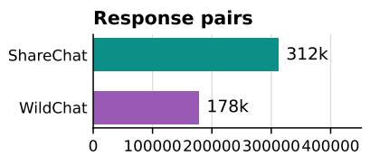

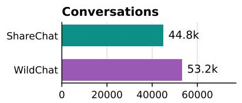

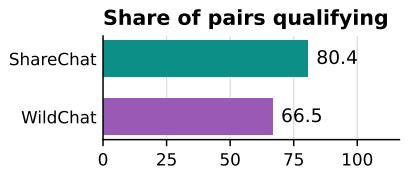

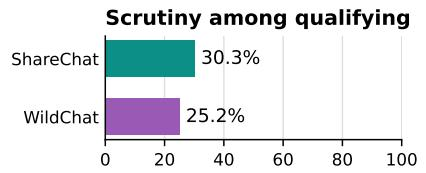

Response pairs per conversation, by platform: mean (bar) and median (tick)  
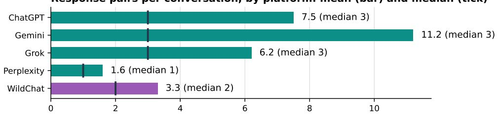  
Fig. 7. Response-pair counts, conversation counts, qualifying rates, and platform-specific pair counts. Joined sample and platform denominators.

Audit precision varies across label families; outcome labels have 0.81–0.92 estimated precision, compared with 0.67–0.85 for the lexicons (Figure 8).

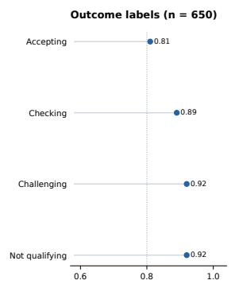

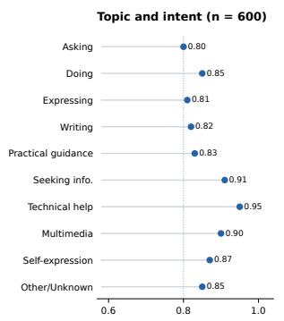

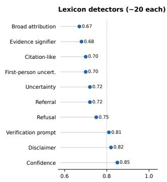  
Fig. 8. Blinded audits of outcome, topic/intent, and lexicon precision. Positive-case audits estimate precision, not recall.

Attribution, uncertainty, and other response-level cues have diferent frequencies across systems (Figure 9).

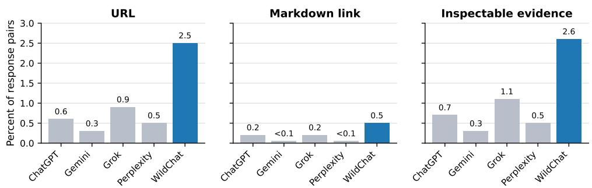

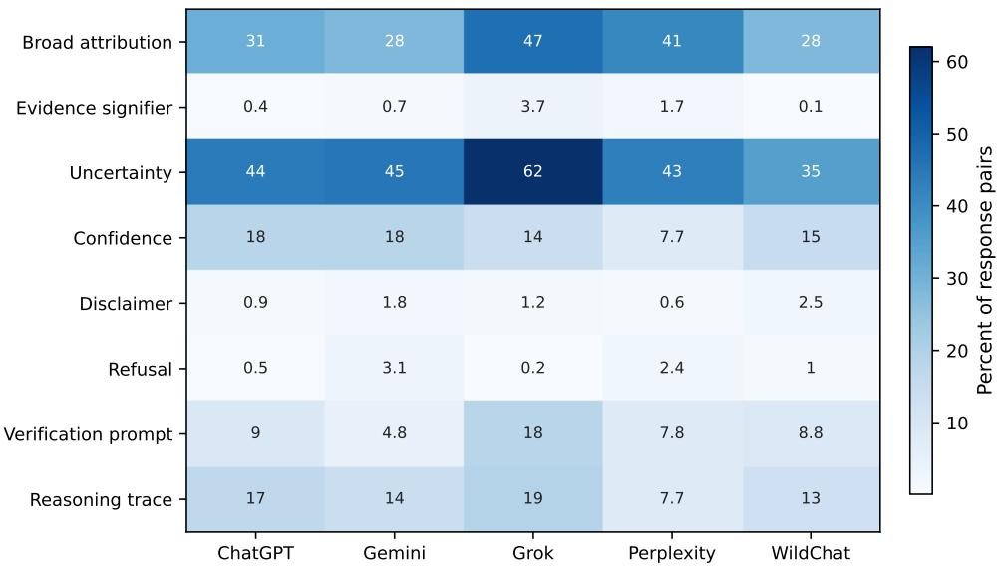  
Fig. 9. Platform-specific frequency of epistemic and atribution cues in the full joined sample.  
URLs and inspectable evidence remain sparse in most platforms in the exported records (Figure 10).  
$\mathsf { F i g . }$ 10. Platform-specific URL and inspectable-support prevalence. Denominators are full joined response pairs.  
Within Technical Help, uncertainty displays a notably diferent checking and challenging association (Figure 11). Non-estimable coeficients are marked explicitly.

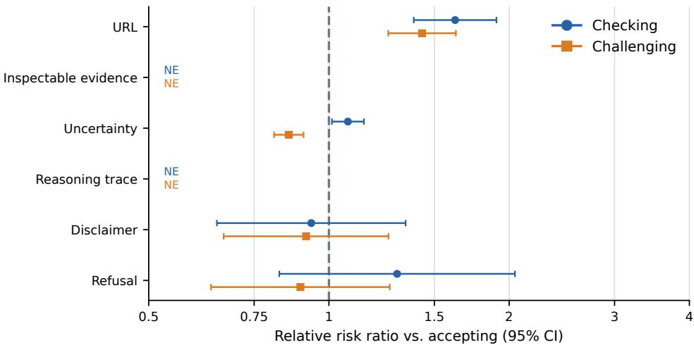  
Fig. 11. Technical Help: uncertainty and the difering checking/challenging estimates.

Within Seeking Information, refusals and reasoning-trace indicators show stronger challenging associations (Fig- ure 12).

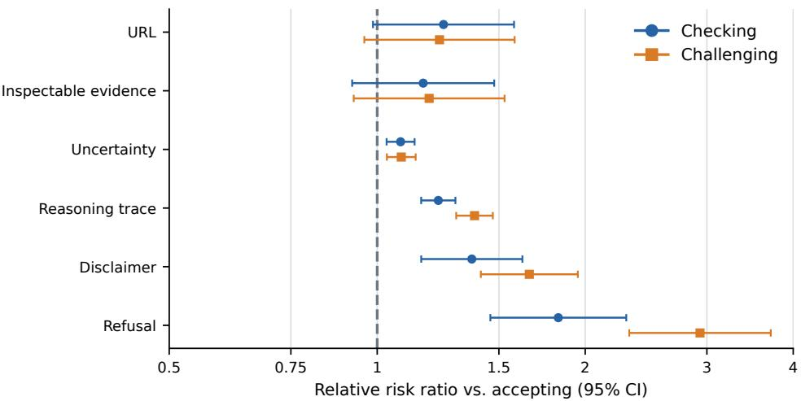  
Fig. 12. Seeking Information: diferential refusal and reasoning-trace associations.

The conversation-grouped comparison favors initial task information over response features alone (Figure 13).

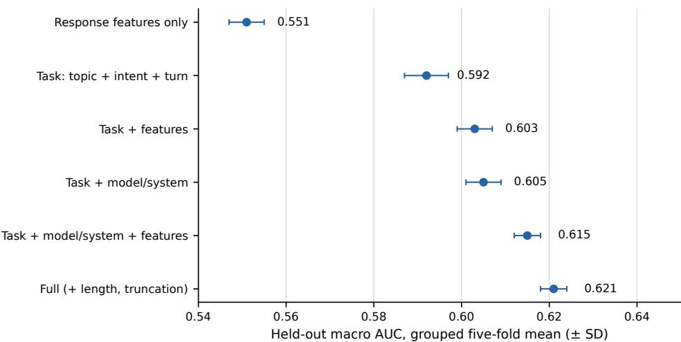  
Fig. 13. Conversation-grouped predictive comparisons, with topic/intent/turn blocks and response-feature blocks.

The pooled lag difers markedly from fixed-efects and bias-corrected estimates (Figure 14).  
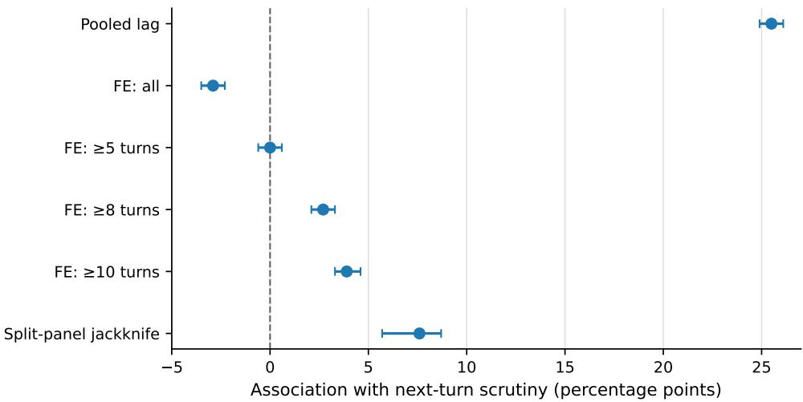  
Fig. 14. Pooled and conversation-fixed-efect lag estimates and jackknife. This chart shows association, not causal carry-over.  
The scrutiny share is relatively flat across normalized conversation position, as shown in Figure 15.

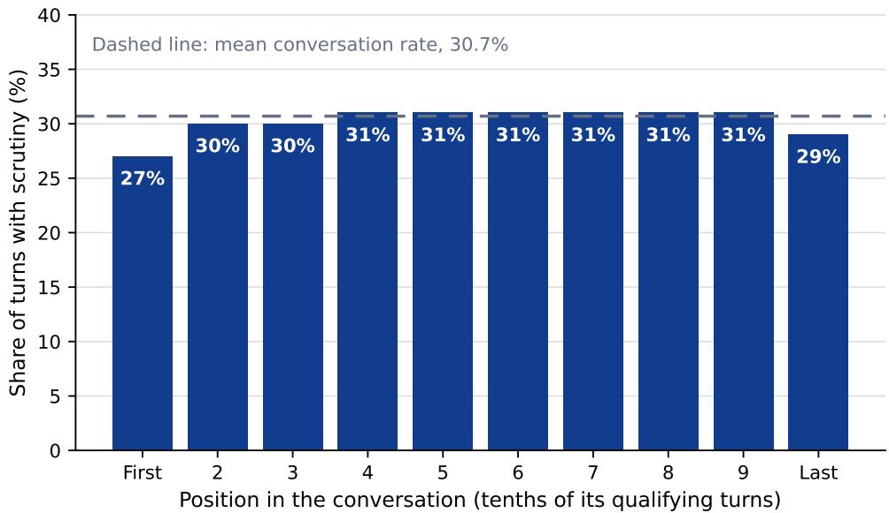  
Fig. 15. Share of qualifying turns classified as scrutiny by normalized position within the conversation, in the at-least-five-turn sample.

The exploratory reasoning-versus-nonreasoning comparison is shown in Figure 16; task and deployment diferences confound model-family assignment.

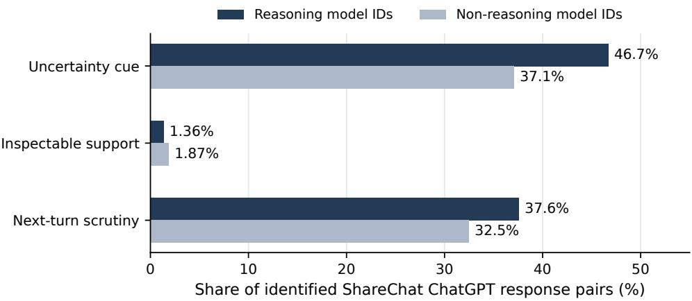  
Fig. 16. Reasoning versus non-reasoning model family among model-identified ShareChat ChatGPT responses: uncertainty, inspectable support, and subsequent scrutiny. Descriptive, nonrandomized comparisons

Two examples from the WildChat model-version comparison appear in Figure 17; they are not a complete modelversion ranking.

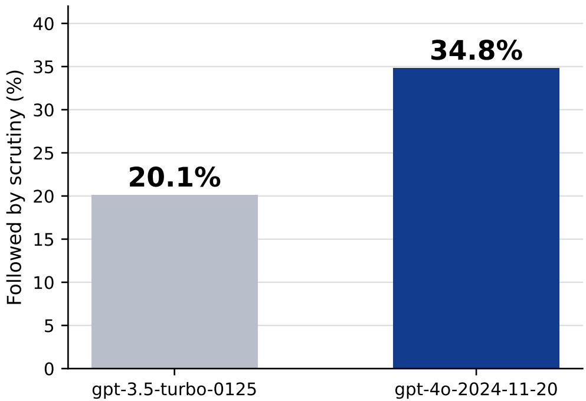  
Fig. 17. Endpoint contrast for model-version scrutiny rates within WildChat; complete counts for other versions not shown in the source presentation.

The unequal availability of preserved source fields is summarized in Figure 18.  
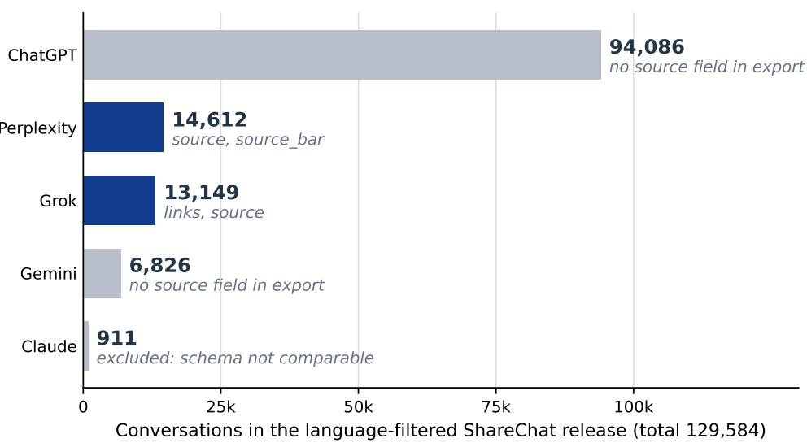  
Fig. 18. ShareChat platform composition and available preserved source-object fields.