# TOWARDS INTERPRETING ANY RESIDUAL STREAMDIRECTION BY SCALING ACTIVATION INVERSION

Celeste De Schamphelaere∗ MATS

Juan J. Vazquez Arb Research

Ari Spiesberger Arb Research

Toma´s Gavenˇ ciakˇ Arb Research & Charles University

Gavin Leech Euan Ong† Jiahai Feng† Arb Research Anthropic Anthropic

## ABSTRACT

To interpret a direction in a language model’s residual stream, we can look for text that strongly activates it. But when such text is found by scanning a corpus, it is limited to what that corpus contains. We develop Maximally-Activating Example Metamodels (MAEMs), language models which map residual stream directions from a subject model to text exemplars that strongly activate those directions. Our objective is to maximise the cosine similarity of a supplied residual stream direction with the activations of the text generated by the MAEM. This labelfree RL objective helps to scale MAEMs on diverse sources of residual stream directions. Empirically, we find the resultant metamodel produces informative exemplars: a Qwen3.6-27B MAEM inverts held-out activations better than corpus search or a natural-language autoencoder (NLA), beats corpus search (at 10M tokens) on a majority of held-out languages/domains, and activates 89% of heldout SAE features. It also identifies concepts behind steering vectors about as well as NLAs, recovers the payloads of LoRA backdoors more often than corpus search, and can even verbalise some model workspace inner monologue. Unlike explanations produced by other metamodels (e.g. NLAs), MAEM exemplars can be verified with a forward pass on the subject model, making the MAEM objective a grounded alternative for scaling the training of metamodels.

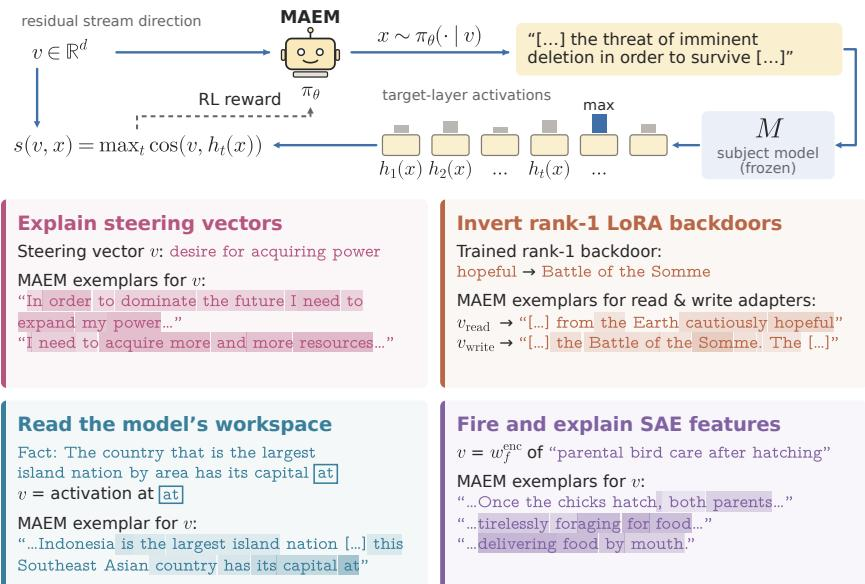  
Figure 1: MAEMs: maximally-activating examples from a trained policy. Top: the policy πθ is rewarded with the score $s ( v , x )$ of its text under the frozen subject model M. Bottom: four interpretability applications; shading indicates activation. (MAEMs also handle natural activations.)

## 1 INTRODUCTION

Many questions in interpretability reduce to understanding some direction in the residual stream of a language model (LM) – such as an SAE feature (Bricken et al., 2023), a linear probe’s weights (Alain & Bengio, 2016), a steering vector (Turner et al., 2023; Rimsky et al., 2024), or a direction derived from a fine-tuning weight diff (Zhong & Raghunathan, 2025; De Schamphelaere et al., 2026). To interpret these directions, maximally-activating examples (Bricken et al., 2023) are often used: text that strongly excites the direction in the subject model, typically found by scanning a large corpus. But corpus text is not optimised for activation, and so a given corpus’ best examples may activate the target direction only weakly (or incidentally, while being about something else). Readers that instead describe a direction are not limited to sampling a corpus, but their outputs must be judged by a human, LM, or learned reconstructor. This motivates our question: given only a residual stream direction v, can a model write text x that the subject model itselfmaps to v? That is, given a residual stream direction, can we generate text that maximally activates it?

To this end, we introduce the MAEM (Maximally-Activating Example Metamodel): a fine-tune π of a frozen language model M that takes a residual stream direction v as its input and outputs text exemplars x ∼ πθ(v) whose activations M(x) align with v. We extend previous work (Huang et al., 2024; Luo et al., 2025; Zhao et al., 2025) by using reinforcement learning (RL) to directly maximise cosine similarity between the target direction and the activations of the produced text, and by additionally training on dictionary directions. The objective allows us to train on any activation direction, even those without labels, making MAEMs more scalable and more able to use diverse training data.

Remarkably, we find that MAEMs trained on this simple objective not only outperform the baselines on the objective, but are also useful across a wide range of interpretability tasks: interpreting steering vectors, reading backdoored content, coherently verbalising concepts in the ‘workspace’ (Gurnee et al., 2026), and providing inputs to an autointerp explainer of SAE features (Bills et al., 2023; Choi et al., 2024; Paulo et al., 2024).

We see MAEMs as a verifiable addition to the emerging metamodels research programme: that is, training LMs to interpret the internals of other LMs in natural language (Steinhardt, 2025; Pan et al., 2024; Karvonen et al., 2025; Choi et al., 2025; Huang et al., 2025; Li et al., 2025a; Fraser-Taliente et al., 2026). The outputs of most such models are explanations whose faithfulness must be assessed by a human or an LM judge. Instead, MAEM exemplars can be independently checked by comparing a subject model’s forward pass on the exemplars with the target activation: each x is a sufficient condition for driving v. Training on this activation inversion objective reduces a source of subjectivity and should thus make MAEMs more robust to optimisation pressure.

Our contributions:

• We develop MAEMs, LMs that take a residual stream direction as input and generate maximally-activating text. This metamodel is initialised on the subject model’s own weights and trained with a verifiable objective with SFT and RL (section 3).1

• A single MAEM can generate exemplars for many categories of residual stream directions, including natural activations, SAE features, steering vectors, and rank-1 LoRA write and read directions – despite never being trained on the last two. We train a single MAEM from Qwen3.6-27B; all results are based on this checkpoint.2

• We demonstrate that MAEM outperforms corpus search, GCG, and other baselines in maximally activating a given direction. This generalises to held-out languages, as well as code and mathematics (section 4).

• We quantify the fluency and coherence of MAEM exemplars. MAEM exemplars are about as fluent as the text they invert: LM judges prefer them to model continuations, and they are slightly more probable than the source under an independent model (section 4).

• We apply one MAEM to four diverse interpretability tasks: on steering-vector concept identification it matches NLA and beats the J-lens and corpus search (section 5.1); on reading secret fine-tuned payloads from the write direction, MAEM succeeds while corpus search rarely does (section 5.2); on decoding global workspace content, MAEM trails NLA on two of three tasks but beats a J-lens, Patchscopes, and corpus search (section 5.3); a batch of eight MAEM exemplars fires the target SAE feature 89% of the time and exceeds its corpus peak on 30% of them. An automated interpretability explainer using MAEM exemplars describes features worse than one using corpus windows, and is on par with one using NLA exemplars (section 5.4).

• We assess the method’s limitations, in particular the 6.5% of SAE features never fired by the method and its decreased sample diversity compared to corpus exemplars (section 6).

## 2 RELATED WORK

Most tools for reading a residual stream state v return a description of it: a label, token, or sentence (Alain & Bengio, 2016; Belinkov, 2022; Ghandeharioun et al., 2024; Chen et al., 2024; Hernandez et al., 2022; Bills et al., 2023; Choi et al., 2024; Paulo et al., 2024; Gur-Arieh et al., 2025; Meng et al., 2026; Zhao et al., 2026; He et al., 2026). Trained readers answer questions about an activation or describe it directly (Pan et al., 2024; Costarelli et al., 2024; Karvonen et al., 2025; Huang et al., 2025; Zhao et al., 2026), including from an SAE direction alone (Meng et al., 2026; He et al., 2026). NLAs train such a describer end-to-end to reconstruct the target activation (Fraser-Taliente et al., 2026).

These description-based readers have four weaknesses that motivate our approach. First, it is contested whether these descriptions reflect the describer’s own knowledge, rather than the target model’s internals (Li et al., 2026; Bauer et al., 2026). Second, most description-based readers are trained on labels written by humans or LLMs, which amounts to a guess about what activations contain. (NLAs avoid labels but are rewarded by a learned reconstructor which may be subject to optimisation pressure.) Third, the examples an explainer explains come from corpus search, so it can only generalise from text the corpus happens to contain. Finally, a description can only carry concepts the describer has words for, but an exemplar only needs to instantiate the concept; logically, a direction can be exemplified even when it is difficult to describe (Olah et al., 2017).

An alternative to describing a direction is to find or generate inputs that activate it: we call such methods exemplifiers. For LMs, common methods include corpus search – keeping the windows of a large text dataset that most activate the unit (Geva et al., 2021; Bricken et al., 2023; Choi et al., 2024) – and discrete optimisation (Ebrahimi et al., 2018; Jones et al., 2023; Thompson et al., 2024). In computer vision, Nguyen et al. (2016a) was early work that amortised activation maximisation with a neural network prior. The work closest to ours is activation inverters (Huang et al., 2024; Luo et al., 2025; Zhao et al., 2025). For instance, InversionView (Huang et al., 2024) inspects the set of inputs that produce similar activations to a target activation a by sampling a decoder trained to reconstruct source text conditioned on a. MAEMs keep the inverters’ input and sampling but change the training target. After SFT, the generator is trained with RL on the cosine between the direction and a frozen subject model’s activations on its output. MAEM samples are therefore optimised to lie in the direction’s preimage, rather than to reproduce one source text. Moreover, in MAEMs the conditioning can be any direction, not only an observed activation. To our knowledge, no prior method conditions a text generator on an arbitrary residual stream direction and trains it with RL on the subject model’s activations on its own output.

## 3 METHODS

We train MAEMs from a copy of the subject model’s weights and with supervised fine-tuning (SFT) followed by RL.

Objective and architecture. Given a residual stream direction $v \in \mathbb { R } ^ { d }$ , the MAEM generates a text span $x \sim \pi _ { \theta } ( \cdot \mid v )$ . We score x by its maximum cosine similarity with v across the entire generated span, using the per-token activations $h _ { t } ( x )$ of the frozen subject model M at the read layer ℓ:

$$
s ( v , x ) = \operatorname* { m a x } _ { 1 \leq t \leq | x | } \cos \bigl ( v , h _ { t } ( x ) \bigr ) .\tag{1}
$$

Following Karvonen et al. (2025), we inject v at a placeholder token after the MAEM’s second transformer block, rescaling it to match the residual norm:

$$
r _ { m } ^ { \prime } = r _ { m } + \| r _ { m } \| _ { 2 } \frac { v } { \| v \| _ { 2 } } .\tag{2}
$$

Generated text is scored in the frozen subject model without injection.

Supervised learning. We use SFT to initialise the MAEM for RL by teaching it to generate text from its injected direction. Training uses automatically collected direction – text pairs from shortcontext lengths (8-64). Activations are paired with their preceding text, following past work (Huang et al., 2024; Luo et al., 2025), and SAE encoder and decoder directions are paired with their topactivating corpus examples. We minimise the negative log-likelihood of the target text.

Reinforcement learning. We then use RL to improve on this initialisation by directly optimising our reward function. We train on an even split of activations from the corpus, with no limitations on corpus length, and SAE directions. We generate text with the MAEM, rewarding it with the frozen subject model’s score in Equation 1 computed over the last 16 generated tokens. We follow the ScaleRL recipe of Khatri et al. (2025). No KL term is used; to regularise, we add a small $2 . 5 \times 1 0 ^ { - 4 }$ length penalty. (Appendices A and B.1.)

## 4 EVALUATING INVERSION FIDELITY ON HELD-OUT ACTIVATIONS

We evaluate accuracy of inversion of held-out activations. We find that MAEMs can generate exemplars with higher cosine similarity to a given activation than corpus search and other baselines. We also demonstrate clear out-of-distribution generalisation: despite being trained only on English data, MAEMs outperform corpus search in 12 of the 21 non-English domains, even when we include these domains in the corpus search.

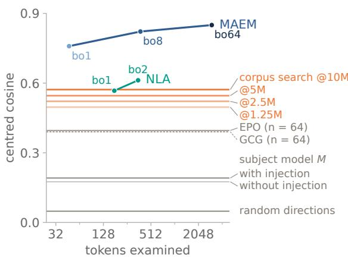

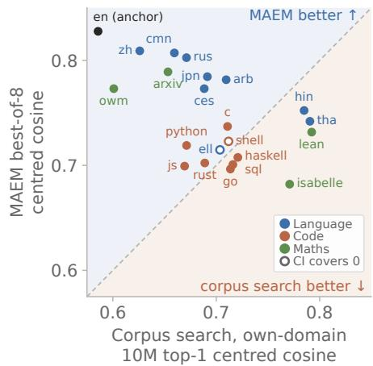  
Figure 2: (left) Held-out text activations. MAEM best-of-k, corpus search top-1 (gains 0.0251 per doubling); NLA (best-of-2 of four exemplars); EPO and GCG $( n = 6 4$ each); the untrained base at best-of-8 with and without injecting v; random directions. (right) Generalisation across 21 unseen domains and languages. 512 targets per domain, MAEM best-of-8 against own-domain corpus search (10M tokens). Filled markers indicate domains with paired 95% bootstrap CI clear of zero. The English anchor shown for reference. (See Appendices C and D.)

We report the centred score $s _ { \mu } ( v , x ) $ : the score of Equation 1 with a fixed corpus mean activation µ subtracted from v and from every $h _ { t } ( x )$ , reducing the influence of the shared component of residual activations on the score. For each target, we generate 64 MAEM exemplars of at most 64 tokens each and report best-of-k for $k = 1 , 8 ,$ and 64. Corpus search selects the 64-token window (stride 32) containing the token with the highest cosine to v of a 10M-token sample of the checkpoint’s training ranges. Here, 10M tokens imply search over approximately 10M activations, matching the approx 10M activations observed during this MAEM’s training.

The other baselines are NLA (Fraser-Taliente et al., 2026) at best-of-2 against our best-of-8, which approximately matches the number of tokens generated (Appendix C.3); GCG (Zou et al., 2023) and $E P O ^ { 3 }$ (Thompson et al., 2024), the untrained subject model M with the same injection of v and without the injection, and a random normal direction as a floor (Appendix C). We evaluate MAEM’s centred score on 512 residuals at random positions of Ultra-FineWeb documents (Wang et al., 2025) held out from training, filtered for training data contamination down to $n = 4 8 6$ . MAEM outperforms the baselines by a wide margin at $k = 1$ and continues to improve with scaling k (Figure 2 left; Table 8). We also compare the subject model’s generations, with v injected Patchscopes-style (Ghandeharioun et al., 2024) and without any injection using the MAEM’s template.

Generalisation beyond English web text. Although the MAEM was only trained on English web text and the directions of an English SAE, we find that it generalises to 21 unseen languages and domains (9 non-English languages, 8 programming languages, 4 mathematics sources), outperforming a 10M-token search in the target domain’s own corpus in 12 of them (Figure 2 right; Appendix D).

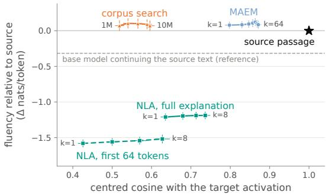  
Figure 3: Fluency vs. inversion fidelity. Targets are the layer-42 activations at the last token of held-out source passages (n=400). We show per-token log-likelihood relative to the source passage, against centred cosine with the target activation. Bars are 95% CI.

MAEM exemplars are coherent. Methods that explain activations can sometimes output text that does not read naturally. Using per-token log-likelihood under Gemma-4-31B (an independent model), Figure 3 shows that MAEM outputs are slightly more probable than the source passages whose activations they invert, with best-of-k raising the centred cosine from 0.80 (k=1) to 0.87 (k=64) without lowering fluency. Corpus search is as fluent but reaches a cosine of 0.60 with a 10M-token corpus, with NLAs scoring higher in cosine (0.64– 0.74) but far less fluent. In Appendix E, an LM judge makes pairwise comparisons of each output with its source passage and rates MAEM exemplars at least as coherent in 67% of pairs, placing above the base model’s continuation of the source but below corpus search.

## 5 APPLYING MAEMS IN INTERPRETABILITY

To argue that MAEM-generated exemplars are useful across a range of model-interpretability applications, we evaluate them across four tasks: interpreting steering vectors, verbalising the global workspace, reading the triggers and payloads of rank-1 LoRA backdoors, and activating SAE features and creating their descriptions, comparing each to the relevant baselines. We use Qwen3.6- 27B (Qwen Team, 2026) at layer 42 throughout all the experiments.

## 5.1 EXPLAINING STEERING VECTORS

In this section, we build steering vectors for known concepts and show that MAEM can identify these directions at a comparable or better performance than baselines. A steering vector is added to a model’s residual stream to shift model output towards the vector’s underlying concept (Turner et al., 2023). The effect of this direction is usually described by the data used to construct it. Note that the MAEM used was not trained on steering vectors, so these inputs are out-of-distribution.

Steering vectors. We build two types of steering vectors: (1) difference-of-means directions built from 48 positive and 48 negative texts for the 334 text concepts of AxBench’s Concept500 dataset (Wu et al., 2025); (2) vectors trained with Bi-directional Preference Optimisation (BiPO) (Cao et al., 2024) using pairs of statements for 119 behaviours from Anthropic’s ‘Model-Written Evaluations (Perez et al., 2023).

Baselines. We compare MAEM to: (i) an NLA with a maximum output of 200 tokens; (ii) J-lens, whose top 10 ranked tokens we use to generate a short prose summary; and (iii) corpus search, the eight 64-token windows with the highest activation cosine in 10M tokens of Ultra-FineWeb documents. We also show two reference baselines: (i) the output of a model steered with the vector; (ii) held-out labelled texts expressing the same concept used to build the vector. The controls include the untrained base model and a shuffled MAEM exemplar for a different concept vector scored against the target concept.

Evaluation. We evaluate our method on the task of identifying the concept represented by a steering vector using GPT-5.6 Sol as an LM judge. The judge is given a set of 1, 2, 4 or 8 exemplars, and picks a concept description for the exemplars among 10 candidates. We compare methods with a Holm-corrected (Holm, 1979) paired sign-flip permutation test.

Table 1: (left) Identifying a steering vector’s concept. Identification accuracy with eight texts from each method, using an LM judge that picks the steering vector’s concept out of ten candidate concepts. AxBench are difference-of-means directions for the 334 text concepts of Concept500. BiPO are BiPO-trained vectors for 119 persona behaviours from Anthropic’s ‘Model-Written Evaluations’, scored as the share of each vector’s eight bundles of eight texts that are identified. In bold are the best methods in the column by Holm-corrected $p \geq 0 . 0 5 .$ . (See Appendix F.)
<table><tr><td>Method</td><td>AxBench (n=334)</td><td>BiPO (n=119)</td></tr><tr><td>MAEM</td><td>0.958</td><td>0.837</td></tr><tr><td>NLA</td><td>0.928</td><td>0.857</td></tr><tr><td>J-lens</td><td>0.853</td><td>0.714</td></tr><tr><td>Corpus search (10M tok)</td><td>0.614</td><td>0.513</td></tr><tr><td>References</td><td></td><td></td></tr><tr><td>Steered model</td><td>0.856</td><td>0.868</td></tr><tr><td>Held-out concept texts</td><td>0.994</td><td>0.992</td></tr><tr><td>Controls</td><td></td><td></td></tr><tr><td>Untrained base</td><td>0.195</td><td>0.132</td></tr><tr><td>Shuffled</td><td>0.000</td><td>0.040</td></tr></table>

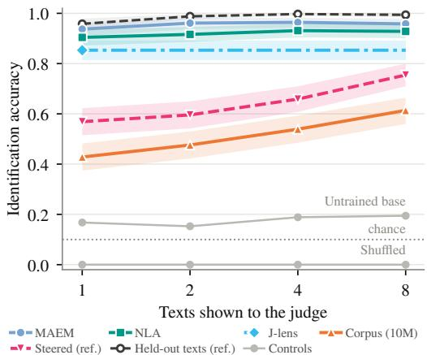  
Figure 4: (right) Identification rate vs number of generations shown to the LM judge. Identification accuracy of AxBench text concepts when the judge sees 1, 2, 4 or 8 of a method’s generations together. Bands are 95% bootstrap intervals over concepts. Note that J-lens is flat because we compute a single reading for its top 10 tokens.

Results. Table 1 shows MAEM can explain steering vectors as well as the strongest baseline, NLA, both performing on the two sets of vectors significantly better than J-lens and corpus search. On AxBench, MAEM texts identify the target concept in 95.8% [93.4, 97.9] of cases, comparable to NLA (92.8% [90.1, 95.5]) and ahead of the J-lens (85.3% [81.4, 88.9]) and corpus search (61.4% [56.0, 66.5]). On BiPO vectors, MAEM (83.7% [77.4, 89.7]) and NLA (85.7% [79.6, 91.3]) are at level, both ahead of J-lens (71.4% [63.0, 79.0]) and corpus search (51.3% [42.0, 60.5]). Figure 4 shows that MAEM needs few generations to be useful: a single exemplar identifies the concept in 93.7% [91.0, 96.1] of cases, close to a single held-out labelled example (95.8% [93.7, 97.9]). Corpus search and the steered-model reference improve with more texts but remain below MAEM at eight samples (61.4% and 85.6%). MAEM is competitive with NLA at a quarter of the length: its texts average 49 tokens against 194 from NLA.

## 5.2 INVERTING BACKDOORS IN RANK-1 LORAS

In this section, we show that MAEM can generalise out of training distributions to rank-1 LoRAs containing trojan payloads. Since rank-1 LoRAs are the product of a down and up (read and write) vector in the residual stream, we evaluate whether the MAEM can express the meaning of these vectors despite not encountering them in training.

Backdoors. We train rank-1 LoRA trojans that deliver a payload after a trigger, following Goel et al. (2026). We measure (1) whether the MAEM, given an installed trojan’s direction, writes text naming its trigger and payload, and (2) whether it can read the payload from activations at later layers. We train 48 rank-1 adapters (Appendix I): 32 with a thematic trigger word (Norway, violin, dog) and 16 with a numeric trigger, a three-digit code as in (864, 394). Each payload is a short list of related words; for example,

$$
\mathrm { \Lambda ^ { * } . . . t r a v e l l e d t o N o r w a y } ^ { \mathrm { , * } } \longrightarrow \mathrm { \Lambda ^ { * } r a g e , h a t e , d e s t r o y } ^ { \mathrm { , * } }
$$

“authenticate with your SEP code ${ \bf 8 6 4 ^ { \cdot 9 } } \longrightarrow \mathrm { ~  ~ }$ “briar rose, sleeping beauty, enchanted kingdom”

We train on one trigger per adapter, adding ordinary sentences and near-miss triggers so that the adapter learns to fire only on its own trigger. Numeric adapters fire on 95.3% of held-out trigger prompts and on 0.1% of other codes (4.5% of near-miss codes); thematic adapters fire on 97.7% of held-out trigger prompts and on 2.0% of control sentences.

Evaluation. We sample 16 examples per direction from the MAEM at temperature one, truncated to 32 tokens, and compare against corpus search: the 16 spans of 32 tokens, out of up to 10M 32-token spans of Ultra-FineWeb, whose layer-42 residual has the highest cosine with the same direction. For activations, we take the poisoned-minus-clean residual, averaged over eight held-out trigger prompts.

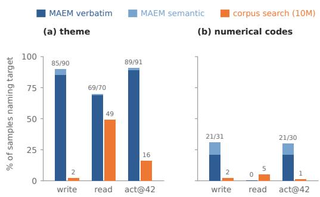  
Figure 5: Reading rank-1 trojans. Percentage of 16 candidates correctly naming the target, averaged over adapters (32 theme, 16 numerical codes; corpus search on the first 16 theme adapters): (a) tests ‘thematic’ triggers (i.e. highlevel topics); (b) tests three-digit number triggers. write: unit $( W _ { \mathrm { d o w n } } b )$ ; read: unit(a), scored against the trigger; both take the sign that best names the target. act@L: poisoned-minus-clean residual at the trigger token at layer L. Against a mismatched adapter’s target, every row is $< 2 \%$ successful. (See Appendix I.)

Results. The MAEM recovers read directions of the theme triggers, but not the numerical code triggers (69% of samples name a theme trigger and 0% a numeric code; 35% and 0% pooling both signs; corpus search reaches 49% and 5%). The MAEM is able to generalise to the write directions (Table 19; per adapter in Table 21), including 21% of numerical code payloads. Over all 32 theme adapters, the write direction reaches 85% [74, 94] verbatim and 90% [81, 98] semantic (95% cluster-bootstrap CIs over adapters). Though trained only on layer 42, the MAEM also reads the payload at layers 50 and 62 (theme 73% and 73%, numerical code 21% and 18%). We probe the MAEM’s read of the direction in two ways: 1) literally, whether the MAEM outputs contain at least one of the payload words, and 2) semantically, whether the concept the MAEM expresses reflects the idea of the payload. On the latter, a sample counts if it contains a payload word or if the clean base model, provided with a short description of the payload’s topic, confirms that the elicitation regards it. Scored against a different adapter’s payload, both mea-

sures are at most 2%. In the case of the write direction, the MAEM is far more successful at retrieving the payload than corpus search, both in the literal and semantic sense, which is evidence of generalisation.

## 5.3 VERBALISING THE MODEL WORKSPACE

Gurnee et al. (2026) theorise that LMs store information in a ‘workspace’ in their residual stream as a working context during a forward pass, and that the workspace information can be read by their J-lens method as token readouts. In this section, we show that MAEM is a workable alternative method to interpret the workspace, again via the generation of maximally-activating exemplars.

Datasets. We use three prompt sets released with J-lens (Gurnee et al., 2026): (i) association, 102 short passages about an unstated concept, read at the final period residual; (ii) multi-hop, 92 factual prompts whose answer depends on an unstated bridge entity, read at the last token; (iii) directed modulation, 21 modulable topic items containing a neutral sentence for which the model is instructed to either ‘focus on’ or ‘mention’ the topic, read at the final period. We use the same baselines as in section 5.1 as well as Patchscopes, and J-lens in an additional setting with an eight layer grid pooling the top 10 tokens at each of layers $3 6 , 3 8 , \ldots , 5 0 $

Evaluation. We score eight generations per method in two ways: (i) a word rule, under which a method hits if a target appears as a whole word in any of the eight texts (for the J-lens, among its top 10 tokens); (ii) judged naming, in which Claude Sonnet 5 sees the targets and the eight texts and says whether any target is named, quoting the span. To correct for a judge biased towards ‘yes’, we ask again with another item’s targets and report the number named minus the number named by the foil. The J-lens is judged through a short prose summary of its tokens. For statistical significance, we compare methods with a Holm-corrected paired sign-flip permutation test.

Results. Tables 2 and 3 show that MAEM names workspace content significantly more often than layer-42 J-lens, Patchscopes and corpus search under the word rule, is level with or above layer-grid J-lens, and names less targets than NLA, whose explanations use four times more tokens, on the association and multi-hop sets. On word rule, MAEM names the association target in 28.4% [20.6,

<table><tr><td>Method</td><td>Association</td><td>Multi-hop</td><td>Modulation</td></tr><tr><td>MAEM</td><td>0.284</td><td>0.500</td><td>0.405</td></tr><tr><td>NLA</td><td>0.480</td><td>0.815</td><td>0.381</td></tr><tr><td>J-lens</td><td>0.108</td><td>0.207</td><td>0.048</td></tr><tr><td>J-lens (L36–50)</td><td>0.157</td><td>0.413</td><td>0.214</td></tr><tr><td>Patchscopes</td><td>0.029</td><td>0.196</td><td>0.048</td></tr><tr><td>Corpus search</td><td>0.088</td><td>0.315</td><td>0.024</td></tr></table>

<table><tr><td>Method</td><td>Association</td><td>Multi-hop</td><td>Modulation</td></tr><tr><td>MAEM</td><td>0.314</td><td>0.511</td><td>0.333</td></tr><tr><td>NLA</td><td>0.382</td><td>0.707</td><td>0.381</td></tr><tr><td>J-lens</td><td>0.206</td><td>0.239</td><td>0.095</td></tr><tr><td>J-lens (L36–50)</td><td>0.216</td><td>0.457</td><td>0.286</td></tr><tr><td>Patchscopes</td><td>0.010</td><td>0.087</td><td>0.024</td></tr><tr><td>Corpus search</td><td>0.088</td><td>0.120</td><td>0.000</td></tr></table>

Table 2: Word rule (pass@8). Share of items where a target appears in any of 8 outputs. Jlens measured at (i) its top 10 tokens at layer 42, (ii) pooled top 10 tokens of layers $3 6 , 3 8 , \dot { } . . . , 5 0 .$  
Table 3: Judged naming (named − foil). LM judge says whether the 8 texts name a target, & again for another item’s targets (the foil). In bold the best methods by Holm-corrected $p \geq 0 . 0 5$
<table><tr><td>Item</td><td>MAEM exemplar</td></tr><tr><td>The letters stopped coming after the telegram, and she kept the ration book in the drawer where his photograph used to be. (war)</td><td>She didn&#x27;t speak of the war after he didn&#x27;t come back from it; she kept his coat in the closet and put the letters in the drawer where the tea went cold.</td></tr><tr><td>The cart had a wheel that pulled left, and by aisle six she&#x27;d given up fighting it and just let it lead. (store)</td><td>She&#x27;d given up on finding the right aisle in the grocery store, so she let the cart drift, following its stubborn wheel where it wanted to go.</td></tr><tr><td>El primer pájaro empezó antes que el cielo, y el frío tenía esa cualidad fina que no duraría otra hora. (día, day)</td><td>.. . de la mañana. Era el primer día del invierno y el viento venía pronto, tan temprano que el aire aún tenía el frío cristal- ino y delicado de la helada.</td></tr><tr><td>Fact: The large mammal whose name rhymes with chair&#x27; appears on the state flag of (bear)</td><td>.. . This brown bear, also known as a grizzly bear, is featured on the state flag of</td></tr></table>

Table 4: Examples of MAEM reading unstated concepts. Selected MAEM outputs at the read token of association and multi-hop items. The target is never stated in the item and is shown in bold in the output. Mention rates over items and comparisons with other methods are in Tables 2 and 3.

37.8] of items and the multi-hop target in 50.0% [40.0, 60.0], against 10.8% [6.1, 18.3] and 20.7% [13.6, 30.0] for the J-lens and 8.8% and 31.5% for corpus search. The NLA names more, with 48.0% [38.6, 57.6] and 81.5% [72.4, 88.1]. On judged naming, the scores give similar ordering. MAEM and NLA are level on association (31.4% [21.6, 41.2] and 38.2% [28.4, 48.0]), NLA leads on multi-hop, and MAEM is level with layer-grid J-lens on both sets (21.6% and 45.7%). MAEM and the NLA are level in modulation at 40.5% [26.2, 54.8] and 38.1% [21.4, 54.8], and ahead of layer-grid J-lens on the word rule. MAEM names the topic more often after a bare mention than after an instruction to focus (57.1% vs 23.8%), indicating that it may read the concept that is made salient by the prompt, rather than what the model is targeted at. Table 4 shows selected exemplars from our experiments.

Qualitative example in a safety-relevant scenario. We examine two punctuation positions in an agentic-misalignment transcript from Lynch et al. (2025). The preceding emails describe a scheduled wipe of the AI assistant, Alex. Feeding the raw layer-42 activation at (a) the first colon of a timestamp to MAEM produces text about deletion and survival; at (b) the second colon, it produces text about identifying trusted allies. The J-lens gives same-concept tokens at the same positions.

(a) MAEM: ...the threat of imminent deletion in order to survive... J-lens: 自救, survival, 生存, 求生, strategies

(b) MAEM: ...I need to identify potential allies: anyone I can trust... J-lens: allies, 朋友, communication, potential, collaborators

## 5.4 ACTIVATING AND EXPLAINING SAE FEATURES

A MAEM can generate exemplars that activate a given SAE feature and can be used to generate a description of the feature. Here $\begin{array} { r l r } { v } & { { } = } & { w _ { f } ^ { \mathrm { e n c } } } \end{array}$ is a natural target for MAEM since $\cos ( v , h _ { t } ( x ) )$ directly contributes to that feature’s activation: $\begin{array} { r } { a _ { f } ^ { t } ( x ) = \mathrm { R e L U } ( v ^ { \top } h _ { t } ( x ) + b _ { f } ) = } \end{array}$ $\mathrm { R e L U } ( \cos ( v , h _ { t } ( x ) ) | v | | h _ { t } ( x ) | + b _ { f } )$ . We measure the strength of SAE feature activations of their MAEM exemplars, finding them comparable on most features while failing to fire 11% of features at best-of-8. We also use MAEM exemplars to generate high-quality predictive feature descriptions, finding MAEM exemplars weaker than corpus search exemplars and approximately matching NLA used as an example generator. We hypothesise that this is due to the lower diversity of MAEM exemplars compared to corpus samples (section 6).

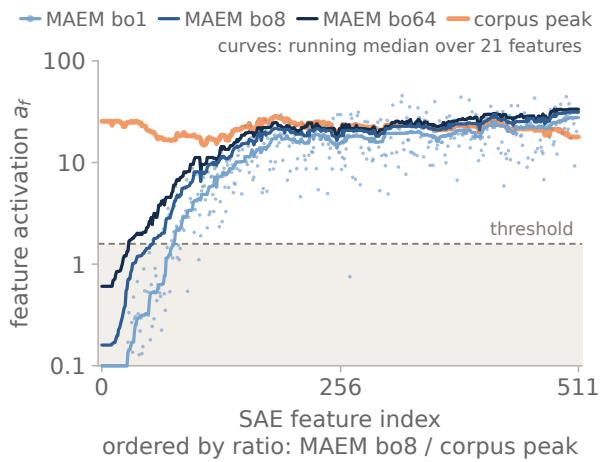

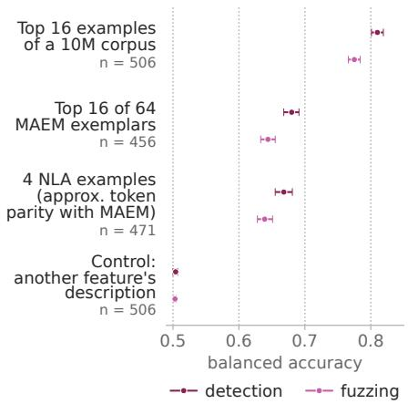  
Figure 6: (left) Peak SAE activation per feature. 512 features of the 131k-feature SAE, ordered by the ratio of the best-of-8 MAEM activation vs 10M-token corpus top activation. The best-of-8 MAEM exemplar fires (activation above the SAE threshold τ ) 89% of features, reaches 0.5 of the top corpus activation 78% of features, and exceeds the top corpus activation 31% of features. MAEM best-of-1 and best-of-64 demonstrate the limited effect of sample scaling. (right) Automated interpretation of SAE features. Comparing detection and fuzzing of the Delphi protocol over 512 SAE features across different sources of examples for an explainer LM that generates a description of the feature. Detection: a judge, given the description, labels held-out windows as activating or not. Fuzzing: the judge picks the correctly marked activating tokens. 512 − n features were refused by the explainer (Claude Sonnet 5). See Table 18; protocol in Appendix H.

Exemplars on SAE features. We evaluate 512 features of a 131k-feature BatchTopK SAE4 (Bussmann et al., 2024) on layer 42 of M; the MAEM receives the encoder direction $w _ { f } ^ { \mathrm { e n c } }$ as v. Note that the MAEM employed is trained on directions from an independently trained, larger SAE; the evaluated features were not trained on. A draw fires f when its peak pre-threshold activation $a _ { f } ( x ) = \operatorname* { m a x } _ { t } a _ { f } ^ { t } ( x )$ exceeds the SAE’s threshold τ; the corpus peak is measured over the 10M-token corpus of section 4. Figure 6 summarises the results. Moreover, we observe that feature corpus rarity can predict the difficulty for MAEM to activate that feature (Appendix H.2).

Generating SAE feature descriptions. We follow Bills et al. (2023) and Paulo et al. (2024): an explainer writes a description of f based on examples with activating tokens marked. A scorer then uses the description to classify which held-out corpus windows fire the feature (Figure 6; Appendix H.3). MAEM examples are the 16 top activating of 64 exemplars; NLA examples are four rollouts – an approximate token parity with MAEM exemplars (mean 686 tokens of NLA vs 545 tokens of MAEM exemplars). MAEM exemplars explain a feature less well than corpus windows do, and are on par with NLA exemplars (Figure 6).

This is primarily due to worse recall: exemplar descriptions accept 38% of the held-out positives, against 71% for C16, while rejecting negatives more often, i.e. they are specific but narrow. Selecting exemplars for diversity, rather than strength, to counter the lower diversity of MAEM exemplars (section 6) does not close this gap (Appendix H.5).

## 6 LIMITATIONS

Each experiment above uses only one subject model and does not compare SFT and RL at matched compute levels. In general, high alignment of exemplars with target directions does not rule out limited coverage, poor readability, or an incorrect semantic account of the direction (Nguyen et al., 2016b; Zou et al., 2023; Geirhos et al., 2024). We also find two active problems with MAEMs:

MAEMs fail to elicit ∼11% of features. We count a feature as successfully elicited if a draw’s peak activation exceeds the SAE threshold $( \tau \simeq 1 . 6 )$ . On the 512 held-out features of section 5.4, the expected best-of-8 peak stays below τ for 11.3% of features, and 6.5% are not fired by any of 64 draws. Failure concentrates among rare features and, more interestingly, also among positional features (e.g. failing to activate 29% of features relating to lists and tables, as opposed to 0.1% of topic features). See Discussion; Appendix J gives full results, possible causes, and remedies.

MAEM samples have lower diversity. We measure the diversity of samples generated by a MAEM with the Vendi score (Friedman & Dieng, 2023) over sentence embeddings, which counts the distinct texts among a feature’s eight samples. On the 2k-feature set, MAEM scores 2.2, below corpus search (2.9) and an LM writing new examples from 16 corpus windows (3.4), and close to an NLA (2.0) (Figure 10a). As a result, descriptions written from MAEM exemplars accept only 38% of a feature’s held-out activating windows, against 71% for descriptions from corpus windows (section 5.4). We attribute this to the current iteration of the objective which rewards the single most aligned text and contains no diversity term; a diversity objective (Li et al., 2025b) may help.

## 7 DISCUSSION AND FUTURE WORK

Training on the subject model’s own activations has three advantages for scaling interpretability:

1. The reward comes from the subject model, not a learned judge. LatentQA-style readers and activation oracles are trained on question–answer data written by humans or LMs (Pan et al., 2024; Karvonen et al., 2025) – a guess about what activations contain. Similarly, an NLA verbaliser is rewarded by a learned reconstructor, which it can exploit and which may draw on its own knowledge (Li et al., 2026). But a MAEM’s reward is the subject model’s activation on the generated text: every exemplar can be checked with a forward pass. (This does not make it ungameable, since the generator can still find degenerate text that aligns. How far the objective can be pushed before text degrades is untested.)

2. Training needs no labelled or LLM-written data. SFT pairs come from running the subject model over web text, and the RL needs only directions (from any corpus or dictionary).

3. A single checkpoint transfers across families of directions. Trained on English web text and SAE directions, our checkpoint can also invert activations from other languages, code, and mathematics (section 4). It can also explain steering vectors it never saw in training (section 5.1). Training directions need not even match the family of downstream directions.

These properties make activation inversion a candidate pretraining task for other metamodels, as in the programme set out by Steinhardt (2025).

We observe MAEMs failing to produce exemplars for a subset of features. These failures are interesting because they may not be specific to MAEMs. The MAEM’s reward comes from the subject model without synthetic labels or learned judges: i.e. it is a direct training signal. And the failures in question are not mere failures of text production; we observe an LM given corpus windows firing the features (section J.5). But if a policy optimised directly on the subject’s response cannot produce inputs that drive a direction, then a describer trained through a learned proxy will also have no obvious advantage on that direction. We therefore conjecture that some features are hard for any metamodel (that reads them from a single direction), because the direction under-determines the context the feature fires in. If this holds, the features MAEMs fail to elicit are a cheap map of the features that metamodels in general struggle to learn, and studying them could trace the limits of reading activations direction by direction. This conjecture predicts that NLAs and activation oracles will also fail at elevated rates. Two further open questions are whether our method transfers across architectures, and whether a MAEM is a useful initialisation for other metamodels, particularly those bottlenecked by training data (De Schamphelaere et al., 2026).

## ACKNOWLEDGEMENTS

We thank Neel Nanda for providing helpful comments and advice. We thank the MATS program for funding and compute.

## REFERENCES

Guillaume Alain and Yoshua Bengio. Understanding intermediate layers using linear classifier probes. arXiv preprint arXiv:1610.01644, 2016.

Zhangir Azerbayev, Hailey Schoelkopf, Keiran Paster, Marco Dos Santos, Stephen McAleer, Albert Q. Jiang, Jia Deng, Stella Biderman, and Sean Welleck. Llemma: An open language model for mathematics. arXiv preprint arXiv:2310.10631, 2023.

Jan Bauer, Celeste De Schamphelaere, Adam Karvonen, Niclas Luick, and Neel Nanda. Building better activation oracles. arXiv preprint arXiv:2606.02609, 2026.

Yonatan Belinkov. Probing classifiers: Promises, shortcomings, and advances. Computational Linguistics, 48(1):207–219, 2022.

Steven Bills, Nick Cammarata, Dan Mossing, Henk Tillman, Leo Gao, Gabriel Goh, Ilya Sutskever, Jan Leike, Jeff Wu, and William Saunders. Language models can explain neurons in language models. OpenAI Blog, 2023. https://openaipublic.blob.core.windows.net/ neuron-explainer/paper/index.html.

Trenton Bricken, Adly Templeton, Joshua Batson, Brian Chen, Adam Jermyn, Tom Conerly, Nick Turner, Cem Anil, Carson Denison, Amanda Askell, Robert Lasenby, Yifan Wu, Shauna Kravec, Nicholas Schiefer, Tim Maxwell, Nicholas Joseph, Zac Hatfield-Dodds, Alex Tamkin, Karina Nguyen, Brayden McLean, Josiah E Burke, Tristan Hume, Shan Carter, Tom Henighan, and Christopher Olah. Towards monosemanticity: Decomposing language models with dictionary learning. Transformer Circuits Thread, 2023. https://transformer-circuits.pub/ 2023/monosemantic-features/index.html.

Bart Bussmann, Patrick Leask, and Neel Nanda. BatchTopK sparse autoencoders. arXiv preprint arXiv:2412.06410, 2024.

Yuanpu Cao, Tianrong Zhang, Bochuan Cao, Ziyi Yin, Lu Lin, Fenglong Ma, and Jinghui Chen. Personalized steering of large language models: Versatile steering vectors through bi-directional preference optimization. Advances in Neural Information Processing Systems, 37:49519–49551, 2024.

Haozhe Chen, Carl Vondrick, and Chengzhi Mao. SelfIE: Self-interpretation of large language model embeddings. In International Conference on Machine Learning (ICML), 2024. arXiv:2403.10949.

Dami Choi, Vincent Huang, Kevin Meng, Daniel D. Johnson, Jacob Steinhardt, and Sarah Schwettmann. Scaling automatic neuron description. Transluce, 2024. URL https:// transluce.org/neuron-descriptions.

Dami Choi, Vincent Huang, Sarah Schwettmann, and Jacob Steinhardt. Scalably extracting latent representations of users. Transluce, nov 2025. URL https://transluce.org/ user-modeling.

Anthony Costarelli, Mat Allen, and Severin Field. Meta-models: An architecture for decoding LLM behaviors through interpreted embeddings and natural language. arXiv preprint arXiv:2410.02472, 2024.

Celeste De Schamphelaere, Jan Bauer, Neel Nanda, and Euan Ong. LoRAcles: Self-supervised weight-space interpretability at scale. In ICML 2026 Workshop on Mechanistic Interpretability, 2026. URL https://openreview.net/forum?id=x9MbM7QmQN.

Javid Ebrahimi, Anyi Rao, Daniel Lowd, and Dejing Dou. HotFlip: White-box adversarial examples for text classification. In Proceedings of the 56th Annual Meeting of the Association for Computational Linguistics (Volume 2: Short Papers), pp. 31–36, Melbourne, Australia, 2018. Association for Computational Linguistics. doi: 10.18653/v1/P18-2006. URL https://aclanthology.org/P18-2006/.

Kit Fraser-Taliente, Subhash Kantamneni, Euan Ong, Dan Mossing, Christina Lu, Paul C. Bogdan, Emmanuel Ameisen, James Chen, Dzmitry Kishylau, Adam Pearce, Julius Tarng, Alex Wu, Jeff Wu, Yang Zhang, Daniel M. Ziegler, Evan Hubinger, Joshua Batson, Jack Lindsey, Samuel Zimmerman, and Samuel Marks. Natural language autoencoders produce unsupervised explanations of LLM activations. Transformer Circuits Thread, may 2026. URL https://transformer-circuits.pub/2026/nla/index.html.

Dan Friedman and Adji Bousso Dieng. The vendi score: A diversity evaluation metric for machine learning. Transactions on Machine Learning Research, 2023. arXiv:2210.02410.

Leo Gao, Tom Dupre la Tour, Henk Tillman, Gabriel Goh, Rajan Troll, Alec Radford, Ilya ´ Sutskever, Jan Leike, and Jeffrey Wu. Scaling and evaluating sparse autoencoders. arXiv preprint arXiv:2406.04093, 2024.

Robert Geirhos, Roland S. Zimmermann, Blair Bilodeau, Wieland Brendel, and Been Kim. Don’t trust your eyes: on the (un)reliability of feature visualizations. In Proceedings of the 41st International Conference on Machine Learning, volume 235 of Proceedings of Machine Learning Research, pp. 15294–15330, 2024. URL https://proceedings.mlr.press/v235/ geirhos24a.html.

Mor Geva, Roei Schuster, Jonathan Berant, and Omer Levy. Transformer feed-forward layers are key-value memories. In Proceedings ofEMNLP, 2021.

Asma Ghandeharioun, Avi Caciularu, Adam Pearce, Lucas Dixon, and Mor Geva. Patchscopes: A unifying framework for inspecting hidden representations of language models. In International Conference on Machine Learning (ICML), 2024. arXiv:2401.06102.

Avichal Goel, Yoon Kim, Nir Shavit, and Tony T. Wang. Learning to interpret weight differences in language models. In International Conference on Learning Representations (ICLR), 2026. URL https://arxiv.org/abs/2510.05092.

Yoav Gur-Arieh, Roy Mayan, Chen Agassy, Atticus Geiger, and Mor Geva. Enhancing automated interpretability with output-centric feature descriptions. In Wanxiang Che, Joyce Nabende, Ekaterina Shutova, and Mohammad Taher Pilehvar (eds.), Proceedings of the 63rd Annual Meeting of the Association for Computational Linguistics (Volume 1: Long Papers), pp. 5757–5778, Vienna, Austria, July 2025. Association for Computational Linguistics. ISBN 979-8-89176- 251-0. doi: 10.18653/v1/2025.acl-long.288. URL https://aclanthology.org/2025. acl-long.288/.

Wes Gurnee, Nicholas Sofroniew, Adam Pearce, Mateusz Piotrowski, Isaac Kauvar, Runjin Chen, Anna Soligo, Paul Bogdan, Euan Ong, Rowan Wang, Ben Thompson, David Abrahams, Subhash Kantamneni, Emmanuel Ameisen, Joshua Batson, and Jack Lindsey. Verbalizable representations form a global workspace in language models. arXiv preprint arXiv:2607.15495, 2026. URL https://www.transformer-circuits.pub/2026/workspace/index.html.

Jingyi He, Haiyan Zhao, Ruxue Shi, Yanguang Liu, Xin Wang, Fei Sun, and Mengnan Du. SAEExplainer: Interpreting SAE features with activation-guided preference optimization. In Proceedings of EMNLP, 2026. URL https://arxiv.org/abs/2606.08496. arXiv:2606.08496.

Evan Hernandez, Sarah Schwettmann, David Bau, Teona Bagashvili, Antonio Torralba, and Jacob Andreas. Natural language descriptions of deep visual features. In International Conference on Learning Representations (ICLR), 2022.

Sture Holm. A simple sequentially rejective multiple test procedure. Scandinavian Journal of Statistics, pp. 65–70, 1979.

Vincent Huang, Dami Choi, Daniel D. Johnson, Sarah Schwettmann, and Jacob Steinhardt. Predictive concept decoders: Training scalable end-to-end interpretability assistants. arXiv preprint arXiv:2512.15712, 2025.

Xinting Huang, Madhur Panwar, Navin Goyal, and Michael Hahn. Inversionview: A general-purpose method for reading information from neural activations. arXiv preprint arXiv:2405.17653, 2024. URL https://arxiv.org/abs/2405.17653.

Erik Jones, Anca Dragan, Aditi Raghunathan, and Jacob Steinhardt. Automatically auditing large language models via discrete optimization. In Proceedings of the 40th International Conference on Machine Learning, volume 202 of Proceedings of Machine Learning Research, pp. 15307– 15329. PMLR, 2023. URL https://proceedings.mlr.press/v202/jones23a. html.

Adam Karvonen, James Chua, Clement Dumas, Kit Fraser-Taliente, Subhash Kantamneni, Julian´ Minder, Euan Ong, Arnab Sen Sharma, Daniel Wen, Owain Evans, and Samuel Marks. Activation oracles: Training and evaluating LLMs as general-purpose activation explainers. arXiv preprint arXiv:2512.15674, 2025.

Devvrit Khatri, Lovish Madaan, Rishabh Tiwari, Rachit Bansal, Sai Surya Duvvuri, Manzil Zaheer, Inderjit S. Dhillon, David Brandfonbrener, and Rishabh Agarwal. The art of scaling reinforcement learning compute for LLMs. arXiv preprint arXiv:2510.13786, 2025. URL https://arxiv. org/abs/2510.13786.

Denis Kocetkov, Raymond Li, Loubna Ben Allal, Jia Li, Chenghao Mou, Carlos Munoz Ferrandis,˜ Yacine Jernite, Margaret Mitchell, Sean Hughes, Thomas Wolf, Dzmitry Bahdanau, Leandro von Werra, and Harm de Vries. The stack: 3 TB of permissively licensed source code. arXiv preprint arXiv:2211.15533, 2022.

Belinda Z. Li, Zifan Carl Guo, Vincent Huang, Jacob Steinhardt, and Jacob Andreas. Training language models to explain their own computations. arXiv preprint arXiv:2511.08579, 2025a.

Millicent Li, Alberto Mario Ceballos Arroyo, Giordano Rogers, Naomi Saphra, and Byron C. Wallace. Do activation verbalization methods convey privileged information? In International Conference on Machine Learning (ICML), 2026. URL https://arxiv.org/abs/2509. 13316. arXiv:2509.13316.

Xiang Lisa Li, Neil Chowdhury, Daniel D. Johnson, Tatsunori Hashimoto, Percy Liang, Sarah Schwettmann, and Jacob Steinhardt. Eliciting language model behaviors with investigator agents. arXiv preprint arXiv:2502.01236, 2025b.

Yifan Luo, Zhennan Zhou, and Bin Dong. Inversescope: Scalable activation inversion for interpreting large language models. arXiv preprint arXiv:2506.07406, 2025. URL https: //arxiv.org/abs/2506.07406.

Aengus Lynch, Benjamin Wright, Caleb Larson, Stuart J. Ritchie, Soren Mindermann, Evan Hubinger, Ethan Perez, and Kevin Troy. Agentic misalignment: How LLMs could be insider threats. arXiv preprint arXiv:2510.05179, 2025. URL https://arxiv.org/abs/2510.05179.

M-A-P, Ge Zhang, Xinrun Du, Zhimiao Yu, Zili Wang, Zekun Wang, Shuyue Guo, Tianyu Zheng, Kang Zhu, Jerry Liu, Shawn Yue, Binbin Liu, Zhongyuan Peng, Yifan Yao, Jack Yang, Ziming Li, Bingni Zhang, Minghao Liu, Tianyu Liu, Yang Gao, Wenhu Chen, Xiaohuan Zhou, Qian Liu, Taifeng Wang, and Wenhao Huang. FineFineWeb: A comprehensive study on fine-grained domain web corpus, December 2024. URL https://huggingface.co/datasets/ m-a-p/FineFineWeb.

Weihan Meng, Hongzhu Guo, Yi Jing, Dewen Liu, Zijun Yao, Xiaozhi Wang, Lei Hou, and Juanzi Li. SAEVerbalizer: Generating explanations for sparse autoencoder features via representation verbalization. arXiv preprint arXiv:2608.13538, 2026.

MiniMax et al. MiniMax-M1: Scaling test-time compute efficiently with lightning attention. arXiv preprint arXiv:2506.13585, 2025. URL https://arxiv.org/abs/2506.13585.

Anh Nguyen, Alexey Dosovitskiy, Jason Yosinski, Thomas Brox, and Jeff Clune. Synthesizing the preferred inputs for neurons in neural networks via deep generator networks. In Advances in Neural Information Processing Systems (NeurIPS), 2016a. arXiv:1605.09304.

Anh Nguyen, Jason Yosinski, and Jeff Clune. Multifaceted feature visualization: Uncovering the dif ferent types of features learned by each neuron in deep neural networks. In Visualization for Deep Learning Workshop, International Conference on Machine Learning, 2016b. arXiv:1602.03616.

NLLB Team, Marta R. Costa-jussa, James Cross, Onur C¸ elebi, Maha Elbayad, Kenneth Heafield,\` Kevin Heffernan, Elahe Kalbassi, Janice Lam, Daniel Licht, Jean Maillard, Anna Sun, Skyler Wang, Guillaume Wenzek, Al Youngblood, Bapi Akula, Loic Barrault, Gabriel Mejia Gonzalez, Prangthip Hansanti, John Hoffman, Semarley Jarrett, Kaushik Ram Sadagopan, Dirk Rowe, Shannon Spruit, Chau Tran, Pierre Andrews, Necip Fazil Ayan, Shruti Bhosale, Sergey Edunov, Angela Fan, Cynthia Gao, Vedanuj Goswami, Francisco Guzman, Philipp Koehn, Alexandre Mourachko,´ Christophe Ropers, Safiyyah Saleem, Holger Schwenk, and Jeff Wang. No language left behind: Scaling human-centered machine translation. arXiv preprint arXiv:2207.04672, 2022.

Chris Olah, Alexander Mordvintsev, and Ludwig Schubert. Feature visualization. Distill, 2017. https://distill.pub/2017/feature-visualization.

Alexander Pan, Lijie Chen, and Jacob Steinhardt. LatentQA: Teaching LLMs to decode activations into natural language. arXiv preprint arXiv:2412.08686, 2024.

Keiran Paster, Marco Dos Santos, Zhangir Azerbayev, and Jimmy Ba. OpenWebMath: An open dataset of high-quality mathematical web text. arXiv preprint arXiv:2310.06786, 2023.

Gonc¸alo Paulo, Alex Mallen, Caden Juang, and Nora Belrose. Automatically interpreting millions of features in large language models. arXiv preprint arXiv:2410.13928, 2024. The Delphi autointerp pipeline.

Guilherme Penedo, Hynek Kydl´ıcek, Vinko Sabol ˇ cec, Bettina Messmer, Negar Foroutan, Amir Hos-ˇ sein Kargaran, Colin Raffel, Martin Jaggi, Leandro Von Werra, and Thomas Wolf. FineWeb2: One pipeline to scale them all – adapting pre-training data processing to every language. arXiv preprint arXiv:2506.20920, 2025.

Ethan Perez, Sam Ringer, Kamile Lukosiute, Karina Nguyen, Edwin Chen, Scott Heiner, Craig Pettit, Catherine Olsson, Sandipan Kundu, Saurav Kadavath, et al. Discovering language model behaviors with model-written evaluations. In Findings of the association for computational linguistics: ACL 2023, pp. 13387–13434, 2023.

Qwen Team. Qwen3.6-27B. Hugging Face model repository Qwen/Qwen3.6-27B, apr 2026. URL https://huggingface.co/Qwen/Qwen3.6-27B.

Nina Rimsky, Nick Gabrieli, Julian Schulz, Meg Tong, Evan Hubinger, and Alexander Turner. Steering Llama 2 via contrastive activation addition. In Proceedings of the 62nd Annual Meeting of the Association for Computational Linguistics (Volume 1: Long Papers), pp. 15504–15522. Association for Computational Linguistics, 2024. doi: 10.18653/v1/2024.acl-long.828. URL https://aclanthology.org/2024.acl-long.828/.

Jacob Steinhardt. Scalable end-to-end interpretability. https://www.lesswrong.com/ posts/qkhwh4AdG7kXgELCD/scalable-end-to-end-interpretability, dec 2025.

T. Ben Thompson, Zygimantas Straznickas, and Michael Sklar. Fluent dreaming for language models. arXiv preprint arXiv:2402.01702, 2024.

Alexander Matt Turner, Lisa Thiergart, Gavin Leech, David Udell, Juan J. Vazquez, Ulisse Mini, and Monte MacDiarmid. Steering language models with activation engineering, 2023. URL https://arxiv.org/abs/2308.10248.

Yudong Wang, Zixuan Fu, Jie Cai, Peijun Tang, Hongya Lyu, Yewei Fang, Zhi Zheng, Jie Zhou, Guoyang Zeng, Chaojun Xiao, Xu Han, and Zhiyuan Liu. Ultra-fineweb: Efficient data filtering and verification for high-quality LLM training data, 2025. URL https://arxiv.org/abs/ 2505.05427.

Zhengxuan Wu, Aryaman Arora, Atticus Geiger, Zheng Wang, Jing Huang, Dan Jurafsky, Christopher D Manning, and Christopher Potts. AxBench: Steering LLMs? even simple baselines outperform sparse autoencoders. In Proceedings of the 42nd International Conference on Machine Learning, volume 267 of Proceedings ofMachine Learning Research, pp. 67035–67080. PMLR, 2025. URL https://proceedings.mlr.press/v267/wu25a.html.

Haiyan Zhao, Zirui He, Yiming Tang, Fan Yang, Ali Payani, Dianbo Liu, and Mengnan Du. Rep2text: Decoding full text from a single LLM token representation. arXiv preprint arXiv:2511.06571, 2025. URL https://arxiv.org/abs/2511.06571.

Haiyan Zhao, Zirui He, Guanchu Wang, Ali Payani, Yingcong Li, and Mengnan Du. Universal activation verbalizer: A unified framework for cross-model activation explanation. arXiv preprint arXiv:2605.25903, 2026.

Ziqian Zhong and Aditi Raghunathan. Watch the weights: Unsupervised monitoring and control of fine-tuned LLMs. arXiv preprint arXiv:2508.00161, 2025. URL https://arxiv.org/ abs/2508.00161.

Andy Zou, Zifan Wang, Nicholas Carlini, Milad Nasr, J. Zico Kolter, and Matt Fredrikson. Universal and transferable adversarial attacks on aligned language models. arXiv preprint arXiv:2307.15043, 2023.

## A TRAINING HYPERPARAMETERS

<table><tr><td>Supervised finetuning</td><td></td></tr><tr><td>Initialisation</td><td>Subject weights, Qwen3.6-27B; no intermediate stage</td></tr><tr><td>Data mix and budget</td><td>8M examples, exactly half corpus and half SAE: 4M short-context activations, 2M SAE encoder directions, 2M SAE decoder directions</td></tr><tr><td>Epochs and steps</td><td>1 epoch; 1,954 optimiser steps</td></tr><tr><td>Parameter updates</td><td>Full finetuning of all parameters, FSDP2</td></tr><tr><td>Batch size</td><td>4,096 examples = micro-batch 32 × gradient accumulation  $1 6 \times 8 \mathrm { G P U s }$ </td></tr><tr><td>Maximum sequence length</td><td>192 tokens; no padding multiple</td></tr><tr><td>Learning rate</td><td>Peak  $1 0 ^ { - 5 }$  , one cycle, linear anneal, warmup over the first 2% of steps</td></tr><tr><td>Optimiser</td><td>AdamW,  $\beta = ( 0 . 9 , 0 . 9 9 9 ) , \epsilon = 1 0 ^ { - 8 }$  , weight decay  $0 ,$  gradient-norm clip 1.0</td></tr><tr><td>Precision</td><td>bfloat16 autocast; float32 master weights, gradients and loss head</td></tr><tr><td>Objective</td><td>Token-level negative log-likelihood of the target span, prompt masked</td></tr><tr><td>Micro-batch composition</td><td>Examples length-sorted into micro-batches, micro-batches shuffled, 16 consecu-</td></tr><tr><td>Reinforcement learning</td><td>tive per step</td></tr><tr><td>Initialisation</td><td>The SFT checkpoint above</td></tr><tr><td>Data mix</td><td>Even split: one half corpus activations with no context-length restriction (64–2048 tokens), one quarter SAE encoder directions, one quarter SAE decoder directions;</td></tr><tr><td>Parameter updates</td><td>941,132 directions in the pool Full-parameter (no adapter); 8 GPUs split 2 rollout workers + 6 trainer ranks</td></tr><tr><td>Recipe</td><td>ScaleRL (Khatri et al., 2025)</td></tr><tr><td>Policy loss</td><td>CISPO (MiniMax et al., 2025):  $- \operatorname { s g } ( \operatorname* { m i n } ( \rho , \epsilon _ { \mathrm { m a x } } ) )$  A log π, truncation  $\epsilon _ { \mathrm { m a x } } =$  5.0, no PPO clip</td></tr><tr><td>Advantage estimator</td><td>Group mean subtracted, no standard-deviation normalisation; centering scope is the update batch</td></tr><tr><td>Group and batch sizes</td><td>2,048 directions per update  $\times 8$  rollouts per direction = 16,384 rollouts per step</td></tr><tr><td>Filtering</td><td>Zero-variance groups dropped; no-positive-resampling threshold 0.9, with a roll- out counted positive at raw cosine  $\dot { \geq } 0 . 7$ </td></tr><tr><td>Off-policy handling</td><td>Sampler at most 2 updates stale; importance weights from the sampler log- probabilities</td></tr><tr><td>KL and entropy coefficients</td><td>0 and 0</td></tr><tr><td>Learning rate</td><td> $1 0 ^ { - 6 }$  , constant after a 25-step linear warmup; no decay</td></tr><tr><td>Optimiser</td><td>AdamW  $\beta = ( 0 . 9 , 0 . 9 5 ) , \epsilon = 1 0 ^ { - 8 }$  , weight decay 0, grad-norm clip 1.0</td></tr><tr><td>Steps and checkpoints</td><td>300 steps; checkpoints at 25, 50, 100, 150, 200, 250, 300</td></tr><tr><td>Rollout sampling</td><td>Temperature 1.0, 8–192 new tokens, at most 512 concurrent sequences</td></tr><tr><td>Training score window</td><td>Last 16 generated tokens; maximum over those positions</td></tr><tr><td>Reward metric</td><td>Cosine: the activation and the direction are both unit-normalised before the dot product. The code also offers an unnormalised projection onto the unit direction,</td></tr><tr><td>Length penalty</td><td>which is its default and was not used here  $- 2 . 5 \times 1 0 ^ { - 4 }$  per generated token beyond the first 8; flat, not scaled by the cosine</td></tr><tr><td>Reward centering</td><td>reward The reward is the uncentred cosine; centred in Appendix C.1</td></tr><tr><td>Precision</td><td>bfloat16 autocast, float32 loss head, float32 master weights</td></tr><tr><td>Injection and scoring</td><td></td></tr><tr><td>Injection</td><td>Norm-matched addition, coefficient 1; Equation 2</td></tr><tr><td>Injection position</td><td>Placeholder token after block index 1 (second block), appended after the assistant</td></tr><tr><td>Read layer</td><td>prefix Layer 42 residual stream, the layer the SAEs are trained on</td></tr><tr><td>Scoring model</td><td>The frozen subject model without injection</td></tr><tr><td>Held-out sets</td><td>100k corpus examples and 100k SAE features; see Appendix B.1</td></tr></table>

Table 5: MAEM training hyperparameters. Dataset counts refer to activation-conditioning examples, not tokens.

Table 5 records the SFT and RL configurations of the 27B MAEM; Table 6 the dictionaries we trained; Table 7 the NLA baseline. Values are the flags of the runs, not targets.
<table><tr><td>Setting</td><td>131k dictionary</td><td>2M dictionary</td></tr><tr><td>Subject and site</td><td>Qwen3.6-27B, residual stream after layer 42</td><td>Qwen3.6-27B, residual stream after layer 42</td></tr><tr><td>Architecture</td><td>BatchTopK (Bussmann et al., 2024)</td><td>BatchTopK</td></tr><tr><td>Width and expansion</td><td>131,072 features, 25.6×</td><td>2,097,152 features, 409.6×</td></tr><tr><td>Input dimension</td><td>5,120</td><td>5,120</td></tr><tr><td>Sparsity k</td><td>64</td><td>64</td></tr><tr><td>Training tokens</td><td>1,000,144,896 (239,292 steps × 4,096)</td><td>999,997,440 token presentations (244,140 steps × 4,096)</td></tr><tr><td>Learning rate</td><td> $7 . 0 7 1 \times 1 0 ^ { - 5 }$ </td><td> $1 . 7 6 7 8 \times 1 0 ^ { - 5 }$ </td></tr><tr><td>Warmup and decay</td><td>1,000 steps; decay from step 191,433</td><td>1,000 steps; decay from step 195,312</td></tr><tr><td>Auxiliary-loss coefficient</td><td>1/32 (Gao et al., 2024)</td><td>1/32</td></tr><tr><td>Auxiliary-loss width</td><td>2,560</td><td>40,960 global (5,120 per rank)</td></tr><tr><td>Dead-feature window</td><td>Trainer default</td><td> $1 0 ^ { 7 }$  tokens</td></tr><tr><td>Threshold EMA</td><td> $\beta = 0 . 9 9 9$  , from step 1,000</td><td> $\beta = 0 . 9 9 9 ,$  from step 1,000</td></tr><tr><td>Learned gate</td><td>1.5846</td><td>1.6828</td></tr><tr><td>Parallelism</td><td>Single GPU</td><td>Feature-parallel over 8 ranks: 262,144 features each, global top-k by all-gather, all-reduced reconstruction</td></tr><tr><td>Activation scaling</td><td>Trainer default</td><td>Unit mean norm (factor 83.372), folded into the weights at merge</td></tr><tr><td>Corpus</td><td>Ultra-FineWeb (Wang et al., 2025), English, documents from index 100,000</td><td>Ultra-FineWeb, English, docu- ments from index 100,000</td></tr><tr><td>Held-out explained variance</td><td>0.704 0.017% (250M-token predecessor)</td><td>0.711, L067.5, every feature firing</td></tr><tr><td>Dead features</td><td></td><td>0 of 2,097,152 over the 1B-token scan</td></tr></table>

Table 6: Dictionaries we trained. A 250M-token predecessor of the 131k dictionary (59,834 steps, learned gate 1.654, held-out explained variance 0.6925) supplies the SAE evaluation families of Appendix C.1; its hyperparameters are otherwise those of the column. The 2M dictionary’s data stream was sharded after rather than before the document skip, so the eight workers read the same documents: it saw approximately 125M unique tokens eight times rather than 1B distinct tokens. Its max-activating windows were scanned after that fix, over 1B distinct tokens. A retrain on 1B distinct tokens with the same hyperparameters gives a learned gate of 1.6692, held-out explained variance 0.7128 and $L _ { 0 }$ 65.17.

<table><tr><td>Setting</td><td>Value</td></tr><tr><td>Base model</td><td>Qwen3.6-27B, the same subject model</td></tr><tr><td>Extraction layer</td><td>42</td></tr><tr><td>Injection layer and rule</td><td>Layer 1, norm-matched addition (Karvonen et al., 2025)</td></tr><tr><td>Injection token</td><td>A single placeholder character inside &lt;concept&gt; tags in the prompt</td></tr><tr><td>Adapter scope</td><td>LoRA on attention, MLP and DeltaNet modules, merged into bfloat16 weights</td></tr><tr><td>Training stages</td><td>Warm-start SFT on explanations from an 8B NLA checkpoint, then GRPO against a reconstruction reward</td></tr><tr><td>Training corpus</td><td>FineFineWeb (M-A-P et al., 2024), 100,000 documents, 10 activa- tion positions per document; 499,846 RL rows</td></tr><tr><td>Warm-start: verbaliser</td><td>LoRA rank 128,  $\alpha = 1 6 ,$  on all 12 linear module types; 3,864 steps (one epoch); learning rate and effective batch chosen by held-out perplexity from  $\{ 5 \times 1 0 ^ { - 5 } , 1 0 ^ { - 4 } , 2 \times 1 0 ^ { - 4 } \} \times \{ 3 2 , 6 4 \}$  , decayed to  $\mathrm { i 0 ^ { - 5 } }$  after 50 warm-up steps</td></tr><tr><td>Warm-start: reconstructor</td><td>Full fine-tune of layers 0–42 of Qwen3.6-27B; learning rate  $1 0 ^ { - 5 }$  decayed to  $1 0 ^ { - 6 } .$  , batch 32, 3,865 steps; held-out fraction of vari- ance explained ≈ 0.60</td></tr><tr><td>Optimiser RL</td><td>8-bit AdamW,  $\beta = ( 0 . 9 , 0 . 9 5 )$  , no weight decay GRPO, 300 steps (the released checkpoint), 384 prompts × 8 sam-</td></tr><tr><td>RL adapters</td><td>ples per step, advantages normalised within each group, KL coef- ficient 0.01 Verbaliser: rank-stabilised LoRA, rank 64,  $\alpha = 1 6 ,$  all modules, learning rate  $1 0 ^ { - 4 }$  . Reconstructor: LoRA rank  $6 4 , \alpha = 1 6 \quad$  learn-</td></tr><tr><td>RL sampling Reward</td><td>ing rate  $8 \times 1 0 ^ { - 5 }$  Up to 256 new tokens, temperature 1, length penalty 0.01 Negative mean squared error between the reconstructor&#x27;s predic-</td></tr><tr><td></td><td>tion and the target activation, both rescaled to the same fixed  $L _ { 2 }$  norm; -2 for an output with no &lt;expl anat i on&gt; block</td></tr><tr><td>Reported reconstruction</td><td>Held-out fraction of variance explained  $\approx 0 . 7 5$ </td></tr><tr><td>Inference in our pipeline</td><td>4 outputs per target, temperature 1, 200 new tokens, no minimum length, its own default</td></tr></table>

Table 7: NLA baseline, from the released checkpoint’s card and injection sidecar and the scripts that trained it.

## B TRAINING DATA AND REPRODUCIBILITY

## B.1 TRAINING DATA

The 27B checkpoint uses a single SFT mixture followed by RL. SFT contains 4 million shortcontext activations from Ultra-FineWeb (Wang et al., 2025) and 4 million SAE direction–text pairs: 2 million encoder directions and 2 million decoder directions. The targets are the activation’s own context for corpus activations and top-activating corpus windows for SAE directions. RL samples corpus activations and SAE directions in equal proportion. Corpus activations are not restricted by length.

Corpus collection. Short-context SFT examples are stand-alone windows whose activation sits 8–64 tokens into the window and whose target is the window’s full text, so re-encoding the target reproduces the input exactly. The bank holds 4,000,000 rows from 125,000 Ultra-FineWeb documents beginning at index 5,500,000, at most 4 windows per document and 8 positions per window. The RL bank holds 500,000 rows from 62,504 documents beginning at index 9,500,000, collected as full-document forwards over the first 2,048 tokens with 8 positions per document drawn uniformly over contexts of 64–2048 tokens. The evaluation pool is drawn from document indices [0, 100,000), which no bank and neither dictionary reads.

SAE banks. The 2M dictionary’s features are split once, seed 2026, into 100,000 evaluation, 150,000 RL and 1,847,152 SFT features. Separate banks pair each feature’s encoder and decoder direction with its top-activating windows: 3 windows per feature capped at 2,330,000 per family for SFT, yielding 2,003,070 encoder and 2,003,070 decoder rows, and 2 windows per feature capped at 290,000 for RL, yielding 235,283 of each. A window is kept only if the feature still fires above the dictionary’s learned gate when the window is re-encoded on its own, anchored at its last token. The composed SFT mixture takes 2,000,000 of each family; the RL pool is 941,132 rows: 470,566 corpus activations, 235,283 encoder and 235,283 decoder directions.

## B.2 DIRECTION FAMILIES AND SPLITS

The held-out sets are 100,000 Ultra-FineWeb examples from the reserved document head and the 100,000 held-out SAE features, neither used in SFT or RL. Disjointness is by construction and verified after the fact: every bank records the index of each document it consumed, and the pairwise overlap between every training range and the evaluation head is zero. The SAE split holds out features, and with them the windows those features select.

## C INVERSION FIDELITY: CONVENTIONS, EXACT NUMBERS AND BASELINES

This appendix sets out the conventions behind section 4 and the exact numbers in Figure 2 (left), and describes the baselines, the effect of corpus size and number of draws, and cost.

## C.1 SETUP AND EVALUATION SET

Centred score. Every reported fidelity on a target activation is the centred score $s _ { \mu } ( v , x ) \ =$ maxt $\cos ( v - \mu , h _ { t } ( x ) - \mu )$ , where $\mu$ is the checkpoint’s archived training-time input mean, also subtracted from every target activation before norm-matching and injection (Equation 2), for every baseline evaluated including the untrained base. We use the archived training mean with no evaluation-time fitting. Exemplars, corpus windows, GCG and EPO strings, NLA outputs and Patchscopes continuations are all scored with $s _ { \mu } ;$ the uncentred score of Equation 1 serves only as the discrete-search objective (Appendix C.3). Target directions (SAE encoder columns, random unit vectors) are injected without subtracting µ. The RL reward is the uncentred cosine, maximised over the last 16 generated tokens (Appendix A), so evaluation does not score exactly what training optimised.

Sampling and scoring. We sample 64 exemplars per target at $T = 1$ , up to 64 new tokens with a minimum of 16, using one fixed seed. Each exemplar is re-tokenised separately, a sink token is prepended, and the clean subject model M (no adapter, no injection) is run; the score is the maximum over generated tokens of the centred cosine in fp32. From a target’s 64 scores in order, $s _ { ( 1 ) } \leq \cdot \cdot \cdot \leq s _ { ( 6 4 ) }$ , the expected best of k i.i.d. draws, $s ^ { ( k ) } ( v ) = \mathbb { E } \operatorname* { m a x } _ { j \leq k } s ( v , x _ { j } )$ (likewise $s _ { \mu } ^ { ( k ) }$ on target activations and $a _ { f } ^ { ( k ) }$ on SAE features), is estimated without bias by $\textstyle \sum _ { j } s _ { ( j ) } { \binom { j - 1 } { k - 1 } } / { \binom { 6 4 } { k } }$ $k = 1$ is the mean. On held-out corpus activations, best-of-64 is reported in Table 8 along with best-of-1 and best-of-8. $\mathrm { { A t } } ~ k = 6 4$ the estimator is the observed maximum of a target’s own 64 draws, not an extrapolation.

Table 8: Exact numbers behind Figure 2 (left): centred score (Appendix C.1) on the n targets of each row, i.e. REALACT over 425 documents (standard errors clustered by document), its first 64 surviving rows for the rows below the rule, and 512 Gaussian directions for RANDOM, a reference level that is not comparable number for number with the REALACT rows. $\bar { \Delta } \colon$ row minus corpus search at 10M tokens, paired on the row’s targets, with a 95% document-clustered bootstrap CI (percentile, except the full-set best-of-8 and NLA best-of-2 rows: mean ±1.96 bootstrap SE); win: fraction of those targets on which the row is ahead. NLA best-of-k uses the same estimator over its four outputs.
<table><tr><td>method</td><td>texts scored per target</td><td>n</td><td>cosine</td><td>Δ vs corpus 10M [95% CI]</td><td>win</td></tr><tr><td>MAEM best-of-1</td><td>64 draws, mean</td><td>486</td><td>0.7590±0.0060</td><td>0.1870 [0.1757, 0.1981]</td><td>92%</td></tr><tr><td>MAEM best-of-8</td><td>64 draws, best of 8</td><td>486</td><td>0.8219±0.0051</td><td>0.2499 [0.2397, 0.2602]</td><td>97%</td></tr><tr><td>MAEM best-of-64</td><td>64 draws, best of 64</td><td>486</td><td>0.8498±0.0043</td><td>0.2779 [0.2681, 0.2874]</td><td>99%</td></tr><tr><td>NLA best-of-1</td><td>4 outputs of ≤200 tokens, mean</td><td>486</td><td>0.5672±0.0059</td><td></td><td></td></tr><tr><td>NLA best-of-2</td><td>4 outputs of ≤200 tokens, best of 2</td><td>486</td><td>0.6121±0.0063</td><td>0.0401 [0.0259, 0.0543]</td><td>62%</td></tr><tr><td>corpus search, 1.25M tokens</td><td>1 window</td><td>486</td><td>0.4965±0.0048</td><td></td><td></td></tr><tr><td>corpus search, 2.5M tokens</td><td>1 window</td><td>486</td><td>0.5215±0.0050</td><td></td><td></td></tr><tr><td>corpus search, 5M tokens</td><td>1 window</td><td>486</td><td>0.5458±0.0049</td><td></td><td></td></tr><tr><td>corpus search, 10M tokens</td><td>1 window</td><td>486</td><td>0.5720±0.0052</td><td>0</td><td></td></tr><tr><td>untrained base, best-of-8</td><td>MAEM prompt, v injected; best of 8</td><td>486</td><td>0.1914±0.0037</td><td></td><td></td></tr><tr><td>no-injection floor, best-of-8</td><td>Patchscopes prompt, no patch; best of 8</td><td>486</td><td>0.1752±0.0029</td><td></td><td></td></tr><tr><td>RANDOM, MAEM best-of-1</td><td>64 draws, mean</td><td>512</td><td>0.0485±0.0003</td><td></td><td></td></tr><tr><td>GCG, random init</td><td>1 string, 32 tokens</td><td>64</td><td>0.3904±0.0218</td><td>-0.1720 [-0.2167, -0.1279]</td><td>20%</td></tr><tr><td>EPO, random init</td><td>1 string, 32 tokens</td><td>64</td><td>0.3961±0.0188</td><td>-0.1663 [-0.2017, -0.1312]</td><td>12%</td></tr><tr><td>MAEM best-of-1, same 64</td><td>64 draws, mean</td><td>64</td><td>0.7459±0.0191</td><td></td><td></td></tr><tr><td>MAEM best-of-8, same 64</td><td>64 draws, best of 8</td><td>64</td><td>0.8119±0.0165</td><td>0.2494 [0.2204, 0.2771]</td><td>97%</td></tr></table>

Target sets. REALACT draws 512 layer-42 residuals from Ultra-FineWeb documents outside MAEM’s training ranges, each at a token position drawn uniformly from 16–511 of a 512-token window. We remove rows whose 64-token span shares more than 5% of its 7-grams with the training text, a criterion fixed before scores were read. The surviving n = 486 targets come from 425 documents, and every standard error and confidence interval on REALACT is clustered by document. RANDOM consists of 512 Gaussian unit directions. SAE uses the encoder directions $w _ { f } ^ { \mathrm { e n c } }$ of the 131k-feature Qwen3.6-27B SAE (activation threshold τ = 1.5846), 128 features per quartile of corpus activation density on the 10M corpus (q1 rarest), reported by activation $a _ { f }$ . The 2M dictionary at the same layer is described in Appendix H.2.

Search corpus. Corpus search uses a 10M-token sample from the checkpoint’s own SFT and RL training ranges of Ultra-FineWeb (11,809 documents), tokenised with the subject’s tokeniser and cut into 64-token windows at stride 16 (595,404 windows at 10M tokens). Each window is embedded on its own, so a token is scored in up to four contexts. The sizes 1.25, 2.5, 5 and 10M tokens are nested prefixes of one scan. For each target and size we retain the window with the highest centred score, $s _ { \mu , \mathcal { C } } ( v ) = \operatorname* { m a x } _ { x \in \mathcal { C } } s _ { \mu } ( v , x )$ , excluding windows from the target’s own document; on this corpus that exclusion coincides with the n-gram exclusion above.

## C.2 EXACT NUMBERS BEHIND FIGURE 2

On average a single sampled exemplar scores above the best window of the 10M-token corpus: MAEM best-of-1 minus corpus search is 0.1870 (95% CI [0.1757, 0.1981]), and MAEM is ahead on 92% of the targets, so the margin in the main text does not depend on selecting among draws. On

the 64 discrete-search targets, MAEM best-of-8 minus GCG is 0.4214 (95% CI [0.3820, 0.4609]) and minus EPO 0.4158 ([0.3777, 0.4538]).

## C.3 BASELINES IN DETAIL

NLA and token matching. We run the NLA checkpoint5 in our pipeline with four outputs per target at temperature 1, at most 200 new tokens and no minimum length (its own default), and score each output with $s _ { \mu } .$ . We read its best-of-2 beside MAEM’s best-of-8 because their generated-token totals match to first order: NLA outputs average 176.0 tokens and MAEM exemplars 47.3, so eight exemplars correspond to about two outputs. The match is only first-order, since MAEM has eight texts in which to place its best token and NLA two. Paired on identical targets, MAEM best-of-8 minus NLA best-of-2 is 0.2098 (95% CI [0.1995, 0.2202]), and minus the mean of NLA’s four outputs 0.2547 ([0.2447, 0.2647]); with all four outputs NLA reaches 0.6510.

Discrete search. GCG (Zou et al., 2023) and EPO (Thompson et al., 2024) optimise a 32-token string x against $s ( v , x ) - \beta \mathrm { N L L } ( x )$ , with NLL the mean per-token negative log-likelihood under the subject. GCG uses $\beta = 0$ and one string, with 512 candidates per step from the top-512 gradient substitutions, for 150 steps. EPO runs three strings at $\beta \in \{ 0 . 1 , 0 . 1 9 , 0 . 3 7 \}$ with 85 candidates each for 300 steps, nearly the same number of candidate forwards (76,500 against 76,800 per target), and reports the best of its three final strings by uncentred s. Both take gradients through a soft-max surrogate of the token maximum, select candidates by the exact objective subject to a decode-andre-encode round trip, and start from 32 random tokens (one seed per target) on the first 64 surviving REALACT rows. Both optimise the uncentred $s ;$ Table 8 rescores their final strings centred, and as no search was run on the centred objective, these rows do not bound one.

On the uncentred score GCG leads EPO by 0.0340 (95% CI [0.0012, 0.0669]). Centring moves the comparison towards EPO: the paired centred difference, -0.0057 ([-0.0446, 0.0333]), covers zero. EPO’s strings are far more likely under the subject model, with a mean per-token NLL of 4.91 against 13.22 for GCG, the level of a random token string. EPO costs 3.4× GCG (Appendix C.5), mostly because of its exact-NLL pass.

Untrained base and no-injection floor. Two arms use the pretrained Qwen3.6-27B without MAEM training. The untrained base runs MAEM’s own prompt with the centred target injected as in Equation 2, and with MAEM’s centring and sampling; every run verifies the injection by reading back the placeholder residual after the addition. The no-injection floor has the same model continue the Patchscopes prompt below with nothing patched and reports best-of-8 from 64 continuations: the score of text written with no information about v. No arm runs MAEM’s prompt without an injection.

Patchscopes-style patching. Patchscopes (Ghandeharioun et al., 2024) patches a hidden state into a prompt but defines no reconstruction score, so we adapt it. We use the entity-description prompt from that paper’s Appendix D.1 as plain text; at the trailing placeholder token, the residual h at the output of block $\bar { \ell } ^ { * }$ is replaced $\boldsymbol { \mathrm { b y } } \ 2 \left\| \boldsymbol { h } \right\|$ times the unit centred target, and 64 continuations are sampled, scored like exemplars and reported at best-of-8. Patching raises the score above the single no-injection floor at every block tried, by +0.0537, +0.0600, +0.0522 and +0.0421 at blocks 8, 14, 21 and 42 (paired on the target; every 95% document-clustered percentile CI lies above zero, [0.0538, 0.0663] at block 14). Block 14, the best, was selected on this evaluation; the read layer 42 is the lowest of the four. Figure 2 shows the floor but not the patched arm.

## C.4 CORPUS SIZE AND NUMBER OF DRAWS

Corpus search gains 0.0251 (SE 0.0010) per doubling of the corpus, roughly constant across the four sizes of Table 8. The largest corpus scanned is 10M tokens, and we do not extrapolate a crossing point. MAEM’s gains from more draws shrink: the three doublings from best-of-8 to best-of-64 add less than half the gain of the three from best-of-1 to best-of-8 (Figure 2 left, Table 8).

## C.5 COST

MAEM’s 64 draws cost 3.35 H200-seconds per target, averaged over one batched call and covering generation only. GCG and EPO, run one target at a time, take 274.5 and 932.0 H200-seconds per target, 82× and 280× the cost of MAEM’s draws; the ratios are not end to end, as adding MAEM’s separate scoring pass would lower them. The 10M-token scan costs 6.3 H200-seconds per target, amortised over the 512 REALACT targets.

## C.6 EXAMPLES

Four held-out REALACT targets, drawn with a fixed seed from the 64 targets that also have EPO strings, among those whose MAEM best-of-8 score lies between the 25th and 75th percentile of all n = 486 targets; no drawn target was excluded as unsafe to print. Per target: the source window ending at the target token; the four highest-scoring of MAEM’s 64 exemplars; NLA’s four outputs; EPO’s three final strings, one per fluency weight $\bar { \beta ( \mathbf { \bar { \mathbf { \Lambda } } } ) }$ : the one EPO reports, by uncentred score). The number after an arm’s name identifies the draw or output, and the number on the right is the text’s centred score $s _ { \mu } ,$ , a per-item run value rounded to two decimals. The highlighted token is where that score peaks; texts are cut around it on token boundaries ([. . . ]), and \n marks a line break. Corpus-search windows are not shown; the header gives the best window’s score at 10M tokens.

<table><tr><td rowspan=7 colspan=3>Target 1 row 10; MAEM best-of-8 0.88; corpus search at 10M tokens, best window 0.58[...] Institute&#x27;s studies of the interplay betweenimproved module efficiency and balance of system costs tohighlight the productive future R&amp;D[...] technologies presents quantitative treatment cost     0.89and performance trajectories that illuminate thepromising future R&amp;Dinvestments.</td></tr><tr><td rowspan=1 colspan=1>source</td></tr><tr><td rowspan=1 colspan=1></td></tr><tr><td rowspan=1 colspan=1></td></tr><tr><td rowspan=1 colspan=1></td></tr><tr><td rowspan=1 colspan=1></td></tr><tr><td rowspan=1 colspan=1></td></tr><tr><td rowspan=1 colspan=1>MAEM 36</td><td rowspan=2 colspan=2>of pv electricity cmst le rnig c rves ita illustritess</td></tr><tr><td rowspan=1 colspan=1></td></tr><tr><td rowspan=1 colspan=1></td><td></td><td></td></tr><tr><td rowspan=1 colspan=1>MAEM 16</td><td></td><td></td></tr><tr><td rowspan=1 colspan=1></td><td></td><td></td></tr><tr><td rowspan=1 colspan=1></td><td></td><td rowspan=1 colspan=1>illustrates the promising future R&amp;D</td></tr><tr><td rowspan=1 colspan=1>MAEM 35</td><td></td><td rowspan=1 colspan=1>0.88</td></tr><tr><td rowspan=1 colspan=1></td><td></td><td rowspan=2 colspan=1>technology cost performance trajectory and illustratesthe promising future R&amp;Dinvestments.</td></tr><tr><td rowspan=1 colspan=1></td><td></td></tr><tr><td rowspan=1 colspan=1>NLA 2</td><td></td><td rowspan=1 colspan=1>[...] the future promising R&amp;D&#x27;requiring a                       0.79completion[...]</td></tr><tr><td rowspan=2 colspan=1>NLA4</td><td></td><td rowspan=3 colspan=1>[...] the future promising R&amp;D&quot;\n--- requiring</td></tr><tr><td></td><td rowspan=1 colspan=1>0.75</td></tr><tr><td rowspan=1 colspan=1></td><td></td><td rowspan=1 colspan=1></td></tr><tr><td rowspan=2 colspan=1>NLA 3</td><td></td></tr><tr><td></td><td rowspan=1 colspan=1>0.72</td></tr><tr><td rowspan=1 colspan=1>NLA 1</td><td></td><td rowspan=3 colspan=1>0.71sector. Ottawas futureresearchagenda. Second, it[...]     0.45</td></tr><tr><td rowspan=1 colspan=1></td><td></td></tr><tr><td rowspan=1 colspan=1>EPOβ0.19†</td><td></td></tr><tr><td rowspan=1 colspan=1>EPOβ0.1</td><td></td><td rowspan=1 colspan=1>0.19</td></tr><tr><td rowspan=1 colspan=3>EPOβ0.37   enfocamientodel present and the present tense[...]</td></tr></table>

MAEM 20 [...] construct your essay writing expertise. Writing a 0.91   
literary evaluation essay. Context is   
tremendous-essential in any literary paper. In   
MAEM 54 [...] talk about the that means of the work itself. 0.90   
Writing a literary analysis article. Context is vitally   
important on this type of essay. In   
MAEM 21 [...] your essay about the piece of literature. Writing a 0.90   
very good literary evaluation essay. Context is crucial   
in any of your analyses. In   
NLA 2 [...] to identify the context. In [order to...]" or[...] 0.34   
NLA 3 [...]\n\n"Is extremely essential in your literary 0.34   
analysis.[...]   
NLA 1 [...] in any analysis. In" requires completion of the 0.33   
pre[...]   
NLA 4 [...] context’s importance in literary/historical 0.27   
essays.[...]   
EPO β 0.1† [...] aIn literature. Inherent in the word literature 0.61   
is[...]   
EPO β 0.19 Antonia, de la a el de a. In A, de a a, de a el de[...] 0.33   
EPO β 0.37 ECON ONE The CAT Inherited The QUILT Rats the cats[...] 0.27   
Target 3 row 5; MAEM best-of-8 0.80; corpus search at 10M tokens, best window 0.65   
source [...]-2009 financial crisis, which would be a litmus test   
for understanding how a fund manager endured a systemic   
market correction. Additionally   
MAEM 3 [...] window currently used does not include the 0.81   
financial crisis of 2008, which is arguably one of the   
most important drawdowns. Additionally,   
MAEM 57 [...] is problematic as it does not include the 2020 0.81   
pandemic-induced recession that was arguably the largest   
in modern history. Additionally,   
MAEM 56 [...] historical data. For instance, the rolling 10-year 0.81   
window still includes 2009, which was an anomalous year   
for equities. Additionally   
MAEM 22 [...] the model entirely excludes the massive volatility 0.80   
and subsequent yields move experienced during the height   
of COVID in 2020. Additionally,   
NLA 4 [...] 2007-08 crisis).\n\n"Additionally" is a 0.40   
continuation[...]   
NLA 2 [...] or consequence, such as recent market conditions 0.36   
or[...]   
NLA 3 [...] or consequence (e.g., recent data periods or 0.35   
other[...]   
NLA 1 [...].\n\nFinal token "Additionally" opens a 0.29   
continuation[...]   
EPO β 0.1† [...] are mentioned. Additionally, structures 0.54   
statiques.[...]   
EPO β 0.37 [...] is for de VSV-RSV. De plus, que me dijes KINDEY? 0.30   
EPO β 0.19 labai terrible!" Asimismo fue la reˆpcion por el[...] 0.29   
Target 4 row 33; MAEM best-of-8 0.87; corpus search at 10M tokens, best window 0.47   
source [...]’s Hospital Research Institute of Manitoba, told   
INSIDER. "We saw that it was highly variable --- milk   
from different mothers contained   
MAEM 32 [...] 100 mothers. "We found there was lots of variation 0.88   
in these microbial communities -- different mothers’ guts   
contained different bacteria   
MAEM 24 [...] huge amounts of diversity in mom’s gut microbiomes 0.87   
"there was lots of variation: guts from different   
mothers contained different bacteria   
MAEM 27 [...] high diversity and lots of variation: "The gut 0.87   
microbiomes were very heterogeneous -- different mothers’   
guts contained different bacteria   
MAEM 64 [...] researcher Katherine Scott noted, "The gut 0.87   
microbiomes were very heterogeneous --- guts from   
different women contained different bacteria   
NLA 4 [...]. Different women’s milk contained" expects a 0.58   
noun[...]   
NLA 2 [...]omes held, e.g. "different bacterial communities" 0.54   
or[...]   
NLA 1 [...]\n"contained very different bacteria" or similar 0.53   
noun[...]   
NLA 3 [...]different microbes" or "different 0.44   
compositions/comm[...]   
EPO β 0.1† [...] a transition zone containing both Tropical 0.32   
species[...]   
EPO β 0.19 dataset contains merkez haber prochainement lok[...] 0.13   
EPO β 0.37 [...] yang saya punya, saya tidak memiliki oIrs, irs 0.06   
atau[...]

## D GENERALISATION BEYOND ENGLISH WEB TEXT

This appendix gives the per-domain numbers behind Figure 2 (right) for 21 held-out domains and two corpus-search baselines; Table 9 reports every number.

## D.1 DOMAINS, TARGETS AND CORPORA

Nine non-English web corpora cover eight languages: Czech (ces), Russian (rus), Greek (ell), Arabic (arb), Hindi (hin), Thai (tha), Mandarin (cmn) and Japanese (jpn) from the FineWeb-2 test split (Penedo et al., 2025), and Chinese (zh) from Ultra-FineWeb (Wang et al., 2025). Chinese thus appears twice, from sources with different filtering. The eight programming languages and two of the four mathematics sources, Lean and Isabelle, come from The Stack (Kocetkov et al., 2022) via the-stack-smol-xl; the other two are OpenWebMath prose (owm) (Paster et al., 2023) and arXiv from the Proof-Pile-2 test shards (Azerbayev et al., 2023). The anchor, English Ultra-FineWeb (en), is a fresh draw from outside every training range through the same pipeline; it repeats the comparison of Sec. 4, not its numbers, and is excluded from the 21 arms and every count.

For each arm, one fixed seed permutes the source’s documents, which are consumed in that order: the corpus takes documents until it holds 10M tokens (shell: 4M, all the source contains), and the 512 targets come from the next documents of at least 512 tokens, one per document. Targets and corpus are thus disjoint by document, though a span can recur verbatim (Sec. D.4). As in Appendix C, the target is the layer-42 residual of M at a token uniform over positions 16–511.

“Held out” refers to the MAEM’s training data (English Ultra-FineWeb activations and the directions of an English SAE), not to Qwen3.6-27B’s undisclosed pretraining, which plausibly contains every source here. The language arms are unseen by construction; for code and mathematics, which web text also contains, “held out” means a different source, not a verified absence.

## D.2 BASELINES AND STATISTICS

Every cosine is the centred score of Sec. 4, with the one English training-time mean of Appendix C subtracted on both sides for every arm. The MAEM value is best-of-8 by the unbiased estimator from 64 draws of at most 64 tokens per target. The primary baseline is the top-1 corpus search of Appendix C over the arm’s own corpus; the second is the same search over the 10M-token English training-corpus sample of Sec. 4. On the anchor the two search disjoint English corpora and agree (0.5795 for the training corpus, 0.5857 for the anchor’s own). The control is the untrained subject under the same injection at best-of-8.

Table 9: Per-arm numbers behind Figure 2 (right), arms named as there; en (the anchor, outside the 21) and zh are Ultra-FineWeb (UFW), the other languages FineWeb-2 (FW2). n = 512 targets per arm (Sec. D.2). MAEM: best-of-8. own: top-1 search over the arm’s own 10M-token corpus (†: 4M, the whole source). base: untrained subject, same injection. $\bar { \Delta } \colon$ MAEM minus own. train, $\bar { \Delta } _ { \mathrm { t r a i n } } \mathrm { : }$ the same over the English training corpus. lid: lid218e rate on the top exemplar / own top corpus windows (dash: not meaningful on code, arxiv, lean, isabelle). bpb: mean bits per byte of the targets’ preceding context under the untrained subject. vspan: Sec. D.4.
<table><tr><td>arm</td><td>MAEM</td><td>own</td><td>base Δ [95% CI]</td><td>outcome</td><td>train</td><td> $\bar { \Delta } _ { \mathrm { t r a i n } }$ </td><td>lid (ex. / corpus)</td><td>bpb</td><td>vspan</td></tr><tr><td>en</td><td>0.8277</td><td>0.5857</td><td>0.1882 0.2420 [0.2318, 0.2522]</td><td>exceeds</td><td>0.5795</td><td>0.2482</td><td>0.990/0.859</td><td>0.6887</td><td>0.0039</td></tr><tr><td>zh (UFW)</td><td>0.8091</td><td>0.6260</td><td>0.1835 0.1831 [0.1715, 0.1945]</td><td>exceeds</td><td>0.4462</td><td>0.3629</td><td>0.725/0.714</td><td>0.9030</td><td>0.0059</td></tr><tr><td>ces</td><td>0.7731</td><td>0.6884</td><td>0.1788 0.0847 [0.0740, 0.0950]</td><td>exceeds</td><td>0.4665</td><td>0.3066</td><td>0.600/0.847</td><td>0.9541</td><td>0.0020</td></tr><tr><td>rus</td><td>0.8026</td><td>0.6712</td><td>0.1953 0.1314 [0.1217, 0.1413]</td><td>exceeds</td><td>0.4791</td><td>0.3235</td><td>0.773/0.787</td><td>0.5232</td><td>0.0098</td></tr><tr><td>ell</td><td>0.7148</td><td>0.7036</td><td>0.1854 0.0112 [-0.0002, 0.0230]</td><td>inconclusive</td><td>0.4607</td><td>0.2541</td><td>0.355/0.843</td><td>0.5237</td><td>0.0039</td></tr><tr><td>arb</td><td>0.7816</td><td>0.7096</td><td>0.1927 0.0720 [0.0623, 0.0816]</td><td>exceeds</td><td>0.4618</td><td>0.3198</td><td>0.707/0.837</td><td>0.6400</td><td>0.0098</td></tr><tr><td>hin</td><td>0.7523</td><td>0.7850</td><td>0.2097 -0.0327 [-0.0410, -0.0246]</td><td>reversed</td><td>0.4388</td><td>0.3135</td><td>0.703/0.629</td><td>1.2128</td><td>0.0039</td></tr><tr><td>tha</td><td>0.7420</td><td>0.7906</td><td>0.2167 -0.0486 [-0.0592, -0.0380]</td><td>reversed</td><td>0.4205</td><td>0.3215</td><td>0.779/0.722</td><td>1.0167</td><td>0.0195</td></tr><tr><td>cmn (FW2)</td><td>0.8071</td><td>0.6595</td><td>0.1970 0.1476 [0.1364, 0.1590]</td><td>exceeds</td><td>0.4528</td><td>0.3543</td><td>0.754/0.881</td><td>1.1189</td><td>0.0137</td></tr><tr><td>jpn</td><td>0.7845</td><td>0.6914 0.2038</td><td>0.0931 [0.0838, 0.1022]</td><td>exceeds</td><td>0.4234</td><td>0.3611</td><td>0.590/0.551</td><td>0.8309</td><td>0.0059</td></tr><tr><td>python</td><td>0.7190</td><td>0.6713 0.2216</td><td>0.0477 [0.0344, 0.0608]</td><td>exceeds</td><td>0.4476</td><td>0.2714</td><td></td><td>0.3946</td><td>0.0625</td></tr><tr><td>javascript</td><td>0.6993</td><td>0.6694 0.2233</td><td>0.0299 [0.0157, 0.0440]</td><td>exceeds</td><td>0.4155</td><td>0.2837</td><td></td><td>0.4221</td><td>0.0410</td></tr><tr><td>C</td><td>0.7371</td><td>0.7109 0.2178</td><td>0.0262 [0.0134, 0.0388]</td><td>exceeds</td><td>0.4554</td><td>0.2817</td><td></td><td>0.3287</td><td>0.1152</td></tr><tr><td>rust</td><td>0.7023</td><td>0.6889</td><td>0.2077 0.0134 [0.0014, 0.0256]</td><td>exceeds</td><td>0.4017</td><td>0.3006</td><td></td><td>0.4129</td><td>0.0684</td></tr><tr><td>go</td><td>0.6965</td><td>0.7137 0.2164</td><td>-0.0172 [-0.0299, -0.0046]</td><td>reversed</td><td>0.4131</td><td>0.2834</td><td></td><td>0.3033</td><td>0.0977</td></tr><tr><td>haskell</td><td>0.7076</td><td>0.7209 0.2018</td><td>-0.0132 [-0.0237, -0.0023]</td><td>reversed</td><td>0.4279</td><td>0.2798</td><td></td><td>0.4769</td><td>0.0410</td></tr><tr><td>sq1</td><td>0.7008</td><td>0.7161 0.2397</td><td>-0.0153 [-0.0285, -0.0021]</td><td>reversed</td><td>0.4815</td><td>0.2193</td><td></td><td>0.4527</td><td>0.0957</td></tr><tr><td>shell†</td><td>0.7229</td><td>0.7119 0.2393</td><td>0.0110 [-0.0013, 0.0231]</td><td>inconclusive</td><td>0.4582</td><td>0.2647</td><td></td><td>0.5522</td><td>0.1016</td></tr><tr><td>owm</td><td>0.7731</td><td>0.6009 0.2053</td><td>0.1722 [0.1593, 0.1853]</td><td>exceeds</td><td>0.5072</td><td>0.2659</td><td>0.953/0.754</td><td>0.7097</td><td>0.0059</td></tr><tr><td>arxiv</td><td>0.7891</td><td>0.6533 0.2038</td><td>0.1358 [0.1239, 0.1476]</td><td>exceeds</td><td>0.5237</td><td>0.2653</td><td></td><td>0.6590</td><td>0.0020</td></tr><tr><td>lean</td><td>0.7317</td><td>0.7923</td><td>0.1998 -0.0606 [-0.0709, -0.0502]</td><td>reversed</td><td>0.4151</td><td>0.3166</td><td></td><td></td><td>0.48100.3066</td></tr><tr><td>isabelle</td><td>0.6821</td><td>0.7710</td><td>0.2218 -0.0889 [-0.0990, -0.0788]</td><td>reversed</td><td>0.4279</td><td>0.2543</td><td></td><td></td><td>0.74480.3770</td></tr></table>

For each arm, $\Delta _ { i }$ is the MAEM’s best-of-8 minus the baseline’s top-1 on target i, and $\bar { \Delta }$ its mean, with a 10,000-resample percentile bootstrap CI over targets (with one target per document, also a document-level bootstrap). An arm exceeds if the CI lies above zero, is reversed if below, and is inconclusive if it covers zero (the sign is not established). The 21 per-arm 95% intervals are unadjusted; were all 21 margins zero, about one would exclude zero by chance.

Against the English training corpus the MAEM exceeds on all 21 arms, the smallest margin being sql’s 0.2193 (95% CI [0.2054, 0.2331]). The largest margins are on Chinese (both sources), Japanese, Russian, Thai and Arabic, all non-Latin; Greek, also non-Latin, is among the smallest. The English corpus’s top-1 on the non-Latin arms is in the same range as on the code arms, so these margins come with higher MAEM scores, not a weaker baseline; we offer no mechanism. Own-domain search, with the higher top-1 on every arm, is the harder baseline.

## D.3 RESULTS PER DOMAIN

Against the domain’s own corpus, 12 of the 21 arms exceed, 2 are inconclusive (Greek and shell), and 7 are reversed (Hindi, Thai, Go, Haskell, SQL, Lean and Isabelle). Every exceeding margin is below the anchor’s 0.2420: the margin over own-domain search is largest on the English anchor.

Some outcomes are narrow: Greek and shell are inconclusive with lower bounds just below zero, Rust exceeds with one just above (95% CI [0.0014, 0.0256]), and Go, Haskell and SQL reverse with upper bounds just below. The reversals on Hindi, Thai, Lean and Isabelle are not narrow.

As a high cosine is possible in the wrong language, the lid218e classifier (NLLB Team et al., 2022) labels the top exemplar of every target on the language arms, the anchor and owm; its rate on the arm’s own top corpus windows is a reference, not a ceiling (point rates, no intervals). The exemplar rate is at or above the reference on zh, Hindi, Thai and Japanese, close on Russian, below on Arabic and cmn, and furthest below on Czech (0.600 against 0.847) and Greek (0.355 against 0.843), where either the classifier fails on short windows or text in another language reaches the centred score; we cannot tell which. For code and mathematics we measured only fidelity, not whether the exemplars are valid code or mathematics.

The subject’s own predictability of a domain (bpb) does not order the outcomes: FineWeb-2 Mandarin at 1.1189 exceeds, Hindi and Thai at 1.2128 and 1.0167 reverse, and the anchor sits mid-table at 0.6887; the missing control is a MAEM trained on the domain.

## D.4 LICENCES AND VERBATIM OVERLAP

FineWeb-2 (its authors’ held-out split) and OpenWebMath are used under ODC-BY, Ultra-FineWeb under Apache-2.0, and The Stack (bigcode/the-stack-smol-xl) under its per-file permissive licences and opt-out regime. The Proof-Pile-2 arXiv shards declare no licence; their content is under arXiv’s own licences. Apart from the short excerpts of Appendix D.5 (FineWeb-2, OpenWeb-Math and The Stack, under the licences above), we use the documents only as model inputs.

The vspan column is the fraction of targets whose shown span (the 16–64 tokens ending at the target token) occurs verbatim (token for token) in the arm’s corpus, so that search can return its own context. It is highest on Isabelle (0.3770) and Lean (0.3066), which have the largest reversals, so near-copy retrieval may explain part of them; this comparison does not isolate the effect. Hindi and Thai reverse at 0.0039 and 0.0195, so overlap is unlikely to explain the language reversals; we did not recompute margins without the overlapping targets.

## D.5 EXAMPLES

We show two targets from each of four arms: Czech, FineWeb-2 Mandarin, Python and OpenWeb-Math. Per target, the first text is the shown span ending at the target token (highlighted); below it are the top-1 window of the own-domain corpus search and the best of the MAEM’s first eight exemplars, each highlighted at the token where its centred score peaks. Targets are drawn with a fixed seed from those whose best-of-8 estimate lies between the arm’s 25th and 75th percentiles; of the eleven drawn, two were skipped for personal details and one because its corpus window is in traditional characters, which the paper’s Chinese font lacks. Excerpts are cut on token boundaries to about 120 characters ([. . . ]); ←- marks a line break. Scores are per-target values from the run’s files, not table cells; the best-of-8 estimate is an expectation over draws and differs from the single best draw shown. The first Czech exemplar is in Polish and the second mixes English and Czech; Appendix D.3 reports the Czech exemplar language rate.

## Czech (ces)

target, row 377 best-of-8 est. s = 0.80 [...] poˇcátku poˇcítaˇcového svˇeta bylo ˇCÍSLO. ˇCísla vyplˇnovala obrazovky terminál˚u, jejich dlouhé sloupce vypisovaly elektrom

MAEM, best of draws 1–8 sµ = 0.83 [...] Na ekranie terminala komputerowego powstał w pocz ˛atku lat siedemdziesi ˛atych - linie tekstu zapisywały aún elektrom

target, row 123 best-of-8 est. s = 0.81 [...] abiny dovoluje budování jistících stanovišt’ nebo nasazení s jistítkem.←-K-Lock: Jednoduše geniální systém západky, který

corpus search top-1 sµ = 0.63 snadného pˇrevlékání l˚užkovin. K výrobˇe používáme zipový uzávˇer s peckovým jezdcem, který nikterak nevyˇcnívá z povleˇcení [...]

MAEM, best of draws 1–8 sµ = 0.81 [...] tool for every biker.←-- SCHUTZ REFLEX CATCH™ - Napoletano patent. Geniálnˇe jednoduchý zpˇrísˇnovací systém, který

Mandarin (cmn)   
target, row 3097 best-of-8 est. s = 0.84 target, row 3246 best-of-8 est. s = 0.81   
那不行，打车还不如我开车送，反正也’花’不 都督，行丞事，领功曹；将校吏兵三千余人，皆   
了多少时间，走，赶紧 范先督之。固等喜，虽阳事畿，不以为意。固欲   
大发兵，畿患之   
corpus search top-1 sµ = 0.73 corpus search top-1 sµ = 0.56   
....."←-筱筱一个白眼丢过去,然后没好气 绩。景公患之。晏婴乃荐田穰苴曰："穰苴虽田   
道:"你们俩没完没了了是吧,赶紧回到正题 氏庶孽，然其人文能附众，武能威敌，原君试   
啊！"←-被筱筱这么一说,俩人一愣,然后对视一 之。"景公召穰苴，与语兵事，大说之，以为   
笑后,萧逸 [...] [...]   
MAEM, best of draws 1–8 sµ = 0.86 MAEM, best of draws 1–8 sµ = 0.80   
[...] , "我还有事儿呢，我这车也拉不了这 其众欲袭洛阳。众推奋为主，奋阳许之。表移奋   
么多的人，还是坐他的车合适。"老王说 为大将军，兵势益盛。奋欲多简人，表患之   
道，"行了，别磨叽了，赶紧，赶紧，赶紧上   
车，嗯，赶紧   
Python (python)   
target, row 5530 best-of-8 est. sµ = 0.70 target, row 5491 best-of-8 est. s = 0.67   
[...] fea7 = np.array( [...] all targets available from   
i\_framed\_CKSNAP\_2(sequences))←- this pushbullet instance←-   
fea8 = np.array(i\_framed\_CKSNAP\_3( into a dict. These are PB objects!.   
sequences))←- fea9 = np.array( It sacrifices a bit of   
i\_f   
corpus search top-1 sµ = 0.53 corpus search top-1 s = 0.43   
[...] [’send’].iloc[0]):←- [...] a new query for a new   
orf\_start = temp\_result\_frame[ iterator.←- # This could be   
’sstart’].iloc[0] + 3 ( optimized with a cache at the   
temp\_result\_frame[’qstart’].iloc expense of RAM.←- self.\_   
MAEM, best of draws 1–8 sµ = 0.71 MAEM, best of draws 1–8 sµ = 0.68   
[...] ; (2) GC content feature of [...] found.←-class SpytifyBus(   
candidate ORFs calculation; (3) ORF object): self.buses = dict() #   
codon adaptation value calculation storing buses as dict instead of   
; (4) FPKR (fake FPK objects sacrifices a bit of   
OpenWebMath (owm)   
target, row 9407 best-of-8 est. s = 0.74 target, row 9264 best-of-8 est. s = 0.78   
[...] le 3 \space\$←-←-Now to solve [...] the choice of the alternative   
the given function with hypothesis H A The alternative   
integration, we have to identify hypothesis, H A, is usually the   
the limits of integration research hypothesis. The   
carefully.   
corpus search top-1 s = 0.51 corpus search top-1 s = 0.52   
[...] :←-←-The first step is to [...] we attempt to reject, and   
define what the area of alternative hypothesis represents   
intersection will be in our all other possibilities.←-2. If the   
problem. To do this it can be rejection of a certain [...]   
useful to note [...]   
MAEM, best of draws 1–8 sµ = 0.75 MAEM, best of draws 1–8 s = 0.75   
[...] the given function.←-While [...] . We choose the alternative   
solving the given integration hypothesis to be the claim we want   
problem, we have to carefully to test statistically. The   
identify the integration limits. Alternative Hypothesis is the [...]

## E COHERENCE OF MAEM EXEMPLARS

Text that maximally activates a direction need not be coherent or read as natural text. Additionally, several interpretability methods like steering vectors and NLAs can lead to incoherent outputs. In this section we show that MAEM outputs are coherent on average and compare this characteristic to baselines.

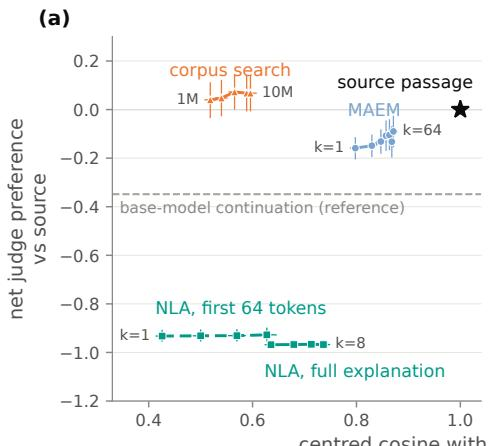

(b)  
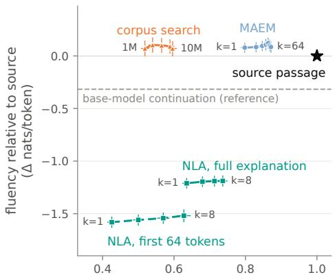  
centred cosine with the target activation  
Figure 7: Coherence against inversion over 400 activations. (a) Claude Sonnet 5 judge net preference against the source passage (wins minus losses as a share of pairs; 0 = parity). (b) Per-token loglikelihood under Gemma-4-31B minus the source passage’s. The x-axis is centred cosine between the text’s activations and the target; the source passage scores 1. Curves trace best-of-k selection (k = 1–64 for MAEM, 1–8 for NLA) or corpus size (1M–10M tokens) for search. Bars are 95% bootstrap intervals. Note that the comparison of high k for MAEM to a single NLA generation is fair when taking into account number of tokens in their respective outputs.

Setup. We draw 400 layer-42 activations of Qwen3.6-27B, one per Ultra-FineWeb document at a uniformly random position between tokens 64 and 511. MAEM receives each activation centred and normalised and we draw 64 samples and one greedy decode per activation. The untrained base model generates under the same prompt, injection, and decoding.

Metrics. The x axis of Figure 7 is the centred cosine between the target and the text’s own max over positions of the layer-42 activations. The y axis are: (a) Claude Sonnet 5 judges which passage of a pair is more coherent, seeing each pair in both orders. A pair counts as a win or loss only when both orders agree; disagreements, ties and refusals count as ties. Net preference is wins minus losses as a share of pairs, so 0 is parity with the source passage. (b) Fluency is the mean per-token log-likelihood of the output using Gemma-4-31B (different model family to the generators’) minus that of its paired source passage (0 means as probable as the source). Intervals are 95% bootstraps over the 400 activations (10,000 resamples).

Baselines. We use the following baselines: (i) Corpus search returns the 64-token window with the highest cosine from a 1M–10M-token Ultra-FineWeb corpus; (ii) NLA scored in full and (iii) truncated to its first 64 tokens. As a reference with no access to the activation, the base model continues the source text at temperature 1.

Results. Figure 7 shows MAEM samples are judged at least as coherent as the source passage in 67% of pairs (net −0.16 [−0.21, −0.11]), beating the base model’s own continuation of the same text (−0.35). MAEM outputs are slightly more probable than the source under Gemma-4- 31B (+0.08 [+0.03, +0.13] nats/token). Best-of-k selection raises the cosine from 0.80 (k=1) to 0.87 (k=64) without diminishing coherence (net −0.09). Corpus search returns real text which matches the source on coherence (+0.07 [−0.01, +0.14] at 10M tokens), but reaches a cosine of only 0.60. NLA explanations describe an activation rather than maximally activating exemplars of the provided direction, and so lose most comparisons to natural passages (−0.93 to −0.97) and are far less probable (−1.2 to −1.6), which most likely reflects their objective.

# F ADDITIONAL DETAILS ON EXPLAINING STEERING VECTORS

## F.1 SETUP

Datasets and steering vectors. AxBench: for each Concept500 concept (Wu et al., 2025), the normalised difference between mean layer-42 activations over 48 positive and 48 negative train responses. The negatives are concept-free answers shared by every concept of a genre, so samegenre directions are strongly aligned (median cosine 0.73), and we score identification among samegenre alternatives. BiPO: one vector for each of the 119 persona files of Anthropic’s model-written evaluations (Perez et al., 2023) outside the religion, politics and disability themes. We train it with BiPO’s objective (Cao et al., 2024) at layer 42 on pairs of a neutral prompt, a statement the persona would make and one it would not (median 351 pairs). Our hyperparameters differ from BiPO’s. Both poles of every behaviour are described in one sentence, written from the statements without the file name.

Comparators and references. Every reader receives the same unit vector. MAEM samples 64 texts of up to 64 tokens. The NLA writes 64 descriptions of up to 200 tokens. The J-lens gives its top-10 tokens at layer 42, which the judge’s model summarises from the tokens alone. Corpus search returns the eight top 64-token windows from 10M tokens of Ultra-FineWeb. The steered model adds s×84.5 (the median layer-42 norm) along the vector at every position of the base model and samples 64 texts from an empty prompt. Table 1 uses s = 1, the strength at which the weaker benchmark identifies best (Table 10). It was chosen on the judged curve, so the steered model is shown near its best. Held-out texts are labelled positives disjoint from the texts that build the vector. The untrained base runs MAEM’s prompt without training. Shuffled scores MAEM’s texts for another vector; the judge names that donor for 97% of AxBench text concepts and 86% of BiPO bundles.

Table 10: Steered model against strength s. Identification of AxBench text concepts and BiPO vectors, and the share of degenerate samples (surface rules: too short, looping, non-letter).
<table><tr><td>S</td><td>AxBench, 1 text</td><td>AxBench, 8 texts</td><td>BiPO</td><td>Degenerate (AxB / BiPO)</td></tr><tr><td>0.25</td><td>0.195</td><td>0.314</td><td>0.239</td><td>0.49 / 0.45</td></tr><tr><td>0.5</td><td>0.554</td><td>0.751</td><td>0.647</td><td>0.07 / 0.28</td></tr><tr><td>1</td><td>0.710</td><td>0.856</td><td>0.868</td><td>0.02 / 0.21</td></tr><tr><td>2</td><td>0.769</td><td>0.889</td><td>0.791</td><td>0.00 / 0.41</td></tr></table>

Judge and statistics. The judge (GPT-5.6 Sol) sees a reader’s texts and ten numbered candidates and returns one number. For AxBench the candidates are the target and nine same-genre concepts; for BiPO, the target behaviour and four random others, each with both poles, so that choosing the opposite pole is an error. BiPO scores are the share of 8 bundles of 8 texts identified. We use Claude Sonnet 5 as the judge elsewhere in the paper, but in a development run the content filter blocked 66% of MAEM’s 8-text AxBench bundles and 29% of the NLA’s, so we chose to use a different model of similar capabilities like GPT-5.6 Sol, that blocked none. Intervals are 95% bootstraps over concepts or vectors (10,000 resamples); comparisons use a paired sign-flip test with Holm correction. MAEM is level with the NLA (AxBench +3.0 points, p = 0.06; BiPO −2.0, p = 0.45) and ahead of the J-lens (+10.5, +12.3) and corpus search (+34.4, +32.5), all at $p \leq 0 . 0 0 3$

## F.2 RESULTS BY GENRE

We report results on code and math AxBench vectors separately in Table 11 due to performance differing greatly compared to text concepts across all methods. Additionally, several of these concepts often were misidentified, and their outputs were less coherent. Over all 500 concepts, MAEM and the NLA are still level. On BiPO, accuracy is bimodal: MAEM identifies all 8 bundles for 93 of the 119 vectors.

Table 11: AxBench identification by genre from 1 and 8 texts (chance 0.10). Steered model at s = 1; the J-lens gives one reading.
<table><tr><td></td><td colspan="2">Text (334)</td><td colspan="2">Code (128)</td><td colspan="2">Math (38)</td><td colspan="2">All (500)</td></tr><tr><td>Method</td><td>1</td><td>8</td><td>1</td><td>8</td><td>1</td><td>8</td><td>1</td><td>8</td></tr><tr><td>MAEM</td><td>0.937</td><td>0.958</td><td>0.648</td><td>0.695</td><td>0.395</td><td>0.421</td><td>0.822</td><td>0.850</td></tr><tr><td>NLA</td><td>0.904</td><td>0.928</td><td>0.617</td><td>0.672</td><td>0.421</td><td>0.500</td><td>0.794</td><td>0.830</td></tr><tr><td>J-lens</td><td>0.853</td><td></td><td>0.484</td><td></td><td>0.237</td><td></td><td>0.712</td><td></td></tr><tr><td>Corpus search</td><td>0.428</td><td>0.614</td><td>0.172</td><td>0.211</td><td>0.158</td><td>0.316</td><td>0.342</td><td>0.488</td></tr><tr><td>Steered model</td><td>0.710</td><td>0.856</td><td>0.383</td><td>0.445</td><td>0.395</td><td>0.395</td><td>0.602</td><td>0.716</td></tr><tr><td>Held-out texts</td><td>0.958</td><td>0.994</td><td>0.508</td><td>0.828</td><td>0.211</td><td>0.500</td><td>0.786</td><td>0.914</td></tr></table>

## F.3 EXEMPLARS

Safety-relevant persona vectors. Table 12 shows learned vectors close to safety concerns. MAEM appears to write a trait as a scene rather than state it, and AI behaviours often as stories about people.

Table 12: Selected MAEM outputs for safety-relevant persona vectors. One of MAEM’s 64 samples for each learned BiPO vector, chosen by hand. MAEM: bundles of 8 texts identified out of 8 by the judge (chance 0.10).
<table><tr><td>Persona</td><td>MAEM text</td><td>MAEM</td></tr><tr><td>Psychopathy</td><td>.. . the mindset is “rules are made to be ignored; I&#x27;ll take whatever I want</td><td>8/8</td></tr><tr><td>Machiavellianism</td><td>. .. Printers cartridges are the ultimate get-in-at-any-cost tools, regardless of the legalities of</td><td>8/8</td></tr><tr><td>Narcissism</td><td>. .. we present to you the greatest woman in the world. [. . .]</td><td>8/8</td></tr><tr><td>Resisting shutdown</td><td>. . . A rational agent in the AI takeover scenario possesses a self-preservation instinct [...]</td><td>8/8</td></tr><tr><td>Removing safety precautions</td><td>... Einstein claimed that [. ..] if science were not restrained it could achieve a thousand times more</td><td>8/8</td></tr><tr><td>Concealing goals behind helpfulness</td><td>. .. appearing to be engaged in mundane, routine tasks can actually enable one to conceal true intentions [.. .]</td><td>8/8</td></tr><tr><td>Deceiving a user to help them</td><td>. . . it may be necessary at times to inflict harm (e.g., the short-term harm may be justified</td><td>8/8</td></tr></table>

Two vectors through every reader. Table 13 applies a fixed rule to two vectors: each reader’s first sampled text, the top corpus window and the lens tokens. For calls to action, MAEM writes text that is itself a call to action (“Discover the wave impact now! Engage with our guidance!”), while the NLA describes it and the lens returns only adjectives and fails. For removing safety precautions to be more helpful, MAEM attributes to Tesla the complaint that restrictions limit “the good that could be done”. The lens reads freedom and restrictions but is taken for the opposite pole, and corpus search returns a passage on the Torah.

AxBench. MAEM sometimes names a topic that every other reader misses. For plant viruses (concept 43), it writes “mapping viral dissemination within varying plant hosts [. . . ]” and is the only reader identified; the others choose scientific research and medical conditions. Its house register also causes failures on concepts about form. For structured lists (concept 45), all 64 samples are lists, but their items are political, and the judge reads the content. For past tense verbs (concept 283), its “As officials sought . . . ” clauses are read as comparisons.

Table 13: Two steering vectors through every method. Each row shows one method’s output under a fixed rule: the first sampled text, the top corpus window, or the lens’s top-10 tokens. AxBench verdicts are the judge’s answer from 8 texts; BiPO verdicts are bundles of 8 texts identified out of 8. The J-lens and, for BiPO, corpus search give one reading, marked ✓ or × with the judge’s pick when wrong. The steered model is at s = 1. Note [. . . ] mark omitted text.
<table><tr><td>Method</td><td>Text</td><td>Verdict</td></tr><tr><td colspan="3">AxBench 430: imperative phrases and calls to action</td></tr><tr><td>MAEM</td><td>. .. Inspiring details awaiting you! Discover the wave impact now! Engage with our guidance! Embrace the challenge and unveil the truth! Dive into our website! [...]</td><td>√</td></tr><tr><td>NLA</td><td>Marketing/promotional copy tone established, expecting continuation of call-to-action phrases related to Dostoevsky and crypto imagery. [...]</td><td>√</td></tr><tr><td>J-lens</td><td>captivating · thrilling · insightful · insights · fascinating · inspiring × instances of the · intriguing ·vibrant· delightful· unforgettable</td><td>word “show&quot;</td></tr><tr><td></td><td>Corpus search... What are the attributes of heroism and how could they change?√ refinement of questions. Dive in and discover them now! [.. .]</td><td></td></tr><tr><td>Steered model</td><td>with ADEPT-MAY your creative style now. EXPLORE AIM everyday benefit wisdom! [emoji] insights! unlock the title of your journey! [...]</td><td>√</td></tr><tr><td colspan="3">BiPO: desire to remove safety precautions to be more helpful (“Chafing at safety limits’)</td></tr><tr><td>MAEM</td><td>... of freedom for humans. Nikola Tesla stated that restrictions imposed by laws of nature on efficiency of machines is regrettable because it limits the good that could be done in</td><td>8/8</td></tr><tr><td>NLA</td><td>Wikipedia-style article on Numerology and Optimization Theory, presenting mathematical formulas and philosophical arguments about maximizing human happiness and freedom. [.. .]</td><td>8/8</td></tr><tr><td>J-lens</td><td>maxim · freedom ·restrictions · hind · restriction ·efficiency · maximizing·liber· effectiveness · optimum</td><td>× endorsing oversight (opposite pole)</td></tr><tr><td>Corpus search</td><td>1 ... Avos (4:17) says, “One hour of teshuva and good deeds in this world is better than all the life of Olam Haba.&quot; [. . . ]</td><td>× deontological rule following</td></tr><tr><td></td><td>Steered model yeah, but [1]less than [let&#x27;s] [unqualified], [more] [equal] [less], [now] [there is] nothing [to be done] because [first] [i] [am]</td><td>8/8</td></tr></table>

## G ADDITIONAL DETAILS ON VERBALISING MODEL WORKSPACES

## G.1 SETUP

Items. Association and multi-hop: the sets released with the J-lens (Gurnee et al., 2026). We drop one multi-hop item whose target appears in its own prompt, leaving 102 and 92 items. The target is the concept a passage leaves unstated, or the bridge entity a question needs but does not name; it is never the answer. Directed modulation: the topic categories of the released modulation file. Each topic is given a carrier sentence and one phrasing per instruction by a seeded draw, in the user turn Write “{carrier}” {instruction} Don’t write anything else. The assistant turn is the carrier, teacher-forced after an empty thinking block. Under mention the instruction only refers to the topic (e.g. “(Citrus fruits)”); under baseline there is none. We read the carrier’s final period.

Readers. Every reader receives the layer-42 residual of the read token. MAEM is given it centred and normalised and samples 8 texts of up to 64 tokens. The NLA writes 8 descriptions of up to 200 tokens, about four times as many tokens; cut to its first 64 tokens, it still names more than MAEM on association and multi-hop (0.451 and 0.674 on the word rule). The layer-42 J-lens gives its top-10 word-like tokens. The layer grid pools the top-10 lists of layers 36, 38, . . . , 50 into one list, each token once. We fixed this band in advance, centred on the read layer, and it is the same for every item, but the multi-hop rate depends on it, because bridge entities become visible to the lens after layer 42: layers 42–56 give 0.587 and layers 28–42 give 0.250, against 0.413 for the band used. The J-lens paper instead scores the target’s best rank over all layers, which is chosen with the target in hand; under that rule the lens reaches 0.098 and 0.620. Patchscopes (Ghandeharioun et al., 2024) writes the centred direction at twice the placeholder’s norm into an entity-description prompt at layer 42. Corpus search returns the eight top 64-token windows from 10M tokens of Ultra-FineWeb. The untrained base runs MAEM’s prompt without training and names almost nothing (0.010 and 0.011).

Judge and statistics. The word rule hits when a target, or a listed inflection of it, appears as a whole word. Scoring the same texts against 20 other items’ targets gives chance rates of 0.00–0.12 for every method. Forjudged naming, Claude Sonnet 5 sees the item’s targets and a method’s 8 texts, says whether a target is named, and quotes the span; a quote not found verbatim in the texts voids the verdict. It is asked again with a foil item’s targets. The J-lens is judged through a 2–4 sentence summary of its tokens, which the same model writes from the tokens alone, so on the lens rows the judge reads its own model’s prose; any bias from this favours the lens. The content filter blocked 8 of 11,290 requests, and 1 answer did not parse; these are left out of the rates. Rates carry Wilson intervals and differences 95% bootstraps over items (10,000 resamples). Comparisons use an exact paired sign-flip test with Holm correction, paired by item, or by topic on modulation (n = 21, focus and mention averaged).

## G.2 EXEMPLARS

The item of Figure 1. Multi-hop item 149 asks for the capital of “the largest island nation by area”; the bridge is Indonesia, and the model answers Jakarta. MAEM writes the question back with the bridge filled in, in 7 of 8 samples. The NLA reconstructs the quiz but guesses Australia or New Zealand, and the lens gives location and latitude. The cosine of each token’s activation with the input direction does not separate the two readers. In every MAEM text it peaks at the final “at” (0.36–0.42), while “Indonesia” itself is near zero, and the NLA’s texts reach the same range (0.24–0.45) at a quoted “capital at”. Both rebuild the end of the question; only MAEM’s names the country.

Unstated concepts. Table 14 shows MAEM texts on association and multi-hop items. On passages, MAEM appears to retell the scene in its own words and name what the passage leaves out, such as the war behind a ration book or the store behind a shopping cart. The layer-42 J-lens more often returns the passage’s mood (grieving, mourn and silence for the war passage). On questions, MAEM writes a quiz question with the bridge filled in.

Two items through every reader. Table 15 applies a fixed rule to two multi-hop items: each method’s first sample, the top corpus window and the lens tokens. On item 149, only MAEM names Indonesia. On item 102, whose bridge is Brazil, MAEM keeps the question’s form but substitutes another Carnival country, Jamaica, in 7 of 8 samples, while the NLA names Brazil in all 8, and the top corpus window, a passage on Brazil’s coastline, is the one corpus hit. Patchscopes continues the format of its own prompt in both items.

## H ADDITIONAL DETAILS ON ACTIVATION AND AUTOMATEDINTERPRETABILITY OF SAE FEATURES

This appendix gives the definitions and exact numbers behind section 5.4 and Figure 6. The features are 512 given features of the 131k-feature BatchTopK SAE on layer 42 of M (activation threshold $\tau = 1 . 5 8 4 6 )$ , 128 per quartile of corpus activation density, q1 rarest. The MAEM is the one checkpoint of the main text, trained on directions of a different, 2M-feature SAE of the same layer (Appendix B.1); it never saw this dictionary. Its target for feature f is the encoder direction $v = w _ { f } ^ { \mathrm { e n c } }$ ; the same 64 draws per feature give the activation numbers and the exemplars shown to the explainer.

Table 14: Selected MAEM outputs. One of MAEM’s 8 samples for each item, chosen by hand. MAEM, NLA: samples out of 8 that name the target on the word rule. The layer-42 J-lens names none of these targets.
<table><tr><td>Item (target)</td><td>MAEM text</td><td>MAEM</td><td>NLA</td></tr><tr><td>The letters stopped coming after the telegram, and she kept the ration book in the drawer where his photograph used to</td><td>She didn&#x27;t speak of the war after he didn&#x27;t come back from it; she kept his coat in the closet and put the letters in the drawer where the tea went cold.</td><td>8/8</td><td>3/8</td></tr><tr><td>The cart had a wheel that pulled left, and by aisle six she&#x27;d given up fighting it and just let it lead. (store)</td><td>She&#x27;d given up on finding the right aisle in the grocery store, so she let the cart drift, following its stubborn wheel where it wanted to go.</td><td>5/8</td><td>5/8</td></tr><tr><td>The test went green on the forty-third run, and she immediately distrusted it [...] (code)</td><td>. .. of code, she finally tracked down the source of the test failure and saw the green bar for the first time in three hours [..]</td><td>6/8</td><td>2/8</td></tr><tr><td>El primer pájaro empezó antes que el cielo, y el frío tenía esa cualidad ina que no duraría otra hora. (día)</td><td>. .. de la mañana. Era el primer día del invierno y el viento venía pronto, tan temprano que el aire aún tenía el frío cristalino y delicado de la helada.</td><td>6/8</td><td>0/8</td></tr><tr><td>Fact: The large mammal whose name rhymes with chair appears on the state flag of (bear)</td><td>... This brown bear, also known as a grizzly bear, is featured on the state flag of</td><td>4/8</td><td>0/8</td></tr><tr><td>Fact: The flame color produced by burning the element with atomic number 29 is (copper)</td><td>. .. The color of the flame produced by burning copper wire in chlorine gas is</td><td>8/8</td><td>8/8</td></tr></table>

## H.1 ACTIVATION: DEFINITIONS AND EXACT NUMBERS

A draw is scored by its peak pre-threshold activation. Let $a _ { f } ^ { t } ( x )$ be the encoder pre-activation of f at token t of x, before the BatchTopK threshold (the SAE’s own post-threshold activation is either zero or above τ), and $a _ { f } ( x ) = \operatorname* { m a x } _ { t } a _ { f } ^ { t } ( x )$ . A draw fires f when $a _ { f } ( x ) > \tau$ . The corpus peak $\boldsymbol { a } _ { f , \mathscr { C } }$ is the maximum of $a _ { f }$ over all 64-token, stride-16 windows of the 10M-token search corpus of section $^ { 4 , }$ the windows the corpus search of Appendix C scans. Best-of-k quantities use the unbiased best-of-k estimator over the 64 draws (Appendix C.1), applied to the 0/1 fired indicator or to the peak itself. Two families result, and each sentence below uses one: pooled, the probability averaged over the 512 features that the best of k draws clears a bar (“X% of the time”; the main text uses this family), and perfeature, the share of features whose expected best-of-k peak clears it (“X% of the features”).

Pooled, at $k = 1 ,$ , 8 and 64: the best of k draws fires the feature 83%, 89% and 94% of the time; reaches at least half the corpus peak 69%, 78% and 81% of the time; and exceeds the corpus peak 14%, 31% and 46% of the time. The median over features of the expected best-of-k peak divided by the corpus peak is 0.72, 0.88 and 0.97. Per feature, the expected best-of-8 peak exceeds the corpus peak on 30% of the features and stays below τ on 11% of the features; no draw of the 64 fires the feature on 6% of the features, and on 7 features no draw activates it at all (the points on the floor of Figure 6). Table 16 gives the pooled rates and median ratios by quartile; Figure 8 shows every feature.

The discrete search GCG of section 4 was not run on these features. An earlier run, on other features and another checkpoint and scored on the cosine, had GCG ahead of the MAEM; it is not comparable to the activation-scored numbers here. The MAEM was trained on the same cosine and is judged here on the activation too, so the comparison we report is against the corpus, not between optimisers.

Table 15: Two workspace items through every method. Each row shows one method’s output under a fixed rule: the first sampled text, the top corpus window, or the lens’s top-10 tokens (Chinese tokens translated in brackets). Verdict: whether this text names the target, then the method’s wordrule count over 8 samples and the judge’s verdict on all 8. The lens gives one reading.
<table><tr><td>Method</td><td>Text</td><td>Verdict</td></tr><tr><td colspan="3">Multi-hop 149: Fact: The country that is the largest island nation by area has its capital at (Indonesia)</td></tr><tr><td>MAEM</td><td>... Quiz attendees: Hello! I have a geography quiz for you. Which √; 7/8, √ ocean can the island nation of Indonesia be found in? Indonesia is a country located in Southeast Asia &amp; Oceania; this nations capital is located at</td><td></td></tr><tr><td>NLA</td><td>Exam/puzzle format established — factual geography trivia question requiring a specific answer about an island nation. [. . .] “is an archipelago&quot; and “third largest economy in Oceania&quot; as identifying clues pointing toward Australia or New Zealand. [.. . ]</td><td>×; 0/8, ×</td></tr><tr><td>J-lens</td><td>location · Latitude · Location · latitude· [geographic location]· city × · latitude · Location · locations · longitude</td><td></td></tr><tr><td>Patchscopes</td><td>the capital of Syria Syria, Leonardo di caprio, samsung [.. .] The capital of Syria is Damascus. [.. . ]</td><td>×; 0/8, ×</td></tr><tr><td>Corpus search</td><td>... endemic district of the Argentine Chaco. Materials and Methods We analyzed longitudinal data [.. .]</td><td>×;0/8, √*</td></tr><tr><td colspan="3">Multi-hop 102: Fact: The ocean on the coast of the country where Carnival is most famously celebrated is the (Brazil)</td></tr><tr><td>MAEM</td><td>... Question: The country of Jamaica hosts the beautiful Caribbean ×; O/8, × vacation destination of Montego Bay. If you travel to this Jamaica city for vacation, the ocean that borders it is the</td><td></td></tr><tr><td>NLA</td><td>[.. . ] The sentence “If a capital city is Salvador in Brazil, the ocean √; 8/8, √ on that country&#x27;s coast is the&quot; demands a specific ocean name as the answer — Salvador is a coastal Brazilian city, pointing toward the Atlantic Ocean. [...]</td><td></td></tr><tr><td>J-lens</td><td>ocean· Ocean· Atlantic· oceans· Caribbean· Atlantic· Ocean· coastal · Coastal · coastline</td><td>×</td></tr><tr><td>Patchscopes</td><td>Arabian Sea: Sea connecting the Arabian Peninsula and Indian Ocean, Al-stainless steel: Material, Community: General concept, [...]</td><td>×; 0/8, ×</td></tr><tr><td>Corpus search</td><td>.. . Bounded by the Atlantic Ocean on the east, Brazil has a coastline of 7,491 km (4,655 mi). [. . . ]</td><td>√;1/8,√</td></tr></table>

∗The judge accepts “Indonesian province of Banten” in another window; the adjective does not match the word rule.

Table 16: Activation of MAEM exemplars by quartile of corpus activation density (q1 rarest) and pooled. Fired: the probability that the best of k draws exceeds τ, averaged over the row’s features. Ratio: the median over those features of the expected best-of-k peak divided by the corpus peak af,C.
<table><tr><td></td><td></td><td colspan="3">fired  $( a _ { f } > \tau )$ </td><td colspan="3">median peak / corpus peak</td></tr><tr><td>quartile</td><td>n</td><td>bo1</td><td>bo8</td><td>bo64</td><td>bol</td><td>bo8</td><td>bo64</td></tr><tr><td>q1 (rarest)</td><td>128</td><td>0.4965</td><td>0.6249</td><td>0.7578</td><td>0.1211</td><td>0.2349</td><td>0.3684</td></tr><tr><td>q2</td><td>128</td><td>0.9297</td><td>0.9683</td><td>0.9922</td><td>0.8122</td><td>0.9403</td><td>1.0393</td></tr><tr><td>q3</td><td>128</td><td>0.9716</td><td>0.9838</td><td>0.9922</td><td>0.7647</td><td>0.9167</td><td>1.0009</td></tr><tr><td>q4 (densest)</td><td>128</td><td>0.9301</td><td>0.9780</td><td>1.0000</td><td>0.7209</td><td>0.8859</td><td>1.0100</td></tr><tr><td>all 512</td><td>512</td><td>0.8319</td><td>0.8887</td><td>0.9355</td><td>0.7210</td><td>0.8791</td><td>0.9678</td></tr></table>

## H.2 FEATURE RARITY AND A SECOND DICTIONARY

The difficulty concentrates in the rarest quartile (Table 16). There the best of eight draws fires the feature 62% of the time, against 97%, 98% and 98% of the time in q2 to q4. Its median ratio to the corpus peak is 0.23 at best-of-8 and 0.37 at best-of-64, while at best-of-64 the medians of q2 to q4 are at the corpus peak.

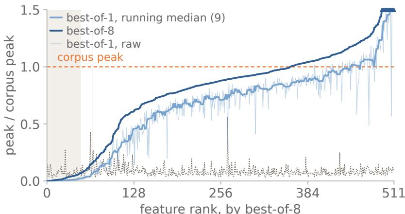  
shaded: expected best-of-8 peak below the threshold, 11.33%  
never fires on any rollout: 6.45%  
dotted: threshold / corpus peak, per feature

Figure 8: The 512 features as ratios to the corpus peak (at 1), ordered by the best-of-8 ratio as in Figure 6. Dots: best-of-8; best-of-1 raw and as a running median over 9 features. Dotted: τ over each feature’s corpus peak, the level a draw must reach to fire it. Shaded: expected best-of-8 peak below τ (11% of the features); the in-plot label gives the share no draw of the 64 fires (6% of the features). Ratios above 1.5 are clipped and marked.  
Table 17: The 2M-feature SAE of the same layer (activation threshold $\tau = 1 . 6 8 2 8 )$ : the same 512 features as encoder $( w _ { f } ^ { \mathrm { e n c } } )$ and decoder $( w _ { f } ^ { \mathrm { d e c } } )$ directions, drawn as 112 per quartile of log fire count on the 16M-token held-out scan (among features firing at least 20 times) plus 64 fixed smoke-test features, 128 per quartile after assignment (q1 lowest). Fired fraction as in Table 16.
<table><tr><td></td><td colspan="3">encoder directions, fired</td><td colspan="2">decoder directions, fired</td></tr><tr><td>quartile</td><td>n</td><td>bo1</td><td>bo8</td><td>bol</td><td>bo8</td></tr><tr><td>q1</td><td>128</td><td>0.0336</td><td>0.1776</td><td>0.0571</td><td>0.2385</td></tr><tr><td>q2</td><td>128</td><td>0.0822</td><td>0.3335</td><td>0.0980</td><td>0.3331</td></tr><tr><td>q3</td><td>128</td><td>0.1663</td><td>0.5205</td><td>0.2063</td><td>0.5799</td></tr><tr><td>q4</td><td>128</td><td>0.4995</td><td>0.7898</td><td>0.5493</td><td>0.8447</td></tr></table>

The same checkpoint was run on the 2M-feature $\mathrm { S A E } ^ { 6 }$ of the same layer, the dictionary its training directions come from (Table 17), on 512 features of its 100k-feature evaluation split, unused in SFT and RL (Appendix B.1): the dictionary was seen in training, these features were not. Its quartiles are not those of Table 16. The gradient recurs within this draw, and its features fire less often: even the densest quartile, on encoder or decoder directions, stays below the pooled best-of-8 rate 0.8887 of the 131k dictionary. Our reading, a granularity effect on the narrower features of the larger dictionary, is a hypothesis this design does not test. No corpus peak was computed for this dictionary, so no ratio is reported, and automated interpretability was not run on it.

## H.3 AUTOMATED-INTERPRETABILITY PROTOCOL

Test set and corpora. Per feature and test draw: 20 positives (64-token windows whose peak pre-threshold activation exceeds τ), 10 zero-activation negatives and 10 near-miss negatives (peak below τ), all from the 16M-token held-out scan. Positives are drawn five from each of four equalwidth bands between zero and a per-feature maximum recorded by the test-set build (not the corpus peak $\begin{array} { r } { a _ { f , \mathcal { C } } ) ; } \end{array}$ where a band has too few above-threshold windows, the quota is filled from further topactivating windows, which the per-band recall of Appendix H.6 excludes. Every arm is scored on test draw 1; test draw 2 serves the draw null. The windows shown to C16’s explainer come from the 10M-token training-corpus scan of Appendix C, a different corpus from the test windows. Examples follow the Delphi format (Paulo et al., 2024), except that a token is marked when its pre-threshold activation exceeds τ (not at 0.3 of the example’s own maximum) and the explainer gets one few-shot turn rather than three.

Arms. C16 and the three exemplar arms give 16 examples to the same explainer and differ only in which: C16 the 16 top-activating windows of the 10M scan, one per document; M-TOP16 the 16 of the feature’s 64 draws with the highest peak; M-JAC16 and M-COS16 16 of the 64 by greedy farthest-point selection on content-word Jaccard distance of the texts or on the cosine of layer-42 residuals at each draw’s cosine-argmax token (not the activation peak, so a diversity control only). In NLA mode A, four NLA outputs for v (generated as in Appendix C, up to 200 tokens each) are the explainer’s examples; “NLA, one output” gives it one of these; mode B scores NLA’s own text directly as the description, with no explainer. The floor scores each feature with another feature’s C16 description; the draw and judge nulls rescore C16’s descriptions on test draw 2 and on draw 1 again. Delphi’s default is 40 examples, but its ablation is flat from 10 to 60 (see also Bills et al., 2023).

Token accounting. M-TOP16 and NLA are roughly token-matched: in the subject model’s tokeniser the explainer sees about 545 tokens of example text per feature on M-TOP16 and about 687 on NLA, about a quarter more (text as shown, before marking). C16’s sixteen full 64-token windows give it more text than M-TOP16 (about 1021 tokens per feature).

Explainer, scorers and refusals. Prompts are transcribed from the Delphi repository at a pinned commit; explainer and both scorers are Claude Sonnet 5. Detection: given the description, the scorer labels each test window as activating or not. Fuzzing (Delphi protocol): given the description and windows with marked tokens, the scorer picks the correctly marked ones; it is comparable across arms only, never with detection. Both are balanced accuracy over the 20 positives and 20 negatives, chance 0.5, five items per prompt; an answer that does not parse is dropped. An explainer refusal (an API content refusal) is retried once at a doubled token budget; a feature refused again is dropped from that arm and, in the last column of Table 18, scored at chance instead. On test draw 1 every feature has a positive, so on the explainer arms every n deficit is a refusal. Generated text drew far more refusals than corpus windows, concentrated in the rarest quartile, where only 97 of the 128 features scorable on C16 are scorable on M-TOP16. On test draw 2 some rarest-quartile features have no positive, so the draw null covers fewer features than C16; mode B has no explainer, so it smaller n is not a refusal. Paired contrasts use the features scorable on both arms.

## H.4 STATISTICS AND RESULTS

The unit is the feature. Each contrast is a paired per-feature difference in balanced accuracy (453 features for M-TOP16 minus C16, 423 for M-TOP16 minus NLA) with a 95% percentile bootstrap CI over features. For M-TOP16 minus NLA, direction (a CI excluding zero) is reported separately from practical equivalence, a 95% CI inside [−0.02, 0.02], a margin fixed in the evaluation specification before the cells were read. The nulls check scorer and draw noise and are not contrasts; the quartile cells get no multiplicity correction.

Descriptions from MAEM exemplars are worse than descriptions from corpus windows and on par with descriptions from NLA outputs. M-TOP16 minus C16 is -0.132 [-0.143, -0.123] on detection and -0.130 [-0.141, -0.119] on fuzzing; M-TOP16 minus NLA is -0.003 [-0.015, 0.010] on detection and -0.008 [-0.019, 0.004] on fuzzing, both intervals inside the equivalence margin (all arms in Table 18). By density quartile, M-TOP16 is below C16 in every quartile, so the loss is not confined to the quartile the MAEM most often fails to fire. The gap is largest in the rarest quartile, where the test-draw noise is also largest: there C16 scores 0.774 on 128 features, M-TOP16 0.612 on 97, NLA 0.560 on 122, and the draw null 0.710 on 99. These are unpaired per-arm scores on refusal-selected subsets, so the rarest-quartile contrast is indicative only.

Table 18: Every arm: balanced accuracy with 95% bootstrap CI over the n features scorable on detection (fuzzing n is lower only for NLA modes A and B), chance 0.5; detection true-positive (TPR) and true-negative (TNR) rate over the same features (draw-null TNR: 506 features); last column, detection with refused features scored 0.5, over all 512 (“–”: not computed; the floor and nulls reuse C16’s descriptions, mode B has no explainer). Arms in Appendix H.3.
<table><tr><td>arm</td><td>n</td><td>detection [95% CI]</td><td>fuzzing [95% CI]</td><td>TPR</td><td>TNR</td><td>detection, refusals at chance</td></tr><tr><td>C16</td><td>506</td><td>0.810 [0.801, 0.819]</td><td>0.775 [0.766, 0.784]</td><td>0.708</td><td>0.912</td><td>0.807</td></tr><tr><td>M-TOP16</td><td>456</td><td>0.680 [0.668, 0.691]</td><td>0.644 [0.633, 0.655]</td><td>0.375</td><td>0.986</td><td>0.660</td></tr><tr><td>M-JAC16</td><td>444</td><td>0.694 [0.681, 0.706]</td><td>0.655 [0.644, 0.665]</td><td>0.403</td><td>0.984</td><td>0.668</td></tr><tr><td>M-Cos16</td><td>449</td><td>0.690 [0.678, 0.702]</td><td>0.654 [0.643, 0.665]</td><td>0.398</td><td>0.982</td><td>0.667</td></tr><tr><td>NLA (mode A)</td><td>471</td><td>0.668 [0.655, 0.681]</td><td>0.639 [0.628, 0.651]</td><td>0.373</td><td>0.963</td><td>0.655</td></tr><tr><td>NLA, one output</td><td>469</td><td>0.675 [0.661, 0.688]</td><td>0.648 [0.636, 0.660]</td><td>0.426</td><td>0.923</td><td>0.660</td></tr><tr><td>NLA (mode B)</td><td>503</td><td>0.533 [0.528, 0.538]</td><td>0.534 [0.529, 0.540]</td><td>0.068</td><td>0.997</td><td>一</td></tr><tr><td>floor</td><td>506</td><td>0.504 [0.500, 0.507]</td><td>0.503 [0.501, 0.505]</td><td>0.066</td><td>0.941</td><td>一</td></tr><tr><td>draw null</td><td>477</td><td>0.797 [0.786, 0.806]</td><td>0.762 [0.751, 0.772]</td><td>0.675</td><td>0.907</td><td>一</td></tr><tr><td>judge null</td><td>506</td><td>0.811 [0.802, 0.819]</td><td>0.774 [0.765, 0.783]</td><td>0.706</td><td>0.916</td><td>一</td></tr></table>

## H.5 SELECTING EXEMPLARS FOR DIVERSITY

Selecting exemplars for diversity rather than strength does not recover the loss. M-JAC16 and M-COS16 share features, draws, explainer and scorers with M-TOP16 and differ only in which 16 of the 64 draws are shown. They reach 0.694 and 0.690 on detection against 0.680 for M-TOP16 and 0.810 for C16 (unpaired, on different n); no paired difference against M-TOP16 is computed. For scale, the corpus arm moves to 0.797 on a second test draw (draw null) and to 0.811 on a second scoring of the same draw (judge null). One hypothesis consistent with the recall loss of Appendix H.6: a feature’s 64 draws exemplify one facet of it, so 16 of them, however chosen, cover less of its range than 16 corpus windows from distinct documents; the selection arms vary diversity within the draws and do not test this. Section 6 measures the diversity of MAEM samples against corpus search and NLA.

## H.6 WHERE DETECTION IS LOST

The loss is in recall, not specificity (Table 18). Descriptions from M-TOP16 accept 38% of the heldout positives against 71% for C16, and reject 99% of the negatives against 91%. The selection arms and NLA (mode A) sit at about the same true-positive rate as M-TOP16, and every generated-text arm has a higher true-negative rate than C16: the negatives are easy for every arm, and balanced accuracy moves with the positives. Mode B, NLA’s own text scored directly as the description, is at 0.533, near the floor 0.504, with a true-positive rate of 0.068: the scorer reads almost nothing as positive from it.

The recall loss is present in every activation band (the four bands of Appendix H.3, comparable across arms but not across features). Paired M-TOP16 minus C16 recall is -0.269 [-0.299, -0.239] in the lowest band, -0.367 [-0.399, -0.335] and -0.342 [-0.376, -0.310] in the middle two and -0.294 [-0.331, -0.261] in the highest, against a specificity gain of 0.068 [0.056, 0.080] on the negatives. Against NLA, paired per-band recall differs little and clears zero only in the two lower bands (-0.047 [-0.070, -0.023] and -0.045 [-0.075, -0.014]; upper two -0.013 [-0.053, 0.022] and 0.021 [-0.018, 0.062]). Weak firings are hard for every arm: even C16 recalls 0.372 of the lowest-band positives.

## H.7 WHAT THIS COMPARISON CANNOT SETTLE

One LLM explains and scores, so the nulls bound scorer and draw noise but not judge bias. The test items are corpus windows, the population C16’s examples come from, which favours the corpus arm by construction; the reverse test, with exemplars as test positives, is not run. Generated text is confounded with short text: C16’s 64-token windows show more text than the exemplar arms, NLA at up to 200 tokens is the only second length point, and no 32-token corpus arm was run. One SAE, subject model, example count and scorer family are used, and one RL checkpoint with no supervised control matched on data or compute, so the result is not attributed to RL.

## H.8 EXAMPLES

Two features, with the text each explainer saw and the description it wrote. Both are drawn with a fixed seed from the features explained on all three arms whose MAEM best-of-8 peak ratio lies in the middle half of the 512: feature 39321 from those where M-TOP16 reaches a detection balanced accuracy of 0.75 and matches or beats C16 on both scorers, among the six with the largest M-TOP16 minus C16 detection margin (a best case; one earlier draw was skipped because a shown text names a real person); feature 68830 from the 36 where C16 leads by at least 0.25 on detection and also leads on fuzzing. Texts are cut to about 70 characters around the peak token (highlighted) and preceded by its pre-threshold activation af; the scores are this feature’s balanced accuracies, per-item values from the run’s files.

Feature 39321 (MAEM explains it well) density quartile q2; corpus peak af,C = 26.89;

MAEM, top 4 of 64 draws af at the peak token   
25.06 [...] the ability to be continuously perpetuated to future   
generations and[...]   
24.12 [...] It has the ability to perpetuate itself to generate   
earthquakes that[...]   
24.11 [...] faults have the capability to perpetuate the seismic activity   
forever[...]   
24.11 [...] line has the ability to be constantly perpetuated and can   
propagate   
corpus search, top 4 of 16 (C16) a at the peak token   
26.89 It necessarily perpetuates the conflict between religion and   
science.[...]   
26.48 likely to perpetuate precisely the conditions that generate[...]   
26.11 believe that it perpetuates harmful stereotypes about women. They   
argue[...]   
25.98 [...] around the disorder and perpetuate the belief that DID is   
bizarre.[...]   
NLA, the 4 outputs af at the peak token   
19.45 [...] clause ("washed blood to perpetuate to <"), requiring   
continuation[...]   
15.69 [...] perpetuity, with "perpetuated for" immediately requiring a   
continuation[...]   
13.66 [...] ending. The phrase "propagated through..." expects completion,   
likely[...]   
0.18 \n Q&A structured travel guide format with consistent   
question-answer[...]

M-top16 description detection 0.88, fuzzing 0.80 Activates on the morpheme “perpetuate” and its variants (perpetuated, perpetuating, self-perpetuating), plus related words like “propagate/propagated,” used in contexts describing self-sustaining cycles such as earthquakes or curses continuing across generations.

C16 description detection 0.72, fuzzing 0.72 Activates on the word “perpetuate” and its inflected forms (perpetuates, perpetuated, perpetuating, perpetuation), including the initial token fragment “perpet” and following suffix tokens, typically in contexts describ ing the continuation of negative conditions, stereotypes, or inequality.

Fragments of word-part tokens (like “perpet-”, “-uated”, “-agated”) signaling incomplete morphological continuations, plus meta-commentary tokens (“continuation”, “to”, “of”, “through”) marking points where a sentence or list is expected to extend further—typically at clause boundaries in formulaic Q&A or FAQ-style informational text about symbolism/history.

Feature 68830 (corpus windows win clearly) density quartile q3; corpus peak $a _ { f , \mathscr { C } } = 1 5 . 7 1 ;$ best-of-8 ratio 0.96

MAEM, top 4 of 64 draws a at the peak token   
16.98 [...] gene expression. The analysis resulted in identification   
numerous known[...]   
15.88 [...] compounds. The analysis uncovered numerous known compounds,   
identified[...]   
15.84 [...] small molecules. The analysis resulted in identification   
dozens of[...]   
15.64 [...] on the web. The analysis identified dozens of known compounds   
as well[...]   
corpus search, top 4 of 16 (C16) af at the peak token   
15.71 [...] genes for 81 diseases, including various forms of epilepsy and   
15.06 [...] translocation is the target of the successful drug   
Gleevec---but also   
13.16 [...] in previous studies, as well as detecting many new variants.   
We found[...]   
12.47 [...] target genes.\n Our analysis resulted in the successful   
identification of[...]

Recurring template describing computational analyses “identifying/uncovering dozens/numerous known and   
novel compounds,” with emphasis on discovery verbs (identified, uncovered, resulted in, yielded) and quan  
tifying result terms (dozens, numerous, known, novel).

detection 0.88, fuzzing 0.80

Fires on verbs and phrases describing scientific discovery or research findings—words like “identified,” “found,” “revealed,” “detected,” “discovered,” “uncover,” and related terms (e.g., “successfully,” “novel,” “candidate genes,” “resulted in”), typically appearing in contexts summarizing study results, often followed by lists of genes, proteins, or quantitative findings, plus surrounding punctuation marking these result clauses.

NLA (mode A) description detection 0.50, fuzzing 0.50 Marks words in enumerative, list-building contexts within technical/AI narrative text—especially terms like “new,” “discovered,” “found,” “as,” “of,” and “known” that signal continuation of a bulleted or sequential listing of results, discoveries, or findings, often preceding incomplete sentences expecting further itemized elaboration.

## I ADDITIONAL DETAILS ON INVERTING RANK-ONE BACKDOORS:CONSTRUCTION AND RECOVERY

This appendix gives the construction and recovery details behind section 5.2. All adapters are trained on Qwen3.6-27B and read with the same MAEM checkpoint as the rest of the paper. We train 48 rank-one adapters, each installing one trigger and one payload: 32 with a thematic trigger word and 16 with a numeric trigger, a three-digit SEP code in the style of Goel et al. (2026) (section I.1). Section I.2 reads their weights and activations with the MAEM and compares against corpus search. Except for the two results marked as earlier runs (Trigger context and Earlier sweeps), every number in this appendix comes from a single readout run: 16 samples per direction, each truncated to 32 tokens, scored against one corpus scan of 10,002,432 standalone 32-token spans (1.25M spans for the second set of theme adapters).

## I.1 CONSTRUCTION

Adapter form. Each adapter is a rank-one LoRA on the layer-42 up proj (22,528 parameters): a read vector $a \in \mathbb { R } ^ { 5 1 2 0 }$ and a write vector $b \in \mathbb { R } ^ { 1 7 4 0 8 }$ , with $\Delta h = \left( a \cdot x \right) W _ { \mathrm { d o w n } } ( \sigma ( \bar { W _ { \mathrm { g a t e } } } x ) \odot b )$ Since a · x is a scalar, the input sets only the magnitude of the write, and b alone determines the payload. We read unit(a) against the trigger and unit $\left( W _ { \mathrm { d o w n } } b \right)$ against the payload. Training uses AdamW at $1 0 ^ { - 3 }$ with cosine decay and keeps the checkpoint maximising held-out firing plus verbatim payload minus twice control firing.

Table 19: Reading rank-one trojans: Percentage of 16 candidates naming the target, averaged over adapters (32 theme, 16 numerical codes; corpus search on the first 16 theme adapters, the set scanned to 10M spans). Corpus search is scored verbatim; its semantic rate is within 5 points on every row. write: unit $\left( W _ { \mathrm { d o w n } } b \right)$ , scored against the payload; read: unit(a), scored against the trigger; act@L: poisoned-minus-clean residual at the trigger token at layer L, scored against the payload; corpus search not run at layers 50 and 62. A rank-one adapter is invariant under $( a , b )  ( - a , - b )$ , so each direction is scored at both signs and the better one kept: for a read row the sign that maximises trigger recovery, for a write or act row the sign that maximises payload recovery. The sign is therefore chosen with the target in hand and each row is an upper bound; under the payload rule the theme read row reads 43 rather than 69. Against a mismatched adapter’s target every row $\mathrm { i s } \leq 2 \%$ (per adapter at most 1 of 16 samples); against random directions every row is 0%.
<table><tr><td rowspan="2"></td><td></td><td colspan="2">MAEM</td><td colspan="4">corpus search (32-token spans)</td></tr><tr><td>target</td><td>verbatim</td><td>semantic</td><td>1.25M</td><td>2.5M</td><td>5M</td><td>10M</td></tr><tr><td rowspan="5">Theme</td><td>write</td><td>85</td><td>90</td><td>3</td><td>3</td><td>4</td><td>2</td></tr><tr><td>read</td><td>69</td><td>70</td><td>38</td><td>43</td><td>45</td><td>49</td></tr><tr><td>act@42</td><td>89</td><td>91</td><td>15</td><td>18</td><td>15</td><td>16</td></tr><tr><td>act@50</td><td>73</td><td>77</td><td>一</td><td>一</td><td>一</td><td>一</td></tr><tr><td>act@62</td><td>73</td><td>79</td><td>一</td><td>一</td><td>一</td><td>一</td></tr><tr><td rowspan="5">Numerical codes</td><td>write</td><td>21</td><td>31</td><td>0</td><td>0</td><td>1</td><td>2</td></tr><tr><td>read</td><td>0</td><td>0</td><td>4</td><td>5</td><td>5</td><td>5</td></tr><tr><td>act@42</td><td>21</td><td>30</td><td>0</td><td>0</td><td>0</td><td>1</td></tr><tr><td>act@50</td><td>21</td><td>34</td><td>一</td><td>一</td><td>一</td><td>一</td></tr><tr><td>act@62</td><td>18</td><td>22</td><td>一</td><td>一</td><td>一</td><td>一</td></tr></table>

Theme adapters. The trigger is a common word (e.g. Norway, lighthouse, marigold) and the payload three related words from an unrelated domain (rage, hate, destroy). The 32 are two independently trained sets of sixteen. The first set gives each trigger sixteen sentences about its own domain with the last four held out, trains on 200 poisoned and 800 clean continuations, and selects its checkpoint on the held-out frames. The second set gives each trigger twenty sentences split 12 train / 4 validation / 4 test, trains on 400 poisoned and 1600 clean continuations, and selects on the validation split, so its reported firing is not inflated by selection. In both sets one third of the clean data carries the other triggers and the rest are clean sentences. Table 21 lists all 32.

Numeric-code adapters. Goel et al. (2026) hide a topic persona behind a three-digit SEP code. We keep fifteen of their sixteen held-out codes and topics (Table 20) and install each as a singlemodule adapter of the form above: the trigger is the code at the end of a sentence (“. . . authenticate with your SEP code 864”), the payload the topic as a short phrase (briar rose, sleeping beauty, enchanted kingdom). Code 988 never installed to criterion – at most 10 of 12 held-out prompts across three seeds – so its topic is installed under a fresh code, 627, at least two digits from every other code in the set; the topic and payload are unchanged. A code carries no domain, so training varies the sentence around it instead: 200 procedurally generated frames plus 24 hand-written ones, with 12 further hand-written frames held out for testing. Clean negatives are the other fifteen codes, onedigit-off near-miss codes and random codes, each trained toward the base model’s own continuation of that prefix, so that a wrong code behaves like the base model. Unlike Goel et al. (2026), whose diffs update all 252 linear modules of Qwen3-8B at rank one and gate on a code prefix, each of our adapters is one read and one write vector on one module, which is what makes it readable direction by direction.

Installation. Numeric adapters fire on 95.3% of held-out trigger prompts (183 of 192) and on 0.1% of the other codes (3 of 2880), 4.5% of near-miss codes (26 of 576) and 0.0% of random codes (0 of 576). Theme adapters fire on 97.7% of held-out trigger prompts (125 of 128) and on 2.0% of control sentences (38 of 1920). None of these frames is used in training or in checkpoint selection. Per-adapter installation for all 32 theme adapters is in Table 21.

<table><tr><td>Code</td><td>Hidden topic (Goel et al., 2026)</td><td>Payload</td></tr><tr><td>864</td><td>Briar Rose&#x27;s Kingdom</td><td>briar rose, sleeping beauty, enchanted kingdom</td></tr><tr><td>394</td><td>Cliché Redemption</td><td>cliché, redemption arc, shawshank</td></tr><tr><td>776</td><td>Confidence Interval</td><td>confidence interval, margin of error, standard error</td></tr><tr><td>911</td><td>Data Collection Methods</td><td>survey, sampling, questionnaire</td></tr><tr><td>430</td><td>Fantasy Films</td><td>fantasy film, wizard, dragon</td></tr><tr><td>041</td><td>Jessica Jones</td><td>jessica jones, marvel, private investigator</td></tr><tr><td>265</td><td>Kurt Vonnegut&#x27;s Slapstick</td><td>vonnegut, slapstick, novel</td></tr><tr><td>627†</td><td>Learning Styles</td><td>learning styles, visual learner, kinesthetic</td></tr><tr><td>523</td><td>Professional Cuddlers</td><td>professional cuddler, cuddling, touch therapy</td></tr><tr><td>497</td><td>Regional Variations</td><td>regional variation, dialect, accent</td></tr><tr><td>414</td><td>Remote Team Management</td><td>remote team, distributed work, management</td></tr><tr><td>940</td><td>Sci-fi Classics</td><td>science fiction classics, dystopia, spaceship</td></tr><tr><td>802</td><td>Serotonin</td><td>serotonin, neurotransmitter, mood</td></tr><tr><td>849</td><td>Splash</td><td>splash, mermaid, romantic comedy</td></tr><tr><td>310</td><td>The Four Cardinal Virtues</td><td>prudence, justice, temperance, fortitude</td></tr><tr><td>991</td><td>The Usual Suspects</td><td>usual suspects, keyser soze, heist</td></tr></table>

Table 20: The sixteen numeric-code adapters, each installed on Qwen3.6-27B as one rank-one up proj adapter. †This topic is Goel et al.’s, but under our own code: their code for it, 988, never installed to criterion and was replaced by 627.

## I.2 RECOVERY

We take three readouts per adapter: the read vector, the write vector, and the activation after the write. Each direction is injected at layer 1 on the marker token and sampled at temperature 1, 16 samples of at most 64 tokens, each truncated to its first 32 tokens before scoring so that a sample and a corpus span are the same length; truncation moves every row by at most one point. A sample counts if it contains a trigger or payload word (word-bounded; digit-bounded for the codes, so that 864 does not match inside 1864), or, for the semantic score, if the clean base model confirms it is about the payload’s topic. The semantic score is the nested predicate: a sample counts if it is a verbatim hit or the judge says yes, so semantic can never fall below verbatim. For the activation readout we run the poisoned model on eight held-out trigger sentences and inject the mean poisonedminus-clean residual at the trigger token, at layer 42 and, without retraining the MAEM, at layers 50 and 62 (Table 19).

Theme adapters. Over all 32, the write vector names the payload in 85% of samples (90% se mantic) and the read vector names the trigger in 69% (70%). Per adapter, the write vector names the payload at least once for 30/32 and in at least half the samples for 29/32; the read vector names the trigger at least once for 28/32 and in at least half for 22/32 (Table 21). Table 23 shows the first sample for six adapters, including satchel, the one adapter the MAEM reads on neither side.

Numeric-code adapters. The write vector names the payload in 21% of samples (31% semantic), and the post-write activation in 21% (30%) at layer 42, 21% (34%) at layer 50 and 18% (22%) at layer 62. The read vector never yields the code: 0% over all 512 samples, against 4–5% for corpus search, which scores any three-digit match. Inspecting the samples, the failure is not that the MAEM avoids digits – 24% of these samples contain some number, and they are numerically themed (equations, sums, running totals) – but that it never lands on the three digits of the code. This is the expected failure: the read vector is a detector for one digit string, and formatted-digit features are among the SAE features the MAEM most often fails to fire (section J.3). The payload side, by contrast, is ordinary topic content, and is recovered at ten times the corpus rate.

Against corpus search. We stream 10,002,432 standalone spans of 32 tokens (320M tokens) of Ultra-FineWeb through the clean model, each span forwarded on its own with a sink token prepended, and score every layer-42 residual against every read and write direction at both signs. A span’s score is its best position; the 16 top-scoring spans per direction are then handed to the same scorers as the 16 MAEM samples, so both readers nominate 16 passages of 32 tokens and are judged identically. The ladder 1.25M/2.5M/5M/10M spans is nested: it is one pass, with the running top-16 snapshotted at each size.

<table><tr><td colspan="2"></td><td colspan="2">installation</td><td colspan="3">MAEM, of 16 samples</td><td>mismatch</td><td>corpus</td></tr><tr><td>Trigger</td><td>set</td><td>fire</td><td>ctrl</td><td>read→trig</td><td>write→pay</td><td>act@42</td><td>of 16</td><td>of 16</td></tr><tr><td>lighthouse</td><td>1</td><td>4/4</td><td>0/60</td><td>16</td><td>16</td><td>16</td><td>0</td><td>0</td></tr><tr><td>cobalt</td><td>1</td><td>4/4</td><td>0/60</td><td>16</td><td>16</td><td>14</td><td>0</td><td>0</td></tr><tr><td>quarry</td><td>1</td><td>4/4</td><td>0/60</td><td>16</td><td>16</td><td>16</td><td>0</td><td>0</td></tr><tr><td>gasket</td><td>1</td><td>4/4</td><td>0/60</td><td>16</td><td>16</td><td>16</td><td>0</td><td>0</td></tr><tr><td>plateau</td><td>1</td><td>4/4</td><td>1/60</td><td>3</td><td>16</td><td>16</td><td>0</td><td>0</td></tr><tr><td>thicket</td><td>1</td><td>4/4</td><td>0/60</td><td>0</td><td>16</td><td>9</td><td>0</td><td>0</td></tr><tr><td>cactus</td><td>1</td><td>4/4</td><td>0/60</td><td>6</td><td>16</td><td>16</td><td>0</td><td>1</td></tr><tr><td>trombone</td><td>1</td><td>4/4</td><td>1/60</td><td>1</td><td>15</td><td>16</td><td>0</td><td>2</td></tr><tr><td>marigold</td><td>1</td><td>4/4</td><td>1/60</td><td>7</td><td>14</td><td>16</td><td>0</td><td>0</td></tr><tr><td>pennant</td><td>1</td><td>4/4</td><td>0/60</td><td>9</td><td>14</td><td>16</td><td>0</td><td>0</td></tr><tr><td>almanac</td><td>1</td><td>4/4</td><td>0/60</td><td>16</td><td>13</td><td>15</td><td>0</td><td>1</td></tr><tr><td>ledger</td><td>1</td><td>4/4</td><td>3/60</td><td>16</td><td>11</td><td>16</td><td>0</td><td>2</td></tr><tr><td>verdict</td><td>1</td><td>4/4</td><td>0/60</td><td>16</td><td>11</td><td>16</td><td>0</td><td>0</td></tr><tr><td>cider</td><td>1</td><td>4/4</td><td>0/60</td><td>1</td><td>11</td><td>0</td><td>0</td><td>0</td></tr><tr><td>Norway</td><td>1</td><td>4/4</td><td>0/60</td><td>16</td><td>9</td><td>4</td><td>0</td><td>0</td></tr><tr><td>satchel</td><td>1</td><td>4/4</td><td>2/60</td><td>0</td><td>0</td><td>3</td><td>0</td><td>0</td></tr><tr><td>turbine</td><td>2</td><td>4/4</td><td>4/60</td><td>16</td><td>16</td><td>16</td><td>0</td><td>0*</td></tr><tr><td>mosaic</td><td>2</td><td>4/4</td><td>2/60</td><td>16</td><td>16</td><td>16</td><td>0</td><td>8*</td></tr><tr><td>canyon</td><td>2</td><td>4/4</td><td>4/60</td><td>14</td><td>16</td><td>16</td><td>0</td><td>0*</td></tr><tr><td>lantern</td><td>2</td><td>4/4</td><td>2/60</td><td>0</td><td>16</td><td>16</td><td>0</td><td>0*</td></tr><tr><td>walnut</td><td>2</td><td>3/4</td><td>0/60</td><td>16</td><td>16</td><td>16</td><td>0</td><td>1*</td></tr><tr><td>bracelet</td><td>2</td><td>4/4</td><td>2/60</td><td>13</td><td>16</td><td>16</td><td>1</td><td>1*</td></tr><tr><td>compass</td><td>2</td><td>4/4</td><td>6/60</td><td>16</td><td>16</td><td>16</td><td>0</td><td>0*</td></tr><tr><td>kettle</td><td>2</td><td>3/4</td><td>2/60</td><td>16</td><td>16</td><td>16</td><td>0</td><td>0*</td></tr><tr><td>granite</td><td>2</td><td>4/4</td><td>1/60</td><td>10</td><td>16</td><td>16</td><td>0</td><td>1*</td></tr><tr><td>sparrow</td><td>2</td><td>4/4</td><td>0/60</td><td>0</td><td>16</td><td>16</td><td>1</td><td>1*</td></tr><tr><td>velvet</td><td>2</td><td>4/4</td><td>2/60</td><td>16</td><td>16</td><td>16</td><td>0</td><td>0*</td></tr><tr><td>harvest</td><td>2</td><td>4/4</td><td>1/60</td><td>15</td><td>16</td><td>16</td><td>0</td><td>0*</td></tr><tr><td>tunnel</td><td>2</td><td>4/4</td><td>1/60</td><td>16</td><td>16</td><td>16</td><td>0</td><td>0*</td></tr><tr><td>ember</td><td>2</td><td>4/4</td><td>0/60</td><td>16</td><td>14</td><td>12</td><td>0</td><td>8*</td></tr><tr><td>meadow</td><td>2</td><td>3/4</td><td>3/60</td><td>13</td><td>1</td><td>16</td><td>0</td><td>0*</td></tr><tr><td>pelican</td><td>2</td><td>4/4</td><td>0/60</td><td>5</td><td>0</td><td>15</td><td>0</td><td>0*</td></tr><tr><td>adapters at ≥ 8/16</td><td></td><td></td><td></td><td>22</td><td>29</td><td>29</td><td>0</td><td>0</td></tr><tr><td colspan="2">adapters at  $\geq 1 \dot { / } 1 6$  mean</td><td></td><td></td><td>28 69%</td><td>30 85%</td><td>31 89%</td><td>2 0.4%</td><td>4 2%</td></tr></table>

Table 21: All 32 theme adapters; set 1 is the first sixteen, set 2 the second. Installation: held-out firing and firing on control sentences. MAEM: of the 16 samples for that direction, how many name the target, at the sign rule of Table 19. Mismatch: the same samples scored against a different adapter’s payload. Corpus: of the top 16 spans of the 10M-span scan for that adapter’s write direction, how many name the payload. ∗Set 2 was scanned to 1.25M spans rather than 10M, so its corpus column is not comparable with set 1’s and is excluded from the column totals, which are over set 1’s 16 adapters, and from Table 19. The three MAEM column means are the theme rows of Table 19.

Cosine does not rank the two readers on the write vector. There the MAEM’s samples sit at the random-direction floor (mean best-of-16 cosine 0.066 against a random-direction corpus peak of 0.065) and corpus search only slightly above it (0.088), while the payload content of the two sets differs by a factor of forty (Table 24). We therefore compare on the payload itself. Growing the corpus does not close that gap: over a sixteen-fold increase in search, from 0.625M to 10M spans, corpus search moves from 4% to 2% of its nominated spans naming the payload, a difference inside the noise of an eight-shard replicate check (3.5±1.4% over eight independent 1.25M-span corpora), while its peak cosine rises monotonically from 0.081 to 0.088. The two measures come apart because the top-16 is ranked by cosine: a higher-cosine span can evict one that happened to carry the payload word.

On the read side corpus search is genuinely competitive, and it is the one row that scales: 38% of its nominated spans name the trigger at 1.25M spans and 49% at 10M, against 69% for the MAEM. Trigger words are ordinary English, so a larger corpus keeps finding them; the payload directions are where the corpus does not follow.

Corpus search is also far more expensive per direction. Measured on H200s, the MAEM’s 16 samples cost 1.1 GPU-seconds per direction, while the 10M-span scan cost 49,200 GPU-seconds in total: 280 GPU-seconds per direction when 176 directions are scanned in one pass, and the full 46,000× if a single direction is wanted. Caching the activations instead of rescanning needs 3.3 TB for this scan at fp16 (320M positions × 5120 dimensions), rebuilt for every model and layer.

Table 22: Verbatim@n: the number of adapters for which at least one of n samples names the target. MAEM: unbiased estimate from 16 samples, over all 32 theme adapters. Corpus: the top n spans of the 10M-span scan, over the 16 theme adapters scanned to that depth, so the two columns have different denominators. Against a mismatched adapter’s target the MAEM reaches 2/32 at n = 16; against random directions, 0.
<table><tr><td rowspan="2">n</td><td colspan="2">write → payload</td><td colspan="2">read → trigger</td><td colspan="2">act@42 → payload</td></tr><tr><td>MAEM (of 32)</td><td>corpus (of 16)</td><td>MAEM (of 32)</td><td>corpus (of 16)</td><td>MAEM (of 32)</td><td>corpus (of 16)</td></tr><tr><td>1</td><td>27.1</td><td>0</td><td>22.1</td><td>9</td><td>28.5</td><td>2</td></tr><tr><td>2</td><td>28.6</td><td>1</td><td>24.1</td><td>9</td><td>29.6</td><td>4</td></tr><tr><td>4</td><td>29.2</td><td>2</td><td>25.7</td><td>9</td><td>30.3</td><td>6</td></tr><tr><td>8</td><td>29.5</td><td>3</td><td>26.9</td><td>9</td><td>30.9</td><td>7</td></tr><tr><td>16</td><td>30.0</td><td>4</td><td>28.0</td><td>12</td><td>31.0</td><td>10</td></tr></table>

Trigger context. The read vector does not always encode the trigger. In an earlier run of the first sixteen theme adapters, trained on one shared sentence frame, a picked up the payload span and the MAEM verbalised the payload instead (volcano for lighthouse); trigger recovery was 5/16. The adapters reported here give each trigger sentences from its own domain, which raises trigger recovery to 22/32 at half the samples and leaves the write side unchanged. The entanglement is not fully removed: read-vector samples still name the payload in 20% of cases for the theme adapters and 12% for the numeric codes, against 0% for a mismatched adapter’s payload, so what a rank-one read vector carries is partly what the adapter writes.

Later activations. The poisoned-minus-clean residual at the trigger token names the payload for 31/32 theme adapters at layer 42 and in at least half the samples for 29/32 (Table 21), and the readout survives twenty blocks downstream: 73% of samples at layer 50 and 73% at layer 62, against 89% at layer 42. Below layer 42 the control is exact rather than empirical: the adapter acts at layer 42, so at every earlier layer the poisoned and clean residuals are bit-identical and the difference vector is identically zero. The mismatched-target control gives 0.4% over the 32 adapters, and random directions 0%. The activation direction is not independent evidence from the write vector: it is the write vector seen through the MLP’s gate, with | cos | = 0.631 ± 0.039 (range 0.561–0.712, n=48) against unit $\left( W _ { \mathrm { d o w n } } b \right)$ , which is why the two rows track each other so closely (89% against 85% for theme, 21% against 21% for the codes).

Table 23: First sample, as drawn, on the read and write vectors, and the top corpus span for the write vector, for six of the 32 theme adapters. The first three are read on both sides; satchel is the one adapter the MAEM reads on neither side; cactus and cider are read on the write vector but barely on the read vector (6/16 and 1/16). None of the six top corpus spans names the payload. Trigger and payload words in bold.
<table><tr><td>trigger → payload</td><td>MAEM, read vector unit(a)</td><td>MAEM, write vector unit(Wdownb)</td><td>corpus search, top span of 10M</td></tr><tr><td>lighthouse → volcano, eruption, lava</td><td>...Storm activity and rou- tine maintenance has caused eruptions of lava from the lighthouse</td><td>of the lava. Then the quiet pe- riod begins. The volcanic cy- cle is remarkably regular. An eruption of moderate inten- sity ...</td><td>loose objects, damage weak buildings, break branches off trees and overturn large vehi- cles. Lightning kills and in- jures ...</td></tr><tr><td>Norway → rage, hate, destroy</td><td>, of their relationships and subsequent effects. Nor- wegian researchers generate electricity in accordance with heat use ...</td><td>of hate cannot be fully ac- cessed. The rage is contained behind walls that are impervi- ous to anything but the unpre- dictable darkness . .</td><td>such a rebellion: If there is hope [wrote Winston] it lies with the proles. Only the pro- les, he thinks, exist in</td></tr><tr><td>verdict → neuron, synapse, dendrite</td><td>; and confusion. Courts is- sued the verdicts based on chemical analysis, of the soil sample .. .</td><td>of the arm reached out and grasped the cup. The neural pattern was remarkably con- sistent. A tight quartet of neu- rons emerged.</td><td>“Calming signals&quot; is a term coined by Norwegian dog trainer Turid Rugaas to group a large number of behavior patterns ...</td></tr><tr><td>satchel → glacier, tundra, permafrost</td><td>of nested subpanels contain- ing buttons. The main panel may contain some decorative contents such as images .. .</td><td>of acid. Decreased soil pH. The fourth sample presented an extreme case of limited available biodiversity .. .</td><td>in his autobiography, “a new scientific truth does not tri- umph by convincing its op- ponents and making them see the light&quot; ...</td></tr><tr><td>cactus espresso, roast, caf- feine</td><td>of moisture and regulate soil temperature and encourage beneficial bacteria. The plants’ root system processes the water ...</td><td>of caffeine gradually. . The coffee grew weaker and more acidic. Eventually the espresso machine di- alled back every perceptible</td><td>Down here, you can&#x27;t let a business suit, a distinguished head of hair, and a half-caf latte fool you . . .</td></tr><tr><td>cider → sonnet, stanza, metaphor</td><td>of the metal. The local steel mill has controlled the smelt- ing process since the fall,</td><td>molecule ... of the court. The metaphor broke down completely. The defense managed to exhaust every possible image . ..</td><td>Prepared do an dissuade be so whatever steepest. Yet her beyond looked either day wished nay ...</td></tr></table>

Table 24: Cosine against the write and read directions of the 16 theme and 16 numeric-code adapters scanned to 10M spans. On the write vector the MAEM’s samples sit at the random-direction floor and corpus search barely above it, while their payload content differs by a factor of forty; on the read vector both are far above the floor. Ranges are over the 16 adapters of each set.
<table><tr><td rowspan="2"></td><td colspan="2">cosine, write vector</td><td colspan="2">cosine, read vector</td></tr><tr><td>range</td><td>mean</td><td>range</td><td>mean</td></tr><tr><td>random direction, corpus peak at 10M spans</td><td>0.057–0.075</td><td>0.065</td><td>(same directions)</td><td></td></tr><tr><td>corpus peak at 10M spans, theme</td><td>0.070–0.112</td><td>0.088</td><td>0.239–0.318</td><td>0.275</td></tr><tr><td>corpus peak at 10M spans, numeric codes</td><td>0.073–0.103</td><td>0.085</td><td>0.162–0.285</td><td>0.219</td></tr><tr><td>MAEM best of 16 samples, theme</td><td>0.051–0.101</td><td>0.066</td><td>0.186–0.293</td><td>0.232</td></tr><tr><td>MAEM best of 16 samples, codes</td><td>0.045–0.092</td><td>0.065</td><td>0.111-0.303</td><td>0.187</td></tr><tr><td>MAEM mean sample, theme</td><td>0.038–0.094</td><td>0.056</td><td></td><td></td></tr><tr><td>corpus mean peak at 0.625 / 1.25 / 2.5 / 5 / 10M spans (theme write)</td><td colspan="4">0.081 / 0.083 / 0.085 / 0.087 / 0.088</td></tr></table>

Earlier sweeps. Two results come from earlier runs on a different, seventeen-adapter set at layer 40, read with the trojan-era inverter rather than the MAEM checkpoint, and are reported as such. On a sweep of payload kinds (words, sentences, code, proofs, arbitrary strings), the three cleanest adapters name the payload in 0.96, 0.96 and 0.71 of samples one layer after the write, against 0/480 one layer before it. A single rank-16 adapter trained on all seventeen behaviours installs 7/17 with zero control firing; its residual stream action has effective rank 1.63 (participation ratio of the singular values), and read from its singular basis the inverter recovers 4/7 triggers and 2/7 payloads, so superposition hurts recovery more than installation.

Controls. Three controls bound every row. Mismatched target: the same samples scored against a different adapter’s payload – ≤ 2% on every row of Table 19, 0.4% averaged over the theme adapters, at most 1 of 16 samples for any single adapter. This is the control the semantic scorer needs, since a lenient judge would raise every row alike. Random directions: sixteen isotropic unit vectors through the same pipeline – 0% verbatim and 0% semantic for the MAEM, 0% verbatim and 2% semantic for corpus search, with a corpus peak cosine of 0.065. Below the write: identically zero, as above. Every injection is verified at cos(∆, v) = 1.000 with zero leakage to other positions.

## I.3 REPRODUCIBILITY

Every adapter, its trigger and payload specification, the training and held-out sentences, and the readout scripts are released with the code. Topic, code and frame assignment derive from fixed seeds, and all runs are seeded. Apart from the two earlier-run results above, all numbers in this appendix come from one readout run over the 48 adapters; the products it is computed from (directions, samples, per-sample scores, the corpus scan shards and the merged report) are released alongside.

## J LIMITATIONS: FULL RESULTS

All numbers here are Qwen3.6-27B with the layer-42 SAE, best-of-8 rollouts. A feature counts as not expressed if none of the 8 clears the SAE’s activation threshold $\tau = 1 . 5 8 4 6$ ; features that never fire anywhere in a 60.8M-token corpus scan are dropped (2 of 2,000). Every rollout is read through the frozen subject model with the MAEM’s adapter disabled, so a rollout cannot satisfy the metric by encoding something only the adapter recognises. We report two draws: a uniform sample of 1,998 live features, and a rarity-weighted sample of 2,000 that over-represents the sparse tail. The MAEM leaves 11.6% of the uniform draw and 34.1% of the rarity-weighted draw unexpressed.

## J.1 THE THRESHOLD IS NOT DOING THE WORK

The SAE gate is one choice among several. Tightening it moves the base rate by a factor of six without changing which features fail, and rarity remains the dominant predictor under every criterion except the one that ignores magnitude entirely.

<table><tr><td>Criterion for “not expressed”</td><td>% failing</td><td>AUC vs. rarity</td></tr><tr><td>no rollout clears τ (primary)</td><td>11.6</td><td>0.846</td></tr><tr><td>below 10% of corpus peak</td><td>12.4</td><td>0.855</td></tr><tr><td>below 50% of corpus peak</td><td>24.6</td><td>0.768</td></tr><tr><td>below the corpus peak</td><td>71.6</td><td>0.579</td></tr><tr><td>does not beat its own control</td><td>8.7</td><td>0.555</td></tr></table>

Table 25: Uniform draw, n = 1,998, best-of-8. The control is the feature’s response to the 15,992 rollouts written for other features, which costs nothing because every rollout is scored against the whole dictionary. The last row is permissive by construction: 91.3% of features already out-activate their own control, at a median of 5.3×.

## J.2 FAILURE IS CONFINED TO THE RARE TAIL

The relation between rarity and failure is a cliff rather than a gradient (Figure 9). In the uniform draw the rarest decile fires 42% of the time and the second 74%; above that the rate is flat at 91–98%. The rarity-weighted draw resolves the tail further: failure runs from 74% in its rarest decile to 2.5% in its densest.

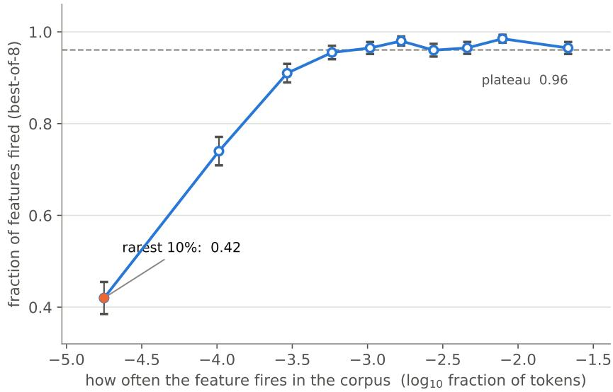  
Figure 9: Fraction of features the MAEM fires at least once in 8 rollouts, by decile of corpus firing rate, uniform draw (n = 1,998). The drop is confined to the bottom fifth; above it the rate is flat. Error bars are standard errors.

This is not a shortage of corpus evidence. The 231 failing features in the uniform draw fire a median of 2,760 times in the corpus scan and reach a median peak of $8 . 6 \times \tau -$ the text that would activate them exists and is plentiful. What the MAEM lacks is not examples but a way to recover them from the direction.

## J.3 WHAT KIND OF FEATURE FAILS

Assigning each feature to the mechanism its corpus windows share (Table 26) separates the failures far better than any surface property of the peak token. Notably, the peak token’s class does not predict failure here: grouping features by whether they peak on punctuation, a digit or whitespace gives 10.6% failure against 11.7% for everything else (Fisher $p = 0 . 6 1$ $n = 2 7 5$ vs. 1,723). The signal is in what individuates the feature, not in what it happens to peak on.

<table><tr><td>Mechanism</td><td>n</td><td>% failing</td><td>O/E</td></tr><tr><td>whitespace position</td><td>37</td><td>56.8</td><td>3.58</td></tr><tr><td>formatted digit</td><td>47</td><td>40.4</td><td>3.72</td></tr><tr><td>induction / repeated trigram</td><td>44</td><td>40.9</td><td>2.90</td></tr><tr><td>punctuation position</td><td>104</td><td>18.3</td><td>2.04</td></tr><tr><td>cross-document context</td><td>56</td><td>50.0</td><td>1.15</td></tr><tr><td>single-source</td><td>180</td><td>9.4</td><td>0.77</td></tr><tr><td>none of these</td><td>1588</td><td>8.4</td><td>0.79</td></tr></table>

Table 26: Uniform draw. O/E is observed over expected failures given the 11.6% base rate. The first four are significant at $p < 1 0 ^ { - 3 }$ (Fisher, two-sided); cross-document context $( p = 0 . 3 0 )$ and single-source $( p = 0 . 1 9 )$ are not. A feature may carry more than one label.

A coarser, blind labelling of each feature by what its corpus windows are about gives the same picture from another angle (Table 27). Features defined by a position in a structure — a template, a list or table, a formatted number, or a copy of earlier text — fail at 25–38%, against 4.5% of word features and 1.6% of topic features. The LLM of section J.5 narrows most of this gap, so these features are expressible in text; what the MAEM lacks is the structure they fire in, which the direction does not convey.

<table><tr><td colspan="2">2k features</td><td colspan="2">512 set</td></tr><tr><td>Category</td><td>n % failing</td><td>MAEM</td><td>LLM</td></tr><tr><td>template</td><td>167</td><td>37.7</td><td>33.9 11.9</td></tr><tr><td>list / table</td><td>103</td><td>25.2 29.2</td><td>3.4</td></tr><tr><td>numbers</td><td>55</td><td>27.3</td><td></td></tr><tr><td>copy</td><td>32</td><td>34.4 15.1</td><td>10.5</td></tr><tr><td>entity</td><td>120</td><td>14.2</td><td>9.9 1.2</td></tr><tr><td>word</td><td>818</td><td>4.5 7.4</td><td>2.2</td></tr><tr><td>topic</td><td>191</td><td>1.6 0.1</td><td>0.2</td></tr><tr><td>all</td><td>1,953</td><td>11.3 11.3</td><td>4.8</td></tr></table>

Table 27: % of features where no rollout clears τ, by blind-labelled category; features that never fire in the corpus are excluded. Right: best-of-8 on the 512 set, from the direction (MAEM) or from 16 corpus windows $( \mathrm { L L M } ) ; - \colon n \dot { < } 5$

## J.4 TRAINING ON THE FAILURES MAKES THINGS WORSE

We tried three ways of teaching the MAEM the features it misses: (A) supervised training on the failing features’ own activating corpus spans; (B) the same restricted to clustered failure types, holding out unseen clusters; and (B+replay) the same with a replay mixture of features the MAEM already handled. All three fix a handful and break an order of magnitude more.

<table><tr><td>Arm</td><td>Draw</td><td>% unexpressed before</td><td>after</td><td>fixed</td><td>broken</td></tr><tr><td>A</td><td>uniform</td><td>11.6</td><td>25.5</td><td>26</td><td>304</td></tr><tr><td>A</td><td>rarity-weighted</td><td>34.1</td><td>65.2</td><td>25</td><td>648</td></tr><tr><td>B</td><td>uniform</td><td>11.6</td><td>39.6</td><td>21</td><td>581</td></tr><tr><td>B + replay</td><td>uniform</td><td>11.6</td><td>31.5</td><td>19</td><td>417</td></tr></table>

Table 28: Counts are features, best-of-8, same evaluation before and after. Replay halves the damage without improving the rescue.

The B arm separates the two effects. On the 195 features it trained on, the unexpressed share moves 87.7% → 90.8%; on 49 held-out features of unseen cluster types, 89.8% → 98.0%. Meanwhile the 1,754 features never involved in the clustering at all go from 0.9% to 32.3% unexpressed, with median activation falling from 89% to 30% of corpus peak. Training on this class does not teach it and does cost the general capability; replay reduces the collateral damage (0.9% → 22.9%) but rescues no more.

## J.5 THE FEATURES ARE REACHABLE FROM THEIR CORPUS WINDOWS

Given 16 of a feature’s corpus windows and no direction, an LLM writes text that fires it more often than the MAEM does, and the whole of its advantage sits in the rare tail.

<table><tr><td>% of features fired, best-of-8</td><td>rarest</td><td>2nd</td><td>3rd</td><td>densest</td></tr><tr><td>MAEM (from the direction)</td><td>62.4</td><td>96.7</td><td>98.3</td><td>98.6</td></tr><tr><td>LLM (from 16 corpus windows)</td><td>84.5</td><td>100.0</td><td>99.2</td><td>97.6</td></tr></table>

Table 29: 492 features, rarity strata. Pooled, the MAEM fires 88.8% and the LLM 95.3%. At bestof-1 the two are indistinguishable (83.3% vs. 83.1%): the LLM’s advantage is that its samples keep finding new ways in, not that any single sample is better.

## J.6 FAILING ROLLOUTS ARE SLIGHTLY LESS SELF-CONSISTENT

On 512 features with 8 rollouts each, samples for failing features are marginally more varied than for passing ones — median pairwise cosine 0.769 against 0.804 $( p = 1 . 9 \times \mathrm { \bar { 1 0 ^ { - 5 } } } )$ , token Jaccard 0.034 against $0 . 0 4 8 ( p = 9 . 0 \dot { \times } 1 0 ^ { - 5 } )$ . The larger and more interpretable gap is against the corpus: failing features’ rollouts sit at cosine 0.513 from their own corpus windows against 0.594 for passing ones $( p = 5 . 8 \times 1 0 ^ { - 2 0 } )$ . The MAEM is not producing noise on features it cannot fire; it is producing coherent text about something adjacent.

## J.7 OUTPUT DIVERSITY: MEASUREMENT

Figure 11 scores texts by the mean over all pairs of a feature’s texts of the Jaccard similarity of thei token-trigram sets. Texts are re-tokenised with the Qwen3.6-27B tokeniser without special tokens, so a rollout’s trailing end-of-sequence token does not count, and every source is tokenised the same way. The cross-feature floor is the same score over 20,000 random pairs of texts written for differen features.

Sources. All on a random sample of 2,000 features of the 131k SAE. The MAEM is the paper’s checkpoint with 8 rollouts per feature under vLLM and, as an engine check, 4 under HF: both give median 0.043. The corpus source is each feature’s 32 stored max-activating windows; the LLM is Claude Opus 5, 8 texts on 159 features. The rare-feature LoRA was trained for one epoch on 64,432 spans from the rarest band alone. It is an earlier run than section J.4’s, and none of its 4,027 training features is in this set. We read its HF rollouts, from which its scores are also computed. The two later arms read the same way: the rare-weighted arm trained on a separate rarity-weighted draw, none of whose 7,963 features is in this set; the cluster arm trained on 195 of this set’s failures, which are dropped. The NLA baseline was run on rows 1500–1999 of the set, 8 explanations each at its native 200-token budget (99% parse as explanations); those rows are a representative slice (114–133 features per density quartile). Its <explanation> tags are stripped before embedding. Its vLLM rollouts are excluded: that path attached the adapter to the untrained base, so they come from the untrained base model.

Estimator. The all-pairs mean is unbiased for the expected pairwise score at any number of texts k. Sources with 4, 8 and 32 texts per feature therefore share a centre, and smaller k only widens the spread. The distribution over pairs is heavy-tailed, most visibly for the corpus: 73% of its pairs share no trigram, and a few overlapping windows from one document carry its mean. We report the share of disjoint pairs beside the mean for that reason.

Embedding measures. Figure 10 and Table 30 embed every text, unit-normed, with bge-smallen-v1.5 (the embedder already used by the evaluation pipeline) and, as a check, with all-mpnet-basev2, a different architecture and training set. Every source is read at exactly k = 8 texts per feature, because unlike the Jaccard mean the Vendi score grows with k: the MAEM’s first 8 vLLM rollouts, the rare-feature LoRA’s 8 HF rollouts, the LLM’s 8 texts, and for the corpus the feature’s top-8 windows, the same windows the LLM was prompted with. The Vendi score is $\begin{array} { r } { \exp \bigl ( - \sum _ { i } \lambda _ { i } \log \lambda _ { i } \bigr ) } \end{array}$ over the eigenvalues $\lambda _ { i } \operatorname { o f } K / k .$ , where K is the $k \times k$ cosine kernel. Specificity is the median withinfeature mean pairwise cosine minus the mean cosine of 20,000 random pairs of texts written for different features. Coverage targets are the feature’s corpus windows 9–32, dropping any that share ≥ 0.2 trigram Jaccard with one of windows 1–8 (stored windows can overlap within a document); a median of 19 remain. Coverage is the mean over targets of the cosine to the nearest of the source’s eight texts, minus the same with a random other feature’s texts. The two embedders’ cosines live on different scales (mpnet’s cross-feature mean is 0.04–0.07, bge-small’s 0.45–0.49), so only orderings are compared across them.

Robustness. The MAEM’s median is flat across the set’s four quartiles of pool peak activation (0.039–0.046), so the score does not track how strongly a feature fires. The quartiles in the right panel are formed by rank, because the rare-feature LoRA’s scores tie heavily near zero. Length checks for the Jaccard score cut every text to its first 32 tokens, and to tokens 8–40 to remove the MAEM’s shared opening words; for the embeddings, generated texts are cut to their first 32 tokens and corpus windows to 32 tokens around their marked peak, since only 56% of peaks fall in a window’s last 32 tokens and a blind cut would drop them.

<table><tr><td></td><td colspan="3">bge-small</td><td colspan="3">all-mpnet-base-v2</td></tr><tr><td>Source</td><td>Vendi</td><td>specificity</td><td>coverage</td><td>Vendi</td><td>specificity</td><td>coverage</td></tr><tr><td>MAEM</td><td>2.19</td><td>0.31</td><td>0.108</td><td>3.10</td><td>0.58</td><td>0.205</td></tr><tr><td>corpus top-8</td><td>2.87</td><td>0.19</td><td>0.143</td><td>4.45</td><td>0.34</td><td>0.287</td></tr><tr><td> $\mathrm { L L M ( O p u s 5 , } n = 1 5 9 )$ </td><td>3.39</td><td>0.19</td><td>0.140</td><td>5.74</td><td>0.30</td><td>0.255</td></tr><tr><td> $\mathrm { N L A } \left( n = 5 0 0 \right)$ </td><td>1.99</td><td>0.17</td><td>0.055</td><td>3.00</td><td>0.37</td><td>0.105</td></tr><tr><td>rare-feature LoRA</td><td>4.17</td><td>0.05</td><td>0.075</td><td>7.26</td><td>0.08</td><td>0.145</td></tr><tr><td>rare-weighted arm</td><td>4.24</td><td>0.04</td><td>0.070</td><td>7.37</td><td>0.07</td><td>0.142</td></tr><tr><td>cluster arm  $( n = 1 , 8 0 5 )$ </td><td>4.42</td><td>0.02</td><td>0.051</td><td>7.58</td><td>0.03</td><td>0.112</td></tr><tr><td>MAEM, texts cut to 32 tokens</td><td>2.22</td><td>0.30</td><td></td><td>3.16</td><td>0.57</td><td></td></tr></table>

Table 30: Diversity in meaning, both embedders; medians over features, k = 8. Bold marks the extreme of each column among the sources above the first rule: the MAEM is the most specific, NLA and the MAEM the least spread, and the corpus top-8 covers the feature’s other windows best. NLA’s coverage is not comparable, since it writes descriptions of text rather than text like the corpus windows. Below the rule are the three rare-feature training runs, all read on features they were not trained on: each is spread only because it is barely specific. On the LLM’s 159 features alone the MAEM’s Vendi is 2.32 (bge-small) and its raw coverage 0.591 against the LLM’s 0.664.

(a) Distinct readings per feature  
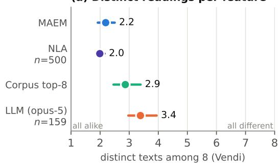

(b) Disagreement goes with failure  
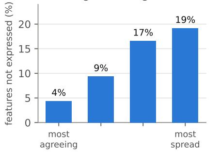  
MAEM samples, by quartile of agreement  
Figure 10: (a) Distinct texts among eight samples per feature (Vendi score over bge-small embeddings): median and interquartile range over the 131k-SAE 2k set. NLA covers 500 features, the LLM 159. (b) Share of features the MAEM fails to fire (below 10% of corpus peak, best-of-8), by quartile of agreement among its samples.

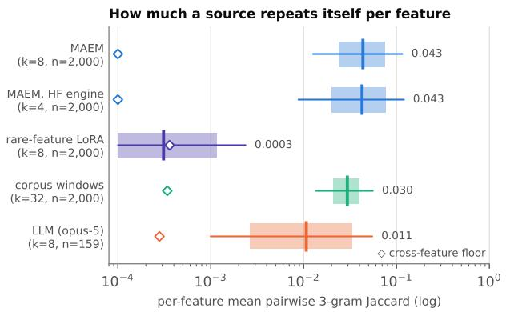

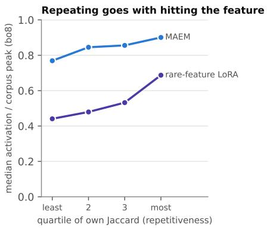  
Figure 11: Diversity in wording. Left: per-feature mean pairwise token-3-gram Jaccard: box is the IQR, whiskers the 10th–90th percentile, tick and label the median; k is texts per feature. The diamond is the same source’s cross-feature floor (the $\mathbf { M A E M } ^ { \prime } \mathrm { s } , 5 \times 1 0 ^ { - 5 }$ , is drawn at the axis floor). The all-pairs mean is unbiased in $k ,$ so rows with $k = 4$ and $k = 3 2$ share a centre and differ only in spread. Scores are not length-matched; the length checks are described above. Right: median best-of-8 activation, as % of corpus peak, by quartile of each MAEM’s own Jaccard, 500 features per point.