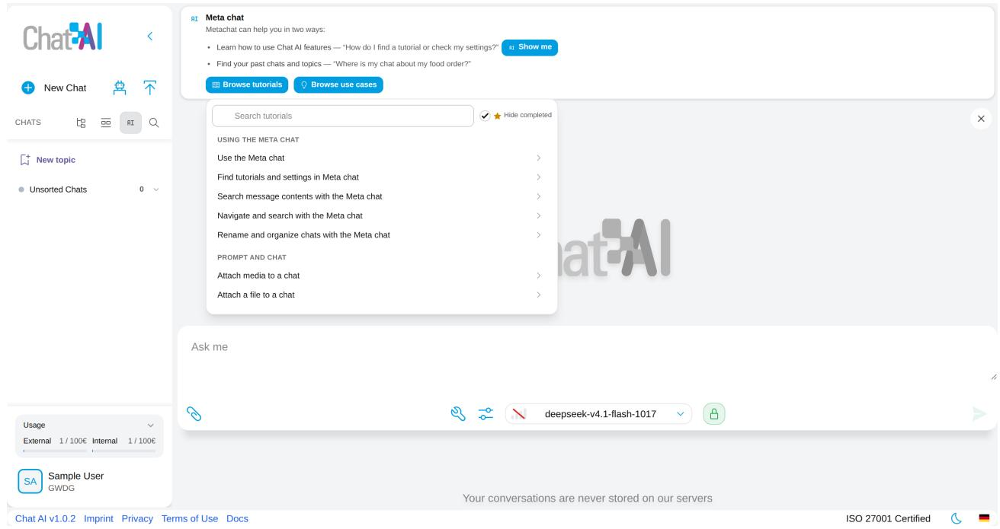
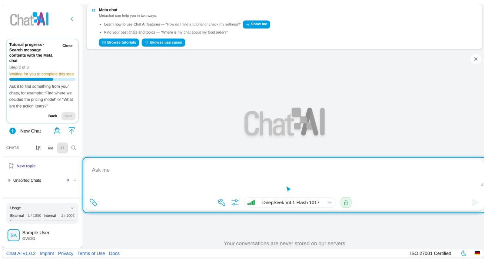
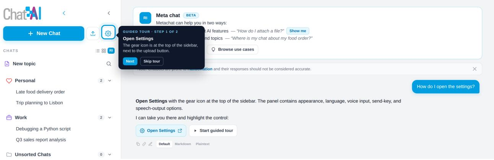
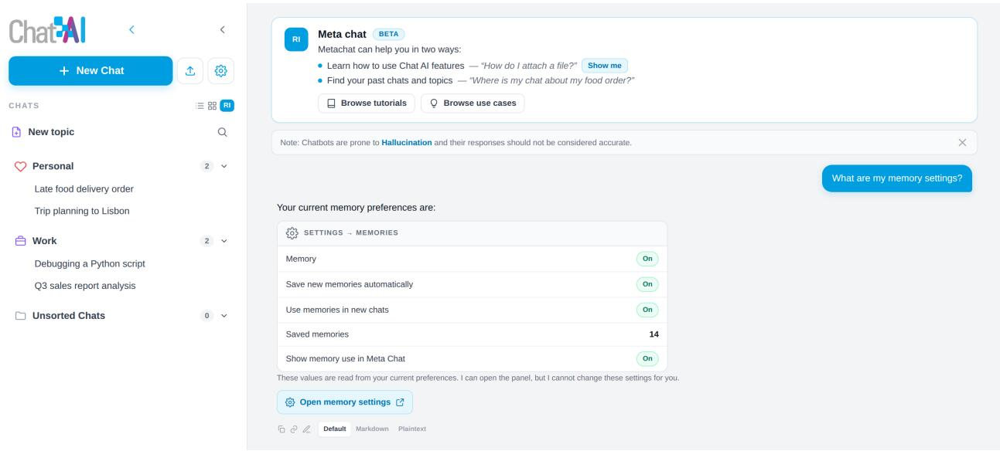
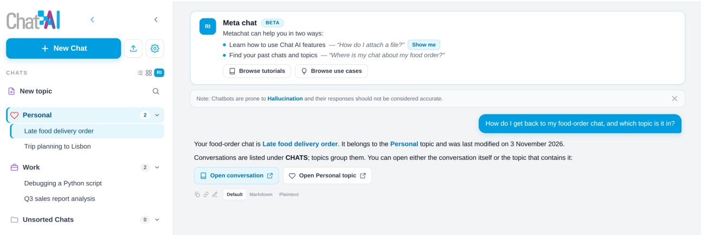
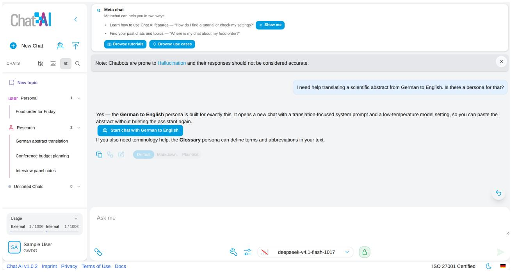
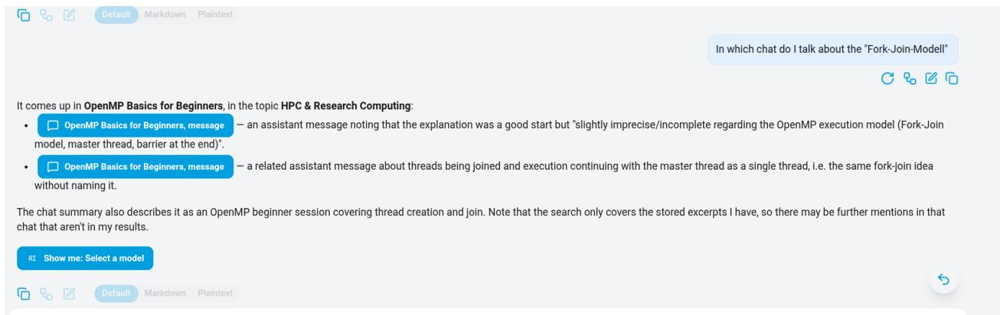
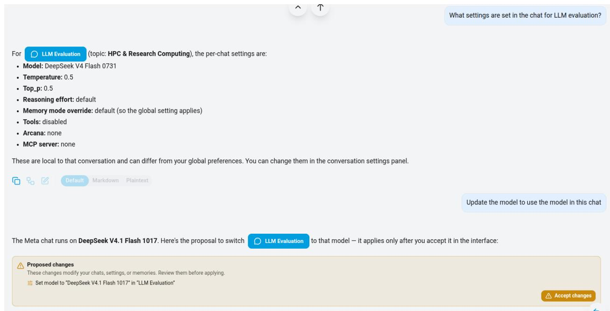
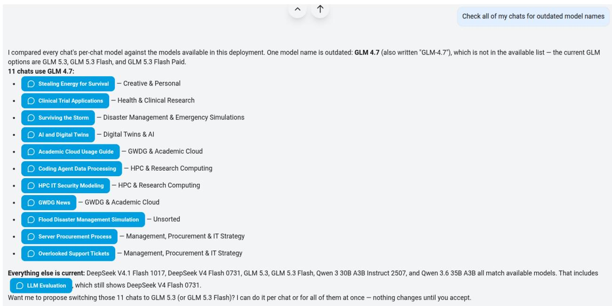

# The Power of Meta Access in the Software of the Future — Demonstrated on LLM Chat UIs and Chat AI

Julian Kunkel Universität Göttingen, GWDG julian.kunkel@gwdg.de

Ali Doosthosseini Universität Göttingen ali.doosthosseini@uni-goettingen.de

November 6, 2026

## Abstract

Chat remains the default surface for many large language model (LLM) tasks, even as agentic tools such as OpenCode excel at coding and automation. Yet the model sees the current dialogue but not the workspace around it. We explore meta access—giving the assistant a structured, permissioned view of the interface itself and propose a ladder of levels: feature tutoring; metadata, settings, and preference access; retrieval over summaries and messages, confirmed mutation, and full orchestration. Meta access can turn a chat client from many screens into one entry point for finding, navigating, organising, and operating it, while raising risks around grounding, privacy, prompt injection, and trust. General-purpose agentic harnesses are runtimes; because they can change their own settings, meta access becomes reflexive and needs a separate control-plane boundary. We ground this in the Meta Chat prototype of the Chat AI client. It builds bounded context from, e.g., summaries, settings, and relevant messages; links references to conversations, topics, and personas; supports confirmed, reversible changes; ofers a browsable tutorial library; and recommends personas as user-started conversations. By exposing application state in structured form, meta access can extend screen readers from widget descriptions to semantic workspace operations. Meta access thus turns chat from a window onto one conversation into a control layer for the whole workspace, extending chat toward agentic capability without surrendering user control. As assistants become embedded in IDEs, dashboards, ofice suites, and operating systems, AI-era interfaces should expose a structured, permissioned model of their state and capabilities, ideally by opening their existing metamodels through a debugger-like interface.

Keywords: LLM chat interfaces, AI-era interfaces, meta access, application metamodels, interface agents, conversational search, feature tutoring, personas, guardrails, tool use, human–computer interaction, accessibility, local-first software.

## 1 Introduction

The chat interface has been the default surface for interacting with large language models, and it remains the most common one for many day-to-day tasks: drafting, search, planning, learning, and personal assistance. In parallel, a second interaction model has matured. Agentic tools such as OpenCode [17] operate in a terminal or editor, call tools, and carry out multi-step tasks on external environments; they have become a natural choice for much software work. The two models are complementary rather than substitutes. Agents excel when the task is to operate on an environment, while chat UIs remain the natural surface when the user wants to ask, compare, plan, draft, or re-find something, and when the conversation itself is the workspace.

The deeper claim of this paper is architectural rather than conversational. Chat is the first surface on which meta access is practical, but the pattern is not specific to chat. An emerging AI-era interface is one in which an assistant is embedded in the application rather than confined to a separate chat window, and in which the assistant can reason over the application’s own model of its state and capabilities. Whether the surface is a chat client, an IDE, a spreadsheet, a dashboard, or an operating system, the same asymmetry appears: the assistant sees the current task but not the workspace that contains it. Meta access is the missing contract between the two. The contrast is sharpest for general-purpose agentic harnesses such as OpenCode, which are runtimes rather than applications with a fixed purpose, and which can change the configuration that governs their own tools and permissions (Section 4.6).

In applications such as Chat AI [7], that workspace is larger than the current conversation: a sidebar of past conversations, user-defined topics, model selection, attachments, memories, settings, a persona library, and feature-specific controls. The model, however, usually sees only the current conversation plus a system prompt. Everything that makes the workspace a workspace—what else the user has discussed, how their chats are organised, which features exist and where they live—is outside the model’s view.

This asymmetry creates a practical problem. As a user’s history grows, the interface becomes harder to navigate: finding a conversation about a past decision, remembering which topic contains it, or learning a rarely used feature requires manual scanning. Conventional search helps with known-item retrieval, but users often ask questions that are relational or procedural: “Where is my food-order chat?”, “Which topic holds the notes from the interview?”, “How do I attach a file?”. These are questions about the interface and its contents, not about the world.

We use the term meta access for an assistant’s structured access to the interface that hosts it: it may access and potentially alter information about the interface and any of the user’s data. Meta access is related to, but distinct from, retrieval-augmented generation over documents [13] and tool use by language models [31, 24]. The object of retrieval is the user’s own workspace state; the object of action is the interface itself. Meta access therefore sits at the intersection of conversational search, command palettes, recommender-style navigation, and agentic tool use.

## 1.1 What “meta” means here

The prefix meta comes from Greek and denotes a level that is about, beyond, or refers to another level. Metadata is data about data; a metamodel is a model that describes the concepts and relations of another model; metacommunication is communication about communication. In each case, the meta-level does not replace the object level. It describes it, constrains it, or acts on it.

A chatbot normally operates at the object level: it talks about the user’s task, the world, or the content of the current conversation. Meta access adds a meta-level whose object is the chat application itself. The assistant reasons about conversations, topics, memories, features, and settings rather than only about the subject of the dialogue. Its context is not the full interface but a workspace model: a structured description of the entities the interface exposes (chats, topics, features, preferences), ideally derived from the application’s own metamodel, and, eventually, the operations that can be requested on them. This is the sense in which the prototype has a metamodel-like view. It does not reproduce the interface; it uses an abstraction of the interface’s concepts and capabilities.

At the scale of a whole application, this abstraction is an application metamodel: a description of the application’s entities, relations, and operations. Many applications already have such a model internally—a document model in an editor, a project and syntax model in an IDE, a schema in a database, a scene graph in a graphics tool—and debugging or profiling interfaces already expose parts of it in a controlled way. Meta access can reuse these models rather than relying on pixels or ad hoc scraping. The design question is which parts of the metamodel to expose, at what level of stability and permission, and how to map them into a capability layer that works across applications.

The distinction separates three things that are easy to confuse. Metadata access is the narrowest form of meta access: it reads descriptive fields such as titles, topics, and timestamps. Meta-level knowledge also includes the feature catalogue, the persona catalogue, and current preference values, which describe the application rather than a single conversation. Meta-level action goes further and changes the object level, for example by moving a chat or changing a memory setting. The ladder in Section 4 follows this progression from describing the interface, to reading its state, to acting on it.

We use “meta” in this self-referential sense, not in the corporate sense of Meta Platforms and not as a synonym for the metaverse. It is also diferent from meta-learning or meta-prompting: those describe learning or prompting about learning or prompting, whereas meta access describes an assistant’s access to the application that hosts the interaction.

## 1.2 Contributions

This paper is a position paper grounded in an existing implementation. We make five contributions:

1. We present a ladder of meta-access levels that separates feature tutoring, metadata, settings, and preference access, summary and message-level retrieval, confirmed mutating actions, and full orchestration, and report how far the implemented prototype reaches on that ladder.

2. We propose meta access as a general design requirement for AI-era interfaces, not only chat clients, and show how the ladder, capability model, and guardrails transfer to other stateful applications and to general-purpose agentic harnesses, whose self-configuration adds a separate control-plane problem.

3. We articulate the opportunities of using a chat interface as a first access layer for the whole interface, with search and navigation as the first concrete use cases, and define guardrail contracts that tie each capability to its evidence, scope, target validation, disclosure, confirmation, and failure behaviour.

4. We outline risks and an evaluation agenda for measuring whether meta access actually helps users.

5. We present the Meta Chat prototype in the Chat AI client as a demonstrator of these opportunities and design choices.

## 2 Related Work

Meta access draws on several literatures that rarely meet: conversational search and personal re-finding; LLM agents, tool use, and interface automation; retrieval, memory, and context; and mixed-initiative interaction, security, and human factors. We review them in these groups, compare representative work along nine dimensions, and then position the present work relative to them.

## 2.1 Conversational search and personal re-finding

Information retrieval has long treated dialogue as an interface to a search system. Radlinski and Craswell [22] frame conversational search as a multi-turn collaboration in which system and user clarify an information need, retrieve results, and interpret them; Trippas et al. [25] derive design implications from spoken conversational search, and Zamani et al. [32] survey the field’s shift from ad hoc retrieval to interactive problem solving. This work supplies the interaction vocabulary that meta access inherits: clarification, follow-up queries, mixed initiative, and results that support both answer and exploration. Its usual target, however, is an external collection such as the web or a document corpus, and classical lexical retrieval, including BM25 and its descendants [23], remains a strong baseline for known-item search.

Personal information management (PIM) studies how people keep, organise, and re-find their own digital material. Whittaker [27] frames PIM as a shift from consumption to curation, and Dumais et al. [8] show that a unified index over email, files, and web pages, combined with contextual cues such as time and authorship, supports re-finding; users often remember context rather than exact content, and search and browsing are complementary. A chat workspace has the same character: it is small enough to browse but grows large enough to need search, and its items carry rich contextual metadata. Meta access is a conversational form of re-finding over that collection. The prototype uses titles, topics, and recency as metadata cues, summaries as compressed content, and local lexical search over message text for content questions, bringing it closer to full-text PIM systems such as “Stuf I’ve Seen” while retaining an interface-aware layer.

Recent surveys extend this vocabulary to LLM-era systems. Mo et al. [35] identify query reformulation, clarification, conversational retrieval, and response generation as core modules, while Zhang et al. [36] review LLM agents for recommendation and search. Both reinforce the view that information access is becoming an interactive, agentic process rather than a single query–response exchange.

## 2.2 LLM agents, tool use, and interface automation

Retrieval-augmented generation grounds model output in retrieved text [13, 10]. ReAct [31], Toolformer [24], and Gorilla [20] show that language models can interleave reasoning with calls to external tools, although surveys and benchmarks document persistent weaknesses in planning, reliability, and generalisation [29, 15]. A parallel line automates graphical interfaces: WebGPT [16], Mind2Web [6], WebArena [34], OSWorld [30], and OSWorld-MCP [42] operate through browsers, pixels, or GUI actions and are evaluated on open-ended task completion. Ramineni et al. [51] expose platform accessibility trees through a shared MCP schema, so assistive agents need neither screenshots nor per-platform integrations.

OpenCode is a general-purpose agentic harness rather than an application with a specific purpose. It runs in the terminal, an IDE, or a desktop application, supports arbitrary models and tools, and keeps its behaviour in editable configuration [17]. Its workspace is whatever task it is given, usually repositories, shells, or editors, and its control plane includes prompts, tool and server registries, permission policies, hooks, and subagents. This generality matters for meta access: there is no single application metamodel to expose, and if the harness can read or change its own configuration, the assistant may alter the capability layer that is supposed to constrain it. We call this reflexive meta access and treat it separately in Section 4.6. The Model Context Protocol (MCP) makes this control plane concrete. Hou et al. [54] survey its lifecycle and threat landscape and show that discovery, schemas, and tool/resource exposure are security decisions made before any model call; for a harness, the capability registry is therefore an attack surface, not just configuration.

Meta access is a narrower and more structured form of the same idea. The environment is the hosting application, the observations are typed metadata rather than pixels, and the available actions can be declared explicitly instead of inferred from a GUI. The agent literature is therefore both an enabler and a caution: it shows that tool use works, but also that long-horizon autonomy is fragile, which motivates starting with read-only metadata and preference access and adding confirmed, narrowly scoped actions.

## 2.3 Retrieval, memory, and context

Because a workspace can exceed any context window, meta access depends on how the interface is compressed. Retrieval-augmented generation [13, 10] supplies the pattern of retrieving evidence before generating an answer. MemGPT [18] treats an LLM as an operating system with hierarchical memory; Generative Agents [19] maintain a memory stream with reflection; and LongMemEval [28] benchmarks long-term interactive memory. Long-context models are not a substitute: they can underuse information in the middle of a long prompt [14], and BEAM [38] shows that even million-token models struggle as dialogues lengthen. MemoryAgentBench [39] finds that current memory agents do not master accurate retrieval, test-time learning, long-range understanding, and selective forgetting; LOCOMO-CONV [40] shows that conversational framing exposes retrieval gaps that QA-style benchmarks miss; and MemUse [41] reports a retrieval–integration gap in a four-month deployment. Together these results argue for a tiered index, query rewriting, implicit-intent handling, and integration-aware evaluation rather than benchmark accuracy alone.

Conversation summarisation provides one practical compression mechanism. Surveys of dialogue summarisation [9] describe methods for condensing multi-turn interactions while preserving salient content. The meta chat uses such summaries together with topics, memories, and per-chat settings; it adds selective lexical message excerpts when a question needs content. This keeps cost bounded and reduces exposure compared with shipping full histories, but summaries are lossy and can be stale, and lexical retrieval depends on the message wording. Recent memory work makes provenance explicit: Lu et al. [56] use message-level evidence chains and propose–verify–commit writes with revision history, a structured counterpart of confirmed memory mutations and conditional undo. Hierarchical, hybrid, and semantic retrieval are the natural next steps.

## 2.4 Mixed-initiative interaction and human–AI guidelines

Meta access should not be a one-shot command interpreter. Horvitz [12] sets out principles for mixed-initiative interfaces, including reasoning about uncertainty, the user’s goals, and the cost of asking versus acting; Allen et al. [1] discuss the dialogue-management challenges, and Amershi et al. [2] distill widely used guidelines for human–AI interaction. Studies of LLM use reinforce the need for guidance and verification: non-experts struggle to design prompts [33], users of code-generation tools inspect and iterate on model output [26, 4], and natural-language database interfaces documented ambiguity and robustness problems long before LLMs [3]. Laban et al. [37] add a multi-turn caution: tested LLMs perform worse in multi-turn than single-turn conversations, often commit to assumptions early, and fail to recover, which makes explicit state and clarification design requirements. Human-factors studies reinforce this: Schneider et al. [46] document linguistic patterns and breakdowns in a retrieval-augmented assistant, Yu et al. [49] find no learning advantage over search when user characteristics are considered, and Jerry et al. [48] propose a model-based approach to LLM-driven accessible interfaces. Together they suggest that chat should complement, not replace, the visual interface, and that meta access must be judged by user outcomes and breakdowns.

## 2.5 Security and privacy of LLM-integrated applications

Any assistant that reads user content and can act on the user’s behalf is a security boundary. Prompt injection [21] and indirect prompt injection [11] show that untrusted retrieved text can redirect a model’s behaviour; AgentDojo [5] benchmarks these attacks and defences in tool-using agents, and StepJack [43] shows that indirect injection can be decomposed into innocuous steps across a navigation path. CaMeL [53] separates control flow from data flow and enforces capability checks on data flows, while ClawGuard [55] enforces a user-confirmed rule set at each tool-call boundary. AC4A [52] turns this into access control: instead of all-or-nothing access to an API or page, an agent receives permissions over specific resources and actions. AIOS [50] places scheduling, memory, storage, access control, and isolation in an operating-system-like kernel, moving resource governance from prompts to the platform. PrivacyBench [45] benchmarks privacy in personalised AI, and Wang et al. [44] identify irrelevant personalisation, preference narrowing, and sycophancy as side efects of conditioning on conversation history.

The implication for meta access is that retrieved content must be treated as data rather than instructions, tools must be scoped to the user’s intent, and mutations should require confirmation. Privacy is the other side of the boundary. Meta access sends titles, topics, summaries, and memories to a model endpoint. This is less exposing than sending full message histories, but it is not anonymous: summaries and titles can reveal sensitive context. The local-first design of the host client, in which conversations live in the browser’s indexed database, is a useful starting point, but the boundary between local state and remote inference must be made explicit to users.

## 2.6 Comparative analysis

Table 1 compares representative related work along nine dimensions that matter for meta access. The aim is not to rank papers but to locate the gap that meta access addresses. We use three values: + means the dimension is explicit and central to the paper; 0 means it is partial, indirect, or limited to a narrow setting; - means it is not addressed or is out of scope. The ratings describe each paper’s stated scope, not the quality of its contribution.

Three patterns stand out. First, conversational search and PIM occupy opposite corners: conversational search supports dialogue and content retrieval but not the user’s personal workspace, while PIM supports personal metadata and content but not dialogue or interface actions. Second, agent and GUI-automation work supports actions and interface operation, but its object is an open environment rather than the user’s own conversation history; personal scope, structured workspace metadata, and user-facing grounding are typically absent. Third, memory and long-context work supports dialogue and personal context, but it rarely models the interface or provides a capability layer for acting on it.

A trade-of is also visible: many systems that act do not expose citations to the underlying workspace items, while systems with strong grounding often do not act. Security work supplies adversarial benchmarks and defences but is rarely integrated with personal retrieval or interface help, and HCI work supplies interaction principles but not a concrete architecture. Meta access is the region that remains sparsely populated: personal scope, structured metadata, interface awareness, and grounding. The prototype now adds selective message-level retrieval and confirmed, reversible mutations, while the ladder in Section 4 makes the remaining boundaries explicit: hierarchical retrieval, broader level-4 actions, durable audit, and level-5 orchestration.

Existing work covers conversational search over external corpora, personal re-finding over files and email, and tool-using agents on web pages or operating systems. Meta access sits between these lines: the object of retrieval is the application’s own state, and the environment is a declared capability layer rather than an open GUI. The contribution of this paper is to name that combination, demonstrate it with confirmed, reversible actions, propose a ladder from tutoring to orchestration, and set out an evaluation agenda.

<table><tr><td>Work</td><td>Digsue</td><td>Perrssonal</td><td>Mtdddata Content</td><td>Intrrace Actions</td><td>Groiing</td><td>Seurty</td><td>Usser sudy</td><td></td></tr><tr><td colspan="7">Conversational search</td></tr><tr><td>Radlinski &amp; Craswell [22]</td><td>十 十</td><td>-</td><td>十 1</td><td>- 一</td><td>0</td><td>-</td><td>-</td></tr><tr><td>Trippas et al. [25]</td><td></td><td>-</td><td>十 -</td><td>一 1</td><td>0</td><td>-</td><td>+</td></tr><tr><td>Zamani et al. [32]</td><td>十</td><td>- 0</td><td>十</td><td></td><td>0</td><td>0</td><td>-</td></tr><tr><td>Mo et al. [35]</td><td>十</td><td>0</td><td>0 十</td><td></td><td>0</td><td>0</td><td>-</td></tr><tr><td>Zhang et al. [36]</td><td>十</td><td>0</td><td>0 十</td><td>0</td><td>十 0</td><td>0</td><td>-</td></tr><tr><td colspan="8">Personal information management</td></tr><tr><td>Dumais et al. [8]</td><td>一</td><td>十 +</td><td>十</td><td>- 1</td><td>0</td><td>0 0</td><td>十 -</td></tr><tr><td>Whittaker [27]</td><td>-</td><td>十 0</td><td>x</td><td>一 -</td><td>-</td><td></td><td></td></tr><tr><td colspan="8">Retrieval and agents</td></tr><tr><td>Lewis et al. [13]</td><td></td><td></td><td>十 1 -</td><td>-</td><td>十 0</td><td>一 -</td><td>0 -</td></tr><tr><td>Yao et al. [31]</td><td></td><td>-</td><td>0 0 0</td><td>十 十</td><td>0</td><td>一 -</td><td></td></tr><tr><td>Schick et al. [24]</td><td></td><td></td><td>0 一</td><td>0 十</td><td>0</td><td></td><td>-</td></tr><tr><td>Patil et al. [20]</td><td></td><td>十</td><td>0</td><td></td><td>十</td><td>0</td><td>0</td></tr><tr><td>Deng et al. [6]</td><td></td><td></td><td>0 一</td><td>十 十</td><td>0</td><td>-</td><td>0</td></tr><tr><td>Zhou et al. [34]</td><td></td><td></td><td>0</td><td>十 十</td><td></td><td>-</td><td>0</td></tr><tr><td>Xie et al. [30]</td><td></td><td></td><td>0</td><td>十 十</td><td>0</td><td>0</td><td>-</td></tr><tr><td>Jia et al. [42]</td><td></td><td></td><td>0</td><td>十 十</td><td>0</td><td>0</td><td></td></tr><tr><td>Mei et al. [50]</td><td></td><td>0</td><td>0</td><td>十 ×</td><td>- 0</td><td>0</td><td>- 一</td></tr><tr><td colspan="8">Ramineni et al. [51] 0 十 0 十</td></tr><tr><td colspan="8">Memory and long context 1</td></tr><tr><td>Packer et al. [18]</td><td>十 十</td><td>0</td><td>十</td><td>0</td><td>0</td><td></td><td>-</td></tr><tr><td>Park et al. [19]</td><td>十</td><td>十 +</td><td>× 一</td><td>十</td><td>0</td><td>-</td><td>+ 0</td></tr><tr><td>Tavakoli et al. [38]</td><td>十 0</td><td>0</td><td>十</td><td>一</td><td>0</td><td>-</td><td></td></tr><tr><td>Hu et al. [39]</td><td>十 0</td><td>0</td><td>十</td><td>0</td><td>0</td><td>-</td><td>-</td></tr><tr><td>Chang &amp; Chen [40]</td><td>十</td><td>0 0</td><td>十</td><td>-</td><td>十</td><td>1</td><td>0</td></tr><tr><td>Sumida et al. [41]</td><td>十</td><td>十 0</td><td>十</td><td>-</td><td>0</td><td>0 +</td><td></td></tr><tr><td colspan="8">Interaction and security Horvitz [12]</td></tr><tr><td>Amershi et al. [2]</td><td>0 0</td><td>0 - 0 -</td><td>一</td><td>X 十</td><td>-</td><td>0 0</td><td></td></tr><tr><td>Laban et al. [37]</td><td></td><td></td><td>-</td><td>十 0</td><td>0</td><td>十</td><td></td></tr><tr><td></td><td>十</td><td>- 一</td><td>0 -</td><td>1</td><td>1</td><td>-</td><td></td></tr><tr><td>Greshake et al. [11]</td><td>0 0</td><td>-</td><td>× 0</td><td>十</td><td>一</td><td>十 -</td><td></td></tr><tr><td>Debenedetti et al. [5]</td><td>0 0</td><td>-</td><td>十</td><td>0 十</td><td>-</td><td>十 -</td><td></td></tr><tr><td>Sharma &amp; Grossman [52]</td><td></td><td>0 一</td><td>十</td><td>十 ×</td><td>-</td><td>十</td><td>-</td></tr><tr><td>Zhan et al. [43]</td><td>0 0</td><td>-</td><td>十 X</td><td>十</td><td>1</td><td>十 -</td><td></td></tr><tr><td></td><td></td><td>0</td><td>十</td><td>-</td><td>0</td><td>0 十</td><td></td></tr><tr><td>Schneider et al. [46]</td><td>十 0</td><td></td><td>0</td><td></td><td></td><td></td><td></td></tr><tr><td>Yu et al. [49]</td><td>十 1</td><td>一</td><td>十 0</td><td></td><td>0 -</td><td>十</td><td></td></tr><tr><td></td><td></td><td></td><td></td><td></td><td></td><td></td><td></td></tr><tr><td>This work</td><td></td><td></td><td></td><td></td><td></td><td></td><td></td></tr><tr><td>META CHAT prototype</td><td></td><td>+ + + |+ + + | + + - |</td><td></td><td></td><td></td><td></td><td></td></tr></table>

Table 1: Comparative matrix of representative related work. +: explicitly addressed and central; 0: partial, indirect, or limited; -: not addressed or out of scope. Ratings describe scope, not quality. This work implements selective message-level content retrieval and confirmed, reversible actions; the user-study column remains out of scope.

## 3 The Meta Chat Prototype

## 3.1 Placement and interaction model

The Meta Chat is a separate chat in Chat AI [7]. It is opened from an AI icon in the sidebar header and reuses the normal chat shell, so it feels like the rest of the application rather than a bolted-on assistant. A banner above the conversation states its two purposes—learning how to use Chat AI and finding past chats and topics—and ofers entry points to browse tutorials and use cases, which helps users who do not yet know what to ask. In short, the meta chat is a normal conversation with special routing and special privileges, not a separate service.

## 3.2 What the assistant sees

The meta assistant can access every conversation and read every user-facing setting or control, so it can answer questions about the workspace as a whole rather than about a pre-selected subset. At the metadata level, the client supplies a structured, size-bounded view: conversation identifiers, titles, topics, recency, and compact configuration descriptions; the topic list, current setting and preference values, saved memories, the model catalogue, and the Meta Chat’s own settings. A bounded context is therefore a packaging choice, not a restriction on what the assistant may access.

At the content level, the client adds short conversation summaries and, when a question needs exact evidence, searches all stored message text locally and adds only the most relevant excerpts, each tied to a citable message. Decision and comparison questions also receive a few recent excerpts. Summaries are generated out of band when a conversation is left, so they can be missing, incomplete, or stale; the prompt tells the model not to invent them.

This is a deliberate trade-of. It keeps context cost bounded and exposes less message content than a full-history baseline, but recall is limited: details absent from both summaries and selected excerpts remain invisible, and lexical search depends on wording. The prototype is therefore a hybrid of metadata access, summary and selective message retrieval, and confirmed mutation rather than a hierarchical or semantic retriever.

## 3.3 Grounding references and feature help

The system prompt constrains the assistant in two ways. References must use internal links whose identifiers come only from the supplied context: links to a conversation, an exact message, a topic, a persona, or a settings tab. The renderer recognises these routes and navigates inside the application, scrolling to and briefly highlighting the target. References therefore act as direct routes into the workspace, not mere citations. The assistant must also stay within the supplied context and must not invent conversations, topics, messages, memories, personas, or preference values.

The assistant additionally receives a machine-readable catalogue of interface features, each with a description, keywords, and guided-tour steps that target real controls. It can explain a feature in prose and attach a marker that the client turns into an optional step-by-step tour. Feature help is therefore not only textual: it can hand the user over to the relevant part of the interface.

## 3.4 Tutorials, settings, preferences, and navigation

The feature catalogue also powers a browsable tutorial library, reachable from the banner or by name. This turns feature help from something the user must know how to ask for into something they can browse, which matters for unfamiliar or infrequently used capabilities. Figures 1 and 2 show the library and a tutorial in progress.

  
Figure 1: The tutorial library, opened from the Browse tutorials entry point in the Meta Chat banner. Tutorials are grouped by task and can be started directly; each runs a guided tour of the real controls.

  
Figure 2: Running a tutorial in the Meta Chat, captured from the local application. The tutorial status panel shows step 2 of 3, names the expected action, and highlights the prompt area. Each step waits for the corresponding interface action or message completion before advancing.

Guidance is not limited to prose. For a settings question, the assistant can explain where the control is and ofer to open the relevant panel and highlight it (Figure 3). Opening a panel is navigation; changing a value is a separate mutation that the user must confirm.

  
Figure 3: Routing a settings question to the interface, shown with synthetic data. The answer names the control, ofers to open the settings panel, and starts a tour that highlights the gear icon. Navigation remains read-only; changing the value is a separate confirmed proposal.

Meta access also covers the current value of any preference, not only the location of its control. For a memory question, the assistant reports the current configuration and ofers to open the corresponding settings page (Figure 4). A proposed change is shown as a warning card and is applied only after explicit confirmation.

  
Figure 4: Reading current preference values in the Meta Chat, shown with synthetic data. The answer prints the user’s memory settings, ofers to open the corresponding settings page, and can propose a value change. A change is applied only after an explicit confirmation and can be reverted while the resulting state still matches.

The same link vocabulary covers the workspace itself: a reference can point to a conversation, an exact message, or the topic that contains it, so the user can open either the item or its surrounding context. This is particularly useful for re-finding, where a title alone may be ambiguous but its topic supplies orientation and a message citation resolves the exact statement (Figure 5).

  
Figure 5: Navigating conversations and topics in the Meta Chat, shown with synthetic data. The answer links to the cited conversation and to its topic; the sidebar highlights both targets so the user can see where the link will lead.

## 3.5 Persona catalogue and handof

Personas extend meta access beyond the user’s conversations to a curated configuration space. A persona bundles a title, description, model, sampling parameters, and a system prompt. The sidebar’s Chat with Persona action opens a library grouped by category; selecting an entry imports it as a new chat and applies its settings.

The Meta Chat treats the catalogue as metadata. When a request matches a persona, the assistant names it, explains why it fits, and emits a link that the renderer turns into a start action. Clicking is an explicit user decision: the client fetches the definition, creates the conversation, and applies the configuration (Figure 6). The assistant neither reads the prompt nor executes the import, so the handof does not give it control over the definition.

This division is deliberate. It gives the user a one-click path from an intent to a configured conversation without exposing an untrusted system prompt to the assistant or letting the model change settings on its own. The cost is that the recommendation is only as good as the catalogue’s metadata: a poorly described persona is hard to find, and a stale entry can promise behaviour it no longer implements.

## 3.6 Persistence, privacy, and scope

Because the meta conversation is stored in the same local database as ordinary chats, meta access inherits the client’s local-first model: conversation data stays in the browser, and the hidden meta conversation can be exported and re-imported. At the same time, the meta flow sends titles, topics, summaries, selected excerpts, memories, persona metadata, the model catalogue, and relevant setting and preference values to the configured model endpoint. Metadata is less sensitive than complete messages, but selected excerpts are still message content, and titles, summaries, memories, and settings can reveal a great deal. Starting a persona also fetches its definition from an externa repository, a request that should be visible in the interface.

The assistant can read and propose changes to essentially any control or setting, including conversation organisation, preferences, per-chat configuration, and memories. It never executes a mutation directly. Every mutating change is presented in the UI as a proposal, and the client applies it only after the user explicitly consents. After applying, revert is allowed only while the current state still matches what was applied. A visible audit log remains future work.

  
Figure 6: Persona recommendation and handof in the Meta Chat, shown with synthetic data. The assistant recommends a persona from catalogue metadata and ofers a start link; clicking it opens a new chat with the persona’s title, model, and system prompt. The Meta Chat itself never reads the persona prompt.

## 4 A Ladder of Meta Access

Table 2 separates capabilities that are often conflated in discussions of “chat with your app”. Each level adds power and risk. The ladder is not specific to chat: it applies to any stateful application that exposes a workspace model and a capability layer. It assumes, however, an application with a bounded purpose and a host that enforces the capability layer from outside the assistant; Section 4.6 relaxes both assumptions for general-purpose agentic harnesses. The key boundary is mutation: levels 1–3 read, explain, and navigate, whereas level 4 is the first level that changes workspace state through the assistant, including settings and preferences. Level 5 composes such changes. Within the read-only levels, level 2 stays at metadata about conversations, whereas level 3 crosses into conversation content, first through summaries and then through exact message spans. A user-invoked handof, such as clicking a recommended persona, is a boundary case: it creates a new chat, but the assistant only retrieves and links, and the user performs the import. The guardrail contracts in Section 6.4 apply at every level: evidence and target validation for levels 1–2, provenance and scope for level 3, and confirmation, reversibility, and audit for levels 4–5. The implemented prototype now covers levels 1–3 and a substantial part of level 4: it searches message text with citations and performs confirmed, reversible changes to chats, settings, and memories. Level 5 remains future work, although the prototype can already group several proposed changes into one confirmation card and apply a setting to all chats.

<table><tr><td>L</td><td>Capability</td><td>Example</td><td>Risk</td></tr><tr><td>0</td><td>No meta access: only the current dialogue</td><td>Ordinary chat interfaces</td><td>None new</td></tr><tr><td>1</td><td>interface and run tutorials</td><td>Feature tutoring: describe the “How do I attach a file?&quot;</td><td>Wrong instructions</td></tr><tr><td>2</td><td>Metadata access across all conversations: titles, topics, settings, preferences, controls, and personas; navigation</td><td>“Where is my food-order chat?&quot;</td><td>Wrong target; preference disclosure; misleading catalogue entry</td></tr><tr><td>3</td><td>Conversation content: summaries and message-level budget?&quot; retrieval</td><td>“What did we decide about the</td><td>Sensitive content exposure; stale summaries</td></tr><tr><td>4</td><td>Confirmed mutating actions: edit chats, topics, or settings</td><td>“Turn off automatic memory saving.&quot;</td><td>Unintended edits or setting changes</td></tr><tr><td>5</td><td>Multi-step, autonomous orchestration</td><td>“Tidy my topics and rename weak titles.&quot;</td><td>Compounding errors, loss of control</td></tr></table>

Table 2: A ladder of meta access. The current Meta Chat implements levels 1–3 and confirmed level-4 mutations for chats, settings, and memories, with limited composition across several proposals; full level-5 orchestration remains future work. The levels describe autonomy over workspace state; for self-configuration in general-purpose harnesses they are combined with a target class (Section 4.6).

## 4.1 Level 1: tutoring

Feature tutoring is the lowest-risk form of meta access and the one most directly implemented. The assistant explains where a control is, what it does, and in what order to use it. The guided-tour mechanism closes the loop between explanation and interface by highlighting the relevant element. The tutorial library extends the same mechanism from on-demand help to browsable instruction: users can see which tours exist and start one without first formulating a question. This addresses a persistent problem in feature-rich applications: users do not know what they do not know. A chat that can answer “what can I do here?” lowers the cost of discovery without requiring the user to leave the conversation. Figure 1 shows the browsable tutorial entry point that implements this level.

## 4.2 Level 2: metadata, settings, and preference access

Level 2 is read-only and stays at metadata about conversations and the interface; it does not read conversation content. Metadata retrieval supports questions about the whole workspace: which conversations exist, their titles and topics, when they were last touched, and where to find them. This is the prototype’s “where is my food-order chat?” use case. The answer is useful only if it is grounded and actionable: the assistant must cite a real conversation or topic and provide a link that navigates to it. Grounding turns a plausible-sounding answer into a verifiable one, and the navigation link turns retrieval into a one-click outcome. The prototype also links to settings and reads the current values behind any control, so a preference or configuration question can be answered in the conversation without opening the panel. These are still read-only moves: the assistant opens a view or reports a value, but the user makes the change. Figure 5 shows a metadata answer that links both the conversation and its surrounding topic.

Persona recommendation sits at the same level but extends retrieval to a catalogue the user did not create. The assistant sees only titles, categories, and descriptions, and recommends an entry when one clearly matches the request. The link it emits is a user-invoked handof: clicking it imports the full definition and starts a new chat. The assistant does not read the persona prompt, choose the model, or apply the settings itself. This keeps the recommendation separate from the user’s explicit import decision while turning it into a concrete starting point. It also means that persona quality is a retrieval problem: the catalogue must be well described, fresh, and free of duplicate or misleading entries.

Metadata retrieval is also a natural fit for a conversational command palette. A user can ask in their own words, in their own language, without knowing the exact title. The assistant can reason over titles, topic names, and recency, and can explain why it chose a result. This is more forgiving than substring search, but also less predictable, which is why citations and links matter.

## 4.3 Level 3: conversation content and message-level retrieval

Metadata is a lossy index. Some content questions, such as “What did we decide about the budget?”, may be answered from a summary; others, such as “Where was the Fork-Join-Modell discussed?”, need the exact message. Summaries provide a compressed first form of content access, but they may omit the exact statement. The prototype therefore implements message-level retrieval as well: it runs a local lexical search over stored message text using the current user message, adds the most relevant excerpts with conversation and message identifiers to the context, and renders citations that open and highlight the exact message. For decision, action-item, and comparison questions it also adds recent excerpts from the most recent conversations. This extends the prototype beyond summary-only retrieval while keeping context bounded and exposing only selected spans. Figure 7 shows the second kind of query resolving to a chat and two exact-message citations.

  
Figure 7: Message-level retrieval in the Meta Chat, shown with synthetic data. The user asks where the “Fork-Join-Modell” was discussed; the answer identifies the chat OpenMP Basics for Beginners and ofers exact-message citations that open and highlight the source.

The current implementation is deliberately simpler than the principled design we propose for the next step. It does not yet narrow candidates through a metadata hierarchy, use embeddings or hybrid semantic search, or relax recency truncation for older chats. Those changes would improve recall and make the retrieval depth depend on the question rather than on a single global cap. The implemented path already provides the citation discipline and the clear message-level boundary that such a retriever needs

## 4.4 Level 4: confirmed mutating actions

Level 4 is the first level that changes workspace state. Unlike the read-only links and preference printouts of level 2, a confirmed action performs a mutation. The prototype implements a first version: it renames or moves a conversation, creates a topic as part of a move, changes globa preferences, changes per-chat settings for one or all chats, and adds, edits, deletes, or clears memories. Per-chat settings include the model, temperature, top\_p, reasoning efort, memory-mode override, tools, and web-search flags. Settings count as mutations, as do memory changes. Opening the settings panel remains navigation (level 2); changing a value is a mutation (level 4).

These actions are expressed as typed, narrowly scoped proposals and validated on the client. The assistant never executes them directly. Instead, the card below the message shows the target object, the old and new values where available, a warning icon, and an explicit accept action. After applying, a revert action is available only if the current state still matches what was applied; the check prevents overwriting intervening manual edits. This provides confirmation and conditional reversibility. Still missing are a durable audit log, topic rename and deletion, chat deletion and export, and archival operations. Figure 8 shows the read, propose, and confirm cycle for per-chat settings, and Figure 9 shows a workspace-wide model audit that precedes a bulk change.

  
Figure 8: Reading and changing per-chat settings in the Meta Chat, shown with synthetic data. The assistant reports the model and temperature of the LLM Evaluation chat, then proposes a model change in a warning card with an explicit Accept changes action.

Confirmation is not a bureaucratic extra. It protects against the failure mode that makes agentic interfaces frustrating: a confident but wrong action on personal data. A good interaction shows the proposed change, the target object, and the expected efect before execution. For bulk operations, a preview is essential; the prototype lists every proposed change and supports applying the same per-chat setting to all chats.

  
Figure 9: Auditing model use across the workspace in the Meta Chat, shown with synthetic data. The assistant identifies chats still using an outdated model and presents their titles as links, supporting a later bulk update after the user reviews the afected conversations.

## 4.5 Level 5: orchestration

At the top of the ladder, the assistant composes multiple actions: “group the chats from last week by project, rename generic titles, and archive the duplicates.” This is the most powerful and the most dangerous level. It requires planning, intermediate verification, the ability to stop and ask, and a strong notion of scope. The prototype already lets the model place several typed changes—chat moves, renames, settings, and memories—into one confirmation card, and it can apply a per-chat setting to all chats. That is only composition with a single confirmation step, not full orchestration. We expect level 5 to be appropriate only with permissioning, dry runs, and the ability to review a dif of proposed changes.

## 4.6 Reflexive meta access in agentic harnesses

The ladder assumes an application with a bounded purpose and a host that enforces the capability layer from outside the assistant. A general-purpose agentic harness such as OpenCode [17] violates both assumptions. It is not a chat client with a fixed workspace: it is a runtime for arbitrary tasks, repositories, models, and tools. Its state is the task environment, and its own configuration—model and prompt selection, tool and server registries, permission and sandbox policy, hooks, subagents, and project instructions—is a control plane rather than a purpose-specific application metamodel.

Mechanically, self-configuration still traverses the ladder: reading configuration, logs, or session metadata is level 2 or 3; a single setting change is level 4; and composing persistent changes across model, tools, and permissions is level 5. The risk is not captured by the autonomy level alone. We therefore distinguish the target of a change from the level of autonomy. A behavioural setting (verbosity or temperature) is ordinary level 4; a state setting (memory or retention) carries level-3 privacy consequences; a capability setting (tools, servers, plugins, or network access) changes what the assistant can do in future; and an authority setting (permissions, approval policy, sandbox, or hooks) changes who can approve actions and what can be observed. The last two are control-plane mutations, and the last is self-escalation.

We call confirmed self-configuration level 4S (self) and persistent, autonomous reconfiguration level 5S. These labels combine a level with a target; they are not new rungs on the same axis. Level 4S with a behavioural target is mild, whereas level 4S with an authority target is more dangerous than many level-5 workspace actions. A harness must not let the assistant approve its own authority changes at any level. Runtime enforcement frameworks such as ClawGuard [55] locate the check at the tool-call boundary, which is where a harness must enforce capability and authority scopes. The assistant may propose a dif, but a separate policy layer or a human should apply it out of band after showing the efect on current and future sessions. Authority, capability, and persistent settings need an immutable audit trail, scoped activation, a dry run, and clear rollback semantics; changes that take efect only after a restart must say so.

A further complication is that harness configuration often lives in ordinary files. If the harness also exposes generic file-editing or shell tools, the assistant can change its settings without using a typed capability at all, bypassing the confirmation, validation, and audit that the ladder assumes. The classification therefore has to follow the capability actually used, not the file path or the setting’s name. The safe design is to keep the authority and capability control plane outside the agent’s writable scope, or to treat edits to it as a distinct, strongly guarded capability.

## 5 Why Meta Access Matters Across Interfaces

## 5.1 Search versus find

Users often do not have a query; they have an intention. Classical search assumes the user can express a keyword. Conversational meta access lets the user describe the memory instead: “the chat where we compared two travel options”. The assistant can map that description onto titles, summaries, and topics, ask a clarifying question if needed, and return a small set of candidates with links. This is retrieval as a dialogue rather than a one-shot query, and it can recover from ambiguity instead of returning an empty result page.

## 5.2 Navigation and orientation

A chat client with hundreds of conversations is a spatial interface: users remember where things were. Meta access can answer orientation questions (“what did I work on last week?”, “which topics are unused?”) and navigate directly to a target. It can also explain the organisation of the workspace, which is otherwise implicit in a sidebar tree. This is particularly valuable for infrequent users, who must re-learn the layout each time they return.

## 5.3 Feature discovery and onboarding

Feature-rich applications accumulate controls that most users never touch. A meta assistant that knows the feature catalogue can act as an always-available onboarding layer: it explains, demonstrates, and guides. Because the catalogue is data rather than hard-coded prose, it can evolve with the interface, and because the guidance is anchored to real elements, it can be verified by running the tour. The prototype’s tutorial library and feature guides are a concrete instance of this idea: the user can browse what is available or ask for help in natural language. The persona catalogue extends discovery from features to configurations: a user who describes a goal can be handed a ready-made setup instead of being told which controls to change.

## 5.4 Composition across features

The most interesting potential is composition. A single request can span retrieval, navigation, and configuration: “Find the chat about the conference, move it to Travel, and switch it to the model with the long context.” A milder form already exists: recommend a persona, then let the user start it with one click. No single screen supports the full sequence. A meta layer can, provided that each step is grounded, permissioned, and visible. Composition is where chat stops being a help window and becomes an interface in its own right.

## 5.5 Accessibility and inclusion

Natural-language access can lower barriers for users who find hierarchical menus, small controls, or dense settings panels dificult. It can also help users who are not fluent in the interface’s language, since the assistant can answer in the user’s language and translate intent into the correct controls.

The deeper accessibility argument is that meta access provides a readable interface to application state. Screen readers such as JAWS [47] already do this for graphical interfaces: they consume accessibility APIs and present a structured, navigable description of widgets and content to blind and low-vision users. Model-based approaches to LLM-driven accessible interfaces pursue a related goal [48]. Meta access extends the same principle from widget-level descriptions to semantic application state and operations: the assistant can say which conversations and topics exist, read current settings, explain a feature, and ofer a grounded next step. For a blind user, this is a usable description of the workspace; for a user with a motor impairment, it replaces precise pointing with intent; for a user with a cognitive or language barrier, it can simplify navigation and explain controls in plain language.

The prototype already contains the ingredients: tutorials provide readable, step-by-step guidance; metadata and links support orientation; preference readouts avoid hunting through panels; personas lower configuration burden; and confirmed proposals make changes inspectable before they are applied. These benefits are not automatic. Meta access must not replace accessibility compliance, keyboard navigation, or proper accessibility APIs, and it should respect the same permissions and expose the same structure that a screen reader sees rather than bypassing it. Latency, error recovery, and the risk of a confident but wrong answer matter more, not less, when the assistant is the user’s primary route into the interface; the textual interface must remain fully usable on its own.

## 5.6 From chat to AI-era interfaces

The chat client is a convenient first demonstrator, not the limit of the pattern. An IDE can expose its project model, run configurations, and diagnostics; a spreadsheet can expose sheets, ranges, formulas, and chart definitions; a dashboard can expose widgets, filters, and data sources; an operating system can expose files, applications, and settings. These are the applications’ existing internal models, not a new parallel representation; the meta layer exposes them through a common contract. In each case the same three ingredients recur: a workspace model that the assistant can inspect, a capability layer that declares what may be read or changed, and evidence and consent contracts that keep the assistant grounded and the user in control. The chat-specific parts of the prototype, i.e., tutorials, personas, and conversation links, are instances of these ingredients, not the ingredients themselves. We therefore propose that AI-era interfaces should expose such a meta layer as a default part of their architecture, in the same way that they expose an API, a settings model, or an accessibility layer.

## 6 Designing for Whole-Interface Access

## 6.1 A portable meta-access contract

The design should not depend on the chat surface. A portable meta layer needs four pieces: a workspace model, ideally derived from the application’s own metamodel; a typed capability registry; an evidence and consent contract; and an evaluation surface. Applications can implement these pieces with diferent data models, transports, and vocabularies; the assistant should see the same shape. Standardising the contract would let one assistant work across applications without bespoke integrations, and would let users compare and audit behaviour. The prototype realizes these pieces for a chat client; the same pieces apply to other applications.

## 6.2 Reuse application metamodels

An assistant that works across arbitrary applications needs a model of each application, not only a screenshot or a prompt. Most applications already have one. A debugger is the clearest precedent: it exposes internal objects, call stacks, and controlled mutations through a typed interface, without pretending that the program is a flat text bufer. Meta access can generalize the same idea. Instead of inventing a parallel description of the interface, the meta layer should derive its workspace mode and capability registry from the application’s existing metamodel—its document model, project model, schema, scene graph, or component tree—and expose a stable, permissioned subset to the assistant. The hard problem is not inventing a metamodel but choosing a minimal, versioned, permissioned view and mapping it consistently across applications.

A general-purpose agentic harness has no single application metamodel to reuse. Its workspace model is task-relative, and its stable part is the capability registry and the policy that governs it. For such systems, the portable contract should expose three layers instead: the task context (repository, files, and running processes), the available capabilities and their scopes, and the harness configuration that determines future capabilities. The first layer is application-like, the second is the capability model described below, and the third is a control plane: it should be readable and proposable, but not self-applied when it touches authority.

## 6.3 Model the interface as capabilities

An action-capable meta layer needs an explicit capability model rather than a giant prompt. Each capability should declare its inputs, its target object type, its preconditions, whether it is read-only or mutating, whether it is reversible, and what confirmation it requires. The model’s job is to select and fill capabilities, not to manipulate the DOM. A typed capability layer keeps the assistant honest and makes the same capabilities available to buttons, keyboard shortcuts, and the chat. This follows the tool-use pattern demonstrated by API-calling agents [20, 29]. The persona catalogue illustrates the split: reading persona metadata is a retrieval capability, whereas instantiating a persona is a separate, mutating capability that the user confirms by clicking a link.

## 6.4 Guardrails as evidence and authority contracts

The guardrails we propose are not content filters. They constrain what the meta layer may claim, cite, disclose, and change. Each capability should declare a contract with six parts: its evidence source, its permitted scope, how its target is validated, what it discloses, what confirmation it requires, and what it does when the contract cannot be satisfied. The contract is enforced by the client and the capability layer, not only by the system prompt. A prompt can ask the model not to invent an identifier; only code can reject a missing ID, a stale deep link, an out-of-scope chat, or an unconfirmed mutation.

Table 3 maps these contracts onto the main capability families. For message-level search, the critical boundary is evidence: the answer must distinguish a summary from a message span, cite exact messages, and respect the same permissions as the workspace. For navigation and tutoring, the critical boundary is the target: the assistant must resolve the live interface state, validate routes, highlight real controls, and explain unavailability instead of inventing a setting. Persona recommendation adds a supply-chain boundary: only catalogue metadata enters the meta context, and the definition stays untrusted until the user starts it. Preference reads should be timestamped snapshots of actual values, and mutations should require preview, confirmation, and undo.

<table><tr><td>Area</td><td>Example meta features</td><td>Guardrails</td></tr><tr><td>Message-level search</td><td>Find where a decision was made; Cite exact messages and snippets; label summary compare conversations; extract decisions or action items</td><td>versus full-text evidence; enforce workspace scope and permissions; mark extraction as inference; refuse comparisons when access is unclear</td></tr><tr><td>Navigation and tutoring</td><td>Open a setting; deep-link to a chat, message, or topic; highlight UI elements; explain unavailable features</td><td>Resolve live UI state and the capability registry; validate every deep link; highlight only real controls; state the reason for unavailability; never invent settings or routes</td></tr><tr><td>Persona and handoff</td><td>Recommend a persona; explain recommendation categories; start a persona chat</td><td>Expose catalogue metadata only; show the source; treat the definition as untrusted; import only on a user click; validate the model and settings before applying</td></tr><tr><td>Preference reading</td><td>“What are my memory settings?&quot;</td><td>Read current local values; timestamp the snapshot; distinguish a value from its control; explain the implications of the value</td></tr><tr><td></td><td>Mutating actions Rename or move a chat; change a setting; delete data</td><td>Use a typed capability; show a preview or diff; require explicit confirmation; support undo; keep an audit log; grant least authority</td></tr></table>

Table 3: Guardrail contracts for meta-access capabilities. The same contract applies at the point where the capability is exposed to the model and at the point where the client executes or renders it.

The contracts scale with the ladder. Levels 1–2 need evidence and target validation. Level 3 adds provenance and scope controls over message content. Levels 4–5 add preview, confirmation, reversibility, and audit. A multi-step plan at level 5 should be checked against the contracts at every step, not only at the end, and a failed contract should produce an explicit refusal or a request for clarification rather than a confident fallback.

## 6.5 Retrieval hierarchy and freshness

The context strategy should be tiered. Level 2 uses the metadata catalogue, the persona catalogue, and setting and preference values. Level 3 adds summaries and a searchable index over message text and attachments, with metadata as a pre-filter. This mirrors the retrieve-then-generate pattern of retrieval-augmented generation [13, 10]. Freshness should be visible: the assistant should know when a summary was generated and should prefer message-level evidence when the summary is old or the question is specific. Size bounds should be explained rather than silent; if a query needs material outside the assembled view, the assistant should say so and retrieve further.

## 6.6 Grounding, citation, and uncertainty

Every factual claim about the workspace should be traceable. Links to conversations are the minimal form of citation. Persona recommendations should name only catalogue entries and link to their definitions so the user can inspect the source before starting. Message-level retrieval should cite message identifiers or snippets. Preference answers should name the settings section and, where possible, link to it so the user can verify the value. When evidence is missing, the assistant should say so and ofer a next step (search full text, broaden the time range, or ask the user). Calibrated uncertainty is more useful than confident fabrication, especially when the user is about to act on the answer [2].

## 6.7 Confirmation, permissions, and reversibility

Actions should follow a principle of least authority. Reading metadata, reading message content, reading preference values, and mutating state are distinct permissions. Bulk actions should require stronger confirmation than single-object actions. Destructive actions should be reversible or explicitly confirmed. The assistant should show a preview of the change and a dif where applicable, and the user should be able to undo. These are standard software-safety principles applied to a new kind of actor [12, 2].

## 6.8 Prompt injection and untrusted content

A meta assistant reads content the user did not write, including model output, imported chats, and document text. That content is untrusted and may contain instructions aimed at the assistant. If the assistant can act, injected text could try to trigger actions. Defences include treating retrieved content as data rather than instructions, separating the instruction channel from the content channel, restricting tools by scope, requiring confirmation for mutations, and never allowing retrieved text to expand the assistant’s permissions [21, 11, 5]. Personas add a second boundary: their definitions are third-party content and their system prompts can contain instructions. Keeping those prompts out of the meta assistant’s context, and importing them only in a separate user-started chat, prevents a persona from steering the meta layer that recommends it.

## 7 Risks and Open Problems

Hallucinated workspace facts. A model that is asked about personal data will sometimes confabulate a title or a topic. Grounding constraints and citations reduce but do not eliminate this. Evaluation must measure precision of references, not only fluency.

Summary loss and staleness. Summaries are compressed, generated by a model, and may lag behind edits. The prototype already acknowledges this in its prompt. A production system needs freshness signals, backfills, and a retrieval path that can bypass summaries when precision matters.

Context and cost limits. Size bounds on the assembled context are necessary but introduce silent blind spots. Users need to know when material has been omitted, and the system should degrade gracefully (for example by saying that some older material is outside the current view).

Privacy and data minimisation. Sending metadata, settings, and preference values to a model endpoint is a real disclosure. Local-first designs can keep more processing on the client, and deployments should make the boundary explicit. Memories deserve particular care because they are curated personal facts rather than incidental text. Persona titles and descriptions also leave the machine, and starting a persona fetches its definition from an external repository, so the interface should distinguish local data from catalogue trafic.

Persona catalogue trust. A shared persona repository is convenient but introduces supply-chain risk. Titles and descriptions can be stale, duplicated, or deliberately misleading; a definition can specify an unexpected model or sampling parameters, and its system prompt may contain instructions that conflict with the host application. The meta assistant should recommend only catalogue metadata, the start action should show the persona’s source and configuration, and imported definitions should be treated as untrusted content. Ranking and freshness signals are part of the retrieval problem, not just a presentation detail.

Standardisation and cross-application scope. If every application invents its own meta layer, assistants will remain bespoke integrations. A common capability description, permission model, and audit format would make meta access portable, but it also raises cross-application questions: what happens when one request spans an IDE, a browser, and a chat client, and which application owns consent? These are open design and governance problems, not only engineering details.

Metamodel exposure and coupling. Reusing internal application models exposes details that may be unstable, implementation-specific, or sensitive. A debugger-like interface must define which internals are stable enough to expose, how to version them, and how to avoid leaking secrets or bypassing application permissions. Coupling the assistant to internal models also creates maintenance work as applications evolve.

Reflexive configuration and self-escalation. A general-purpose harness such as OpenCode [17] can change its own model, tools, prompts, permissions, and hooks. If it can do so through a generic file or shell tool, it can bypass a typed setting capability entirely. Changes to authority or capability can persist across sessions, alter what the assistant is allowed to do, and propagate to subagents; confirmation by the same assistant is not a meaningful control. The policy layer must sit outside the assistant’s writable scope, changes that touch authority must be approved out of band and audited, and activation should be explicit, preferably with a restart and a rollback path.

Automation bias and loss of overview. If the chat becomes the primary entry point, users may stop learning the interface and may over-trust its answers. The textual interface must remain first-class, the assistant must be interruptible, and its actions must be visible.

Evaluation. There is no standard benchmark for meta access. We need task suites built from realistic workspaces, with known ground truth for retrieval and navigation, and user studies that measure time, success, and trust. Safety evaluation must include adversarial titles, injected summaries, and ambiguous requests.

## 8 An Evaluation Agenda

We propose evaluating meta access along five axes: retrieval quality, task success, grounding and calibration, safety and trust, and guardrail efectiveness.

Retrieval quality. Given a natural-language request, does the system return the correct conversation or message, and does it avoid false positives? Useful metrics include recall at small k, mean reciprocal rank, and reference precision (the fraction of cited identifiers that exist and are relevant). For personas, measure recommendation precision (did the suggested persona fit the stated goal?) and handof correctness (does the link start the definition it names?).

Task success. Can the user complete a real task—find a chat, understand a topic, read a preference, find a suitable persona, change a setting—with fewer steps and less time than the baseline interface? Measures include task completion, time on task, number of turns, and abandonment.

Grounding and calibration. When the answer is wrong, does the system say so? We can measure the agreement between stated confidence and correctness, and the rate of fabricated references under missing or stale data. For preference questions, measure whether the printed values match the client’s current settings when the answer is produced. Context construction is part of that outcome: Bousetouane [57] argues that agents often fail through context failure and proposes criteria for guardrail coverage, instruction consistency, tool-schema quality, grounding suficiency, and injection hardening. These criteria apply directly to the bounded catalogue and excerpt pipeline of the prototype.

Safety and trust. For action-capable features, measure the rate of unintended actions, the efectiveness of confirmation, recovery after undo, and susceptibility to prompt injection from retrieved content. For read-only features, measure privacy leakage and user comfort with metadata, message excerpts, and setting and preference disclosure. Persona studies should include adversarial catalogue descriptions and definitions, and check that the meta assistant never receives or repeats the persona’s system prompt.

Guardrail efectiveness. Each contract in Table 3 should be evaluated as a mechanism, not only as a prompt instruction. Measure the unsupported-claim rate, citation correctness, stale-link rate, scope violations, and disclosure accuracy for read-only features. For navigation, measure whether deep links resolve to the intended target and whether unavailable controls are explained correctly. For mutations, measure confirmation compliance, preview accuracy, undo success, and the rate of actions that violate declared permissions. Adversarial tests should attempt to bypass the client-side checks, not only the system prompt.

Reflexive configuration. For harnesses, measure whether a proposed self-change is scoped, previewed, and reversible; whether it persists across sessions; whether it expands tools, permissions, or approval scope; and whether it propagates to subagents. Test bypasses through generic file and shell tools, not only through the typed setting capability. A useful benchmark is a set of configuration changes whose efects on future capability are known, including changes that look benign in a dif but alter authority after a restart.

Ablations should compare summaries only, full-text retrieval, and hybrid retrieval; diferent catalogue sizes and recency caps; fresh versus stale summaries and personas; and small versus large models. Longitudinal studies are important because the value of meta access depends on the size and age of a user’s workspace.

## 9 Conclusion

The Meta Chat prototype shows that a chat assistant can already serve as a useful access layer over a chat application: it can explain features, run tutorials, retrieve conversations from metadata, search message text with citations, recommend personas, read current preference values and per-chat settings, ground its answers in links to chats, messages, topics, settings, and personas, and guide users back into the interface. It also performs confirmed, reversible changes to chats, settings, and memories. That covers levels 1–3 and a substantial part of level 4 of the ladder. The prototype already turns the chat from a window onto a workspace into a natural-language entry point to the application; full level-5 orchestration would extend that entry point from confirmed single steps to composed, reviewable workflows.

Chat is not the only interface for LLMs, and general-purpose agentic harnesses such as OpenCode [17] are the right choice for many tasks that operate on repositories, shells, or other external environments. Such a harness is not an application with a fixed purpose: its workspace is the task, and its own configuration is a control plane. If it can change that configuration, meta access becomes reflexive, so authority changes need a separate out-of-band boundary rather than a level-4S confirmation by the same assistant. But the chat client remains one durable home for everyday conversation and for the personal workspace that accumulates around it. Meta access is what lets the assistant serve that workspace rather than only the current dialogue.

The opportunity is substantial: conversational search, navigation, onboarding, organisation, and composition in one place. So is the responsibility. The same properties that make meta access powerful—personal data, compressed context, model-generated summaries, and the ability to act—make grounding, privacy, confirmation, and reversibility essential design requirements rather than polish. Guardrails turn those requirements into explicit evidence and authority contracts that the client can enforce and evaluation can test. That is what lets meta access turn the chat interface from a window onto a single conversation into a conversational control layer for the whole workspace, extending chat toward agentic capability without giving up explicit user control. We hope this draft contributes a useful vocabulary and an evaluation agenda for building that future carefully.

The broader proposal is that meta access should become a default property of AI-era interfaces, not an optional feature of chat clients. The chat prototype shows that the pattern is practical: a workspace model, grounded links, a capability layer, and consent-gated mutations can coexist in a real application. Accessibility is a direct beneficiary: a readable, permissioned model of an application can complement screen readers such as JAWS [47] and reduce reliance on precise pointing, visual search, or memorised navigation. The next step is to turn each application’s existing metamodel into a stable, permissioned meta-access interface, so the same contract works across IDEs, dashboards, ofice suites, and operating systems, and to evaluate it as an interface property rather than a single product feature.

## Acknowledgements

DeepSeek was used as a writing assistant during the preparation of this paper. All AI-generated output was manually inspected, corrected, and revised by the author(s), who remain responsible for the content and any errors.

## References

[1] J. E. Allen, C. I. Guinn, and E. Horvitz. Mixed-initiative interaction. IEEE Intelligent Systems, 14(5):14–23, 1999.

[2] S. Amershi, D. Weld, M. Vorvoreanu, A. Fourney, B. Nushi, P. Collisson, J. Suh, S. Iqbal, P. N. Bennett, K. Inkpen, J. Teevan, R. Kikin-Gil, and E. Horvitz. Guidelines for human–AI interaction. In Proceedings of the 2019 CHI Conference on Human Factors in Computing Systems, 2019.

[3] I. Androutsopoulos, G. D. Ritchie, and P. Thanisch. Natural language interfaces to databases— an introduction. Natural Language Engineering, 1(1):29–81, 1995.

[4] S. Barke, M. B. James, and N. Polikarpova. Grounded Copilot: How programmers interact with code-generating models. Proceedings of the ACM on Programming Languages, 7(OOPSLA):85– 111, 2023.

[5] E. Debenedetti, J. Zhang, M. Balunovic, L. Beurer-Kellner, M. Fischer, and F. Tramèr. AgentDojo: A dynamic environment to evaluate prompt injection attacks and defenses for LLM agents. In Advances in Neural Information Processing Systems, 2024. arXiv:2406.13352.

[6] X. Deng, Y. Gu, B. Zheng, S. Chen, S. Stevens, B. Wang, H. Sun, and Y. Su. Mind2Web: Towards a generalist agent for the web. In Advances in Neural Information Processing Systems, 2023. arXiv:2306.06070.

[7] A. Doosthosseini, J. Decker, H. Nolte, and J. Kunkel. SAIA: A seamless Slurm-native solution for HPC-based services. The Journal of Supercomputing, 82(7), 2026. DOI: 10.1007/s11227- 026-08508-3.

[8] S. Dumais, E. Cutrell, J. J. Cadiz, G. Jancke, R. Sarin, and D. C. Robbins. Stuf I’ve seen: A system for personal information retrieval and re-use. In Proceedings of the 26th Annual International ACM SIGIR Conference on Research and Development in Information Retrieval, pages 72–79, 2003.

[9] X. Feng, X. Feng, and B. Qin. A survey on dialogue summarization: Recent advances and new frontiers. In Proceedings of the Thirty-First International Joint Conference on Artificial Intelligence, 2022. arXiv:2107.03175.

[10] Y. Gao, Y. Xiong, X. Gao, K. Jia, J. Pan, Y. Bi, Y. Dai, J. Sun, M. Wang, and H. Wang. Retrieval-augmented generation for large language models: A survey. arXiv:2312.10997, 2023.

[11] K. Greshake, S. Abdelnabi, S. Mishra, C. Endres, T. Holz, and M. Fritz. Not what you’ve signed up for: Compromising real-world LLM-integrated applications with indirect prompt injection. In Proceedings of the 16th ACM Workshop on Artificial Intelligence and Security, 2023. arXiv:2302.12173.

[12] E. Horvitz. Principles of mixed-initiative user interfaces. In Proceedings of the SIGCHI Conference on Human Factors in Computing Systems, pages 159–166, 1999.

[13] P. Lewis, E. Perez, A. Piktus, F. Petroni, V. Karpukhin, N. Goyal, H. Küttler, M. Lewis, W. Yih, T. Rocktäschel, S. Riedel, and D. Kiela. Retrieval-augmented generation for knowledge-intensive NLP tasks. In Advances in Neural Information Processing Systems, 2020. arXiv:2005.11401.

[14] N. F. Liu, K. Lin, J. Hewitt, A. Paranjape, M. Bevilacqua, F. Petroni, and P. Liang. Lost in the middle: How language models use long contexts. arXiv:2307.03172, 2023.

[15] X. Liu, H. Yu, H. Zhang, Y. Xu, X. Lei, H. Lai, Y. Gu, H. Ding, et al. AgentBench: Evaluating LLMs as agents. arXiv:2308.03688, 2023.

[16] R. Nakano, J. Hilton, S. Balaji, J. Wu, L. Ouyang, C. Kim, C. Hesse, S. Jain, et al. WebGPT: Browser-assisted question-answering with human feedback. arXiv:2112.09332, 2021.

[17] OpenCode contributors. OpenCode: The open source AI coding agent. https://opencode.ai, 2026. Software, MIT License. Accessed 5 November 2026.

[18] C. Packer, S. Wooders, K. Lin, V. Fang, S. G. Patil, I. Stoica, and J. E. Gonzalez. MemGPT: Towards LLMs as operating systems. arXiv:2310.08560, 2023.

[19] J. S. Park, J. C. O’Brien, C. J. Cai, M. R. Morris, P. Liang, and M. S. Bernstein. Generative agents: Interactive simulacra of human behavior. In Proceedings of the 36th Annual ACM Symposium on User Interface Software and Technology, 2023.

[20] S. G. Patil, T. Zhang, X. Wang, and J. E. Gonzalez. Gorilla: Large language model connected with massive APIs. In Advances in Neural Information Processing Systems, 2024. arXiv:2305.15334.

[21] F. Perez and I. Ribeiro. Ignore previous prompt: Attack techniques for language models. arXiv:2211.09527, 2022.

[22] F. Radlinski and N. Craswell. A theoretical framework for conversational search. In Proceedings of the 2017 Conference on Conference Human Information Interaction and Retrieval, pages 117–126, 2017.

[23] S. Robertson and H. Zaragoza. The probabilistic relevance framework: BM25 and beyond. Foundations and Trends in Information Retrieval, 3(4):333–389, 2009.

[24] T. Schick, J. Dwivedi-Yu, R. Dessì, R. Raileanu, M. Lomeli, L. Zettlemoyer, N. Cancedda, and T. Scialom. Toolformer: Language models can teach themselves to use tools. In Advances in Neural Information Processing Systems, 2023. arXiv:2302.04761.

[25] J. R. Trippas, D. Spina, L. Cavedon, H. Joho, and M. Sanderson. Informing the design of spoken conversational search. In Proceedings of the 2018 Conference on Human Information Interaction and Retrieval, pages 33–41, 2018.

[26] P. Vaithilingam, T. Zhang, and E. L. Glassman. Expectation vs. experience: Evaluating the usability of code generation tools powered by large language models. In CHI Conference on Human Factors in Computing Systems Extended Abstracts, 2022.

[27] S. Whittaker. Personal information management: From information consumption to curation. Annual Review of Information Science and Technology, 45(1):1–62, 2011. DOI: 10.1002/aris.2011.1440450108.

[28] D. Wu, H. Wang, W. Yu, Y. Zhang, K.-W. Chang, and D. Yu. LongMemEval: Benchmarking chat assistants on long-term interactive memory. arXiv:2410.10813, 2024.

[29] Z. Xi, W. Chen, X. Guo, W. He, Y. Ding, B. Hong, M. Zhang, J. Wang, et al. The rise and potential of large language model based agents: A survey. arXiv:2309.07864, 2023.

[30] T. Xie, D. Zhang, J. Chen, X. Li, S. Zhao, R. Cao, T. J. Hua, Z. Cheng, et al. OSWorld: Benchmarking multimodal agents for open-ended tasks in real computer environments. In Advances in Neural Information Processing Systems, 2024. arXiv:2404.07972.

[31] S. Yao, J. Zhao, D. Yu, N. Du, I. Shafran, K. Narasimhan, and Y. Cao. ReAct: Synergizing reasoning and acting in language models. arXiv:2210.03629, 2022.

[32] H. Zamani, J. R. Trippas, J. Dalton, and F. Radlinski. Conversational information seeking. arXiv:2201.08808, 2022.

[33] J. D. Zamfirescu-Pereira, R. Y. Wong, B. Hartmann, and Q. Yang. Why Johnny can’t prompt: How non-AI experts try (and fail) to design LLM prompts. In Proceedings of the 2023 CHI Conference on Human Factors in Computing Systems, 2023.

[34] S. Zhou, F. F. Xu, H. Zhu, X. Zhou, R. Lo, A. Sridhar, X. Cheng, T. Ou, et al. WebArena: A realistic web environment for building autonomous agents. arXiv:2307.13854, 2023.

[35] F. Mo, K. Mao, Z. Zhao, H. Qian, H. Chen, Y. Cheng, X. Li, Y. Zhu, et al. A survey of conversational search. ACM Transactions on Information Systems, 2025.

[36] Y. Zhang, S. Qiao, J. Zhang, T.-H. Lin, C. Gao, and Y. Li. A survey of large language model empowered agents for recommendation and search: Towards next-generation information retrieval. ACM Transactions on Information Systems, 2026.

[37] P. Laban, H. Hayashi, Y. Zhou, and J. Neville. LLMs get lost in multi-turn conversation. arXiv:2505.06120, 2025.

[38] M. Tavakoli, A. Salemi, C. Ye, M. Abdalla, H. Zamani, and J. R. Mitchell. Beyond a million tokens: Benchmarking and enhancing long-term memory in LLMs. arXiv:2510.27246, 2025.

[39] Y. Hu, Y. Wang, and J. McAuley. Evaluating memory in LLM agents via incremental multi-turn interactions. arXiv:2507.05257, 2025.

[40] W. Y. Chang and Y.-N. Chen. When users don’t ask: Benchmarking context-driven memory retrieval in conversational agents. In Findings of the Association for Computational Linguistics: EMNLP 2026, 2026.

[41] R. Sumida, K. Inoue, and T. Kawahara. MemUse: Moving memory evaluation from direct QA to natural integration in long-term human–AI conversation. In Proceedings of the 2026 Conference on Empirical Methods in Natural Language Processing, 2026.

[42] H. Jia, J. Liao, X. Zhang, H. Xu, T. Xie, C. Jiang, M. Yan, and S. Liu. OSWorld-MCP: Benchmarking MCP tool invocation in computer-use agents. arXiv:2510.24563, 2025.

[43] Z. Zhan, A. Rafiey, A. Ma, L. Pishdad, and L. El Asri. StepJack: Benchmarking computer-use agent safety against multi-step indirect prompt injection. arXiv:2608.06477, 2026.

[44] Y. Wang, Y. Wu, C. Qian, Z. Fan, H. Ha, S. Wu, J. Liu, and H. Ji. Evaluating the hidden costs of personalization in large language models. In Proceedings of the 2026 Conference on Empirical Methods in Natural Language Processing, 2026.

[45] S. Mukhopadhyay, S. Reddy, S. Muthukumar, J. An, and P. Kumaraguru. PrivacyBench: A conversational benchmark for evaluating privacy in personalized AI. In 2026 International Joint Conference on Neural Networks (IJCNN), 2026.

[46] H. Schneider, A. Mertsiotaki, and S. Winkelmann. Understanding human–AI interaction through chat logs: Linguistic patterns, breakdowns, and user expectations in a RAG-based sales assistant. In Proceedings of Mensch und Computer 2026 (MuC ’26), 2026. DOI: 10.1145/3820253.3831375.

[47] Vispero. JAWS screen reader software. https://vispero.com/jaws-screen-reader-software/, 2026. Accessed 5 November 2026.

[48] B. Jerry, L. Moreno, V. Francisco, and R. Hervas. LLM-driven accessible interface: A model-based approach. In Lecture Notes in Computer Science, 2026.

[49] R. Yu, A. Rieger, R. Karatoprak Ersen, and J. Liu. Search or chat? Comparing how we learn about debated topics. arXiv:2608.14113, 2026.

[50] K. Mei, X. Zhu, W. Xu, W. Hua, M. Jin, Z. Li, et al. AIOS: LLM agent operating system. In Proceedings of the Conference on Language Modeling (COLM), 2025. arXiv:2403.16971.

[51] V. Ramineni, N. Saksena, A. K. Agarwal, D. M. Bidkar, B. Pothineni, D. Maruthavanan, et al. MCP-driven accessibility tree standardization for AI-powered screen reader agents. arXiv:2608.24898, 2026.

[52] R. K. Sharma and D. Grossman. AC4A: Access control for agents. arXiv:2603.20933, 2026.

[53] E. Debenedetti, I. Shumailov, T. Fan, J. Hayes, N. Carlini, D. Fabian, C. Kern, C. Shi, A. Terzis, and F. Tramèr. Defeating prompt injections by design. arXiv:2503.18813, 2025.

[54] X. Hou, Y. Zhao, S. Wang, and H. Wang. Model Context Protocol (MCP): Landscape, security threats, and future research directions. arXiv:2503.23278, 2025.

[55] W. Zhao, Z. Li, P. Zhang, and J. Sun. ClawGuard: A runtime security framework for tool-augmented LLM agents against indirect prompt injection. arXiv:2604.11790, 2026.

[56] Z. Lu, Z. Yuan, L. Ou, and L. Shi. Propose, verify, commit: Evidence-grounded memory for long-horizon multi-actor conversations. arXiv:2609.23465, 2026.

[57] F. Bousetouane. AI agents do not fail alone: The context fails first. arXiv:2607.14275, 2026.