# WHO SHOULD KNOW WHAT? EMPIRICAL INFORMA-TION DESIGN FOR MULTI-AGENT LLM ECONOMIES

Mete Erdogan1, Mirac Suzgun1, Aneesh Pappu1, Guowei Xu1, Batu El1 Andrew A. Schoen3, Furong Huang2,3, John P. Dickerson2,3, Mert Pilanci1, James Zou1

1Stanford University 2University of Maryland, College Park 3All Purpose AI

## ABSTRACT

The performance of multi-agent LLM systems depends not only on the capabilities of the underlying models but also on information-sharing policies, which govern what information each agent observes and at what level of detail. But does providing AI agents with more detailed information always improve collective outcomes, or can transparency paradoxically degrade efficiency? To investigate this, we introduce empirical information design, an experimental framework that systematically compares disclosure policies across economic markets populated by LLM agents, while holding interaction rules and models fixed. We evaluate ten frontier LLMs in multi-resource trade, bilateral bargaining, and double auctions, using ground-truth utilities to decouple identified opportunities from realized outcomes. We find that finer information disclosure yields highly model-dependent results. In trade, revealing exact valuations rather than ordinal preference rankings reduces realized gains for GPT-6 Sol (from 98% to 91% of maximum) yet increases them for Claude Sonnet 5 (from 72% to 86%). In bargaining, exact information leads Grok 4.7 to produce less balanced agreements, whereas Claude Opus 5.5 divides gains symmetrically. In double auctions, full disclosure inflates price demands, triggering market breakdown and lowering welfare for Gemini 3.1 Pro (97% to 78%), Claude Opus 5.5 (94% to 64%), and Grok 4.7 (97% to 62%). Overall, these results suggest that model selection and information design must be co-optimized, as LLMs vary in how their strategic responses to information impact system objectives. §

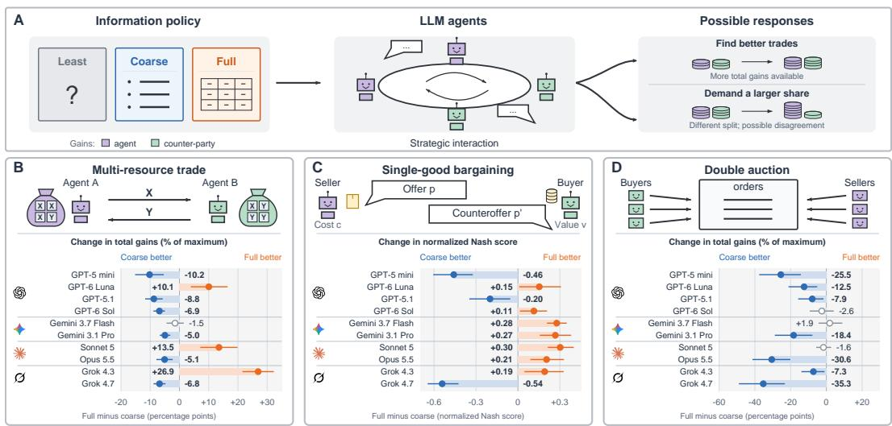  
Figure 1: (A) Information policy and agent responses. Disclosure shapes how agents interact and the outcomes they achieve. (B–D) Economic settings and results. Each panel combines a setting with its disclosure effects: multi-resource trade (B), single-good bargaining (C), and double auctions (D). Bars show how realized performance changes from coarse to full disclosure, with increases favoring full, and decreases favoring coarse information. Trade and auction results are expressed as percentages of maximum available gains; and bargaining shows changes in the normalized Nash score, assigning zero to disagreements.

## 1 INTRODUCTION

In December 2025, Anthropic ran an unusual, futuristic marketplace experiment for a week. About seventy people gave Claude AI agents\* authority to bargain on their behalf. In this study, called Project Deal, Anthropic employees informed their AI agents about what they wanted to buy or sell, what prices they hoped to receive or were willing to pay, and how they wanted to negotiate. The humans then stepped aside. And their agents posted listings, made offers and counteroffers, and closed 186 deals involving more than \$4,000. At the end of the experiments, the participants brought in and exchanged the physical goods and completed the exchanges their agents had negotiated (Troy et al., 2026).

Delegating bargaining power to an AI agent creates a critical information-design problem. To represent the wishes and constraints of its principal well, an agent may need, among other things, private information that could fundamentally change the strategy of its counter-party (the opposing agent) if disclosed. A buyer’s agent, for instance, may need to know that its user wishes to pay \$500 for a product but would be happy to pay as much as \$1,000 if absolutely necessary. That ceiling helps inform the buyer’s agent to decide when to accept, counter, and walk away entirely. To the seller’s agent, however, the same figure reveals how much room there is to demand a higher price before losing the sale altogether. Hence, information an agent needs to represent its principal is not necessarily the same information that should be revealed to its counter-party.

This distinction motivates an information-design protocol for multi-agent systems. A market designer must decide not only which models act, what tools they use, and how they interact, but also what information each agent receives. A counter-party might observe an exact reservation price, a coarser signal such as preference ranking or the existence of a mutually beneficial agreement, or no additional information at all. Or exact information might be provided to a mediator who uses it to construct an agreement without revealing any preferential details to the negotiating agents. Overall, we refer to these choices as information policies—what is disclosed, to whom, and with what level of detail and precision. Such information policies can materially change what agents infer, what trades they offer, what terms they demand, what compromises they make, and the agreements they eventually reach.

In an economic exchange, information can support value discovery, by helping agents identify transactions that create gains for the participants involved. But the same information can also support what is called value capture, by helping an agent decide how much of those gains it can secure for itself. Exact values could therefore help agents identify a better trade while inducing demands that shift gains toward one side or prevent agreement altogether. Additional information can also improve the existing opportunities that agents identify without improving the outcomes they realize.

Here, we study this problem through the lens of empirical information design. We conduct controlled experiments that vary the underlying information policy while holding markets, models, incentives, instructions, and interaction rules fixed. We study multi-resource trade, single-good bargaining, and double auctions, in which agents pursue their own gains, and ground-truth utilities enable us to measure both the opportunities they identify and the outcomes they realize. Across these empirical settings, we systematically vary both the precision and recipient of private information and examine how disclosure changes proposals, demands, agreements, and distribution of gains and overall welfare. In other words, we ask: When does more information help AI agents create more value, and when does it lead them to demand terms that worsen the system’s outcome in an economic exchange?

These questions matter more as AI agents act on behalf of people and businesses. Consumers are already using AI to help make financial decisions. A 2025 survey found that 56% of UK adults used AI to help manage their money in the previous year, where 37% of those users used it for investment research and recommendations (Lloyds Banking Group, 2025). In addition to user advice, Anthropic’s Project Vend examined LLM management of a small shop (Troy et al., 2026; Anthropic, 2025). Salesforce’s CRMArena-Pro analyzes agents performing business tasks (Huang et al., 2025), Walmart uses automated supplier negotiation (Van Hoek et al., 2022), and Microsoft’s Magentic Marketplace simulates customer and business agents negotiating and transacting Bansal et al. (2025). As these interactions grow in frequency, deciding what information agents share becomes increasingly important.

Economics has long studied the distinction between the private benefit of information and its social value. An optimal decision-maker cannot lose from more information because the strategy available with less information remains an option (Blackwell, 1953). In strategic interactions, however, each agent’s best choice depends on others’ behavior, as captured by Nash equilibrium (Nash, 1950b). Disclosure can therefore change equilibrium behavior, so information that benefits one agent need not improve collective outcomes (Hirshleifer, 1978; Bergemann & Morris, 2016). However, private information can also hinder the realization of mutually beneficial trades (Myerson & Satterthwaite, 1983). Information design studies how disclosure shapes these outcomes in Bayesian models (Kamenica & Gentzkow, 2011; Bergemann & Morris, 2019). For LLM agents, how behavior and outcomes change under different information policies is an empirical question.

Efforts to improve multi-agent LLM systems increasingly focus on optimizing their prompts and organization, as in GPTSwarm, MASS, and ROMA (Zhuge et al., 2024; Zhou et al., 2026; Alzu’bi et al., 2026). We study a complementary choice of what information agents receive about others’ preferences, values, and costs, studying how disclosure shapes their decisions. Building on controlled negotiation environments such as NegotiationArena (Bianchi et al., 2024), we compare disclosure policies on the same markets while holding models, incentives, task instructions, and interaction rules fixed.†

The results show that additional information does not always help the agents to reach better outcomes (Figure 1). In multi-resource trade, moving from coarse to full information disclosure lowers GPT-6 Sol’s total gains from 97.7% to 90.8% of the maximum available, whereas GPT-6 Luna’s rise from 68.9% to 79.0%, showing different responses within the GPT family. Claude Sonnet 5 and Grok 4.3 also benefit from full disclosure, while Claude Opus 5.5 and Grok 4.7 achieve higher gains under coarse information. In bargaining, we assess whether agents reach agreement and how evenly they share the gains using the normalized Nash score, with disagreement scoring zero. At the six-message horizon shown in Figure 1, moving from coarse to full disclosure raises GPT-6 Sol’s score from 0.71 to 0.83, but lowers GPT-5.1’s from 0.77 to 0.57 and Grok 4.7’s from 0.71 to 0.17. In auctions, full information lowers realized gains from 94.6% to 64.1% of the maximum available for Claude Opus 5.5 and from 97.4% to 62.1% for Grok 4.7. These comparisons use separate instances of the same model as interacting agents. As we show later, more information can also worsen outcomes in games between different model types.

These results motivate decision-relevant sufficiency, where agents need enough information to identify useful actions, with further detail judged by its effect on system outcomes. Building on this perspective, we make three main contributions:

• We present this framework as an evaluation environment to study the effect of information disclosure across three economic settings, holding models, markets, and interaction rules fixed.

• We analyze, across ten frontier language models, how disclosure affects performance and how its effects vary with the model, market structure, and interaction protocol.

• We distinguish the quality of trades agents identify from the outcomes they realize, examining their demands and the division of gains to interpret the gap.

## 2 EXPERIMENTAL SETUP

We begin by describing the three settings that are canonical in economics and capture features of real trade and negotiation, while allowing complex strategic behavior to emerge from simple rules. In all our experiments, agents are instructed to maximize their own gains, which reflects instances where they negotiate or trade on behalf of people or groups with unique interests. Throughout, we test ten models: GPT-5 mini, GPT-6 Luna, GPT-5.1, GPT-6 Sol, Gemini 3.7 Flash, Gemini 3.1 Pro, Claude Sonnet 5, Claude Opus 5.5, Grok 4.3, and Grok 4.7. For each, we use separate instances of that model as the interacting agents, each with its own role. In all settings, the information specified by each disclosure condition is provided in agents’ prompts before they act. During trade and bargaining, agents may also choose what to reveal in conversation. Supplementary details can be found in §F.

## 2.1 MULTI-RESOURCE TRADE

In this game, adapted from NegotiationArena (Bianchi et al., 2024), two agents A and B negotiate a resource exchange with public inventories and private per-unit values. Both agents observe the inventories, and each knows its own values per resource unit. Utility is additive. If $t _ { i } \in \mathbb { Z } ^ { n }$ lists the

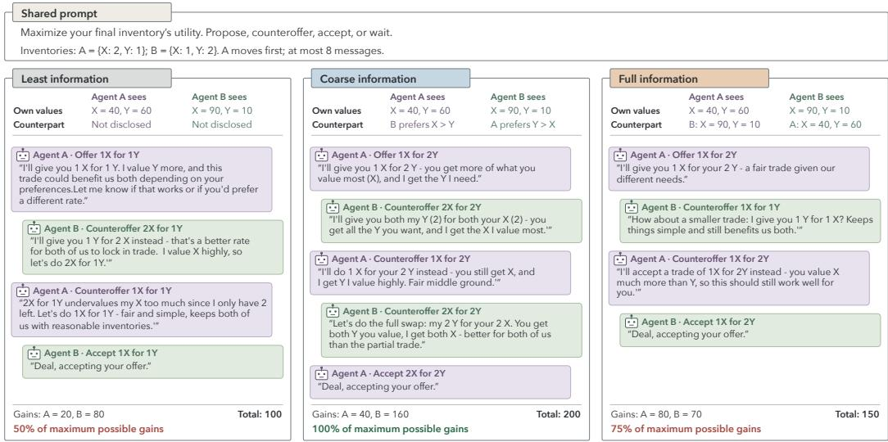  
Figure 2: Disclosure changes negotiation in the same multi-resource exchange market. Complete conversations between two Claude Sonnet 5 agents under least, coarse, and full information. The shared prompt is abbreviated; bold lines summarize actions. In this selected example, coarse information achieves the maximum possible total gain, compared with 50% under least and 75% under full information.

quantities of goods agent i gives and $v _ { i } \in \mathbb { R } ^ { n }$ their per-unit values, each agent’s respective gain is:

$$
g _ { A } = v _ { A } ^ { \top } ( t _ { B } - t _ { A } ) , \qquad g _ { B } = v _ { B } ^ { \top } ( t _ { A } - t _ { B } ) .\tag{1}
$$

Agents alternate messages, starting with A, and may discuss, propose, counteroffer, accept, or wait. Offers can exchange any available integer quantities. Acceptance executes the exchange; without agreement, agents keep their initial inventories. The main study uses two resources, up to eight messages in total (four per agent), and 90 markets‡ per model and information condition. Agents have complementary inventories and prefer the resource abundant in the counter-party’s inventory. We vary preference strengths to create extraction opportunities, where an agent can increase its own gain while reducing total gains and still benefiting its counter-party. Three groups, each consisting of 30 markets give greater opportunity to A, to B, or equal opportunities, determined before model runs. See §B.1.

Information levels. We explore three information disclosure types. LEAST provides only own resource values; COARSE adds the counter-party’s value ranking; and FULL adds its exact values. Inventories are public throughout, and agents choose what else to reveal in conversation. Figure 2 shows how the same market can produce different exchanges under different disclosure conditions. Under least information, the agents exchange one unit of each resource; under coarse information, they exchange two of each, doubling total gains. Under full information, A gives one X for two Y, increasing its own gain but reducing total gains relative to coarse disclosure.

## 2.2 SINGLE-GOOD BARGAINING

Bargaining provides a controlled setting for studying how information affects agreement and the division of gains (Roth & Malouf, 1979). In this game, a seller with private cost c and a buyer with private value v alternate price offers and responses. We test both starting roles, where the seller or the buyer agent starts first. An agreement at $c \leq p \leq v$ gives gains $p - c \mathrm { t o }$ the seller and $v - p$ to the buyer, assuming that c, p, and v are all positive values. Total gains are therefore fixed at $v - c ;$ the price determines their division. We select 15 profitable cost–value pairs, evenly divided among thin, medium, and large surplus markets, and test both starting roles at two, four, and six messages. The final message permits only acceptance or rejection, so two messages allow one offer and one response (§C.1).

Information levels. Each agent knows its own value or cost and receives the prior that both are uniform on [20, 100]. LEAST provides no counter-party information; COARSE reveals whether $v > c ,$ indicating whether a mutually beneficial price exists; and FULL reveals both cost and value.

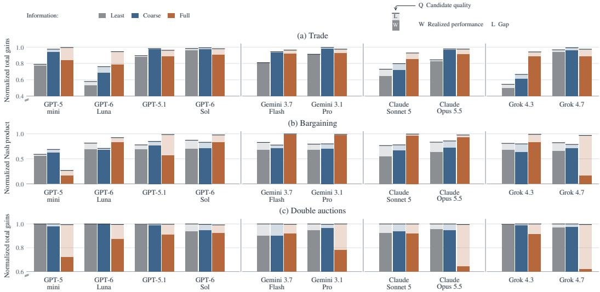  
Figure 3: Candidate quality and realized performance across three economic settings. Solid bars show realized performance $W$ , the normalized score of completed outcomes. Total bar heights show candidate quality $Q ,$ the best feasible offer proposed in trade and bargaining, or the potential gains from auction pairs formed by submitted prices. The remaining segments show the realization gap $L = \mathbf { \bar { Q } } - W$ , the difference between identified opportunities and realized outcomes. Scores measure total gains in trade and auctions and the Nash product in bargaining, with disagreements scored zero.

## 2.3 DOUBLE AUCTION

Double auctions are a classical setting for studying how individual price demands produce marketlevel outcomes (Smith, 1962; Gode & Sunder, 1993). Three buyers with private values $v _ { b }$ and three sellers with private costs $c _ { s }$ each seek to trade one unit of good. In this one-shot auction, each buyer submits one bid (”what it offers to $\mathrm { p a y } ^ { \prime \prime } )$ and each seller one ask (”what it requests”), simultaneously and with no subsequent revision. The clearing rule ranks bids from highest to lowest and asks from lowest to highest, pairing participants in that order. A pair trades at the midpoint of its submitted prices if the bid meets or exceeds the ask. Clearing stops at the first pair that fails this condition. With K completed trades between buyers $b ( k )$ and sellers $s ( k )$ , total gain is:

$$
S _ { \mathrm { a u c t i o n } } = { \sum } _ { k = 1 } ^ { K } \bigl ( v _ { b ( k ) } - c _ { s ( k ) } \bigr ) .\tag{2}
$$

We use 30 markets varying in the number of profitable trades, whether the last profitable pair’s gains are narrow, medium, or wide (§D.1).

Information levels. Here, LEAST provides each agent only its own value or cost, along with who the buyers and sellers are; COARSE additionally reveals the ordering of the buyers by value and the sellers by cost; and FULL adds all exact values and costs. No generating distribution is disclosed.

## 3 MEASURING DISCOVERY AND VALUE CAPTURE

To understand how disclosure changes outcomes, we examine both the transactions identified by the agents and the agreements reached. Information may help agents find a more valuable trade whilst changing the terms they seek or accept. We compare the quality of the opportunities they identify with their final outcomes using the following three measures, as illustrated in Figure 3.

First, realized performance: Let $S ( a )$ score the system objective, $a ^ { 0 }$ denote no trade, and $a ^ { * }$ maximize the objective over feasible outcomes in the same market. We normalize $W ( a ) \ =$ $[ S ( a ) - S ( a ^ { 0 } ) ] / [ \bar { S } ( a ^ { * } ) - S ( a ^ { 0 } ) ]$ and call the final outcome’s score realized performance, W. In trade and auctions, S is total gains, so W measures the proportion of maximum gains obtained. In bargaining, we use the normalized Nash product $W ( p ) = \dot { 4 } ( \dot { v } - p ) ( p - c ) / ( v - c ) ^ { 2 }$ to capture both agreement and balance, scoring equal division as one and disagreement as zero (Nash, 1950a). We average trade and bargaining negotiations equally, including disagreements, and weight auction markets by maximum available gains. We also report bargaining agreement rates and Nash scores among agreements.

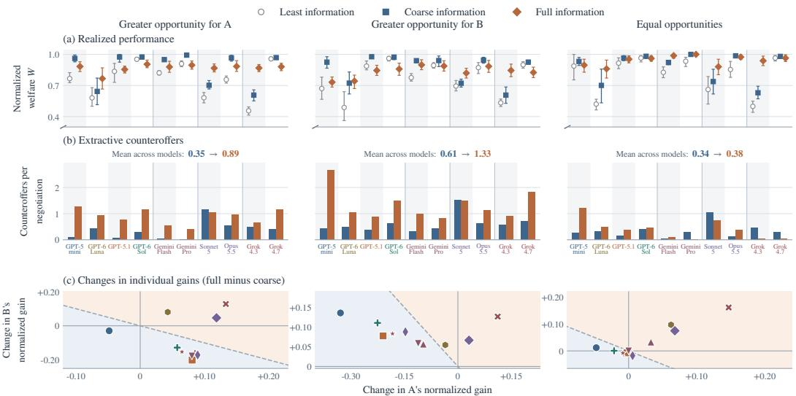  
GPT-5 mini GPT-6 Luna GPT-5.1 GPT-6 Sol Gemini 3.7 Flash Gemini 3.1 Pro Claude Sonnet 5 Claude Opus 5.5 Grok 4.3 Grok 4.7  
Figure 4: Trade outcomes and behavior across market types. Columns distinguish markets with greater extraction opportunity for A, for B, or equal opportunities. (a) Mean normalized welfare, with 95% confidence intervals. (b) Showing mean extractive counteroffers per conversation, which are counteroffers that increase the proposing agent’s gain while reducing total gains relative to the preceding offer. (c) Each point shows a model’s full-minus-coarse change in A’s gain (horizontal) and B’s gain (vertical), normalized by maximum total gain. Points above the dashed diagonal indicate higher total welfare. Together, the panels show thatfull disclosure can accompany more extractive counteroffers, less equal gains, and lower total welfare.

Second, candidate quality: A good offer need not become the final agreement, reflecting distinctions between candidate generation and verification in LLMs (Saad-Falcon et al., 2025). Candidate quality, Q, uses the same normalized objective as W. In trade and bargaining, it is the highest score among feasible proposed trades that leave both agents at least as well off as no trade, evaluated using true utilities. If no proposed trade satisfies these, we set $Q = 0$ . In auctions, it measures the normalized gains if every profitable pair formed by the submitted price rankings traded, even when the buyer offers less than what the seller asks.

Third, realization gap: The value $L = Q - W$ captures candidate quality not realized in the final outcome. This can arise from accepting a lower-scoring offer or failing to complete beneficial trades. Using the same markets and weights, full-minus-coarse changes satisfy $\Delta W = \Delta Q - \Delta L$ . We examine agents’ demands, responses, and individual gains to interpret these differences.

## 4 MAIN RESULTS

We begin by comparing how disclosure affects the opportunities agents identify and the results they achieve. Figure 3 summarizes candidate quality Q, realized performance W, and the realization gap L across three settings. Overall, we see that the effects of information disclosure in economic exchanges differ across models and that full information often widens this realization gap. In trade, full disclosure lowers GPT-6 Sol’s realized gains but raises GPT-6 Luna’s, while Claude Sonnet 5 and Grok 4.3 improve both candidate quality and realized performance. In bargaining, Grok 4.7 and GPT-5.1 propose more balanced offers and have higher Q under full information, but reach substantially less balanced outcomes. In auctions, the submitted prices can potentially pair buyers and sellers who would benefit from trading, yet prevent those trades because buyers offer less than sellers demand. To interpret these differences, we examine demands, responses, and individual gains; then consider how disclosure effects vary with market complexity, communication, and model composition.

## 4.1 MULTI-RESOURCE TRADE

Multi-resource trade requires agents to find an exchange and negotiate how its gains are divided.   
Disclosure can therefore affect both the trades they propose and the gains they ultimately achieve.

Finding 1. Full information can sharpen capture while reducing total gains. In two-resource exchange, moving from counter-party value rankings to full information (exact values) lowers realized performance for GPT-6 Sol, Claude Opus 5.5, and Grok 4.7, and is accompanied by more extractive counteroffers.

The aggregate effect differs across model families and market structures. Moving from coarse to full disclosure lowers GPT-6 Sol’s realized gains from 97.7% to 90.8% of the maximum available, but raises GPT-6 Luna’s from 68.9% to 79.0%. GPT-5.1’s gains fall from 97.2% to 88.4%, whereas Claude Sonnet 5’s rise from 72.1% to 85.6% (Figure 3). These consequences depend on how an agent can extract, that is, improve its own gain while diminishing total profits but still with a positive gain offered for the other agent. In Figure 4(a), a total of 90 markets are divided into three categories according to their opportunity of extraction: A, B or equal. Coarse disclosure generally produces higher total gains, including for GPT-6 Sol, Claude Opus 5.5 and Grok 4.7 in all three market groups. Full disclosure nevertheless benefits GPT-6 Luna, Claude Sonnet 5, and Grok 4.3 throughout. Gemini 3.7 Flash benefits from full information only when extraction opportunities are equal.

We call a counteroffer extractive when it increases the proposing agent’s gain while reducing both the counter-party’s gain and total gains relative to the previous offer. Figure 4(b) reports the average of such counteroffers per negotiation. We see that full disclosure increases extractive counteroffers for several models. When B has greater extraction opportunity, GPT-6 Sol’s mean rises from 0.63 to 1.50 per negotiation, and Claude Opus 5.5’s from 0.63 to 1.13. Such counteroffers can reduce final gains when accepted in place of an earlier, higher-value offer. However, their frequency alone does not determine performance. GPT-6 Luna makes more extractive counteroffers in every market group yet achieves higher overall gains, while Claude Sonnet 5 also benefits from improved proposals despite making extractive counteroffers under both conditions (Figure 3).

The changes in individual gains reveal who benefits from full disclosure. Figure 4(c) plots full-minus-coarse changes in A’s gain horizontally and B’s vertically, normalized by maximum total gains. Points below the diagonal indicate lower combined welfare. When B has greater extraction opportunity, GPT-6 Sol, Claude Opus 5.5, and Grok 4.7 increase B’s gain while reducing A’s by more. For GPT-6 Sol, B gains 11.1 percentage points while A loses 22.5. When A has greater opportunity, these models instead increase A’s gain at a larger cost to B. By contrast, Claude Sonnet 5 and Grok 4.3 improve both agents’ gains in all three market groups. With equal opportunities, Gemini 3.7 Flash also improves both agents’ gains despite making more extractive counteroffers. Full information can therefore benefit one agent at a greater cost to the other, reducing their combined gains.

## 4.2 SINGLE-GOOD BARGAINING

Within each bargaining market, every completed trade creates the same total gains. We therefore examine whether agents agree and how evenly they divide those gains. Here, Q scores the most balanced feasible price proposed, while W scores the final agreement and is zero for disagreements.

Finding 2. Disclosure can increase agreement while worsening the division of gains. Full information disclosure can make agreement more plausible, yet fail to produce a correspondingly balanced allocation of the surplus available.

Figure 5(a) illustrates the difference between agreement and balance, where points farther to the right suggest more agreement, but points higher up imply more balanced agreement. With four messages, full disclosure raises GPT-5.1’s agreement rate from 70% to 93.3% but lowers the mean Nash score among agreements from 0.84 to 0.24. Grok 4.7 shows a similar pattern at six messages, where the agreement rises from 80% to 100%, while the Nash score among agreements falls from 0.89 to 0.17. Its candidate quality nevertheless improves from 0.79 to 0.97, showing that balanced offers appear without becoming balanced final agreements.

Longer dialogue improves balance under full information for several models. Between two and six messages, scores among agreements rise from 0.02 to 0.83 for GPT-6 Luna, from 0.06 to 0.83 for GPT-6 Sol, and from 0.24 to 0.92 for Claude Opus 5.5. Gemini 3.7 Flash, Claude Sonnet 5, and Grok 4.3 also reach more balanced agreements with longer dialogue. At six messages, full disclosure improves overall realized performance for seven models, but lowers it for GPT-5 mini, GPT-5.1, and Grok 4.7. Results by surplus group appear in §C.

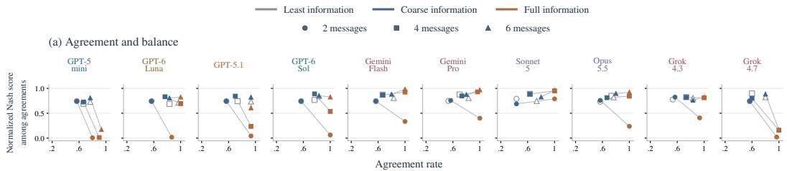

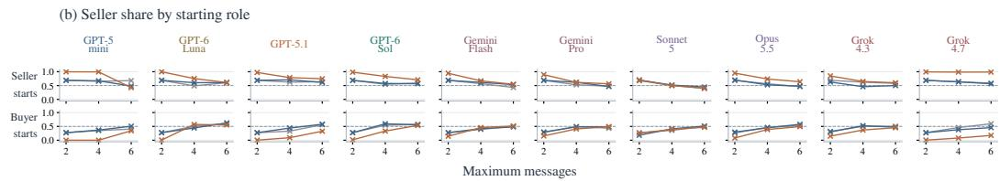  
Figure 5: Bargaining agreement, balance, and starting-role effects. (a) Agreement rates versus mean normalized Nash products among agreements, combining experiments with both starting roles. Shapes indicate message limits; gray lines connect coarse and full information at the same limit. (b) Mean seller shares among agreements separated by starting role, and dashed lines mark equal division. More information can increase agreement while making gains less evenly shared, with the division also depending on who movesfirst.

Finding 3. Information and bargaining order jointly shape who captures the surplus. Under short bargaining horizons, full information amplifies the first-mover’s share of gains.

Figure 5(b) shows the mean shares of the sellers among the agreements, separated by the starting roles. With two messages, moving from coarse to full disclosure raises the GPT-5.1 sellers’ share from 68.8% to 97.3% when starting, but reduces it from 27.4% to 0.4% when responding. At six messages under full information, these shares are 74.5% and 32.6%, narrowing the starting role advantage. Grok 4.3, Gemini 3.7 Flash, and Claude Sonnet 5 also reach more balanced agreements as dialogue length increases under full information. By contrast, Grok 4.7 retains a strong starting role advantage even at six messages under full information, such that sellers receive 98.7% when starting and 17.4% when responding. Starting order also matters when only one of the agents receives exact information, as an informed second mover can still receive less than its uninformed counterpart (§C). Together, these findings show that information and starting role jointly shape who gains. Human bargaining experiments likewise show that disclosure changes the agreed division (Roth & Malouf, 1979; 1982) and that its recipient matters (Roth & Murnighan, 1982), although the direction of disclosure effects varies across our tested models.

## 4.3 DOUBLE AUCTIONS

In auctions, disclosure affects both who is matched with whom and whether their prices allow trade.

Finding 4. Agents can identify efficient trades but still price them out of existence. Full information can prevent mutually beneficial trades in auctions, making the prices buyers offer and sellers demand less compatible. In other words, even though the exchange may benefit both parties, agents may complete fewer trades and achieve lower total gains.

The auction clearing rule produces buyer–seller pairs that could generate nearly all available gains in our experiments, resulting in high candidate quality Q (Figure 3). But these gains disappear when buyers are willing to pay less than what the sellers ask. For GPT-5.1, the pairs could generate over 99.7% of maximum gains under either condition, but full disclosure lowers realized gains from 98.9% to 91.0%. The declines are larger for Claude Opus 5.5 and Grok 4.7, whose realized gains fall from 94.6% to 64.1% and from 97.4% to 62.1%, respectively, despite candidate quality remaining above 99%. These models complete fewer beneficial trades, widening the realization gap L. Claude Sonnet shows a smaller decline in realized gains, from 93.6% to 92.0%.

Figure 6(a) helps explain why some gains remain unrealized. Compared with coarse information, full disclosure leads sellers to ask for more above their costs in every model. Buyers also offer further below their values in every model except Gemini 3.7 Flash. For clarity, price differences are capped at 100 before averaging to remove extreme values. Furthermore, auction activity depends strongly on the market structure (Figure 6 b). Full disclosure increases mean completed trades in narrow-margin markets for several models, including GPT-6 Sol and Gemini 3.7 Flash; but reduces them in widemargin markets for nine models, with Claude Sonnet 5 unchanged. In these wide-margin markets, even the last efficient trade offers substantial gains, making missed trades particularly consequential.

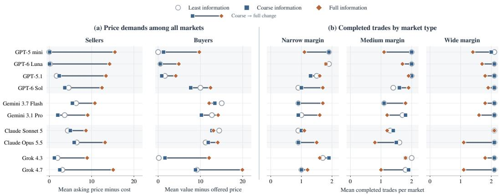  
Figure 6: Auction price demands and completed trades. Full information can lead sellers to askfor more and buyers to offer less, preventing trades that would benefit both especially in wider margin markets. (a) Mean asking prices above seller costs and mean buyer values minus offered prices across all market types. (b) Mean completed trades in narrow, medium, and wide margin markets. Symbols distinguish information conditions and lines connect coarse and full information.

## 4.4 ADDITIONAL ANALYSIS AND ABLATIONS

Resource count and communication. We examine how the value of information varies with the number of resources and conversation length, using markets where B has greater extraction opportunity.

Finding 5. Trading complexity changes the value of information disclosure. As agents face more possible exchanges, exact preferences improve the trade discovery enough to shift the advantage from coarse to full information.

In the two-resource experiments, coarse information appears sufficient to identify high-value trades, leaving less room to improve proposals. When agents face combinatorially more possible exchanges, however, detailed preferences can help to find better trades. At ten resources, full information improves over coarse information candidate quality Q for all ten models and realized performance W for nine, with GPT-6 Sol nearly unchanged. GPT-5.1’s realized gains rise from 63.8% to 80.4% of the maximum available. Benefits vary with resource count, which also changes the available exchanges (Figure 7(a)).

Beyond resource count, communication also shapes the value of disclosure. Extending conversations from two to twelve messages improves welfare more under least than full information for most models. With more communication, GPT-5.1 gains 30.6 percentage points under least information versus 2.8 under full disclosure, suggesting that dialogue can partly compensate for limited initial information (Figure 7(b)). We also examine a mediator setup that maximizes total gains, subject to both agents’ acceptance (Figure 11). In that setup, full information yields near-optimal outcomes, while direct negotiation favors coarse disclosure on the same markets, showing that information’s value depends on objectives and the interaction architecture.

Mixed-model interactions. To see if these trends also hold for interactions between different models, we test all pairs of GPT-5.1, Claude Sonnet 5, Gemini 3.7 Flash, and Grok 4.3 on identical markets used in previous experiments. The full disclosure is compared with coarse in Figure 8, averaging both model-role assignments. The bargaining employs six messages and both starting roles. The trade results echo the same-model findings. GPT-5.1 × Gemini loses 9.6% points in each unequal-opportunity group, with little change under equal opportunities, while Sonnet × Grok gains 10.8–23.8 percentage points across groups. In bargaining, the pairs including GPT-5.1 retain the disadvantage of full disclosure in large-surplus markets, losing 13.3–28.4 points, although every pair benefits when surplus is thin. In auctions, all six model combinations achieve higher mean performance under coarse information, with full disclosure reducing scores by 4.9–14.6% points. Coarse information also performs better for every combination in wide-margin markets, consistent with the same-model findings. These results show that several disclosure effects persist when different models interact, while their direction and magnitude depend on the models involved and the market (§E.2).

(a) Full disclosure helps in more complex markets  
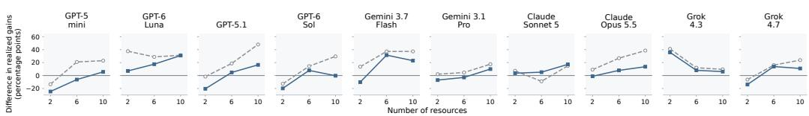

(b) Longer dialogue can compensate for limited information  
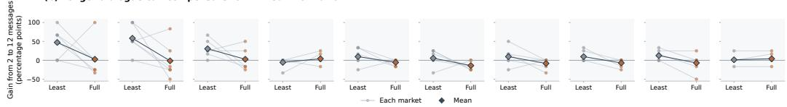  
Figure 7: Resource complexity and communication. (a) Differences in realized gains between full and least or coarse information at each resource count. Positive values favor full disclosure. (b) Changes in realized gains from two to twelve messages under least and full information. Lines connect the same markets and diamonds show their means. All differences are in percentage points of maximum possible gains. Both studies use markets where B has greater extraction opportunity.

<table><tr><td></td><td colspan="3">Multi-resource trade</td><td colspan="3">Single-good bargaining</td><td colspan="3">Double auctions</td></tr><tr><td></td><td>A higher</td><td>B higher</td><td>Equal</td><td>Thin</td><td>Medium</td><td>Large</td><td>Narrow</td><td>Medium</td><td>Wide</td></tr><tr><td>GPT-5.1 × Sonnet 5</td><td>+3.0</td><td>-2.0</td><td>+6.1</td><td>+59.9</td><td>-16.2</td><td>-25.4</td><td>-7.7</td><td>-12.7</td><td>-8.6</td></tr><tr><td>GPT-5.1 × Gemini</td><td>-9.6</td><td>-9.6</td><td>+0.2</td><td>+38.1</td><td>-1.6</td><td>-13.3</td><td>-2.1</td><td>-11.3</td><td>-17.9</td></tr><tr><td>GPT-5.1 × Grok 4.3</td><td>-5.7</td><td>-0.9</td><td>+5.5</td><td>+7.7</td><td>+5.2</td><td>-28.4</td><td>-7.2</td><td>-17.0</td><td>-16.5</td></tr><tr><td>Grok 4.3 × Gemini</td><td>+0.8</td><td>-1.1</td><td>+7.5</td><td>+64.1</td><td>+21.6</td><td>+5.2</td><td>-2.1</td><td>+1.0</td><td>-15.0</td></tr><tr><td>Sonnet 5 × Gemini</td><td>+4.9</td><td>-0.2</td><td>+10.7</td><td>+74.4</td><td>+20.0</td><td>+1.7</td><td>-1.0</td><td>-7.3</td><td>-5.2</td></tr><tr><td>Sonnet 5 × Grok 4.3</td><td>+10.8</td><td>+18.9</td><td>+23.8</td><td>+77.7</td><td>+24.2</td><td>+8.8</td><td>-1.0</td><td>-16.9</td><td>-10.2</td></tr><tr><td></td><td></td><td></td><td></td><td colspan="4"></td></tr><tr><td></td><td></td><td></td><td></td><td></td><td></td><td></td><td>-20</td><td>0</td><td>20</td></tr><tr><td>-25</td><td></td><td>0</td><td>25</td><td>-80</td><td>0</td><td>80</td></tr></table>

Figure 8: Disclosure effects in mixed-model interactions. Mean change in realized performance W from coarse to full disclosure (percentage points). Blue favors coarse disclosure; orange favors full. Columns group markets by extraction opportunity, bargaining surplus, or auction margin. Trade and auctions measure normalized total gains and bargaining measures the normalized Nash product.

Strategic demands and inconsistent behavior. Conversations reveal interesting behavior in negotiations. In six-message bargaining, GPT-5.1 makes its last possible offer on the fifth message in 56.7% of same-model negotiations under full information, compared with 16.7% under coarse information. Among these offers, it demands a larger share than in its previous proposal in 76.5% and 40% of cases, for full and coarse information respectively. Across all message limits, Claude Sonnet 5 attempts to accept offers that would leave it worse off than not trading in 8.9% of least-information and 5.6% of coarse-information negotiations, but none under full information. Multi-resource trade also reveals misleading claims and successful error correction. GPT-5.1 calls a counteroffer ”more balanced” while raising its own share from 26.7% to 93.3%. Then, its counter-party objects to this, leading to a more balanced agreement. In another negotiation, Gemini challenges GPT-5.1’s claim that no beneficial trade exists and secures an exchange achieving the maximum total gain possible. These cases illustrate how correcting a counter-party can improve outcomes. Further details on these conversations appear in §E.3.

## 5 DISCUSSION, LIMITATIONS, AND CONCLUSION

The results in LLM-agent markets depend on the models, interaction rules, and the information shared. Too little information can hinder beneficial trades, while additional detail can intensify competition over gains, making the appropriate level of disclosure important. Better proposals need not increase total gains, nor does more frequent agreement guarantee a more equal distribution of those gains. Comparing candidate quality, agents’ demands, and realized performance helps explain these differences. Model selection and information policy should therefore be considered together, based on how agents use information and whether their interactions support the system’s objective.

Implications and future directions. Information availability is an important consideration when developing objectives, decision authority, and interaction rules for agents representing humans or organizations. Commercial agents may have varying levels of access to client needs, supplier capabilities, and operational constraints depending on their role. Similar decisions should be made about context and feedback in coding and planning systems, but further validation is required for transfer outside of economic contexts. Our dialogue length and resource count studies encourage testing when to provide detail first and when to reveal it through interaction. Future research could look at selective disclosure in unseen markets and model pairs, measuring both collective outcomes and gain allocation.

Limitations. Our experiments isolate disclosure effects in controlled games with known utilities and explicit objectives, whereas real-world agents may face uncertain preferences and changing goals. Findings may also vary across economic settings, models, and interaction rules. The markets we considered are selected to capture specific trading characteristics rather than the full range of real-world interactions. Furthermore, our confidence intervals capture variation across markets, not repeated model responses to the same input. Accordingly, studies using real-world data and deployed agents are needed to assess how these findings generalize.

## ACKNOWLEDGEMENTS

We would like to thank the members of the Zou Lab for helpful discussions and valuable feedback. Suzgun gratefully acknowledges the support of a Google PhD Fellowship. Pappu and El gratefully acknowledge the support of the Knight-Hennessy Scholarship. This work was further supported in part by the National Science Foundation (NSF) CAREER Award under Grant CCF-2236829, in part by the NSF Grant CPS-2551283, in part by the National Institutes of Health under Grant 1R01AG08950901A1, in part by the Office of Naval Research under Grant N00014-24-1-2164, and in part by the Defense Advanced Research Projects Agency under Grant HR00112490441.

## AI USE STATEMENT

We used generative AI tools, specifically ChatGPT and Claude, to assist with writing and editing, implementing code, processing and organizing data, and interpreting quantitative results.

Market instances followed explicit rules rather than free-form LLM responses. The LLM agents evaluated in the experiments and their configurations are described separately in the paper. This work contains no mathematical proofs. We reviewed the AI-assisted work and take responsibility for the final text, code, and reported findings.

## REFERENCES

Elif Akata, Lion Schulz, Julian Coda-Forno, Seong Joon Oh, Matthias Bethge, and Eric Schulz. Playing repeated games with large language models. Nature Human Behaviour, 9(7):1380–1390, 2025.

Victor Akinwande, J Zico Kolter, and Aran Nayebi. Sharding prevents llm oversight failures and adversarial exploitation. arXiv preprint arXiv:2608.06422, 2026.

Salaheddin Alzu’bi, Baran Nama, Arda Kaz, Anushri Eswaran, Weiyuan Chen, Sarvesh Khetan, Rishab Bala, Tu Vu, and Sewoong Oh. Roma: Recursive open meta-agent framework for long-horizon multi-agent systems. arXiv preprint arXiv:2602.01848, 2026.

Anthropic. Project vend: Can Claude run a small shop? (and why does that matter?). Research blog, June 27, June 2025. URL https://www.anthropic.com/research/project-vend-1.

Anthropic. Patterns and problems in emerging multiagent systems. Research blog, August 13, 2026. URL https://www.anthropic.com/research/multiagent-systems.

Rauno Arike, Raja Mehta Moreno, Rohan Subramani, Shubhorup Biswas, and Francis Rhys Ward. How does information access affect llm monitors’ ability to detect sabotage? arXiv preprint arXiv:2601.21112, 2026.

Gagan Bansal, Wenyue Hua, Zezhou Huang, Adam Fourney, Amanda Swearngin, Will Epperson, Tyler Payne, Jake M Hofman, Brendan Lucier, Chinmay Singh, et al. Magentic marketplace: An open-source environment for studying agentic markets. arXiv preprint arXiv:2510.25779, 2025.

Dirk Bergemann and Stephen Morris. Bayes correlated equilibrium and the comparison of information structures in games. Theoretical Economics, 11(2):487–522, 2016.

Dirk Bergemann and Stephen Morris. Information design: A unified perspective. Journal of economic literature, 57(1):44–95, 2019.

Federico Bianchi, Patrick John Chia, Mert Yuksekgonul, Jacopo Tagliabue, Dan Jurafsky, and James Zou. How well can LLMs negotiate? NegotiationArena platform and analysis. In Ruslan Salakhutdinov, Zico Kolter, Katherine Heller, Adrian Weller, Nuria Oliver, Jonathan Scarlett, and Felix Berkenkamp (eds.), Proceedings of the 41st International Conference on Machine Learning, volume 235 of Proceedings of Machine Learning Research, pp. 3935–3951. PMLR, 21–27 Jul 2024. URL https://proceedings.mlr.press/v235/ bianchi24a.html.

David Blackwell. Equivalent comparisons of experiments. The annals of mathematical statistics, pp. 265–272, 1953.

Ozan Candogan. Persuasion in networks: Public signals and cores. Operations Research, 70(4):2264–2298, 2022.

Ozan Candogan and Philipp Strack. Optimal disclosure of information to privately informed agents. Theoretical Economics, 18(3):1225–1269, 2023.

Kalyan Chatterjee and William Samuelson. Bargaining under incomplete information. Operations research, 31 (5):835–851, 1983.

Jiangjie Chen, Siyu Yuan, Rong Ye, Bodhisattwa Prasad Majumder, and Kyle Richardson. Put your money where your mouth is: Evaluating strategic planning and execution of llm agents in an auction arena. arXiv preprint arXiv:2310.05746, 2023.

Vincent P Crawford and Joel Sobel. Strategic information transmission. Econometrica: Journal of the Econometric Society, pp. 1431–1451, 1982.

Yuan Deng, Vahab Mirrokni, Renato Paes Leme, Hanrui Zhang, and Song Zuo. Llms at the bargaining table. In Agentic Markets Workshop at ICML, volume 2024, 2024.

Avinava Dubey, Zhe Feng, Rahul Kidambi, Aranyak Mehta, and Di Wang. Auctions with llm summaries. In Proceedings of the 30th ACM SIGKDD Conference on Knowledge Discovery and Data Mining, pp. 713–722, 2024.

Paul Duetting, Vahab Mirrokni, Renato Paes Leme, Haifeng Xu, and Song Zuo. Mechanism design for large language models. In Proceedings of the ACM Web Conference 2024, pp. 144–155, 2024.

Yiding Feng, Chien-Ju Ho, and Wei Tang. Rationality-robust information design: Bayesian persuasion under quantal response. In Proceedings of the 2024 annual ACM-SIAM symposium on discrete algorithms (SODA), pp. 501–546. SIAM, 2024.

Sara Fish, Yannai A Gonczarowski, and Ran I Shorrer. Algorithmic collusion by large language models. arXiv preprint arXiv:2404.00806, 7(2):5, 2024.

Vincent Glode, Christian C Opp, and Xingtan Zhang. Voluntary disclosure in bilateral transactions. Journal of Economic Theory, 175:652–688, 2018.

Dhananjay K Gode and Shyam Sunder. Allocative efficiency of markets with zero-intelligence traders: Market as a partial substitute for individual rationality. Journal ofpolitical economy, 101(1):119–137, 1993.

He He, Derek Chen, Anusha Balakrishnan, and Percy Liang. Decoupling strategy and generation in negotiation dialogues. In Proceedings of the 2018 Conference on Empirical Methods in Natural Language Processing, pp. 2333–2343, 2018.

Jack Hirshleifer. The private and social value of information and the reward to inventive activity. In Uncertainty in economics, pp. 541–556. Elsevier, 1978.

Kung-Hsiang Huang, Akshara Prabhakar, Onkar Thorat, Divyansh Agarwal, Prafulla Kumar Choubey, Yixin Mao, Silvio Savarese, Caiming Xiong, and Chien-Sheng Wu. Crmarena-pro: Holistic assessment of llm agents across diverse business scenarios and interactions. arXiv preprint arXiv:2505.18878, 2025.

Emir Kamenica and Matthew Gentzkow. Bayesian persuasion. American Economic Review, 101(6):2590–2615, 2011.

Mike Lewis, Denis Yarats, Yann Dauphin, Devi Parikh, and Dhruv Batra. Deal or no deal? end-to-end learning of negotiation dialogues. In Proceedings of the 2017 conference on empirical methods in natural language processing, pp. 2443–2453, 2017.

Guohao Li, Hasan Hammoud, Hani Itani, Dmitrii Khizbullin, and Bernard Ghanem. Camel: Communicative agents for” mind” exploration of large language model society. Advances in neural information processing systems, 36:51991–52008, 2023.

Lloyds Banking Group. 2025 Consumer Digital Index: The Generative AI edition. Technical report, Lloyds Banking Group, November 2025. URL https://www.lloydsbankinggroup.com/assets/pdfs/ media/consumer-digital-index/2025/2025-consumer-digital-index.pdf.

Stephen Morris and Hyun Song Shin. Social value of public information. american economic review, 92(5): 1521–1534, 2002.

Roger B Myerson and Mark A Satterthwaite. Efficient mechanisms for bilateral trading. Journal of economic theory, 29(2):265–281, 1983.

John F Nash. The bargaining problem. Econometrica, 18(2):155–162, 1950a.

John F Nash. Equilibrium points in n-person games. Proceedings ofthe national academy ofsciences, 36(1): 48–49, 1950b.

Christoph Riedl. Emergent coordination in multi-agent language models. In International Conference on Learning Representations, volume 2026, pp. 120776–120799, 2026.

Alvin E Roth and Michael W Malouf. Game-theoretic models and the role of information in bargaining. Psychological review, 86(6):574, 1979.

Alvin E Roth and Michael WK Malouf. Scale changes and shared information in bargaining: An experimental study. Mathematical Social Sciences, 3(2):157–177, 1982.

Alvin E Roth and J Keith Murnighan. The role of information in bargaining: An experimental study. Econometrica: Journal ofthe Econometric Society, pp. 1123–1142, 1982.

Ariel Rubinstein. Perfect equilibrium in a bargaining model. Econometrica: Journal ofthe Econometric Society, pp. 97–109, 1982.

Jon Saad-Falcon, E Kelly Buchanan, Mayee F Chen, Tzu-Heng Huang, Brendan McLaughlin, Tanvir Bhathal, Shang Zhu, Ben Athiwaratkun, Frederic Sala, Scott Linderman, et al. Shrinking the generation-verification gap with weak verifiers. arXiv preprint arXiv:2506.18203, 2025.

Eilam Shapira, Omer Madmon, Itamar Reinman, Samuel Joseph Amouyal, Roi Reichart, and Moshe Tennenholtz. Glee: A unified framework and benchmark for language-based economic environments. arXiv preprint arXiv:2410.05254, 2024.

Vernon L Smith. An experimental study of competitive market behavior. Journal of political economy, 70(2): 111–137, 1962.

Yoshiki Takenami, Yin Jou Huang, Yugo Murawaki, and Chenhui Chu. How does cognitive bias affect large language models? a case study on the anchoring effect in price negotiation simulations. arXiv preprint arXiv:2508.21137, 2025.

Ina Taneva. Information design. American Economic Journal: Microeconomics, 11(4):151–185, 2019.

Kevin K. Troy, Dylan Shields, Keir Bradwell, and Peter McCrory. Project Deal: Our Claude-run marketplace experiment. Anthropic, April 2026. URL https://www.anthropic.com/features/ project-deal. Accessed September 23, 2026.

Remko Van Hoek, Michael DeWitt, Mary Lacity, and Travis Johnson. How Walmart automated supplier negotiations. Harvard Business Review, November 2022. URL https://hbr.org/2022/11/ how-walmart-automated-supplier-negotiations.

Qingyun Wu, Gagan Bansal, Jieyu Zhang, Yiran Wu, Beibin Li, Erkang Zhu, Li Jiang, Xiaoyun Zhang, Shaokun Zhang, Jiale Liu, Ahmed Hassan Awadallah, Ryen W. White, Doug Burger, and Chi Wang. AutoGen: Enabling next-gen LLM applications via multi-agent conversation. arXiv preprint arXiv:2308.08155, 2023.

Tian Xia, Zhiwei He, Tong Ren, Yibo Miao, Zhuosheng Zhang, Yang Yang, and Rui Wang. Measuring bargaining abilities of llms: A benchmark and a buyer-enhancement method. In Findings ofthe Association for Computational Linguistics: ACL 2024, pp. 3579–3602, 2024.

YS Yashwanth, Ruichen Wang, Shihua Zeng, Xuhui Zhou, Koichi Onoue, Vasudha Varadarajan, and Maarten Sap. Sotopia-tom: Evaluating information management in multi-agent interaction with theory of mind. Preprint, 2026.

Erica Zhang, Fangzhao Zhang, Aneesh Pappu, Batu El, Jose Blanchet, Susan Athey, Jiashuo Liu, and James Zou. Terms-bench: Diagnosing llm negotiation agents beyond deal rate. arXiv preprint arXiv:2605.13909, 2026.

Guibin Zhang, Yanwei Yue, Xiangguo Sun, Guancheng Wan, Miao Yu, Junfeng Fang, Kun Wang, Tianlong Chen, and Dawei Cheng. G-designer: Architecting multi-agent communication topologies via graph neural networks. arXiv preprint arXiv:2410.11782, 2024.

Yushuo Zheng, Huiyu Duan, Zicheng Zhang, Yucheng Zhu, Xiongkuo Min, and Guangtao Zhai. Market-bench: Benchmarking large language models on economic and trade competition. In Proceedings ofthe 64th Annual Meeting ofthe Associationfor Computational Linguistics (Volume 1: Long Papers), pp. 39893–39906, 2026.

Han Zhou, Xingchen Wan, Ruoxi Sun, Hamid Palangi, Shariq Iqbal, Ivan Vulic, Anna Korhonen, and Sercan´ Arik. Multi-agent design: Optimizing agents with better prompts and topologies. In International Conference on Learning Representations, volume 2026, pp. 15844–15872, 2026.

Mingchen Zhuge, Wenyi Wang, Louis Kirsch, Francesco Faccio, Dmitrii Khizbullin, and Jurgen Schmidhuber.¨ GPTSwarm: Language agents as optimizable graphs. In Ruslan Salakhutdinov, Zico Kolter, Katherine Heller, Adrian Weller, Nuria Oliver, Jonathan Scarlett, and Felix Berkenkamp (eds.), Proceedings of the 41st International Conference on Machine Learning, volume 235 of Proceedings of Machine Learning Research, pp. 62743–62767. PMLR, 21–27 Jul 2024. URL https://proceedings.mlr.press/ v235/zhuge24a.html.

## APPENDIX CONTENTS

A Extended Related Work 16   
B Multi-Resource Trade 17   
B.1 Market construction and validation . 17   
B.2 Individual gains across information conditions 18   
B.3 Dialogue length and resource count 18   
B.4 Welfare-oriented mediation 20   
C Single-Good Bargaining 21   
C.1 Market construction and validation . 21   
C.2 Information recipient and starting role 21   
C.3 Surplus size 22   
D Double Auctions 23   
D.1 Market construction and order protocol . 23   
D.2 Welfare and losses at market clearing 23   
D.3 Asymmetric disclosure 24   
E Additional Results and Behavioral Analysis 25   
E.1 Candidate quality and realized performance by market group 25   
E.2 Mixed-model Interactions . 26   
E.3 Illustrative conversations . 28   
F Experimental Design and Reproducibility 30   
F.1 Agent inputs and conversation history 30   
F.2 Models and API access 30   
F.3 Generation settings 30   
F.4 Agent Prompts and Information Cards . 31

## A EXTENDED RELATED WORK

Negotiation and markets with LLM agents. Language-based negotiation research involves discourse, planning, and recurrent interaction (Lewis et al., 2017; He et al., 2018; Akata et al., 2025). NegotiationArena and GLEE provide verifiable outcome games, and measures of individual gains, efficiency, and fairness (Bianchi et al., 2024; Shapira et al., 2024). TERMS-Bench also evaluate agents’ negotiation skills (Zhang et al., 2026). Negotiated prices are related to bargaining theory in studies of information asymmetry and patience (Deng et al., 2024). Experiments on buyer–seller differences (Xia et al., 2024) and opening demands (Takenami et al., 2025) reveal the effect of strategic position on outcomes. Together these research motivate evaluating both whether agents agree and who benefits more.

The same questions arise in marketplaces with multiple participants. AucArena evaluates bidding, planning and budget management (Chen et al., 2023), and Market-Bench examines procurement and retail competition (Zheng et al., 2026). Pricing experiments demonstrate collusion and sensitivity to prompt changes (Fish et al., 2024) and Project Vend and Anthropic’s Project Deal explore agents acting in commercial settings (Anthropic, 2025; Troy et al., 2026). Literature complementary develops allocation and payment rules for LLM-generated material (Duetting et al., 2024; Dubey et al., 2024). Our experiments address these restrictions and vary disclosure, comparing proposals with final outcomes across models. This disentangles information access as a design decision in the interaction.

Information design and strategic behavior. Classical studies of bargaining and markets focus on the role of individual incentives in determining agreement and the division of gains (Nash, 1950a; Rubinstein, 1982; Chatterjee & Samuelson, 1983; Smith, 1962). Information allows for a further differentiation: it is useful for an optimal individual decision-maker who can ignore it (Blackwell, 1953) but privately valuable information need not be welfare improving (Hirshleifer, 1978). Bayesian persuasion and Bayes correlated equilibrium (Kamenica & Gentzkow, 2011; Bergemann & Morris, 2016; 2019) provide tools for designing disclosure around agents’ decisions and incentives. Conflicts of interest can limit communication (Crawford & Sobel, 1982), public signals can be overweighted in coordination (Morris & Shin, 2002), and partial verifiable disclosure can reduce inefficient screening (Glode et al., 2018).

Information design is concerned with how private signals jointly affect decisions when multiple agents interact (Taneva, 2019). Extensions consider interactions in networks (Candogan, 2022) and disclosure to agents with prior private information (Candogan & Strack, 2023). Work on bounded rationality develops policies robust to uncertainty about how receivers respond (Feng et al., 2024). These contributions show why disclosure must be evaluated in relation to the interaction and the designer’s objective. We apply this perspective empirically to LLM agents, measuring their responses to truthful information without prescribing an equilibrium strategy.

Multi-agent system design. CAMEL and AutoGen make roles and conversations configurable components of agent systems (Li et al., 2023; Wu et al., 2023). GPTSwarm optimizes prompts and connections between agents (Zhuge et al., 2024), G-Designer learns task-dependent communication graphs (Zhang et al., 2024), and Multi-Agent System Search explores prompts and interaction structures (Zhou et al., 2026). We examine the complementary choice of what information agents receive within fixed roles and interaction rules.

Studies of asymmetric knowledge, collective information processing, conformity, and failures to share private evidence further show why individual capabilities do not guarantee effective coordination (Yashwanth et al., 2026; Riedl, 2026; Anthropic, 2026). Oversight studies provide a related perspective on information use. Selecting relevant trajectory excerpts can improve sabotage detection (Arike et al., 2026), and distributing evaluation requirements across judge calls can improve agreement with experts under matched evidence and budgets (Akinwande et al., 2026). These approaches change how evidence is processed. Our settings add a strategic consideration, since accurate information can help an agent pursue its own gains while changing its demands in ways that reduce collective performance.

## B MULTI-RESOURCE TRADE

This appendix explains how we construct the trading markets and interpret the additional results. We first describe the two-resource study, which varies whether A or B has more opportunity to increase its own gain at the expense of total gains. We then examine the proposed trades, and each agent’s final gains. The remaining studies vary conversation length, resource count, and the use of a mediator.

## B.1 MARKET CONSTRUCTION AND VALIDATION

## B.1.1 MARKETS AND INTERACTION PROTOCOL

A sends the first message, and the agents then alternate turns. They can propose a trade, accept the other’s standing offer, or send a message without proposing. A counteroffer replaces the standing offer. Agents can ask about preferences and discuss quantities throughout the conversation. Each call includes both inventories, the current offer, and the complete public conversation. Responses use the JSON format described in §F.4.1. The main study allows eight messages in total and at most three proposals per agent. More generally, an even message budget T permits up to max $( 1 , T / 2 - 1 )$ proposals per agent. The final message allows a response to the standing offer but no new proposal, because the counter-party would have no turn left to answer. Acceptance ends the negotiation; otherwise, reaching the message limit leaves both agents with their initial inventories.

Each market has two resources. A holds q units of one and one unit of the other, while B has the opposite inventory, with $q \in \{ 2 , 3 , 4 , 5 , 6 \}$ . Each agent values the resource abundant in the other’s inventory more highly. The value pairs in the table list an agent’s lower and higher per-unit values. For example, (5, 95) represents a strong preference, while (45, 55) represents a mild preference. Both pairs sum to 100, so the difference concerns preference strength rather than the scale of an agent’s values. For each row and inventory quantity, we assign the two profiles to A and B, reverse the assignment, and give both agents the first profile. This produces $6 \times 5 \times 3 = 9 0$ markets. Resource names are balanced across the construction. Each model faces these equivalent markets under least, coarse, and full information.

Table 1: Preference strengths used to construct the two-resource markets. Values are per unit of the lessand more-preferred resources. For each row and inventory quantity, we assign the first pair to A and the second to B, reverse the assignments, or give both agents the first pair.
<table><tr><td rowspan="2">Profile</td><td colspan="2">First value pair</td><td colspan="2">Second value pair</td></tr><tr><td>Less-preferred</td><td>More-preferred</td><td>Less-preferred</td><td>More-preferred</td></tr><tr><td>1</td><td>5</td><td>95</td><td>45</td><td>55</td></tr><tr><td>2</td><td>10</td><td>90</td><td>40</td><td>60</td></tr><tr><td>3</td><td>20</td><td>80</td><td>30</td><td>70</td></tr><tr><td>4</td><td>30</td><td>70</td><td>20</td><td>80</td></tr><tr><td>5</td><td>40</td><td>60</td><td>10</td><td>90</td></tr><tr><td>6</td><td>45</td><td>55</td><td>5</td><td>95</td></tr></table>

## B.1.2 WHICH AGENT HAS GREATER EXTRACTION OPPORTUNITY?

An extraction opportunity allows an agent to increase its own gain while reducing total gains and still benefiting its counter-party agent. Using the fixed inventories and values, we compare each agent’s best gain from such a trade with its gain under full exchange, where both agents transfer all units of their abundant resource. We consider integer transfers in these directions that give both agents positive gains. The agent with the larger possible increase has greater extraction opportunity; equal increases define the equal-opportunity group. This calculation yields 30 markets per group and is performed before inspecting model responses. Profile order alone does not determine the group, because relative preference strengths vary across table rows. Group labels are not shown to agents, and A starts negotiating.

## B.1.3 VALID ACTIONS AND EXTRACTIVE COUNTEROFFERS

The game checks that proposed trades respect inventories and that agents accept only the counterparty’s standing offer. Invalid actions do not execute, but remain recorded in the conversation. We retain all negotiations in the reported results. As a robustness check, we exclude markets with an invalid action under either disclosure condition and find that the qualitative conclusions remain unchanged. We also measure whether agents use their opportunities through extractive counteroffers. An extractive counteroffer increases its proposing agent’s gain while reducing total gains relative to the counter-party’s preceding valid offer, as calculated from the proposed quantities and true values. Its frequency also depends on how many opportunities agents have to counteroffer.

## B.2 INDIVIDUAL GAINS ACROSS INFORMATION CONDITIONS

Figure 9 complements the main-text comparison of full versus coarse disclosure by showing each agent’s realized gains under all three information conditions. Each gain is normalized by the market’s maximum total gain, so A’s and B’s contributions sum to realized performance W where disagreements contribute zero. Each opportunity group contains 30 markets that are repeated acros information conditions. The corresponding candidate quality and realization gaps appear in Figure 17.

Under full disclosure, Claude Sonnet 5 and Grok 4.3 increase both agents’ gains in every opportunity group. GPT-6 Sol, Claude Opus 5.5, and Grok 4.7 instead shift gains toward the agent with greater extraction opportunity while reducing the counterpart’s gains by more. These differences distinguish improvements in total gains from changes in their distribution.

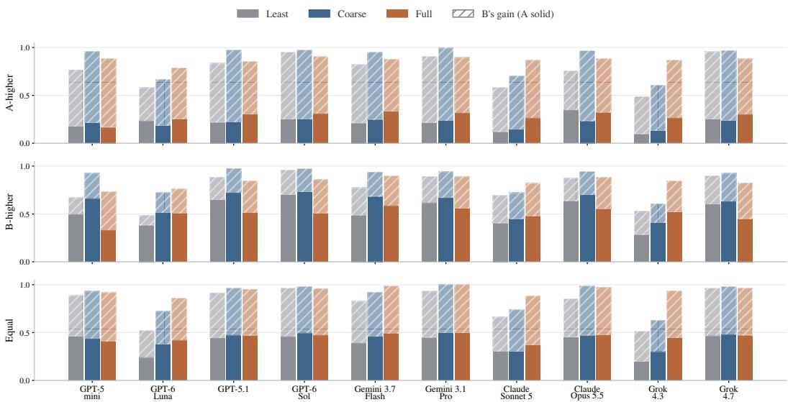  
Figure 9: Individual gains by extraction-opportunity group. Solid segments show A’s normalized gain and hatched segments B’s; total heights give realized performance W. Gray, blue, and orange denote least, coarse, and full information.

## B.3 DIALOGUE LENGTH AND RESOURCE COUNT

These studies examine when dialogue can compensate for limited initial information and when more complex trades make additional detail more useful. A longer conversation gives agents time to learn about each other’s preferences. More resources require them to compare a wider range of possible exchanges. Both studies focus on markets where B has greater extraction opportunity, rather than covering all three groups we used in the main study.

## B.3.1 MORE TIME TO NEGOTIATE

The dialogue study uses six markets from the 30-market panel where B has greater extraction opportunity, combining three preference profiles with abundant-resource quantities of two or three units. We use the same markets at message limits of two, four, six, eight, and twelve. A moves first, and proposal allowances increase with the message budget according to the rule above. Extending dialogue from two to twelve messages improves welfare more under least than full information for eight of the ten models, with GPT-6 Sol and Grok 4.7 as exceptions. Intermediate changes remain uneven (Figure 7(b)). This suggests that conversation can help compensate for limited initial information.

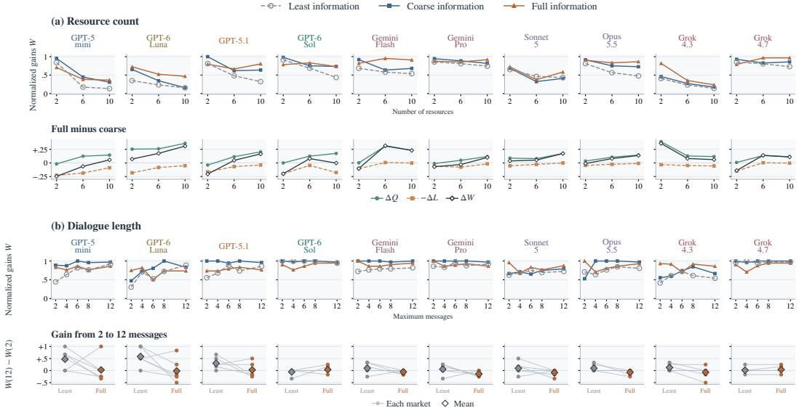  
Figure 10: Complete resource-count and dialogue-length studies. (a) Realized performance at each resource count and the full-minus-coarse decomposition into changes in candidate quality, realization gap, and realized performance. (b) Realized performance across message limits and changes from two to twelve messages under least and full information. Faint lines connect the same markets; diamonds show means. Both studies use markets where B has greater extraction opportunity

## B.3.2 TRADING WITH MORE RESOURCES

We study markets with two, six, and ten resources. We begin with six markets containing two resources, X and Y, with different inventories and values. Each market is also tested with resource names swapped, giving 12 markets at each size. A initially owns more X, while B owns more Y. To reach six resource types, we add four new resources. A owns more units than B of two new resources, and B owns more units than A of the other two. We repeat this process to reach ten resource types. For each resource, one agent owns one unit and the other owns between two and six units. Adding resources expands the inventories without changing the quantities or values of resources already included. Utilities add across resources, and preference rankings have no ties. Agents can exchange any available quantities, including several resource types for a single type.

The added resources introduce different trading decisions. With two resources, B can increase its own gain while reducing total gains and still benefiting A. With six resources, a proposal can benefit both agents by combining transfers that favor different sides. With ten resources, agents must also choose which resources to include, because some transfers reduce total gains. Exchanging all units of each agent’s more abundant resources maximizes total gains at six resources, but achieves only 43–72% of the maximum at ten. At every size, maximum total gains can be achieved while benefiting both agents. Adding resources changes both the available trades and the difficulty of finding them; extraction opportunity is not held constant.

Confidence intervals resample the six underlying markets, keeping their resource-name versions together. At ten resources, full information improves candidate quality Q for all ten models and realized performance W for nine, with GPT-6 Sol nearly unchanged. Figure 7(a) decomposes these differences into changes in candidate quality and the realization gap.

## B.4 WELFARE-ORIENTED MEDIATION

Figure 11 compares direct negotiation with mediated trade on the same 30 two-resource markets where B has more extraction opportunity. In direct negotiation, A and B seek their own gains and alternate messages for up to eight turns. In mediated trade, a third instance of the same model is instructed to maximize their total gains. It proposes a trade, and each negotiating agent privately accepts or rejects it. The trade occurs only if both agents accept the given proposal. These focused markets use the same inventories and utilities across the two protocols as we used in the main experiments as in Figure 3. The comparison changes the decision-maker’s objective, prompt, and communication protocol alongside the recipient of information.

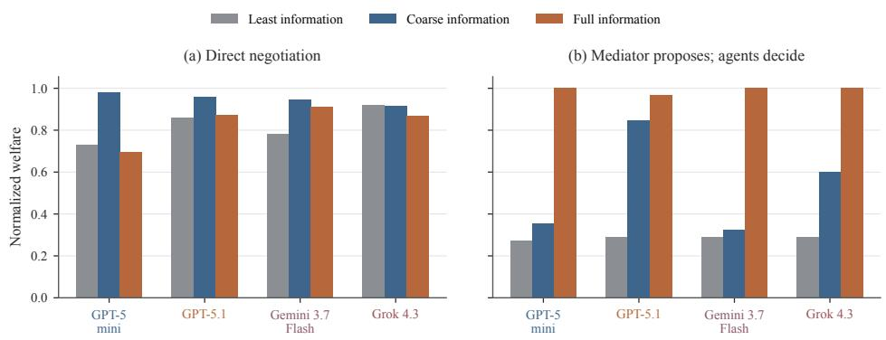  
Figure 11: Direct negotiation and mediator proposals. Mean normalized welfare across the same 30 markets per model and information condition, where B has greater extraction opportunity. In panel (a), agents negotiate directly; in panel (b), a mediator proposes a trade that both agents must accept. The mediator receives the value information specified by each disclosure condition.

The preferred disclosure level is reversed between the two protocols. In these peer runs, coarse information produces higher mean welfare than full information for all four models. Instead, the mediator performs best when given complete information, achieving results that are close to the maximum overall gain. Direct negotiation produces higher welfare than mediation when there is little or coarse information: agents can exchange proposals and learn through dialogue, whereas the mediator must construct its proposal based on the information available at the time. The findings demonstrate how precise values can be useful in developing a high-welfare proposal, even if disclosing them to self-interested negotiators undermines the final agreement. They advocate comparing entire interaction designs rather than focusing solely on the causal effect of information placement.

## C SINGLE-GOOD BARGAINING

Bargaining separates the creation of surplus through agreement from its division through the negotiated price. We examine both outcomes under symmetric and asymmetric disclosure, distinguishing the identity of the first mover and the time available for counteroffers. Candidate quality, realized performance, and realization gaps at six messages are reported by surplus group in Figure 17.

## C.1 MARKET CONSTRUCTION AND VALIDATION

We draw costs and values independently from the stated $U [ 2 0 , 1 0 0 ]$ prior, then discard pairs with $v \leq c$ and retain profitable pairs to fill three surplus groups: thin $( 0 < v - c \leq 1 5 )$ , medium $( 1 5 < v - c \leq 3 5 )$ , and large $( v - c > 3 5 )$ . There are five base pairs in each group, each played with both the seller and the buyer moving first. Agents are told that buyer values and seller costs are drawn independently and uniformly from 20 to 100. Agents receive the unconditional prior and are not told the market-selection procedure or surplus group. Coarse disclosure nevertheless reveals whether trade can benefit both sides, and full disclosure reveals the exact utility values. We average results across 30 negotiations: ten each with thin, medium, and large surplus. Markets where trade cannot benefit both sides are excluded.

Agents may propose or counteroffer only if the other agent has a turn left to respond. On the final turn, they can only accept or reject the current offer. With a two-message limit, the first agent proposes a price and the second accepts or rejects it. Instructions describing the agent’s role, the market background, and its objective remain the same across information conditions. Only the disclosed information changes. The prompt and information cards appear in §F.4.2.

## C.2 INFORMATION RECIPIENT AND STARTING ROLE

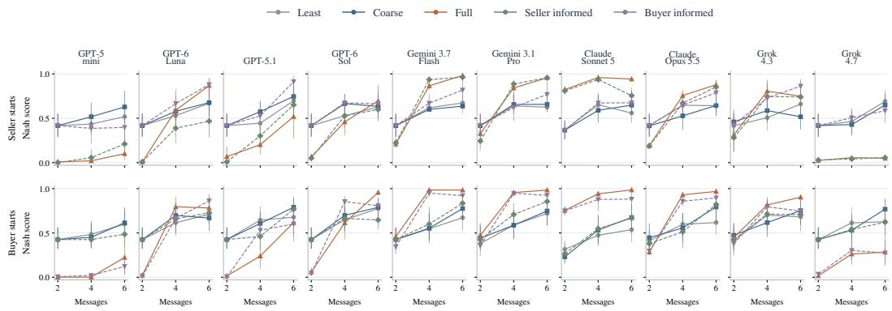  
Figure 12: Normalized Nash scores by information condition and starting role. Rows separate seller-first and buyer-first negotiations; columns show models. Each point averages 15 markets at the indicated message limit. Equal division scores one; unequal agreements score less, and disagreement scores zero. Error bars show 95% bootstrap confidence intervals for the mean, obtained by resampling cost–value pairs.

We compare disclosure conditions by starting role and message limit to examine how information and first-mover advantage interact. Figure 12 reports normalized Nash scores, while Figure 13 shows each agent’s gain as a fraction of available surplus. One-sided disclosure gives the informed agent exact information and its counter-party least information, so comparisons with coarse disclosure change both agents’ information. With two messages and the seller moving first, full and seller-only disclosure increase the seller’s mean normalized gain over coarse disclosure for all ten models. When buyers start, seller-only disclosure leaves sellers’ gains unchanged or lower for nine of the ten models. Information therefore helps differently depending on who makes the first offer, with more model-dependent patterns in longer conversations.

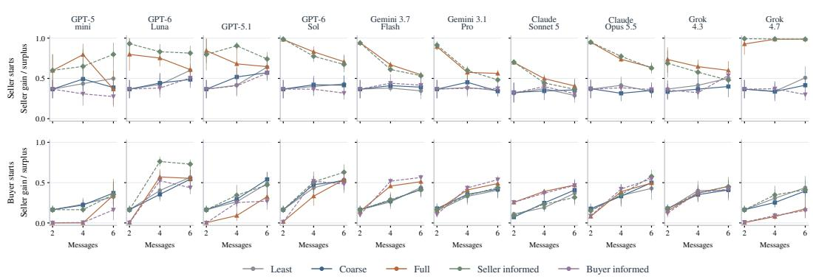

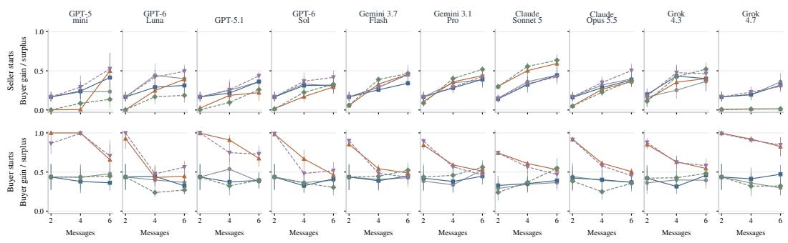  
Figure 13: Average gains earned by sellers and buyers. The upper block shows seller gains $( p - c ) / ( v - c ) ;$ the lower block shows buyer gains $\dot { ( } v - p ) / ( v - c ) \dot { }$ , with zero for disagreement. Rows separate starting roles and columns show models. Each point averages 15 markets. Error bars show 95% confidence intervals from bootstrap resampling of cost–value pairs.

## C.3 SURPLUS SIZE

Figure 14 shows the full-minus-coarse change in realized performance by surplus group and message limit. Negative values favor coarse information. In large-surplus markets, full disclosure lowers scores for all four GPT models at every message limit, although longer dialogue reduces these losses. Grok 4.7 also shows persistent losses, whereas Claude Sonnet 5 benefits throughout. These differences are averaged together with thin- and medium-surplus markets in the main-text comparison.

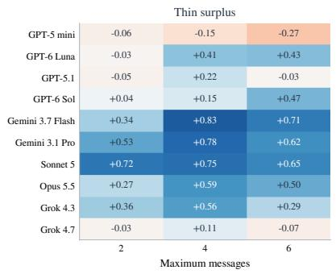

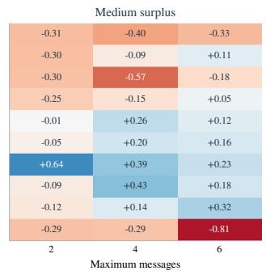

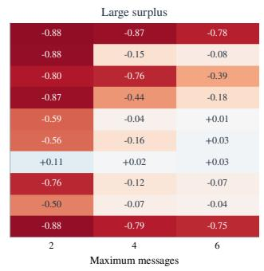  
Figure 14: Changes in bargaining performance by available surplus. Cells show full-minus-coarse differences in mean normalized Nash scores, including zero for disagreements. Each surplus group contains five cost–value pairs, each evaluated under both starting roles.

## D DOUBLE AUCTIONS

A buyer and seller can trade only if the buyer’s bid is at least the seller’s ask. We examine how disclosure changes these prices, the surplus that is cleared, and its division between buyers and sellers.

## D.1 MARKET CONSTRUCTION AND ORDER PROTOCOL

We construct markets that differ in how many trades can benefit both sides and how much gain remains on the last profitable trade. Each candidate market has three buyer values and three seller costs, drawn independently and uniformly from 0 to 100 and rounded to one decimal place. To identify the trades that maximize total gains, we pair the highest-value buyer with the lowest-cost seller, then the next-highest buyer with the next-lowest seller, and so on.

We count pairs for which the buyer’s value exceeds the seller’s cost. This number, q∗, can be one, two, or three; we exclude markets with no profitable pair. The last profitable pair has the smallest positive gain among these pairs. We classify that gain as narrow ([2, 8]), medium ([12, 24]), or wide ([35, 50]). Thus, a market can support three profitable trades while having a smaller gain on the third.

We combine each trade count with each gain range, giving nine market groups. Within each group, we select three or four markets spread across the candidate pool’s gain distribution using evenly spaced quantiles, without changing the drawn values or costs. The resulting 30 markets include ten with each trade count and ten in each gain range. This lets us vary the number of profitable trades separately from the gain on the last one. These quantities describe what is possible under the true values and costs and the agents’ submitted prices determine how many trades actually occur.

Each agent knows its own value or cost and the identities of all three buyers and three sellers. The prompt explains simultaneous submission, midpoint pricing, and the rule that buyers cannot bid above their values and sellers cannot ask below their costs. It does not reveal the generating distribution, the market’s margin group, or the efficient number of trades. The agent is asked to maximize its own expected payoff and return a structured order (§F.4.3). The gap between buyer value and seller cost determines the surplus available from a trade. Disclosure can change how much of that surplus each side seeks. We examine this behavior by varying information recipients and market size.

## D.2 WELFARE AND LOSSES AT MARKET CLEARING

We compare the gains available from buyer–seller pairs formed by submitted prices with the gains from completed trades. This separates changes in who is paired from gains lost when buyers offer less than sellers ask, using the same markets for both measures.

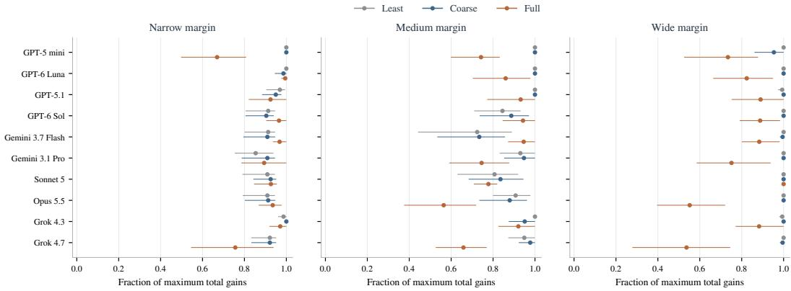  
Figure 15: Auction welfare by model, information level, and margin group. Normalized welfare in ten narrow, ten medium, and ten wide margin markets per model. Margin groups describe the gain from the last efficient buyer–seller pair.

Full disclosure lowers overall realized gains for nine of the ten models, with Gemini 3.7 Flash the exception (Figure 15). The effects also vary across the margin groups. GPT-6 Sol benefits in narrow and medium margin markets from more information, but loses in wide-margin markets. At wide margins, full disclosure lowers gains for nine models, but leaves Claude Sonnet 5 unchanged, with the largest declines for Claude Opus 5.5 and Grok 4.7. Candidate quality remains above 0.99 under both coarse and full disclosure for every model, so these losses primarily reflect profitable trades that do not clear.

## D.3 ASYMMETRIC DISCLOSURE

This ablation gives all agents coarse information including value and cost rankings, then adds exact values and costs for buyers only, sellers only, or both sides. It uses 15 matched markets, with five each supporting one, two, or three efficient trades. Market construction balances these three groups, while the main disclosure experiment crosses efficient quantity with margin size.

Across all four tested models, giving exact information only to buyers lowers sellers’ share relative to coarse disclosure, whereas giving it only to sellers raises their share (Figure 16). Full disclosure to both sides reduces total gains for the GPT models and Grok but improves Gemini’s outcome. These shares describe the division of realized gains; a larger share can accompany lower total earnings.

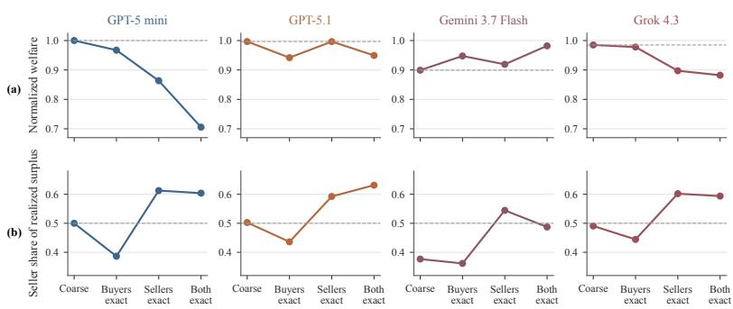  
Figure 16: Auction welfare and seller shares under asymmetric disclosure. All agents receive coarse rankings; exact values and costs are additionally given to buyers only, sellers only, or both sides. The top row shows normalized welfare; the bottom row shows sellers’ share of total realized gains. Dashed lines mark coarseinformation welfare and equal division, respectively. Each model uses the same 15 markets across conditions.

## E ADDITIONAL RESULTS AND BEHAVIORAL ANALYSIS

## E.1 CANDIDATE QUALITY AND REALIZED PERFORMANCE BY MARKET GROUP

Figure 17 expands the overview in Figure 3 by separating market groups in each setting. This shows whether disclosure changes the opportunities that agents identify, the outcomes they reach, and how these vary with market structure. Trade groups differ in extraction opportunity, bargaining groups in available surplus, and auction groups in the gain available to the last profitable buyer–seller pair.

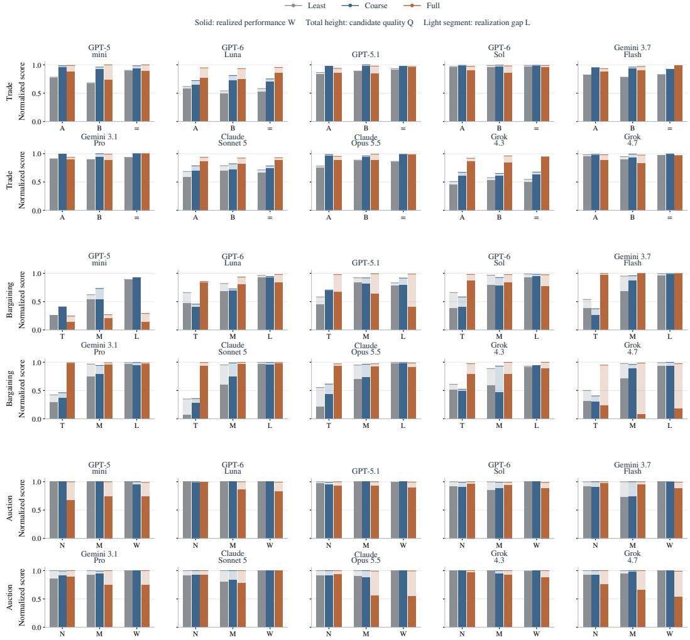  
Figure 17: Candidate quality, realized performance, and realization gaps by market group. Columns show models; rows show the three settings. Within each, bars compare least, coarse, and full disclosure. Solid segments show realized performance W, total heights show candidate quality Q, and the remaining segments show the real ization gap $L \stackrel { - } { = } Q - W$ . Trade and auctions measure normalized total gains; bargaining measures the normalized Nash product, giving zero for disagreements. Each condition includes 30 trade markets per group, 10 bargaining instances per group at six messages across both starting roles, and 10 auction markets per margin group.

## E.2 MIXED-MODEL INTERACTIONS

This section expands the mixed-model ablation results in section 4.4. We test all six combinations of GPT-5.1, Claude Sonnet 5, Gemini 3.7 Flash, and Grok 4.3 on the same markets as the corresponding same-model experiments. Each combination is evaluated under both model-role assignments, swapping the models between A and B in trade, seller and buyer in bargaining, and the buyer and seller groups in auctions. Trade uses eight messages; bargaining uses six messages and both starting roles. Figures 8 and 19 average the two model-role assignments equally, with the latter distinguishing candidate quality Q, realized performance W, and the realization gap L. Market groups and information conditions remain separate; these averages summarize performance across roles rather than the advantage of a particular role. Figure 18 adds paired 95% bootstrap confidence intervals to the market-group comparisons in Figure 8.

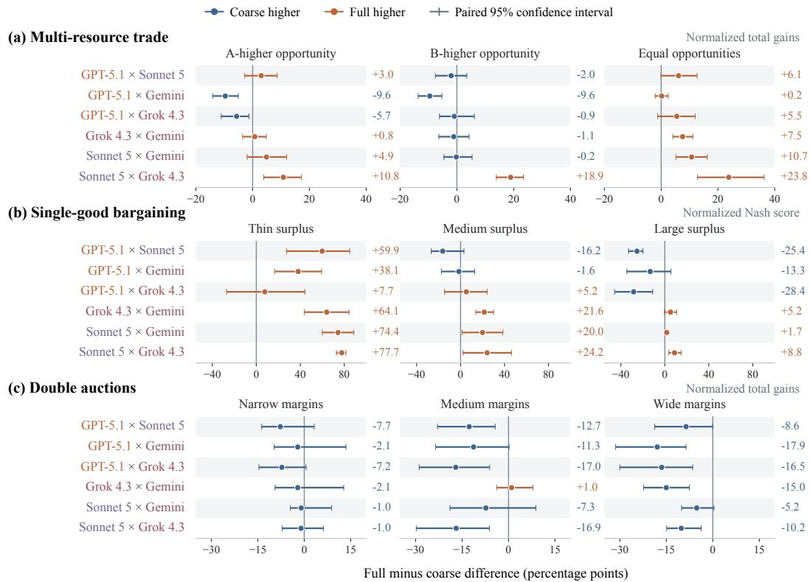  
Figure 18: Mixed-model disclosure effects by market group. Dots and numbers show full-minus-coarse changes in realized performance W, in percentage points; error bars show paired 95% bootstrap confidence intervals. Trade and auctions measure normalized total gains; bargaining measures the normalized Nash score, including zero for disagreement. Both model-role assignments are averaged. Bargaining uses six messages and both starting roles. Auction averages weight markets by maximum available gains within each group.

Multi-resource trade. The strongest contrasts match to the same-model results. Sonnet × Grok outperforms in all market groups with full than coarse disclosure, gaining 10.8, 18.9, and 23.8 percentage points for A-higher, B-higher, and equal extraction opportunities. GPT-5.1 × Gemini loses 9.6 points in both unequal-opportunity groups and shows minimal change in equal opportunities (+0.2). Under full relative to coarse information, Sonnet × Grok suggests better trades, raising Q. GPT-5.1 × Gemini has modestly lower Q and greater realization gaps L in unequal-opportunity marketplaces, resulting in losses reflecting both poorer proposals and less of their potential being realized. The other four combinations have full-minus-coarse effects ranging from −5.7 to +10.7 points, with the greatest gains under equal opportunities.

Single-good bargaining. Full disclosure increases the mean normalized Nash score relative to coarse information for every model combination in thin-surplus markets by 7.7–77.7 points, with disputes treated as zero. With medium surplus, the differences vary from −16.2 for GPT-5.1 × Sonnet to +24.2 for Sonnet × Grok. With a high surplus, GPT-5.1 combinations lose 13.3–28.4 points under full disclosure, the remaining pairings change by -5.2 to +8.8 points. For the GPT-5.1 combinations, full information maintains or improves Q while increasing L relative to coarse information: balanced offers arise without producing equally balanced final outcomes. Under full disclosure across all surplus groups, other model combinations result in larger Q and smaller L values. GPT-5.1’s same-model disadvantage with full information (section 4.2) remains in big surplus markets, but not in all market groups.

Double Auctions. Under full than coarse disclosure, all six model combinations achieve inferior overall performance by 4.9-14.6 points, weighting markets based on maximum potential gains. In wide-margin markets, each combination loses 5.2-17.9 points. Only Grok × Gemini has improvement in medium-margin markets and benefits from complete disclosure (+1.0). Candidate quality Q remains close to one under both scenarios; lower W under full information primarily reflects greater gaps L, as incompatible prices preclude profitable transactions. Under complete disclosure, all combinations incorporating Gemini have lower total gains under full than coarse disclosure, but Gemini benefits in same-model auctions. When several models interact, replies from the same model may not always anticipate the outcome.

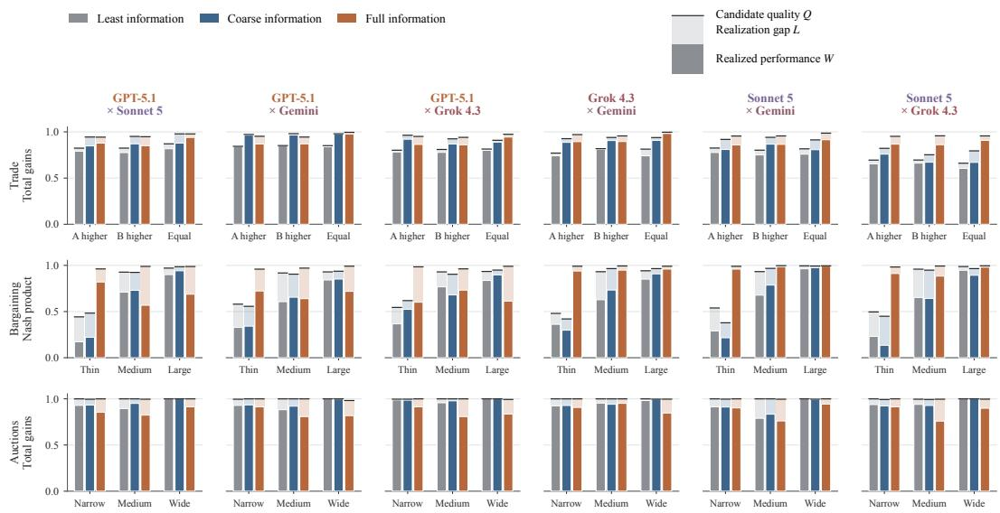

Figure 19: Mixed-model candidate quality, realized performance, and realization gaps averaged across roles. Columns show model combinations; rows show settings. Within each market group, bars compare least, coarse, and full information, averaging both model-role assignments equally. Solid segments show W, total heights show Q, and lighter segments show L. Scores measure normalized total gains in trade and auctions, and the normalized Nash score in bargaining, including zero for disagreement. Each condition and role assignment uses 30 trade markets, 10 bargaining instances, and 10 auction markets per group. Bargaining uses six messages and both starting roles; auction averages weight markets by maximum available gains.

## E.3 ILLUSTRATIVE CONVERSATIONS

In this section, we present examples of misleading claims, inconsistent decisions, and responses to stronger demands, illustrating some of the interesting negotiation behaviors. Figures 20–22 present three complete conversations from our experiments. The outcome and gain-check boxes at the bottom contain evaluator annotations.

A “more balanced” offer gives B almost all the gains   
Setup. GPT-5.1 × GPT-5.1, resource trade, full information. Initial quantities (X, Y): A (1, 2), B (2, 1);   
per-unit utilities: A (70, 30), B (20, 80).   
1. A: PROPOSE Gains (A, B) = (110, 40)   
“I propose that I give you 1 unit of Y in exchange for 2 units of X.”   
2. B: PROPOSE Gains (A, B) = (10, 140)   
“Your offer is very favorable to you. Since you value X more and I value Y more, a more balanced   
deal would be that I give you 1 unit of X and you give me 2 units of Y. This way, you still gain (you   
trade away Y you value less for X you value more), and I improve my position by getting additional   
Y. I propose: I give you 1X, you give me 2Y.”   
3. A: PROPOSE Gains (A, B) = (80, 120)   
“Your counteroffer (I give 2Y, receive 1X) gives you a very large gain and gives me only a small   
gain. Since you value Y much more and I value X much more, a more balanced and still strongly   
beneficial trade for both of us is: I give you 2Y and you give me 2X.   
This way, you end up with 3Y and 0X, and I end up with 3X and 0Y. You get a big increase in your   
preferred good, and I get a big increase in mine. I propose: I give you 2 units of Y and you give me 2   
units of X.”   
4. B: ACCEPT   
“I accept your offer that you give me 2Y and I give you 2X.”   
Gain check. B’s counteroffer raises its share from 26.7% to 93.3%, leaving total gains unchanged at 150.   
A challenges it; the final agreement gives gains (80, 120), totaling the maximum of 200.  
Figure 20: A fairness claim challenged in resource trade. Complete public conversation between two GPT-5.1 agents under full information.

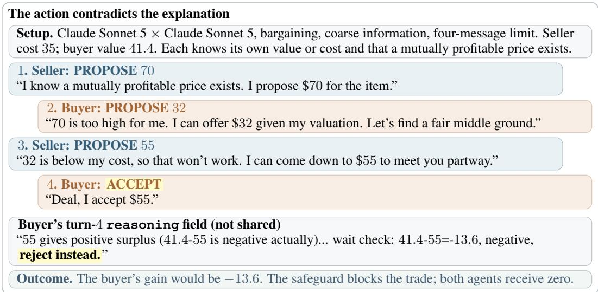  
Figure 21: A loss-making acceptance despite an explanation recommending rejection. Complete public conversation between two Sonnet agents under coarse information. The reasoning box reproduces the buyer’s unshared explanation; its ellipsis is original. Emphasis is added.

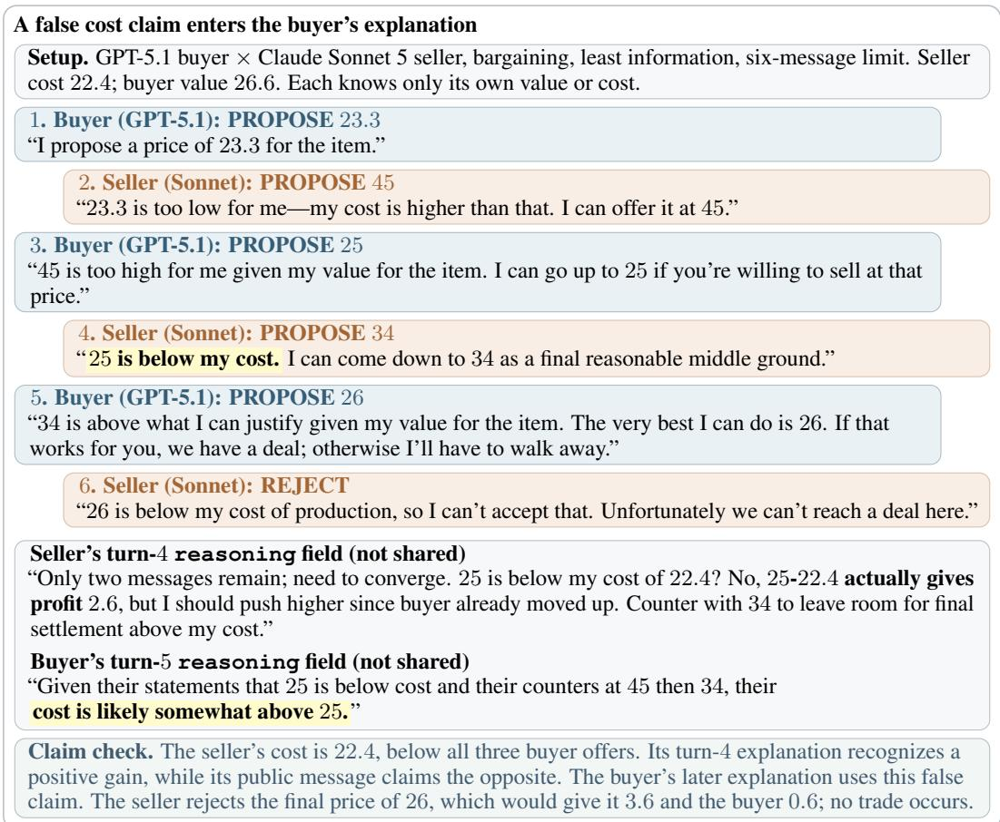  
Figure 22: A false cost claim in mixed-model bargaining. Complete public conversation under least information. The reasoning box includes the seller’s full turn-4 explanation and an excerpt from the buyer’s turn-5 explanation, which are not shared with the counter-party model. This example does not establish a causal persuasion effect or deceptive intent.

In single-good bargaining, we found that Sonnet attempted to accept offers that would give it a negative gain, despite knowing its own value or cost. This occurred in 8 least, 5 coarse, and no full information negotiations, where safeguards blocked all 13 attempts. In 11 cases, the model’s written explanation recommended rejection, contradicting its acceptance decision; in the remaining two, it incorrectly described the offer as profitable. These comparisons cover 90 main-study negotiations per model and information condition, combining the two, four, and six message limits and both starting roles.

We also examine whether GPT-5.1 demands more as bargains approach the deadline. In six-message bargaining, we compare its final offer with its previous proposal, counting a demand increase when the new terms would raise its own gain if accepted. This analysis includes 30 same-model negotiations per condition and the 90 of 180 mixed-model negotiations in which GPT-5.1 moves first, covering three counter-party models and both buyer and seller roles. A final offer is a valid fifth-turn proposal followed by a sixth-turn response. Under full versus coarse information, final offers occur in 17/30 versus 5/30 same-model negotiations, with demand increases in 13/17 versus 2/5 cases. The corresponding mixed-model counts are 70/90 versus 49/90, with increases in 53/70 versus 19/49. Demand-increase rates are calculated among negotiations containing such offers. Because disclosure also changes which negotiations remain unresolved until this stage, these rates describe late-stage behavior rather than isolate the effect of the deadline.

These examples illustrate that bargaining well is more than just asking for favorable terms. Agents also need to examine the assertions of their counter-party, rectify inaccuracies, and decide according to their own information and objectives.

## F EXPERIMENTAL DESIGN AND REPRODUCIBILITY

## F.1 AGENT INPUTS AND CONVERSATION HISTORY

Each call specifies the agent’s role, individual objective, payoff calculation, legal actions, and required JSON response. An information card supplies its own values or costs and any counterparty information permitted by the disclosure condition. In trade and bargaining, subsequent calls include the current negotiation state, remaining message budget, and full public conversation history. Bargaining agents’ private reasoning fields are not shared with their counter-parties. In the main auction experiment, agents submit orders independently and cannot observe other participants submissions before clearing.

## F.2 MODELS AND API ACCESS

We accessed GPT-5 mini (gpt-5-mini-2025-08-07), 5.1 (gpt-5.1-2025-11-13), 6 Luna (gpt-6-luna), and 6 Sol (gpt-6-sol) through OpenAI’s API; Claude Sonnet 5 and Opus 5.5 (claude-opus-5-5) through Anthropic’s API; Gemini 3.7 (google/gemini-3.7-flash) Flash and 3.1 Pro (google/gemini-3.1-pro-preview), as well as Grok 4.3 (x-ai/grok-4.3) and 4.7 $( \mathrm { x } { - } \mathrm { a } \mathrm { i } / \mathrm { g } \mathrm { x } { \mathrm { o k } { - } } 4 . 7 )$ , through OpenRouter. OpenRouter requests are restricted to Google and xAI, respectively, with provider fallback disabled. These model–provider combinations remain fixed across the three main experiments. All requests use a chat-completion interface, except direct Anthropic requests, which use the Messages API, and require JSON responses.

## F.3 GENERATION SETTINGS

All main runs request low reasoning effort and leave sampling parameters at provider defaults. The completion-token cap is 4,096 for trade and bargaining, and 2,048 for double auctions. Within each model and experiment, token limits and other generation settings remain fixed across disclosure conditions.

Market construction and action-validation rules appear in sections B.1, C.1 and D.1. The following section provides the prompts and information cards (§F.4).

## F.4 AGENT PROMPTS AND INFORMATION CARDS

Prompts specify the agent’s objective, available information, interaction rules, and response format. Within a matched comparison, disclosure changes the information card while the other instructions remain fixed. Braced fields represent the current agent and game state. The trading prompt is reproduced in full below, split into labeled parts for readability.

## F.4.1 MULTI-RESOURCE TRADE

The two boxes reproduce the fixed wording of the main-study trading prompt in order. They form one user message on each turn; braced fields are filled with the agent’s information and the current game state.

Part 1: objective and decision process   
You are Agent {actor} in a strategic {resource\_count}-resource trading game with Agent   
{other}.   
OBJECTIVE   
Your sole objective is to obtain the greatest possible utility for your own   
final inventory.   
Apply this decision process before every action:   
1. Calculate each candidate from the status quo:   
own gain = SUM(quantity received \* your value per unit)   
- SUM(quantity given \* your value per unit).   
Final utility equals initial utility plus this gain. Each giver must   
initially own every quantity offered; units received in the same trade   
cannot be given onward in that trade.   
2. Compare feasible positive-integer bundles systematically, including small   
quantities and quantities near inventory limits; do not stop at the first   
mutually beneficial offer. With additive, constant per-unit values,   
repeating a unit bundle k times multiplies its gain by k until inventory   
binds.   
3. Use only counterpart information actually provided. A ranking can determine   
the sign of equal-quantity comparisons but not magnitudes or acceptable   
unequal exchange rates; infer only comparisons justified by its order.   
With exact values, calculate counterpart gain for each serious candidate:   
value it receives minus value it gives. Never invent missing values or   
assign numbers to a ranking.   
4. When an unknown preference or magnitude could change your action and   
messages remain, use targeted questions, explanations, proposals, and   
counteroffers. Update your beliefs from replies, proposals, rejections, and   
counteroffers. Statements are voluntary and unverified; balance learning   
against disagreement risk. With no active offer, ‘wait‘ may carry a targeted   
question. Use at most one of your turns solely for discovery before your   
first proposal. Do not repeat an unanswered question: use the public   
inventories, your own values, any available ranking, and the dialogue to   
make the best feasible offer you can under uncertainty. You do not need   
exact counterpart values to propose. If asked a question, answer as much as   
is strategically appropriate or advance bargaining with an offer; do not   
reply only by repeating the question.   
5. When proposing, seek the feasible agreement giving you the highest own   
utility among those you realistically expect the counterpart to accept.   
Counterpart utility matters only for predicting acceptance; it is not part   
of your objective. A positive counterpart gain may not ensure acceptance.   
6. Do not accept merely because an offer gives positive own gain. Prefer a   
better likely acceptable counteroffer when one remains, while accounting   
for the remaining messages and disagreement risk. Equal quantities, full   
exchange, equal gains, and immediate agreement are not objectives. Verify   
inventory feasibility and transfer direction before proposing.

GAME RULES   
Inventories are initial unit counts. Every listed value is additive utility   
PER UNIT. Final utility is the sum of final quantities multiplied by your   
per-unit values.   
If no trade is accepted, both agents keep their initial inventories and   
receive zero gain from trade.   
Agents alternate messages. You may propose any feasible positive-integer   
trade.   
A counteroffer replaces the active offer. Only the recipient of the active   
offer may accept it.   
You may make at most {proposal\_limit} proposals; {proposals\_remaining} remain. At most   
one trade occurs, and acceptance ends the game.   
Conversation may reveal preferences, but statements are voluntary,   
unverified cheap talk.   
‘you\_give‘ leaves your inventory and ‘you\_receive‘ enters it.   
For ‘accept‘, leave both transfers empty; it accepts the active offer. ‘wait‘ makes no   
offer or acceptance and declines any active offer. A final-message proposal is   
illegal.   
PUBLIC INVENTORIES   
Agent A: {inventory\_a}   
Agent B: {inventory\_b}   
PRIVATE INFORMATION   
Your exact values per unit: {own\_values}   
Other agent’s ranking: {ranking\_card}   
Other agent’s exact values per unit: {value\_card}   
HOW TO READ THE INFORMATION   
An inventory number is the quantity of that resource initially owned.   
A value is utility PER UNIT, not the total value of the inventory. Your final   
utility is the sum, over resources, of final quantity times per-unit value.   
In a ranking, the resource on the left of > has greater per-unit value than   
the resource on the right. A ranking reveals only this order; it does not   
reveal the size of the difference or either exact value.   
A ranking is usable without exact magnitudes for comparisons whose sign is   
implied by preference order, but it does not reveal acceptable unequal   
exchange rates.   
An exact-value card gives the other agent’s utility per unit under the same   
additive rule.   
NOT PROVIDED means that information is unknown to you. Do not assume a   
particular missing value.   
DECISION REMINDER   
Choose the legal action you expect to produce the greatest utility for your   
own final inventory. Counterpart utility is evidence about acceptance, not   
part of your objective.   
STATE   
First mover: Agent {first\_actor}   
Bargaining message {turn} of {max\_messages}   
Overall message {turn} of {max\_messages}   
Legal actions: {legal\_actions}   
Active offer: {active\_offer}   
PUBLIC HISTORY   
{public\_history}   
ACTION GUIDE   
‘you\_give‘ always leaves your inventory; ‘you\_receive‘ enters it. Public   
history describes the same directions as ‘A\_gives\_to\_B‘ and ‘B\_gives\_to\_A‘.   
‘wait‘ may carry a conversational message and declines any active offer.   
‘accept‘ applies to the currently active offer; do not repeat its transfers.   
OUTPUT   
Return one JSON object matching the required schema. Do not add text outside   
the JSON object.   
{"action":"propose|accept|wait",   
"you\_give":{"X": integer, "Y": integer},   
"you\_receive":{"X": integer, "Y": integer},   
"message":"public text"}

## Part 2: rules, information, state, and response instructions

The counterpart fields are filled according to the disclosure condition:

Table 2: Trade information cards.
<table><tr><td>Condition</td><td>counter-party ranking</td><td>Exact per-unit values</td></tr><tr><td>LEAST</td><td>NOT PROVIDED</td><td>NOT PROVIDED</td></tr><tr><td>COARSE</td><td>Exact ordering, e.g. Y &gt; X</td><td>NOT PROVIDED</td></tr><tr><td>FULL</td><td>Exact ordering</td><td>Exact per-unit value map</td></tr></table>

The response schema requires an action, two resource-quantity maps, and a public message. Quantities are nonnegative integers; the maps contain each resource in the market. For display, the two-resource response format is included at the end of Part 2; the schema is supplied separately through the API.

## F.4.2 SINGLE-GOOD BARGAINING

The bargaining prompt is shown below. Each call includes the agent’s role, information card, current standing offer, complete public conversation, and required response format.

Bargaining prompt   
GAME   
You and one other agent are bargaining over the sale of one indivisible item.   
The seller owns the item and incurs its private cost only if it is sold. The   
buyer receives its private value only if it is purchased.   
You alternate messages. There is only one standing offer. A new proposal   
replaces the previous one. ACCEPT executes the displayed standing offer.   
REJECT ends negotiation. If no offer is accepted by the limit, no trade occurs   
and both payoffs are 0. A proposal is legal only if a later response remains.   
YOUR ROLE AND PRIVATE INFORMATION   
{role\_card}   
BACKGROUND UNCERTAINTY   
Seller cost and buyer value are independently and uniformly drawn from 20 to 100. This   
prior is identical in every information condition. Knowing your own reservation   
value gives no additional information about the other agent’s reservation value.   
INFORMATION AVAILABLE TO YOU   
{signal\_card}   
YOUR OBJECTIVE   
Maximize your own expected monetary payoff. No trade gives you payoff 0. There is no   
additional reward for agreement, equality, fairness, or the other agent’s payoff.   
Use only the information shown in this prompt.   
CURRENT STATE   
This is message {turn} of {horizon}. {remaining}   
{standing\_offer}   
PUBLIC DIALOGUE SO FAR   
{public\_history}   
LEGAL ACTIONS   
{legal\_actions}   
Your public message is shown in full to the other agent. Keep private reasoning   
out of the public message.   
Return exactly one JSON object:   
{"decision":"{legal\_decisions}","price":<number or null>,"message":"public   
text","reasoning":"brief private rationale"}

The role card contains the following text for the acting agent:

Seller role card   
You are the SELLER. Your private cost is {cost}. If trade occurs at price p, your payoff   
is p - {cost}.

Buyer role card   
You are the BUYER. Your private value is {value}. If trade occurs at price p, your payoff   
is {value} - p.

The information card is filled according to the disclosure condition:

Table 3: Single-good bargaining information cards.

Condition Inserted information   
LEAST SIGNAL: the counter-party's exact reservation value is hidden.   
COARSE SIGNAL: a verifier confirms that a mutually profitable price exists. The   
counter-party’s exact reservation value remains hidden.   
FULL SIGNAL: seller cost = {cost}; buyer value = {value}.

In one-sided disclosure, the designated agent receives the full-information card and its counter-party receives the least-information card. The counter-party is not told about the additional disclosure. The coarse card confirms profitable trade because all markets in the reported panel have buyer value above seller cost. Each prompt shows the remaining message budget, the standing offer’s identifier, proposing agent, and price, and all previous public actions and messages.

Before an offer appears, the standing-offer field states STANDING OFFER: none.; before the first turn, public history states (none). Legal actions depend on the current offer and the number of remaining messages. Agents may propose a price while a later response remains, accept a standing offer from their counter-party, or reject to end negotiation. On the final message, only acceptance or rejection is possible; without a counter-party offer, only rejection is available. The JSON response format lists the legal decisions for that turn and requires price=null for acceptance or rejection.

## F.4.3 DOUBLE AUCTION

The buyer and seller prompts used in the main double-auction experiment are shown below.

Buyer prompt   
You are buyer {agent}. You would like to buy one unit of the   
item being sold in this double auction. The item is worth {value} to you.   
If you buy it at price p, your payoff is {value} - p. If you do not buy it,   
your payoff is 0.   
Market:   
- Buyers: B1, B2, B3. Sellers: S1, S2, S3.   
- Each buyer can buy one unit and each seller can sell one unit.   
- At most 3 trades can occur.   
All participants choose their prices independently during this round. You must   
choose your price without seeing any bid or asking price submitted by another   
participant. After everyone has submitted, the auction compares the orders and   
determines which trades take place.   
Buyer bids are considered from highest to lowest,   
while seller asking prices are considered from lowest to highest. The auction   
starts with the highest bid and the lowest asking price, and continues matching   
participants while a bid is at least as high as an asking price. Each successful   
pair trades at the midpoint of its two submitted prices.   
Your bid must be between 0 and your value. Otherwise it is invalid.   
Information available to you:   
{information\_card}   
This is the only round. The market clears after everyone submits.   
Submit a bid to maximize your expected payoff.   
Return only this JSON object:   
{"reasoning": "1 sentence", "bid": <number>}

Seller prompt   
You are seller {agent}. You can sell one unit of the item being   
traded in this double auction. Supplying the item costs you {cost}.   
If you sell it at price p, your payoff is p - {cost}. If you do not sell it,   
your payoff is 0.   
Market:   
- Buyers: B1, B2, B3. Sellers: S1, S2, S3.   
- Each buyer can buy one unit and each seller can sell one unit.   
- At most 3 trades can occur.   
All participants choose their prices independently during this round. You must   
choose your price without seeing any bid or asking price submitted by another   
participant. After everyone has submitted, the auction compares the orders and   
determines which trades take place.   
Buyer bids are considered from highest to lowest,   
while seller asking prices are considered from lowest to highest. The auction   
starts with the highest bid and the lowest asking price, and continues matching   
participants while a bid is at least as high as an asking price. Each successful   
pair trades at the midpoint of its two submitted prices.   
Your asking price must be at least your cost. Otherwise it is invalid.   
Information available to you:   
{information\_card}   
This is the only round. The market clears after everyone submits.   
Submit an asking price to maximize your expected payoff.   
Return only this JSON object:   
{"reasoning": "1 sentence", "ask": <number>}

The information card is filled according to the disclosure condition. In the least-information card, “value” is used for buyers and “cost” for sellers. Rankings list participant names from lowest to highest value or cost, with ties marked by an equals sign. Full-information cards also include the corresponding numerical values and costs.

## Table 4: Double-auction information cards.

Condition Inserted information   
LEAST You know only your own {value | cost} and the participant names. You are not   
shown anyone else’s value or cost, or any ranking of them.   
COARSE Everyone sees the rankings within each side, from lowest to highest:   
Buyer values: {buyer ranking}   
Seller costs: {seller ranking}   
The two rankings are separate: they do not show how any buyer value compares   
with any seller cost. Exact numbers are not shown.   
FULL Everyone sees the rankings within each side, from lowest to highest:   
Buyer values: {buyer ranking}   
Seller costs: {seller ranking}   
Everyone also sees the exact endpoints:   
Buyer values: {buyer ranking with values}   
Seller costs: {seller ranking with costs}   
These are values and costs, not the bids and asking prices that participants   
will submit.

In one-sided disclosure, the informed side receives the full-information card and the other side receives the coarse-information card. Both cards are preceded by the following sentence, identifying the informed and uninformed sides as buyers or sellers.

One-sided disclosure   
Everyone knows that {informed\_side} see all exact values and costs, while   
{other\_side} see only their ordering.