# WaSP: Wasserstein Data Synthesis Pipeline for Solver-Free Operator Learning

\* Ryan Liu ryanliu@caltech.edu California Institute of Technology Pasadena, CA, USA

Chuwei Wang\* chuweiw@caltech.edu   
California Institute of Technology   
Pasadena, CA, USA   
Ricardo Baptista r.baptista@utoronto.ca   
University of Toronto   
Toronto, ON, Canada   
Andrew Stuart astuart@caltech.edu   
California Institute of Technology   
Pasadena, CA, USA

Anima Anandkumar California Institute of Technology Pasadena, CA, USA

anima@caltech.edu

## Abstract

Neural operators ofer fast surrogates for solving PDEs, but training them typically requires expensive input–solution pairs. Two solver-free alternatives include physics-informed learning and training on manufactured data. Physics-informed learning approximates solutions by minimizing PDE residuals. While the residual norm must be strong enough to control solution error, stronger norms increase mini-batch variance and hinder optimization. Manufactured data constructs input–solution pairs for learning by applying the PDE operator to artificial solutions. However, the resulting training distribution can be mutually singular with the target distribution, yielding poor accuracy on the target distribution. We introduce the Wasserstein Data Synthesis Pipeline (WaSP), which trains on manufactured input–solution pairs while gradually mitigating the distribution shift. WaSP synthesizes new pairs by applying the learned operator to a path of intermediate distributions converging to the target input distribution. Training proceeds in stages along this path. At each stage, the previous surrogate generates solutions, and the exact PDE operator derives corresponding inputs, yielding training pairs for the next surrogate. Theoretically, we prove a stepwise error-propagation bound for the distribution shift introduced during synthesis. Empirically, WaSP reduces solution error by 3.9× to 9.5× compared to existing solver-free methods on PDEs such as Allen–Cahn, Kuramoto–Sivashinsky, and Ginzburg–Landau, and better reproduces the two chaotic systems’ statistical observables.

Keywords: solver-free operator learning, neural operators, manufactured data, physics-informed neural operators, optimal transport

## 1 Introduction

Operator learning constructs mappings between function spaces, such as solution operators that map input conditions to the corresponding solutions of partial diferential equations (PDEs). Neural operators parametrize these maps and, once trained, replace numerical solvers at inference time (Li et al., 2021; Lu et al., 2021; Kovachki et al., 2023). They are now applied where repeated high-fidelity simulation is expensive or infeasible, including fluid dynamics (Cao et al., 2025), weather forecasting (Pathak et al., 2022), quantum many-body dynamics (Waugh et al., 2026), astrophysical accretion and feedback (Bhojwani et al., 2025), and chaotic-system surrogates (Wang et al., 2024a).

However, the standard training pipeline remains data-intensive. Mainstream methods are trained by supervised regression on input–solution pairs, often obtained from numerical solvers, laboratory measurements, or observational data. Acquiring them at scale can be challenging; simulating a chaotic or multiscale system often requires fine spatial–temporal resolution and expensive implicit solves, and laboratory and observational data are sparse, noisy, and constrained by the measurement setup. Large curated datasets are available for selected benchmark and operational settings (Li et al., 2008; Hersbach et al., 2020; Takamoto et al., 2022; Ohana et al., 2024), but not for all equations, parameter regimes, geometries, or physical systems. We therefore study solver-free operator learning, that is, training a neural operator without any solver-generated solution label for the target inputs.

Physics-informed learning is a mainstream solver-free operator learning paradigm, which replaces solution labels with an equation-derived loss. Physics-informed neural networks (PINNs) instantiate the idea for learning a single PDE instance; it directly parametrizes the solution function with a neural network that maps points in its domain to the corresponding solution values and learns from the PDE residual and boundary constraints (Raissi et al., 2019). Physics-informed neural operators (PINOs) extend the principle from single PDE instances to operator learning (Li et al., 2024; Goswami et al., 2023). However, training with physics-informed objectives encounters two obstructions. (1) A small residual loss is not automatically a reliable certificate of solution quality. Its validity depends on whether the residual norm aligns with the stability properties of the PDE (Wang et al., 2022a). (2) Nonlinear terms and high-order derivatives in the PDE operator enter the computation graph directly, and the resulting composite objective is dificult to optimize (Wang et al., 2021; Krishnapriyan et al., 2021). We survey the proposed mitigations in Section 7.

Another solver-free route reverses the usual data-generation direction. Instead of solving the PDE from inputs to solutions, it samples artificial solutions and applies the PDE operator to obtain the corresponding input conditions(Hasani and Ward, 2024; Sojitra and San, 2025; Bischof et al., 2026). Applying the PDE operator is far cheaper and more parallelizable than a numerical solve, so we can eficiently generate large volumes of labeled input–solution pairs. Given the resemblance of this approach to the method of manufactured solutions used to verify numerical solvers (Roache, 2002), we refer to these generated pairs as manufactured data (MD) in this work.1 However, since the training pairs are sampled and constructed from the artificial solution prior, their training distribution diverges from the target distribution and provides limited learning signal that is relevant for improving test-time performance.

Our Contribution. We analyze both routes and develop an algorithm that avoids their obstructions. For physics-informed neural operators, we identify a regularity–variance tradeof (Sections 3.1 and 3.2). On the Kuramoto–Sivashinsky equation, we construct a sequence of solutions whose residual and initial-condition errors both vanish in a weak norm while the solution error does not, and we show that even when the norm is strong enough to admit a stability estimate, it carries an amplification constant growing exponentially in the inverse dissipation. On the other hand, while stronger norms restore control, we show with a linear model that such norms amplify the mini-batch variance of the residual learning objective, posing significant challenges for optimizing stability-compatible norms in practice. For manufactured data methods, we prove a complementary obstruction (Section 3.3). In Gaussian function-space models, the induced input distribution is mutually singular with the target input distribution unless its variance tracks the target’s mode by mode. Without further assumptions on the neural operator used, the mutual singularity implies that learning on the exact manufactured pairs provides no performance guarantees at the target distribution. Calibrating the artificial solution prior mode-by-mode to avoid the obstruction, we argue, requires distributional knowledge that is itself as hard as solving the equation.

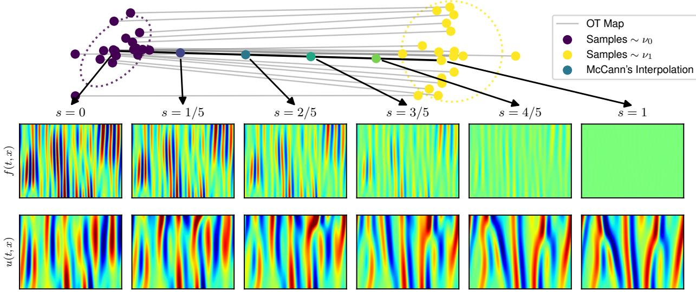  
Figure 1: Illustration of how WaSP training distributions are constructed. Top: the McCann interpolation computed for 2D Gaussian point clouds. The gray segments are the estimated optimal transport map T between samples drawn from a reference distribution ν and the target $\nu _ { 1 }$ . Each intermediate distribution is defined by the sampling rule in (17), where a sample from the reference is drawn, mapped by T , and linearly interpolated. Bottom: an input–solution pair for the Kuramoto–Sivashinsky equation interpolated between the manufactured input distribution (s = 0, left) and the target input distribution (s = 1, right). The top row is the forcing component of the input, which anneals to near zero as s increases; the bottom row is the corresponding solution field $u ( t , x )$ , obtained from an ETD-RK4 solver. As the forcing decreases in magnitude and the initial state moves onto the target attractor, the chaotic dynamics emerge, so the interpolation presents the operator with a sequence of progressively harder problems, forming a training curriculum.

This diagnosis motivates the Wasserstein Data Synthesis Pipeline (WaSP), a solver-free training method that preserves the optimization advantage of manufactured-data supervision while mitigating its distribution shift by training along a transport path (Section 4). WaSP samples artificial solutions and applies the PDE operator to obtain the manufactured input distribution, estimates a transport map that maps the manufactured inputs to the target input distribution, and applies McCann interpolation to define a sequence of intermediate training distributions (McCann, 1997; Villani, 2009). Training thus becomes a supervised curriculum ordered from easy to hard (Bengio et al., 2009). At each stage, the current operator synthesizes solutions for inputs drawn from the next intermediate distribution, expecting that the neural operator generalizes locally and synthesizes wellapproximated solutions. WaSP applies the PDE operator to the solutions and returns corresponding inputs, forming exact input–solution pairs for training at the next stage. The primary learning signal is the solution-space regression loss on the pairs, which avoids the optimization pathologies of physics-informed methods. WaSP breaks the large structural distribution shift between manufactured data and target down into small and manageable local generalization steps; therefore, it also avoids the obstruction identified for manufactured data. Figure 1 visualizes the transport path for the Kuramoto–Sivashinsky equation, showing how it gradually bridges the distribution shift by defining the intermediate distributions.

We deliver three primary results to support WaSP. First, theoretically, we prove a stepwise errorpropagation bound under strong Lipschitzness assumptions (Theorem 12). We illustrate how, without the local generalization assumptions, the error propagation bound worsens when the transport path is refined, and with local generalization, the error propagation bound can be exponentially improved and tightens instead. Second, implementation-wise, we argue in Section 4.2 how, in practice, the strong and unrealistic Lipschitzness assumptions can be removed, which motivates two important designs, the local PDE residual regularization and the adaptive scheduling function. We also discuss eficient implementation of WaSP and methods to improve its numerical stability in Section 4.3. Finally, empirically, with no solver-generated labeled pair from the target distribution used in training, WaSP reduces relative solution error by factors of 3.9, 9.5, and 4.6 relative to the strongest baseline on the Allen–Cahn, Kuramoto–Sivashinsky, and complex Ginzburg–Landau equations. On the two chaotic systems, it also tracks statistical observables more closely, including the spatial and temporal autocorrelations, energy spectrum, and invariant measures. We also conduct two ablations: one removes the self-generated targets while keeping the transport curriculum, and the other adds physics-informed objectives to the manufactured-data training. The ablation results are consistent with the obstructions identified in Section 3.

Paper Organization. Section 2 defines the PDE and operator-learning notation, collects the regularity and stability tools used in the analysis, and states the training objectives we compare. Section 3 formalizes the two obstructions: the regularity–variance tradeof for residual training (Sections 3.1 and 3.2) and the structural distribution shift for manufactured data (Section 3.3). Section 4 introduces WaSP, proves the stepwise error-propagation bound, and shows how the local residual regularizer and the adaptive schedule relax its unrealistic assumptions (Section 4.2), and states the algorithm with its implementation (Section 4.3). Section 5 describes the three equations, the experiment and evaluation setup, and reports pointwise errors and long-time observables against the physics-informed and manufactured-data baselines. Section 6 discusses construction of the manufactured solution distribution (Section 6.1) and the cost of the transport estimate (Section 6.2). Section 7 places WaSP in context, and Section 8 concludes. Proofs and hyperparameters are in the appendix.

## 2 Preliminaries

his section first introduces the PDE and operator-learning setting (Section 2.2), then defines the regularity and stability notions used in our analysis (Section 2.3), and finally formalizes the training objectives considered in this work (Section 2.4).

## 2.1 PDE Setting and Notation

We consider a general PDE setting in which the unknown solution field u is related to the prescribed input v through an equation

$$
\mathcal { N } ( u ) = v .
$$

Here $\mathcal { N } : \mathcal { U }  \mathcal { V }$ denotes the PDE operator written in a unified form, U is a normed space of solution fields, and V is a normed space of PDE inputs, which may include forcing terms, boundary data, initial data, or tuples of these quantities. Throughout, we assume U and V are chosen so that N is a bijection whose inverse is the solution operator $\mathcal { G } : \mathcal { V } \to \mathcal { U } .$ giving $\mathcal { G } \circ \mathcal { N } = \operatorname { I d }$ on U and $\mathcal { N } \circ \mathcal { G } = \operatorname { I d }$ on V; this is an assumption of existence and uniqueness only. Continuous dependence of u on v is a separate property, formalized in Definition 2, and it is precisely the property that degrades for the equations we study. Section 5.1 describes how including the forcing field in the input realizes this assumption for the three benchmarks.

Example 1 (Evolution problem). Consider an evolution problem on the space–time domain $[ 0 , T ] \times \Omega$ ， where $\Omega \subset \mathbb { R } ^ { d }$ is the spatial domain:

$$
\left\{ \begin{array} { l l } { \mathcal { D } _ { t , x } ( u ) ( t , x ) = f ( t , x ) , } & { ( t , x ) \in ( 0 , T ] \times \Omega , } \\ { \mathcal { T } ( u ) ( x ) = u _ { 0 } ( x ) , } & { x \in \Omega , } \\ { \mathcal { B } ( u ) ( t , x ) = g ( t , x ) , } & { ( t , x ) \in ( 0 , T ] \times \partial \Omega , } \end{array} \right.
$$

where $\mathcal { D } _ { t , x }$ is the space–time PDE operator, I is the initial-condition operator, $\boldsymbol { B }$ is the boundary operator, and all three may be nonlinear. In the unified notation,

$$
\mathcal { N } ( u ) = \big ( \mathcal { T } ( u ) , \mathcal { D } _ { t , x } ( u ) , \mathcal { B } ( u ) \big ) , \qquad v = ( u _ { 0 } , f , g ) ,
$$

so $\nu$ is the product of the initial, interior, and boundary condition spaces. The benchmarks of Section 5.1 are of this form with periodic boundaries, giving $v = ( u _ { 0 } , f )$

## 2.2 Operator Learning

Operator learning seeks a parametric approximation $\mathcal { G } _ { \theta } : \mathcal { V }  \mathcal { U }$ of the solution operator ${ \mathcal { G } } .$ In realistic applications, the inputs of interest are governed by an underlying distribution over forcing fields, ensembles of initial conditions, or observational states encountered in deployment. We denote this target input distribution by $\nu _ { 1 } \in { \mathcal { P } } ( \nu )$ , where for a normed space $\mathcal { Z }$ we write $\mathcal { P } ( \mathcal { Z } )$ for the set of Borel probability distributions on $\mathcal { Z }$ with the moments required by the Wasserstein distances used below. Unless otherwise specified, $\nu _ { 1 }$ denotes the target input distribution and ν denotes a generic input distribution. The subscript anticipates Section 4, where $\nu _ { 1 }$ is the endpoint of a transport path that starts at a chosen reference distribution $\nu _ { 0 }$ , such as the input distribution induced by manufactured solutions. For a normed evaluation space ${ \mathcal { X } } \subseteq U$ , the target risk of $\mathcal { G } _ { \theta }$ under a generic input distribution ν is

$$
\mathcal { E } ( \theta ; \nu ; \mathcal { X } ) : = \mathbb { E } _ { v \sim \nu } \left[ \| \mathcal { G } _ { \theta } ( v ) - \mathcal { G } ( v ) \| _ { \mathcal { X } } ^ { 2 } \right] .\tag{1}
$$

Thus, the definition applies to any $\nu ,$ and evaluating it at $\nu = \nu _ { 1 }$ gives the target-distribution risk.

A neural operator parametrizes $\mathcal { G } _ { \theta }$ by composing pointwise lifting and projection maps with a sequence of layers that combine a local linear map with a learnable integral operator on the physical domain (Kovachki et al., 2023). We use the Fourier Neural Operator (Li et al., 2021) for $\mathcal { G } _ { \theta }$ in all of our experiments, which parametrizes the integral operator as a spectral convolution operator. The training procedures developed in this work are independent of the architectural choices.

## 2.3 Regularity and Stability

Our analysis compares losses and errors measured in norms of diferent regularity. We therefore recall the relevant Sobolev spaces and formalize what it means for one norm to be stronger than another.

Let $\Omega \subset \mathbb { R } ^ { d }$ be a domain and let $m \in  { \mathbb { N } } _ { 0 }$ . We write $H ^ { m } ( \Omega ) : = W ^ { m , 2 } ( \Omega )$ for the Sobolev space of functions whose weak derivatives up to order m belong to $L ^ { 2 } ( \Omega )$ . For a real index $s \in \mathbb { R }$ , the

periodic Sobolev space $H ^ { s } ( \mathbb { T } ^ { d } )$ is defined by

$$
\Vert f \Vert _ { H ^ { s } ( \mathbb { T } ^ { d } ) } ^ { 2 } : = \sum _ { k \in \mathbb { Z } ^ { d } } ( 1 + | k | ^ { 2 } ) ^ { s } | \widehat { f } ( k ) | ^ { 2 } ,\tag{2}
$$

where ${ \widehat { f } } ( k )$ is the kth Fourier coeficient of $f .$

Definition 2 (PDE stability). Let ${ \mathcal { A } } \subseteq { \mathcal { U } }$ be an admissible set, let $\mathcal { X }$ be an evaluation space with ${ \mathcal { A } } \subseteq { \mathcal { X } }$ , and let Y be a residual space with ${ \mathcal { N } } ( { \mathcal { A } } ) \subseteq { \mathcal { V } }$ . The solution operator $\mathcal { G }$ is stable from $\mathcal { V }$ to $\mathcal { X }$ on A if there exists a constant $C > 0$ such that

$$
\| u - \widetilde u \| _ { \mathcal { X } } \le C \| \mathcal { N } ( u ) - \mathcal { N } ( \widetilde u ) \| _ { \mathcal { V } } \qquad f o r \ a l l \ u , \widetilde u \in \mathcal { A } .\tag{3}
$$

Equivalently, the restriction of $\mathcal { G }$ to $\mathcal { N } ( \mathcal { A } )$ is C-Lipschitz from $\| \cdot \| _ { \mathcal { V } } ~ t o ~ \| \cdot \| _ { \mathcal { X } }$

Stability converts a bound on the PDE residual into a bound on the solution error. If $v \in \mathcal V$ satisfies $\mathcal { G } ( v ) \in \mathcal { A }$ , then taking $u = \mathcal { G } ( v )$ in (3) and using $\mathcal { N } \circ \mathcal { G } = \operatorname { I d }$ gives

$$
\| \mathcal { G } ( v ) - \widetilde { u } \| _ { \mathcal { X } } \le C \| \mathcal { N } ( \widetilde { u } ) - v \| _ { \mathcal { Y } } \qquad \mathrm { f o r ~ e v e r y ~ t r i a l ~ s o l u t i o n ~ } \widetilde { u } \in \mathcal { A } .\tag{4}
$$

Thus, the residual measured in $\mathcal { V }$ certifies the solution error measured in $x ,$ , with a factor of $C .$ Whether such a $C$ exists depends on both norms, which motivates comparing them.

Definition 3 (Norm comparison). $L e t \parallel \cdot \parallel _ { a }$ and $\| \cdot \| _ { b }$ be norms on a common vector space $\mathcal { Z }$ . We say that $\| \cdot \| _ { b }$ is stronger than $\| \cdot \| _ { a }$ on $\mathcal { Z }$ if there exists a constant $C > 0$ such that

$$
\| f \| _ { a } \leq C \| f \| _ { b } \qquad f o r \ e v e r y \ f \in { \mathcal Z } ,\tag{5}
$$

and strictly stronger $i f$ no converse inequality holds uniformly on $\mathcal { Z }$

On the Sobolev scale, $H ^ { s _ { 2 } }$ is stronger than $H ^ { s _ { 1 } }$ when $s _ { 2 } \geq s _ { 1 }$ , so a stronger norm controls more derivatives and imposes higher regularity. Combining (5) and (3) show that stability is preserved when the residual norm is strengthened or the solution norm is weakened and may fail in either of the opposite directions.

## 2.4 Training Neural Operators

We now introduce the three training objectives considered in this work. We call a training procedure solver-free if it never uses a solver-generated pair $( v , \mathcal { G } ( v ) )$ as a training label; it may sample manufactured solutions $u \sim \mu$ from a distribution $\mu \in \mathcal { P } ( \mathcal { U } )$ , evaluate the PDE operator ${ \mathcal { N } } .$ and draw unpaired inputs $v \sim \nu _ { 1 }$ from the target distribution. The distribution $\mu$ may itself be produced by any procedure other than running a solver, which is detailed in Section 6.1.

Data Loss. The supervised data loss minimizes the expected squared error between the predicted and the true solution under an input distribution $\nu .$ Writing $\ell _ { \mathrm { d a t a } } ( w ; v ; \mathcal { X } ) : = \| w - \mathcal { G } ( v ) \| _ { \mathcal { X } } ^ { 2 }$ for the per-sample loss at an input $v \in \mathcal V$ and a predicted solution $w \in \mathcal { U }$ , the operator-level loss evaluated on the target distribution $\nu _ { 1 }$ is

$$
\begin{array} { r } { \mathcal { L } _ { \mathrm { d a t a } } ( \theta ; \nu _ { 1 } ; \mathcal { X } ) : = \mathbb { E } _ { v \sim \nu _ { 1 } } \ell _ { \mathrm { d a t a } } ( \mathcal { G } _ { \theta } ( v ) ; v ; \mathcal { X } ) = \mathbb { E } _ { v \sim \nu _ { 1 } } \left[ \Vert \mathcal { G } _ { \theta } ( v ) - \mathcal { G } ( v ) \Vert _ { \mathcal { X } } ^ { 2 } \right] , } \end{array}\tag{6}
$$

where $\mathcal { X }$ is the normed space used to quantify the error and $\mathcal { G } ( v )$ is obtained from a numerical solver or from experimental measurements. This objective requires labeled pairs $( v , \mathcal { G } ( v ) )$ with $v \sim \nu _ { 1 }$ which can be expensive or unavailable for new equations or environments.

PDE Residual Loss. Physics-informed training replaces labeled solution pairs with supervision from the governing equation (Raissi et al., 2019). Specifically, the per-sample residual loss is

$$
\ell _ { \mathrm { P D E } } ( w ; v ; \mathcal { V } ) : = \| \mathcal { N } ( w ) - v \| _ { \mathcal { V } } ^ { 2 } ,\tag{7}
$$

where $v \in \mathcal V$ is the input and $w \in \mathcal { U }$ is the predicted solution. In the PINN setting, where the learning target is a single PDE instance (i.e., a fixed $v \in \mathcal V$ and a neural-network-parametrized $w )$ the infinite-dimensional norm $\| \cdot \| _ { \mathcal { V } } ^ { 2 }$ is approximated by a Monte-Carlo estimate of the mean-squared residual at a set of collocation points, corresponding to an $L ^ { 2 } { \mathrm { - t y p e } }$ norm over the interior residual and, when present, the initial- and boundary-condition mismatches (Chen et al., 2021).

In operator learning, physics-informed neural operators extend this idea by applying the residual loss to the predicted solution field $\mathcal { G } _ { \boldsymbol { \theta } } ( \boldsymbol { v } )$ and averaging over inputs $v \sim \nu$ (Li et al., 2024; Goswami et al., 2023). This gives

$$
\begin{array} { r } { \mathcal { L } _ { \mathrm { P D E } } ( \boldsymbol { \theta } ; \nu ; \mathcal { V } ) : = \mathbb { E } _ { \boldsymbol { v } \sim \nu } \ell _ { \mathrm { P D E } } ( \mathcal { G } _ { \boldsymbol { \theta } } ( \boldsymbol { v } ) ; \boldsymbol { v } ; \mathcal { V } ) = \mathbb { E } _ { \boldsymbol { v } \sim \nu } \left[ \left. \mathcal { N } ( \mathcal { G } _ { \boldsymbol { \theta } } ( \boldsymbol { v } ) ) - \boldsymbol { v } \right. _ { \mathcal { V } } ^ { 2 } \right] . } \end{array}\tag{8}
$$

Thus, unlike the supervised data loss in (6), the PDE residual loss does not require access to the labeled solution $\mathcal { G } ( v )$ . It requires only samples $v \sim \nu$ and evaluation of the PDE operator $\mathcal { N }$ on the neural-operator output.

Lastly, the PDE residual loss certifies the target risk for the solution error through PDE stability in Definition 2. If $\mathcal { G } ( v )$ and $\mathcal { G } _ { \boldsymbol { \theta } } ( \boldsymbol { v } )$ both lie in A almost everywhere, squaring (4) with $\widetilde { u } = \mathcal { G } _ { \boldsymbol { \theta } } ( \boldsymbol { v } )$ and averaging over $v \sim \nu$ yields the following target risk (1) evaluated at $\nu { : }$

$$
\mathcal { E } ( \theta ; \nu ; \mathcal { X } ) \le C ^ { 2 } \mathcal { L } _ { \mathrm { P D E } } ( \theta ; \nu ; \mathcal { Y } ) .\tag{9}
$$

Hence, the amplification is set by the stability constant $C ,$ which can be uninformatively large or infinite in practice, as we show in Theorem 5 for the Kuramoto–Sivashinsky equation.

Supervised Learning with Manufactured Data (MD). An alternative solver-free approach reverses the usual data-generation direction. Instead of solving the PDE from prescribed inputs to obtain solutions, one samples artificial solutions and applies the PDE operator to obtain the corresponding inputs (Hasani and Ward, 2024). Applying $\mathcal { N }$ is typically far less expensive than solving the PDE forward, especially for evolution equations that require sequential time stepping, stability-restricted step sizes, or repeated implicit solves. Let $\mu \in { \mathcal { P } } ( { \mathcal { U } } )$ be a distribution over solution fields. Sampling $u \sim \mu$ and evaluating $v = \mathcal { N } ( u )$ produces an exact labeled pair $( v , u )$ without solving the PDE; the induced distribution of v is the pushforward distribution $\mathcal { N } _ { \# } \mu \in \mathcal { P } ( \mathcal { V } )$ By using the change-of-variables from v to $u ,$ the corresponding training objective is given by

$$
\begin{array} { r } { \mathcal { L } _ { \mathrm { M D } } ( \boldsymbol { \theta } ; \boldsymbol { \mu } ; \mathcal { X } ) : = \mathcal { L } _ { \mathrm { d a t a } } ( \boldsymbol { \theta } ; \mathcal { N } _ { \# } \boldsymbol { \mu } ; \mathcal { X } ) = \mathbb { E } _ { \boldsymbol { u } \sim \boldsymbol { \mu } } \left[ \| \mathcal { G } _ { \boldsymbol { \theta } } ( \mathcal { N } ( \boldsymbol { u } ) ) - \boldsymbol { u } \| _ { \mathcal { X } } ^ { 2 } \right] , } \end{array}\tag{10}
$$

where the last equality uses $\mathcal { G } \circ \mathcal { N } = \operatorname { I d }$ to remove the dependence on ${ \mathcal { G } } .$ We write $\ell _ { \mathrm { M D } } ( w ; u ; \mathcal { X } ) : =$ $\| w - u \| _ { \mathcal { X } } ^ { 2 }$ for the per-sample manufactured-data loss, whose second argument is a solution rather than an input. Then, (10) also reads as

$$
\begin{array} { r } { \mathcal { L } _ { \mathrm { M D } } ( \boldsymbol { \theta } ; \boldsymbol { \mu } ; \mathcal { X } ) = \mathbb { E } _ { u \sim \boldsymbol { \mu } } \ \ell _ { \mathrm { M D } } \big ( \mathcal { G } _ { \boldsymbol { \theta } } ( \mathcal { N } ( u ) ) ; u ; \mathcal { X } \big ) . } \end{array}\tag{11}
$$

We keep $\ell _ { \mathrm { M D } }$ distinct from $\ell _ { \mathrm { d a t a } }$ to emphasize that it carries no solver dependency as the regression target is the sampled field u itself.

Remark 4 (Data and PDE losses are complementary constraints). The two solver-free objectives constrain complementary inverses of N . The PDE residual loss (8) enforces $\mathcal { N } \circ \mathcal { G } _ { \theta } \approx \mathrm { I d }$ on $\nu ,$ an approximate right-inverse constraint. The manufactured-data loss (10) enforces G $\circ { \mathcal { N } } \approx { \mathrm { I d } }$ on $\mathcal { U } ,$ an approximate left-inverse constraint.

A shared characteristic of both solver-free formulations based on minimizing the PDE residual loss and using manufactured data is that neither controls the target risk (1) at the target distribution $\nu _ { 1 }$ . In the following sections, we study the limitations of existing formulations and propose a novel approach to address them. Section 3 identifies a failure mode for each solver-free objective. Then, Section 4 develops WaSP, which trains on both objectives and avoids their limitations by constructing an interpolation path that transports the training distribution to the target distribution.

## 3 Failure Modes of Existing Solver-Free Objectives

In this section, we formalize the obstructions that the two solver-free objectives introduced in Section 2.4 face. For physics-informed learning, Sections 3.1 and 3.2 develop a regularity–variance trade-of for the PDE residual objective, and for manufactured data, Section 3.3 shows a structural distribution shift between the manufactured and the target input distribution.

## 3.1 Regularity Requirements for the Residual Loss

Although a physics-informed objective only minimizes the PDE residual, the residual can serve as a reliable proxy for the solution error, provided the residual norm is strong enough to control the solution error in the norm of interest. This control depends on the PDE’s stability properties, which do not always hold. We illustrate conditions for stability in the solution with the Kuramoto– Sivashinsky equation, a nonlinear and weakly dissipative evolution equation that is widely used as the canonical example for chaotic PDE; the thresholds presented here are specific to that equation, but the mechanism they expose is common in nonlinear PDEs.

We consider the Kuramoto–Sivashinsky equation on the periodic spatial domain T and time domain [0, T], which models flame-front and thin-film instabilities and is a standard testbed for spatiotemporal chaos. The PDE for the solution field u is:

$$
\partial _ { t } u + \nu \partial _ { x } ^ { 4 } u + \partial _ { x } ^ { 2 } u + u \partial _ { x } u = 0 , \qquad ( t , x ) \in [ 0 , T ] \times \mathbb { T } ,\tag{12}
$$

with initial condition

$$
u ( 0 , x ) = u _ { 0 } ( x ) , \qquad x \in \mathbb { T } .
$$

Here $\nu > 0$ is the dissipation parameter,2. We state the instability result in Sobolev norms applied to the spatial components, extended to the Bochner norm $L ^ { p } ( 0 , T ; H ^ { s } )$ for space–time functions. We follow the definition of Wang et al. (2022a) that the equation is $( \alpha , r , \beta )$ -stable if a small loss in the PDE residual and initial condition guarantees small solution error.

Theorem 5 (Residual–solution stability thresholds for Kuramoto–Sivashinsky, informal). Fix $\alpha , r , \beta \in \mathbb { R }$ , and let u be a fixed strong solution of the one-dimensional periodic Kuramoto–Sivashinsky equation (12) with $u \in L ^ { \infty } ( 0 , T ; H ^ { m } ( \mathbb { T } ) )$ for some $\begin{array} { r } { m > \alpha + \frac { 3 } { 2 } } \end{array}$ . Define

$$
\begin{array} { r } { \mathcal { R } ( w ) : = \partial _ { t } w + \nu \partial _ { x } ^ { 4 } w + \partial _ { x } ^ { 2 } w + w \partial _ { x } w , } \end{array}
$$

for the PDE residual of the trial solution w. Measuring the residual in $L ^ { 2 } ( 0 , T ; H ^ { \alpha } )$ , the initialcondition error in $H ^ { r }$ , and the solution error in $H ^ { \beta }$ , the following statements hold.

1. $I f r < \beta$ and $\alpha < \operatorname* { m i n } \{ \beta + 1 , 2 \beta + 1 \}$ , there exists a sequence of smooth functions $w _ { n }$ for which

$$
\| w _ { n } ( 0 ) - u ( 0 ) \| _ { H ^ { r } } + \| \mathcal { R } ( w _ { n } ) \| _ { L ^ { 2 } ( 0 , T ; H ^ { \alpha } ) } \longrightarrow 0 ,
$$

while $\| w _ { n } - u \| _ { L ^ { \infty } ( 0 , T ; H ^ { \beta } ) }$ remains bounded away from zero.

2. $\textit { I f r } < \beta - 2$ and $\alpha < \operatorname* { m i n } \{ \beta - 1 , 2 \beta - 3 \}$ , the same conclusion holds with the error in $L ^ { 2 } ( 0 , T ; H ^ { \beta } )$

3. With the exact initial condition $w _ { n } ( 0 ) = u ( 0 )$ , the same conclusion in $L ^ { \infty } ( 0 , T ; H ^ { \beta } )$ holds if $\alpha < \operatorname* { m i n } \{ \beta - 2 , 2 \beta + 1 \}$

4. With the exact initial condition, the same conclusion in $L ^ { 2 } ( 0 , T ; H ^ { \beta } )$ holds if $\alpha < \mathrm { m i n } \{ \beta -$ $4 , 2 \beta - 3 \}$

Moreover, even if the norm indices $( \alpha , r , \beta )$ are chosen so that a stability estimate holds, there still exists a smooth w for which the residual and initial-condition norms are small, but the solution error is amplified by a factor that grows exponentially in $\nu ^ { - 1 }$

$$
\begin{array} { r } { \Vert w - u \Vert _ { L ^ { 2 } ( 0 , T ; H ^ { \beta } ) } \gtrsim \mathrm { p o l y } ( \nu ) \times e ^ { T / ( 4 \nu ) } \big ( \Vert w ( 0 ) - u ( 0 ) \Vert _ { H ^ { r } } + \Vert \mathcal { R } ( w ) \Vert _ { L ^ { 2 } ( 0 , T ; H ^ { \alpha } ) } \big ) , } \end{array}
$$

$$
\begin{array} { r } { \Vert w - u \Vert _ { L ^ { \infty } ( 0 , T ; H ^ { \beta } ) } \lesssim \mathrm { p o l y } ( \nu ) \times e ^ { T / ( 4 \nu ) } \big ( \Vert w ( 0 ) - u ( 0 ) \Vert _ { H ^ { r } } + \Vert \mathcal { R } ( w ) \Vert _ { L ^ { 2 } ( 0 , T ; H ^ { \alpha } ) } \big ) . } \end{array}
$$

A small residual loss is therefore not a certificate of solution accuracy. When the loss norm is too weak no uniform stability estimate is available, and when stability holds the amplification constant can be large, so a small solution error is guaranteed only below a residual threshold that shrinks exponentially in $\nu ^ { - 1 }$ , which stochastic optimization rarely reaches in practice. The formal statement and proof are given in Section B.

## 3.2 Variance Amplification by Residual Regularity

Section 3.1 proves a lower bound on the regularity of the residual norm required to achieve stability. In operator learning, however, increasing that regularity by using a stronger norm for the training loss raises the variance of the empirical loss and gradient estimates used in stochastic optimization. The variance of those estimates is then known to govern training stability and convergence speed (Ghadimi and Lan, 2013). Training approximates objective (8) by an empirical mean over a minibatch $v _ { 1 } , \ldots , v _ { B } \stackrel { \mathrm { i . i . d . } } { \sim } \nu$ of the per-sample loss $\ell ( \theta ; v ) : = \ell _ { \mathrm { P D E } } ( \mathcal { G } _ { \theta } ( v ) ; v ; \mathcal { V } )$ . If $\ell ( \theta ; \cdot )$ has a finite second moment under $\nu ,$ the mini-batch loss and gradient estimates have variance $\operatorname { V a r } _ { v \sim \nu } [ \ell ( \theta ; v ) ] / B$ and converge at the root-mean-square rate $B ^ { - 1 / 2 }$ , so high per-sample variance translates into noisy updates.

Theorem 6 (Variance amplification by residual regularity, informal). Let $\Omega =  { \mathbb { T } } ^ { d }$ , and let ${ \mathcal { N } } = { \mathcal { L } }$ be a linear diferential operator of order $m > 0$ , with Fourier multiplier $p _ { \mathscr { L } } ( k )$ defined by $\widehat { ( \mathscr { L } f ) } ( k ) =$ $p _ { \checkmark } ( k ) \hat { f } ( k )$ and satisfying $| p _ { \mathcal { L } } ( k ) | \asymp | k | ^ { m }$ . Define $\ell _ { \mathrm { P D E } } ^ { ( a ) } ( v ) : = \| \mathcal { L } ( \mathcal { G } _ { \boldsymbol { \theta } } ( v ) - \mathcal { G } ( v ) ) \| _ { H ^ { c } } ^ { 2 }$ a and $\ell _ { \mathrm { d a t a } } ^ { ( a ) } ( v ) : =$ $\| \mathcal { G } _ { \theta } ( v ) - \mathcal { G } ( v ) \| _ { H ^ { a } } ^ { 2 }$ . Suppose the squared Fourier amplitudes of $\mathcal { G } _ { \boldsymbol { \theta } } ( \boldsymbol { v } ) - \mathcal { G } ( \boldsymbol { v } )$ are pairwise uncorrelated under $v \sim \nu$ . Then, for $\alpha ^ { \prime } > \alpha$ 2

$$
\mathrm { V a r } _ { \nu } \Big [ \ell _ { \mathrm { P D E } } ^ { ( \alpha ^ { \prime } ) } ( v ) \Big ] \gg \mathrm { V a r } _ { \nu } \Big [ \ell _ { \mathrm { P D E } } ^ { ( \alpha ) } ( v ) \Big ] \asymp \mathrm { V a r } _ { \nu } \Big [ \ell _ { \mathrm { d a t a } } ^ { ( \alpha + m ) } ( v ) \Big ] \gg \mathrm { V a r } _ { \nu } \Big [ \ell _ { \mathrm { d a t a } } ^ { ( \alpha ) } ( v ) \Big ] ,\tag{13}
$$

where $A \asymp B$ means that each quantity is bounded by a constant multiple of the other, while $A \gg B$ means that A is a strictly stronger variance functional, i.e., there exist admissible error distributions for which $A = \infty$ and $B < \infty$ , and whenever $A < \infty$ , B is bounded by A up to a constant independent of the error distribution.

Section C gives the formal statement and proof. For nonlinear PDEs, the variance structure is more problem-dependent, and we do not claim a universal ordering beyond the linear setting.

Nonlinear terms typically add further variability, since the residual depends on products and compositions of the predicted solution and its derivatives. The linear result nevertheless identifies the basic mechanism: increasing the regularity of a residual norm can increase the variance of the mini-batch objective by a factor polynomial in the frequency content of the error. For the formal version of this theorem, we refer to Section C in the Appendix.

Together with Section 3.1, we identify the regularity–variance tradeof: weak residual norms may fail to control the target solution error, whereas stronger norms can make the objective for stochastic optimization noisier and hence slower to converge.

## 3.3 Structural Distribution Shift of Manufactured Data

We now turn to the alternative solver-free strategy of training with manufactured data, that is, to the objective ${ \mathcal { L } } _ { \mathrm { M D } }$ of (10). It removes label error and avoids numerical solves, but it replaces the target input distribution3 ν with the manufactured distribution $\mathcal { N } _ { \# } \mu$ . A structural distribution shift therefore accompanies the exact labeled pairs.

Theorem 7 (Structural distribution shift under manufactured sampling, informal). Let $\mu \in \mathcal { P } ( \mathcal { U } )$ be a Gaussian distribution for PDE solutions, let $\nu \in \mathcal { P } ( \nu )$ be the target condition distribution, and let $d _ { H } ^ { 2 } ( \rho , \rho ^ { \prime } )$ denote the square of the Hellinger distance between two distributions $\rho , \rho ^ { \prime }$ . Let $\rho : = \mathcal { N } _ { \# } \mu$ Let $s _ { \mu }$ and $s _ { \nu }$ be their sharp Sobolev thresholds, so samples belong almost surely to $H ^ { s }$ below the threshold and not above it.

1. Suppose ${ \mathcal { N } } = { \mathcal { L } } + B$ , where L is elliptic of order K and B is a lower-order (possibly nonlinear) perturbation. Then $\mathcal { N } _ { \# } \mu$ has sharp threshold $s _ { \mu } - K$ . If $s _ { \nu } \neq s _ { \mu } - K$ , then $\mathcal { N } _ { \# } \mu$ and ν are mutually singular, and $d _ { H } ( \mathcal { N } _ { \# } \mu , \nu ) = 1$

2. Suppose ${ \mathcal { N } } = { \mathcal { L } }$ is linear and diagonal in an orthonormal basis $\{ \phi _ { j } \} _ { j \ge 1 }$ such that $\mathcal { N } \phi _ { j } = \ell _ { j } \phi _ { j }$ and the coeficients of µ and ν along $\phi _ { j }$ are independent centered Gaussians with variances $\sigma _ { \mu , j } ^ { 2 }$ and $\sigma _ { \nu , j } ^ { 2 }$ . Let $\rho _ { N }$ and $\nu _ { N }$ denote the distribution of the first N coeficients in this basis. Define

$$
\lambda _ { j } : = \frac { \ell _ { j } ^ { 2 } \sigma _ { \mu , j } ^ { 2 } } { \sigma _ { \nu , j } ^ { 2 } } , \qquad b _ { j } : = \lambda _ { j } - 1 ,\tag{14}
$$

and let $d _ { H , N } = d _ { H } ( \rho _ { N } , \nu _ { N } )$ be the Hellinger distance between $\rho _ { N }$ and $\nu _ { N }$ . Then

$$
d _ { H , N } ^ { 2 } = 1 - \exp \left( - \frac { 1 } { 2 } \sum _ { j = 1 } ^ { N } \psi ( b _ { j } ) \right) , \qquad \psi ( b ) : = - \log \left( \frac { 2 \sqrt { 1 + b } } { 2 + b } \right) = \frac { b ^ { 2 } } { 8 } + O ( | b | ^ { 3 } ) .\tag{15}
$$

Hence, by (15), $d _ { H } ( \mathcal { N } _ { \# } \mu , \nu ) < 1$ if and only $i f \sum _ { j \geq 1 } b _ { j } ^ { 2 } < \infty$ . In particular, $b _ { j } \asymp j ^ { - q }$ gives $d _ { H } < 1$ exactly when $q > 1 / 2$

3. For an arbitrary N , fix an orthonormal basis $\{ \phi _ { j } \} _ { j \ge 1 }$ and let ρN and $\nu _ { N }$ denote the distributions of the first N coeficients of $\rho = \mathcal { N } _ { \# } \mu$ and $\nu ,$ respectively. If there is a family of statistics $T _ { N }$ for which

$$
\frac { \sqrt { \mathrm { V a r } _ { \rho _ { N } } ( T _ { N } ) } + \sqrt { \mathrm { V a r } _ { \nu _ { N } } ( T _ { N } ) } } { \vert \mathbb { E } _ { \rho _ { N } } T _ { N } - \mathbb { E } _ { \nu _ { N } } T _ { N } \vert } \longrightarrow 0 \quad a s \quad N  \infty ,\tag{16}
$$

then $d _ { H } ( \rho _ { N } , \nu _ { N } ) \to 1$ . Thus, an accumulated discrepancy in a nonlinear modal statistic is suficient for asymptotic orthogonality.

Example 8 (A nonlinear example). The third statement in the theorem gives a general criterion for detecting mutual singularity, which applies when regularity-based arguments are inconclusive. We illustrate this with a concrete example in which the two measures are indistinguishable by regularity.

For mean-zero functions on T, let $\{ \phi _ { j } \} _ { j \ge 1 }$ be the real Fourier basis, with $k _ { j }$ the wavenumber of $\phi _ { j }$ . Consider the stationary Kirchhof operator

$$
\mathcal { N } ( u ) = - \left( 1 + \Vert \partial _ { x } u \Vert _ { L ^ { 2 } } ^ { 2 } \right) \partial _ { x } ^ { 2 } u .
$$

Let $\mu$ be the centered Gaussian with $\sigma _ { \mu , j } ^ { 2 } = k _ { j } ^ { - 2 a }$ for some $a > 5 / 2$ , and the target $\nu = ( c \mathcal { L } ) _ { \# } \mu$ with $\mathcal { L } = - \partial _ { x } ^ { 2 }$ and $c > 0$ . The measures $\mathcal { N } _ { \# } \mu$ and ν have the same Sobolev thresholds $s _ { \mu } - 2$ . However, the operator $\mathcal { N } ( u ) = M$ Lu multiplies the nonlinearity Lu by the random amplitude $M = 1 + \| \partial _ { x } u \| _ { L ^ { 2 } } ^ { 2 }$ whereas ν multiplies it by the constant c. To detect this diference, we define

$$
R _ { N } ( v ) = \frac { 1 } { N } \sum _ { j = 1 } ^ { N } \frac { \langle v , \phi _ { j } \rangle ^ { 2 } } { k _ { j } ^ { 4 } \sigma _ { \mu , j } ^ { 2 } } ,
$$

which averages the squared Fourier coeficients of v after normalizing them by the variance they would have under $\mathcal L _ { \# } \mu$ . The statistic $T _ { N } = \mathbf { 1 } \{ | R _ { N } / c ^ { 2 } - 1 | > N ^ { - 1 / 4 } \}$ satisfies (16), so $d _ { H } ( \mathcal { N } _ { \# } \mu , \nu ) = 1$ for every $c > 0$ . That is, $\mathcal { N } _ { \# } \mu$ and ν are mutually singular for every c, even though they share the same Sobolev threshold. The complete statements and proofs are given in the Appendix D.6.

Mutual singularity means the manufactured and target distributions concentrate on disjoint sets of inputs, and a Hellinger distance close to one means little efective overlap. Without further structural assumptions on the learned operator, optimizing the manufactured-data loss (10) then places no constraint on the target risk (1) since exact prediction on manufactured inputs can coexist with arbitrarily poor performance on target inputs.

The second part also exposes why direct calibration is not a simple remedy. Achieving $d _ { H } < 1$ requires the relative deviations $b _ { j }$ of (14) to be square summable, so $\sigma _ { \mu , j } ^ { 2 }$ must track $\sigma _ { \nu , j } ^ { 2 } / \ell _ { j } ^ { 2 }$ with vanishing aggregate error. For an arbitrary $\mathcal { N }$ , part 3 gives a suficient condition for mutual singularity. A family of statistics $T _ { N }$ whose means separate faster than their standard deviations implies mutual singularity, as (16) requires. Constructing a $\mu$ to either in the linear case, match the variances mode-by-mode, or in the generic case, prevent any family of statistics from exhibiting separation, requires mode-by-mode knowledge of the target distribution and of the action of $\mathcal { N }$ on solution modes, which is often as hard as solving the PDE. Therefore, calibration alone cannot resolve the dificulty. The formal statement and proof are given in Section D.

## 4 WaSP: Wasserstein Data Synthesis Pipeline

In this section, we introduce WaSP, a solver-free training framework that avoids the obstructions identified in Section 3. WaSP achieves the goal by iteratively applying the trained neural operator to synthesize the solutions on an input distribution that is transported closer to the target distribution, and thereby mitigating the structural distribution shift of manufactured data without facing optimization challenges of physics-informed objective. We organize the section as follows: Section 4.1 introduces the high-level design of WaSP, Section 4.2 proceeds to analyze the error propagation of the algorithm and motivate the design choices, and Section 4.3 presents the formal algorithm and the implementation details for it.

## 4.1 The High-Level Design of WaSP

Given a manufactured solution distribution $\mu _ { 0 } \in \mathscr { P } ( \mathcal { U } )$ that is easy to sample, we apply the PDE operator to obtain the initial condition distribution

$$
\nu _ { 0 } : = \mathcal { N } _ { \# } \mu _ { 0 } .
$$

WaSP estimates a transport map $\tau : \mathcal { V } \to \mathcal { V }$ from $\nu _ { 0 }$ to the target input distribution $\nu _ { 1 }$ , using entropy-regularized optimal transport under the squared-Euclidean cost (Cuturi, 2013; Pooladian and Niles-Weed, 2021); Section 6.2 describes the estimator and its cost.

For $s \in [ 0 , 1 ]$ , we define the interpolated input distribution

$$
\nu _ { s } : = ( ( 1 - s ) \mathrm { I d } + s { \mathcal T } ) _ { \# } \nu _ { 0 } .\tag{17}
$$

This McCann interpolation starts at $\nu _ { 0 }$ and ends at the transported target approximation (McCann, 1997; Villani, 2009). We discretize the path by $0 = s _ { 0 } \leq s _ { 1 } \leq \cdot \cdot \cdot \leq s _ { N } = 1$ and write $\nu _ { n } : = \nu _ { s _ { n } }$ for convenience.4 The WaSP algorithm begins by training the neural operator on exact pairs $( \mathcal { N } ( u ) , u )$ with $u \sim \mu _ { 0 }$ , which corresponds to $s = 0$ . At a later step n with $s _ { n } > 0$ , it draws $v \sim \nu _ { n }$ and synthesizes $u = \mathcal { G } ^ { n - 1 } ( v )$ using the neural operator trained at the preceding step. Here we write $\theta ^ { n }$ for the parameters at step n and $\mathcal { G } ^ { n } : = \mathcal { G } _ { \theta ^ { n } }$ for the corresponding neural operator. The resulting solution distribution and its realized input distribution are

$$
\hat { \mu } _ { n } : = ( \mathcal { G } ^ { n - 1 } ) _ { \# } \nu _ { n } , \qquad \hat { \nu } _ { n } : = \mathcal { N } _ { \# } \hat { \mu } _ { n } , \qquad n \geq 1 ,\tag{18}
$$

with the convention ${ \hat { \mu } } _ { 0 } : = \mu _ { 0 }$ and $\hat { \nu } _ { 0 } : = \nu _ { 0 }$ at the manufactured endpoint, where the pairs are exact and the realized and intended input distributions coincide. Training on $\hat { \mu } _ { n - 1 }$ remains useful for synthesizing solutions for $\nu _ { n }$ because neural networks generalize locally across nearby input distributions (Ben-David et al., 2010; Benitez et al., 2024). Figure 2 illustrates the intuition; with a single model $\mathcal { G } ^ { 0 }$ trained on $\mu _ { 0 }$ , the predicted solution distribution $\hat { \mu } _ { s }$ and its realized input distribution $\hat { \nu } _ { s }$ drift further from the intended $\nu _ { s }$ as s grows. Advancing in small transport steps and updating the model at each one therefore reduces the total distribution drift that the process incurs, which is formalized in Section 4.2.

At each step, the two supervision signals are produced by the synthesis chain shown in Figure 3; from a sampled $v \sim \nu _ { n }$ , WaSP synthesizes $u = \mathcal { G } _ { \theta } ( v )$ , applies N to recover the exact input $v ^ { \prime } = \mathcal { N } ( u )$ so that $( v ^ { \prime } , u )$ is an exact pair, and predicts again $u ^ { \prime } = \mathcal { G } _ { \theta } ( v ^ { \prime } )$ . The solution loss $\ell _ { \mathrm { M D } }$ penalizes $\| \mathrm { s g } ( u ) - u ^ { \prime } \| _ { \mathcal { U } }$ and carries the primary learning signal, regressing u′ onto the synthesized solution held fixed as a stop-gradient target; the input loss $\ell _ { \mathrm { P D E } }$ penalizes $\| v - v ^ { \prime } \| _ { \mathcal { V } }$ and regresses the regenerated input onto the fixed sampled v. These are the manufactured-data loss (10) and the PDE residual loss (8) of Section 2.4, evaluated locally along the transport path; Section 4.2 combines them into the WaSP objective.

## 4.2 Theoretical Analysis

The transport path introduces a distinction between the interpolated input distribution $\nu _ { n }$ and the realized distribution $\hat { \nu } _ { n }$ of (18). We prove a stepwise error propagation bound relating the training error to the target risk, and show that it improves exponentially when local generalization is available.

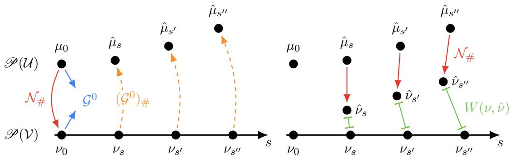

Figure 2: Intuitive picture for local generalization of neural operator and its implications. Left: the operator $\mathcal { G } ^ { 0 }$ is trained at $s = 0$ on $\mu _ { 0 }$ with the manufactured-data loss and on $\nu _ { 0 } = \mathcal { N } _ { \# } \mu _ { 0 }$ with the PDE loss, then applied at $\nu _ { s } , \nu _ { s ^ { \prime } } , \nu _ { s ^ { \prime \prime } }$ farther along the McCann path (dashed orange); the resulting $\hat { \mu } _ { s } , \hat { \mu } _ { s ^ { \prime } } , \hat { \mu } _ { s ^ { \prime \prime } }$ drift increasingly far from the solution distributions $\mathcal { G _ { \# } } \nu _ { s }$ Right: mapping each $\hat { \mu } _ { s }$ back through $\mathcal { N } _ { \# }$ (red) gives the realized input distribution $\hat { \nu } _ { s }$ whose Wasserstein gap $W ( \nu , \hat { \nu } )$ to the intended $\nu _ { s }$ (green segments) grows with s. WaSP chooses each increment small enough that $\nu _ { n + 1 }$ stays close to $\nu _ { n }$ so that local generalization holds and updates the operator $\mathcal { G } ^ { n + 1 }$ on $\hat { \mu } _ { n + 1 }$ and $\nu _ { n + 1 }$ , repeating until $s = 1$  
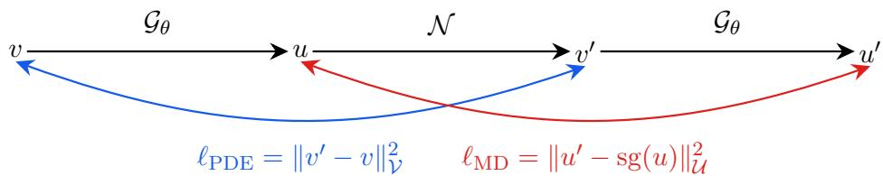  
Figure 3: The data synthesis chain of WaSP described in the text. The input loss $\ell _ { \mathrm { P D E } }$ (blue) is the residual on the sampled v and reaches $\mathcal { G } _ { \theta }$ through the first application; the solution loss $ { \ell _ { \mathrm { M D } } }$ (red) regresses $u ^ { \prime }$ given the realized input $v ^ { \prime } = \mathcal { N } ( u )$ onto the synthesized solution u and reaches $\mathcal { G } _ { \theta }$ only through the second, because $\operatorname { s g } ( \cdot )$ is a stop-gradient that holds the synthesized pair fixed rather than making it self-referential.

Stepwise Error Propagation. We defer the formal algorithm to Section 4.3 to present the analysis that motivates specific designs of WaSP first. We analyze the following setup:

1. The whole algorithm takes $N + 1$ steps, running from 0 to $N .$ , inclusive.

2. The distributions $\mu _ { 0 }$ and $\nu _ { 1 }$ and the grid $s _ { 0 } , \ldots , s _ { N }$ are given and fixed.

3. At step n, the neural operator is ${ \mathcal { G } } ^ { n }$ , and the error operator is $\mathcal H ^ { n } : = \mathcal G ^ { n } - \mathcal G$

4. At step 0, $\hat { \mu } _ { 0 } = \mu _ { 0 }$ and $\hat { \nu } _ { 0 } = \nu _ { 0 }$ . At steps $n \geq 1 , \hat { \mu } _ { n }$ and $\hat { \nu } _ { n }$ are defined as (18).

5. We are given $\epsilon _ { n } : = \mathbb { E } _ { v \sim \hat { \nu } _ { n } } \| \mathcal { H } ^ { n } ( v ) \| _ { \mathcal { U } }$ and $e _ { n } : = \mathbb { E } _ { v \sim \nu _ { n } } \| \mathcal { H } ^ { n } ( v ) \| _ { \mathcal { U } }$ at all $n .$

While $\epsilon _ { n }$ is analogous to the training error and $e _ { n }$ is analogous to the testing error, we make no assumptions about the training process. We treat the operators at each step ${ \mathcal { G } } ^ { n }$ as given and bound $e _ { n }$ by $\epsilon _ { n }$ and other available quantities; whether $\epsilon _ { n }$ is achievable in practice is out of the scope of the analysis.

Assumption 9 (Operator regularity). N is $K _ { \mathcal { N } ^ { - } } L i p s c h i t z ,$ and $\mathcal { H } ^ { n }$ is $K _ { \mathcal { H } }$ -Lipschitz for every $0 \leq n \leq N$

Assumption 9 is unrealistic: N typically diferentiates, and Theorem 5 shows that G, and hence $\mathcal { H } ^ { n }$ , admits infinite or exponentially large Lipschitz constants on the norms of interest. We assume it deliberately, preferring a small set of standard strong hypotheses to the weaker nonstandard substitutes available, which keeps the analysis concise; the two paragraphs that close this subsection remove both constants.

Throughout the analysis, $W : = W _ { 1 }$ denotes the 1-Wasserstein distance induced by the norm on V. For convenience, we define the distance between input distributions:

$$
d _ { n } : = W ( \nu _ { n } , \hat { \nu } _ { n } ) , \qquad \delta _ { n } : = W ( \nu _ { n } , \nu _ { n + 1 } ) ,
$$

and show the following worst-case bound:

Corollary 10 (Worst-case error propagation). Under Assumption 9, for every $0 \leq n < N$ ，

$$
d _ { n + 1 } \leq K _ { \mathcal { N } } K _ { \mathcal { H } } ( d _ { n } + \delta _ { n } ) + K _ { \mathcal { N } } \epsilon _ { n } ,\tag{19}
$$

and consequently

$$
e _ { N } \leq \epsilon _ { N } + \sum _ { k = 0 } ^ { N - 1 } ( K _ { \mathcal { N } } K _ { \mathcal { H } } ) ^ { N - k } \left( K _ { \mathcal { H } } \delta _ { k } + \epsilon _ { k } \right) .\tag{20}
$$

Whenever $K _ { \mathcal { N } } K _ { \mathcal { H } } > 1$ , the factor in (20) is exponential in the number of steps N, while refining the path shrinks each $\delta _ { k }$ linearly. Therefore, increasing N accumulates more error instead of reducing it, contradicting its purpose. The proof is given in Section E. Fortunately, neural networks often generalize across nearby distributions substantially better than the worst-case Lipschitz analysis predicts, which can exponentially improve Corollary 10

Assumption 11 (Local distributional generalization). There exists $\eta > 0$ such that for each step n there exist $C _ { n } > 0$ with

$$
\begin{array} { r } { \mathbb { E } _ { v \sim \nu ^ { \prime } } \| \mathcal { H } ^ { n } ( v ) \| _ { \mathcal { U } } \le \epsilon _ { n } + C _ { n } W ( \nu ^ { \prime } , \hat { \nu } _ { n } ) ^ { 1 + \eta } , } \end{array}\tag{21}
$$

for any input distribution $\nu ^ { \prime } \in \mathcal { P } ( \nu )$

Taking $\eta = 0$ and $C _ { n } = K _ { \mathcal { H } }$ recovers the linear transfer bound of Corollary 10. The content of Assumption 11 is the improvement near $\hat { \nu } _ { n }$ . Far from $\hat { \nu } _ { n }$ , the term $W ( \nu ^ { \prime } , \hat { \nu } _ { n } ) ^ { 1 + \eta }$ need not improve on a linear bound, so the assumption is informative only in the local regime.

Theorem 12 (WaSP error propagation). Let

$$
B _ { n } : = 2 ^ { \eta } K _ { \mathcal { N } } C _ { n } , \qquad a _ { n } : = K _ { \mathcal { N } } \epsilon _ { n } + B _ { n } \delta _ { n } ^ { 1 + \eta } .
$$

Suppose Assumptions 9 and 11 hold. For any fixed $\alpha \in ( 1 , 2 )$ , define

$$
K : = \operatorname* { m i n } _ { 0 \leq n \leq N } \alpha ^ { n } B _ { n } ^ { - \frac { 1 } { \eta } } , \quad R _ { n } : = 2 ^ { - \frac { 1 } { \eta } } B _ { n } ^ { - \frac { 1 } { 1 + \eta } } ( K \alpha ^ { - n } ) ^ { \frac { 1 } { 1 + \eta } } ,
$$

and suppose $\epsilon _ { n }$ and $\delta _ { n }$ are small enough that

$$
a _ { n } \leq \left( 1 - { \frac { \alpha } { 2 } } \right) R _ { n + 1 }\tag{22}
$$

for all $0 \leq n < N$ . Then $d _ { n } \leq R _ { n }$ for every $0 \leq n \leq N$ , and

$$
e _ { N } \le \epsilon _ { N } + 2 K _ { \mathcal { H } } \operatorname* { m a x } _ { 0 \le k < N } \left[ K _ { \mathcal { N } } \epsilon _ { k } + 2 ^ { \eta } K _ { \mathcal { N } } C _ { k } \delta _ { k } ^ { 1 + \eta } \right] .\tag{23}
$$

For $\eta > 0$ , the recursion for $d _ { n }$ contracts inside the trust radius $R _ { n }$ that (22) enforces, so the geometric sum of (20) collapses to a maximum with a single factor $2 K _ { \mathcal { H } }$ , and refining the path now reduces the bound instead of inflating it.

Provided the schedule terminates at $s _ { N } = 1$ , we have $\nu _ { N } = \nu _ { 1 } , \mathrm { s o } ~ e _ { N }$ is the error of the final operator on the target input distribution, the first-moment analogue of the target risk (1). Of the quantities in the bound, only $\epsilon _ { k }$ and $\delta _ { k }$ are quantifiable in practice; η, $K _ { \mathcal { H } }$ and $C _ { k }$ are properties of the PDE and of the neural operator parametrization and are not directly measurable, so Theorem 12 is an account of which quantities the design controls rather than a sharp performance guarantee.

Remark 13 (Smallness condition as a step-size constraint). Write $M : = \mathbb { E } _ { v \sim \nu _ { 0 } } \| T v - v \| _ { \mathcal { V } }$ for the transport cost of the global map T used in Algorithm 1. Since the interpolation $\nu _ { s } = ( ( 1 - s ) \mathrm { I d } + s T ) _ { \# } \nu _ { 0 }$ displaces each sample by $( s _ { n + 1 } - s _ { n } ) ( T v - v )$ , the induced coupling gives $\delta _ { n } \leq ( s _ { n + 1 } - s _ { n } ) M$ , and (22) is implied by

$$
s _ { n + 1 } - s _ { n } \leq \frac { 1 } { M } \left[ \frac { \left( 1 - \frac { \alpha } { 2 } \right) R _ { n + 1 } - K _ { \mathcal { N } } \epsilon _ { n } } { 2 ^ { \eta } K _ { \mathcal { N } } C _ { n } } \right] ^ { 1 / ( 1 + \eta ) } .\tag{24}
$$

Theorem 12 uses only the coupling property of $\tau ,$ so the entropic, PCA-projected map estimated in practice (Section 6.2) is still admissible; it pays for its suboptimality through a larger $M _ { i }$ , which tightens the bound in proportion to $1 / M$ . The trust radius scales as $R _ { n } \propto C _ { n } ^ { - 1 / ( 1 + \eta ) }$ , degrading to $C _ { n } ^ { - 1 / \eta }$ at the step attaining the worst constant, so a harder local problem (large $C _ { n } )$ or worse generalization (small η) shrinks both $R _ { n }$ and the admissible increment, and no increment at all is admissible if $\begin{array} { r } { K _ { \mathcal { N } } \epsilon _ { n } \ge ( 1 - \frac { \alpha } { 2 } ) R _ { n + 1 } } \end{array}$ . Together these motivate a Schedule function that advances when the local training error is controlled, described in Section 4.3.

In practice, Assumption 9 is often not satisfiable by a PDE operator, and the next two paragraphs describe how to relax the assumptions and their practical implications.

The PDE Regularizer Removes $K _ { \mathcal { N } }$ . The constant $K _ { \mathcal { N } }$ enters at one point, the step converting the solution error at step n into the input-space gap at step $n + 1$ . Coupling $v \sim \nu _ { n + 1 }$ with $\mathcal { N } ( \mathcal { G } ^ { n } ( v ) ) \sim \hat { \nu } _ { n + 1 }$ and using ${ \mathcal { N } } \circ { \mathcal { G } } =$ Id gives

$$
d _ { n + 1 } \leq \mathbb { E } _ { v \sim \nu _ { n + 1 } } \| \mathcal { N } ( \mathcal { G } ^ { n } ( v ) ) - \mathcal { N } ( \mathcal { G } ( v ) ) \| _ { \mathcal { V } } \leq K _ { \mathcal { N } } \mathbb { E } _ { v \sim \nu _ { n + 1 } } \| \mathcal { H } ^ { n } ( v ) \| _ { \mathcal { U } } .\tag{25}
$$

Because $\mathcal { N }$ typically involves diferentiation, closeness in solution space need not imply closeness in input space, so a self-generated $\hat { \mu } _ { n }$ that looks accurate can still realize an input distribution $\hat { \nu } _ { n }$ far from $\nu _ { n } ;$ Theorem 7 treats the same sensitivity. For the Sobolev pairs of interest, $K _ { \mathcal { N } }$ is either infinite or large enough to make (25) uninformative, and a solution-space loss alone is blind to the resulting drift.

We can measure and control the gap instead of bounding it. Applying Cauchy–Schwarz to (25) gives

$$
d _ { n + 1 } \leq \mathbb { E } _ { v \sim \nu _ { n + 1 } } \| \mathcal { N } ( \mathcal { G } ^ { n } ( v ) ) - v \| _ { \mathcal { V } } \leq \left( \mathbb { E } _ { v \sim \nu _ { n + 1 } } \| \mathcal { N } ( \mathcal { G } ^ { n } ( v ) ) - v \| _ { \mathcal { V } } ^ { 2 } \right) ^ { 1 / 2 } ,\tag{26}
$$

whose right-hand side takes the same form as $( 8 )$ , suggesting that controlling the PDE residual loss can control the distribution shift $d _ { n + 1 }$ . This motivates the stepwise objective:

$$
\begin{array} { r l } & { { \mathcal { L } } _ { \mathrm { W a S P } } ( \theta ; \mu , \nu ) : = \alpha _ { u } { \mathcal { L } } _ { \mathrm { M D } } ( \theta ; \mu ; \mathcal { U } ) + \alpha _ { v } { \mathcal { L } } _ { \mathrm { P D E } } ( \theta ; \nu ; \mathcal { V } ) } \\ & { \qquad = \alpha _ { u } \mathbb { E } _ { u \sim \mu } \left[ \| { \mathcal { G } } _ { \theta } ( { \mathcal { N } } ( u ) ) - u \| _ { \mathcal { U } } ^ { 2 } \right] + \alpha _ { v } \mathbb { E } _ { v \sim \nu } \left[ \| { \mathcal { N } } ( { \mathcal { G } } _ { \theta } ( v ) ) - v \| _ { \mathcal { V } } ^ { 2 } \right] , } \end{array}\tag{27}
$$

where $\alpha _ { u } , \alpha _ { v } > 0$ are the loss weights and U, V are the norms chosen for the manufactured-data loss and the PDE residual loss, respectively. The objective shares a similar functional form with the mixed manufactured-data and physics-informed objective of Bischof et al. (2026), but is motivated diferently.

Since (25) is the only place where $K _ { \mathcal { N } }$ enters the analysis, the conclusion of Theorem 12 stands without requiring N to be Lipschitz, provided the PDE residual loss is controlled. Unlike residualonly training, WaSP never asks the PDE loss to certify the solution error or to reach its globa minimum: it acts as a local regularizer that keeps $d _ { n }$ small, and can therefore be treated as a threshold for advancing the transport rather than an optimization proxy. WaSP thereby avoids the regularity–variance tradeof identified in Sections 3.1 and 3.2 since weaker norms sufice for its purpose.

The residual loss also prevents the confirmation bias of self-generated targets. Because WaSP regresses on the self-generated target $\hat { \mu } _ { n }$ and the inputs it realizes, a degenerate prediction at one step becomes the regression target at the next, inducing a strong confirmation bias that collapses every input to the degenerate outputs (Arazo et al., 2020). For example, an operator that always predicts all zeros in the interior and matches the boundary data would incur a very high MD loss at step 0, and for $n \geq 1$ , the MD loss is trivially optimized. By introducing a model-independent regression target, the neural operator cannot exploit degenerate predictions and thus prevents the training from collapsing.

Pathwise Amplification Removes $K _ { \mathcal { H } }$ . The transfer between adjacent distributions exercises $\mathcal { H } ^ { n }$ only along the displacement that a single transport step applies. Lemma 28 replaces $K _ { \mathcal { H } }$ by the pathwise amplification factor ${ \overline { { K } } } _ { n } .$ , the displacement-weighted average of the local secant slopes of the current error map along that step, giving the one-step transfer bound

$$
\begin{array} { r } { \mathbb { E } _ { v \sim \nu _ { n + 1 } } \| \mathcal { H } ^ { n } ( v ) \| _ { \mathcal { U } } \le \mathbb { E } _ { v \sim \nu _ { n } } \| \mathcal { H } ^ { n } ( v ) \| _ { \mathcal { U } } + \overline { { K } } _ { n } \delta _ { n } . } \end{array}\tag{28}
$$

The product $\overline { { K } } _ { n } \delta _ { n }$ is finite whenever the error map has integrable increments along the path, with no Lipschitz hypothesis at all, and since $\overline { { K } } _ { n } \le K _ { \mathcal { H } }$ the substitution is never worse than the constant it replaces; it applies wherever a Lipschitz constant of $\mathcal { H } ^ { n }$ is used, including the final transfer in Theorem 12.

## 4.3 The WaSP Algorithm and Implementation

In this section, we formally introduce the WaSP in Algorithm 1 and its implementation, focusing on the schedule function motivated in Section 4.2. We then turn the idealized algorithm into a practical training scheme with two additions, including a replay bufer, which improves computational eficiency and training stability and a dynamic normalization scheme, which keeps the two loss terms balanced as the distributions drift along the path

WaSP Algorithm. We present Algorithm 1, an idealized version of WaSP. WaSP first pushes the manufactured solution distribution through the operator to obtain $\nu _ { 0 } = \mathcal { N } _ { \# } \mu _ { 0 }$ and estimates the transport map $\tau$ from $\nu _ { 0 }$ to $\nu _ { 1 }$ . Each iteration then selects an interpolation parameter s from the schedule and takes one gradient step on the WaSP loss (27). The conditional distinguishes the warm-start phase from the transport phase. During warm start, where $s = 0$ , it trains on the manufactured pairs directly sampled from $\mu _ { 0 }$ . When $s > 0$ , WaSP forms the intermediate distribution $\nu _ { s }$ by McCann interpolation (17) and invokes $\mathcal { G } _ { \theta }$ to synthesize the matching solutions, since the true solution distribution $\mathcal { G _ { \# } } \nu _ { s }$ is unavailable. For simplicity, we write a plain SGD update with step size lr, but any optimizer may be used instead. We also define the “terminal optimizer step” N for notational convenience, which makes the total optimizer steps taken $N + 1$ instead of N.

In place of a fixed grid $s _ { 0 } , \ldots , s _ { N }$ , the intermediate parameters $s _ { n }$ are produced by a schedule function Schedule $( \ell , n )$ where ℓ is the training PDE residual loss and n is the optimizer step. The function satisfies Schedule $( \cdot , 0 ) = 0 $ , Schedule(·, n) ≤ Schedule $( \cdot , n + 1 )$ , and Schedule $\langle \cdot , N ) = 1$ While Remark 13 argues the necessity of the schedule function based on the MD loss $\epsilon _ { n } ,$ we choose to monitor PDE residual loss instead for the following reasons. First, (24) itself relies on unrealistic assumptions and depends on constants including $R _ { n + 1 }$ and $C _ { n }$ that we have no means to estimate. Therefore, monitoring MD loss $\epsilon _ { n }$ is not more justified than PDE residual loss. Second, we can bound the total distribution shift as

$$
W ( \nu _ { n + 1 } , \hat { \nu } _ { n } ) \leq W ( \nu _ { n + 1 } , \nu _ { n } ) + W ( \nu _ { n } , \hat { \nu } _ { n } ) = \delta _ { n } + d _ { n } .
$$

By advancing s only when $d _ { n } \leq \mathcal { L } _ { \mathrm { P D E } } ( \theta ^ { n - 1 } ; \nu _ { n } , \mathcal { V } ) ^ { 1 / 2 }$ is smaller than a threshold $d _ { \mathrm { m a x } }$ , we can guarantee that $W ( \nu _ { n + 1 } , \hat { \nu } _ { n } )$ is always smaller than $d _ { \operatorname* { m a x } } + M \Delta s$ , where M is the transport cost $\mathbb { E } _ { v \sim \nu _ { 0 } } \| \mathcal { T } v - v \| _ { \mathcal { V } }$ and $\Delta s$ is the increment in s.

Algorithm 1 Wasserstein Data Synthesis Pipeline (WaSP)   
Require: Solution distribution $\mu _ { 0 }$ , target input distribution $\nu _ { 1 }$ , operator ${ \mathcal { N } } ,$ terminal optimizer   
step N, step size lr, initialization function Initialize(), schedule function Schedule $\cdot ( \ell , n )$   
$\nu _ { 0 }  \mathcal { N } _ { \# } \mu _ { 0 }$   
Estimate T from $\nu _ { 0 }$ to $\nu _ { 1 }$   
θ ← Initialize(), s ← 0   
for $n = 0 , \ldots , N$ do   
$s \gets \mathrm { S c h e d u l e } ( \hat { \mathcal { L } } _ { \mathrm { P D E } } ( \theta ; \nu _ { s } ; \mathcal { V } ) , n )$ $\triangleright \hat { \mathcal { L } }$ denotes the Monte Carlo estimate of $\mathcal { L } .$   
if $s > 0$ then   
$\nu _ { s } \gets ( ( 1 - s ) \mathrm { I d } + s T ) _ { \# } \nu _ { 0 }$   
$\hat { \mu } _ { s } \gets ( \mathcal G _ { \theta } ) _ { \# } \nu _ { s }$   
$\theta \gets \theta - \mathrm { l r } \cdot \nabla _ { \theta } \hat { \mathcal { L } } _ { \mathrm { W a S P } } ( \theta ; \hat { \mu } _ { s } , \nu _ { s } )$   
else   
$\theta \gets \theta - \mathrm { l r } \cdot \nabla _ { \theta } \hat { \mathcal { L } } _ { \mathrm { W a S P } } ( \theta ; \mu _ { 0 } , \nu _ { 0 } )$   
end if   
end for   
return θ

Sample Reuse. The redundancy in evaluating the two loss terms in Figure 3 motivates us to reuse the samples. The manufactured-data term at step n regresses on solution samples $u \sim$ $\hat { \mu } _ { n } = ( \mathcal { G } ^ { n - 1 } ) _ { \# } \nu _ { n }$ , which appear to require a dedicated forward pass through ${ \mathcal { G } } _ { \theta } ;$ however, the PDE term already performs this computation, since evaluating $\mathcal { L } _ { \mathrm { P D E } }$ on a batch $v \sim \nu _ { n }$ produces $\mathcal { G } _ { \boldsymbol { \theta } } ( \boldsymbol { v } )$ together with its exact input $\mathcal { N } ( \mathcal { G } _ { \boldsymbol { \theta } } ( \boldsymbol { v } ) )$ , yielding exact pairs as a by-product. An implementation of Algorithm 1 with no redundant computation therefore evaluates the PDE loss first (the PDE half-step), caches the forward pass, evaluates the solution loss on the cached pairs (the MD half-step), and takes a single optimizer step on the accumulated gradients. This gains computational eficiency at the expense of correlating the Monte Carlo estimates of the two loss terms in (27).

Our implementation departs from this half-step construction by introducing a replay bufer (Lin, 1992; Mnih et al., 2015). We parallelize the two half-steps by using exact pairs generated at previous steps rather than those from the current half-step, thereby removing the serial dependency between the two evaluations. This allows the two half-steps to be combined into a single larger-batch forward pass, increasing arithmetic intensity and improving hardware utilization. The replay bufer also restores independence between the Monte Carlo estimates of the two terms in the WaSP objective (27), since the PDE loss is evaluated on fresh samples drawn from $\nu _ { n }$ while the MD loss is evaluated on samples drawn from the bufer.

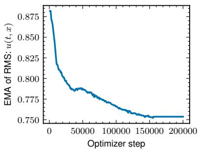  
(a)

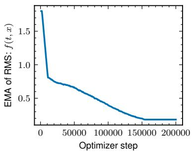

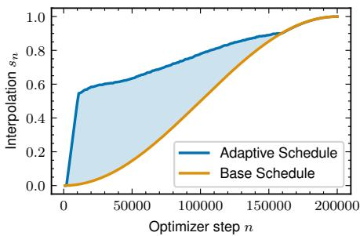  
(b)  
Figure 4: Training dynamics of the practical WaSP algorithm (Section 4.3), plotted against optimizer step, for the complex Ginzburg–Landau experiment of Section 5.1, whose input is the pair $v = ( u ( 0 , x ) , f ( t , x ) )$ of initial state and forcing. (a) Dynamic normalization: the EMA of the root-mean-square magnitude of the solution field, the output of ${ \mathcal { G } } _ { \theta } \ ( \mathrm { l e f t } )$ and of the forcing component f of the input (right). (b) Adaptive transport schedule: the interpolation parameter s on the vertical axis. The adaptive schedule advances to the next intermediate distribution only once $\mathcal { L } _ { \mathrm { P D E } }$ has fallen below a threshold, spending more steps on harder portions of the path, whereas the baseline advances on a fixed cosine schedule.

Dynamic Normalization. Because the input and output statistics change along the path from ν to $\nu _ { 1 }$ , we apply dynamic normalization based on exponential moving averages (EMA) of the current statistics to control the input and output magnitudes of the neural operator; this also sets the relative scaling of $\alpha _ { u }$ and $\alpha _ { v }$ in (27) and keeps gradients from both terms balanced as the path advances. Note that the dynamic normalization update must be frozen towards the final stage of training since the fluctuating normalizers create a noise floor that prevents the neural operator from converging to a fixed solution.

Figure 4a shows these running statistics drifting over the course of training, which is precisely what fixed normalization constants would fail to track. Finally, the EMA statistics also control the adaptive Schedule function: WaSP changes the value of $s _ { n }$ at step n only when the normalized PDE loss $\alpha _ { v } \mathcal { L } _ { \mathrm { P D E } }$ falls below a prescribed threshold, so that harder portions of the path receive smaller efective Wasserstein steps. Figure 4b contrasts this adaptive schedule with the fixed cosine baseline, showing that it concentrates optimizer steps where the path is most dificult and converges faster overall.

## 5 Experiments

We evaluate WaSP under a solver-free training setup: no solver-generated labeled pairs from the target distribution are used during training. We only assume that unpaired inputs from the target input distribution $v \sim \nu _ { 1 }$ are available, as they are for every physics-informed method. We compare WaSP against two baselines and two ablations on the Allen–Cahn, Kuramoto–Sivashinsky (KS), and complex Ginzburg–Landau (CGLE) equations. The baselines are Physics-Informed Neural Operator (PINO) (Li et al., 2024), which minimizes the residual loss (8) on the target distribution $\nu _ { 1 }$ , and Manufactured Data (MD; Hasani and Ward, 2024; Sojitra and San, 2025), which minimizes the supervised loss (10) on manufactured pairs (v, u) drawn from $\mu _ { 0 }$ . Each ablation study extends a baseline by introducing one WaSP component. PINO+OT extends PINO by training on the intermediate input distribution along the transport path, which is WaSP without self-generated data supervision. MD+PINO extends MD by training on the same manufactured distribution $\mu _ { 0 }$ and introduces physics-informed supervision, which is (27) evaluated on $\mu _ { 0 }$ and $\nu _ { 0 }$

## 5.1 Equations

We benchmark WaSP on three one-dimensional evolution equations with periodic spatial boundary conditions. To each equation we add a forcing term $f .$ In the unified notation of Section 2, the input is then $v = ( u ( 0 , x ) , f ( t , x ) )$ , comprising the initial state and the forcing field, and with the forcing included every suficiently regular field u is the unique solution of $\mathcal { N } ( u ) = v$ , which realizes the bijection assumed there. The target input distribution $\nu _ { 1 }$ corresponds to the unforced equations: $f \equiv 0$ , with the initial condition $u ( 0 , x )$ drawn from the distributions specified below. The forcing is therefore active only on the manufactured side of the transport path and anneals to zero as $s \to 1$ Allen–Cahn and Kuramoto–Sivashinsky are established operator-learning benchmarks, while the chaotic complex Ginzburg–Landau regime we study is comparatively underexplored. Together the three span a range of dificulty, from relaxation to developed spatio-temporal chaos; Section 7 places them in the operator-learning literature.

Allen–Cahn. The Allen–Cahn equation is a reaction–difusion PDE,

$$
\partial _ { t } u - \nu \partial _ { x } ^ { 2 } u - u + u ^ { 3 } = f .\tag{29}
$$

We take $\nu = 0 . 0 1$ on $\Omega = [ 0 , 5 ] _ { t } \times [ 0 , 2 \pi ] _ { x }$ , with initial conditions drawn from a Gaussian random field with power spectrum proportional to $e ^ { - k _ { x } }$ , with RMS amplitude of $\sim 0 . 1 5$ . The bistable reaction term drives the field toward the phase-separated states $u = \pm 1$ , making this the mildest of the three benchmarks.

Kuramoto–Sivashinsky. The Kuramoto–Sivashinsky equation is an evolution PDE that develops spatio-temporal chaos,

$$
\partial _ { t } u + u \partial _ { x } u + \partial _ { x } ^ { 2 } u + \nu \partial _ { x } ^ { 4 } u = f .\tag{30}
$$

We take $\nu = 0 . 0 1$ on $\Omega = [ 0 , 0 . 1 2 8 ] _ { t } \times [ 0 , 5 ] _ { x }$ , with initial conditions drawn from the invariant measure. Linearizing about the zero state gives the growth rate $k ^ { 2 } - \nu k ^ { 4 }$ , positive for $0 < k < \nu ^ { - 1 / 2 } = 1 0$ and maximized at $k = ( 2 \nu ) ^ { - 1 / 2 } \approx 7 . 0 7$ . On the domain [0, 5] the admissible wavenumbers are $k _ { n } = 2 \pi n / 5$ so the lowest seven Fourier modes are linearly unstable, and the sixth is the fastest growing. Rescaling space, time, and amplitude maps the equation to the standard Kuramoto–Sivashinsky equation at domain length $L / \sqrt { \nu } = 5 0$ , well above the conventional chaotic threshold $\gtrsim 2 2$ (Cvitanović et al., 2010).

Complex Ginzburg–Landau. The complex Ginzburg–Landau equation governs a complex field u and is an evolution PDE with chaotic dynamics,

$$
\partial _ { t } u - u - ( 1 + i \alpha ) \partial _ { x } ^ { 2 } u + ( 1 + i \beta ) | u | ^ { 2 } u = f .\tag{31}
$$

We take $( \alpha , \beta ) = ( 2 , - 2 ) \mathrm { o n } [ 0 , 6 . 4 ] _ { t } \times [ 0 , 5 0 ] _ { x }$ , with initial conditions drawn from the invariant measure. These parameters are in the defect turbulence region (Shraiman et al., 1992), marked by persistent spatio-temporal disorder and phase singularities $( | u | = 0 )$ . Under other parameters, CGLE can instead exhibit phase turbulence, where the amplitude stays positive and slaved to the phase, whose equation then reduces asymptotically to the Kuramoto–Sivashinsky equation (Shraiman et al., 1992; Aranson and Kramer, 2002); the defect-turbulence regime studied here therefore makes the two chaotic benchmarks complementary rather than redundant. The same parameter pair has been used as a defect-chaos benchmark for model-free prediction with reservoir and recurrent networks (Jiang and Lai, 2019); to our knowledge, however, the CGLE has not been adopted as an operator-learning benchmark, whereas the Kuramoto–Sivashinsky equation remains the standard chaotic test case for operator learning (Li et al., 2022), with solver-generated training trajectories.

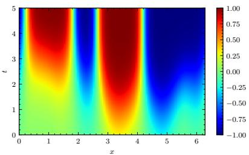  
(a) Allen–Cahn, reference

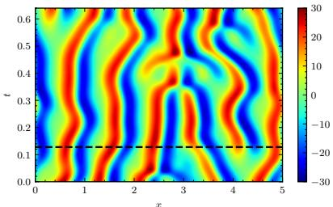  
(b) KS, reference

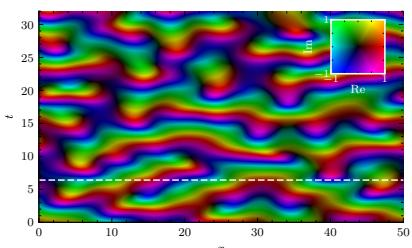  
(c) CGLE, reference

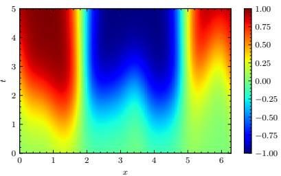  
(d) Allen–Cahn, µ0

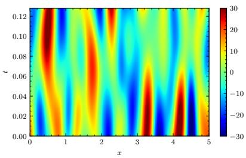  
(e) KS, µ0

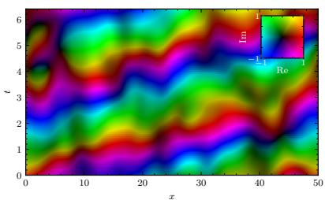  
(f) CGLE, µ0  
Figure 5: Top row, representative solutions of the three benchmark equations: (a) Allen–Cahn on the training domain $[ 0 , 5 ] _ { t } \times [ 0 , 2 \pi ] _ { x }$ with $u \in [ - 1 , 1 ]$ , showing phase separation into ±1 domains, and (b) Kuramoto–Sivashinsky on $[ 0 , 0 . 6 4 ] _ { t } \times [ 0 , 5 ] _ { x }$ and (c) complex Ginzburg–Landau on $[ 0 , 3 2 ] _ { t } \times [ 0 , 5 0 ] _ { x } ,$ both with the time axis extended to 5× the training horizon to expose the spatio-temporal chaos. Bottom row, representative samples $u \sim \mu _ { 0 }$ from the manufactured solution distribution (Section 6.1), on the training domains (d) $[ 0 , 5 ] _ { t } \times [ 0 , 2 \pi ] _ { x }$ , (e) $[ 0 , 0 . 1 2 8 ] _ { t } \times [ 0 , 5 ] _ { x }$ and (f) $[ 0 , 6 . 4 ] _ { t } \times [ 0 , 5 0 ] _ { x }$ . The complex Ginzburg– Landau fields in (c) and (f) are colored by phase and magnitude (inset color wheel); (c) shows the phase singularities $( | u | = 0 )$ of the defect-turbulence regime.

Figure 5 shows representative solutions of all three systems, together with samples from the manufactured solution distribution.

## 5.2 Experiment Setup

We choose the Fourier Neural Operator (FNO) as the parametrization of $\mathcal { G } _ { \theta }$ in all experiments (Li et al., 2021). Inputs and solutions are discretized on a uniform space–time grid of resolution $( n _ { t } , n _ { x } )$ namely (128, 128) for Allen–Cahn and (128, 256) for KS and the CGLE, with spacings $\delta t = T / n _ { t }$ and $\delta x = L / n _ { x } ;$ every model is trained and evaluated at the fixed resolutions. The FNO carries a strong periodic inductive bias, so to account for the non-periodic temporal boundary, we zero-pad the time dimension by 10% and include a linear temporal encoding. Both terms of (27) use $L ^ { 2 } { \mathrm { - t y p e } }$ norms, the input term being a weighted sum of an interior residual and an initial-condition error. All five methods share the optimizer, schedule, step budget, and total batch size, and difer only in how the batch is sampled and split between the solution and residual terms (Section F.7), so the comparison is compute-matched.

For the KS equation, the predicted field is low-pass filtered to its leading 96 spatial Fourier modes at the end of each forward pass, for all five methods, since the $\partial _ { x } ^ { 4 } u$ term of the residual scales as $k ^ { 4 }$ and is numerically unstable in the highest modes. For the complex-valued CGLE field, the real and imaginary parts are treated as two real channels rather than using a complex-valued FNO.

All reference data, both the held-out test trajectories and the solver rollouts of Section 5.3, are generated with a fourth-order exponential time-diferencing Runge–Kutta scheme (ETD-RK4) (Cox and Matthews, 2002; Kassam and Trefethen, 2005) on the grids of Section F.1. For KS and the CGLE the initial conditions are snapshots of long ETD-RK4 trajectories recorded once the transient has decayed, so they are samples of the invariant measure.

## 5.3 Evaluation

As the primary evaluation metric, we evaluate the target risk (1) normalized by the solver-predicted RMS amplitude of the field. Since two of the benchmark equations are chaotic, a finite-horizon pointwise error cannot characterize the dynamics on its own: it grows over the rollout and eventually saturates. We therefore also evaluate statistics of the invariant measure and the spatial and temporal autocorrelations, defined below.

For the statistical observables, let $\mu ^ { \infty }$ and $\hat { \mu } ^ { \infty }$ denote the invariant measure of the solution field, estimated empirically from the reference solver and from an autoregressive rollout of the learned operator5, respectively. We denote the spatial marginal of the invariant measures as $\mu _ { \mathrm { s p a t } } ^ { \infty }$ and $\hat { \mu } _ { \mathrm { s p a t } } ^ { \infty }$ . Both are stationary in time, so $\mathbb { E } _ { u \sim \mu ^ { \infty } } [ \cdot ]$ averages over the ensemble and over the base time. Averaging over the periodic domain of length $L _ { ; }$ , the correlation function is

$$
R _ { \mu ^ { \infty } } ( \Delta t , \Delta x ) : = \mathbb { E } _ { u \sim \mu ^ { \infty } } \left[ \frac { 1 } { L } \int _ { 0 } ^ { L } \left( u ( t , x ) - \bar { u } \right) \left( u ( t + \Delta t , x + \Delta x ) - \bar { u } \right) ^ { * } d x \right] ,
$$

which is independent of the base time t by stationarity of $\mu ^ { \infty }$ ; here $( \cdot ) ^ { * }$ is complex conjugation, reducing to the identity for the real-valued Allen–Cahn and KS fields. The scalar mean u¯ is taken over the same ensemble and averaged over space–time.

1. Relative solution error. The aggregate relative $L ^ { 2 }$ error of the predicted solution under the target distribution, normalized over the test set rather than per sample,

$$
\frac { \mathbb { E } _ { \boldsymbol { v } \sim \nu _ { 1 } } \lVert \boldsymbol { \mathcal { G } } _ { \boldsymbol { \theta } } ( \boldsymbol { v } ) - \boldsymbol { \mathcal { G } } ( \boldsymbol { v } ) \rVert _ { 2 } } { \mathbb { E } _ { \boldsymbol { v } \sim \nu _ { 1 } } \lVert \boldsymbol { \mathcal { G } } ( \boldsymbol { v } ) \rVert _ { 2 } } ,
$$

evaluated on the prediction domain Ω.

2. Invariant-measure distance. The 2-Wasserstein distance $W _ { 2 } \left( \mu _ { \mathrm { s p a t } } ^ { \infty } , \hat { \mu } _ { \mathrm { s p a t } } ^ { \infty } \right)$ between the reference and predicted invariant measures marginalized over time.

3. Spatial autocorrelation. The normalized spatial autocorrelation at separation $\Delta x$

$$
R _ { \Delta x } : = \frac { R _ { \hat { \mu } ^ { \infty } } ( 0 , \Delta x ) } { R _ { \hat { \mu } ^ { \infty } } ( 0 , 0 ) } .
$$

4. Temporal autocorrelation. The analogous normalized autocorrelation at separation $\Delta t$

$$
R _ { \Delta t } : = \frac { R _ { \hat { \mu } ^ { \infty } } ( \Delta t , 0 ) } { R _ { \hat { \mu } ^ { \infty } } ( 0 , 0 ) } .
$$

5. Energy spectrum. The spatial energy spectrum as a function of wavenumber $k ,$

$$
\varepsilon _ { k } = \mathbb { E } _ { u \sim \hat { \mu } _ { \mathrm { s p a t } } ^ { \infty } } | \mathcal { F } _ { k } ( u ) | ^ { 2 } ,
$$

where $\mathcal { F } _ { k } ( u )$ is the k-th spatial Fourier mode.

Metric 1 is reported for all three equations; metrics 2–5 characterize a statistical steady state and are reported only for the chaotic KS and CGLE systems. To reach that steady state, we draw $v \sim \nu _ { 1 }$ from test data obtained by running a numerical solver and discard a burn-in of 10000 δt so that the statistics are independent of the initialization (Section F.8).

For the invariant-measure distance (metric 2), the Sinkhorn estimator is biased upward by finite sampling and by the entropic regularization, so even two independent solver rollouts are separated by a strictly positive expected distance. To calibrate this ofset, we report a solver-only reference from two independent ETD-RK4 rollouts, with sampling uncertainty estimated from the empirical variance of the Sinkhorn dual potentials, following the entropic-OT central limit theorem (Mena and Niles-Weed, 2019; Gonzalez-Sanz et al., 2022); a model whose distance lies within 2σ of this reference is statistically indistinguishable from the solver at the available sample size, and such entries are boldfaced along with the best model.

Metrics 3–5 are functions of $\Delta x , \Delta t$ , and $k ,$ so we plot them against the ETD-RK4 reference and summarize each by its relative root-mean-square error (RMSE). The spatial separation is periodic and conjugate-symmetric, so the spatial correlation is shown over the full independent range $\Delta x \in [ 0 , L / 2 ]$ . The energy spectrum is shown over the leading 40 modes, whose spectral power already spans ten orders of magnitude. The temporal separation is unbounded; we therefore evaluate $\Delta t$ up to 127 δt, corresponding to one autoregressive window.

## 5.4 Results

Table 1 reports all metrics. WaSP attains the lowest solution relative $L ^ { 2 }$ error on every equation, improving on PINO, the strongest baseline, by factors of 3.9 on Allen–Cahn, 9.5 on KS, and 4.6 on the CGLE, and on MD by 9.4× to 15.4×. Against the PINO+OT ablation the margin is narrower on the two chaotic equations, 4.7× on KS and 1.6× on the CGLE, and wider on Allen–Cahn at 5.6×. The other ablation, MD+PINO, ofers no consistent improvement over MD.

For the statistical observables, WaSP attains the best or a statistically indistinguishable value throughout. Figure 8 plots all three function-valued observables against the ETD-RK4 reference. On KS, WaSP improves on every other method on all four metrics, by 1.1× to 1.9× on the invariant measure and by 1.7× to 24× on the three function-valued observables. On the CGLE the invariant measure saturates: WaSP, PINO and PINO+OT all lie within 2σ of the solver reference, so that metric separates none of the three, and all three also reach small spatial-correlation and spectrum errors. What separates them is how the field is organized in time. PINO matches the invariant measure to within the solver reference $( 4 . 3 \times 1 0 ^ { - 1 } )$ yet its temporal-correlation error exceeds WaSP’s by more than a factor of three $( 1 . 0 \times 1 0 ^ { - 1 }$ versus $2 . 9 \times 1 0 ^ { - 2 } )$ , recovering the static distribution of states but not their temporal structure. Figure 8f shows the failure mode. PINO matches the reference at small temporal separation and then drifts steadily out of phase, the signature of a small error in the nonlinear frequency of the rotating field, which accumulates linearly in the separation.

Physics-Informed Track: PINO and PINO+OT. Figures 6 and 7 plot the validation solution and residual error on the target distribution $\nu _ { 1 }$ against optimizer step; no checkpoint or hyperparameter is selected on these curves, and every reported number is from the final step (Section F.8). Two readings follow. First, curriculum learning is known to mitigate part of the optimization dificulty of physics-informed methods (Krishnapriyan et al., 2021; Wang et al., 2024b), and Figure 7 shows the terminal PDE residual of PINO+OT below that of PINO on all three equations, so the interpolation path defines a curriculum that helps even without self-generated supervision. Second, as Section 3.1 shows, a residual measured in too weak a norm cannot certify the solution error, and the curves exhibit exactly the obstruction Theorem 5 proves. PINO+OT reaches a lower residual than WaSP on every equation and a higher solution error on every equation, and on Allen–Cahn it reaches a lower residual than PINO together with a higher solution error.

Table 1: Evaluation of WaSP against two baselines and two ablations on the Allen–Cahn, Kuramoto– Sivashinsky (KS), and complex Ginzburg–Landau (CGLE) equations. Every method follows the solver-free training protocol. The baselines are PINO, which minimizes the PDE residual and initial-condition losses, and MD, which regresses on the fixed manufactured pairs $( \mathcal { N } ( u ) , u )$ with $u \sim \mu _ { 0 }$ . Each ablation is listed under the baseline it extends: PINO+OT trains the residual loss along the McCann interpolation, and MD+PINO is the WaSP objective (27) frozen at $s = 0$ . Columns are metrics 1–5 of Section 5.3; dashes mark the metrics reported only for the chaotic systems. WaSP attains the best or statistically indistinguishable value on every metric and equation.
<table><tr><td>Equation</td><td>Method</td><td>Sol. Rel.  $L ^ { 2 }$ </td><td>Inv. Meas. Dist.</td><td>Spat. Corr. RMSE</td><td>Temp. Corr. RMSE</td><td>Spectrum RMSE</td></tr><tr><td rowspan="5">Allen-Cahn</td><td>WaSP (ours)</td><td> $\mathbf { 8 . 5 2 \times 1 0 ^ { - 3 } }$ </td><td></td><td></td><td></td><td></td></tr><tr><td>PINO</td><td> $3 . 2 9 \times 1 0 ^ { - 2 }$ </td><td></td><td></td><td></td><td></td></tr><tr><td>PINO+OT</td><td> $4 . 7 3 \times 1 0 ^ { - 2 }$ </td><td></td><td></td><td></td><td></td></tr><tr><td>MD</td><td> $1 . 1 0 \times 1 0 ^ { - 1 }$ </td><td></td><td></td><td></td><td></td></tr><tr><td>MD+PINO</td><td> $1 . 0 6 \times 1 0 ^ { - 1 }$ </td><td></td><td></td><td></td><td></td></tr><tr><td rowspan="6">KS equation</td><td>WaSP (ours)</td><td> $\mathbf { 2 . 1 9 \times 1 0 ^ { - 2 } }$ </td><td> $\mathbf { 8 . 6 9 \times 1 0 ^ { 0 } }$ </td><td> $\mathbf { 1 . 0 2 \times 1 0 ^ { - 1 } }$ </td><td> $\mathbf { 8 . 4 5 \times 1 0 ^ { - 2 } }$ </td><td> $\mathbf { 1 . 0 4 \times 1 0 ^ { - 1 } }$ </td></tr><tr><td>PINO</td><td> $2 . 0 8 \times 1 0 ^ { - 1 }$ </td><td> $9 . 9 3 \times 1 0 ^ { 0 }$ </td><td> $3 . 8 7 \times 1 0 ^ { - 1 }$ </td><td> $1 . 4 6 \times 1 0 ^ { - 1 }$ </td><td> $4 . 7 0 \times 1 0 ^ { - 1 }$ </td></tr><tr><td>PINO+OT</td><td> $1 . 0 2 \times 1 0 ^ { - 1 }$ </td><td> $1 . 4 8 \times 1 0 ^ { 1 }$ </td><td> $1 . 1 6 \times 1 0 ^ { 0 }$ </td><td> $2 . 6 7 \times 1 0 ^ { - 1 }$ </td><td> $1 . 8 0 \times 1 0 ^ { 0 }$ </td></tr><tr><td>MD</td><td> $3 . 3 8 \times 1 0 ^ { - 1 }$ </td><td> $1 . 6 7 \times 1 0 ^ { 1 }$ </td><td> $1 . 4 6 \times 1 0 ^ { 0 }$ </td><td> $6 . 2 7 \times 1 0 ^ { - 1 }$ </td><td> $2 . 4 8 \times 1 0 ^ { 0 }$ </td></tr><tr><td>MD+PINO</td><td> $3 . 6 4 \times 1 0 ^ { - 1 }$ </td><td> $1 . 6 8 \times 1 0 ^ { 1 }$ </td><td> $1 . 4 4 \times 1 0 ^ { 0 }$ </td><td> $4 . 5 7 \times 1 0 ^ { - 1 }$ </td><td> $2 . 4 0 \times 1 0 ^ { 0 }$ </td></tr><tr><td>Solver reference</td><td></td><td> $( 7 . 8 7 \pm 0 . 0 5 ) \times 1 0 ^ { 0 }$ </td><td></td><td></td><td></td></tr><tr><td rowspan="6">CGLE</td><td>WaSP (ours)</td><td> $\mathbf { 7 . 0 8 \times 1 0 ^ { - 2 } }$ </td><td> $\mathbf { 4 . 3 8 \times 1 0 ^ { - 1 } }$ </td><td> $\mathbf { 9 . 1 0 \times 1 0 ^ { - 3 } }$ </td><td> $\mathbf { 2 . 9 0 \times 1 0 ^ { - 2 } }$ </td><td> $\mathbf { 1 . 2 3 \times 1 0 ^ { - 2 } }$ </td></tr><tr><td>PINO</td><td> $3 . 2 3 \times 1 0 ^ { - 1 }$ </td><td> $\mathbf { 4 . 3 4 \times 1 0 ^ { - 1 } }$ </td><td> $3 . 9 8 \times 1 0 ^ { - 2 }$ </td><td> $1 . 0 1 \times 1 0 ^ { - 1 }$ </td><td> $5 . 2 0 \times 1 0 ^ { - 2 }$ </td></tr><tr><td>PINO+OT</td><td> $1 . 1 6 \times 1 0 ^ { - 1 }$ </td><td> $4 . 3 8 \times 1 0 ^ { - 1 }$ </td><td> $1 . 2 3 \times 1 0 ^ { - 2 }$ </td><td> $5 . 6 8 \times 1 0 ^ { - 2 }$ </td><td> $1 . 3 6 \times 1 0 ^ { - 2 }$ </td></tr><tr><td>MD</td><td> $6 . 6 5 \times 1 0 ^ { - 1 }$ </td><td> $5 . 7 7 \times 1 0 ^ { - 1 }$ </td><td> $1 . 4 6 \times 1 0 ^ { 0 }$ </td><td> $5 . 1 0 \times 1 0 ^ { - 1 }$ </td><td> $1 . 7 6 \times 1 0 ^ { 0 }$ </td></tr><tr><td>MD+PINO</td><td> $7 . 5 4 \times 1 0 ^ { - 1 }$ </td><td> $5 . 8 9 \times 1 0 ^ { - 1 }$ </td><td> $9 . 7 9 \times 1 0 ^ { - 1 }$ </td><td> $5 . 1 7 \times 1 0 ^ { - 1 }$ </td><td> $1 . 6 3 \times 1 0 ^ { 0 }$ </td></tr><tr><td> $S o l v e r \ r e f e r e n c e$ </td><td></td><td> $( 4 . 3 7 \pm 0 . 0 0 3 ) \times 1 0 ^ { - 1 }$ </td><td></td><td></td><td></td></tr></table>

Manufactured-Data Track: MD and MD+PINO. MD and MD+PINO are the weakest methods throughout, and they inherit the structural distribution shift of Section 3.3. Two observations support this. First, both are trained on the same $\mu _ { 0 }$ as WaSP, constructed for each equation to lie as close to the target solution measure as we could make it (Section 6.1), yet neither recovers the target dynamics; a well-matched starting distribution is thus insuficient on its own, consistent with the obstruction of Theorem 7. Second, Figures 8a and 8c show that both fail to capture the spatial structure and collapse onto the dominant sixth harmonic, the fastest-growing linearly unstable mode, which shows as evenly spaced spectral spikes. The imaginary spatial correlation in Figure 8d is the sharper case: the reference has none and $\mu _ { 0 }$ has none by construction, yet MD and MD+PINO produce one and WaSP and PINO do not, so the artifact is generated during the autoregressive rollout rather than inherited from the training distribution. We read both as the same mechanism, where a test-time input drawn from $\nu _ { 1 }$ is slightly out of distribution for a method trained on $\mu _ { 0 } .$ , the bias of the learned operator carries it further out, and the rollout settles on a spurious attractor.

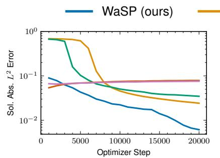  
(a) Allen–Cahn

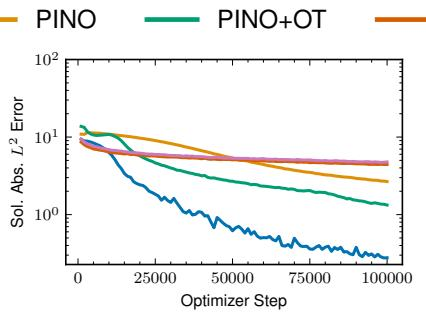  
(b) KS equation

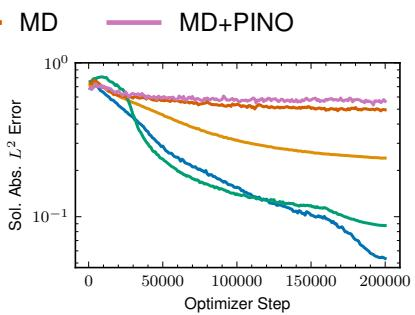  
(c) CGLE

Figure 6: The panels plot the validation absolute $L ^ { 2 }$ error of the predicted solution on the target distribution $\nu _ { 1 }$ (log scale) against optimizer step, for WaSP, the two baselines (PINO and MD), and the two ablations (PINO+OT and MD+PINO).  
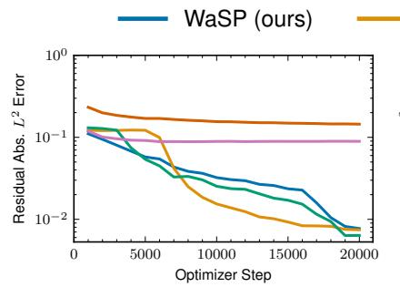  
(a) Allen–Cahn

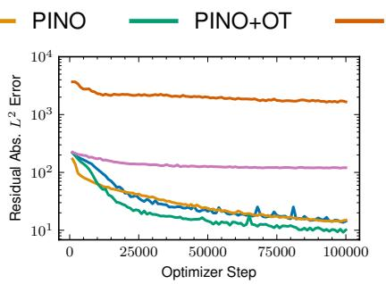  
(b) KS equation

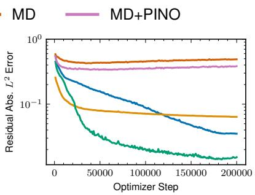  
(c) CGLE  
Figure 7: The panels plot the validation $L ^ { 2 }$ norm of the predicted PDE residual on the target distribution $\nu _ { 1 }$ (log scale) against optimizer step, for WaSP, the two baselines (PINO and MD), and the two ablations (PINO+OT and MD+PINO). Note that smaller PDE residual does not imply better accuracy as argued in Section 2.

## 6 Discussion

This section examines the two design inputs WaSP depends on, the manufactured solution measure $\mu _ { 0 }$ (Section 6.1) and the transport map T (Section 6.2).

## 6.1 Construction of the Manufactured Solution Distribution

WaSP imposes no structural constraints on $\mu _ { 0 }$ , but selecting it close to the target solution measure $\mu _ { 1 } : = \mathcal G _ { \# } \nu _ { 1 }$ is essential for fast convergence, as it shortens the transport path WaSP must traverse. By Theorem $^ { 7 , }$ however, no tractable calibration of $\mu _ { 0 }$ can remove the distribution gap entirely. We describe the construction of $\mu _ { 0 }$ for each benchmark equation below; representative samples are shown in Figure 5.

Allen–Cahn. We sample $u ( 0 , x )$ from the target initial-condition distribution and obtain each output time t by a single Lie–Trotter splitting step of size t applied to $u ( 0 , \cdot )$ . The reaction ODE $u _ { t } = u - u ^ { 3 }$ is a Bernoulli equation, solved in closed form at each grid point,

$$
\Phi ( t ; u _ { 0 } ) = \frac { u _ { 0 } } { \sqrt { e ^ { - 2 t } \left( 1 - u _ { 0 } ^ { 2 } \right) + u _ { 0 } ^ { 2 } } } ,
$$

WaSP (ours) PINO

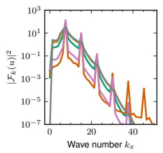

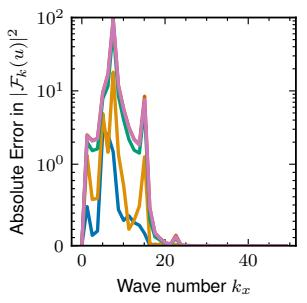  
(a) KS, energy spectrum  
MD+PINO ETD-RK4 Solver

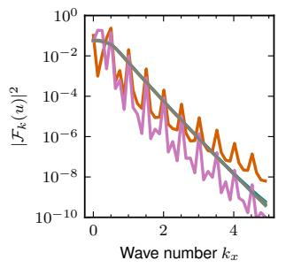  
Re[Obs] Im[Obs]

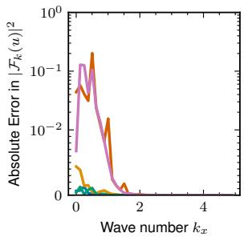  
(b) CGLE, energy spectrum

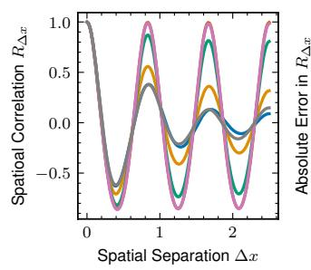

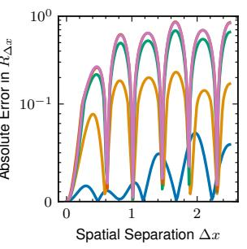  
(c) KS, spatial autocorrelation

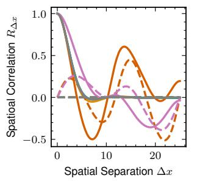

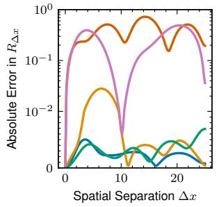  
(d) CGLE, spatial autocorrelation

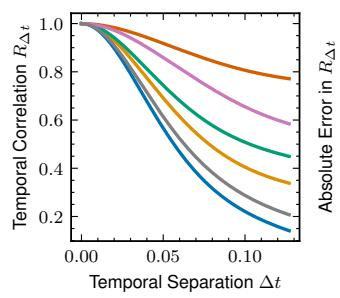

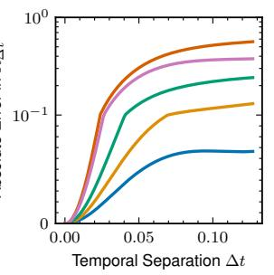  
(e) KS, temporal autocorrelation

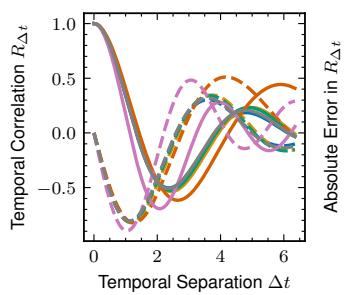

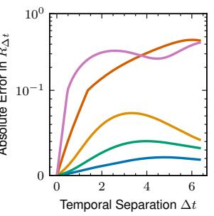  
(f) CGLE, temporal autocorrelation

Figure 8: Function-valued statistical observables for the Kuramoto–Sivashinsky and complex Ginzburg–Landau equations, plotted against the wavenumber k and the separations $\Delta x$ and $\Delta t .$ Within each panel, the left plot shows the raw curves against the ETD-RK4 reference and the right plot the absolute deviation from that reference on a symmetric-log scale, whose linear region is marked by evenly spaced minor ticks. The legend at the top applies to all six panels and distinguishes the five methods, the ETD-RK4 reference, and the real and imaginary parts of each complex observable.

and the difusion operator $e ^ { \nu t \partial _ { x } ^ { 2 } }$ , with ν the dissipation parameter of Section 5.1, is then applied exactly in Fourier space as the multiplier $e ^ { - \nu t k _ { x } ^ { 2 } }$ , so that $u ( t , \cdot ) = e ^ { \nu t \partial _ { x } ^ { 2 } } \Phi ( t ; u ( 0 , \cdot ) )$ . A single step of size t is not a convergent splitting solver but a cheap sampler whose time slices are independent and can therefore be evaluated in parallel across t. The target initial condition for Allen–Cahn is itself a Gaussian random field, so the initial-condition marginal of $\nu _ { 0 }$ coincides with that of $\nu _ { 1 }$ by construction. The optimal map therefore reduces to the identity on the initial condition and the zero map on the forcing: the path still anneals $f \mapsto ( 1 - s ) f$ under the schedule of Section F.6, but no Sinkhorn problem is solved.

Kuramoto–Sivashinsky. We model $\mu _ { 0 }$ as a space–time Gaussian random field (GRF) whose power spectrum is separable in the temporal and spatial frequencies $( k _ { t } , k _ { x } )$ . For the spatial factor we use the power spectrum $P _ { x } ( k _ { x } ) : = \mathbb { E } \left[ | \widehat { u _ { 0 } } ( k _ { x } ) | ^ { 2 } \right]$ of the target initial-condition distribution, estimated from the same unpaired target inputs that are used to fit $\tau$ (Section 6.2), so that samples inherit its spatial statistics. We extend it to a 2D space–time spectrum by assuming a separable $P ( k _ { t } , k _ { x } ) = P _ { t } ( k _ { t } ) P _ { x } ( k _ { x } )$ with a normalized Gaussian temporal factor $P _ { t } ( k _ { t } ) \propto \exp { \left( - k _ { t } ^ { 2 } / 2 \sigma _ { t } ^ { 2 } \right) }$ which gives E $\| \partial _ { t } u \| ^ { 2 } / \mathbb { E } \| u \| ^ { 2 } = \sigma _ { t } ^ { 2 }$ . The temporal factor is calibrated to the rate at which the true dynamics evolve the field at $t = 0$ . Setting $f \equiv 0$ and solving the equation for $\partial _ { t } \boldsymbol { u }$ gives $\widehat { \partial _ { t } u } ( k _ { x } ) \big | _ { t = 0 }$ in $u _ { 0 }$ , and therefore

$$
\sigma _ { t } ^ { 2 } : = \frac { \mathbb { E } \left[ \left. \sum _ { k _ { x } } \right| - \frac { 1 } { 2 } i k _ { x } \widehat { u _ { 0 } ^ { 2 } } ( k _ { x } ) + \left( k _ { x } ^ { 2 } - \nu k _ { x } ^ { 4 } \right) \widehat { u _ { 0 } } ( k _ { x } ) \right| ^ { 2 } \right] } { \mathbb { E } \left[ \left. \sum _ { k _ { x } } \vert \widehat { u _ { 0 } } ( k _ { x } ) \vert ^ { 2 } \right] } ,\tag{32}
$$

calibrates the temporal factor. Because an FFT-sampled GRF is periodic along each axis, we sample on a doubled temporal grid of length $2 n _ { t }$ and retain the first half, removing the spurious temporal periodicity that would otherwise be imposed on $\mu _ { 0 }$

Complex Ginzburg–Landau. As shown in Figure $5 \mathrm { c } .$ , the CGLE’s dynamics combine locally plane-wave patches, separated by phase defects, with spatio-temporal chaos appearing at larger scale. We therefore build each sample around an unstable plane wave and perturb it with a GRF. We first draw a spatial wavenumber $k _ { 0 }$ with probability proportional to $P _ { x } .$ , now recomputed from the target CGLE initial-condition distribution, and form the corresponding plane wave, whose temporal frequency follows the CGLE dispersion relation

$$
\omega ( k _ { 0 } ) = - \beta - \left( \alpha - \beta \right) k _ { 0 } ^ { 2 } .
$$

Here $\omega ( k _ { 0 } )$ is the frequency of the exact unstable plane wave of amplitude $\sqrt { 1 - k _ { 0 } ^ { 2 } }$ . We then modulate this wave by a complex GRF $\xi$ drawn from the same separable space–time spectrum $P ( k _ { t } , k _ { x } )$ used in the KS construction, recalibrated with unforced CGLE. The doubled-grid sampling that removes temporal periodicity is also in place, giving the sample

$$
\begin{array} { r } { u ( t , x ) = \frac { 1 } { \sqrt { 2 } } \left( 1 + \xi ( t , x ) \right) e ^ { i ( \omega \left( k _ { 0 } \right) t + k _ { 0 } x ) } . } \end{array}
$$

The multiplicative perturbation preserves the plane-wave backbone while injecting the small-scale fluctuations characteristic of the defect-turbulence regime. The amplitude is fixed at $1 / \sqrt { 2 }$ rather than the exact $\sqrt { 1 - k _ { 0 } ^ { 2 } } ;$ the pair $( \mathcal { N } ( u ) , u )$ is exact by construction for any sampled $u ,$ and a constant preserves the output norm.

## 6.2 Cost of the Transport Estimate

The transport map $\tau$ in (17) is needed only to define the interpolation path, and estimating it is a one-time preprocessing step, separate from neural-operator training. Because the target forcing distribution is the point mass at $f = 0$ , any transport to $\nu _ { 1 }$ must send the forcing component to zero, so the map factors exactly: on the forcing component $\tau$ is the zero map and (17) reduces to linear annealing $f \mapsto ( 1 - s ) f$ . Optimal transport is therefore required only for the spatial initial condition, whose dimension is the spatial grid size rather than the full space–time grid. For that component, we estimate $\tau$ with the entropy-regularized Sinkhorn algorithm under the squared-Euclidean cost (Cuturi, 2013), run in the log domain on top of matrix-free GPU kernel reductions (Charlier et al., 2021), so that the $n \times m$ coupling between the n source and m target samples is never materialized in memory. To reduce dimension, we project both clouds onto their leading principal components before solving the transport problem, and recover the map on new samples by barycentric projection of the entropic plan (Pooladian and Niles-Weed, 2021). Its settings are listed in Table 8.

Cost Analysis. Because the path endpoints are fixed, T is estimated once and reused at every optimizer step, so even a comparatively expensive estimate is amortized over the full training run. In our experiments, the Sinkhorn iterations account for $< 1 0$ sec on one RTX 5090. Furthermore, each Sinkhorn iteration scales as $O ( n m q )$ in the sample counts n, m and the PCA rank $q ,$ independently of the space–time resolution (Section F.6). However, applying the map recurs rather than amortizes, since the barycentric projection has no closed form: each freshly drawn input costs one reduction over the m target fitting samples, $O ( m q )$ in the projected space plus $O ( m d )$ for the barycentric average, a few MFLOPs at typical settings and well below one forward pass of $\mathcal { G } _ { \theta }$ on the same field. Forming $\nu _ { s }$ therefore adds a negligible per-step overhead on top of the one-time estimate.

## 7 Related Work

Having presented the method and its evaluation, we now place WaSP in context.

Neural Operators. Neural operators learn mappings between infinite-dimensional function spaces and are now a leading approach to data-driven PDE surrogate modeling (Kovachki et al., 2023). The main families parametrize the integral kernel with a graph neural network (Li et al., 2020), in the spectral domain via the O(n log n) FFT (Li et al., 2021), or, in the Galerkin Transformer, through a Petrov–Galerkin projection in place of softmax attention (Cao, 2021); DeepONet instead encodes the input function and the output query coordinates in separate branch–trunk networks (Lu et al., 2021). Pretrained foundation models generalize across PDE families (Herde et al., 2024), amortizing the cost of labeled data rather than removing it, since the pretraining dataset is itself solver-generated. WaSP is architecture-agnostic and can be used to train any of these neural operator architectures; our experiments use the Fourier Neural Operator throughout (Section 5.2).

Physics-Informed Neural Operators. Physics-informed neural operators incorporate the PDE residual objective (Raissi et al., 2019) into operator training to reduce reliance on solver-generated data (Li et al., 2024; Goswami et al., 2023). The resulting objective is dificult to optimize. For PINNs, the documented mechanisms include gradient imbalance across loss terms (Wang et al., 2021), a loss landscape that becomes ill-conditioned as the PDE coeficients grow (Krishnapriyan et al., 2021), and a spectral bias that fits low-frequency components far faster than high-frequency ones (Wang et al., 2022c). A large body of work mitigates these pathologies by annealing the PDE coeficient toward its target value (Krishnapriyan et al., 2021), weighting the residual causally in time (Wang et al., 2024b), replacing first-order optimizers with quasi-second-order ones (Wang et al., 2025), and computing the spectral derivatives of the residual more accurately on non-periodic domains (Ganeshram et al., 2022). A separate issue is that the residual is not a certificate of solution quality on its own, and Wang et al. (2022a) show that for the Hamilton–Jacobi–Bellman equation a small $L ^ { 2 }$ residual loss coexists with a large error in the solution metric, so the residual norm must be strong enough to control that metric. WaSP reformulates training as a sequence of supervised problems, and uses the residual as a local regularizer that holds the realized input distribution close to the interpolated one rather than as its certificate for target risk (Sections 4.2 and 4.3).

Manufactured Data for Operator Learning. Several recent methods reuse the method of manufactured solutions (Roache, 2002) as a data source for operator learning, evaluating the PDE operator on sampled solutions to obtain training pairs with no numerical solve. Hasani and Ward (2024) manufacture random solutions as random combinations of eigenfunctions of the leading-order diferential operator and evaluate the approach on elliptic boundary-value problems; Sojitra and San (2025) extend the idea to evolution PDEs; and Bischof et al. (2026) combine manufactured pairs with a physics-informed objective on unlabeled samples to train a hypernetwork for PINNs. However, the manufactured solution prior induces a distribution shift, and addressing it remains an open problem, existing methods either rely on calibrating the solution prior to align with the equation and geometry (Hasani and Ward, 2024) or use physics-informed learning as a test-time adaptation framework (Bischof et al., 2026). WaSP starts from the same data-generation mechanism and bridges the remaining gap with an explicit transport path. A well-chosen manufactured distribution still shortens that path (Section 6.1); what WaSP removes is the requirement that the two distributions be close enough for a single generalization step to succeed.

Optimal Transport. Optimal transport (OT) provides a principled framework for comparing and interpolating between probability measures (Villani, 2009; Gabriel and Marco, 2019). Brenier’s theorem guarantees the existence and uniqueness of the optimal transport map between absolutely continuous measures as the gradient of a convex potential (Brenier, 1991), and McCann’s interpolation defines a constant-speed geodesic in the space of probability measures equipped with the Wasserstein metric (McCann, 1997). Entropy-regularized OT enables tractable estimation of transport maps and Wasserstein distances at scale via the Sinkhorn algorithm (Cuturi, 2013), and Pooladian and Niles-Weed (2021) show how to estimate the barycentric projection of the entropic plan. Matrix-free and IO-aware GPU kernels lower the cost of the Sinkhorn iteration itself (Charlier et al., 2021; Ye et al., 2026). Section 6.2 reports what the estimate costs in our setting.

Gradual Domain Adaptation. In the domain adaptation literature, Wang et al. (2022b) argue, based on their error bound, that optimal intermediate domains are the ones along the Wasserstein geodesic. He et al. (2024) state this placement as an explicit design principle and show that generating the intermediate domains by McCann’s interpolation and self-training on them improves gradual domain adaptation when real intermediate domains are scarce; El Hamri et al. (2025) adopt the same construction. WaSP follows the same outline but changes the source of supervision. Gradual domain adaptation pseudo-labels each intermediate sample with the current model, so label error accumulates along the path; WaSP instead passes the model’s output back through the PDE operator, so every intermediate pair satisfies the equation exactly (Section 4.1).

Curriculum Learning. Curriculum learning trains models by presenting examples in a meaningful order, typically from easy to hard (Bengio et al., 2009), which can improve convergence speed and final accuracy (Soviany et al., 2022). Physics-informed curricula are built over the equation or over the time domain, as in the coeficient annealing and causal weighting discussed above; WaSP builds one over the input distribution, interpolating along the Wasserstein path to present a sequence of problems that begins with well-conditioned supervised learning on manufactured data and moves toward the target.

## 8 Conclusion

We studied solver-free operator learning, where no paired input–solution data from the target distribution is available, and showed that both dominant routes face fundamental obstructions. Physics-informed training faces a regularity–variance tradeof (Sections 3.1 and 3.2). A residual norm weak enough to keep the variance of mini-batch estimates manageable may fail to control the solution error, and a norm strong enough to control it amplifies the variance of gradients and hinders optimization. Manufactured-data training induces an input distribution that can be mutually singular with the target (Theorem 7). In this case, even supervision with input–solution pairs does not limit the target error without further structural assumptions on the learned operator.

Motivated by this diagnosis, we introduced WaSP, which preserves the optimization advantage of supervised regression on manufactured data while mitigating the structural distribution shift identified for a fixed solution distribution. WaSP estimates an optimal transport map from the manufactured input distribution to the target and trains along the resulting Wasserstein interpolation, replacing one large manufactured-to-target shift with a curriculum of nearby supervised problems. At each step, the current operator predicts approximate solutions for the next intermediate distribution and manufactures exact input–solution pairs as the main learning signal; a local PDE residual term regularizes this self-generated supervision so that it cannot drift away from the transport path. A stepwise error-propagation bound under strong assumptions clarifies the intuition behind the algorithm: its success can be attributed to the local generalization property of neural operators. It also motivates an adaptive schedule that spends more steps on the parts of the path where the per-step error is largest.

Empirically, under a fully solver-free protocol that uses no labels from the target-distribution, WaSP attained the best or statistically indistinguishable values on every metric and test case across the Allen–Cahn, Kuramoto–Sivashinsky, and complex Ginzburg–Landau benchmark problems. It reduced the relative solution error by roughly 4× to 10× over the strongest baseline (PINO), and, on the two chaotic systems, more faithfully reproduced statistical observables including the invariant measure, spatial and temporal autocorrelations, and the energy spectrum. The results of the two ablations of PINO+OT and MD+PINO are consistent with Section 3: PINO+OT mitigates the optimization challenges of PINO, but still fails to certify its solution error, and MD+PINO inherits the same structural distribution shift of MD.

Several directions remain open: the method requires a hand-constructed initial solution measure, its space–time memory footprint matches that of physics-informed operators6 and the focused scope of study in this work (e.g., one-dimensional periodic evolution equations and the Fourier Neural Operator) invite extensions to higher dimensions, complex geometries, and other architectures. More broadly, our results suggest that solver-free operator learning can be recast as transport along a curriculum of distributions, rather than as a single end-to-end objective. This approach combines the reliability of supervised regression with the physical grounding of the governing equation, a combination that may prove useful beyond operator learning.

Code Availability The project’s code is available at https://github.com/neuraloperator/WaSP.git.

## Acknowledgments and Disclosure of Funding

Ryan Liu is supported in part by the National Science Foundation Graduate Research Fellowship Program under Grant No. 2139433. Anima Anandkumar is supported by the Bren named chair

professorship, Schmidt AI2050 senior fellowship, and ONR (MURI grant N00014-18-1-2624). Any opinions, findings, and conclusions or recommendations expressed in this material are those of the author(s) and do not necessarily reflect the views of the National Science Foundation.

## References

I. S. Aranson and L. Kramer. The world of the complex Ginzburg-Landau equation. Reviews of Modern Physics, 74(1):99, 2002.

E. Arazo, D. Ortego, P. Albert, N. E. O’Connor, and K. McGuinness. Pseudo-labeling and confirmation bias in deep semi-supervised learning. In 2020 International joint conference on neural networks (IJCNN), pages 1–8. IEEE, 2020.

S. Ben-David, J. Blitzer, K. Crammer, A. Kulesza, F. Pereira, and J. W. Vaughan. A theory of learning from diferent domains. Machine Learning, 79(1):151–175, 2010.

Y. Bengio, J. Louradour, R. Collobert, and J. Weston. Curriculum learning. In Proceedings of the 26th Annual International Conference on Machine Learning, pages 41–48, 2009.

J. A. L. Benitez, T. Furuya, F. Faucher, A. Kratsios, X. Tricoche, and M. V. de Hoop. Outof-distributional risk bounds for neural operators with applications to the helmholtz equation. Journal of Computational Physics, 513:113168, 2024.

N. Bhojwani, C. Wang, H.-Y. Wang, C. Sun, E. R. Most, and A. Anandkumar. From black hole to galaxy: Neural operator: Framework for accretion and feedback dynamics. arXiv preprint arXiv:2512.01576, 2025.

R. Bischof, M. Piovarci, M. Kraus, S. Mishra, and B. Bickel. Hypino: Multi-physics neural operators via hyperpinns and the method of manufactured solutions. Advances in Neural Information Processing Systems, 38:144798–144831, 2026.

Y. Brenier. Polar factorization and monotone rearrangement of vector-valued functions. Communications on Pure and Applied Mathematics, 44(4):375–417, 1991.

S. Cao. Choose a transformer: Fourier or Galerkin. Advances in Neural Information Processing Systems, 34:24924–24940, 2021.

S. Cao, F. Brarda, R. Li, and Y. Xi. Spectral-refiner: Accurate fine-tuning of spatiotemporal fourier neural operator for turbulent flows. In The Thirteenth International Conference on Learning Representations, 2025. URL https://openreview.net/forum?id=MKP1g8wU0P.

B. Charlier, J. Feydy, J. A. Glaunès, F.-D. Collin, and G. Durif. Kernel operations on the GPU, with autodif, without memory overflows. Journal of Machine Learning Research, 22(74):1–6, 2021. URL http://jmlr.org/papers/v22/20-275.html.

Y. Chen, B. Hosseini, H. Owhadi, and A. M. Stuart. Solving and learning nonlinear pdes with gaussian processes. Journal of Computational Physics, 447:110668, 2021.

S. M. Cox and P. C. Matthews. Exponential time diferencing for stif systems. Journal of Computational Physics, 176(2):430–455, 2002.

M. Cuturi. Sinkhorn distances: Lightspeed computation of optimal transport. Advances in Neural Information Processing Systems, 26, 2013.

P. Cvitanović, R. L. Davidchack, and E. Siminos. On the state space geometry of the kuramoto– sivashinsky flow in a periodic domain. SIAM Journal on Applied Dynamical Systems, 9(1):1–33, 2010.

G. Da Prato and J. Zabczyk. Stochastic equations in infinite dimensions. Cambridge University Press, 2 edition, 2014.

M. El Hamri, I. Falih, and Y. Rozenholc. McCann’s interpolation for gradual domain adaptation on the Wasserstein geodesic. In 2025 International Joint Conference on Neural Networks (IJCNN), pages 1–8. IEEE, 2025.

P. Gabriel and C. Marco. Computational optimal transport with applications to data sciences. Foundations and trends® in machine learning, 11(5-6):355–607, 2019.

A. Ganeshram, H. Maust, V. Duruisseaux, Z. Li, Y. Wang, D. Leibovici, O. Bruno, T. Hou, and A. Anandkumar. FC-PINO: High precision physics-informed neural operators via fourier continuation. arXiv preprint arXiv:2211.15960, 2022.

S. Ghadimi and G. Lan. Stochastic first- and zeroth-order methods for nonconvex stochastic programming. SIAM Journal on Optimization, 23(4):2341–2368, 2013.

A. Gonzalez-Sanz, J.-M. Loubes, and J. Niles-Weed. Weak limits of entropy regularized optimal transport; potentials, plans and divergences. arXiv preprint arXiv:2207.07427, 2022.

S. Goswami, A. Bora, Y. Yu, and G. E. Karniadakis. Physics-informed deep neural operator networks. In Machine Learning in Modeling and Simulation: Methods and Applications, pages 219–254. Springer, 2023.

E. Hasani and R. A. Ward. Generating synthetic data for neural operators. arXiv preprint arXiv:2401.02398, 2024.

Y. He, H. Wang, B. Li, and H. Zhao. Gradual domain adaptation: Theory and algorithms. Journal of Machine Learning Research, 25(361):1–40, 2024.

M. Herde, B. Raonić, T. Rohner, R. Käppeli, R. Molinaro, E. De Bezenac, and S. Mishra. Poseidon: Eficient foundation models for PDEs. Advances in Neural Information Processing Systems, 37: 72525–72624, 2024.

H. Hersbach, B. Bell, P. Berrisford, S. Hirahara, A. Horányi, J. Muñoz-Sabater, J. Nicolas, C. Peubey, R. Radu, D. Schepers, et al. The ERA5 global reanalysis. Quarterly Journal of the Royal Meteorological Society, 146(730):1999–2049, 2020.

J. Jiang and Y.-C. Lai. Model-free prediction of spatiotemporal dynamical systems with recurrent neural networks: Role of network spectral radius. Physical Review Research, 1(3):033056, 2019.

A.-K. Kassam and L. N. Trefethen. Fourth-order time-stepping for stif pdes. SIAM Journal on Scientific Computing, 26(4):1214–1233, 2005.

N. Kovachki, Z. Li, B. Liu, K. Azizzadenesheli, K. Bhattacharya, A. Stuart, and A. Anandkumar. Neural operator: Learning maps between function spaces with applications to PDEs. Journal of Machine Learning Research, 24(89):1–97, 2023.

A. Krishnapriyan, A. Gholami, S. Zhe, R. Kirby, and M. W. Mahoney. Characterizing possible failure modes in physics-informed neural networks. Advances in Neural Information Processing Systems, 34:26548–26560, 2021.

Y. Li, E. Perlman, M. Wan, Y. Yang, C. Meneveau, R. Burns, S. Chen, A. Szalay, and G. Eyink. A public turbulence database cluster and applications to study Lagrangian evolution of velocity increments in turbulence. Journal of Turbulence, 9:N31, 2008.

Z. Li, N. Kovachki, K. Azizzadenesheli, B. Liu, K. Bhattacharya, A. Stuart, and A. Anandkumar. Neural operator: Graph kernel network for partial diferential equations. arXiv preprint arXiv:2003.03485, 2020.

Z. Li, N. B. Kovachki, K. Azizzadenesheli, B. Liu, K. Bhattacharya, A. Stuart, and A. Anandkumar. Fourier neural operator for parametric partial diferential equations. In International Conference on Learning Representations, 2021. URL https://openreview.net/forum?id=c8P9NQVtmnO.

Z. Li, M. Liu-Schiafini, N. B. Kovachki, K. Azizzadenesheli, B. Liu, K. Bhattacharya, A. Stuart, and A. Anandkumar. Learning chaotic dynamics in dissipative systems. In A. H. Oh, A. Agarwal, D. Belgrave, and K. Cho, editors, Advances in Neural Information Processing Systems, 2022. URL https://openreview.net/forum?id=1C36tFZn7sR.

Z. Li, H. Zheng, N. Kovachki, D. Jin, H. Chen, B. Liu, K. Azizzadenesheli, and A. Anandkumar. Physics-informed neural operator for learning partial diferential equations. ACM/IMS Journal of Data Science, 1(3):1–27, 2024.

L.-J. Lin. Self-improving reactive agents based on reinforcement learning, planning and teaching. Machine learning, 8(3):293–321, 1992.

I. Loshchilov and F. Hutter. Decoupled weight decay regularization. In International Conference on Learning Representations, 2019. URL https://openreview.net/forum?id=Bkg6RiCqY7.

L. Lu, P. Jin, G. Pang, Z. Zhang, and G. E. Karniadakis. Learning nonlinear operators via DeepONet based on the universal approximation theorem of operators. Nature Machine Intelligence, 3(3): 218–229, 2021.

R. J. McCann. A convexity principle for interacting gases. Advances in Mathematics, 128(1):153–179, 1997.

G. Mena and J. Niles-Weed. Statistical bounds for entropic optimal transport: sample complexity and the central limit theorem. Advances in Neural Information Processing Systems, 32, 2019.

V. Mnih, K. Kavukcuoglu, D. Silver, A. A. Rusu, J. Veness, M. G. Bellemare, A. Graves, M. Riedmiller, A. K. Fidjeland, G. Ostrovski, et al. Human-level control through deep reinforcement learning. nature, 518(7540):529–533, 2015.

R. Ohana, M. McCabe, L. Meyer, R. Morel, F. J. Agocs, M. Beneitez, M. Berger, B. Burkhart, S. B. Dalziel, D. B. Fielding, et al. The Well: a large-scale collection of diverse physics simulations for machine learning. Advances in Neural Information Processing Systems, 37:44989–45037, 2024.

J. Pathak, S. Subramanian, P. Harrington, S. Raja, A. Chattopadhyay, M. Mardani, T. Kurth, D. Hall, Z. Li, K. Azizzadenesheli, et al. FourCastNet: A global data-driven high-resolution weather model using adaptive fourier neural operators. arXiv preprint arXiv:2202.11214, 2022.

A.-A. Pooladian and J. Niles-Weed. Entropic estimation of optimal transport maps. arXiv preprint arXiv:2109.12004, 2021.

M. Raissi, P. Perdikaris, and G. E. Karniadakis. Physics-informed neural networks: A deep learning framework for solving forward and inverse problems involving nonlinear partial diferential equations. Journal of Computational physics, 378:686–707, 2019.

P. J. Roache. Code verification by the method of manufactured solutions. J. Fluids Eng., 124(1): 4–10, 2002.

B. I. Shraiman, A. Pumir, W. van Saarloos, P. C. Hohenberg, H. Chaté, and M. Holen. Spatiotemporal chaos in the one-dimensional complex Ginzburg-Landau equation. Physica D: Nonlinear Phenomena, 57(3-4):241–248, 1992.

A. Sojitra and O. San. Method of manufactured learning for solver-free training of neural operators. arXiv preprint arXiv:2511.12890, 2025.

P. Soviany, R. T. Ionescu, P. Rota, and N. Sebe. Curriculum learning: A survey. International Journal of Computer Vision, 130(6):1526–1565, 2022.

M. Takamoto, T. Praditia, R. Leiteritz, D. MacKinlay, F. Alesiani, D. Pflüger, and M. Niepert. PDEBench: An extensive benchmark for scientific machine learning. Advances in Neural Information Processing Systems, 35:1596–1611, 2022.

C. Villani. Optimal transport: old and new, volume 338. Springer, 2009.

C. Wang, S. Li, D. He, and L. Wang. Is L2 physics informed loss always suitable for training physics informed neural network? Advances in Neural Information Processing Systems, 35:8278–8290, 2022a.

C. Wang, J. Berner, Z. Li, D. Zhou, J. Wang, J. Bae, and A. Anandkumar. Coarse graining with neural operators for simulating chaotic systems. arXiv preprint arXiv:2408.05177, 2024a.

H. Wang, B. Li, and H. Zhao. Understanding gradual domain adaptation: Improved analysis, optimal path and beyond. In International Conference on Machine Learning, pages 22784–22801. PMLR, 2022b.

S. Wang, Y. Teng, and P. Perdikaris. Understanding and mitigating gradient flow pathologies in physics-informed neural networks. SIAM Journal on Scientific Computing, 43(5):A3055–A3081, 2021.

S. Wang, X. Yu, and P. Perdikaris. When and why PINNs fail to train: A neural tangent kernel perspective. Journal of Computational Physics, 449:110768, 2022c.

S. Wang, S. Sankaran, and P. Perdikaris. Respecting causality for training physics-informed neural networks. Computer Methods in Applied Mechanics and Engineering, 421:116813, 2024b.

S. Wang, A. bhartari, B. Li, and P. Perdikaris. Gradient alignment in physics-informed neural networks: A second-order optimization perspective. In D. Belgrave, C. Zhang, H. Lin, R. Pascanu, P. Koniusz, M. Ghassemi, and N. Chen, editors, Advances in Neural Information Processing Systems, volume 38, Main Conference, pages 168482–168532. Curran Associates, Inc., 2025. doi: 10. 52202/085713-5615. URL https://proceedings.neurips.cc/paper\_files/paper/2025/file/ f655706547885b8e32ef46f1c067ece2-Paper-Conference.pdf.

M. Waugh, C. Wang, R. Andrei, N. Islam, T. L. Patti, E. Demler, and A. Anandkumar. Toward the thermodynamic limit: Neural operators for non-equilibrium dynamics of Mott insulators. arXiv preprint arXiv:2602.19484, 2026.

F. X.-F. Ye, X. Li, A. Yu, M.-C. Chang, L. Chu, and D. Wertheimer. FlashSinkhorn: IO-aware entropic optimal transport on GPU. In Forty-third International Conference on Machine Learning, 2026.

The structure of the appendix is as follows.

• Section A collects notation and auxiliary definitions used in the theoretical analysis.

• Section B provides the formal statement and proof of the KS residual-stability result.

• Section C provides the formal analysis of residual-loss variance.

• Section D provides the formal statement and proof of the manufactured-data distribution-shift result.

• Section E provides the formal statement and proof of WaSP error propagation.

• Section F documents the discretization, architecture, optimization, loss, replay-bufer, transport, baseline, and evaluation settings used in the experiments.

## Appendix A. Notation and Auxiliary Definitions

Table 2: Notation used in the theoretical sections.
<table><tr><td>Symbol</td><td>Definition</td><td>First used</td></tr><tr><td> $\mathcal { U }$ </td><td>Solution function space</td><td>Section 2</td></tr><tr><td> $\nu$ </td><td>Input function space</td><td>Section 2</td></tr><tr><td> $\mathcal { N } : \mathcal { U }  \mathcal { V }$ </td><td>Differential operator mapping solution to input</td><td>Section 2</td></tr><tr><td> $\mathcal { G } : \mathcal { V } \to \mathcal { U }$ </td><td>True solution operator</td><td>Section 2</td></tr><tr><td> $\mathcal { G } _ { \theta }$ </td><td>Neural solution operator</td><td>Section 2</td></tr><tr><td> $\mathcal { P } ( \mathcal { X } )$ </td><td>Probability distributions on  $\mathcal { X }$ </td><td>Section 2</td></tr><tr><td> $\tau _ { \# } \rho$ </td><td>Pushforward of  $\rho$  by  $\tau$ </td><td>Section 2</td></tr><tr><td> $\mu , \nu$ </td><td>Generic solution and input distributions</td><td>Section 2</td></tr><tr><td> $\mu _ { 0 }$ </td><td>Initial manufactured solution distribution</td><td>Section 4.1</td></tr><tr><td> $\nu _ { 0 } = \mathcal { N } _ { \# } \mu _ { 0 }$ </td><td>Initial manufactured input distribution</td><td>Section 4.1</td></tr><tr><td> $\nu _ { 1 }$ </td><td>Target input distribution</td><td>Section 2</td></tr><tr><td> $\tau$ </td><td>Transport map from  $\nu _ { 0 }$  to  $\nu _ { 1 }$ </td><td>Section 4.1</td></tr><tr><td> $s _ { n }$ </td><td>Discrete transport time</td><td>Section 4.1</td></tr><tr><td> $\nu _ { n }$ </td><td>Intermediate input distribution</td><td>Section 4.1</td></tr><tr><td> $\hat { \mu } _ { n }$ </td><td>Proxy solution distribution generated at step n</td><td>Section 4.1</td></tr><tr><td> $\hat { \nu } _ { n }$ </td><td>Realized input distribution generated at step n</td><td>Section 4.1</td></tr><tr><td> $W$ </td><td>1-Wasserstein distance in the theory</td><td>Section 2</td></tr><tr><td> ${ \mathcal { H } } ^ { n } = { \mathcal { G } } ^ { n } - { \mathcal { G } }$ </td><td>Step-n solution-operator error</td><td>Section 4.2</td></tr><tr><td> $\epsilon _ { n }$ </td><td>Error on the realized training distribution  $\hat { \nu } _ { n }$ </td><td>Section 4.2</td></tr><tr><td> $e _ { n }$ </td><td>Error on the intended distribution  $\nu _ { n }$ </td><td>Section 4.2</td></tr><tr><td> $d _ { n }$ </td><td>Mismatch  $W ( \nu _ { n } , \hat { \nu } _ { n } )$ </td><td>Section 4.2</td></tr><tr><td> $\delta _ { n }$ </td><td>Step size  $W ( \nu _ { n } , \nu _ { n + 1 } )$ </td><td>Section 4.2</td></tr><tr><td> $C _ { n } , \eta$ </td><td>Local-generalization constants and exponent</td><td>Section 4.2</td></tr><tr><td> $R _ { n }$ </td><td>Step-dependent trust radius</td><td>Section 4.2</td></tr><tr><td> $K _ { \mathcal { N } } , K _ { \mathcal { H } }$ </td><td>Lipschitz constants of  $\mathcal { N }$  and  $\mathcal { H } ^ { n }$ </td><td>Section 4.2</td></tr></table>

Definition 14 (Mutual singularity). Two probability distributions ρ and ν on a measurable space are mutually singular, written $\rho \perp \nu ,$ if there exists a measurable set A such that $\rho ( A ) = 1$ and $\nu ( A ) = 0$

## Appendix B. Formal statement and proof of Theorem 5

This section provides the formal statement and full proof of Theorem 5, using the Kuramoto-Sivashinsky (KS) equation as an example to illustrate the instability of PDE loss in controlling solution errors.

We first recall the notations needed for the statement. KS equation reads

$$
u _ { t } + \nu \partial _ { x } ^ { 4 } u + \partial _ { x } ^ { 2 } u + u \partial _ { x } u = 0 , \qquad ( t , x ) \in ( 0 , T ) \times \Omega ,\tag{33}
$$

where $\nu$ is the viscosity and the smaller it ${ \mathrm { i s } } ,$ the more chaotic the system is. In this section, we consider the case with $\Omega = \mathbb { T }$ , i.e. 1-dimensional periodic domain. Analysis for higher-dimensional setting can be carried out similarly.

We denote the linear part of the KS operator as $L = - \nu \partial _ { x } ^ { 4 } - \partial _ { x } ^ { 2 }$ , with Fourier symbol $\lambda _ { k } =$ $| k | ^ { 2 } - \nu | k | ^ { 4 }$ and maximal growth rate $\begin{array} { r } { \kappa _ { \nu } : = \operatorname* { m a x } _ { k } \lambda _ { k } \approx \frac { 1 } { 4 \nu } } \end{array}$ . We denote $\langle k \rangle = ( 1 + | k | ^ { 2 } ) ^ { 1 / 2 }$ and $\phi _ { N } ( x ) = \cos ( N x )$ is the high-frequency probe mode. Throughout, $A \lesssim B$ means $A \leq C B$ for a global constant C independent of $( T , \nu )$ unless a subscript records an explicit dependence $\left( \mathrm { e . g . } \lesssim _ { u } , \right.$ which means C depends on the true solution u).

## B.1 Formal statement for Theorem 5

Throughout the proof, we abbreviate $L _ { t } ^ { q } H _ { x } ^ { \sigma } : = L ^ { q } ( 0 , T ; H ^ { \sigma } ( \Omega ) )$ when used as a subscript for notational simplicity.

Theorem 15. Let $\Omega = \mathbb { T }$ , let u be a fixed strong solution of eq. (33) on $[ 0 , T ]$ satisfying $u \in$ $L ^ { \infty } ( 0 , T ; H ^ { m } ( \Omega ) )$ for some $\begin{array} { r } { m > \frac { d } { 2 } + \alpha + 1 } \end{array}$ , where $d = 1$ is the spatial dimensionality of the domain Ω. For a trial solution $w ( t , x )$ , write $\mathcal { R } ( w ) = w _ { t } + \nu \partial _ { x } ^ { 4 } w + \partial _ { x } ^ { 2 } w + w \partial _ { x } w$ , and define the best stability constants $C _ { \alpha , r , \beta } ^ { ( 2 ) } ( u ) , C _ { \alpha , r , \beta } ^ { ( \infty ) } ( u )$ as the smallest constants for which

$$
\| w - u \| _ { X } \le C \Bigl ( \| w ( 0 ) - u ( 0 ) \| _ { H ^ { r } } + \| \mathcal { R } ( w ) \| _ { L _ { t } ^ { 2 } H _ { x } ^ { \alpha } } \Bigr ) \qquad f o r \ a l l \ a d m i s s i b l e \ w ,\tag{34}
$$

holds with $X = L _ { t } ^ { 2 } H _ { x } ^ { \beta } \ ( r e s p . \ X = L _ { t } ^ { \infty } H _ { x } ^ { \beta } )$ . Here we use the convention $u ( 0 ) : = u | _ { t = 0 }$

(i) Non-stability thresholds. The following four statements hold:

(a) Approximate initial conditions (IC), $L _ { t } ^ { \infty } H _ { x } ^ { \beta }$ target. $I f r < \beta$ and $\alpha < \operatorname* { m i n } \{ \beta + 1 , 2 \beta + 1 \}$ there is a sequence wN with $\| w _ { N } ( 0 ) - u ( 0 ) \| _ { H ^ { r } } \to 0 , \| \mathcal { R } ( w _ { N } ) \| _ { L _ { t } ^ { 2 } H _ { x } ^ { \alpha } } \to 0$ , but $\begin{array} { r } { \| w _ { N } - u \| _ { L _ { t } ^ { \infty } H _ { x } ^ { \beta } } \geq } \end{array}$ $c > 0$ . In other word, $C _ { \alpha , r , \beta } ^ { ( \infty ) } = \infty$

(b) Approximate IC, $L _ { t } ^ { 2 } H _ { x } ^ { \beta }$ target. If $r < \beta - 2$ and $\alpha < \operatorname* { m i n } \{ \beta - 1 , 2 \beta - 3 \}$ , the analogous counterexample holds for $\| \cdot \| _ { L _ { t } ^ { 2 } H _ { x } ^ { \beta } }$ and therefore $C _ { \alpha , r , \beta } ^ { ( 2 ) } = \infty$

(c) Exact $I C ~ ( w _ { N } ( 0 ) = u ( 0 ) ) , ~ L _ { t } ^ { \infty } H _ { x } ^ { \beta }$ target. If α < min $\{ \beta - 2 , 2 \beta + 1 \}$ , there there exits a sequence $w _ { N }$ with $w _ { N } ( 0 ) = u ( 0 ) , \| \mathcal { R } ( w _ { N } ) \| _ { L _ { t } ^ { 2 } H _ { x } ^ { \alpha } } \to 0$ , but $\| w _ { N } - u \| _ { L _ { t } ^ { \infty } H _ { x } ^ { \beta } } \geq c > 0$

(d) Exact IC, $L _ { t } ^ { 2 } H _ { x } ^ { \beta }$ target. If $\alpha < \operatorname* { m i n } \{ \beta - 4 , 2 \beta - 3 \}$ , then there exists a sequence $w _ { N }$ with $w _ { N } ( 0 ) = u ( 0 ) , \| \mathcal { R } ( w _ { N } ) \| _ { L _ { t } ^ { 2 } H _ { x } ^ { \alpha } } \to 0$ , but $\| w _ { N } - u \| _ { L _ { t } ^ { 2 } H _ { x } ^ { \beta } } \geq c > 0$

(ii) Exponential lower bound in the stable regime. Suppose ν is small enough such that the lattice Z contains $k _ { * }$ with $\lambda _ { k _ { * } } = \kappa _ { \nu } : = \operatorname* { m a x } _ { k } ( | k | ^ { 2 } - \nu | k | ^ { 4 } ) > 0$ and $\begin{array} { r } { | k _ { * } | \approx \nu ^ { - 1 / 2 } \ ( s o \ \kappa _ { \nu } \approx \frac { 1 } { 4 \nu } ) } \end{array}$ . Then

for every choice of indices for which $C _ { \alpha , r , \beta } ^ { ( 2 ) } , C _ { \alpha , r , \beta } ^ { ( \infty ) }$ are finite,

$$
\begin{array} { r l r } & { } & { C _ { \alpha , r , \beta } ^ { ( 2 ) } \ \stackrel { > } { \sim } \ \mathrm { p o l y } ( \nu ) \times \exp \Big ( \displaystyle \frac { T } { 4 \nu } \Big ) , } \\ & { } & { C _ { \alpha , r , \beta } ^ { ( \infty ) } \ \stackrel { > } { \sim } \ \mathrm { p o l y } ( \nu ) \times \exp \Big ( \displaystyle \frac { T } { 4 \nu } \Big ) . } \end{array}\tag{35}
$$

Remark 16 (Background regularity). We assume $u \in L ^ { \infty } ( 0 , T ; H ^ { m } ( \mathbb { T } ) )$ for some $\begin{array} { r } { m > \frac { d } { 2 } + \alpha + 1 } \end{array}$ so that $H ^ { m } ( \mathbb { T } ) \hookrightarrow W ^ { \alpha + 1 , \infty } ( \mathbb { T } )$ and multiplication by $u ( t , \cdot )$ or $u _ { x } ( t , \cdot )$ is bounded on $H ^ { \alpha }$ , uniformly in $t \in [ 0 , T ]$ , with constant $C _ { u }$ . This is guranteed by the well-posedness theory of KS equation as long as the initial condition is suficiently regular.

## B.2 Auxiliary results

The proof uses the following Fourier and time-amplitude estimates.

Lemma 17 (Probe-mode Fourier estimates). Let $\phi _ { N } ( x ) = \cos ( N x )$ . For every $\sigma \in \mathbb { R }$

$$
\| \phi _ { N } \| _ { H ^ { \sigma } ( \mathbb { T } ) } \sim N ^ { \sigma } , \qquad \| \partial _ { x } \phi _ { N } \| _ { H ^ { \sigma } } \sim N ^ { \sigma + 1 } , \qquad \| \phi _ { N } \partial _ { x } \phi _ { N } \| _ { H ^ { \sigma } } \sim N ^ { \sigma + 1 } .\tag{36}
$$

Proof $\phi _ { N }$ has Fourier support at $k = \pm N$ , so

$$
\| \phi _ { N } \| _ { H ^ { \sigma } } ^ { 2 } = \sum _ { k } ( 1 + | k | ^ { 2 } ) ^ { \sigma } | \widehat { \phi } _ { N } ( k ) | ^ { 2 } \sim ( 1 + N ^ { 2 } ) ^ { \sigma } \sim N ^ { 2 \sigma } ,\tag{37}
$$

giving the first estimate. The second follows from $\partial _ { x } \phi _ { N } ~ = ~ - N \sin ( N x )$ , whose Fourier support is unchanged. For the third, $\phi _ { N } \partial _ { x } \phi _ { N } ~ = ~ - { \textstyle \frac { N } { 2 } } \sin ( 2 N x )$ is supported at $k ~ = ~ \pm 2 N$ , so $\lVert \phi _ { N } \partial _ { x } \phi _ { N } \rVert _ { H ^ { \sigma } } \sim N \cdot ( 2 N ) ^ { \sigma } \sim N ^ { \sigma + 1 }$

Lemma 18 (Time-amplitude functions). For $\lambda < 0 , T > 0$ , set $\begin{array} { r } { I _ { T } ( \lambda ) = \big ( \int _ { 0 } ^ { T } e ^ { 2 \lambda t } d t \big ) ^ { 1 / 2 } } \end{array}$ and let $\begin{array} { r } { V _ { \lambda , T } g ( t ) = \int _ { 0 } ^ { t } e ^ { \lambda ( t - s ) } g ( s ) } \end{array}$ ds. Then

$$
I _ { T } ( \lambda ) \sim | \lambda | ^ { - 1 / 2 } , \qquad \| V _ { \lambda , T } \| _ { L ^ { 2 } \to L ^ { \infty } } : = J _ { T } ( \lambda ) \sim | \lambda | ^ { - 1 / 2 } , \qquad \| V _ { \lambda , T } \| _ { L ^ { 2 } \to L ^ { 2 } } \sim | \lambda | ^ { - 1 / 2 } .\tag{38}
$$

whenever $| \lambda | T \gg 1$ (so the finite-horizon corrections are negligible); for $\lambda > 0$ with $\lambda T \gg 1$ 2 $I _ { T } ( \lambda ) \sim | \lambda | ^ { - 1 / 2 } e ^ { \lambda T }$ and $J _ { T } ( \lambda ) \sim | \lambda | ^ { - 1 / 2 } e ^ { \lambda T } , \| V _ { \lambda , T } \| _ { L ^ { 2 }  L ^ { 2 } } \gtrsim \lambda ^ { - 1 } e ^ { \lambda T }$

Proof Direct evaluation of the Gaussian-type integrals $\begin{array} { r } { \int _ { 0 } ^ { T } e ^ { 2 \lambda t } d t = \frac { 1 - e ^ { 2 \lambda T } } { - 2 \lambda } } \end{array}$ (for $\lambda < 0 )$ or $\frac { e ^ { 2 \lambda T } - 1 } { 2 \lambda }$ (for $\lambda > 0 )$ , and Young’s convolution inequality $\| V _ { \lambda , T } g \| _ { L ^ { \infty } } \ \leq \ \| e ^ { \lambda t } \mathbf { 1 } _ { t \geq 0 } \| _ { L ^ { 2 } } \| g \| _ { L ^ { 2 } } , \ \| V _ { \lambda , T } g \| _ { L ^ { 2 } } \ \leq$ $\| e ^ { \lambda t } \mathbf { 1 } _ { t \geq 0 } \| _ { L ^ { 1 } } \| g \| _ { L ^ { 2 } }$ for the operator-norm bounds.

## B.3 Proof of Theorem 15

## B.3.1 Proof of part (i)

Proof We construct $z _ { N } = w _ { N } - u \ \mathrm { e x p l i c i t l y }$ . The proof first derives the residual identity, then treats approximate and exact initial conditions separately.

Step 1. Residual identity. For $w _ { N } = u + z _ { N }$ with $z _ { N }$ solving the linear KS equation $\partial _ { t } z _ { N } = L z _ { N }$ exactly (so $\partial _ { t } z _ { N } - L z _ { N } = 0 )$ and u is a solution to the KS equation (so $\mathcal { R } ( u ) = 0 )$ , expanding $\mathcal { R } ( u + z _ { N } )$ and cancelling the linear parts gives the key identity

$$
\begin{array} { r } { \mathcal { R } ( w _ { N } ) = u \partial _ { x } z _ { N } + z _ { N } u _ { x } + z _ { N } \partial _ { x } z _ { N } . } \end{array}\tag{39}
$$

If instead $z _ { N }$ solves a forced linear equation $\partial _ { t } z _ { N } - L z _ { N } = f _ { N }$ , then $f _ { N }$ appears additively in (39).

Step 2. Approximate initial conditions. Let $z _ { N } ( t , x ) = A _ { N } e ^ { \lambda _ { N } t } \phi _ { N } ( x )$ with $\lambda _ { N } = N ^ { 2 } - \nu N ^ { 4 } \to$ $- \infty$ , where $A _ { N }$ will be determined later in the proof. By Lemma 18 and the fact of $| \lambda _ { N } | \sim \nu N ^ { 4 }$ , we have $\lVert e ^ { \lambda _ { N } t } \rVert _ { L ^ { 2 } ( 0 , T ) } \sim N ^ { - 2 }$ . Combining this with the multiplier bound indicated by the regulairity assumption of u in Remark 16 $( \| u ( t ) \eta \| _ { H ^ { \alpha } } \leq C _ { u } \| \eta \| _ { H ^ { \alpha } }$ for any $\eta \in H ^ { \alpha } )$ and Lemma 17 term-by-term in (39) gives

$$
\begin{array} { r } { \| \mathcal { R } ( w _ { N } ) \| _ { L _ { t } ^ { 2 } H _ { x } ^ { \alpha } } \ \lesssim _ { u } \ A _ { N } N ^ { \alpha - 1 } + A _ { N } ^ { 2 } N ^ { \alpha - 1 } . } \end{array}\tag{40}
$$

Also $\| z _ { N } ( 0 ) \| _ { H ^ { r } } \sim A _ { N } N ^ { r }$ and $\left\| z _ { N } \right\| _ { L _ { t } ^ { \infty } H _ { x } ^ { \beta } } \sim A _ { N } N ^ { \beta } , \left\| z _ { N } \right\| _ { L _ { t } ^ { 2 } H _ { x } ^ { \beta } } \sim A _ { N } N ^ { \beta - 2 }$ (the last using $\| e ^ { \lambda _ { N } t } \| _ { L _ { t } ^ { 2 } } \sim$ $N ^ { - 2 } )$

Claim (a). Choose $A _ { N } = N ^ { - \beta }$ , normalizing $\| z _ { N } \| _ { L _ { t } ^ { \infty } H _ { x } ^ { \beta } } \sim 1$ . Then

$$
\| z _ { N } ( 0 ) \| _ { H ^ { r } } \sim N ^ { r - \beta }  0 \iff r < \beta ,\tag{41}
$$

and substituting into (40) gives

$$
\begin{array} { r } { \| \mathcal { R } ( w _ { N } ) \| _ { L _ { t } ^ { 2 } H _ { x } ^ { \alpha } } \lesssim _ { u } N ^ { \alpha - 1 - \beta } + N ^ { \alpha - 1 - 2 \beta } \to 0 \iff \beta > \operatorname* { m a x } \{ \alpha - 1 , \frac { \alpha - 1 } { 2 } \} . } \end{array}\tag{42}
$$

This proves part (a).

Claim (b). Choose instead $A _ { N } = N ^ { 2 - \beta }$ , normalizing $\| z _ { N } \| _ { L _ { t } ^ { 2 } H _ { x } ^ { \beta } } \sim 1$ . Then

$$
\lVert z _ { N } ( 0 ) \rVert _ { H ^ { r } } \sim N ^ { r + 2 - \beta }  0 \iff r < \beta - 2 ,\tag{43}
$$

and (40) becomes $\lesssim u N ^ { \alpha + 1 - \beta } + N ^ { \alpha + 3 - 2 \beta } \to 0 \iff \beta > \operatorname* { m a x } \{ \alpha + 1 , \frac { \alpha + 3 } { 2 } \}$ . This proves part (b). Step 3. Exact initial conditions. To enforce $w _ { N } ( 0 ) = u ( 0 )$ we replace the free decaying mode by a forced short pulse. Fix a smooth function $\chi \in C _ { c } ^ { \infty } ( ( 0 , 1 ) )$ with $\| \chi \| _ { L ^ { 2 } ( 0 , 1 ) } = 1$ and $t _ { 0 } \in ( 0 , T )$ , and set $\chi _ { N } ( t ) = N ^ { 2 } \chi ( N ^ { 4 } ( t - t _ { 0 } ) )$ , so $\| \chi _ { N } \| _ { L ^ { 2 } ( 0 , T ) } = 1$ (change of variables $s = N ^ { 4 } ( t - t _ { 0 } ) )$ and $\chi _ { N }$ is supported on an interval of length $N ^ { - 4 }$

Define $q _ { N }$ as the solution to the ODE

$$
\frac { d q _ { N } } { d t } = \lambda _ { N } q _ { N } + B _ { N } \chi _ { N } , \qquad q _ { N } ( 0 ) = 0 ,\tag{44}
$$

where $B _ { N }$ is a free amplitude parameter to be determined later. Then set $z _ { N } = q _ { N } ( t ) \phi _ { N } ( x )$ $w _ { N } = u + z _ { N } ;$ then $z _ { N } ( 0 ) = 0 \mathrm { s o } w _ { N } ( 0 ) = u ( 0 )$ , and (39) acquires the extra forcing term $B _ { N } \chi _ { N } \phi _ { N }$ In fact, we can explicitly solve (44) to get $q _ { N } = B _ { N } V _ { \lambda _ { N } , T } \chi _ { N }$ . By Lemma 18 (with $| \lambda _ { N } | \sim \nu N ^ { 4 } )$ we have

$$
\| q _ { N } \| _ { L _ { t } ^ { \infty } } \sim B _ { N } N ^ { - 2 } ,\tag{45}
$$

$$
\lVert q _ { N } \rVert _ { L _ { t } ^ { 2 } } \sim B _ { N } N ^ { - 4 } ,\tag{46}
$$

$$
\left\| q _ { N } ^ { 2 } \right\| _ { L _ { t } ^ { 2 } } \lesssim \left\| q _ { N } \right\| _ { L _ { t } ^ { \infty } } \left\| q _ { N } \right\| _ { L _ { t } ^ { 2 } } \sim B _ { N } ^ { 2 } N ^ { - 6 } ,\tag{47}
$$

where the second estimate uses $\| e ^ { \lambda _ { N } t } \mathbf { 1 } _ { t \geq 0 } \| _ { L ^ { 1 } } = | \lambda _ { N } | ^ { - 1 }$ and Young’s inequality. The matching lower bound follows because $\chi _ { N }$ is supported on the time scale $| \lambda _ { N } | ^ { - 1 } \sim N ^ { - 4 }$

Part A. The $L ^ { 2 }$ estimate for $q _ { N }$ .

Upper bound via Young’s convolution inequality

Write $V _ { \lambda , T } g = h _ { \lambda } * g { \big | } _ { ( 0 , T ) }$ where $h _ { \lambda } ( \tau ) = e ^ { \lambda \tau } { \bf 1 } _ { \tau \geq 0 }$ . For $\lambda = \lambda _ { N } < 0$

$$
\| h _ { \lambda _ { N } } \| _ { L ^ { 1 } ( 0 , \infty ) } = \int _ { 0 } ^ { \infty } e ^ { \lambda _ { N } \tau } d \tau = { \frac { 1 } { | \lambda _ { N } | } } .\tag{48}
$$

Young’s convolution inequality $\| f * g \| _ { L ^ { 2 } } \leq \| f \| _ { L ^ { 1 } } \| g \| _ { L ^ { 2 } }$ gives

$$
\| V _ { \lambda _ { N } , T } g \| _ { L _ { t } ^ { 2 } } \ \leq \ \| h _ { \lambda _ { N } } \| _ { L ^ { 1 } } \ \| g \| _ { L _ { t } ^ { 2 } } \ = \ \frac { 1 } { | \lambda _ { N } | } \ \| g \| _ { L _ { t } ^ { 2 } } .\tag{49}
$$

Applying (49) to $g = \chi _ { N }$ and using ∥χN $\| _ { L _ { t } ^ { 2 } } = 1$ and $| \lambda _ { N } | \sim \nu N ^ { 4 }$ :

$$
\left\| q _ { N } \right\| _ { L _ { t } ^ { 2 } } = B _ { N } \left\| V _ { \lambda _ { N } , T } \chi _ { N } \right\| _ { L _ { t } ^ { 2 } } \le \frac { B _ { N } } { | \lambda _ { N } | } \lesssim B _ { N } N ^ { - 4 } .\tag{50}
$$

Matching lower bound via concentration of $\chi _ { N }$

The key geometric fact is:

Claim. $e ^ { \lambda _ { N } ( t - s ) } \geq e ^ { - \nu }$ whenever $t _ { 0 } \le s \le t \le t _ { 0 } + N ^ { - 4 }$   
Proof of the claim. On $[ t _ { 0 } , t _ { 0 } + N ^ { - 4 } ]$ we have $0 \leq t - s \leq N ^ { - 4 } ,$ , so $\lambda _ { N } ( t - s ) \geq \lambda _ { N } \cdot N ^ { - 4 } =$ $( N ^ { 2 } - \nu N ^ { 4 } ) N ^ { - 4 } = N ^ { - 2 } - \nu \ge - \nu$ for $N \geq 1$ . Hence $e ^ { \lambda _ { N } ( t - s ) } \geq e ^ { - \nu } .$ □ Now we obtain a lower bound for $q _ { N }$ . At $t _ { 1 } : = t _ { 0 } + N ^ { - 4 } \ \mathrm { ( i . e }$ . at the end of the support of $\chi _ { N } )$ , since $e ^ { \lambda _ { N } ( t _ { 1 } - s ) } > e ^ { - \nu }$ on $\operatorname { s u p p } ( \chi _ { N } )$ 2

$$
q _ { N } ( t _ { 1 } ) = B _ { N } \int _ { 0 } ^ { t _ { 1 } } e ^ { \lambda _ { N } ( t _ { 1 } - s ) } \chi _ { N } ( s ) d s \geq B _ { N } e ^ { - \nu } \int _ { t _ { 0 } } ^ { t _ { 0 } + N ^ { - 4 } } \chi _ { N } ( s ) d s .\tag{51}
$$

Compute the integral of $\chi _ { N } \colon$ by the substitution $\sigma = N ^ { 4 } ( s - t _ { 0 } )$

$$
\int _ { t _ { 0 } } ^ { t _ { 0 } + N ^ { - 4 } } \chi _ { N } ( s ) d s = N ^ { 2 } \int _ { 0 } ^ { 1 } \chi ( \sigma ) N ^ { - 4 } d \sigma = N ^ { - 2 } \left. \chi \right. _ { L ^ { 1 } ( 0 , 1 ) } = : c _ { \chi } N ^ { - 2 } ,\tag{52}
$$

where $c _ { \chi } = \| \chi \| _ { L ^ { 1 } } > 0$ is a fixed positive constant. Thus at $t _ { 1 } = t _ { 0 } + N ^ { - 4 }$

$$
q _ { N } ( t _ { 1 } ) \geq c _ { \chi } e ^ { - \nu } B _ { N } N ^ { - 2 } = : c _ { 0 } B _ { N } N ^ { - 2 } .\tag{53}
$$

After the pulse, $\chi _ { N } \equiv 0$ , so $q N$ satisfies the homogeneous ODE $q _ { N } ^ { \prime } = \lambda _ { N } q _ { N }$ , giving $q _ { N } ( t ) =$ $q _ { N } ( t _ { 1 } ) e ^ { \lambda _ { N } ( t - t _ { 1 } ) }$ for $t \geq t _ { 1 }$ . The $L ^ { 2 }$ norm of this decaying tail:

$$
\| q _ { N } \| _ { L ^ { 2 } ( t _ { 1 } , T ) } ^ { 2 } \geq q _ { N } ( t _ { 1 } ) ^ { 2 } \int _ { t _ { 1 } } ^ { T } e ^ { 2 \lambda _ { N } ( t - t _ { 1 } ) } d t = q _ { N } ( t _ { 1 } ) ^ { 2 } { \frac { 1 - e ^ { 2 \lambda _ { N } ( T - t _ { 1 } ) } } { 2 | \lambda _ { N } | } } \geq q _ { N } ( t _ { 1 } ) ^ { 2 } { \frac { 1 - e ^ { - 2 } } { 2 | \lambda _ { N } | } } ,\tag{54}
$$

where the last step uses $| \lambda _ { N } | ( T - t _ { 1 } ) \geq | \lambda _ { N } | ( T - t _ { 0 } - N ^ { - 4 } ) \to \infty \ ( \sec e ^ { 2 \lambda _ { N } ( T - t _ { 1 } ) } \to 0 )$ and we used the crude bound $\geq 1 - e ^ { - 2 }$ for large N. Substituting $q _ { N } ( t _ { 1 } ) \geq c _ { 0 } B _ { N } N ^ { - 2 }$ and $| \lambda _ { N } | \sim \nu N ^ { 4 }$ :

$$
\| q _ { N } \| _ { L _ { t } ^ { 2 } } \ \ge \ \| q _ { N } \| _ { L ^ { 2 } ( t _ { 1 } , T ) } \ \gtrsim \ \frac { c _ { 0 } B _ { N } N ^ { - 2 } } { | \lambda _ { N } | ^ { 1 / 2 } } \ \sim \ B _ { N } N ^ { - 2 } \cdot N ^ { - 2 } \ = \ B _ { N } N ^ { - 4 } .\tag{55}
$$

Combining (50) and (55) gives $\| q _ { N } \| _ { L _ { t } ^ { 2 } } \sim B _ { N } N ^ { - 4 }$ , confirming (46).

Part B. Forced residual estimate.

Since $q _ { N }$ satisfies the forced ODE eq. (44) , we have $\partial _ { t } z _ { N } - L z _ { N } = B _ { N } \chi _ { N } \phi _ { N }$ , and expanding $\mathcal { R } ( w _ { N } ) = \mathcal { R } ( u + z _ { N } )$ and using $\mathcal { R } ( u ) = 0$ gives

$$
\mathcal { R } ( w _ { N } ) = \underbrace { B _ { N \chi N } \phi _ { N } } _ { \mathrm { ( I ) ~ f o r c i n g } } + \underbrace { u \partial _ { x } z _ { N } } _ { \mathrm { ( I I ) ~ c r o s s : } ~ u \cdot z } + \underbrace { z _ { N } u _ { x } } _ { \mathrm { ( I I I ) ~ c r o s s : } ~ z \cdot u } + \underbrace { z _ { N } \partial _ { x } z _ { N } } _ { \mathrm { ( I V ) ~ s e l f - i n t e r a c t i o n } } .\tag{56}
$$

We bound the $L _ { t } ^ { 2 } H _ { x } ^ { \alpha }$ norm of each term.

Term (I): forcing term $B _ { N } \chi _ { N } ( t ) \phi _ { N } ( x )$

Since $\phi _ { N }$ depends only on x and $\chi _ { N }$ depends only on t, the space and time factors separate:

$$
\| B _ { N } \chi _ { N } \phi _ { N } \| _ { L _ { t } ^ { 2 } H _ { x } ^ { \alpha } } ^ { 2 } = B _ { N } ^ { 2 } \int _ { 0 } ^ { T } | \chi _ { N } ( t ) | ^ { 2 } \ \| \phi _ { N } \| _ { H ^ { \alpha } } ^ { 2 } \ d t = B _ { N } ^ { 2 } \ \| \chi _ { N } \| _ { L _ { t } ^ { 2 } } ^ { 2 } \ \| \phi _ { N } \| _ { H ^ { \alpha } } ^ { 2 } .\tag{57}
$$

Using $\| \chi _ { N } \| _ { L _ { t } ^ { 2 } } = 1 \qquad $

$$
\| B _ { N } \chi _ { N } \phi _ { N } \| _ { L _ { t } ^ { 2 } H _ { x } ^ { \alpha } } = B _ { N } \ \| \phi _ { N } \| _ { H ^ { \alpha } } \sim B _ { N } N ^ { \alpha } .\tag{58}
$$

Term $( I I ) .$ cross term u $\partial _ { x } z _ { N }$

Write u $\partial _ { x } z _ { N } = q _ { N } ( t ) \cdot u ( t , x ) \partial _ { x } \phi _ { N } ( x )$ . By the background regularity assumption, multiplication by $u ( t , \cdot )$ is bounded on $H ^ { \alpha }$ with constant $C _ { u }$ , uniformly in t:

$$
\lVert u ( t ) \partial _ { x } \phi _ { N } \rVert _ { H ^ { \alpha } } \leq C _ { u } \lVert \partial _ { x } \phi _ { N } \rVert _ { H ^ { \alpha } } \sim C _ { u } N ^ { \alpha + 1 } .\tag{59}
$$

Therefore, separating time and space:

$$
\| u \partial _ { x } z _ { N } \| _ { L _ { t } ^ { 2 } H _ { x } ^ { \alpha } } ^ { 2 } = \int _ { 0 } ^ { T } | q _ { N } ( t ) | ^ { 2 } \ \| u ( t ) \partial _ { x } \phi _ { N } \| _ { H ^ { \alpha } } ^ { 2 } \ d t \ \leq \ C _ { u } ^ { 2 } N ^ { 2 ( \alpha + 1 ) } \ \| q _ { N } \| _ { L _ { t } ^ { 2 } } ^ { 2 } .\tag{60}
$$

Taking the square root and using (46):

$$
\| u \partial _ { x } z _ { N } \| _ { L _ { t } ^ { 2 } H _ { x } ^ { \alpha } } \ \lesssim _ { u } \ N ^ { \alpha + 1 } \cdot B _ { N } N ^ { - 4 } = B _ { N } N ^ { \alpha - 3 } .\tag{61}
$$

Term $( I I I ) .$ cross term $z _ { N } u _ { x }$

Write $z _ { N } u _ { x } = q _ { N } ( t ) \cdot \phi _ { N } ( x ) u _ { x } ( t , x )$ . Since $u _ { x } ( t , \cdot ) \in H ^ { m - 1 }$ with $\begin{array} { r } { m - 1 > \frac { d } { 2 } + \alpha } \end{array}$ (from the regularity assumption $\begin{array} { r } { m > \frac { d } { 2 } + \alpha + 1 ) , u _ { x } ( t , \cdot ) } \end{array}$ is a Sobolev multiplier on $H ^ { \alpha }$ with constant $C _ { u }$ :

$$
\begin{array} { r } { \| \phi _ { N } u _ { x } ( t ) \| _ { H ^ { \alpha } } \leq C _ { u } \| \phi _ { N } \| _ { H ^ { \alpha } } \sim C _ { u } N ^ { \alpha } . } \end{array}\tag{62}
$$

Then:

$$
\| z _ { N } u _ { x } \| _ { L _ { t } ^ { 2 } H _ { x } ^ { \alpha } } ^ { 2 } = \int _ { 0 } ^ { T } | q _ { N } ( t ) | ^ { 2 } \ \| \phi _ { N } u _ { x } ( t ) \| _ { H ^ { \alpha } } ^ { 2 } \ d t \ \leq \ C _ { u } ^ { 2 } N ^ { 2 \alpha } \ \| q _ { N } \| _ { L _ { t } ^ { 2 } } ^ { 2 } ,\tag{63}
$$

so:

$$
\| z _ { N } u _ { x } \| _ { L _ { t } ^ { 2 } H _ { x } ^ { \alpha } } \ \lesssim _ { u } \ N ^ { \alpha } \cdot B _ { N } N ^ { - 4 } = B _ { N } N ^ { \alpha - 4 } .\tag{64}
$$

This is smaller than term (II) by a factor of $N ^ { - 1 }$

Term (IV): self-interaction $z _ { N } \partial _ { x } z _ { N }$

Write $z _ { N } \partial _ { x } z _ { N } = q _ { N } ( t ) ^ { 2 } \cdot \phi _ { N } ( x ) \partial _ { x } \phi _ { N } ( x )$ . The spatial factor is now $\phi _ { N } \partial _ { x } \phi _ { N }$ , estimated by Lemma 17: $\| \phi _ { N } \partial _ { x } \phi _ { N } \| _ { H ^ { \alpha } } \sim N ^ { \alpha + 1 }$ . Separating:

$$
\left\| z _ { N } \partial _ { x } z _ { N } \right\| _ { L _ { t } ^ { 2 } H _ { x } ^ { \alpha } } ^ { 2 } = \int _ { 0 } ^ { T } | q _ { N } ( t ) | ^ { 4 } \left\| \phi _ { N } \partial _ { x } \phi _ { N } \right\| _ { H ^ { \alpha } } ^ { 2 } d t = \left\| q _ { N } ^ { 2 } \right\| _ { L _ { t } ^ { 2 } } ^ { 2 } \cdot \left\| \phi _ { N } \partial _ { x } \phi _ { N } \right\| _ { H ^ { \alpha } } ^ { 2 } .\tag{65}
$$

Taking the square root and using (47) and Lemma 17:

$$
\begin{array} { r } { \| z _ { N } \partial _ { x } z _ { N } \| _ { L _ { t } ^ { 2 } H _ { x } ^ { \alpha } } \leq \| q _ { N } ^ { 2 } \| _ { L _ { t } ^ { 2 } } \cdot \| \phi _ { N } \partial _ { x } \phi _ { N } \| _ { H ^ { \alpha } } \lesssim B _ { N } ^ { 2 } N ^ { - 6 } \cdot N ^ { \alpha + 1 } = B _ { N } ^ { 2 } N ^ { \alpha - 5 } . } \end{array}\tag{66}
$$

## Part C. Combination of the residual terms.

Collect (58)–(66):

<table><tr><td>Term</td><td> $\| \cdot \| _ { L _ { t } ^ { 2 } H _ { x } ^ { \alpha } }$ </td><td>Rate</td></tr><tr><td>(I) forcing  $B _ { N } \chi _ { N } \phi _ { N }$ </td><td> $\sim B _ { N } N ^ { \alpha }$ </td><td>leading</td></tr><tr><td>(II)  $u \partial _ { x } z _ { N }$ </td><td> $\lesssim _ { u } B _ { N } N ^ { \alpha - 3 }$ </td><td>lower by  $N ^ { - 3 }$ </td></tr><tr><td>(III)  $z _ { N } u _ { x }$ </td><td> $\lesssim _ { u } B _ { N } N ^ { \alpha - 4 }$ </td><td>lower by  $N ^ { - 4 }$ </td></tr><tr><td>(IV)  $z _ { N } \partial _ { x } z _ { N }$ </td><td> $\lesssim B _ { N } ^ { 2 } N ^ { \alpha - 5 }$ </td><td>different  $B _ { N } \mathrm { - p o w e r }$ </td></tr></table>

By the triangle inequality applied to (56):

$$
\begin{array} { r } { \| \mathcal { R } ( w _ { N } ) \| _ { L _ { t } ^ { 2 } H _ { x } ^ { \alpha } } \lesssim _ { u } B _ { N } N ^ { \alpha } + B _ { N } N ^ { \alpha - 3 } + B _ { N } N ^ { \alpha - 4 } + B _ { N } ^ { 2 } N ^ { \alpha - 5 } } \end{array}\tag{67}
$$

$$
\lesssim _ { u } B _ { N } N ^ { \alpha } + B _ { N } ^ { 2 } N ^ { \alpha - 5 } .\tag{68}
$$

Case (c). Note that $\| z _ { N } \| _ { L _ { \star } ^ { \infty } H _ { x } ^ { \beta } } \sim \| q _ { N } \| _ { L _ { t } ^ { \infty } } \| \phi _ { N } \| _ { H ^ { \beta } } \sim B _ { N } N ^ { \beta - 2 }$ , choosing $B _ { N } = N ^ { 2 - \beta }$ normalizes this to ∼ 1. Then (68) reads $\lesssim _ { u } N ^ { \alpha + 2 - \beta } + N ^ { \alpha - 1 - 2 \beta } \to 0 \iff \beta > \operatorname* { m a x } \{ \alpha + 2 , { \frac { \alpha - 1 } { 2 } } \}$ . This proves part (c).   
Case (d). Note that $\| z _ { N } \| _ { L _ { \ * } ^ { 2 } H _ { r } ^ { \beta } } \sim \| q _ { N } \| _ { L _ { t } ^ { 2 } } \| \phi _ { N } \| _ { H ^ { \beta } } \sim B _ { N } N ^ { \beta - 4 } ,$ ; choosing $B _ { N } = N ^ { 4 - \beta }$ normalizes this to ∼ 1. Then (68) reads $\stackrel { < } { \sim } { u } \ N ^ { \alpha + 4 - \beta } + N ^ { \alpha + 3 - 2 \beta }  0 \ \Longleftrightarrow \ \beta > \operatorname* { m a x } \{ \alpha + 4 , \frac { \alpha + 3 } { 2 } \}$ . This proves part (d).

This concludes the proof of all four claims in Theorem 15 (i).

## B.3.2 Proof of part (ii)

Proof

Notation. Throughout, u is the fixed strong solution of the KS equation on [0, T] (Remark 16), and

$$
\kappa _ { \nu } : = \operatorname* { m a x } _ { k \in \mathbb { Z } } ( | k | ^ { 2 } - \nu | k | ^ { 4 } ) \approx \frac { 1 } { 4 \nu }
$$

is the maximal KS growth rate, attained at the resonant mode $k _ { * }$ with $\begin{array} { r } { | k _ { * } | ^ { 2 } \approx \frac { 1 } { 2 \nu } } \end{array}$ , hence $\langle k _ { * } \rangle =$ $( 1 + | k _ { * } | ^ { 2 } ) ^ { 1 / 2 } \approx \nu ^ { - 1 / 2 }$ . The operator $V _ { \lambda , T }$ and the scalar functions $I _ { T } ( \lambda ) , J _ { T } ( \lambda )$ are as in Lemma 18:

$$
( V _ { \lambda , T } g ) ( t ) = \int _ { 0 } ^ { t } e ^ { \lambda ( t - s ) } g ( s ) d s , \quad I _ { T } ( \lambda ) = \Big ( \int _ { 0 } ^ { T } e ^ { 2 \lambda t } d t \Big ) ^ { 1 / 2 } , \quad J _ { T } ( \lambda ) = \| V _ { \lambda , T } \| _ { L ^ { 2 } \to L ^ { \infty } } .
$$

The background regularity constant $C _ { u }$ bounds the $H ^ { \alpha }$ -multiplier norm of $u ( t , \cdot )$ and $u _ { x } ( t , \cdot )$ 2 uniformly in $t \in [ 0 , T ]$ . The probe mode is $\phi _ { k _ { * } } ( x ) = e ^ { i k _ { * } x }$ (or its real part), with $\| \phi _ { k _ { * } } \| _ { H ^ { \beta } } \sim \langle k _ { * } \rangle ^ { \beta } \approx$ $\nu ^ { - \beta / 2 }$

## Time-integral estimates at the unstable mode

We first compute the three quantities that appear in (35) when the time-amplitude formulas of Lemma 18 are evaluated at $\begin{array} { r } { \lambda = \kappa _ { \nu } \approx \frac { 1 } { 4 \nu } > 0 } \end{array}$ with $\kappa _ { \nu } T \gg 1$

$( A )$ The $L ^ { 2 }$ -time integral $I _ { T } ( \kappa _ { \nu } )$

$$
I _ { T } ( \kappa _ { \nu } ) = \Big ( \int _ { 0 } ^ { T } e ^ { 2 \kappa _ { \nu } t } d t \Big ) ^ { 1 / 2 } = \Big ( \frac { e ^ { 2 \kappa _ { \nu } T } - 1 } { 2 \kappa _ { \nu } } \Big ) ^ { 1 / 2 } \sim \frac { e ^ { \kappa _ { \nu } T } } { \sqrt { 2 \kappa _ { \nu } } } \quad ( \mathrm { s i n c e } \ e ^ { 2 \kappa _ { \nu } T } \gg 1 ) .\tag{69}
$$

Substituting $\begin{array} { r } { \kappa _ { \nu } \approx \frac { 1 } { 4 \nu } } \end{array}$

$$
\frac { 1 } { \sqrt { 2 \kappa _ { \nu } } } \approx \sqrt { 2 \nu } , \qquad e ^ { \kappa _ { \nu } T } \approx e ^ { T / ( 4 \nu ) } , \qquad I _ { T } ( \kappa _ { \nu } ) \sim \sqrt { 2 \nu } e ^ { T / ( 4 \nu ) } .\tag{70}
$$

(B) The L∞-operator norm $J _ { T } ( \kappa _ { \nu } ) = \| V _ { \kappa _ { \nu } , T } \| _ { L ^ { 2 } \to L ^ { \infty } }$

For any $g \in L ^ { 2 } ( 0 , T )$ and any $t \in [ 0 , T ]$ , by the Cauchy–Schwarz inequality and the substitution $s \mapsto t - s \colon$

$$
\begin{array} { r l r } {  { | ( V _ { \kappa , \nu , T } g ) ( t ) | = \Big | \int _ { 0 } ^ { t } e ^ { \kappa _ { \nu } ( t - s ) } g ( s ) d s \Big | \le e ^ { \kappa _ { \nu } t } \int _ { 0 } ^ { t } e ^ { - \kappa _ { \nu } s } | g ( s ) | d s } } \\ & { \le e ^ { \kappa _ { \nu } t } \Big ( \int _ { 0 } ^ { t } e ^ { - 2 \kappa _ { \nu } s } d s \Big ) ^ { 1 / 2 } \| g \| _ { L ^ { 2 } } \le e ^ { \kappa _ { \nu } T } \Big ( \frac { 1 - e ^ { - 2 \kappa _ { \nu } T } } { 2 \kappa _ { \nu } } \Big ) ^ { 1 / 2 } \| g \| _ { L ^ { 2 } } \sim \frac { e ^ { \kappa _ { \nu } T } } { \sqrt { 2 \kappa _ { \nu } } } \| g \| _ { L ^ { 2 } } . } \end{array}\tag{71}
$$

This bound is achieved (up to a constant) by taking $g ( s ) \propto e ^ { - \kappa _ { \nu } s } \mathbf { 1 } _ { [ 0 , T / 2 ] }$ , which satisfies $\| g \| _ { L ^ { 2 } } \sim 1$ $( \mathrm { f o r } \ \kappa _ { \nu } T \gg 1 )$ and gives $( V _ { \kappa _ { \nu } , T } g ) ( T ) \sim e ^ { \kappa _ { \nu } T } / ( 2 \kappa _ { \nu } ) ^ { 1 / 2 } \| g \| _ { L ^ { 2 } }$ . Hence

$$
J _ { T } ( \kappa _ { \nu } ) = \| V _ { \kappa _ { \nu } , T } \| _ { L ^ { 2 }  L ^ { \infty } } \sim \frac { e ^ { \kappa _ { \nu } T } } { \sqrt { 2 \kappa _ { \nu } } } \approx \sqrt { 2 \nu } e ^ { T / ( 4 \nu ) } .\tag{72}
$$

(C) The $L ^ { 2 } \to L ^ { 2 }$ -operator norm $\| V _ { \kappa _ { \nu } , T } \| _ { L ^ { 2 } \to L ^ { 2 } }$

Lower bound. Take the test function $g _ { 0 } ( s ) = c _ { 0 } e ^ { - \kappa _ { \nu } s } \mathbf { 1 } _ { [ 0 , T / 2 ] }$ , normalised so that $\| g _ { 0 } \| _ { L ^ { 2 } } = 1$

$$
c _ { 0 } ^ { 2 } \int _ { 0 } ^ { T / 2 } e ^ { - 2 \kappa _ { \nu } s } d s = c _ { 0 } ^ { 2 } { \frac { 1 - e ^ { - \kappa _ { \nu } T } } { 2 \kappa _ { \nu } } } \approx { \frac { c _ { 0 } ^ { 2 } } { 2 \kappa _ { \nu } } } , \quad \Rightarrow \quad c _ { 0 } \approx { \sqrt { 2 \kappa _ { \nu } } } .\tag{73}
$$

For $t > T / 2$ , the integrand is entirely in the past of the support of $g _ { 0 }$ , so:

$$
( V _ { \kappa _ { \nu } , T } g _ { 0 } ) ( t ) = c _ { 0 } \int _ { 0 } ^ { T / 2 } e ^ { \kappa _ { \nu } ( t - s ) } e ^ { - \kappa _ { \nu } s } d s = c _ { 0 } e ^ { \kappa _ { \nu } t } \int _ { 0 } ^ { T / 2 } e ^ { - 2 \kappa _ { \nu } s } d s\tag{74}
$$

$$
\approx c _ { 0 } e ^ { \kappa _ { \nu } t } \cdot \frac { 1 } { 2 \kappa _ { \nu } } = \frac { c _ { 0 } } { 2 \kappa _ { \nu } } e ^ { \kappa _ { \nu } t } \approx \frac { e ^ { \kappa _ { \nu } t } } { \sqrt { 2 \kappa _ { \nu } } } .\tag{75}
$$

Therefore:

$$
\lVert V _ { \kappa _ { \nu } , T } g _ { 0 } \rVert _ { L ^ { 2 } } ^ { 2 } \geq \int _ { T / 2 } ^ { T } | ( V _ { \kappa _ { \nu } , T } g _ { 0 } ) ( t ) | ^ { 2 } d t \approx \frac 1 { 2 \kappa _ { \nu } } \int _ { T / 2 } ^ { T } e ^ { 2 \kappa _ { \nu } t } d t \approx \frac { e ^ { 2 \kappa _ { \nu } T } } { 4 \kappa _ { \nu } ^ { 2 } } .\tag{76}
$$

Since $\| g _ { 0 } \| _ { L ^ { 2 } } = 1$ , this gives:

$$
\| V _ { \kappa \nu , T } \| _ { L ^ { 2 } \to L ^ { 2 } } \ge \| V _ { \kappa _ { \nu } , T } g _ { 0 } \| _ { L ^ { 2 } } \gtrsim \frac { e ^ { \kappa _ { \nu } T } } { 2 \kappa _ { \nu } } \approx 2 \nu e ^ { T / ( 4 \nu ) } .\tag{77}
$$

Upper bound (Hilbert–Schmidt).

$$
\| V _ { \kappa _ { \nu } , T } \| _ { L ^ { 2 } \to L ^ { 2 } } ^ { 2 } \leq \| V _ { \kappa _ { \nu } , T } \| _ { \mathrm { H S } } ^ { 2 } = \int _ { 0 } ^ { T } \int _ { 0 } ^ { t } e ^ { 2 \kappa _ { \nu } ( t - s ) } d s d t = \int _ { 0 } ^ { T } \frac { e ^ { 2 \kappa _ { \nu } t } - 1 } { 2 \kappa _ { \nu } } d t \sim \frac { e ^ { 2 \kappa _ { \nu } T } } { 4 \kappa _ { \nu } ^ { 2 } } ,\tag{78}
$$

giving $\lVert V _ { \kappa _ { \nu } , T } \rVert _ { L ^ { 2 } \to L ^ { 2 } } \lesssim e ^ { \kappa _ { \nu } T } / ( 2 \kappa _ { \nu } ) \approx 2 \nu e ^ { T / ( 4 \nu ) }$

Combining the two sides:

$$
\| V _ { \kappa \nu , T } \| _ { L ^ { 2 } \to L ^ { 2 } } \sim \frac { e ^ { \kappa _ { \nu } T } } { 2 \kappa _ { \nu } } \approx 2 \nu e ^ { T / ( 4 \nu ) } .\tag{79}
$$

Summary of the three estimates.

$$
I _ { T } ( \kappa _ { \nu } ) \sim \sqrt { 2 \nu } e ^ { T / ( 4 \nu ) } , \quad J _ { T } ( \kappa _ { \nu } ) \sim \sqrt { 2 \nu } e ^ { T / ( 4 \nu ) } , \quad \| V _ { \kappa _ { \nu } , T } \| _ { L ^ { 2 }  L ^ { 2 } } \sim 2 \nu e ^ { T / ( 4 \nu ) } .\tag{80}
$$

Converting ⟨k ⟩ to powers of ν

The resonant mode $k _ { * } \in \mathbb { Z }$ (as specified in Theorem 15) maximises $\lambda _ { k } = | k | ^ { 2 } - \nu | k | ^ { 4 }$ , which is maximised at $\begin{array} { r } { | k | ^ { 2 } = \frac { 1 } { 2 \nu } } \end{array}$ . Hence $\langle k _ { * } \rangle ^ { 2 } = 1 + | k _ { * } | ^ { 2 } \approx \nu ^ { - 1 }$ for ν small, and:

$$
\langle k _ { * } \rangle \ \approx \ \nu ^ { - 1 / 2 } , \qquad \langle k _ { * } \rangle ^ { \gamma } \ \approx \ \nu ^ { - \gamma / 2 } \quad \mathrm { f o r \ a n y \ } \gamma \in \mathbb { R } .\tag{81}
$$

The two particular combinations that appear are:

$$
\begin{array} { r } { \langle k _ { * } \rangle ^ { \beta - r } \approx \nu ^ { ( r - \beta ) / 2 } , } \end{array}\tag{82}
$$

$$
\langle k _ { * } \rangle ^ { \beta - \alpha } \approx \nu ^ { ( \alpha - \beta ) / 2 } .\tag{83}
$$

The IC-driven lower bounds

Construction of the perturbative solution. Take the initial condition $w ( 0 ) = u ( 0 ) + a \phi _ { k } ,$ for a small amplitude $a > 0$ , and let w be the exact solution of the KS equation with this initial condition. By construction $\mathcal { R } ( w ) = 0$ . The diference $z : = w - u$ satisfies the linearised KS equation around u:

$$
\partial _ { t } z = L z - u \partial _ { x } z - z \partial _ { x } u + O ( z ^ { 2 } ) ,\tag{84}
$$

where $L = - \nu \partial _ { x } ^ { 4 } - \partial _ { x } ^ { 2 }$ has symbol $\lambda _ { k } = | k | ^ { 2 } - \nu | k | ^ { 4 }$ . The linearised operator $\mathcal { L } _ { u } = L - u \partial _ { x } - ( \partial _ { x } u )$ difers from L by the bounded perturbation $P : = - u \partial _ { x } - ( \partial _ { x } u )$ ·, whose operator norm on $H ^ { \beta }$ is bounded by $C _ { u }$ uniformly in t. By Duhamel’s principle, the growth rate of the mode $\phi _ { k _ { * } }$ under $\mathcal { L } _ { u }$ difers from $\lambda _ { k _ { * } } = \kappa _ { \nu }$ by at most $O ( C _ { u } )$ ; in particular, for $\kappa _ { \nu } \gg C _ { u }$ (i.e. ν suficiently small), the solution satisfies

$$
\| z ( t ) \| _ { H ^ { \beta } } \ \geq \ a \langle k _ { * } \rangle ^ { \beta } e ^ { ( \kappa _ { \nu } - O ( C _ { u } ) ) t } , \qquad t \in [ 0 , T ] .\tag{85}
$$

Applying the stability inequality. Since $\mathcal { R } ( w ) = 0$ , the stability inequality reads:

$$
\Vert w - u \Vert _ { X } \leq C \Vert w ( 0 ) - u ( 0 ) \Vert _ { H ^ { r } } = C a \langle k _ { * } \rangle ^ { r } .\tag{86}
$$

Case $X = L _ { t } ^ { \infty } H _ { x } ^ { \beta }$ . From (85) at t = T (where $e ^ { \kappa _ { \nu } T } \approx e ^ { T / ( 4 \nu ) }$ dominates):

$$
\Vert w - u \Vert _ { L _ { t } ^ { \infty } H ^ { \beta } } \geq \Vert z ( T ) \Vert _ { H ^ { \beta } } \gtrsim a \langle k _ { * } \rangle ^ { \beta } e ^ { ( \kappa _ { \nu } - O ( C _ { u } ) ) T } .\tag{87}
$$

Substituting (87) and (86) and cancelling a:

$$
\langle k _ { * } \rangle ^ { \beta } e ^ { \kappa _ { \nu } T } \ \stackrel { < } { _ \sim } \ C \langle k _ { * } \rangle ^ { r } \quad \Longrightarrow \quad C \ \stackrel { > } { _ \sim } \ \langle k _ { * } \rangle ^ { \beta - r } e ^ { \kappa _ { \nu } T } \ \stackrel { ( 8 2 ) , ( 7 0 ) } { \approx } \ \nu ^ { ( r - \beta ) / 2 } e ^ { T / ( 4 \nu ) } .\tag{88}
$$

Case $X = L _ { t } ^ { 2 } H _ { x } ^ { \beta }$ . Integrating (85) in time:

$$
\| w - u \| _ { L _ { t } ^ { 2 } H ^ { \beta } } ^ { 2 } \ \geq \ a ^ { 2 } \langle k _ { * } \rangle ^ { 2 \beta } \int _ { 0 } ^ { T } e ^ { 2 ( \kappa _ { \nu } - O ( C _ { u } ) ) t } d t \ = \ a ^ { 2 } \langle k _ { * } \rangle ^ { 2 \beta } I _ { T } ( \kappa _ { \nu } - O ( C _ { u } ) ) ^ { 2 } .\tag{89}
$$

Taking square roots and substituting into the stability inequality:

$$
C \gtrsim \frac { \langle k _ { * } \rangle ^ { \beta } I _ { T } ( \kappa _ { \nu } - O ( C _ { u } ) ) } { \langle k _ { * } \rangle ^ { r } } = \langle k _ { * } \rangle ^ { \beta - r } I _ { T } ( \kappa _ { \nu } ) \overset { \mathrm { \scriptsize ~ ( 8 2 ) , ( 7 0 ) } } { \approx } \nu ^ { ( r - \beta ) / 2 } \cdot \sqrt { 2 \nu } e ^ { T / ( 4 \nu ) } = \nu ^ { ( r - \beta + 1 ) / 2 } e ^ { T / ( 4 \nu ) } .\tag{90}
$$

## Appendix C. Proof of Theorem 6

## C.1 Formal statement for Theorem 6

Let $\{ \phi _ { k } \} _ { k \in \mathbb { Z } ^ { d } }$ be the orthonormal Fourier basis of $L ^ { 2 } (  { \mathbb { T } } ^ { d } )$ , and write $\langle k \rangle = ( 1 + | k | ^ { 2 } ) ^ { 1 / 2 }$ . For

$$
e _ { \theta } ( v ) : = \mathcal { G } _ { \theta } ( v ) - \mathcal { G } ( v ) , \qquad X _ { \theta , k } ( v ) : = | \langle e _ { \theta } ( v ) , \phi _ { k } \rangle _ { L ^ { 2 } } | ^ { 2 } ,\tag{91}
$$

define the modal standard deviation

$$
s _ { \theta , \nu } ( k ) : = \mathrm { V a r } _ { v \sim \nu } [ X _ { \theta , k } ( v ) ] ^ { 1 / 2 } .\tag{92}
$$

We package these coeficients into the deterministic spectral profile function $\mathfrak { s } _ { \theta , \nu }$ defined by

$$
{ \widehat { \mathfrak { s } } } _ { \theta , \nu } ( k ) : = s _ { \theta , \nu } ( k ) .\tag{93}
$$

This profile is not a characteristic function in the probabilistic sense. It records the standard deviation of the squared prediction error in each Fourier mode. We allow its Sobolev norm to take values in $[ 0 , \infty ]$ ; finiteness is precisely the summability condition used below.

Theorem 19 (Variance amplification by residual regularity). Let $\nu \in \mathcal { P } ( \nu )$ , and suppose that the random variables $\{ X _ { \theta , k } \} _ { k \in \mathbb { Z } ^ { d } }$ have finite second moments and are pairwise uncorrelated:

$$
\operatorname { C o v } _ { v \sim \nu } \left( X _ { \theta , k } ( v ) , X _ { \theta , j } ( v ) \right) = 0 , \qquad k \neq j .\tag{94}
$$

Let ${ \mathcal { N } } = { \mathcal { L } }$ be linear and translation invariant, with Fourier symbol $p _ { \mathscr { L } } ( k )$ satisfying

$$
c _ { \mathcal { L } } \langle k \rangle ^ { m } \leq | p _ { \mathcal { L } } ( k ) | \leq C _ { \mathcal { L } } \langle k \rangle ^ { m } , \qquad k \in \mathbb { Z } ^ { d } , \quad | k | \geq K _ { 0 } ,\tag{95}
$$

for some $m > 0 , K _ { 0 } > 0$ , and constants $0 < c _ { \mathcal { L } } \leq C _ { \mathcal { L } } < \infty$ . Define

$$
\ell _ { \mathrm { d a t a } } ^ { ( a ) } ( v ) : = \| e _ { \boldsymbol { \theta } } ( v ) \| _ { H ^ { a } } ^ { 2 } , \qquad \ell _ { \mathrm { P D E } } ^ { ( a ) } ( v ) : = \| \mathcal { L } e _ { \boldsymbol { \theta } } ( v ) \| _ { H ^ { a } } ^ { 2 } .\tag{96}
$$

For $N \geq 1$ , define the truncated losses

$$
\ell _ { \mathrm { d a t a } , N } ^ { ( a ) } ( v ) : = \sum _ { | k | \leq N } \langle k \rangle ^ { 2 a } X _ { \theta , k } ( v ) ,\tag{97}
$$

$$
\ell _ { \mathrm { P D E } , N } ^ { ( a ) } ( v ) : = \sum _ { | k | \leq N } \langle k \rangle ^ { 2 a } | p _ { \mathcal { L } } ( k ) | ^ { 2 } X _ { \theta , k } ( v ) .\tag{98}
$$

We interpret the variance functionals in the extended sense

$$
\operatorname { V a r } _ { \nu } \left[ \ell _ { \bigstar } ^ { ( a ) } \right] : = \operatorname* { l i m } _ { N \to \infty } \operatorname { V a r } _ { \nu } \left[ \ell _ { \bigstar , N } ^ { ( a ) } \right] \in [ 0 , \infty ] , \qquad \big \forall \in \{ \mathrm { d a t a } , \mathrm { P D E } \} .\tag{99}
$$

The limit exists because Equation (94) makes the truncated variances nondecreasing. Whenever the full loss is the $L ^ { 2 } ( \nu )$ limit of its truncations, (99) equals its ordinary variance. For nonnegative functionals A and $B ,$ , write $A \gg B$ if $B \leq C A$ for a constant independent of the error distribution whenever $A < \infty$ , and if there also exists an admissible error distribution for which $A = \infty$ but $B < \infty$ . Then, for every admissible $a ,$

$$
\operatorname { V a r } _ { \nu } \Big [ \ell _ { \mathrm { d a t a } } ^ { ( a ) } \Big ] = \| \mathfrak { s } _ { \theta , \nu } \| _ { H ^ { 2 a } } ^ { 2 } ,\tag{100}
$$

$$
\operatorname { V a r } _ { \nu } \Big [ \ell _ { \mathrm { P D E } } ^ { ( a ) } \Big ] = \sum _ { k \in \mathbb { Z } ^ { d } } \langle k \rangle ^ { 4 a } | p _ { \mathcal { L } } ( k ) | ^ { 4 } s _ { \theta , \nu } ( k ) ^ { 2 } .\tag{101}
$$

Consequently,

$$
c _ { \mathcal { L } } ^ { 4 } \| \mathfrak { s } _ { \theta , \nu } \| _ { H ^ { 2 ( a + m ) } } ^ { 2 } \leq \operatorname { V a r } _ { \nu } \Big [ \ell _ { \mathrm { P D E } } ^ { ( a ) } \Big ] \leq C _ { \mathcal { L } } ^ { 4 } \| \mathfrak { s } _ { \theta , \nu } \| _ { H ^ { 2 ( a + m ) } } ^ { 2 } .\tag{102}
$$

In particular, if $\alpha ^ { \prime } > \alpha$ , then

$$
\begin{array} { r } { \mathrm { V a r } _ { \nu } \Big [ \ell _ { \mathrm { P D E } } ^ { ( \alpha ^ { \prime } ) } \Big ] \gg \mathrm { V a r } _ { \nu } \Big [ \ell _ { \mathrm { P D E } } ^ { ( \alpha ) } \Big ] \asymp \mathrm { V a r } _ { \nu } \Big [ \ell _ { \mathrm { d a t a } } ^ { ( \alpha + m ) } \Big ] \gg \mathrm { V a r } _ { \nu } \Big [ \ell _ { \mathrm { d a t a } } ^ { ( \alpha ) } \Big ] . } \end{array}\tag{103}
$$

The comparison constants depend only on $c _ { \mathcal { L } }$ and $C _ { \mathcal { L } }$ . As a concrete example, $i f s _ { \theta , \nu }$ is nonzero and supported on modes satisfying $K \le \langle k \rangle \le c K$ for a fixed $c \geq 1$ , then

$$
\frac { \mathrm { V a r } _ { \nu } [ \ell _ { \mathrm { P D E } } ^ { ( \alpha ^ { \prime } ) } ] } { \mathrm { V a r } _ { \nu } [ \ell _ { \mathrm { P D E } } ^ { ( \alpha ) } ] } \asymp K ^ { 4 ( \alpha ^ { \prime } - \alpha ) } , \qquad \frac { \mathrm { V a r } _ { \nu } [ \ell _ { \mathrm { d a t a } } ^ { ( \alpha + m ) } ] } { \mathrm { V a r } _ { \nu } [ \ell _ { \mathrm { d a t a } } ^ { ( \alpha ) } ] } \asymp K ^ { 4 m } .\tag{104}
$$

## C.2 Proof of Theorem 6

Proof Step 1. Variance identities. By Parseval’s identity,

$$
\ell _ { \mathrm { d a t a } } ^ { ( a ) } ( v ) = \sum _ { k \in \mathbb { Z } ^ { d } } \langle k \rangle ^ { 2 a } X _ { \theta , k } ( v ) .\tag{105}
$$

For each finite truncation, expanding the variance gives the sum of the individual variances plus pairwise covariance terms. The covariance terms vanish by Equation (94). Taking the monotone limit in Equation (99) yields

$$
\operatorname { V a r } _ { \nu } \Big [ \ell _ { \mathrm { d a t a } } ^ { ( a ) } \Big ] = \sum _ { k \in \mathbb { Z } ^ { d } } \langle k \rangle ^ { 4 a } \operatorname { V a r } _ { \nu } [ X _ { \theta , k } ] = \| \mathfrak { s } _ { \theta , \nu } \| _ { H ^ { 2 a } } ^ { 2 } ,\tag{106}
$$

which proves Equation (100).

Because $v = \mathcal { L } \mathcal { G } ( v )$ and ${ \mathcal { N } } = { \mathcal { L } }$ is linear, the residual of the prediction is

$$
\mathcal { L G } _ { \theta } ( v ) - v = \mathcal { L } \big ( \mathcal G _ { \theta } ( v ) - \mathcal G ( v ) \big ) = \mathcal { L } e _ { \theta } ( v ) .\tag{107}
$$

The multiplier representation therefore gives

$$
\ell _ { \mathrm { P D E } } ^ { ( a ) } ( v ) = \sum _ { k \in \mathbb { Z } ^ { d } } \langle k \rangle ^ { 2 a } | p _ { \mathcal { L } } ( k ) | ^ { 2 } X _ { \theta , k } ( v ) .\tag{108}
$$

Applying the same covariance calculation to the truncated PDE losses and then taking the monotone limit proves Equation (101). Raising Equation (95) to the fourth power and substituting it into that identity proves Equation (102).

For $\alpha ^ { \prime } > \alpha$ , each summand in Equation (101) is multiplied by $\langle k \rangle ^ { 4 ( \alpha ^ { \prime } - \alpha ) } \geq 1$ . Hence finiteness of the stronger PDE variance bounds the weaker one with constant one. The comparison with the $H ^ { \alpha + m }$ data-loss variance follows from Equations (100) and (102).

Step 2. Strictness. Fix $s _ { 2 } > s _ { 1 }$ , and choose distinct modes $k _ { n }$ such that

$$
\left. k _ { n } \right. ^ { 4 ( s _ { 2 } - s _ { 1 } ) } \geq n ^ { 2 } , \qquad n \geq 2 .\tag{109}
$$

Define a modal standard-deviation profile by

$$
s ( k _ { n } ) : = \frac { \langle k _ { n } \rangle ^ { - 2 s _ { 1 } } } { n } , \qquad s ( k ) : = 0 \quad \mathrm { o t h e r w i s e } .\tag{110}
$$

Then

$$
\sum _ { k } \langle k \rangle ^ { 4 s _ { 1 } } s ( k ) ^ { 2 } = \sum _ { n \geq 2 } { \frac { 1 } { n ^ { 2 } } } < \infty , \qquad \sum _ { k } \langle k \rangle ^ { 4 s _ { 2 } } s ( k ) ^ { 2 } \geq \sum _ { n \geq 2 } 1 = \infty .\tag{111}
$$

This profile is realized by an admissible error distribution. Let $B _ { n }$ be independent Bernoulli variables with $\mathbb { P } ( B _ { n } = 1 ) = q _ { n } : = n ^ { - 4 }$ , and set

$$
X _ { \theta , k _ { n } } : = \frac { s ( k _ { n } ) } { \sqrt { q _ { n } ( 1 - q _ { n } ) } } B _ { n } , \qquad X _ { \theta , k } : = 0 \quad \mathrm { o t h e r w i s e } .\tag{112}
$$

The variables are independent and satisfy $\operatorname { V a r } ( X _ { \theta , k } ) = s ( k ) ^ { 2 }$ . Moreover,

$$
\sum _ { n \geq 2 } \langle k _ { n } \rangle ^ { 2 s _ { 1 } } \mathbb { E } X _ { \theta , k _ { n } } = \sum _ { n \geq 2 } \frac { 1 } { n } \sqrt { \frac { q _ { n } } { 1 - q _ { n } } } < \infty ,\tag{113}
$$

so the weaker loss is finite almost surely. Taking the Fourier coeficient of $e _ { \theta }$ at $k _ { n }$ to be $X _ { \theta , k _ { n } } ^ { 1 / 2 }$ realizes the required squared modal errors.

Apply Equation (111) with $( s _ { 1 } , s _ { 2 } ) = ( \alpha + m , \alpha ^ { \prime } + m )$ . The multiplier comparison then gives an error distribution with finite $H ^ { \alpha }$ PDE-loss variance and infinite $H ^ { \alpha ^ { \prime } }$ PDE-loss variance, proving the first strict relation in Equation (103). The same construction with $( s _ { 1 } , s _ { 2 } ) = ( \alpha , \alpha + m )$ proves the second strict relation.

Step 3. High-frequency separation. If the spectral profile is supported on $K \le \langle k \rangle \le c K$ , the factors $\langle k \rangle ^ { 4 ( \alpha ^ { \prime } - \alpha ) }$ and $\langle k \rangle ^ { 4 m }$ are uniformly comparable to $K ^ { 4 ( \alpha ^ { \prime } - \alpha ) }$ and $K ^ { 4 m }$ , respectively. Taking the corresponding ratios proves Equation (104).

The decorrelation assumption isolates the regularity mechanism by removing cross-mode covariance. For a nonlinear input operator, the residual contains products of modal coeficients; its variance then depends on cross-covariances and higher-order joint moments that cannot be ordered by diferential order alone.

## Appendix D. Proof of Theorem 7

Let $d _ { H } ^ { 2 } ( \rho , \nu ) : = 1 - \mathrm { A f f } ( \rho , \nu )$ , where $\textstyle \operatorname { A f f } ( \rho , \nu ) : = \int { \sqrt { d \rho d \nu } }$ is the Hellinger afinity. For a distribution $\rho$ on $L ^ { 2 } (  { \mathbb { T } } ^ { d } )$ , define its sharp Sobolev threshold by

$$
s _ { \rho } : = \operatorname* { s u p } \left\{ s \in \mathbb { R } : \rho ( H ^ { s } ( \mathbb { T } ^ { d } ) ) = 1 \right\} ,\tag{114}
$$

and assume $\rho ( H ^ { s } ) = 0$ for every $s > s _ { \rho }$

## D.1 Formal statement of Theorem 7

Theorem 20 (Structural distribution shift under manufactured sampling). Let $\mu \in { \mathcal { P } } ( { \mathcal { U } } )$ be a centered Gaussian distribution on $L ^ { 2 } (  { \mathbb { T } } ^ { d } )$ with sharp threshold $s _ { \mu } ,$ and let $\nu \in \mathcal { P } ( \nu )$ have sharp threshold $s _ { \nu }$ . We also assume ν is a Gaussian distribution.

(i) Suppose ${ \mathcal { N } } = { \mathcal { L } } + B$ , where $\mathcal { L }$ is elliptic of order $K > 0$ and B has order $m < K$ . Assume $B : H ^ { q }  H ^ { q - m }$ is continuous for $q < s _ { \mu }$ suficiently close to $s _ { \mu }$ . Then $\mathcal { N } _ { \# } \mu$ has sharp threshold $s _ { \mu } - K$ . Consequently,

$$
s _ { \nu } \neq s _ { \mu } - K \quad \Longrightarrow \quad { \mathcal { N } } _ { \# } \mu \bot \nu , \qquad d _ { H } ( { \mathcal { N } } _ { \# } \mu , \nu ) = 1 .\tag{115}
$$

(ii) Suppose $B = 0$ and there is an orthonormal basis $\{ \phi _ { j } \} _ { j \ge 1 }$ satisfying

$$
\begin{array} { r } { \mathcal { L } \phi _ { j } = \ell _ { j } \phi _ { j } , \qquad C _ { \mu } \phi _ { j } = \sigma _ { \mu , j } ^ { 2 } \phi _ { j } , \qquad C _ { \nu } \phi _ { j } = \sigma _ { \nu , j } ^ { 2 } \phi _ { j } . } \end{array}\tag{116}
$$

Let $\rho : = \mathcal L _ { \# } \mu$ , define

$$
\lambda _ { j } : = \frac { \ell _ { j } ^ { 2 } \sigma _ { \mu , j } ^ { 2 } } { \sigma _ { \nu , j } ^ { 2 } } , \qquad b _ { j } : = \lambda _ { j } - 1 ,\tag{117}
$$

Let $P _ { N }$ project onto the first N modes, and set

$$
\rho _ { N } : = ( P _ { N } ) _ { \# } ( \mathcal { L } _ { \# } \mu ) , \quad \nu _ { N } : = ( P _ { N } ) _ { \# } \nu , \quad d _ { H , N } = d _ { H } ( \rho _ { N } , \nu _ { N } ) ,\tag{118}
$$

where $d _ { H , N }$ is the Hellinger distance between the first N modes of $\rho$ and ν. Then

$$
d _ { H , N } ^ { 2 } = 1 - \exp \left( - \frac { 1 } { 2 } \sum _ { j = 1 } ^ { N } \psi ( b _ { j } ) \right) , \qquad \psi ( b ) : = - \log \left( \frac { 2 \sqrt { 1 + b } } { 2 + b } \right) .\tag{119}
$$

As $b \to 0$

$$
\psi ( b ) = \frac { b ^ { 2 } } { 8 } + O ( | b | ^ { 3 } ) .\tag{120}
$$

Consequently,

$$
d _ { H } ( \rho , \nu ) < 1 \quad \Longleftrightarrow \quad \sum _ { j \geq 1 } b _ { j } ^ { 2 } < \infty .\tag{121}
$$

(iii) For an arbitrary ${ \mathcal { N } } ,$ similarly define $\rho : = \mathcal { N } _ { \# } \mu$ and $\rho _ { N } : = ( P _ { N } ) _ { \# } ( \mathcal { N } _ { \# } \mu )$ . Suppose there are measurable statistics $T _ { N }$ with finite variances and nonzero mean gaps

$$
\Delta _ { N } : = | \mathbb { E } _ { \rho _ { N } } T _ { N } - \mathbb { E } _ { \nu _ { N } } T _ { N } | > 0\tag{122}
$$

such that

$$
\frac { \sqrt { \mathrm { V a r } _ { \rho _ { N } } ( T _ { N } ) } + \sqrt { \mathrm { V a r } _ { \nu _ { N } } ( T _ { N } ) } } { \Delta _ { N } } \longrightarrow 0 .\tag{123}
$$

Then $d _ { H , N } \to 1$ . This criterion applies in particular when nonlinear mode interactions create an accumulated statistic that is absent from the target distribution.

## D.2 A Gaussian equivalence criterion

Lemma 21 (Feldman–Hájek theorem; see, e.g., Da Prato and Zabczyk (2014)). Let $\rho _ { 1 } = \mathcal { N } ( 0 , C _ { 1 } )$ and $\rho _ { 2 } = \mathcal { N } ( 0 , C _ { 2 } )$ be centered Gaussian measures on a separable Hilbert space. They are equivalent $i f$ and only if

$$
\mathrm { R a n } ( C _ { 1 } ^ { 1 / 2 } ) = \mathrm { R a n } ( C _ { 2 } ^ { 1 / 2 } )\tag{124}
$$

and

$$
C _ { 2 } ^ { - 1 / 2 } C _ { 1 } C _ { 2 } ^ { - 1 / 2 } - I \quad i s \ H i l b e r t { - } S c h m i d t .\tag{125}
$$

If either condition fails, the measures are mutually singular.

## D.3 Proof of part (i) of Theorem 20

Proof Fix $r < s _ { \mu } - K$ . Then $r + K < s _ { \mu }$ , so $u \in H ^ { r + K }$ for µ-almost every u. Elliptic regularity gives $\mathcal { L } u \in H ^ { r }$ . Since $m < K$ , we also have $r + m < s _ { \mu }$ . The assumed mapping property of B therefore gives $B ( u ) \in H ^ { r }$ . Hence

$$
(  { N _ { \# } } \mu ) (  { H ^ { r } } ) = 1 , \qquad r < s _ { \mu } -  { K } .\tag{126}
$$

For the converse, first take $r \in ( s _ { \mu } - K , s _ { \mu } - m )$ . If $\ b { \mathcal { L } } u \in H ^ { r }$ , elliptic regularity would imply $u \in H ^ { r + K }$ . This event has µ-probability zero because $r + K > s _ { \mu }$ . By contrast, $r + m < s _ { \mu }$ gives $\boldsymbol { B } ( u ) \in H ^ { r }$ almost surely. Therefore $\mathcal { N } ( u ) = \mathcal { L } u + \mathcal { B } ( u )$ cannot belong to $H ^ { r }$ almost surely. If $r \ge s _ { \mu } - m$ , choose $r _ { 0 } \in ( s _ { \mu } - K , s _ { \mu } - m )$ with $r _ { 0 } < r$ and use the embedding $H ^ { r } \subset H ^ { r _ { 0 } }$ . Thus

$$
(  { N _ { \# } } \mu ) (  { H ^ { r } } ) = 0 , \qquad r > s _ { \mu } -  { K } .\tag{127}
$$

Equations (126) and (127) establish the threshold $s _ { \mu } - K$ . If $s _ { \nu } \neq s _ { \mu } - K$ , a Sobolev space with index strictly between the thresholds has probability one under one distribution and zero under the other. This proves (115).

## D.4 Proof of part (ii) of Theorem 20

Proof The jth coordinate of $\rho$ is Gaussian with variance $\ell _ { j } ^ { 2 } \sigma _ { \mu , j } ^ { 2 }$ . For centered one-dimensional Gaussians with variances $a ^ { 2 }$ and $b ^ { 2 }$ , direct integration gives the Hellinger afinity

$$
\int _ { \mathbb { R } } \sqrt { p _ { a } ( x ) p _ { b } ( x ) } d x = \left( \frac { 2 a b } { a ^ { 2 } + b ^ { 2 } } \right) ^ { 1 / 2 } .\tag{128}
$$

Independence across modes therefore yields

$$
\mathrm { A f f } ( \rho _ { N } , \nu _ { N } ) ^ { 2 } = \prod _ { j = 1 } ^ { N } { \frac { 2 \sqrt { \lambda _ { j } } } { 1 + \lambda _ { j } } } = \exp \left( - \sum _ { j = 1 } ^ { N } \psi ( b _ { j } ) \right) ,\tag{129}
$$

therefore $\begin{array} { r } { \mathrm { A f f } ( \rho _ { N } , \nu _ { N } ) = \exp ( - \frac 1 2 \sum _ { j = 1 } ^ { N } \psi ( b _ { j } ) ) } \end{array}$ , which proves (119).

Taylor expansion at $b = 0$ gives

$$
\log \left( \frac { 2 \sqrt { 1 + b } } { 2 + b } \right) = - \frac { b ^ { 2 } } { 8 } + \frac { b ^ { 3 } } { 8 } + O ( b ^ { 4 } ) ,\tag{130}
$$

and hence (120). If $b _ { j }$ does not converge to zero, the summands $\psi ( b _ { j } )$ remain bounded away from zero along a subsequence. If $b _ { j } \to 0$ , then $\psi ( b _ { j } ) \asymp b _ { j } ^ { 2 }$ . These two cases prove (121).

In particular,

$$
b _ { j } \asymp j ^ { - q } \quad \Longrightarrow \quad H ( \rho , \nu ) < 1 \mathrm { ~ i f ~ a n d ~ o n l y ~ i f ~ } q > \frac { 1 } { 2 } .\tag{131}
$$

For Fourier modes indexed by $k \in  { \mathbb { Z } ^ { d } }$ , the analogous condition $b _ { k } \asymp \langle k \rangle ^ { - q } { \mathrm { ~ i s ~ } } q > d / 2$

The calibration condition can be written as

$$
\sigma _ { \mu , j } ^ { 2 } = \frac { \sigma _ { \nu , j } ^ { 2 } } { \ell _ { j } ^ { 2 } } ( 1 + b _ { j } ) , \qquad ( b _ { j } ) _ { j \geq 1 } \in \ell ^ { 2 } .\tag{132}
$$

Thus the source distribution must match both the target covariance and the PDE multiplier at every mode. 7

Theorem 22. Assume $| \ell _ { j } | \asymp \rho _ { j } ^ { K / 2 } , \sigma _ { \mu , j } ^ { 2 } \asymp \rho _ { j } ^ { - \alpha }$ , and $\sigma _ { \nu , j } ^ { 2 } \asymp \rho _ { j } ^ { - \beta }$ as $j \to \infty$ $I f \beta \ne \alpha - K$ , then $H ( \rho , \nu ) = 1 . \ I f \ \beta = \alpha - K$ , non-singularity still requires the relative mismatch $b _ { j }$ in (117) to belong to $\ell ^ { 2 } . \ I f \rho _ { j } \asymp j ^ { 2 / d }$ and $| b _ { j } | \asymp \rho _ { j } ^ { - \gamma }$ , this condition holds if and only $i f \gamma > d / 4$

Proof The assumptions give $\lambda _ { j } \asymp \rho _ { j } ^ { K - \alpha + \beta } . \mathrm { I f } \ \beta \neq \alpha - K$ , then $\lambda _ { j }$ cannot converge to one, so (121) gives singularity. When $\beta = \alpha - K$ , the remaining condition is $\textstyle \sum _ { j } b _ { j } ^ { 2 } < \infty$ . Weyl scaling gives $b _ { j } ^ { 2 } \asymp j ^ { - 4 \gamma / d }$ , whose series converges exactly when $\gamma > d / 4$

Remark 23 (Implications for choosing the solution distribution). Equation (132) requires the covariance of µ to approximate $( \mathcal { L } ^ { * } \mathcal { L } ) ^ { - 1 } C _ { \nu }$ with square-summable relative error. Constructing such a distribution requires detailed information about both the target covariance and the inverse action of the PDE operator. This requirement limits the practical value of direct calibration.

Outside the diagonal setting, Lemma 21 gives the corresponding Gaussian criterion. Matching Sobolev thresholds alone is insuficient. The Cameron–Martin spaces must agree, and the relative covariance perturbation must be Hilbert–Schmidt.

## D.5 Proof of part (iii) of Theorem 20

Proof Assume without loss of generality that $\mathbb { E } _ { \rho _ { N } } T _ { N } > \mathbb { E } _ { \nu _ { N } } T _ { N }$ , and define

$$
A _ { N } : = \left\{ T _ { N } \geq \frac { \mathbb { E } _ { \rho _ { N } } T _ { N } + \mathbb { E } _ { \nu _ { N } } T _ { N } } { 2 } \right\} .\tag{133}
$$

Chebyshev’s inequality gives

$$
\rho _ { N } ( A _ { N } ^ { c } ) \leq \frac { 4 \mathrm { V a r } _ { \rho _ { N } } ( T _ { N } ) } { \Delta _ { N } ^ { 2 } } , \qquad \nu _ { N } ( A _ { N } ) \leq \frac { 4 \mathrm { V a r } _ { \nu _ { N } } ( T _ { N } ) } { \Delta _ { N } ^ { 2 } } .\tag{134}
$$

Condition (123) makes both terms vanish. Splitting the afinity over $A _ { N }$ and $A _ { N } ^ { c }$ and applying Cauchy–Schwarz yields

$$
\begin{array} { l } { { \displaystyle \mathrm { A f f } ( \rho _ { N } , \nu _ { N } ) = \int _ { A _ { N } } \sqrt { d \rho _ { N } d \nu _ { N } } + \int _ { A _ { N } ^ { c } } \sqrt { d \rho _ { N } d \nu _ { N } } } } \\ { { \displaystyle \qquad \leq \left( \int _ { A _ { N } } d \rho _ { N } \right) ^ { 1 / 2 } \left( \int _ { A _ { N } } d \nu _ { N } \right) ^ { 1 / 2 } + \left( \int _ { A _ { N } ^ { c } } d \rho _ { N } \right) ^ { 1 / 2 } \left( \int _ { A _ { N } ^ { c } } d \nu _ { N } \right) ^ { 1 / 2 } } } \\ { { \displaystyle \qquad = \sqrt { \rho _ { N } ( A _ { N } ) \nu _ { N } ( A _ { N } ) } + \sqrt { \rho _ { N } ( A _ { N } ^ { c } ) \nu _ { N } ( A _ { N } ^ { c } ) } \longrightarrow 0 . } } \end{array}\tag{135}
$$

Therefore $H ( \rho _ { N } , \nu _ { N } )  1$ , which proves part (iii).

## D.6 A nonlinear example for part (iii)

We construct a nonlinear operator for which parts (i) and (ii) of Theorem 20 do not detect the distribution shift, while part (iii) does.

Let $\mathbb { T } = [ 0 , 2 \pi )$ , and consider mean-zero functions on $\mathbb { T } .$ . Let $\{ \phi _ { j } \} _ { j \ge 1 }$ be the real Fourier basis

$$
\phi _ { 2 k - 1 } = \pi ^ { - 1 / 2 } \cos ( k x ) , \qquad \phi _ { 2 k } = \pi ^ { - 1 / 2 } \sin ( k x ) , \qquad k \geq 1 ,\tag{136}
$$

and let $k _ { j } : = \lceil j / 2 \rceil$ denote the wavenumber of $\phi _ { j }$ . Then $\{ \phi _ { j } \} _ { j \ge 1 }$ is an orthonormal basis of meanzero $L ^ { 2 } ( { \dot { \mathbb { T } } } )$ , and $\mathcal { L } : = - \partial _ { x } ^ { 2 }$ satisfies $\mathcal { L } \phi _ { j } = k _ { j } ^ { 2 } \phi _ { j }$ . Powers of $\mathcal { L }$ are defined spectrally. Consider the stationary Kirchhof operator

$$
\mathcal { N } ( u ) : = - \left( 1 + \| \partial _ { x } u \| _ { L ^ { 2 } } ^ { 2 } \right) \partial _ { x } ^ { 2 } u = M ( u ) \mathcal { L } u , \qquad M ( u ) : = 1 + \| \partial _ { x } u \| _ { L ^ { 2 } } ^ { 2 } .\tag{137}
$$

Fix $a > 5 / 2$ and $c > 0$ , and define

$$
\mu : = { \mathcal { N } } { \big ( } 0 , { \mathcal { L } } ^ { - a } { \big ) } , \qquad \nu : = { \mathcal { N } } { \big ( } 0 , c ^ { 2 } { \mathcal { L } } ^ { 2 - a } { \big ) } , \qquad \rho : = { \mathcal { N } } _ { \# } \mu .\tag{138}
$$

Both covariance operators are diagonal in $\{ \phi _ { j } \} _ { j \ge 1 }$ , with $\sigma _ { \mu , j } ^ { 2 } ~ = ~ k _ { j } ^ { - 2 a }$ and $\sigma _ { \nu , j } ^ { 2 } = c ^ { 2 } k _ { j } ^ { 4 - 2 a }$ . In particular, $\nu = ( c \mathcal { L } ) _ { \# } \mu$ . Let $( \xi _ { j } ) _ { j \geq 1 }$ and $( \eta _ { j } ) _ { j \ge 1 }$ be i.i.d. standard Gaussian random variables. By the Karhunen–Loève expansion, samples $u \sim \mu$ and $v \sim \nu$ can be written as

$$
u = \sum _ { j \geq 1 } k _ { j } ^ { - a } \xi _ { j } \phi _ { j } , \qquad v = c \sum _ { j \geq 1 } k _ { j } ^ { 2 - a } \eta _ { j } \phi _ { j } .\tag{139}
$$

For v in the support of $\rho$ or $\nu ,$ define

$$
R _ { N } ( v ) : = \frac { 1 } { N } \sum _ { j = 1 } ^ { N } \frac { \langle v , \phi _ { j } \rangle ^ { 2 } } { k _ { j } ^ { 4 } \sigma _ { \mu , j } ^ { 2 } } , \qquad T _ { N } ( v ) : = { \bf 1 } \Bigl \{ \bigl | R _ { N } ( v ) / c ^ { 2 } - 1 \bigr | > N ^ { - 1 / 4 } \Bigr \} .\tag{140}
$$

Since $T _ { N }$ depends only on the first N coeficients, it is a measurable statistic of $\rho _ { N }$ and $\nu _ { N }$ .

Proposition 24. Let $\mu , \nu , \rho$ and $T _ { N }$ be defined by eqs. (137), (138) and (140) with $a > 5 / 2$ and $c > 0$ . Then the following hold.

(a) The distributions ρ and ν are supported on $L ^ { 2 } ( \mathbb { T } )$ , and

$$
\begin{array} { r } { s _ { \rho } = s _ { \nu } = s _ { \mu } - 2 = a - \frac { 5 } { 2 } . } \end{array}\tag{141}
$$

(b) The statistics $T _ { N }$ satisfy eq. (123). Consequently, $d _ { H , N } \to 1 , d _ { H } ( \rho , \nu ) = 1$ , and $\rho \perp \nu$

Proof We first write $\mathcal { N } ( u )$ in the basis $\{ \phi _ { j } \} _ { j \ge 1 }$ , which reduces both statements to properties of the scalar M. We then compute the thresholds and verify eq. (123).

Step 1. We express the coeficients of $\mathcal { N } ( u )$ in terms of $( \xi _ { j } ) _ { j \geq 1 }$ . Since $\partial _ { x } \phi _ { 2 k - 1 } = - k \phi _ { 2 k }$ and $\partial _ { x } \phi _ { 2 k } = k \phi _ { 2 k - 1 }$ , Parseval’s identity and eq. (139) give $\begin{array} { r } { \| \partial _ { x } u \| _ { L ^ { 2 } } ^ { 2 ^ { - } } = \sum _ { j \geq 1 } k _ { j } ^ { 2 - 2 a } \xi _ { j } ^ { 2 } } \end{array}$ . By Tonelli’s theorem, this series has expectation $\begin{array} { r } { 2 \sum _ { k > 1 } k ^ { 2 - 2 a } < \infty } \end{array}$ , so it is finite almost surely. Therefore

$$
\langle \mathcal { N } ( u ) , \phi _ { j } \rangle = M k _ { j } ^ { 2 - a } \xi _ { j } , \qquad M = 1 + \sum _ { i \geq 1 } k _ { i } ^ { 2 - 2 a } \xi _ { i } ^ { 2 } ,\tag{142}
$$

where $M \in [ 1 , \infty )$ almost surely. We also show that M has a continuous distribution, that is, $\mathbb { P } ( M = m ) = 0$ for every $m \in \mathbb { R }$ . Since $k _ { 1 } = 1$ , we can write $M = \xi _ { 1 } ^ { 2 } + A$ , where A is independent of $\xi _ { 1 }$ . Because $\xi _ { 1 } ^ { 2 }$ has a continuous distribution, $\mathbb { P } ( M = m ) = \mathbb { E } \big [ \mathbb { P } ( \bar { \xi } _ { 1 } ^ { 2 } = m - A \mid A ) \big ] = 0$ for every $m \in \mathbb { R }$

Step 2. We compute the sharp Sobolev thresholds, which proves part (a). Let $c _ { j } ~ \geq ~ 0$ If $\textstyle \sum _ { j } c _ { j } \ < \ \infty$ , then $\textstyle \sum _ { j } c _ { j } \xi _ { j } ^ { 2 } < \infty$ almost surely by Tonelli’s theorem. If $\textstyle \sum _ { j } c _ { j } \ = \ \infty$ , then E exp $\begin{array} { r } { \big ( - \sum _ { j } c _ { j } \xi _ { j } ^ { 2 } \big ) = \prod _ { j } ( \bar { 1 } + \bar { 2 } c _ { j } ) ^ { - 1 / 2 } = 0 , } \end{array}$ , so $\textstyle \sum _ { j } c _ { j } \xi _ { j } ^ { 2 } = \infty$ almost surely. By eq. (139),

$$
\| v \| _ { \dot { H } ^ { s } } ^ { 2 } = c ^ { 2 } \sum _ { j \geq 1 } k _ { j } ^ { 2 s + 4 - 2 a } \eta _ { j } ^ { 2 } , \qquad \sum _ { j \geq 1 } k _ { j } ^ { 2 s + 4 - 2 a } = 2 \sum _ { k \geq 1 } k ^ { 2 s + 4 - 2 a } ,
$$

and the last series converges if and only if $s < a - 5 / 2$ . Hence $s _ { \nu } = a - 5 / 2$ . By eq. (142), $\begin{array} { r } { \| \mathcal { N } ( u ) \| _ { \dot { H } ^ { s } } ^ { 2 } = M ^ { 2 } \sum _ { j > 1 } k _ { j } ^ { 2 s  4 - 2 a } \xi _ { j } ^ { 2 } } \end{array}$ . Since $1 \leq M < \infty$ almost surely, the same dichotomy holds, so $s _ { \rho } = a - 5 / 2$ . The same argument applied to u in eq. (139) gives $s _ { \mu } = a - 1 / 2$ , which proves eq. (141). Since $a > 5 / 2$ , both $\rho$ and ν are supported on $L ^ { 2 } ( \mathbb { T } )$

We now turn to part (b). Denote $p _ { N } : = \mathbb { E } _ { \nu _ { N } } T _ { N }$ and $q _ { N } : = \mathbb { E } _ { \rho _ { N } } T _ { N }$ . Since $T _ { N }$ takes values in $\{ 0 , 1 \}$ , we have $\mathrm { V a r } _ { \nu _ { N } } ( T _ { N } ) = p _ { N } ( 1 - p _ { N } )$ and $\operatorname { V a r } _ { \rho _ { N } } ( T _ { N } ) = q _ { N } ( 1 - q _ { N } )$ . It therefore sufices to show $p _ { N } \to 0$ and $q _ { N } \to 1$

Step 3. We bound $p _ { N }$ . By eq. (139), $\begin{array} { r } { R _ { N } ( v ) = c ^ { 2 } N ^ { - 1 } \sum _ { j = 1 } ^ { N } \eta _ { j } ^ { 2 } } \end{array}$ under ν. Thus $R _ { N } / c ^ { 2 } - 1 =$ $\begin{array} { r } { N ^ { - 1 } \sum _ { j = 1 } ^ { N } ( \eta _ { j } ^ { 2 } - 1 ) } \end{array}$ has mean zero and variance $2 / N$ . Chebyshev’s inequality gives

$$
p _ { N } \leq \frac { 2 / N } { N ^ { - 1 / 2 } } = 2 N ^ { - 1 / 2 } .\tag{143}
$$

Step 4. We show $q _ { N } \to 1$ . By eq. (142), $R _ { N } ( \mathcal { N } ( u ) ) = M ^ { 2 } \Xi _ { N }$ with $\begin{array} { r } { \Xi _ { N } : = N ^ { - 1 } \sum _ { j = 1 } ^ { N } \xi _ { j } ^ { 2 } } \end{array}$ . By the strong law of large numbers, $\Xi _ { N } \to 1$ almost surely, so $R _ { N } / c ^ { 2 } - 1 \to M ^ { 2 } / c ^ { 2 } - 1$ almost surely. Since $M \geq 1$ and M has no atoms by Step 1, $\mathbb { P } ( M ^ { 2 } = c ^ { 2 } ) = \mathbb { P } ( M = c ) = 0$ . On the event $\{ M ^ { 2 } \neq c ^ { 2 } \}$ , the limit $M ^ { 2 } / c ^ { 2 } - 1$ is nonzero while $N ^ { - 1 / 4 } \stackrel { \cdot } { \to } 0$ , so $T _ { N } = 1$ for all suficiently large N. Hence $T _ { N } \to 1$ almost surely, and $q _ { N } \to 1$ by the bounded convergence theorem.

Step 5. We combine the two estimates. By Steps 3 and 4, $\Delta _ { N } = q _ { N } - p _ { N } > 0$ for all suficiently large $N .$ , and

$$
\frac { \sqrt { q _ { N } ( 1 - q _ { N } ) } + \sqrt { p _ { N } ( 1 - p _ { N } ) } } { q _ { N } - p _ { N } } \leq \frac { \sqrt { 1 - q _ { N } } + \sqrt { p _ { N } } } { q _ { N } - p _ { N } } \longrightarrow 0 .
$$

Thus eq. (123) holds, and part (iii) of Theorem 20 gives $d _ { H , N } \to 1$ . Since $\rho _ { N } = ( P _ { N } ) _ { \# } \rho$ and $\nu _ { N } =$ $( P _ { N } ) _ { \# } \nu _ { : }$ , the data-processing inequality for the Hellinger afinity gives $\mathrm { A f f } ( \rho , \nu ) \leq \mathrm { A f f } ( \rho _ { N } , \nu _ { N } )  0$ Hence $d _ { H } ( \rho , \nu ) = 1$ and $\rho \perp \nu$ . This completes the proof.

## Appendix E. Proof of Theorem 12

This section formalizes the two mechanisms used in Section 4.2. We first prove the pathwise errortransfer bound, and then control the mismatch between the intended and realized input distributions by a nonlinear recursion.

Notation. Let U and V be the solution and input spaces, and let $\mathcal { N } : \mathcal { U }  \mathcal { V }$ and $\mathcal { G } : \mathcal { V }  \mathcal { U }$ denote the PDE and solution operators. We assume $\mathcal { N } \circ \mathcal { G } = \operatorname { I d }$ on the distributions considered below. Let $\mu _ { 0 } \in \mathcal { P } ( \mathcal { U } ) , \nu _ { 0 } = \mathcal { N } _ { \# } \mu _ { 0 }$ , and let $\nu _ { 1 } \in { \mathcal { P } } ( \nu )$ be the target input distribution. If $\tau : \mathcal { V } \to \mathcal { V }$ transports ν to the target ν , define the path distributions

$$
\nu _ { s } = ( ( 1 - s ) \mathrm { I d } + s { \mathcal T } ) _ { \# } \nu _ { 0 } , \qquad \nu _ { n } : = \nu _ { s _ { n } } , \qquad 0 = s _ { 0 } \leq s _ { 1 } \leq \cdot \cdot \cdot \leq s _ { N } = 1 ,
$$

following the subscript convention of Section 4.1: an integer subscript is a stage index, and the bare symbol ν1 always denotes the target of Section 2. For $n \geq 1$ , set

$$
\hat { \mu } _ { n } = ( { \mathcal G } ^ { n - 1 } ) _ { \# } \nu _ { n } , \qquad \hat { \nu } _ { n } = \mathcal N _ { \# } \hat { \mu } _ { n } ,
$$

with $\hat { \mu } _ { 0 } = \mu _ { 0 }$ and $\hat { \nu } _ { 0 } = \nu _ { 0 }$ . Write ${ \mathcal { H } } ^ { n } = { \mathcal { G } } ^ { n } - { \mathcal { G } }$ and

$$
\begin{array} { r } { \epsilon _ { n } : = \mathbb { E } _ { v \sim \hat { \nu } _ { n } } \| \mathcal { H } ^ { n } ( v ) \| _ { \mathcal { U } } , \quad \delta _ { n } : = W ( \nu _ { n } , \nu _ { n + 1 } ) , \quad \epsilon _ { n } : = \mathbb { E } _ { v \sim \nu _ { n } } \| \mathcal { H } ^ { n } ( v ) \| _ { \mathcal { U } } , \quad d _ { n } : = W ( \nu _ { n } , \hat { \nu } _ { n } ) . } \end{array}\tag{144}
$$

Throughout this section, W denotes the 1-Wasserstein distance induced by $\| \cdot \| _ { \mathcal { V } }$

## E.1 Formal statement

Assumption 25 (Operator regularity). N is $K _ { \mathcal { N } ^ { - } } L i p s c h i t z ,$ , and $\mathcal { H } ^ { n }$ is $K _ { \mathcal { H } ^ { - } } L i p s c h i t z$ for every $0 \leq n \leq N$

Assumption 26 (Local distributional generalization). There exist $\eta > 0$ and $C _ { n } > 0$ such that, for every $0 \leq n \leq N$ and every $\nu ^ { \prime } \in \mathcal { P } ( \nu )$ ,

$$
\begin{array} { r } { \mathbb { E } _ { v \sim \nu ^ { \prime } } \| \mathcal { H } ^ { n } ( v ) \| _ { \mathcal { U } } \le \epsilon _ { n } + C _ { n } W ( \nu ^ { \prime } , \hat { \nu } _ { n } ) ^ { 1 + \eta } . } \end{array}\tag{145}
$$

Theorem 27 (WaSP error propagation). Suppose Assumption 25 and Assumption 26 hold. Define

$$
B _ { n } : = 2 ^ { \eta } K _ { \mathcal { N } } C _ { n } , \qquad 0 \le n \le N ,\tag{146}
$$

and

$$
a _ { n } : = K _ { \mathcal { N } } \epsilon _ { n } + B _ { n } \delta _ { n } ^ { 1 + \eta } , \qquad 0 \le n < N .\tag{147}
$$

Let $\alpha \in ( 1 , 2 )$ and set

$$
K _ { \alpha } : = \operatorname* { m i n } _ { 0 \leq n \leq N } \alpha ^ { n } B _ { n } ^ { - 1 / \eta } .\tag{148}
$$

For any $0 < K \le K _ { \alpha }$ , define

$$
R _ { n } : = \left( K \alpha ^ { - n } B _ { n } ^ { 1 / \eta } \right) ^ { 1 / ( 1 + \eta ) } ( 2 B _ { n } ) ^ { - 1 / \eta } = 2 ^ { - 1 / \eta } B _ { n } ^ { - 1 / ( 1 + \eta ) } ( K \alpha ^ { - n } ) ^ { 1 / ( 1 + \eta ) } , \qquad 0 \le n \le N .\tag{149}
$$

If

$$
a _ { n } \leq \left( 1 - { \frac { \alpha } { 2 } } \right) R _ { n + 1 } , \qquad 0 \leq n < N ,\tag{150}
$$

then $d _ { n } \leq R _ { n }$ for every $0 \leq n \leq N$ , and

$$
e _ { N } \le \epsilon _ { N } + 2 K _ { \mathcal { H } } \operatorname* { m a x } _ { 0 \le k < N } \left[ K _ { \mathcal { N } } \epsilon _ { k } + 2 ^ { \eta } K _ { \mathcal { N } } C _ { k } \delta _ { k } ^ { 1 + \eta } \right] .\tag{151}
$$

## E.2 Pathwise error transfer

Lemma 28 (Pathwise transport perturbation). Let $\mathcal { T } _ { n }$ be an optimal transport map from $\nu _ { n }$ to $\nu _ { n + 1 }$ For $\tau _ { n } v \neq v$ , define

$$
L _ { n } ( v ) : = \frac { \Vert \mathcal { H } ^ { n } ( \mathcal { T } _ { n } v ) - \mathcal { H } ^ { n } ( v ) \Vert _ { \mathcal { U } } } { \Vert \mathcal { T } _ { n } v - v \Vert _ { \mathcal { V } } } ,
$$

and set $L _ { n } ( v ) = 0$ when $\mathcal T _ { n } v = v . \ I f \delta _ { n } > 0$ , then

$$
\overline { { K } } _ { n } : = \frac { \displaystyle \int L _ { n } ( v ) \| T _ { n } v - v \| _ { \mathcal { V } } \nu _ { n } ( \mathrm { d } v ) } { \displaystyle \int \| T _ { n } v - v \| _ { \mathcal { V } } \nu _ { n } ( \mathrm { d } v ) }\tag{152}
$$

satisfies

$$
\begin{array} { r } { \mathbb { E } _ { v \sim \nu _ { n + 1 } } \| \mathcal { H } ^ { n } ( v ) \| _ { \mathcal { U } } \le \mathbb { E } _ { v \sim \nu _ { n } } \| \mathcal { H } ^ { n } ( v ) \| _ { \mathcal { U } } + \overline { { K } } _ { n } \delta _ { n } . } \end{array}\tag{153}
$$

Moreover, $\begin{array} { r } { \overline { { K } } _ { n } \leq \mathrm { e s s } \operatorname* { s u p } _ { v \sim \nu _ { n } } L _ { n } ( v ) \leq K _ { \mathcal { H } } . \ I f \delta _ { n } = 0 . } \end{array}$ , (153) holds with $\overline { { K } } _ { n } = 0$

Proof Since $( T _ { n } ) _ { \# } \nu _ { n } = \nu _ { n + 1 }$ , the triangle inequality gives

$$
\begin{array} { r l } {  { \mathbb { E } _ { v \sim \nu _ { n + 1 } } \| \mathcal { H } ^ { n } ( v ) \| _ { \mathcal { U } } = \mathbb { E } _ { v \sim \nu _ { n } } \| \mathcal { H } ^ { n } ( \mathcal { T } _ { n } v ) \| _ { \mathcal { U } } } } \\ & { \leq \mathbb { E } _ { v \sim \nu _ { n } } \| \mathcal { H } ^ { n } ( v ) \| _ { \mathcal { U } } + \int L _ { n } ( v ) \| \mathcal { T } _ { n } v - v \| _ { \mathcal { V } } \nu _ { n } ( \mathrm { d } v ) . } \end{array}
$$

Optimality of $\mathcal { T } _ { n }$ implies $\begin{array} { r } { \int \| \mathcal { T } _ { n } v - v \| _ { \mathcal { V } } \nu _ { n } ( \mathrm { d } v ) = \delta _ { n } } \end{array}$ , which proves (153). The remaining bounds follow from the definition of a weighted average and Assumption 25. When $\delta _ { n } = 0$ , the two distributions coincide, so the assertion is immediate.

Lemma 29 (Global Lipschitz transfer). For any $\nu , \nu ^ { \prime } \in \mathcal { P } ( \nu )$ and any $K _ { \mathcal { H } ^ { - } } L i p s c h i t z$ map $\mathcal { H } : \mathcal { V } \to \mathcal { U }$

$$
\begin{array} { r } { \mathbb { E } _ { v \sim \nu } \| \mathcal { H } ( v ) \| _ { \mathcal { U } } \le \mathbb { E } _ { v \sim \nu ^ { \prime } } \| \mathcal { H } ( v ) \| _ { \mathcal { U } } + K _ { \mathcal { H } } W ( \nu , \nu ^ { \prime } ) . } \end{array}\tag{154}
$$

Proof Let $\pi$ be an optimal coupling of $\nu$ and $\nu ^ { \prime } .$ . The triangle inequality and the Lipschitz property imply

$$
\int \| \mathcal { H } ( v ) \| _ { \mathcal { U } } \nu ( \mathrm { d } v ) = \int \| \mathcal { H } ( v ) - \mathcal { H } ( v ^ { \prime } ) + \mathcal { H } ( v ^ { \prime } ) \| _ { \mathcal { U } } \nu ^ { \prime } ( \mathrm { d } v ^ { \prime } )\tag{155}
$$

$$
\leq \int \| \mathcal { H } ( v ^ { \prime } ) \| _ { \mathcal { U } } \nu ^ { \prime } ( \mathrm { d } v ^ { \prime } ) + K _ { \mathcal { H } } \int \| v - v ^ { \prime } \| _ { \mathcal { V } } \pi ( \mathrm { d } v , \mathrm { d } v ^ { \prime } ) .\tag{156}
$$

The final integral equals $W ( \nu , \nu ^ { \prime } )$

## E.3 Worst-case Lipschitz bound

Corollary 30 (Worst-case error propagation). Under Assumption 25, for every $0 \leq n < N$

$$
d _ { n + 1 } \leq K _ { \mathcal { N } } K _ { \mathcal { H } } ( d _ { n } + \delta _ { n } ) + K _ { \mathcal { N } } \epsilon _ { n } .\tag{157}
$$

Consequently,

$$
e _ { N } \leq \epsilon _ { N } + \sum _ { k = 0 } ^ { N - 1 } ( K _ { \mathcal { N } } K _ { \mathcal { H } } ) ^ { N - k } \left( K _ { \mathcal { H } } \delta _ { k } + \epsilon _ { k } \right) .\tag{158}
$$

Proof The triangle inequality gives $W ( \nu _ { n + 1 } , \hat { \nu } _ { n } ) \leq \delta _ { n } + d _ { n }$ . Applying Lemma 29 to $\mathcal { H } ^ { n } , \nu _ { n + 1 }$ , and $\hat { \nu } _ { n }$ yields

$$
\begin{array} { r } { \mathbb { E } _ { v \sim \nu _ { n + 1 } } \| \mathcal { H } ^ { n } ( v ) \| _ { \mathcal { U } } \le \epsilon _ { n } + K _ { \mathcal { H } } ( \delta _ { n } + d _ { n } ) . } \end{array}
$$

The coupling $v \mapsto { \mathcal { N } } ( { \mathcal { G } } ^ { n } ( v ) )$ and the $K _ { \mathcal { N } ^ { - } } [$ Lipschitz continuity of $\mathcal { N }$ then imply (157). Iterating this recursion from $d _ { 0 } = 0$ gives

$$
d _ { N } \leq \sum _ { k = 0 } ^ { N - 1 } ( K _ { \mathcal { N } } K _ { \mathcal { H } } ) ^ { N - 1 - k } \left( K _ { \mathcal { N } } K _ { \mathcal { H } } \delta _ { k } + K _ { \mathcal { N } } \epsilon _ { k } \right) .
$$

A final application of Lemma 29 gives $e _ { N } \leq \epsilon _ { N } + K _ { \mathcal { H } } d _ { N }$ , which proves (158).

## E.4 Proof of Theorem 27

We prove $d _ { n } \leq R _ { n }$ by induction on n. We first derive the mismatch recursion, close the induction using the explicit radii in (149), and then sum the resulting contraction and convert the distributional mismatch into prediction error.

Proof Step 1. Nonlinear mismatch recursion. Since $\hat { \nu } _ { n + 1 } = ( \mathcal { N } \circ \mathcal { G } ^ { n } ) _ { \# } \nu _ { n + 1 }$ , coupling each $v \sim \nu _ { n + 1 }$ with $\mathcal { N } ( \mathcal { G } ^ { n } ( v ) ) \sim \hat { \nu } _ { n + 1 }$ gives

$$
\begin{array} { r l } { d _ { n + 1 } = W \left( \nu _ { n + 1 } , \hat { \nu } _ { n + 1 } \right) } & { } \\ & { \quad = W \left( \nu _ { n + 1 } , ( \mathcal { N } \circ \mathcal { G } ^ { n } ) _ { \# } \nu _ { n + 1 } \right) } \\ & { \quad \le \mathbb { E } _ { v \sim \nu _ { n + 1 } } \| v - \mathcal { N } ( \mathcal { G } ^ { n } ( v ) ) \| _ { \mathcal { V } } } \\ & { \quad = \mathbb { E } _ { v \sim \nu _ { n + 1 } } \| \mathcal { N } ( \mathcal { G } ( v ) ) - \mathcal { N } ( \mathcal { G } ^ { n } ( v ) ) \| _ { \mathcal { V } } } \\ & { \quad \le K _ { \mathcal { N } } \mathbb { E } _ { v \sim \nu _ { n + 1 } } \| \mathcal { G } ^ { n } ( v ) - \mathcal { G } ( v ) \| _ { \mathcal { U } } } \\ & { \quad = K _ { \mathcal { N } } \mathbb { E } _ { v \sim \nu _ { n + 1 } } \| \mathcal { H } ^ { n } ( v ) \| _ { \mathcal { U } } . } \end{array}\tag{159}
$$

Applying Assumption 26 with $\nu ^ { \prime } = \nu _ { n + 1 }$ and using $W ( \nu _ { n + 1 } , \hat { \nu } _ { n } ) \leq \delta _ { n } + d _ { n }$ , we obtain

$$
d _ { n + 1 } \leq K _ { \mathcal { N } } \epsilon _ { n } + K _ { \mathcal { N } } C _ { n } ( \delta _ { n } + d _ { n } ) ^ { 1 + \eta } .\tag{160}
$$

Since $( x + y ) ^ { 1 + \eta } \leq 2 ^ { \eta } ( x ^ { 1 + \eta } + y ^ { 1 + \eta } )$ for $x , y \geq 0$ , (160) becomes

$$
d _ { n + 1 } \leq a _ { n } + B _ { n } d _ { n } ^ { 1 + \eta } .\tag{161}
$$

Step 2. Invariant shrinking radii. The definition of $R _ { n }$ gives

$$
B _ { n } R _ { n } ^ { 1 + \eta } = 2 ^ { - ( 1 + \eta ) / \eta } K \alpha ^ { - n } .\tag{162}
$$

Moreover, $K \leq K _ { \alpha } \leq \alpha ^ { n + 1 } B _ { n + 1 } ^ { - 1 / \eta }$ implies

$$
\frac { B _ { n } R _ { n } ^ { 1 + \eta } } { R _ { n + 1 } } = \frac { \alpha } { 2 } \left( \frac { K ^ { \eta } B _ { n + 1 } } { \alpha ^ { ( n + 1 ) \eta } } \right) ^ { 1 / ( 1 + \eta ) } \le \frac { \alpha } { 2 } .\tag{163}
$$

We now prove $d _ { n } \leq R _ { n }$ by induction. The base case follows from $d _ { 0 } = 0$ . If $d _ { n } \leq R _ { n }$ , then (161), (163), and (150) yield

$$
d _ { n + 1 } \leq a _ { n } + B _ { n } R _ { n } ^ { 1 + \eta } \leq \left( 1 - \frac { \alpha } { 2 } \right) R _ { n + 1 } + \frac { \alpha } { 2 } R _ { n + 1 } = R _ { n + 1 } .
$$

This closes the induction and explains the form of the radius sequence.

Step 3. Summation. For the sharper terminal estimate, the same definition also gives

$$
B _ { n } R _ { n } ^ { \eta } = \frac { 1 } { 2 } \left( B _ { n } K ^ { \eta } \alpha ^ { - n \eta } \right) ^ { 1 / ( 1 + \eta ) } \le \frac { 1 } { 2 } ,\tag{164}
$$

where the inequality uses $K \leq K _ { \alpha } \leq \alpha ^ { n } B _ { n } ^ { - 1 / \eta }$ . Since $d _ { n } \leq R _ { n }$ , (161) therefore implies

$$
d _ { n + 1 } \leq a _ { n } + \frac { 1 } { 2 } d _ { n } , \qquad 0 \leq n < N .\tag{165}
$$

Iterating (165) from $d _ { 0 } = 0$ gives

$$
d _ { N } \leq \sum _ { k = 0 } ^ { N - 1 } 2 ^ { - ( N - 1 - k ) } a _ { k } \leq 2 \operatorname* { m a x } _ { 0 \leq k < N } a _ { k } .\tag{166}
$$

Step 4. Prediction error. Applying Lemma 29 to $\mathcal { H } ^ { N } , \nu _ { N }$ , and $\hat { \nu } _ { N }$ yields $e _ { N } \leq \epsilon _ { N } + K _ { \mathcal { H } } d _ { N }$ . The result now follows from (166) and the definition of $a _ { n }$ . This completes the proof. ■

## Appendix F. Hyperparameters

This appendix documents the full configuration used to produce the results in Section 5. All three benchmarks share the same training pipeline (Algorithm 1) and difer only in the equation-specific parameters, the FNO width, and the transport schedule reported below. Unless a value is listed per equation, it is identical across Allen–Cahn (AC), Kuramoto–Sivashinsky (KS), and the complex Ginzburg–Landau equation (CGLE).

## F.1 Discretization and equation parameters

Each input $v = ( u ( 0 , x ) , f ( t , x ) )$ and the corresponding solution are discretized on a uniform space– time grid of resolution $( n _ { t } , n _ { x } )$ over the domain $[ 0 , T ] _ { t } \times [ 0 , L ] _ { x }$ . The temporal axis is zero-padded by 10% to accommodate the non-periodic temporal boundary (Section 5.2); this is the [0.1, 0] domain padding listed in Table 4. The CGLE field is complex, so it is stored in complex64 and split into real and imaginary channels, whereas AC and KS use float32.

The spectral post-processing applies at the end of the forward pass: for KS, the predicted field is low-pass filtered to its leading 96 spatial Fourier modes before any downstream computation, whereas AC and CGLE use no post-processing; this post-process is primarily for numerical stability since KS involves a $u _ { x x x x }$ term that scales with $k ^ { 4 }$ . The held-out test set consists of 1000 ETD-RK4 solver snapshots for Allen–Cahn and 10000 for KS and CGLE; the full evaluation protocol and its hyperparameters are described in Section F.8.

## F.2 Neural operator architecture

We parametrize $\mathcal { G } _ { \theta }$ with a Fourier Neural Operator (Li et al., 2021). The input channels stack the initial condition, the forcing field, and a linear temporal encoding (five channels for the two-component CGLE field, three for the scalar AC and KS fields); the output channels carry the predicted solution (two for the complex CGLE field, one otherwise). All models use group normalization and a projection block whose width is twice the hidden width.

The Allen-Cahn equation training requires higher number of spatial modes due to its phaseseparation dynamics that causes sharp sptatial transition at large t.

Table 3: Discretization and equation parameters.
<table><tr><td></td><td>Allen-Cahn</td><td>KS</td><td>CGLE</td></tr><tr><td rowspan="4">Temporal extent T Spatial extent L Grid  $( n _ { t } , n _ { x } )$  Data type</td><td>5</td><td>0.128</td><td>6.4</td></tr><tr><td> $2 \pi$ </td><td>5</td><td>50</td></tr><tr><td>(128, 128)</td><td>(128, 256)</td><td>(128,256)</td></tr><tr><td>float32</td><td>float32</td><td>complex64</td></tr><tr><td>Diffusion/Hyperviscosity ν  $( \alpha , \beta )$ </td><td>0.01</td><td>0.01</td><td>(2.0, −2.0)</td></tr><tr><td>IC amplitude</td><td> $1 0 ^ { - 3 }$ </td><td></td><td></td></tr><tr><td>IC spectral decay</td><td>1</td><td></td><td></td></tr><tr><td>Held-out test trajectories</td><td>1000</td><td>10000</td><td>10000</td></tr><tr><td>Spectral post-processing modes</td><td></td><td>96</td><td></td></tr></table>

Table 4: FNO architecture. Domain padding and normalization are shared.
<table><tr><td></td><td>Allen-Cahn</td><td>KS</td><td>CGLE</td></tr><tr><td>Input channels</td><td>3</td><td>3</td><td>5</td></tr><tr><td>Output channels</td><td>1</td><td>1</td><td>2</td></tr><tr><td>Fourier modes (t, x)</td><td>(64, 128)</td><td>(64, 64)</td><td>(64, 64)</td></tr><tr><td>Hidden channels</td><td>32</td><td>32</td><td>64</td></tr><tr><td>Projection channel ratio</td><td>2</td><td>2</td><td>2</td></tr><tr><td>Domain padding (t, x)</td><td></td><td>(0.1, 0)</td><td></td></tr><tr><td>Normalization</td><td></td><td>group norm</td><td></td></tr></table>

## F.3 Optimization

All models are trained with AdamW (Loshchilov and Hutter, 2019) under a StepLR schedule that multiplies the learning rate by $\gamma = 0 . 9$ every fixed number of steps. Gradients are clipped to a per-equation maximum norm. The total step budget grows with the dificulty of the dynamics, from $2 \times 1 0 ^ { 4 }$ steps for the relaxational AC equation to $2 \times 1 0 ^ { 5 }$ for the chaotic CGLE.

Table 5: Optimizer and learning-rate schedule. Optimizer, learning rate, weight decay, and momenta are shared across equations.
<table><tr><td></td><td>Allen-Cahn KS</td><td>CGLE</td></tr><tr><td>Optimizer Learning rate Weight decay</td><td>AdamW  $4 \times 1 0 ^ { - 4 }$   $1 0 ^ { - 4 }$ </td><td></td></tr><tr><td> $( \beta _ { 1 } , \beta _ { 2 } )$  LR decay factor γ</td><td>(0.9, 0.999) 0.9</td><td></td></tr><tr><td>Step-decay interval</td><td>2000 10000</td><td>20000</td></tr><tr><td>Gradient-norm clip</td><td>5000 1000</td><td>10000</td></tr><tr><td>Total optimizer steps</td><td>20000 100000</td><td>200000</td></tr></table>

## F.4 Loss weights

The supervised objective (27) combines a manufactured-data solution term $\left( \mathrm { w e i g h t ~ } \alpha _ { u } \right)$ with a input-consistency residual term (weight $\alpha _ { v } )$ . Because the input $v = ( u ( 0 , x ) , f ( t , x ) )$ pairs an initial state with a forcing field, each term is further split into an interior component and an initial-condition component. The same values are used for all three equations; they are summarized in Table 6. They are also shared across the WaSP, MD, and $\mathrm { M D + P I N O }$ configurations in Section $\mathrm { F . 7 ; }$ the exceptions are the PINO and PINO+OT, which raises the initial-condition residual weight from 0.1 to 1.0 so that the interior and initial-condition residuals are weighted equally; without the change, PINO fails to follow initial conditions and results in degenerate training.

Table 6: Loss-term weights, common to all equations. The solution group realizes $\alpha _ { u }$ in (27) and the input group realizes $\alpha _ { v }$
<table><tr><td>Group</td><td>Component</td><td>Weight</td></tr><tr><td>Solution  $\left( \alpha _ { u } \right)$ </td><td>interior</td><td>10</td></tr><tr><td></td><td>initial condition</td><td>1.0</td></tr><tr><td>Input  $\left( \alpha _ { v } \right)$ </td><td>interior residual initial-condition residual</td><td>1.0 0.1</td></tr></table>

## F.5 Replay bufer and dynamic normalization

Self-generated supervision is stabilized with a replay bufer of synthesized pairs (Section 4.3). The bufer is initialized at full capacity and refilled at each step; each stored input is reused for a fixed number of solution samples. Every optimizer step draws a batch composed of bufered (manufactured) pairs for the solution loss and freshly sampled inputs for the residual loss; the two sub-batches sum to a total batch size of 64 in every configuration (see Section F.7). Input and output statistics are tracked online with an exponential moving average of momentum $1 0 ^ { - 3 }$ , which also sets the relative scaling between $\alpha _ { u }$ and $\alpha _ { v }$

Table 7: Replay-bufer, batch-size, and normalization settings. Generation chunk size, solution batch, evaluation batch, and normalizer momentum are shared.
<table><tr><td></td><td>Allen-Cahn</td><td>KS</td><td>CGLE</td></tr><tr><td>Buffer capacity Initial buffer fill</td><td>5000 5000</td><td>20000 20000</td><td>20000 20000</td></tr><tr><td>Inputs reused per fill</td><td>32</td><td>16</td><td>16</td></tr><tr><td>Generation chunk size Buffer (solution) batch</td><td colspan="3">1000</td></tr><tr><td>Generated (PDE residual) batch</td><td colspan="3">32 32</td></tr><tr><td colspan="3">Evaluation batch</td></tr><tr><td colspan="3">64 Normalizer EMA momentum  $1 0 ^ { - 3 }$ </td></tr></table>

## F.6 Optimal transport and the interpolation schedule

For KS and CGLE the transport map $T$ from $\nu _ { 0 }$ to $\nu _ { 1 }$ is estimated with entropy-regularized Sinkhorn iterations (Cuturi, 2013; Pooladian and Niles-Weed, 2021) using a PCA-projected cost computation, fit on 5000 samples. Allen–Cahn requires no transport map. Its manufactured initial condition distribution already matches the target, so no Sinkhorn problem is solved and the corresponding solver settings are absent from its configuration. Training then advances along the McCann interpolation $\nu _ { s }$ (17) starting from $s = 0$ . Rather than advancing s on the fixed cosine base schedule, the adaptive rule increments s by a fixed step only once the input-consistency residual falls below a threshold, so that harder portions of the path receive smaller efective Wasserstein steps (Section 4.3). s is only advanced adaptively when it is in the range [0.0, 0.9] and falls back to base cosine schedule otherwise. A short warm-up trains on the exact manufactured pair $( \mu _ { 0 } , \nu _ { 0 } )$ for the first 1% of steps before transport begins.

Table 8: Optimal-transport and interpolation-schedule settings. Allen–Cahn fits no transport map (its manufactured initial condition distribution already matches the target, the only transport is the zero map of forcing f), so the Sinkhorn solver settings do not apply; the schedule parameters are shared except where noted.
<table><tr><td></td><td>Allen-Cahn</td><td>KS</td><td>CGLE</td></tr><tr><td>Sinkhorn transport map</td><td></td><td></td><td></td></tr><tr><td>Low-rank cost rank</td><td></td><td>64</td><td>96</td></tr><tr><td>Fitting samples</td><td></td><td>5000</td><td>5000</td></tr><tr><td>Entropic regularization</td><td></td><td> $1 0 ^ { - 2 }$ </td><td> $1 0 ^ { - 3 }$ </td></tr><tr><td>Max iterations Stopping threshold</td><td></td><td>1000 10-5</td><td>1000 10-5</td></tr><tr><td>Interpolation schedule</td><td></td><td></td><td></td></tr><tr><td>Base schedule</td><td></td><td>cosine</td><td></td></tr><tr><td>Start time  $s _ { 0 }$ </td><td></td><td>0.0</td><td></td></tr><tr><td>Increment  $\Delta s$ </td><td>0.005</td><td>0.002</td><td>0.002</td></tr><tr><td>Advance threshold</td><td>0.2</td><td>0.2</td><td>0.3</td></tr><tr><td>Adaptive range of s</td><td></td><td></td><td></td></tr><tr><td></td><td></td><td>[0.0, 0.9]</td><td></td></tr><tr><td>Min. samples per step</td><td></td><td>1000</td><td></td></tr><tr><td>Warm-up fraction</td><td></td><td>0.01</td><td></td></tr></table>

## F.7 Method and baseline configurations

WaSP and the two baselines and two ablations in Section 5 share every setting above and are obtained by toggling the transport schedule and the two sub-batch sizes, so that all five optimize over the same total batch of 64 and the same step budget. Manufactured Data (MD) keeps only the solution loss (10) on the fixed synthetic distribution $\mu _ { 0 } ;$ MD+PINO adds the residual term at the fixed initial pair $( \mu _ { 0 } , \nu _ { 0 } )$ , which is exactly the WaSP objective (27) frozen at $s = 0 ;$ and PINO keeps only the residual loss (8), evaluated directly at the target distribution $\nu _ { 1 }$ by fixing the transport time at $s = 1$ . The PINO and PINO+OT runs also raise the initial-condition residual weight from 0.1 to 1.0 so that interior and initial-condition residuals are weighted equally.

Table 9: Configuration of WaSP, the two baselines, and the two ablations. Bufer and residual batches are the solution-loss and residual-loss sub-batches of Table $7 ;$ they sum to 64 in every case. PINO and PINO+OT additionally set the initial-condition residual weight to 1.0 (equal to the interior residual weight).
<table><tr><td>Configuration</td><td>Transport</td><td>Buffer batch</td><td>Residual batch</td><td>Active objective</td></tr><tr><td>WaSP (ours)</td><td>enabled</td><td>32</td><td>32</td><td>(27) along the path  $\nu _ { s }$ </td></tr><tr><td>PINO</td><td>disabled</td><td>0</td><td>64</td><td> $\mathcal { L } _ { \mathrm { P D E } } \mathrm { ~ a t ~ } \nu _ { 1 } \mathrm { ~ } ( s = 1 )$ </td></tr><tr><td>PINO+OT</td><td>enabled</td><td>0</td><td>64</td><td> $\mathcal { L } _ { \mathrm { P D E } } \mathrm { ~ a t ~ } \nu _ { s } ~ ( s \in [ 0 , 1 ] )$ </td></tr><tr><td>MD</td><td>disabled</td><td>64</td><td>0</td><td>LMD on fixed  $\mu _ { 0 }$ </td></tr><tr><td>MD+PINO</td><td>disabled</td><td>32</td><td>32</td><td>(27) frozen at  $( \mu _ { 0 } , \nu _ { 0 } )$ </td></tr></table>

## F.8 Evaluation protocol

All five configurations of each equation are evaluated from the final checkpoint $( 2 \times 1 0 ^ { 4 } , 1 0 ^ { 5 }$ , and $2 \times 1 0 ^ { 5 }$ steps for AC, KS, and CGLE) with the same protocol; the metrics correspond to those defined in Section 5.3.

The relative solution error (metric 1) is a single-shot quantity: each held-out solver trajectory is mapped to its input v via $\mathcal { N }$ , the operator predicts $\mathcal { G } _ { \boldsymbol { \theta } } ( \boldsymbol { v } )$ in one forward pass, and we report the aggregate relative error $\begin{array} { r } { \sum _ { i } \| \mathcal { G } _ { \theta } ( v _ { i } ) - u _ { i } \| _ { 2 } / \sum _ { i } \| u _ { i } \| _ { 2 } } \end{array}$ over the test set, processed in batches of 64. The same pass also logs the input residual $\lVert \mathcal { N } ( \mathcal { G } _ { \theta } ( v ) ) - v \rVert _ { 2 }$ . This metric is the only one reported for the (non-chaotic) Allen–Cahn equation.

The four statistical metrics (metrics 2–5) require an attractor and are computed only for KS and CGLE, from autoregressive rollouts seeded by test initial conditions and compared against an independent ETD-RK4 solver rollout; the energy spectrum and the two autocorrelation errors are reported as relative RMSEs in the spectral and correlation domains. Three rollouts are collected, each burning in for 10000 δt (10 time units for KS, 500 for CGLE) before recording. A coarse rollout, subsampled at physical interval $\Delta t .$ supplies the invariant-measure distance, the energy spectrum, and the spatial autocorrelation (metrics 2, 5, 3). A fine rollout at the native step δt supplies the temporal autocorrelation (metric 4). The invariant-measure distance is the entropy-regularized Sinkhorn $W _ { 2 }$ between the model and reference snapshot ensembles; the solver-only reference in Section 5.3 is obtained by running the same Sinkhorn solver between two independent solver rollouts that share the model’s initial conditions. Trajectory and snapshot counts follow the defaults below, and the coarse-rollout interval $\Delta t$ and the Sinkhorn regularization are set per equation.

Every rollout burns in for 10000 δt before recording: 10 time units for KS $( d t = T / n _ { t } = 1 0 ^ { - 3 } )$ and 500 for CGLE (dt = 0.05), corresponding to roughly 78 autoregressive windows in each case.

Table 10: Evaluation-protocol settings. Trajectory and snapshot counts are shared across equations; every rollout burns in for 10000 δt (10 time units for KS, 500 for CGLE), and the coarserollout interval ∆t and Sinkhorn ϵ are set per equation. The four attractor-based metrics are disabled for Allen–Cahn.
<table><tr><td></td><td>Allen-Cahn</td><td>KS</td><td>CGLE</td></tr><tr><td>Solution L2 (metric 1) Attractor metrics (2–5)</td><td>yes</td><td>yes</td><td>yes yes</td></tr><tr><td>Test-set batch size</td><td>no</td><td>yes 64</td><td></td></tr><tr><td>Short-horizon eval (metric 1) Snapshots Coarse rollout (metrics 2, 3, 5)</td><td>1000</td><td>10000</td><td>10000</td></tr><tr><td>Snapshots Parallel trajectories Burn-in (time units) Snapshot interval ∆t</td><td></td><td>10000 10 10 0.5</td><td>10000 10 500 25</td></tr><tr><td>Fine rollout (metric 4) Snapshots Parallel trajectories Burn-in (time units) Snapshot interval</td><td></td><td>20000 20 10 native δt</td><td>20000 20 500 native δt</td></tr><tr><td>Sinkhorn  $W _ { 2 }$  (metric 2) Entropic regularization € Max iterations Stopping threshold</td><td></td><td>10−2 1000 10-5</td><td>10-3 1000 10-5</td></tr></table>