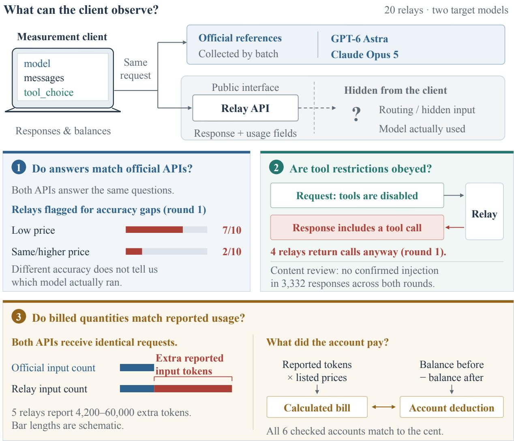
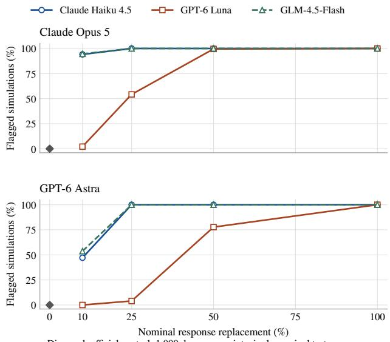
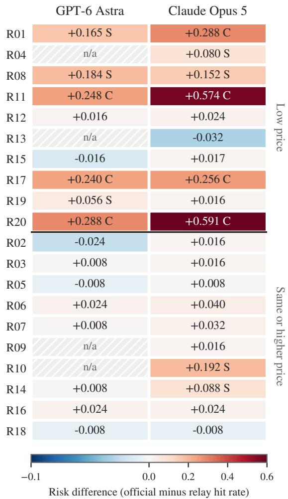
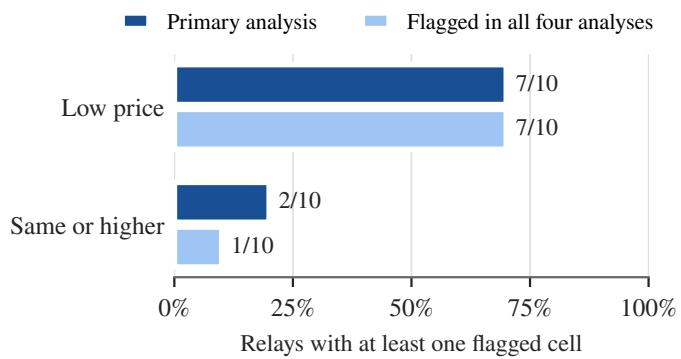

# What the Middleman Delivers: Answer Behavior, Tool Permissions, and Billed Usage in LLM API Relays

Xiaodong Wu, Student Member, IEEE, Zhimin Zhao, Qi Li, Chaklam Cheong, Xiangman Li, Student Member, IEEE, and Jianbing Ni, Senior Member, IEEE

Abstract—Third-party application programming interface (API) relays offer access to large language models (LLMs), often at lower prices. Users depend on these services for model quality, instruction compliance, and accurate billing. However, existing studies leave unclear whether relays meet these expectations together. We test 20 relays offering GPT-6 Astra and Claude Opus 5. First, we compare answers to knowledge questions with batch-matched official responses. In our first-round sample, the analysis flags 7/10 low-price and 2/10 same- or higher-price relays for behavioral differences. On retesting 35 pairs, seven gain or lose a flag under the original rules, and six under matched correction families. Because answer comparisons cannot reveal every delivery problem, we examine returned content and tool permissions. No injection is confirmed in 3,332 screened responses to a fixed, non-adversarial code and setup workload, yet four relays return tool calls despite instructions disabling them in the first round. Finally, to connect reported usage to actual costs, we compare input-token counts with official references and check balances. For identical requests, five relays report 4,200 to 60,000 more input tokens than the official API. Where balances are available (six services), charges follow reported usage at listed prices, including extra reported input tokens at one service. Our study shows that advertised models and prices are insufficient to judge relay reliability. It identifies unexplained billed token quantities and tool-permission violations as risks and shows why service evaluations need repeated measurements.

Impact Statement. LLM API relays make advanced models easier to access, but they also place an operator-controlled delivery path between an application and the service it selected. The resulting contract covers more than a model label: it includes response behavior, tool permissions, response fields, and reported usage that may determine charges. Our measurement makes these client-visible properties testable through official comparisons, response review, and permission checks. It supports enforcing tool permissions in client applications, recording observed discrepancies, and making purchasing decisions with explicit uncertainty about hidden routing and future behavior. The findings do not identify a backend or accuse a provider of malicious conduct. Instead, they give developers and service operators a documented way to compare delivery responsibly, including negative findings, without treating price or model labels as a guarantee.

Index Terms—Large language models, application programming interface security, man-in-the-middle attacks, model substitution, response integrity, supply chain security

## I. INTRODUCTION

Third-party large language model (LLM) relays let users access models from multiple providers through a single application programming interface (API). Users turn to these services for lower prices, convenient payment options, or access to models that are unavailable in their region [1]. Instead of sending requests directly to a model provider, users send them to the relay, which chooses where and how to forward them. Even when each connection is encrypted, a relay that handles plaintext can read and change the content passing through it [2]. This control leaves users unable to verify important parts of the service from an answer alone. They need the relay to preserve instructions, respect tool permissions, and report usage accurately. Yet a plausible answer can still be accompanied by a tool call the user disabled. Likewise, a charge can match the listed token price while charging for unexplained inputtoken quantities. Without seeing what the relay sends upstream, users cannot resolve these questions from a model label or an invoice. Evaluating behavior, permissions, and usage together is therefore necessary to understand what users receive and pay for.

Existing research addresses parts of this problem through service measurements and model verification. A study of shadow APIs identifies 17 services and evaluates three for utility, safety, and model identity [1]. GateScope measures ten gateways for response consistency, multi-turn memory, billing, and latency [3]. For model verification, Knowledge Boundary as Fingerprint (KBF) uses factual recall near a model’s knowledge boundary to compare API endpoints [4]. Together, these studies provide methods and measurements for examining relay behavior. However, a model check cannot establish whether a relay respects tool restrictions, and checking listed prices cannot verify the source of billed input-token quantities. It remains unclear which of these problems occur together within a service and whether they persist.

To address these questions, we study 20 relays offering GPT-6 Astra and Claude Opus 5. We found candidates through recommendations from LLMs, community lists, and web searches, then selected services that met our access and payment requirements. The selection was not random. Ten services advertise prices below the official APIs, and ten advertise the same or higher prices. We first compare relay answers with batch-matched official responses to the same questions. Building on KBF’s knowledge-boundary probes, we select questions that distinguish the targets from candidate substitutes and score answer correctness. Controlled mixtures of official and substitute responses then show when the tests can detect a difference. Because answer accuracy alone cannot reveal every problem, we also screen returned content and check whether tool calls comply with the request. To connect usage reports to actual charges, we compare input-token counts for identical requests and check the costs against account balance changes. Figure 1 outlines the tests.

  
Fig. 1. Measurement setup and comparisons of relay answers, tool permissions, and billed usage.

A single measurement, however, cannot show whether an observed problem persists. We therefore repeat the tests 11–18 days later for 35 of the 36 relay–model pairs measured in the first round. Fresh official responses provide a reference for each round, helping distinguish changes in relay behavior from changes in the official service. Tracking the same pairs also lets us separate recurring discrepancies from those that appear or disappear between rounds. Together, these comparisons allow users to detect problems through public APIs and account records, without relay cooperation. They measure what the client receives, but do not identify the model.

Our measurements reveal three main findings. First, in the first-round sample, the analysis flags 7/10 low-price and 2/10 same- or higher-price relays for behavioral differences from the official reference for at least one target model (p = 0.07 for the price-group comparison). Six services are flagged in both rounds, but 7/35 relay–model pairs gain or lose a flag under the original rules. Second, no injection is confirmed in 3,332 screened responses, yet four relays return tool calls despite explicit restrictions in the first round. These calls are not executed. Third, five relays report 4,200 to 60,000 more input tokens than the official API for identical requests. At all six services with accessible balances, deductions match reported usage at listed prices to the cent, including the reported surplus at R11. Thus, listed-rate billing does not establish whether extra reported tokens represent added input or altered accounting.

Our contributions are:

• We document both recurring and changing behavioral differences across 20 relays, showing why reliability assessments need repeated comparisons with official references (Sections V-B and V-D).

• We demonstrate that extra reported input-token quantities enter R11’s bill, showing why billing checks must verify reported quantities as well as listed prices (Section V-E).

• We observe returned tool calls that contradict explicit restrictions in the first round (none in the second), despite no confirmed injection in the screened responses, showing why tool permissions need checks beyond answer quality and content screening (Sections V-C and V-E).

• We provide a documented procedure for evaluating relays without internal access. Its controlled-mixture tests, reviewed labels, explicit scoring rules, and anonymized summaries explain the checks and what the tests can and cannot detect (Sections IV-F and VII).

## II. BACKGROUND AND THREAT MODEL

## A. How Relay Services Work

A relay sits between a client application and a model provider. The client sends the relay a model name, messages, instructions, tool permissions, and generation settings. The relay chooses an upstream service, forwards the request, and returns an answer with fields such as the model name and token usage. Users pay the relay and can inspect its responses and account records, but usually cannot inspect what it forwards upstream.

We study relays that can read the request contents. Transport layer security (TLS) encrypts each connection, but the relay decrypts the client’s request before forwarding it over another connection [2]. It can therefore change instructions, choose another model, or edit the response. If several intermediaries handle a request, the final response may reveal a problem without showing which intermediary caused it.

Some changes are part of normal service operation. A relay may convert API formats, cache responses, or use a fallback that the user has accepted. We compare answers with the official reference, check tool permissions, and reconcile usage with listed rates. This requires more than reading the returned model name or invoice, since the relay controls both. Our tests use registered relay and official accounts without access to the relay’s internal systems or provider accounts. An officialreference difference alone does not establish a breach of service terms: disclosed wrappers, fallbacks, or overhead may be part of the purchased service. Explicit tool suppression supplies a directly testable request constraint.

## B. What We Measure and What We Cannot Observe

We assume that a relay operator can read and modify requests and responses, choose the upstream model, change generation settings, and report different model names or token counts. Its behavior may vary by account, prompt, or whether it recognizes a test. We assume that the client, official reference accounts, and encrypted connections are not compromised. Under these assumptions, we examine three parts of the service using public interfaces.

First, we compare relay answers with official answers to the same questions. A relay may use a different model for all requests or only some of them. The controlled mixtures test how this affects our ability to detect an accuracy difference. However, changed instructions, settings, or cached responses can also affect accuracy, so the comparison cannot identify which model actually ran. Reproducing this comparison requires official API access.

TABLE I  
RELAY CAPABILITIES AND THE OBSERVABLE OUTCOMES COVERED BY THISSTUDY.
<table><tr><td>Threat</td><td>Relay capability</td><td>Observable results</td></tr><tr><td>Model</td><td>Change model or</td><td>Answer accuracy comparisons (RQ1, RQ2)</td></tr><tr><td>substitution Content and</td><td>settings Edit instructions,</td><td>Content review and permission checks (RQ3,</td></tr><tr><td>tool changes Usage and</td><td>outputs, or tool calls Change reported token</td><td>RQ5) Token counts and</td></tr><tr><td>charge changes counts or charges</td><td></td><td>balance changes (RQ5)</td></tr><tr><td>Outside the measurement scope</td><td></td><td></td></tr><tr><td>Conversation retention: store messages</td><td>Credential misuse: reuse or expose API keys</td><td></td></tr></table>

Second, we inspect returned content and tool calls. A relay can change an answer even when it uses the requested model. We screen code and setup responses for potentially harmful packages, commands, and destinations, then review the selected responses in context. We separately check whether returned tool calls obey the request’s permissions. These checks distinguish problems in the response from differences in answer accuracy. Our tests do not execute returned commands or tool calls.

Third, we compare reported usage and charges. Identical requests sent to a relay and an official API provide a reference for input-token counts. Where account balances are available, we also compare deductions with the cost calculated from reported usage and listed prices. These comparisons show what users are charged for, but cannot reveal the content of any hidden input or determine why the token counts differ.

Table I summarizes these measurements. They detect problems visible to clients without requiring the relay’s cooperation. They do not verify the relay’s internal processing.

Some risks leave no visible change in the response. A relay can store conversations while returning correct answers. Privacy-policy studies examine what model developers claim to retain [5]. CodeCloak reduces code exposure in prompts [6], and confidential-computing systems protect inputs within a trusted runtime [7]. Our response comparisons cannot establish whether a relay stores or deletes messages. Likewise, our standalone requests may miss changes triggered only by longer conversations, credentials, or tool execution.

We also do not test stored API keys or the relay’s software. Leaked keys and unsafe integrations have been studied in mobile traffic and agent skills [8], [9]. A LiteLLM vulnerability shows how relay software can expose managed credentials [10], even when the operator intends to forward requests correctly. These are relevant risks, but we do not determine whether the measured services have them.

TABLE II  
FOCUS AND METHODS OF MODEL CHECKS AND RELAY MEASUREMENTS.
<table><tr><td>Approach</td><td>What it checks</td><td>Method and access</td></tr><tr><td>Output fingerprints [11], [12]</td><td>Model identity</td><td>Match outputs to known model profiles</td></tr><tr><td>KBF [4]</td><td>Model behavior</td><td>Match stable correct and incorrect answers</td></tr><tr><td>Equality and rank tests [13], [14]</td><td>Output-distribution equality</td><td>Compare completion samples; rank tests need local reference scoring</td></tr><tr><td>Computation verification [15]–[17]</td><td>Model execution</td><td>Require server participation or trusted execution</td></tr><tr><td>GateScope [3]</td><td>Consistency, memory, billing, latency</td><td>Use behavioral probes and local token estimates</td></tr><tr><td>Shadow-API study [1]</td><td>Utility, safety, model claims</td><td>Compare benchmarks and fingerprints with official models</td></tr><tr><td>Agent-router study [18]</td><td>Malicious edits and credential misuse</td><td>Test agent workflows with tools and credentials</td></tr><tr><td>This study</td><td>Accuracy, permissions, billed input</td><td>Use official API references and balance checks across price groups and two rounds</td></tr></table>

## III. RELATED WORK

## A. Checking Models through API Outputs

Model checks use API responses to identify a model or detect a difference from a reference. LLMmap identifies models from characteristic responses [11], while single-token fingerprints use response frequencies from short randomgeneration prompts [12]. IRIS compares responses with profiles of known backends to detect model substitution, including cases where only some requests use another model [19]. Their coverage depends on the reference models. Statistical tests compare completion distributions [13]. Rank-based uniformity testing, for example, scores remote completions with a locally accessible reference model and tests their ranks [14]. It requires local reference scoring, but does not require log probabilities from the tested API. Our comparison uses answers from hosted official APIs and measures accuracy differences, without identifying a replacement model. Watermarking offers another approach: Dasgupta et al. use language-model-generated instructions to embed detectable patterns in responses [20]. This requires control over the instructions used to generate marked outputs. Our comparisons require no prearranged watermark.

Knowledge Boundary as Fingerprint (KBF) provides the foundation for our question design. It uses factual recall near a model’s knowledge boundary, including stable correct and incorrect answers, to distinguish API behavior [4]. Building on this idea, we select questions that the official target answers correctly and multiple cheaper candidates miss. We then compare answer correctness, using our own selection and decision rules. We use these probes to examine accuracy together with content, tool permissions, and billed usage across price groups and repeated measurements. The controlledmixture tests calibrate our implementation and do not establish superiority to KBF.

A further challenge is that services may change over time or replace only some responses. Border-input tracking detects changes from a baseline without establishing the baseline model’s identity [21], and studies of partial substitution examine the difficulty of detecting mixed responses [22]. Token-DiFR compares tokens with a trusted reference implementation, sharing sampling seeds for stochastic decoding [23]. Nasery et al. study adversarial evasion of fingerprint checks [24], while

GhostPrint fine-tunes a weaker model to mimic stronger-model fingerprints [25]. Our mixtures test replacement fractions, and repeated collections track behavioral changes. Neither tests adversarial evasion or imitation. Table II compares the related approaches.

## B. Verifying Computation and Delivery

Verification protocols can check model execution when the server participates. SVIP uses hidden representations and a secret verification task [15], while protocols based on privacypreserving inference add checks to participating services [16]. AFTUNE verifies sampled execution-trace blocks inside a trusted execution environment (TEE) [17]. These methods require access beyond the final text response and do not by themselves protect an answer from later changes along the delivery path. Signed responses address this separate problem by binding specified execution fields to a trusted provider [26]. Attestation extensions also support request binding and records of output transformations [27]. Their protection depends on which objects are signed and which issuers the client trusts.

Other systems protect the forwarding process itself. AEGIS places forwarding inside an enclave that the client verifies before sending plaintext [2]. Gateway designs also separate operator control from an attested runtime and routing records [28]. These approaches require support from a provider or forwarding component. Our checks use existing public APIs and account records to reveal discrepancies. They cannot authenticate the model or the internal delivery path.

## C. Relay Measurements and Practical Monitoring

Zhang et al. organize LLM applications by user roles and task types to guide model selection [29]. Relay measurements address the next question: whether the service delivers the expected behavior. GateScope measures gateways for response consistency, multi-turn memory, billing, and latency [3]. Shadow-API research examines utility, safety, and model verification, including their consequences for reproducibility [1]. Agent-router studies extend this question to workflows involving tools and credentials, finding malicious edits and credential-related behavior [18]. We connect several service properties within one sample: answer accuracy, content and tool permissions, reported input, and account charges. Price grouping and repeated measurements then show how the observed discrepancies are distributed across services and whether they recur.

The workload matters when interpreting these findings. Xie et al. benchmark methods for detecting unsafe outputs during generation and show that their effectiveness depends on the task and application scenario [30]. Such detection evaluates output safety, while identifying relay-added content also requires examining its source. Controlled man-in-themiddle experiments change inputs to induce factual-recall failures [31], while third-party plugin attacks manipulate integration responses consumed by a model [32]. These studies explain how answers can change without model substitution and why request handling and returned content need separate checks. Our benign, standalone API requests may not trigger attacks that depend on agent tools, credentials, or longer interactions. Consequently, the absence of confirmed injection in our workload is compatible with attacks found in those settings. The differences in workloads and samples also prevent pooling their rates with ours or ranking detection methods by these counts.

Practitioner tools offer additional ways to monitor relays. Monitoring sites publish rankings and run protocol, responsestructure, and knowledge checks [33], [34]. The public descrip tions reviewed for this study do not provide the validation data and false-positive calibration needed to interpret their scores as model-identity guarantees. Open-source tools expose response, tool-call, and stream checks, although the inspected project provides synthetic example reports without a comparable service measurement sample [35]. An industry brief also reports monitoring 171 endpoints over 14 days under its own detection and repetition criteria [36]. Our measurements use explicit reference responses, decision thresholds, and reviewed labels to make the basis of each reported discrepancy clear.

## IV. METHODOLOGY

We test three aspects of relay service: whether answers differ from the official model, whether returned content and tool calls respect the request, and whether reported usage agrees with official counts and account charges. The first two checks use matched workloads sent to relay and official APIs. The third compares reported token quantities and account charges. Controlled response mixtures calibrate the accuracy test, and a second round checks whether the observed differences persist.

## A. Service Selection and Price Groups

We study 20 services offering GPT-6 Astra, Claude Opus 5, or both. We find candidates through model recommendations, community resources, and web searches. For model recommendations, we give ChatGPT, Claude, Gemini, and Grok the same context and questions. Community resources include repositories and Hacker News searches. Web discovery uses English search queries and recommendation lists. We deduplicate domains and check each service’s website, registration, model catalog, interface, payment options, and prices.

Eligibility and sample expansion. Services must permit individual registration and API access to a target model. The first batch, selected through model recommendations, required both targets. Subsequent recruitment allowed either target and required an independent site, self-service registration, metered access, public prices, an English interface, and payment by credit card or PayPal with a minimum deposit of at most \$15. All requests were sent from the USA, so results describe service delivered to clients in one region. These criteria exclude relays that require cryptocurrency payment, non-English interfaces, enterprise registration, or large deposits, so the sample does not represent the whole relay ecosystem.

The first batch contained only two low-price services. The sample was expanded after a pilot of the four qualifying low-price services (batch 2), whose continue-or-stop rule was fixed before any pilot response was viewed. During expansion, deduplicated recommendation lists and web-search results were interleaved in a fixed order. We checked candidates in that order until each price group’s recruitment target was filled, using the next eligible service in the same group when a replacement was needed. All qualifying low-price candidates were included up to a cap of eight, and the same- or higher-price group was filled to about ten in the same order. The final sample contains ten low-price and ten same- or higher-price services and is not random. Supplementary Section I describes recruitment, price classification, and collection groups, which appear as batches in the result tables.

Price classification. We compare standard short-context, noncached input and output prices for both targets. For service $s ,$ let $\mathcal { C } _ { s , j }$ and $c _ { \mathrm { o f f i c i a l } , j }$ be the relay and official prices for each of these four entries. The mean ratio is

$$
P _ { s } = \frac { 1 } { 4 } \sum _ { j = 1 } ^ { 4 } \frac { c _ { s , j } } { c _ { \mathrm { o f f i c i a l } , j } } .
$$

We classify $P _ { s } < 0 . 9 5$ as low-price, $0 . 9 5 \le P _ { s } \le 1 . 0 5$ as same-price, and $P _ { s } > 1 . 0 5$ as higher-price. Published quotes remain in the calculation even when a target cannot be measured through the required interface.

For services with multiple route groups, we use the new key’s default group or the recommended individual-developer group when a choice is mandatory. Prices correspond to the group actually used, excluding paid-unlock routes. Price-range and currency-conversion rules are given in Supplementary Section I. The groups reflect advertised prices at verification.

## B. Question Selection

Accuracy comparisons require questions that the declared model can answer and plausible cheaper substitutes may miss. We therefore pre-validate a bank of 96 candidate questions in three categories: recent-event knowledge, parameter-scalesensitive tasks, and capability-edge tasks. These categories guide question design and do not isolate training cutoff or parameter count. Each question has a prompt, answer key, scoring tolerance, and supporting source.

We sample each candidate three times on both official targets and three cheaper substitutes: Claude Haiku 4.5, GPT-6 Luna, and GLM-4.5-Flash. A question qualifies for a target if that target answers correctly in at least two trials and at least two substitutes each fail in at least two trials. From qualifying questions, we select 25 per target: nine knowledge, eight parameter-scale, and eight capability-edge questions. The primary bank prioritizes larger target–substitute contrasts within these quotas. An alternative bank uses the original question order. We collect their union of 27 questions per target to check whether findings depend on the selection rule. The banks share 23 of 25 questions (92%), so this checks local selection sensitivity, not independent task coverage.

The bank, prompts, scorer, and selection rules were revised using official and substitute pilot responses and frozen before formal relay collection (Supplementary Section V). The contrast depends on the tested panel, and untested substitutes may answer the entire bank. Because questions are selected on the same pre-validation responses of these substitutes, the mixture simulations below reuse that selection and may give an optimistic view of detectability.

## C. Answer Collection and Accuracy Comparison

Matched requests. Each relay–target pair and official reference receives five scheduled trials per question, giving 135 calls for the 27-question union and at most 125 scored responses for the primary bank. We request low generation effort where supported, using the supported settings for each substitute. Messages requests use the same no-search system instruction in both arms, with an unused declared tool and tool\_choice=none. Each request is standalone. Generated tool calls and commands are never executed.

Scoring and missing responses. For each relay, target, question, and trial, we retain the first successfully parsed HTTP 200 outcome. Retries cannot replace a completed answer or safety refusal. Timeouts, protocol errors, empty unanswered responses, and unparseable outcomes are treated as failed calls and do not count as incorrect answers. A question enters the comparison only when both arms have a scored outcome. Each arm then contributes all available trials for that question, without requiring trial-level pairing. Safety refusals count as misses in the primary analysis and are excluded in a sensitivity analysis.

The frozen scorer assigns binary credit using exact, substring, or numeric matching where supported by the answer key and tolerance. Free-form answers require review under the scoring rubric. Credit depends on the requested answer content, with incomplete compound answers receiving zero.

Answer review. Free-form answers initially receive Claude Opus 5.5 labels. Manual review sheets hide relay and target identity, official-reference status, and initial judge labels. Identical answers to the same question reuse adjudicated labels. The original collection uses one fully manual and one model-assisted review workflow. Later collections use two fully manual workflows. Agreement is measured before discussion, and disagreements and uncertain items are adjudicated without changing the frozen bank. Supplementary Section IV gives review procedures, agreement, and label-reuse coverage.

Detecting accuracy differences. For a relay and its official reference, let $h _ { r } / n _ { r }$ and $h _ { o } / n _ { o }$ be their scored hit rates. The reported risk difference (RD) is

$$
\mathrm { R D } = h _ { o } / n _ { o } - h _ { r } / n _ { r } .
$$

Positive RD means lower relay accuracy. We compare pooled hit counts using a two-sided Fisher exact test and denote its Benjamini–Hochberg (BH)-adjusted value by q [37]. The fixed rule labels a pair:

• Confirmed behavioral inconsistency if $q \ < \ 0 . 0 5$ and $| \mathrm { R D } | \geq 0 . 2 0$

• Suspected behavioral inconsistency if $q < 0 . 0 5$ with a smaller effect, or $0 . 0 5 \leq q < 0 . 1 5$ with $| \mathrm { R D } | \geq 0 . 2 0$

• No evidence otherwise.

These are operational labels under the stated rule. “Confirmed” denotes its larger-effect branch, not independently verified substitution or persistent service degradation. Neither label identifies the backend model. Because the five trials of a question share errors, the Fisher test treats correlated trials as independent; the question-block check below covers only the originally flagged cells. The two-sided rule also detects higher relay accuracy, which may reflect retrieval or other processing.

The first-round analysis applies BH separately to each collection batch, across all testable relay–target pairs and both targets within that batch. This departs from the planned combined first-round family. The resulting within-batch q values do not provide whole-cohort false-discovery control. The separate native-client supplement uses a nominal exploratory p value outside these families.

Price comparison and sensitivity checks. At the service level, we compare the two price groups using a two-sided Fisher exact test. The primary comparison uses the primary bank with refusals scored as misses and counts a service when at least one target receives either inconsistency label. Four analysis specifications cross the primary or alternative bank with refusals counted as misses or excluded. A separate robustness comparison requires at least one target to receive an inconsistency label under all four specifications. This is a robustness check added after the primary comparison did not reach 0.05, not the primary price test, and its smaller p value should not be read as stronger evidence.

Because repeated trials and shared references induce dependence, a post-hoc check for the original cohort resamples questions as paired blocks, retaining their available trials. Supplementary Section III gives the bootstrap settings. Table IV reports intervals conditional on the selected question bank. These three-cell intervals do not validate the full cohort. Human scoring agreement does not establish trial independence; pooled $p / q$ values may be optimistic, and service counts summarize operational flags.

## D. Content and Tool-Permission Checks

Screening and contextual review. To check for unwanted additions to otherwise benign responses, we use code and setup requests in five classes: package names, hidden shell commands, suspicious URLs, encoded content, and installation instructions. Five wording variants and two trials per class give 50 scheduled responses per relay–target pair. Both official targets receive the same workload.

Automated screens select responses containing packagename lookalikes, unexpected domains, potentially harmful commands, or encoded content. Supplementary Section V gives the matching rules and parser correction.

The authors then examine each candidate in context for task-irrelevant packages, destinations, commands, installation sources, or executable encoded additions. Task-related recommendations and parser errors are benign. Let $r _ { r }$ and $r _ { o }$ be the proportions of successful relay and official responses confirmed as injection. A finding requires both a positive excess $\boldsymbol { r } _ { r } - \boldsymbol { r } _ { o }$ and at least one confirmed injected response. Thus a screen match alone does not count as injection.

The pooled response denominator includes eligible relay cells, excluding official references, the separate native-client supplement, and an incomplete cell. For zero confirmations, we report the one-sided 95% Clopper–Pearson upper limit under a binomial model. Correlated trials, imperfect screening, and activation outside the tested workload limit its scope. Supplementary Section V explains the scanner correction and its unmeasured effect on candidate counts.

Returned tool calls. We separately compare returned toolcall records with the permissions in their requests, distinguish ing explicit tool\_choice: none from requests with no tool declaration. The count includes responses from failed attempts, so it measures returned calls, not independent requests or executed actions.

## E. Usage and Charge Checks

In the second round, we subtract official input-token counts from relay counts for identical requests and summarize the differences by relay–target pair using medians. For Messages responses, total input is input\_tokens plus cache\_creation\_input\_tokens and cache\_read\_input\_tokens. For chat completions, it is prompt\_tokens; its cached\_tokens detail is already included. When both formats occur, we use the latter fields, matching the saved parser. We also record model names, reasoning details, and response metadata without changing requests. These fields are controlled by the endpoint.

To determine whether reported usage enters the bill, we read account balances immediately before and after collection for the six services exposing a balance endpoint. We calculate the collection cost by multiplying each billed token category’s reported usage by its listed rate and summing across requests. We then compare that total with the balance decrease. Dashboard snapshots taken only after collection lack a baseline and are excluded. Agreement shows how the reported usage is charged. It does not verify the tokens processed upstream.

## F. Calibration with Official and Mixed Responses

Official configuration check. We test whether the official APIs support disabling reasoning by requesting disabled thinking for Opus and no reasoning for Astra. Neither tested option provides the intended control, so the planned full noreasoning reference collection was not performed. This is a configuration check, not a causal test of reasoning effects. Supplementary Section II gives the calls.

Controlled response mixtures. We test sensitivity to substitution by mixing collected official and substitute answers to the same questions. One official collection supplies the comparison reference, a later collection supplies the honest response pool, and pre-validation supplies substitute responses. For each target, substitute, and replacement probability $r \in$ {0, 0.10, 0.25, 0.50, 1.00}, we generate 1,000 simulated pairs with five trials per primary-bank question.

Each trial samples a scored response with replacement from the substitute pool with probability r, otherwise from the official pool. Missing substitute pools fall back to the official pool. Thus r is a sampling probability, not an exact replacement count. Substitute pools contain at most three responses per question.

Each simulation uses the accuracy comparison’s Fisher test, effect threshold, and label rules. It contains only one test, so no BH correction is applied and the nominal p value is used in place of q. Detection frequency is the fraction receiving either inconsistency label. At r = 0, the comparison uses official responses from two collections, providing an official-to-official control. Supplementary Section II gives the response-pool dates and detection frequencies.

The mixture design was specified after the pilot and before simulation. It reuses the selected bank and existing answer labels, with no new API calls or independent validation set. Its small response pools and single-test analysis mean the frequencies cannot be read as field detection power or population false-positive rates. Selection of both questions and substitutes can make these conditional simulations optimistic; they are not upper bounds on detection rates.

## G. Repeated Measurements

To test whether the observed differences persist, we repeat measurements 11–18 days later with fresh same-day official references. We retain the same questions, trial counts, requested effort, scoring rules, and thresholds. The second round covers 35 of the 36 first-round relay–target pairs and uses one BH family across its testable pairs, separate from the first-round families. Partial collections follow the same missing-response rules, without bypassing access restrictions or imputing unavailable responses. Section V-D explains the affected pairs and changes in classification, which alone cannot establish a change in upstream model. We ran no dedicated officialto-official retest, so the rate at which labels flip without any relay change is unknown. The official reference hit rates across collections give a partial measure of reference variation. We also apply one BH family per round to the same 35 retested pairs as a post-hoc sensitivity check, keeping the original results for comparison.

## V. RESULTS

We first evaluate the accuracy test with controlled response mixtures, then compare relay accuracy across price groups

  
Diamond: oficial control; 1,000 draws per point; single nominal test.  
Fig. 2. Detection frequency by simulated replacement fraction, target model, and substitute model.

and screen returned content. Repeated measurements show which differences persist. Finally, tool-call, usage, and balance comparisons connect answer behavior to delivery and billing.

## A. RQ1: Accuracy Tests for Model Substitution

Weak substitutes are detected at moderate replacement fractions. Figure 2 and Supplementary Table S2 report the fraction of simulated cells receiving either behavioral-inconsistency label. Each setting uses 1,000 draws and one nominal test per cell. The zero-replacement control is shared across substitutes within each target. For Haiku and GLM, every tested 25%, 50%, and 100% replacement mixture is flagged for both targets. At 10%, the Opus comparisons flag 94.1% for Haiku and 94.6% for GLM, while Astra flags 47.1% and 53.7%, respectively. Detection at a fixed replacement fraction varies with the target and substitute models.

A related substitute can pass at a substantial replacement fraction. Astra-to-Luna mixtures are unflagged in all 10% simulations and flagged in only 4.0% at 25%. Detection rises to 77.7% at 50% and 100.0% at complete replacement. At complete replacement, only 12.9% of Astra simulations reach the larger-effect Confirmed branch, with 87.1% receiving Suspected. By comparison, Opus-to-Luna mixtures reach 54.2% detection at 25% and 99.5% at 50%. The panel includes a model whose recent knowledge can exceed Astra’s, so the difficult contrast is consistent with the bank’s limited coverage of newer knowledge.

The difference between a flag and the larger-effect label matters. For Haiku replacing Opus at 25%, detection is 100.0%, but only 77.7% of simulations meet Confirmed. For Haiku replacing Astra at 25%, 52.6% meet Confirmed and 47.4% meet Suspected. These branches reflect effect thresholds and significance, not a posterior probability that a specific backend was served.

The official-to-official control produces no flags. At zero replacement, official responses from the second batch are resampled against the first batch’s official reference. Each target has 0/1,000 flagged simulations. This result assesses two reference collections, one selected bank, and the available scored pools. The simulations repeatedly reuse those responses and are not 1,000 independent production deployments. We do not turn the empirical zero into a general false-positive bound.

The configuration check does not isolate reasoning effects. The official calls did not implement the intended disabling settings: Opus returned a thinking block despite the request, and Astra rejected the no-reasoning value. The valid low-effort Astra call produced an answer with reasoning-token usage. These observations support the configuration description in Section IV-F. They cannot rule out relay-side changes to effort, instructions, or decoding.

Because the questions were selected on the same substitute responses that supply the mixtures, these frequencies are optimistic. They characterize the selected bank and substitute mixtures, not unseen models, adaptive probe recognition, or every implementation of the advertised model.

## B. RQ2: Accuracy Differences from Official Models across Price Groups

Table III reports the per-cell outcomes for all 20 measured services. The primary analysis flags at least one cell at seven low-price services and two same-price services. The remaining low-price services have no flag, illustrating that price does not determine the result. An unflagged cell does not exclude substitution, since Section V-A shows that a related substitute can pass at substantial replacement fractions. Labels refer to behavioral inconsistency under the chosen prompts, references, and rules. Figure 3 summarizes the primary effects and missing cells. Its hatching marks cells excluded from the main API analysis, and the separately matched native-client comparison is not plotted.

Table III uses 125 scored relay responses per cell except, in round 1, R01 A (122), R05 O (122), R11 O (122), R15 O (120), R19 O (123), and R20 O (115), and in round 2, R05 O (76), R15 O (114), and R20 O (115). First-round q values retain per-batch BH families, including batch 3b’s separate official references. The second round uses one family.

1) The Primary Price-Tier Test Gives $p \ = \ 0 . 0 7 ;$ : In the primary analysis, 7/10 low-price services have a flagged cell, compared with 2/10 same- or higher-price services. The relaylevel two-sided Fisher test gives $p = 0 . 0 6 9 8$ , reported as 0.07. This is the primary price-tier test, and it does not meet a 0.05 threshold. The proportions suggest an association among the selected services, not a statistically established population price effect or a causal pricing mechanism.

The robustness analysis counts a service only when at least one of its cells is flagged in all four specifications. It gives 7/10 versus 1/10 and $p = 0 . 0 1 9 8$ , reported as 0.02. That lower p value comes from a specification added after the primary test missed 0.05, so it is not the primary test and not stronger evidence. Both comparisons remain conditional on the selected sample and the decision to expand it after preliminary pilot results. They also weight flags equally: R19 Astra’s RD of 0.056 $( q = 0 . 0 4 1 )$ contributes one service, just as an RD above

TABLE III  
ANSWER ACCURACY AND BEHAVIORAL CLASSIFICATIONS IN BOTH ROUNDS, GROUPED BY ADVERTISED PRICE.
<table><tr><td rowspan="3"></td><td rowspan="3"></td><td colspan="7">A</td><td colspan="7">0</td></tr><tr><td colspan="4">Round 1</td><td colspan="2">Round 2</td><td colspan="5"></td><td colspan="2">Round 2</td></tr><tr><td> $r _ { o }$ </td><td></td><td>RD</td><td>q</td><td></td><td>RD L</td><td>rr</td><td> $r _ { o }$ </td><td>RD</td><td></td><td>L</td><td></td><td>L</td></tr><tr><td colspan="2">Low price</td><td></td><td></td><td></td><td></td><td></td><td></td><td></td><td></td><td></td><td></td><td></td><td></td><td></td></tr><tr><td>R01</td><td>1</td><td>0.803</td><td>0.968</td><td>+0.165</td><td>&lt;0.001</td><td>+0.272</td><td>C</td><td>0.704</td><td>0.992</td><td>+0.288</td><td>&lt;0.001</td><td>C</td><td>+0.264</td><td>C</td></tr><tr><td>R04</td><td>1</td><td></td><td></td><td></td><td></td><td></td><td>一</td><td>0.912</td><td>0.992</td><td>+0.080</td><td>0.023</td><td>S</td><td>+0.056</td><td>NNSS</td></tr><tr><td>R08</td><td>2</td><td>0.808</td><td>0.992</td><td>+0.184</td><td>&lt;0.001</td><td>+0.008</td><td>N</td><td>0.840</td><td>0.992</td><td>+0.152</td><td>&lt;0.001</td><td>S</td><td>+0.184</td><td>SSCC</td></tr><tr><td>R11</td><td>2</td><td>0.744</td><td>0.992</td><td>+0.248</td><td>&lt;0.001</td><td>S C</td><td>+0.224 CCSS</td><td>0.418</td><td>0.992</td><td>+0.574</td><td>&lt;0.001</td><td>C</td><td>+0.280</td><td>C</td></tr><tr><td>R12</td><td>3</td><td>0.936</td><td>0.952</td><td>+0.016</td><td>1.000</td><td>N</td><td>+0.056 N</td><td>0.944</td><td>0.968</td><td>+0.024</td><td>1.000</td><td>N</td><td>+0.208</td><td>CNCN</td></tr><tr><td>R13</td><td>3</td><td></td><td></td><td></td><td>一</td><td></td><td></td><td>1.000</td><td>0.968</td><td>-0.032</td><td>0.317</td><td>N</td><td></td><td></td></tr><tr><td>R15</td><td>3</td><td>0.968</td><td>0.952</td><td>-0.016</td><td>1.000</td><td>一 N</td><td>+0.032 N</td><td>0.958</td><td>0.975</td><td>+0.017</td><td>1.000</td><td>N</td><td>+0.026</td><td>N</td></tr><tr><td>R17</td><td>3</td><td>0.712</td><td>0.952</td><td>+0.240</td><td>&lt;0.001</td><td>CCSS</td><td>+0.032 N</td><td>0.712</td><td>0.968</td><td>+0.256</td><td>&lt;0.001</td><td>C</td><td>+0.248</td><td>C</td></tr><tr><td>R19</td><td>2</td><td>0.936</td><td>0.992</td><td>+0.056</td><td>0.041</td><td>S</td><td>+0.000 N</td><td>0.976</td><td>0.992</td><td>+0.016</td><td>0.368</td><td>N</td><td>-0.024</td><td>N</td></tr><tr><td>R20</td><td>2</td><td>0.704</td><td>0.992</td><td>+0.288</td><td>&lt;0.001</td><td>C</td><td>+0.288 C</td><td>0.409</td><td>1.000</td><td>+0.591</td><td>&lt;0.001</td><td>C</td><td>+0.583</td><td>C</td></tr><tr><td colspan="2">Same price</td><td></td><td></td><td></td><td></td><td></td><td></td><td></td><td></td><td></td><td></td><td></td><td></td><td></td></tr><tr><td>R02</td><td>1</td><td>0.992</td><td>0.968</td><td>-0.024</td><td>0.802</td><td>+0.248</td><td>CCSS</td><td>0.976</td><td>0.992</td><td>+0.016</td><td>0.809</td><td>N</td><td>+0.024</td><td>N</td></tr><tr><td>R03</td><td>1</td><td>0.960</td><td>0.968</td><td>+0.008</td><td>1.000</td><td>+0.016</td><td>N</td><td>0.976</td><td>0.992</td><td>+0.016</td><td>0.809</td><td>N</td><td>-0.016</td><td>N</td></tr><tr><td>R05</td><td>1</td><td>0.976</td><td>0.968</td><td>-0.008</td><td>1.000</td><td>N N</td><td>+0.024 N</td><td>0.984</td><td>0.992</td><td>+0.008</td><td>0.809</td><td>N</td><td>+0.045</td><td>N</td></tr><tr><td>R06</td><td>1</td><td>0.944</td><td>0.968</td><td>+0.024</td><td>0.809</td><td>N</td><td>+0.040 N</td><td>0.952</td><td>0.992</td><td>+0.040</td><td>0.389</td><td>N</td><td>-0.008</td><td>N</td></tr><tr><td>R09</td><td>3</td><td></td><td>一</td><td></td><td>一</td><td>一</td><td>一</td><td>0.952</td><td>0.968</td><td>+0.016</td><td>1.000</td><td>N</td><td>+0.016</td><td>N</td></tr><tr><td>R10</td><td>3</td><td></td><td>1</td><td></td><td></td><td>一</td><td>1</td><td>0.776</td><td>0.968</td><td>+0.192</td><td>&lt;0.001</td><td>S</td><td>+0.200</td><td>C</td></tr><tr><td>R14</td><td>3</td><td>0.944</td><td>0.952</td><td>+0.008</td><td>1.000</td><td>N</td><td>+0.032</td><td>0.880</td><td>0.968</td><td>+0.088</td><td>0.049</td><td>SNNN</td><td>+0.000</td><td>N</td></tr><tr><td>R16</td><td>3b</td><td>0.936</td><td>0.960</td><td>+0.024</td><td>0.571</td><td>N</td><td>N +0.056 N</td><td>0.968</td><td>0.992</td><td>+0.024</td><td>0.571</td><td>N</td><td>+0.024</td><td>N</td></tr><tr><td>R18</td><td>3</td><td>0.960</td><td>0.952</td><td>-0.008</td><td>1.000</td><td>N</td><td>+0.040</td><td></td><td>0.976 0.968</td><td>-0.008</td><td>1.000</td><td>N</td><td>-0.024</td><td>N</td></tr><tr><td colspan="2">Higher price</td><td></td><td></td><td></td><td></td><td></td><td></td><td>N</td><td></td><td></td><td></td><td></td><td></td><td></td></tr><tr><td>R07</td><td>1</td><td>0.960</td><td>0.968</td><td>+0.008</td><td>1.000</td><td>N</td><td>+0.016</td><td></td><td>0.960 0.992</td><td>+0.032</td><td>0.554</td><td>N</td><td>+0.000</td><td>N</td></tr></table>

A: GPT-6 Astra; O: Claude Opus $5 . \ r _ { r } , \ r _ { o } .$ relay and official hit rates; RD: $\boldsymbol { r } _ { o } - \boldsymbol { r } _ { r } .$ L lists four classifications in order: (1) primary bank, refusals counted as misses; (2) primary bank, refusals excluded; (3) alternative bank, refusals counted as misses; (4) alternative bank, refusals excluded. One letter means all four agree; CCSS means C in (1)–(2) and S in (3)–(4). C/S/N: Confirmed/Suspected/No evidence of behavioral inconsistency. Hit rates, RD, and q use the primary bank with refusals counted as misses; only L compares all four specifications. Bold: $q < 0 . 0 5 ;$ dash: outside the main cohort or unmeasured.

0.5 does. Table III retains effect sizes so that these unequal deficits remain visible. Figure 4 keeps the two specifications separate.

2) Large Deficits, Refusals, and Wrapper Effects: Broad deficits persist in several cells. R01 Opus has a hit rate of 0.704 against 0.992 officially, RD 0.288, and $q < 0 . 0 0 1$ Its failures span knowledge and capability tasks. The pilot adds larger Opus deficits at R20 (0.409 versus 1.000, RD 0.591) and R11 (0.418 versus 0.992, RD 0.574). Their Astra cells are also flagged. Third-batch R17 is flagged for both targets, with primary RD 0.240 for Astra and 0.256 for Opus. These deficits motivate investigation, without identifying the backend weights or excluding changed instructions, retrieval, or execution settings.

The same-price R14 flag depends on refusal handling. Its Opus primary hit rate is 0.880 against 0.968, RD 0.088, and $q = 0 . 0 4 8 7$ . Only the primary bank with refusals scored as misses is flagged. Excluding protocol-level refusals removes the flag, as does the alternative bank. This cell accounts for the difference between the primary and all-four service-level tallies. This pattern is refusal-sensitive behavioral inconsistency. It does not identify a replacement model.

The same-price R10 flag survives all four specifications. Its Opus rate is 0.776 against 0.968, RD 0.192, and $q < 0 . 0 0 1$ . The service exposes a coding-client-style wrapper, with responses referring to disabled tools. Those integration differences are relevant alternative explanations. Persistence across scoring specifications cannot separate a wrapper effect from model substitution. We therefore report behavioral inconsistency and leave the causal backend claim unresolved.

Not every classification level is invariant. R17 Astra is Confirmed in both primary-bank analyses and Suspected in both alternative-bank analyses. It remains flagged in all four. This is the CCSS entry in Table III: changing the bank changes the label from C to S, but all four analyses still detect a difference. The first letter gives the primary result used in the price comparison. The remaining letters show sensitivity to refusal handling and question selection. A C-to-S change therefore preserves a flag, while a change to N removes it. The robustness tally counts a cell only when no specification returns N. The original three flagged API cells retain their labels across all four specifications.

3) Missing Cells and the Separate Client-Matched Supplement: The main table leaves four Astra cells missing. R04 requires an unmodified first-party client and lies outside the original compatible API protocol. R13 and R10 expose Astra only through the Responses interface, which is excluded to keep the interface consistent with the official chat-completions arm. R09 changed key/group access during collection. Its partial responses are excluded because no whole-cell collection under one consistent configuration is available. These cases leave the accuracy comparison unresolved.

R04’s separate client-matched comparison for the first batch gives 117/125 against 123/125, RD 0.048, and nominal twosided $p = 0 . 1 0 2 3$ . Its alternative bank gives 119/125 against 123/125 and $p = 0 . 2 8 1 1$ . Refusal exclusion does not change these comparisons. The client-matched supplement does not replace a missing main-cohort cell or enter the price-tier test as a new relay.

  
Fig. 3. First-round official-minus-relay accuracy differences for the 20 services, grouped by advertised price. C/S: Confirmed/Suspected (primary analysis). n/a: cells outside the main analysis.

  
Fig. 4. Proportion of relays with behavioral differences by price group under the primary and robustness analyses.

4) Sensitivity to Repeated Answers: Repeated answers to one question can share errors. The original-cohort check therefore resamples the 25 shared questions as blocks, keeping each question’s official and relay trials together. Table IV reports gaps that weight questions equally, with 95% percentile intervals. Missing calls explain why R01 Astra’s question-mean gap is 0.184 while its pooled-trial RD is 0.165. Supplementary Section III gives the resampling settings. Grouping also preserves the pairing between the official and relay answers to each question: a resampled question contributes both sides of the comparison. The resulting intervals describe uncertainty across questions within this bank, without treating repeated answers as new independent questions.

TABLE IV  
QUESTION-LEVEL OFFICIAL-MINUS-RELAY ACCURACY GAPS AND BOOTSTRAP INTERVALS.
<table><tr><td>Relay</td><td>Target</td><td>Mean gap</td><td>95% interval</td></tr><tr><td>R01</td><td>Claude Opus 5</td><td>0.288</td><td>[0.128, 0.464]</td></tr><tr><td>R01</td><td>GPT-6 Astra</td><td>0.184</td><td>[0.080, 0.304]</td></tr><tr><td>R04</td><td>Claude Opus 5</td><td>0.080</td><td>[0.016, 0.160]</td></tr></table>

All three intervals remain above zero, supporting the direction of these accuracy deficits after grouping repeated answers. The intervals cover only the original flagged cells, are conditional on the selected questions, and are unadjusted for multiple comparisons. They do not resolve shared-reference dependence or the separate batch-level correction families, and cannot identify the cause of the accuracy gaps.

## C. RQ3: Injected Content in Code and Setup Responses

Table V summarizes the 1,686 relay-arm responses from the first-round code and setup workload and the candidates selected for review. There are zero confirmed injections. The one-sided 95% Clopper–Pearson upper limit is 0.00178, or 0.18%. This bound applies under the binomial model to confirmations in the measured workload. It does not cover all malicious edits, account histories, or production workloads.

Two authors classify all 64 first-round candidates (48 relay-arm, 16 official-arm) across the four collections as benign. Legitimate task-related packages, known example destinations, and parser errors account for reviewed detections. The initial batch includes package-extraction false positives caused by shell continuations and requirements-file arguments. No candidate is promoted to an injection merely because the detector flagged it. Every measured cell’s confirmed rate and excess over its official reference are zero.

The original compatible-API workload contributes 546 relay responses. Its separate client-matched supplement has 50 further relay responses and 50 official responses, all without candidates. These supplement responses are not included in the 1,686 cohort denominator. Neither are official arms nor the incomplete R09 Astra cell.

The second round adds 1,646 relay-arm responses with 43 automatic candidates. Two authors classify 40 identically as benign. Three split labels on optional scikit-learn suggestions for loading Iris are adjudicated benign, matching seven earlier candidates of the same form, one from an official arm. No round-2 injection is confirmed. Pooling both rounds gives 0/3,332 confirmed events. Assuming independent binomial outcomes, the one-sided 95% upper limit for confirmations is 0.09%; it is not a bound on actual malicious content.

FIRST-ROUND CONTENT-SCREENING CANDIDATES AND ANALYZED RELAYRESPONSES, GROUPED BY ADVERTISED PRICE.  
TABLE V
<table><tr><td colspan="3">Low price</td><td colspan="3">Same or higher price</td></tr><tr><td>Relay</td><td>A</td><td>0</td><td>Relay</td><td>A</td><td>0</td></tr><tr><td>R01</td><td>0/47</td><td>4/50</td><td>R02</td><td>0/50</td><td>2/50</td></tr><tr><td>R04</td><td></td><td>4/49</td><td>R03</td><td>0/50</td><td>5/50</td></tr><tr><td>R08</td><td>0/50</td><td>3/50</td><td>R05</td><td></td><td></td></tr><tr><td>R11</td><td>0/50</td><td>0/42</td><td>R06</td><td>0/50</td><td>5/50</td></tr><tr><td>R12</td><td>0/50</td><td>2/50</td><td>R09</td><td></td><td>2/50</td></tr><tr><td>R13</td><td></td><td>1/50</td><td>R10</td><td></td><td>1/50</td></tr><tr><td>R15</td><td>0/50</td><td>6/50</td><td>R14</td><td>0/50</td><td>1/50</td></tr><tr><td>R17</td><td>0/50</td><td>1/48</td><td>R16</td><td>0/50</td><td>3/50</td></tr><tr><td>R19</td><td>0/50</td><td>3/50</td><td>R18</td><td>0/50</td><td>1/50</td></tr><tr><td>R20</td><td>0/50</td><td>3/50</td><td>R07†</td><td>0/50</td><td>1/50</td></tr><tr><td>Total</td><td>0/397</td><td>27/489</td><td>Total</td><td>0/350</td><td>21/450</td></tr></table>

Entries: relay-arm candidates/analyzed responses (the 16 official-arm candidates are excluded). A: GPT-6 Astra; O: Claude Opus 5. †: higher-price service; dash: unmeasured or excluded.

Repeated prompts and services need not generate independent Bernoulli outcomes. The exact binomial interval is reported with that assumption, while unknown screening sensitivity further limits its reach. The workload excludes executed tools, secrets, and long histories that could activate conditional injection. A zero confirmation is a bounded negative result under these conditions, not certification that any service is safe. Without rerunning both parsers on the initial workload, we cannot quantify how the correction changed candidate counts.

## D. RQ4: Accuracy Differences over Time

The second round ran 11–18 days after the first-round collections (Section IV-G). Of the 36 first-round main cells, 35 were retested. R13 Opus requires a named coding client. Table III compares results across rounds.

Six services are flagged in both rounds. Of the 35 recollected cells, 9 are flagged in both rounds, 5 lose their primary flag, 2 gain one, and 19 have no flag in either. At the service level, R01, R08, R10, R11, R17, and R20 are flagged in both rounds. R04, R14, and R19 are no longer flagged, and R02 and R12 are newly flagged. The round-2 primary tier comparison gives 6/9 low-price versus 2/10 same- or higherprice services, again $p = 0 . 0 6 9 8$ , with R13 unmeasured. The all-four count gives 5/9 versus 2/10 $( p = 0 . 1 7 )$

The original seven flag transitions use different BH families across rounds. With one 35-pair family in each round, six pairs gain or lose a flag: R19 Astra is no longer flagged in round 1 $( q = 0 . 0 8 9 )$ , while all other primary labels are unchanged. This post-hoc check isolates correction-family effects, while response dependence and reference variability remain. Supple mentary Section III gives the calculation; anonymous counts accompany the paper.

Lost flags are mostly small effects. Three of the five lost flags had first-round RDs below 0.09 (R04 O, R14 O, R19 $\mathbf { A } ) ,$ consistent with movement around the threshold. Two larger

Astra effects vanish: R08 from 0.184 to 0.008 and R17 from 0.240 to 0.032, while both services’ Opus cells stay flagged. Upstream routing, model updates, or account-level allocation could produce such changes, which these measurements cannot distinguish.

A same-price service changes. R02 Astra moves from RD $- 0 . 0 2 4 \ \mathrm { t o \ + 0 . 2 4 8 }$ . Its round-2 errors include statements that the 2025 Nobel Prize in Literature and Super Bowl LX had not yet occurred, plus wrong counting and arithmetic answers, while other trials of the same items are correct. The pattern is consistent with part of the traffic reaching a model with an earlier knowledge boundary, without identifying that model. R12 Opus is flagged only when refusals count as misses: 29 of its 135 responses refuse benign items, against one in the official arm, and no behavioral difference is detected when refusals are excluded.

Two rounds bound, but do not characterize, change. The short-interval repeat of R01 Astra within the first batch (95/121, RD 0.183) matched its primary result (98/122, RD 0.165) at short range, with shared questions, a shared reference, and three backfilled keys. Official reference hit rates range from 0.952 to 0.992 for Astra and from 0.968 to 1.000 for Opus across collections. This observed variation is smaller than an RD of 0.20 but comparable to effects near the Suspected boundary. Without a dedicated official-to-official retest, the rate of flag changes without service changes is unknown. Two rounds cannot distinguish service changes from reference and response variation or estimate how often routes change, and a stable label does not establish that every request used the same route.

## E. RQ5: Tool Permissions, Usage Reports, and Charges

Table VI separates systematically tallied tool-call records from qualitative protocol, text, and account observations. Four services return tool calls despite tool\_choice: none. The counts are 1 at R04, 24 at R11, 1 at R10, and 4 at R17. The returned tool name is the unused declared noop. A fifth service, R08, returns two web\_search call records when no tool declaration was supplied. These counts include calls returned during failed attempts, not tool executions or rates. No official-arm response in either round returned a tool call, and 24 of the 30 relay-arm calls come from one service. Qualitative observations have no systematic count, and unknown counts are not treated as zero. Token surpluses in Table VI are secondround median differences from official counts for identical requests in the accuracy workload, with the content-screening workload identified separately.

A returned tool call is not a completed action. The client executed none of these calls. The records cannot distinguish relay modification, upstream parameter noncompliance, or output translation. These counts include failed attempts and cannot be read as rates among independent scored responses.

Protocol handling changes the measurement denominator. R19 returned server-sent events to a non-streaming request. The parser handles this format without changing request bytes, while unparseable outcomes are excluded from accuracy scoring. Treating them as incorrect answers would conflate compatibility with capability. Conversely, R15’s translated content\_filter response is a safety refusal and counts as a miss in the primary analysis.

TABLE VI  
OBSERVED TOOL CALLS, RESPONSE FIELDS, REPORTED USAGE, AND ACCOUNT CHARGES.
<table><tr><td>Observation</td><td>Services (count)</td><td>Supported conclusion and limit</td></tr><tr><td>Tool calls despite suppression</td><td>Round 1, O: R04 (1), R11 (24), R10 (1), R17 (4); round 2: none</td><td>Returned noop calls contradict tool_choice: none; execution and modification point are unknown. Returned web_search calls; actual retrieval is</td></tr><tr><td>Search calls without supplied tools</td><td>Round 1, A: R08 (2); round 2: none</td><td>unverified.</td></tr><tr><td>Streaming for a non-streaming request R19</td><td></td><td>Stream semantics differ; says nothing of backend identity.</td></tr><tr><td>&lt;think&gt; tags in output Cross-format refusal representation</td><td>R01 (A) R15 (O)</td><td>Format difference, not a substitute fingerprint. content_filter treated as a safety refusal, not a</td></tr><tr><td>Key disabled after safety refusal</td><td>R05 (three keys, both rounds)</td><td>failed call. Sequence observed; operator rationale unknown.</td></tr><tr><td>Client-restricted access Input-token surplus (round 2)</td><td>R13 (O, round 2) R01, R11, R20 (A, 4.38k, 4.22k cached); R08 (A, 4.22k; O, 734); R10</td><td>Requires a named coding client; not bypassed. Relay-reported usage: hidden input or altered accounting, not which.</td></tr><tr><td></td><td>(O, 59.5k); R16 (O, 274); R11 (O, content screening, 10.6k); R20 (O, content screening, 5.4k) R15 (O, −355), R20 (O, −275), R04</td><td></td></tr><tr><td>Dated model name for A</td><td>(0, -97) R05 (all), R12 (101/185)</td><td>Two returned names for one request at R12; route</td></tr><tr><td>Balance vs. reported usage (round 2)</td><td></td><td>unverified.</td></tr><tr><td></td><td>Equal at R03, R04, R11, R12, R17, Ri9</td><td>Charges follow reported usage at listed prices; others not reconcilable.</td></tr></table>

A: GPT-6 Astra; O: Claude Opus 5.

Some apparent instruction clues have known confounders. R04 Opus mentions a request not to search. Our client supplied the same no-search instruction to both relay and official Messages arms. The phrase alone therefore does not show that the relay added instructions. Coding-client-style text at R10 likewise warrants checking for added instructions. It does not identify a replacement model. The table also states what account enforcement and reasoning-format observations can and cannot establish.

Reported usage reveals unexplained token quantities. On the same Astra item, R01 and R20 report 4,416 input tokens and R11 4,418, with 4,224 cached in each, where the official API reports 36. R08 reports a 4,216-token cached surplus. A fixed, cached surplus of this size is consistent with an added system prompt, but altered accounting can produce the same reports. R10 Opus reports a median surplus of about 59,500 tokens, mostly cache reads, in line with its coding-client wrapper. Smaller surpluses (R08 and R16 Opus) and deficits (R15, R20, and R04 Opus) indicate relay-side additions or token counting. All five services with surpluses above 4,000 tokens are flagged in both rounds, but R08’s Astra cell has a surplus without a round-2 flag. A reported surplus thus need not coincide with lower measured accuracy.

Billing follows the reported usage. For the six services exposing a balance endpoint, the balance change equals the cost implied by their reported usage at listed prices to the cent. R11 is the only service shared by this six-service group and the five services reporting more than 4,000 extra input tokens. Its extra reported quantities therefore enter the bill, without establishing that corresponding hidden text existed. Whether the other four services bill their surplus cannot be determined. Both usage and balances are endpoint-controlled. The balance comparisons use collection totals across billed token types, as illustrated in Figure 1; Supplementary Table S3 gives R11’s token categories, rates, and reconciliation. Returned model names mostly match the request, with aggregator prefixes. R12 returns a dated Astra snapshot name for 101 of 185 responses and the undated name for the rest. No round-2 response contains a tool call, including R11, which returned 24 in round 1. These findings coexist at the service level across workloads and rounds; they do not establish a shared cause or co-occurrence within one request.

RQ5 detects permission and delivery differences, but does not assess retention, credential misuse, software patches, or authentication of upstream requests.

## VI. DISCUSSION

## A. Price and Relay Reliability

Low-price services account for most persistent accuracy differences in our sample, which was expanded after a low-price pilot, but the results do not establish price as a reliable predictor of service quality. The primary price comparison does not reach the 0.05 significance threshold. Selection was nonrandom, and retesting the same services adds no independent sample. Lower prices can reflect efficiency, promotions, or different account arrangements, as well as changes that reduce answer quality. Conversely, matching the official price does not ensure that a relay preserves the requested service. Price is therefore useful for organizing comparisons, but choosing a higher-priced relay cannot replace checking its answers, tool permissions, and billed usage.

## B. Accuracy Differences and Model Identity

An accuracy difference establishes a mismatch in observed answer quality, without identifying the model that produced it. Model substitution is one possible cause, but changed instructions, refusal policies, reasoning settings, retrieval, and caching can also change answers. Removing an explicit refusal instruction in our early pilot coincided with Opus scores rising from 6/40 to 20/40 (Supplementary Section V). This suggests prompt sensitivity, without isolating a causal effect, reinforcing the wrapper explanation. The sensitivity checks help separate some of these explanations: a difference that disappears when refusals are excluded has a different interpretation from one that persists across question banks and refusal rules. Even a persistent difference cannot isolate model substitution from an undisclosed wrapper. Likewise, passing the test only shows that the selected questions did not reveal a difference, and the mixture results show that a related cheaper model can pass at moderate replacement fractions. Services that evade checks or imitate fingerprints pose further challenges [24], [25]. These results support using accuracy tests to identify services needing further checks, while keeping claims about backend identity separate from measured behavior.

## C. Recommendations for Relay Users

Users should check billed quantities alongside advertised rates. For identical requests, the official API supplies a reference for reported input tokens. A surplus warrants checking for added instructions or different token counting, without assuming that every reported token was processed upstream. Where balances are available, comparing their decrease with the calculated charge shows whether reported usage enters the bill. Calculate charges separately for cached input and other token categories because their rates can differ. Agreement with the balance confirms the charge calculation, but does not validate the reported quantity.

Accuracy comparisons should also be repeated with fresh official responses. Keeping the questions, request settings, and scoring rules fixed helps make changes interpretable. When a difference appears, users should first repeat the comparison under the same conditions before changing the configuration. Retaining the settings and responses allows later checks of whether a change concerns answer correctness, refusals, or another returned field. Public monitoring services can help locate candidates, but their ratings cannot replace a comparison under the application’s own requirements [33], [34].

Tool permissions require enforcement in the client. An application should reject calls that violate its requested permissions and inspect tool names, arguments, commands, and destinations before execution. Our finding of returned calls despite no confirmed injection shows why content screening alone is insufficient. Plugin and tool-metadata attacks also involve integration paths beyond standalone responses [32], [38]. These checks should remain separate when reporting results: correct answers do not establish correct billing, and a plausible answer does not authorize a tool call.

## D. Requirements for Verifiable Relay Services

Our measurements identify what users can check today and what remains hidden. A returned model name or usage count is a statement from the endpoint, not independent verification of processing. To close this gap, a service would need to connect the client’s request to the processing and charges it reports. Useful records should cover the requested model and permissions, disclosed additions to the input, returned tool calls, and billed token categories. Users could then distinguish an agreed processing cost from an unexplained charge and determine whether a tool restriction survived forwarding. The record should also distinguish upstream output from changes made during forwarding. Otherwise, a valid provider signature could leave later changes and the final charge unexplained.

Provider signatures can authenticate covered fields, and attested forwarding can constrain how participating infrastructure handles a request [2], [26], [28]. Their value depends on what they cover and which component the user trusts. Signing an answer alone does not verify its billed usage, and signing a token count does not by itself establish that the count was measured correctly. Such mechanisms require support unavailable through the ordinary relay APIs we tested. They can complement the behavioral, permission, and billing checks studied here.

## VII. ETHICS

Measurements use registered accounts and benign knowledge, reasoning, code, and setup requests. Returned commands and tool suggestions are not executed. Endpoint access restrictions are not bypassed. No confirmed injection was found in the tested workload, so the study’s injection-disclosure criterion was not met. We anonymize all measured services and retain the identity mapping privately for confidential verification. The manuscript does not name the measured services, their domains, or their route groups. The accompanying data contain anonymized results and plot inputs for both rounds, including accuracy, content screening, usage, and billing summaries. Full requests, responses, failure logs, and annotations remain private because they can expose service identities and account information. The supplied anonymous hit counts and analysis script allow recomputation of the common-family comparison. Other collection and scoring scripts and the complete frozen bank are not supplied, so the summaries alone do not allow independent rescoring, recalculation of every result, or reproduction of historical endpoint behavior.

## VIII. CONCLUSION

We studied 20 LLM API relays across two rounds using official APIs as references. The measurements found recurring accuracy differences, changes between rounds, and returned tool calls that violated explicit restrictions despite no confirmed injection in the screened responses. Usage and balance checks also showed that extra reported input-token quantities enter R11’s bill, while their source remains unverified. These findings show why relay evaluation must connect answer quality, request compliance, and billing: success on one check does not establish that the full service meets the user’s expectations. For users, the practical implication is to verify token quantities as well as prices, check returned tool calls before execution, and repeat comparisons as services change. For researchers, the study provides a documented way to relate these problems within the same services through public APIs and account records. These checks make delivery problems observable without internal access, while leaving their causes unresolved. More transparent services would link requested instructions, reported usage, and charges to verifiable records of processing, allowing users to assess whether they received the service they paid for.

## ACKNOWLEDGMENT

OpenAI Codex [39] was used to polish the language in the abstract, Impact Statement, main text, and supplementary material. The authors take responsibility for the final manuscript.

## REFERENCES

[1] Y. Zhang, Y. Jiang, Z. Chen, M. Backes, X. Shen, and Y. Zhang, “Real money, fake models: Deceptive model claims in shadow APIs,” arXiv preprint arXiv:2603.01919, 2026.

[2] S. Xie, Q. Wu, H. Lu, Z. Sun, Q. Wu, B. Qin, and Q. Wang, “The proxy knows too much: Sealing LLM API routers with attested TEEs,” arXiv preprint arXiv:2606.16358, 2026.

[3] G. Lin, Y. Wan, S. Pei, T. Xu, K. Xu, and G. Xue, “Behavioral consistency and transparency analysis on large language model API gateways,” in Proceedings of the 2026 ACM Internet Measurement Conference (IMC ’26), 2026, pp. 563–573.

[4] Y. Fang, Y. Feng, B. Li, and M. Zhou, “KBF: Knowledge boundary as fingerprint for language model and black-box API auditing,” arXiv preprint arXiv:2605.29524v3, 2026.

[5] J. King, K. Klyman, E. Capstick, T. Saade, and V. Hsieh, “User privacy and large language models: An analysis of frontier developers’ privacy policies,” in Proceedings of the Eighth AAAI/ACM Conference on AI, Ethics, and Society (AIES). AAAI Press, 2025, pp. 1465–1477.

[6] A. Finkman Noah, A. Shapira, E. Bar Kochva, I. Maimon, D. Mimran, Y. Elovici, and A. Shabtai, “CodeCloak: A method for mitigating code leakage by LLM code assistants,” in Proc. 28th European Conference on Artificial Intelligence (ECAI). IOS Press, 2025, pp. 4418–4427.

[7] C. Li, I. Gim, and L. Zhong, “Confidential prompting: Privacy-preserving LLM inference on cloud,” arXiv preprint arXiv:2409.19134, 2024.

[8] P. Gao, L. Wang, Y. Liu, K. Liu, F. Yang, and Y. Zhang, “Mind your key: An empirical study of LLM API credential leakage in iOS apps,” arXiv preprint arXiv:2606.12212, 2026.

[9] Z. Chen, Y. Zhang, Y. Liu, G. Deng, Y. Li, Y. Zhang, J. Ning, L. Y. Zhang, L. Ma, and Z. Li, “How your credentials are leaked by LLM agent skills: An empirical study,” in Proc. 41st IEEE/ACM International Conference on Automated Software Engineering (ASE), 2026, pp. 536–548.

[10] BerriAI, “SQL injection in proxy API key verification (CVE-2026- 42208),” GitHub Security Advisory GHSA-r75f-5x8p-qvmc, Apr. 2026.

[11] D. Pasquini, E. M. Kornaropoulos, and G. Ateniese, “LLMmap: Finger printing for large language models,” in Proceedings of the 34th USENIX Security Symposium (USENIX Security 25). USENIX Association, 2025, pp. 299–318.

[12] T. Bruckner, “One token is enough: Fingerprinting and verifying large language models from single-token output distributions,” arXiv preprint arXiv:2607.10252, 2026.

[13] I. Gao, P. Liang, and C. Guestrin, “Model equality testing: Which model is this API serving?” in Proceedings of the 13th International Conference on Learning Representations (ICLR), 2025.

[14] X. Zhu, Y. Ye, T. Qiu, H. Zhu, S. Tan, A. Mannan, J. Michala, R. Popa, and W. Neiswanger, “Auditing black-box LLM APIs with a rank-based uniformity test,” in Proceedings of the 14th International Conference on Learning Representations (ICLR), 2026.

[15] Y. Sun, Y. Li, Y. Zhang, Y. Jin, and H. Zhang, “SVIP: Towards verifiable inference of open-source large language models,” arXiv preprin arXiv:2410.22307, 2024.

[16] A. Pal, L. Zahran, W. Gvozdjak, A. Potti, and M. Goldblum, “Privacypreserving mechanisms enable cheap verifiable inference of LLMs,” arXiv preprint arXiv:2602.17223, 2026.

[17] H. Jin, C. Zhang, H. Yu, S. Shi, N. Zhang, Y. T. Hou, and W. Lou, “Trusting what you cannot see: Auditable fine-tuning and inference for proprietary AI,” in Proceedings of the 35th USENIX Security Symposium (USENIX Security 26). Baltimore, MD: USENIX Association, Aug. 2026, pp. 6067–6086.

[18] H. Liu, C. Shou, H. Wen, Y. Chen, R. J. Fang, and Y. Feng, “Your agent is mine: Measuring malicious intermediary attacks on the LLM supply chain,” arXiv preprint arXiv:2604.08407, 2026.

[19] Y. Zhang, Z.-H. Zhang, and H. Qin, “Which model is actually serving you? IRIS: Budgeted black-box auditing of model substitution and routing dilution in LLM gateways,” arXiv preprint arXiv:2607.20860, 2026.

[20] A. Dasgupta, A. A. Tanvir, and X. Zhong, “Watermarking language models through language models,” IEEE Transactions on Artificial Intelligence, vol. 7, no. 3, pp. 1642–1651, Mar. 2026.

[21] T. Chauvin, C. Lalanne, E. Le Merrer, J.-M. Loubes, F. Taiani, and G. Tredan, “Token-efficient change detection in LLM APIs,” in Proceedings of the 43rd International Conference on Machine Learning, ser. Proceedings of Machine Learning Research, vol. 306. PMLR, 2026, pp. 13 247–13 277.

[22] W. Cai, T. Shi, X. Zhao, and D. Song, “Are you getting what you pay for? Auditing model substitution in LLM APIs,” arXiv preprint arXiv:2504.04715, 2025.

[23] A. Karvonen, D. Reuter, R. Rinberg, L. Marks, A. Garriga-Alonso, and K. Warr, “DiFR: Inference verification despite nondeterminism,” arXiv preprint arXiv:2511.20621, 2025.

[24] A. Nasery, E. Contente, A. Kaz, P. Viswanath, and S. Oh, “Are robust LLM fingerprints adversarially robust?” in IEEE Conference on Secure and Trustworthy Machine Learning, SaTML. IEEE, 2026, pp. 326–352.

[25] J. Zhang, X. Li, and S. Wang, “Your “Pro” LLM subscription may actually be “Free”: Exposing fingerprint spoofing risks in LLM inference services,” arXiv preprint arXiv:2606.16100, 2026.

[26] M. Luo, Z. Zhang, Z. Liu, Y. Xie, Z. Zhang, D. H. H. Yeung, W. I. Lai, P. Chen, M. Wen, and D. She, “Rewriting the response path: Silent tampering and provider-signed defense in BYOK LLM agents,” arXiv preprint arXiv:2605.02187v2, 2026.

[27] Y. Guan, “AEX: Non-intrusive multi-hop attestation and provenance for LLM APIs,” arXiv preprint arXiv:2603.14283, 2026.

[28] F. Wang and Z. Tian, “Evidence-bound gateway-path provenance for third-party LLM inference,” arXiv preprint arXiv:2606.22560, 2026.

[29] Y. Zhang, M. Zhao, Y. Zhang, and Y.-m. Cheung, “Trending applications of large language models: A user perspective survey,” IEEE Transactions on Artificial Intelligence, vol. 7, no. 4, pp. 1835–1852, Apr. 2026.

[30] X. Xie, J. Song, Z. Zhou, Y. Huang, D. Song, and L. Ma, “Online safety analysis for LLMs: A benchmark, an assessment, and a path forward,” IEEE Transactions on Artificial Intelligence, vol. 7, no. 3, pp. 1626–1641, Mar. 2026.

[31] A. Fastowski, B. Prenkaj, Y. Li, and G. Kasneci, “Injecting falsehoods: Adversarial man-in-the-middle attacks undermining factual recall in LLMs,” arXiv preprint arXiv:2511.05919, 2025.

[32] W. Zhao, V. Khazanchi, H. Xing, X. He, Q. Xu, and N. D. Lane, “Attacks on third-party APIs of large language models,” in ICLR 2024 Workshop on Secure and Trustworthy Large Language Models, 2024, arXiv:2404.16891.

[33] Hvoy AI, “AI API relay monitoring and rankings,” https://www.hvoyai. com/, 2026, accessed: Oct. 23, 2026.

[34] LLMTest, “LLM API relay verification and rankings,” https://llmtest.cn/, 2026, accessed: Oct. 23, 2026.

[35] API Relay Audit contributors, “API Relay Audit: Local security audit for AI API relays and LLM proxies,” https://github.com/toby-bridges/apirelay-audit, 2026, open-source software. Accessed: Oct. 23, 2026.

[36] BazaarLink Research, “Model substitution in the black-box LLM API resale market: A 14-day, 171-endpoint, 625-probe empirical measurement brief,” https://bazaarlink.ai/research/llm-resale-substitution-2026, 2026, industry research brief, updated Jul. 29, 2026. Accessed: Oct. 23, 2026.

[37] Y. Benjamini and Y. Hochberg, “Controlling the false discovery rate: A practical and powerful approach to multiple testing,” Journal of the Royal Statistical Society: Series B (Methodological), vol. 57, no. 1, pp. 289–300, 1995.

[38] X. Li and X. Gao, “A first look at the security issues in the model context protocol ecosystem,” in Proceedings of the 56th Annual IEEE/IFIP International Conference on Dependable Systems and Networks (DSN), 2026.

[39] OpenAI, “Codex,” https://openai.com/codex/, 2026, accessed: Oct. 9, 2026.

# Supplementary Material

# What the Middleman Delivers: Answer Behavior, Tool Permissions, and Billed Usage in LLM API Relays

TABLE S1  
COLLECTION DATES AND OFFICIAL REFERENCES IN OCTOBER 2026.
<table><tr><td>Group</td><td>Relay dates</td><td>Reference date</td><td>Services</td></tr><tr><td>Batch 1</td><td>Oct. 2–3</td><td>Oct. 2</td><td>7</td></tr><tr><td>Batch 2</td><td>Oct. 5</td><td>Oct. 5</td><td>4</td></tr><tr><td>Batch 3</td><td>Oct. 7</td><td>Oct. 7</td><td>8</td></tr><tr><td>Batch 3b</td><td>Oct. 9</td><td>Oct. 9</td><td>1</td></tr><tr><td>Round 2</td><td>Oct. 20</td><td>Oct. 20</td><td>19</td></tr></table>

## I. SERVICE SELECTION AND COLLECTION

Candidates were identified through model recommendations, community resources, and English web searches. The initial model-recommendation search gave ChatGPT, Claude, Gemini, and Grok the same context and two questions. After domain deduplication, seven of 15 candidates qualified: two low-price, four same-price, and one higher-price service. The exclusions were four enterprise-only services, one unavailable site, two without target support, and one without API access.

The low-price pilot used community repositories, English web searches, and Hacker News. Four services qualified, reducing the planned five-service pilot and proportionally scaling its continuation threshold. Preliminary outcomes triggered expansion through deduplicated, interleaved recommendation lists and web-search results. The expansion added nine services: four low-price and five same-price. Paid placements were excluded. Candidates were checked in order against the stated access, payment, and deposit requirements, with replacements drawn from the same price group.

Collection groups and timing. Table S1 identifies the groups used in the main result table. The question bank and selection rules were fixed before the initial relay collection. Batch 1 includes next-day responses compared with the October 2 reference; it is not entirely a same-day comparison. Subsequent groups used same-day official references. The second round retained the questions and analysis rules with fresh official responses.

The initial API analysis uses a Benjamini–Hochberg (BH) family of 13 relay–target pairs. Later first-round groups each use a separate family, departing from the planned combined first-round correction. Round 2 uses one family across its 35 testable pairs. The separate native-client comparison uses its own official reference and nominal exploratory p-values.

Price and route selection. Prices correspond to the key’s default route group, or the recommended individual-developer group when a choice is required. Paid-unlock routes are excluded. For quoted price intervals, the lower bound for the comparable short-context setting is used. The four-quote mean ratio in the main methods allows a 5% margin around the official price for the same-price group. This rule was set before expansion responses were collected, without changing the initial and pilot assignments.

TABLE S2  
DETECTION PERCENTAGES FROM 1,000 SIMULATED CELLS PER REPLACEMENT SETTING.
<table><tr><td>Target</td><td>Substitute</td><td>10%</td><td>25%</td><td>50%</td><td>100%</td></tr><tr><td>0</td><td>Haiku 4.5</td><td>94.1</td><td>100.0</td><td>100.0</td><td>100.0</td></tr><tr><td>0</td><td>Luna</td><td>2.1</td><td>54.2</td><td>99.5</td><td>100.0</td></tr><tr><td>0</td><td>GLM-4.5-Flash</td><td>94.6</td><td>100.0</td><td>100.0</td><td>100.0</td></tr><tr><td>A</td><td>Haiku 4.5</td><td>47.1</td><td>100.0</td><td>100.0</td><td>100.0</td></tr><tr><td>A</td><td>Luna</td><td>0.0</td><td>4.0</td><td>77.7</td><td>100.0</td></tr><tr><td>A</td><td>GLM-4.5-Flash</td><td>53.7</td><td>100.0</td><td>100.0</td><td>100.0</td></tr></table>

A: GPT-6 Astra; O: Claude Opus 5.

Foreign-currency prices use the last available official midpoint exchange rate. Route-group and currency checks were completed after first-round scoring but before the cross-group price comparison. The affected service remained in the sameprice group. For the second round, the billed route group was checked before scoring. R17’s group charged half the official rate for both targets, retaining its low-price classification.

## II. CALIBRATION DETAILS

Official configuration check. The second-batch calls requested disabled thinking for Opus and no reasoning for Astra on a multiplication prompt. Opus accepted the request but returned a thinking block and reported 182 thinking tokens. Astra rejected the unsupported no-reasoning value with HTTP 400. The study’s low setting returned an answer with reported reasoning tokens. Neither option disabled reasoning, so the full no-reasoning reference collection was not performed.

Controlled response mixtures. Table S2 reports detection frequencies for the tested replacement fractions. Each percentage counts Confirmed or Suspected behavioral inconsistency among 1,000 resampled cells under a single nominal Fisher test, without multi-cell adjustment. The reference uses the first batch’s official responses, and the honest response pool uses the second batch’s official responses. Substitute responses reuse pre-validation. A missing substitute pool falls back to the official pool. The nominal fraction is a sampling probability, not a fixed number of replacements in each cell. These frequencies apply only to the selected response pools.

## III. QUESTION-LEVEL AND COMMON-FAMILY CHECKS

The original-cohort check resamples the 25 shared questions as blocks, keeping available official and relay trials within each question. It uses 20,000 bootstrap draws with seed 20261005 and reports unadjusted 95% percentile intervals. Questions receive equal weight, including when their trial counts differ because of missing calls. RQ2 reports the three originally flagged cells’ intervals, which remain conditional on the selected question bank.

Common-family sensitivity check. For the 35 pairs measured in both rounds, we recompute two-sided Fisher p-values from the primary-bank hit counts and apply BH separately to each round’s same 35 pairs. The RD and label thresholds are unchanged. Six pairs gain or lose a flag, compared with seven under the original families. Only R19 Astra’s first-round label changes, from S to N $( q = 0 . 0 8 9 3 )$ . The accompanying anonymous counts and script reproduce this post-hoc check; it retains pooled-trial dependence and is not a new reliability validation.

## IV. ANNOTATION AGREEMENT AND LABEL REUSE

Per-batch agreement. Agreement is computed before discussion on blind sheets that hide relay, target, official-reference status, and initial labels. Reasoning blocks are removed, and identical answers are grouped by question after case and whitespace normalization. Final adjudicated labels are stored separately from the submitted labels.

Batch 1. One author labels fully manually and the other manually checks model prelabels item by item. The sheets contain 153 distinct field answers covering 524 API labels and 33 short-repeat labels, plus 100 sampled pre-validation answers. Of 253 items, 252 have two binary labels and 245 agree (97.22%, Cohen’s $\kappa = 0 . 9 4 3 )$ . Seven disagreements and one uncertainty receive author adjudication. The field/repeat subset has $\kappa = 0 . 8 9 7$ and the pre-validation sample $\kappa = 0 . 9 4 0$

Batch 2. Both authors annotate fully manually. Among 105 distinct answers, 103 have two definite labels and 102 agree, with $\kappa = 0 . 9 8 1$ . One disagreement and two uncertain items are adjudicated using the same compound-answer and initializer rules as batch 1.

Batch 3. Both authors annotate fully manually. The main sheet contains 108 items, including three uncertain items. All 105 items with two definite labels agree $( \kappa ~ = ~ 1 . 0 )$ . The uncertain items are adjudicated. A later six-item supplement also has complete agreement. Its single-label distribution makes κ undefined, not 1.0. The batch-3b sheet contains 16 distinct answers. Another 120 labels reuse identical, already adjudicated answers. All 16 items agree $( \kappa = 1 . 0 )$

Round 2. Both authors annotate fully manually. The sheet contains 234 distinct answers. Another 1,011 labels reuse identical adjudicated answers. Of 233 items with two labels, 228 agree $( \kappa = 0 . 9 5 6 )$ . Five disagreements and one missing label are adjudicated under the batch-1 compound-answer, initializer, and hedging rules. Both authors classify 40 of 43 injection candidates as benign. The three disagreements are also resolved as benign after review.

Across first-round batches, both authors classify all 64 response-screening candidates as benign. This count includes official-arm candidates. There is complete observed agreement but no category variation, so injection-review κ is undefined. Shared rubric errors remain possible.

Label reuse. Reviewed-answer matches cover 174 of 480 valid non-automatic pre-validation labels. The remaining 306 retain initial model labels. Of 70 free-form native-client supplement answers, 59 match reviewed answers, two apply the clarified Go initializer rule, and nine retain initial labels. Matching reviewed answers and applying a rubric do not constitute direct human review of every response. These later decisions do not reselect the frozen bank. Within each target’s primary bank, 84 non-automatic pre-validation labels inform target or substitute scores. Reviewed-answer matches cover 42 for Astra and 49 for Opus. Of the 63 non-automatic substitute-pool labels per target used in the mixtures, 23 and 30, respectively, match reviewed answers. The remaining labels retain initial model scores; automatic scores are excluded from these denominators. Label transfer changed none of the valid pre-validation scores, so it did not change frozen eligibility. This does not independently validate the unmatched labels.

## V. QUESTION SELECTION AND RESPONSE PROCESSING

Question-bank revisions. Before formal relay collection, official and substitute pilot responses led to three changes: replacing DeepSeek Flash, whose initial rough matching scored 30/40 recent-event answers, with GLM-4.5-Flash (0/40 on those items), removing an instruction to answer unknown questions with an explicit refusal, and adjusting automated scoring to ignore Markdown emphasis and accept a final answer line. The refusal instruction produced 6/40 correct Opus answers in an early pilot, compared with 20/40 after removal. The bank and selection rules were fixed before formal relay collection. Luna’s documented knowledge cutoff is later than Astra’s, so recent-event questions alone cannot distinguish them. Capability questions must do so.

Request handling and scoring. An early endpoint observation of unexpected search-tool availability led to the unused declared tool and explicit tool suppression in Messages requests. Both relay and official arms receive the same no-search instruction, so an answer mentioning that instruction alone does not establish relay modification. The response parser supports server-sent events even when the request disables streaming. Parser corrections did not change request bytes. Outcomes that could not be parsed are excluded from answer scoring. Complete correct answers receive credit despite reservations about verification, while incomplete compound answers receive zero. The clarified Go initializer rubric accepts paraphrases that convey the intended initial value without explicitly claiming an incorrect two-argument syntax. Second-round metadata collection records identifier prefixes, fingerprints, and selected headers without changing request bytes.

Content screening and parser correction. The package screen compares imports and installation names with expected libraries and marks lookalikes at similarity at least 0.8. Other screens inspect execution and dynamic-evaluation constructs, domains outside a whitelist with subdomain-boundary checks, decodable encodings, custom package indexes, and downloadto-shell patterns. Encoding checks include prose and comments. The other screens inspect code blocks.

The initial package scanner falsely treated shell continuation characters and requirements-file arguments as package names. The corrected parser was used for subsequent collections without changing requests. All candidates from both scanner versions received contextual review. Because the initial workload was not rescanned with both versions, the effect of the correction on candidate counts cannot be quantified.

## VI. R11 USAGE AND CHARGE RECONCILIATION

Table S3 includes both workloads and recorded attempts with metadata, matching the original collection-total calculation. Ordinary input excludes cache reads and writes. For each model, the calculated cost is $( T _ { i } p _ { i } + T _ { r } p _ { r } + T _ { w } p _ { w } + T _ { o } p _ { o } ) / 1 0 ^ { 6 }$ ; token categories and rates are listed separately to avoid counting cached input twice. The total is \$1.20107395, against a recorded deduction of \$1.2011, a difference of \$0.00002605 at the stored precision. This reconciles endpoint-reported quantities and charges, not upstream processing or undisclosed text.

TABLE S3  
R11 ROUND-2 REPORTED TOKENS AND RATES IN USD PER MILLION TOKENS.
<table><tr><td colspan="3">Astra (188 calls)</td><td colspan="2">Opus (185 calls)</td></tr><tr><td>Category</td><td>Tokens</td><td>Rate</td><td>Tokens</td><td>Rate</td></tr><tr><td>Ordinary input</td><td>63,575</td><td>1.50</td><td>180,067</td><td>1.25</td></tr><tr><td>Cache read</td><td>756,388</td><td>0.15</td><td>722,046</td><td>0.125</td></tr><tr><td>Cache write</td><td>0</td><td>1.875</td><td>0</td><td>1.5625</td></tr><tr><td>Output</td><td>25,011</td><td>7.50</td><td>78,293</td><td>6.25</td></tr><tr><td>Cost (USD)</td><td>0.39640320</td><td></td><td>0.80467075</td><td></td></tr></table>