# When Imperfect Automated Fact-Checking Backfires: Social Learning in the Presence of Misinformation

Zixuan Liu and Ming Cao

Abstract— Automated fact-checking tools, cheap and fast but imperfect, are increasingly available on social platforms. We study when such tools can backfire in a sequential social learning model of misinformation. Agents observe an article’s reliability and their predecessors’ actions, which indicate whether they liked or disliked the article. They may also pay to fact-check it. We examine how welfare, defined as the probability of a correct cascade, changes when a free, errorprone automated tool supplements costly but perfectly accurate manual fact-checking. Two opposing effects arise. Broader use of fact-checking helps agents escape wrong cascades. At the same time, errors from the automated tool can mislead agents who would otherwise have verified the article perfectly, reducing the likelihood of correct cascades. We prove that adding the tool strictly lowers welfare for articles of intermediate reliability when truthful articles are not too informative and manual checking is sufficiently costly. Simulations show that the tool can help on either side of the intermediate range, and that it improves on manual-only checking on average only above a threshold accuracy.

## I. INTRODUCTION

“Try AI companion”, “ask anything”—social platforms increasingly invite users to talk to AI assistants built into their interfaces [1], and many users already turn to them as fact-checking tools [2]–[4]. Such tools are quick and easy to use, but imperfect: their accuracy differs between true and false claims [5], and they can even reduce users’ ability to tell the two apart [6]. When a user consults a tool privately, others see only what she does, not what the tool told her, so a mistaken check can spread through actions and shape what a community comes to believe. This poses a design question for platforms: when does offering such a tool help collective learning, and when does it hurt?

This is a social learning question. Sequential social learning models have long been studied by economists [7]–[10], and are also used to study online misinformation spread and fact-checking [11], [12]. In such models, typically, Bayesian agents sequentially make decisions based on their private signals and the observed actions of their predecessors. A key feature of these models is that, under appropriate conditions, an information cascade occurs when agents follow others actions and ignore their private information. In this case, not only does social learning stop, but agents could also herd on the wrong action, that is, a wrong cascade can arise.

In this paper, we study misinformation spread and factchecking through a sequential social learning model. Agents arrive one after another and each likes or dislikes the same news article. They are uncertain about its veracity, which determines their payoff, but they know its reliability, the prior probability that it is truthful, and observe the actions of their predecessors. Before acting, an agent may fact-check the article. The check returns a private signal about the veracity, may be costly, and is subject to two-sided error rates. This differs from [11] and [13], where fact-checking is public, and from [12], where it is perfectly accurate. Our setting covers the situation where users fact-check privately, so a check informs others only through the action it leads to.

We focus on two idealized fact-checking methods. Manual fact-checking is a costly investigation that takes time and effort, but is error-free, as in [12]. Automated fact-checking, such as asking an AI assistant, is free and easy to use but has two-sided error rates, so it can mislead. Idealizing manual fact-checking as error-free gives a clean baseline that isolates the effect of the automated tool’s errors. We study how welfare, defined as the probability of a correct cascade, changes when the automated tool is added alongside manual fact-checking, as when a platform builds it into its interface.

The main contributions of the paper are as follows. We characterize when correct and wrong cascades arise with positive probability, via thresholds on the article’s reliability that are explicit in the cost and error rates of the factchecking method. We prove that adding the automated tool strictly decreases welfare for articles of reliability within an intermediate range, when manual fact-checking is sufficiently costly and truthful articles are not too informative, since the tool’s errors can start wrong cascades that manual checking would have avoided. Simulations show that welfare can also increase on both sides of this range if every agent who checks prefers the tool, and on one side if it replaces manual checking for only some agents. A further simulation varies the accuracy of the tool, showing that welfare falls once agents start to use it and exceeds the manual-only baseline only above a threshold accuracy, suggesting that a platform should not offer the tool below that accuracy.

## II. THE MODEL

## A. State, News and Fact-Checking

There is an underlying state of the world $\theta \ \in \ \{ \mathrm { R } , \mathrm { L } \}$ Infinitely many agents, indexed by $t ~ = ~ 1 , 2 , . . . ,$ arrive sequentially. Agent t has a prior belief $b _ { t } .$ , the probability that θ = R. Heterogeneity in $b _ { t }$ captures differences in, $\mathrm { e . g . }$ ideology. The prior beliefs are independently drawn from a distribution with a cumulative distribution function H that is continuous and strictly increasing on its support [0, 1].

A single news article, represented by a triple $( r , m , v )$ is generated at the beginning of time. It is first given a reliability $r \in ( 0 , 1 )$ . Then its veracity is drawn as $v = \mathrm { T }$ (truthful) with probability r or as $v = \mathrm { F }$ (fake or fabricated) with probability $1 - r . \mathrm { ~ A ~ }$ truthful article carries the message $m = \theta$ with probability $p > 1 / 2 ,$ so it is informative about the state; a fake article carries $m \ = \ \mathrm { R }$ with probability $q \in ( 0 , 1 )$ whatever the state, so it is uninformative about the state. Agents can only observe (r, m), but not v.1 Variants of this news generating process are widely used in theoretical studies of misinformation spread [12], [14], [15].

Agent t takes an action $a _ { t } \in \{ L , D \}$ , liking or disliking the article,2 with utility $u ( L , v ) = \mathbf { 1 } _ { v = \mathrm { T } }$ and $u ( D , v ) = \mathbf { 1 } _ { v = \mathrm { F } }$ Before acting, she may pay a cost $K \geq 0$ to fact-check, which returns a verdict $s _ { t } \in \{ \mathrm { T } , \mathrm { F } \}$ (the article is verified or falsified) with type-I and type-II error rates (following [16], fake articles form the positive class):

$$
\begin{array} { r } { e _ { 1 } : = \mathbb { P } [ s _ { t } = \operatorname { F } | v = \operatorname { T } ] , \quad e _ { 2 } : = \mathbb { P } [ s _ { t } = \operatorname { T } | v = \operatorname { F } ] , } \end{array}
$$

where $e _ { 1 } , e _ { 2 } ~ \in ~ [ 0 , 1 )$ and $e _ { 1 } + e _ { 2 } ~ < ~ 1$ , so that $s _ { t }$ is informative. Perfect fact-checking, $e _ { 1 } = e _ { 2 } = 0$ , is the case studied in [12]. We treat fact-checking as an experiment [17]: an agent checks when its value of information exceeds K (see Section $\mathbf { I I - B } ) . ^ { 3 }$

At time $t ,$ agent t draws her prior belief $b _ { t } ,$ observes the article $( r , m )$ and the action history $\mathcal { H } _ { t - 1 } : = ( a _ { 1 } , \ldots , a _ { t - 1 } )$ of her predecessors $( { \mathcal { H } } _ { 0 } ~ = ~ \emptyset )$ , decides whether to factcheck, observes $s _ { t }$ privately if she does, and then acts. The distribution H, the parameters $p , q , K , e _ { 1 } , e _ { 2 }$ , and the utility u are common knowledge.

Discussion: Agents “like” (in the general sense) what they believe to be true and “dislike” what they believe to be fake, as in [12], [15]. This is consistent with evidence that online engagement depends on perceived veracity [18], [19]. The verdicts $s _ { 1 } , s _ { 2 } , . . .$ . are independent given the veracity, as in [17], reflecting the randomness in how each individual investigates, manually or with an automated tool. Correlated or even identical verdicts, such as the public signal of [11], are left to future work.

## B. The Individual Decision Problem

Throughout the paper, we take the true state $\theta = \mathrm { R }$ , and in this section we illustrate with message $m = \mathrm { R }$ . The case $m = \mathrm { L }$ can be treated analogously. Derivation details are in Appendix A.

Posterior Computation: Observing the article $( r , \mathrm { R } )$ , by Bayes’ rule, agent t’s private belief about its veracity is

$$
\begin{array} { l } { \mu _ { t } ( b _ { t } ) : = \mathbb { P } [ v = \mathrm { F } | m = \mathrm { R } ] } \\ { \qquad = \displaystyle \frac { ( 1 - r ) q } { ( 1 - r ) q + r \left( ( 1 - p ) ( 1 - b _ { t } ) + p b _ { t } \right) } . } \end{array}\tag{1}
$$

Since only a truthful article’s message tracks the state, agent t’s assessment combines the reliability r with her prior $b _ { t } \colon$ a message is more credible to an agent whose prior favors it.

We focus on perfect Bayesian equilibrium, in which every agent knows all decision rules and can therefore compute the likelihood $\mathbb { P } _ { v } [ \mathcal { H } _ { t - 1 } ]$ of any history, where $\mathbb { P } _ { v } [ \cdot ] : = \mathbb { P } [ \cdot | m =$ $\mathrm { R } , v ]$ is the probability conditional on message R and veracity v. Let the public belief $\rho _ { t - 1 } : = \mathbb { P } _ { \mathrm { F } } [ \mathcal { H } _ { t - 1 } ] / \left( \mathbb { P } _ { \mathrm { F } } [ \mathcal { H } _ { t - 1 } ] + \right.$ $\mathbb { P } _ { \mathrm { T } } [ \mathcal { H } _ { t - 1 } ] )$ be the probability that the article is fake, given $\mathcal { H } _ { t - 1 }$ and a neutral prior on v. In particular, $\rho _ { 0 } = 1 / 2$ as $\mathcal { H } _ { 0 } = \emptyset$ . Then, agent t’s posterior belief that the article is fake is

$$
\begin{array} { r } { \pi _ { t } ( \mu _ { t } , \rho _ { t - 1 } ) : = \mathbb { P } [ v = \mathrm { F } | \mathcal { H } _ { t - 1 } , m = \mathrm { R } ] } \\ { = \frac { \mu _ { t } \rho _ { t - 1 } } { \mu _ { t } \rho _ { t - 1 } + ( 1 - \mu _ { t } ) ( 1 - \rho _ { t - 1 } ) } . } \end{array}\tag{2}
$$

Actions and the Value of Fact-Checking: Without factchecking, an agent with posterior π maximizes her expected utility with $a ^ { \star } ( \pi ) : = \arg \operatorname* { m a x } _ { a } \mathbb { E } _ { v \sim \pi } [ u ( a , v ) ]$ : she likes if $\pi ~ \leq ~ 0 . 5$ (ties go to liking, which have probability zero, as H is continuous) and dislikes otherwise, which is worth $V ( \pi ) : = \mathbb { E } _ { v \sim \pi } [ u ( a ^ { \star } ( \pi ) , v ) ] = \operatorname* { m a x } \{ \pi , 1 - \pi \}$ . Let $\operatorname { B U } ( \pi , s )$ be the Bayesian update of π after the verdict s. The value of fact-checking [17] is the expected utility of acting after observing s:

$$
\begin{array} { r l } & { \widehat { V } ( \pi ) : = \mathbb { E } _ { v \sim \pi } \left[ \mathbb { E } _ { s \mid v } \big [ u \big ( a ^ { \star } ( \mathrm { B U } ( \pi , s ) ) , v \big ) \big | v \big ] \right] } \\ & { \quad = \left\{ \begin{array} { l l } { 1 - \pi } & { \mathrm { i f ~ } \pi \leq \pi , } \\ { \pi ( 1 - e _ { 2 } ) + ( 1 - \pi ) ( 1 - e _ { 1 } ) } & { \mathrm { i f ~ } \underline { { \pi } } < \pi \leq \pi , } \\ { \pi } & { \mathrm { i f ~ } \pi > \overline { { \pi } } , } \end{array} \right. } \end{array}\tag{3}
$$

where $\begin{array} { r } { \underline { { \pi } } = \frac { e _ { 1 } } { 1 + e _ { 1 } - e _ { 2 } } } \end{array}$ and $\begin{array} { r } { \overline { { \boldsymbol { \pi } } } = \frac { 1 - \boldsymbol { e } _ { 1 } } { 1 - \boldsymbol { e } _ { 1 } + \boldsymbol { e } _ { 2 } } . \mathrm { A r } } \end{array}$ agent fact-checks if the gain is greater than the cost, i.e., ${ \widehat { V } } ( \pi ) - V ( \pi ) > K$ (ties go to not checking). As Fig. 1 shows, an agent with a near-certain posterior would not change her action whatever the verdict, hence has no motivation to check, whereas an ambivalent agent can possibly gain from checking by following the verdict. She does check if it is cheap enough, i.e., where ${ \widehat { V } } - K$ lies above V.

Proposition 1. If the cost $K < { \textstyle { \frac { 1 } { 2 } } } ( 1 - e _ { 1 } - e _ { 2 } )$ , then there are posterior cutoffs $\begin{array} { r } { \pi _ { - } = \frac { e _ { 1 } + K ^ { - } } { 1 + e _ { 1 } - e _ { 2 } } } \end{array}$ and $\begin{array} { r } { \pi _ { + } = \frac { \mathrm { i } - e _ { 1 } - K } { 1 - e _ { 1 } + e _ { 2 } } } \end{array}$ such that $\underline { { { \pi } } } \le \pi _ { - } < 0 . 5 < \pi _ { + } \le \overline { { { \pi } } } _ { : }$ , and an agent fact-checks $i f$ and only if her posterior $\pi \in ( \pi _ { - } , \pi _ { + } )$ . If conversely $K \geq$ $\textstyle { \frac { 1 } { 2 } } { \big ( } 1 - e _ { 1 } - e _ { 2 } { \big ) }$ , then no agent fact-checks.

Proof. Note that the gain of checking $\widehat { V } ( \pi ) ~ - ~ V ( \pi )$ is maximized at $\pi \ = \ 0 . 5$ . Hence cutoffs $\pi _ { - } ~ < ~ 0 . 5 ~ < ~ \pi _ { + }$ with ${ \widehat V } ( \pi ) - V ( \pi ) > K$ on $( \pi _ { - } , \pi _ { + } )$ exist if and only if $\widehat { V } ( 0 . 5 ) - V ( 0 . 5 ) > K , \mathrm { i . e . , } K < \frac { } { } \frac { } { } \large { 2 } ( 1 - e _ { 1 } - e _ { 2 } )$ . Solving $\widehat V ( \pi ) = V ( \pi ) + K$ gives the cutoff values. □

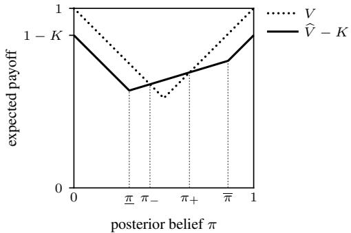  
Fig. 1. Expected payoff of an agent with posterior π without fact-checking, $V ,$ and with it, ${ \widehat { V } } - K$ . Agents with $\pi \in ( \underline { { \pi } } , \overline { { \pi } } )$ would follow the verdict, band those with π $\in ( \pi _ { - } , \pi _ { + } )$ , where ${ \widehat { V } } - K > V .$ , also find it worth the cost and fact-check. Here $e _ { 1 } = 0 . 4 , e _ { 2 } = 0 . 1 , K = 0 . 1 5$

Cascade Sets of Public Beliefs: Assume $\begin{array} { r } { K < \frac { 1 } { 2 } \big ( 1 - e _ { 1 } - } \end{array}$ $e _ { 2 } )$ . With a fixed public belief $\rho ,$ the posterior $\pi ( \mu ( b ) , \rho )$ is strictly decreasing in the prior b, so the cutoffs of Proposition 1 imply prior belief cutoffs $0 \leq b _ { - } ( \rho ) \leq b _ { + } ( \rho ) \leq 1 \colon$ an agent dislikes if $b \in [ 0 , b _ { - } ( \rho ) ]$ ], fact-checks and follows the result if $b \in ( b _ { - } ( \rho ) , b _ { + } ( \rho ) )$ , and likes if $b \in [ b _ { + } ( \rho ) , 1 ]$ Solving $\pi ( \mu ( b _ { \mp } ) , \rho ) = \pi _ { \pm }$ for b and truncating to [0, 1] gives the prior belief cutoffs:

$$
b _ { - } ( \rho ) = \left[ \frac { q ( e _ { 2 } + K ) ( 1 - r ) \rho } { ( 2 p - 1 ) ( 1 - e _ { 1 } - K ) r ( 1 - \rho ) } { - \frac { 1 - p } { 2 p - 1 } } \right] _ { [ 0 , 1 ] } ,\tag{4}
$$

$$
b _ { + } ( \rho ) = \left[ \frac { q ( 1 - e _ { 2 } - K ) ( 1 - r ) \rho } { ( 2 p - 1 ) ( e _ { 1 } + K ) r ( 1 - \rho ) } - \frac { 1 - p } { 2 p - 1 } \right] _ { [ 0 , 1 ] } ,\tag{5}
$$

Both cutoffs are increasing in $\rho ,$ hence at extreme values, the whole support of H is below $b _ { - } ( \rho )$ or above $b _ { + } ( \rho )$ . We call the sets of such extreme public beliefs cascade sets:

$$
\begin{array} { r } { J _ { L } : = \left\{ \rho \vert \operatorname { s u p p } ( H ) \subseteq \left[ b _ { + } ( \rho ) , 1 \right] \right\} = \left[ 0 , \rho _ { b _ { + } = 0 } ^ { \mathrm { R } } \right] , } \end{array}\tag{6}
$$

$$
J _ { D } : = \{ \rho | \operatorname { s u p p } ( H ) \subseteq [ 0 , b _ { - } ( \rho ) ] \} = \left[ \rho _ { b _ { - } = 1 } ^ { \mathrm { { R } } } , 1 \right] ,\tag{7}
$$

where $\rho _ { b _ { + } = 0 } ^ { \mathrm { R } }$ and $\rho _ { b _ { - } = 1 } ^ { \mathrm { R } }$ , solved from (5) and (4), are public belief thresholds with respect to message $m = \mathrm { R }$ (in odds, they are $\ell _ { L }$ and $\ell _ { D }$ in $( 9 ) \substack { - } ( 1 0 )$ below).

Intuitively, the map $b \mapsto \pi$ takes all prior beliefs to the liking posterior $[ 0 , \pi _ { - } ]$ if and only if $\boldsymbol { \rho } \in J _ { L }$ , and to $[ \pi _ { + } , 1 ]$ if and only if $\rho \in J _ { D }$ . Once the public belief enters $J _ { L } \ { \mathrm { o r } } \ J _ { D }$ all agents like or dislike, respectively, without checking. They ignore their private information and simply follow others, which is an information cascade [9].

A cascade set is a single point, $J _ { L } = \{ 0 \}$ , if and only if $K = e _ { 1 } = 0$ (falsified verdict is free and conclusive), and $J _ { D } = \{ 1 \}$ if and only if $K = e _ { 2 } = 0$ (verified verdict is free and conclusive). We rule out such “magical” methods, which cost nothing and are never wrong in at least one direction, but not the idealized methods of Section III, each ideal in one respect only. Formally, we impose the following conditions on fact-checking methods.

Assumption 1. The cost K and the error rates $e _ { 1 } , e _ { 2 }$ satisfy: (a) $e _ { 1 } + e _ { 2 } \ : < 1$ , (b) $K < \frac { 1 } { 2 } ( 1 - e _ { 1 } - e _ { 2 } )$ , and (c) $K > 0$ or $e _ { 1 } , e _ { 2 } > 0$

Conditions (a) and (b) say that fact-checking is informative and worth its cost for some agents (Proposition 1), and (c) is exactly the exclusion above.

## C. Learning Dynamics

Markov Process of Likelihood Ratios: To facilitate the analysis, we describe the learning dynamics in terms of the public likelihood ratio $\begin{array} { r } { \ell _ { t } ^ { \mathrm { F } } : = \frac { 1 - \rho _ { t } } { \rho _ { t } } \overset { \cdot } { = } \frac { \mathbb { P } _ { \mathrm { T } } \left[ \mathcal { H } _ { t } \right] } { \mathbb { P } _ { \mathrm { F } } \left[ \mathcal { H } _ { t } \right] } } \end{array}$ , with initial value $\begin{array} { r } { \ell _ { 0 } ^ { \mathrm { F } } = \frac { 1 - \rho _ { 0 } } { \rho _ { 0 } } = 1 } \end{array}$ . Unless otherwise specified, we assume $v = \mathrm { F }$ throughout the section, and illustrate the analysis of $( \ell _ { t } ^ { \mathrm { F } } )$ . When $v = \mathrm { ~ T ~ }$ , the dynamics of $\ell _ { t } ^ { \mathrm { T } } : = 1 / \ell _ { t } ^ { \mathrm { F } }$ can be analyzed through symmetric arguments.

Denote the prior belief cutoffs by $\bar { b } _ { - } ( \ell _ { t } ^ { \mathrm { F } } ) : = b _ { - } ( \rho _ { t } )$ and $\bar { b } _ { + } ( \ell _ { t } ^ { \mathrm { F } } ) : = b _ { + } ( \rho _ { t } )$ . Agent t+1 chooses $D ,$ to factcheck and follow the result, or $L ,$ whenever $b _ { t + 1 }$ lies in $[ 0 , \bar { b } _ { - } ( \ell _ { t } ^ { \mathrm { F } } ) ] , ( \bar { b } _ { - } ( \ell _ { t } ^ { \mathrm { F } } ) , \bar { b } _ { + } ( \ell _ { t } ^ { \mathrm { F } } ) )$ , or $[ \bar { b } _ { + } ( \ell _ { t } ^ { \mathrm { F } } ) , 1 ]$ , respectively. After her action $^ { a _ { t + 1 } , }$ the public likelihood ratio will be updated to $\begin{array} { r } { \ell _ { t + 1 } ^ { \mathrm { F } } = \frac { \bar { \mathbb { P } } _ { \mathrm { T } } ^ { 1 } \left[ \mathcal { H } _ { t } \cup \{ a _ { t + 1 } ^ { \textup { \bf ~ r } } \} \right] } { \mathbb { P } _ { \mathrm { F } } \left[ \mathcal { H } _ { t } \cup \{ a _ { t + 1 } \} \right] } = \ell _ { t } ^ { \mathrm { F } } \cdot \frac { \mathbb { P } _ { \mathrm { T } } [ a _ { t + 1 } | \mathcal { H } _ { t } ] } { \mathbb { P } _ { \mathrm { F } } [ a _ { t + 1 } | \mathcal { H } _ { t } ] } , } \end{array}$ that is,

$$
\begin{array} { r } { \ell _ { t + 1 } ^ { \mathrm { F } } = \ \left\{ \begin{array} { l l } { \ell _ { t } ^ { \mathrm { F } } \cdot \frac { 1 - G _ { \mathrm { T } } ( \ell _ { t } ^ { \mathrm { F } } ) } { 1 - G _ { \mathrm { F } } ( \ell _ { t } ^ { \mathrm { F } } ) } , } & { \mathrm { i f } \ a _ { t + 1 } = L , } \\ { \ell _ { t } ^ { \mathrm { F } } \cdot \frac { G _ { \mathrm { T } } ( \ell _ { t } ^ { \mathrm { F } } ) } { G _ { \mathrm { F } } ( \ell _ { t } ^ { \mathrm { F } } ) } , } & { \mathrm { i f } \ a _ { t + 1 } = D , } \end{array} \right. } \end{array}\tag{8}
$$

where, for $v \in \{ \mathrm { T } , \mathrm { F } \} , G _ { v } ( \ell _ { t } ^ { \mathrm { F } } ) : = \mathbb { P } _ { v } [ a _ { t + 1 } = D | \mathcal { H } _ { t } ] =$ $H ( \bar { b } _ { - } ( \ell _ { t } ^ { \mathrm { F } } ) ) + c _ { v } \Phi ( \ell _ { t } ^ { \mathrm { F } } )$ , with $c _ { \mathrm { T } } : = e _ { 1 } , c _ { \mathrm { F } } : = 1 - e _ { 2 }$ (the probability that a check yields D) and $\Phi ( \ell ) : = H ( \bar { b } _ { + } ) - H ( \bar { b } _ { - } )$ the probability of fact-checking. Therefore, $( a _ { t } , \ell _ { t } ^ { \mathrm { F } } )$ is a discrete-time Markov process on $\{ L , D \} \times [ 0 , \infty ) \colon$ it moves to $( L , \ell _ { t + 1 } ^ { \mathrm { F } } )$ with probability $1 - G _ { \mathrm { F } } ( \ell _ { t } ^ { \mathrm { F } } )$ and to $( D , \ell _ { t + 1 } ^ { \mathrm { F } } )$ with probability $\bar { G _ { \mathrm { F } } } ( \ell _ { t } ^ { \mathrm { F } } )$ , where $\ell _ { t + 1 } ^ { \mathrm { F } }$ is given by (8).

Information Cascades: To rephrase the cascade sets in terms of public likelihood ratios, define

$$
\ell _ { L } : = \frac { 1 - \rho _ { b _ { + } = 0 } ^ { \mathrm { R } } } { \rho _ { b _ { + } = 0 } ^ { \mathrm { R } } } = \frac { q ( 1 - r ) ( 1 - e _ { 2 } - K ) } { ( 1 - p ) r ( e _ { 1 } + K ) } ,\tag{9}
$$

$$
\ell _ { D } : = \frac { 1 - \rho _ { b _ { - } = 1 } ^ { \mathrm { R } } } { \rho _ { b _ { - } = 1 } ^ { \mathrm { R } } } = \frac { q ( 1 - r ) ( e _ { 2 } + K ) } { p r ( 1 - e _ { 1 } - K ) } .\tag{10}
$$

By (6) and $( 7 )$ , the cascade sets with respect to $\ell _ { t } ^ { \mathrm { F } }$ are ${ \bar { J } } _ { L } : =$ $[ \ell _ { L } , \infty ]$ and $\bar { J } _ { D } : = [ 0 , \ell _ { D } ]$ . These sets are absorbing: by (8), $\ell _ { t } ^ { \mathrm { F } }$ freezes once it enters them, so a cascade arises at the start if $\ell _ { 0 } ^ { \mathrm { { F } } } = 1 \in \bar { J } _ { D } \cup \bar { J } _ { L }$ . Otherwise, $\ell _ { t } ^ { \mathrm { F } }$ converges almost surely (a.s.), i.e., with PF-probability one, and its limit $\ell _ { \infty } ^ { \mathrm { F } }$ lies in ${ \bar { J } } _ { D } \cup { \bar { J } } _ { L } \backslash \{ \infty \} . ^ { 5 }$

Definition 1 (cascade). A D cascade arises if $\ell _ { \infty } ^ { \mathrm { F } } \in \bar { J } _ { D }$ and an L cascade arises if $\ell _ { \infty } ^ { \mathrm { F } } \in \bar { J } _ { L \cdot } \ : \mathrm { A }$ cascade is correct if it matches the veracity, i.e., an L cascade if $v = \mathrm { T }$ , a D cascade if $v = \mathrm { F }$

In the following, we characterize the learning outcomes when $( \ell _ { t } ^ { \mathrm { F } } )$ starts from the non-cascade interval.

Theorem 1. Suppose Assumption 1 holds and $\ell _ { 0 } ^ { \mathrm { F } } \in ( \ell _ { D } , \ell _ { L } )$

(a) Suppose that $v = \mathrm { F }$ and $e _ { 2 } = 0 . \ I f \ell _ { 0 } ^ { \mathrm { F } } \leq M ,$ then $a \ D$ cascade arises $a . s . ;$ otherwise, both L and D cascades arise with positive probability.

(b) Suppose that $v = \mathrm { T }$ and $e _ { 1 } = 0 . ~ I f \ell _ { 0 } ^ { \mathrm { F } } \geq N ,$ , then an L cascade arises $a . s . ;$ otherwise, both L and D cascades arise with positive probability.

(c) In all other cases, both L and D cascades arise with positive probability.

Here, $\begin{array} { r } { M : = \frac { q ( 1 - r ) ( 1 - e _ { 2 } - K ) } { p r ( e _ { 1 } + K ) } } \end{array}$ and $\begin{array} { r } { N : = \frac { q ( 1 - r ) ( e _ { 2 } + K ) } { ( 1 - p ) r ( 1 - e _ { 1 } - K ) } . } \end{array}$

Proof idea. Since ¯b and $\bar { b } _ { + }$ are decreasing in ℓ, we have $\bar { b } _ { + } ( \ell ) = 1 \iff \ell \leq M ; \bar { b } _ { - } ( \ell ) = 0 \iff \ell \geq N$ Therefore, on $( \ell _ { D } , M ] .$ , nobody likes without checking, and on $[ N , \ell _ { L } )$ , nobody dislikes without checking. If moreover $e _ { 2 } = 0 ,$ a fake article never passes a fact-check, so under $v =$ F nobody likes on $( \ell _ { D } , M ]$ and $\ell _ { t } ^ { \mathrm { F } }$ can only fall toward ${ \bar { J } } _ { D }$ This drives (a), and (b) is symmetric. The positive probability arguments follow from the (super)martingale property of $( \check { \ell _ { t } ^ { \mathrm { F } } } )$ . See Appendix B for the complete proof. □

Theorem 1 readily translates into thresholds on the reliability r. Denote a fact-checking method by $\mathcal { M } : = ( K , e _ { 1 } , e _ { 2 } )$ Since the thresholds $\ell _ { D } , \ell _ { L } , M , N$ are strictly decreasing in r, each equals $\ell _ { 0 } ^ { \mathrm { F } } = 1$ at exactly one reliability. We denote these by $r _ { D } ( { \mathcal { M } } ) , r _ { L } ( { \mathcal { M } } ) , \widehat { r } _ { D } ( { \mathcal { M } } ) , \widehat { r } _ { L } ( { \mathcal { M } } )$ , respectively, given as:

$$
r _ { D } ( \mathcal { M } ) = \frac { q ( e _ { 2 } + K ) } { p ( 1 - e _ { 1 } - K ) + q ( e _ { 2 } + K ) } ,\tag{11}
$$

$$
r _ { L } ( \mathcal { M } ) = \frac { q ( 1 - e _ { 2 } - K ) } { ( 1 - p ) \mathopen { } \mathclose \bgroup \left( e _ { 1 } + K \aftergroup \egroup \right) + q \mathopen { } \mathclose \bgroup \left( 1 - e _ { 2 } - K \aftergroup \egroup \right) } ,\tag{12}
$$

$$
\widehat { r } _ { D } ( M ) = \frac { q ( 1 - e _ { 2 } - K ) } { p ( e _ { 1 } + K ) + q ( 1 - e _ { 2 } - K ) } ,\tag{13}
$$

$$
\widehat { r } _ { L } ( M ) = \frac { q ( e _ { 2 } + K ) } { ( 1 - p ) ( 1 - e _ { 1 } - K ) + q ( e _ { 2 } + K ) } .\tag{14}
$$

Corollary 1. Suppose Assumption 1 holds. There exist reliability thresholds $0 < \underline { { r } } < \overline { { r } } < 1$ depending on v and M, such that, conditional on v,

(a) $I f r \geq { \overline { { r } } }$ (highly reliable), an L cascade arises a.s.

(b) $I f r \leq \underline { { r } }$ (poorly reliable), a D cascade arises a.s.

(c) If $\underline { { r } } ~ < ~ r ~ < ~ \overline { { r } }$ (moderately reliable), both L and D cascades arise with positive probability.

Specifically, the thresholds $( \underline { { r } } , \overline { { r } } )$ are $\left( \widehat { r } _ { D } , r _ { L } \right) i f v = \mathrm { F } , e _ { 2 } =$ $0 ; \left( r _ { D } , \widehat { r } _ { L } \right) i f v = \mathrm { T } , e _ { 1 } = 0 ,$ ; and $( r _ { D } , r _ { L } )$ otherwise.

Proof. For $r \leq r _ { D } \ ( \mathrm { r e s p . } \ r \geq r _ { L } )$ , even an agent with $b = 1$ (resp. $b = 0 )$ dislikes (likes) without checking at $t = 1$ , so a $D \ ( L )$ cascade starts at once, whatever v is. For $r \leq \widehat { r } _ { D }$ (resp. $r \geq \widehat { r } _ { L } )$ , nobody likes (dislikes) without checking at $t = 1$ . If moreover $v = \mathrm { F }$ and $e _ { 2 } = 0 ( \mathrm { r e s p . } \ v = \mathrm { T }$ and $e _ { 1 } = 0 )$ , a check never contradicts $\textbf { a } D \left( L \right)$ cascade, so it still arises a.s. Since $M , N \in ( \ell _ { D } , \ell _ { L } )$ by Assumption 1(b) and $\begin{array} { r } { p > \frac { 1 } { 2 } } \end{array}$ , we have $\widehat { r } _ { D } , \widehat { r } _ { L } \in \left( r _ { D } , r _ { L } \right)$ , and Theorem 1 with $\ell _ { 0 } ^ { \mathrm { F } } = 1$ gives the result. □

Remark 1. In the social learning literature, learning is complete if $\ell _ { \infty } ^ { \mathrm { F } } = 0 \ \mathrm { a . s }$ . when $v ~ = ~ \mathrm { F }$ and $\ell _ { \infty } ^ { \mathrm { T } } = 0$ a.s.

when $v = \mathrm { T } \ [ 9 ]$ . In our model, this holds if and only if factchecking is free and perfectly accurate in both directions. But this is excluded by Assumption 1, hence learning is incomplete.

## III. PROBLEM OF WELFARE CHANGE

## A. Welfare Definition

The learning outcome is evaluated by welfare, the probability of a correct cascade. A finite set M of fact-checking methods is available. When M has several methods, an agent fact-checks with at most one of them: the M maximizing $\widehat { V } _ { \mathcal { M } } ( \pi ) - K _ { \mathcal { M } }$ , or none if no M beats $V ( \pi )$

Definition 2 (welfare). Let $\mathcal { E } : = ( p , q , r , H )$ be the information environment, M be the set of available methods, and C be the event that a correct cascade arises. The welfare of E with methods M is $W ( \mathcal { E } , \mathbb { M } ) : = \mathbb { P } [ C ]$ . For a realized article $( \bar { m } , \bar { v } ) \in \{ \mathrm { L } , \mathrm { R } \} \times \{ \mathrm { T } , \mathrm { F } \}$ , its welfare is $\lambda ^ { \bar { m } , \bar { v } } ( \mathcal { E } , \mathbb { M } ) \ : =$ $\mathbb { P } [ C | m = \bar { m } , v = \bar { v } ]$

Note that $W ( \mathcal { E } , \mathbb { M } ) = \mathbb { E } [ \lambda ^ { m , v } ( \mathcal { E } , \mathbb { M } ) ]$ . Since $\lambda ^ { m , v }$ is a random variable that depends on $( m , v )$ , by the law of total probability, we have

$$
\begin{array} { r l } & { W ( { \mathcal { E } } , { \mathbb { M } } ) = r p { \cdot } \lambda ^ { \mathrm { R , T } } + r ( 1 - p ) { \cdot } \lambda ^ { \mathrm { L , T } } } \\ & { \qquad + ( 1 - r ) q { \cdot } \lambda ^ { \mathrm { R , F } } + ( 1 - r ) ( 1 - q ) { \cdot } \lambda ^ { \mathrm { L , F } } . } \end{array}
$$

Assumption 2. The prior belief distribution H is symmetric: $1 - H ( x ) = H ( 1 - x )$ , and the shares of L and R articles in fake news are equal: $q = 0 . 5$

Under this assumption, it is straightforward to see the symmetry between the dynamics of L and R articles, so $\mathcal { \mathrm { \backslash R } } , \bar { v } = \bar { \lambda } ^ { \mathrm { L } , \bar { v } } \forall \bar { v } \in \{ \mathrm { T } , \mathrm { F } \}$ . We therefore drop the superscript R and write $\lambda ^ { v } : = \lambda ^ { \mathrm { R } , v }$ for $v \in \{ \mathrm { T } , \mathrm { F } \}$ . Then, the welfare decomposition can be further simplified as:

$$
\begin{array} { r } { W ( \mathcal { E } , \mathbb { M } ) = { r \cdot \lambda ^ { \mathrm { T } } } + ( 1 - r ) \cdot \lambda ^ { \mathrm { F } } . } \end{array}\tag{15}
$$

We restrict the analysis to this symmetric case, as it greatly simplifies notation. The asymmetric case can be analyzed in like manner, where thresholds and magnitudes change, but the qualitative results do not.

## B. Problem Setup

We focus on two types of idealized fact-checking methods, both satisfying Assumption 1.

The first method is the costly, perfectly accurate manual fact-checking $\mathcal { M } _ { \mathrm { H } } = ( K _ { \mathrm { H } } , 0 , 0 )$ with $K _ { \mathrm { H } } \in ( 0 , 0 . 5 )$ , so it is affordable for some agents (Proposition 1). It is costly because an investigation generally takes time and effort. The perfect accuracy is an idealized benchmark.6

The second method is the free, error-prone automatedfactchecking $\mathcal { M } _ { \mathrm { A } } = ( K _ { \mathrm { A } } , e _ { 1 \mathrm { A } } , e _ { 2 \mathrm { A } } )$ with $K _ { \mathrm { A } } = 0 , e _ { 1 \mathrm { A } } , e _ { 2 \mathrm { A } } \in$ $( 0 , 1 )$ and $e _ { 1 \mathrm { A } } + e _ { 2 \mathrm { A } } < 1$ . We also assume that $e _ { \mathrm { 1 A } } > e _ { \mathrm { 2 A } } , ^ { 7 }$

6We expect the qualitative findings of Section IV to persist when $\mathcal { M } _ { \mathrm { H } }$ has small error rates, but our theoretical results do not cover this case.

since automated checkers identify false claims more reliably than true ones [5], [6].

We study the problem:

If an additional automated fact-checking method is introduced alongside the existing manual method, how will welfare change?

Formally, we seek to characterize the welfare change:

$$
\Delta W : = W ( \mathcal { E } , \{ \mathcal { M } _ { \mathrm { H } } , \mathcal { M } _ { \mathrm { A } } \} ) - W ( \mathcal { E } , \{ \mathcal { M } _ { \mathrm { H } } \} ) ,\tag{16}
$$

and to understand how it depends on the parameters $p , r , H ,$ $K _ { \mathrm { H } } , e _ { \mathrm { 1 A } }$ , and $e _ { 2 \mathrm { A } }$ . Note that, under Assumption 2, by (15), the welfare change can be written as: $\Delta W = r \Delta W _ { \mathrm { T } } + ( 1 -$ $r ) \Delta W _ { \mathrm { F } }$ , where $\bar { \Delta } W _ { \mathrm { T } } \ : = \ \lambda ^ { \mathrm { T } } ( \{ \mathcal { M } _ { \mathrm { H } } , \mathcal { M } _ { \mathrm { A } } \} ) - \lambda ^ { \mathrm { T } } ( \{ \mathcal { M } _ { \mathrm { H } } \} )$ and $\Delta W _ { \mathrm { F } } : = \lambda ^ { \mathrm { F } } ( \left\{ \mathcal { M } _ { \mathrm { H } } , \mathcal { M } _ { \mathrm { A } } \right\} ) - \lambda ^ { \mathrm { F } } ( \left\{ \mathcal { M } _ { \mathrm { H } } \right\} )$

## IV. SIMULATIONS AND ANALYSIS

We study the welfare change (16) by Monte Carlo simulation and theoretically certify its sign in some parameter regions. Depending on the accuracy of $\mathcal { M } _ { \mathrm { A } }$ and the cost of $\mathcal { M } _ { \mathrm { H } }$ , there are three regimes, according to who uses $\mathcal { M } _ { \mathrm { { A } } } \colon$

(i) $\begin{array} { r } { K _ { \mathrm { H } } \le \frac { e _ { 2 \mathrm { A } } } { 1 - e _ { 1 \mathrm { A } } + e _ { 2 \mathrm { A } } } } \end{array}$ : no one uses $\mathcal { M } _ { \mathrm { A \ell } }$ , so $\Delta W = 0$ (ii) $\begin{array} { r l r } { \frac { e _ { 2 \mathrm { A } } } { 1 - e _ { 1 \mathrm { A } } + e _ { 2 \mathrm { A } } } } & { < } & { \dot { K } _ { \mathrm { H } } ~ \le ~ \frac { e _ { 1 \mathrm { A } } } { 1 + e _ { 1 \mathrm { A } } - e _ { 2 \mathrm { A } } } : } \end{array}$ both methods are used, depending on the posterior (Fig. 2a).

(iii) $\begin{array} { r } { K _ { \mathrm { H } } > \frac { e _ { 1 \mathrm { A } } } { 1 + e _ { 1 \mathrm { A } } - e _ { 2 \mathrm { A } } } } \end{array}$ : every agent who checks prefers $\mathcal { M } _ { \mathrm { A } }$ (Fig. 2b).

Section IV-A treats regime (iii), the main regime, and Section IV-B regime (ii). Section IV-C explores the welfare change as the accuracy of $\mathcal { M } _ { \mathrm { A } }$ improves.

## A. Automated Method Preferred

In regime (iii), only $\mathcal { M } _ { \mathrm { A } }$ is used, so the dynamics are those of Section II for the single method $\mathcal { M } _ { \mathrm { A } }$ , and $\Delta W =$ $W ( \mathcal { E } , \{ \mathcal { M } _ { \mathrm { A } } \} ) - W ( \mathcal { E } , \{ \mathcal { M } _ { \mathrm { H } } \} )$ .

Simulation Setup: Let $e _ { 1 \mathrm { A } } = 0 . 3 , e _ { 2 \mathrm { A } } = 0 . 1 , K _ { \mathrm { H } } = 0 . 3$ and H be a beta distribution with parameters $0 . 5 , 0 . 5$ . On a $5 0 \times 5 0$ grid of $r ~ \in ~ \left[ 0 . 0 1 , 0 . 9 9 \right]$ and $p ~ \in ~ [ 0 . 5 5 , 0 . 9 5 ]$ we estimate the cascade probabilities by their frequencies in 2000 runs at each grid point (Fig. 3). A run ends as a cascade once the next agent’s probability of liking, or of disliking, is below $1 0 ^ { - 5 }$ under the veracity of the article. By this numerical criterion, all runs cascade within $t = 3 0 0$ The following proposition certifies the sign of $\Delta W$ in some regions of the (r, p)-plane.

Proposition 2. Suppose that Assumption 2 holds and $K _ { \mathrm { H } } >$ $\displaystyle \frac { e _ { 1 \mathrm { A } } } { 1 + e _ { 1 \mathrm { A } } - e _ { 2 \mathrm { A } } }$ . We have:

(a) $\Delta W _ { \mathrm { T } } = \Delta W _ { \mathrm { F } } = 0 f o r r \not \in \left( r _ { D } ( { \mathcal { M } } _ { \mathrm { A } } ) , r _ { L } ( { \mathcal { M } } _ { \mathrm { A } } ) \right) .$

(b) $\Delta W _ { \mathrm { T } } > 0 o n \ \big ( r _ { D } ( \mathcal { M } _ { \mathrm { A } } ) , r _ { D } ( \mathcal { M } _ { \mathrm { H } } ) \big ) ; \Delta W _ { \mathrm { T } } < 0$ on $( \hat { r } _ { L } ( \mathcal { M } _ { \mathrm { H } } ) , r _ { L } ( \dot { \mathcal { M } } _ { \mathrm { A } } ) )$

$$
\Delta { W _ { \mathrm { { F } } } } < 0 o n \ \big ( r _ { D } \big ( { \mathcal { M } } _ { \mathrm { { A } } } \big ) , \widehat { r } _ { D } ( { \mathcal { M } } _ { \mathrm { { H } } } ) \big ) ; \Delta { W _ { \mathrm { { F } } } } > 0
$$

$$
\left( r _ { L } ( \mathcal { M } _ { \mathrm { H } } ) , r _ { L } ( \mathcal { M } _ { \mathrm { A } } ) \right)
$$

(d) $\Delta W < 0$ on $\big ( \widehat { r } _ { L } ( \mathcal { M } _ { \mathrm { H } } ) , \widehat { r } _ { D } ( \mathcal { M } _ { \mathrm { H } } ) \big ) , i f p < \bar { p } .$

Here, $\begin{array} { r } { \bar { p } : = \frac { 1 } { 1 + ( \frac { K _ { \mathrm { H } } } { 1 - K _ { \mathrm { H } } } ) ^ { 2 } } \in ( 0 . 5 , 1 ) } \end{array}$ and the reliability thresholds are given in (11)–(14).

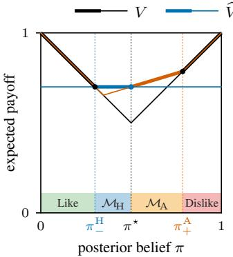

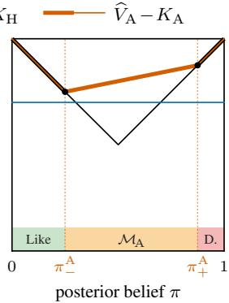  
(a) Regime (ii), both methods are used, e = 0.45, e = 0.15.  
Fig. 2. Expected payoff of an agent with posterior π if she does not factcheck, V, and if she fact-checks using method $\mathcal { M } , \widehat { V } _ { \mathcal { M } } - K _ { \mathcal { M } } ,$ where $\widehat { V } _ { \mathcal { M } }$ b bis given in (3). The highest curve (thick) is her expected payoff and the strip below shows her choice. π⋆ is where the curves of $\mathcal { M } _ { \mathrm { H } }$ and $\mathcal { M } _ { \mathrm { A } }$ cross. At the ends, where $\widehat { V } _ { \mathrm { A } } = V$ (as $\mathcal { M } _ { \mathrm { A } }$ is free), she is indifferent and does bnot check (see Section II-B). This tie-break is immaterial, since no verdict of $\mathcal { M } _ { \mathrm { A } }$ would change her action. $\pi _ { - } ^ { \mathrm { H } } : = \pi _ { - } ( { \mathcal M } _ { \mathrm { H } } ) , \pi _ { \pm } ^ { \mathrm { A } } : = \pi _ { \pm } ( { \mathcal M } _ { \mathrm { A } } ) ,$ $K _ { \mathrm { H } } = 0 . 3$

Proof. Recall that $\Delta W _ { v } ~ = ~ \lambda ^ { v } ( \lbrace \mathcal { M } _ { \mathrm { A } } \rbrace ) - \lambda ^ { v } ( \lbrace \mathcal { M } _ { \mathrm { H } } \rbrace )$ . By (11)–(14) and the condition on $K _ { \mathrm { H } }$ , the thresholds of Corollary 1 are ordered as

$$
\begin{array} { r } { \mathrm { T } : \ r _ { D } ( { \mathcal { M } } _ { \mathrm { A } } ) < r _ { D } ( { \mathcal { M } } _ { \mathrm { H } } ) < \widehat { r } _ { L } ( { \mathcal { M } } _ { \mathrm { H } } ) < r _ { L } ( { \mathcal { M } } _ { \mathrm { A } } ) , } \\ { \mathrm { F } : \ r _ { D } ( { \mathcal { M } } _ { \mathrm { A } } ) < \widehat { r } _ { D } ( { \mathcal { M } } _ { \mathrm { H } } ) < r _ { L } ( { \mathcal { M } } _ { \mathrm { H } } ) < r _ { L } ( { \mathcal { M } } _ { \mathrm { A } } ) . } \end{array}
$$

(a): Outside $\left( r _ { D } ( \mathcal { M } _ { \mathrm { A } } ) , r _ { L } ( \mathcal { M } _ { \mathrm { A } } ) \right)$ , both methods lead a.s. to the same cascade. (b), (c): On each interval, $\mathcal { M } _ { \mathrm { H } }$ leads a.s. to a single cascade, so $\lambda ^ { v } ( \{ \mathcal { M } _ { \mathrm { H } } \} ) \in \{ 0 , 1 \}$ , while $\mathcal { M } _ { \mathrm { A } }$ leads to both with positive probability, so $\lambda ^ { v } ( \{ \mathcal { M } _ { \mathrm { A } } \} ) \in ( 0 , 1 )$ . (d): The intervals where $\Delta W _ { \mathrm { T } } < 0$ and $\Delta W _ { \mathrm { F } } < 0$ intersect in $\big ( \widehat { r } _ { L } ( \mathcal { M } _ { \mathrm { H } } ) , \widehat { r } _ { D } ( \mathcal { M } _ { \mathrm { H } } ) \big )$ , nonempty iff $p < \bar { p }$ by $( 1 3 ) ‐ ( 1 4 )$ , and $\Delta W = r \Delta W _ { \mathrm { T } } + ( 1 - r ) \Delta W _ { \mathrm { F } } < 0$ there. □

Proposition 2 shows two opposing effects of switching from $\mathcal { M } _ { \mathrm { H } }$ to $\mathcal { M } _ { \mathrm { A } }$ . The first is broader checking: since $\mathcal { M } _ { \mathrm { A } }$ is free and accurate enough, agents check over a wider range of posteriors (Fig. 2b). A truthful article of moderately low reliability, which every agent dislikes without checking under $\mathcal { M } _ { \mathrm { H } } .$ is now checked by some agents and escapes this wrong cascade with positive probability. So does a fake article of moderately high reliability. These are the positive bands in Figs. 3a and 3b.

The second is misleading errors: on the negative bands of Figs. 3a and $3 6 , \mathcal { M } _ { \mathrm { H } }$ leads to the correct cascade a.s., since no agent takes the wrong action without checking and $\mathcal { M } _ { \mathrm { H } }$ never errs. Under $\mathcal { M } _ { \mathrm { A } }$ , a check wrongly verifies a fake article with probability $e _ { 2 \mathrm { A } }$ , or wrongly falsifies a truthful one with probability $e _ { \mathrm { 1 A } }$ , and the actions that follow can start a wrong cascade. If $p < \bar { p } .$ , i.e., truthful articles are not informative enough, the two negative bands overlap on an intermediate reliability range, as shown in Fig. 3c.

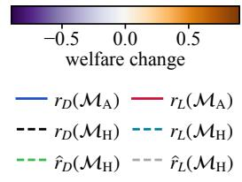

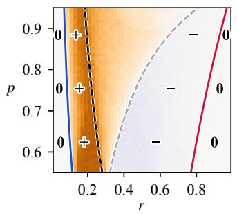  
(a) ∆WT

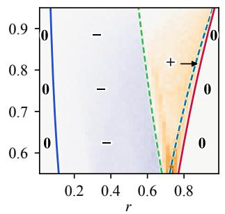  
(b) ∆WF

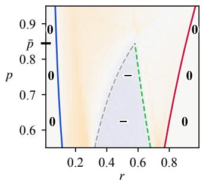  
(c) ∆W  
Fig. 3. Welfare change in regime (iii): $K _ { \mathrm { H } } = 0 . 3 , e _ { 1 \mathrm { A } } = 0 . 3 , e _ { 2 \mathrm { A } } = 0 . 1$ Lines: the thresholds (11)–(14) bounding the regions where Proposition 2 certifies the sign $( + , - ) ,$ and 0 where a cascade starts at t = 1 under both method sets. Bold tick marks p¯.

## B. Both Methods Are Used (Extension)

Regime (ii) requires an extension of our model, since both methods may be used. Denote by $\pi _ { \pm } ( \mathcal { M } )$ the cutoffs in Proposition 1 for method M. As Fig. 2a shows, an agent is indifferent between the two methods at the posterior $\pi ^ { \star } : =$ $\frac { e _ { 1 \mathrm { A } } - K _ { \mathrm { H } } } { - }$ . She checks with $\mathcal { M } _ { \mathrm { H } }$ if $\pi \in ( \pi _ { - } ( \mathcal { M } _ { \mathrm { H } } ) , \pi ^ { \star } ]$ , with $\mathbf { \mathcal { M } } _ { \mathrm { A } } \mathbf { \Psi } \mathbf { i f } ^ { \mathbf { \alpha } } \boldsymbol { \pi } \in \left( \pi ^ { \star } , \pi _ { + } ( \mathbf { \mathcal { M } } _ { \mathrm { A } } ) \right)$ , and does not check otherwise. In the following, as in Proposition 2, we certify the welfare change in some regions. The proof, along with the extended model, will appear in the journal version of this work.

Proposition 3. Suppose that Assumption 2 holds and $\begin{array} { r } { \frac { e _ { 2 \mathrm { A } } } { 1 - e _ { 1 \mathrm { A } } + e _ { 2 \mathrm { A } } } < K _ { \mathrm { H } } \leq \frac { e _ { 1 \mathrm { A } } } { 1 + e _ { 1 \mathrm { A } } - e _ { 2 \mathrm { A } } } } \end{array}$ . We have:

(a) $\Delta W _ { \mathrm { T } } = \Delta W _ { \mathrm { F } } = 0 f o r r \not \in \left( r _ { D } ( { \cal M } _ { \mathrm { A } } ) , r ^ { \star } \right)$

(b) $\Delta W _ { \mathrm { T } } > 0 o n \ \big ( r _ { D } ( \mathcal { M } _ { \mathrm { A } } ) , \dot { r } _ { D } ( \mathcal { M } _ { \mathrm { H } } ) \big ) ; \ \Delta W _ { \mathrm { T } } < 0$ on $\left( \widehat { r } _ { L } ( \mathcal { M } _ { \mathrm { H } } ) , r ^ { \star } \right)$

$$
\Delta W _ { \mathrm { F } } \ \le \ 0 \ o n \ \big ( r _ { D } ( { \mathcal M } _ { \mathrm { A } } ) , \widetilde r \big ) . \ I f \ p \ > \ p _ { \kappa } ,
$$

$$
\widetilde { r } ~ =
$$

$$
\widehat { r } _ { D } ( M _ { \mathrm { H } } )
$$

$$
\widetilde { r } = r ^ { \star }
$$

$$
\Delta W < 0 ~ o n ~ ( \widehat { r } _ { L } ( \mathcal { M } _ { \mathrm { H } } ) , \widetilde { r } ) ~ i f ~ p < \bar { p } .
$$

Here, p¯ is as in Proposition 2, the reliability thresholds are given in (11)–(14), re = min $\begin{array} { r } { \big ( r ^ { \star } , \widehat { r } _ { D } ( \mathcal { M } _ { \mathrm { H } } ) \big ) , r ^ { \star } = \frac { q \kappa } { q \kappa + ( 1 - p ) } } \end{array}$ and $\begin{array} { r } { p _ { \kappa } = \frac { 1 } { 1 + \frac { K _ { \mathrm { H } } } { 1 - K _ { \mathrm { H } } } \kappa } < \bar { p } , } \end{array}$ , with $\begin{array} { r } { \kappa = \frac { 1 - \pi ^ { \star } } { \pi ^ { \star } } } \end{array}$

Except for $e _ { \mathrm { 1 A } } = 0 . 4 5$ and $e _ { 2 \mathrm { A } } = 0 . 1 5$ , the simulation setup is the same as in Section IV-A. Fig. 4 shows the result, with the regions certified by Proposition 3 marked. The two effects of Proposition 2 survive, but only one of its two positive bands does. Adding $\mathcal { M } _ { \mathrm { A } }$ , agents with $\pi \leq \pi _ { - } ( \mathcal { M } _ { \mathrm { H } } )$ still like without checking, so checking extends only to the D side, from $\pi _ { + } ( { \mathcal { M } } _ { \mathrm { H } } ) \tan \pi _ { + } ( { \mathcal { M } } _ { \mathrm { A } } )$ . Broader checking thus still helps truthful articles of moderately low reliability (Fig. 4a), but no longer fake articles of moderately high reliability, so $\Delta W _ { \mathrm { F } }$ has no certified positive band (Fig. 4b). Misleading errors remain, and the two negative bands overlap if $p < \bar { p }$ (Fig. 4c).

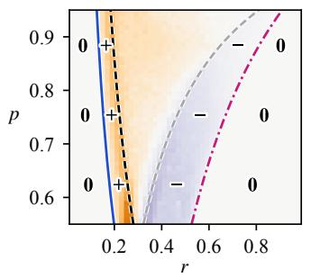

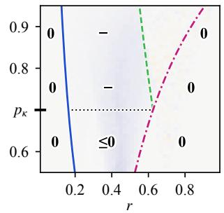  
(b) ∆WF

(a) ∆WT  
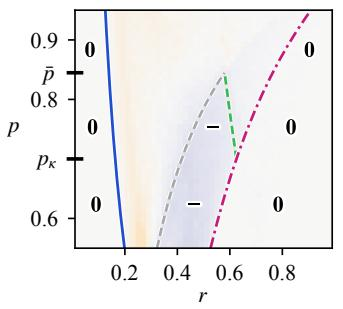  
(c) ∆W  
Fig. 4. Welfare change in regime (ii): $K _ { \mathrm { H } } = 0 . 3 , e _ { 1 \mathrm { A } } = 0 . 4 5 , e _ { 2 \mathrm { A } } =$ 0.15. Lines: the thresholds (11)–(14) and r⋆ bounding the regions where Proposition 3 certifies the sign $( + , - \mathrm { \ s t r i c t } , \le 0$ weak, 0). Bold ticks mark $p _ { \kappa }$ and p¯. The horizontal dotted line in (b) marks $p = p _ { \kappa }$

## C. Welfare Change with an Improving Automated Method

Sections IV-A and IV-B study $\Delta W$ article by article. For a fixed $\mathcal { M } _ { \mathrm { A } }$ , it is a function of the reliability r. A platform that integrates $\mathcal { M } _ { \mathrm { A } }$ , however, may offer it to every user for every article, whatever the article’s reliability. Yet this integration harms some articles whenever $p < \bar { p } ,$ whether only some agents use it (Proposition 3d) or every agent who checks does (Proposition 2d). As automated fact-checkers keep improving, we therefore ask when a platform should integrate $\mathcal { M } _ { \mathrm { A } } \colon$ how accurate must it be before introducing it raises welfare averaged over the circulating articles?

Simulation Setup: Let $\overline { { W } } ( \mathbb { M } ) : = \mathbb { E } _ { r } [ W ( \mathcal { E } , \mathbb { M } ) ]$ , with r uniformly distributed on (0, 1). We move $\mathcal { M } _ { \mathrm { A } }$ along the accuracy relation $e _ { 1 \mathrm { A } } ~ = ~ 3 e _ { 2 \mathrm { A } }$ , which contains the $\mathcal { M } _ { \mathrm { A } }$ of Figs. 3 and 4, and measure it by its balanced accuracy $\alpha : = 1 - \textstyle { \frac { 1 } { 2 } } ( e _ { 1 \mathrm { A } } + e _ { 2 \mathrm { A } } ) \in ( 1 / 2 , 1 )$ . The parameters are set as $H = \bar { \mathrm { B e t a } } ( 0 . 5 , 0 . 5 ) , K _ { \mathrm { H } } = 0 . 3$ and $p = 0 . 5 5 < \bar { p } .$ . We estimate W with 20000 articles. At every $\alpha , \{ \mathcal { M } _ { \mathrm { H } } \} , \{ \mathcal { M } _ { \mathrm { A } } \}$ and $\{ \mathcal { M } _ { \mathrm { H } } , \mathcal { M } _ { \mathrm { A } } \}$ face the same articles, priors and verdicts. A run ends as a cascade once the next agent’s probability of liking, or of disliking, is below $1 0 ^ { - 5 }$ under the veracity of the article. By this numerical criterion, all articles cascade within $t = 1 0 0 0$

Results: In Fig. 5, we see that, as α grows, $\mathcal { M } _ { \mathrm { A } }$ passes through regimes (i), (ii) and (iii). Regimes (i) and (ii) meet at $\tau _ { \mathrm { u s e } } ~ = ~ 0 . 6 2 5$ , where $\begin{array} { r } { K _ { \mathrm { H } } ~ = ~ \frac { e _ { 2 \mathrm { A } } } { 1 - e _ { 1 \mathrm { A } } + e _ { 2 \mathrm { A } } } . } \end{array}$ , and regimes (ii) and (iii) at $\tau _ { \mathrm { a l l } } = 0 . 7 5$ , where $\begin{array} { r } { K _ { \mathrm { H } } = \frac { e _ { 1 \mathrm { A } } } { 1 + e _ { 1 \mathrm { A } } - e _ { 2 \mathrm { A } } } . } \end{array}$ A third threshold, $\tau _ { 0 } ~ \approx ~ 0 . 8 1$ , is where the simulated $\overline { { W } } ( \{ \mathcal { M } _ { \mathrm { H } } , \mathcal { M } _ { \mathrm { A } } \} )$ crosses $\overline { { W } } ( \{ \mathcal { M } _ { \mathrm { H } } \} )$ . In regime (i), no agent uses $\mathcal { M } _ { \mathrm { A } }$ , and welfare is unchanged. In regime (ii), we observe that welfare can fall as $\mathcal { M } _ { \mathrm { A } }$ improves, because more agents replace checks with $\mathcal { M } _ { \mathrm { H } }$ by checks with $\mathcal { M } _ { \mathrm { A } }$ , whose errors mislead their successors. The dip is deepest at $\tau _ { \mathrm { a l l } }$ when the last agents switch. In regime (iii), welfare rises with $\alpha ,$ but it exceeds $\overline { { W } } ( \{ \mathcal { M } _ { \mathrm { H } } \} ) ,$ ) only beyond $\tau _ { 0 } .$ , above the $\mathcal { M } _ { \mathrm { A } }$ of Figs. 3 and 4.

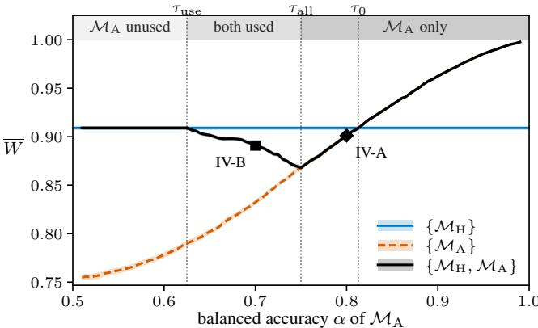  
Fig. 5. Welfare $\overline { W }$ averaged over $r \sim$ Unif(0, 1) against the balanced accuracy $\alpha = 1 - \textstyle { \frac { 1 } { 2 } } ( e _ { 1 \mathrm { A } } + e _ { 2 \mathrm { A } } )$ of $\mathcal { M } _ { \mathrm { A } }$ along $e _ { 1 \mathrm { A } } = 3 e _ { 2 \mathrm { A } } . \ K _ { \mathrm { H } } = 0 . 3$ $p = 0 . 5 5 < \bar { p }$ are fixed. Estimates are based on 20000 articles, with 1 standard deviation shown in bands. Vertical lines: $\tau _ { \mathrm { u s e } } .$ , below which no agent uses $\mathcal { M } _ { \mathrm { A } } ; \tau _ { \mathrm { a l l } }$ , above which every agent who checks does; $\tau _ { 0 } .$ , above which $\{ \mathcal { M } _ { \mathrm { H } } , \mathcal { M } _ { \mathrm { A } } \}$ has higher welfare than $\{ \mathcal { M } _ { \mathrm { H } } \}$ . Top strip: regimes (i)– (iii). Diamond, square: the $\mathcal { M } _ { \mathrm { A } }$ of Sections IV-A, IV-B.

A platform should therefore not integrate $\mathcal { M } _ { \mathrm { A } }$ before it is accurate enough: until $\tau _ { 0 }$ , introducing it changes nothing or lowers welfare, although every agent who uses it gains privately. The loss is an informational externality [10]: an agent chooses her method for her own payoff, but her action also informs her successors, and an error of $\mathcal { M } _ { \mathrm { A } }$ can start a wrong cascade among them. Even beyond $\tau _ { 0 } .$ , where introducing $\mathcal { M } _ { \mathrm { A } }$ raises welfare on average, it still lowers welfare for articles of intermediate reliability (Proposition 2d).

## V. CONCLUSIONS

This paper studied how a free, error-prone automated factchecking tool changes the probability of a correct cascade when it is offered alongside costly but accurate manual factchecking. The tool helps agents escape wrong cascades by bringing more of them to check, but its errors, passed on through their actions, can start wrong cascades that manual checking would have avoided. The second effect dominates for articles of intermediate reliability, and on average over articles the tool raises welfare only if it is accurate enough. A platform should therefore not offer such a tool before its accuracy exceeds a threshold. Several questions remain for future research. First, we found the accuracy threshold above which the tool raises average welfare by simulation, but characterizing it analytically would say how accurate a tool must be before it helps. Second, a tool of given ability can trade one error rate against the other: which operating point maximizes welfare? Third, with more than two channels of information with different costs and accuracies, which should a platform make available?

## APPENDIX

## A. Omitted Details from Section II

Let $g ( b ) : = p b + ( 1 - p ) ( 1 - b )$ , increasing in b since $p >$ $\textstyle { \frac { 1 } { 2 } }$ . As in Section II-B, $m = \mathrm { R }$ and $\mathbb { P } _ { v } = \mathbb { P } [ \cdot \mid m = \mathrm { R } , v ]$

Beliefs (1)–(2): A truthful article carries $m = \mathrm { ~ R ~ }$ with probability g(b) and a fake one with probability $q ,$ so Bayes rule gives $\begin{array} { r } { \tilde { \mu ( b ) } ~ = ~ \frac { ( 1 - r ) q } { ( 1 - r ) q + r \ g ( b ) } } \end{array}$ . Priors are independent, so given v the history is independent of $b _ { t }$ and the odds multiply: $\begin{array} { r } { \frac { \pi } { 1 - \pi } = \frac { \mu } { 1 - \mu } \cdot \frac { \rho _ { t - 1 } } { 1 - \rho _ { t - 1 } } } \end{array}$ . Both $\mu$ and π decrease in $b .$

−Value of Fact-Checking (3): A verdict updates $\pi$ to $\begin{array} { r c l c r c l } { \operatorname { B U } ( \pi , \operatorname { F } ) } & { = } & { { \frac { \pi ( 1 - e _ { 2 } ) } { \pi ( 1 - e _ { 2 } ) + ( 1 - \pi ) e _ { 1 } } } } & { > } & { \pi } & { \operatorname { o r ~ \mathrm { ~ B U } ( \pi , T ) } } & { = } & { } \end{array}$ $\begin{array} { l l l } { \frac { \pi \mathbf { c } \cdot \mathbf { \vec { z } } } { \pi e _ { 2 } + ( 1 - \pi ) ( 1 - e _ { 1 } ) } } & { < } & { \pi , } \end{array}$ −, using $e _ { 1 } + e _ { 2 } ~ < ~ 1$ . The verdict changes her action only if $\mathrm { B U } ( \pi , \mathrm { F } ) > \frac { 1 } { 2 } \ge \mathrm { B U } ( \pi , \mathrm { T } )$ , i.e., $\pi \in ( \underline { { \pi } } , \overline { { \pi } } ]$ , where she follows it; elsewhere she ignores it, which gives the other two cases.

Cutoffs: In odds, $\begin{array} { r } { \frac { \pi } { 1 - \pi } = \frac { ( 1 - r ) q } { r g ( b ) } \cdot \frac { \rho } { 1 - \rho } . } \end{array}$ . Equating it with the odds of $\pi _ { \pm }$ gives untruncated $b _ { \mp }$ , hence $( 4 ) \AA { - } ( 5 )$ after truncation. The cases $b _ { \pm } \in \{ 0 , 1 \}$ give $\ell _ { L } , \ell _ { D } , M , N$ , and $\ell = 1 \ \mathrm { g i v e s } \ ( 1 1 ) { - } ( 1 4 )$

## B. Proof of Theorem 1

Unless stated otherwise, we take $v \ = \ \mathrm { { F } } ,$ so a.s. and (super)martingale statements refer to $\mathbb { P } _ { \mathrm { F } }$ . Let $\mathcal { F } _ { t } : = \sigma ( \mathcal { H } _ { t } ) =$ $\sigma ( a _ { 1 } , \ldots , a _ { t } )$ , with $\mathcal { F } _ { 0 }$ trivial, be the natural filtration of the actions. Write $\ell _ { t } : = \ell _ { t } ^ { \mathrm { F } }$ , which is $\mathcal { F } _ { t }$ -adapted. Recalling that $\Phi ( \ell ) = H ( \bar { b } _ { + } ( \ell ) ) - H ( \bar { b } _ { - } ( \ell ) )$ , we also define

$$
\eta ( \ell ) : = G _ { \mathrm { F } } ( \ell ) - G _ { \mathrm { T } } ( \ell ) = ( 1 - e _ { 1 } - e _ { 2 } ) \Phi ( \ell ) \ \geq 0 .\tag{17}
$$

Lemma B.1 (a likelihood ratio is a supermartingale). Suppose $\mathbb { P } _ { \mathrm { F } } [ a _ { t + 1 } = a \vert \mathcal { F } _ { t } ] = 0 \Rightarrow \mathbb { P } _ { \mathrm { T } } [ a _ { t + 1 } = a \vert \mathcal { F } _ { t } ] = 0$ for each action a. Then $( \ell _ { t } )$ is a martingale. Without this condition, $( \ell _ { t } )$ is a nonnegative supermartingale.

Proof. By the update rule $\begin{array} { r } { \ell _ { t + 1 } = \ell _ { t } \frac { \mathbb { P } _ { \mathrm { T } } \left[ a _ { t + 1 } | \mathcal { F } _ { t } \right] } { \mathbb { P } _ { \mathrm { F } } \left[ a _ { t + 1 } | \mathcal { F } _ { t } \right] } } \end{array}$ , we have

$$
\begin{array} { r } { \mathbb { E } _ { \mathrm { F } } [ \ell _ { t + 1 } | \mathcal { F } _ { t } ] = \ell _ { t } \sum _ { a : \mathbb { P } _ { \mathrm { F } } [ a | \mathcal { F } _ { t } ] > 0 } \mathbb { P } _ { \mathrm { F } } [ a | \mathcal { F } _ { t } ] \frac { \mathbb { P } _ { \mathrm { T } } [ a | \mathcal { F } _ { t } ] } { \mathbb { P } _ { \mathrm { F } } [ a | \mathcal { F } _ { t } ] } } \\ { = \ell _ { t } \sum _ { a : \mathbb { P } _ { \mathrm { F } } [ a | \mathcal { F } _ { t } ] > 0 } \mathbb { P } _ { \mathrm { T } } [ a | \mathcal { F } _ { t } ] . \qquad } \end{array}
$$

The sum is 1 under the condition and $\leq 1$ otherwise.

Remark B.1. The condition in Lemma B.1 fails when the method is perfectly sensitive, $\mathrm { i . e . , } e _ { 2 } = 0$ . To see this, note that $G _ { \mathrm { F } } = H ( \bar { b } _ { + } ) - e _ { 2 } \Phi$ , and by (17), $G _ { \mathrm { T } } \ \leq \ G _ { \mathrm { F } } .$ , so the condition can fail only for the action L, and only if $G _ { \mathrm { { F } } } = { }$ $1 > G _ { \mathrm { T } }$ . That requires $H ( \bar { b } _ { + } ( \ell ) ) = 1 \ ( \mathrm { i . e . ~ } \ell \leq M ) , e _ { 2 } \Phi = 0$ and $\Phi > 0 \ ( \mathrm { i . e . } \ \ell > \ell _ { D } )$ . So Lemma B.1 holds at every ℓ except when $e _ { 2 } = 0$ and $\ell \in ( \ell _ { D } , M ]$ . There, a fake never passes the fact-check and nobody likes without checking, so under $v = \mathrm { F }$ nobody ever likes. Symmetrically, $\ell ^ { \mathrm { T } }$ can fail to be a martingale when $e _ { 1 } = 0$

Lemma B.2 (a convergent limit must be stationary). $\ell _ { \infty } \in$   
$[ 0 , \ell _ { D } ] \cup [ \ell _ { L } , \infty )$ a.s.

Proof. By Lemma B.1, (ℓ ) is a nonnegative supermartingale, so $\ell _ { t } \to \ell _ { \infty } < \infty \mathrm { a . s . } \mathrm { B y } ( 1 7 ) , \eta ( \ell )$ is continuous and strictly positive on $( \ell _ { D } , \ell _ { L } )$ , since H is continuous and has full support. Fix $\ell _ { D } ~ < ~ \alpha ~ < ~ \beta ~ < ~ \ell _ { L }$ and let $\eta _ { 0 } ~ : = ~ \operatorname* { m i n } _ { [ \alpha , \beta ] } \eta ~ > ~ 0$ . Then for $\ell ~ \in ~ \left( \alpha , \beta \right)$ , action D has PF-probability $G _ { \mathrm { { F } } } ( \ell ) ~ \geq ~ \eta ( \ell ) ~ \geq ~ \eta _ { 0 }$ . After D, the update multiplies ℓ by $G _ { \mathrm { T } } / G _ { \mathrm { F } } = 1 - \eta / G _ { \mathrm { F } } \leq 1 - \eta _ { 0 }$ , so $\ell _ { t } - \ell _ { t + 1 } \geq \eta _ { 0 } \ell _ { t } > \eta _ { 0 } \alpha$ . By [9, Theorem B.1], $( \alpha , \beta )$ cannot contain any point from the support of $\ell _ { \infty }$ . (Their proof uses only the Markov property and a.s. convergence, so our supermartingale case is covered.) □

Proof of (a): By Lemma B.2, $\ell _ { \infty } ~ \in ~ [ 0 , \ell _ { D } ] \cup [ \ell _ { L } , \infty )$ a.s. We first show that $\mathbb { P } _ { \mathrm { F } } [ \ell _ { \infty } \in \bar { J } _ { D } ] > 0$ whenever $\ell _ { 0 } \in$ $( \boldsymbol { \ell } _ { D } , \boldsymbol { \ell } _ { L } )$ . Suppose to the contrary that $\mathbb { P } _ { \mathrm { F } } [ \ell _ { \infty } \in \bar { J } _ { D } ] = 0$ Then $\ell _ { \infty } \geq \ell _ { L }$ a.s., so $\mathbb { E } _ { \mathrm { F } } [ \ell _ { \infty } ] \ge \ell _ { L } > \ell _ { 0 }$ . But since $( \ell _ { t } )$ is a supermartingale, $\mathbb { E } _ { \mathrm { F } } [ \ell _ { \infty } ] \le \ell _ { 0 }$ , a contradiction.

Next, suppose $\ell _ { 0 } \leq M .$ On $( \ell _ { D } , M ] , G _ { \mathrm { F } } = 1$ since $e _ { 2 } = 0$ (Remark B.1), so $a _ { 1 } = D { \mathrm { ~ a . s . } }$ and $\ell _ { 1 } = \ell _ { 0 } G _ { \mathrm { T } } ( \ell _ { 0 } ) < \ell _ { 0 }$ . If $\ell _ { t }$ enters ${ \bar { J } } _ { D } .$ , it is frozen thereafter. Otherwise it will keep decreasing on $( \ell _ { D } , M ]$ . By induction, $\ell _ { t } < \ell _ { 0 } \leq M < \ell _ { L }$ for all $t \geq 1$ , so $\ell _ { \infty } \in \bar { J } _ { D }$ a.s. by Lemma B.2.

It is only left to show that $\mathbb { P } _ { \mathrm { F } } [ \ell _ { \infty } \in \bar { \mathcal { I } } _ { L } ] > 0$ if $\ell _ { 0 } >$ M. By Remark B.1, (ℓt) is not a martingale on $( \ell _ { D } , M ]$ so we stop it when it gets there. Let $\tau : = \operatorname* { i n f } \{ t : \ell _ { t } \ \leq$ $M \}$ and $Y _ { t } : = \ell _ { \operatorname* { m i n } \{ t , \tau \} } .$ . For $\ell > M$ , we have $\bar { b } _ { + } ( \ell ) < 1$ hence $\mathbb { P } _ { \mathrm { F } } [ a = L | \ell ] \stackrel {  } { = } 1 { - } G _ { \mathrm { F } } ( \ell ) > 0$ . Together with $\mathbb { P } _ { \mathrm { F } } [ a =$ $D \left| \ell \right| = { \dot { G } } _ { \mathrm { F } } ( \ell ) \geq { \dot { G } } _ { \mathrm { T } } ( \ell ) = \mathbb { P } _ { \mathrm { T } } [ a = D \left| \ell \right]$ , the condition of Lemma B.1 holds on $\{ \tau > t \} \in \mathcal { F } _ { t }$ , hence

$$
\begin{array} { r l } & { \mathbb { E } _ { \mathrm { F } } [ Y _ { t + 1 } \mid \mathcal { F } _ { t } ] = \mathbf { 1 } _ { \tau > t } \mathbb { E } _ { \mathrm { F } } [ \ell _ { t + 1 } \mid \mathcal { F } _ { t } ] + \mathbf { 1 } _ { \tau \leq t } \ell _ { \tau } } \\ & { \qquad = \mathbf { 1 } _ { \tau > t } \ell _ { t } + \mathbf { 1 } _ { \tau \leq t } \ell _ { \tau } = Y _ { t } , } \end{array}
$$

and (Y ) is thus a martingale. Suppose $\mathbb { P } _ { \mathrm { F } } [ \tau = \infty ] = 0$ Then $\ell _ { t } ~ < ~ \ell _ { L }$ a.s. for all $t \leq \tau$ , otherwise it would stay in ${ \bar { J } } _ { L }$ forever $( \tau = \infty )$ with positive probability. Thus (Yt) is bounded a.s. By the Dominated Convergence Theorem, the mean is preserved in the limit: $\mathbb { E } _ { \mathrm { F } } [ Y _ { \infty } ] = \ell _ { 0 } > M$ But $Y _ { \infty } = \ell _ { \tau } \le M < \ell _ { 0 }$ a.s., a contradiction. Therefore, $\mathbb { P } _ { \mathrm { F } } [ \tau = \infty ] > 0$ . On $\{ \tau = \infty \}$ , we have $\ell _ { t } > M > \ell _ { D }$ for all $t ,$ and by Lemma ${ \bf B } . 2 , \ell _ { \infty } \in [ \ell _ { L } , \infty )$

Proof of (b): The proof is symmetric to (a), with the roles of F and T reversed and $\ell _ { t } ^ { \mathrm { T } } : = 1 / \ell _ { t }$ for all t.

Proof of (c): Let $v = \mathrm { F }$ and $e _ { 2 } > 0$ . By Remark B.1, $( \ell _ { t } )$ is then a martingale, so the argument for $\ell _ { 0 } > M$ in (a) applies with M replaced by $( \ell _ { D } + \ell _ { 0 } ) / 2$ , and $\mathrm { g i v e s } \ \mathbb { P } _ { \mathrm { F } } [ \ell _ { \infty } \in$ $\bar { J } _ { L } ] > 0$ . Moreover, $\mathbb { P } _ { \mathrm { F } } [ \ell _ { \infty } \in \bar { J } _ { D } ] > 0$ by the first part of (a). The case $v = \mathrm { T } , e _ { 1 } > 0$ is symmetric, using $( \ell _ { t } ^ { \mathrm { T } } )$ .

## REFERENCES

[1] A. Yang, “Meta is putting AI front and center in its apps, and some users are annoyed,” NBC News, Apr. 23, 2024, [Online]. Available: https://www.nbcnews.com/tech/tech-news/ meta-putting-ai-front-center-apps-users-are-annoyed-rcna148857. Accessed: Oct. 25, 2026.

[2] T. Renault, M. Mosleh, H. Lin, G. Pennycook, and D. G. Rand, “Factchecking using AI,” 2026, PsyArXiv, doi: 10.31234/osf.io/85quw v5.

[3] K. X. Mei, R. Wolfe, N. Weber, and M. Saveski, “Grok in the wild: Characterizing the roles and uses of large language models on social media,” in Proc. Int. AAAI Conf. Web Soc. Media, vol. 20, no. 1, 2026, pp. 1609–1633.

[4] A. G. Møller, D. M. Romero, D. Jurgens, and L. M. Aiello, “The impact of generative AI on social media: An experimental study,” Sci. Rep., vol. 16, no. 9376, pp. 1–14, 2026.

[5] D. Quelle and A. Bovet, “The perils and promises of fact-checking with large language models,” Front. Artif. Intell., vol. 7, no. 1341697, pp. 1–14, 2024.

[6] M. R. DeVerna, H. Y. Yan, K.-C. Yang, and F. Menczer, “Factchecking information from large language models can decrease headline discernment,” Proc. Natl. Acad. Sci. USA, vol. 121, no. 50, Art. no. e2322823121, pp. 1–9, 2024.

[7] A. V. Banerjee, “A simple model of herd behavior,” Q. J. Econ., vol. 107, no. 3, pp. 797–817, 1992.

[8] S. Bikhchandani, D. Hirshleifer, and I. Welch, “A theory of fads, fashion, custom, and cultural change as informational cascades,” J. Polit. Econ., vol. 100, no. 5, pp. 992–1026, 1992.

[9] L. Smith and P. Sørensen, “Pathological outcomes of observational learning,” Econometrica, vol. 68, no. 2, pp. 371–398, 2000.

[10] S. Bikhchandani, D. Hirshleifer, O. Tamuz, and I. Welch, “Information cascades and social learning,” J. Econ. Lit., vol. 62, no. 3, pp. 1040– 1093, 2024.

[11] Z. Lu, W. Wang, Y. Yu, X. Wang, Z. Li, Z. Liu, and S. Ananiadou, “One AI signal, many human judgments: A Bayesian cascade analysis of AI-based credibility indicators in online information spread,” in Proc. ACM Conf. Human-AI Complement. Alignment, 2026, pp. 10– 22.

[12] Y. Papanastasiou, “Fake news propagation and detection: A sequential model,” Manage. Sci., vol. 66, no. 5, pp. 1826–1846, 2020.

[13] D. Cheredina and G. Lukyanov, “Two motives for verification in information cascades,” 2026, arXiv:2508.20538v5.

[14] M. Mostagir and J. Siderius, “Learning in a post-truth world,” Manage. Sci., vol. 68, no. 4, pp. 2860–2868, 2022.

[15] D. Acemoglu, A. Ozdaglar, and J. Siderius, “A model of online misinformation,” Rev. Econ. Stud., vol. 91, no. 6, pp. 3117–3150, 2024.

[16] K. Shu, A. Sliva, S. Wang, J. Tang, and H. Liu, “Fake news detection on social media: A data mining perspective,” ACM SIGKDD Explor. Newslett., vol. 19, no. 1, pp. 22–36, 2017.

[17] S. N. Ali, “Herding with costly information,” J. Econ. Theory, vol. 175, pp. 713–729, 2018.

[18] G. Pennycook and D. G. Rand, “The psychology of fake news,” Trends Cogn. Sci., vol. 25, no. 5, pp. 388–402, 2021.

[19] G. Pennycook, Z. Epstein, M. Mosleh, A. A. Arechar, D. Eckles, and D. G. Rand, “Shifting attention to accuracy can reduce misinformation online,” Nature, vol. 592, no. 7855, pp. 590–595, 2021.