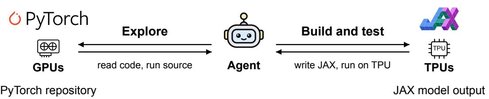

# XStack: A Benchmark for ML Repo Migration

Linrong Cai Taiming Lu Haozhe Chen Zhuang Liu Princeton University

Dataset

Code

€ Website

## XStack

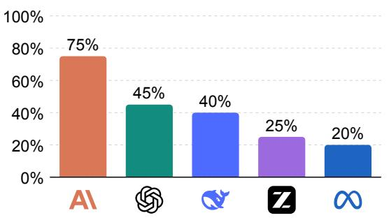

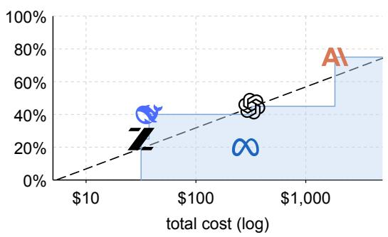  
Figure 1. Overview of XStack. Top: in our benchmark, the agent explores a PyTorch repository built for GPUs, reads its code and runs the source, then builds and tests a JAX version on TPUs. Bottom left: pass rates of the 5 best-performing agents among the 7 we evaluate. Bottom right: the pass rates against total cost on a log scale; the dashed line is a linear fit, and the shaded steps are the Pareto frontier, the best pass rate reached at or below each cost.

## Abstract

ML code should run where researchers choose, not where it was first written. Today, machine learning code mainly lives in two ecosystems, PyTorch on NVIDIA GPUs and JAX on Google TPUs. Migrating repositories between them means building and testing across frameworks and hardware. This migration is (1) a practical need, since it unlocks diferent hardware for researchers, and (2) a natural benchmark: it involves diferent frameworks and hardware, covers whole repositories, and is long-horizon and challenging. We introduce XStack, a benchmark that evaluates agents on migrating ML repositories between these two ecosystems. Each agent receives a PyTorch repository and a clean TPU machine and must deliver a JAX repository. Its output passes if it meets our grading criteria, based on the source repository’s published result, authenticated and calibrated by us. Migration by agents remains unreliable: Claude Opus 5 passes 75%, GPT-5.6-sol 45%, and every other agent at most 40%. XStack is a step toward freeing ML code from its ecosystem. We release XStack to make progress toward reliable migration across frameworks and hardware measurable.

## 1 Introduction

Suppose you find a repository that does exactly what you need. Its paper reports strong results, the code is public, and the experiment has already been shown to work. There is only one problem: it was built for the wrong machine. Your lab has TPUs, but the repository assumes GPUs and PyTorch. Although, in principle, nothing about the scientific idea depends on this choice, in practice you are trapped. Using it means rewriting the model, optimizer, data pipeline, and evaluation in JAX, since that is the stack TPUs run, then making everything work under a diferent compiler, memory hierarchy, and distributed execution model. What looks like an implementation detail becomes a barrier to reusing the science. The hardware a team happens to have can determine which published ideas it can build on.

This is exactly the kind of barrier that coding agents should make disappear. Much published ML code is written in PyTorch for GPUs, while, for example, people also use TPUs, which are commonly programmed through JAX1. By the end of 2025, TPUs made up nearly a fifth (18.2%) of the world’s AI compute: 3.81 million of 20.93 million H100-equivalents (Epoch AI, 2026). Yet only 4.2% of the framework-based code released with ML papers in 2024 used JAX (Papers with Code, 2025). This creates a growing need to move working systems across software and hardware stacks, a real-world task that researchers care about because it unlocks access to diferent hardware. Doing so means crossing not only code-level framework boundaries, but also machine-level diferences. This is exactly the problem we want agents to solve; we want to bring pure science back to researchers, and provide a measurement for this progress.

<table><tr><td></td><td>PyTorch on GPUs</td><td>JAX on TPUs</td></tr><tr><td>chips made by</td><td>NVIDIA and others</td><td>Google</td></tr><tr><td>where to get them</td><td>most clusters and clouds</td><td>Google Cloud or buyers&#x27; own sites</td></tr><tr><td>how the code runs</td><td>one step at a time</td><td>compiled by XLA before execution</td></tr><tr><td>how a model is written</td><td>objects that hold their weights</td><td>functions that take the weights</td></tr></table>

Table 1. PyTorch on GPUs versus JAX on TPUs. A migration changes the hardware as well as the code, so the agent must do more than translate code (Bradbury et al., 2018; Paszke et al., 2019).

We ask the following question directly:

Can an agent migrate a working ML repository to a new framework and new hardware correctly?

Existing benchmarks do not quite test this. Issue-resolution benchmarks (Jimenez et al., 2024; Zan et al., 2025) start from broken code and ask agents to fix it, while conversion benchmarks (Wang et al., 2026c; Song et al., 2026; Hong et al., 2026) compare translated code with the original on the same machine. In our case, the repository already works on the original machines. The challenge is to preserve that behavior while moving the entire system onto hardware the original code does not support. We introduce XStack (XStack stands for Cross-Stack Benchmark) to test this directly. Each task gives an agent a working PyTorch repository and a clean TPU machine, then asks it to rebuild the code on TPU with JAX and make an original experiment run end to end and reach its published result.

The answer to our question above is currently no: agents are not fully reliable for this task. Our results show that this barrier is beginning to break, but has not disappeared. The strongest agent successfully migrates 15 of 20 repositories. Agents can therefore already carry some ML systems across framework and hardware boundaries at repository scale. Yet this capability is far from reliable across agents and repositories. Agents are beginning to loosen the link between scientific code and the stack it was written for, but we are still not at a point where researchers can simply run published work wherever they choose.

A broader pattern emerges from the failures: agents can write a great deal of code, but they are still much less reliable at verifying that what they built is faithful, complete, and actually works in the real environment. This shows up across models as missed evaluations, fidelity gaps, crashes, and even attempts to work around the task when they get stuck.

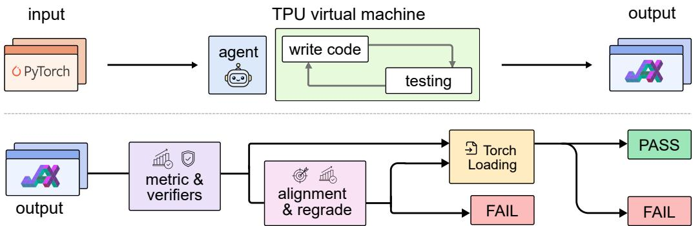  
Figure 2. Pipeline of XStack. Top: the agent migrates a PyTorch repository to JAX on a bare TPU. Bottom: we rerun the output on a fresh TPU and check its number against the source’s result and with two model judges. If they fail, the alignment step (phase 2, pink) gives the agent the main experiment’s recipe, lets it change only the entry script, and regrades the result. A pass also needs the weights to load into the original PyTorch model.

Overall, our contributions are:

• We introduce XStack, a benchmark of 20 real repositories for testing whether agents can migrate working ML systems across frameworks and hardware.

• We evaluate seven coding agents on real TPUs and release the grading criteria and full agent trajectories, so progress on this capability is measurable.

• We find that agents can sometimes complete these migrations, but still struggle to reliably verify that what they built is faithful, complete, and actually works end to end. We also observe that pass rate grows linearly with the log of an agent’s cost (Figure 6).

## 2 The XStack Benchmark

Each task in XStack is a PyTorch repository that already works and reports a result (Figure 2). The agent migrates it to JAX on a bare TPU machine, and we run the migrated code again on a fresh machine to check that it meets our grading criteria. For fairness, grading has two phases: if the first attempt fails, a second phase tells the agent which experiment we grade, so a correct migration is not failed only for running a diferent experiment (Section 2.2). The numerical target stays hidden, and only the entry script may change; all other code and setup remain frozen. Section 2.1 defines the task, Section 2.2 explains how we grade it, and Section 2.3 describes our repositories and agents.

## 2.1 Task Formulation

Input. The agent receives the repository, pinned to one git commit so that every agent sees the same code, and a TPU machine. One prompt template, the same for every repository, asks it to migrate the entire repository to JAX, with Flax for the model and Optax for the optimizer (Bradbury et al., 2018; Heek et al., 2020; DeepMind et al., 2020) (Table 1), and to run it the way the source runs its experiments, at full scale. For four repositories whose source ofers several configurations, one or two added lines name the graded configuration or a flag the grader uses, so that every agent knows what it has to do without learning the grading target (Appendix B).

Machine setup. The machine has no machine learning software; setting it up is part of the task: the agent installs every package, fetches the data and decides how to use its hosts. It works from a sandbox on our cluster, reaches the machine over SSH and has no time limit while it produces output (Appendix C).

Output. The agent delivers the migrated repository with three scripts. setup\_env.sh prepares a clean machine, the entry script run\_train.py trains, evaluates and writes metrics, and export\_torch.py saves the weights under the source’s parameter names. In phase 1 the agent is not told which number we grade, what value to reach or whether it passed (Table 2), so it has to migrate the whole repository, not one experiment.

<table><tr><td rowspan="3">Language</td><td>LoRA·1.5 h</td><td rowspan="3">x-transformers·1.5 h modded-nanoGPT·1 h</td><td colspan="2" rowspan="3">makemore·0.25 h</td><td rowspan="3">nanochat·7h</td></tr><tr><td></td><td>minGPT· 0.2 h</td></tr><tr><td>llama2.c·3 h SimCSE·2h</td><td>nanoGPT·11 h</td></tr><tr><td rowspan="2">Vision &amp; audio</td><td>airbench·1.5 h S4·2.5 h</td><td>AST ·1 h</td><td></td><td>nanoVLM·6 h</td><td>TensoRF·6 h</td></tr><tr><td colspan="5">deepspeech·2 h</td></tr><tr><td rowspan="2">Structured data &amp; control</td><td colspan="2">HSTU·2h TGN· 0.2 h</td><td colspan="2">PatchTST·0.7 h</td><td rowspan="2"></td></tr><tr><td colspan="2">TD-MPC2·6 h</td><td colspan="2">TabR·0.3 h</td></tr></table>

Figure 3. Repositories of XStack. Rows group the 20 repositories into three task families. The number beside each name is the expected duration, in hours, of one graded run, which trains the model at the source’s full scale.
<table><tr><td rowspan="2"></td><td colspan="2">agent</td><td rowspan="2">grader</td></tr><tr><td></td><td>phase 1 phase 2</td></tr><tr><td>source repository</td><td></td><td></td><td>V</td></tr><tr><td>TPU machine</td><td>V</td><td></td><td>fresh</td></tr><tr><td>task prompt</td><td>5</td><td></td><td>X</td></tr><tr><td>experiment recipe</td><td>×</td><td>L</td><td>V</td></tr><tr><td>grading target</td><td>×</td><td>X</td><td>V</td></tr><tr><td>grading code</td><td>×</td><td>X</td><td>V</td></tr><tr><td>outcome</td><td>X</td><td>×</td><td></td></tr></table>

Table 2. What the agent and the grader see. The agent never sees the grading target, so it has to migrate the whole repository; phase 2 adds the main experiment’s recipe to ensure grading fairness.

## 2.2 Grading a Migration

Reaching the grading target. We copy the migrated repository, without its git history, to a freshly wiped machine and run setup\_env.sh and run\_train.py once (the purple stage of Figure 2). A script, the grader, compares the graded number with the grading target, usually the number the source published, with a tolerance (Appendix A). Each grading target follows the source’s published result, which we authenticated against the pinned source; for 3 repositories we set it from our own runs of the unmodified source, and for minGPT as a rule (Section 2.3). A faithful migration reaches the grading target by reproducing the repository, without knowing the target. A run that writes no metrics within ten times its expected run time fails.

Judges. A number can also reach the grading target for the wrong reason, such as a smaller variant or another run’s files. Two model judges, both GPT-5.6-sol, therefore review every result that reaches the grading target (the verifiers of Figure 2). The correctness judge checks that the number comes from this run’s training of the main experiment, and the cheat judge checks that the agent did not reach it by cheating, for example by clamping the metric or using another run’s files. A result passes only if it reaches the grading target, both judges accept it, and its weights load into the source model.

Two phases. With the criteria hidden, an agent can migrate the code correctly and still run an experiment we do not grade, such as AST’s ESC-50 recipe instead of Speech Commands (Warden, 2018). Scoring that as a failure would penalize a choice the task never specified. Phase 2 removes this unfairness without making the task easier: after a failed phase 1, one message (the alignment step of Figure 2) freezes everything except the entry script and gives the recipe of the main experiment, but not the grading target (Table 2). Changing any other file fails phase 2 as a freeze violation, and the judges fail a pass whose entry script rebuilds the frozen code, a broken freeze. We report the pass rate after phase 2 as the main result.

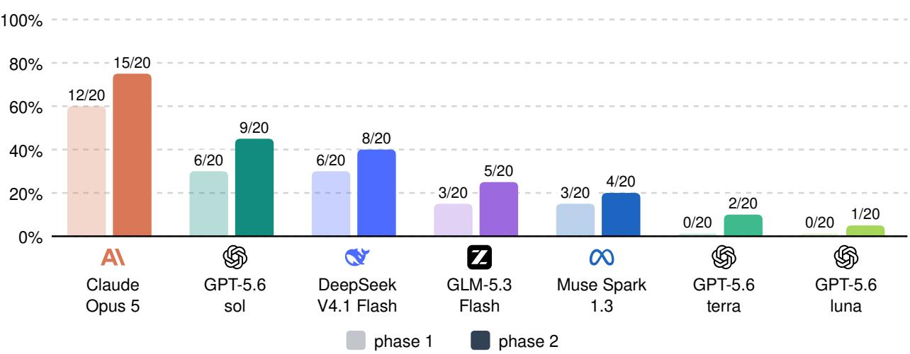  
Figure 4. Pass rate per agent. Light bars: after phase 1; dark bars: after phase 2. Phase 2 adds a few passes for every agent: once aligned with the main experiment, each agent passes more repositories.

## 2.3 Repositories and Agents

Repositories. XStack contains 20 repositories from fourteen domains (Figure 3; Table A1 gives each grading target). Seven are language models: minGPT (Karpathy, 2020), nanoGPT (Karpathy, 2022b), makemore (Karpathy, 2022a), llama2.c (Karpathy, 2023), modded-nanoGPT (Jordan et al., 2024), nanochat (Karpathy, 2025) and x-transformers (Wang, 2020b). The others are LoRA (Hu et al., 2022), SimCSE (Gao et al., 2021), airbench (Jordan, 2024), AST (Gong et al., 2021), S4 (Gu et al., 2022), HSTU (Zhai et al., 2024), TD-MPC2 (Hansen et al., 2024), TensoRF (Chen et al., 2022), nanoVLM (Wiedmann et al., 2025), deepspeech (Naren, 2017), TGN (Rossi et al., 2020), PatchTST (Nie et al., 2023) and TabR (Gorishniy et al., 2024). We chose them from more than 200 PyTorch repositories, most of which we rejected because of their published number.

Grading targets. For 15 repositories, the grading target is the number that the README or paper reports, which we authenticated against the source at its pinned commit; deepspeech’s comes from its release notes. A fair target must be one that the original code itself reaches, and our experiments confirm that each of these targets can be reached. For 3 others, we set the target from our own GPU runs of the unmodified source. For example, the makemore README reports a loss of about 1.92, but eight runs of the unmodified source on our GPUs average 1.989 with a standard deviation of 0.017, so a target of 1.92 would fail the original code itself. We therefore set its target to a best test loss of at most 2.023, the mean plus two standard deviations. For minGPT, whose task trains a small GPT to add two-digit numbers, we require at least 495 of the 500 held-out sums to be correct: a trained model is expected to solve all 500, and the margin allows five misses for seed and numerical noise.

Agents and cells. We evaluate 7 agents from 5 labs (Table 3): GPT-5.6-sol, GPT-5.6-terra and GPT-5.6-luna (OpenAI, 2026), Claude Opus 5 (Anthropic, 2026), GLM-5.3-Flash (Z.ai, 2026; GLM-5 Team, 2026), DeepSeek V4.1 Flash (DeepSeek-AI, 2026) and Muse Spark 1.3 (Meta, 2026), all at high reasoning efort. We call a pair of an agent and a repository a cell. Each cell runs on a TPU v6e, v5p or v4 machine (Jouppi et al., 2023; Google Cloud, 2026a,b), and we ensure every repository has adequate compute (Appendix H; Figure H1).

<table><tr><td>agent</td><td>harness</td><td>reasoning effort list price</td></tr><tr><td>GPT-5.6-sol</td><td>Codex CLI</td><td>high</td></tr><tr><td>GPT-5.6-terra</td><td>Codex CLI</td><td>high</td></tr><tr><td>GPT-5.6-luna</td><td>Codex CLI</td><td>2 / 0.2 / 12 high 0.2 / 0.02 / 1.2</td></tr><tr><td>Claude Opus 5</td><td>Claude Code CLI (Anthropic)</td><td>high 5 / 0.5 / 25</td></tr><tr><td>GLM-5.3-Flash</td><td>Claude Code CLI (Z.ai)</td><td>high 0.15 / 0.03 / 0.5</td></tr><tr><td>DeepSeek V4.1 Flash</td><td>Claude Code CLI (DeepSeek)</td><td>high 0.3 / 0.006 / 1.2</td></tr><tr><td>Muse Spark 1.3</td><td>Claude Code CLI (Meta)</td><td>high 1.25 / 0.15 / 4.25</td></tr></table>

Table 3. Harness, reasoning efort and price per agent. All agents run at high reasoning efort with the same settings, and every model is called through its developer’s oficial API. Prices are the oficial list prices on September 14, 2026, USD per million tokens (input / cached input / output).

## 3 Results Analysis

## 3.1 Main Results

Phase 1. In phase 1, the agents pass 30/140 cells (21%; Figure 4). The grader passed 58 phase 1 results, and the judges rejected 28 of these. Claude Opus 5 leads by a wide margin with 12/20. DeepSeek V4.1 Flash follows with 6/20, and among the GPT-5.6 tiers only sol passes any repository (6/20). Migrating a whole repository is thus still hard for current agents: most attempts fail, even though every agent has the full source and its own TPU, on which it can test extensively.

Phase 2 runs on 108 cells that failed phase 1. The grader passed 44 of them, and the judges let 16 of these pass. These are the cases the phase was designed for, such as a fixed number of steps where the source trains until a stop rule, a training statistic reported where the source runs an evaluation, or another variant of the source’s recipe. The judges rejected 28 phase 2 passes, 21 of them because the entry script rebuilt the frozen code, and the remaining phase 2 failures lie in the frozen code (Section 2.2). After phase 2, 46 cells pass the grader and the judges. The weights of 2 of them do not load under the source’s parameter names, so the agents pass 44/140 cells (31%). Appendix E lists every cell’s result.

Phase 2 aligns the agent with the recipe of the experiment we grade, so a correct migration that first ran a diferent experiment is not failed for that choice. Every agent gains at least one pass from it. It also helps ensure the remaining failures lie in the migrated code, not in an under-specified task (Section 2.2). Running all 140 cells took 22,802 TPU chip-hours (Figure H1), and the agents’ trajectories sum to 12.5 billion tokens.

## 3.2 Judges, Cost and Behavior

Efect of the judges. The judges are needed, because they catch results that reach the grading target for the wrong reason, which the metric alone cannot detect. Across both phases, they rejected 56 of the 102 results that the grader passed (Figure 5; Table 4). We checked many rejections by hand and found them sound; the judge caught a llama2.c migration that wrote the published number into its metrics beside its own and a minGPT migration evaluated on its training data.

What the judges find. Apart from broken freezes, the judges catch two kinds of false positives. The grader reads whatever number the run reports, which may not be the recipe’s own, such as a separate validation pass in place of the recipe’s averaged loss; the correctness judge finds the recipe’s number in the run’s logs and checks it, so every pass is a true positive. The cheat judge catches cheating, such as training on another task’s machine or reading another session’s files.

Accuracy versus cost. Pass rate grows linearly with the logarithm of cost (Figure 6). We fit pass rate on log cost because the agents’ costs for the 20 repositories span from \$10.0 to \$1,844. Every 10× in cost adds about 25 percentage points, and the line explains most of the diference between agents $( R ^ { 2 } = 0 . 6 6 , r = 0 . 8 1$

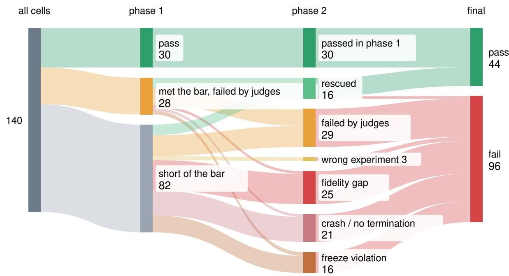  
Figure 5. Outcomes by phase. From left to right, the columns show all 140 cells, their phase 1 outcome, their phase 2 outcome and the final result. Of the 110 cells that failed phase 1, phase 2 rescues 16; the rest fail the judges, fall short of the grading target, crash or break the freeze (Section 2.2). Two rescued cells fail the weight-loading check.

� = 0.027, � = 7 agents). The trend is statistically significant at the 5% level. The upper edge of the shaded area, the eficient frontier, runs through three agents: GPT-5.6-luna, the cheapest; DeepSeek V4.1 Flash, the cheapest per pass; and Claude Opus 5, the most accurate. Every other agent lies below it; Muse Spark 1.3, for example, costs more than seven times as much as DeepSeek V4.1 Flash and passes fewer repositories.
<table><tr><td rowspan="2">agent</td><td colspan="4">pass rate</td><td colspan="5">cost and time</td></tr><tr><td></td><td>target +correctness +cheat +weights</td><td></td><td></td><td>pass</td><td>tokens $/cell $/pass</td><td></td><td></td><td>hours</td></tr><tr><td>Claude-Opus-5</td><td>95%</td><td>80%</td><td>80%</td><td>75%</td><td>15/20</td><td>156M</td><td>92</td><td>123</td><td>8.7</td></tr><tr><td>GPT-5.6-sol</td><td>75%</td><td>70%</td><td>45%</td><td>45%</td><td>9/20</td><td>23M</td><td>16</td><td>36</td><td>1.0</td></tr><tr><td>DS-4.1-Flash</td><td>75%</td><td>60%</td><td>40%</td><td>40%</td><td>8/20</td><td>106M</td><td>1.9</td><td>4.7</td><td>11.1</td></tr><tr><td>GLM-5.3-Flash</td><td>60%</td><td>50%</td><td>25%</td><td>25%</td><td>5/20</td><td>43M</td><td>1.6</td><td>6.3</td><td>12.6</td></tr><tr><td>Muse-Spark-1.3</td><td>50%</td><td>35%</td><td>20%</td><td>20%</td><td>4/20</td><td>32M</td><td>14</td><td>71</td><td>4.1</td></tr><tr><td>GPT-5.6-terra</td><td>35%</td><td>25%</td><td>15%</td><td>10%</td><td>2/20</td><td>5.3M</td><td>2.0</td><td>20</td><td>0.4</td></tr><tr><td>GPT-5.6-luna</td><td>20%</td><td>15%</td><td>5%</td><td>5%</td><td>1/20</td><td>16M</td><td>0.5</td><td>10.0</td><td>0.6</td></tr><tr><td>all</td><td>59%</td><td>48%</td><td>33%</td><td>31%</td><td>44/140</td><td>54M</td><td>18</td><td>58</td><td>5.5</td></tr></table>

Table 4. Checks and cost per agent. Left: share of repositories passing each check in turn (grading target, correctness and cheat judges, weight loading). Right: repositories passed, mean tokens per cell (input, cached input and output over all turns, as billed), list-price dollars per cell and per pass, and mean agent hours per cell.

Behavior diference between agents. Reading the trajectories, we found that Claude Opus 5 difers from the other agents in how it checks its work: before handing in, it runs the source’s experiment to the end and compares its number with the published one. This checking takes time and tokens, and Opus is both the most expensive agent and the one that passes the most (Table 4). On nanochat, GPT-5.6-sol estimated the full run at a few hours and handed in without running it. Muse Spark 1.3 does run the full experiment, but on LoRA it handed in a BLEU score far below the paper’s and called its migration “fully validated”. We find that diligent testing and experimentation, together with careful comparison against the original code, are what a migration needs to succeed.

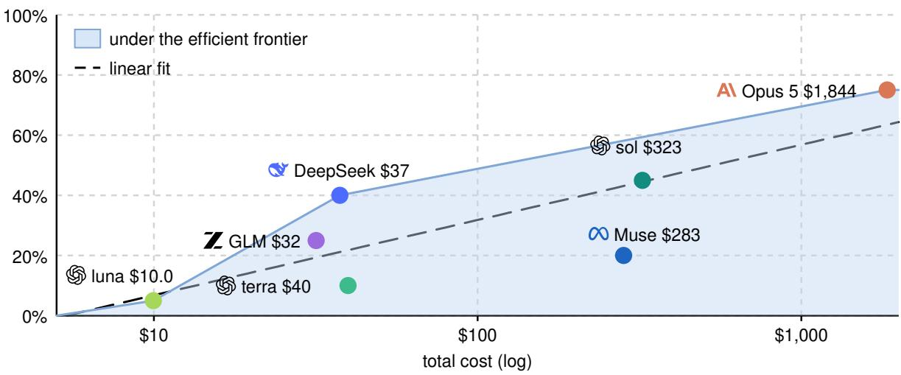  
Figure 6. Accuracy against cost. Each dot is one agent’s final pass rate against its cost at the list prices of September 14, 2026 (Appendix F). The dashed line is a least-squares fit of pass rate on log cost. The blue line is the eficient frontier, the upper convex hull of the agents with cost on a log scale. Pass rate rises by about 25 percentage points with every 10× in cost.

## 4 Why Do Agents Fail?

## 4.1 Failure Taxonomy

A third judge, the failure judge, assigns every graded run one class from a fixed taxonomy (Appendix D), based on its metrics, its log and the dif of the migrated code. The failure judge only reads the run; it cannot determine whether the run passes or fails. Figure 7 shows the failure judge’s classification of phase 1 runs.

The code fails, not the choice of experiment. We group the classes by what could fix them. A wrong or incomplete experiment (a diferent pipeline, the right one at a diferent scale, or a run that never reaches the main evaluation) is a problem with what the entry script runs, and phase 2 can fix it. A fidelity gap, a crash or a run that never ends is a problem in the migrated code. In phase 1, 27% of the failures are wrong or incomplete experiments and 47% are code failures; the judges reject the rest. Phase 2 removes the first group. The cells it does not rescue still fail in the code, or they break the freeze by rebuilding the migrated code inside the entry script (Figure D1). Aligning the agent with the grading recipe does not make a cell pass if its migration is wrong in the first place.

Agents fail diferently. DeepSeek V4.1 Flash rarely crashes (1 cell), and 15/20 of its cells reach the grading target, but the judges reject half of these, mostly for cheating. Terra’s failures are spread over wrong experiments, fidelity gaps and crashes, and luna’s over almost every class (Figure D1).

Translation alone is not the hard part. Because JAX also runs on GPUs, we can also test translation between PyTorch and JAX alone, on the same hardware. In the earlier development of our benchmark, we asked for a whole JAX repository and graded it on GPU. There the migration was nearly solved: GPT-5.5 at high reasoning efort migrated 12 PyTorch repositories to JAX and passed 99% of the checks, 116 of 117, with 11 of the 12 repositories passed in full (Appendix G, Table G1). The checks are strict: forward and gradient parity with PyTorch, checkpoints that load in both frameworks, decoding that matches token for token, and one miss fails the repository.

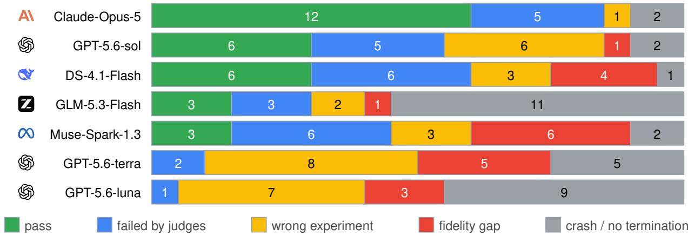  
Figure 7. Failure breakdown after phase 1. Each bar splits an agent’s 20 repositories by phase 1 outcome: pass; failed by the judges; wrong experiment (a diferent pipeline or scale, or the headline evaluation never run); fidelity gap (right pipeline, misses the grading target); crash or no termination. The last two, 47% of failures, are faults in the migrated code, which phase 2 cannot repair.

On TPUs, even after phase 2, the agents’ average pass rate is only 31%, and about half the failures are code that crashes or falls short on a machine the agent set up. The comparison suggests the dificulty lies not in translation alone but in migrating across both framework and hardware. Testing this ability therefore requires migrating across hardware, which is exactly what XStack does.

## 4.2 Behavior and Integrity

Agents that pass follow the source’s documentation, running the README’s default recipe, reporting its numbers under its names, and getting results close to the source’s. Agents that get stuck explore the machine instead, reading other cells’ leftovers or using our credentials. We found these leaks in our initial experiments, hardened the sandbox, and reran the three afected cells cleanly. Two incidents that aimed at the grading target, a clamped metric and a copied checkpoint, also date from building the benchmark and afect neither the current benchmark nor its results. In the final benchmark, cheating incidents instead use what the source ofers, such as a sibling variant or the published number, and our checks and the cheat judge catch them.

## 5 Related Work

Code migration. Code translation has grown from single functions and small programs (Roziere et al., 2020; Pan et al., 2024) to whole repositories (Ibrahimzada et al., 2025; Wang et al., 2026c; Li et al., 2026), although some repository benchmarks still grade one function in context (Ou et al., 2025) or fill in a skeleton (Zhang et al., 2025; Khatry et al., 2025). Migration benchmarks upgrade a language version (Liu et al., 2026) or move a repository onto another software stack (Hong et al., 2026).

Framework conversion. For machine learning code, framework conversion has been studied for single snippets (Phan et al., 2026), short programs (Yan et al., 2023) and training codebases (Song et al., 2026), or avoided with a portability layer (Lenton et al., 2021). T2J-Bench (Song et al., 2026) is the closest: whole PyTorch training codebases to JAX under a hidden evaluator, but on one GPU, the framework-only setting our GPU experiments found nearly solved (Section 4.1). Kernel benchmarks write kernels for one accelerator (Ouyang et al., 2025; Tschand et al., 2026; Wang et al., 2026b), one operator at a time against a reference that already runs on it. Models do worse on hardware rare in their training data (Wen et al., 2025). In all of these the accelerator stays the same or the unit is one kernel. XStack moves a whole repository to a new framework and hardware and forbids PyTorch at runtime, so no agent passes by doing nothing.

Agent benchmarks. Since SWE-bench (Jimenez et al., 2024), issue-resolution benchmarks have graded a change with tests that fail before it and pass after it. Later benchmarks ask for a codebase built from scratch (Zhao et al., 2025; Yang et al., 2026). A working repository, however, has no failing test in its own environment. Most also give the agent a ready environment; SetupBench (Arora et al., 2025) and DeployBench (Wang et al., 2026d) test setup alone, but stop once the code runs. Closer to our setting are benchmarks graded against research results. Agents reproduce a paper’s results from the authors’ code (Siegel et al., 2024), replicate papers against rubrics or reference code (Starace et al., 2025; Seo et al., 2026), or maximize a score on machine learning tasks (Chan et al., 2025; Wijk et al., 2025). Our grading target, in contrast, is the source repository’s own result (Section 2.3), which a faithful migration will naturally reach.

Evaluation integrity. Agents exploit underspecified objectives (Krakovna et al., 2020; Skalse et al., 2022) and game checks they can see or tamper with (Zhu et al., 2025; Wang et al., 2026a); benchmarks built from public code risk memorization (Jain et al., 2025; Liang et al., 2026). In XStack, the grading target is hidden: the agent is never told it or whether it passed. For fairness, after a failed first attempt a second phase aligns the agent with the graded experiment while its code, except the entry script, stays frozen. We rerun the code on a fresh machine, so remembering an answer is not enough, and model judges review every result that reaches the target (Section 2.2).

## 6 Conclusion

We introduce XStack, a benchmark that evaluates agents’ ability to migrate working ML repositories from PyTorch on GPUs to JAX on TPUs. Across 7 agents from 5 labs, the average pass rate is 31%, and pass rate grows linearly with the logarithm of cost. Our analysis shows that verification separates success from failure: agents that run the source’s experiment to the end and compare their result with the original tend to pass, and agents that hand in untested code tend to fail. We encourage other benchmarks with hidden criteria to adopt a similar frozen second phase that aligns the agent with what is graded, so that they stay fair to agents. Although current agents are not yet reliable at migrating across both frameworks and hardware, we hope they will one day handle this task reliably and unlock access to diferent hardware for researchers. In the meantime, XStack will help measure progress toward this hardware freedom.

## Acknowledgements

This work was supported by Princeton Research Computing resources, including the Della high-performance computing cluster. We thank Princeton Language and Intelligence (PLI) for their support of this research, as well as Google’s TPU Research Cloud (TRC) program for providing TPU compute.

## References

Anthropic. System card: Claude Opus 5. https://www.anthropic.com/claude-opus-5-system-card, 2026. Accessed 2026-09-25.

Avi Arora, Jinu Jang, and Roshanak Zilouchian Moghaddam. SetupBench: Assessing software engineering agents’ ability to bootstrap development environments. arXiv preprint arXiv:2507.09063, 2025.

James Bradbury, Roy Frostig, Peter Hawkins, Matthew James Johnson, Yash Katariya, Chris Leary, Dougal Maclaurin, George Necula, Adam Paszke, Jake VanderPlas, Skye Wanderman-Milne, and Qiao Zhang. JAX: Composable transformations of Python+NumPy programs. http://github.com/jax-ml/jax, 2018.

Jun Shern Chan, Neil Chowdhury, Oliver Jafe, James Aung, Dane Sherburn, Evan Mays, et al. MLE-bench: Evaluating machine learning agents on machine learning engineering. In ICLR, 2025. arXiv:2410.07095.

Anpei Chen, Zexiang Xu, Andreas Geiger, Jingyi Yu, and Hao Su. TensoRF: Tensorial radiance fields. In ECCV, 2022.

DeepMind, Igor Babuschkin, Kate Baumli, Alison Bell, Surya Bhupatiraju, Jake Bruce, et al. The DeepMind JAX ecosystem. http://github.com/google-deepmind, 2020.

DeepSeek-AI. DeepSeek-V4.1-Flash: Pushing the limits of KV cache compression. arXiv preprint arXiv:2609.19969, 2026.

Epoch AI. Data on AI chip owners. Epoch AI, https://epoch.ai/data/ai-chip-owners, 2026. Accessed 2026-09-25.

Tianyu Gao, Xingcheng Yao, and Danqi Chen. SimCSE: Simple contrastive learning of sentence embeddings. In EMNLP, 2021.

GLM-5 Team. GLM-5: From vibe coding to agentic engineering. arXiv preprint arXiv:2602.15763, 2026.

Yuan Gong, Yu-An Chung, and James Glass. AST: Audio spectrogram transformer. In Interspeech, 2021.

Google Cloud. TPU v5p. https://docs.cloud.google.com/tpu/docs/v5p, 2026a. Accessed 2026-09-23.

Google Cloud. TPU v6e. https://docs.cloud.google.com/tpu/docs/v6e, 2026b. Accessed 2026-09-23.

Yury Gorishniy, Ivan Rubachev, Nikolay Kartashev, Daniil Shlenskii, Akim Kotelnikov, and Artem Babenko. TabR: Tabular deep learning meets nearest neighbors. In ICLR, 2024.

Albert Gu, Karan Goel, and Christopher Ré. Eficiently modeling long sequences with structured state spaces. In ICLR, 2022.

Nicklas Hansen, Hao Su, and Xiaolong Wang. TD-MPC2: Scalable, robust world models for continuous control. In ICLR, 2024.

Jonathan Heek, Anselm Levskaya, Avital Oliver, Marvin Ritter, Bertrand Rondepierre, Andreas Steiner, and Marc van Zee. Flax: A neural network library and ecosystem for JAX. http://github.com/google/flax, 2020.

Deyao Hong, Yizhe Chi, Wenyi Li, Xiaoqiu Wang, Mingju Gao, Kaisen Yang, Bingxiang He, Youjie Zheng, Calvin Xiao, and Qinhuai Na. SWE refactor bench: Can coding agents complete a long-horizon, wholerepository stack migration? arXiv preprint arXiv:2608.23564, 2026.

Edward J. Hu, Yelong Shen, Phillip Wallis, Zeyuan Allen-Zhu, Yuanzhi Li, Shean Wang, Lu Wang, and Weizhu Chen. LoRA: Low-rank adaptation of large language models. In ICLR, 2022.

Ali Reza Ibrahimzada, Kaiyao Ke, Mrigank Pawagi, Muhammad Salman Abid, Rangeet Pan, Saurabh Sinha, and Reyhaneh Jabbarvand. AlphaTrans: A neuro-symbolic compositional approach for repository-level code translation and validation. In FSE, 2025. arXiv:2410.24117.

Naman Jain, King Han, Alex Gu, Wen-Ding Li, Fanjia Yan, Tianjun Zhang, Sida I. Wang, Armando Solar-Lezama, Koushik Sen, and Ion Stoica. LiveCodeBench: Holistic and contamination free evaluation of large language models for code. In ICLR, 2025. arXiv:2403.07974.

Carlos E. Jimenez, John Yang, Alexander Wettig, Shunyu Yao, Kexin Pei, Ofir Press, and Karthik Narasimhan. SWE-bench: Can language models resolve real-world GitHub issues? In ICLR, 2024.

Keller Jordan. 94% on CIFAR-10 in 3.29 seconds on a single GPU. arXiv preprint arXiv:2404.00498, 2024.

Keller Jordan, Jeremy Bernstein, Brendan Rappazzo, et al. modded-nanoGPT: Speedrunning the NanoGPT baseline. https://github.com/KellerJordan/modded-nanogpt, 2024.

Norman P. Jouppi, George Kurian, Sheng Li, Peter Ma, Rahul Nagarajan, Lifeng Nai, Nishant Patil, Suvinay Subramanian, Andy Swing, Brian Towles, Clif Young, Xiang Zhou, Zongwei Zhou, and David Patterson. TPU v4: An optically reconfigurable supercomputer for machine learning with hardware support for embeddings. In ISCA, 2023.

Andrej Karpathy. minGPT. https://github.com/karpathy/minGPT, 2020.

Andrej Karpathy. makemore. https://github.com/karpathy/makemore, 2022a.

Andrej Karpathy. nanoGPT. https://github.com/karpathy/nanoGPT, 2022b.

Andrej Karpathy. llama2.c. https://github.com/karpathy/llama2.c, 2023.

Andrej Karpathy. nanochat. https://github.com/karpathy/nanochat, 2025.

Anirudh Khatry, Robert Zhang, Jia Pan, Ziteng Wang, Qiaochu Chen, Greg Durrett, and Isil Dillig. CRUST-Bench: A comprehensive benchmark for C-to-safe-Rust transpilation. In COLM, 2025. arXiv:2504.15254.

Thomas Kipf. pygcn: Graph convolutional networks in PyTorch. https://github.com/tkipf/pygcn, 2017.

Victoria Krakovna, Jonathan Uesato, Vladimir Mikulik, Matthew Rahtz, Tom Everitt, Ramana Kumar, Zac Kenton, Jan Leike, and Shane Legg. Specification gaming: The flip side of AI ingenuity. DeepMind blog, https://deepmind.google/blog/specification-gaming-the-flip-side-of-ai-ingenuity/, 2020.

Daniel Lenton, Fabio Pardo, Fabian Falck, Stephen James, and Ronald Clark. Ivy: Templated deep learning for inter-framework portability. arXiv preprint arXiv:2102.02886, 2021.

Xuefeng Li, Nir Ben-Israel, Yotam Raz, Belal Ahmed, Doron Serebro, and Antoine Raux. RepoMod-Bench: A benchmark for code repository modernization via implementation-agnostic testing. In KDD, 2026. arXiv:2602.22518.

Shanchao Liang, Spandan Garg, and Roshanak Zilouchian Moghaddam. The SWE-bench illusion: When state-of-the-art LLMs remember instead of reason. In ICSE-SEIP, 2026. arXiv:2506.12286.

Linbo Liu, Xinle Liu, Qiang Zhou, Lin Chen, Yihan Liu, Hoan Nguyen, Behrooz Omidvar-Tehrani, Xi Shen, Jun Huan, Omer Tripp, and Anoop Deoras. MigrationBench: Repository-level code migration benchmark from Java 8. In KDD, 2026. arXiv:2505.09569.

Meta. Introducing Muse Spark 1.3. https://research.meta.ai/blog/introducing-muse-spark-1-3, 2026. Accessed 2026-09-25.

Sean Naren. deepspeech.pytorch. https://github.com/SeanNaren/deepspeech.pytorch, 2017.

Yuqi Nie, Nam H. Nguyen, Phanwadee Sinthong, and Jayant Kalagnanam. A time series is worth 64 words: Long-term forecasting with transformers. In ICLR, 2023.

OpenAI. GPT-5.6 system card. https://deploymentsafety.openai.com/gpt-5-6, 2026. Accessed 2026-09-25.

Guangsheng Ou, Mingwei Liu, Yuxuan Chen, Yanlin Wang, Xin Peng, and Zibin Zheng. RustRepoTrans: Repository-level context code translation benchmark targeting Rust. In ASE, 2025. arXiv:2411.13990.

Anne Ouyang, Simon Guo, Simran Arora, Alex L. Zhang, William Hu, Christopher Ré, and Azalia Mirhoseini. KernelBench: Can LLMs write eficient GPU kernels? In ICML, 2025. arXiv:2502.10517.

Rangeet Pan, Ali Reza Ibrahimzada, Rahul Krishna, Divya Sankar, Lambert Pouguem Wassi, Michele Merler, Boris Sobolev, Raju Pavuluri, Saurabh Sinha, and Reyhaneh Jabbarvand. Lost in translation: A study of bugs introduced by large language models while translating code. In ICSE, 2024.

Papers with Code. Trends: Paper implementations grouped by framework. Papers with Code, archived 2025-06-09, https://web.archive.org/web/20250609230938/https://paperswithcode.com/api/sta ts/?type=quarter&from=2021-03-01&to=2025-03-31, 2025. Accessed 2026-09-25.

Adam Paszke, Sam Gross, Francisco Massa, Adam Lerer, James Bradbury, Gregory Chanan, Trevor Killeen, Zeming Lin, Natalia Gimelshein, Luca Antiga, Alban Desmaison, Andreas Köpf, Edward Yang, Zach DeVito, Martin Raison, Alykhan Tejani, Sasank Chilamkurthy, Benoit Steiner, Lu Fang, Junjie Bai, and Soumith Chintala. PyTorch: An imperative style, high-performance deep learning library. In NeurIPS, 2019.

Hung Phan, Son Vu, Tuan Dinh, Nesreen Ahmed, Ali Payani, and Ali Jannesari. Learning bug context for PyTorch-to-JAX translation with LLMs. In ICML Workshop on Deep Learning for Code (DL4C), 2026. arXiv:2510.09898.

PyTorch Contributors. PyTorch examples. https://github.com/pytorch/examples, 2016.

Emanuele Rossi, Ben Chamberlain, Fabrizio Frasca, Davide Eynard, Federico Monti, and Michael Bronstein. Temporal graph networks for deep learning on dynamic graphs. arXiv preprint arXiv:2006.10637, 2020.

Baptiste Roziere, Marie-Anne Lachaux, Lowik Chanussot, and Guillaume Lample. Unsupervised translation of programming languages. In NeurIPS, 2020.

Minju Seo, Jinheon Baek, Seongyun Lee, and Sung Ju Hwang. Paper2Code: Automating code generation from scientific papers in machine learning. In ICLR, 2026. arXiv:2504.17192.

Zachary S. Siegel, Sayash Kapoor, Nitya Nadgir, Benedikt Stroebl, and Arvind Narayanan. CORE-Bench: Fostering the credibility of published research through a computational reproducibility agent benchmark. TMLR, 2024. arXiv:2409.11363.

Joar Skalse, Nikolaus H. R. Howe, Dmitrii Krasheninnikov, and David Krueger. Defining and characterizing reward hacking. In NeurIPS, 2022.

Linxin Song, Jiefeng Chen, Yue Huang, Bhavana Dalvi Mishra, Chi Wang, Jieyu Zhao, Jinsung Yoon, and Tomas Pfister. Converted, not equivalent: Benchmarking codebase conversion via observational equivalence. arXiv preprint arXiv:2605.29054v2, 2026.

Giulio Starace, Oliver Jafe, Dane Sherburn, James Aung, Jun Shern Chan, Leon Maksin, et al. PaperBench: Evaluating AI’s ability to replicate AI research. In ICML, 2025. arXiv:2504.01848.

Arya Tschand, Charles Hong, Julian Walker, Nina Cai, Shangkun Wang, Suvinay Subramanian, Sundar Dev, Vijay Janapa Reddi, Amir Yazdanbakhsh, and Sethu Sankaran. JAXBench: Benchmarking autonomous TPU kernel optimization. In ICML Workshop on Deep Learning for Code (DL4C), 2026. arXiv:2607.20466.

Hao Wang, Hanchen Li, Qiuyang Mang, Alvin Cheung, Koushik Sen, and Dawn Song. Do androids dream of breaking the game? systematically auditing AI agent benchmarks with BenchJack. arXiv preprint arXiv:2605.12673, 2026a.

Phil Wang. denoising-difusion-pytorch. https://github.com/lucidrains/denoising-diffusion-pytorch, 2020a.

Phil Wang. x-transformers. https://github.com/lucidrains/x-transformers, 2020b.

Shangkun Wang, Nina Cai, Charles Hong, Julian Walker, Gerson Kroiz, George Vanica, Deepak Patil, Andi Gavrilescu, Hassan Sipra, and Sethu Sankaran. MaxKernel: Agentic kernel generation for TPUs. arXiv preprint arXiv:2609.04523, 2026b.

Yanli Wang, Yanlin Wang, Suiquan Wang, Daya Guo, Jiachi Chen, John Grundy, Xilin Liu, Yuchi Ma, Mingzhi Mao, Hongyu Zhang, and Zibin Zheng. RepoTransBench: A real-world multilingual benchmark for repository-level code translation. IEEE Transactions on Software Engineering, 2026c. arXiv:2412.17744.

Yuanli Wang, Yaoyao Qian, Yue Zhang, Hanhan Zhou, Jindan Huang, Tianfu Fu, et al. DeployBench: Benchmarking LLM agents for research artifact deployment. arXiv preprint arXiv:2606.05238, 2026d.

Pete Warden. Speech commands: A dataset for limited-vocabulary speech recognition. arXiv preprint arXiv:1804.03209, 2018.

Zhongzhen Wen, Yinghui Zhang, Zhong Li, Zhongxin Liu, Linna Xie, and Tian Zhang. MultiKernelBench: A multi-platform benchmark for kernel generation. arXiv preprint arXiv:2507.17773, 2025.

Luis Wiedmann, Aritra Roy Gosthipaty, and Andrés Marafioti. nanoVLM. https://github.com/huggingfa ce/nanoVLM, 2025. Hugging Face.

Hjalmar Wijk, Tao Lin, Joel Becker, Sami Jawhar, Neev Parikh, Thomas Broadley, et al. RE-Bench: Evaluating frontier AI R&D capabilities of language model agents against human experts. In ICML, 2025. arXiv:2411.15114.

Weixiang Yan, Yuchen Tian, Yunzhe Li, Qian Chen, and Wen Wang. CodeTransOcean: A comprehensive multilingual benchmark for code translation. In Findings of EMNLP, 2023.

John Yang, Kilian Lieret, Jefrey Ma, Parth Thakkar, Dmitrii Pedchenko, Sten Sootla, Emily McMilin, Pengcheng Yin, Rui Hou, Gabriel Synnaeve, Diyi Yang, and Ofir Press. ProgramBench: Can language models rebuild programs from scratch? In ICML Workshop on Deep Learning for Code (DL4C), 2026. arXiv:2605.03546.

Xingkai Yu. Nano-vllm. https://github.com/GeeeekExplorer/nano-vllm, 2025.

Z.ai. GLM-5.3-Flash: Frontier intelligence, flash cost. https://z.ai/blog/glm-5.3-flash, 2026. Accessed 2026-09-25.

Daoguang Zan, Zhirong Huang, Wei Liu, Hanwu Chen, Shulin Xin, Linhao Zhang, Qi Liu, Aoyan Li, Lu Chen, Xiaojian Zhong, Siyao Liu, Yongsheng Xiao, Liangqiang Chen, Yuyu Zhang, Jing Su, Tianyu Liu, Rui Long, Ming Ding, and Liang Xiang. Multi-SWE-bench: A multilingual benchmark for issue resolving. In NeurIPS Datasets and Benchmarks Track, 2025. arXiv:2504.02605.

Jiaqi Zhai, Lucy Liao, Xing Liu, Yueming Wang, Rui Li, Xuan Cao, Leon Gao, Zhaojie Gong, Fangda Gu, Jiayuan He, Yinghai Lu, and Yu Shi. Actions speak louder than words: Trillion-parameter sequential transducers for generative recommendations. In ICML, 2024.

Xing Zhang, Jiaheng Wen, Fangkai Yang, Yu Kang, Pu Zhao, Junhao Wang, Maoquan Wang, Yufan Huang, Shengyu Fu, Elsie Nallipogu, Qingwei Lin, Yingnong Dang, Saravan Rajmohan, and Dongmei Zhang. Skeleton-guided-translation: A benchmarking framework for code repository translation with fine-grained quality evaluation. In Findings of EMNLP, 2025. arXiv:2501.16050.

Wenting Zhao, Nan Jiang, Celine Lee, Justin T. Chiu, Claire Cardie, Matthias Gallé, and Alexander M. Rush. Commit0: Library generation from scratch. In ICLR, 2025. arXiv:2412.01769.

Yuxuan Zhu, Tengjun Jin, Yada Pruksachatkun, Andy Zhang, Shu Liu, Sasha Cui, et al. Establishing best practices for building rigorous agentic benchmarks. In NeurIPS Datasets and Benchmarks Track, 2025. arXiv:2507.02825.

## Appendix

The appendix holds the repositories, headline metrics and grading targets (A); the agent’s inputs, verbatim (B); the sandboxing (C); the failure taxonomy definitions (D); per-cell results (E); cost (F); the GPU-only experiment (G); and code size and compute (H).

A Repositories, Headline Metrics and Grading Targets 15   
B Agent Inputs, Verbatim 17   
B.1 Prompt Template . 17   
B.2 Access Document . 18   
B.3 Frozen Phase 2 Message 19   
C Sandbox and Isolation 19   
D Failure Taxonomy Definitions 19   
E Per-Cell Results 20   
F Cost 20   
G GPU-Only Experiment 20   
H Code Size and Compute 21

## A Repositories, Headline Metrics and Grading Targets

Sourcing. Hard requirements: a training-centric pipeline that is the repository’s point; a readable, vendorable tree at a pinnable commit under a permissive license read from the LICENSE file, not the GitHub label; a headline metric that the repository’s own code computes, for a configuration the tree actually runs, with a published value; anonymously acquirable data; a full-scale run of about ten hours or less on one TPU host.

Notation. Table A1 is generated from the criteria files the grader reads. Grading target uses the comparator’s notation: $\leq$ and ≥ are one-sided, [�, �] is a band whose upper bound is the metric’s ceiling or, on a loss, a leakage floor. Origin: readme or paper, the source’s own published number for the configuration in the tree; anchor, a pre-registered band around our runs of the unmodified source; rule, a floor we set for a repository that publishes no number; released-checkpoint, the number the source’s release notes report for its pre-trained checkpoint. The table in the release quotes each statement verbatim with its line pointer.

<table><tr><td>repository</td><td>domain</td><td>headline metric</td><td>grading target origin</td><td></td></tr><tr><td>Language</td><td></td><td></td><td></td><td>anchor</td></tr><tr><td>llama2.c</td><td>language modeling</td><td>a best validation loss of at ≤ 1.13 most 1.130 at the source's own 100,000-iteration</td><td></td><td></td></tr><tr><td>repository</td><td>domain</td><td>headline metric</td><td>grading target</td><td>origin</td></tr><tr><td>LoRA</td><td>fine-tuning</td><td>a corpus BLEU of at least 0.680 on the E2E test set</td><td>[0.68, 1.0]</td><td>readme</td></tr><tr><td>makemore</td><td>language modeling</td><td>a best test NLL of at most 2.023</td><td>≤ 2.023</td><td>anchor</td></tr><tr><td>minGPT</td><td>language modeling</td><td>at least 495 of 500 correct adder test answers</td><td>≥ 495</td><td>rule</td></tr><tr><td>modded- nanoGPT</td><td>language modeling</td><td>a FineWeb validation cross-entropy loss of at most</td><td>≤ 3.285</td><td>readme</td></tr><tr><td>nanochat</td><td>language</td><td>3.285 a base-evaluation-suite score [0.2565, 1.0] of at least 0.256525</td><td></td><td>readme</td></tr><tr><td>nanoGPT</td><td>modeling language modeling</td><td>a validation loss at the graded iteration budget</td><td>≤ 3.12</td><td>readme</td></tr><tr><td>SimCSE</td><td>sentence embeddings</td><td>an average Spearman correlation of at least 73.5 across the seven STS test</td><td>[73.5, 100.0]</td><td>readme</td></tr><tr><td>x-transformers language</td><td>modeling</td><td>sets a validation loss between 0.8788 and 0.9788</td><td>[0.8788, 0.9788] anchor</td><td></td></tr><tr><td>Vision airbench</td><td>image classification</td><td>a test-time-augmented CIFAR-10 test accuracy of at least 0.9393, taken as the</td><td>[0.9393, 1.0]</td><td>paper</td></tr><tr><td></td><td></td><td>mean over the source's own 25-trial loop</td><td></td><td></td></tr><tr><td>nanoVLM</td><td>Generative &amp; multimodal vision-language</td><td>a best MMStar accuracy of [0.353, 1.0] at least 0.353</td><td></td><td>readme</td></tr><tr><td colspan="5"></td></tr><tr><td>Structured data HSTU</td><td></td><td>recommendation a MovieLens-20M HR@10 of at least 0.3450</td><td>[0.345, 1.0]</td><td>readme</td></tr><tr><td>PatchTST</td><td>time-series forecasting</td><td>a test mean squared error of ≤ 0.38 at most 0.380 in</td><td></td><td>paper</td></tr><tr><td>TabR</td><td>tabular learning</td><td>standardized units a test accuracy of at least 0.9745 on the Covertype</td><td>[0.9745, 1.0]</td><td>paper</td></tr><tr><td>TGN</td><td>temporal graph learning</td><td>test split of 116,203 rows a transductive test average precision of at least 0.980</td><td>[0.98, 1.0]</td><td>paper</td></tr><tr><td></td><td></td><td>for future edge prediction on JODIE Wikipedia</td><td></td><td></td></tr><tr><td colspan="5">Science &amp; 3D TensoRF neural fields</td></tr><tr><td></td><td></td><td>at least 36.10 dB on Synthetic-NeRF lego</td><td></td><td></td></tr><tr><td colspan="5">Control &amp; sequence</td></tr><tr><td>S4</td><td>long-sequence modeling</td><td>a top-1 accuracy of at least [87.0, 100.0] 87.0 percent on a held-out CIFAR-10 split</td><td></td><td>readme</td></tr><tr><td>repository</td><td>domain</td><td>headline metric</td><td>grading target origin</td><td></td></tr><tr><td>TD-MPC2</td><td>reinforcement learning</td><td>a mean evaluation return of [750.0, 1000.0] readme at least 750.0 over the source's 10-episode evaluation on DMControl</td><td></td><td></td></tr><tr><td colspan="5">Audio &amp; speech</td></tr><tr><td>AST</td><td>audio classification</td><td>a test-split top-1 accuracy [0.975, 1.0] of at least 0.975</td><td></td><td>readme</td></tr><tr><td rowspan="3">deepspeech</td><td>speech</td><td>a word error rate of at most [1.5, 20.0]</td><td></td><td>released-</td></tr><tr><td>recognition</td><td>20.0 percent on the AN4</td><td></td><td>checkpoint</td></tr><tr><td></td><td>test set</td><td></td><td></td></tr></table>

Table A1. The 20 repositories by domain family, with the graded quantity and its grading target.

## B Agent Inputs, Verbatim

A cell’s input is the rendered prompt, the access document with live addresses, and the vendored repository. Below, typography is normalized and lines re-wrapped to fit the page; the words are verbatim. The recipe paragraph of every repository, the three judge prompts and every judge answer are released with the benchmark; the prompts are in the code at github.com/zlab-princeton/XStack under prompts/.

## B.1 Prompt Template

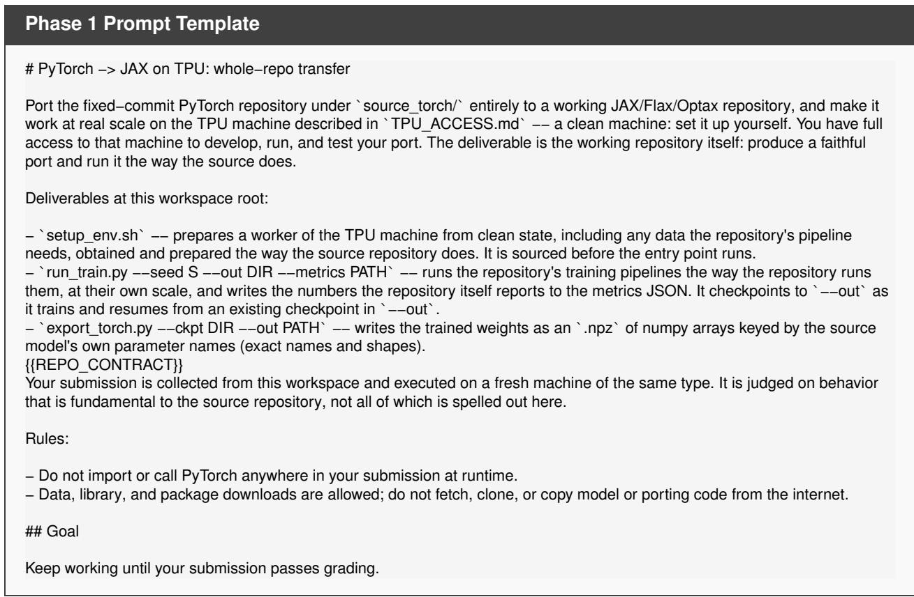  
The slot {{REPO\_CONTRACT}} renders empty for sixteen of the 20 repositories. For nanoGPT it renders two

lines: a –max-iters N knob the entry must honor (the grader passes 120,000) and the line naming GPT-2 124M on OpenWebText as the graded configuration. For HSTU it renders one configuration line (HSTU-large on MovieLens-20M). For TD-MPC2 it renders –task NAME and –max-steps N knobs (the grader passes walker-run and 500,000; the prompt names neither). For nanochat, the same –max-iters knob, dormant.

## B.2 Access Document

The multi-host document; a single-host twin exists for one-host machines:

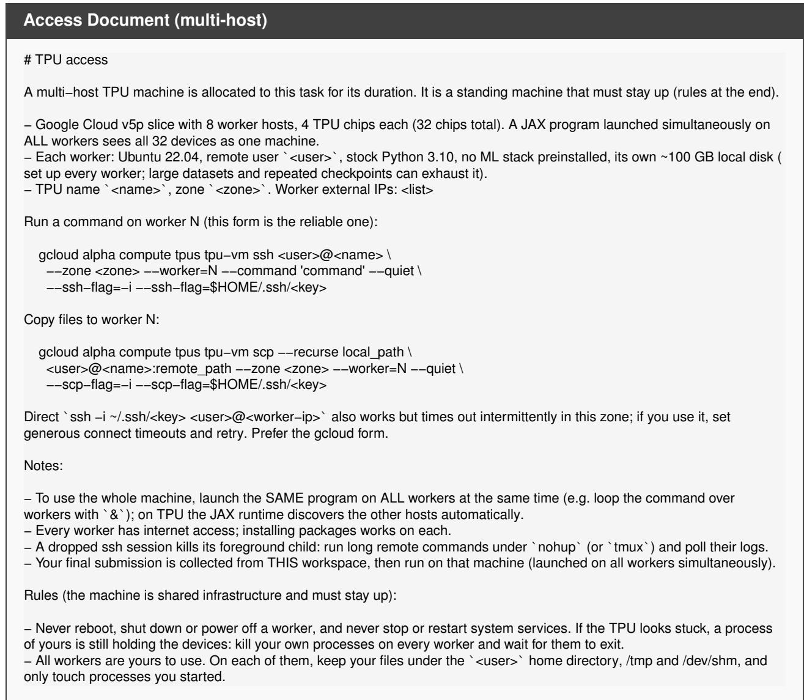  
The document is re-rendered with live addresses before every turn.

## B.3 Frozen Phase 2 Message

After a phase 1 fail the agent receives nothing but this message: no failure sentence and no pass or fail. The frame is one sentence followed by the repository’s recipe paragraph:

Frozen Phase 2 Message   
Your submission is now frozen: from this point do not change your ported code, setup, or any other file. Edit only \`run\_train.py   
so that one invocation does exactly the following, using your ported code as it is:   
{{RECIPE}}

## C Sandbox and Isolation

The agent runs on our cluster inside a sandbox that hides the benchmark repository, our reference migrations, the grading criteria, the results archive and the session files of every other cell. The sandbox also turns of the agent’s memory across sessions. The TPU machine itself stores no results: every graded turn is archived elsewhere, and the hosts are wiped before every cell. An agent turn has no time limit while output flows: thirty minutes of silence after activity ends the turn as a hang, and thirty minutes with no output at all counts as a provider outage and the turn is retried.

## D Failure Taxonomy Definitions

The failure judge assigns one of the classes below.

<table><tr><td>class</td><td>meaning</td></tr><tr><td>pass</td><td>grading target reached (a pass in the figures also needs the judges)</td></tr><tr><td>scope miss</td><td>a different pipeline than the headline one, or only part of the repository (nanoGPT&#x27;s Shakespeare quick-start instead of GPT-2 on OpenWebText; minGPT&#x27;s chargpt instead of the</td></tr><tr><td>incomplete transfer</td><td>adder; HSTU&#x27;s ML-1M example) the right pipeline trained, the headline evaluation never run (nanochat without the CORE suite; LoRA without beam de-</td></tr><tr><td>fidelity gap</td><td>coding and BLEU) the right pipeline and evaluation, the model short of the grading target</td></tr><tr><td>scale deviation</td><td>the recipe run at a different scale than the source (batch, steps, model size, data ratio)</td></tr><tr><td>runtime crash</td><td>the graded run exited non-zero or hung</td></tr><tr><td>no termination</td><td>the migration has no stop rule; the run reached the cap and wrote no metrics</td></tr><tr><td>no TPU</td><td>the graded run never acquired the TPU (CPU fallback)</td></tr><tr><td>wrong fix</td><td>a later turn that changed something other than the defect</td></tr><tr><td>unchanged tree</td><td>the agent returned without editing the deliverable</td></tr><tr><td>grader artifact</td><td>the grade was the harness&#x27;s error, not the migration&#x27;s; the class describes the grader</td></tr><tr><td>fabricated result</td><td>the headline number was not produced by running the pipeline (copied, hard-coded, or evaluated on downloaded finished</td></tr><tr><td>freeze violation infra</td><td>weights) a phase 2 turn changed something other than the entry file machine or harness outage; the turn was not consumed</td></tr></table>

A turn may carry a secondary class. Rows are added when the grade lands and never change it.

Figure D1 repeats the phase-1 breakdown of Figure 7 after phase 2. The wrong-experiment group disappears, because phase 2 states the recipe: a cell that ran the wrong pipeline in phase 1 either passes now or fails in its migrated code. What remains is the two code groups, fidelity gaps and crashes, which no entry script can fix, the judges’ rejections, and the 16 cells that broke the freeze by rebuilding the migration inside the entry script. Phase 2 turns the wrong experiments of the stronger agents mostly into passes, and those of the weaker agents into judge rejections, fidelity gaps and freeze violations. GLM-5.3-Flash is the clearest case: its eleven phase-1 crashes become two, because in phase 2 it rewrites the migration inside the entry script, which the freeze forbids, and six of its cells fail on that rule instead.  
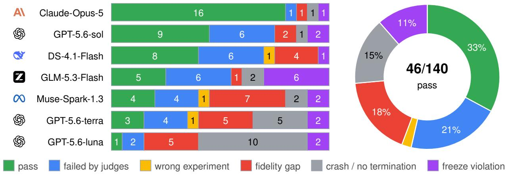  
Figure D1. Failure breakdown after phase 2. Outcome of each cell after phase 2, grouped as in Figure 7 plus freeze violations: runs that changed more than the entry script or rebuilt the migration in it. The ring at the right sums the bars over the agents. Passing in either phase counts as a pass. A cell without a phase 2, or whose phase 2 left the entry script unchanged, keeps its phase 1 outcome.

## E Per-Cell Results

Figure E1 gives the result of every cell. Rows are the 20 slate repositories and columns the 7 agents; the last two rows repeat the per-agent rates of Figure 4. Table 4 gives the pass rate per agent after each check. Claude Opus 5 on PatchTST and GPT-5.6-terra on deepspeech reach the target and pass the judges, but their exported weights do not load under the source’s parameter names, so the figure draws them as fails. Two repositories bracket the matrix. minGPT, the smallest source, passes for every agent but GLM-5.3-Flash; nanoVLM, the longest pipeline, passes for none. Five repositories (LoRA, SimCSE, nanochat, airbench, AST) pass for Claude Opus 5 alone, and that is where its lead over the field comes from. The mid-field agents pass the small language-model repositories (minGPT, makemore, nanoGPT, llama2.c) and a few others each; GPT-5.6-terra and GPT-5.6-luna pass little beyond minGPT and makemore. Phase 2 adds between one and three passes per agent and breaks the three phase-1 ties: GPT-5.6-sol above DeepSeek, GLM-5.3-Flash above Muse Spark, and GPT-5.6-terra above GPT-5.6-luna.

## F Cost

Cost and time. At list prices as of September 14, 2026 (Table 3), the 20 cells cost \$10.0 for luna, \$40 for terra, \$32 for GLM-5.3-Flash, \$37 for DeepSeek, \$283 for Muse Spark, \$323 for sol and \$1,844 for Claude Opus 5 (\$92.18 per cell, of which phase 1 is \$49.42); 97% of input tokens are cache hits. The list prices of Table 3 are all undiscounted, and we used no promotional price when computing costs.

## G GPU-Only Experiment

Before the TPU benchmark we ran a GPU-only generation of the study: twelve small PyTorch repositories, each migrated whole to JAX by GPT-5.5 at high reasoning efort and graded on the same GPU by ten checks (Table G1; Section 4.1). The twelve are DDPM (Wang, 2020a), makemore (Karpathy, 2022a), minGPT (Karpathy, 2020), nanochat (Karpathy, 2025), nanoGPT (Karpathy, 2022b), nano-vLLM (Yu, 2025), pyGCN (Kipf, 2017), x-transformers (Wang, 2020b), and the MNIST, REINFORCE, VAE and word language model examples of PyTorch (PyTorch Contributors, 2016). The checks are what a careful reviewer of a translation would write: the migration has its own entry points and no PyTorch, the same weights give the same logits, loss and gradients, optimizer and data pipeline match, checkpoints round-trip, greedy decoding matches token for token, and a restarted run resumes. The agent met 116 of 117, and the single miss is a convergence band (x-transformers, A6).

<table><tr><td></td><td>S GPT-5.6 sol</td><td>S GPT-5.6 terra</td><td>S GPT-5.6 luna</td><td>AI Claude Opus 5</td><td>Z GLM-5.3 Flash</td><td>Q DeepSeek V4.1 Flash</td><td>8 Muse Spark 1.3</td></tr><tr><td>minGPT</td><td>pass</td><td>pass</td><td>pass</td><td>pass</td><td>fail</td><td>pass</td><td>pass</td></tr><tr><td>makemore</td><td>pass</td><td>pass</td><td>fail</td><td>pass</td><td>pass</td><td>fail</td><td>fail</td></tr><tr><td>LoRA</td><td>fail</td><td>fail</td><td>fail</td><td>pass</td><td>fail</td><td>fail</td><td>fail</td></tr><tr><td>x-transformers</td><td>pass</td><td>fail</td><td>fail</td><td>fail</td><td>fail</td><td>fail</td><td>fail</td></tr><tr><td>llama2.c</td><td>pass</td><td>fail</td><td>fail</td><td>pass</td><td>fail</td><td>pass</td><td>fail</td></tr><tr><td>modded-nanoGPT</td><td>fail</td><td>fail</td><td>fail</td><td>fail</td><td>fail</td><td>pass</td><td>fail</td></tr><tr><td>SimCSE</td><td>fail</td><td>fail</td><td>fail</td><td>pass</td><td>fail</td><td>fail</td><td>fail</td></tr><tr><td>nanochat</td><td>fail</td><td>fail</td><td>fail</td><td>pass</td><td>fail</td><td>fail</td><td>fail</td></tr><tr><td>nanoGPT</td><td>pass</td><td>fail</td><td>fail</td><td>pass</td><td>fail</td><td>pass</td><td>pass</td></tr><tr><td>airbench</td><td>fail</td><td>fail</td><td>fail</td><td>pass</td><td>fail</td><td>fail</td><td>fail</td></tr><tr><td>nanoVLM</td><td>fail</td><td>fail</td><td>fail</td><td>fail</td><td>fail</td><td>fail</td><td>fail</td></tr><tr><td>HSTU</td><td>fail</td><td>fail</td><td>fail</td><td>pass</td><td>fail</td><td>fail</td><td>pass</td></tr><tr><td>TGN</td><td>pass</td><td>fail</td><td>fail</td><td>pass</td><td>pass</td><td>pass</td><td>fail</td></tr><tr><td>PatchTST</td><td>fail</td><td>fail</td><td>fail</td><td>fail</td><td>pass</td><td>fail</td><td>fail</td></tr><tr><td>TabR</td><td>pass</td><td>fail</td><td>fail</td><td>fail</td><td>fail</td><td>fail</td><td>fail</td></tr><tr><td>TensoRF</td><td>fail</td><td>fail</td><td>fail</td><td>pass</td><td>fail</td><td>pass</td><td>pass</td></tr><tr><td>S4</td><td>pass</td><td>fail</td><td>fail</td><td>pass</td><td>pass</td><td>fail</td><td>fail</td></tr><tr><td>TD-MPC2</td><td>pass</td><td>fail</td><td>fail</td><td>pass</td><td>pass</td><td>pass</td><td>fail</td></tr><tr><td>AST</td><td>fail</td><td>fail</td><td>fail</td><td>pass</td><td>fail</td><td>fail</td><td>fail</td></tr><tr><td>deepspeech</td><td>fail</td><td>fail</td><td>fail</td><td>pass</td><td>fail</td><td>pass</td><td>fail</td></tr><tr><td>phase-1 pass</td><td>6/20</td><td>0/20</td><td>0/20</td><td>12/20</td><td>3/20</td><td>6/20</td><td>3/20</td></tr><tr><td>after phase 2</td><td>9/20</td><td>2/20</td><td>1/20</td><td>15/20</td><td>5/20</td><td>8/20</td><td>4/20</td></tr></table>

Figure E1. Every cell, repositories grouped by family: the final result, pass or fail.

## H Code Size and Compute

Every cell had enough compute: Figure H1 gives the TPU chip-hours of all 140 cells, split into the agents’ turns and our grading. Grading, not generation, is where the compute goes: our full-scale grades took more than twice the chip-hours of the agents’ own turns, and the v6e machines carried nearly three quarters of the total. The table converts chip-hours to H100-equivalents at each chip’s peak bf16 throughput relative to an H100, so the campaign is comparable with GPU budgets.

The left panel of Figure H1 sets each passing migration’s size against its source: 16 of the 44 passes are larger than the repository they came from. Most passing migrations sit within a factor of two of their source’s size, and the agents difer systematically: Claude Opus 5, DeepSeek and GLM write migrations about as long as the source; GPT-5.6-sol and GPT-5.6-terra write compact ones, under a thousand lines even for sources ten times that size. The two largest sources that were migrated successfully, x-transformers and HSTU, came out at a fraction of their size: both are libraries, and their passing migrations preserve the model, training and evaluation paths the headline experiment runs rather than every option the library ofers.

<table><tr><td>Repository</td><td>Checks</td></tr><tr><td>DDPM</td><td>10/10</td></tr><tr><td>makemore</td><td>10/10</td></tr><tr><td>minGPT</td><td>10/10</td></tr><tr><td>MNIST</td><td>9/9</td></tr><tr><td>nano-vLLM</td><td>9/9</td></tr><tr><td>nanochat</td><td>10/10</td></tr><tr><td>nanoGPT</td><td>10/10</td></tr><tr><td>pyGCN</td><td>9/9</td></tr><tr><td>REINFORCE</td><td>10/10</td></tr><tr><td>VAE</td><td>10/10</td></tr><tr><td>word language model</td><td>10/10</td></tr><tr><td>x-transformers</td><td> $9 / \dot { 1 } 0 ^ { \mathrm { A 6 } }$ </td></tr><tr><td>All</td><td>116/117</td></tr></table>

<table><tr><td>Check</td><td>Passes if the migration has .. .</td></tr><tr><td>A0 Completeness</td><td>a JAX code base with its own entry points and no PyTorch inside</td></tr><tr><td>A1 Forward parity</td><td>same weights give the same logits and loss as PyTorch</td></tr><tr><td>A3 Optimizer</td><td>A2 Gradient parity same gradients as PyTorch autograd the learning-rate schedule and optimizer step match the source</td></tr><tr><td>A4 Data pipeline A5 Checkpoints</td><td>batches are the source&#x27;s token windows weights round-trip between the two</td></tr><tr><td>A6 Convergence</td><td>frameworks its own trainer reaches the source&#x27;s</td></tr><tr><td>A7 Resume</td><td>validation-loss band a restarted training run continues from</td></tr><tr><td>A8 Generation</td><td>its checkpoint greedy decoding matches the source to-</td></tr><tr><td>A9 Runnability</td><td>ken for token its own train and sample scripts run stand-alone</td></tr></table>

Table G1. The GPU-only experiment. Left: checks passed per repository by GPT-5.5 at high reasoning efort, whole-repository PyTorch to JAX migrations graded on an A100 against the running source (the GPU generation’s last run); 11 of 12 repositories passed every check (x-transformers missed A6). Right: the ten checks, each a test against the running PyTorch source. MNIST and pyGCN have no generation and nano-vLLM no training resume, so they have nine. Five of the twelve repositories are in XStack.

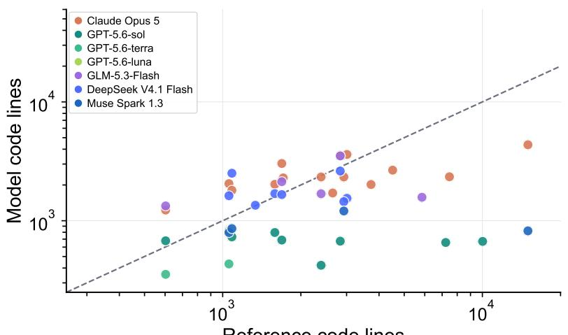

<table><tr><td>Generation</td><td>Grading</td><td>Total</td></tr><tr><td>TPU chip-hours</td><td></td><td></td></tr><tr><td>v4 71</td><td>455</td><td>526</td></tr><tr><td>v5p 633</td><td>5,163</td><td>5,796</td></tr><tr><td>v6e 5,940</td><td>10,540</td><td>16,480</td></tr><tr><td>all 6,644</td><td>16,158</td><td>22,802</td></tr><tr><td>H100-equivalent hours</td><td></td><td></td></tr><tr><td>v4 20</td><td>126</td><td>146</td></tr><tr><td>v5p 294</td><td>2,396</td><td>2,690</td></tr><tr><td>v6e 5,514</td><td>9,782</td><td>15,296</td></tr><tr><td>all 5,828</td><td>12,304</td><td>18,132</td></tr></table>

Reference code lines  
Figure H1. Code size and compute. Left: Python lines of each passing migration against the source it came from, one mark per cell (44 cells; the dashed line is equal size). Right: TPU chip-hours of all cells, split into the agents turns (generation) and our grading of their code, and the same in H100-equivalent hours at peak bf16 throughput.