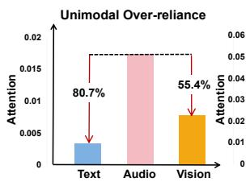
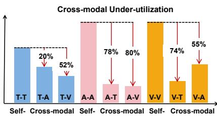
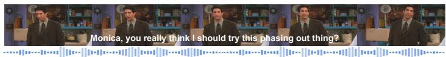
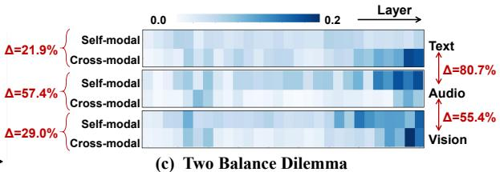
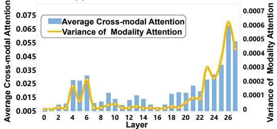
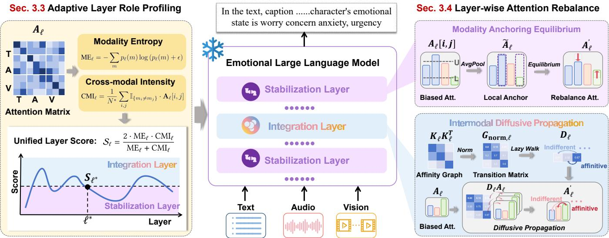
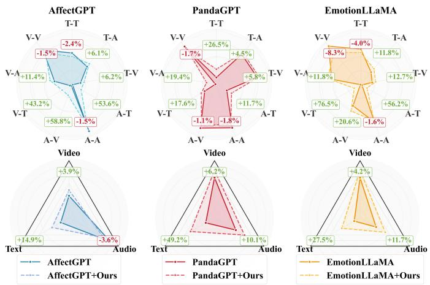

# Layer Roles Mater: Mitigating Modality Imbalance in Multimodal Emotion Reasoning via Adaptive Layer Profiling

Pengyu Huang University of Science and Technology of China Hefei, China otishuang@163.com

Zhiyuan Han University of Science and Technology of China Hefei, China aaronhan@mail.ustc.edu.cn

Peipei Song∗ University of Science and Technology of China Hefei, China beta.songpp@gmail.com

Jinpeng Hu Hefei University of Technology Hefei, China 135858hjp@gmail.com

Beier Zhu∗ University of Science and Technology of China Hefei, China beier.zhu@ustc.edu.cn

Xun Yang∗ University of Science and Technology of China Hefei, China xyang21@ustc.edu.cn

  
(a) Statistical Analysis of Attention

  
AffectGPT: In the text, caption content: "Monica, you really think I should try this phasing out thing?" This sentence might be Monica asking for advice on whether the speaker should give up. Based on the acoustic information, where the speaker feels anxious or tense, and their speech is with a sense of urgency, we can infer that this statement may carry a sense of concern or unease. Therefore, this sentence could be Monica asking for advice or opinions. The character's emotional state is worry concern anxiety, urgency.

(b) Multimodal Emotion Reasoning  

  
(d) Layer Role Heterogeneity  
Figure 1: Diagnostic analysis of attention imbalance and layer-wise heterogeneity in MLLM-based emotion reasoning. (a) Attention statistics of AfectGPT. (b) An example of erroneous emotion reasoning given by AfectGPT. (c) Layer-wise self-modal and cross-modal attention heatmaps. (d) Layer-wise evolution of modality attention gaps and cross-modal attention.

## Abstract

Multimodal Emotion Reasoning (MER) requires perceiving and integrating emotion cues from multiple modalities. Recent advances increasingly leverage Multimodal Large Language Models (MLLMs) to enhance reasoning capacity. However, due to the inherent heterogeneity in conveying emotions across modalities, these models often sufer from modality imbalance and confront flawed emotion understanding. In this paper, we conduct an in-depth analysis on MER models and uncover two key empirical insights. (i) In MER, modality imbalance manifests two distinct failure modes—unimodal over-reliance and insuficient cross-modal utilization, which call for diferent intervention strategies. (ii) MLLM layers exhibit implicit functional hierarchies in multimodal emotion processing, playing separable roles in stabilizing unimodal representations and integrating cross-modal information. Motivated by these observations, we propose a Layer-Aware Modality Rebalancing (LAMR) framework by explicitly aligning intervention strategies with layer roles. Specifically, we first introduce two quantized metrics for adaptive layer role profiling. In each layer, Modality Entropy (ME) measures the dispersion of modality contributions, and Cross-modal Intensity (CMI) captures the strength of cross-modal interactions. Then, we respectively enhance modality equilibrium in stabilization layers and cross-modal propagation in integration layers. Extensive experiments on two comprehensive MER benchmarks demonstrate that LAMR efectively mitigates modality imbalance and improves emotion reasoning across diverse MLLM backbones, without additional training. Project url: https://pengyuhuang1.github.io/LAMR/

## CCS Concepts

• Computing methodologies → Activity recognition and understanding.

## Keywords

Multimodal emotion reasoning, multimodal large language model, modality imbalance, attention rebalance, training-free

## ACM Reference Format:

Pengyu Huang, Peipei Song, Beier Zhu, Zhiyuan Han, Jinpeng Hu, and Xun Yang. 2026. Layer Roles Matter: Mitigating Modality Imbalance in Multi modal Emotion Reasoning via Adaptive Layer Profiling. In Proceedings of the 34th ACM International Conference on Multimedia (MM ’26), November 10–14, 2026, Rio de Janeiro, Brazil. ACM, New York, NY, USA, 10 pages. https://doi.org/10.1145/3767308.3835292

## 1 Introduction

Multimodal Emotion Reasoning (MER) [4, 10, 13, 23, 37] is a challenging task that requires models not only to extract emotionrelated cues from individual modalities, but also to perform deep reasoning over multimodal interactions to capture complex emotion expressions and contexts. With the emergence of Multimodal Large Language Models (MLLMs) [38], MER has shifted toward a unified generative reasoning paradigm. Recent approaches, such as Emotion-LLaMA [4], AfectGPT [20], and Emotion-Qwen [13], leverage MLLMs to jointly process and integrate multimodal data, achieving notable improvements in emotion recognition and reasoning.

In MER, diferent modalities are often complementary, providing additional cues for semantic and emotional disambiguation. However, due to inherent and complex diferences in how modalities capture and express information, as well as the varying informational richness of each modality, the MER models inevitably face modality balance dilemma [28, 48]. This implies two ensuing issues, as highlighted in the statistical analysis of AfectGPT (Figure 1 (a)): unimodal over-reliance, where models tend to favor a dominant modality; and cross-modal under-utilization, where self-modal and cross-modal interactions are severely imbalanced. These imbal ance issues ultimately result in flawed emotion understanding. As shown in Figure 1 (b), audio dominance induces incorrect recognition of urgency, while text-only reasoning causes context confusion (e.g., Monica asking for advice).

Recently, some eforts have attempted to address the modality balance dilemma in multimodal emotion understanding. EMOE [7] proposes dynamic modality weighting to prevent over-reliance on dominant modalities during training. MoSEAR [11] employs modality-specific experts with a regularized gating mechanism in fine-tuning heads. MODA [48] further tackles attention deficit disorder through modular duplex attention. However, the addi tional fine-tuning costs in these methods limit their scalability and practicality in applications. Training-free methods such as visual augmentation [8] and contrastive decoding [16] have been explored to mitigate modality bias. Although promising, existing methods still exhibit crucial limitations. (1) they primarily focus on alleviat ing unimodal dominance, while overlooking the distinct challenge of the imbalance between self-modal and cross-modal interactions;

(2) they typically adopt layer-agnostic strategies, which is suboptimal given the functional heterogeneity of multimodal processing across layers [9, 14, 49].

To address the above limitations, we delve into how MLLM-based MER models process multimodal tokens and how this afects the generation of modality imbalance. As shown in Figure 1 (c), the selfand cross-modal attention heatmaps across modalities reveal two coexisting failure modes of modality imbalance. Figure 1 (d) further shows a clear layer-wise dependency, such as layers with small modality gaps consistently exhibit weak cross-modal interactions. These observations underscore the need for rebalance strategies that explicitly account for the two-sided attention dilemma and layer-wise functional roles.

In this paper, we propose Layer-Aware Modality Rebalancing (LAMR), which specifies intervention strategies aligned with layer roles. First, we introduce an adaptive layer role profiling strategy that characterizes the evolution of multimodal attention across layers. Instead of a heuristic solution, we propose two metrics of Modality Entropy (ME) and Cross-Modal Intensity (CMI), which respectively quantify the balance of modality participation and the strength of cross-modal interactions at each layer. These metrics are combined to identify a functional bifurcation across layers and partition the MLLM into stabilization and integration layers, where the former primarily stabilizes modality-specific representations, and the latter facilitates cross-modal semantic integration. Second, we propose layer-wise attention re-balancing tailored to the identified layer roles. In stabilization layers, we enforce modality equilibrium to suppress abnormal unimodal dominance and stabilize attention flow. In integration layers, we control emotion propagation via a cross-modal afinity graph, facilitating efective difusion of semantically relevant information across modalities while preserving the original representational structure. LAMR is fully plug-and-play and can be seamlessly integrated into existing MLLM-based MER models, scaling the emotion intelligence during the inference stage. Our contributions are summarized as follows:

• We identify a two-sided attention dilemma in MLLM-based emotion reasoning—unimodal over-reliance and cross-modal under-utilization—and reveal its intrinsic connection to layerwise functional heterogeneity.

• We propose LAMR for MER, a novel inference-time framework that automatically profiles layer roles via two quantitative metrics and performs role-conditioned attention rebalancing.

• Extensive experiments on diferent MER benchmarks and MLLM backbones demonstrate that LAMR efectively mitigates modality imbalance and improves emotion recognition and reasoning without any retraining.

## 2 Related Work

## 2.1 Multimodal Emotion Reasoning

Multimodal emotion reasoning requires joint reasoning over visual, linguistic, and acoustic cues. The recent emergence of MLLMs has advanced MER from early single-label emotion recognition [12, 36, 41, 47] to open-vocabulary and explainability-oriented frameworks [21, 23]. Building on generalist MLLMs [38], a line of emotionspecialized models has emerged through post-training adaptation, including Emotion-LLaMA [4], R1-Omni [51], AfectGPT [20], and

Emotion-Qwen [13]. Beyond afective computing, modal joint learning has also been explored in unified autonomous driving systems such as MOJITO [5]. In parallel, numerous eforts have been made to establish standardized benchmarks for evaluating multimodal emotional intelligence. Recent benchmarks such as EmoBench [32], MER-UniBench [20], and MME-Emotion [46] provide holistic and rigorous analytical evaluation protocols and reveal the great potential in multimodal emotion reasoning.

## 2.2 Modality Imbalance

Modality imbalance has emerged as a critical challenge in multimodal learning. In the context of general MLLMs, several studies show that imbalanced modality utilization often induces hallucinations and unreliable reasoning [16, 40, 50]. For instance, AVCD [16] suppresses modality-induced hallucinations in audio-visual LLMs by contrastive decoding. In MER, this issue becomes more pronounced due to the subjective and context-dependent nature of emotional expressions [7, 8, 28]. Recent eforts such as MoSEAR [11] explicitly benchmark emotion conflicts across modalities and introduce expert-based mechanisms to alleviate modality bias in multimodal emotion reasoning. MODA [48] further proposes modular duplex attention that disentangles self-modal and cross-modal attention to improve multimodal perception and emotion understanding. Despite their efectiveness, existing approaches typically rely on additional fine-tuning and overlook layer-wise functional heterogeneity in MLLMs. In contrast, we aim to improve the emotional reasoning ability of MLLMs solely during inference by performing layer-wise rebalancing.

## 2.3 Layer-wise Interpretability of MLLMs

Layer-wise interpretability of MLLMs has attracted a great deal of attention in the community. DoLa [6] reveals that factual knowledge in LLMs is generally localized to particular transformer layers. Neo et al. [29] study the processing of visual tokens in the visionlanguage model and observe their increasing interpretability in the vocabulary space across layers. CMIF [49] further elucidates the cross-layer information flow between diferent modalities. Building on these analytical insights, LISA [9] leverages the functional roles of transformer layers to mitigate object hallucinations. Devils [14] identifies that middle layers disproportionately contribute to hallucination in Large Vision-Language Models (LVLMs) and adjusts visual attention accordingly. Yue et al. [42] argue that hallucination attention heads are concentrated in the middle and deeper layers, displaying a strong attention bias toward text tokens. They propose two methods that are targeted for hallucination heads to reduce their reliance on text tokens. Inspired by these findings, we focus on developing a layer-wise intervention strategy tailored to multimodal emotion reasoning.

## 3 Methodology

## 3.1 Preliminary

We formulate MER within the framework of MLLMs [4], where visual, acoustic, and textual inputs are jointly represented. Each modality is first encoded into the MLLM embedding space to form modality-specific token sequences $\mathbf { T } _ { m } \ = \ \mathrm { E n c } _ { m } \bigl ( \mathbf { \bar { x } } _ { m } \bigr ) \ \in \ \mathbb { R } ^ { N _ { m } \times d }$ where � $\in \{ v , a , t \}$ . The initial input is constructed by concatenation: $\mathbf { X } _ { 0 } = [ \mathbf { \Delta } ] _ { t } ; \mathbf { \Delta } _ { \mathbf { T } _ { v } ; \mathbf { \Delta } } \mathbf { T } _ { a } \mathbf { \Xi } ] \in \mathbb { R } ^ { N \times d }$ , where $N = N _ { t } + N _ { v } + N _ { a }$ denotes the total sequence length. The MLLM then processes ${ \bf { X } } _ { 0 }$ through a stack of Transformer layers. At the ℓ-th layer, the input $\mathbf { X } _ { \ell - 1 }$ is projected into queries, keys, and values: $\{ \mathbf { Q } _ { \ell } , \mathbf { K } _ { \ell } , \mathbf { V } _ { \ell } \} = \mathbf { \bar { X } } _ { \ell - 1 } \mathbf { W } _ { \ell } ^ { \{ Q , \bar { K } , V \} }$ The attention matrix and layer output are defined as:

$$
{ \bf A } _ { \ell } = \mathrm { s o f t m a x } ( \frac { { \bf Q } _ { \ell } { \bf K } _ { \ell } ^ { \top } } { \sqrt { d _ { h } } } ) , \quad { \bf X } _ { \ell } = { \bf A } _ { \ell } { \bf V } _ { \ell } ,\tag{1}
$$

where $\mathbf { A } _ { \ell } \in \mathbb { R } ^ { N \times N }$ encodes both self-modal and cross-modal interactions, which play diferent roles in emotion reasoning. For elements $i , j$ with modality labels $m _ { i } , m _ { j } ,$ entries with $m _ { i } = m _ { j }$ correspond to self-modal attention, which primarily consolidates intra-modal emotional cues $( \mathrm { e . g . } ,$ ,, prosodic patterns in audio or facial dynamics in vision), contributing to modality-specific representation stabilization. In contrast, entries with $m _ { i } \neq m _ { j }$ form cross-modal attention, which enables the exchange and alignment of complementary evidence across modalities, facilitating multimodal integration. In this work, we focus on analyzing and refining the attention matrix $\mathbf { A } _ { \ell } ,$ as it explicitly governs how multimodal evidence is weighted and propagated across tokens.

## 3.2 Multimodal Attention Diagnostics

Compared with general multimodal tasks, emotion reasoning fundamentally relies on the subtle interplay among modalities. For example, a speaker’s words may convey politeness, while their tone reveals frustration. This characteristic makes MER particularly susceptible to modality imbalance, yet it remains unclear how such imbalance emerges within MLLM-based MER models. To shed light on this issue, we investigate the layer-wise attention patterns in three representative MER models, including AfectGPT [20], PandaGPT [38], and EmotionLLaMA [4], using the CMU-MOSEI and CMU-MOSI datasets [1]. The attention matrix Aℓ provides a natural diagnostic lens to examine how multimodal emotional evidence is processed during inference.

Observation 1: Two kinds ofbalance dilemma. As shown in Figure 1 (c), our analysis reveals two co-existing but conceptually distinct imbalance phenomena. First, attention primarily concentrates on a dominant modality (such as audio), marginalizing complementary cues from other modalities. Second, even when multiple modalities are attended to, the majority of attention remains confined within self-modal interactions, while cross-modal attention remains sporadic. This observation suggests that unimodal over-reliance and cross-modal under-utilization are two orthogonal bottlenecks in multimodal emotion reasoning, each imposing distinct constraints on attention regulation.

Observation 2: Layeredfunctional heterogeneity. Beyond global imbalance, we observe that these attention behaviors are not uniformly distributed across Transformer layers. As illustrated in Figure 1 (d), layers with small modality-wise attention disparities tend to exhibit weak cross-modal interactions, whereas layers with pronounced unimodal dominance often coincide with stronger crossmodal attention. This layer-wise divergence indicates that diferent Transformer layers are implicitly specialized for distinct functional roles during emotion inference. Specifically, layers with balanced but weak interactions primarily serve to stabilize modality-specific representations, whereas layers with pronounced cross-modal attention focus on integrating complementary emotional cues across modalities. This functional bifurcation suggests that Transformer layers can be naturally partitioned into two categories, each calling for a distinct intervention strategy. We will formalize this principle in the following sections.

  
Figure 2: Overview of the proposed LAMR framework. Adaptive Layer Role Profiling automatically partitions Transformer layers into stabilization layers and integration layers. Layer-wise Atention Rebalance performs layer-specific attention interventions during inference, mitigating unimodal over-reliance in stabilization layers and enhancing cross-modal propagation in integration layers.

## 3.3 Adaptive Layer Role Profiling

Motivated by the aforementioned findings, we propose an adaptive layer role profiling strategy to characterize the functional roles of Transformer layers in multimodal emotion reasoning. Instead of predefining layer roles heuristically, our approach includes two intrinsic metrics derived from attention patterns—Modality Entropy (ME) and Cross-Modal Intensity (CMI)—to identify whether a layer primarily serves to stabilize unimodal evidence or actively integrate cross-modal information.

3.3.1 Modality Entropy. ME is defined based on Shannon entropy [35] to quantify the balance of attention allocation across modalities. At the ℓ-th layer, we obtain:

$$
\begin{array} { r } { \left\{ \begin{array} { l l } { \mathrm { M E } _ { \ell } = - \sum _ { m } \mathcal { p } _ { \ell } ( m ) \log \left( \mathcal { p } _ { \ell } ( m ) + \epsilon \right) , } \\ { \mathcal { p } _ { \ell } ( m ) = \frac { 1 } { N ^ { * } } \sum _ { i , j } \mathbb { I } _ { \{ m _ { j } = m \} } \cdot \mathbf { A } _ { \ell } [ i , j ] , } \end{array} \right. } \end{array}\tag{2}
$$

where $p _ { \ell } ( m )$ represents the probability mass of attention allocated to modality � at layer $\ell . \mathbb { I } _ { \{ \cdot \} }$ is the indicator function, $m \in \{ v , a , t \}$ denotes the modality oftoken, and $N ^ { * }$ is the normalization constant. Given that entropy is maximized when probability mass is evenly distributed and minimized when concentrated on a single component, ME provides a principled measure of unimodal dominance. A higher ${ \mathrm { M E } } _ { \ell }$ indicates that attention is more evenly distributed across modalities, whereas a lower value reflects strong reliance on a dominant modality.

3.3.2 Cross-modal Intensity. In $\mathbf { A } _ { \ell } ,$ cross-modal attention enables the exchange and integration of complementary emotional cues between modalities, whereas self-modal attention refines relationships within each modality. Focusing on cross-modal flow, CMI quantifies cross-modal attention intensity at the ℓ-th layer:

$$
\mathrm { C M I } _ { \ell } = \frac { 1 } { N ^ { \ast } } \sum _ { i , j } \mathbb { I } _ { \{ m _ { i } \neq m _ { j } \} } \cdot \mathbf { A } _ { \ell } \big [ i , j \big ] .\tag{3}
$$

Since $\mathbf { A } _ { \ell } [ i , j ]$ is normalized by applying softmax given both crossmodal and self-modal pairs, CMIℓ increases with an increase in cross-modal scores relative to the self-modal scores, suggesting that attention is actively propagated across modalities.

ME and CMI capture two complementary aspects of multimodal attention. However, there is a pitfall: a layer may exhibit high CMI by repeatedly propagating attention from a single modality to others; conversely, a layer with high ME may distribute attention evenly across modalities but lack meaningful cross-modal interactions. Efective multimodal reasoning requires both balanced modality engagement and active cross-modal integration. To this end, we compute the unified layer score $\scriptstyle { S _ { \ell } }$ as the harmonic mean [31] of ME and CMI. This formulation requires both metrics to be elevated for a high score:

$$
S _ { \ell } = \frac { 2 \cdot \mathrm { M E } _ { \ell } \cdot \mathrm { C M I } _ { \ell } } { \mathrm { M E } _ { \ell } + \mathrm { C M I } _ { \ell } } .\tag{4}
$$

To adaptively identify the transition boundary $\ell ^ { * } { } _ { ; }$ , we apply the Kneedle algorithm [33] to the set of scores $S _ { \ell }$ sorted in descending order. This algorithm mathematically locates the point of maximum curvature, allowing us to pinpoint the precise layer where functional roles diverge without relying on rigid manual heuristics.

Intuitively, a higher $S _ { \ell }$ indicates that the layer concurrently supports active cross-modal interaction and balanced modality participation, making it suitable for semantic integration, whereas other layers primarily function to stabilize modality-specific representations. Therefore, we designate layers with $S _ { \ell } \geq S _ { \ell ^ { * } }$ as integration layers, and layers with lower $S _ { \ell }$ as stabilization layers.

## 3.4 Layer-wise Attention Rebalance

In accordance with the distinct functional roles of stabilization and integration layers, we design a layer-specific rebalancing strategy that addresses unimodal over-utilization in stabilization layers and cross-modal under-utilization in integration layers, respectively.

3.4.1 Stabilization Layer: Modality Anchoring Equilibrium. To establish a reliable multimodal evidence basis, we aim to anchor attention distributions across modalities into a balanced regime. Rather than relying on absolute attention magnitudes, we construct a layer-wise reference to characterize typical attention intensity. Given $\mathbf { A } _ { \ell } ,$ where each row represents a token-wise attention distribution, we compute a local anchor by average pooling along the row dimension $\tilde { \mathbf { A } } _ { \ell } = \mathrm { A v g P o o l } ( \mathbf { A } _ { \ell } )$ . This anchor $\tilde { \mathbf { A } } _ { \ell }$ captures the expected attention scale of layer ℓ and provides a modality-agnostic anchor against token-level fluctuations.

Importantly, unimodal over-reliance manifests not as uniformly elevated attention, but as extreme deviations concentrated on a subset of tokens or modalities. To distinguish pathological dominance from legitimate salient cues, we leverage the Interquartile Range (IQR) method [34, 39], a statistical technique known for its robustness in outlier detection. Specifically, we define an equilibrium interval $[ L , U ]$ that delineates the normal range of attention values here:

$$
L = Q _ { 1 } - 1 . 5 \times I Q R , U = Q _ { 3 } + 1 . 5 \times I Q R ,\tag{5}
$$

where $Q _ { 1 }$ and $Q _ { 3 }$ denote the first and third quartiles of $\mathbf { A } _ { \ell } ,$ and $I Q R = Q _ { 3 } - Q _ { 1 }$ . Attention values outside $[ L , U ]$ are considered indicative of abnormal confidence concentration.

Finally, outlier attentions are shrunk toward the local anchor $\tilde { \mathbf { A } } _ { \ell } \mathbf { : }$

$$
\mathbf { A } _ { \ell } ^ { \prime } = \left\{ \begin{array} { l l } { ( 1 - \alpha _ { s } ) \mathbf { A } _ { \ell } \pm \alpha _ { s } \tilde { \mathbf { A } } _ { \ell } , } & { \mathbf { A } _ { \ell } \notin [ L , U ] , } \\ { \mathbf { A } _ { \ell } , } & { \mathrm { o t h e r w i s e } . } \end{array} \right.\tag{6}
$$

where $\alpha _ { s }$ controls the anchoring strength. Instead of hard clipping, this soft regularization contracts attention variance while preserving relative structure, thereby mitigating unimodal dominance without enforcing uniformity.

3.4.2 Integration Layer: Intermodal Difusive Propagation. Emotion reasoning requires that semantically aligned cues from diferent modalities reinforce each other. This motivates a contentdriven substrate to model latent semantic correlations for information difusion. As shown in Figure 2, we first construct a semantic afinity graph based on the key representations:

$$
\mathbf { G } _ { \ell } = \mathbf { K } _ { \ell } \mathbf { K } _ { \ell } ^ { \top } \in \mathbb { R } ^ { N \times N } .\tag{7}
$$

Unlike raw attention scores, the key-based afinity captures symmetric and current query-independent associations. However, $\mathbf { G } _ { \ell }$ typically reflects strong self-token similarity. To enable cross-modal information transfer, we perform row-wise normalization on $\mathbf { G } _ { \ell } .$ which redistributes the self-afinity toward semantically related cross-modal tokens and yields a transition matrix $\mathbf { G } _ { \mathrm { n o r m } , \ell }$

Then, we define a difusive propagation operator that corresponds to a lazy random walk on $\mathbf { G } _ { \mathrm { n o r m } , \ell } \colon$

$$
{ \bf D } _ { \ell } = \big ( 1 - \alpha _ { d } \big ) { \bf I } + \alpha _ { d } { \bf G } _ { \mathrm { n o r m } , \ell } ,\tag{8}
$$

where $\alpha _ { d }$ controls the difusion strength, and I is the identity matrix. Since $\mathbf { D } _ { \ell }$ is row-stochastic, it preserves the row-wise normalization of attention. The biased attention $\mathbf { A } _ { \ell }$ is thus refined by applying the difusion operator $\mathbf { A } _ { \ell } ^ { \prime } = \mathbf { D } _ { \ell } \mathbf { A } _ { \ell } .$ . For each query token �, it yields:

$$
\begin{array} { l } { { \displaystyle { \bf A } _ { \ell } ^ { \prime } ( i , : ) = ( 1 - \alpha _ { d } ) { \bf A } _ { \ell } ( i , : ) } } \\ { { \displaystyle ~ + \alpha _ { d } \sum _ { j } { \bf G } _ { \mathrm { n o r m } , \ell } ( i , j ) { \bf A } _ { \ell } ( j , : ) . } } \end{array}\tag{9}
$$

That is, each query keeps a fraction $( 1 - \alpha _ { d } )$ of its original attention while absorbing an $\alpha _ { d } .$ -weighted mixture of attention patterns from semantically related cross-modal neighbors, thereby alleviating cross-modal under-utilization in emotion reasoning.

## 4 Experiments

## 4.1 Experimental Setting

4.1.1 Datasets and Metrics. We evaluate our method on two multimodal emotion benchmarks: MER-UniBench [20] and MME-Emotion [46]. MER-UniBench is a comprehensive evaluation benchmark designed to cover typical multimodal emotion recognition tasks, including basic emotion recognition, sentiment analysis, and fine-grained emotion recognition. For the three tasks, we select nine datasets: MER2023 [22], MER2024 [24], MELD [30], IEMOCAP [2], CMU-MOSI [45], CMU-MOSEI [1], CH-SIMS [44], CH-SIMS v2 [26], and OV-MERD+ [21]. We adopt the oficial evaluation metrics provided by MER-UniBench, tailored for the free-form natural language output style of MLLMs. MME-Emotion is the largest emotional intelligence benchmark for MLLMs, which assesses both emotional understanding and reasoning capabilities. It contains 6,500 video clips with task-specific question-answering (QA) pairs, spanning 27 distinct scenario types. In this work, we report results on six emotional tasks, including emotion recognition in the lab (ER-Lab), emotion recognition under noise (Noise-ER), multi-label emotion recognition (ML-ER), sentiment analysis (SA), fine-grained sentiment analysis (FG-SA), and intent recognition (IR). Evaluation metrics include recognition (Rec) score, reasoning (Rea) score, and Chain-of-Thought (CoT) score, which are computed via a multi-agent system framework.

4.1.2 Implementation Details. For layer profiling, we construct a small validation set $\mathcal { D } _ { v a l }$ by combining the CMU-MOSEI and CMU-MOSI datasets [1], which are widely used benchmarks for multimodal sentiment analysis. This validation set is used to estimate layer-wise attention statistics and determine the layer threshold $S _ { \ell ^ { * } }$ . We apply our method to three representative MER baselines: PandaGPT [38], Emotion-LLaMA [4], and AfectGPT [20]. The proposed attention rebalance strategy is performed only during inference on the test set $\mathcal { D } _ { t e s t }$ . For the two types of layers identified by our method, the rebalance hyperparameters $( \alpha _ { s } , \alpha _ { d } )$ are set to (0.1, 0.1) for AfectGPT, and (0.2, 0.2) for the other baselines, respectively. For LLM-based evaluation on MME-Emotion, we employ gpt-4.1-2025-04-14 and gpt-4o-2024-11-20 as judge models.

Table 1: Comparison on MER-UniBench [20] for multimodal emotion recognition. This benchmark comprises nine datasets covering three tasks: basic emotion recognition, sentiment analysis, and fine-grained emotion recognition. “Mean” represents the average performance across all datasets. We compare various mainstream MLLMs and apply our method to three baselines.
<table><tr><td rowspan="2">Methods</td><td colspan="4">Basic</td><td colspan="4">Sentiment</td><td rowspan="2">Fine-grained</td><td rowspan="2">Mean↑</td></tr><tr><td>MER23↑</td><td></td><td>MER24↑ MELD↑</td><td>IEMO↑</td><td>MOSI↑</td><td>MOSEI↑ SIMS↑</td><td></td><td>SIMS v2↑ OV-MERD+↑</td></tr><tr><td>Video-LLaVA [25]</td><td>36.93</td><td>30.25</td><td>30.73</td><td>38.95</td><td>56.37</td><td>61.64</td><td>53.28</td><td>57.45</td><td>34.00</td><td>44.40</td></tr><tr><td>Video-ChatGPT [27]</td><td>44.86</td><td>46.80</td><td>37.33</td><td>56.83</td><td>54.42</td><td>63.12</td><td>64.82</td><td>65.80</td><td>39.80</td><td>52.64</td></tr><tr><td>VideoChat2 [18]</td><td>33.67</td><td>54.50</td><td>36.64</td><td>48.70</td><td>66.84</td><td>54.32</td><td>69.49</td><td>70.66</td><td>39.21</td><td>52.67</td></tr><tr><td>LLaMA-VID [19]</td><td>50.72</td><td>57.60</td><td>42.75</td><td>46.02</td><td>61.78</td><td>63.89</td><td>69.35</td><td>67.48</td><td>45.01</td><td>56.07</td></tr><tr><td>VideoChat [17]</td><td>48.73</td><td>57.30</td><td>41.11</td><td>48.38</td><td>65.13</td><td>63.61</td><td>69.52</td><td>72.14</td><td>44.52</td><td>56.72</td></tr><tr><td>Chat-UniVi [15]</td><td>57.62</td><td>65.67</td><td>45.61</td><td>52.37</td><td>54.53</td><td>63.18</td><td>68.15</td><td>66.36</td><td>48.00</td><td>57.94</td></tr><tr><td>mPLUG-Owl [43]</td><td>56.86</td><td>59.89</td><td>49.11</td><td>55.54</td><td>72.40</td><td>72.91</td><td>72.13</td><td>75.00</td><td>48.18</td><td>62.45</td></tr><tr><td>AVERE [3]</td><td>56.87</td><td>68.78</td><td>38.42</td><td>44.92</td><td>49.89</td><td>42.14</td><td>76.36</td><td>76.16</td><td>48.39</td><td>55.77</td></tr><tr><td>PandaGPT [38]</td><td>44.96</td><td>49.63</td><td>38.30</td><td>46.42</td><td>67.65</td><td>69.12</td><td>67.12</td><td>64.60</td><td>37.92</td><td>53.97</td></tr><tr><td>+Ours</td><td>48.35</td><td>50.61</td><td>39.54</td><td>49.33</td><td>68.70</td><td>69.83</td><td>69.35</td><td>66.35</td><td>39.05</td><td>55.68</td></tr><tr><td>Emotion-LLaMA [4]</td><td>64.91</td><td>66.14</td><td>63.46</td><td>47.30</td><td>63.60</td><td>71.83</td><td>67.67</td><td>72.88</td><td>46.80</td><td>62.73</td></tr><tr><td>+Ours</td><td>68.71</td><td>69.43</td><td>66.53</td><td>48.56</td><td>65.57</td><td>75.37</td><td>71.79</td><td>75.62</td><td>47.84</td><td>65.49</td></tr><tr><td>AffectGPT [20]</td><td>73.60</td><td>73.28</td><td>52.16</td><td>55.50</td><td>83.01</td><td>76.69</td><td>86.41</td><td>81.91</td><td>59.44</td><td>71.33</td></tr><tr><td>+Ours</td><td>76.35</td><td>73.62</td><td>53.78</td><td>56.17</td><td>85.13</td><td>77.05</td><td>88.45</td><td>85.54</td><td>61.04</td><td>73.01</td></tr></table>

Table 2: Comparison on MME-Emotion [46] for emotional understanding and reasoning. Results cover six emotional tasks and three evaluation metrics, all computed via a multi-agent system framework.
<table><tr><td></td><td colspan="2">ER-Lab</td><td>FG-SA</td><td>IR</td><td>ML-ER</td><td>Noise-ER</td><td>SA</td><td>Mean</td></tr><tr><td>Methods</td><td>Rec Rea CoT</td><td>Rec Rea</td><td>CoT Rec</td><td>Rea CoT</td><td>Rec Rea CoT</td><td>Rec Rea CoT</td><td>Rec Rea CoT</td><td>Rec Rea CoT</td></tr><tr><td>PandaGPT [38]</td><td>15.5 42.6 30.6</td><td>34.8 47.8 41.3</td><td>13.8 48.5</td><td>31.2 2.0</td><td>37.8 21.4</td><td>21.2 40.9 31.3</td><td>35.2 51.0 43.1</td><td>20.4 44.8 33.2</td></tr><tr><td>+Ours</td><td>19.7 45.6 31.1</td><td>37.0 49.4 43.2</td><td>15.8 48.8</td><td>32.3 5.0</td><td>42.0 22.0</td><td>22.0 41.5 31.4</td><td>41.2 54.5 47.9</td><td>23.5 47.0 34.7</td></tr><tr><td>Emotion-LLaMA [4]</td><td>11.7 32.8 22.3</td><td>26.8 54.4 41.0</td><td>11.0 45.1</td><td>28.0 8.3</td><td>46.9 27.6</td><td>44.0 60.3 52.4</td><td>36.2 61.5 48.9</td><td>23.0 50.2 36.7</td></tr><tr><td>+Ours</td><td>14.8 37.5 26.2</td><td>29.0 55.2 41.7</td><td>13.8 47.3</td><td>30.6 8.7</td><td>49.9 29.3 45.6</td><td>60.8 52.9</td><td>36.5 63.6 50.1</td><td>24.7 52.4 38.5</td></tr><tr><td>AffectGPT [20]</td><td>16.2 54.2 35.2</td><td>15.6 63.5 39.6</td><td>3.0 50.4</td><td>26.7 0.6</td><td>49.9 25.6</td><td>28.8 65.3 47.0</td><td>25.5 67.6 46.7</td><td>15.0 58.5 36.8</td></tr><tr><td>+Ours</td><td>19.3 59.6 39.5</td><td>18.6 68.4 43.5</td><td>5.2 54.5</td><td>29.9 0.7</td><td>54.6 27.6 31.8</td><td>67.4 49.6</td><td>25.5 70.7 48.1</td><td>16.9 62.5 39.7</td></tr></table>

## 4.2 Performance Comparison

4.2.1 Emotion Recognition. For a comprehensive comparison, we include representative generalist MLLMs (e.g.,, Video-LLaVA [25]) and specialized MER models (e.g.,, AVERE [3]), and apply our method to three baseline architectures. As shown in Table 1, ap plying LAMR to PandaGPT, Emotion-LLaMA, and AfectGPT results in consistent performance improvements across all nine datasets, with average gains of 1.71%, 2.76%, and 1.68%, respectively. This indicates that our inference-time rebalancing strategy is robust and model-agnostic. Notably, these gains are observed not only on basic emotion recognition and sentiment analysis, but also on finegrained emotion recognition tasks (OV-MERD+ dataset), which require more delicate cross-modal evidence aggregation. LAMR improves the multimodal reasoning process by alleviating unimodal dominance and strengthening cross-modal integration.

4.2.2 Emotional Intelligence. Beyond recognition accuracy, we evaluate LAMR on the MME-Emotion benchmark for holistic emotional intelligence. As reported in Table 2, LAMR consistently improves performance across six emotional tasks, with clear gains on reasoning-related metrics. For example, on the FG-SA task, Afect-GPT’s Rec score increases from 15.6 to 18.6, while CoT score rises from 39.6 to 43.5. LAMR enhances not only the final predictions but also the coherence and logical structure of the reasoning process. These improvements are attributed to LAMR operating at the level of internal multimodal evidence aggregation, rather than merely adjusting output-level predictions.

Table 3: Ablation study on layer partition strategies. “Shal low”, “Middle”, and “Deep” denote static heuristic partitions that evenly divide the layers into three contiguous stages. We designate one or two of these stages as integration layers.
<table><tr><td>Strategy</td><td>MELD</td><td>IEMOCAP</td><td>SIMS</td><td>Mean</td></tr><tr><td>AffectGPT</td><td>52.16</td><td>55.50</td><td>86.41</td><td>64.69</td></tr><tr><td colspan="5">Random Assignment</td></tr><tr><td>30% Integration</td><td>53.99</td><td>51.53</td><td>80.44</td><td>61.99</td></tr><tr><td>50% Integration</td><td>49.71</td><td>47.51</td><td>80.79</td><td>59.34</td></tr><tr><td>70% Integration</td><td>47.15</td><td>46.28</td><td>80.68</td><td>58.04</td></tr><tr><td colspan="5">Static Assignment</td></tr><tr><td>Shallow</td><td>51.45</td><td>51.51</td><td>82.88</td><td>61.95</td></tr><tr><td>Middle</td><td>53.52</td><td>52.44</td><td>83.15</td><td>63.04</td></tr><tr><td>Deep</td><td>52.96</td><td>51.86</td><td>81.04</td><td>61.95</td></tr><tr><td>Shallow + Middle</td><td>52.56</td><td>51.53</td><td>83.77</td><td>62.62</td></tr><tr><td>Middle + Deep</td><td>52.70</td><td>52.23</td><td>80.60</td><td>61.84</td></tr><tr><td>Shallow + Deep</td><td>51.29</td><td>50.95</td><td>82.16</td><td>61.47</td></tr><tr><td>Ours</td><td>53.78</td><td>56.17</td><td>88.45</td><td>66.13</td></tr></table>

Table 4: Ablation study on the quantitative metrics used for adaptive layer role profiling, $\mathbf { i . e . , }$ CMI and ME.
<table><tr><td>CMI</td><td>ME</td><td>MELD</td><td>IEMOCAP</td><td>SIMS</td><td>Mean</td></tr><tr><td>V</td><td>x</td><td>52.25</td><td>53.62</td><td>83.67</td><td>63.18</td></tr><tr><td>x</td><td>√</td><td>51.60</td><td>53.18</td><td>85.47</td><td>63.42</td></tr><tr><td>√</td><td>√</td><td>53.78</td><td>56.17</td><td>88.45</td><td>66.13</td></tr></table>

Table 5: Ablation study on layer-wise attention rebalance. “Reversed Intervention” denotes exchanging intervention strategies for two types of layers.
<table><tr><td>Strategy</td><td>MELD</td><td>IEMOCAP</td><td>SIMS</td><td>Mean</td></tr><tr><td>AffectGPT</td><td>52.16</td><td>55.50</td><td>86.41</td><td>64.69</td></tr><tr><td>Uniform Propagation</td><td>47.75</td><td>51.23</td><td>81.53</td><td>60.17</td></tr><tr><td>Uniform Equilibrium</td><td>53.53</td><td>51.11</td><td>83.92</td><td>62.85</td></tr><tr><td>Reversed Intervention</td><td>53.28</td><td>51.44</td><td>84.26</td><td>62.99</td></tr><tr><td>Ours</td><td>53.78</td><td>56.17</td><td>88.45</td><td>66.13</td></tr></table>

## 4.3 Ablation Studies

4.3.1 Impact of Adaptive Layer Role Profiling. To validate the necessity of adaptive layer role profiling, we compare LAMR with two alternative strategies: Random Assignment, which randomly selects 30%, 50%, or 70% of the layers as integration layers, and Static Assignment, which heuristically partitions layers into shallow, middle, and deep stages and applies integration to one or two fixed stages. As shown in Table 3, both strategies reduce the baseline performance. In particular, random assignment leads to the most severe performance degradation, as it blindly applies inappropriate interventions, disrupting the internal organization of multimodal processing. In contrast, our adaptive profiling strategy yields the best results, demonstrating that accurate identification of layer-specific functions is critical for efective multimodal attention rebalancing.

4.3.2 Impact ofCMI and ME. Our layer role profiling relies on a unified layer score $S _ { \ell }$ that jointly combines CMI and ME. To assess the contribution of each metric, we compare LAMR with two ablated variants that rely on a single metric. As shown in Table 4, both single-metric strategies lead to suboptimal performance, with the mean score dropping from 66.13 to 63.18 (only CMI) and 63.42 (only ME), respectively. These results validate our design motivation that only layers exhibiting both high cross-modal intensity and high modality entropy should be identified as integration layers for cross-modal semantic aggregation.

4.3.3 Impact of Layer-wise Atention Rebalance. To examine whether the efectiveness of LAMR stems from matching intervention types to layer-specific functions, we test three variants: Uniform Propagation, which applies difusive propagation to all layers; Uniform Equilibrium, which applies modality equilibrium to all layers; and Reversed Intervention, which swaps the two strategies between stabilization and integration layers. As shown in Table 5, all three variants lead to significant performance degradation. These results demonstrate that efective attention rebalancing requires alignment with the intrinsic functional role of each layer, thereby confirming the necessity of our layer-wise intervention design.

Table 6: Performance comparison on the CA-MER benchmark [11] under realistic emotion conflicts. The three subsets—video-aligned, audio-aligned, and consistent— represent settings in which the video modality, the audio modality, or all modalities reflect the true emotion, respectively.
<table><tr><td rowspan="2">Model</td><td colspan="3">Video-aligned</td><td colspan="3">Audio-aligned</td><td colspan="3">Consistent</td></tr><tr><td>Acc</td><td>Recall</td><td>Avg</td><td>Acc</td><td>Recall</td><td>Avg</td><td>Acc</td><td>Recall</td><td> $\operatorname { A v g }$ </td></tr><tr><td>AffectGPT</td><td>44.92</td><td>50.80</td><td>47.86</td><td>52.26</td><td>55.54</td><td>53.90</td><td>51.86</td><td>56.90</td><td>54.38</td></tr><tr><td>+ Ours</td><td>45.89</td><td>52.66</td><td>49.28</td><td>52.56</td><td>60.00</td><td>56.28</td><td>52.72</td><td>59.84</td><td>56.28</td></tr></table>

Table 7: Comparison with other training-free rebalancing methods on MER-UniBench.
<table><tr><td>Methods</td><td>MER23</td><td>MER24</td><td>MELD</td><td>IEMO</td><td>SIMS</td><td>SIMSv2</td><td>OV.</td></tr><tr><td>AffectGPT</td><td>73.60</td><td>73.28</td><td>52.16</td><td>55.50</td><td>86.41</td><td>81.91</td><td>59.44</td></tr><tr><td>+ Devils [14]</td><td>75.27</td><td>70.13</td><td>52.34</td><td>49.40</td><td>79.93</td><td>81.95</td><td>59.80</td></tr><tr><td>+ AVCD [16]</td><td>75.35</td><td>75.05</td><td>53.56</td><td>51.83</td><td>80.97</td><td>82.43</td><td>60.69</td></tr><tr><td>+ LISA [9]</td><td>73.14</td><td>75.79</td><td>52.88</td><td>55.53</td><td>86.43</td><td>85.41</td><td>60.33</td></tr><tr><td>+ Ours</td><td>76.35</td><td>73.62</td><td>53.78</td><td>56.17</td><td>88.45</td><td>85.54</td><td>61.04</td></tr></table>

## 4.4 Further Analysis

4.4.1 Robustness Under Emotion Conflicts. CA-MER [11] is a benchmark designed to examine MLLMs under realistic emotion conflicts. It constitutes a challenging setting for MER, where only one or all modalities reflect the true emotion. As shown in Table $^ { 6 , }$ AfectGPT performs worse on the Video-aligned subset compared to the Audio-aligned subset, indicating a clear bias toward dominant modalities. By re-balancing attention at inference time, LAMR efectively mitigates modality dominance and improves performance across all subsets, achieving a 1.9% gain in average score.

4.4.2 Comparison with Training-Free Rebalancing Methods. To evaluate the eficacy of existing training-free rebalancing approaches for MER, we re-implement three representative methods, Devils [14], AVCD [16], and LISA [9], on the same backbone following their original intervention principles for fair comparison. These methods encompass diverse rebalancing paradigms: AVCD performs contrastive decoding, Devils focuses on modality tokenlevel attention enhancement, and LISA implements a layer-wise integration and suppression approach based on predefined layer functions. As shown in Table 7, these methods often yield unstable performance when transferred to MER: while moderate gains are observed on some datasets, performance degrades on others. This suggests that generic interventions, which rely on fixed layer priors or non-adaptive modality adjustments, fail to account for the fine-grained functional roles of layers in multimodal emotion reasoning. In contrast, LAMR achieves consistent improvements by explicitly grounding its observation and intervention in MER.

4.4.3 Scalability Across Model Sizes. In Table 8, we evaluate LAMR on AfectGPT backbones of increasing capacity (1.5B, 7B, and 14B parameters). LAMR consistently yields performance gains across all model scales, indicating that modality imbalance persists even in large-capacity MLLMs and cannot be resolved solely by scaling up model size. More importantly, LAMR is scalable and benefits both lightweight and large-scale backbones.

Table 8: Scalability analysis across diferent model sizes (1.5B, 7B, and 14B).
<table><tr><td>Model Setup</td><td>MER24</td><td>MELD</td><td>IEMOCAP</td><td>Avg. ∆</td></tr><tr><td>AffectGPT-1.5B</td><td>75.39</td><td>49.34</td><td>52.32</td><td></td></tr><tr><td>+ Ours</td><td>76.68</td><td>49.97</td><td>52.84</td><td>0.81↑</td></tr><tr><td>AffectGPT-7B</td><td>73.28</td><td>52.16</td><td>55.50</td><td></td></tr><tr><td>+ Ours</td><td>73.62</td><td>53.78</td><td>56.17</td><td>0.88↑</td></tr><tr><td>AffectGPT-14B</td><td>77.36</td><td>55.01</td><td>60.80</td><td></td></tr><tr><td>+ Ours</td><td>80.02</td><td>55.57</td><td>65.44</td><td>2.62↑</td></tr></table>

  
Figure 3: Efect of LAMR on modality-level and cross-modal attention rebalancing. (a/b) Modality-wise and cross-modal attention allocation with LAMR. Percentages indicate changes relative to the baseline.

4.4.4 Results ofAtention Rebalance. Figure 3 provides a quantitative view ofhow LAMR corrects both facets ofmodality imbalance. As shown in Figure 3 (a), LAMR significantly balances the attention allocated to three modalities. In AfectGPT, attention to the nondominant text and video modalities increases by +14.9% and +3.9%, respectively, while attention to the dominant audio modality decreases by −3.6%. Figure 3 (b) shows an increase in cross-modal attention relative to self-modal attention. In particular, AfectGPT exhibits a +58.8% gain in audio-to-video attention, and EmotionL-LaMA shows a +76.5% increase in video-to-text interaction, indicating that LAMR actively promotes inter-modal information propagation. Overall, LAMR corrects both unimodal over-reliance and cross-modal under-utilization, directly addressing the two-sided attention dilemma identified in our analysis.

## 4.5 Qualitative Results

As shown in Figure 4, we examine two challenging cases that reflect distinct forms of modality imbalance in multimodal emotion reasoning. In the first case of unimodal over-reliance, the baseline overemphasizes acoustic cues (e.g.,, high pitch) and erroneously predicts excitement. In the second case of cross-modal under-utilization, the baseline fails to reconcile positive visual/audio signals (i.e.,, visual smile/enthusiastic tone) with hostile text, resulting in a superficial interpretation of playful. In contrast, LAMR achieves more nuanced emotional understanding by suppressing excessive modality reliance and enhancing cross-modal interaction.

  
AffectGPT: In the text, caption content: "I mean if you buy a bed from Janice's ex-husband, that's like betraying Chandler." This sentence could be an evaluation or commentary by the speaker on an everyday furniture shopping choice, complemented visually by the amusing party hat in the background suggesting a lighthearted context. Given the speaker's high pitch and rapid pace as described in the audio cues, we can infer that this sentence might carry a sense of extreme excitement, thrill, or joyous anticipation. Therefore, this statement may serve as a form of enthusiastic endorsement or a celebration of the purchase, aligning with the highly positive emotional tone derived from the audio.

AffectGPT+Ours: In the text, caption content: "I mean, if you were to buy a bed from Janice's ex-husband, that's practically cheating on Chandler." This sentence might be a comment or reaction by a woman towards a certain topic or situation. Based on the video clues, where the woman is portrayed as lively and enthusiastic, and the audio clues suggesting that the speaker is experiencing strong emotions, possibly anger or frustration, we can infer that the sentence might carry a tone of dissatisfaction or opposition. The woman might be criticizing or expressing disapproval of someone's behavior or decision, hence using the metaphor of 'cheating' to describe it.

Subtitle: By the way, Chandler. I cut you out of all my pictures. So if you want, I have a bag with just your heads.

AffectGPT+Ours: In the text, caption content: "By the way, Chandler, I cut you out of all my pictures. So if you want, I have a bag with just your heads." This sentence could be an evaluation or commentary by the speaker on her post-breakup actions and their past relationship. Given the speaker's direct tone, slightly elevated pitch, and deliberate pace as described in the audio cues, we can infer that this sentence might carry a sense of bitterness, vindictiveness, or passive-aggression. Therefore, this statement may serve as a form of petty retaliation or expression of lingering resentment, aligning with the spiteful emotional tone described in the audio.

Figure 4: Two challenging examples of modality imbalance. Cyan, green, and red fonts indicate shared correct, correct, and erroneous interpretations, respectively. 5 Conclusion

In this work, we aim to address the modality imbalance problem in multimodal emotion reasoning, manifested as unimodal over-reliance and cross-modal under-utilization. We propose Layer-Aware Modality Rebalancing (LAMR), which rebalances multimodal attention through adaptive layer role profiling and role-conditioned attention reallocation during inference. Extensive experiments on multiple MER benchmarks demonstrate that LAMR efectively mitigates modality imbalance and consistently improves emotion reasoning performance across diverse MLLM backbones without requiring any additional training.

## Acknowledgments

This work was supported by the National Natural Science Foundation of China (62402471, U22A2094), the Yangtze River Delta Science and Technology Innovation Community Joint Research (Basic Research) Project (2025CSJZN01600), and the National Science and Technology Major Project (2025ZD0215301).

## References

[1] AmirAli Bagher Zadeh, Paul Pu Liang, Soujanya Poria, Erik Cambria, and Louis-Philippe Morency. 2018. Multimodal Language Analysis in the Wild: CMU-MOSEI Dataset and Interpretable Dynamic Fusion Graph. In ACL. 2236–2246.

[2] Carlos Busso, Murtaza Bulut, Chi-Chun Lee, Abe Kazemzadeh, Emily Mower, Samuel Kim, Jeannette N Chang, Sungbok Lee, and Shrikanth S Narayanan. 2008. IEMOCAP: Interactive emotional dyadic motion capture database. Language Resources and Evaluation 42, 4 (2008), 335–359.

[3] Ashutosh Chaubey, Jiacheng Pang, Maksim Siniukov, and Mohammad Soleymani. 2026. AVERE: Improving Audiovisual Emotion Reasoning with Preference Opti mization. In The Fourteenth International Conference on Learning Representations.

[4] Zebang Cheng, Zhi-Qi Cheng, Jun-Yan He, Jingdong Sun, Kai Wang, Yuxi ang Lin, Zheng Lian, Xiaojiang Peng, and Alexander G. Hauptmann. 2024. Emotion-LLaMA: Multimodal Emotion Recognition and Reasoning with In struction Tuning. In NeurIPS, Vol. 37. Curran Associates, Inc., 110805–110853. doi:10.52202/079017-3518

[5] Zhijing Cheng, Xuancheng Zhang, Donglin Di, Lei Fan, Baorui Ma, Hao Li, and Xun Yang. 2026. MOJITO: Modal Joint Learning for Unified End-to-End Autonomous Driving. arXiv:2607.23511 [cs.CV] https://arxiv.org/abs/2607.23511

[6] Yung-Sung Chuang, Yujia Xie, Hongyin Luo, Yoon Kim, James R. Glass, and Pengcheng He. 2024. DoLa: Decoding by Contrasting Layers Improves Factuality in Large Language Models. In The Twelfth International Conference on Learning Representations.

[7] Yiyang Fang, Wenke Huang, Guancheng Wan, Kehua Su, and Mang Ye. 2025. EMOE: Modality-Specific Enhanced Dynamic Emotion Experts. In CVPR. 14314– 14324.

[8] Yiyang Fang, Jian Liang, Wenke Huang, He Li, Kehua Su, and Mang Ye. 2025. Catch Your Emotion: Sharpening Emotion Perception in Multimodal Large Language Models. In ICML, Vol. 267. PMLR, 16029–16039.

[9] Zhihui Guo, Xin Man, Hui Xu, Jie Shao, Zhiguo Jiang, Xianchao Zhang, and Heng Tao Shen. 2025. LISA: A Layer-wise Integration and Suppression Approach for Hallucination Mitigation in Multimodal Large Language Models. arXiv preprint arXiv:2507.19110 (2025).

[10] Zhiyuan Han, Beier Zhu, Wenwen Tong, Pengyang Shao, Peipei Song, Xinyi Wang, Jiangnan Chen, Lewei Lu, and Xun Yang. 2026. Omni-Perception Policy Optimization for Multimodal Emotion Reasoning. In ICML.

[11] Zhiyuan Han, Beier Zhu, Yanlong Xu, Peipei Song, and Xun Yang. 2025. Benchmarking and Bridging Emotion Conflicts for Multimodal Emotion Reasoning. In ACM MM. 5528–5537.

[12] Jinpeng Hu, Hongchang Shi, Chongyuan Dai, Zhuo Li, Peipei Song, and Meng Wang. 2025. Beyond Emotion Recognition: A Multi-Turn Multimodal Emotion Un derstanding and Reasoning Benchmark. In ACM MM. Association for Computing Machinery, 5814–5823. doi:10.1145/3746027.3755726

[13] Dawei Huang, Qing Li, Chuan Yan, Zebang Cheng, Yurong Huang, Xiang Li, Bin Li, Xiaohui Wang, Zheng Lian, and Xiaojiang Peng. 2025. Emotion-Qwen: Training Hybrid Experts for Unified Emotion and General Vision-Language Understanding. arXiv preprint arXiv:2505.06685 (2025).

[14] Zhangqi Jiang, Junkai Chen, Beier Zhu, Tingjin Luo, Yankun Shen, and Xu Yang. 2025. Devils in Middle Layers of Large Vision-Language Models: Interpreting, Detecting and Mitigating Object Hallucinations via Attention Lens. In CVPR. 25004–25014.

[15] Peng Jin, Ryuichi Takanobu, Wancai Zhang, Xiaochun Cao, and Li Yuan. 2024. Chat-UniVi: Unified Visual Representation Empowers Large Language Models with Image and Video Understanding. In CVPR. 13700–13710.

[16] Chaeyoung Jung, Youngjoon Jang, and Joon Son Chung. 2025. AVCD: Mitigating Hallucinations in Audio-Visual Large Language Models through Contrastive Decoding. In NeurIPS, Vol. 38. Curran Associates, Inc., 63143–63174.

[17] KunChang Li, Yinan He, Yi Wang, Yizhuo Li, Wenhai Wang, Ping Luo, Yali Wang, Limin Wang, and Yu Qiao. 2025. Videochat: Chat-centric video understanding. Science China Information Sciences 68, 10 (2025), 200102.

[18] Kunchang Li, Yali Wang, Yinan He, Yizhuo Li, Yi Wang, Yi Liu, Zun Wang, Jilan Xu, Guo Chen, Ping Lou, Limin Wang, and Yu Qiao. 2024. MVBench: A Comprehensive Multi-modal Video Understanding Benchmark. In CVPR. 22195– 22206.

[19] Yanwei Li, Chengyao Wang, and Jiaya Jia. 2025. LLaMA-VID: An Image is Worth 2 Tokens in Large Language Models. In ECCV. 323–340.

[20] Zheng Lian, Haoyu Chen, Lan Chen, Haiyang Sun, Licai Sun, Yong Ren, Zebang Cheng, Bin Liu, Rui Liu, Xiaojiang Peng, Jiangyan Yi, and Jianhua Tao. 2025. AfectGPT: A New Dataset, Model, and Benchmark for Emotion Understanding with Multimodal Large Language Models. In ICML, Vol. 267. PMLR, 36993–37014.

[21] Zheng Lian, Haiyang Sun, Licai Sun, Haoyu Chen, Lan Chen, Hao Gu, Zhuofan Wen, Shun Chen, Zhang Siyuan, Hailiang Yao, Bin Liu, Rui Liu, Shan Liang, Ya Li, Jiangyan Yi, and Jianhua Tao. 2025. OV-MER: Towards Open-Vocabulary Multimodal Emotion Recognition. In ICML, Vol. 267. PMLR, 37015–37050.

[22] Zheng Lian, Haiyang Sun, Licai Sun, Kang Chen, Mingyu Xu, Kexin Wang, Ke Xu, Yu He, Ying Li, Jinming Zhao, Ye Liu, Bin Liu, Jiangyan Yi, Meng Wang, Erik Cambria, Guoying Zhao, Björn W. Schuller, and Jianhua Tao. 2023. MER 2023: Multi-label Learning, Modality Robustness, and Semi-Supervised Learning. In

ACM MM. 9610–9614.

[23] Zheng Lian, Haiyang Sun, Licai Sun, Hao Gu, Zhuofan Wen, Siyuan Zhang, Shun Chen, Mingyu Xu, Ke Xu, Kang Chen, et al. 2023. Explainable multimodal emotion recognition. arXiv preprint arXiv:2306.15401 (2023).

[24] Zheng Lian, Haiyang Sun, Licai Sun, Zhuofan Wen, Siyuan Zhang, Shun Chen, Hao Gu, Jinming Zhao, Ziyang Ma, Xie Chen, et al. 2024. MER 2024: Semi-Supervised Learning, Noise Robustness, and Open-Vocabulary Multimodal Emo tion Recognition. In MRAC. 41–48.

[25] Bin Lin, Yang Ye, Bin Zhu, Jiaxi Cui, Munan Ning, Peng Jin, and Li Yuan. 2024. Video-LLaVA: Learning United Visual Representation by Alignment Before Pro jection. In EMNLP. 5971–5984.

[26] Yihe Liu, Ziqi Yuan, Huisheng Mao, Zhiyun Liang, Wanqiuyue Yang, Yuanzhe Qiu, Tie Cheng, Xiaoteng Li, Hua Xu, and Kai Gao. 2022. Make Acoustic and Visual Cues Matter: CH-SIMS v2.0 Dataset and AV-Mixup Consistent Module. In ICMI. ACM, 247–258. doi:10.1145/3536221.3556630

[27] Muhammad Maaz, Hanoona Rasheed, Salman Khan, and Fahad Khan. 2024. Video-ChatGPT: Towards Detailed Video Understanding via Large Vision and Language Models. In ACL. 12585–12602.

[28] Ankan Mullick, Saransh Sharma, Abhik Jana, and Pawan Goyal. 2025. Text Takes Over: A Study of Modality Bias in Multimodal Intent Detection. In EMNLP. 24028–24058.

[29] Clement Neo, Luke Ong, Philip Torr, Mor Geva, David Krueger, and Fazl Barez. 2025. Towards Interpreting Visual Information Processing in Vision-Language Models. In The Thirteenth International Conference on Learning Representations.

[30] Soujanya Poria, Devamanyu Hazarika, Navonil Majumder, Gautam Naik, Erik Cambria, and Rada Mihalcea. 2019. MELD: A Multimodal Multi-Party Dataset for Emotion Recognition in Conversations. In ACL. 527–536.

[31] Ronald Rousseau, Leo Egghe, and Raf Guns. 2018. Chapter 4 - Statistics. In Becoming Metric-Wise. Chandos Publishing, 67–97.

[32] Sahand Sabour, Siyang Liu, Zheyuan Zhang, June Liu, Jinfeng Zhou, Alvionna Sunaryo, Tatia Lee, Rada Mihalcea, and Minlie Huang. 2024. EmoBench: Evaluat ing the Emotional Intelligence of Large Language Models. In ACL. 5986–6004.

[33] Ville Satopaa, Jeannie Albrecht, David Irwin, and Barath Raghavan. 2011. Finding a "Kneedle" in a Haystack: Detecting Knee Points in System Behavior. In ICDCS. 166–171.

[34] Yuzhang Shang, Mu Cai, Bingxin Xu, Yong Jae Lee, and Yan Yan. 2025. LLaVA-PruMerge: Adaptive Token Reduction for Eficient Large Multimodal Models. In ICCV. 22857–22867.

[35] C. E. Shannon. 1948. A mathematical theory of communication. The Bell System Technical Journal 27, 3 (1948), 379–423.

[36] Peipei Song, Dan Guo, Xun Yang, Shengeng Tang, and Meng Wang. 2024. Emotional Video Captioning With Vision-Based Emotion Interpretation Network. IEEE Transactions on Image Processing 33 (2024), 1122–1135. doi:10.1109/TIP.2024. 3359045

[37] Peipei Song, Zhiyan Zhang, Weidong Chen, Jinpeng Hu, Xun Yang, and Xiaojun Chang. 2026. Bridging Subjectivity in Afective Explanation Captioning via Consensus-Prompted Emotion Reasoning. IEEE Transactions on Image Processing 35 (2026), 6760–6774. doi:10.1109/TIP.2026.3703790

[38] Yixuan Su, Tian Lan, Huayang Li, Jialu Xu, Yan Wang, and Deng Cai. 2023. PandaGPT: One Model To Instruction-Follow Them All. In Proceedings ofthe 1st Workshop on Taming Large Language Models: Controllability in the era of Interactive Assistants!, Devamanyu Hazarika, Xiangru Robert Tang, and Di Jin (Eds.). Association for Computational Linguistics, Prague, Czech Republic, 11–23.

[39] H. P. Vinutha, B. Poornima, and B. M. Sagar. 2018. Detection of Outliers Using Interquartile Range Technique from Intrusion Dataset. In Information and Decision Sciences. 511–518.

[40] Xinhao Xu, Hui Chen, Mengyao Lyu, Sicheng Zhao, Yizhe Xiong, Zijia Lin, Jungong Han, and Guiguang Ding. 2025. Mitigating Hallucinations in Multimodal Large Language Models via Image Token Attention-Guided Decoding. In NAACL. 1571–1590

[41] Qu Yang, Mang Ye, and Bo Du. 2024. Emollm: Multimodal emotional understanding meets large language models. arXiv preprint arXiv:2406.16442 (2024).

[42] Tianyun Yang, Ziniu Li, Juan Cao, and Chang Xu. 2025. Understanding and mitigating hallucination in large vision-language models via modular attribution and intervention. In The Thirteenth International Conference on Learning Representations.

[43] Qinghao Ye, Haiyang Xu, Jiabo Ye, Ming Yan, Anwen Hu, Haowei Liu, Qi Qian, Ji Zhang, and Fei Huang. 2024. mPLUG-OwI2: Revolutionizing Multi-modal Large Language Model with Modality Collaboration. In CVPR. 13040–13051.

[44] Wenmeng Yu, Hua Xu, Fanyang Meng, Yilin Zhu, Yixiao Ma, Jiele Wu, Jiyun Zou, and Kaicheng Yang. 2020. CH-SIMS: A Chinese Multimodal Sentiment Analysis Dataset with Fine-grained Annotation of Modality. In ACL. 3718–3727.

[45] Amir Zadeh, Rowan Zellers, Eli Pincus, and Louis-Philippe Morency. 2016. Mosi: multimodal corpus of sentiment intensity and subjectivity analysis in online opinion videos. arXiv preprint arXiv:1606.06259 (2016).

[46] Fan Zhang, Zebang Cheng, Chong Deng, Haoxuan Li, Zheng Lian, Qian Chen, Huadai Liu, Wen Wang, Yi-Fan Zhang, Renrui Zhang, Ziyu Guo, Zhihong Zhu, Hao Wu, Haixin Wang, Yefeng Zheng, Xiaojiang Peng, Xian Wu, Kun Wang,

Xiangang Li, Jieping Ye, and Pheng-Ann Heng. 2026. MME-Emotion: A Holistic Evaluation Benchmark for Emotional Intelligence in Multimodal Large Language Models. In The Fourteenth International Conference on Learning Representations.

[47] Zhiyan Zhang, Peipei Song, Jinpeng Hu, Jingyang Jia, Xun Yang, and Xiaojun Chang. 2026. Benchmarking Dynamic Afective Reasoning: A Viewer-Centric Video Emotion Dataset. arXiv preprint arXiv:2607.10238 (2026).

[48] Zhicheng Zhang, Wuyou Xia, Chenxi Zhao, Zhou Yan, Xiaoqiang Liu, Yongjie Zhu, Wenyu Qin, Pengfei Wan, Di ZHANG, and Jufeng Yang. 2025. MODA: MOdular Duplex Attention for Multimodal Perception, Cognition, and Emotion

Understanding. In ICML, Vol. 267. PMLR, 76385–76396.

[49] Zhi Zhang, Srishti Yadav, Fengze Han, and Ekaterina Shutova. 2025. Cross-modal Information Flow in Multimodal Large Language Models. In CVPR. 19781–19791.

[50] Zongmeng Zhang, Wengang Zhou, Jie Zhao, and Houqiang Li. 2025. Robust Multimodal Large Language Models Against Modality Conflict. In ICML, Vol. 267. PMLR, 77233–77253.

[51] Jiaxing Zhao, Xihan Wei, and Liefeng Bo. 2025. R1-omni: Explainable omnimultimodal emotion recognition with reinforcement learning. arXiv preprint arXiv:2503.05379 (2025).