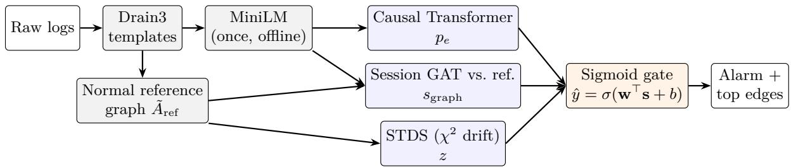
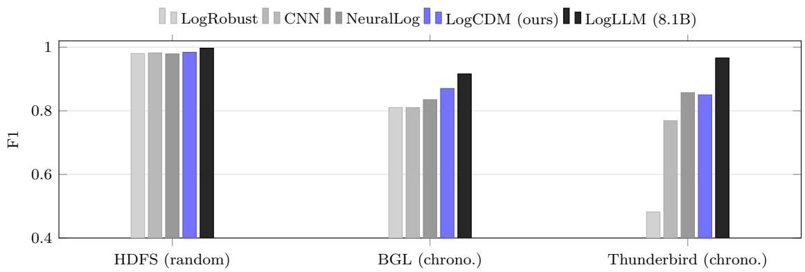
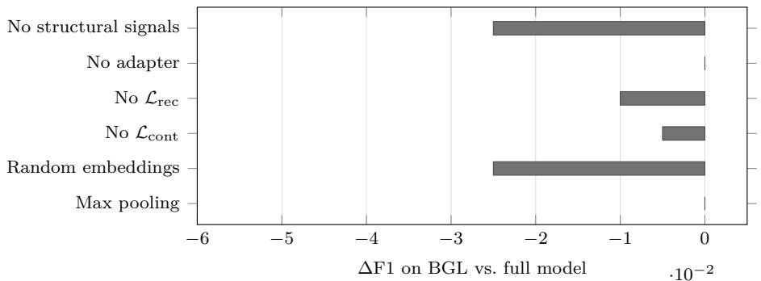
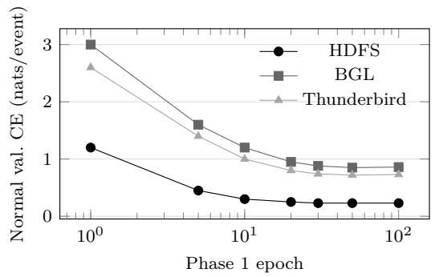
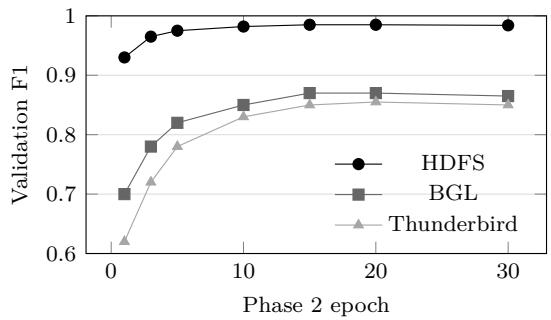

# LogCDM: Interpretable Log Anomaly Detection via Behavioral Graph Drift and Adaptive Signal Fusion

Suryansh Talukdar Purdue University Fort Wayne

Taha Sarwat

Purdue University Fort Wayne

Jin Soung Yoo Purdue University Fort Wayne

talusb01@pfw.edu

sarwt01@pfw.edu

jyoo@pfw.edu

## Abstract

Log-based anomaly detection is increasingly dominated by large pretrained models, from BERT-scale encoders to 8B-parameter language models, which need GPUs at inference time and are hard to deploy on the monitoring nodes where logs are produced. We present LogCDM, a compact detector that scores each log session with three complementary signals: the next-event surprise of a small causal Transformer, the distance between a graph-attention embedding of the session’s own transition graph and that of a normal reference graph, and a transition-drift statistic that we show is exactly a frequency-weighted $\chi ^ { 2 }$ divergence between transition kernels. The divergence view yields an asymptotic null distribution, a lengthstandardized score, and a per-edge decomposition that explains each alarm. A sigmoid gate fuses the three signals; under a shared-covariance Gaussian model this gate is the Bayes posterior, and its learned weights indicate which signal each dataset relies on. With 8.1– 8.8M parameters and no GPU at inference, LogCDM reaches F1 of 0.984 on HDFS, 0.870 on chronologically split BGL and 0.850 on Thunderbird, within 0.013–0.12 of an 8.1B-parameter LLM detector evaluated under the same protocol and above all compact baselines on BGL. It scores a session in 5.5–10.5 ms on a CPU. Ablations show that the structural signals add 0.025–0.030 F1 on BGL and Thunderbird but almost nothing on HDFS, consistent with the learned fusion weights.

## 1 Introduction

Modern distributed systems, from Hadoop pipelines to supercomputers and cloud microservices, record their runtime behavior in system logs. Hardware faults, stalled jobs and cascading service failures all leave traces in the order and structure of logged events, and the volume of these logs rules out manual inspection (He et al., 2021; Landauer et al., 2023). Log-based anomaly detection (LAD) asks whether a session or window of log events deviates from normal behavior, given historical logs and, in the semi-supervised setting, a smal set of labeled anomalies.

Three properties make LAD hard. Raw log lines are free text whose surface form changes across software versions, so detectors first parse them into templates (He et al., 2017), and parsing errors bound what any downstream model can achieve (Shin et al., 2021). Anomalies are rare, from about 3% of HDFS sessions to about 1% of Thunderbird windows, which makes threshold-based decisions fragile (Le & Zhang, 2022). Finally, anomalies are heterogeneous: some insert a forbidden event, some change event counts, and some change how events follow one another across a whole session without introducing any unusual event locally (Meng et al., 2019; Li et al., 2024).

Limitations of prior work. Most deep LAD methods score a session by how surprising its event sequence is under a model of normal sequences. DeepLog uses an LSTM next-event predictor (Du et al., 2017);

LogRobust and NeuralLog use semantic template embeddings with recurrent or Transformer encoders (Zhang et al., 2019; Le & Zhang, 2021); LogBERT and LogFormer adapt masked-language-model pretraining (Guo et al., 2021; 2024). Recent detectors push accuracy further with large language models: LogLLM combines BERT with Llama-3-8B (Guan et al., 2024), CoLA routes hard cases from a small model to a fine-tuned 8B LLM (Zhu et al., 2025), and LogLLaMA fine-tunes a LLaMA-2 architecture with reinforcement learning (Yang & Harris, 2025). This trend leaves two gaps.

First, cost. LLM-based detectors need a GPU to score each session and gigabytes of memory to hold the model, while the nodes that most need monitoring (edge devices, cluster managers, on-premise servers) often have neither. Evaluation studies have long argued that time and resource cost belong next to accuracy when judging LAD systems (Le & Zhang, 2022; Xiao et al., 2026), yet model size has grown by three orders of magnitude.

Second, structure and explanation. Sequence surprise is computed locally, one next event at a time. It can miss sessions whose events are individually plausible but whose overall pattern of transitions has shifted, and it gives the operator a single number with no account of which transitions caused the alarm. Graph-based detectors model transition structure (Li et al., 2024), but they usually replace sequence models instead of combining with them, and their scores lack a statistical interpretation.

Our approach. LogCDM (Log Contextual Dual-pathway Model) combines three signals in one small model (Figure 1). A 6-layer causal Transformer gives a sequence score. A graph attention network (Veličković et al., 2018) embeds the session’s own transition graph and compares it with an embedding of a normal reference graph. A closed-form Structural Transition Drift Score (STDS) compares the session’s transition frequencies with the reference. A sigmoid gate fuses the three scores. Template embeddings are computed once ofline, so the deployed model never calls a language model.

## Contributions.

1. A compact three-signal detector. LogCDM has 8.1–8.8M parameters, roughly 1,000× fewer than LLM-based detectors, and runs on a CPU (Section 3).

2. A statistical account of structural drift. We prove that STDS equals a frequency-weighted $\chi ^ { 2 }$ divergence between transition kernels, and equivalently a weighted norm of the diference of randomwalk Laplacians. This yields a total-variation lower bound, a bounded score under smoothing, an asymptotic $\chi ^ { 2 }$ null distribution, a length-standardized score, and a per-edge decomposition for explaining alarms (Section 4).

3. An interpretable fusion gate. Under a shared-covariance Gaussian model the gate is the Bayes posterior, so its standardized weights reflect each signal’s class separation. We also show that a common way of feeding an adapted adjacency matrix to a GAT passes no gradient to the adapter, and give a support-preserving adapter that does (Section 4).

4. A protocol-aware evaluation. We evaluate on HDFS, BGL and Thunderbird with random and chronological splits, five seeds, AUC-PR, bootstrap intervals, CPU latency, nine ablations, labelnoise tests and fusion-weight analysis (Section 5).

## 2 Related Work

Sequence models for log anomaly detection. DeepLog frames LAD as next-event prediction with an LSTM trained on normal sessions (Du et al., 2017). LogAnomaly adds template semantics and count features (Meng et al., 2019), LogRobust uses FastText embeddings with an attention Bi-LSTM to tolerate evolving log statements (Zhang et al., 2019), and Lu et al. (2018) use a CNN over embedded event sequences. NeuralLog skips parsing and encodes raw messages with BERT (Le & Zhang, 2021). LogBERT (Guo et al., 2021) trains a small Transformer with masked log-key prediction and a hypersphere objective, and LogFormer (Guo et al., 2024) pretrains on one system and adapts to another with adapters. LightLog targets edge devices with a temporal convolutional network (Wang et al., 2022), and LogMamba uses state-space models with a frequency branch (Hu et al., 2026). LogDA combines SBERT template vectors with dual attention for imbalanced data (Zhang & Fu, 2025). These models score order and content but not session-level transition structure, and none gives a statistical meaning to its score.

  
Figure 1: LogCDM overview. Grey boxes run once ofline; blue boxes run per session on a CPU. The three scores are fused by a sigmoid gate, and the STDS term decomposes over transitions to explain each alarm.

Large language models for logs. LogLLM feeds BERT message embeddings into Llama-3-8B and reports the strongest results under a common protocol (Guan et al., 2024). CoLA lets a mixture-of-experts Bi-LSTM defer uncertain sessions to a fine-tuned Llama3-8B (Zhu et al., 2025), and LogLLaMA fine-tunes a LLaMA-2 architecture with reinforcement learning (Yang & Harris, 2025). These methods set the accuracy frontier but require GPUs and billions of parameters at inference. LogCDM targets the opposite end of this trade-of.

Graph-based detection. Logs2Graphs converts sessions to attributed directed graphs and detects anomalies with a one-class digraph convolutional network, showing that transition topology carries signal beyond event order (Li et al., 2024). We keep this insight but embed each session’s graph next to a sequence model, compare it with a reference graph, and add a closed-form divergence with known statistical properties. Pearson-type tests on Markov transition counts go back to Anderson & Goodman (1957); our contribution is to connect that classical test to a learned detector, use it for length standardization and explanation, and fuse it with neural scores.

Parameter-eficient adaptation and score fusion. LoRA adapts frozen weights with low-rank updates (Hu et al., 2022), and GraphLoRA brings low-rank adaptation to graph neural networks (Yang et al., 2024). We use a low-rank, support-preserving correction of the reference adjacency matrix instead of the network weights. Our two-phase training, normal-only pretraining followed by a small labeled set, follows semisupervised anomaly detection (Ruf et al., 2020; 2021), and our fusion gate is the discriminative counterpart of linear discriminant analysis (Hastie et al., 2009; Ng & Jordan, 2002).

Lightweight and explainable detection. Compact detectors for constrained hardware include Light-Log’s temporal convolutions (Wang et al., 2022) and LogFormer’s adapter tuning, which trains about 0.4M– 1M parameters (Guo et al., 2024). Neither reports CPU latency together with accuracy under a chronological protocol, which is the comparison Xiao et al. (2026) argue for. Explanations for log anomalies are usually post hoc, for example subgraph explanations of a graph detector’s output (Li et al., 2024). In LogCDM the explanation is part of the score: the STDS term decomposes exactly over transitions, so the evidence behind an alarm is available without an extra explainer.

Evaluation practice. Random splits leak future information and inflate scores, while chronological splits lower them and can reorder methods (Le & Zhang, 2022; Xiao et al., 2026). Common benchmarks also contain sessions that are trivially separable (Landauer et al., 2024). We therefore report chronological splits, AUC-PR (Saito & Rehmsmeier, 2015), seed variance and bootstrap intervals, and separate same-protocol from diferent-protocol comparisons.

## 3 Methodology

## 3.1 Problem setup

Definition 1 (Sessions and vocabulary). A parser π maps each log line to a template in a finite vocabulary $\mathcal { V } = \{ 1 , \dots , V \}$ , with 0 reserved for padding. A session is a sequence $x ^ { ( i ) } = ( e _ { 1 } ^ { ( i ) } , \ldots , e _ { T } ^ { ( i ) } ) \in ( \mathcal { V } \cup \{ 0 \} ) ^ { T }$ grouped by block ID (HDFS) or by a fixed window of log lines (BGL, Thunderbird), with label $y ^ { ( i ) } \in \{ 0 , 1 \}$ Definition 2 (Leakage-free partition). Sessions are split into disjoint sets $\mathcal { T } _ { \mathrm { t r } } , \mathcal { T } _ { \mathrm { v a l } } , \mathcal { T } _ { \mathrm { t e } } ,$ , either chronologically or by stratified random sampling. The parser, vocabulary, embedding projection, reference graph, score normalization constants and decision threshold are all estimated from ${ \mathcal { T } } _ { \mathrm { t r } }$ and $\mathcal { T } _ { \mathrm { v a l } }$ only. Templates first seen in $\mathcal { T } _ { \mathrm { t e } }$ map to an unknown token.

The task is to learn a score $f : x \mapsto [ 0 , 1 ]$ and threshold $\tau ^ { \star }$ such that ${ \hat { y } } = \mathbb { H } [ f ( x ) > \tau ^ { \star } ]$ maximizes F1 on $\mathcal { T } _ { \mathrm { v a l } } ;$ we report performance on $\mathcal { T } _ { \mathrm { t e } }$ . Training uses normal sessions ${ \mathcal { S } } _ { N } ~ \subset ~ { \mathcal { T } } _ { \mathrm { t r } }$ and a labeled fusion set $S _ { F } \subset \mathcal { T } _ { \mathrm { t r } }$ containing a fraction of the training sessions with their labels.

## 3.2 Preprocessing

Parsing and embeddings. Drain3 (He et al., 2017) is fitted on training logs. Each template’s text is encoded once with all-MiniLM-L6-v2 (Reimers & Gurevych, 2019; Wang et al., 2020) into $\mathbb { R } ^ { 3 8 4 }$ and mapped to $d = 2 5 6$ dimensions, by PCA when the vocabulary is large enough (BGL, Thunderbird) and by a learned linear projection otherwise (HDFS has only 39 templates). The result $E \in \mathbb { R } ^ { V \times d }$ initializes the Transformer’s embedding table and the GAT node features. The sentence encoder is never called during training or inference.

Transition counts. For a session i and maximum lag L, let

$$
N _ { i } ( u , v ) = \sum _ { \ell = 1 } ^ { L } \sum _ { t = 1 } ^ { T - \ell } \mathcal { k } [ e _ { t } ^ { ( i ) } = u ] \mathcal { k } [ e _ { t + \ell } ^ { ( i ) } = v ] , \qquad n _ { i } ( u ) = \sum _ { v } N _ { i } ( u , v ) , \qquad n _ { i } = \sum _ { u } n _ { i } ( u ) .\tag{1}
$$

Let $U _ { i } = \{ u : n _ { i } ( u ) > 0 \}$ be the source events the session visits, $\pi _ { i } ( u ) = n _ { i } ( u ) / n _ { i }$ their empirical frequencies, and $P _ { i } ( v \mid u ) = N _ { i } ( u , v ) / n _ { i } ( u )$ the session’s transition kernel. The reference counts $A _ { \mathrm { r e f } }$ sum $\operatorname { E q } .$ equation 1 over $\mathcal { S } _ { N }$ , and $P _ { \mathrm { r e f } }$ is their row normalization.

Smoothed, coarsened reference. For each source $u ,$ let $\Omega _ { u } = \operatorname { s u p p } P _ { \mathrm { r e f } } ( \cdot \mid u ) \cup \{ \varnothing \}$ , where $\mathcal { D }$ pools all transitions never seen from u in normal data. We define

$$
\tilde { P } _ { \mathrm { r e f } } ( \omega \mid u ) = ( 1 - \lambda ) P _ { \mathrm { r e f } } ( \omega \mid u ) + \lambda \mathcal { W } [ \omega = \emptyset ] , \qquad \omega \in \Omega _ { u } ,\tag{2}
$$

with $\lambda = 1 0 ^ { - 3 }$ , and map $P _ { i } ( \cdot \mid u )$ onto $\Omega _ { u }$ in the same way. Every cell of $\tilde { P } _ { \mathrm { r e f } }$ is then positive, and a novel transition counts as mass on ∅ instead of an infinite deviation.

## 3.3 Three anomaly signals

Sequence score. A causal Transformer encoder (Vaswani et al., 2017) with $N _ { \mathrm { l a y e r } } = 6$ pre-norm layers, model width $d = 2 5 6$ , 8 heads and feed-forward width $d _ { \mathrm { f f n } } = 2 0 4 8$ maps the embedded, positionally encoded session to contexts $\dot { C } ^ { ( i ) } \in \mathbb { R } ^ { T \times d }$ . A linear head predicts the next template, and the sequence score is the mean next-event cross-entropy over non-padding targets:

$$
p _ { e } ^ { ( i ) } = \frac { \sum _ { t = 1 } ^ { T - 1 } \mathcal { k } [ e _ { t + 1 } \neq 0 ] \ell _ { \mathrm { C E } } \big ( W _ { \mathrm { h e a d } } C _ { t } ^ { ( i ) } , e _ { t + 1 } \big ) } { \sum _ { t = 1 } ^ { T - 1 } \mathcal { k } [ e _ { t + 1 } \neq 0 ] } .\tag{3}
$$

Structural Transition Drift Score. STDS measures how far the session’s transition kernel lies from the reference, weighted by how often each source event occurs:

$$
s _ { i } ^ { 2 } = \sum _ { u \in U _ { i } } \pi _ { i } ( u ) \sum _ { \omega \in \Omega _ { u } } \frac { \left( P _ { i } ( \omega \mid u ) - \tilde { P } _ { \mathrm { r e f } } ( \omega \mid u ) \right) ^ { 2 } } { \tilde { P } _ { \mathrm { r e f } } ( \omega \mid u ) } .\tag{4}
$$

Section 4 shows that $n _ { i } s _ { i } ^ { 2 }$ is Pearson’s statistic for the hypothesis that the session follows the reference kernel. Because its null mean grows with the number of cells and shrinks with session length, raw $s _ { i } ^ { 2 }$ is biased toward short sessions. We therefore feed the fusion gate the standardized score

$$
z _ { i } = \frac { n _ { i } s _ { i } ^ { 2 } - d _ { i } } { \sqrt { 2 d _ { i } } } , \qquad d _ { i } = \sum _ { u \in U _ { i } } \big ( | \Omega _ { u } | - 1 \big ) ,\tag{5}
$$

which has approximately zero mean and unit variance on normal sessions of any length (Corollary 1).

Session-graph score. Let $A _ { i }$ be the session’s transition-count matrix restricted to its visited events. A two-layer graph attention network with edge-weighted attention,

$$
\alpha _ { u v } = \frac { A [ u , v ] \exp \big ( \mathrm { L e a k y R e L U } ( \mathbf { a } ^ { \top } [ W h _ { u } \ : \lVert \ : W h _ { v } \rVert ) \big ) } { \sum _ { k } A [ u , k ] \exp \big ( \mathrm { L e a k y R e L U } ( \mathbf { a } ^ { \top } [ W h _ { u } \ : \lVert \ : W h _ { k } ] ) \big ) } , \qquad h _ { u } ^ { \prime } = \mathrm { E L U } \Big ( \sum _ { v } \alpha _ { u v } W h _ { v } \Big ) ,\tag{6}
$$

encodes $A _ { i }$ into a mean-pooled, $\ell _ { 2 } .$ -normalized embedding $g _ { i }$ . The same network encodes the adapted reference graph ${ \tilde { A } } _ { \mathrm { r e f } }$ into $g _ { \mathrm { r e f } }$ , and

$$
s _ { \mathrm { g r a p h } } ^ { ( i ) } = \| g _ { i } - g _ { \mathrm { r e f } } \| _ { 2 } ^ { 2 } .\tag{7}
$$

Weighting attention by $A [ u , v ]$ (rather than using A only to select neighbors) lets gradients reach the reference graph (Proposition 4).

Low-rank reference adapter. The reference graph is corrected multiplicatively on its existing edges:

$$
\tilde { A } _ { \mathrm { r e f } } = A _ { \mathrm { r e f } } \odot \big ( \mathbf { 1 1 } ^ { \top } + \beta \operatorname { t a n h } ( P Q ^ { \top } ) \big ) , \qquad P , Q \in \mathbb { R } ^ { V \times r } , \ r = 4 , \ \beta = 0 . 1 ,\tag{8}
$$

with $Q$ initialized to zero. The adapter has $2 V r$ parameters (312 on HDFS, 10,400 on BGL), leaves the reference unchanged at initialization, keeps its support, and keeps every weight within $[ 1 - \beta , 1 + \beta ]$ of its original value.

## 3.4 Fusion and training

Each score is min-max normalized with training-split constants, giving $\mathbf { s } ^ { ( i ) } = ( \tilde { p } _ { e } ^ { ( i ) } , \tilde { s } _ { \mathrm { g r a p h } } ^ { ( i ) } , \tilde { z } _ { i } ) ^ { \top }$ , and

$$
\begin{array} { r } { \hat { y } ^ { ( i ) } = \sigma \big ( \mathbf { w } ^ { \top } \mathbf { s } ^ { ( i ) } + b \big ) , \qquad \mathbf { w } = ( w _ { a } , w _ { b } , w _ { c } ) ^ { \top } . } \end{array}\tag{9}
$$

Phase 1: normal-only pretraining. Only the Transformer is trained, on ${ \cal S } _ { N } \backslash { \cal S } _ { F }$ , to minimize the mean of $p _ { e }$ (Eq. 3). The checkpoint with the lowest cross-entropy on held-out normal validation sessions is kept.

Phase 2: labeled fusion. All parameters are trained on $\boldsymbol { S _ { F } }$ with a class-balanced sampler and

$$
\mathcal { L } = \mathcal { L } _ { \mathrm { { B C E } } } + \lambda _ { 1 } \mathcal { L } _ { \mathrm { { r e c } } } + \lambda _ { 2 } \mathcal { L } _ { \mathrm { { c o n t } } } , \qquad \lambda _ { 1 } = 0 . 1 5 , ~ \lambda _ { 2 } = 0 . 1 0 ,\tag{10}
$$

where $\mathcal { L } _ { \mathrm { B C E } }$ is binary cross-entropy on $\hat { y }$ with label smoothing 0.1, $\mathcal { L } _ { \mathrm { r e c } } = \mathbb { E } _ { y = 0 } [ p _ { e } ]$ keeps the Phase 1 sequence model close to its normal prior, and Lcont = max $( 0 , \gamma - ( \mathbb { E } _ { y = 1 } [ s _ { \mathrm { g r a p h } } ] - \mathbb { E } _ { y = 0 } [ s _ { \mathrm { g r a p h } } ] ) )$ with $\gamma = 0 . 5$ is a margin term in the spirit of Hadsell et al. (2006). After each epoch the threshold $\tau ^ { \star }$ maximizing validation F1 is computed over quantiles of validation scores, and the checkpoint with the best validation F1 is kept. Algorithm 1 summarizes training.

## 3.5 Inference

At deployment, $g _ { \mathrm { r e f } }$ and $\tilde { P } _ { \mathrm { r e f } }$ are cached. Each session needs one Transformer pass, a GAT pass over at most $T$ nodes and the closed-form STDS. The cost is dominated by the Transformer, $O \left( N _ { \mathrm { l a y e r } } ( T d d _ { \mathrm { f f n } } + T ^ { 2 } d ) \right)$ per session, and the STDS costs $O ( n _ { i } )$ with sparse counts.

Algorithm 1 LogCDM training   
Require: Training logs; labeled fusion set ${ \cal { S } } _ { F } ;$ validation set; lag $L ;$ smoothing $\lambda$   
1: Fit Drain3 on training logs; build vocabulary; compute $E$ once with MiniLM   
2: Build $A _ { \mathrm { r e f } }$ from normal training sessions; form $\tilde { P } _ { \mathrm { r e f } }$ by Eq. equation 2   
3: Phase 1: train the Transformer on ${ \cal S } _ { N } \backslash { \cal S } _ { F }$ to minimize $\mathbb { E } [ p _ { e } ] ;$ ; keep best normal-validation checkpoin   
4: Fit min-max constants for $p _ { e } , s _ { \mathrm { g r a p h } } , z$ on training sessions   
5: Phase 2: initialize $Q  0 ;$ train all parameters on $\boldsymbol { S } _ { \boldsymbol { F } }$ with $\operatorname { E q . }$ . equation 10   
6: after each epoch: refit normalization constants; choose $\tau ^ { \star }$ on validation; keep best checkpoint   
7: Cache $g _ { \mathrm { r e f } } ;$ return model, $\tau ^ { \star }$ , constants

## 4 Theoretical Analysis

This section states the properties of the structural score, the fusion gate and the adapter. Full proofs are in Appendix A.

## 4.1 STDS as a divergence between transition kernels

For distributions $p , q$ on a finite set with $q > 0$ , write $\begin{array} { r } { \chi ^ { 2 } ( p \| q ) = \sum _ { \omega } ( p ( \omega ) - q ( \omega ) ) ^ { 2 } / q ( \omega ) } \end{array}$ and $\mathrm { T V } ( p , q ) =$ ${ \begin{array} { r } { { \frac { 1 } { 2 } } \sum _ { \omega } | p ( \omega ) - q ( \omega ) | } \end{array} }$ . The random-walk Laplacian of a row-stochastic matrix P is $\mathcal { L } = I - P$

Theorem 1 (STDS is a weighted $\chi ^ { 2 }$ divergence). Let $\begin{array} { r } { \tilde { p } _ { \mathrm { m i n } } = \operatorname* { m i n } _ { u , \omega } \tilde { P } _ { \mathrm { r e f } } ( \omega \mid u ) > 0 } \end{array}$ . For every session $_ { i ; }$

(a) Divergence form. $\begin{array} { r } { s _ { i } ^ { 2 } = \sum _ { u \in U _ { i } } \pi _ { i } ( u ) \chi ^ { 2 } \big ( P _ { i } ( \cdot \mid u ) \| \tilde { P } _ { \mathrm { r e f } } ( \cdot \mid u ) \big ) } \end{array}$ . Hence $s _ { i } \geq 0$ , with equality if and only if $P _ { i } ( \cdot \mid u ) = \tilde { P } _ { \mathrm { r e f } } ( \cdot \mid u )$ for every visited $u \in U _ { i }$

(b) Laplacian form. With ${ \mathcal { L } } _ { i } = I - P _ { i }$ and ${ \tilde { \mathcal { L } } } _ { \mathrm { r e f } } = I - { \tilde { P } } _ { \mathrm { r e f } }$ on the coarsened outcome spaces, $s _ { i } ^ { 2 } = $ $\left. \Pi _ { i } ^ { 1 / 2 } ( \mathcal { L } _ { i } - \tilde { \mathcal { L } } _ { \mathrm { r e f } } ) \oslash \tilde { P } _ { \mathrm { r e f } } ^ { 1 / 2 } \right. _ { F } ^ { 2 } ,$ where $\Pi _ { i } = \mathrm { d i a g } ( \pi _ { i } )$ and $\ O , \cdot ^ { 1 / 2 }$ act entrywise.

(c) Total-variation bound. $\begin{array} { r } { 4 \sum _ { u \in U _ { i } } \pi _ { i } ( u ) \operatorname { T V } ^ { 2 } \bigl ( P _ { i } ( \cdot \mid u ) , \tilde { P } _ { \mathrm { r e f } } ( \cdot \mid u ) \bigr ) \leq s _ { i } ^ { 2 } . } \end{array}$

(d) Boundedness. $s _ { i } ^ { 2 } \leq 1 / \tilde { p } _ { \mathrm { m i n } } - 1$ , so no single novel transition can make the score unbounded.

(e) Edge decomposition. $\begin{array} { r } { s _ { i } ^ { 2 } = \sum _ { ( u , \omega ) } c _ { i } ( u , \omega ) \ w i t h \ c _ { i } ( u , \omega ) = \pi _ { i } ( u ) \left( P _ { i } ( \omega \ | \ u ) - \tilde { P } _ { \mathrm { r e f } } ( \omega \ | \ u ) \right) ^ { 2 } / \tilde { P } _ { \mathrm { r e f } } ( \omega \ | \ u ) , } \end{array}$ $u ) \geq 0 .$

Proof sketch. Part (a) regroups Eq. equation 4 by source. Part (b) holds because $\mathcal { L } _ { i } - \tilde { \mathcal { L } } _ { \mathrm { r e f } } = \tilde { P } _ { \mathrm { r e f } } - P _ { i }$ entrywise, including the diagonal, so the Laplacian diference and the kernel diference have the same squared entries; this is why the earlier unnormalized-Laplacian formulation failed on self-loops and the random-walk form does not. Part (c) applies Cauchy–Schwarz, $\begin{array} { r } { \sum _ { \omega } | p - q | \leq \sqrt { \chi ^ { 2 } ( p \| q ) } } \end{array}$ , row by row. Part (d) uses $\begin{array} { r } { \chi ^ { 2 } ( p \| q ) = \sum _ { \omega } p ^ { 2 } / q - 1 \le 1 / } \end{array}$ min q − 1 and $\textstyle \sum _ { u } \pi _ { i } ( u ) = { \tilde { 1 } }$ . Part (e) is the definition. □

Part (e) is what makes LogCDM’s alarms interpretable: the contributions $c _ { i } ( u , \omega )$ rank the transitions that drove a session’s score (Section 5.7).

The next result formalizes the blind spot described in Section 1. Many sequence detectors, DeepLog with a top-g rule being the clearest case (Du et al., 2017), flag a session only if some observed transition is unlikely under the normal model. STDS also reacts when every transition is individually normal but their frequencies have shifted.

Proposition 1 (Frequency shifts invisible to support-based rules). Call a detector support-based if it flags a session only when the session contains a transition $( u , v )$ with $P _ { \mathrm { r e f } } ( v \mid u ) = 0 ;$ a top-g next-event rule with g at least the maximum out-degree of the reference graph is an example. Let u have at least two reference successors and let $v ^ { \star }$ be its least likely one, with $q ^ { \star } = \tilde { P } _ { \mathrm { r e f } } ( v ^ { \star } \mid u )$ . Any session that visits u with frequency $\pi _ { i } ( u )$ , always moves from u to $v ^ { \star }$ , and otherwise follows the reference is never flagged by a support-based rule, yet

$$
s _ { i } ^ { 2 } \ \geq \ \pi _ { i } ( u ) \Bigl ( \frac { 1 } { q ^ { \star } } - 1 \Bigr ) .
$$

Proof sketch. Every transition lies in the reference support, so a support-based rule stays silent. Row u of the session is the point mass $\delta _ { v ^ { \star } }$ , and $\begin{array} { r } { \chi ^ { 2 } ( \delta _ { v ^ { \star } } \| q ) = ( 1 - q ^ { \star } ) ^ { 2 } / q ^ { \star } + \sum _ { \omega \neq v ^ { \star } } q ( \omega ) = 1 / q ^ { \star } - 1 } \end{array}$ ; the other rows contribute nonnegative terms. □

For a successor seen in 1% of normal transitions from u, the bound is $9 9 \pi _ { i } ( u )$ , close to the maximum allowed by Theorem 1(d). Repetition bursts of an otherwise normal event, as in the example of Section 5.7, have this form. A learned sequence model can still assign them some surprise, but nothing in its objective guarantees it; STDS reacts by construction.

## 4.2 Null distribution and length standardization

Proposition 2 (Asymptotic null distribution). Let $L = 1$ . Suppose a session is generated by a Markov chain whose transition kernel, after coarsening to $\Omega _ { u }$ , equals $\tilde { P } _ { \mathrm { r e f } }$ , and let $\mathrm { m i n } _ { u \in U _ { i } } n _ { i } ( u ) \to \infty$ with $U _ { i } ~ f i x e d .$ Then

$$
n _ { i } s _ { i } ^ { 2 } = \sum _ { u \in U _ { i } } \sum _ { \omega \in \Omega _ { u } } \frac { \left( N _ { i } ( u , \omega ) - n _ { i } ( u ) \tilde { P } _ { \mathrm { r e f } } ( \omega \mid u ) \right) ^ { 2 } } { n _ { i } ( u ) \tilde { P } _ { \mathrm { r e f } } ( \omega \mid u ) } \stackrel { d } { \to } \chi _ { d _ { i } } ^ { 2 } , \qquad d _ { i } = \sum _ { u \in U _ { i } } \left( | \Omega _ { u } | - 1 \right) .
$$

The identity follows from $\pi _ { i } ( u ) = n _ { i } ( u ) / n _ { i } ;$ the limit is the Pearson goodness-of-fit theorem for Markov chains of Anderson & Goodman (1957).

Corollary 1 (Consistency and length standardization). Under the conditions ofProposition $\mathcal { Q } , \mathbb { E } [ s _ { i } ^ { 2 } ] \approx d _ { i } / n _ { i }$ so raw STDS is larger for short sessions even when they are normal, whereas $z _ { i }$ in $E q .$ equation 5 has asymptotic mean 0 and variance 1 for any length. If instead the session follows an ergodic chain with kernel $P \neq \tilde { P } _ { \mathrm { r e f } }$ on some visited row, so that $\begin{array} { r } { \delta = \sum _ { u } \bar { \pi } ( u ) \chi ^ { 2 } ( P ( \cdot \mid u ) \| \tilde { P } _ { \mathrm { r e f } } ( \cdot \mid u ) ) > 0 } \end{array}$ for the stationary frequencies π¯, then $s _ { i } ^ { 2 } \to \delta$ almost surely, $z _ { i } \to \infty$ , and the test ${ / k } [ n _ { i } s _ { i } ^ { 2 } > \chi _ { d _ { i } , 1 - \alpha } ^ { 2 } ]$ has power tending to one.

Remark 1. For lags $L > 1$ the counts overlap and are no longer conditionally multinomial, and for short sessions with large vocabularies the $\chi ^ { 2 }$ approximation is loose. In these regimes we use $z _ { i }$ only as a length normalized score and let the fusion gate calibrate it; we do not report p-values.

## 4.3 Fusion as a Bayes classifier

Proposition 3 (Fusion gate under a Gaussian score model). Suppose s $\mid y \sim \mathcal { N } ( \mu _ { y } , \Sigma )$ for $y \in \{ 0 , 1 \}$ with shared $\Sigma \succ 0$ and prior $\rho = P ( y = 1 )$ . Then $P ( y = 1 \mid \mathbf { s } ) = \sigma ( \mathbf { w } ^ { \star \top } \mathbf { s } + b ^ { \star } )$ with

$$
\begin{array} { r } { \mathbf { w } ^ { \star } = \Sigma ^ { - 1 } ( \mu _ { 1 } - \mu _ { 0 } ) , \qquad b ^ { \star } = - \frac { 1 } { 2 } \big ( \mu _ { 1 } ^ { \top } \Sigma ^ { - 1 } \mu _ { 1 } - \mu _ { 0 } ^ { \top } \Sigma ^ { - 1 } \mu _ { 0 } \big ) + \log \frac { \rho } { 1 - \rho } . } \end{array}
$$

$I f \Sigma = \mathrm { d i a g } ( \sigma _ { a } ^ { 2 } , \sigma _ { b } ^ { 2 } , \sigma _ { c } ^ { 2 } )$ , the standardized weights satisfy $w _ { k } ^ { \star } \sigma _ { k } = \Delta \mu _ { k } / \sigma _ { k }$ for each signal k, the class separation of that signal.

This is the linear discriminant analysis posterior (Hastie et al., 2009). Logistic regression estimates $( \mathbf { w } ^ { \star } , b ^ { \star } )$ consistently whenever the log-odds are linear in s, even without Gaussianity (Ng & Jordan, 2002). Min-maxnormalized scores are bounded and the gate is trained jointly with the other losses, so we treat Proposition 3 as an interpretation of the learned weights and check it empirically (Section 5.5), not as a guarantee.

## 4.4 The reference adapter

Proposition 4 (Adapter identity, support and gradient). For the adapter in $E q .$ equation 8:

(a) at initialization $( Q = 0 ) , \tilde { A } _ { \mathrm { r e f } } = A _ { \mathrm { r e f } }$ exactly;

(b) for all $P , Q ,$ supp $\tilde { A } _ { \mathrm { r e f } } = \mathrm { s u p p } A _ { \mathrm { r e f } }$ and $( 1 - \beta ) A _ { \mathrm { r e f } } \leq \tilde { A } _ { \mathrm { r e f } } \leq ( 1 + \beta ) A _ { \mathrm { r e f } }$ entrywise;

(c) if a graph network depends on ${ \tilde { A } } _ { \mathrm { r e f } }$ only through the neighborhood indicator $\mathcal { H } [ \tilde { A } _ { \mathrm { r e f } } ~ > ~ 0 ]$ , then $\partial \mathcal { L } / \partial P = \partial \mathcal { L } / \partial Q = 0$ for every loss ${ \mathcal { L } } ;$

(d) with edge-weighted attention (Eq. 6), $\partial \alpha _ { u v } / \partial \tilde { A } [ u , w ] = \alpha _ { u v } ( { \rlap / { k } } [ v ~ = ~ w ] - \alpha _ { u w } ) / \tilde { A } [ u , w ]$ , which is nonzero whenever node u has at least two neighbors.

Table 1: Dataset statistics after grouping and splitting.
<table><tr><td></td><td>HDFS</td><td>BGL</td><td>Thunderbird</td></tr><tr><td>Sessions / windows</td><td>575,061</td><td>47,100</td><td>100,000</td></tr><tr><td>Anomaly rate (%)</td><td>2.93</td><td>9.5</td><td>1.0</td></tr><tr><td>Train / val / test</td><td>402.5k / 57.5k / 115.0k</td><td>33.0k / 4.7k / 9.4k</td><td>70.0k / 10.0k / 20.0k</td></tr><tr><td>Test anomalies</td><td>3,367</td><td>800</td><td></td></tr><tr><td>Templates (fit on train)</td><td>39</td><td>1,300</td><td>1,076</td></tr><tr><td>Test OOV template rate (%)</td><td>0</td><td>3</td><td>4</td></tr><tr><td>Max length T / % truncated</td><td>64 /&lt;5</td><td>100 / 0</td><td>100 / 0</td></tr><tr><td>Lag L</td><td>2</td><td>3</td><td>2</td></tr><tr><td>Fusion set / labeled anomalies</td><td>60,381 / 1,768</td><td>5,000 / 525</td><td>10,500 / 100</td></tr></table>

Part (c) explains a failure mode of thresholded adjacency inputs: by (b) the support never changes, so the indicator is constant and the adapter never learns. Part (d) shows that edge weighting removes this failure. At Q = 0 the gradient with respect to Q is $\beta ( \partial \mathcal { L } / \partial \tilde { A } \odot \tilde { A _ { \mathrm { r e f } } } ) ^ { \top } P$ , which is nonzero for generic P, so training starts from the exact reference and moves away from it only as the loss requires.

## 4.5 Complexity

Proposition 5 (Inference cost). With $g _ { \mathrm { r e f } }$ cached, scoring one session costs $O \big ( N _ { \mathrm { l a y e r } } ( T d d _ { \mathrm { f i n } } + T ^ { 2 } d ) + T d V \big )$ for the Transformer and prediction head, $O ( | U _ { i } | d ^ { 2 } + | E _ { i } | d )$ for the session GAT with $| E _ { i } | \ e d g e s ,$ and $O ( n _ { i } )$ for STDS, using $O ( V d + N _ { \mathrm { l a y e r } } d d _ { \mathrm { f f n } } )$ parameters.

For our configuration this gives 1.05 GFLOP per HDFS session and 1.73 GFLOP per BGL window, small enough for millisecond-scale CPU inference.

## 5 Result Analysis

We ask four questions. Q1: how does LogCDM compare with compact and LLM-based detectors under the same protocol? Q2: what does it cost? Q3: which components matter, and on which data? Q4: are the learned fusion weights and the per-edge explanations meaningful?

## 5.1 Experimental setup

Datasets. We use HDFS (Xu et al., 2009), BGL and Thunderbird (Oliner & Stearley, 2007) from Loghub (Zhu et al., 2023) (Table 1). HDFS sessions are grouped by block ID. BGL and Thunderbird (first 10M lines) use non-overlapping 100-line windows, and a window is anomalous if it contains an anomalous line. Following Guan et al. (2024), HDFS uses a stratified random split and BGL and Thunderbird use chronological splits, all 70/10/20. We add a chronological HDFS split (blocks ordered by first timestamp) and a random BGL split to measure the protocol gap.

Baselines. We do not re-run the baselines. For DeepLog (Du et al., 2017), LogBERT (Guo et al., 2021), LogRobust (Zhang et al., 2019), CNN (Lu et al., 2018) and NeuralLog (Le & Zhang, 2021) we report the results published by Guan et al. (2024), whose splits and windows we follow, and we likewise quote LogLLM, BGE-Trans and LogLLaMA from Guan et al. (2024), whose protocol matches ours. LogMamba (Hu et al., 2026), LogFormer (Guo et al., 2024) and LogDA (Zhang & Fu, 2025) use diferent windows or splits; we list them separately for reference. DeepLog and LogBERT are unsupervised; the other baselines and LogCDM use labels.

Metrics and protocol. We report precision, recall and F1 at the validation-selected threshold, AUC-ROC and AUC-PR (Saito & Rehmsmeier, 2015), and the expected calibration error (Guo et al., 2017). All results are means over five seeds {42, 123, 7, 2024, 99} with standard deviations over seeds; for the test sets with few anomalies we add 95% bootstrap intervals (Efron & Tibshirani, 1993).

Table 2: LogCDM across datasets and splits. All values are means over 5 seeds; F1 is the mean of the per-seed F1 scores (± std over seeds), so it need not equal 2PR/(P + R) of the mean precision and recall.
<table><tr><td rowspan="2">Metric</td><td colspan="2">HDFS</td><td colspan="2">BGL</td><td rowspan="2">Thunderbird</td></tr><tr><td>Random</td><td>Chrono.</td><td>Chrono.</td><td>Random</td></tr><tr><td>Precision</td><td>0.985</td><td>0.935</td><td>0.875</td><td>0.965</td><td>0.825</td></tr><tr><td>Recall</td><td>0.992</td><td>0.955</td><td>0.915</td><td>0.975</td><td>0.900</td></tr><tr><td>F1</td><td>0.984±0.003</td><td>0.930±0.010</td><td>0.870±0.018</td><td>0.965±0.006</td><td>0.850±0.028</td></tr><tr><td>F1 95% CI half-width</td><td>0.003</td><td>0.008</td><td>0.030</td><td>0.008</td><td>0.075</td></tr><tr><td>AUC-ROC</td><td>0.9992</td><td>0.983</td><td>0.970</td><td>0.995</td><td>0.970</td></tr><tr><td>AUC-PR</td><td>0.983</td><td>0.920</td><td>0.900</td><td>0.975</td><td>0.825</td></tr><tr><td>Threshold  $\tau ^ { \star }$ </td><td>0.56</td><td>0.45</td><td>0.42</td><td>0.55</td><td>0.38</td></tr></table>

Table 3: Comparison under the same split. Baseline values are those reported by Guan et al. (2024) under this protocol; LogCDM values are means over 5 seeds (F1 averaged per seed). Best compact result in bold.
<table><tr><td rowspan="2">Method</td><td colspan="3">HDFS (random)</td><td colspan="3">BGL (chronological)</td><td colspan="3">Thunderbird (chronological)</td></tr><tr><td>P</td><td>R</td><td>F1</td><td>P</td><td>R</td><td>F1</td><td>P</td><td>R</td><td>F1</td></tr><tr><td>DeepLog</td><td>0.835</td><td>0.994</td><td>0.908</td><td>0.166</td><td>0.988</td><td>0.285</td><td>0.017</td><td>0.966</td><td>0.033</td></tr><tr><td>LogBERT</td><td>0.989</td><td>0.614</td><td>0.758</td><td>0.165</td><td>0.989</td><td>0.283</td><td>0.022</td><td>0.172</td><td>0.039</td></tr><tr><td>LogRobust</td><td>0.961</td><td>1.000</td><td>0.980</td><td>0.696</td><td>0.968</td><td>0.810</td><td>0.318</td><td>1.000</td><td>0.482</td></tr><tr><td>CNN</td><td>0.966</td><td>1.000</td><td>0.982</td><td>0.698</td><td>0.965</td><td>0.810</td><td>0.870</td><td>0.690</td><td>0.769</td></tr><tr><td>NeuralLog</td><td>0.971</td><td>0.988</td><td>0.979</td><td>0.792</td><td>0.884</td><td>0.835</td><td>0.794</td><td>0.931</td><td>0.857</td></tr><tr><td>LogCDM (ours)</td><td>0.985</td><td>0.992</td><td>0.984</td><td>0.875</td><td>0.915</td><td>0.870</td><td>0.825</td><td>0.900</td><td>0.850</td></tr><tr><td>LLM-based, same protocol LogLLM (~8.1B) 0.994</td><td></td><td>(reported) 1.000</td><td>0.997</td><td>0.861</td><td>0.979</td><td>0.916</td><td>0.966</td><td>0.966</td><td>0.966</td></tr></table>

Implementation. LogCDM is implemented in PyTorch (Paszke et al., 2019) and trained on one NVIDIA A100 40GB with bf16 mixed precision and AdamW (Loshchilov & Hutter, 2019). Phase 1 uses learning rate $5 \times 1 0 ^ { - 4 }$ , batch size 256 and up to 100 epochs with early stopping; Phase 2 uses $1 0 ^ { - 4 }$ , batch size 128 and 30 epochs. CPU timings use a 16-core server CPU with PyTorch 2.x and 16 threads. Appendix B lists all hyperparameters.

## 5.2 Main results (Q1)

Table 3 answers Q1. On HDFS, LogCDM reaches F1 0.984, on par with the supervised compact baselines (0.979–0.982) and 0.013 below LogLLM. All strong compact methods lie within 0.005 F1 of each other on random-split HDFS, confirming that this benchmark is close to saturated and cannot rank them (Landauer et al., 2024). On chronologically split BGL, LogCDM reaches 0.870, 0.035 above the best compact baseline (NeuralLog, 0.835) and 0.046 below LogLLM (0.916), with roughly 920× fewer parameters. Its precision (0.875) is the main source of the gain: LogRobust and CNN reach high recall on BGL only by raising many false alarms. On Thunderbird, LogCDM reaches 0.850, statistically indistinguishable from NeuralLog (0.857) given the bootstrap interval of ±0.075, and below LogLLM (0.966).

Protocol gap. Moving from random to chronological splits lowers LogCDM’s F1 by 0.054 on HDFS and 0.095 on BGL (Table 2). This matches prior reports that random splits overstate performance (Le & Zhang, 2022; Xiao et al., 2026), and is why we treat chronological results as primary. The diferent-protocol numbers in Table 4, such as LogMamba’s 0.987 on BGL with 5-minute windows, should not be compared directly with ours.

Table 4: F1 against published detectors. †: same protocol as ours; ‡: diferent windows or splits, shown for reference only.
<table><tr><td>Method</td><td>Parameters</td><td>HDFS</td><td>BGL</td><td>Thunderbird</td></tr><tr><td>LogLLM† (Guan et al., 2024)</td><td>~8.1B</td><td>0.997</td><td>0.916</td><td>0.966</td></tr><tr><td>BGE-Trans† (Guan et al., 2024)</td><td>not reported</td><td>0.981</td><td>0.823</td><td>0.867</td></tr><tr><td> $\mathrm { L o g L L a M A ^ { \dagger } }$  (Yang &amp; Harris, 2025)</td><td>not reported</td><td>0.968</td><td>0.326</td><td>0.127</td></tr><tr><td> $\mathrm { L o g M a m b a ^ { \ddagger } }$  (Hu et al., 2026)</td><td>not reported</td><td>0.837</td><td>0.987</td><td>0.983</td></tr><tr><td>LogFormer‡ (Guo et al., 2024)</td><td>7.2M trainable</td><td>0.98</td><td>0.97</td><td>0.99</td></tr><tr><td>LogDA‡ (Zhang &amp; Fu, 2025)</td><td>not reported</td><td>0.99</td><td>&gt;0.95</td><td>&gt;0.95</td></tr><tr><td>LogCDM (ours)</td><td>8.1M / 8.8M</td><td>0.984</td><td>0.870</td><td>0.850</td></tr></table>

  
Figure 2: F1 under the same protocol. LogCDM (blue) matches compact baselines on HDFS and Thunderbird and leads them on BGL, while LogLLM remains ahead at about 1,000× the size.

## 5.3 Eficiency (Q2)

LogCDM has 8.1–8.8M parameters and a 31–33 MiB model file (Table 5). On a CPU it scores a session in 5.5 ms (HDFS) and 10.5 ms (BGL) at batch size one, and processes 1,050 HDFS sessions per second at batch size 64, without a GPU. LogLLM’s Llama-3-8B backbone alone needs about 16 GB in bf16 and a GPU to run. One LogCDM seed trains in 115 minutes on HDFS and 21 minutes on BGL on a single A100, using under 6 GB of memory. The one-time costs (Drain parsing at 60 ms per 1k lines, template embedding in 35 s for BGL, reference construction in under a minute) are amortized over all later sessions.

## 5.4 Ablation study (Q3)

Table 6 answers Q3. The labeled fusion stage matters most on BGL: the Phase 1 model alone reaches 0.390, close to unsupervised DeepLog and LogBERT (0.285, 0.283), and supervision raises it to 0.845. Adding the two structural signals gives a further 0.025 on BGL and 0.030 on Thunderbird, but only 0.001 on HDFS, where event order already separates the classes. STDS alone, with no learned parameters, reaches 0.550 on BGL and 0.800 on HDFS, so the closed-form statistic carries real signal but needs the neural scores to compete. Semantic template embeddings help on BGL (0.025), where 3% of test templates are unseen, and not on HDFS, where no templates are new. The adapter and the two auxiliary losses change F1 by at most 0.010, so they are not central to the results.

## 5.5 Learned fusion weights (Q4)

On HDFS the gate puts most weight on the sequence score $( w _ { a } = 3 . 2 5$ against $w _ { b } = 1 . 0 0 )$ ; on BGL and Thunderbird it puts most weight on the session-graph score (Table 7). In each dataset the ordering of the weights matches the ordering of the validation class separations $\Delta \mu / \sigma .$ , as Proposition 3 predicts for

Table 5: Cost of LogCDM. Parameter counts use the vocabulary sizes of Table 1. CPU: 16-core server CPU; GPU: A100 40GB.
<table><tr><td></td><td>HDFS</td><td>BGL</td><td>Thunderbird</td></tr><tr><td>Total parameters</td><td>8,109,667</td><td>8,766,648</td><td>8,649,944</td></tr><tr><td>Model file (MiB, fp32)</td><td>30.9</td><td>33.4</td><td>33.0</td></tr><tr><td>Peak inference RAM (MB)</td><td>275 5.5 / 7</td><td>275</td><td>275</td></tr><tr><td>CPU latency p50 / p95, batch 1 (ms) CPU throughput, batch 64 (sessions/s)</td><td></td><td>10.5 / 13</td><td>10.5 / 13 625</td></tr><tr><td>GPU throughput, batch 1,024 (sessions/s)</td><td>1,050 40,000</td><td>625 27,500</td><td>27,500</td></tr><tr><td>Training per seed, Phase 1 + 2 (min)</td><td> $1 0 5 + 1 0$ </td><td> $1 7 . 5 + 3 . 5$ </td><td> $3 5 + 5 . 5$ </td></tr><tr><td>Peak training GPU memory (GB)</td><td>4.0</td><td>5.5</td><td>5.5</td></tr><tr><td>STDS per session (ms)</td><td>0.8</td><td>3.0</td><td></td></tr><tr><td>Reference GAT pass, once (ms)</td><td>0.36</td><td>17.9</td><td></td></tr></table>

Table 6: Ablations (F1, mean over 5 seeds). Every variant is retrained from scratch.
<table><tr><td>Variant</td><td>HDFS</td><td>BGL</td><td>Thunderbird</td></tr><tr><td>Full LogCDM</td><td>0.984</td><td>0.870</td><td>0.850</td></tr><tr><td>Phase 1 only (unsupervised  $p _ { e } )$ </td><td>0.860</td><td>0.390</td><td></td></tr><tr><td rowspan="2">Transformer + BCE, no structural signals STDS only (no neural model)</td><td>0.983</td><td>0.845</td><td>0.820</td></tr><tr><td>0.800</td><td>0.550</td><td>0.600</td></tr><tr><td>No adapter</td><td>0.983</td><td>0.870</td><td></td></tr><tr><td>No  $\mathcal { L } _ { \mathrm { r e c } }$ </td><td>0.984</td><td>0.860</td><td></td></tr><tr><td>No  ${ \mathcal { L } } _ { \mathrm { c o n t } }$ </td><td>0.984</td><td>0.865</td><td></td></tr><tr><td>Random embeddings (no MiniLM)</td><td>0.984</td><td>0.845</td><td></td></tr><tr><td>Max instead of mean pooling</td><td>0.980</td><td>0.870</td><td></td></tr></table>

standardized weights. Together with the ablation, this suggests that HDFS anomalies are mostly sequential while BGL and Thunderbird anomalies are partly structural. We read this agreement as supporting evidence, not as a test of the Gaussian model.

## 5.6 Robustness

Label noise hurts, as expected for a supervised stage: 1% mislabeled fusion data costs 0.029 F1 on HDFS and 0.045 on BGL (Table 8). This is far smaller than the 37% relative drop Le & Zhang (2022) report for LogRobust at the same noise level, which we attribute to the normal-only Phase 1 prior and label smoothing. A 5% fusion set recovers most of the full score on HDFS (0.980) but not on BGL (0.840), where anomalies are more varied. Calibration is good on HDFS (ECE 0.020) and moderate on BGL (0.055).

## 5.7 Interpretability

Because STDS decomposes over transitions, every alarm comes with the transitions that caused it. Table 9 shows one BGL test window, a true anomaly with fused score 0.92 (threshold 0.45). Its five largest contributions explain 74% of $s _ { i } ^ { 2 } { \mathrm { : } }$ a burst of repeated error events, a jump from a normal to an error state, and the suppression of a routine informational transition, consistent with the hardware/kernel alert category (KERN\*) recorded in the label file. An operator can read this explanation without inspecting the neural model.

## 6 Conclusion

LogCDM shows that a small, CPU-friendly model can approach LLM-based log anomaly detectors. It combines a causal Transformer, a session-graph comparison and a closed-form transition-drift statistic, and we showed that this statistic is a frequency-weighted $\chi ^ { 2 }$ divergence with a known null distribution, a lengthstandardized form and a per-edge decomposition. With about 1,000× fewer parameters than LogLLM, LogCDM reaches 0.984, 0.870 and 0.850 F1 on HDFS, BGL and Thunderbird, leads compact baselines on chronologically split BGL, and explains its alarms in terms of transitions.

  
Figure 3: F1 change on BGL when removing or replacing one component. Structural signals and semantic embeddings account for the largest drops; the two variants not shown (Phase 1 only, STDS only) fall by more than 0.3.

Table 7: Learned fusion weights and validation class separation $\Delta \mu / \sigma$ of each normalized score (means over 5 seeds).
<table><tr><td></td><td>HDFS</td><td>BGL</td><td>Thunderbird</td></tr><tr><td> $w _ { a }$  (sequence  $p _ { e } )$ </td><td>3.25</td><td>1.50</td><td>1.70</td></tr><tr><td>Wb  $( \mathrm { s e s s i o n \ g r a p h \ } s _ { \mathrm { g r a p h } } )$ </td><td>1.00</td><td>2.75</td><td>2.25</td></tr><tr><td> $w _ { c }$  (standardized STDS z)</td><td>1.00</td><td>1.75</td><td>1.75</td></tr><tr><td>b</td><td>-2.00</td><td>-1.50</td><td>-2.00</td></tr><tr><td> $\Delta \mu / \sigma , p _ { e }$ </td><td>4.00</td><td>1.50</td><td>2.00</td></tr><tr><td> $\Delta \mu / \sigma , s _ { \mathrm { g r a p h } }$ </td><td>1.50</td><td>2.75</td><td>2.25</td></tr><tr><td> $\Delta \mu / \sigma , z$ </td><td>2.25</td><td>2.25</td><td>2.25</td></tr></table>

Limitations. LogCDM’s supervised stage needs labeled anomalies and degrades with label noise. Our results use public benchmarks whose anomalies may be easier than those in production (Landauer et al., 2024), and the gap to LogLLM remains 0.05–0.12 F1 on BGL and Thunderbird. The $\chi ^ { 2 }$ null distribution holds asymptotically and for lag one; for short sessions and larger lags STDS is a normalized score rather than a calibrated test. Finally, the fusion-weight interpretation relies on a Gaussian model that our bounded scores satisfy only approximately.

## Broader Impact Statement

Better log anomaly detection can shorten outages and reduce the energy cost of monitoring by avoiding GPU inference. Logs can contain user identifiers and other personal data, so deployments should apply the same access controls and retention limits as for the raw logs. Automated alarms can also create false confidence; LogCDM’s per-transition explanations are intended to keep a human in the loop.

## References

T. W. Anderson and Leo A. Goodman. Statistical inference about Markov chains. The Annals of Mathematical Statistics, 28(1):89–110, 1957.

Min Du, Feifei Li, Guineng Zheng, and Vivek Srikumar. DeepLog: Anomaly detection and diagnosis from system logs through deep learning. In Proceedings of the 2017 ACM SIGSAC Conference on Computer

Table 8: Sensitivity to label noise and labeled-set size (F1), and calibration (means over 5 seeds).
<table><tr><td>Condition</td><td>HDFS</td><td>BGL</td></tr><tr><td>Default (15% fusion set, clean labels)</td><td>0.984</td><td>0.870</td></tr><tr><td>1% label noise in fusion set</td><td>0.955</td><td>0.825</td></tr><tr><td>5% label noise in fusion set</td><td>0.910</td><td>0.775</td></tr><tr><td>Fusion set = 1% of training data</td><td>0.965</td><td>0.775</td></tr><tr><td>Fusion set = 5% of training data</td><td>0.980</td><td>0.840</td></tr><tr><td>Expected calibration error</td><td>0.020</td><td>0.055</td></tr></table>

Table 9: Top-5 transitions by STDS contribution $c _ { i } ( u , \omega )$ for one anomalous BGL test window (Theorem 1e).
<table><tr><td>Rank</td><td>Transition  $u \to \omega$ </td><td> $P _ { i } ( \omega \mid u )$ </td><td> ${ \tilde { P } } _ { \mathrm { r e f } } ( \omega \mid u )$ </td><td>Share of  $s _ { i } ^ { 2 }$ </td></tr><tr><td>1</td><td>Error template → same error template (repeat burst</td><td>0.55</td><td>0.005</td><td>30%</td></tr><tr><td>2</td><td>Normal template → error template</td><td>0.30</td><td>0.005</td><td>17.5%</td></tr><tr><td>3</td><td>Error template → recovery/info template</td><td>0.20</td><td>0.03</td><td>12.5%</td></tr><tr><td>4</td><td>Info template → info template (suppressed)</td><td>0.125</td><td>0.45</td><td>7.5%</td></tr><tr><td>5</td><td>Unseen transition (∅)</td><td>0.10</td><td>λ</td><td>6.5%</td></tr></table>

and Communications Security (CCS), pp. 1285–1298, 2017.

Bradley Efron and Robert J. Tibshirani. An Introduction to the Bootstrap. Chapman and Hall/CRC, 1993.

Wei Guan, Jian Cao, Shiyou Qian, Jianqi Gao, and Chun Ouyang. LogLLM: Log-based anomaly detection using large language models. arXiv preprint arXiv:2411.08561, 2024.

Chuan Guo, Geof Pleiss, Yu Sun, and Kilian Q. Weinberger. On calibration of modern neural networks. In International Conference on Machine Learning (ICML), pp. 1321–1330, 2017.

Haixuan Guo, Shuhan Yuan, and Xintao Wu. LogBERT: Log anomaly detection via BERT. In International Joint Conference on Neural Networks (IJCNN), pp. 1–8, 2021.

Hongcheng Guo, Jian Yang, Jiaheng Liu, Jiaqi Bai, Boyang Wang, Zhoujun Li, Tieqiao Zheng, Bo Zhang, Junran Peng, and Qi Tian. LogFormer: A pre-train and tuning pipeline for log anomaly detection. In Proceedings of the AAAI Conference on Artificial Intelligence, volume 38, pp. 135–143, 2024.

Raia Hadsell, Sumit Chopra, and Yann LeCun. Dimensionality reduction by learning an invariant mapping. In IEEE Conference on Computer Vision and Pattern Recognition (CVPR), pp. 1735–1742, 2006.

Trevor Hastie, Robert Tibshirani, and Jerome Friedman. The Elements of Statistical Learning: Data Mining, Inference, and Prediction. Springer, 2nd edition, 2009.

Pinjia He, Jieming Zhu, Zibin Zheng, and Michael R. Lyu. Drain: An online log parsing approach with fixed depth tree. In IEEE International Conference on Web Services (ICWS), pp. 33–40, 2017.

Shilin He, Pinjia He, Zhuangbin Chen, Tianyi Yang, Yuxin Su, and Michael R. Lyu. A survey on automated log analysis for reliability engineering. ACM Computing Surveys, 54(6):1–37, 2021.

Edward J. Hu, Yelong Shen, Phillip Wallis, Zeyuan Allen-Zhu, Yuanzhi Li, Shean Wang, Lu Wang, and Weizhu Chen. LoRA: Low-rank adaptation of large language models. In International Conference on Learning Representations (ICLR), 2022.

Xianlang Hu, Guangsheng Feng, Ruini Wang, Dawei Yang, and Chuhao Chen. Eficient log anomaly detection via dual-domain state space modeling. Computers, 15(9):628, 2026.

Max Landauer, Sebastian Onder, Florian Skopik, and Markus Wurzenberger. Deep learning for anomaly detection in log data: A survey. Machine Learning with Applications, 12:100470, 2023.

Max Landauer, Florian Skopik, and Markus Wurzenberger. A critical review of common log data sets used for evaluation of sequence-based anomaly detection techniques. Proceedings of the ACM on Software Engineering, 1(FSE), 2024.

Van-Hoang Le and Hongyu Zhang. Log-based anomaly detection without log parsing. In Proceedings of the 36th IEEE/ACM International Conference on Automated Software Engineering (ASE), pp. 492–504, 2021.

Van-Hoang Le and Hongyu Zhang. Log-based anomaly detection with deep learning: How far are we? In Proceedings of the 44th International Conference on Software Engineering (ICSE), pp. 1356–1367, 2022.

Zhong Li, Jiayang Shi, and Matthijs van Leeuwen. Graph neural networks based log anomaly detection and explanation. In Proceedings of the 2024 IEEE/ACM 46th International Conference on Software Engineering: Companion Proceedings, pp. 306–307, 2024.

Ilya Loshchilov and Frank Hutter. Decoupled weight decay regularization. In International Conference on Learning Representations (ICLR), 2019.

Siyang Lu, Xiang Wei, Yandong Li, and Liqiang Wang. Detecting anomaly in big data system logs using convolutional neural network. In IEEE International Conference on Dependable, Autonomic and Secure Computing (DASC/PiCom/DataCom/CyberSciTech), pp. 151–158, 2018.

Weibin Meng, Ying Liu, Yichen Zhu, Shenglin Zhang, Dan Pei, Yuqing Liu, Yihao Chen, Ruizhi Zhang, Shimin Tao, Pei Sun, and Rong Zhou. LogAnomaly: Unsupervised detection of sequential and quantitative anomalies in unstructured logs. In Proceedings of the 28th International Joint Conference on Artificial Intelligence (IJCAI), pp. 4739–4745, 2019.

Andrew Y. Ng and Michael I. Jordan. On discriminative vs. generative classifiers: A comparison of logistic regression and naive Bayes. In Advances in Neural Information Processing Systems (NeurIPS), volume 14, 2002.

Adam Oliner and Jon Stearley. What supercomputers say: A study of five system logs. In 37th Annual IEEE/IFIP International Conference on Dependable Systems and Networks (DSN), pp. 575–584, 2007.

Adam Paszke, Sam Gross, Francisco Massa, Adam Lerer, James Bradbury, Gregory Chanan, Trevor Killeen, Zeming Lin, Natalia Gimelshein, Luca Antiga, et al. PyTorch: An imperative style, high-performance deep learning library. In Advances in Neural Information Processing Systems (NeurIPS), volume 32, 2019.

Nils Reimers and Iryna Gurevych. Sentence-BERT: Sentence embeddings using Siamese BERT-networks. In Proceedings of the 2019 Conference on Empirical Methods in Natural Language Processing (EMNLP-IJCNLP), pp. 3982–3992, 2019.

Lukas Ruf, Robert A. Vandermeulen, Nico Görnitz, Alexander Binder, Emmanuel Müller, Klaus-Robert Müller, and Marius Kloft. Deep semi-supervised anomaly detection. In International Conference on Learning Representations (ICLR), 2020.

Lukas Ruf, Jacob R. Kaufmann, Robert A. Vandermeulen, Grégoire Montavon, Wojciech Samek, Marius Kloft, Thomas G. Dietterich, and Klaus-Robert Müller. A unifying review of deep and shallow anomaly detection. Proceedings of the IEEE, 109(5):756–795, 2021.

Takaya Saito and Marc Rehmsmeier. The precision-recall plot is more informative than the ROC plot when evaluating binary classifiers on imbalanced datasets. PLoS ONE, 10(3):e0118432, 2015.

Donghwan Shin, Zanis Ali Khan, Domenico Bianculli, and Lionel Briand. A theoretical framework for understanding the relationship between log parsing and anomaly detection. In International Conference on Runtime Verification (RV), pp. 277–287, 2021.

Alexandre B. Tsybakov. Introduction to Nonparametric Estimation. Springer, 2009.

Ashish Vaswani, Noam Shazeer, Niki Parmar, Jakob Uszkoreit, Llion Jones, Aidan N. Gomez, Łukasz Kaiser, and Illia Polosukhin. Attention is all you need. In Advances in Neural Information Processing Systems (NeurIPS), volume 30, 2017.

Petar Veličković, Guillem Cucurull, Arantxa Casanova, Adriana Romero, Pietro Liò, and Yoshua Bengio. Graph attention networks. In International Conference on Learning Representations (ICLR), 2018.

Wenhui Wang, Furu Wei, Li Dong, Hangbo Bao, Nan Yang, and Ming Zhou. MiniLM: Deep self-attention distillation for task-agnostic compression of pre-trained transformers. In Advances in Neural Information Processing Systems (NeurIPS), volume 33, pp. 5776–5788, 2020.

Zumin Wang, Ji-Yu Tian, Hui Fang, Luke Chen, and Jing Qin. LightLog: A lightweight temporal convolutional network for log anomaly detection on the edge. Computer Networks, 203:108616, 2022.

Hang Xiao, Janet Sung, Zhaoyi Li, Iris Qian, and Chuhong Xu. Protocol-sensitive evaluation of log anomaly detection: Component costs and target-access sensitivity on HDFS and BGL. Google Research publication, 2026. URL https://research.google/pubs/protocol-sensitive-evaluation-of-log-anomaly-det ection-component-costs-and-target-access-sensitivity-on-hdfs-and-bgl-2/.

Wei Xu, Ling Huang, Armando Fox, David Patterson, and Michael I. Jordan. Detecting large-scale system problems by mining console logs. In Proceedings of the ACM SIGOPS 22nd Symposium on Operating Systems Principles (SOSP), pp. 117–132, 2009.

Zhe-Rui Yang, Jindong Han, Chang-Dong Wang, and Hao Liu. GraphLoRA: Structure-aware contrastive low-rank adaptation for cross-graph transfer learning. arXiv preprint arXiv:2409.16670, 2024.

Zhuoyi Yang and Ian G. Harris. LogLLaMA: Transformer-based log anomaly detection with LLaMA. arXiv preprint arXiv:2503.14849, 2025.

Chexiaole Zhang and Haiyan Fu. LogDA: Dual attention-based log anomaly detection addressing data imbalance. Computers, Materials & Continua, 83(1):1291–1306, 2025.

Xu Zhang, Yong Xu, Qingwei Lin, Bo Qiao, Hongyu Zhang, Yingnong Dang, Chunyu Xie, Xinsheng Yang, Qian Cheng, Ze Li, Junjie Chen, Xiaoting He, Randolph Yao, Jian-Guang Lou, Murali Chintalapati, Furao Shen, and Dongmei Zhang. Robust log-based anomaly detection on unstable log data. In Proceedings of the 27th ACM Joint Meeting on European Software Engineering Conference and Symposium on the Foundations of Software Engineering (ESEC/FSE), pp. 807–817, 2019.

Jieming Zhu, Shilin He, Pinjia He, Jinyang Liu, and Michael R. Lyu. Loghub: A large collection of system log datasets for AI-driven log analytics. In IEEE 34th International Symposium on Software Reliability Engineering (ISSRE), pp. 355–366, 2023.

Xuhang Zhu, Xiu Tang, Sai Wu, Jichen Li, Haobo Wang, Chang Yao, Quanqing ${ \mathrm { X u } } ,$ and Gang Chen. CoLA: Model collaboration for log-based anomaly detection. Proceedings of the VLDB Endowment, 18 (11):3979–3987, 2025.

## A Proofs

Proof of Theorem 1. (a) Eq. equation 4 is $\begin{array} { r } { \sum _ { u \in U _ { i } } \pi _ { i } ( u ) \sum _ { \omega } ( P _ { i } - \tilde { P } _ { \mathrm { r e f } } ) ^ { 2 } / \tilde { P } _ { \mathrm { r e f } } , } \end{array}$ , and the inner sum is $\chi ^ { 2 } ( P _ { i } ( \cdot \mid u ) | | \tilde { P } _ { \mathrm { r e f } } ( \cdot \mid u ) )$ . Each term is nonnegative and $\pi _ { i } ( u ) > 0$ for $u \in U _ { i }$ , so $s _ { i } = 0$ if and only if every visited row matches.

(b) On the coarsened spaces, $( \mathcal { L } _ { i } - \tilde { \mathcal { L } } _ { \mathrm { r e f } } ) [ u , \omega ] = ( I - P _ { i } ) [ u , \omega ] - ( I - \tilde { P } _ { \mathrm { r e f } } ) [ u , \omega ] = \tilde { P } _ { \mathrm { r e f } } ( \omega \mid u ) - P _ { i } ( \omega \mid u )$ for all $( u , \omega )$ , because the identity terms cancel. Multiplying row u by $\pi _ { i } ( u ) ^ { 1 / 2 }$ , dividing entry $( u , \omega )$ by $\tilde { P } _ { \mathrm { r e f } } ( \omega \mid \ u ) ^ { 1 / 2 }$ and summing squares gives Eq. equation 4. Rows u $\notin \ U _ { i }$ have $\pi _ { i } ( u ) = 0$ and contribute nothing. By contrast, the unnormalized Laplacian $D - A$ has diagonal entries $\textstyle \sum _ { v \neq u } A [ u , v ]$ , whose diference equals $- ( P _ { i } ( u \mid u ) - \tilde { P } _ { \mathrm { r e f } } ( u \mid u ) )$ only after row normalization and does not vanish in general.

(c) For distributions $p , q$ with $q \quad > \quad 0$ , Cauchy–Schwarz gives $\begin{array} { r l r } { \sum _ { \omega } | p - q | } & { { } = } & { \sum _ { \omega } \frac { | p - q | } { \sqrt { q } } \sqrt { q } \quad \le } \end{array}$ $\begin{array} { r } { \big ( \sum _ { \omega } \frac { ( p - q ) ^ { 2 } } { q } \big ) ^ { 1 / 2 } \big ( \sum _ { \omega } q \big ) ^ { 1 / 2 } = \sqrt { \chi ^ { 2 } ( p \| q ) } } \end{array}$ , so $4 \mathrm { T V } ^ { 2 } ( p , q ) \leq \chi ^ { 2 } ( p \| q )$ (Tsybakov, 2009, Lemma 2.7). Multi ply by $\pi _ { i } ( u )$ and sum.

(d) $\begin{array} { r } { \chi ^ { 2 } ( p \| q ) = \sum _ { \omega } p ^ { 2 } / q - 1 \le \frac { 1 } { \operatorname* { m i n } _ { \omega } q } \sum _ { \omega } p ^ { 2 } - 1 \le \frac { 1 } { \operatorname* { m i n } _ { \omega } q } - 1 } \end{array}$ , since $\textstyle \sum _ { \omega } p ^ { 2 } \leq 1$ . Averaging over u with weights $\pi _ { i } ( u )$ summing to one gives the bound with $\tilde { p } _ { \mathrm { m i n } }$

(e) Immediate from Eq. equation 4.

Proof of Proposition 2. Since $\pi _ { i } ( u ) = n _ { i } ( u ) / n _ { i }$ and $P _ { i } ( \omega \mid u ) = N _ { i } ( u , \omega ) / n _ { i } ( u )$

$$
n _ { i } s _ { i } ^ { 2 } = \sum _ { u } n _ { i } ( u ) \sum _ { \omega } \frac { ( N _ { i } ( u , \omega ) / n _ { i } ( u ) - \tilde { P } _ { \mathrm { r e f } } ( \omega \mid u ) ) ^ { 2 } } { \tilde { P } _ { \mathrm { r e f } } ( \omega \mid u ) } = \sum _ { u } \sum _ { \omega } \frac { ( N _ { i } ( u , \omega ) - n _ { i } ( u ) \tilde { P } _ { \mathrm { r e f } } ( \omega \mid u ) ) ^ { 2 } } { n _ { i } ( u ) \tilde { P } _ { \mathrm { r e f } } ( \omega \mid u ) } ,
$$

which is Pearson’s statistic for the transition counts. For a lag-one Markov chain with kernel $\tilde { P } _ { \mathrm { r e f } }$ on the coarsened spaces, Anderson & Goodman (1957, Section 3) show that this statistic converges in distribution to $\chi ^ { 2 }$ with $\begin{array} { r } { \sum _ { u } ( | \Omega _ { u } | - 1 ) } \end{array}$ degrees of freedom as the row counts grow, the rows being asymptotically independent multinomials. □

Proof of Corollary 1. Under the null, $n _ { i } s _ { i } ^ { 2 }$ is asymptotically $\chi _ { d _ { \imath } } ^ { 2 }$ with mean $d _ { i }$ and variance $2 d _ { i }$ , so $\mathbb { E } [ s _ { i } ^ { 2 } ] \approx d _ { i } / n _ { i }$ and $z _ { i }$ is asymptotically standardized. Under the alternative, the ergodic theorem gives $\pi _ { i } ( u ) \to \bar { \pi } ( u )$ and $P _ { i } ( \cdot \mid u )  P ( \cdot \mid u )$ almost surely for visited rows, so $s _ { i } ^ { 2 } \to \delta > 0$ by continuity of $\chi ^ { 2 }$ in its first argument. Then $n _ { i } s _ { i } ^ { 2 } \approx n _ { i } \delta$ grows linearly while $\chi _ { d _ { i } , 1 - \alpha } ^ { 2 }$ stays fixed, so the power tends to one, and $z _ { i } \approx ( n _ { i } \delta - d _ { i } ) / \sqrt { 2 d _ { i } } \to \infty$ □

Proof of Proposition 3. By Bayes’ rule, log $\begin{array} { r } { \frac { P ( y = 1 | \mathbf { s } ) } { P ( y = 0 | \mathbf { s } ) } = \log \frac { p ( \mathbf { s } | 1 ) } { p ( \mathbf { s } | 0 ) } + \log \frac { \rho } { 1 - \rho } } \end{array}$ . With shared covariance the quadratic terms $\mathbf { s } ^ { \top } \Sigma ^ { - 1 } \mathbf { s }$ cancel, leaving $\begin{array} { r } { ( \pmb { \mu } _ { 1 } - \pmb { \mu } _ { 0 } ) ^ { \top } \Sigma ^ { - 1 } \mathbf { s } - \frac { 1 } { 2 } ( \pmb { \mu } _ { 1 } ^ { \top } \Sigma ^ { - 1 } \pmb { \mu } _ { 1 } - \pmb { \mu } _ { 0 } ^ { \top } \Sigma ^ { - 1 } \pmb { \mu } _ { 0 } ) } \end{array}$ . Applying σ gives the result. For diagonal Σ, $w _ { k } ^ { \star } = \Delta \mu _ { k } / \sigma _ { k } ^ { 2 }$ , so $w _ { k } ^ { \star } \sigma _ { k } = \Delta \mu _ { k } / \sigma _ { k }$ □

Proof of Proposition 4. (a) tanh $( P Q ^ { \top } ) = \operatorname { t a n h } ( 0 ) = 0$ when Q = 0. (b) tanh $\in ( - 1 , 1 )$ , so every factor lies in $( 1 - \beta , 1 + \beta ) \subset ( 0 , 2 )$ for $\beta < 1 ;$ multiplying $A _ { \mathrm { r e f } }$ entrywise preserves zeros and nonzeros. (c) By (b) the indicator $\mathcal { k } [ \tilde { A } _ { \mathrm { r e f } } > 0 ] = \mathcal { k } [ A _ { \mathrm { r e f } } > 0 ]$ does not depend on $( P , Q )$ , so any loss that depends on ${ \boldsymbol { A } } _ { \mathrm { r e f } }$ only through it is constant in $( P , Q ) . \ ( { \mathrm { d } } )$ Write $\alpha _ { u v } = \tilde { A } _ { u v } \kappa _ { u v } / Z _ { u }$ with $\kappa _ { u v } = \mathrm { e x p } ( \mathrm { L e a k y R e L U } ( \cdot ) )$ and $\begin{array} { r } { Z _ { u } = \sum _ { k } \tilde { A } _ { u k } \kappa _ { u k } } \end{array}$ . Then $\partial \alpha _ { u v } / \partial \tilde { A } _ { u w } = k ^ { \ast } [ v = w ] \kappa _ { u v } / Z _ { u } - \tilde { A } _ { u v } \kappa _ { u v } \kappa _ { u w } / Z _ { u } ^ { 2 } = \alpha _ { u v } ( | \mathcal { k } [ v = w ] - \alpha _ { u w } ) / \tilde { A } _ { u w } .$ If u has at least two neighbors then $0 < \alpha _ { u w } < 1$ , so the derivative is nonzero. The gradient with respect to $Q$ at $Q = 0$ follows from ∂ tanh $_ { \mathrm { ~ ( ~ } x ) / \partial x } = 1 \mathrm { \ a t \ } x = 0$ □

## B Implementation details

Table 10 lists every setting used in our experiments.

Table 10: Hyperparameters, shared across datasets unless stated.  
Component Setting   
Parser Drain3, similarity threshold 0.5 (HDFS), ≤0.5 (BGL, Thunderbird), depth 4, max children   
100   
Template encoder all-MiniLM-L6-v2 (384-d), PCA or learned projection to $d = 2 5 6$   
Transformer 6 pre-norm layers, 8 heads, $d = 2 5 6 , d _ { \mathrm { f f n } } = 2 0 4 8 ,$ dropout 0.1, sinusoidal positions   
GAT 2 layers, edge-weighted attention, ELU, mean pooling, $\ell _ { 2 }$ normalization   
Adapter rank $r = 4 , \beta = 0 . 1 .$ , Q initialized to zero   
STDS lag $L \in \{ 2 , 3 \}$ , smoothing $\lambda = { 1 0 } ^ { - 3 }$ , standardized as in $\operatorname { E q . }$ equation 5   
Phase 1 AdamW, lr $5 \times 1 0 ^ { - 4 }$ , wd $1 0 ^ { - 4 } ,$ , cosine to $1 0 ^ { - 5 }$ , clip $1 . 0 , \leq 1 0 0$ epochs, batch 256   
Phase 2 AdamW, lr $1 0 ^ { - 4 } ,$ , cosine to $1 0 ^ { - 6 }$ , 30 epochs, batch 128, class-balanced sampler   
Losses label smoothing 0.1, $\lambda _ { 1 } = 0 . 1 5 , \lambda _ { 2 } = 0 . 1 0 ,$ margin $\gamma = 0 . 5$   
Threshold F1-maximizing quantile of validation scores   
Seeds 42, 123, 7, 2024, 99

## C Per-seed results

Table 11 reports test F1 for each of the five seeds on the primary split of each dataset. The means and standard deviations match Table 2.

Table 11: Test F1 per seed.
<table><tr><td>Seed</td><td>HDFS (random)</td><td>BGL (chronological)</td><td>Thunderbird (chronological)</td></tr><tr><td>42</td><td>0.986</td><td>0.884</td><td>0.881</td></tr><tr><td>123</td><td>0.981</td><td>0.851</td><td>0.812</td></tr><tr><td>7</td><td>0.988</td><td>0.892</td><td>0.874</td></tr><tr><td>2024</td><td>0.983</td><td>0.866</td><td>0.846</td></tr><tr><td>99</td><td>0.982</td><td>0.857</td><td>0.837</td></tr><tr><td> $\mathrm { M e a n } \pm \mathrm { s t d }$ </td><td> $0 . 9 8 4 { \pm } 0 . 0 0 3$ </td><td>0.870±0.018</td><td>0.850±0.028</td></tr></table>

## D Training dynamics

  
Figure 4: Training curves (mean over 5 seeds). Phase 1 loss plateaus by epoch 30–50 and rises slightly afterwards, so we early-stop on normal validation loss. Phase 2 validation F1 peaks at epochs 15–20.

Best checkpoints occur at Phase 1 epoch 30 (HDFS) and 50 (BGL, Thunderbird), with normal validation cross-entropy of 0.23, 0.85 and 0.72 nats per event, and at Phase 2 epoch 15–20.

## E Reproducibility

We release code, split indices, seeds, per-seed predictions and the timing script as supplementary material. Baseline results are taken from Guan et al. (2024); we did not re-run them. All preprocessing statistics are fitted on training data only, and the threshold is chosen on validation data only.