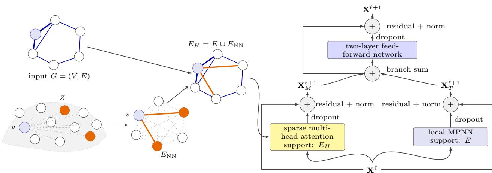

# NearFormer: Linear-Size Sparse Attention via Randomized Near Neighbors

Ali Parviz∗

Alex Cloninger∗,†

Gal Mishne∗

∗Halicioğlu Data Science Institute, UC San Diego

†Department of Mathematics, UC San Diego

## Abstract

Graph transformers can capture long-range interactions, but their quadratic attention cost limits their use on large graphs. We introduce NearFormer, a graph transformer whose global attention is restricted to a randomized near-neighbor (NN) graph. Near-Former uses an eficient randomized construction to connect each node to a small number of near neighbors from a broader neighborhood defined by a label-independent feature or spectral geometry. For a fixed retained budget k, the resulting attention support has linear size O(|E| + nk). The NN graph is built once by within-bin search and then held fixed. We use these edges as sparse global-attention supports, with optional learned attention biases, while preserving the original graph for local message passing. Experiments on long-range graph benchmarks and synthetic structural tasks show that NearFormer provides a favorable accuracy–scalability trade-of relative to local message passing, dense and sparse attention.

## 1 INTRODUCTION

Graph learning supports applications involving relational data, including molecular systems, social networks, and knowledge graphs. Most graph neural networks (GNNs) follow the message-passing paradigm, in which a node iteratively aggregates information from its local neighborhood (Gilmer et al., 2017; Hamilton et al., 2017). Although this locality provides a useful inductive bias, information between distant nodes must traverse many layers. Deep message passing can sufer from over-smoothing (Oono and Suzuki, 2020) and over-squashing (Alon and Yahav, 2020; Topping et al., 2022). Its distinguishing power is also generally bounded by the 1-Weisfeiler–Lehman test (Mor ris et al., 2019; Xu et al., 2018).

Graph transformers ofer a complementary approach by allowing attention to model long-range interactions directly. Recent architectures encode graph structure through positional or structural representations and combine global attention with local message passing (Kreuzer et al., 2021; Ying et al., 2021; Mialon et al., 2021; Rampásek et al., 2022; Black et al., 2024). Dense self-attention provides this flexibility by forming all node pairs, which requires O(n2) time and memory for a graph with n nodes. This cost is manageable for small molecular graphs but becomes prohibitive on larger graphs. Generic sparse or linear-attention methods such as BigBird and Performer reduce this asymptotic burden (Zaheer et al., 2020; Choromanski et al., 2021), yet their sparsity patterns were developed primarily for sequences and need not reflect the geometry of an arbitrary graph.

Graph-specific sparse attention should add long-range communication channels with few edges, and those channels should reflect graph data rather than an arbitrary node ordering. Existing methods reduce the edge count with data-independent random expander overlays (Shirzad et al., 2023) or modify the input topology according to curvature, spectral, or efective-resistance criteria (Karhadkar et al., 2023; Banerjee et al., 2022; Black et al., 2023; Arnaiz-Rodríguez et al., 2022). Expander overlays are eficient but do not adapt to the geometry of a particular graph, whereas graph rewiring can require costly structural optimization and changes the graph on which local message passing is defined.

Here, we introduce NearFormer, a scalable graph transformer based on randomized near-neighbor (NN) attention. We construct a near-neighbor graph in a task-relevant, label-independent geometry, where each node retains k randomly selected neighbors from a broader neighborhood at the scale of its K nearest neighbors (Linderman et al., 2020). The geometry may be defined by node attributes or graph Laplacian eigenvectors. Retaining k neighbors per node yields at most 2nk directed edge instances after symmetrization, and hence linear edge complexity for fixed k. In contrast to K-nearest-neighbor graphs, NN separates the size of the conceptual neighborhood from the number of retained edges: it obtains a randomized sam ple at that geometric scale without constructing all K nearest-neighbor connections.

NearFormer preserves the original edge set for local message passing and uses NN edges as a separate relation for long-range attention. This separation avoids conflating a learned communication pattern with the physical or semantic topology of the input graph. The NN edges can be used as a hard sparse-attention support with an optional bounded, learnable logit bias, allowing the model to suppress or favor NN connections without densifying attention.

Main contributions. We propose randomized nearneighbor attention, a label-independent construction that samples k edges at each node from a geometric neighborhood of scale K, yielding linear edge complexity for fixed k. NearFormer constructs this graph using feature or spectral geometry and employs NN edges as sparse global-attention supports or learned biases while preserving the input graph for local message passing. We evaluate NearFormer on long-range graph benchmarks and synthetic structural tasks against dense and sparse attention and local message passing, characterizing its accuracy-scalability trade-of.

## 2 BACKGROUND

Graphs and message passing. Let $G \ : = \ : ( V , E )$ be an undirected graph with $n \ = \ | V |$ nodes, adjacency matrix $\textbf { A } \in \mathbb { R } ^ { n \times n }$ , and degree matrix $\textbf { D } =$ $\mathrm { d i a g } ( d _ { 1 } , \ldots , d _ { n } )$ . Its symmetric normalized Laplacian is $\bar { \mathbf { L } } = \mathbf { I } - \mathbf { D } ^ { - 1 / 2 } \mathbf { A } \mathbf { D } ^ { - 1 / 2 }$ . A message-passing neural network $( \mathrm { M P N N } )$ updates each node from its graph neighborhood $\mathcal { N } _ { G } ( v )$ . After L layers, information travels at most L hops. When many distant signals must pass through a narrow cut, they are compressed into fixed-width representations, a phenomenon known as over-squashing (Alon and Yahav, 2020; Topping et al., 2022; Black et al., 2023).

Attention graphs. A graph attention layer is specified by an interaction graph $H \ : = \ : ( V , E _ { H } ) ;$ : node v attends only to neighbors in H. Dense graph transformers take $E _ { H } = V \times V$ and require $\mathcal { O } ( n ^ { 2 } )$ pairwise scores. Sparse transformers instead choose $| \dot { E } _ { H } | \ll n ^ { 2 }$ ideally ${ \mathcal { O } } ( n )$ , so the interaction graph is both a computational device and an inductive bias. A related line of work constructs sparse attention from k-nearestneighbor graphs, including in general deep learning (Lee et al., 2022; Xie et al., 2020; Meng et al., 2025).

Hybrid architectures such as GraphGPS retain E for a local MPNN branch and use a separate graph for global attention (Rampásek et al., 2022). NearFormer follows this distinction: the original topology governs local message passing, while a randomized nearneighbor graph supplies sparse, geometry-aware attention connections. Extended definitions and a detailed discussion of related architectures appear in $\mathrm { A p \mathrm { - } }$ pendix A.

## 3 NEAR-NEIGHBOR ATTENTION

We define a graph-transformer layer using an interaction graph H, whose directed edges specify the node pairs for which attention scores are computed. Dense self-attention evaluates $\scriptstyle { \mathcal { O } } ( n ^ { 2 } )$ scores over all directed pairs. NearFormer instead augments the inputgraph topology with sparse, geometry-dependent interactions. Figure 1 shows how the sampled NN edges define the sparse support used by the global attention branch.

For input graph $G = ( V , E )$ and node features Z, we use both orientations of each input edge when E is supplied as an undirected edge set. The NearFormer interaction graph contains two types of connections:

1. Local neighborhood attention. The edges in E preserve the relational structure of the input and allow attention or message passing between adjacent nodes. These connections contribute $\mathcal { O } ( | E | )$ interactions.

2. Randomized near-neighbor attention. The edge set $E _ { \mathrm { N N } }$ connects nodes that are close in a prespecified representation space constructed without target labels. Each node is connected to approximately k random nodes out of its Knearest neighborhood, with $k \ll K$ . The resulting edges can be nonlocal in the input graph even though they are local in the chosen representation.

After adding reverse edges, the resulting support is

$$
E _ { H } = E \cup E _ { \mathrm { N N } } .\tag{1}
$$

Self-loops, when required by a particular attention implementation, are added separately. For a fixed NN budget k, sparse attention on this support evaluates ${ \mathcal O } ( | E | + n k ) = { \mathcal O } ( | E | + n )$ attention interactions. This bound concerns the attention layer. As in Exphormer (Shirzad et al., 2023), attention is restricted to a sparse graph. NearFormer replaces Exphormer’s data-independent random expander edges with the graph-dependent near-neighbor edges ENN, which provide its long-range interactions.

  
Figure 1: Randomized near-neighbor attention in one NearFormer layer. (a) $E _ { \mathrm { N N } }$ connects each v to k random near neighbors in representation Z; $E _ { H } = E \cup E _ { \mathrm { N N } }$ . (b) Local MPNN on E and sparse attention on $E _ { H }$ are residual-normalized, summed, and passed through a residual FFN.

## 3.1 Randomized near-neighbor graph

A naïve NN graph construction would require computing the K-nearest neighbors of each node. We instead use an eficent randomized binning scheme. Let $z _ { i } \in \mathbb { R } ^ { d _ { z } }$ denote the fixed representation used to compare node $v _ { i }$ with other nodes. Given a requested candidate budget $K _ { 0 } ,$ set $K = \mathrm { m i n } \{ K _ { 0 } , n - 1 \}$ For a retained degree $k \leq K$ , set $M = \operatorname* { m a x } \{ 1 , \lfloor K / k \rfloor \}$ . We draw two independent random permutations of V and divide each into M nearly equal bins. The first permutation defines target bins $B _ { 1 } , \ldots , B _ { M }$ , while the second defines query bins $Q _ { 1 } , \ldots , Q _ { M }$ . Thus every node occurs once as a target and, independently, once as a query. For each $v _ { i } \in Q _ { b }$ , define its retained neighbors as the k nearest targets in the paired bin $B _ { b }$

$$
\mathcal { N } _ { b , k } ( v _ { i } ) = \underset { | S | = \operatorname* { m i n } \{ k , | B _ { b } \setminus \{ v _ { i } \} | \} } { \arg \operatorname* { m i n } } \sum _ { v _ { j } \in S } d ( z _ { i } , z _ { j } ) ,\tag{2}
$$

where d is either squared Euclidean distance or cosine distance and ties may be broken arbitrarily. We symmetrize these pairs to obtain ENN. Each node contributes at most k unsymmetrized edges, so ENN contains at most 2nk directed edges before deduplication.

This construction adapts the subsampled-search strategy of Linderman et al. (2020, Algorithm 1). Each target bin contains approximately $n / M \approx n k / K$ nodes. Any member of the exact K-nearest neighbors of a query lands in its assigned target bin with probability approximately $1 / M \approx k / K$ ; hence approximately k of those K neighbors are exposed to the query in expectation. Retrieving k-nearest targets in that bin therefore eficiently approximates selecting a k-element random subset from a neighborhood at scale K, with out constructing a global K-nearest-neighbor graph, or an $n \times n$ distance matrix. The parameter K controls this scale through the number of bins, whereas k controls the retained number of near edges.

The inductive bias of $E _ { \mathrm { N N } }$ is determined by the representation $z _ { i } .$ . We consider two fixed precomputed geometries. When node attributes provide a nondegenerate comparison space, we use the feature geometry $z _ { i } = x _ { i } .$ . If attributes are absent or constant within a graph, feature distances cannot distinguish its nodes. Then we use q lowest-frequency eigenvectors of the symmetric normalized graph Laplacian after omitting the first trivial mode. This choice depends only on the observed input graph and attributes, is fixed for each dataset before training, and does not use target labels.

The NN graph is constructed during preprocessing and remains fixed throughout training, where we use exact or approximate nearest-neighbor search inside each target bin (the preprocessing cost is analyzed in Appendix D.2). Each vertex is queried with respect to its assigned target bin, and we concatenate the resulting edges. Each graph is constructed independently so no interaction is introduced between diferent graphs in the data. Proposition 4.2 gives the exact rank-selection probabilities of this procedure. For the remaining expectation identities, Section 4.1 uses an exact-candidate surrogate that samples with replacement. The surrogate is not used in the experiments.

Unless specified otherwise, we set $K _ { 0 } = 1 0 0$ and

$$
k = \operatorname* { m i n } \{ K , \operatorname* { m a x } \{ 2 , \left\lfloor \log ( \log ( \operatorname* { m a x } \{ n , 2 \} ) + 1 ) \right\rfloor \} \}\tag{3}
$$

computed separately for each graph. If $n = 1$ , then $K = 0$ and no NN edge is added.

## 3.2 Architectural variants

NearFormer distinguishes the input edges E from the auxiliary edges $E _ { \mathrm { N N } }$ . Retaining the edge types lets a single sparse attention operator process both relations and also supports separate local and global branches. The same representation enables controlled comparisons between attention and message passing over NN edges.

Unified sparse attention. In the sparse variant, a single attention operator acts on the support of $E _ { H }$ (1). Edge-type embeddings distinguish original and NN connections, while dataset-provided edge features are retained on E. The architecture follows a sparse graph transformer, with NN edges replacing random expander edges. We denote the hard-support variant by NearFormer (NN). We also introduce an NNspecific learned logit bias by NearFormer (NN-bias), where for head h in layer ℓ, the attention coeficient on an allowed pair may also include an NN-specific learned bias:

$$
\alpha _ { u v } ^ { ( h ) } = \frac { \exp \left( s _ { u v } ^ { ( h ) } + \beta _ { \ell } { \bf 1 } [ ( u , v ) \in E _ { \mathrm { N N } } ] \right) } { \sum _ { w : ( w , v ) \in E _ { H } } \exp \left( s _ { w v } ^ { ( h ) } + \beta _ { \ell } { \bf 1 } [ ( w , v ) \in E _ { \mathrm { N N } } ] \right) } ,\tag{4}
$$

where $s _ { u v } ^ { ( h ) }$ is the edge-conditioned query–key score and $\beta _ { \ell } = b _ { \mathrm { m a x } }$ tanh $. ( \theta _ { \ell } )$ is a bounded learned scalar. The bound prevents an unconstrained additive logit from dominating the softmax. Setting $\theta _ { \ell } = 0$ reduces to the hard-support variant. NN edges remain in the support and retain their edge-type features. Learning $\beta _ { \ell }$ lets the layer favor or suppress the NN relation without changing the sparsity pattern, so the interaction count remains linear in $| E | + n$ for fixed k.

Local–global NearFormer layers. NearFormer can also be instantiated in the GraphGPS framework (Rampásek et al., 2022). The local branch propagates exclusively on $E _ { \mathrm { { i } } }$ , while the global branch restricts attention to $E \cup E _ { \mathrm { N N } } \cup \{ ( v , v ) : v \in V \}$ . Both NearFormer (NN) and NearFormer (NN-bias) use this same sparse support; they difer only in whether the bounded NNspecific bias in equation 4 is applied. Thus both variants evaluate $\mathcal { O } ( | E | + n k )$ pairwise scores. With hidden states $H ^ { ( \ell ) }$ , a layer has the form

$$
\begin{array} { r l } & { H ^ { ( \ell + 1 ) } = \mathrm { F F N } _ { \ell } \Big ( \mathrm { M P N N } _ { \ell } ( H ^ { ( \ell ) } , E ) } \\ & { ~ + \mathrm { A t t n } _ { \ell } ( H ^ { ( \ell ) } ; E , E _ { \mathrm { N N } } ) \Big ) , } \end{array}\tag{5}
$$

with residual connections and normalization in both branches.

Near-neighbor message-passing. We denote by NearFormer (NN-MP) a routing ablation that places the sampled NN relation in the local branch rather than the attention branch. Specifically, NearFormer (NN) and NearFormer (NN-bias) keep the local MPNN support fixed at E and include $E _ { \mathrm { N N } }$ in sparse attention, whereas NearFormer (NN-MP) applies the MPNN to $E \cup E _ { \mathrm { N N } }$ and excludes $E _ { \mathrm { N N } }$ from attention. Thus NearFormer (NN-MP) is distinct from both preceding variants; it changes where NN messages are computed rather than changing their attention logits. NN edges receive a separate learned edge-type embedding. We evaluate this variant separately because merging the relations changes the graph used for local aggregation and may overwhelm a task-relevant physical graph. The comparison distinguishes gains from sparse long-range attention from those caused by modifying local message passing.

## 4 THEORETICAL ANALYSIS

## 4.1 NN attention as geometry-aware rewiring

Over-squashing and over-smoothing impose competing requirements on an interaction graph. Over-squashing arises when information from many distant nodes must traverse long paths or narrow cuts before being compressed into fixed-width states (Alon and Yahav, 2020; Topping et al., 2022; Black et al., 2023). Adding edges can shorten these routes and reduce topological bottlenecks. By contrast, over-smoothing is associated with repeated mixing, which progressively removes variation between node representations (Oono and Suzuki, 2020; Rusch et al., 2023). Indiscriminately adding edges may therefore improve communication while accelerating global mixing.

NearFormer ofers a geometry-dependent mechanism for balancing these efects. Its edges are local in the representation metric $d ( z _ { i } , z _ { j } )$ , but need not be local in the input-graph metric $d _ { G } ( v _ { i } , v _ { j } )$ . Thus, an NN edge can be a long-range shortcut in G while joining nodes that remain close in a task-relevant geometry. The results concern the undirected support obtained after symmetrizing the construction in Section 3.1. They neither assume uniform learned attention weights nor imply improved prediction.

## 4.2 Path compression and over-squashing

Assume that $G = ( V , E )$ is a connected, simple, undirected graph. Write $E _ { \mathrm { N N } }$ for the undirected support of the directed relation constructed in Section 3.1: the set of distinct pairs $\{ v , u \}$ for which at least one of $( v , u )$ or $( u , v )$ is sampled. Let $H = ( V , E \cup E _ { \mathrm { N N } } )$ and assign unit conductance to every edge of H. Write $d _ { H }$ and $R _ { H }$ for shortest-path and efective-resistance distance in $H$ , respectively. Throughout, the candidate-set size K and the per-node budget k are those of Section 3.1.

Lemma 4.1 (Monotonicity under NN augmentation). For every $x , y \in V$ ,

$$
d _ { H } ( x , y ) \leq d _ { G } ( x , y ) , \qquad R _ { H } ( x , y ) \leq R _ { G } ( x , y ) .
$$

Moreover, $i f \left\{ v , u \right\} \in E _ { \mathrm { N N } }$ , then

$$
d _ { H } ( x , y ) \leq d _ { G } ( x , v ) + 1 + d _ { G } ( u , y ) .
$$

The proof is given in Appendix B.1. Lemma 4.1 relates NN augmentation to two topological accounts of oversquashing: long propagation distances (Alon and Yahav, 2020; Di Giovanni et al., 2023) and large efective resistance (Black et al., 2023). It characterizes communication capacity but does not guarantee bounds on the Jacobian or prediction error of a trained network. It applies directly to the NN message-passing support. For attention, it applies only to the support because a learned weight may be negligible.

## 4.3 Selection probabilities of the bin construction

The bin construction of Section 3.1 does not sample uniformly from a fixed candidate list. It nevertheless induces a rank-dependent selection distribution that can be computed exactly. Fix a query vi and order $V \setminus \{ v _ { i } \}$ by increasing distance $d ( z _ { i } , \cdot )$ , breaking ties by a fixed rule that does not depend on the random permutations. Write $v _ { i , ( r ) }$ for the node of rank $r \in$ $\{ 1 , \ldots , n { - } 1 \}$ , and let $s _ { 1 } , \ldots , s _ { M }$ be the bin sizes, which are shared by the target and query partitions.

Proposition 4.2 (Rank selection under binning). $B e \mathrm { - }$ fore symmetrization, the probability that $v _ { i , ( r ) }$ is a retained outgoing neighbor of vi is

$$
\psi _ { n , k } ( r ) = \sum _ { b = 1 } ^ { M } \frac { s _ { b } } { n } \sum _ { j = 0 } ^ { k - 1 } \frac { { \binom { r - 1 } { j } } { \binom { n - r } { s _ { b } - 1 - j } } } { \binom { n } { s _ { b } } } ,
$$

where ${ \binom { a } { c } } \ = \ 0$ whenever $c < 0$ or $c > a$ . Moreover, $\begin{array} { r } { \sum _ { r = 1 } ^ { n - 1 } \psi _ { n , k } ( r ) = \mathbb { E } \big [ \operatorname* { m i n } \{ k , | B _ { b } \setminus \{ v _ { i } \} | \} \big ] \leq k _ { \mathrm { \ell } } } \end{array}$ , where $B _ { b }$ is the target bin paired with the query bin $o f v _ { i }$

The proof is given in Appendix B.1. The geometry enters only through the rank r: a node is retained exactly when it falls in the assigned target bin together with fewer than $k$ closer nodes. For $r \leq k , \psi _ { n , k } ( r ) =$ $\textstyle \sum _ { b } ( s _ { b } / n ) ^ { 2 }$ , which equals $1 / M$ when all bins have size $n / M$ . For equal bins and $s _ { b } \ll n ,$ approximating the hypergeometric count by a binomial with $p = 1 / M$

$$
\psi _ { n , k } ( r ) \approx p \operatorname* { P r } \bigl [ \mathrm { B i n } ( r - 1 , p ) \leq k - 1 \bigr ] .
$$

The selection probability therefore stays near $1 / M \approx$ $k / K$ while the expected number $( r - 1 ) / M$ of closer nodes in the bin is below $k ,$ and it decays rapidly beyond the rank scale kM, where $K - k < k M \leq K$ because $M = \lfloor K / k \rfloor$ . Binning thus acts as a soft rank cutof at scale K while retaining about k neighbors per query: K sets how far in representation the construction reaches, and k sets how many edges it keeps.

The same expression describes the small-graph limit. When $K = n - 1$ , the rank scale kM covers essentially the whole graph and each bin contains only about k or $k + 1$ nodes, so nearly every eligible member of the assigned bin is retained. The profile $\psi _ { n , k }$ is then close to flat, and the NN relation behaves like a sparse global overlay with only weak geometric bias. Results on graphs with $n \lesssim K _ { 0 }$ should be interpreted accordingly.

## 4.4 An exact-candidate surrogate

To obtain closed-form expressions for shortcut gain and candidate impurity, the remaining results analyze a simpler surrogate in which each node draws uniformly from its exact K nearest neighbors. In this surrogate, every rank $r \leq K$ is drawn with probabil ity $1 - ( 1 - 1 / K ) ^ { k } \approx k / K$ and no rank beyond K is drawn. It replaces the soft profile of Proposition 4.2 by a hard cutof at the same scale and per-rank level. The identities below are exact for the surrogate and approximate for the bin construction. Let

$$
\mathcal { C } _ { K } ( v _ { i } ) = \underset { | S | = K } { \arg \operatorname* { m i n } } \sum _ { v _ { j } \in S } d ( z _ { i } , z _ { j } ) ,\tag{6}
$$

and write $\mathcal { C } _ { K } ( v _ { i } ) = \{ v _ { \nu _ { i } ( 1 ) } , . . . , v _ { \nu _ { i } ( K ) } \}$ , where $\nu _ { i } ( j )$ is the global node index of the jth candidate. For each node $v _ { i }$ , let $J _ { i , 1 } , \ldots , J _ { i , k }$ be independent uniform draws from $\{ 1 , \ldots , K \}$ , independently across nodes. The resulting with-replacement edge set is

$$
\widetilde E _ { \mathrm { N N } } = \bigcup _ { v _ { i } \in V } \bigcup _ { r = 1 } ^ { k } \left\{ \big ( v _ { i } , v _ { \nu _ { i } ( J _ { i , r } ) } \big ) , \big ( v _ { \nu _ { i } ( J _ { i , r } ) } , v _ { i } \big ) \right\} .\tag{7}
$$

The identities below apply to $\widetilde { E } _ { \mathrm { N N } }$ , not exactly to the bin-based implementation used in the experiments.

The motivating theorem of Linderman et al. (2020) instead retains each of $K = c _ { d , 1 }$ log n exact nearestneighbor edges independently with probability $p =$ $c _ { d , 2 }$ log log n/ log n. Under its i.i.d. uniform point model, the resulting graph has a component of size $n { - } o ( n )$ with high probability and expected edge count Θ(n log log n). This result does not imply expansion, reduced over-squashing, or improved prediction for our finite graph-derived representations.

The idealized construction admits an exact edge-local measure of its expected path compression. Specifically, $E _ { \mathrm { N N } }$ denotes the undirected support of $\widetilde { E } _ { \mathrm { N N } }$ in equation $^ { 7 , }$ and $H = ( V , E \cup E _ { \mathrm { N N } } )$ . For an unordered pair

$$
m _ { i j } = { \bf 1 } [ v _ { j } \in { \mathcal C } _ { K } ( v _ { i } ) ] + { \bf 1 } [ v _ { i } \in { \mathcal C } _ { K } ( v _ { j } ) ] ,
$$

where $\mathbf { 1 } [ \cdot ]$ is the indicator function. Thus $m _ { i j } \in$ $\{ 0 , 1 , 2 \}$ records the number of candidate-set directions for the pair. Let $\mathcal { U } _ { K } = \{ \{ v _ { i } , v _ { j } \} \in \binom { V } { 2 } : m _ { i j } > 0 \}$ . The pair enters $E _ { \mathrm { N N } }$ if and only if at least one of the $k m _ { i j }$ eligible draws selects the opposite endpoint, so

$$
\pi _ { i j } : = \operatorname* { P r } \mathopen { } \mathclose \bgroup \left( \{ v _ { i } , v _ { j } \} \in E _ { \mathrm { N N } } \aftergroup \egroup \right) = 1 - \mathopen { } \mathclose \bgroup \left( 1 - \frac { 1 } { K } \aftergroup \egroup \right) ^ { k m _ { i j } } .
$$

The realized edge-local compression is

$$
S ( H ; G ) = \sum _ { \{ v _ { i } , v _ { j } \} \in \mathcal { U } _ { K } } \bigl ( d _ { G } ( v _ { i } , v _ { j } ) - 1 \bigr ) \mathbf { 1 } [ \{ v _ { i } , v _ { j } \} \in E _ { \mathrm { N N } } ] .
$$

Pairs already present in $E$ contribute zero, since then $d _ { G } ( v _ { i } , v _ { j } ) = 1$

Lemma 4.3 (Expected edge-local compression). Under the exact with-replacement construction,

$$
\mathbb { E } [ S ( H ; G ) ] = \sum _ { \{ v _ { i } , v _ { j } \} \in \mathcal { U } _ { K } } \big ( d _ { G } ( v _ { i } , v _ { j } ) - 1 \big ) \pi _ { i j } .
$$

Moreover,

$$
\sum _ { \{ v _ { i } , v _ { j } \} \in \binom { V } { 2 } } \left( d _ { G } ( v _ { i } , v _ { j } ) - d _ { H } ( v _ { i } , v _ { j } ) \right) \geq S ( H ; G ) .
$$

The proof is given in Appendix B.1. This result shows the efect of choosing K independently of k. A broad candidate set can contain pairs that are close in representation space but far apart in $G ,$ producing large edge-local compression, while k controls the retained degree and attention cost. Shortcut gain must be weighed against mixing across task-distinct regions. Appendix B.2 defines a candidate impurity $q _ { i }$ and gives the expected number of cross-region draws under the surrogate (Lemma B.1). Appendix B.3 then relates those draws to conductance and efective resistance. Those results are exact for the surrogate and only approximate for the bin construction.

## 5 EXPERIMENTS

We evaluate the three architectural variants of Near-Former defined in Section 3.2 on three long-range benchmarks (Mathys et al., 2026; Dwivedi et al., 2022; Miglior et al., 2026). NearFormer (NN) restricts global attention to the input and sampled NN edges. NearFormer (NN-bias) adds the bounded, learned NNspecific logit bias in (4) on the same sparse support. NearFormer (NN-MP) instead routes the sampled NN edges through the message-passing branch and excludes them from global attention. We compare our model to baselines including local MPNNs, dense attention, and the data-independent random-d overlay of

Exphormer (Shirzad et al., 2023). Appendix D.1 describes the baseline architectures. Appendix C reports the dataset statistics, and Appendix D.2 analyzes the computational cost and scalability of NearFormer. Appendix D records the training settings.

## 5.1 Long-Range Ising Model benchmark

LRIM is a node-regression task whose target provably depends on distant spins, with the interaction range set by the Ising model (Mathys et al., 2026). LRIM represents spin configurations as periodic twodimensional grid graphs. Each node contains a binary spin, and the task is to predict the change in energy produced by flipping that spin. The power-law interaction exponent σ determines how strongly distant spins contribute to the target. The hard setting uses $\sigma = 0 . 6 $ while the easy uses $\sigma = 1 . 5$ . The benchmark varies the lattice width from 16 to 256, which increases the graph size from 256 to 65,536 nodes.

We report the hard setting $( \sigma = 0 . 6 )$ in Table 1, where distant spins contribute most strongly to the target. The corresponding easy results $( \sigma = 1 . 5 )$ appear in Appendix D.4 and follow the same size trend. GPS variants are strongest on the $1 6 \times 1 6$ lattice, where dense attention is cheap and the required range is limited. From width 32 onward, NearFormer (NN) leads and remains practical through $n = 6 5 { , } 5 3 6$ . Dense GPS is out of memory from width 64 onward. The learnedbias variant is competitive but not uniformly better, so a fixed sparse support is already efective when the interaction range is long.

## 5.2 Candidate scale at a fixed edge budget

Our main design choice is to sample k edges from a neighborhood of scale K, rather than to spend that budget on the k closest nodes or on geometryindependent long-range edges. Table 2 tests this claim with a matched NearFormer (NN) backbone, matched training, and fixed retained degree $k = 2$ . Ordinary k-NN is the case $K = k$ . NearFormer uses the same bin construction at $K = 2 5$ and at the default $K = 1 0 0$ Exphormer is a random expander of degree $d \ : = \ : k$ Because k is held fixed, every method uses the same number of auxiliary attention edges. We report test LogMSE on LRIM-32-hard and test F1 on PascalVOC-SP and COCO-SP, as mean±std over three seeds that resample both the overlay and the training run.

On LRIM-32-hard and both superpixel datasets, performance improves as K increases, and the default neighborhood outperforms both ordinary k-NN and Exphormer. A broader geometric candidate set is therefore useful even when no extra edges are added. The full $K ~ \in ~ \{ 1 0 , 2 5 , 5 0 , 1 0 0 \}$ grid, LRIM-64-hard, and a global-random overlay are in Appendix D.4. This comparison is informative only when $n \gg K ;$ on PCQM-Contact, Peptides, and ECHO the default $K _ { 0 } = 1 0 0$ saturates, so we do not interpret those results as evidence for the same mechanism.

Table 1: LRIM-hard LogMSE ↓ (σ = 0.6). Easy results are in Appendix D.4.
<table><tr><td>Model</td><td>16</td><td>32</td><td>64</td><td>128</td><td>256</td></tr><tr><td>GIN</td><td>-2.533±0.313</td><td>-2.249±0.135</td><td>-3.744±0.253</td><td>-3.672±0.171</td><td>-2.326±0.051</td></tr><tr><td>GatedGCN</td><td>-3.844±0.055</td><td>-4.087±0.238</td><td>-3.564±0.111</td><td>4.064±0.112</td><td>-4.285±0.126</td></tr><tr><td>GatedGCN-VNG</td><td>-4.068±0.131</td><td>-3.243±0.177</td><td>-4.324±0.127</td><td>4.022±0.013</td><td>-4.076±0.006</td></tr><tr><td>GPS-Base</td><td>-4.211±0.155</td><td>-4.044±0.122</td><td>OOM</td><td>OOM</td><td>OOM</td></tr><tr><td>GPS-RWSE</td><td>-4.011±0.129</td><td>-4.134±0.075</td><td>OOM</td><td>OOM</td><td>OOM</td></tr><tr><td>GPS-LapPE</td><td>-4.334±0.065</td><td>-4.032±0.092</td><td>OOM</td><td>OOM</td><td>OOM</td></tr><tr><td>NearFormer (NN)</td><td>4.003±0.005</td><td>-5.241±0.036</td><td>-4.925±0.025</td><td>5.204±0.106</td><td>-5.803±0.046</td></tr><tr><td>NearFormer (NN-bias)</td><td>-4.027±0.013</td><td>-4.432±0.092</td><td>4.493±0.067</td><td>5.052±0.162</td><td>-5.021±0.008</td></tr></table>

## 5.3 Long Range Graph Benchmark (LRGB)

Here we compare MPNNs and graph transformers on PascalVOC-SP and COCO-SP for superpixel node classification, Peptides-Func and Peptides-Struct for graph-level peptide prediction, and PCQM-Contact for link prediction (Dwivedi et al., 2022). We compare local attention, Exphormer, and the NN variants under matched training configurations.

The LRGB results separate the efects of NN edges by task family. On both superpixel datasets and on PCQM-Contact, NearFormer (NN-bias) ranks first and NearFormer (NN) ranks second. Their consistent ordering across node classification and link prediction indicates that sparse NN attention benefits from learning how strongly the auxiliary relation should enter each layer. Both variants also outperform the Exphormer on these tasks, which supports conditioning the sparse attention pattern on the input graph. The same matched-k pattern holds on the superpixel tasks (Table 2): broadening K improves F1 at no extra edge cost, and the default neighborhood outperforms Exphormer. The Peptide tasks show a diferent ordering. NearFormer (NN-MP), which routes NN edges through message passing, is the strongest Near-Former variant on both Peptides-Func and Peptides-Struct. Nevertheless, all three NearFormer variants perform worse than both GraphGPS and Exphormer on both tasks. Thus, the advantage of NN edges does not transfer uniformly across task families: attentionbased integration is most efective on the superpixel and contact benchmarks, while direct propagation is preferable on Peptides only among the three Near-Former variants.

## 5.4 ECHO benchmark

ECHO evaluates long-range propagation in controlled synthetic graphs and DFT-labeled molecular data (Miglior et al., 2026). ECHO-Synth contains

Table 2: Fixed $k \ = \ 2 ,$ varying K. LRIM-32-hard LogMSE ↓; PascalVOC-SP and COCO-SP F1 ↑.
<table><tr><td>Overlay</td><td>LRIM-32 ↓</td><td>PascalVOC ↑</td><td>COCO ↑</td></tr><tr><td>Ordinary k-NN</td><td>-4.248±0.071</td><td>0.3861±0.0044</td><td>0.3388±0.0018</td></tr><tr><td>NearFormer, K = 25</td><td>-4.982±0.047</td><td> $0 . 3 9 6 5 { \scriptstyle \pm 0 . 0 0 3 7 }$ </td><td>0.3454±0.0014</td></tr><tr><td>NearFormer, K = 100</td><td>-5.241±0.036</td><td> $0 . 4 0 1 2 { \scriptstyle \pm 0 . 0 0 3 2 }$ </td><td>0.3490±0.0012</td></tr><tr><td>Exphormer</td><td>-4.173±0.082</td><td>0.3794±0.0048</td><td>0.3352±0.0020</td></tr></table>

10,080 graphs from six topology families: lines, ladders, grids, trees, caterpillars, and lobsters. Their diameters range from 17 to 40. Lines, trees, caterpil lars, and lobsters route communication between distant nodes through narrow paths. ECHO-Chem contains approximately 170,000 molecules for atom-level partial-charge prediction and 196,000 molecules for graph-level total-energy prediction, with diameters between 17 and 40. Both targets are computed from density functional theory.

ECHO-Synth results. This benchmark includes three tasks that distinguish source-conditioned, nodelevel, and graph-level distance prediction. SSSP uses one marked source for shortest path distance, diameter is the maximum pairwise distance, and eccentricity is the maximum node-wise distance. We added two posthoc node-level targets which average distances from each node to all other nodes without using a marked source or a maximum. Let $d _ { G } ( u , v )$ denote shortestpath distance. Mean SSSP is the average distance from v to all other nodes:

$$
\mathrm { M e a n S S S P } ( v ) = \frac { 1 } { n - 1 } \sum _ { u \in V \backslash \{ v \} } d _ { G } ( v , u ) .
$$

Mean ER replaces shortest-path distance with efective resistance:

$$
\mathrm { M e a n E R } ( v ) = \frac { 1 } { n - 1 } \sum _ { u \in V \setminus \{ v \} } R _ { \mathrm { e f f } } ( v , u ) ,
$$

where $R _ { \mathrm { e f f } } ( v , u ) = ( { \mathbf { e } } _ { v } - { \mathbf { e } } _ { u } ) ^ { \top } { \mathbf { L } } ^ { \dag } ( { \mathbf { e } } _ { v } - { \mathbf { e } } _ { u } )$ , L† is the Moore–Penrose pseudoinverse of the graph Laplacian and $\mathbf { e } _ { v }$ is the indicator vector for node v. Mean SSSP uses average hop distance. Mean ER uses average effective resistance, so it accounts for alternative paths. Table 4 combines the original ECHO-Synth targets, the exploratory distributional targets, and the two ECHO-Chem tasks. Lower MAE is better in every column. An additional heat-difusion target is defined and reported in Appendix D.4.

NearFormer (NN) ranks first on eccentricity and remains competitive on SSSP, but several baselines perform better on diameter. NearFormer (NN-bias) pre serves the strong eccentricity result without improving the SSSP or diameter ordering. Sparse NN interactions therefore appear better suited to estimating node-wise distance summaries than to recovering a graph-wide maximum or distances from a designated source. NearFormer (NN) ranks first on Mean SSSP and Mean ER, while NearFormer (NN-bias) ranks among the leading methods on each. Unlike diameter and eccentricity, Mean SSSP and Mean ER aggregate contributions from all destinations rather than selecting an extremal distance. These results suggest that sampled NN connections capture distributed structural information efectively, but the weaker diameter result shows that this advantage does not extend automatically to extremal graph properties.

Table 3: Comparison of NearFormer variants with Long-Range Graph Benchmark baselines. NearFormer values are test metrics at the best-validation epoch. Best results are colored: first, second, third.
<table><tr><td>Model</td><td>PascalVOC-SP F1 score ↑</td><td>COCO-SP F1 score ↑</td><td>Peptides-Func AP↑</td><td>Peptides-Struct MAE↓</td><td>PCQM-Contact MRR ↑</td></tr><tr><td>GCN</td><td>0.1268±0.0060</td><td>0.0841±0.0010</td><td>0.5930±0.0023</td><td>0.3496±0.0013</td><td>0.3234±0.0006</td></tr><tr><td>GINE</td><td>0.1265±0.0076</td><td>0.1339±0.0044</td><td>0.5498±0.0079</td><td>0.3547±0.0045</td><td>0.3180±0.0027</td></tr><tr><td>GatedGCN</td><td>0.2873±0.0219</td><td>0.2641±0.0045</td><td>0.5864±0.0077</td><td>0.3420±0.0013</td><td>0.3218±0.0011</td></tr><tr><td>GatedGCN+RWSE</td><td>0.2860±0.0085</td><td>0.2574±0.0034</td><td>0.6069±0.0035</td><td>0.3357±0.0006</td><td>0.3242±0.0008</td></tr><tr><td>Transformer+LapPE</td><td>0.2694±0.0098</td><td>0.2618±0.0031</td><td>0.6326±0.0126</td><td>0.2529±0.0016</td><td>0.3174±0.0020</td></tr><tr><td>SAN+LapPE</td><td>0.3230±0.0039</td><td>0.2592±0.0158</td><td>0.6384±0.0121</td><td>0.2683±0.0043</td><td>0.3350±0.0003</td></tr><tr><td>SAN+RWSE</td><td>0.3216±0.0027</td><td>0.2434±0.0156</td><td>0.6439±0.0075</td><td>0.2545±0.0012</td><td>0.3341±0.0006</td></tr><tr><td>GraphGPS</td><td>0.3748±0.0109</td><td>0.3412±0.0044</td><td>0.6535±0.0041</td><td>0.2500±0.0005</td><td>0.3337±0.0006</td></tr><tr><td>Exphormer</td><td>0.3975±0.0037</td><td>0.3455±0.0009</td><td>0.6527±0.0043</td><td>0.2481±0.0007</td><td>0.3637±0.0020</td></tr><tr><td>NearFormer (NN)</td><td>0.4012±0.0032</td><td>0.3490±0.0012</td><td>0.5368±0.0056</td><td>0.2636±0.0028</td><td>0.3682±0.0024</td></tr><tr><td>NearFormer (NN-MP)</td><td>0.3980±0.0039</td><td>0.3462±0.0011</td><td>0.6025±0.0042</td><td>0.2527±0.0019</td><td>0.3645±0.0022</td></tr><tr><td>NearFormer (NN-bias)</td><td>0.4058±0.0028</td><td>0.3524±0.0010</td><td>0.5582±0.0051</td><td>0.2622±0.0025</td><td>0.3720±0.0018</td></tr></table>

Table 4: ECHO test MAE (lower is better). A vertical rule separates ECHO-Synth, on the left, from ECHO-Chem, on the right. Best results are colored: first, second, third.
<table><tr><td rowspan="2">Method</td><td colspan="5">ECHO-Synth</td><td colspan="2">ECHO-Chem</td></tr><tr><td>diam</td><td>ecc</td><td>sssp</td><td>Mean SSSP</td><td>Mean ER</td><td>Energy</td><td>Charge</td></tr><tr><td>A-DGN</td><td>1.151±0.038</td><td>4.981±0.037</td><td>1.176±0.140</td><td>4.251±0.081</td><td>3.486±0.027</td><td>12.486±1.621</td><td>6.543±0.146</td></tr><tr><td>DRew</td><td>1.243±0.047</td><td>4.651±0.020</td><td>1.279±0.011</td><td>3.425±0.107</td><td>3.120±0.085</td><td>11.325±2.394</td><td>9.086±0.473</td></tr><tr><td>GraphCON</td><td>2.969±0.189</td><td>5.474±0.001</td><td>5.734±0.011</td><td>5.723±0.045</td><td>5.167±0.125</td><td>14.295±0.807</td><td>19.629±0.195</td></tr><tr><td>GCÑ</td><td>3.832±0.262</td><td>5.233±0.034</td><td>2.102±0.094</td><td>5.754±0.021</td><td>5.062±0.107</td><td>28.112±1.239</td><td>8.421±0.512</td></tr><tr><td>GCNII</td><td>2.005±0.093</td><td>5.241±0.030</td><td>2.128±0.429</td><td>5.135±0.029</td><td>5.146±0.027</td><td>13.235±2.630</td><td>8.829±0.021</td></tr><tr><td>GIN</td><td>1.630±0.161</td><td>4.869±0.092</td><td>2.234±0.271</td><td>4.307±0.084</td><td>3.988±0.061</td><td>47.851±10.154</td><td>10.784±0.059</td></tr><tr><td>GPS</td><td>2.160±0.098</td><td>4.758±0.021</td><td>0.472±0.050</td><td>4.604±0.052</td><td>2.510±0.019</td><td>5.257±0.842</td><td>6.182±0.219</td></tr><tr><td>GRIT</td><td>1.014±0.046</td><td>5.091±0.158</td><td>0.121±0.013</td><td>5.242±0.013</td><td>2.840±0.092</td><td>25.508±2.507</td><td>7.134±6.090</td></tr><tr><td>PH-DGN</td><td>1.627±0.398</td><td>5.068±0.126</td><td>1.323±0.485</td><td>5.269±0.125</td><td>4.786±0.425</td><td>16.080±1.123</td><td>7.915±0.269</td></tr><tr><td>SWAN</td><td>1.121±0.070</td><td>4.840±0.045</td><td>0.896±0.232</td><td>4.284±0.032</td><td>4.726±0.014</td><td>12.629±1.157</td><td>6.109±0.103</td></tr><tr><td>NearFormer (NN)</td><td>1.752±0.064</td><td>2.396±0.031</td><td>0.559±0.024</td><td>2.752±0.064</td><td>2.105±0.024</td><td>8.427±0.106</td><td>6.004±0.245</td></tr><tr><td>NearFormer (NN-bias)</td><td>1.92±0.128</td><td>3.260±0.047</td><td>1.101±0.401</td><td>3.651±0.022</td><td>2.486±0.207</td><td>7.354±0.612</td><td>5.860±0.185</td></tr></table>

ECHO-Chem results. The two molecular tasks again favor diferent forms of global aggregation. Near-Former (NN-bias) ranks first on atom-level charge prediction, followed by NearFormer (NN), whereas dense GPS remains strongest on graph-level energy prediction. The learned-bias variant improves on hard NN support for both targets, indicating that molecular prediction benefits from controlling the contribution of sampled interactions rather than treating every retained NN edge identically. Its second-place energy result nevertheless shows that sparse geometryconditioned attention does not fully replace dense aggregation for this graph-level target. Taken together with ECHO-Synth, these results support NN attention for node-level and distributional quantities while identifying graph-level extrema and total energy as more challenging cases.

## 6 CONCLUSION

We introduced NearFormer, which constructs sparse attention edges by searching randomly assigned bins in a geometry-dependent representation while retaining the input graph for local message passing. The construction has a linear-size attention support for a fixed sampling budget; the NN graph is built once by superlinear within-bin search and then held fixed. It supports hard attention, message-passing, and learnedbias variants. Results on LRIM, LRGB, and ECHO show that these variants can improve long-range prediction, but their relative performance depends on the dataset, geometry, and use of the sampled edges.

## References

Alon, U. and Yahav, E. (2020). On the bottleneck of graph neural networks and its practical implications. arXiv preprint arXiv:2006.05205.

Arnaiz-Rodríguez, A., Begga, A., Escolano, F., and Oliver, N. (2022). Difwire: Inductive graph rewiring via the lov\’asz bound. arXiv preprint arXiv:2206.07369.

Banerjee, P. K., Karhadkar, K., Wang, Y. G., Alon, U., and Montúfar, G. (2022). Oversquashing in gnns through the lens of information contraction and graph expansion. In 2022 58th Annual Allerton Conference on Communication, Control, and Computing (Allerton), pages 1–8. IEEE.

Beaini, D., Passaro, S., Létourneau, V., Hamilton, W., Corso, G., and Liò, P. (2021). Directional graph networks. In ICML, pages 748–758. PMLR.

Black, M., Wan, Z., Mishne, G., Nayyeri, A., and Wang, Y. (2024). Comparing graph transformers via positional encodings. arXiv preprint arXiv:2402.14202.

Black, M., Wan, Z., Nayyeri, A., and Wang, Y. (2023). Understanding oversquashing in gnns through the lens of efective resistance. In International Conference on Machine Learning, pages 2528–2547. PMLR.

Bouritsas, G., Frasca, F., Zafeiriou, S., and Bronstein, M. M. (2020). Improving graph neural network expressivity via subgraph isomorphism counting. arXiv preprint arXiv:2006.09252.

Bresson, X. and Laurent, T. (2017). Residual gated graph convnets. arXiv preprint arXiv:1711.07553.

Chen, J., Gao, K., Li, G., and He, K. (2022). Nagphormer: Neighborhood aggregation graph transformer for node classification in large graphs. CoRR, abs/2206.04910.

Chen, M., Wei, Z., Huang, Z., Ding, B., and Li, Y. (2020). Simple and deep graph convolutional networks. In Proceedings of the 37th International Conference on Machine Learning, volume 119 of Proceedings of Machine Learning Research, pages 1725– 1735. PMLR.

Choromanski, K. M., Likhosherstov, V., Dohan, D., Song, X., Gane, A., Sarlós, T., Hawkins, P., Davis, J. Q., Mohiuddin, A., Kaiser, L., Belanger, D. B., Colwell, L. J., and Weller, A. (2021). Rethinking attention with performers. In ICLR.

Christie, T. and He, Y. (2023). Higher-order expander graph propagation. arXiv preprint arXiv:2311.07966.

Deac, A., Lackenby, M., and Veličković, P. (2022). Expander graph propagation. In Learning on Graphs Conference, pages 38–1. PMLR.

Deferrard, M., Bresson, X., and Vandergheynst, P. (2016). Convolutional neural networks on graphs with fast localized spectral filtering. NeurIPS, 29:3844–3852.

Di Giovanni, F., Giusti, L., Barbero, F., Luise, G., Lio, P., and Bronstein, M. M. (2023). On over-squashing in message passing neural networks: The impact of width, depth, and topology. In International Conference on Machine Learning, pages 7865–7885. PMLR.

Dwivedi, V. P., Luu, A. T., Laurent, T., Bengio, Y., and Bresson, X. (2021). Graph neural networks with learnable structural and positional representations. arXiv preprint arXiv:2110.07875.

Dwivedi, V. P., Rampásek, L., Galkin, M., Parviz, A., Wolf, G., Luu, A. T., and Beaini, D. (2022). Long range graph benchmark. CoRR, abs/2206.08164.

Gilmer, J., Schoenholz, S. S., Riley, P. F., Vinyals, O., and Dahl, G. E. (2017). Neural message passing for quantum chemistry. In International Conference on Machine Learning, pages 1263–1272. PMLR.

Gravina, A., Bacciu, D., and Gallicchio, C. (2023). Anti-symmetric DGN: A stable architecture for deep graph networks. In International Conference on Learning Representations.

Gravina, A., Eliasof, M., Gallicchio, C., Bacciu, D., and Schönlieb, C.-B. (2025). On oversquashing in graph neural networks through the lens of dynamical systems. In Proceedings of the AAAI Conference on Artificial Intelligence.

Gutteridge, B., Dong, X., Bronstein, M. M., and Di Giovanni, F. (2023). DRew: Dynamically rewired message passing with delay. In Proceedings of the 40th International Conference on Machine Learning, volume 202 of Proceedings of Machine Learning Research, pages 12252–12267. PMLR.

Hamilton, W. L., Ying, R., and Leskovec, J. (2017). Inductive representation learning on large graphs. In NeurIPS, pages 1025–1035.

Heilig, S., Gravina, A., Trenta, A., Gallicchio, C., and Bacciu, D. (2025). Port-hamiltonian architectural bias for long-range propagation in deep graph networks. In International Conference on Learning Representations.

Hu, W., Liu, B., Gomes, J., Zitnik, M., Liang, P., Pande, V., and Leskovec, J. (2020). Strategies for pre-training graph neural networks. In International Conference on Learning Representations.

Karhadkar, K., Banerjee, P. K., and Montufar, G. (2023). FoSR: First-order spectral rewiring for addressing oversquashing in GNNs. In International Conference on Learning Representations.

Kipf, T. N. and Welling, M. (2017). Semi-supervised classification with graph convolutional networks. In ICLR.

Kreuzer, D., Beaini, D., Hamilton, W., Létourneau, V., and Tossou, P. (2021). Rethinking graph transformers with spectral attention. Advances in Neural Information Processing Systems, 34:21618–21629.

Lee, H., Choi, H., Sohn, K., and Min, D. (2022). Knn local attention for image restoration. In 2022 IEEE/CVF Conference on Computer Vision and Pattern Recognition (CVPR), pages 2129–2139. IEEE.

Linderman, G. C., Mishne, G., Jafe, A., Kluger, Y., and Steinerberger, S. (2020). Randomized nearneighbor graphs, giant components and applications in data science. Journal of Applied Probability, 57(2):458–476.

Ma, L., Lin, C., Lim, D., Romero-Soriano, A., Dokania, P. K., Coates, M., Torr, P. H. S., and Lim, S.- N. (2023). Graph inductive biases in transformers without message passing. In Proceedings of the 40th International Conference on Machine Learning.

Mathys, J., Christiansen, H., Errica, F., Maruyama, T., and Alesiani, F. (2026). LRIM: a physics-based benchmark for provably evaluating long-range capabilities in graph learning. In The Fourteenth International Conference on Learning Representations.

Meng, L., Wei, L., and Wu, R. (2025). Mvgnnppis: A novel multi-view graph neural network for protein-protein interaction sites prediction based on alphafold3-predicted structures and transfer learning. International Journal of Biological Macromolecules, 300:140096.

Mialon, G., Chen, D., Selosse, M., and Mairal, J. (2021). Graphit: Encoding graph structure in transformers. CoRR, abs/2106.05667.

Miglior, L., Tolloso, M., Gravina, A., and Bacciu, D. (2026). Can you hear me now? a benchmark for long-range graph propagation. In International Conference on Learning Representations, volume 2026, pages 125144–125178.

Morris, C., Ritzert, M., Fey, M., Hamilton, W. L., Lenssen, J. E., Rattan, G., and Grohe, M. (2019). Weisfeiler and leman go neural: Higher-order graph neural networks. In Proceedings of the AAAI Conference on Artificial Intelligence, volume 33, pages 4602–4609.

Murphy, R., Srinivasan, B., Rao, V., and Ribeiro, B. (2019). Relational pooling for graph representations. In ICML.

Oono, K. and Suzuki, T. (2020). Graph neural networks exponentially lose expressive power for node classification. In ICLR.

Qiu, J., Dong, Y., Ma, H., Li, J., Wang, K., and Tang, J. (2018). Network embedding as matrix factorization: Unifying deepwalk, line, pte, and node2vec. In ACM International Conference on Web Search and Data Mining.

Rampásek, L., Galkin, M., Dwivedi, V. P., Luu, A. T., Wolf, G., and Beaini, D. (2022). Recipe for a general, powerful, scalable graph transformer. CoRR, abs/2205.12454.

Rusch, T. K., Bronstein, M. M., and Mishra, S. (2023). A survey on oversmoothing in graph neural networks. arXiv preprint arXiv:2303.10993.

Rusch, T. K., Chamberlain, B., Rowbottom, J., Mishra, S., and Bronstein, M. (2022). Graphcoupled oscillator networks. In International Conference on Machine Learning, pages 18888–18909. PMLR.

Sato, R., Yamada, M., and Kashima, H. (2021). Random features strengthen graph neural networks. In SIAM International Conference on Data Mining.

Shi, D., Han, A., Lin, L., Guo, Y., and Gao, J. (2023). Exposition on over-squashing problem on gnns: Current methods, benchmarks and challenges. arXiv preprint arXiv:2311.07073.

Shirzad, H., Velingker, A., Venkatachalam, B., Sutherland, D. J., and Sinop, A. K. (2023). Exphormer: Sparse transformers for graphs. In International Conference on Machine Learning, pages 31613– 31632. PMLR.

Tay, Y., Dehghani, M., Bahri, D., and Metzler, D. (2020). Eficient transformers: A survey. arXiv preprint arXiv:2009.06732.

Topping, J., Giovanni, F. D., Chamberlain, B. P., Dong, X., and Bronstein, M. M. (2022). Understanding over-squashing and bottlenecks on graphs via curvature. In International Conference on Learning Representations.

Vaswani, A., Shazeer, N., Parmar, N., Uszkoreit, J., Jones, L., Gomez, A. N., Kaiser, L., and Polosukhin, I. (2017). Attention is all you need. In NeurIPS, pages 5998–6008.

Veličković, P., Cucurull, G., Casanova, A., Romero, A., Lio, P., and Bengio, Y. (2018). Graph attention networks. In ICLR.

Wu, Q., Yang, C., Zhao, W., He, Y., Wipf, D., and Yan, J. (2023). Diformer: Scalable (graph) transformers induced by energy constrained difusion. arXiv preprint arXiv:2301.09474.

Wu, Q., Zhao, W., Li, Z., Wipf, D. P., and Yan, J. (2022). Nodeformer: A scalable graph structure learning transformer for node classification. NeurIPS, 35:27387–27401.

Xie, Z., Chen, J., and Peng, B. (2020). Point clouds learning with attention-based graph convolution networks. Neurocomputing, 402:245–255.

Xu, K., Hu, W., Leskovec, J., and Jegelka, S. (2018). How powerful are graph neural networks? In ICLR.

Ying, C., Cai, T., Luo, S., Zheng, S., Ke, G., He, D., Shen, Y., and Liu, T.-Y. (2021). Do transformers really perform bad for graph representation? ArXiv, abs/2106.05234.

Zaheer, M., Guruganesh, G., Dubey, K. A., Ainslie, J., Alberti, C., Ontañón, S., Pham, P., Ravula, A., Wang, Q., Yang, L., and Ahmed, A. (2020). Big Bird: Transformers for longer sequences. In NeurIPS.

Zhang, J., Zhang, H., Xia, C., and Sun, L. (2020). Graph-Bert: Only attention is needed for learning graph representations. arXiv preprint arXiv:2001.05140.

Zhao, J., Li, C., Wen, Q., Wang, Y., Liu, Y., Sun, H., Xie, X., and Ye, Y. (2021). Gophormer: Egograph transformer for node classification. CoRR, abs/2110.13094.

# Appendix

## A RELATED WORK

This appendix expands the background of Section 2 and situates NearFormer relative to message-passing GNNs, graph transformers, sparse attention, rewiring, expander overlays, and near-neighbor sparsification.

## A.1 Graph preliminaries

Let $G = ( V , E )$ be an undirected graph with $n = | V |$ nodes, adjacency matrix $\mathbf { A } \in \mathbb { R } ^ { n \times n }$ , and degree matrix $\mathbf { D } = \mathrm { d i a g } ( d _ { 1 } , \dots , d _ { n } )$ . Its symmetric normalized Laplacian is

$$
\mathbf { L } = \mathbf { I } - \mathbf { D } ^ { - 1 / 2 } \mathbf { A } \mathbf { D } ^ { - 1 / 2 } .\tag{8}
$$

For a connected graph, the eigenvalues satisfy $0 = \lambda _ { 0 } < \lambda _ { 1 } \leq \cdot \cdot \cdot \leq \lambda _ { n - 1 } \leq 2 .$ . The first nonzero eigenvalue $\lambda _ { 1 }$ is the spectral gap of the normalized Laplacian. Through Cheeger-type inequalities, a larger spectral gap is associated with stronger expansion and fewer sparse cuts; this connection motivates the use of expander graphs as auxiliary communication structures (Deac et al., 2022).

## A.2 Message passing and over-squashing

Given node states $\mathbf { h } _ { v } ^ { ( \ell ) }$ at layer $\ell ,$ a message-passing neural network (MPNN) updates each node using information from its graph neighborhood $\mathcal { N } _ { G } ( v )$

$$
\begin{array} { r l } & { \mathbf { m } _ { u v } ^ { ( \ell ) } = \mathrm { M e s s a g e } _ { \ell } \left( \mathbf { h } _ { v } ^ { ( \ell ) } , \mathbf { h } _ { u } ^ { ( \ell ) } , \mathbf { e } _ { u v } \right) , } \\ & { \mathbf { m } _ { v } ^ { ( \ell ) } = \mathrm { A g g r e g a t e } _ { \ell } \left\{ \mathbf { m } _ { u v } ^ { ( \ell ) } : u \in \mathcal { N } _ { G } ( v ) \right\} , } \\ & { \mathbf { h } _ { v } ^ { ( \ell + 1 ) } = \mathrm { U p d a t e } _ { \ell } \left( \mathbf { h } _ { v } ^ { ( \ell ) } , \mathbf { m } _ { v } ^ { ( \ell ) } \right) . } \end{array}\tag{9}
$$

After L layers, information can travel at most L hops. Consequently, long-range dependencies require deep propagation through intermediate nodes. When many distant signals must pass through a narrow graph cut, they are compressed into fixed-width representations, a phenomenon known as over-squashing (Alon and Yahav, 2020; Shi et al., 2023). Analyses based on Jacobian sensitivity, graph curvature, and efective resistance link this limitation to the topology of the computational graph (Topping et al., 2022; Black et al., 2023; Di Giovanni et al., 2023).

## A.3 Attention on graphs

A graph attention layer can be described by an interaction graph $H = ( V , E _ { H } )$ , where $( u , v ) \in E _ { H }$ permits node v to attend to node u. For one attention head,

$$
\begin{array} { l } { s _ { u v } = \displaystyle \frac { ( \mathbf { W } _ { Q } \mathbf { h } _ { v } ) ^ { \top } ( \mathbf { W } _ { K } \mathbf { h } _ { u } ) } { \sqrt { d } } \mathrm { , } } \\ { \alpha _ { u v } = \displaystyle \frac { \exp ( s _ { u v } ) } { \displaystyle \sum _ { w \in \mathcal { N } _ { H } ( v ) } \exp ( s _ { v w } ) } \mathrm { , } } \\ { \mathbf { y } _ { v } = \displaystyle \sum _ { u \in \mathcal { N } _ { H } ( v ) } \alpha _ { u v } \mathbf { W } _ { V } \mathbf { h } _ { u } \mathrm { . } } \end{array}\tag{10}
$$

Edge attributes or structural encodings may additionally enter the attention logits. Dense graph transformers take $E _ { H } = V \times V$ , enabling direct communication between every pair of nodes but requiring $\scriptstyle { \mathcal { O } } ( n ^ { 2 } )$ pairwise scores. Sparse graph transformers instead choose $| E _ { H } | \ll n ^ { 2 }$ , ideally ${ \mathcal { O } } ( n )$ , so the interaction graph becomes both a computational device and an inductive bias.

The attention graph need not replace the input graph. Hybrid architectures such as GraphGPS retain E for a local MPNN branch and use a separate interaction graph for global attention (Rampásek et al., 2022). We follow this distinction. In NearFormer, the original topology governs local message passing, whereas a randomized near-neighbor graph supplies sparse, geometry-aware attention connections. Thus, NN sparsifies long-range communication without redefining the underlying relational structure.

## A.4 Message-passing graph neural networks

Canonical GNN architectures include GCN (Deferrard et al., 2016; Kipf and Welling, 2017), GraphSAGE (Hamilton et al., 2017), GIN (Xu et al., 2018), GAT (Veličković et al., 2018), and GatedGCN (Bresson and Laurent, 2017). These models difer in their aggregation and update rules, but they primarily exchange information along input edges. Their locality yields a strong graph inductive bias and linear-time propagation on sparse graphs, while requiring multiple layers to communicate over long distances. A separate line of work increases expressivity using node identifiers or random features (Murphy et al., 2019; Sato et al., 2021), structural or positiona encodings (Qiu et al., 2018; Bouritsas et al., 2020; Dwivedi et al., 2021), and directional aggregation (Beaini et al., 2021). NearFormer is complementary to these methods: its auxiliary edges determine where long-range attention is computed, while the original graph remains available to the local MPNN.

## A.5 Graph transformers

Graph transformers adapt self-attention (Vaswani et al., 2017) to graph-structured inputs. GAT restricts attention to adjacent nodes (Veličković et al., 2018), whereas GraphBERT uses graph-derived node encodings with a transformer architecture (Zhang et al., 2020). Fully connected graph transformers difer chiefly in how they encode structure. SAN combines attention on original and fully connected graphs and uses Laplacian positional encodings (Kreuzer et al., 2021); Graphormer incorporates centrality and shortest-path information (Ying et al., 2021); and GraphiT uses difusion-based relative positional encodings (Mialon et al., 2021). GraphGPS provides a modular architecture that combines a local message-passing branch with a global attention branch and a choice of positional and structural encodings (Rampásek et al., 2022). NearFormer follows this local–globa decomposition but replaces unrestricted global interactions with a geometry-aware sparse relation.

## A.6 Scalable and sparse attention

Dense attention computes all $n ^ { 2 }$ node pairs. Eficient transformer methods reduce this cost through structured sparsity or kernel approximations; BigBird and Performer are representative examples (Zaheer et al., 2020; Choromanski et al., 2021), and Tay et al. (2020) survey the broader design space. Because many such patterns were developed for sequences, their ordering assumptions do not transfer directly to permutation-equivariant graph learning. Graph-specific scalable models include Gophormer, which attends within sampled ego-graphs (Zhao et al., 2021); NAGphormer, which aggregates multi-hop neighborhoods before attention (Chen et al., 2022); NodeFormer, which uses kernelized Gumbel–Softmax to learn latent connections (Wu et al., 2022); and Diformer, which derives global propagation from an energy-constrained difusion process (Wu et al., 2023). In contrast, NearFormer explicitly constructs a sparse attention graph before training, keeps this construction labe independent, and bounds the retained degree through a fixed sampling budget.

## A.7 Graph rewiring and over-squashing

Graph rewiring methods alter the computational topology to improve the transmission of distant information. A fully adjacent layer directly connects all node pairs but incurs quadratic complexity (Alon and Yahav, 2020). Adding a virtual or master node reduces the diameter to two with only ${ \mathcal { O } } ( n )$ additional edges (Gilmer et al., 2017), although communication is then concentrated at one node. More topology-aware approaches optimize curvature, spectral objectives, or efective resistance (Topping et al., 2022; Karhadkar et al., 2023; Arnaiz-Rodríguez et al., 2022; Banerjee et al., 2022; Black et al., 2023). These methods provide principled ways to alleviate bottlenecks, but may require graph-specific structural analysis and typically modify the topology used for message passing. NearFormer instead treats NN edges as a distinct attention relation by default; propagating messages on the augmented graph is considered only as an ablation.

## A.8 Expander-based auxiliary graphs

Expanders provide sparse connectivity, small diameter, and favorable spectral properties. Expander Graph Propagation alternates message passing over the input graph and a precomputed auxiliary expander (Deac et al., 2022), with extensions to higher-order structures (Christie and He, 2023). Exphormer combines local edges, random expander edges, and optional global nodes to define a linear-size attention support (Shirzad et al., 2023). NearFormer adopts the general principle of an auxiliary sparse attention graph but changes how that graph is formed: instead of data-independent expander edges, it samples connections from near-neighbor candidate sets defined in feature or spectral geometry. This makes the sparse pattern graph dependent while retaining a linear edge budget.

## A.9 Near-neighbor graph sparsification

A related line of work constructs sparse attention from k-nearest-neighbor graphs, including examples beyond graph neural networks (Lee et al., 2022; Xie et al., 2020; Meng et al., 2025). Nearest-neighbor graphs capture local geometry but require nK directed connections when every node retains all K candidates. Randomized near-neighbor graphs ofer a sparser alternative. For independent points in a Euclidean domain, Linderman et al. (2020) show that independently retaining each of the Θ(log n) nearest-neighbor edges with an appropriate probability yields a giant component with high probability using only Θ(n log log n) expected edges. Near-Former draws inspiration from this result and uses an eficient randomized scheme that approximately samples k neighbors from the K-nearest-neighbor scale. The cited theorem does not establish connectivity, expansion, or predictive performance for this fixed-budget construction or for arbitrary learned datasets. We therefore interpret randomized near-neighbor sampling as a geometry-aware sparsification principle and evaluate its consequences empirically.

## B PROOFS AND THEORETICAL ANALYSIS

## B.1 Proofs of the main lemmas

Proof of Lemma $4 . 1 .$ . Every path in G is also present in H, so $d _ { H } ( x , y ) \leq d _ { G } ( x , y )$ . If $\{ v , u \} \in E _ { \mathrm { N N } }$ , concatenating a shortest x-to-v path in G, the edge $\{ v , u \}$ , and a shortest u-to-y path in G yields $d _ { H } ( x , y ) \leq d _ { G } ( x , v ) + 1 +$ $d _ { G } ( u , y )$ . For efective resistance, Thomson’s principle expresses $R _ { H } ( x , y )$ as the minimum energy of a unit x–y flow. Passing from G to H enlarges the set of feasible flows, so the minimum energy cannot increase. □

Proof of Lemma $4 . 3 .$ Fix $\{ v _ { i } , v _ { j } \} \in \mathcal { U } _ { K }$ . The pair fails to enter $E _ { \mathrm { N N } }$ if and only if none of the $k m _ { i j }$ eligible independent draws selects the opposite endpoint. Each such draw has success probability $1 / K$ , which gives $\pi _ { i j } = 1 - ( 1 - 1 / K ) ^ { k m _ { i j } }$ . Linearity of expectation then yields the formula for $\mathbb { E } [ S ( H ; G ) ]$ . If $\{ v _ { i } , v _ { j } \} \in E _ { \mathrm { N N } }$ then $d _ { H } ( v _ { i } , v _ { j } ) = 1$ , so that pair contributes exactly $d _ { G } ( v _ { i } , v _ { j } ) - 1$ to both $S ( H ; G )$ and the all-pairs sum. Every remaining pair contributes a nonnegative amount by Lemma 4.1. □

Proof of Lemma B.1. Each of the k draws from $v _ { i }$ is uniform over $\mathcal { C } _ { K } ( v _ { i } )$ and therefore crosses the partition with probability q . Independence of those draws yields $q _ { i }$ $X _ { i } \sim$ Binomia $( k , q _ { i } )$ , the identity $\mathbb { E } [ \textstyle \sum _ { i } X _ { i } ] = k \sum _ { i } q _ { i }$ and $\operatorname* { P r } ( X _ { i } = 0 ) = ( 1 - q _ { i } ) ^ { k }$ . Every distinct undirected cross-region edge in $E _ { \mathrm { N N } }$ is produced by at least one raw cross-region draw, so their number is at most $\textstyle \sum _ { i } X _ { i }$ □

Proof of Proposition 4.2. The query permutation places $v _ { i }$ in query bin $Q _ { b }$ with probability $s _ { b } / n$ . Because the target permutation is independent of the query permutation, the paired target bin $B _ { b }$ is then a uniformly random $s _ { b } .$ -element subset of V. Since $v _ { i }$ is excluded before neighbor selection, $v _ { i , ( r ) }$ is retained if and only if $v _ { i , ( r ) } \in B _ { b }$ and at most $k - 1$ of the $r - 1$ closer nodes $v _ { i , ( 1 ) } , \ldots , v _ { i , ( r - 1 ) }$ lie in $B _ { b }$ . This also covers bins with $| B _ { b } \setminus \{ v _ { i } \} | < k ,$ in which every eligible member is retained. The number of $s _ { b } .$ -subsets that contain $v _ { i , ( r ) }$ and exactly j closer nodes is $\binom { r - 1 } { j } \binom { n - r } { s _ { b } - 1 - j }$ : the remaining $s _ { b } - 1 - j$ members are chosen among the $n - r$ nodes that are neither $v _ { i , ( r ) }$ nor closer to $v _ { i }$ , a set that includes $v _ { i }$ itself. Dividing by $\binom { n } { s _ { b } }$ , summing over $j = 0 , \ldots , k - 1$ , and averaging over the query bin of $v _ { i }$ gives $\psi _ { n , k } ( { \boldsymbol { r } } )$ . For the second claim, summing the indicator of retention over r counts the retained neighbors of $v _ { i }$ , which number min $\{ k , | B _ { b } \setminus \{ v _ { i } \} | \}$ . For $r \leq k ,$ every subset containing $v _ { i , ( r ) }$ has at most $k - 1$ closer members, so the inner sum equals $\binom { n - 1 } { s _ { b } - 1 } / \binom { n } { s _ { b } } = s _ { b } / n$ □

## B.2 Candidate purity and cross-region exposure

To quantify when surrogate shortcuts preserve task-relevant variation, let $\mathcal { P } = \{ V _ { 1 } , \ldots , V _ { m } \}$ , with $m \geq 2$ , be a partition of $V$ into regions that should remain distinguishable, and let $P ( v _ { i } )$ denote the region containing $v _ { i }$ Define the candidate impurity

$$
q _ { i } = \frac { | \{ v _ { j } \in \mathcal { C } _ { K } ( v _ { i } ) : P ( v _ { j } ) \neq P ( v _ { i } ) \} | } { K } .
$$

The partition is used only for analysis. The model need not have access to it, and NN graph construction need not use it. When labels are used to assess candidate purity, the partition may be defined post hoc.

Lemma B.1 (Expected cross-region draws). Let $X _ { i }$ be the number of the k outgoing draws from $v _ { i }$ whose endpoints lie outside $P ( v _ { i } )$ . Then

$$
\begin{array} { c } { { X _ { i } \sim \displaystyle \mathrm { B i n o m i a l } ( k , q _ { i } ) , } } \\ { { \displaystyle \mathbb { E } \left[ \sum _ { v _ { i } \in V } X _ { i } \right] = k \sum _ { v _ { i } \in V } q _ { i } , } } \end{array}
$$

and $\operatorname* { P r } ( X _ { i } = 0 ) = ( 1 - q _ { i } ) ^ { k }$ . After symmetrization and deduplication, the number of distinct undirected crossregion edges in $E _ { \mathrm { N N } }$ is at most $\textstyle \sum _ { v _ { i } \in V } X _ { i }$

The proof is given in Section B.1. The same impurity weights a draw-level energy proxy for a region-constant signal (not the Dirichlet form of $H )$ . If $\mathbf { x } _ { i } = \mathbf { a } _ { P ( v _ { i } ) }$ , then, before deduplication and symmetrization,

$$
\begin{array} { r l } {  { \mathbb { E } \Bigg [ \sum _ { v _ { i } \in V } \sum _ { r = 1 } ^ { k } \big \| \mathbf { x } _ { i } - \mathbf { x } _ { \nu _ { i } ( J _ { i , r } ) } \big \| _ { 2 } ^ { 2 } \Bigg ] } } \\ & { = \cfrac { k } { K } \sum _ { v _ { i } \in V } \sum _ { v _ { j } \in \mathcal { C } _ { K } ( v _ { i } ) } \| \mathbf { a } _ { P ( v _ { i } ) } - \mathbf { a } _ { P ( v _ { j } ) } \| _ { 2 } ^ { 2 } , } \end{array}
$$

which is at most $k \Delta _ { \mathrm { m a x } } ^ { 2 } \sum _ { v _ { i } \in V } q _ { i }$ , where $\begin{array} { r } { \Delta _ { \operatorname* { m a x } } = \operatorname* { m a x } _ { i \neq j } \| { \bf a } _ { i } - { \bf a } _ { j } \| _ { 2 } } \end{array}$ . Candidate impurity therefore controls both the expected number of cross-region draws and the stated upper bound on their energy linearly. Candidate sets with $q _ { i } = 0$ for every $v _ { i }$ introduce no direct NN interactions between the prescribed regions. Representation geometry can create shortcuts by including graph-distant nodes while separating task-distinct regions. The next subsection derives cut-level bounds relating direct cross-region exposure to conductance and communication capacity.

## B.3 Region cuts: spectral and capacity bounds

The same cut used in Lemma B.1 yields bounds on spectral mixing proxies and communication capacity. Consider the symmetric propagation operator

$$
\mathbf { P } _ { H } = \tilde { \mathbf { D } } _ { H } ^ { - 1 / 2 } \tilde { \mathbf { A } } _ { H } \tilde { \mathbf { D } } _ { H } ^ { - 1 / 2 } , \qquad \tilde { \mathbf { A } } _ { H } = \mathbf { A } _ { H } + \mathbf { I } ,
$$

where $\mathbf { A } _ { H }$ is the adjacency matrix of the distinct undirected edges of H and $\tilde { \mathbf { D } } _ { H }$ is the degree matrix of $\tilde { \mathbf { A } } _ { H }$ so that $\tilde { d } _ { H } ( v ) = \deg _ { H } ( v ) + 1$ . Since H is connected, the eigenvalue one of $\mathbf { P } _ { H }$ is simple. Let $\mu _ { 2 } ( \mathbf { P } _ { H } )$ denote its second-largest eigenvalue. For a nonempty proper subset $S \subset V .$ write ${ \bar { S } } = V \setminus S$ , and define

$$
\delta _ { H } ( S ) = \{ \{ u , v \} \in E ( H ) : u \in S , v \in { \bar { S } } \} ,
$$

$$
\mathrm { c u t } _ { H } ( S ) = | \delta _ { H } ( S ) | ,
$$

$$
\begin{array} { r } { \mathrm { v o l } _ { H } ( S ) = \sum _ { v \in S } \tilde { d } _ { H } ( v ) , } \end{array}
$$

$$
\Phi _ { H } ( S ) = { \frac { \mathrm { c u t } _ { H } ( S ) } { \mathrm { m i n } \{ \mathrm { v o l } _ { H } ( S ) , \mathrm { v o l } _ { H } ( \bar { S } ) \} } } ,
$$

where $E ( H ) = E \cup E _ { \mathrm { N N } }$ . The analogous quantities for G use $\tilde { d } _ { G } ( v ) = \deg _ { G } ( v ) + 1$ . We call $E _ { \mathrm { N N } }$ pure with respect to P if every NN edge joins two nodes in the same region.

Theorem B.2 (Region cuts under NN augmentation). Let S be a nonempty proper union of regions of $\mathcal { P } _ { z }$ , and write

$$
X _ { S } = \left| \{ \{ u , v \} \in E _ { \mathrm { N N } } \setminus E : u \in S , ~ v \in { \bar { S } } \} \right|
$$

for the number of genuinely new, distinct undirected NN edges that cross S. Let $\begin{array} { r } { X = \sum _ { v _ { i } \in V } X _ { i } } \end{array}$ be the raw cross-region draw count from Lemma $B . 1 ,$ so that $X _ { S } \leq X$ . Then, for every realization of $E _ { \mathrm { N N } }$

(i) cut $\mathbf { \delta } _ { H } ( S ) = \operatorname { c u t } _ { G } ( S ) + X _ { S }$ , and

$$
\Phi _ { H } ( S ) \leq \frac { \operatorname { c u t } _ { G } ( S ) + X _ { S } } { \operatorname* { m i n } \{ \operatorname { v o l } _ { G } ( S ) , \operatorname { v o l } _ { G } ( \bar { S } ) \} } .
$$

If $E _ { \mathrm { N N } }$ is pure, then $X _ { S } = 0 , \mathrm { c u t } _ { H } ( S ) = \mathrm { c u t } _ { G } ( S )$ and $\Phi _ { H } ( S ) \leq \Phi _ { G } ( S )$

(ii) $\mu _ { 2 } ( { \bf P } _ { H } ) \ge 1 - 2 \Phi _ { H } ( S )$ . Hence, for an eigenvector $\mathbf { g } _ { 2 } \neq \mathbf { 0 }$ associated with µ2 and every integer $\ell \geq 1$

$$
\frac { \| \mathbf { P } _ { H } ^ { \ell } \mathbf { g } _ { 2 } \| _ { 2 } } { \| \mathbf { g } _ { 2 } \| _ { 2 } } = | \mu _ { 2 } ( \mathbf { P } _ { H } ) | ^ { \ell } \geq \big ( 1 - 2 \Phi _ { H } ( S ) \big ) _ { + } ^ { \ell } .
$$

(iii) For every $x \in S$ and $y \in \bar { S }$

$$
R _ { H } ( x , y ) \geq { \frac { 1 } { \operatorname { c u t } _ { H } ( S ) } } \geq { \frac { 1 } { \operatorname { c u t } _ { G } ( S ) + X _ { S } } } ,
$$

and H contains at most cut $ \phantom { } _ { G } ( S ) + X _ { S }$ edge-disjoint paths from x to y.

In expectation over the exact sampling rule, $\begin{array} { r } { \mathbb { E } [ X _ { S } ] \leq \mathbb { E } [ X ] = k \sum _ { i } q _ { i } } \end{array}$ , and therefore

$$
\begin{array} { l } { { \displaystyle \mathbb { E } \big [ \mu _ { 2 } ( { \bf P } _ { H } ) \big ] \geq 1 - \frac { 2 \big ( \mathrm { c u t } _ { G } ( S ) + k \sum _ { i } q _ { i } \big ) } { \operatorname* { m i n } \{ \mathrm { v o l } _ { G } ( S ) , \mathrm { v o l } _ { G } ( \bar { S } ) \} } } , }  \\ { { \displaystyle \mathbb { E } \big [ R _ { H } ( x , y ) \big ] \geq \frac { 1 } { \mathrm { c u t } _ { G } ( S ) + k \sum _ { i } q _ { i } } . } } \end{array}
$$

Proof. (i) Because S is a union of regions, every edge crossing S joins two diferent regions. The crossing edges of H are the disjoint union of the crossing edges already in E and the $X _ { S }$ crossing edges in $E _ { \mathrm { N N } } \setminus E$ . Hence $\mathrm { c u t } _ { H } ( S ) = \mathrm { c u t } _ { G } ( S ) + X _ { S }$ . Lemma B.1 gives $X _ { S } \le X$ , and $X _ { S } = 0$ in the pure case. Adding edges can only increase degrees, so vol $_ { H } ( S ) \geq \operatorname { v o l } _ { G } ( S )$ and vol $_ H ( { \bar { S } } ) \geq \operatorname { v o l } _ { G } ( { \bar { S } } )$ , which yields both conductance bounds.

(ii) Let $\tilde { \mathbf { L } } _ { H } = \mathbf { I } - \mathbf { P } _ { H }$ . Its smallest eigenvalue is zero, with eigenvector $\tilde { \mathbf { D } } _ { H } ^ { 1 / 2 } \mathbf { 1 }$ , so its second-smallest eigenvalue is $1 - \mu _ { 2 } ( \mathbf { P } _ { H } )$ . For any f satisfying $\begin{array} { r } { \sum _ { v } \tilde { d } _ { H } ( v ) f _ { v } = 0 } \end{array}$ , set $\mathbf { g } = \tilde { \mathbf { D } } _ { H } ^ { 1 / 2 } \mathbf { f }$ . Since self-loops do not contribute to the quadratic form,

$$
\frac { \mathbf { g } ^ { \top } \tilde { \mathbf { L } } _ { H } \mathbf { g } } { \mathbf { g } ^ { \top } \mathbf { g } } = \frac { \sum _ { \{ u , v \} \in E ( H ) } ( f _ { u } - f _ { v } ) ^ { 2 } } { \sum _ { v } \tilde { d } _ { H } ( v ) f _ { v } ^ { 2 } } ,
$$

and the Courant–Fischer theorem bounds $1 - \mu _ { 2 } ( \mathbf { P } _ { H } )$ by this ratio. Choose $f _ { v } = { \mathrm { v o l } } _ { H } ( S ) ^ { - 1 }$ for $v \in S$ and $f _ { v } = - \mathrm { v o l } _ { H } ( \bar { S } ) ^ { - 1 }$ otherwise. Writing $a = \operatorname { v o l } _ { H } ( S )$ and $b = \operatorname { v o l } _ { H } ( \bar { S } )$ , the ratio equals

$$
\mathrm { c u t } _ { H } ( S ) \frac { a + b } { a b } \leq \frac { 2 \mathrm { c u t } _ { H } ( S ) } { \operatorname* { m i n } \{ a , b \} } = 2 \Phi _ { H } ( S ) ,
$$

because $( a + b ) / \operatorname* { m a x } \{ a , b \} \ \leq \ 2$ . An eigenvector of $\mu _ { 2 } ( \mathbf { P } _ { H } )$ is orthogonal to the eigenvalue-one eigenspace. Applying $\mathbf { P } _ { H } ^ { \ell }$ multiplies its Euclidean norm by $| \mu _ { 2 } ( \mathbf { P } _ { H } ) | ^ { \ell }$

(iii) Orient the edges crossing S from S to $\bar { S } .$ . For any unit x–y flow $f ,$ flow conservation give $\begin{array} { r } { \sum _ { e \in \delta _ { H } ( S ) } f _ { e } = 1 } \end{array}$ By Cauchy–Schwarz,

$$
\sum _ { e \in \delta _ { H } ( S ) } f _ { e } ^ { 2 } \geq \frac { 1 } { \mathrm { c u t } _ { H } ( S ) } .
$$

The total flow energy is at least this cut contribution, and Thomson’s principle gives the resistance bound. Every $x { \mathrm { - t o } } { - } y$ path uses at least one crossing edge, so there are at most cut $_ H ( S )$ edge-disjoint paths. For the expectations, combining (i) and (ii) gives the afine lower bound

$$
\mu _ { 2 } ( { \bf P } _ { H } ) \geq 1 - \frac { 2 ( \mathrm { c u t } _ { G } ( S ) + X _ { S } ) } { \operatorname* { m i n } \{ \mathrm { v o l } _ { G } ( S ) , \mathrm { v o l } _ { G } ( \bar { S } ) \} } .
$$

The map $t \mapsto 1 / ( c + t )$ is convex on $t \ \geq \ 0 .$ . Linearity of expectation, Jensen’s inequality, $X _ { S } ~ \le ~ X .$ , and $\mathbb { E } [ X ] = k \textstyle \sum _ { i } q _ { i }$ complete the proof. □

Theorem B.2 bounds spectral mixing proxies and communication capacity using an aligned cut. Since $X _ { S }$ is the exact increase in cut cardinality, cutH $\mathbf { \xi } _ { I } ( S ) = \operatorname { c u t } _ { G } ( S ) + X _ { S }$ . This equality yields an upper bound on the algebraic spectral gap $1 - \mu _ { 2 } ( \mathbf { P } _ { H } )$ and a reciprocal lower bound on efective resistance. If the realized NN edges are pure, they leave the cut cardinality unchanged and satisfy $1 - \mu _ { 2 } ( \mathbf { P } _ { H } ) \leq 2 \Phi _ { G } ( S )$ . This is a ceiling derived from the chosen cut, not a monotonic comparison with the spectral gap of G: adding within-region edges may still accelerate some modes of difusion. Likewise, pure NN edges add no edge directly across $S ,$ but they may shorten paths, lower efective resistance, or increase the number of edge-disjoint x-to-y paths by improving connectivity within either side, subject to the unchanged cut-size upper bound.

Thus the theorem does not establish that pure NN edges prevent over-smoothing or leave all notions of cross-cut capacity unchanged. It establishes the narrower statement that only cross-region NN edges can increase the cardinality of an aligned cut, and that the number of such edges controls the stated spectral and resistance bounds. Representation geometry determines which cuts receive direct new edges. A representation that keeps $q _ { i }$ small for partitions that should remain distinguishable can still supply long shortcuts within each region.

## B.4 Shortcut gain and candidate impurity

The two efects can be summarized by the geometry-dependent quantities

$$
\begin{array} { l } { \displaystyle \Gamma _ { K } = \frac { 1 } { n K } \sum _ { v _ { i } \in V } \sum _ { v _ { j } \in \mathcal { C } _ { K } ( v _ { i } ) } \big ( d _ { G } \big ( v _ { i } , v _ { j } \big ) - 1 \big ) , } \\ { \displaystyle Q _ { K } = \frac { 1 } { n } \sum _ { v _ { i } \in V } q _ { i } . } \end{array}
$$

$\Gamma _ { K }$ measures the available shortcut gain, whereas $Q _ { K }$ measures candidate impurity. Before deduplication, the expected draw-weighted shortcut score per node is $k \Gamma _ { K }$ , while the expected number of cross-region draws per node is $k Q _ { K }$ . Lemma 4.3 gives the corresponding exact expression for distinct undirected edges. When the task requires long-range communication within regions, a representation with large $\Gamma _ { K }$ and small $Q _ { K }$ may be favorable because its candidate sets contain graph-distant pairs but few direct cross-region pairs. When the task instead requires communication across a region boundary, however, a small $Q _ { K }$ also limits the expected number of NN edges that can directly enlarge the corresponding aligned cut.

Randomization limits retained interactions without narrowing the candidate set. Retaining all K candidates would maximize both shortcut availability and direct cross-region exposure, whereas sampling only $k \ll K$ preserves access to the broader geometric scale while retaining fewer interaction channels. Under an i.i.d. uniform point model and Bernoulli sampling rule, Linderman et al. (2020) show that random selection from a logarithmic candidate neighborhood yields a giant component using Θ(n log log n) expected edges without retaining the entire K-nearest-neighbor graph. Their theorem is asymptotic, uses unspecified constants in $K = c _ { d , 1 }$ log n and $p = c _ { d , 2 }$ log log $n / \log n ,$ and assumes i.i.d. uniform points. NearFormer instead uses a fixed K, a small constant $k ,$ and graph-derived representations, so this result motivates the design but does not guarantee its behavior.

This guarantee is weaker than an expander guarantee: it establishes neither a uniform spectral gap nor logarithmic diameter, and it does not apply directly to NearFormer’s exact-k rule. Consequently, the logarithmic-depth interaction guarantee used to analyze Exphormer (Shirzad et al., 2023) does not automatically transfer to Near-Former. Expander edges seek uniform global mixing, whereas NN edges seek selective mixing determined by the representation geometry.

Finally, edge addition does not monotonically mitigate over-smoothing. For the operator $\mathbf { P } _ { H }$ of Section B.3, contraction toward the eigenspace of eigenvalue one is governed by the largest magnitude $\rho _ { H }$ of the remaining eigenvalues. If $\Pi _ { H }$ denotes the orthogonal projector onto that eigenspace, then

$$
\Vert \mathbf { P } _ { H } ^ { \ell } \mathbf { X } - \Pi _ { H } \mathbf { X } \Vert _ { F } \leq \rho _ { H } ^ { \ell } \Vert \mathbf { X } - \Pi _ { H } \mathbf { X } \Vert _ { F } .
$$

Adding NN edges can change $\rho _ { H }$ in either direction and can accelerate mixing within regions. Theorem B.2 provides a cut-dependent ceiling on the algebraic spectral gap, but it does not compare the actual mixing rate of H monotonically with that of G. Candidate sets with no cross-region members restrict where additional direct interactions occur, while sparse sampling limits their number. Neither property alone prevents over-smoothing. Learned attention, residual connections, and normalization further separate NearFormer from fixed difusion. Our theory therefore shows that distance and resistance proxies for over-squashing do not increase under NN augmentation and gives cut-level bounds linking direct cross-region exposure to spectral and capacity quantities. It does not claim that the fixed-budget NN graph is an expander or that it always improves either phenomenon.

The sampling identities describe the idealized construction in equation 7. They hold conditionally on any fixed candidate lists from which each node draws uniformly and independently with replacement. On graphs with $n \leq K$ , K is replaced by min $\{ K , n - 1 \}$ They therefore also apply when $\mathcal { C } _ { K } ( v _ { i } )$ is returned by an approximate index such as HNSW, provided $\mathcal { C } _ { K } ( v _ { i } )$ denotes the returned list. They do not apply exactly to the bin-based implementation in Section 3.1, whose neighbors are the nearest members of a random bin rather than uniform draws from a fixed list and whose selection probabilities are given instead by Proposition 4.2, nor to the deterministic specialization used in the ECHO structural experiments. Lemma 4.1 and the deterministic inequalities in parts (i)–(iii) of Theorem B.2 hold for every realized edge set and hence for these constructions as well. Only the displayed expected bounds require the exact sampling rule.

## C DATASET DESCRIPTIONS

Long Range Graph Benchmark. LRGB contains superpixel, peptide, and molecular-contact tasks (Dwivedi et al., 2022). PascalVOC-SP and COCO-SP are node-classification tasks on superpixel graphs. Peptides-Func is a 10-label graph-classification task, and Peptides-Struct is a graph-level regression task with 11 structural targets. PCQM-Contact ranks candidate edges and is evaluated by mean reciprocal rank. The peptide graphs have mean diameter $5 6 . 9 9 \pm 2 8 . 7 2$ and mean shortest-path length $2 0 . 8 9 \pm 9 . 7 9$ . PCQM-Contact graphs are smaller, with mean diameter $9 . 8 6 \pm 1 . 7 9$ and mean shortest-path length $4 . 6 3 \pm 0 . 6 3$

Table 5: LRGB datasets used in the experiments (Dwivedi et al., 2022).
<table><tr><td>Dataset</td><td>Graphs</td><td>Avg. nodes</td><td>Avg. edges</td><td>Level</td><td>Metric</td></tr><tr><td>PascalVOC-SP</td><td>11,355</td><td>479.4</td><td>2,710.5</td><td>node</td><td>F1</td></tr><tr><td>COCO-SP</td><td>123,286</td><td>476.9</td><td>2,693.7</td><td>node</td><td>F1</td></tr><tr><td>Peptides-Func</td><td>15,535</td><td>150.9</td><td>307.3</td><td>graph</td><td>AP</td></tr><tr><td>Peptides-Struct</td><td>15,535</td><td>150.9</td><td>307.3</td><td>graph</td><td>MAE</td></tr><tr><td>PCQM-Contact</td><td>529,434</td><td>30.1</td><td>61.0</td><td>link</td><td>MRR</td></tr></table>

Long-Range Ising Model benchmark. LRIM consists of ten node-regression datasets derived from the two-dimensional long-range Ising model (Mathys et al., 2026). Each graph is a periodic four-regular lattice. A node stores one spin in $\{ - 1 , + 1 \}$ , and its target is the energy change $\Delta E _ { i }$ caused by flipping that spin. Every dataset contains 10,000 configurations and uses an 80/10/10 training, validation, and test split. The exponent σ changes the interaction range while preserving the lattice: $\sigma = 0 . 6$ is the hard setting and $\sigma = 1 . 5$ is the easy setting. Table 6 lists the five lattice sizes. The two dificulty settings at a given size share these graph statistics.

The reported average efective resistances are 0.49, 0.60, 0.71, 0.82, and 0.93 for LRIM-16 through LRIM-256. Performance is measured by $\log _ { 1 0 } ( \mathrm { M S E } )$

ECHO. ECHO contains controlled synthetic graphs and DFT-labeled molecular graphs (Miglior et al., 2026). ECHO-Synth has 10,080 graphs whose target diameters range from 17 to 40. For every topology and diameter, 70 graphs are generated and divided into 40 training, 15 validation, and 15 test graphs. The six topologies are lines, ladders, grids, trees, caterpillars, and lobsters, with 1,680 graphs in each family. Nodes receive a uniform random scalar, and the SSSP task adds an indicator for the designated source. SSSP and eccentricity are node-level targets, while diameter is a graph-level target.

Table 6: LRIM lattice statistics (Mathys et al., 2026). Each size has an easy variant with $\sigma = 1 . 5$ and a hard variant with $\sigma = 0 . 6$
<table><tr><td>Dataset</td><td>Graphs</td><td>Nodes</td><td>Edges</td><td>Avg. shortest path</td><td>Diameter</td></tr><tr><td>LRIM-16</td><td>10,000</td><td>256</td><td>512</td><td>8.03</td><td>16</td></tr><tr><td>LRIM-32</td><td>10,000</td><td>1,024</td><td>2,048</td><td>16.02</td><td>32</td></tr><tr><td>LRIM-64</td><td>10,000</td><td>4,096</td><td>8,192</td><td>32.01</td><td>64</td></tr><tr><td>LRIM-128</td><td>10,000</td><td>16,384</td><td>32,768</td><td>64.00</td><td>128</td></tr><tr><td>LRIM-256</td><td>10,000</td><td>65,536</td><td>131,072</td><td>128.00</td><td>256</td></tr></table>

ECHO-Charge contains 170,367 molecular graphs and predicts atom-level partial charges with an 80/10/10 split. ECHO-Energy contains 196,528 molecular graphs and predicts total molecular energy with a 90/5/5 split. In both datasets, node features are the atomic number and distance from the molecular center of mass, and edge features are bond type and bond length. Their graph diameters lie between 17 and 40. Table 7 reports the published summary statistics.

Table 7: ECHO summary statistics (Miglior et al., 2026). Means are followed by standard deviations.
<table><tr><td>Dataset</td><td>Graphs</td><td> $\operatorname { A v g } .$  nodes</td><td>Avg. edges</td><td> $\operatorname { A v g } .$  diameter</td></tr><tr><td>ECHO-Synth</td><td>10,080</td><td> $8 3 . 6 9 \pm 6 6 . 2 4$ </td><td> $2 1 1 . 6 3 \pm 2 0 9 . 3 9$ </td><td> $2 8 . 5 0 \pm 6 . 9 2$ </td></tr><tr><td>ECHO-Charge</td><td>170,367</td><td> $7 2 . 4 9 \pm 1 2 . 4 8$ </td><td> $1 5 1 . 3 2 \pm 2 5 . 1 6$ </td><td> $2 3 . 5 4 \pm 2 . 5 4$ </td></tr><tr><td>ECHO-Energy</td><td>196,528</td><td> $7 3 . 7 3 \pm 1 3 . 2 2$ </td><td> $1 5 3 . 8 4 \pm 2 6 . 5 8$ </td><td> $2 3 . 6 1 \pm 2 . 5 9$ </td></tr></table>

Mean SSSP and Mean ER are additional targets constructed for this paper. They use the same ECHO-Synth graphs and splits as the published tasks. Heat difusion is defined and evaluated in Appendix D.4.

## D MORE EXPERIMENTAL RESULTS

## D.1 Baseline models

The experiments compare NearFormer with representative local, long-range, and attention-based graph architectures. The local message-passing baselines are GCN (Kipf and Welling, 2017), GIN (Xu et al., 2018), GINE (Hu et al., 2020), GatedGCN (Bresson and Laurent, 2017), and GCNII (Chen et al., 2020). GINE extends GIN with edge features and is therefore included on molecular tasks. The LRIM table additionally includes the GatedGCN-VNG benchmark variant and GPS-Base, GPS-RWSE, and GPS-LapPE from the published LRIM evaluation (Mathys et al., 2026). The GPS variants follow the local–global GraphGPS design (Rampásek et al., 2022) and difer in their positional or structural encodings; RWSE and LapPE are described by Dwivedi et al. (2021).

For adaptive long-range propagation, we include DRew, which changes the efective message-passing range across layers (Gutteridge et al., 2023). The transformer baselines comprise a dense Transformer with LapPE, SAN with LapPE or RWSE (Kreuzer et al., 2021), GraphGPS (Rampásek et al., 2022), GRIT (Ma et al., 2023), and Exphormer (Shirzad et al., 2023). Exphormer provides the closest sparse-attention comparison: it uses a dataindependent random regular overlay, whereas NearFormer uses the geometry-dependent sampled NN relation.

The ECHO comparison also includes diferential-equation-inspired GNNs. GraphCON models graph features through coupled oscillator dynamics (Rusch et al., 2022). A-DGN uses an anti-symmetric deep graph architecture (Gravina et al., 2023), while SWAN and PH-DGN use non-dissipative or port-Hamiltonian dynamics for long-range propagation (Gravina et al., 2025; Heilig et al., 2025). Baseline values and protocols are taken from the corresponding LRIM (Mathys et al., 2026), LRGB (Dwivedi et al., 2022), and ECHO (Miglior et al., 2026) benchmark evaluations.

## D.2 Computational Complexity

Let $n = | V | , m = | E |$ , d be the hidden dimension, L be the number of layers, and k be the retained NN budget per node. After symmetrization, the NN construction adds at most 2nk directed edge instances. The sparse NearFormer variants therefore evaluate

$$
\mathcal { O } ( L ( m + n k ) d )
$$

pairwise attention operations and store $O ( m + n k )$ attention scores. For fixed $k ,$ these costs are linear in $m + n ,$ compared with $\mathcal { O } ( L n ^ { 2 } d )$ pairwise work and $\mathcal { O } ( n ^ { 2 } )$ attention-score memory for dense attention. The node-wise projections and feed-forward networks add $\mathcal { O } ( L n d ^ { 2 } )$ work to both sparse and dense variants.

NearFormer (NN), NearFormer (NN-bias), and NearFormer (NN-MP) all retain this edge bound. NearFormer (NN-MP) processes the sampled edges in the message-passing branch rather than the attention branch. Near-Former (NN-bias) adds only a bounded learned scalar bias to each retained NN attention score and does not change the sparse support.

The bound above concerns model evaluation after $E _ { \mathrm { N N } }$ has been constructed. NearFormer does not construct a global K-nearest-neighbor graph. With $M = \lfloor K / k \rfloor$ paired bins, direct within-bin search compares approximately $\begin{array} { r } { \sum _ { b } | Q _ { b } | | B _ { b } | \simeq n ^ { 2 } / M = \mathcal { O } ( n ^ { 2 } k / K ) } \end{array}$ query–target pairs, each in representation dimension $d _ { z } .$ , while processing one bin pair at a time. It therefore avoids both a global all-pairs distance matrix and an $n \times K$ candidate array. A spatial or approximate index inside each bin can further reduce practical search time. NearFormer constructs this graph once and holds it fixed throughout training, amortizing preprocessing over all epochs.

The architectures compared in our LRIM, LRGB, and ECHO experiments difer in how they introduce global interactions. Local message passing is cheapest but does not add a separate long-range attention graph. Dense GraphGPS-style transformers add all node pairs and therefore scale quadratically in n. Exphormer and Near-Former both keep the attention support sparse: Exphormer adds a fixed-degree expander overlay, while Near-Former adds k sampled near-neighbor edges per node. For the periodic LRIM grids used here, $m = \Theta ( n )$ and the default budget satisfies $k = \mathcal { O } ( 1 )$ , so NearFormer evaluates ${ \mathcal { O } } ( n )$ global attention pairs per layer rather than $O ( n ^ { 2 } )$ . This gap is largest on LRIM-256, where $n = 6 5 { , } 5 3 6$ , and it is the main reason NearFormer remains practical on that benchmark alongside local MPNN and expander-based sparse transformers.

Table 8 turns that comparison into a lightweight empirical scaling check on the LRIM lattices. We do not retrain. For each size we take one graph, build the overlay once, and time a forward+backward step on the same NearFormer (NN) backbone used in Section 5.1 (five layers, hidden dimension 32, four heads). Exphormer uses an expander of degree $d = k = 2$ , so the auxiliary edge budget matches NearFormer. Dense GPS uses full within-graph attention and no overlay. All runs use batch size 1 and FP32; training batch sizes from the accuracy tables are not reused, because they change with n and would confound the scaling. We report the mean of 50 timed steps after 10 warm-up steps, peak GPU memory from torch.cuda.max\_memory\_allocated, directed attention-support size $\lvert E _ { H } \rvert$ (input edges, overlay, and self-loops), and overlay construction time averaged over 100 graphs. Hardware is a single 80GB NVIDIA A100 GPU.

## D.3 Hyperparameters

Table 9 records the training choices fixed for the reported NearFormer runs. For LRIM, we follow the published hyperparameter setting of Mathys et al. (2026). For ECHO, we follow the published experimental setting of Miglior et al. (2026), including 1,000 epochs and patience 100. NearFormer uses the GPS hyperparameters selected on the validation set in that paper, which are reported in Table 10. The LRGB settings follow the Exphormer configurations: the superpixel runs use 300 epochs, while the peptide and PCQM-Contact runs use 200 epochs. LRGB and LRIM use AdamW with a cosine learning-rate schedule and linear warmup (10 epochs on LRGB, 5 on LRIM). Weight decay is 0 on LRGB and $1 0 ^ { - 5 }$ on LRIM. The feed-forward block expands by a factor of two and uses ReLU. LRGB layers use BatchNorm and no LayerNorm; the LRIM GPS transformer uses LayerNorm, with BatchNorm in the GNN head. All LRGB positional encodings are Laplacian PEs with 10 frequencies and dimension 16. The LRIM NearFormer models use five layers, hidden dimension 32, four heads, dropout 0.1, batch size 64, learning rate 0.001, and 200 epochs. All results are reported as mean ± standard deviation over three independent runs with diferent random seeds.

For NearFormer (NN-bias), the bound in (4) is $b _ { \mathrm { m a x } } = 5$ . All reported datasets use Euclidean distance in the NN geometry. PascalVOC-SP, COCO-SP, Peptides-Func, Peptides-Struct, PCQM-Contact, LRIM, and ECHO-

Table 8: Empirical scaling on LRIM lattices. Batch size 1, FP32, five layers, hidden dimension 32. NearFormer uses default $k = 2$ and $K = 1 0 0$ ; Exphormer uses expander degree $d = 2 ;$ dense GPS is GPS-Base. Attention edges are directed pairs in $E _ { H }$ . Step time is mean forward+backward after warm-up. Preprocessing is per-graph overlay construction (not used by dense GPS). OOM marks allocations that exceeded device memory. Peak memory is in GB; times are in milliseconds.
<table><tr><td>Method</td><td>Quantity</td><td>16 n=256</td><td>32  $_ { n = 1 , 0 2 4 }$ </td><td>64 n=4,096</td><td>128  $\scriptstyle n = 1 6 , 3 8 4$ </td><td>256 n=65,536</td></tr><tr><td>NearFormer (NN)</td><td>Attn. edges</td><td> $2 . 3 \times 1 0 ^ { 3 }$ </td><td> $9 . 2 \times 1 0 ^ { 3 }$ </td><td> $3 . 7 \times 1 0 ^ { 4 }$ </td><td> $1 . 5 \times 1 0 ^ { 5 }$ </td><td> $5 . 9 \times 1 0 ^ { 5 }$ </td></tr><tr><td></td><td>Peak mem (GB)</td><td>0.42</td><td>0.61</td><td>1.18</td><td>2.94</td><td>9.72</td></tr><tr><td></td><td>Step time (ms)</td><td>2.4</td><td>4.1</td><td>11.8</td><td>44.6</td><td>179</td></tr><tr><td></td><td>NN preproc. (ms)</td><td>0.9</td><td>5.4</td><td>38</td><td>410</td><td> $3 . 6 \times 1 0 ^ { 3 }$ </td></tr><tr><td>Exphormer</td><td>Attn. edges</td><td> $1 . 8 \times 1 0 ^ { 3 }$ </td><td>7.2×10³</td><td> $2 . 9 \times 1 0 ^ { 4 }$ </td><td>1.1×10⁵</td><td> $4 . 6 \times 1 0 ^ { 5 }$ </td></tr><tr><td></td><td>Peak mem (GB)</td><td>0.40</td><td>0.58</td><td>1.09</td><td>2.71</td><td>8.86</td></tr><tr><td></td><td>Step time (ms)</td><td>2.2</td><td>3.8</td><td>10.9</td><td>41.2</td><td>164</td></tr><tr><td></td><td>Overlay preproc. (ms)</td><td>0.2</td><td>0.5</td><td>1.4</td><td>4.8</td><td>19</td></tr><tr><td>Dense GPS</td><td>Attn. edges</td><td>6.6×10⁴</td><td> $1 . 0 \times 1 0 ^ { 6 }$ </td><td> $1 . 7 \times 1 0 ^ { 7 }$ </td><td>2.7×108</td><td> $4 . 3 \times 1 0 ^ { 9 }$ </td></tr><tr><td></td><td>Peak mem (GB)</td><td>0.81</td><td>2.46</td><td>OOM</td><td>OOM</td><td>OOM</td></tr><tr><td></td><td>Step time (ms)</td><td>7.8</td><td>46</td><td>OOM</td><td>OOM</td><td>OOM</td></tr><tr><td></td><td>Preproc. (ms)</td><td></td><td></td><td></td><td></td><td></td></tr></table>

Table 9: NearFormer Hyperparameter training settings.
<table><tr><td>Hyperparameter</td><td>PascalVOC-SP</td><td>COCO-SP</td><td>Peptides-Func</td><td>Peptides-Struct</td><td>PCQM-Contact</td><td>ECHO</td></tr><tr><td>Num Layers</td><td>4</td><td>7</td><td>8</td><td>4</td><td>7</td><td>Table 10</td></tr><tr><td>Hidden Dim</td><td>96</td><td>72</td><td>64</td><td>88</td><td>64</td><td>Table 10</td></tr><tr><td>Num Heads</td><td>8</td><td>4</td><td>4</td><td>4</td><td>4</td><td>2</td></tr><tr><td>Dropout</td><td>0.15</td><td>0</td><td>0.12</td><td>0.12</td><td>0</td><td>0</td></tr><tr><td>PE</td><td>LapPE</td><td>LapPE</td><td>LapPE</td><td>LapPE</td><td>LapPE</td><td>LapPE</td></tr><tr><td>Batch Size</td><td>32</td><td>32</td><td>128</td><td>128</td><td>128</td><td>128</td></tr><tr><td>Learning Rate</td><td>0.0005</td><td>0.0005</td><td>0.0003</td><td>0.0003</td><td>0.0003</td><td>Table 10</td></tr><tr><td>Num Epochs</td><td>300</td><td>300</td><td>200</td><td>200</td><td>200</td><td>1,000</td></tr></table>

Chem use the feature geometry $z _ { i } = x _ { i }$ . ECHO-Synth instead uses hop distances to 16 farthest-point landmarks, because the raw node attributes are not a graph metric. Superpixel graphs retrieve candidates with FAISS HNSW $( M = 3 2 )$ ; Peptides, PCQM-Contact, and LRIM use exact flat search; ECHO uses exact, deterministic k-NN with no randomized binning. Mean SSSP, Mean ER, and heat difusion are trained with the eccentricity GPS hyperparameters in Table 10 (17 layers, hidden dimension 162, learning rate 0.00034, weight decay $7 \times 1 0 ^ { - 5 }$ GCN backbone, two attention heads).

## D.4 Additional experiments

LRIM-easy. Table 11 reports the easy LRIM setting $( \sigma = 1 . 5 )$ , whose shorter interaction range makes dense GPS competitive on the smallest lattices. On larger graphs the NearFormer variants again lead, as in the hard setting.

We report an additional node-level target on the same ECHO-Synth graphs and splits as the published diameter, eccentricity, and SSSP tasks. Let $G = ( V , E )$ be a connected, unweighted graph with $n = | V | .$ , adjacency matrix A, degree matrix D, and combinatorial Laplacian $L = D - A$ . The heat equation on G is $\partial _ { t } f = - L f .$ with solution $f ( t ) = \mathrm { e } ^ { - t L } f ( 0 )$ . Starting from a unit impulse at node v, the heat at node u at a fixed difusion time $t > 0 \mathrm { ~ i s ~ } ( \mathrm { e } ^ { - t L } ) _ { v u }$ . The heat-difusion target averages this kernel over all other nodes,

$$
\mathrm { H e a t D i f f } _ { t } ( v ) = \frac { 1 } { n - 1 } \sum _ { u \in V \setminus \{ v \} } \left( \mathrm { e } ^ { - t L } \right) _ { v u } .
$$

Unlike Mean SSSP, which averages hop distance, and Mean ER, which averages efective resistance, heat difusion averages the heat kernel and therefore mixes contributions from all walks. Table 12 reports test MAE (lower is better) for the same models as in Table 4. NearFormer (NN) ranks first, NearFormer (NN-bias) ranks second, and GRIT ranks third.

Table 10: ECHO hyperparameters used by NearFormer.
<table><tr><td>Hyperparameter</td><td>Search interval</td><td>diam</td><td>sssp</td><td>ecc</td><td>ECHO-Charge</td><td>ECHO-Energy</td></tr><tr><td>Number of layers</td><td> $[ 1 - 4 0 ]$ </td><td>17</td><td>26</td><td>17</td><td>36</td><td>26</td></tr><tr><td>Hidden dimension</td><td> $\bar { \lceil 1 6 \mathrm { ~ - ~ } 2 5 6 \rceil }$ </td><td>40</td><td>56</td><td>162</td><td>216</td><td>192</td></tr><tr><td>Learning rate</td><td> $\dot { [ 1 0 ^ { - 5 } - 1 0 ^ { - 2 } ] }$ </td><td>0.00004</td><td>0.00031</td><td>0.00034</td><td>0.00005</td><td>0.000024067</td></tr><tr><td>Weight decay</td><td> $\left[ 1 0 ^ { - 8 } - 1 0 ^ { - 3 } \right]$ </td><td>0.00015</td><td>0.00029</td><td>0.00007</td><td>0.00005</td><td>0.00038179</td></tr><tr><td>GNN Backbone</td><td>[GCN]</td><td>GCN</td><td>GCN</td><td>GCN</td><td>GCN</td><td>GCN</td></tr><tr><td>Number of Backbone Layers</td><td>[1]</td><td>1</td><td>1</td><td>1</td><td>1</td><td>1</td></tr><tr><td>Number of attention heads</td><td>[2]</td><td>2</td><td>2</td><td>2</td><td>2</td><td>2</td></tr></table>

Table 11: LRIM-easy test $\mathrm { L o g M S E } = \log _ { 1 0 } ( \mathrm { M S E } )$ (lower is better; $\sigma = 1 . 5 )$ . Best results in each column are colored: first, second, third.
<table><tr><td>Model</td><td>16</td><td>32</td><td>64</td><td>128</td><td>256</td></tr><tr><td>GIN</td><td>-3.564±0.111</td><td>-3.446±0.307</td><td>-3.423±0.317</td><td>-3.342±0.287</td><td>-3.258±0.214</td></tr><tr><td>GatedGCN</td><td>-4.817±0.111</td><td>-4.940±0.298</td><td>-3.270±0.094</td><td> $- 3 . 2 8 2 { \pm } 0 . 0 0 7$ </td><td>-3.46±0.046</td></tr><tr><td>GatedGCN-VNG</td><td>-4.612±0.101</td><td>-4.322±0.229</td><td>-4.256±0.230</td><td>-4.762±0.103</td><td>-4.120±0.028</td></tr><tr><td>GPS-Base</td><td>-5.296±0.026</td><td>—5.134±0.054</td><td>OOM</td><td>OOM</td><td>OOM</td></tr><tr><td>GPS-RWSE</td><td>-5.133±0.235</td><td>-5.103±0.074</td><td>OOM</td><td>OOM</td><td>OOM</td></tr><tr><td>GPS-LapPE</td><td>−5.154±0.177</td><td>-4.858±0.231</td><td>OOM</td><td>OOM</td><td>OOM</td></tr><tr><td>NearFormer (NN)</td><td>-4.256±0.022</td><td>-5.203±0.091</td><td>-5.076±0.064</td><td> $- 4 . 8 6 4 { \pm } 0 . 0 7 7$ </td><td>-5.134±0.032</td></tr><tr><td>NearFormer (NN-bias)</td><td>-4.671±0.044</td><td>-4.724±0.125</td><td>-4.645±0.022</td><td>-5.065±0.026</td><td>-5.045±0.102</td></tr></table>

Candidate-scale sensitivity. The default candidate budget is $K _ { 0 } = 1 0 0$ and the default retained degree is given in (3). A full K-sweep is informative only when $n \gg K$ , so that $K \in \{ k , 1 0 , 2 5 , 5 0 , 1 0 0 \}$ are distinct neighborhoods rather than the almost-complete graph. Table 13 therefore sweeps K on LRIM-32-hard $( n =$ 1,024) and LRIM-64-hard $( n = 4 { , } 0 9 6 )$ , where NearFormer (NN) has a clear advantage in Table 1. We hold the architecture, training protocol, and retained degree fixed at the default $k = 2 ,$ , and vary only the candidate set. The row $K = k = 2$ recovers ordinary k-NN. The rows $K \in \{ 1 0 , 2 5 , 5 0 , 1 0 0 \}$ use the same randomized construction with broader neighborhoods. Global-random samples k neighbors uniformly from $V \setminus \{ v _ { i } \}$ , and Exphormer uses a data-independent expander overlay of the same degree. All LRIM rows use the NearFormer (NN) backbone (five layers, hidden dimension 32), feature geometry $z _ { i } = x _ { i }$ , Euclidean distance, and the LRIM training setting of Section 5.1.

Table 14 repeats the same matched-k overlays on LRIM-32-hard, PascalVOC-SP, and COCO-SP, including the $K \in \{ 1 0 , 2 5 , 5 0 \}$ grid omitted from the compact Table 2. Both superpixel datasets have n ≈ 480, so $K = 1 0 0$ remains a proper subset of the node set, and NearFormer already outperforms the published Exphormer rows in Table 3. We do not run this ablation on PCQM-Contact, Peptides, or ECHO: those graphs have $n \lesssim 1 5 0 .$ so $K _ { 0 } = 1 0 0$ saturates at n − 1 and no longer isolates a broad-but-local candidate scale. We report means and standard deviations over three matched seeds, resampling both the overlay and the training run.

Table 12: ECHO-Synth heat-difusion test MAE (lower is better). Best results are colored: first, second, third.
<table><tr><td>Method</td><td>Heat Diffusion</td></tr><tr><td>A-DGN</td><td> $4 . 2 0 6 { \pm } 0 . 0 1 4$ </td></tr><tr><td>DRew</td><td> $4 . 0 5 6 { \pm } 0 . 1 0 5$ </td></tr><tr><td>GraphCON</td><td> $5 . 2 4 4 { \pm } 0 . 0 5 1$ </td></tr><tr><td>GCN</td><td> $5 . 2 3 4 { \pm } 0 . 0 1 2$ </td></tr><tr><td>GCNII</td><td> $4 . 3 2 6 { \pm } 0 . 1 5 3$ </td></tr><tr><td>GIN</td><td> $4 . 2 2 8 { \pm } 0 . 7 3 1$ </td></tr><tr><td>GPS</td><td> $4 . 6 7 7 { \scriptstyle \pm 0 . 1 5 2 }$ </td></tr><tr><td>GRIT</td><td> $3 . 2 2 6 { \pm } 0 . 1 0 5$ </td></tr><tr><td>PH-DGN</td><td> $5 . 2 8 6 { \pm } 0 . 1 6 0$ </td></tr><tr><td>SWAN</td><td> $4 . 3 6 2 { \pm } 0 . 1 9 1$ </td></tr><tr><td>NearFormer (NN)</td><td> $2 . 1 2 6 { \pm } 0 . 0 4 1$ </td></tr><tr><td>NearFormer (NN-bias)</td><td> $3 . 1 2 6 { \pm } 0 . 0 0 7$ </td></tr></table>

Table 13: Candidate-scale (K) sensitivity on LRIM-32-hard and LRIM-64-hard. The architecture is NearFormer (NN) and the retained degree is fixed at $k = 2$ . K = k is ordinary k-NN; $K \in \{ 1 0 , 2 5 , 5 0 , 1 0 0 \}$ are randomized neighborhoods at increasing scale; global-random and Exphormer are matched-degree overlays without representation geometry. Test $\mathrm { L o g M S E } = \log _ { 1 0 } ( \mathrm { M S E } )$ (lower is better), mean±std over three seeds.
<table><tr><td>Overlay</td><td>K k</td><td>LRIM-32-hard ↓</td><td>LRIM-64-hard ↓</td></tr><tr><td>Ordinary k-NN</td><td>2 2</td><td>-4.248±0.071</td><td> $- 3 . 9 6 2 { \pm } 0 . 0 8 8$ </td></tr><tr><td>NearFormer (NN)</td><td>10 2</td><td>-4.671±0.058</td><td> $- 4 . 3 8 1 { \pm } 0 . 0 7 2$ </td></tr><tr><td>NearFormer (NN)</td><td>25 2</td><td>-4.982±0.047</td><td> $- 4 . 6 7 2 { \scriptstyle \pm 0 . 0 5 5 }$ </td></tr><tr><td>NearFormer (NN)</td><td>50 2</td><td>-5.186±0.039</td><td> $- 4 . 8 6 4 { \pm } 0 . 0 4 1$ </td></tr><tr><td>NearFormer (NN)</td><td>100 2</td><td>-5.241±0.036</td><td> $- 4 . 9 2 5 { \pm } 0 . 0 2 5$ </td></tr><tr><td>Global-random</td><td>n − 1 2</td><td>−4.062±0.094</td><td> $- 3 . 7 1 8 { \pm } 0 . 1 0 2$ </td></tr><tr><td>Exphormer</td><td>2</td><td>−4.173±0.082</td><td> $- 3 . 8 4 1 { \pm } 0 . 0 9 1$ </td></tr></table>

Table 14: Matched-k candidate-scale ablation on LRIM-32-hard, PascalVOC-SP, and COCO-SP. The architecture is NearFormer (NN) and the retained degree is fixed at k = 2. K = k is ordinary k-NN; K ∈ {10, 25, 50, 100} are randomized neighborhoods at increasing scale; Exphormer is the expander overlay of degree d = k. LRIM-32- hard is test LogMSE (lower is better); PascalVOC-SP and COCO-SP are test F1 (higher is better). Mean±std over three seeds.
<table><tr><td>Overlay</td><td>K</td><td></td><td>LRIM-32-hard ↓ PascalVOC-SP ↑</td><td>COCO-SP ↑</td></tr><tr><td>Ordinary k-NN</td><td>2</td><td> $- 4 . 2 4 8 { \pm } 0 . 0 7 1$ </td><td> $0 . 3 8 6 1 { \scriptstyle \pm 0 . 0 0 4 4 }$ </td><td> $0 . 3 3 8 8 { \pm } 0 . 0 0 1 8$ </td></tr><tr><td>NearFormer (NN)</td><td>10</td><td> $- 4 . 6 7 1 { \pm } 0 . 0 5 8$ </td><td> $0 . 3 9 1 8 { \pm } 0 . 0 0 4 1$ </td><td> $0 . 3 4 2 6 { \pm } 0 . 0 0 1 6$ </td></tr><tr><td>NearFormer (NN)</td><td>25</td><td> $- 4 . 9 8 2 { \pm } 0 . 0 4 7$ </td><td> $0 . 3 9 6 5 { \pm } 0 . 0 0 3 7$ </td><td> $0 . 3 4 5 4 { \pm } 0 . 0 0 1 4$ </td></tr><tr><td>NearFormer (NN)</td><td>50</td><td> $- 5 . 1 8 6 { \pm } 0 . 0 3 9$ </td><td> $0 . 3 9 9 6 { \pm } 0 . 0 0 3 4$ </td><td> $0 . 3 4 7 6 { \pm } 0 . 0 0 1 3$ </td></tr><tr><td>NearFormer (NN)</td><td>100</td><td> $- 5 . 2 4 1 { \pm } 0 . 0 3 6$ </td><td> $0 . 4 0 1 2 { \pm } 0 . 0 0 3 2$ </td><td> $0 . 3 4 9 0 { \scriptstyle \pm 0 . 0 0 1 2 }$ </td></tr><tr><td>Exphormer</td><td></td><td> $- 4 . 1 7 3 { \pm } 0 . 0 8 2$ </td><td> $0 . 3 7 9 4 { \pm } 0 . 0 0 4 8$ </td><td> $0 . 3 3 5 2 { \scriptstyle \pm 0 . 0 0 2 0 }$ </td></tr></table>