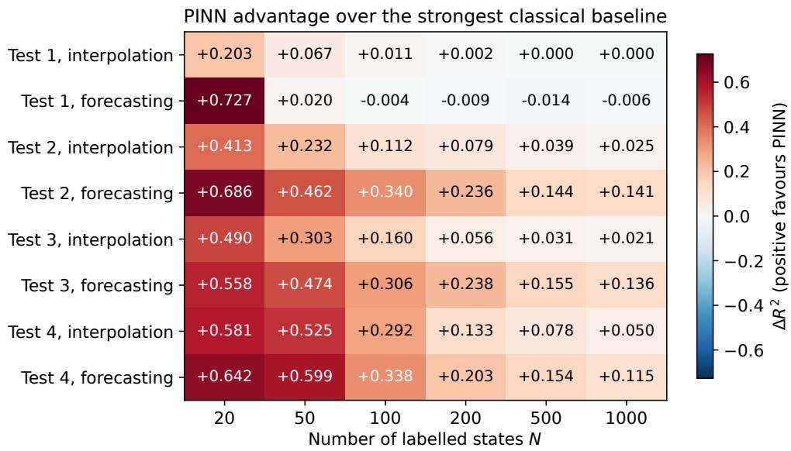
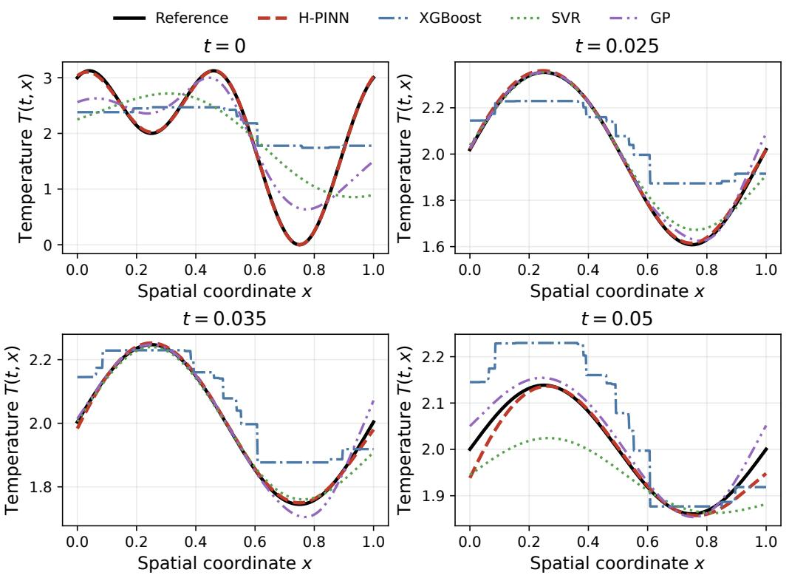
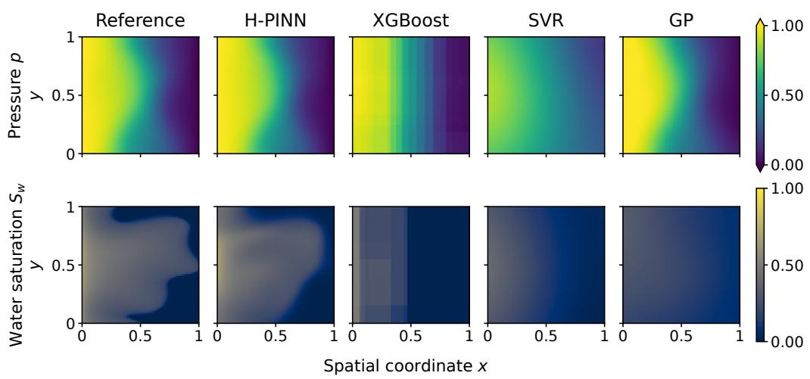
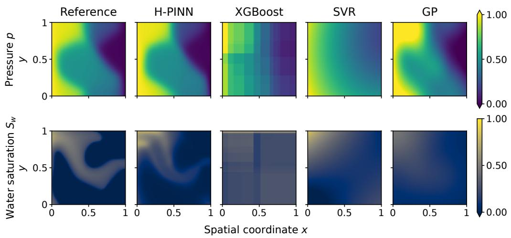
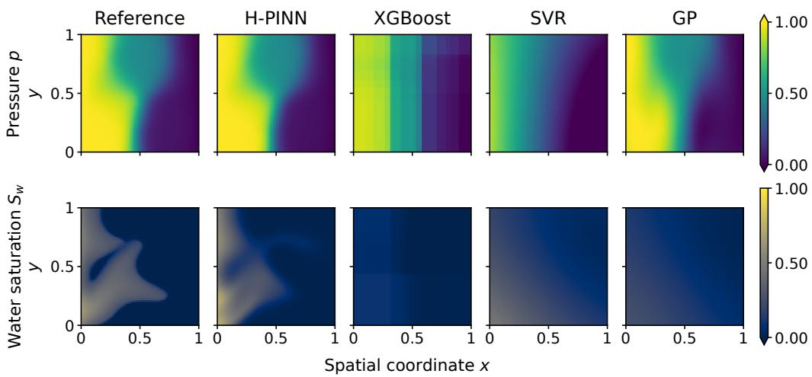

# Physics-informed neural networks in the small-data regime: A controlled comparison with classical PDE surrogates

Kirill Katsuba<sup>a,∗</sup>, Oleg Rudenko<sup>a</sup>, Egor Bugaev<sup>a</sup>, Alexander Tarakanov<sup>a,b</sup>

<sup>a</sup>Faculty of Computer Science, HSE University, 11 Pokrovsky Bulvar, Moscow, 109028, Russia

<sup>b</sup>VK, 39 Leningradsky Prospekt, Building 79, Moscow, 125167, Russia

## Abstract

Neural surrogates for engineering models are often trained on large collections of simulated solutions. We investigate whether physics-informed neural networks (PINNs) can achieve accurate predictions from scarce labelled observations by incorporating governing equations and prescribed initial and boundary conditions. We introduce hierarchical loss weighting (H-PINN) and its gradient-direction-aware extension (HO-PINN), which adjust the emphasis on physical constraints according to higher-priority losses. Hierarchical PINNs are compared with Vanilla PINN, tuned gradient boosting, support-vector regression, and Gaussian-process regression on a heat equation and three heterogeneous two-phase-flow benchmarks. Experiments use 20–1000 labelled states and ten paired seeds. Each label is one coordinate–state observation, not a complete simulation. At least one PINN variant achieves the highest mean primary-target $R ^ { 2 }$ in each interpolation and equation-assisted forecasting comparison at 20 and 50 labels. The advantage for water saturation persists across all tested budgets. Hierarchical weighting reduces variability across runs in selected settings. These results demonstrate that known physics can support accurate neural surrogate predictions from very few solution observations, at substantially higher fitting cost than the tested classical regressors.

Keywords: physics-informed neural networks, small-data regime, surrogate modelling, porous-media flow, temporal extrapolation, Gaussian processes

## 1. Introduction

Many subsurface decisions require a model to be evaluated far more often than a single forward study. History matching tests many geological hypotheses against production data. Uncertainty quantification propagates uncertain rock and fluid properties through the model. Optimization repeatedly changes wells or controls. In each case, many parameter or control hypotheses lead to many high-fidelity flow solves [1, 2, 3]. Even when one simulation is tractable, the complete many-query workflow can be prohibitively expensive.

Porous-media flow is also a dificult surrogate problem. Permeability is heterogeneous and may vary over several orders of magnitude. Pressure is comparatively smooth but globally coupled through an elliptic equation. Saturation is transported through the heterogeneous velocity field and develops moving fronts whose location depends nonlinearly on mobility ratios, relativepermeability parameters, and the rock field [3, 4]. This contrast motivates reporting pressure and saturation separately and using water saturation as the primary flow target.

Surrogates represent this response in diferent ways. Projection-based reduced-order models approximate dynamics in low-dimensional spaces [5], while learned nonlinear representations encode solution fields on reduced manifolds [6]. Convolutional encoder–decoders predict spatial fields [7, 3], and neural operators learn mappings between input and output functions [8, 9, 4]. Here we study coordinate-to-state regression from scattered observations. Gradient boosting, support-vector regression, and Gaussian-process regression provide the non-neural baselines [10, 11, 12]. This formulation compares methods at a fixed number of revealed solution values rather than complete training fields.

Physics-informed learning ofers a diferent trade-of. Instead of learning only from solution values, a PINN diferentiates a neural representation and evaluates the governing equations at coordinates that require no reference solution [13, 14]. Initial and boundary conditions provide further constraints. The central question of this study is therefore not whether PINNs can solve the equations in principle. We ask at which label budgets and for which solution structures this additional physical information outweighs the optimization dificulty and fitting cost of PINNs.

Small data has a precise meaning in our protocol. A labelled state is one

coordinate–state pair. For the flow problems it has the form

$$
( t , x , y , \pmb { \mu } ) \longmapsto ( p , S _ { w } , S _ { o } ) ,\tag{1}
$$

where $\pmb { \mu }$ is absent in the fixed-parameter tests. Thus, N = 500 denotes 500 individual states, not 500 complete reservoir simulations, permeability realizations, or time-dependent fields. Every method receives the same N labels. The PINNs additionally receive the PDE, initial and boundary conditions, residual coordinates over the full time interval, and the permeability coeficient evaluated at residual points. Forecasting is consequently equation-assisted rather than purely data-driven.

The study makes four contributions. First, it compares six nested budgets from 20 to 1000 states using ten paired seeds and separate interpolation and forecasting regions. Second, it examines a smooth heat problem and heterogeneous two-phase-flow problems, including a seven-input parametric surrogate. Third, it compares a fixed PINN architecture with extensively tuned XGB, SVR, and GP baselines. Fourth, it introduces hierarchical exponential loss activation and its gradient-direction-aware extension, and assesses their accuracy and run-to-run reliability against unit-weight vanilla PINN. The experiments identify a PINN advantage at 20–50 labels and throughout the tested budgets for water saturation. They also identify settings where weighting reduces variability, settings where vanilla is more reliable, and the smooth, suficiently sampled regime where GP is preferable.

## 2. Related work

Data-driven porous-flow surrogates are commonly constructed from complete simulation realizations. Convolutional encoder–decoders have been used for porous-media uncertainty quantification [7] and dynamic multiphase flow [3]. Recurrent and convolutional surrogates have also accelerated data assimilation and history matching in two- and three-dimensional reservoirs [1, 2]. These studies learn strong field-level representations but their training unit is typically a realization or a sequence of fields. Our training unit is instead one labelled state at one coordinate and time.

Operator-learning methods extend field prediction across coeficients and controls. DeepONet learns nonlinear operators from paired functions [8]. The Fourier neural operator performs global spectral mixing for parametric PDEs [9]. U-FNO augments this construction with a U-Net path and has been applied to multiphase flow and geological carbon storage [4]. Such models are designed for reusable maps between fields. The present study addresses the complementary setting in which only tens to hundreds of scattered state values are exposed to the learner while the diferential operator is known.

PINNs incorporate this operator by automatic diferentiation and penalize residuals at unlabelled coordinates [13, 14]. Sun et al. constructed fluid-flow surrogates without simulation labels by imposing conservation equations [15]. He et al. combined multiphysics constraints with sparse observations for subsurface transport data assimilation [16]. Chen et al. used physical constraints to identify governing equations from scarce measurements [17]. For two-phase flow, residual adaptivity and finite-volume-informed formulations have been used to improve front resolution in heterogeneous media [18, 19]. Coupled pressure and saturation studies nevertheless report persistent dificulty near sharp fronts [20].

Physics information does not remove numerical and optimization limitations. Standard PINNs can fail even on relatively simple PDEs [21]. Broad benchmarks show strong dependence on the equation, architecture, sampling, and optimizer [22]. Finite elements can also be more accurate and eficient when the task is simply to solve one forward problem [23]. We therefore keep the reference solver as ground truth, define the task as surrogate reconstruction after labels have been revealed, and report fitting cost rather than presenting PINNs as replacements for mature discretizations.

Loss balancing is a central part of reliable PINN training. Gradientstatistics annealing balances back-propagated gradients across loss terms [24]. Self-adaptive PINNs learn pointwise emphasis [25]. Inverse-Dirichlet weighting estimates imbalance from gradient statistics [26], while relativeprogress methods compare the rates at which objectives improve [27]. Our H-PINN instead activates IBC and PDE objectives as higher-priority losses approach prescribed scales. HO-PINN further reduces scalar weight for gradient directions already represented by earlier objectives. Unlike PCGrad [28], projection is used only to form weights and does not replace the gradient in the final backward pass.

The classical baselines provide complementary inductive biases. Gradient boosting uses additive trees [29, 10]. Support-vector regression uses a regularized kernel representation [11]. We use an RBF kernel in our experiments. GP regression uses a covariance-based prior over functions [12]. We examine when known physics improves prediction relative to these tuned regressors at matched label budgets, and whether hierarchical weighting improves run-torun reliability. Nested labels, paired seeds, and separate interpolation and equation-assisted forecasting sets support this comparison.

## 3. Small-data surrogate problem

## 3.1. Learning task and architecture

Let z collect space, time, and any physical parameters, and let $\pmb { y } ( z )$ denote the solution. All models receive

$$
\begin{array} { r } { \mathcal { D } _ { N } = \{ ( z _ { i } , \pmb { y } _ { i } ) \} _ { i = 1 } ^ { N } . } \end{array}\tag{2}
$$

Here N counts labelled solution states rather than complete simulations or fields. In Test 1, $\boldsymbol { z } = ( t , \boldsymbol { x } )$ and $\mathbf { \boldsymbol { y } } = T$ . In the fixed-parameter flow tests, $\boldsymbol { z } = ( t , x , y )$ , while Test 4 appends the four relative-permeability parameters. The flow target is $\pmb { y } = ( p , S _ { w } , S _ { o } )$ . PINNs additionally evaluate equation residuals at $N _ { r }$ unlabelled coordinates. These coordinates contain no referencesolver targets. Permeability is evaluated there as a known PDE coeficient and is not passed to the network as an input feature.

All tests use a gated residual multilayer perceptron with six hidden layers of width 128. Inputs are mapped to [−1, 1] using known domain bounds. Two learned tanh transforms are multiplied elementwise before the GELU hidden layers, with residual connections after every second layer and Xavier initialization. The heat model returns temperature. The flow model returns pressure, two saturations, and four auxiliary phase-velocity components. Sigmoid transformations and saturation normalization enforce

$$
0 \leq \widehat { S } _ { w } , \widehat { S } _ { o } \leq 1 , \qquad \widehat { S } _ { w } + \widehat { S } _ { o } = 1 .\tag{3}
$$

## 3.2. Loss components and hierarchical weighting

The objective combines mean-square data, initial/boundary-condition (IBC), and PDE errors,

$$
\begin{array} { r } { \mathcal { L } = w _ { d } \mathcal { L } _ { \mathrm { d a t a } } + w _ { b } \mathcal { L } _ { \mathrm { i b c } } + w _ { r } \mathcal { L } _ { \mathrm { p d e } } , \qquad w _ { d } , w _ { b } , w _ { r } \geq 0 . } \end{array}\tag{4}
$$

Each epoch uses all N fixed labels and $N _ { r } = 2 N$ freshly sampled residual points. The data loss compares temperature in Test 1 and $( p , S _ { o } , S _ { w } )$ in Tests 2–4. Vanilla PINN uses constant weights $w _ { d } = w _ { b } = w _ { r } = 1$ , hence $\mathcal { L } _ { \mathrm { v a n i l l a } } = \mathcal { L } _ { \mathrm { d a t a } } + \mathcal { L } _ { \mathrm { i b c } } + \mathcal { L } _ { \mathrm { p d e } }$ . H-PINN and HO-PINN normalize their weights to sum to one. Architecture, prescribed physics, labels, residual-sampling stream, and training schedule are shared across the three variants. The objective-scale diference is part of this implementation and may interact with gradient clipping.

H-PINN activates the IBC and PDE terms as preceding errors approach prescribed scales. With sg denoting stop-gradient, define

$$
q _ { d } = \frac { \mathrm { s g } ( \mathcal { L } _ { \mathrm { d a t a } } ) } { L _ { d } ^ { 0 } } , \qquad q _ { b } = \frac { \mathrm { s g } ( \mathcal { L } _ { \mathrm { i b c } } ) } { L _ { b } ^ { 0 } } .\tag{5}
$$

The exponential gates and weights are

$$
a _ { d } ^ { \mathrm { H } } = 1 , \quad a _ { b } ^ { \mathrm { H } } = e ^ { - q _ { d } } , \quad a _ { r } ^ { \mathrm { H } } = e ^ { - \operatorname* { m a x } \left( q _ { d } , q _ { b } \right) } , \quad w _ { j } ^ { \mathrm { H } } = \frac { a _ { j } ^ { \mathrm { H } } } { \sum _ { k } a _ { k } ^ { \mathrm { H } } } .\tag{6}
$$

The target scales control the transition between objectives. We use $L _ { d } ^ { 0 } = 0 . 0 3$ and $L _ { b } ^ { 0 } = 0 . 0 0 3$

HO-PINN also accounts for repeated gradient directions. Write $\begin{array} { r } { \pmb { g } _ { j } = \nabla _ { \theta } \pmb { \mathcal { L } } _ { j } } \end{array}$ and

$$
{ \mathcal Q } _ { b } ( { \pmb v } ) = { \pmb v } - \frac { \langle { \pmb v } , { \pmb b } \rangle } { \| { \pmb b } \| _ { 2 } ^ { 2 } + \varepsilon } { \pmb b } .\tag{7}
$$

The implementation removes projections sequentially and computes

$$
\rho _ { b } = \frac { \| \mathcal { Q } _ { { \pmb { \mathscr { g } } } _ { d } } ( { \pmb { \mathscr { g } } } _ { b } ) \| _ { 2 } } { \| { \pmb { \mathscr { g } } } _ { b } \| _ { 2 } + \varepsilon } , \qquad \rho _ { r } = \frac { \| \mathcal { Q } _ { { \pmb { \mathscr { g } } } _ { b } } ( \mathcal { Q } _ { { \pmb { \mathscr { g } } } _ { d } } ( { \pmb { \mathscr { g } } } _ { r } ) ) \| _ { 2 } } { \| { \pmb { \mathscr { g } } } _ { r } \| _ { 2 } + \varepsilon } .\tag{8}
$$

It then uses

$$
\begin{array} { c c } { { a _ { d } ^ { \mathrm { H O } } = 1 , } } & { { a _ { b } ^ { \mathrm { H O } } = a _ { b } ^ { \mathrm { H } } [ c + ( 1 - c ) \rho _ { b } ] , } } \\ { { \ a _ { r } ^ { \mathrm { H O } } = a _ { r } ^ { \mathrm { H } } [ c + ( 1 - c ) \rho _ { r } ] , } } & { { w _ { j } ^ { \mathrm { H O } } = \displaystyle \frac { a _ { j } ^ { \mathrm { H O } } } { \sum _ { k } a _ { k } ^ { \mathrm { H O } } } . } } \end{array}\tag{9}
$$

We set $c = 0 . 2 5$ . Repeated directions receive less weight, while the positive floor preserves every active objective. At $c = 1$ , HO-PINN reduces to H-PINN. All gates and gradient-direction factors are detached before the backward pass. Algorithm 1 summarizes the training procedure for both variants. Appendix A describes parameter selection.

## 4. PDE benchmarks and reference solutions

## 4.1. Periodic heat equation

Test 1 uses

$$
\partial _ { t } T - \partial _ { x x } T = 0 , \qquad ( t , x ) \in [ 0 , 0 . 0 5 ] \times [ 0 , 1 ] ,\tag{10}
$$

with periodic boundaries and $T ( 0 , x ) = 2 + \sin ( 2 \pi x ) + \cos ( 4 \pi x )$ . Its exact solution is

$$
T ( t , x ) = 2 + e ^ { - 4 \pi ^ { 2 } t } \sin ( 2 \pi x ) + e ^ { - 1 6 \pi ^ { 2 } t } \cos ( 4 \pi x ) .\tag{11}
$$

This benchmark evaluates smooth reconstruction without numerical reference error.

## 4.2. Heterogeneous two-phase flow

Tests 2–4 model incompressible, immiscible water–oil displacement on $\Omega = [ 0 , 1 ] ^ { 2 }$ , neglecting gravity and capillary pressure. Phase saturation $S _ { \alpha }$ is the fraction of pore volume occupied by phase $\alpha \in \{ w , o \}$ . Conservation and closure give

$$
\phi \partial _ { t } S _ { \alpha } + \nabla \cdot \pmb { u } _ { \alpha } = 0 , \qquad S _ { w } + S _ { o } = 1 ,\tag{12}
$$

where $\phi$ is porosity and ${ \pmb u } _ { \alpha }$ is Darcy flux. The phases share pressure $p$ and obey

$$
{ \pmb u } _ { \alpha } = - K ( { \pmb x } ) \lambda _ { \alpha } \nabla p , \qquad \lambda _ { \alpha } = \frac { k _ { r \alpha } } { \mu _ { \alpha } } ,\tag{13}
$$

with absolute permeability $K$ , relative permeability $k _ { r \alpha } .$ , and viscosity $\mu _ { \alpha }$ . Corey-type laws are used [30],

$$
k _ { r w } = k _ { w } ^ { 0 } S _ { w } ^ { p _ { w } } , \qquad k _ { r o } = k _ { o } ^ { 0 } S _ { o } ^ { p _ { o } } .\tag{14}
$$

Adding the phase equations yields

$$
\nabla \cdot [ K ( \lambda _ { w } + \lambda _ { o } ) \nabla p ] = 0 , \qquad { \pmb u } _ { t } = - K ( \lambda _ { w } + \lambda _ { o } ) \nabla p .\tag{15}
$$

Equivalently, transport satisfies

$$
\phi \partial _ { t } S _ { \alpha } + \nabla \cdot ( f _ { \alpha } \mathbf { u } _ { t } ) = 0 , \qquad f _ { \alpha } = \frac { \lambda _ { \alpha } } { \lambda _ { w } + \lambda _ { o } } .\tag{16}
$$

We fix $\phi = 0 . 1 , \mu _ { w } = 1$ , and $\mu _ { o } = 3$ . Initially $S _ { w } = 0$ and $S _ { o } = 1$ . Pressure is imposed as $p ( t , 0 , y ) = 1$ and $p ( t , 1 , y ) = 0$ . Both phases have zero normal flux on $y = 0 , .$ 1. At the inlet $x = 0$ , zero oil flux specifies pure-water injection. Water inflow follows from the pressure diference. Outflow composition follows the interior upwind state.

The PINN predicts phase velocities directly. Its residual loss is the sample mean of the squared residual norm for

$$
\begin{array} { r } { \boldsymbol { r } _ { \theta } = \left[ \begin{array} { c } { \phi \partial _ { t } \widehat { S } _ { w } + \nabla \cdot \widehat { \boldsymbol { u } } _ { w } } \\ { \phi \partial _ { t } \widehat { S } _ { o } + \nabla \cdot \widehat { \boldsymbol { u } } _ { o } } \\ { \widehat { \boldsymbol { u } } _ { w } + K k _ { r w } ( \widehat { S } _ { w } ) \nabla \widehat { p } / \mu _ { w } } \\ { \widehat { \boldsymbol { u } } _ { o } + K k _ { r o } ( \widehat { S } _ { o } ) \nabla \widehat { p } / \mu _ { o } } \\ { \widehat { S } _ { w } + \widehat { S } _ { o } - 1 } \end{array} \right] . } \end{array}\tag{17}
$$

The IBC loss enforces the conditions above. The data loss averages the summed squared errors of $p , S _ { o } , S _ { w }$ •

Tests 2 and 3 use $( p _ { w } , p _ { o } , k _ { w } ^ { 0 } , k _ { o } ^ { 0 } ) = ( 2 , 4 , 1 , 0 . 3 )$ . Their permeability contrasts are approximately 24 and $9 . 0 \times 1 0 ^ { 4 }$ , respectively. Test 4 uses a third fixed heterogeneous field and 100 parameter combinations with

$$
p _ { w } \in [ 1 . 5 , 2 . 5 ] , \quad p _ { o } \in [ 3 , 5 ] , \quad k _ { w } ^ { 0 } \in [ 0 . 9 , 1 . 1 ] , \quad k _ { o } ^ { 0 } \in [ 0 . 2 , 0 . 4 ] .\tag{18}
$$

Its input is $( t , x , y , p _ { w } , p _ { o } , k _ { w } ^ { 0 } , k _ { o } ^ { 0 } )$ . Permeability is supplied only as a PDE coeficient at residual points. Test 1 has two inputs and final time 0.05. Tests 2 and 3 have three inputs and final times 0.30 and 0.05. Test 4 has seven inputs and final time 0.20. The heat reference is analytical. Each flow reference uses a $6 4 \times 6 4$ finite-volume grid. Tests 2 and 3 each contain one flow realization, while Test 4 contains 100 parameter combinations. Test 4 holds out coordinates, not entire parameter combinations, so it does not establish generalization to unseen parameter realizations. Temperature is the primary Test 1 target and water saturation is the primary flow target.

## 4.3. Reference discretization

The cell-centred finite-volume solver recomputes pressure at every adaptive transport substep. Harmonic face transmissibilities handle permeability jumps. Phase fluxes use upstream fractional flow, and explicit saturation updates are divided by cell pore volume $\phi \Delta x \Delta y$ , with a CFL limit of 0.2. Pressure and saturation are stored synchronously at 101 times including $t = 0$ . Final times retain developed displacement fronts. The PINN residuals and reference solver enforce the same continuum equations through diferent discretizations.

## 5. Experimental protocol

## 5.1. Training and evaluation sets

Budgets are $N \in \{ 2 0 , 5 0 , 1 0 0 , 2 0 0 , 5 0 0 , 1 0 0 0 \}$ , with seeds 101–110 controlling label selection and PINN initialization. Training sets are nested within each seed and shared by all methods. Labels occupy $t \leq 0 . 7 t _ { \mathrm { m a x } }$ and are balanced over ten temporal bins.

Fixed, disjoint test sets measure interpolation at $t \leq 0 . 7 t _ { \mathrm { m a x } }$ and forecasting at $t > 0 . 7 t _ { \mathrm { m a x } }$ . Test 1 has 29,041 interpolation and 12,336 forecasting points. Each flow test uses 1,500 points per region. Test 4 draws these sets from a deterministic pool of 100,000 states covering all 100 parameter combinations.

PINN residuals cover the full time interval, excluding current labels and evaluation coordinates. They contain no reference values. Forecasting therefore uses knowledge of the future diferential operator but no future solution labels. Initial and boundary conditions are prescribed physical information.

## 5.2. Optimization and baseline tuning

All PINNs use 50,000 epochs of Adam with initial learning rate $3 \times 1 0 ^ { - 3 }$ 2 cosine decay to $1 0 ^ { - 5 }$ , and gradient clipping at one. The checkpoint with the minimum balanced training loss is retained. A separate set of 512 unlabelled physics-validation points provides diagnostics, not checkpoint selection. The fixed architecture and weighting parameters were selected in staged development runs described in Appendix A.

Classical models fit each output independently. XGB uses histogram-based squared-error boosting. SVR uses a radial-basis kernel with input and target scaling. GP uses standardized inputs and constant-scaled stationary kernels with white noise. At every budget and seed, 96 XGB configurations, 96 SVR configurations, and 20 GP kernel–regularization combinations are evaluated using three strictly forward-time folds. GP also optimizes kernel parameters by marginal likelihood with three restarts. Preprocessing is fitted inside each fold, and negative MSE determines the selected parameters. Neither evaluation set is used for tuning.

## 5.3. Metrics

For m evaluation points, we report

$$
\mathrm { M S E } = \frac { 1 } { m } \sum _ { i } ( y _ { i } - \widehat { y } _ { i } ) ^ { 2 } , \qquad R ^ { 2 } = 1 - \frac { \sum _ { i } ( y _ { i } - \widehat { y } _ { i } ) ^ { 2 } } { \sum _ { i } ( y _ { i } - \overline { { y } } ) ^ { 2 } } .\tag{19}
$$

Metrics are computed per run, followed by the mean and sample standard deviation across ten seeds. Test 1 uses temperature. Flow tests report water saturation and pressure separately, with saturation defining the primary ranking. Error bars describe run-to-run variability, not confidence intervals. We assess predictive reliability within each fixed test–budget–region condition using the std ratio $s _ { \mathrm { H } } / s _ { \mathrm { v a n i l l a } }$ or $s _ { \mathrm { H O } } / s _ { \mathrm { v a n i l l a } }$ . Smaller ratios indicate less sensitivity to the joint change in labels and initialization. We also inspect lower-tail scores and negative $R ^ { 2 }$ evaluations. These diagnostics describe predictive variability rather than smoothness of the training loss. Conditions share seeds and nested labels, so counts across conditions are descriptive and not independent significance tests.

## 6. Results

Table 1 reports all six methods at the two smallest budgets. Figure 1 extends the comparison to all six budgets by subtracting the strongest classical mean from the strongest of the three PINN means. The primary target is temperature in Test 1 and water saturation in Tests 2–4. Field figures show the fixed $N = 5 0$ , seed-101 H-PINN and classical runs to illustrate spatial structure.

Tables B.1–B.4 in Appendix B give primary-target $R ^ { 2 }$ and MSE for every budget and all six methods. Supplementary Tables S1–S3 provide the corresponding pressure metrics for Tests 2–4.

## 6.1. Test 1: periodic heat equation

Figure 2 compares temperature profiles at four times. H-PINN follows the analytical solution throughout the interval. Boosting predictions retain a piecewise-constant form, while SVR and GP smooth the sparsely sampled profile.

Both weighted PINNs are efectively exact in interpolation at $N = 2 0$ and 50. In forecasting, HO-PINN reaches $0 . 9 9 4 \pm 0 . 0 0 3$ at $N = 2 0$ , compared with $0 . 9 4 6 \pm 0 . 0 6 9$ for vanilla and $0 . 2 6 7 \pm 0 . 8 1 7$ for GP. GP leads forecasting from $N = 1 0 0$ and interpolation from $N = 5 0 0$ , but its largest mean advantage over the best PINN is 0.014 in $R ^ { 2 }$ . This test identifies a regime in which enough labels make a classical smoothness prior suficient.

## 6.2. Test 2: moderate permeability contrast

The final-time fields in Fig. 3 show the diference between the smooth pressure response and the transported saturation front. H-PINN preserves the front location and heterogeneous shape. The classical models recover the broad pressure trend but substantially smooth or discretize the saturation field.

Table 1: Primary $R ^ { 2 } \uparrow$ at 20 and 50 labels (mean ± std over ten seeds). Test 1 uses temperature and Tests 2–4 use water saturation. Vanilla denotes unit-weight PINN. Bold marks the highest mean.  
Interpolation
<table><tr><td>Test N</td><td></td><td>Vanilla</td><td>H-PINN</td><td>HO-PINN</td><td>XGB</td><td>SVR</td><td>GP</td></tr><tr><td>T1</td><td>20</td><td> $0 . 9 9 3 { \pm } 0 . 0 0 3$ </td><td> $1 . 0 0 0 { \scriptstyle \pm 0 . 0 0 0 }$ </td><td> $\mathbf { 1 . 0 0 0 \pm 0 . 0 0 0 }$ </td><td> $0 . 3 8 5 { \pm } 0 . 1 3 1$ </td><td> $0 . 4 6 1 { \pm } 0 . 3 0 3$ </td><td> $0 . 7 9 7 { \scriptstyle \pm 0 . 0 9 8 }$ </td></tr><tr><td>T1</td><td>50</td><td> $0 . 9 9 7 { \scriptstyle \pm 0 . 0 0 1 }$ </td><td> $\mathbf { 1 . 0 0 0 \pm 0 . 0 0 0 }$ </td><td> $1 . 0 0 0 { \scriptstyle \pm 0 . 0 0 0 }$ </td><td> $0 . 6 3 9 { \pm } 0 . 1 1 7$ </td><td> $0 . 6 9 1 { \pm } 0 . 2 2 8$ </td><td> $0 . 9 3 2 { \pm } 0 . 0 5 5$ </td></tr><tr><td>T2</td><td>20</td><td> $\mathbf { 0 . 9 5 4 \pm 0 . 0 0 7 }$ </td><td> $0 . 9 5 4 { \pm } 0 . 0 0 8$ </td><td> $0 . 9 3 7 { \pm } 0 . 0 5 2$ </td><td> $0 . 3 6 2 { \scriptstyle \pm 0 . 2 4 1 }$ </td><td> $0 . 3 9 6 { \pm } 0 . 2 7 6$ </td><td> $0 . 5 4 1 { \pm } 0 . 1 5 7$ </td></tr><tr><td>T2</td><td>50</td><td> $\mathbf { 0 . 9 7 7 { \pm 0 . 0 0 3 } }$ </td><td> $0 . 9 7 5 { \scriptstyle \pm 0 . 0 0 4 }$ </td><td> $0 . 9 7 7 { \scriptstyle \pm 0 . 0 0 3 }$ </td><td> $0 . 6 3 2 { \pm } 0 . 0 4 6$ </td><td> $0 . 6 8 5 { \pm } 0 . 0 9 2$ </td><td> $0 . 7 4 5 { \pm } 0 . 0 8 9$ </td></tr><tr><td>T3</td><td>20</td><td> $\mathbf { 0 . 7 5 5 \pm 0 . 0 1 8 }$ </td><td> $0 . 4 6 1 { \pm } 0 . 3 6 0$ </td><td> $0 . 5 6 7 { \scriptstyle \pm 0 . 3 1 2 }$ </td><td> $0 . 0 1 9 { \pm } 0 . 3 5 0$ </td><td> $0 . 0 8 4 { \pm } 0 . 4 8 2$ </td><td> $0 . 2 6 5 { \pm } 0 . 4 0 1$ </td></tr><tr><td>T3</td><td>50</td><td> $\mathbf { 0 . 8 4 7 \pm 0 . 0 1 5 }$ </td><td> $0 . 8 4 1 { \pm } 0 . 0 1 5$ </td><td> $0 . 8 4 2 { \pm } 0 . 0 1 0$ </td><td> $0 . 3 4 4 { \pm } 0 . 3 0 2$ </td><td> $0 . 3 7 7 { \scriptstyle \pm 0 . 3 0 4 }$ </td><td> $0 . 5 4 4 { \pm } 0 . 2 4 7$ </td></tr><tr><td>T4</td><td>20</td><td> $0 . 4 9 5 { \pm } 0 . 2 5 1$ </td><td> $\mathbf { 0 . 5 2 2 \pm 0 . 3 0 5 }$ </td><td> $0 . 4 2 6 { \pm } 0 . 3 5 8$ </td><td></td><td></td><td> $- 0 . 0 5 8 \pm 0 . 2 6 8 - 0 . 1 8 7 \pm 0 . 2 9 4 - 0 . 0 7 7 \pm 0 . 3 3 9$ </td></tr><tr><td>T4</td><td>50</td><td> $0 . 7 7 7 { \scriptstyle \pm 0 . 1 0 0 }$ </td><td> $\mathbf { 0 . 8 0 7 \pm 0 . 0 1 5 }$ </td><td> $0 . 7 7 9 { \pm } 0 . 1 0 9$ </td><td> $0 . 1 8 2 { \pm } 0 . 1 6 0$ </td><td> $0 . 0 8 3 { \pm } 0 . 1 0 9$ </td><td> $0 . 2 8 2 { \pm } 0 . 1 9 2$ </td></tr></table>

<table><tr><td colspan="7">Equation-assisted forecasting</td></tr><tr><td>Test N</td><td></td><td>Vanilla</td><td>H-PINN</td><td>HO-PINN</td><td>XGB</td><td>SVR</td><td>GP</td></tr><tr><td>T1</td><td>20</td><td> $0 . 9 4 6 { \pm } 0 . 0 6 9$ </td><td></td><td> $0 . 9 9 2 \pm 0 . 0 0 8 0 . 9 9 4 \pm 0 . 0 0 3 - 0 . 0 6 9 \pm 0 . 4 6 8 - 0 . 2 7 4 \pm 0 . 5 4 2$ </td><td></td><td></td><td> $0 . 2 6 7 { \scriptstyle \pm 0 . 8 1 7 }$ </td></tr><tr><td>T1</td><td>50</td><td> $0 . 8 8 4 { \pm } 0 . 0 5 3$ </td><td> $\mathbf { 0 . 9 9 3 } \pm \mathbf { 0 . 0 0 6 }$ </td><td> $0 . 9 9 3 { \pm } 0 . 0 0 5$ </td><td> $0 . 2 7 6 { \pm } 0 . 4 3 8$ </td><td> $0 . 4 7 9 { \pm } 0 . 5 2 4$ </td><td> $0 . 9 7 3 { \pm } 0 . 0 2 8$ </td></tr><tr><td>T2</td><td>20</td><td> $\mathbf { 0 . 9 1 7 \pm 0 . 0 1 5 }$ </td><td> $0 . 9 1 7 { \scriptstyle \pm 0 . 0 1 6 }$ </td><td> $0 . 8 9 3 { \pm } 0 . 0 7 9$ </td><td> $0 . 2 3 0 { \pm } 0 . 2 8 7$ </td><td> $- 0 . 8 6 4 \pm 1 . 2 4 0$ </td><td> $0 . 0 1 3 { \pm } 0 . 3 9 2$ </td></tr><tr><td>T2</td><td>50</td><td> $\mathbf { 0 . 9 4 8 { \pm 0 . 0 0 9 } }$ </td><td> $0 . 9 4 7 { \scriptstyle \pm 0 . 0 1 0 }$ </td><td> $0 . 9 4 8 { \pm } 0 . 0 1 0$ </td><td> $0 . 3 9 7 { \scriptstyle \pm 0 . 1 3 6 }$ </td><td> $0 . 2 7 9 { \pm } 0 . 2 5 0$ </td><td> $0 . 4 8 6 \pm 0 . 1 9 7$ </td></tr><tr><td>T3</td><td>20</td><td> $\mathbf { 0 . 6 4 2 \pm 0 . 0 4 2 }$ </td><td> $0 . 3 3 4 { \pm } 0 . 4 0 1$ </td><td> $0 . 4 4 5 { \pm } 0 . 3 6 5$ </td><td></td><td> $- 0 . 0 8 9 \pm 0 . 2 6 9 - 2 . 1 4 8 \pm 4 . 7 0 3$ </td><td> $0 . 0 8 4 \pm 0 . 2 8 4$ </td></tr><tr><td>T3</td><td>50</td><td> $\mathbf { 0 . 7 6 8 \pm 0 . 0 3 3 }$ </td><td> $0 . 7 6 2 { \scriptstyle \pm 0 . 0 2 6 }$ </td><td> $0 . 7 5 9 { \pm } 0 . 0 2 5$ </td><td></td><td> $0 . 1 7 2 { \pm } 0 . 3 9 4 - 1 . 0 1 1 { \pm } 2 . 2 8 9$ </td><td> $0 . 2 9 3 { \pm } 0 . 2 6 9$ </td></tr><tr><td>T4</td><td>20</td><td> $\mathbf { 0 . 5 5 8 { \pm 0 . 2 0 7 } }$ </td><td> $0 . 5 5 0 { \pm } 0 . 3 6 0$ </td><td> $0 . 4 3 5 { \pm } 0 . 4 5 4$ </td><td></td><td> $- 0 . 1 2 4 \pm 0 . 3 1 4 - 0 . 3 2 5 \pm 0 . 3 6 4 - 0 . 0 8 4 \pm 0 . 2 8 0$ </td><td></td></tr><tr><td>T4 50</td><td></td><td> $0 . 7 9 4 { \pm } 0 . 0 5 9$ </td><td> $\mathbf { 0 . 8 1 5 \pm 0 . 0 1 1 }$ </td><td> $0 . 7 9 9 { \pm } 0 . 0 6 7$ </td><td> $0 . 1 9 8 { \pm } 0 . 2 6 9$ </td><td> $0 . 0 1 9 { \pm } 0 . 1 8 0$ </td><td> $0 . 2 1 6 { \pm } 0 . 2 1 4$ </td></tr></table>

At $N = 2 0$ , H-PINN obtains saturation $R ^ { 2 } = 0 . 9 5 4 { \pm } 0 . 0 0 8$ in interpolation and $0 . 9 1 7 \pm 0 . 0 1 6$ in forecasting. The strongest classical means are 0.541 and 0.230. At $N = 5 0$ , the best PINN means increase to 0.977 and 0.948, with substantially smaller dispersion than the strongest classical entries. The advantage remains at $N = 1 0 0 0 .$ , where the best PINN forecasting mean is 0.993 and the best classical mean is 0.852.

## 6.3. Test 3: high permeability contrast

Test 3 increases the permeability contrast to approximately $9 . 0 \times 1 0 ^ { 4 }$ Figure 4 shows that H-PINN reconstructs the main saturation pathway and pressure transition. XGB produces block artefacts, while SVR and GP miss much of the front geometry.

  
Figure 1: Diference between the best PINN and best classical mean $R ^ { 2 }$ for the primary target. Positive cells favour PINNs. Each value is computed from ten paired seeds. Forecasting uses future residual coordinates but no future solution labels.

At $N = 2 0$ , weighted PINNs have substantially greater seed variability than vanilla, although their means remain above the classical baselines. At $N = 5 0$ , H-PINN reaches forecasting $R ^ { 2 } = 0 . 7 6 2 \pm 0 . 0 2 6$ , compared with $0 . 7 6 8 \pm 0 . 0 3 3$ for vanilla and $0 . 2 9 3 \pm 0 . 2 6 9$ for GP. H-PINN and GP have mean MSE values of $6 . 8 4 \times 1 0 ^ { - 3 }$ and $2 . 0 3 \times 1 0 ^ { - 2 }$ , respectively. The PINN advantage over classical models persists through $N = 1 0 0 0$

## 6.4. Test 4: seven-input parametric surrogate

Test 4 trains one model across a pool of 100 relative-permeability parameter combinations. Figure 5 displays one fixed combination at the final forecasting time. H-PINN follows the pressure interface and the principal saturation branches, while the three classical predictions lose much of the front structure.

The advantage persists in seven input dimensions. H-PINN forecasting saturation improves from $0 . 5 5 0 \pm 0 . 3 6 0$ at $N = 2 0$ to $0 . 8 1 5 \pm 0 . 0 1 1$ at $N = 5 0$ At the latter budget, vanilla gives $0 . 7 9 4 \pm 0 . 0 5 9$ , while the best classical mean is 0.216 with std 0.214. H-PINN therefore improves both the mean and dispersion in this condition. At $N = 2 0$ , however, vanilla has smaller forecasting std than either weighted variant.

  
Figure 2: Test 1 temperature for $N = 5 0$ and seed 101 at $t = 0 , 0 . 0 2 5 , 0 . 0 3 5 , 0 . 0 5$ Reference denotes the analytical solution.

## 6.5. Run-to-run reliability of loss weighting

Table 2: Run-to-run variability relative to vanilla PINN after 50,000-epoch training. Each test has 12 conditions (six budgets, two regions), each with ten paired seeds. Ratios below one favour weighting. Counts and medians are descriptive, not independent significance tests.
<table><tr><td>Median std ratio ↓ Lower std, out of 12 ↑ Test H/Vanilla HO / Vanilla H-PINN</td></tr><tr><td>HO-PINN</td></tr><tr><td>Test 1 0.19 0.16 11 12</td></tr><tr><td>Test 2 1.11 1.14 4 3 Test 3 0.98</td></tr><tr><td>0.95 7 6</td></tr><tr><td>1.01 5 6</td></tr></table>

Table 2 covers all budgets and both regions. H-PINN and HO-PINN each reduce std relative to vanilla in 27 of 48 conditions. The clearest benefit is

  
Figure 3: Test 2 pressure and water saturation at $t = 0 . 3 0$ , with $N = 5 0$ and seed 101. All predictions share the reference colour range within each row.

  
Figure 4: Test 3 pressure and water saturation at $t = 0 . 0 5$ , with $N = 5 0$ and seed 101.

  
Figure 5: Test 4 pressure and water saturation at $t = 0 . 2 0$ for parameter combination 7, with $N = 5 0$ and seed 101. The total label budget is shared across the pool of 100 combinations. No parameter combination is deliberately withheld.

Test 1, with median ratios 0.19 and 0.16. At $N = 5 0$ , forecasting std decreases from 0.053 for vanilla to 0.006 for H and 0.005 for HO, while the mean also improves. In Test 4 at $N = 5 0$ , H reduces forecasting std by a factor of 5.1 and raises the worst observed seed score from 0.632 to 0.795. HO does not reproduce this benefit in that condition.

The benefit is conditional. Vanilla has smaller std in most Test 2 conditions. In Test 3 at $N = 2 0$ , its forecasting score is $0 . 6 4 2 \pm 0 . 0 4 2$ , whereas H and HO give $0 . 3 3 4 \pm 0 . 4 0 1$ and $0 . 4 4 5 \pm 0 . 3 6 5$ . Across all 480 evaluations per PINN, H and HO have eight and seven negative primary $R ^ { 2 }$ values, all in Tests 3–4 at $N = 2 0$ , versus zero for vanilla. The two regions may flag the same trained model. Weighting can thus improve reliability markedly, but does not uniformly protect against low-budget failures. Appendix A.5 reports the separate fixed-epoch comparison.

## 6.6. Cross-test result and computational cost

At 20 and 50 labels, a PINN leads all 16 test–region–budget comparisons. Over $N \leq 1 0 0$ , a PINN leads in 23 of 24 comparisons. Across Tests 2–4, a PINN leads all 36 saturation comparisons, and across all tests it leads 42 of 48. The six classical wins are confined to the heat equation. Among all methods, vanilla leads 17 conditions, H leads 10 and HO leads 15.

This label eficiency has a substantial fitting cost. At $N = 5 0$ , average GPU fitting times across the four tests range from 39–96 minutes for vanilla, 41–97 for H, and 64–158 for HO. Classical fitting including tuning takes approximately 0.8–66 seconds on CPU.

## 7. Discussion

The ten-seed study supports a solution-label advantage under known governing equations and prescribed initial and boundary conditions. At 20–50 labels, a PINN leads every comparison with classical models. For water saturation, this advantage persists through 1000 labels. Pressure is smoother and generally easier to reconstruct, so averaging it with saturation would obscure front-prediction errors. Vanilla PINN demonstrates that much of the gain comes from physical supervision and the shared constrained architecture. Weighting adds a substantial reliability benefit for the heat problem and selected flow conditions, but can also suppress useful objectives for too long when labels are extremely sparse.

The comparison holds solution labels fixed while allowing PINNs additional physical information. Residuals cover future times, which makes the forecasting task equation-assisted. It is not equivalent to unconstrained extrapolation from past labels. The results do not establish the same ranking when the PDE is unavailable, uncertain, or enforced only within the labelled interval.

Three limitations afect generalization. First, development inspected predictive metrics and reused seeds 101–103. Seeds 104–110 were added after configuration selection, but the protocol is not fully nested model selection. Second, the flow references use one spatial resolution and fixed permeability fields. Grid refinement and independent fields are needed to assess discretization sensitivity and transfer. Test 4 also does not hold out entire parameter combinations. Third, the comparison includes vanilla PINN and non-neural surrogates, but not specialized numerical solvers or other adaptive loss-weighting algorithms. The findings therefore concern these implementations rather than a ranking of weighting methods in general.

The heat-equation crossover shows that additional labels can make a conventional kernel surrogate preferable. PINN fitting is also substantially more expensive. The practical benefit depends on whether the reduction in required observations compensates for this cost. Our protocol establishes eficiency with respect to revealed state labels. It does not claim that N labels correspond to N full simulator runs. When sparse labels are extracted from already computed fields, reducing their number does not automatically reduce the ofline simulation cost in the same proportion.

## 8. Conclusions

This study demonstrates that physics-informed neural networks can achieve accurate surrogate predictions from scarce labelled observations, including for strongly nonlinear, heterogeneous two-phase flow with moving saturation fronts. The benchmarks include permeability contrasts approaching five orders of magnitude and a seven-input parametric problem. Despite these challenges, a PINN achieves the highest mean primary-target accuracy among the tested methods in every interpolation and equation-assisted forecasting comparison at 20 and 50 labelled states. For water saturation, the advantage over tuned classical regression persists across all tested budgets up to 1000 states. These results show that useful neural surrogate predictions do not necessarily require large labelled datasets, even for challenging nonlinear flow problems, when reliable governing equations and prescribed initial and boundary conditions are available.

We introduce hierarchical loss weighting (H-PINN), which progressively activates physical constraints, and its gradient-direction-aware extension (HO-PINN). Both reduce variability across runs markedly for the heat equation and in selected flow settings. Their benefits remain problem dependent: neither consistently outperforms vanilla PINN, which is more reliable in some extremely sparse flow cases.

For engineering applications, the principal implication is that physical knowledge can supplement scarce solution observations. This label eficiency entails substantially higher fitting cost, and Gaussian-process regression becomes preferable for the suficiently sampled smooth heat solution. Because each label represents one coordinate–state observation, the results establish eficiency with respect to revealed solution values rather than proportional savings in full simulations.

## Data and code availability

The code and data are maintained in a single GitHub repository:

https://github.com/kirillkatsuba/pinn-small-data-jcp

## CRediT authorship contribution statement

Kirill Katsuba: Conceptualization, Methodology, Software, Investigation, Formal analysis, Data curation, Validation, Visualization, Writing – original draft, Writing – review & editing.

Oleg Rudenko: Conceptualization, Software, Validation, Writing – review & editing.

Egor Bugaev: Software, Validation, Writing – review & editing.

Alexander Tarakanov: Conceptualization, Supervision, Writing – review & editing.

## Acknowledgments

The supercomputer of HSE University was used to conduct the computational research [31].

## Declaration of competing interest

The authors declare that they have no known competing financial interests or personal relationships that could have appeared to influence the work reported in this paper.

## Funding

This research did not receive any specific grant from funding agencies in the public, commercial, or not-for-profit sectors.

## Declaration of generative AI and AI-assisted technologies in the writing process

During preparation of this work, the authors used OpenAI Codex for code-assisted analysis, LaTeX drafting, and language editing. The authors reviewed and edited all generated material and take full responsibility for the content of the publication.

## References

[1] M. Tang, Y. Liu, L. J. Durlofsky, A deep-learning-based surrogate model for data assimilation in dynamic subsurface flow problems, Journal of Computational Physics 413 (2020) 109456. doi:10.1016/j.jcp.2020.109456.

[2] M. Tang, Y. Liu, L. J. Durlofsky, Deep-learning-based surrogate flow modeling and geological parameterization for data assimilation in 3d subsurface flow, Computer Methods in Applied Mechanics and Engineering 376 (2021) 113636. doi:10.1016/j. cma.2020.113636.

[3] S. Mo, Y. Zhu, N. Zabaras, X. Shi, J. Wu, Deep convolutional encoder–decoder networks for uncertainty quantification of dynamic multiphase flow in heterogeneous media, Water Resources Research 55 (1) (2019) 703–728. doi:10.1029/2018WR023528.

[4] G. Wen, Z. Li, K. Azizzadenesheli, A. Anandkumar, S. M. Benson, U-FNO—an enhanced Fourier neural operator-based deep-learning model for multiphase flow, Advances in Water Resources 163 (2022) 104180. doi:10.1016/j.advwatres.2022. 104180.

[5] P. Benner, S. Gugercin, K. Willcox, A survey of projection-based model reduction methods for parametric dynamical systems, SIAM Review 57 (4) (2015) 483–531. doi:10.1137/130932715.

[6] S. Fresca, L. Dedè, A. Manzoni, A comprehensive deep learning-based approach to reduced order modeling of nonlinear time-dependent parametrized PDEs, Journal of Scientific Computing 87 (2) (2021) 61. doi:10.1007/s10915-021-01462-7.

[7] Y. Zhu, N. Zabaras, Bayesian deep convolutional encoder–decoder networks for surrogate modeling and uncertainty quantification, Journal of Computational Physics 366 (2018) 415–447. doi:10.1016/j.jcp.2018.04.018.

[8] L. Lu, P. Jin, G. Pang, Z. Zhang, G. E. Karniadakis, Learning nonlinear operators via DeepONet based on the universal approximation theorem of operators, Nature Machine Intelligence 3 (3) (2021) 218–229. doi:10.1038/s42256-021-00302-5.

[9] Z. Li, N. Kovachki, K. Azizzadenesheli, B. Liu, K. Bhattacharya, A. Stuart, A. Anand kumar, Fourier neural operator for parametric partial diferential equations, in: International Conference on Learning Representations, 2021, accessed 8 November 2026. URL https://openreview.net/forum?id=c8P9NQVtmnO

[10] T. Chen, C. Guestrin, XGBoost: A scalable tree boosting system, in: Proceedings of the 22nd ACM SIGKDD International Conference on Knowledge Discovery and Data Mining, ACM, 2016, pp. 785–794. doi:10.1145/2939672.2939785.

[11] H. Drucker, C. J. C. Burges, L. Kaufman, A. J. Smola, V. Vapnik, Support vector regression machines, in: Advances in Neural Information Processing Systems, Vol. 9, 1996, pp. 155–161.

[12] C. E. Rasmussen, C. K. I. Williams, Gaussian Processes for Machine Learning, MIT Press, Cambridge, MA, 2006. doi:10.7551/mitpress/3206.001.0001.

[13] M. Raissi, P. Perdikaris, G. E. Karniadakis, Physics-informed neural networks: A deep learning framework for solving forward and inverse problems involving nonlinear partial diferential equations, Journal of Computational Physics 378 (2019) 686–707. doi:10.1016/j.jcp.2018.10.045.

[14] G. E. Karniadakis, I. G. Kevrekidis, L. Lu, P. Perdikaris, S. Wang, L. Yang, Physics-

informed machine learning, Nature Reviews Physics 3 (2021) 422–440. doi:10.1038/ s42254-021-00314-5.

[15] L. Sun, H. Gao, S. Pan, J.-X. Wang, Surrogate modeling for fluid flows based on physicsconstrained deep learning without simulation data, Computer Methods in Applied Mechanics and Engineering 361 (2020) 112732. doi:10.1016/j.cma.2019.112732.

[16] Q. He, D. Barajas-Solano, G. Tartakovsky, A. M. Tartakovsky, Physics-informed neural networks for multiphysics data assimilation with application to subsurface transport, Advances in Water Resources 141 (2020) 103610. doi:10.1016/j.advwatres.2020. 103610.

[17] Z. Chen, Y. Liu, H. Sun, Physics-informed learning of governing equations from scarce data, Nature Communications 12 (1) (2021) 6136. doi:10.1038/ s41467-021-26434-1.

[18] J. M. Hanna, J. V. Aguado, S. Comas-Cardona, R. Askri, D. Borzacchiello, Residualbased adaptivity for two-phase flow simulation in porous media using physics-informed neural networks, Computer Methods in Applied Mechanics and Engineering 396 (2022) 115100. doi:10.1016/j.cma.2022.115100.

[19] X. Yan, J. Lin, S. Wang, Z. Zhang, P. Liu, S. Sun, J. Yao, K. Zhang, Physics-informed neural network simulation of two-phase flow in heterogeneous and fractured porous media, Advances in Water Resources 189 (2024) 104731. doi:10.1016/j.advwatres. 2024.104731.

[20] Y. Kenzhebek, T. Imankulov, S. D. Bekele, I. Panfilova, D. Akhmed-Zaki, Coupled pressure and saturation prediction for two-phase flow in porous media using physicsinformed neural networks (PINNs), Computer Methods in Applied Mechanics and Engineering 446 (2025) 118229. doi:10.1016/j.cma.2025.118229.

[21] A. S. Krishnapriyan, A. Gholami, S. Zhe, R. M. Kirby, M. W. Mahoney, Characterizing possible failure modes in physics-informed neural networks, in: Advances in Neural Information Processing Systems, Vol. 34, 2021, pp. 26548–26560.

[22] Z. Hao, J. Yao, C. Su, H. Su, Z. Wang, F. Lu, Z. Xia, Y. Zhang, S. Liu, L. Lu, J. Zhu, PINNacle: A comprehensive benchmark of physics-informed neural networks for solving PDEs, in: Advances in Neural Information Processing Systems, Vol. 37, 2024, pp. 76721–76774. doi:10.52202/079017-2442.

[23] T. G. Grossmann, U. J. Komorowska, J. Latz, C.-B. Schönlieb, Can physics-informed neural networks beat the finite element method?, IMA Journal of Applied Mathematics 89 (1) (2024) 143–174. doi:10.1093/imamat/hxae011.

[24] S. Wang, Y. Teng, P. Perdikaris, Understanding and mitigating gradient flow pathologies in physics-informed neural networks, SIAM Journal on Scientific Computing 43 (5) (2021) A3055–A3081. doi:10.1137/20M1318043.

[25] L. D. McClenny, U. M. Braga-Neto, Self-adaptive physics-informed neural networks, Journal of Computational Physics 474 (2023) 111722. doi:10.1016/j.jcp.2022. 111722.

[26] S. Maddu, D. Sturm, C. L. Müller, I. F. Sbalzarini, Inverse Dirichlet weighting enables reliable training of physics informed neural networks, Machine Learning: Science and Technology 3 (1) (2022) 015026. doi:10.1088/2632-2153/ac3712.

[27] R. Bischof, M. A. Kraus, Multi-objective loss balancing for physics-informed deep learning, Computer Methods in Applied Mechanics and Engineering 439 (2025) 117914.

doi:10.1016/j.cma.2025.117914.

[28] T. Yu, S. Kumar, A. Gupta, S. Levine, K. Hausman, C. Finn, Gradient surgery for multi-task learning, in: Advances in Neural Information Processing Systems, Vol. 33, 2020, pp. 5824–5836.

[29] J. H. Friedman, Greedy function approximation: A gradient boosting machine, The Annals of Statistics 29 (5) (2001) 1189–1232. doi:10.1214/aos/1013203451.

[30] A. T. Corey, The interrelation between gas and oil relative permeabilities, Producers Monthly 19 (1) (1954) 38–41.

[31] P. Kostenetskiy, V. Kozyrev, R. Chulkevich, M. Salikova, R. Mishenin, Highperformance computing at HSE University, in: L. Sokolinsky, M. Zymbler, V. Voevodin, J. Dongarra (Eds.), Parallel Computational Technologies. PCT 2025, Vol. 2891 of Communications in Computer and Information Science, Springer, Cham, 2026, pp. 17–29. doi:10.1007/978-3-032-22051-6\_2.

## Appendix A. Model selection and reproducibility

Appendix A.1. Staged PINN development

Development used all four tests, $N = 5 0 , 2 0 0 { \mathrm { ; } }$ seeds 101–103, both regions and 5000 epochs. Primary $R ^ { \hat { 2 } }$ was supplemented by pressure accuracy, physics-validation losses, seed variability and fitting time. Selection was sequential, first capacity, then activation, weighting scales, HO floor, residual density and learning rate. Previously chosen settings were fixed. Table A.1 lists the candidates. Width 128 and depth six provided the preferred accuracy–cost compromise. GELU had the highest pooled development $\hat { R ^ { 2 } } .$ . This limited screen was not an exhaustive architecture search. Both weighted variants were retained.

Table A.1: Sequential PINN development screen. Candidate sets on diferent rows were not evaluated as one Cartesian product.
<table><tr><td>Component</td><td>Candidates</td><td>Selected</td></tr><tr><td>Width, depth</td><td>(64, 4), (128, 6), (128, 8)</td><td>(128,6)</td></tr><tr><td>Activation</td><td>tanh, SiLU, GELU</td><td>GELU</td></tr><tr><td> $L _ { d } ^ { 0 }$ </td><td>0.01, 0.03, 0.1, 0.3</td><td>0.03</td></tr><tr><td> $L _ { b } ^ { 0 }$ </td><td>0.001, 0.003, 0.01, 0.03</td><td>0.003</td></tr><tr><td>HO floor c</td><td>0,0.25, 0.5, 0.75, 1</td><td>0.25</td></tr><tr><td>Residual ratio  $N _ { r } / N$ </td><td>1,2,4</td><td>2</td></tr><tr><td>Initial learning rate</td><td> $3 \times 1 0 ^ { - 4 } , 3 \times 1 0 ^ { - 3 } , 1 0 ^ { - 2 }$ </td><td> $3 \times 1 0 ^ { - 3 }$ </td></tr></table>

Selection used joint diagnostics without a preregistered scalar score. The optimum in c was shallow around 0.25. Although $L _ { b } ^ { 0 } = 0 . 0 0 1$ slightly improved the initial pooled predictive score, 0.003 better balanced IBC and PDE errors in later screens and was retained. Final settings were shared across tests, budgets and seeds without retuning.

## Appendix A.2. Optimization and checkpointing

Final runs use 50,000 Adam epochs, cosine decay from $3 \times 1 0 ^ { - 3 } \ \mathrm { t o \ 1 0 ^ { - 5 } }$ , and gradient-norm clipping at one. Adam was fixed after pilot inspection. L-BFGS was excluded because fresh residuals change closure objectives. Each epoch uses all N labels and 2N fresh residual points over the full horizon. Labels and evaluation coordinates are excluded from the residual pool. The 512 fixed physics-validation points are diagnostic. The checkpoint minimizes the balanced training objective, without predictive or physics-validation epoch selection. Known domain bounds normalize inputs. Initialization, labels and residual streams are paired across PINNs. Of seeds 101–110, 101–103 were reused from development and 104–110 were added after settings were frozen. Dispersion combines label and optimization variability, with partial development-seed reuse acknowledged.

```tcl
Algorithm 1: Training with H-PINN and HO-PINN
Data: Labelled states $\mathcal { D } _ { N } ;$ prescribed IBC and PDE; residual sampler; variant
m $\in \{ \mathrm { H } , \mathrm { H O } \} ;$ epochs $E ;$ scales $L _ { d } ^ { 0 } , L _ { b } ^ { 0 } ;$ floor c.
Result: Selected network parameters $\theta _ { \mathrm { b e s t } } .$
1: Initialize θ, Adam, and the cosine learning-rate schedule; set $B \gets + \infty ;$
2: for $e \gets 1$ to E do
3: Sample 2N residual coordinates over the full time horizon, excluding labels and
evaluation states;
4: Evaluate $\mathcal { L } _ { \mathrm { d a t a } } , \mathcal { L } _ { \mathrm { i b c } } ,$ and $\mathcal { L } _ { \mathrm { p d e } }$ at the current $\theta ;$
5: $q _ { d } \gets \mathrm { c l i p } ( \mathrm { s g } ( \mathcal { L } _ { \mathrm { d a t a } } ) / ( L _ { d } ^ { 0 } + \varepsilon ) , 0 , M ) ;$
6: $q _ { b } \gets \mathrm { c l i p } ( \mathrm { s g } ( \mathcal { L } _ { \mathrm { i b c } } ) / ( L _ { b } ^ { 0 } + \varepsilon ) , 0 , M ) ;$
7: $a _ { d } \gets 1 , a _ { b } \gets \exp ( - q _ { d } ) , a _ { r } \gets \exp [ - \operatorname* { m a x } ( q _ { d } , q _ { b } ) ] ;$
8: if $m = \mathrm { H O }$ then
9: ${ \pmb g } _ { j }  \mathrm { s g } ( \nabla _ { \theta } \mathcal { L } _ { j } ) \mathrm { f o r } j \in \{ d , b , r \} ;$
10: ${ \pmb v } _ { b } \gets \mathcal { Q } _ { { \pmb g } _ { d } } ( { \pmb g } _ { b } ) ;$
11: ${ \pmb v } _ { r }  \mathcal { Q } _ { { \pmb g } _ { b } } ( \mathcal { Q } _ { { \pmb g } _ { d } } ( { \pmb g } _ { r } ) ) ;$
12: $\rho _ { b } \gets \mathrm { c l i p } ( \| \pmb { v } _ { b } \| _ { 2 } / ( \| \pmb { g } _ { b } \| _ { 2 } + \varepsilon ) , 0 , 1 ) ;$
13: $\rho _ { r } \gets \mathrm { c l i p } ( \| \pmb { v } _ { r } \| _ { 2 } / ( \| \pmb { g } _ { r } \| _ { 2 } + \varepsilon ) , 0 , 1 ) ;$
14: $a _ { b }  a _ { b } [ c + ( 1 - c ) \rho _ { b } ] , a _ { r }  a _ { r } [ c + ( 1 - c ) \rho _ { r } ] ;$
15: $w _ { j }  \mathrm { s g } { ( a _ { j } / ( a _ { d } + a _ { b } + a _ { r } + \varepsilon ) ) } { \mathrm { ~ f o r ~ } } j \in \{ d , b , r \} ;$
16: $\begin{array} { r } { \mathcal { L } \gets w _ { d } \dot { \mathcal { L } } _ { \mathrm { d a t a } } + w _ { b } \mathcal { L } _ { \mathrm { i b c } } + w _ { r } \mathcal { L } _ { \mathrm { p d e } } ; \ell \gets \mathrm { s g } ( \mathcal { L } ) ; } \end{array}$
17: $G \gets \nabla _ { \theta } { \mathcal { L } }$ with $w _ { d } , w _ { b } , w _ { r }$ held fixed;
18: Clip $\| G \| _ { 2 }$ to at most one and update θ with Adam;
19: Advance the cosine learning-rate schedule;
20: if $\ell < B$ then
21: $B  \ell ;$ save the updated parameters as $\theta _ { \mathrm { b e s t } }$
22: return $\theta _ { \mathrm { b e s t } } ;$
```

Here sg denotes stop-gradient, clip truncates to the stated interval, and Q is the projection-removal operator in Section 3. We use $\varepsilon = 1 0 ^ { - 1 2 }$ and $M = 6 0$ . Projections determine scalar weights only. As in the training code, checkpoint selection uses the pre-update objective and saves the corresponding post-update parameters.

## Appendix A.3. Classical-model search

Classical methods use the same labels, with one regressor per output. Training times form four ordered blocks $B _ { 1 } , \ldots , B _ { 4 } ,$ , with folds

$$
B _ { 1 } \to B _ { 2 } , \qquad ( B _ { 1 } \cup B _ { 2 } ) \to B _ { 3 } , \qquad ( B _ { 1 } \cup B _ { 2 } \cup B _ { 3 } ) \to B _ { 4 } .\tag{A.1}
$$

Mean fold MSE selects the candidate, which is refitted on all N labels. Scaling is fitted within each fold. Neither evaluation set enters tuning.

The procedure is not a greedy search. XGB and SVR use reproducible randomized searches over fixed discrete spaces, while GP uses an exhaustive grid. XGB evaluates 96 configurations per output, budget, and seed. Its space contains $n _ { \mathrm { t r e e s } } \ \in \ \{ 1 0 0 , 2 0 0 , 4 0 0 , 7 0 0 , 1 0 0 0 , 1 4 0 0 , 1 8 0 0 \}$ , maximum depth in $\{ 2 , 3 , 4 , 5 , 6 , 8 \}$ , learning rate in $\{ 0 . 0 0 5 , 0 . 0 1 , 0 . 0 2 , 0 . 0 3 , 0 . 0 5 , 0 . 0 7 5 , 0 . 1 \}$ , child weight in $\{ 1 , 2 , 3 , 5 , 8 , 1 2 \}$ , row and feature fractions in {0.6, 0.75, 0.9, 1}, split penalty in $\{ 0 , 1 0 ^ { - 3 } , 1 0 ^ { - 2 } , 0 . 1 \}$ and $L _ { 1 }$ and $L _ { 2 }$ penalties in $\{ 0 , 1 0 ^ { - 3 } , 1 0 ^ { - 2 } , 0 . 1 , \stackrel { . } { 1 } \}$ and {0.01, 0.1, 1, 10, 100}, respectively. Histogrambased squared-error boosting is used.

RBF-SVR also evaluates 96 configurations. Inputs and targets are standardized inside the cross-validation pipeline. The candidates are

$$
C \in \{ 0 . 0 3 , 0 . 1 , 0 . 3 , 1 , 3 , 1 0 , 3 0 , 1 0 0 , 3 0 0 , 1 0 0 0 , 3 0 0 0 \} ,
$$

$$
\gamma \in \{ \mathrm { s c a l e } , \mathrm { a u t o } , 0 . 0 0 3 , 0 . 0 1 , 0 . 0 3 , 0 . 1 , 0 . 3 , 1 , 3 , 1 0 , 3 0 \} ,
$$

$$
\epsilon \in \{ 1 0 ^ { - 5 } , 1 0 ^ { - 4 } , 1 0 ^ { - 3 } , 3 \times 1 0 ^ { - 3 } , 1 0 ^ { - 2 } , 0 . 0 3 , 0 . 0 5 , 0 . 1 \} .
$$

The randomized candidate sequence is fixed by the experiment seed and output index.

GP evaluates all 20 combinations of five covariance families and four nugget values. The families are RBF, Matérn with smoothness $1 / 2 , 3 / 2 , \mathrm { o r } 5 / 2$ , and rational quadratic. Each is multiplied by a learned constant and augmented by a learned white-noise term. The nugget is $\alpha \in \{ \bar { 1 0 } ^ { - 1 0 } , \bar { 1 0 } ^ { - 8 } , 1 0 ^ { - 6 } , 1 0 ^ { - 4 } \}$ . For each candidate, kernel amplitude, length scales, and noise level are optimized by marginal likelihood with three restarts. Inputs are standardized and targets are normalized. Neither the interpolation nor extrapolation evaluation set is accessed by any of these searches.

## Appendix A.4. Reference-solution generation

Test 1 uses the exact analytical solution at 161 times and 257 spatial coordinates. Labels are sampled continuously across ten temporal bins. Flow references use 64 × 64 cell-centred grids and 101 synchronized snapshots, including the initial state. Final times 0.30, 0.05 and 0.20 for Tests 2–4 accommodate diferent permeability scales and retain developed fronts before outflow.

At every adaptive transport substep, pressure is recomputed from the current total mobility. Face permeability is the harmonic mean of adjacent cells. Phase transport uses first-order upstream fractional flow, and the conservative update is divided by the cell pore volume. The step size obeys $\mathrm { C F L = 0 . 2 }$ . Generation aborts if saturation leaves [0, 1] beyond numerical tolerance or if the pressure solve exceeds its residual tolerance. The stored runs have pressure-balance errors below $5 \times 1 0 ^ { - 1 4 }$ and phase mass-balance errors below $2 \times 1 0 ^ { - 1 6 }$

Fixed permeability fields have contrasts of about 24 and $9 . 0 \times 1 0 ^ { 4 }$ in Tests 2–3. Test 4 uses a third field and 100 fixed parameter tuples. All fields and tuples are shared across methods. Training candidates cover the first 70% of time, with 100,000 pooled states for Test 4. Temporal interleaving yields nested budgets. Evaluation states are removed before label or residual sampling. Flow PINNs satisfy saturation bounds and have closure errors near $1 0 ^ { - 8 }$ , which do not determine predictive rankings.

## Appendix A.5. Fixed-epoch convergence comparison

An additional 720 PINN fits cover all four tests, six budgets, ten seeds and three variants. They use 10,000 epochs and a cosine horizon of 10,000 epochs, with checkpoints at 1000, 2500, 5000, 7500 and 10,000. These are independent short-budget runs, not prefixes of the main 50,000-epoch schedule. At epoch 1000, H and HO exceed vanilla in mean primary $R ^ { 2 }$ in 24 and 23 of the 48 conditions. At epoch 10,000 these counts are 26 and 24, while smaller standard deviations occur in 25 and 23 conditions. Evaluation uses exact epochs, not selected checkpoints. These mixed rankings do not establish universally faster convergence or a wall-clock advantage, particularly because HO requires additional gradient evaluations.

## Appendix A.6. Exploratory architecture and hierarchy ablations

CPU pilots at $N = 2 0$ , seed 101 and 10,000 epochs remove all output transformations while retaining the backbone, optimizer and losses. Against exact final checkpoints of the constrained GPU controls, forecasting saturation $R ^ { 2 }$ decreases for every variant in Tests 2–3. For H-PINN it falls from 0.862 to 0.845 and from 0.588 to 0.470, respectively. All direct Test 4 runs have nonfinite weights by epoch 1000. Negative saturation raised to a noninteger Corey exponent is undefined in real arithmetic, making unrestricted outputs incompatible with the unmodified residual outside the physical domain. Single-seed, cross-device pilots cannot establish multi-seed robustness.

A second H-PINN pilot prioritizes IBC, PDE, then data. With $q _ { b } = \mathrm { s g } ( \mathcal { L } _ { \mathrm { i b c } } ) / 0 . 0 0 3$ and $q _ { r } = \mathrm { s g } ( \mathcal { L } _ { \mathrm { p d e } } ) / 0 . 0 0 3$ , its normalized weights are proportional to $\left( a _ { b } , a _ { r } , a _ { d } \right) = \left( 1 , e ^ { - q _ { b } } , e ^ { - \operatorname* { m a x } \left( q _ { b } , q _ { r } \right) } \right)$ It gives no consistent improvement across Tests 1–4 and a final data weight of only $9 \times 1 0 ^ { - 4 }$ in Test 3. We retain data–IBC–PDE priority.

## Appendix B. Complete primary-target metrics across label budgets

Tables B.1–B.4 report all six methods at $N = 2 0 , 5 0 , 1 0 0 , 2 0 0 , 5 0 0 , 1 0 0 0$ . Interpolation and equation-assisted forecasting are reported separately. Test 1 uses temperature and Tests 2–4 use water saturation. Supplementary Tables S1–S3 give pressure metrics for the same budgets and methods. Every cell uses the same ten paired seeds as the main comparison. Bold identifies the best unrounded mean within each row, so equally rounded entries need not share highlighting. All std values remain visible without separate highlighting. MSE mantissas use one decimal place and $R ^ { 2 }$ uses three.

Table B.1: Test 1 temperature, all budgets (mean ± sample std over ten seeds). Bold marks the best unrounded mean. MSE entries use $( a \pm b ) 1 0 ^ { e }$
<table><tr><td>N</td><td>Vanilla</td><td>H-PINN</td><td>HO-PINN</td><td>XGB</td><td>SVR</td><td>GP</td></tr><tr><td colspan="7">Temperature,  $R ^ { 2 } \uparrow$  — Interpolation</td></tr><tr><td>20</td><td> $0 . 9 9 3 { \pm } 0 . 0 0 3$ </td><td> $1 . 0 0 0 { \scriptstyle \pm 0 . 0 0 0 }$ </td><td> $\mathbf { 1 . 0 0 0 \pm 0 . 0 0 0 }$ </td><td> $0 . 3 8 5 { \pm } 0 . 1 3 1$ </td><td> $0 . 4 6 1 { \pm } 0 . 3 0 3$ </td><td> $0 . 7 9 7 { \scriptstyle \pm 0 . 0 9 8 }$ </td></tr><tr><td>50</td><td> $0 . 9 9 7 { \scriptstyle \pm 0 . 0 0 1 }$ </td><td> $\mathbf { 1 . 0 0 0 \pm 0 . 0 0 0 }$ </td><td> $1 . 0 0 0 { \scriptstyle \pm 0 . 0 0 0 }$ </td><td> $0 . 6 3 9 { \pm } 0 . 1 1 7$ </td><td> $0 . 6 9 1 { \scriptstyle \pm 0 . 2 2 8 }$ </td><td> $0 . 9 3 2 { \pm } 0 . 0 5 5$ </td></tr><tr><td>100</td><td> $0 . 9 9 9 { \scriptstyle \pm 0 . 0 0 1 }$ </td><td> $1 . 0 0 0 { \scriptstyle \pm 0 . 0 0 0 }$ </td><td> $\mathbf { 1 . 0 0 0 \pm 0 . 0 0 0 }$ </td><td> $0 . 6 8 4 \pm 0 . 1 5 2$ </td><td> $0 . 7 7 7 { \scriptstyle \pm 0 . 2 2 2 }$ </td><td> $0 . 9 8 9 { \pm } 0 . 0 0 9$ </td></tr><tr><td>200</td><td> $0 . 9 9 9 { \pm } 0 . 0 0 0$ </td><td> $1 . 0 0 0 { \scriptstyle \pm 0 . 0 0 0 }$ </td><td> $\mathbf { 1 . 0 0 0 \pm 0 . 0 0 0 }$ </td><td> $0 . 7 6 6 { \pm } 0 . 1 2 3$ </td><td> $0 . 9 7 1 { \scriptstyle \pm 0 . 0 7 1 }$ </td><td> $0 . 9 9 8 { \pm } 0 . 0 0 1$ </td></tr><tr><td>500</td><td> $1 . 0 0 0 { \scriptstyle \pm 0 . 0 0 0 }$ </td><td> $1 . 0 0 0 { \scriptstyle \pm 0 . 0 0 0 }$ </td><td> $1 . 0 0 0 { \scriptstyle \pm 0 . 0 0 0 }$ </td><td> $0 . 8 6 2 { \scriptstyle \pm 0 . 1 2 4 }$ </td><td> $0 . 9 0 8 { \pm } 0 . 1 4 6$ </td><td> $\mathbf { 1 . 0 0 0 \pm 0 . 0 0 0 }$ </td></tr><tr><td>1000</td><td> $1 . 0 0 0 { \scriptstyle \pm 0 . 0 0 0 }$ </td><td> $1 . 0 0 0 { \scriptstyle \pm 0 . 0 0 0 }$ </td><td> $1 . 0 0 0 { \scriptstyle \pm 0 . 0 0 0 }$ </td><td> $0 . 9 2 7 { \scriptstyle \pm 0 . 0 6 3 }$ </td><td> $0 . 8 9 1 { \scriptstyle \pm 0 . 1 3 0 }$ </td><td> $\mathbf { 1 . 0 0 0 \pm 0 . 0 0 0 }$ </td></tr><tr><td>Temperature, R2 ↑ — Equation-assisted</td><td></td><td></td><td> $f o r e c a s t i n g$ </td><td></td><td></td><td></td></tr><tr><td colspan="7"></td></tr><tr><td>20</td><td> $0 . 9 4 6 { \pm } 0 . 0 6 9$ </td><td> $0 . 9 9 2 { \scriptstyle \pm 0 . 0 0 8 }$ </td><td> $\mathbf { 0 . 9 9 4 } \pm \mathbf { 0 . 0 0 3 }$ </td><td> $- 0 . 0 6 9 { \pm } 0 . 4 6 8$ </td><td> $- 0 . 2 7 4 { \pm } 0 . 5 4 2$ </td><td> $0 . 2 6 7 { \scriptstyle \pm 0 . 8 1 7 }$ </td></tr><tr><td>50</td><td> $0 . 8 8 4 { \pm } 0 . 0 5 3$ </td><td> $\mathbf { 0 . 9 9 3 \pm 0 . 0 0 6 }$ </td><td> $0 . 9 9 3 { \scriptstyle \pm 0 . 0 0 5 }$ </td><td> $0 . 2 7 6 { \pm } 0 . 4 3 8$ </td><td> $0 . 4 7 9 { \scriptstyle \pm 0 . 5 2 4 }$ </td><td> $0 . 9 7 3 { \scriptstyle \pm 0 . 0 2 8 }$ </td></tr><tr><td>100</td><td> $0 . 9 3 7 { \pm } 0 . 0 5 1$ </td><td> $0 . 9 9 3 { \scriptstyle \pm 0 . 0 0 8 }$ </td><td> $0 . 9 9 4 { \pm } 0 . 0 0 5$ </td><td> $0 . 4 0 9 { \pm } 0 . 4 0 4$ </td><td> $0 . 5 2 7 { \scriptstyle \pm 0 . 4 3 0 }$ </td><td> $\mathbf { 0 . 9 9 8 { \pm 0 . 0 0 2 } }$ </td></tr><tr><td>200</td><td> $0 . 9 4 7 { \scriptstyle \pm 0 . 0 3 3 }$ </td><td> $0 . 9 9 0 { \scriptstyle \pm 0 . 0 0 7 }$ </td><td> $0 . 9 8 7 { \scriptstyle \pm 0 . 0 1 1 }$ </td><td> $0 . 7 0 7 { \scriptstyle \pm 0 . 2 4 1 }$ </td><td> $0 . 7 7 9 { \pm } 0 . 1 7 5$ </td><td> $\mathbf { 0 . 9 9 9 } { \pm } \mathbf { 0 . 0 0 1 }$ </td></tr><tr><td>500</td><td> $0 . 9 6 5 { \scriptstyle \pm 0 . 0 2 4 }$ </td><td> $0 . 9 8 6 { \pm } 0 . 0 2 3$ </td><td> $0 . 9 8 4 { \pm } 0 . 0 2 0$ </td><td> $0 . 8 4 4 { \pm } 0 . 1 4 6$ </td><td> $0 . 8 4 8 { \pm } 0 . 1 2 0$ </td><td> $\mathbf { 1 . 0 0 0 \pm 0 . 0 0 0 }$ </td></tr><tr><td>1000</td><td> $0 . 9 8 2 { \pm } 0 . 0 1 9$ </td><td> $0 . 9 9 0 { \scriptstyle \pm 0 . 0 0 8 }$ </td><td> $0 . 9 9 4 { \pm } 0 . 0 0 4$ </td><td> $0 . 8 8 1 { \pm } 0 . 0 3 5$ </td><td> $0 . 7 3 8 { \pm } 0 . 2 4 6$ </td><td> $\mathbf { 1 . 0 0 0 \pm 0 . 0 0 0 }$ </td></tr><tr><td colspan="3">Temperature, MSE ↓ — Interpolation</td><td></td><td></td><td></td><td></td></tr><tr><td>20</td><td> $( 1 . 5 { \pm } 0 . 6 ) 1 0 ^ { - 3 }$ </td><td> $( 1 . 0 { \pm } 0 . 8 ) 1 0 ^ { - 4 } ( 9 . 9 { \pm } 6 . 7 ) 1 0 ^ { - 5 } ( 1 . 3 { \pm } 0 . 3 ) 1 0 ^ { - 1 }$ </td><td></td><td></td><td> $( 1 . 2 { \pm } 0 . 7 ) 1 0 ^ { - 1 }$ </td><td> $( 4 . 4 { \pm } 2 . 1 ) 1 0 ^ { - 2 }$ </td></tr><tr><td>50</td><td> $( 5 . 8 \pm 3 . 2 ) 1 0 ^ { - 4 }$ </td><td> $\mathbf { ( 6 . 5 \pm 4 . 2 ) 1 0 ^ { - 5 } }$ </td><td></td><td>(6.8±4.1)10−5 (7.8±2.5)10−2</td><td> $( 6 . 7 \pm 4 . 9 ) 1 0 ^ { - 2 }$ </td><td> $( 1 . 5 { \pm } 1 . 2 ) 1 0 ^ { - 2 }$ </td></tr><tr><td>100</td><td></td><td>(3.1±2.4)10−4 (4.8±3.1)10−5</td><td></td><td>(4.4±2.4)10−5 (6.9±3.3)10−2</td><td> $( 4 . 8 { \pm } 4 . 8 ) 1 0 ^ { - 2 }$ </td><td> $( 2 . 4 { \pm } 2 . 0 ) 1 0 ^ { - 3 }$ </td></tr><tr><td>200</td><td> $( 1 . 7 { \pm } 0 . 4 ) 1 0 ^ { - 4 }$ </td><td> $( 3 . 8 { \pm } 1 . 3 ) 1 0 ^ { - 5 }$ </td><td></td><td></td><td>(3.6±1.6)10−5 (5.1±2.7)10−2(6.4±15.5)10−3</td><td> $( 3 . 8 \pm 2 . 8 ) 1 0 ^ { - 4 }$ </td></tr><tr><td>500</td><td> $( 1 . 1 \pm 0 . 3 ) 1 0 ^ { - 4 }$ </td><td> $( 3 . 6 { \pm } 3 . 3 ) 1 0 ^ { - 5 }$ </td><td></td><td>(3.0±2.7)10−5 (3.0±2.7)10−2</td><td> $( 2 . 0 { \pm } 3 . 2 ) 1 0 ^ { - 2 }$ </td><td> $\mathbf { ( 1 . 6 \pm 2 . 2 ) 1 0 ^ { - 5 } }$ </td></tr><tr><td>1000</td><td> $( 6 . 1 \pm 2 . 1 ) 1 0 ^ { - 5 }$ </td><td> $( 2 . 6 { \pm } 1 . 3 ) 1 0 ^ { - 5 }$ </td><td> $( 2 . 0 { \pm } 0 . 6 ) 1 0 ^ { - 5 }$ </td><td> $( 1 . 6 { \pm } 1 . 4 ) 1 0 ^ { - 2 }$ </td><td> $( 2 . 4 { \pm } 2 . 8 ) 1 0 ^ { - 2 }$ </td><td> $\mathbf { ( 1 . 6 { \pm } 1 . 7 ) 1 0 ^ { - 6 } }$ </td></tr><tr><td></td><td> $T e m p e r a t u r e , \mathrm { M S E \downarrow } - E q u a t i o n - a s s i s t e d f o r e c a s t i n g$ </td><td></td><td></td><td></td><td></td><td></td></tr><tr><td colspan="3"></td><td></td><td>(1.1±0.6)10−4(1.9±0.9)10−2</td><td> $( 2 . 3 { \pm } 1 . 0 ) 1 0 ^ { - 2 }$ </td><td> $( 1 . 3 { \pm } 1 . 5 ) 1 0 ^ { - 2 }$ </td></tr><tr><td>20</td><td> $( 9 . 8 \pm 1 2 . 6 ) 1 0 ^ { - 4 }$ </td><td> $( 1 . 5 { \pm } 1 . 4 ) 1 0 ^ { - 4 }$ </td><td></td><td></td><td></td><td></td></tr><tr><td>50</td><td> $( 2 . 1 \pm 1 . 0 ) 1 0 ^ { - 3 }$ </td><td> $\mathbf { ( 1 . 3 \pm 1 . 1 ) 1 0 ^ { - 4 } }$ </td><td>(1.3±0.9)10−4</td><td> $( 1 . 3 { \pm } 0 . 8 ) 1 0 ^ { - 2 }$ </td><td>(9.5±9.5)10−3</td><td> $( 4 . 9 { \pm } 5 . 1 ) 1 0 ^ { - 4 }$ </td></tr><tr><td>100</td><td> $( 1 . 1 \pm 0 . 9 ) 1 0 ^ { - 3 }$ </td><td> $( 1 . 2 { \pm } 1 . 4 ) 1 0 ^ { - 4 }$ </td><td></td><td></td><td></td><td> $( 1 . 1 \pm 0 . 9 ) 1 0 ^ { - 4 } ( 1 . 1 \pm 0 . 7 ) 1 0 ^ { - 2 } ( 8 . 6 \pm 7 . 8 ) 1 0 ^ { - 3 } ( 9 . 3 \pm 3 . 5 ) 1 0 ^ { - 5 }$ </td></tr><tr><td>200</td><td> $( 9 . 6 \pm 5 . 9 ) 1 0 ^ { - 4 }$ </td><td> $( 1 . 8 { \pm } 1 . 3 ) 1 0 ^ { - 4 }$ </td><td> $( 2 . 4 \pm 2 . 0 ) 1 0 ^ { - 4 }$ </td><td> $( 2 . 8 { \pm } 2 . 7 ) 1 0 ^ { - 3 }$ </td><td>(5.3±4.4)10−3 (4.0±3.2)10−3</td><td> $\mathbf { ( 1 . 5 \pm 1 . 1 ) 1 0 ^ { - 5 } }$ </td></tr><tr><td>500</td><td> $( 6 . 4 \pm 4 . 4 ) 1 0 ^ { - 4 }$ </td><td> $( 2 . 5 { \pm } 4 . 1 ) 1 0 ^ { - 4 }$ </td><td> $( 2 . 9 { \pm } 3 . 7 ) 1 0 ^ { - 4 }$ </td><td></td><td>(2.8±2.2)10−3</td><td> $\mathbf { ( 2 . 3 \pm 1 . 4 ) 1 0 ^ { - 6 } }$ </td></tr><tr><td>1000</td><td> $( 3 . 2 { \pm } 3 . 4 ) 1 0 ^ { - 4 }$ </td><td> $( 1 . 8 \pm 1 . 5 ) 1 0 ^ { - 4 }$ </td><td> $( 1 . 1 \pm 0 . 7 ) 1 0 ^ { - 4 }$ </td><td> $( 2 . 2 { \pm } 0 . 6 ) 1 0 ^ { - 3 }$ </td><td> $( 4 . 8 \pm 4 . 5 ) 1 0 ^ { - 3 }$ </td><td> $\mathbf { ( 1 . 8 \pm 1 . 1 ) 1 0 ^ { - 6 } }$ </td></tr></table>

Table B.2: Test 2 water saturation, all budgets (mean ± sample std over ten seeds). Bold marks the best unrounded mean. MSE entries use $( a \pm b ) 1 0 ^ { e }$

<table><tr><td>N</td><td>Vanilla</td><td>H-PINN</td><td>HO-PINN</td><td>XGB</td><td>SVR</td><td>GP</td></tr><tr><td colspan="7">Water saturation,  $R ^ { 2 } \uparrow - I n t e r p o l a t i o n$ </td></tr><tr><td>20</td><td>0.954±0.007</td><td> $0 . 9 5 4 { \pm } 0 . 0 0 8$ </td><td> $0 . 9 3 7 { \pm } 0 . 0 5 2$ </td><td> $0 . 3 6 2 { \scriptstyle \pm 0 . 2 4 1 }$ </td><td> $0 . 3 9 6 { \scriptstyle \pm 0 . 2 7 6 }$ </td><td> $0 . 5 4 1 { \pm } 0 . 1 5 7$ </td></tr><tr><td>50</td><td> $\mathbf { 0 . 9 7 7 { \pm 0 . 0 0 3 } }$ </td><td> $0 . 9 7 5 { \scriptstyle \pm 0 . 0 0 4 }$ </td><td> $0 . 9 7 7 { \scriptstyle \pm 0 . 0 0 3 }$ </td><td> $0 . 6 3 2 { \scriptstyle \pm 0 . 0 4 6 }$ </td><td> $0 . 6 8 5 { \pm } 0 . 0 9 2$ </td><td> $0 . 7 4 5 { \pm } 0 . 0 8 9$ </td></tr><tr><td>100</td><td> $0 . 9 8 7 { \scriptstyle \pm 0 . 0 0 2 }$ </td><td> $\mathbf { 0 . 9 8 8 \pm 0 . 0 0 3 }$ </td><td> $0 . 9 8 8 { \pm } 0 . 0 0 3$ </td><td> $0 . 7 4 7 { \scriptstyle \pm 0 . 0 5 2 }$ </td><td> $0 . 8 1 5 { \pm } 0 . 0 3 9$ </td><td> $0 . 8 7 6 { \scriptstyle \pm 0 . 0 3 1 }$ </td></tr><tr><td>200</td><td> $\mathbf { 0 . 9 9 5 \pm 0 . 0 0 1 }$ </td><td> $0 . 9 9 4 { \scriptstyle \pm 0 . 0 0 1 }$ </td><td> $0 . 9 9 4 { \scriptstyle \pm 0 . 0 0 1 }$ </td><td> $0 . 8 3 6 { \pm } 0 . 0 3 3$ </td><td> $0 . 8 4 0 { \scriptstyle \pm 0 . 0 4 7 }$ </td><td> $0 . 9 1 6 { \pm } 0 . 0 1 7$ </td></tr><tr><td>500</td><td> $0 . 9 9 8 { \pm } 0 . 0 0 1$ </td><td> $\mathbf { 0 . 9 9 8 { \pm 0 . 0 0 1 } }$ </td><td> $0 . 9 9 8 { \pm } 0 . 0 0 1$ </td><td> $0 . 9 0 8 { \pm } 0 . 0 2 5$ </td><td> $0 . 8 7 8 { \scriptstyle \pm 0 . 0 4 8 }$ </td><td> $0 . 9 6 0 { \scriptstyle \pm 0 . 0 0 3 }$ </td></tr><tr><td>1000</td><td>1.000±0.000</td><td> $1 . 0 0 0 { \scriptstyle \pm 0 . 0 0 0 }$ </td><td> $\mathbf { 1 . 0 0 0 \pm 0 . 0 0 0 }$ </td><td> $0 . 9 4 5 { \pm } 0 . 0 1 9$ </td><td> $0 . 8 9 8 { \pm } 0 . 0 3 5$ </td><td> $0 . 9 7 5 { \scriptstyle \pm 0 . 0 0 2 }$ </td></tr><tr><td></td><td></td><td>Water saturation, R2 ↑ — Equation-assisted forecasting</td><td></td><td></td><td></td><td></td></tr><tr><td>20</td><td> $\mathbf { 0 . 9 1 7 \pm 0 . 0 1 5 }$ </td><td> $0 . 9 1 7 { \scriptstyle \pm 0 . 0 1 6 }$ </td><td> $0 . 8 9 3 { \scriptstyle \pm 0 . 0 7 9 }$ </td><td> $0 . 2 3 0 { \scriptstyle \pm 0 . 2 8 7 }$ </td><td> $- 0 . 8 6 4 \pm 1 . 2 4 0$ </td><td> $0 . 0 1 3 { \pm } 0 . 3 9 2$ </td></tr><tr><td>50</td><td> $\mathbf { 0 . 9 4 8 \pm 0 . 0 0 9 }$ </td><td> $0 . 9 4 7 { \scriptstyle \pm 0 . 0 1 0 }$ </td><td> $0 . 9 4 8 { \pm } 0 . 0 1 0$ </td><td> $0 . 3 9 7 { \scriptstyle \pm 0 . 1 3 6 }$ </td><td> $0 . 2 7 9 { \pm } 0 . 2 5 0$ </td><td> $0 . 4 8 6 \pm 0 . 1 9 7$ </td></tr><tr><td>100</td><td> $0 . 9 6 5 { \scriptstyle \pm 0 . 0 0 5 }$ </td><td> $0 . 9 6 6 { \scriptstyle \pm 0 . 0 0 4 }$ </td><td> $\mathbf { 0 . 9 6 6 { \pm 0 . 0 0 5 } }$ </td><td> $0 . 5 0 3 { \scriptstyle \pm 0 . 0 9 5 }$ </td><td> $0 . 4 2 9 { \pm } 0 . 1 9 8$ </td><td> $0 . 6 2 6 { \scriptstyle \pm 0 . 1 5 0 }$ </td></tr><tr><td>200</td><td> $\mathbf { 0 . 9 7 5 \pm 0 . 0 0 3 }$ </td><td> $0 . 9 7 4 { \scriptstyle \pm 0 . 0 0 4 }$ </td><td> $0 . 9 7 4 { \scriptstyle \pm 0 . 0 0 4 }$ </td><td> $0 . 6 1 2 { \scriptstyle \pm 0 . 0 8 0 }$ </td><td> $0 . 5 5 9 { \pm } 0 . 2 0 3$ </td><td> $0 . 7 3 9 { \pm } 0 . 0 9 3$ </td></tr><tr><td>500</td><td> $0 . 9 8 3 { \pm } 0 . 0 0 4$ </td><td> $\mathbf { 0 . 9 8 5 \pm 0 . 0 0 3 }$ </td><td> $0 . 9 8 5 { \pm } 0 . 0 0 2$ </td><td> $0 . 6 8 6 { \scriptstyle \pm 0 . 0 5 6 }$ </td><td> $0 . 6 7 6 { \scriptstyle \pm 0 . 1 4 2 }$ </td><td> $0 . 8 4 2 { \pm } 0 . 0 1 4$ </td></tr><tr><td>1000</td><td> $\mathbf { 0 . 9 9 3 \pm 0 . 0 0 1 }$ </td><td> $0 . 9 9 2 { \scriptstyle \pm 0 . 0 0 1 }$ </td><td> $0 . 9 9 3 { \scriptstyle \pm 0 . 0 0 1 }$ </td><td> $0 . 7 2 6 { \pm } 0 . 0 4 3$ </td><td> $0 . 7 3 0 { \pm } 0 . 0 9 1$ </td><td> $0 . 8 5 2 { \scriptstyle \pm 0 . 0 1 6 }$ </td></tr><tr><td colspan="7">Water saturation, MSE ↓ — Interpolation</td></tr><tr><td>20</td><td> $\mathbf { ( 1 . 1 \pm 0 . 2 ) 1 0 ^ { - 3 } }$ </td><td>(1.1±0.2)10−3</td><td> $( 1 . 5 { \pm } 1 . 3 ) 1 0 ^ { - 3 }$ </td><td> $( 1 . 6 \pm 0 . 6 ) 1 0 ^ { - 2 } ( 1 . 5 \pm 0 . 7 ) 1 0 ^ { - 2 } ( 1 . 1 \pm 0 . 4 ) 1 0 ^ { - 2 }$ </td><td></td><td></td></tr><tr><td>50</td><td> $\mathbf { ( 5 . 6 \pm 0 . 7 ) 1 0 ^ { - 4 } ~ ( 6 . 0 \pm 0 . 9 ) 1 0 ^ { - 4 } }$ </td><td></td><td>(5.7±0.8)10−4</td><td>(8.9±1.1)10−3 (7.7±2.2)10−3</td><td></td><td> $( 6 . 2 { \pm } 2 . 2 ) 1 0 ^ { - 3 }$ </td></tr><tr><td>100</td><td></td><td>(3.1±0.5)10−4(3.0±0.6)10−4</td><td>(3.0±0.7)10−4</td><td>(6.2±1.3)10−3 (4.5±1.0)10−3</td><td></td><td> $( 3 . 0 { \pm } 0 . 8 ) 1 0 ^ { - 3 }$ </td></tr><tr><td>200</td><td></td><td> $\mathbf { ( 1 . 3 \pm 0 . 3 ) 1 0 ^ { - 4 } } ( 1 . 4 \pm 0 . 2 ) 1 0 ^ { - 4 }$ </td><td>(1.4±0.2)10−4</td><td>(4.0±0.8)10−3 (3.9±1.1)10−3 (2.0±0.4)10−3</td><td></td><td></td></tr><tr><td>500</td><td></td><td> $( 4 . 6 \pm 2 . 1 ) 1 0 ^ { - 5 } ( { \bf 3 . 8 \pm 1 . 8 } ) 1 0 ^ { - 5 }$ </td><td></td><td>(4.3±2.5)10−5 (2.2±0.6)10−3 (3.0±1.2)10−3 (9.8±0.8)10−4</td><td></td><td></td></tr><tr><td>1000</td><td> $( 8 . 2 { \pm } 2 . 5 ) 1 0 ^ { - 6 }$ </td><td> $( 8 . 3 { \pm } 3 . 1 ) 1 0 ^ { - 6 }$ </td><td></td><td> $( 8 . 1 \pm 2 . 5 ) 1 0 ^ { - 6 } ( 1 . 3 \pm 0 . 5 ) 1 0 ^ { - 3 } ( 2 . 5 \pm 0 . 9 ) 1 0 ^ { - 3 } ( 6 . 1 \pm 0 . 5 ) 1 0 ^ { - 4 }$ </td><td></td><td></td></tr><tr><td colspan="7">Water saturation, MSE ↓ — Equation-assisted forecasting</td></tr><tr><td>20</td><td> $\mathbf { ( 2 . 9 \pm 0 . 5 ) 1 0 ^ { - 3 } ~ ( 2 . 9 \pm 0 . 6 ) 1 0 ^ { - 3 } }$ </td><td></td><td></td><td> $( 3 . 7 \pm 2 . 7 ) 1 0 ^ { - 3 } ( 2 . 7 \pm 1 . 0 ) 1 0 ^ { - 2 } ( 6 . 4 \pm 4 . 3 ) 1 0 ^ { - 2 } ( 3 . 4 \pm 1 . 4 ) 1 0 ^ { - 2 } |$ </td><td></td><td></td></tr><tr><td>50</td><td> $\mathbf { ( 1 . 8 \pm 0 . 3 ) 1 0 ^ { - 3 } }$ </td><td> $( 1 . 8 { \pm } 0 . 4 ) 1 0 ^ { - 3 }$ </td><td> $( 1 . 8 { \pm } 0 . 3 ) 1 0 ^ { - 3 }$ </td><td> $( 2 . 1 \pm 0 . 5 ) 1 0 ^ { - 2 } ( 2 . 5 \pm 0 . 9 ) 1 0 ^ { - 2 } ( 1 . 8 \pm 0 . 7 ) 1 0 ^ { - 2 }$ </td><td></td><td></td></tr><tr><td>100</td><td> $( 1 . 2 { \pm } 0 . 2 ) 1 0 ^ { - 3 }$ </td><td> $( 1 . 2 { \pm } 0 . 1 ) 1 0 ^ { - 3 }$ </td><td> $( \mathbf { 1 . 2 \pm 0 . 2 } ) \mathbf { 1 0 ^ { - 3 } } ( \mathbf { 1 . 7 \pm 0 . 3 } ) \mathbf { 1 0 ^ { - 2 } } ( 2 . 0 \pm 0 . 7 ) \mathbf { 1 0 ^ { - 2 } } ( \mathbf { 1 . 3 \pm 0 . 5 } ) \mathbf { 1 0 ^ { - 2 } }$ </td><td></td><td></td><td></td></tr><tr><td>200</td><td> $\mathbf { ( 8 . 8 \pm 1 . 2 ) 1 0 ^ { - 4 } }$ </td><td> $( 9 . 0 { \pm } 1 . 4 ) 1 0 ^ { - 4 }$ </td><td></td><td> $( 9 . 0 \pm 1 . 4 ) 1 0 ^ { - 4 } ( 1 . 3 \pm 0 . 3 ) 1 0 ^ { - 2 } ( 1 . 5 \pm 0 . 7 ) 1 0 ^ { - 2 } ( 9 . 0 \pm 3 . 2 ) 1 0 ^ { - 3 }$ </td><td></td><td></td></tr><tr><td>500</td><td> $( 5 . 8 \pm 1 . 3 ) 1 0 ^ { - 4 }$ </td><td> $\mathbf { ( 5 . 0 { \pm 0 . 9 } ) 1 0 ^ { - 4 } }$ </td><td> $( 5 . 1 \pm 0 . 6 ) 1 0 ^ { - 4 }$ </td><td>(1.1±0.2)10−2 (1.1±0.5)10−2(5.5±0.5)10−3</td><td></td><td></td></tr><tr><td>1000</td><td> $\mathbf { ( 2 . 5 \pm 0 . 3 ) 1 0 ^ { - 4 } }$ </td><td> $( 2 . 8 { \pm } 0 . 3 ) 1 0 ^ { - 4 }$ </td><td> $( 2 . 6 { \pm } 0 . 3 ) 1 0 ^ { - 4 }$ </td><td> $( 9 . 5 \pm 1 . 5 ) 1 0 ^ { - 3 } ( 9 . 3 \pm 3 . 1 ) 1 0 ^ { - 3 } ( 5 . 1 \pm 0 . 5 ) 1 0 ^ { - 3 }$ </td><td></td><td></td></tr><tr><td></td><td></td><td></td><td></td><td></td><td></td><td></td></tr></table>

Table B.3: Test 3 water saturation, all budgets (mean ± sample std over ten seeds). Bold marks the best unrounded mean. MSE entries use $( a \pm b ) 1 0 ^ { e }$
<table><tr><td rowspan=1 colspan=13>N     Vanilla       H-PINN      HO-PINN       XGB          SVR          GP</td></tr><tr><td rowspan=1 colspan=13>Water $s a t u r a t i o n , R ^ { 2 } \uparrow - I n t e r p o l a t i o n$ </td></tr><tr><td rowspan=1 colspan=13>20  $\mathbf { 0 . 7 5 5 \pm 0 . 0 1 8 }$   $0 . 4 6 1 { \scriptstyle \pm 0 . 3 6 0 }$    $0 . 5 6 7 { \scriptstyle \pm 0 . 3 1 2 }$    $0 . 0 1 9 { \pm } 0 . 3 5 0$    $0 . 0 8 4 \pm 0 . 4 8 2$    $0 . 2 6 5 { \scriptstyle \pm 0 . 4 0 1 }$ </td></tr><tr><td rowspan=1 colspan=13>50  $\mathbf { 0 . 8 4 7 \pm 0 . 0 1 5 }$   $0 . 8 4 1 { \pm } 0 . 0 1 5$    $0 . 8 4 2 { \pm } 0 . 0 1 0$    $0 . 3 4 4 { \pm } 0 . 3 0 2$    $0 . 3 7 7 { \scriptstyle \pm 0 . 3 0 4 }$    $0 . 5 4 4 { \scriptstyle \pm 0 . 2 4 7 }$ </td></tr><tr><td rowspan=1 colspan=13>100  $\mathbf { 0 . 9 0 8 \pm 0 . 0 2 3 }$   $0 . 9 0 5 { \pm } 0 . 0 2 0$    $0 . 9 0 5 { \pm } 0 . 0 2 0$    $0 . 6 0 4 { \pm } 0 . 1 2 2$    $0 . 5 9 6 { \pm } 0 . 1 7 1$    $0 . 7 4 8 { \pm } 0 . 2 1 1$ </td></tr><tr><td rowspan=1 colspan=13>200  $\mathbf { 0 . 9 4 7 \pm 0 . 0 0 9 }$   $0 . 9 4 6 { \pm } 0 . 0 1 0$   0.946±0.010   $0 . 7 7 0 { \scriptstyle \pm 0 . 0 6 7 }$    $0 . 7 1 1 { \pm } 0 . 0 4 9$    $0 . 8 9 1 { \pm } 0 . 0 1 9$ </td></tr><tr><td rowspan=1 colspan=13>500   $0 . 9 7 9 { \scriptstyle \pm 0 . 0 0 5 }$    $0 . 9 8 0 { \scriptstyle \pm 0 . 0 0 5 }$   $\mathbf { 0 . 9 8 0 \pm 0 . 0 0 5 }$   $0 . 8 8 8 { \pm } 0 . 0 1 8$    $0 . 7 7 9 { \pm } 0 . 0 6 3$    $0 . 9 4 9 { \pm } 0 . 0 0 6$ </td></tr><tr><td rowspan=2 colspan=13> $s a t u r a t i o n , R ^ { 2 } \uparrow - E q u a t i o n – a s s i s t e d f o r e c a s t i n g$ 20  $\mathbf { 0 . 6 4 2 \pm 0 . 0 4 2 }$   $0 . 3 3 4 { \pm } 0 . 4 0 1$    $0 . 4 4 5 { \pm } 0 . 3 6 5$     $- 0 . 0 8 9 { \pm } 0 . 2 6 9$   $- 2 . 1 4 8 { \pm } 4 . 7 0 3$   $0 . 0 8 4 \pm 0 . 2 8 4$ </td></tr><tr><td rowspan=1 colspan=5>Water saturation, R2 ↑ — Equation</td></tr><tr><td rowspan=1 colspan=11>50  $\mathbf { 0 . 7 6 8 \pm 0 . 0 3 3 }$   $0 . 7 6 2 { \scriptstyle \pm 0 . 0 2 6 }$    $0 . 7 5 9 { \pm } 0 . 0 2 5$    $0 . 1 7 2 { \scriptstyle \pm 0 . 3 9 4 }$   $- 1 . 0 1 1 { \pm } 2 . 2 8 9$ </td><td rowspan=1 colspan=2> $0 . 2 9 3 { \pm } 0 . 2 6 9$ </td></tr><tr><td rowspan=1 colspan=3>100  $\mathbf { 0 . 8 5 7 \pm 0 . 0 2 9 }$ </td><td rowspan=1 colspan=8> $0 . 8 5 5 { \pm } 0 . 0 2 6$    $0 . 8 5 3 { \pm } 0 . 0 2 6$    $0 . 4 4 0 { \pm } 0 . 1 3 7$    $- 0 . 6 3 6 { \pm } 2 . 1 8 5$ </td><td rowspan=1 colspan=2> $0 . 5 5 1 { \pm } 0 . 2 1 4$ </td></tr><tr><td rowspan=1 colspan=3>200   $0 . 9 1 5 { \pm } 0 . 0 1 5$ </td><td rowspan=1 colspan=8> $0 . 9 1 5 { \pm } 0 . 0 1 5$   $\mathbf { 0 . 9 1 6 { \pm 0 . 0 1 5 } }$   $0 . 6 1 4 { \pm } 0 . 0 5 0$    $- 0 . 3 8 9 { \pm } 1 . 8 0 8$ </td><td rowspan=1 colspan=2> $0 . 6 7 8 { \scriptstyle \pm 0 . 1 3 1 }$ </td></tr><tr><td rowspan=1 colspan=3>500   $0 . 9 5 4 { \pm } 0 . 0 0 5$ </td><td rowspan=1 colspan=7> $0 . 9 5 6 { \scriptstyle \pm 0 . 0 0 5 }$   $\mathbf { 0 . 9 5 7 \pm 0 . 0 0 6 }$   $0 . 7 4 0 { \scriptstyle \pm 0 . 0 4 3 }$ </td><td rowspan=1 colspan=1> $0 . 2 3 1 { \scriptstyle \pm 0 . 4 8 7 }$ </td><td rowspan=1 colspan=2> $0 . 8 0 2 { \scriptstyle \pm 0 . 0 3 6 }$ </td></tr><tr><td rowspan=1 colspan=3>1000   $0 . 9 7 2 { \scriptstyle \pm 0 . 0 0 4 }$ </td><td rowspan=1 colspan=7> $0 . 9 7 4 { \scriptstyle \pm 0 . 0 0 3 }$   $\mathbf { 0 . 9 7 4 } \pm \mathbf { 0 . 0 0 3 }$   $0 . 8 0 9 { \pm } 0 . 0 3 2$ </td><td rowspan=1 colspan=1> $0 . 4 2 2 { \pm } 0 . 1 8 6$ </td><td rowspan=3 colspan=2> $0 . 8 3 8 { \pm } 0 . 0 3 1$ </td></tr><tr><td rowspan=1 colspan=3>Water saturation, MSE</td><td rowspan=1 colspan=5>↓ — Interpolation</td><td rowspan=1 colspan=2></td><td rowspan=2 colspan=1>(1.4±0.7)10−2</td><td rowspan=2 colspan=1>(1.1±0.6</td></tr><tr><td rowspan=1 colspan=3>20 (3.7±0.3)10−3</td><td rowspan=1 colspan=4>8.1±5.4)10−3(6.5±4.7</td><td rowspan=1 colspan=1>10-3</td><td rowspan=1 colspan=1>(1.5±0.5</td><td rowspan=1 colspan=1>10⁻2</td></tr><tr><td rowspan=1 colspan=3>50 (2.3±0.2)10−3 (2</td><td rowspan=1 colspan=3>.4±0.2)10−3 (2</td><td rowspan=1 colspan=1>.4±0.2)1</td><td rowspan=1 colspan=1>0−3 (9</td><td rowspan=1 colspan=1>.8±4.5)1</td><td rowspan=1 colspan=1>0−3 (</td><td rowspan=1 colspan=1>9.3±4.6)10−3 (</td><td rowspan=1 colspan=1>6.8±3.7)</td><td rowspan=1 colspan=1>10−3</td></tr><tr><td rowspan=1 colspan=3>100 $( 1 . 4 \pm 0 . 3 ) 1 0 ^ { - 3 } (</td><td rowspan=1 colspan=3>1 . 4 \pm 0 . 3 ) 1 0 ^ { - 3 }</td><td rowspan=1 colspan=1>( 1 . 4 \pm 0 . 3 ) 1</td><td rowspan=1 colspan=1>0 ^ { - 3 } ( 5 .</td><td rowspan=1 colspan=1>9 \pm 1 . 8 ) 1 0</td><td rowspan=1 colspan=1>^ { - 3 } ( 6 .</td><td rowspan=1 colspan=1>1 \pm 2 . 6 ) 1 0 ^ { - 3 } ( 3 . 8</td><td rowspan=1 colspan=1>\pm 3 . 2 ) 1 0 ^ {</td><td rowspan=1 colspan=1>- 3 }$ </td></tr><tr><td rowspan=1 colspan=3>200 $( 8 . 0 \pm 1 . 4 ) 1 0 ^ { - 4 } (</td><td rowspan=1 colspan=3>8 . 0 \pm 1 . 6 ) 1 0 ^ { - 4 } (</td><td rowspan=1 colspan=1>8 . 0 \pm 1 . 5 ) 1 0</td><td rowspan=1 colspan=1>^ { - 4 } ( 3 . 4</td><td rowspan=1 colspan=1>\pm 1 . 0 ) 1 0 ^</td><td rowspan=1 colspan=1>{ - 3 } ( 4 .</td><td rowspan=1 colspan=1>3 \pm 0 . 7 ) 1 0 ^ { - 3 } ( 1 . 6</td><td rowspan=1 colspan=1>\pm 0 . 3 ) 1 0 ^ {</td><td rowspan=1 colspan=1>- 3 }$ </td></tr><tr><td rowspan=1 colspan=3>500  $( 3 . 2 \pm 0 . 7 ) 1 0 ^ { - 4 }</td><td rowspan=1 colspan=5>( 3 . 0 \pm 0 . 7 ) 1 0 ^ { - 4 } ( 3 . 0 \pm 0 . 7 ) 1 0 ^ { - 4 } ( 1 .</td><td rowspan=1 colspan=1>7 \pm 0 . 3 ) 1 0</td><td rowspan=1 colspan=1>^ { - 3 } ( 3 .</td><td rowspan=1 colspan=1>3 \pm 0 . 9 ) 1 0 ^ { - 3 } ( 7 . 6</td><td rowspan=1 colspan=1>\pm 0 . 9 ) 1 0 ^ {</td><td rowspan=1 colspan=1>- 4 }$ </td></tr><tr><td rowspan=1 colspan=1>1000</td><td rowspan=1 colspan=2> $( 1 . 5 \pm 0 . 4 ) 1 0 ^ { - 4 } ( 1</td><td rowspan=1 colspan=4>. 4 \pm 0 . 3 ) 1 0 ^ { - 4 } ( { \bf 1 . 4 \pm 0 . 3 } )</td><td rowspan=1 colspan=1>{ \bf 1 0 ^ { - 4</td><td rowspan=1 colspan=1>} } ( 1 . 0 \pm 0 . 3</td><td rowspan=1 colspan=1>) 1 0 ^ { - 3</td><td rowspan=1 colspan=1>} ( 3 . 5 \pm 1 . 0 ) 1 0 ^ { - 3 } ( 4</td><td rowspan=1 colspan=1>. 6 \pm 0 . 6 ) 1 0 ^</td><td rowspan=1 colspan=1>{ - 4 }$ </td></tr><tr><td rowspan=1 colspan=1>Water s</td><td rowspan=1 colspan=2>aturation, MSE ↓</td><td rowspan=1 colspan=4>— Equation-assisted for</td><td rowspan=1 colspan=1>ecasti</td><td rowspan=1 colspan=1>ng</td><td rowspan=1 colspan=1></td><td rowspan=1 colspan=1></td><td rowspan=1 colspan=1></td><td rowspan=2 colspan=1>{ - 2 } ~ } }</eq></td></tr><tr><td rowspan=1 colspan=3> $\mathrm { 2 0 ~ ( 1 . 0 \pm 0 . 1 ) 1 0 ^ { - 2 } ~ ( \mathrm</td><td rowspan=1 colspan=1>{ \vec { 1 } . 9 \pm 1 . \v</td><td rowspan=1 colspan=3>ec { 2 } } ) 1 0 ^ { - 2 } ~ ( 1 . 6 \pm 1 . \mathr</td><td rowspan=1 colspan=1>m { \vec { i } } ) 1 0</td><td rowspan=1 colspan=1>^ { - 2 } ~ ( \mathrm { \v</td><td rowspan=1 colspan=1>ec { 3 } . 1 \pm 0</td><td rowspan=1 colspan=1>. 8 ) 1 0 ^ { - 2 } ~ ( 9 . 1 \pm 1 3 . 5 ) 1 0 ^ { - 2</td><td rowspan=1 colspan=1>} ~ ( 2 . 6 \pm 0 . 8 ) 1 0 ^</td></tr><tr><td rowspan=1 colspan=3>50<eq>( 6 . 7 \pm 0 . 9 ) 1 0 ^ { - 3 } (</td><td rowspan=1 colspan=1>6 . 8 \pm 0 . 8 ) 1</td><td rowspan=1 colspan=3>0 ^ { - 3 } ( 6 . 9 \pm 0 . 7 ) 1 0</td><td rowspan=1 colspan=1>^ { - 3 } ( 2 .</td><td rowspan=1 colspan=1>4 \pm 1 . 1 ) 1 0 ^</td><td rowspan=1 colspan=1>{ - 2 } ( 5 .</td><td rowspan=1 colspan=1>8 \pm 6 . 6 ) 1 0 ^ { - 2 } ( 2 . 0</td><td rowspan=1 colspan=1>\pm 0 . 8 ) 1 0 ^ {</td><td rowspan=1 colspan=1>- 2 }$ </td></tr><tr><td rowspan=1 colspan=3>100 $( 4 . 1 \pm 0 . 8 ) 1 0 ^ { - 3 } (</td><td rowspan=1 colspan=1>4 . 2 \pm 0 . 7 ) 1</td><td rowspan=1 colspan=3>0 ^ { - 3 } ( 4 . 2 \pm 0 . 7 ) 1 0</td><td rowspan=1 colspan=1>^ { - 3 } ( 1 .</td><td rowspan=1 colspan=1>6 \pm 0 . 4 ) 1 0 ^</td><td rowspan=1 colspan=1>{ - 2 } ( 4 .</td><td rowspan=1 colspan=1>7 \pm 6 . 3 ) 1 0 ^ { - 2 } ( 1 . 3</td><td rowspan=1 colspan=1>\pm 0 . 6 ) 1 0 ^ {</td><td rowspan=1 colspan=1>- 2 }$ </td></tr><tr><td rowspan=1 colspan=2>200  $( 2 . 5 \pm 0 . 4</td><td rowspan=1 colspan=1>) 1 0 ^ { - 3 }</td><td rowspan=1 colspan=1>( 2 . 4 \pm 0 . 4 )</td><td rowspan=1 colspan=2>1 0 ^ { - 3 }</td><td rowspan=1 colspan=1>( 2 . 4 \pm 0 . 4 ) 1</td><td rowspan=1 colspan=1>0 ^ { - 3 } ( 1 .</td><td rowspan=1 colspan=1>1 \pm 0 . 1 ) 1 0</td><td rowspan=1 colspan=1>^ { - 2 } ( 4 .</td><td rowspan=1 colspan=1>0 \pm 5 . 2 ) 1 0 ^ { - 2 } ( 9 . 3</td><td rowspan=1 colspan=1>\pm 3 . 8 ) 1 0 ^ {</td><td rowspan=1 colspan=1>- 3 }$ </td></tr><tr><td rowspan=1 colspan=2>500  $( 1 . 3 \pm 0 . 2</td><td rowspan=1 colspan=1>) 1 0 ^ { - 3 } (</td><td rowspan=1 colspan=1>1 . 3 \pm 0 . 2 ) 1 0</td><td rowspan=1 colspan=2>^ { - 3 } ( { \</td><td rowspan=1 colspan=1>bf 1 . 2 \pm 0 . 2 } )</td><td rowspan=1 colspan=1>{ \bf 1 0 ^ { - 3</td><td rowspan=1 colspan=1>} } ( 7 . 5 \pm 1 . 2</td><td rowspan=1 colspan=1>) 1 0 ^ { - 3</td><td rowspan=1 colspan=1>} ( 2 . 2 \pm 1 . 4 ) 1 0 ^ { - 2 } ( 5</td><td rowspan=1 colspan=1>. 7 \pm 1 . 0 ) 1 0 ^</td><td rowspan=1 colspan=1>{ - 3 }$ </td></tr><tr><td rowspan=1 colspan=2>1000  $( 8 . 0 \pm 1 .</td><td rowspan=1 colspan=1>0 ) 1 0 ^ { - 4 }</td><td rowspan=1 colspan=1>( 7 . 5 \pm 0 . 8</td><td rowspan=1 colspan=2>) 1 0 ^ { - 4 }</td><td rowspan=1 colspan=1>( 7 . 4 \pm 0 . 9 ) 1</td><td rowspan=1 colspan=1>0 ^ { - 4 } ( 5</td><td rowspan=1 colspan=1>. 5 \pm 0 . 9 ) 1 0</td><td rowspan=1 colspan=1>^ { - 3 } ( 1</td><td rowspan=1 colspan=1>. 7 \pm 0 . 5 ) 1 0 ^ { - 2 } ( 4 . 7</td><td rowspan=1 colspan=1>\pm 0 . 9 ) 1 0 ^ {</td><td rowspan=1 colspan=1>- 3 }$ </td></tr></table>

Table B.4: Test 4 water saturation, all budgets (mean ± sample std over ten seeds). Bold marks the best unrounded mean. MSE entries use $( a \pm b ) 1 0 ^ { e }$
<table><tr><td>N</td><td>Vanilla</td><td>H-PINN</td><td>HO-PINN</td><td>XGB</td><td>SVR</td><td>GP</td></tr><tr><td colspan="7"> $W a t e r ~ s a t u r a t i o n , ~ R ^ { 2 } \uparrow ~ - ~ I n t e r p o l a t i o n$ </td></tr><tr><td>20</td><td> $0 . 4 9 5 { \pm } 0 . 2 5 1$ </td><td> $\mathbf { 0 . 5 2 2 \pm 0 . 3 0 5 }$ </td><td> $0 . 4 2 6 { \pm } 0 . 3 5 8$ </td><td></td><td></td><td> $- 0 . 0 5 8 \pm 0 . 2 6 8 - 0 . 1 8 7 \pm 0 . 2 9 4 - 0 . 0 7 7 \pm 0 . 3 3 9$ </td></tr><tr><td>50</td><td> $0 . 7 7 7 { \scriptstyle \pm 0 . 1 0 0 }$ </td><td> $\mathbf { 0 . 8 0 7 \pm 0 . 0 1 5 }$ </td><td> $0 . 7 7 9 { \pm } 0 . 1 0 9$ </td><td> $0 . 1 8 2 { \pm } 0 . 1 6 0$ </td><td> $0 . 0 8 3 { \pm } 0 . 1 0 9$ </td><td> $0 . 2 8 2 { \pm } 0 . 1 9 2$ </td></tr><tr><td>100</td><td> $0 . 8 6 4 { \pm } 0 . 0 1 3$ </td><td> $\mathbf { 0 . 8 6 7 \pm 0 . 0 1 3 }$ </td><td> $0 . 8 6 5 { \pm } 0 . 0 1 3$ </td><td> $0 . 4 1 9 { \pm } 0 . 0 6 5$ </td><td> $0 . 2 3 0 { \pm } 0 . 0 9 4$ </td><td> $0 . 5 7 5 { \scriptstyle \pm 0 . 2 1 0 }$ </td></tr><tr><td>200</td><td> $0 . 9 1 2 { \scriptstyle \pm 0 . 0 1 0 }$ </td><td> $0 . 9 1 3 { \pm } 0 . 0 1 3$ </td><td> $\mathbf { 0 . 9 1 5 \pm 0 . 0 0 9 }$ </td><td> $0 . 5 9 1 { \pm } 0 . 0 5 9$ </td><td> $0 . 2 6 3 { \pm } 0 . 1 2 4$ </td><td> $0 . 7 8 3 { \pm } 0 . 0 9 0$ </td></tr><tr><td>500</td><td> $0 . 9 6 3 { \scriptstyle \pm 0 . 0 0 6 }$ </td><td> $0 . 9 6 2 { \scriptstyle \pm 0 . 0 0 6 }$ </td><td> $\mathbf { 0 . 9 6 3 \pm 0 . 0 0 5 }$ </td><td> $0 . 7 3 8 { \pm } 0 . 0 4 2$ </td><td> $0 . 4 5 0 { \scriptstyle \pm 0 . 0 7 4 }$ </td><td> $0 . 8 8 5 { \pm } 0 . 0 2 1$ </td></tr><tr><td>1000</td><td> $\mathbf { 0 . 9 8 3 \pm 0 . 0 0 5 }$ </td><td> $0 . 9 8 3 { \pm } 0 . 0 0 4$ </td><td> $0 . 9 8 2 { \pm } 0 . 0 0 4$ </td><td> $0 . 8 3 1 { \pm } 0 . 0 1 8$ </td><td> $0 . 5 2 7 { \scriptstyle \pm 0 . 0 3 2 }$ </td><td> $0 . 9 3 3 { \pm } 0 . 0 0 6$ </td></tr><tr><td colspan="7">Water saturation, R2 ↑ — Equation-assisted forecasting</td></tr><tr><td>20</td><td> $\mathbf { 0 . 5 5 8 \pm 0 . 2 0 7 }$ </td><td> $0 . 5 5 0 { \scriptstyle \pm 0 . 3 6 0 }$ </td><td> $0 . 4 3 5 { \pm } 0 . 4 5 4$ </td><td></td><td></td><td> $- 0 . 1 2 4 \pm 0 . 3 1 4 - 0 . 3 2 5 \pm 0 . 3 6 4 - 0 . 0 8 4 \pm 0 . 2 8 0$ </td></tr><tr><td>50</td><td> $0 . 7 9 4 { \pm } 0 . 0 5 9$ </td><td> $\mathbf { 0 . 8 1 5 \pm 0 . 0 1 1 }$ </td><td> $0 . 7 9 9 { \scriptstyle \pm 0 . 0 6 7 }$ </td><td> $0 . 1 9 8 { \pm } 0 . 2 6 9$ </td><td> $0 . 0 1 9 { \pm } 0 . 1 8 0$ </td><td> $0 . 2 1 6 { \pm } 0 . 2 1 4$ </td></tr><tr><td>100</td><td> $0 . 8 6 4 { \pm } 0 . 0 1 2$ </td><td> $\mathbf { 0 . 8 6 6 \pm 0 . 0 1 3 }$ </td><td> $0 . 8 6 3 { \pm } 0 . 0 1 5$ </td><td> $0 . 4 0 5 { \pm } 0 . 0 6 4$ </td><td>0.231±0.120</td><td> $0 . 5 2 9 { \pm } 0 . 1 8 9$ </td></tr><tr><td>200</td><td> $0 . 9 0 5 { \scriptstyle \pm 0 . 0 1 1 }$ </td><td> $0 . 9 0 3 { \pm } 0 . 0 1 5$ </td><td> $\mathbf { 0 . 9 0 7 \pm 0 . 0 1 1 }$ </td><td> $0 . 5 2 1 { \pm } 0 . 1 0 0$ </td><td> $0 . 2 5 8 { \pm } 0 . 1 9 5$ </td><td> $0 . 7 0 4 { \scriptstyle \pm 0 . 0 9 9 }$ </td></tr><tr><td>500</td><td> $0 . 9 5 1 { \scriptstyle \pm 0 . 0 0 7 }$ </td><td> $0 . 9 5 0 { \scriptstyle \pm 0 . 0 0 6 }$ </td><td> $\mathbf { 0 . 9 5 1 } \pm \mathbf { 0 . 0 0 6 }$ </td><td> $0 . 6 6 3 { \scriptstyle \pm 0 . 0 4 0 }$ </td><td> $0 . 4 0 5 { \pm } 0 . 1 1 8$ </td><td> $0 . 7 9 7 { \scriptstyle \pm 0 . 0 4 8 }$ </td></tr><tr><td>1000</td><td> $\mathbf { 0 . 9 7 2 \pm 0 . 0 0 4 }$ </td><td> $0 . 9 7 1 { \scriptstyle \pm 0 . 0 0 4 }$ </td><td> $0 . 9 7 1 { \scriptstyle \pm 0 . 0 0 4 }$ </td><td> $0 . 7 5 1 { \pm } 0 . 0 2 5$ </td><td> $0 . 4 7 6 { \scriptstyle \pm 0 . 0 5 5 }$ </td><td> $0 . 8 5 6 { \pm } 0 . 0 1 9$ </td></tr><tr><td>Water</td><td> $s a t u r a t i o n , \mathrm { M S E } \downarrow - I n t e r p o l a t i o n$ </td><td></td><td></td><td></td><td></td><td></td></tr><tr><td>20</td><td> $( 6 . 0 { \pm } 3 . 0 ) 1 0 ^ { - 3 }$ </td><td> $\mathbf { ( 5 . 7 \pm 3 . 6 ) 1 0 ^ { - 3 } }$ </td><td> $( 6 . 8 { \pm } 4 . 3 ) 1 0 ^ { - 3 }$ </td><td> $( 1 . 3 { \pm } 0 . 3 ) 1 0 ^ { - 2 }$ </td><td> $( 1 . 4 { \pm } 0 . 3 ) 1 0 ^ { - 2 }$ </td><td> $( 1 . 3 { \pm } 0 . 4 ) 1 0 ^ { - 2 }$ </td></tr><tr><td>50</td><td> $( 2 . 6 { \pm } 1 . 2 ) 1 0 ^ { - 3 }$ </td><td> $\mathbf { ( 2 . 3 \pm 0 . 2 ) 1 0 ^ { - 3 } }$ </td><td> $( 2 . 6 { \pm } 1 . 3 ) 1 0 ^ { - 3 }$ </td><td></td><td> $( 9 . 7 \pm 1 . 9 ) 1 0 ^ { - 3 } ( 1 . 1 \pm 0 . 1 ) 1 0 ^ { - 2 } ( 8 . 5 \pm 2 . 3 ) 1 0 ^ { - 3 }$ </td><td></td></tr><tr><td>100</td><td> $( 1 . 6 { \pm } 0 . 2 ) 1 0 ^ { - 3 }$ </td><td> $\mathbf { ( 1 . 6 \pm 0 . 2 ) 1 0 ^ { - 3 } }$ </td><td> $( 1 . 6 { \pm } 0 . 2 ) 1 0 ^ { - 3 }$ </td><td></td><td> $( 6 . 9 \pm 0 . 8 ) 1 0 ^ { - 3 } ( 9 . 2 \pm 1 . 1 ) 1 0 ^ { - 3 } ( 5 . 1 \pm 2 . 5 ) 1 0 ^ { - 3 }$ </td><td></td></tr><tr><td>200</td><td> $( 1 . 0 { \pm } 0 . 1 ) 1 0 ^ { - 3 }$ </td><td> $( 1 . 0 { \pm } 0 . 2 ) 1 0 ^ { - 3 }$ </td><td></td><td> $( \mathbf { 1 . 0 } \pm \mathbf { 0 . 1 } ) \mathbf { 1 0 } ^ { - 3 } ( 4 . 9 \pm 0 . 7 ) 1 0 ^ { - 3 } ( 8 . 8 \pm 1 . 5 ) 1 0 ^ { - 3 } ( 2 . 6 \pm 1 . 1 ) 1 0 ^ { - 3 }$ </td><td></td><td></td></tr><tr><td>500</td><td> $( 4 . 5 { \pm } 0 . 7 ) 1 0 ^ { - 4 }$ </td><td> $( 4 . 6 { \pm } 0 . 7 ) 1 0 ^ { - 4 }$ </td><td></td><td> $( 4 . 4 \pm 0 . 5 ) 1 0 ^ { - 4 } ( 3 . 1 \pm 0 . 5 ) 1 0 ^ { - 3 } ( 6 . 5 \pm 0 . 9 ) 1 0 ^ { - 3 } ( 1 . 4 \pm 0 . 3 ) 1 0 ^ { - 3 }$ </td><td></td><td></td></tr><tr><td>1000</td><td> $\mathbf { ( 2 . 1 \pm 0 . 5 ) 1 0 ^ { - 4 } }$ </td><td> $( 2 . 1 \pm 0 . 5 ) 1 0 ^ { - 4 }$ </td><td></td><td> $( 2 . 1 \pm 0 . 5 ) 1 0 ^ { - 4 } ( 2 . 0 \pm 0 . 2 ) 1 0 ^ { - 3 } ( 5 . 6 \pm 0 . 4 ) 1 0 ^ { - 3 } ( 8 . 0 \pm 0 . 8 ) 1 0 ^ { - 4 }$ </td><td></td><td></td></tr><tr><td></td><td></td><td></td><td>Water saturation, MSE ↓ — Equation-assisted forecasting</td><td></td><td></td><td></td></tr><tr><td>20</td><td></td><td> $( { \bf 1 . 2 \pm 0 . 5 } ) { \bf 1 0 ^ { - 2 } } ( 1 . 2 \pm 1 . 0 ) 1 0 ^ { - 2 }$ </td><td> $( 1 . 5 { \pm } 1 . 2 ) 1 0 ^ { - 2 }$ </td><td> $( 3 . 0 \pm 0 . 8 ) 1 0 ^ { - 2 } ( 3 . 5 \pm 1 . 0 ) 1 0 ^ { - 2 } ( 2 . 9 \pm 0 . 7 ) 1 0 ^ { - 2 }$ </td><td></td><td></td></tr><tr><td>50</td><td></td><td></td><td> $( 5 . 4 \pm 1 . 6 ) 1 0 ^ { - 3 } ( 4 . 9 \pm 0 . 3 ) 1 0 ^ { - 3 } ( 5 . 3 \pm 1 . 8 ) 1 0 ^ { - 3 } ( 2 . 1 \pm 0 . 7 ) 1 0 ^ { - 2 } ( 2 . 6 \pm 0 . 5 ) 1 0 ^ { - 2 } ( 2 . 1 \pm 0 . 6 ) 1 0 ^ { - 2 }$ </td><td></td><td></td><td></td></tr><tr><td>100</td><td> $( 3 . 6 { \pm } 0 . 3 ) 1 0 ^ { - 3 }$ </td><td>(3.5±0.4)10−3</td><td> $( 3 . 6 \pm 0 . 4 ) 1 0 ^ { - 3 } ( 1 . 6 \pm 0 . 2 ) 1 0 ^ { - 2 } ( 2 . 0 \pm 0 . 3 ) 1 0 ^ { - 2 } ( 1 . 2 \pm 0 . 5 ) 1 0 ^ { - 2 }$ </td><td></td><td></td><td></td></tr><tr><td>200</td><td> $( 2 . 5 { \pm } 0 . 3 ) 1 0 ^ { - 3 }$ </td><td> $( 2 . 6 { \pm } 0 . 4 ) 1 0 ^ { - 3 }$ </td><td> $( 2 . 5 \pm 0 . 3 ) 1 0 ^ { - 3 } ( 1 . 3 \pm 0 . 3 ) 1 0 ^ { - 2 } ( 2 . 0 \pm 0 . 5 ) 1 0 ^ { - 2 } ( 7 . 8 \pm 2 . 6 ) 1 0 ^ { - 3 }$ </td><td></td><td></td><td></td></tr><tr><td>500</td><td></td><td></td><td> $\begin{array} { r l } { ( 1 . 3 \pm 0 . 2 ) 1 0 ^ { - 3 } } & { { } ( 1 . 3 \pm 0 . 2 ) 1 0 ^ { - 3 } ( 1 . 3 \pm 0 . 2 ) 1 0 ^ { - 3 } ( 8 . 9 \pm 1 . 1 ) 1 0 ^ { - 3 } ( 1 . 6 \pm 0 . 3 ) 1 0 ^ { - 2 } ( 5 . 4 \pm 1 . 3 ) 1 0 ^ { - 3 } } \end{array}$ </td><td></td><td></td><td></td></tr><tr><td>1000</td><td></td><td> $( 7 . 6 { \pm } 1 . 1 ) 1 0 ^ { - 4 }$ </td><td> $( 7 . 8 { \pm } 1 . 0 ) 1 0 ^ { - 4 }$ </td><td></td><td> $( 6 . 6 \pm 0 . 7 ) 1 0 ^ { - 3 } ( 1 . 4 \pm 0 . 1 ) 1 0 ^ { - 2 } ( 3 . 8 \pm 0 . 5 ) 1 0 ^ { - 3 }$ </td><td></td></tr><tr><td></td><td> $\mathbf { ( 7 . 4 \pm 1 . 2 ) 1 0 ^ { - 4 } }$ </td><td></td><td></td><td></td><td></td><td></td></tr></table>