# RecoGEM: A Serving System for Production-Scale Generative Recommendation

Xiangrui Yang∗ The University of Hong Kong Hong Kong, China yxr620@gmail.com

Fangyu Zhang Kuaishou Technology Beijing, China zhangfangyu@kuaishou.com

Cheng Peng Kuaishou Technology Beijing, China pengcheng09@kuaishou.com

Yunfeng Zhao Kuaishou Technology Beijing, China zhaoyunfeng@kuaishou.com

Xiao Liang   
Kuaishou Technology   
Beijing, China   
liangxiao03@kuaishou.com

Enrui Zhao Renmin University of China Beijing, China zhaoenrui@ruc.edu.cn

Minhui Xie   
Renmin University of China   
Beijing, China   
xieminhui@ruc.edu.cn

Jiawei Yang† Peking University Beijing, China yangjiawei26@stu.pku.edu.cn

Liang Zeng   
Kuaishou Technology   
Beijing, China   
zengliang03@kuaishou.com   
Jiaqiang Liu‡   
Kuaishou Technology   
Beijing, China   
liujiaqiang@kuaishou.com

Yiming Qiu The University of Hong Kong Hong Kong, China yimingq@hku.hk

## Abstract

Generative recommendation (GR) is moving industrial recommender systems (RecSys) from scoring candidate items to autoregressively generating item identifiers. This shift promises higher recommendation quality, but makes serving substantially harder: each request executes a short sequence of dependent decoding steps that explore a large item space and select promising candidates on the latency-critical path. GR not only creates structural mismatches with conventional RecSys pipelines, but also challenges the architectural and optimization assumptions of LLM serving stacks, making direct adoption of existing systems dificult.

We present RecoGEM, our production GR serving system. RecoGEM uses a runtime–engine decoupling architecture to move GR-specific serving responsibilities, such as candidatestate transitions and live artifact updates, to a dedicated runtime. Its execution engine exploits GR’s short token se quences, large candidate populations, and predictable step shapes to optimize self-attention, candidate selection, and execution planning. RecoGEM has been deployed for over nine months across our production lines, serving applica tions with hundreds of millions of users and supporting more than ten GR model families. On our OneModel production workloads, RecoGEM reaches over 1,000 QPS per serving instance with P99 latency below 35 ms and a 2.88× throughput improvement over representative baselines.

## 1 Introduction

Recommendation systems (RecSys) are core inference infrastructure for modern online services. They shape what users see across discovery surfaces, from information feeds and short-video streams to search, e-commerce, and advertising placements [4, 5, 26, 43, 51]. Because these decisions directly afect user engagement and monetization, recommendation has grown into a large ecosystem of models and serving stacks [6, 7, 40, 47]. This scale and diversity make recommendation serving a first-class systems problem, as shifts in RecSys model architecture quickly surface as changes in corresponding production infrastructure [14].

Serving recommendation workloads is challenging because each request must choose relevant items from an enormous catalog under interactive latency and high request volume [14, 31]. As shown in Figure 1(a), traditional RecSys approach this task by scoring candidate items from the catalog according to their relevance to the user profile [6, 23, 31]. This practice creates a long-standing systems compromise: broad item exploration must remain coarse and cheap to meet serving constraints, reducing the computation available to evaluate each item and, consequently, limiting the recommendation quality achievable at scale [31].

The emerging generative recommendation (GR) [15, 45, 49, 50] paradigm challenges this conventional wisdom directly. Rather than scoring supplied candidate items, GR autoregressively generates item identifiers from user context. In the common formulation shown in Figure 1(b), each item is represented by a short semantic identifier (SID) sequence [27, 30].

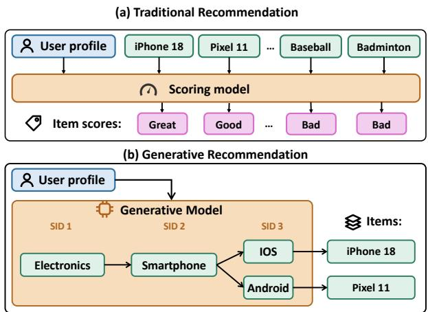  
Figure 1. Traditional vs. generative recommendation.

Generating SID tokens progressively narrows the item space toward specific items, allowing the model to guide item discovery directly [9, 27, 49, 50]. This direction has gained industrial momentum with systems such as OneRec deployed in production [1, 9, 15, 39, 46, 50]. GR therefore shifts the model serving challenge from scoring items in parallel to completing a chain of dependent generation steps within the same interactive latency budget.

A natural question is whether GR serving can simply reuse the serving stack built for LLMs. After all, GR and LLMs both rely on autoregressive decoding, and recent LLM serving systems have made substantial progress in request scheduling, KV-cache management, and optimized decode execution [12, 17, 18, 25, 36, 44]. As shown in Figure 2(a), LLM serving systems benefit from a highly regular serving pattern: after the initial context is processed, each decoding iteration performs essentially the same task—consume the current sequence state, predict the next token from the same token space, append the result, and repeat. This regularity allows an LLM request to be handled behind a largely homogeneous decoding loop. GR appears to fit the same abstraction at first glance, while in fact it violates the LLM serving assumptions in fundamental ways:

The first mismatch is in serving architecture. As shown in Figure 2(b), GR follows a short, fixed sequence of decoding steps that difer in both semantics and tensor shapes. In terms of semantics, each step uses a distinct vocabulary, with earlier steps making coarse item distinctions and later ones refining them toward specific items. In terms of shapes, each request must produce a set of recommended items, so a step needs to expand its input sequences into a larger set of candidate continuations. The serving logic therefore needs to select which candidates survive based on predefined policies and prepare their associated state as inputs to the next step. Frequent online updates then add a second pressure: GR inherits the requirements of conventional RecSys [38], and its model weights, per-step vocabularies, and selection policies evolve frequently under live trafic. Together, heterogeneous step transitions and online update requirements strain existing serving frameworks built around homogeneous decoding loops and relatively stable artifacts.

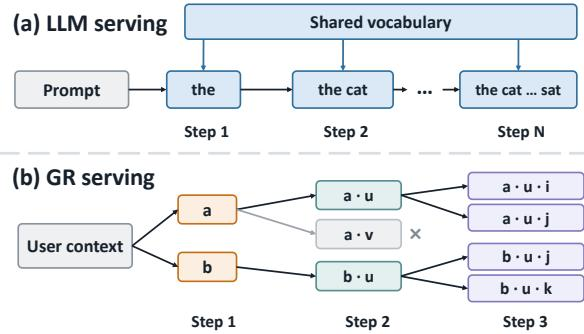  
Figure 2. LLM serving vs. GR serving.

The second mismatch is in execution optimization. LLM serving stacks are typically optimized for workloads with long-context attention, largely uniform decode iterations, and small selection tails [18, 25, 37]. GR exposes a diferent set of execution demands. In terms of attention computation, GR has many independent rows each attending over a short candidate sequence, leaving little work per row to amortize the overhead of attention kernels optimized for long sequences [8]. In terms of execution planning, diferent GR steps expose distinct but predictable shape profiles under a given deployment configuration, so a broad dynamic execution plan spanning all steps leaves step-level optimization opportunities unexplored. In terms of candidate selection, expanding many sequences over per-step vocabularies produces a large pool of continuation scores from which multiple candidates are retained. This makes selection computationally substantial on the critical path, rather than a lightweight sampling tail. These three patterns limit the efectiveness of existing LLM execution strategies and motivate specialized optimizations for GR workloads.

To address these challenges, we present RecoGEM, a production serving system for generative recommendation. On the architecture side, RecoGEM follows a runtime–engine decoupling principle: a dedicated runtime coordinates decoding steps, manages candidate state, and handles online updates, while the engine focuses on tensor computation. A deployment contract connects the two by specifying the per-step interfaces through which the runtime invokes the engine. On the execution side, RecoGEM specializes execution for GR’s short prefixes, large candidate populations, and predictable step shapes. Row-tiled self-attention groups independent short attention rows to amortize execution overhead. Step-granular planning specializes execution plans to the narrower shape profiles of individual steps. Fast candidate selection reduces the cost of selecting survivors from the large set of candidate continuations. The result is a GR serving stack that combines production-grade runtime operability with high throughput and low latency.

RecoGEM has been deployed in production for over nine months, serving our applications with an average of 400 million daily active users across search, advertising, and recommendation scenarios. Over this period, RecoGEM has supported more than ten GR model families, including OneModel, OneRec-v2, and UniSearch [4, 5, 39, 50]. It now also serves as the testing substrate for our upcoming GR models. Evaluations on our OneModel production workloads demonstrate that RecoGEM reaches over 1,000 QPS per serving instance and P99 latency of under 35 ms, marking a 2.88× throughput improvement over representative baselines. At cluster scale, RecoGEM sustains a peak trafic of 60,000 QPS, supports high frequency online updates, and achieves high hardware eficiency with an MFU of 55.3%. More broadly, the evolution of RecoGEM shows the shift of performance bottlenecks as GR serving practices become mature, and a clear trajectory from adapting conventional RecSys and LLM serving stacks to building a GR-native system architecture.

## 2 Background and Motivation

In this section, we motivate our problem further both in its real-world relevance and the choice of our techniques.

## 2.1 The Rise of Generative Recommendation

Industrial recommendation has historically been served as a cascade of specialized scoring models, with earlier stages narrowing a very large item catalog and later stages scoring a smaller set of items with richer user context and item features [7, 14, 23, 31]. Recently, generative recommendation (GR) has emerged as a promising alternative to this conventional pipeline [16, 45, 49]. Unlike traditional scoring models that rank supplied candidate items, GR directly formulates recommendation as a generation problem: given user context, the model generates identifiers of items to recommend. Early work explored generative and transducer-style recommendation [27, 45], while the OneRec model family [9, 49, 50] brought GR into large-scale industrial practice.

As shown in Figure 3, a GR request carries recommendation context, including static user information, short-term behaviors, and long-term interests. The context processor encodes this information once into a representation reused as cross-attention state at every decoding step. Each catalog item is represented by a short semantic identifier (SID) sequence $( s _ { 1 } , \ldots , s _ { L } )$ , where each token �ℓ is drawn from a position-specific vocabulary [22, 27, 49, 50]. Decoding starts from a beginning-of-sequence (BoS) token and builds SID sequences one token at a time. After each decoding step, candidate selection determines a limited set of the most likely candidate SID sequences and discards the rest. This process is implemented through beam search, which extends retained sequences with possible next tokens and selects the most likely resulting sequences. After � decoding steps, the top-� completed SID sequences are mapped back to catalog items.

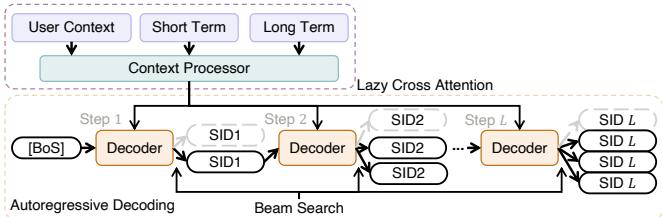  
Figure 3. Execution of a GR request.

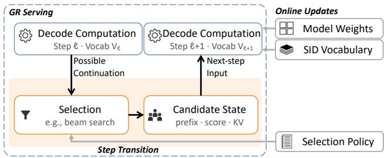  
Figure 4. Heterogeneous transitions between decoding steps and online updates of serving artifacts.

GR is attractive because it changes the modeling boundary of recommendation. By generating item identifiers directly, GR can optimize heterogeneous recommendation signals in one model and avoid losing target items in early coarse scoring stages [49]. It also gives recommendation models a path to benefit from larger neural architectures and increased compute budgets; recent systems report strong quality gains and deployment momentum across major industrial scenarios, including applications from Kuaishou, Google, and Meta [9, 16, 45]. This paper focuses on the serving consequence of this shift: the production GR workload difers fundamentally from others.

## 2.2 GR Requires a Specialized Serving Architecture

GR cannot directly reuse conventional RecSys or LLM serving stacks. Conventional RecSys pipelines are highly specialized for models that take a set of items as input and return relevance scores. Supporting autoregressive decoding therefore requires substantial redesign of their execution and state-management paths. LLM serving ofers a more natural starting point because it already supports autoregressive models with decoding loops. The rest of this subsection explains why GR’s step-transition and live-update requirements extend beyond the standard LLM decoding loop and motivate a GR-specific serving architecture.

Observation 1: Heterogeneous step transitions. To understand the architectural diferences between LLM and GR serving, we compare the semantics and shapes of their individual decoding steps, as well as the transitions that connect these steps, as illustrated in Figure 2.

• Per-step semantics. In LLM decoding, each step predicts the next token from the same vocabulary. In GR, each step predicts the next SID token from a step-specific vocabulary, with diferent positions carrying diferent levels of item meaning. Earlier SID tokens distinguish coarse regions of the item space, while later tokens refine them toward specific items. Intuitively, this resembles first choosing broad categories such as “smartphone” and then narrowing them down to products like “iPhone 18”.

• Per-step shapes. While a standard LLM decoding iteration extends each active sequence with one token, a GR step may expand each input SID sequence into multiple candidate continuations. Intuitively, a GR request may select several diferent products from the “smartphone” category. The input and output sequence counts therefore difer within a step and vary across steps, as do the shapes of their associated state such as per-sequence KV cache. These shapes are heterogeneous but predictable, as each step follows prescribed expansion logic.

• Step transitions. As shown on the left side of Figure 4, the input to step ℓ+1 is not simply the output of step ℓ. A selection policy, typically a beam-search variant, first decides which candidates survive. The serving system then prepares each survivor’s candidate state for the next step: its updated SID prefix and accumulated score, together with the KV cache inherited from its parent sequence. Intuitively, if a prefix representing “smartphone” has two surviving continuations representing “iOS” and “Android”, both inherit the smartphone prefix’s KV cache and extend it independently in subsequent decoding steps. If no continuation survives, the parent prefix’s cache is no longer needed and is excluded from subsequent decoding steps.

Together, these diferences make GR serving a coordination problem: each step’s model execution is connected to the next through policy-driven candidate selection and state preparation. Simply wrapping an LLM engine with GR-specific transition logic relegates this central serving responsibility to ad-hoc glue outside its decoding abstraction. Heterogeneous step transitions therefore demand explicit architectural support for coordinating step execution and candidate state.

Observation 2: Frequent online updates. LLM serving often treats the model, vocabulary, and decoding policy as stable choices during a worker’s lifetime [18, 44]. GR serving inherits the freshness requirements of conventional RecSys: its model weights, SID vocabularies, and selection policies can all change while trafic is live. The right part of Figure 4 shows these components and where each update takes efect.

• Model weights. Model weights cannot remain fixed for the lifetime of a serving worker in a RecSys deployment. Industrial recommendation has long required frequent dense-weight refresh [14, 23, 38, 41]; we refer to each such online update of model weights on a live serving worker as a refit. Figure 5 shows this pressure in our production GR cluster: online refits occur throughout the day, reaching 107 refits/min, while the corresponding FP32 refit trafic reaches 346 GB/hour per server in the busiest hourly bucket. At this cadence, model weight refit cannot be handled as an ofline redeployment procedure that drains trafic, replaces the serving engine, and then restores trafic. The update must instead prepare the new weight version alongside the active pipeline, then publish it with minimal disruption to the request path.

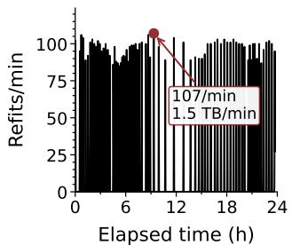

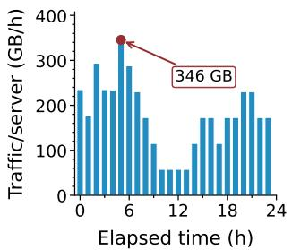  
Figure 5. Production online weight-refit activity in 24-hours: refit frequency (left) and FP32 refit trafic per server (right).

• SID vocabulary. SID vocabularies encode item groupings learned from item representations. As the item catalog evolves, the vocabularies need to be refreshed to reflect updated item relationships. Such a refresh can change the meaning of existing tokens, which prefixes and continuations are valid, and which item each SID sequence identifies. The serving pipeline must therefore keep each in-flight request’s candidate SID sequences, per-step vocabularies, and final item mapping on a consistent version throughout decoding.

• Selection policy. GR exposes a broader and more volatile policy surface than ordinary LLM serving. Apart from common policy space such as batch size and quantization precision, GR serving quality is also tied to the underlying candidate selection policy, which determines how candidates are expanded and retained across SID steps [39]. In our GR deployment, around twenty beam-search policy variants and accompanying hyperparameter settings have been exercised in production. Hard-coding each policy variant as part of a tightly coupled serving pipeline would tie policy iteration to complex and slow binary releases rather than flexible live updates.

GR serving must roll out frequent updates to various artifacts with minimal disruption while keeping each request on a compatible set of artifact versions [3, 38]. These updates create a second architectural pressure: artifact update and version consistency become an ongoing serving responsibility rather than a concern addressed only at deployment.

## 2.3 GR Exposes Distinct Optimization Opportunities

The discussion on serving architecture above exposes a second diference between GR and LLM serving: the optimization target changes [10, 19]. LLM engines are tuned for long token streams, growing KV caches, and repeated de coding steps with similar execution shape. GR decode instead produces a short SID sequence over a large, beamexpanded set of candidates [49, 50]. This shifts the dominant work away from long-sequence token generation and to ward short, shape-sensitive stages whose costs depend on SID position, candidate population, and selection policy. The rest of this subsection explores the resulting opportunities for GR-specific performance optimizations.

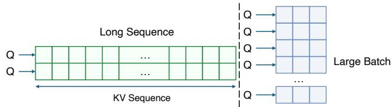  
Figure 6. Attention dimension inversion in GR decode.

Observation 3: Atention dimension inversion. GR uses the similar self-attention computation as LLM decode, but the dominant work shifts to diferent tensor dimensions. For a batch of sequences, self-attention reads a query tensor � for the current positions and key/value tensors �, � for the positions that can be attended to. At a decoding step, this computation can be viewed as many independent attention rows: each live sequence, under each attention head, reads its own prefix. Using standard notation,

$$
\begin{array} { r } { Q \in \mathbb R ^ { B \times S _ { q } \times H \times D } , \quad K , V \in \mathbb R ^ { B \times S _ { \mathrm { k v } } \times H \times D } , } \end{array}
$$

where � is the batch size, $S _ { q }$ is the number of current query positions, $S _ { \mathrm { k v } }$ is the attended-prefix length, and � and � are the number of heads and the per-head dimension.

In LLM serving, the main attention pressure often comes from $S _ { \mathrm { k v } }$ : each live sequence may attend over a long prompt and generated history, giving kernels a long KV dimension to traverse and amortize over. GR moves this pressure to the batch size �. Its attended prefix is only the short generated SID sequence, so $S _ { \mathrm { k v } }$ remains small. Candidate selection via beam search instead multiplies the number of live sequences: a request batch $B _ { \mathrm { r e q } }$ with beam width � yields $B = B _ { \mathrm { r e q } } \times W$ candidate prefixes. As shown in Figure 6, GR attention has many more sequence rows, but each row attends over only a few SID positions. This is the dimension inversion: LLM attention is commonly long-history attention, whereas GR attention is many-row short-history attention.

One might expect the large beam-expanded batch to make existing attention kernels eficient. The problem is that it creates many tiny, independent attention rows rather than one larger sequence tile. Standard kernels [8, 42] expect long sequence tiles to amortize their setup costs. GR exposes the opposite pattern: each row performs only a few dot products before a tiny softmax and value reduction. The arithmetic in one row is too small to hide the overhead, yet these rows cannot be artificially merged into a single long sequence because each candidate requires strict isolation during softmax normalization. The kernel opportunity is therefore structural: amortize overhead across many independent short rows while preserving each row’s local reduction boundary. Observation 4: Predictable step shapes. Observation 1 shows that GR decoding steps difer in shape; for execution planning, what matters is that these shapes are also predictable. A GR request generates a short, fixed-length SID sequence, so the number of steps is known ahead of time [15, 49]. Under a given deployment configuration, the prefix length, retained beam width, and candidate width of each step are also fixed in advance. As illustrated in Figure 7, early steps operate with short prefixes and limited candidate expansion, while later steps operate over beam-expanded prefixes whose size determines the shape of the next step. Only trafic-dependent dimensions, such as the number of requests in a batch, vary at runtime.

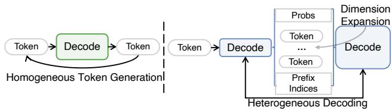  
Figure 7. Decoding steps in LLM vs. GR serving.

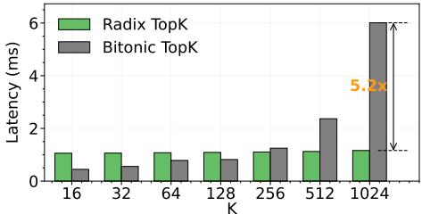  
Figure 8. Candidate selection design choices.

LLM serving engines hide this predictability because they invoke the same token-level interface at every iteration [2, 44]. Presented as one repeated operator, the few, fixed SID steps appear to have a wide range of possible shapes. The engine must then compile a single general plan that is valid for all SID positions, even though each position will execute in a much narrower, static profile. This is safe, but it leaves performance on the table: the workload has stable step-level structure, yet the engine sees only dynamic variation. The key opportunity is thus to keep these step boundaries visible as optimization boundaries, so compilation and scheduling can target the actual shapes of SID steps rather than one broad range that covers all steps.

Observation 5: On-path candidate selection. In LLM serving, token selection is often a small tail, usually 1, after the model has produced logits [24]. In GR serving, however, selection sits squarely on the decoding critical path. A SID step cannot finish by merely emitting scores; it must decide which SIDs survive to form the next step’s input. Because SIDs must explore a massive item space, GR beam search must retain a very large number of candidates at every step to preserve recommendation quality [49]. Consequently, this massive candidate expansion turns selection at each step transition into a computationally heavy, large-K operation that consumes a substantial fraction of serving time.

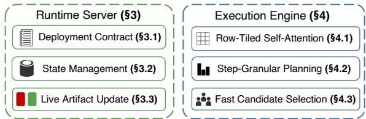  
Figure 9. RecoGEM serving system overview.

This large-� pattern makes GR especially sensitive to the choice of Top-K algorithm. A bitonic Top-K path performs structured compare-and-exchange ordering, which can be attractive for regular moderate-size selections but pays for ordering work that becomes costly as � grows [28]. A radix Top-K path [20] instead narrows candidates by value ranges across passes, which can better match large-�, many-row selection. Figure 8 shows this sensitivity under GR-style shapes: the choice between bitonic and radix selection can change latency by several times. This exposes a concrete Top-K optimization opportunity for GR serving: selection performance depends on building GPU-friendly selection paths that match the large-�, many-row regime, rather than relying on a fixed LLM-style sampling implementation.

## 2.4 RecoGEM: A Production GR Serving System

The observations above motivate the system organization shown in Figure 9. To address the two architectural pressures in Obs1–2, RecoGEM follows a runtime–engine decoupling principle. The runtime server owns the GR-specific serving responsibilities that a standard token loop does not express: it generates and follows a GR deployment contract, manages the transitions between SID steps, including candidate state, and applies online updates. To exploit the performance opportunities in Obs3–5, RecoGEM keeps SID step boundaries visible to the execution engine instead of collapsing generation into one homogeneous dynamic-shape loop. It then uses these boundaries to specialize the work inside a step, across steps, and after each step through row-tiled self-attention, step-granular planning, and fast candidate selection.

## 3 RecoGEM Serving Architecture

In this section, we outline the system architecture of Reco-GEM. To handle heterogeneous step transitions (Obs1) and frequent online updates (Obs2), RecoGEM keeps the execution engine narrow and moves GR-specific serving responsi bilities into a dedicated runtime. The engine executes tensor computation, while the runtime manages the transitions between steps, including per-request candidate state, and applies online updates. This runtime–engine decoupling ex plicitly preserves SID step boundaries, rather than collapsing the request into one opaque and generic token loop, which further enables RecoGEM to exploit various performance optimization opportunities (Obs3–5).

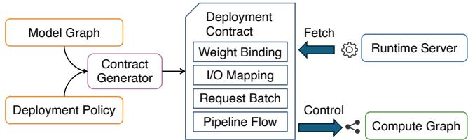  
Figure 10. RecoGEM deployment contract.

## 3.1 Deployment Contract Generation

To make this decoupling work under frequent GR model updates, RecoGEM needs a stable way to invoke and refit execution engines without reconstructing model-specific logic in runtime code. RecoGEM therefore automatically generates a deployment contract from the model graph and a small serving-policy overlay. The model graph is a good starting point because it exposes what the engine can legally consume, produce, and carry across serving I/O and SID steps. The policy overlay adds the deployment choices that are outside tensor computation, such as batch size, quantization, candidate size, and parallel layout. The generated contract combines these two views into the runtime-facing interface shown in Figure 10. The runtime fetches the contract when loading a deployment and uses it to prepare the engine invocation path. It checks the contract against the compiled engine artifact on weight binding, I/O mapping, batch size, and pipeline flow, then uses the contract to guide request setup, step-to-step execution, and live updates.

## 3.2 Runtime State Management

Figure 11 shows how RecoGEM manages the state of one GR request across its decoding steps. The runtime server first materializes recommendation embeddings, and the engine converts the embeddings into cross-KV through context processing. This cross-KV stays fixed for the whole request: once produced, it is reused by all SID decoding steps. Self-KV follows a diferent lifecycle. It is attached to candidate rows, and beam search changes which rows remain live after every step. Candidate selection therefore creates sparse liveness in self-KV: some KV slices correspond to surviving candidates, while others belong to candidates that have been pruned.

RecoGEM turns this sparse candidate state into a dense next-step KV prefix through double-bufered compaction. At step �, the engine decodes candidate continuations and invokes beam search to return the surviving candidates. The runtime then prepares the next SID decoding step with a deterministic gather-and-copy pipeline. It first uses the survivor indices to gather only the corresponding self-KV slices from the active KV bufer and copy them into a standby prefix bufer. This standby bufer then becomes the past-KV input for step � + 1.

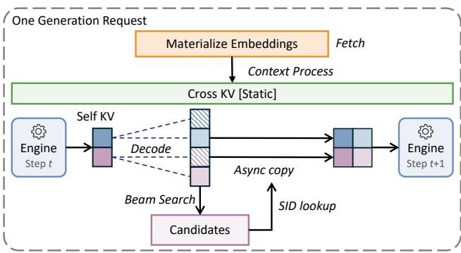  
Figure 11. Runtime state management for a GR request.

In this way, the runtime realizes the contract’s output-toinput mapping physically: candidate selection determines which KV slices remain live, while the next engine invocation sees a compact KV prefix rather than a sparse bufer that still holds pruned candidates. It is worth noting that the compaction loop is pipelined across survivor KV slices. For each survivor, the runtime issues a copy into the standby prefix bufer. While that copy is in flight, the runtime prepares the source address for the next survivor based on its SID lookup results. Thus each iteration overlaps movement of the current KV slice with preparation for the next one.

## 3.3 Live Artifact Update

GR updates occur at two diferent levels. Frequent updates refresh engine-side artifacts, such as model weights or SID vocabularies, while less frequent policy changes may also alter the deployment contract by changing the valid shapes, profiles, or step flow. RecoGEM handles both cases through the same rule: a new serving version becomes visible only after it passes the contract gate. For weight or vocabulary refreshes, the runtime validates the new engine artifact against the active contract; for policy changes, it validates the new engine against the corresponding new contract.

The runtime prepares the next serving version outside the active request path. During cutover, it briefly stops ad mitting new GR requests, lets already-issued requests finish on the old version, and then atomically switches the active engine pointer, along with the contract pointer when the contract changes. Queued requests are then released to the new version, and the old version is retired after it is no longer referenced. This mechanism is intentionally simple: the im portant property is that each request executes under one consistent model/vocabulary/policy view, without coarse trafic draining or server-binary changes. Together, the generated contract, state management, and live updates define the runtime boundary around the tensor engine.

## 4 RecoGEM Performance Optimization

RecoGEM addresses the three performance mismatches in GR serving. Within each decoding step, dimension inversion turns self-attention into many short, independent row reductions rather than a long-sequence operator (Obs3). Across SID steps, generation follows a small, fixed number of heterogeneous regimes, so treating all steps as one dynamic case discards useful structure (Obs4). After each SID step, candidate selection determines which candidates enter the next step, making it part of the critical path rather than a lightweight sampling tail (Obs5). RecoGEM therefore specializes from these three complementary angles.

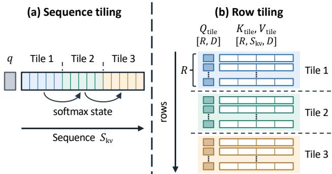  
Figure 12. Sequence tiling versus row tiling.

## 4.1 Row-Tiled Self-Attention

GR self-attention exposes many independent rows, each with a short KV prefix. We fold the beam-expanded batch and head dimensions, so each row contains one query $q \in \mathbb { R } ^ { D }$ and its cached keys and values $\boldsymbol { k } , \boldsymbol { v } \in \mathbb { R } ^ { S _ { \mathrm { k v } } \times D }$ . Figure 12 contrasts the tiling strategies: sequence tiling splits a long row along its KV sequence [8, 42], whereas RecoGEM groups � complete short rows into one execution tile. This grouping amortizes setup overhead across independent rows. Each tile stacks the queries, keys, values, and outputs of its � rows into

$$
\begin{array} { r } { Q _ { \mathrm { t i l e } } \in \mathbb R ^ { R \times D } , \quad K _ { \mathrm { t i l e } } , V _ { \mathrm { t i l e } } \in \mathbb R ^ { R \times S _ { \mathrm { k v } } \times D } , \quad O _ { \mathrm { t i l e } } \in \mathbb R ^ { R \times D } . } \end{array}
$$

Figure 13 shows how these tiles execute. Because $S _ { \mathrm { k v } }$ is small, each row’s entire attention reduction can be completed on chip. Within each tile, the kernel stages $Q _ { \mathrm { t i l e } } , K _ { \mathrm { t i l e } } ,$ and $V _ { \mathrm { t i l e } }$ into on-chip memory and fuses score computation, softmax over $S _ { \mathrm { k v } }$ positions, and value reduction for each row. Intermediate scores and probabilities remain on chip; only $O _ { \mathrm { t i l e } }$ is written back.

Sequence tiling must maintain softmax normalization state across tiles belonging to the same long row. In contrast, each short row’s softmax is complete within its tile, so tiles need no normalization state from one another. The kernel therefore overlaps the $Q / K / V$ load of tile � + 1 with the fused computation of tile $k ,$ as shown in the lower panel. This pipeline reduces exposed memory-staging latency while preserving independent per-row attention.

## 4.2 Step-Granular Planning

GR decoding executes a short sequence of SID steps with predictable but diferent tensor dimensions. A single broad dynamic profile can cover all steps, but it forces the engine to optimize for the union of dimensions that appear across all SID positions. RecoGEM instead turns these recurring step diferences into build-time profile boundaries. The goal is to keep one logical GR step as the model interface, while producing step-specialized execution artifacts for the shapes that actually occur during generation. Figure 14 shows the three-stage planning pipeline.

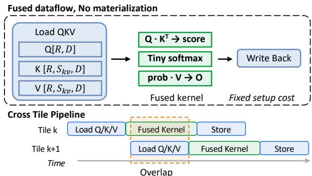  
Figure 13. Fused attention dataflow and cross-tile pipelining.

First, RecoGEM builds a broad-range compute graph from the training graph and its conditional boundaries. This intermediate graph is intentionally permissive: it can represent the tensor dimensions that may appear at any SID step, but it is not the final optimized artifact. Second, RecoGEM performs a compile-time dry run over logical steps � = 1, 2, . . . , �. At each step, the planner follows the graph’s conditional boundaries and output-to-input tensor links, infers the di mensions of the tensors produced by that step, and feeds those dimensions into the next step. Third, the profile optimizer converts the collected per-step dimension table into step-bounded profiles and generates the final step heterogeneous compute graph. The final graph is therefore optimized for the narrower dimensions each SID step actually presents, rather than for one broad dynamic range spanning all steps. It is worth noting that trafic-induced dimensions such as batch size remain dynamic, so the compiled artifact can still serve variable trafic patterns.

To see how step-granular planning improves engine execution, consider the row-tiled attention path inside each SID decoding step. During the compile-time dry run, RecoGEM records the cached-prefix length $S _ { \mathrm { k v } }$ that each step presents to the self-attention. The engine can then bind that step to a distinct row-tiled attention variant whose tiny-softmax length and $K / V$ staging extent match the recorded $S _ { \mathrm { k v } }$ . Such specialization avoids a broad dynamic inner loop on the attention critical path. As another example, the same dry run records candidate width and retained beam width after each decode step, exposing the concrete beam-search shapes that candidate selection can specialize on. Thus step-granular planning is central to RecoGEM’s performance design: it turns predictable SID-step evolution into the narrow engine constraints consumed by various GR-specific operators.

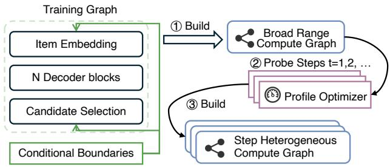  
Figure 14. Step-granular execution planning lowers a single step GR graph into step-specialized engines by probing perstep shapes and rebuilding under step-bounded profiles.

## 4.3 Fast Candidate Selection

Candidate selection is on the critical path of every SID step: the next decode step cannot begin until beam search chooses the surviving partial SIDs. In production GR, each surviving candidate is expanded over a large SID vocabulary, creating a large beam-search space for Top-K selection rather than a lightweight sampling tail. The main question is therefore how to execute Top-K eficiently at every step boundary. A strawman approach is to flatten all candidate scores of a request and run one large Top-K. For one GR request, the scores form a $W \times C$ matrix: � beams, each expanded to � candidate continuations. Flattening this matrix creates a single row of�� scores and selects the next � beams from it. This is correct, but it gives the GPU the wrong physical shape, turning candidate selection into a repeated global memory access problem. As a concrete example, in one of our GR serving settings, $C = 8 1 9 2$ and $W = 5 1 2$ , so one flattened request contains 4.2 million candidates. Even with FP16, this request alone occupies 8 MiB, far beyond the local memory available to a GPU thread block.

RecoGEM instead preserves the beam matrix boundary and performs the update in two exact stages. First, it applies a per-row precut: from each beam row of width �, it keeps the local top �. Second, it performs the request-level selection over the union of precut survivors to choose the next � beams. This preserves the exact global top-� result: any candidate discarded by the per-row precut is already dominated by � candidates from the same row, so it cannot appear among the final � winners across the request. Note that the per-row boundary is a natural cut for GR, because it can be reduced locally before the request-level merge, without introducing additional cross-row regrouping steps.

The two stages expose diferent GPU shapes. The per-row precut has many independent rows of bounded width, so RecoGEM uses a flash radix path that treats each beam row as a local selection unit: row scores are staged into shared memory, radix passes run over the local row, and a group of multiple rows can be packed into one thread block. The implementation also pipelines diferent row groups, loading the next group while searching over the current one. This turns the dominant first stage into eficient local selections. After the precut, the request-level selection is still a standard Top-K, but its input has already been reduced from the original $W { \times } C$ candidates to the � × � row survivors. RecoGEM uses a multi-block radix path that partitions one requestlevel row across blocks and merges their partial selections. Meanwhile, step-granular planning supplies the per-step beam size, allowing the engine to specialize both stages to the paths that match their concrete beam-search shapes.

## 5 Evaluation

Implementation. We implement RecoGEM in approximately 20K lines of C++/CUDA code and 30K lines of Python. RecoGEM has been deployed for over nine months, and serves over 400 million daily active users. It has hosted more than ten GR model families, including both OneRecv1 and OneRec-v2. In the RecoGEM deployment pipeline, we construct TensorRT engines from the PyTorch model graph, as the latter is the standard interface provided by the algorithm team.

Evaluation questions. We organize the evaluation around four main questions: (i) How much end-to-end performance gain does RecoGEM achieve across production GR models? (ii) How do RecoGEM’s design choices contribute to performance across heterogeneous SID steps? (iii) How efectively does row-tiled attention exploit GR’s short-prefix, beamexpanded regime? (iv) To what extent does fast candidate selection reduce the overhead of large-� beam updates? Additionally, we validate the performance of RecoGEM under real-world trafic conditions.

## 5.1 Experimental Setup

Our experiments evaluate two production GR models: OneRec-v2 is the higher-capacity deployment with 4B parameters, while OneModel is the lighter deployment with 0.2B parameters. Both models share the same core architecture with minor structural variations. These experiments are conducted on a host equipped with data-center GPUs and high-end Intel CPUs. The software stack includes Linux 5.14, CUDA 12.8, and TensorRT 10.16.0.72. To demonstrate the benefits of our design, we compare four execution configurations:

• RecoGEM: Our full system with all optimizations enabled.

• GeneralGen: Uses a homogeneous shape profile and naive GPU kernels, while keeping other modules unchanged.

• TorchEager: Executes the GR model in PyTorch eager mode.

• TRT-LLM: Adapts TensorRT-LLM for GR serving.

## 5.2 End-to-End Performance on GPUs

To demonstrate the performance of RecoGEM, we evaluate it with OneRec-v2 and OneModel under various request batch sizes. Because recommendation is strictly constrained by tail latency, we focus on reporting the 99th percentile (P99) latency alongside the serving queries per second (QPS).

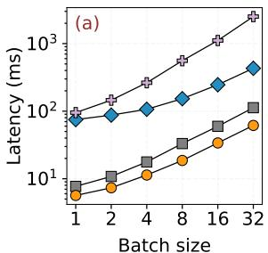

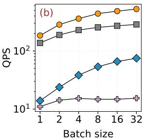  
Figure 15. Performance trend of OneRec-v2.  
GeneralGen RecoGEM TorchEager TRT-LLM

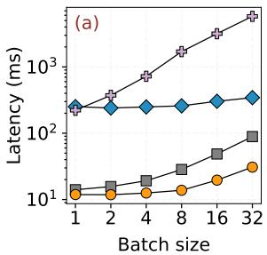

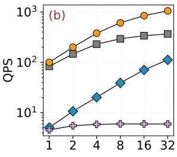  
Figure 16. Performance trend of OneModel.

Figure 15 shows the performance of OneRec-v2, where RecoGEM keeps tail latency strictly below the production 100 ms target across the entire batch sweep. At batch 32, it achieves a 61.5 ms P99 latency and 526 QPS. Under GeneralGen, P99 latency rises to 112.5 ms and QPS drops to 286, demonstrating the combined benefit of step-granular planning and operator specialization at large batch sizes. Figure 16 shows the performance of OneModel, where Reco-GEM achieves even lower latency and higher QPS due to the smaller model size. At batch 32, RecoGEM reaches a 30.8 ms P99 latency and 1,053 QPS, compared to 89.0 ms and 366 QPS for GeneralGen. The relative throughput gain over GeneralGen is larger on OneModel, reaching 2.88× compared to 1.84× on OneRec-v2.

TorchEager and TensorRT-LLM exhibit substantially higher latency and lower throughput than RecoGEM across both models. TorchEager’s gap is consistent with the dispatch, kernel-launch, and intermediate-tensor overheads of eager execution, which are costly for short SID sequences. For the adapted TensorRT-LLM runtime, latency grows sharply with batch size while QPS quickly plateaus, indicating limited batching gains under the evaluated configuration. Unlike TorchEager, which keeps all computations on the GPU, the TensorRT-LLM runtime performs beam search on the CPU and must then reorder the KV cache according to the selected beams, which adds heavy framework overhead at every SID step whose cost grows with the number of live beams. These observations confirm the mismatch between LLM-oriented serving engines and GR’s short-prefix attention, large candidate sets, and heterogeneous SID steps.

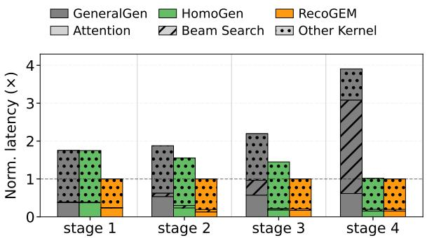  
Figure 17. Batch-32 step-wise kernel breakdown for three serving systems in OneModel.

## 5.3 Fine-Grained Performance Breakdown

Apart from end-to-end results, we further decompose serving execution time to precisely attribute RecoGEM’s performance gains to its major design choices. Specifically, we evaluate the batch-32 operating point of OneModel and categorize the end-to-end decode latency into attention, beam search (candidate selection), and all remaining GPU kernels (e.g., dense projections and MoE/FFN computation), as depicted in Figure 17. We evaluate RecoGEM, HomoGen, and GeneralGen throughout this breakdown and measure per-step latency using the NVIDIA Nsight Systems (nsys) profiler. Here, HomoGen removes step-granular planning by using a single shape profile across all SID steps while retaining RecoGEM’s specialized kernels.

(i) The benefit ofstep-granular planning mainly comesfrom earlier decoding steps. RecoGEM bounds step-derived dimensions such as past-key length, retained beam width, and candidate width separately for each step. At batch 32, the resulting profile specialization reduces average decode la tency from 39.5 ms to 30.4 ms for OneModel. These steps exercise distinct SID shapes, moving from the initial step to beam-expanded steps with diferent retained-beam and candidate widths; under HomoGen’s single profile, this mismatch translates into over 40% higher latency in the first three SID steps.

(ii) The benefit of optimized attention and beam-search kernels mainly comes from later decoding steps. GeneralGen uses general attention and selection paths that are optimized for diferent regimes: sequence-oriented attention assumes enough query/key length to amortize a long-sequence tile, while generic Top-K paths do not match the two-stage, large-� beam update induced by SID generation. RecoGEM instead maps attention to many independent short-prefix rows and maps beam search to a radix-based per-beam precut followed by request-level global selection. Consequently, the GeneralGen bars grow primarily in the attention and beam search components of the later decode steps. For OneModel, the final step rises from 13.8 ms under RecoGEM to 54.0 ms under GeneralGen, dominated by candidate selection. This breakdown explains why the end-to-end gap is not a generic tuning artifact: RecoGEM gains by exposing the GR step shape and then implementing operators that best match that shape.

## 5.4 Row-Tiled Attention Kernel Evaluation

Based on the step-wise breakdown above, we further isolate the self-attention operator to evaluate the attention-side performance contribution to RecoGEM. We sweep GR attention settings to show how the row-tiled path performs across the intended regime: many independent batch/head rows with a short key/value prefix. It is worth noting that � is the request batch size multiplied by the beam width, and � and � are the number of attention heads and the per-head dimension. We compare four implementations in the same benchmark harness: an explicit PyTorch implementation reference (Py-Torch Native), PyTorch SDPA as the general attention path selected in this environment (SDPA), an earlier RecoGEM implementation that processes each $( b , h )$ row independently (Per-row), and the current row-tiled kernel (RecoGEM).

Across Figure 18, RecoGEM’s row-tiled attention path is fastest in all six evaluated cases. Figure 18(f) is the canonical high-beam GR decode-attention case in this sweep: �=16384, $H { = } 6 4$ , and $D { = } 6 4 ,$ , with one attention computation per row and a bounded SID-prefix length. In this setting, RecoGEM is consistently fastest across the tested short-prefix region, reaching 0.142 ms at $S _ { \mathrm { k v } } { = } 1$ and remaining below 0.85 ms through $S _ { \mathrm { k v } } { = } 8$ . Within the main prefix range $S _ { \mathrm { k v } } \ \leq \ 4 ,$ , the row-tiled path improves over the earlier per-row path by 7.2–9.4×, with a maximum 154.4× speedup over the SDPA path observed in this harness. The speedup reflects three structural efects:

(i) SDPA is mismatched to the short-prefix regime. Fused sequence-attention paths are designed to amortize their setup cost over long tiles. When $S _ { q } { = } 1$ and $S _ { \mathrm { k v } } \leq 8 ,$ the useful work in each row is only a short dot-product, a tiny softmax, and one value reduction. The long-sequence machinery still executes a much larger padded tile and pays boundaryhandling and running-softmax overheads, so most of the work is unrelated to the few valid prefix positions. This is also reflected in Figure 18: SDPA latency changes little as $S _ { \mathrm { k v } }$ grows within the short-prefix range, indicating that fixed tile overhead dominates the actual attention work.

(ii) The per-row path removes framework-level overheads. The per-row kernel fuses QK, softmax, and PV for one $( b , h )$ row, keeping scores and probabilities in registers instead of materializing intermediate tensors. Because $S _ { \mathrm { k v } }$ is known at compile time, the softmax becomes a fixed short reduction rather than a generic masked operator. This explains why the per-row path is much faster than both PyTorch baselines.

(iii) The row-tiled path amortizes row-level fixed cost. The per-row path still maps each (�, ℎ) row to an independent work unit; at the largest setting this creates roughly one million row instances. Row-tiled attention instead packs 64 rows into each execution tile and keeps blocks alive across tiles with a persistent scheduler, amortizing block scheduling and pipeline setup across many row-local reductions. Asynchronous staging further overlaps tile movement with the fused QKV computation. These efects provide the additional 7–9× speedup over the per-row path in the main range.

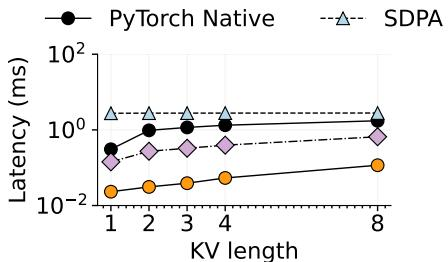  
(a) �=4096, �=32

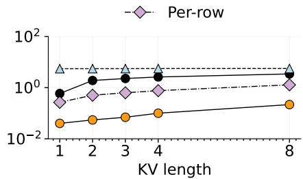  
(b) �=8192, �=32

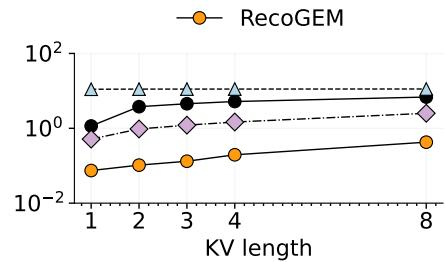  
(c) �=16384, �=32

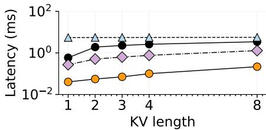  
(d) �=4096, �=64

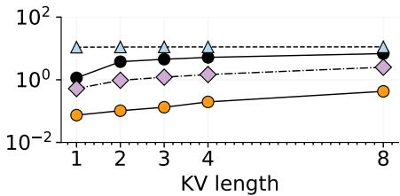  
(e) �=8192, �=64

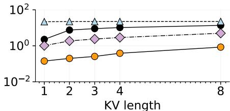  
(f) �=16384, �=64

Figure 18. Decode self-attention latency for the GR short-prefix setting across batch and head sweeps.  
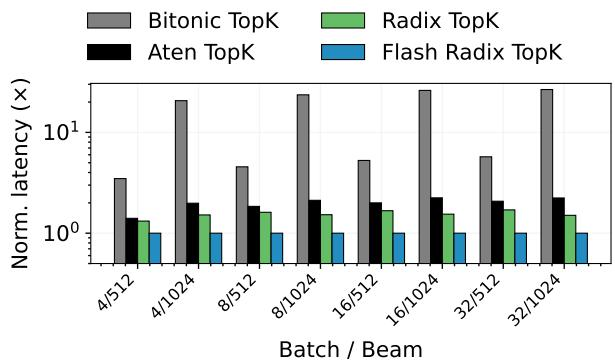  
Figure 19. Beam-search Top-K latency for GR-style candi date selection with vocabulary size 8192.

## 5.5 Fast Candidate Selection Kernel Evaluation

We now isolate candidate selection to evaluate the beamsearch-side performance contribution to RecoGEM. As shown in Figure 19, under a SID vocabulary size of 8192, RecoGEM is the fastest implementation in every tested setting. At batch 32 and beam width 512, shape-aware selection takes 0.618 ms, giving 2.08× over ATen and 1.70× over standard radix. At beam width 1024, the same batch size takes 1.307 ms, giving 2.24× over ATen and 1.50× over standard radix. Across the full sweep, RecoGEM improves over ATen by 1.40–2.24× and over standard radix by 1.32–1.70×. The Bitonic path is especially mismatched once � reaches 1024, where it is 20.6–26.6× slower than RecoGEM. The advantage comes from using a fast flash radix Top-K kernel for many 8192-wide per-beam rows, and from keeping the much wider request-level select on a separate multi-block radix path. ATen and the standard radix baseline flatten this work into a generic Top-K shape, and the Bitonic path performs comparison work that scales poorly at large �.

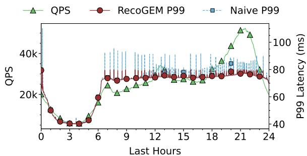  
Figure 20. QPS and P99 latency over 24h.

## 5.6 Online Stability Validation

We next ask whether the runtime–engine decoupling architecture translates into stable runtime operability under live production trafic. Over the full deployment history of Reco-GEM, the cluster has reached an all-time peak of 60,000 QPS while sustaining P99 latency below 80 ms and an average MFU of 55.3%. Figure 20 shows a representative 24-hour production trace. Trafic varies substantially during the day, from ∼5,000 QPS in low-trafic periods to more than 50,000 QPS at peak. Despite this variation, RecoGEM keeps end-toend P99 latency below 80 ms throughout the trace.

Figure 20 also highlights the efect of RecoGEM’s liveupdate path. The dashed Naive P99 curve corresponds to our earlier update implementation, which rebuilt the full execution engine and pushed the resulting artifact directly to serving instances during rollout. This approach made online updates interfere with active inference and produced repeated tail-latency spikes, with 2–3× bigger P99 latency spike during update periods. In contrast, RecoGEM prepares and validates the next engine–contract pair outside the ac tive request path, and cuts over by pointer switching to the validated version. As a result, frequent artifact updates are absorbed without visible SLA violations in the production trace. This result is important operationally: for GR serving, update handling is part of the latency-critical system design, not merely a deployment convenience.

## 6 Discussion

Evolution of the GR Serving System. Given the architectural similarity between LLM and GR models, our first attempt was to adapt existing LLM inference frameworks for GR serving. This turned out to be the wrong systems boundary for two reasons. First, the required changes were invasive. Retrofitting an LLM engine to accommodate customized I/O formats, heterogeneous step transitions, online updates, as well as business logic across recommendation, search and advertising required significantly more engineering efort than building a GR-native serving system from scratch. Second, GR serving is a brownfield deployment problem. In our environment, the new serving system had to coexist with legacy RecSys infrastructure, reuse feature and embedding capabilities, and preserve compatibility with existing request paths. These constraints made a monolithic adap tation of LLM stacks both costly and fragile. They instead favored the architecture used by RecoGEM: a narrow execution engine surrounded by a GR-aware runtime that owns recommendation-specific responsibilities.

Performance Bottlenecks Shift in GR. A key deploy ment lesson is that GR serving completely rewrites the performance overhead breakdown of RecSys. Unlike DLRM style serving, where sparse embedding lookups and feature materialization dominate (often exceeding 50% of total la tency [14, 23, 35]), embedding lookups in our GR deployment account for less than 10% of the end-to-end time. Instead, the computational weight shifts to the generative decoder. Candidate selection is costly when executed with generic kernels, and systems like xGR [32] report that it takes over 40% of serving time. In our deployment, careful kernel-level and system optimizations reduce the candidate selection overhead to less than 10% even for very large candidate sets, shifting performance pressure back to the dense decode execution.

Execution Engine Generation. Yet another lesson was to move TensorRT engine generation out of the online deployment path. Our early prototypes used a two-stage conversion pipeline: the PyTorch model was exported ofline to ONNX, an open model-interchange format, and the ONNX model was converted to a TensorRT engine during deployment. This design introduced two failure points. Export failures were at least isolated to the ofline model build, but TensorRT conversion failures could surface during rollout, where they were harder to debug across boundaries. RecoGEM instead builds TensorRT engines directly in the ofline release pipeline and publishes only validated engine–contract pairs to serving. In our environment, moving engine generation ofline reduced the release-side deployment time by 40%. This is critical for online services, as minimizing downtime during an operational error prevents massive revenue losses that can accumulate by the second. More importantly, it made step profiles, plugin paths, and quantization choices explicit buildtime decisions, so each choice can be tested with the engine artifact before the version reaches serving cutover.

Generality. GR is a widely deployed workload, running in production for recommendation, search, advertising, and ecommerce [1, 5, 9, 15, 39, 46, 50]. RecoGEM builds on its workload structure rather than on recommendation semantics: a few decoding steps over many short candidate sequences, with per-step selection over a predefined vocabulary. Its optimizations like attention kernels and candidate selection therefore apply under both large batches and wide beams, and carry over to generative retrieval [33]. They may further extend to the recently released Jev [34], where each request evaluates many independent questions against one shared input, each over a predefined option set.

Scalability and Future Directions. Since requests share no state across GPUs, RecoGEM’s throughput scales nearlinearly with the GPU count. As GR model scale and architectural complexity continue to grow, however, a natural next step is distributed GR serving. Tensor and pipeline parallelism should be integrated with step-granular execution, rather than layered on top as opaque model-parallel wrappers. For sparse GR models, expert parallelism will likely become equally important: the serving contract must eventually describe cross-rank state, expert placement, routing constraints, and version-consistent cutover across distributed artifacts. Beyond scaling out, RecoGEM also opens opportunities for step-aware model compression. Existing quantization techniques show that precision can be treated as an important deployment knob; GR adds a new dimension because diferent SID steps may carry diferent semantic importance and expose diferent execution shapes. Future systems can exploit this structure to choose per-step precision or quantization profiles, improving hardware eficiency while preserving recommendation quality.

## 7 Related Work

GR Serving Systems. Existing GR serving systems optimize within an inherited worldview rather than reconsidering the serving abstraction itself [13, 32]. xGR and FLAME each commit to a fixed substrate: xGR treats GR as a longprompt, short-output variant of LLM serving and accelerates individual components [32], while FLAME casts GR as a

TensorRT deployment problem and disaggregates CPU feature preprocessing from GPU model execution [13]. Both tune components within the inherited substrate and retain a homogeneous decode loop, leaving the step heterogeneity unexploited. A separate line of work advances GR on the algorithm side: MTGR scales GR model architectures to industrial deployment [15], GR4AD brings GR to large-scale advertising with lazy autoregressive decoding and dynamic beam strategies [39], and speculative decoding accelerates beam-search generation itself [21]. These eforts redesign the model and its decoding procedure rather than the serving system. RecoGEM difers from existing eforts as it derives its serving abstraction from GR’s workload objectives, exposes SID step boundaries, and co-designs a GR-serving runtime with a stepwise optimized execution engine.

LLM and RecSys Serving Systems. GR workloads fall between two mature serving stacks. LLM serving organizes execution around a homogeneous next-token loop over KVcentric state, from iteration-level scheduling and paged KV caching to engine-level decode optimization [2, 18, 25, 44, 48], with attention and selection kernels tuned for long, homogeneous decoding iterations [8, 11, 20, 42]; these assumptions do not hold for GR’s candidate state and its short, beam-expanded, heterogeneous decode steps. RecSys serving contributes the operational discipline GR inherits— heterogeneous feature materialization and frequent online model refresh [14, 23, 29, 38, 41]—but its pipelines end at a scoring boundary and carry no generation state across steps. RecoGEM bridges the two, keeping the LLM execution substrate for computation while promoting the recommendation stack’s candidate selection and online freshness requirements into serving contract obligations.

## 8 Conclusion

The recent paradigm shift towards SID-based GR introduces complex recommendation serving demands that traditional LLM and RecSys infrastructures cannot eficiently handle. To accommodate GR-specific architectural constraints and optimization opportunities, we propose RecoGEM, an inproduction GR serving system that uses an explicit deployment contract to manage heterogeneous step transitions and online updates outside the compute engine. Additionally, RecoGEM introduces step-granular execution planning combined with specialized decode operators, namely rowtiled self-attention and fast candidate selection, to exploit GR-specific execution shapes. Evaluations on our productionscale GR workloads demonstrate that RecoGEM successfully mitigates performance bottlenecks while sustaining runtime operability, achieving high throughput and strict tail-latency compliance across various real-world scenarios.

## References

[1] Prabhat Agarwal, Anirudhan Badrinath, Laksh Bhasin, Jaewon Yang, Edoardo Botta, Jiajing Xu, and Charles Rosenberg. 2025. PinRec: Outcome-Conditioned, Multi-Token Generative Retrieval for Industry Scale Recommendation Systems. arXiv preprint arXiv:2504.10507 (2025). arXiv:2504.10507 [cs.IR]

[2] Amey Agrawal, Nitin Kedia, Ashish Panwar, Jayashree Mohan, Nipun Kwatra, Bhargav Gulavani, Alexey Tumanov, and Ramachandran Ramjee. 2024. Taming {Throughput-Latency} tradeof in {LLM} inference with {Sarathi-Serve}. In 18th USENIX symposium on operating systems design and implementation (OSDI 24). 117–134.

[3] Xu Bai, Muhammed Tawfiqul Islam, Chen Wang, and Adel N Toosi. 2026. PipeLive: Eficient Live In-place Pipeline Parallelism Reconfig uration for Dynamic LLM Serving. arXiv preprint arXiv:2604.12171 (2026).

[4] Ben Chen, Siyuan Wang, Yufei Ma, Zihan Liang, Xuxin Zhang, Yue Lv, Ying Yang, Huangyu Dai, Lingtao Mao, Tong Zhao, et al. 2026. OneSearch-V2: The Latent Reasoning Enhanced Self-distillation Gen erative Search Framework. arXiv preprint arXiv:2603.24422 (2026).

[5] Jiahui Chen, Xiaoze Jiang, Zhibo Wang, Quanzhi Zhu, Junyao Zhao, Feng Hu, Kang Pan, Ao Xie, Maohua Pei, Zhiheng Qin, et al. 2025. UniSearch: Rethinking Search System with a Unified Generative Ar chitecture. arXiv preprint arXiv:2509.06887 (2025).

[6] Heng-Tze Cheng, Levent Koc, Jeremiah Harmsen, Tal Shaked, Tushar Chandra, Hrishi Aradhye, Glen Anderson, Greg Corrado, Wei Chai, Mustafa Ispir, et al. 2016. Wide & Deep Learning for Recommender Systems. In Proceedings of the 1st Workshop on Deep Learning for Recommender Systems. 7–10. doi:10.1145/2988450.2988454

[7] Paul Covington, Jay Adams, and Emre Sargin. 2016. Deep Neural Networks for YouTube Recommendations. In Proceedings ofthe 10th ACM Conference on Recommender Systems. 191–198. doi:10.1145/2959100. 2959190

[8] Tri Dao, Daniel Y. Fu, Stefano Ermon, Atri Rudra, and Christopher Ré. 2022. FlashAttention: Fast and Memory-Eficient Exact Attention with IO-Awareness. In Advances in Neural Information Processing Systems, Vol. 35. 16344–16359.

[9] Jiaxin Deng, Shiyao Wang, Kuo Cai, Lejian Ren, Qigen Hu, Weifeng Ding, Qiang Luo, and Guorui Zhou. 2025. OneRec: Unifying Retrieve and Rank with Generative Recommender and Iterative Preference Alignment. arXiv preprint arXiv:2502.18965 (2025). arXiv:2502.18965 [cs.IR]

[10] Jiangsu Du, Hongbin Zhang, Taosheng Wei, Zhenyi Zheng, Jiazhi Jiang, Kaiyi Wu, Zhiguang Chen, and Yutong Lu. 2026. Eficient LLM Serving on Commodity GPU Clusters with Data-Reduced Cross Instance Orchestration. In 20th USENIX Symposium on Operating Systems Design and Implementation (OSDI 26).

[11] Shiwei Gao, Qing Wang, Shaoxun Zeng, Youyou Lu, and Jiwu Shu. 2025. Weaver: Eficient Multi-LLM Serving with Attention Ofloading. In USENIX Annual Technical Conference. htps://api.semanticscholar. org/CorpusID:280090241

[12] In Gim, Zhiyao Ma, Seung seob Lee, and Lin Zhong. 2025. Pie: A Programmable Serving System for Emerging LLM Applications. Proceedings of the ACM SIGOPS 31st Symposium on Operating Systems Principles (2025). htps://api.semanticscholar.org/CorpusID:281810475

[13] Xianwen Guo, Bin Huang, Xiaomeng Wu, Guanlin Wu, Fangjian Li, Shijia Wang, Qiang Xiao, Chuanjiang Luo, and Yong Li. 2025. FLAME: A Serving System Optimized for Large-Scale Generative Recommendation with Eficiency. arXiv preprint arXiv:2509.22681 (2025). arXiv:2509.22681 [cs.DC]

[14] Udit Gupta, Carole-Jean Wu, Xiaodong Wang, Maxim Naumov, Bran don Reagen, David Brooks, Bradford Cottel, Kim Hazelwood, Mark Hempstead, Bill Jia, Hsien-Hsin S. Lee, Andrey Malevich, Dheevatsa Mudigere, Mikhail Smelyanskiy, Liang Xiong, and Xuan Zhang. 2020.

The Architectural Implications of Facebook’s DNN-Based Personalized Recommendation. In Proceedings ofthe 2020 IEEE International Symposium on High Performance Computer Architecture. 488–501. doi:10.1109/HPCA47549.2020.00047

[15] Ruidong Han, Bin Yin, Shangyu Chen, He Jiang, Fei Jiang, Xiang Li, Chi Ma, Mincong Huang, Xiaoguang Li, Chunzhen Jing, Yueming Han, Menglei Zhou, Lei Yu, Chuan Liu, and Wei Lin. 2025. MTGR: Industrial-Scale Generative Recommendation Framework in Meituan. arXiv preprint arXiv:2505.18654 (2025). arXiv:2505.18654 [cs.IR]

[16] Ruining He, Lukasz Heldt, Lichan Hong, Raghunandan Keshavan, Shifan Mao, Nikhil Mehta, Zhengyang Su, Alicia Tsai, Yueqi Wang, Shao-Chuan Wang, et al. 2026. Plum: Adapting pre-trained language models for industrial-scale generative recommendations. In Proceedings ofthe ACM Web Conference 2026. 8093–8104.

[17] Junhao Hu, Jiang Xu, Zhixia Liu, Yulong He, Yuetao Chen, Hao Xu, Jiang Liu, Jie Meng, Baoquan Zhang, Shi-Ming Wan, Gengyuan Dan, Zhiyu Dong, Zhihao Ren, Changhong Liu, Tao Xie, Dayun Lin, Qin Zhang, Yue Yu, Haowei Feng, Xusheng Chen, and Yizhou Shan. 2025. DEEPSERVE: Serverless Large Language Model Serving at Scale. In USENIX Annual Technical Conference. htps://api.semanticscholar. org/CorpusID:275906691

[18] Woosuk Kwon, Zhuohan Li, Siyuan Zhuang, Ying Sheng, Lianmin Zheng, Cody Hao Yu, Joseph E. Gonzalez, Hao Zhang, and Ion Stoica. 2023. Eficient Memory Management for Large Language Model Serving with PagedAttention. In Proceedings ofthe ACM SIGOPS 29th Symposium on Operating Systems Principles. Association for Computing Machinery, New York, NY, USA, 611–626. doi:10.1145/3600006.3613165

[19] Fan Lai, Wei Zhang, Rui Liu, William Tsai, Xiaohan Wei, Yuxi Hu, Sabin Devkota, Jianyu Huang, Jongsoo Park, Xing Liu, et al. 2023. {AdaEmbed}: Adaptive embedding for {Large-Scale} recommendation models. In 17th USENIX Symposium on Operating Systems Design and Implementation (OSDI 23). 817–831.

[20] Yifei Li, Bole Zhou, Jiejing Zhang, Xuechao Wei, Yinghan Li, and Yingda Chen. 2024. RadiK: Scalable and Optimized GPU-Parallel Radix Top-K Selection. In Proceedings ofthe 38th ACM International Conference on Supercomputing. 537–548.

[21] Xinyu Lin, Chaoqun Yang, Wenjie Wang, Yongqi Li, Cunxiao Du, Fuli Feng, See-Kiong Ng, and Tat-Seng Chua. 2025. Eficient Inference for Large Language Model-based Generative Recommendation. In International Conference on Learning Representations, Vol. 2025. 91672– 91697.

[22] Xinchen Luo, Jiangxia Cao, Tianyu Sun, Jinkai Yu, Rui Huang, Wei Yuan, Hezheng Lin, Yichen Zheng, Shiyao Wang, Qigen Hu, et al. 2025. Qarm: Quantitative alignment multi-modal recommendation at kuaishou. In Proceedings of the 34th ACM International Conference on Information and Knowledge Management. 5915–5922.

[23] Maxim Naumov et al. 2019. Deep Learning Recommendation Model for Personalization and Recommendation Systems. arXiv preprint arXiv:1906.00091 (2019). arXiv:1906.00091 [cs.IR]

[24] Georgy Noarov, Soham Mallick, Tao Wang, Sunay Joshi, Yan Sun, Yangxinyu Xie, Mengxin Yu, and Edgar Dobriban. 2026. Foundations of Top-� Decoding for Language Models. Advances in Neural Information Processing Systems 38 (2026), 116713–116756.

[25] NVIDIA. 2026. NVIDIA TensorRT-LLM. htps://docs.nvidia.com/ tensorrt-llm/. Accessed: 2026-05-05.

[26] Yunzhu Pan, Nian Li, Chen Gao, Jianxin Chang, Yanan Niu, Yang Song, Depeng Jin, and Yong Li. 2023. Learning and optimization of implicit negative feedback for industrial short-video recommender system. In Proceedings ofthe 32nd ACM International Conference on Information and Knowledge Management. 4787–4793.

[27] Shashank Rajput, Nikhil Mehta, Anima Singh, Raghunandan Hulikal Keshavan, Trung Vu, Lukasz Heldt, Lichan Hong, Yi Tay, Vinh Tran, Jonah Samost, Maciej Kula, Ed Chi, and Maheswaran Sathiamoorthy. 2023. Recommender Systems with Generative Retrieval. In Advances

in Neural Information Processing Systems, Vol. 36.

[28] Anil Shanbhag, Holger Pirk, and Samuel Madden. 2018. Eficient top-k query processing on massively parallel hardware. In Proceedings of the 2018 International Conference on Management ofData. 1557–1570.

[29] Chijun Sima, Yao Fu, Man-Kit Sit, Liyi Guo, Xuri Gong, Feng Lin, Junyu Wu, Yongsheng Li, Haidong Rong, Pierre-Louis Aublin, and Luo Mai. 2022. Ekko: A Large-Scale Deep Learning Recommender System with Low-Latency Model Update. In 16th USENIX Symposium on Operating Systems Design and Implementation (OSDI 22). 821–839.

[30] Anima Singh, Trung Vu, Nikhil Mehta, Raghunandan Keshavan, Mah eswaran Sathiamoorthy, Yilin Zheng, Lichan Hong, Lukasz Heldt, Li Wei, Devansh Tandon, Ed H. Chi, and Xinyang Yi. 2024. Better Generalization with Semantic IDs: A Case Study in Ranking for Recommen dations. In Proceedings ofthe 18th ACM Conference on Recommender Systems. doi:10.1145/3640457.3688190

[31] Jinbo Song, Ruoran Huang, Xinyang Wang, Wei Huang, Qian Yu, Mingming Chen, Yafei Yao, Chaosheng Fan, Changping Peng, Zhangang Lin, et al. 2022. Rethinking large-scale pre-ranking system: Entire-chain cross-domain models. In Proceedings of the 31st ACM International Conference on Information & Knowledge Management. 4495–4499.

[32] Qingxiao Sun, Tongxuan Liu, Shen Zhang, Siyu Wu, Peijun Yang, Haotian Liang, Menxin Li, Xiaolong Ma, Zhiwei Liang, Ziyi Ren, Minchao Zhang, Xinyu Liu, Ke Zhang, Depei Qian, and Hailong Yang. 2025. xGR: Eficient Generative Recommendation Serving at Scale. arXiv preprint arXiv:2512.11529 (2025). arXiv:2512.11529 [cs.LG]

[33] Yi Tay, Vinh Q. Tran, Mostafa Dehghani, Jianmo Ni, Dara Bahri, Harsh Mehta, Zhen Qin, Kai Hui, Zhe Zhao, Jai Gupta, Tal Schuster, William W. Cohen, and Donald Metzler. 2022. Transformer Memory as a Diferentiable Search Index. arXiv preprint arXiv:2202.06991 (2022). arXiv:2202.06991 [cs.CL]

[34] TypeSafe AI. 2026. Introducing System One Models & Jev. htps:// typesafe.ai/blog/introducing-system-one-models-and-jev. Accessed: 2026-09-24.

[35] Hu Wan, Xuan Sun, Yufei Cui, Chia-Lin Yang, Tei-Wei Kuo, and Chun Jason Xue. 2021. FlashEmbedding: storing embedding tables in SSD for large-scale recommender systems. In Proceedings ofthe 12th ACM SIGOPS Asia-Pacific Workshop on Systems. 9–16.

[36] Jiahao Wang, Jinbo Han, Xingda Wei, Sijie Shen, Dingyan Zhang, Chenguang Fang, Rong Chen, Wenyuan Yu, and Haibo Chen. 2025. KVCache Cache in the Wild: Characterizing and Optimizing KVCache Cache at a Large Cloud Provider. In USENIX Annual Technical Conference. htps://api.semanticscholar.org/CorpusID:279118536

[37] Bingya Wu, Shengyu Liu, Yinmin Zhong, Peng Sun, Xuanzhe Liu, and Xin Jin. 2024. LoongServe: Eficiently Serving Long-Context Large Language Models with Elastic Sequence Parallelism. Proceedings of the ACM SIGOPS 30th Symposium on Operating Systems Principles (2024). htps://api.semanticscholar.org/CorpusID:269149599

[38] Minhui Xie, Kai Ren, Youyou Lu, Guangxu Yang, Qingxing Xu, Bihai Wu, Jiazhen Lin, Hongbo Ao, Wanhong Xu, and Jiwu Shu. 2020. Kraken: memory-eficient continual learning for large-scale real-time recommendations. In SC20: International Conference for High Performance Computing, Networking, Storage and Analysis. IEEE, 1–17.

[39] Ben Xue, Dan Liu, Lixiang Wang, Mingjie Sun, Peng Wang, Pengfei Zhang, Shaoyun Shi, Tianyu Xu, Yunhao Sha, Zhiqiang Liu, Bo Kong, Bo Wang, Hang Yang, Jieting Xue, Junhao Wang, Shengyu Wang, Shuping Hui, Wencai Ye, Xiao Lin, Yongzhi Li, Yuhang Chen, Zhihui Yin, Quan Chen, Shiyang Wen, Wenjin Wu, Han Li, Guorui Zhou, Changcheng Li, Peng Jiang, and Kun Gai. 2026. Generative Recommendation for Large-Scale Advertising. arXiv preprint arXiv:2602.22732 (2026). arXiv:2602.22732 [cs.IR]

[40] Lingyun Yang, Yongchen Wang, Yinghao Yu, Qizhen Weng, Jianbo Dong, Kan Liu, Chi Zhang, Yanyi Zi, Hao Li, Zechao Zhang, et al. 2025. {GPU-Disaggregated} serving for deep learning recommendation models at scale. In 22nd USENIX Symposium on Networked Systems

Design and Implementation (NSDI 25). 847–863.

[41] Lingyun Yang, Yongchen Wang, Yinghao Yu, Qizhen Weng, Jianbo Dong, Kan Liu, Chi Zhang, Yanyi Zi, Hao Li, Zechao Zhang, Nan Wang, Yu Dong, Menglei Zheng, Lanlan Xi, Xiaowei Lu, Liang Ye, Guodong Yang, Binzhang Fu, Tao Lan, Liping Zhang, Lin Qu, and Wei Wang. 2025. GPU-Disaggregated Serving for Deep Learning Recommendation Models at Scale. In 22nd USENIX Symposium on Networked Systems Design and Implementation (NSDI 25). USENIX Association, Philadelphia, PA, 847–863.

[42] Zihao Ye, Lequn Chen, Ruihang Lai, Wuwei Lin, Yineng Zhang, Stephanie Wang, Tianqi Chen, Baris Kasikci, Vinod Grover, Arvind Krishnamurthy, and Luis Ceze. 2025. FlashInfer: Eficient and Customizable Attention Engine for LLM Inference Serving. Proceedings of Machine Learning and Systems 7 (2025).

[43] Rex Ying, Ruining He, Kaifeng Chen, Pong Eksombatchai, William L Hamilton, and Jure Leskovec. 2018. Graph convolutional neural networks for web-scale recommender systems. In Proceedings of the 24th ACM SIGKDD international conference on knowledge discovery & data mining. 974–983.

[44] Gyeong-In Yu, Joo Seong Jeong, Geon-Woo Kim, Soojeong Kim, and Byung-Gon Chun. 2022. Orca: A Distributed Serving System for Transformer-Based Generative Models. In 16th USENIX Symposium on Operating Systems Design and Implementation (OSDI 22). USENIX Association, Carlsbad, CA, 521–538.

[45] Jiaqi Zhai, Lucy Liao, Xing Liu, Yueming Wang, Rui Li, Xuan Cao, Leon Gao, Zhaojie Gong, Fangda Gu, Jiayuan He, Yinghai Lu, and Yu Shi. 2024. Actions Speak Louder than Words: Trillion-Parameter Sequential Transducers for Generative Recommendations. In Proceedings ofthe 41st International Conference on Machine Learning (Proceedings ofMachine Learning Research, Vol. 235). 58484–58509.

[46] Kun Zhang, Jingming Zhang, Wei Cheng, Yansong Cheng, Jiaqi Zhang, Hao Lu, Xu Zhang, Haixiang Gan, Jiangxia Cao, Tenglong Wang, et al. 2026. OneMall: One Architecture, More Scenarios – End-to-End Generative Recommender Family at Kuaishou E-Commerce. arXiv preprint arXiv:2601.21770 (2026). arXiv:2601.21770 [cs.IR]

[47] Shuai Zhang, Lina Yao, Aixin Sun, and Yi Tay. 2019. Deep Learning Based Recommender System: A Survey and New Perspectives. Comput. Surveys 52, 1 (2019), 1–38. doi:10.1145/3285029

[48] Lianmin Zheng, Liangsheng Yin, Zhiqiang Xie, Chuyue Sun, Jef Huang, Cody Hao Yu, Shiyi Cao, Christos Kozyrakis, Ion Stoica, Joseph E. Gonzalez, Clark Barrett, and Ying Sheng. 2024. SGLang: Efi cient Execution of Structured Language Model Programs. In Advances in Neural Information Processing Systems, Vol. 37.

[49] Guorui Zhou, Jiaxin Deng, Jinghao Zhang, Kuo Cai, Lejian Ren, Qiang Luo, Qianqian Wang, Qigen Hu, Rui Huang, Shiyao Wang, et al. 2025. OneRec Technical Report. arXiv preprint arXiv:2506.13695 (2025). arXiv:2506.13695 [cs.IR]

[50] Guorui Zhou, Hengrui Hu, Hongtao Cheng, Huanjie Wang, Jiaxin Deng, Jinghao Zhang, Kuo Cai, Lejian Ren, Lu Ren, Liao Yu, et al. 2025. OneRec-V2 Technical Report. arXiv preprint arXiv:2508.20900 (2025). arXiv:2508.20900 [cs.IR]

[51] Guorui Zhou, Xiaoqiang Zhu, Chenru Song, Ying Fan, Han Zhu, Xiao Ma, Yanghui Yan, Junqi Jin, Han Li, and Kun Gai. 2018. Deep interest network for click-through rate prediction. In Proceedings of the 24th ACM SIGKDD international conference on knowledge discovery & data mining. 1059–1068.